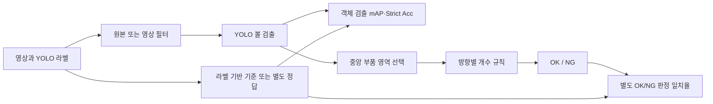

<div align="center">

<a name="볼-결함-탐지와-영상-필터-비교"></a>
<a name="yolov8n--단일복합-전처리-필터--중복-그룹-분할--노이즈-강건성"></a>

# 🔎 Ball Defect Detection Project

YOLOv8n과 영상 필터를 조합해 작은 볼 결함의 검출 성능을 비교합니다.

**기술 분류:** 컴퓨터 비전 › 딥러닝 객체 검출 › 소형 객체·전처리 강건성

`Python`
`PyTorch`
`YOLO`
`Jupyter`

[빠른 시작](#quick-start) · [저장소 구성](#repository-structure) · [실험 설정](#data-settings)

[핵심 구성](#input-processing-output)

[📄 PDF로 읽기](%EB%85%BC%EB%AC%B8/%EC%B5%9C%EC%A2%85_%EB%85%BC%EB%AC%B8.pdf) · [📝 HWP 원본](%EB%85%BC%EB%AC%B8/%EC%B5%9C%EC%A2%85_%EB%85%BC%EB%AC%B8.hwp)

</div>

## 📄 내 논문 PDF

[현재 원문 PDF·공식 링크 교체 위치](docs/PAPERS.md) · [모든 실제 차수·최종본·전체 비교](docs/REVISION_INDEX.md)

- **최종5장 · 전체 원고**: [PDF 원문](%EB%85%BC%EB%AC%B8/%EC%B5%9C%EC%A2%85/5%EC%9E%A5_%EC%9B%90%EB%AC%B8.pdf) · [편집 원본](%EB%85%BC%EB%AC%B8/%EC%B5%9C%EC%A2%85_%EB%85%BC%EB%AC%B8.hwp)
- **최종3장 · 축약 원고**: [PDF 원문](%EB%85%BC%EB%AC%B8/%EC%B5%9C%EC%A2%85/3%EC%9E%A5_%EC%9B%90%EA%B3%A0.pdf) · [편집 원본](%EB%85%BC%EB%AC%B8/%EC%B5%9C%EC%A2%85/3%EC%9E%A5_%EC%9B%90%EA%B3%A0.hwp)

공식 공개 URL은 아직 등록하지 않았습니다. 추후 [논문 전용 표](docs/PAPERS.md)의 교체 칸과 이 항목을 함께 갱신합니다.

## 🗂️ 모든 실제 차수와 최종본

| 단계 | 설명 | 파일 종류 | 전체 차이 |
|---|---|---|---|
| [논문 1차](docs/revisions/paper-1.md) | 다양한 영상 조건에서 YOLO 볼 검출을 위한 단일 필터와 복합 필터의 성능 비교라는 초기 제목의 원고입니다. | hwp·pdf | [직전 단계 비교](docs/revision-diffs/paper-1.diff) |
| [논문 2차](docs/revisions/paper-2.md) | 1차와 같은 제목·연구 설정 아래 본문 표현과 문장 구성을 다듬은 원고입니다. 두 요약 PDF는 해시가 같으므로 새 요약 결과가 생긴 것으로 설명하지 않습니다. | hwp·pdf | [직전 단계 비교](docs/revision-diffs/paper-2.diff) |
| [논문 3차](docs/revisions/paper-3.md) | 제목을 YOLOv8n 기반 볼 검출을 위한 단일 및 복합 전처리 필터의 성능 비교로 바꾸고 단일·복합 필터·잡음·시드 비교와 결과 해석을 확장했습니다. 3차 HWP는 최종5장 HWP와 바이트 해시가 동일합니다. 기존 전체 최종 PDF를 재사용합니다. | hwp·pdf | [직전 단계 비교](docs/revision-diffs/paper-3.diff) |
| [논문 4차 · 검토 도구](docs/revisions/paper-4.md) | 새 원고가 아니라 그림의 이중 반올림·HWP 내장 해상도와 원정밀도 결과표를 대조한 검토 단계입니다. 기존 공개 검사 도구를 보존합니다. 검토 로그·역할 영수증은 공개 자료로 복제하지 않습니다. | py | [직전 단계 비교](docs/revision-diffs/paper-4.diff) |
| [논문 5차 · 재구성 패키지](docs/revisions/paper-5.md) | 원본 결과표와 노트북을 바탕으로 필터 비교 원고·굵은 도표·참조 코드 패키지를 여러 변형으로 정리한 단계입니다. 한국어·영문 전달 패키지, 원고 변형 PDF/DOCX, 도표·집계표·참조 노트북·작성/검사 스크립트를 함께 보존합니다. 임시 렌더 이미지와 의존성 설치 폴더는 별도 제외합니다. 파일 이름이나 서체 변화만으로 새 실험·새 성능을 주장하지 않습니다. | csv·docx·ipynb·json·pdf·png·py·ttf·txt | [직전 단계 비교](docs/revision-diffs/paper-5.diff) |
| [논문 최종 · 3장/5장/요약](docs/revisions/paper-final.md) | 3장 축약본·5장 전체본·별도 요약 HWP가 함께 보존된 최종 묶음입니다. 5장본은 논문3차와 동일 해시이며, 3장본은 본문 분량이 다른 별도 파일입니다. 3장본이 5장본을 대체하지 않습니다. | hwp·pdf | [직전 단계 비교](docs/revision-diffs/paper-final.diff) |
| [발표자료 1차](docs/revisions/talk-1.md) | 본발표12장·부록3장 구성의 10분 발표 초안입니다. 기존 검사 도구와 실제 PDF/PPTX를 연결합니다. | mjs·pdf·pptx·py | [직전 단계 비교](docs/revision-diffs/talk-1.diff) |
| [발표자료 2차](docs/revisions/talk-2.md) | 2차는 비교 사진과 설명을 나누어 20장·600초 본발표로 재구성합니다. 기존 결과를 설명하는 방식의 변화이며 새 연구 실험으로 세지 않습니다. | mjs·pdf·pptx·py | [직전 단계 비교](docs/revision-diffs/talk-2.diff) |
| [발표자료 3차](docs/revisions/talk-3.md) | 3차는 2차의 내용·시간을 유지하면서 투명 로고·자산 보존 처리를 정리한 단계입니다. 연구 결과 변화로 확대하지 않습니다. | mjs·pdf·pptx·py | [직전 단계 비교](docs/revision-diffs/talk-3.diff) |
| [발표자료 최종](docs/revisions/talk-final.md) | 발표3차 결과와 최종 발표파일의 바이트 동일 여부를 전체 SHA-256으로 대조합니다. 최종 연구코드 폴더와 발표 최종 폴더는 별개 자료입니다. | pdf·pptx | [직전 단계 비교](docs/revision-diffs/talk-final.diff) |
| [최종 연구코드](docs/revisions/code-final.md) | 루트 노트북과 최종/연구코드 노트북은 같은 공개 바이트를 보존합니다. 볼 검출 필터 비교와 영역·개수 규칙을 적용하는 OK/NG 및 추가 진단 코드이며, 전문가 판정의 실측 정확도로 대체하지 않습니다. | ipynb | [직전 단계 비교](docs/revision-diffs/code-final.diff) |
| [이전 도커 실험·기존 결과표](docs/revisions/legacy.md) | 기존 공개 단일·복합 필터 실험 코드와 집계 결과표를 보존합니다. 원자료 경로·단일영상 예측·제조 원본·모델 가중치는 신규 공개에서 제외합니다. | csv·ipynb·pdf·py·yaml | [직전 단계 비교](docs/revision-diffs/legacy.diff) |

<a name="overview"></a>

## ✨ 연구 핵심

YOLOv8n의 단일·복합 필터와 잡음·시드 조건을 비교한 원고의 수정 차수와 최종3장·5장본을 함께 보존합니다.

수치는 연구 원고에 보고된 값입니다.

- 단일 실행 Gamma mAP50-95 96.70%와 원본 96.53%를 보고합니다. Strict Acc는 별도 중심 일치 규칙의 지표입니다.
- 필터·잡음 조건마다 재학습하고 세 시드로 반복 비교했습니다. 내부 학습·검증 분할에는 유사 그룹 중복이 남아 있습니다.

**자료별 안내:** [최종 연구코드](docs/versions/stage-1.md) · [논문/4차](docs/versions/stage-2.md) · [발표자료/1차](docs/versions/stage-3.md) · [발표자료/2차](docs/versions/stage-4.md) · [발표자료/3차](docs/versions/stage-5.md) · [최종 원고](docs/versions/stage-6.md) · [전체 기록](docs/VERSIONS.md)

발표 자료는 **1차: 본발표 12장+부록 3장 → 2차: 비교 사진을 확장한 본발표 20장 → 3차: 같은 내용·시간을 유지하고 투명 로고·자산 검사를 보강**한 흐름입니다. 연구 실험 차수와 구분하며, 공개 폴더에는 각 차수의 검사 도구만 보관합니다.

<a name="preview"></a>

<details>
<summary>📎 논문 도표와 출처</summary>

[📊 원고 도표 보기](assets/previews/paper-noise-comparison.png)

**논문 그림** — 공개 HWP 원고의 필터별 노이즈 강도 비교 집계 그림입니다. 세 열은 노이즈 표준편차 0·40·80이고, 지표는 mAP50-95입니다.

[근거 파일 보기](%EB%85%BC%EB%AC%B8/%EC%B5%9C%EC%A2%85_%EB%85%BC%EB%AC%B8.hwp)

</details>

<a name="input-processing-output"></a>

## 🔄 입력·처리·출력

| 단계 | 이 프로젝트에서 다루는 내용 |
| :--- | :--- |
| 📥 입력 | 제조 부품 영상·볼 바운딩 박스 |
| ⚙️ 처리 | YOLOv8n, 단일·복합 필터, 중복 그룹 분할·다중 시드 비교 |
| 📤 출력 | 검출 지표·Strict Acc·별도 OK/NG 판정 |


---

<a name="introduction"></a>

## ✨ 프로젝트 소개

최종 연구는 원본 영상과 단일 필터 10개·조합 필터 5개의 볼 객체 검출을 비교합니다. 근접 중복 이미지 묶음을 분리하고, 다중 시드·교차검증·노이즈 조건에서 결과의 안정성을 살펴봅니다. 노트북에는 중앙 영역의 방향별 개수로 OK/NG를 정하는 별도 실험도 포함되어 있습니다.

| 기능 | 구현 내용 |
| :--- | :--- |
| 🎯 볼 검출 | Ultralytics YOLO로 위치와 객체 상자 예측 |
| 📐 영역 판정 | 중앙 사각형을 찾고 영역 내 볼의 위치별 개수 비교 |
| 🎛️ 필터 비교 | 반전·이진화·블러·엣지 등 단일 필터 10개와 조합 필터 5개 |
| 🧪 난도 실험 | 노이즈, 해상도, 블러 강도, 학습 데이터 양 조건 비교 |
| 🔁 반복 실험 | 다중 시드, 교차검증, 근접 중복 이미지 묶음 처리 |
| 📊 결과 시각화 | CSV·JSON 요약, 혼동행렬, 필터별 그래프, GPU 사용 기록 |



<a name="repository-structure"></a>

## 📁 저장소 구성

주요 경로는 다음과 같습니다.

```text
.
├── ball_ok_ng_yolo_v7.ipynb
├── DataSet/
├── 최종/
│   └── 연구코드/
│       └── ball_ok_ng_yolo_v7.ipynb
├── 이전 도커 실험/
│   └── 불량검출실험/
│       ├── paper_filter_figures.py
│       ├── reference_plot_style.py
│       └── render_saved_figures.py
├── docs/VERSIONS.md
└── CHANGELOG.md
```

- [최종 연구 노트북](%EC%B5%9C%EC%A2%85/%EC%97%B0%EA%B5%AC%EC%BD%94%EB%93%9C/ball_ok_ng_yolo_v7.ipynb): 검출·판정·필터 비교 및 추가 진단 실험.
- [기본 노트북](ball_ok_ng_yolo_v7.ipynb): 저장소 최상위에 보존한 연구 코드.
- [그림 생성 코드](%EC%9D%B4%EC%A0%84%20%EB%8F%84%EC%BB%A4%20%EC%8B%A4%ED%97%98/%EB%B6%88%EB%9F%89%EA%B2%80%EC%B6%9C%EC%8B%A4%ED%97%98/paper_filter_figures.py): 연구 그림 구성.
- [버전별 파일 기록](docs/VERSIONS.md): 공개 코드의 차수별 비교.

<a name="최종-논문"></a>

### 📄 최종 논문

[최종 논문 전체 원고](%EB%85%BC%EB%AC%B8/%EC%B5%9C%EC%A2%85_%EB%85%BC%EB%AC%B8.hwp)에 필터 비교 방법과 연구 그래프를 정리했습니다.

<a name="최종-원고의-연구-범위"></a>

### 🔬 최종 원고의 연구 범위

**YOLOv8n 기반 볼 검출을 위한 단일 및 복합 전처리 필터의 성능 비교**  
*Performance Comparison of Single and Combined Preprocessing Filters for YOLOv8n-Based Ball Detection*

한국정보기술학회([Korean Institute of Information Technology](https://eng.ki-it.or.kr/homepage/custom/memberadministrationregulation))의 2026 추계종합학술대회 양식으로 작성한 연구 원고입니다.

| 최종 원고 항목 | 원고에 명시된 구성·결과 |
| :--- | :--- |
| 자료·분할 | 2944×2352 영상 500장, 초기 학습 400·검증 100; 근접 중복 368개 그룹을 이용한 5-fold 비교 |
| 학습 조건 | YOLOv8n, 30 epoch, 입력 1280, batch 8, patience 15 |
| 평가 구분 | mAP50-95용 conf 0.001·NMS IoU 0.7과 엄격 일치용 conf 0.25·NMS IoU 0.5를 구분 |
| 단일 실행 | Gamma mAP50-95 96.70%, 원본 96.53%로 차이는 0.17%p |
| 3개 시드 비교 | Invert+CLAHE Strict Acc 95.47±2.27%, 원본 95.40±0.53%; 단일 실행 98%를 반복 성능으로 대체하지 않음 |
| 노이즈 σ=80 | Blur 82.86±0.08%, 원본 79.60±0.26%의 원고 보고값 |

엄격 일치는 주석·예측 중심을 가까운 순서로 일대일 대응시키며, 허용 거리는 주석 상자 긴 변의 0.5배입니다. 상자의 겹침을 평가하는 mAP50-95와 기준이 다릅니다.

원고의 외부 평가 fold는 유사 영상 그룹을 분리하지만, 내부 학습·검증에는 9~20개 그룹의 중복이 남아 있습니다. 또한 필터·노이즈 조건마다 모델을 다시 학습했으므로, 고정된 모델이 처음 보는 촬영 조건에 견디는지를 평가한 실험은 아닙니다. 독립 촬영 로트 검증도 후속 과제로 남습니다.

노트북에는 논문의 필터 비교와 함께 100-epoch 기준 실험, 가상 볼 추가, 판정 규칙 분석을 담았습니다.

<a name="implementation"></a>

## 🧩 주요 기술과 실험 구성

OpenCV로 영상을 다루고, PyTorch·Kornia로 필터 연산을 구성합니다. Ultralytics는 객체 검출을 담당하며 NumPy·pandas·Matplotlib는 결과 집계와 그림 생성에 사용합니다.

원고의 일반 영상 비교는 원본·단일 10종·조합 5종을, 노이즈 비교는 원본·단일 필터를 대상으로 합니다. `A+B`는 A 다음 B를 적용하는 순서이며 역순이나 모든 가능한 조합을 시험한 것은 아닙니다. CLAHE는 clip limit 40·16×16 격자, Gamma는 0.3, Gaussian Blur는 σ20·121×121 커널, Emboss는 gain 4, Unsharp는 amount 8·σ2로 고정했습니다. 이 값들은 비교에 사용한 설정이며 최적값을 뜻하지 않습니다.

노트북 앞부분은 초기 개발 실험이며, 뒤쪽에는 교차검증과 강건성 실험을 구성했습니다.

| 비교 묶음 | 조건 |
| :--- | :--- |
| 기준 | 원본 영상 |
| 단일 필터 | Invert, Otsu, Solarize, Histogram Equalization, CLAHE, Gamma, Gaussian Blur, Sobel, Emboss, Unsharp |
| 조합 필터 | Invert+CLAHE, Blur+Otsu, Sobel+Invert, HistEq+Emboss, Unsharp+Sobel |
| 추가 진단 | 볼 지우기·추가하기, 판정 임계값 변화, 분포 변화, 다중 시드 반복 |

<a name="quick-start"></a>

## 🚀 빠른 시작

Python과 CUDA를 사용할 수 있는 PyTorch 환경을 먼저 준비합니다. 노트북의 기본 `REQUIRE_GPU = True` 설정에서는 CUDA를 찾지 못하면 중단됩니다. 필요한 패키지를 준비한 뒤 저장소 루트에서 실행합니다.

```powershell
python -m pip install jupyterlab numpy opencv-python matplotlib pandas pyyaml joblib ultralytics kornia
python -m jupyter lab "최종/연구코드/ball_ok_ng_yolo_v7.ipynb"
```

1. 노트북의 데이터 경로를 자신의 실험 자료 위치에 맞춥니다. 원래 코드는 `/root/추계학술대회/DataSet`을 전제로 작성되어 있습니다.
2. 이미지와 YOLO 라벨의 대응 관계, 학습·검증·시험 분할을 확인합니다.
3. 사용할 GPU와 데이터 경로를 확인한 뒤 필요한 실험 셀을 순서대로 실행합니다.
4. 결과 CSV와 JSON을 확인하고, 필요할 때 그림 생성 셀을 실행합니다.

원본 영상·학습 가중치·완성된 실행 환경은 별도로 준비해야 합니다. 공개 파일만으로 모든 실험을 즉시 재현할 수 있는 패키지는 아닙니다.

<a name="data-settings"></a>

## 📊 데이터 구성과 실험 설정

노트북이 기대하는 기본 데이터 구조는 다음과 같습니다.

```text
DataSet/
├── images/{train,val,test}/*.png
├── labels/{train,val,test}/*.txt
└── data.yaml
```

라벨 한 행은 `class cx cy w h`이며 좌표는 0~1로 정규화합니다. 별도의 실제 OK/NG 정답을 사용할 때는 노트북의 `OKNG_CSV` 및 후반부의 `REAL_LABEL_*` 설정을 확인합니다.

| 지표·설정 | 해석 |
| :--- | :--- |
| 위치별 개수 | 위 5개·왼쪽 4개·아래 2개·오른쪽 2개를 사용하는 구현 규칙 |
| 검출 mAP | 볼의 객체 상자 검출 성능 |
| OK/NG 정확도 | 선택한 정답 정의와 개수 규칙에 대한 판정 일치율 |
| Strict Acc | 라벨의 볼을 모두 찾고 추가 검출도 없는 엄격한 기준 |
| 다수 클래스 기준 | 클래스 불균형에서 단순 다수 예측과 비교하기 위한 기준 |
| McNemar 비교 | 같은 영상에 대한 두 방법의 정오답 차이 비교 |

라벨 상자에도 동일한 영역·개수 규칙을 적용해 정답을 만듭니다. 따라서 이 평가는 규칙 기반 판정의 일치율을 다루며, 전문가의 별도 판정과 비교하는 평가는 후속 과제입니다.

<a name="troubleshooting"></a>

## 🛠️ 문제 해결

| 증상 | 확인할 내용 |
| :--- | :--- |
| CUDA GPU를 찾지 못함 | 드라이버, PyTorch의 CUDA 지원 여부, 노트북의 장치 설정 |
| 데이터 경로 오류 | 노트북의 원래 Linux 경로와 현재 데이터 위치 |
| 결과가 지나치게 높음 | 중복 이미지 묶음, 클래스 불균형, 정답 생성 규칙, 별도 실제 정답 유무 |
| 한글 그래프가 깨짐 | 나눔고딕 설치와 노트북의 폰트 경로 |
| 기존 결과와 수치가 다름 | 시드·분할·가중치·캐시·필터 파라미터가 같은지 확인 |

---

<div align="center">

**검출에서 판정까지, 조건을 나누어 비교합니다.**

</div>
