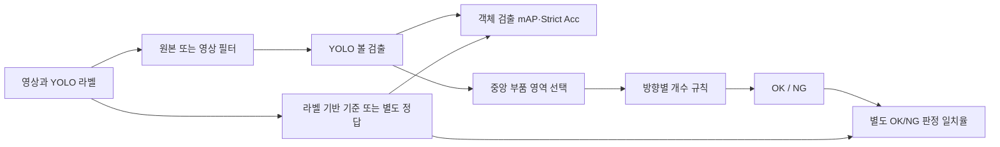

<a name="볼-결함-탐지와-영상-필터-비교"></a>
<a name="yolov8n--단일복합-전처리-필터--중복-그룹-분할--노이즈-강건성"></a>

<a id="-ball-defect-detection-project"></a>

# Ball Defect Detection Project

**YOLOv8n 기반 볼 객체 검출에서 단일·복합 전처리 필터의 성능을 비교합니다.**

<!-- reading-levels17:start -->
| 읽기 수준 | 안내 내용 |
| --- | --- |
| [LEVEL 1 - Beginner](docs/%EC%9D%BD%EA%B8%B0%EC%95%88%EB%82%B4/%EB%A0%88%EB%B2%A81.md) | 낯선 용어를 풀고 입력부터 결과까지 구체적인 예로 읽기 |
| [LEVEL 2 - Explorer](docs/%EC%9D%BD%EA%B8%B0%EC%95%88%EB%82%B4/%EB%A0%88%EB%B2%A82.md) | 핵심 개념과 처리 흐름의 관계 이해 |
| [LEVEL 3 - Practitioner](docs/%EC%9D%BD%EA%B8%B0%EC%95%88%EB%82%B4/%EB%A0%88%EB%B2%A83.md) | 실험·사용 절차와 결과 해석 따라가기 |
| [LEVEL 4 - Advanced](docs/%EC%9D%BD%EA%B8%B0%EC%95%88%EB%82%B4/%EB%A0%88%EB%B2%A84.md) | 코드 구조·설정·설계 선택과 제약 검토 |
| [LEVEL 5 - Expert](docs/%EC%9D%BD%EA%B8%B0%EC%95%88%EB%82%B4/%EB%A0%88%EB%B2%A85.md) | 논문·프로토콜·분모·누수·미검증 범위 대조 |
<!-- reading-levels17:end -->

<a id="paper-errata-20261120"></a>

## 기존 원고와 정정 안내

**기존 5 쪽 HWP·PDF는 원문 그대로 보존합니다.** 원고 그림의 세 값에 남은 이중 반올림 표시와 반복 문단을 별도 [논문 정정 안내](발표자료/5차/논문_정정안내.pdf)에서 구분해 설명합니다.

발표 그래프는 저장된 원정밀도 값에서 한 번 반올림한 표시를 사용합니다.

원고를 인용할 때 이 안내를 함께 확인합니다.


## 최신 발표·7차

**마지막 장은 감사 인사 중심으로 정리했습니다.** 질의응답 문구와 하단 네 파트 안내·선을 제거하고, 감사 인사·저자·학교 마크·페이지 번호를 유지했습니다. 다른 19장과 연구 수치·대본·사진은 유지합니다.

| 차수 | 변경 | 자료 |
| --- | --- | --- |
| 발표 자료 7차 | 마지막 장의 보조 문구·안내 선 정리 | [PPTX·PDF](발표자료/7차) · [상세](docs/revisions/talk-7.md) · [직전 비교](docs/revision-diffs/talk-7.md) |

[5차 대본·질문과 답변·연구 이해·사진모음·논문 정정 안내](발표자료/5차)는 함께 사용합니다. 기존 6차 발표도 보존합니다.

<a id="최신-발표--6차"></a>

## 발표 시각 개선·6차

**20장 발표의 연구 내용과 장별 대본을 유지하면서 파트 구분·도식 연결·차트 식별을 다듬었습니다.** 6차는 같은 연구의 시각 표현 개정이며 새로운 학습·성능 측정을 추가한 차수가 아닙니다.

| 차수 | 바뀐 부분 | 자료 |
| --- | --- | --- |
| [발표자료 6차](docs/revisions/talk-6.md) | 파트 구분 · 연결선 도식 · 필터 색 · 계열 식별 | [자료](발표자료/6차) · [상세](docs/revisions/talk-6.md) · [직전 비교](docs/revision-diffs/talk-6.md) |

대본·예상 질문·연구 이해 자료·필터 사진모음·논문 정정 안내는 [5차 자료](발표자료/5차)를 함께 사용합니다. 기존 논문과 실험 원값은 보존했습니다.

<a id="최신-발표-자료--5차"></a>

## 발표 준비 자료·5차

**필터 별 볼 검출 성능을 비교한 연구를 발표 슬라이드·10분 대본·질문과 답변으로 함께 읽습니다.** 이번 차수는 저장된 결과의 전달 방식과 가독성을 다듬는 작업이며 새 학습 결과를 추가하지 않습니다.

| 차수 | 달라진 점 | 자료 |
| --- | --- | --- |
| [발표자료 5차](docs/revisions/talk-5.md) | 발표 가독성 재구성·10분 대본·예상 질문·답변·연구 이해 자료 | [자료](발표자료/5차) · [상세](docs/revisions/talk-5.md) · [직전 비교](docs/revision-diffs/talk-5.md) |

연구 대상은 사진 속 **볼 객체의 검출**입니다.

조건마다 필터를 적용한 영상으로 모델을 다시 학습한 비교이며, 고정 모델이 알 수 없는 현장의 모든 사진에 잘 작동한다고 입증한 평가는 아닙니다.

일반 영상의 Gamma 최고 값은 단일 시드 결과이고, 일부 대표 조건만 세 시드로 반복했습니다. mAP50-95와 Strict Acc, 별도의 규칙 기반 OK/NG 일치도를 구분합니다.

분야: 컴퓨터 비전 › 딥러닝 객체 검출 › 소형 객체·전처리 강건성

`Python`
`PyTorch`
`YOLO`
`Jupyter`

[빠른 시작](#quick-start) · [저장소 구성](#repository-structure) · [실험 설정](#data-settings)

[핵심 구성](#input-processing-output)

[작성·게재 상태](docs/%EB%85%BC%EB%AC%B8%EC%83%81%ED%83%9C.md)

<a id="-연구-핵심"></a>

## 연구 요약

YOLOv8n의 단일·복합 필터와 잡음·시드 조건을 비교한 연구를 설명합니다. 최종 5쪽 전체 원고는 로컬에 보존하며 공개하지 않습니다. 이전 수정 차수와 축약본의 차이는 변경 설명에서 확인할 수 있습니다.

수치는 연구 원고에 보고된 값입니다.

- 단일 실행 Gamma mAP50-95 96.70%와 원본 96.53%를 보고합니다. Strict Acc는 별도 중심 일치 규칙의 지표입니다.
- 필터·잡음 조건마다 재학습했으며, 일부 대표 조건을 세 시드로 반복 비교했습니다. 내부 학습·검증 분할에는 유사 그룹 중복이 남아 있습니다.

**자료별 안내:** [최종 연구코드](docs/versions/stage-1.md) · [논문/4차](docs/versions/stage-2.md) · [발표자료/1차](docs/versions/stage-3.md) · [발표자료/2차](docs/versions/stage-4.md) · [발표자료/3차](docs/versions/stage-5.md) · [최종 원고](docs/versions/stage-6.md) · [전체 기록](docs/VERSIONS.md)

발표 자료는 **1차: 본 발표 12장 +부록 3장 → 2차: 비교 사진을 확장한 본 발표 20장 → 3차: 같은 내용·시간을 유지하고 투명 로고·자산 검사를 보강**한 흐름입니다. 연구 실험 차수와 구분하며, 공개 폴더에는 각 차수의 검사 도구만 보관합니다.

<a name="preview"></a>


**연구 원본 그림** — 별도로 보관한 원본의 필터별 노이즈 강도 비교 집계 그림입니다. 세 열은 노이즈 표준 편차 0·40·80이고, 지표는 mAP50-95입니다.

[작성·게재 상태](docs/%EB%85%BC%EB%AC%B8%EC%83%81%ED%83%9C.md)

<a name="input-processing-output"></a>

<a id="-입력처리출력"></a>

## 입력·처리·출력

| 구분 | 내용 |
| --- | --- |
| 문제 | 작은 볼을 검출할 때 전처리 필터와 잡음 조건이 결과에 미치는 영향을 비교합니다. |
| 입력 | 제조 부품 영상·볼 바운딩 박스 |
| 처리 | YOLOv8n, 단일·복합 필터, 중복 그룹 분할·다중 시드 비교 |
| 출력 | 검출 지표·Strict Acc·별도 OK/NG 판정 |

---

<a id="-논문과-최신-자료"></a>

## 논문과 최신 자료

| 자료 | 원문 파일 |
| --- | --- |
| 최종 논문 · 볼 검출 필터 비교 | [작성·게재 상태](docs/%EB%85%BC%EB%AC%B8%EC%83%81%ED%83%9C.md) |
| 최종 발표 · 볼 검출 | [PDF 다운로드](%EB%B0%9C%ED%91%9C%EC%9E%90%EB%A3%8C/%EC%B5%9C%EC%A2%85/%EC%B6%94%EA%B3%84%ED%95%99%EC%88%A0%EB%8C%80%ED%9A%8C_10%EB%B6%84%EB%B0%9C%ED%91%9C.pdf) |
| 최종 발표 · 볼 검출 | [PPTX 다운로드](%EB%B0%9C%ED%91%9C%EC%9E%90%EB%A3%8C/%EC%B5%9C%EC%A2%85/%EC%B6%94%EA%B3%84%ED%95%99%EC%88%A0%EB%8C%80%ED%9A%8C_10%EB%B6%84%EB%B0%9C%ED%91%9C.pptx) |
| 완성 대본·볼 검출 발표 4차 | [TXT 다운로드](%EB%B0%9C%ED%91%9C%EC%9E%90%EB%A3%8C/4%EC%B0%A8/10%EB%B6%84_%ED%95%99%EC%88%A0%EB%8C%80%ED%9A%8C_%EB%B0%9C%ED%91%9C%EB%8C%80%EB%B3%B8.txt) |

[자료별 설명](docs/PAPERS.md) · [코드 차수와 변경 이력](docs/REVISION_INDEX.md)

<a id="️-차수별-프로젝트-안내"></a>

## 전체 차수

| 차수·단계 | 주요 내용 | 자료 | 직전 비교 |
| --- | --- | --- | --- |
| [논문 1차](docs/revisions/paper-1.md) | <a id="layout18-table-4-row-1-field-1"></a>다양한 영상 조건에서 YOLO 볼 검출을 위한 단일·복합 필터의 성능 비교를 정리한 초기 원고입니다. | [폴더](%EB%85%BC%EB%AC%B8) | [전체 비교](docs/revision-diffs/paper-1.diff) |
| [논문 2차](docs/revisions/paper-2.md) | 1차와 같은 제목·연구 설정 아래 문장과 표현을 다듬은 원고 단계입니다. | [폴더](%EB%85%BC%EB%AC%B8) | [전체 비교](docs/revision-diffs/paper-2.diff) |
| [논문 3차](docs/revisions/paper-3.md) | <a id="layout18-table-4-row-3-field-1"></a>제목을 YOLOv8n 기반 볼 검출의 단일·복합 전처리 필터 비교로 정리하고 조건·결과 해석을 확장한 단계입니다. | [폴더](%EB%85%BC%EB%AC%B8) | [전체 비교](docs/revision-diffs/paper-3.diff) |
| [논문 4차 · 검토 도구](docs/revisions/paper-4.md) | <a id="layout18-table-4-row-4-field-1"></a>새 모델을 학습하는 대신 원고의 표·그림·문장과 저장된 원정밀도 결과를 대조한 검토 도구 단계입니다. | [폴더](%EB%85%BC%EB%AC%B8/4%EC%B0%A8/tools) | [전체 비교](docs/revision-diffs/paper-4-%EC%97%B4%EB%9E%8C.md) |
| [논문 5차 · 재구성 패키지](docs/revisions/paper-5.md) | <a id="layout18-table-4-row-5-field-1"></a>보존된 결과표와 노트북을 논문용 도표·참조 코드·전달 패키지로 구성한 단계입니다.<br>모델을 다시 학습하는 경로와 저장 결과를 다시 그리는 경로를 분리합니다. | [폴더](%EB%85%BC%EB%AC%B8/5%EC%B0%A8/%EC%BD%94%EB%93%9C) | [전체 비교](docs/revision-diffs/paper-5-%EC%97%B4%EB%9E%8C.md) |
| [논문 최종 · 3장/5장/요약](docs/revisions/paper-final.md) | <a id="layout18-table-4-row-6-field-1"></a>같은 연구의 3쪽 축약본·5쪽 전체본·별도 요약을 정리한 최종 단계입니다. 현재 5쪽 전체 원고와 같은 판의 HWP는 로컬에 보존하며 공개 안내에서는 작성·게재 상태를 확인합니다. | [폴더](%EB%85%BC%EB%AC%B8) | [전체 비교](docs/revision-diffs/paper-final-%EC%97%B4%EB%9E%8C.md) |
| [발표자료 1차](docs/revisions/talk-1.md) | 필터 비교 연구를 12장 본 발표 600초와 3장 부록으로 설명한 초기 발표 구성입니다. | [폴더](%EB%B0%9C%ED%91%9C%EC%9E%90%EB%A3%8C/1%EC%B0%A8) | [전체 비교](docs/revision-diffs/talk-1.diff) |
| [발표자료 2차](docs/revisions/talk-2.md) | 필터 비교 사진과 설명을 나누고 20장·600초 본 발표로 재배치한 단계입니다. | [폴더](%EB%B0%9C%ED%91%9C%EC%9E%90%EB%A3%8C/2%EC%B0%A8) | [전체 비교](docs/revision-diffs/talk-2.diff) |
| [발표자료 3차](docs/revisions/talk-3.md) | 2차의 20장 내용·시간을 유지하면서 투명 학교 마크와 전달 자산의 일치를 보강한 단계입니다. | [폴더](%EB%B0%9C%ED%91%9C%EC%9E%90%EB%A3%8C/3%EC%B0%A8) | [전체 비교](docs/revision-diffs/talk-3.diff) |
| [발표자료 4차](docs/revisions/talk-4.md) | <a id="layout18-table-4-row-10-field-1"></a>3차의 20장 슬라이드 순서에 맞춰 발화·전환 문장을 다듬고 목표 시간을 배분한 전체 발표 대본입니다.<br>슬라이드를 새로 학습하거나 실험한 단계가 아닙니다. | [폴더](%EB%B0%9C%ED%91%9C%EC%9E%90%EB%A3%8C/4%EC%B0%A8) | [전체 비교](docs/revision-diffs/talk-4.diff) |
| [발표자료 최종](docs/revisions/talk-final.md) | <a id="layout18-table-4-row-11-field-1"></a>단일·복합 필터와 잡음·시드 결과를 20장으로 설명하는 완성 발표 PDF/PPTX입니다.<br>논문과 다른 목적의 발표 자료로 같은 연구의 흐름을 전달합니다. | [폴더](%EB%B0%9C%ED%91%9C%EC%9E%90%EB%A3%8C/%EC%B5%9C%EC%A2%85) | [전체 비교](docs/revision-diffs/talk-final.diff) |
| [최종](docs/revisions/code-final.md) | <a id="layout18-table-4-row-12-field-1"></a>유사 영상 그룹과 교차검증을 구성하고 전처리 필터별 YOLO 검출, 볼 일치, 영역별 개수 판정과 추가 진단을 함께 계산하는 노트북입니다. | [폴더](%EC%B5%9C%EC%A2%85) | [전체 비교](docs/revision-diffs/code-final-%EC%97%B4%EB%9E%8C.md) |
| [이전 도커 실험·기존 결과표](docs/revisions/legacy.md) | <a id="layout18-table-4-row-13-field-1"></a>단일·복합 필터 실험의 이전 노트북과 저장된 CSV·JSON·그래프를 함께 읽는 자료입니다.<br>결과표를 확인하는 경로와 새 학습을 수행하는 경로를 나누어 사용합니다. | [폴더](%EC%9D%B4%EC%A0%84%20%EB%8F%84%EC%BB%A4%20%EC%8B%A4%ED%97%98/%EB%B6%88%EB%9F%89%EA%B2%80%EC%B6%9C%EC%8B%A4%ED%97%98) | [전체 비교](docs/revision-diffs/legacy-%EC%97%B4%EB%9E%8C.md) |


<a name="introduction"></a>

<a id="-프로젝트-소개"></a>

## 연구 방법

최종 연구는 원본 영상과 단일 필터 10개·조합 필터 5개의 볼 객체 검출을 비교합니다. 근접 중복 이미지 묶음을 분리하고, 다중 시드·교차검증·노이즈 조건에서 결과의 안정성을 살펴봅니다. 노트북에는 중앙 영역의 방향별 개수로 OK/NG를 정하는 별도 실험도 포함되어 있습니다.

| 기능 | 구현 내용 |
| --- | --- |
| 볼 검출 | Ultralytics YOLO 로 위치와 객체 상자 예측 |
| 영역 판정 | 중앙 사각형을 찾고 영역 내 볼의 위치별 개수 비교 |
| 필터 비교 | 반전·이진화·블러·엣지 등 단일 필터 10개와 조합 필터 5개 |
| 난도 실험 | 노이즈, 해상도, 블러 강도, 학습 데이터 양 조건 비교 |
| 반복 실험 | 다중 시드, 교차검증, 근접 중복 이미지 묶음 처리 |
| 결과 시각화 | CSV·JSON 요약, 혼동행렬, 필터별 그래프, GPU 사용 기록 |



<a name="repository-structure"></a>

<a id="-저장소-구성"></a>

## 저장소 구성

주요 경로는 다음과 같습니다.

```text
.
├── ball_ok_ng_yolo_v7.ipynb
├── DataSet/
├── 최종/
│   └── 연구코드/
│       └── ball_ok_ng_yolo_v7.ipynb
├── 이전 도커 실험/
│   └── 불량검출실험/
│       ├── paper_filter_figures.py
│       ├── reference_plot_style.py
│       └── render_saved_figures.py
├── docs/VERSIONS.md
└── CHANGELOG.md
```

- [최종 연구 노트북](%EC%B5%9C%EC%A2%85/%EC%97%B0%EA%B5%AC%EC%BD%94%EB%93%9C/ball_ok_ng_yolo_v7.ipynb): 검출·판정·필터 비교 및 추가 진단 실험.
- [기본 노트북](ball_ok_ng_yolo_v7.ipynb): 저장소 최상위에 보존한 연구 코드.
- [그림 생성 코드](%EC%9D%B4%EC%A0%84%20%EB%8F%84%EC%BB%A4%20%EC%8B%A4%ED%97%98/%EB%B6%88%EB%9F%89%EA%B2%80%EC%B6%9C%EC%8B%A4%ED%97%98/paper_filter_figures.py): 연구 그림 구성.
- [버전별 파일 기록](docs/VERSIONS.md): 공개 코드의 차수별 비교.

<a name="최종-논문"></a>

<a id="-최종-논문"></a>

### 최종 논문

[작성·게재 상태](docs/%EB%85%BC%EB%AC%B8%EC%83%81%ED%83%9C.md)에 필터 비교 방법과 연구 그래프를 정리했습니다.

<a name="최종-원고의-연구-범위"></a>

<a id="-최종-원고의-연구-범위"></a>

### 최종 원고의 연구 범위

**YOLOv8n 기반 볼 검출을 위한 단일 및 복합 전처리 필터의 성능 비교**
*Performance Comparison of Single and Combined Preprocessing Filters for YOLOv8n-Based Ball Detection*

한국정보기술학회([Korean Institute of Information Technology](https://eng.ki-it.or.kr/homepage/custom/memberadministrationregulation))의 2026 추계종합학술대회 양식으로 작성한 연구 원고입니다.

| 최종 원고 항목 | 원고에 명시된 구성·결과 |
| --- | --- |
| <a id="layout18-table-6-row-1"></a> 자료·분할 | 2944×2352 영상 500장, 초기 학습 400·검증 100; 근접 중복 368개 그룹을 이용한 5-fold 비교 |
| <a id="layout18-table-6-row-2"></a> 학습 조건 | YOLOv8n, 30 epoch, 입력 1280, batch 8, patience 15 |
| <a id="layout18-table-6-row-3"></a> 평가 구분 | mAP50-95용 conf 0.001·NMS IoU 0.7과 엄격 일치용 conf 0.25·NMS IoU 0.5를 구분 |
| <a id="layout18-table-6-row-4"></a> 단일 실행 | Gamma mAP50-95 96.70%, 원본 96.53%로 차이는 0.17%p |
| <a id="layout18-table-6-row-5"></a> 3개 시드 비교 | Invert +CLAHE Strict Acc 95.47±2.27%, 원본 95.40±0.53%; 단일 실행 98%를 반복 성능으로 대체하지 않음 |
| <a id="layout18-table-6-row-6"></a> 노이즈 σ=80 | Blur 82.86±0.08%, 원본 79.60±0.26%의 원고 보고값 |


엄격 일치는 주석·예측 중심을 가까운 순서로 일 대 일 대응시키며, 허용 거리는 주석 상자 긴 변의 0.5 배입니다. 상자의 겹침을 평가하는 mAP50-95와 기준이 다릅니다.

원고의 외부 평가 fold는 유사 영상 그룹을 분리하지만, 내부 학습·검증에는 9~20개 그룹의 중복이 남아 있습니다.

또한 필터·노이즈 조건마다 모델을 다시 학습했으므로, 고정된 모델이 처음 보는 촬영 조건에 견디는지를 평가한 실험은 아닙니다. 독립 촬영 로트 검증도 후속 과제로 남습니다.

노트북에는 논문의 필터 비교와 함께 100-epoch 기준 실험, 가상 볼 추가, 판정 규칙 분석을 담았습니다.

<a name="implementation"></a>

<a id="-주요-기술과-실험-구성"></a>

## 주요 기술과 실험 구성

OpenCV로 영상을 다루고, PyTorch·Kornia로 필터 연산을 구성합니다. Ultralytics는 객체 검출을 담당하며 NumPy·pandas·Matplotlib는 결과 집계와 그림 생성에 사용합니다.

원고의 일반 영상 비교는 원본·단일 10 종·조합 5 종을, 노이즈 비교는 원본·단일 필터를 대상으로 합니다. `A+B`는 A 다음 B를 적용하는 순서이며 역순이나 모든 가능한 조합을 시험한 것은 아닙니다.

CLAHE는 clip limit 40·16×16 격자, Gamma는 0.3, Gaussian Blur는 σ20·121×121 커널, Emboss는 gain 4, Unsharp는 amount 8·σ2로 고정했습니다. 이 값들은 비교에 사용한 설정이며 최적 값을 뜻하지 않습니다.

노트북 앞부분은 초기 개발 실험이며, 뒤쪽에는 교차검증과 강건성 실험을 구성했습니다.

| 비교 묶음 | 조건 |
| --- | --- |
| <a id="layout18-table-7-row-1"></a> 기준 | 원본 영상 |
| <a id="layout18-table-7-row-2"></a> 단일 필터 | Invert, Otsu, Solarize, Histogram Equalization, CLAHE, Gamma, Gaussian Blur, Sobel, Emboss, Unsharp |
| <a id="layout18-table-7-row-3"></a> 조합 필터 | Invert+CLAHE, Blur+Otsu, Sobel+Invert, HistEq+Emboss, Unsharp+Sobel |
| <a id="layout18-table-7-row-4"></a> 추가 진단 | 볼 지우기·추가하기, 판정 임계값 변화, 분포 변화, 다중 시드 반복 |


<a name="quick-start"></a>

<a id="-빠른-시작"></a>

## 빠른 시작

Python과 CUDA를 사용할 수 있는 PyTorch 환경을 먼저 준비합니다. 노트북의 기본 `REQUIRE_GPU = True` 설정에서는 CUDA를 찾지 못하면 중단됩니다. 필요한 패키지를 준비한 뒤 저장소 루트에서 실행합니다.

```powershell
python -m pip install jupyterlab numpy opencv-python matplotlib pandas pyyaml joblib ultralytics kornia
python -m jupyter lab "최종/연구코드/ball_ok_ng_yolo_v7.ipynb"
```

1. 노트북의 데이터 경로를 자신의 실험 자료 위치에 맞춥니다. 원래 코드는 `/root/추계학술대회/DataSet`을 전제로 작성되어 있습니다.
2. 이미지와 YOLO 라벨의 대응 관계, 학습·검증·시험 분할을 확인합니다.
3. 사용할 GPU와 데이터 경로를 확인한 뒤 필요한 실험 셀을 순서대로 실행합니다.
4. 결과 CSV와 JSON을 확인하고, 필요할 때 그림 생성 셀을 실행합니다.

원본 영상·학습 가중치·완성된 실행 환경은 별도로 준비해야 합니다. 공개 파일만으로 모든 실험을 즉시 재현할 수 있는 패키지는 아닙니다.

<a name="data-settings"></a>

<a id="-데이터-구성과-실험-설정"></a>

## 데이터 구성과 실험 설정

노트북이 기대하는 기본 데이터 구조는 다음과 같습니다.

```text
DataSet/
├── images/{train,val,test}/*.png
├── labels/{train,val,test}/*.txt
└── data.yaml
```

라벨 한 행은 `class cx cy w h`이며 좌표는 0~1로 정규화합니다. 별도의 실제 OK/NG 정답을 사용할 때는 노트북의 `OKNG_CSV` 및 후반부의 `REAL_LABEL_*` 설정을 확인합니다.

| 지표·설정 | 해석 |
| --- | --- |
| 위치별 개수 | 위 5개·왼쪽 4개·아래 2개·오른쪽 2개를 사용하는 구현 규칙 |
| 검출 mAP | 볼의 객체 상자 검출 성능 |
| OK/NG 정확도 | 선택한 정답 정의와 개수 규칙에 대한 판정 일치율 |
| Strict Acc | 라벨의 볼을 모두 찾고 추가 검출도 없는 엄격한 기준 |
| 다수 클래스 기준 | 클래스 불균형에서 단순 다수 예측과 비교하기 위한 기준 |
| McNemar 비교 | 같은 영상에 대한 두 방법의 정오답 차이 비교 |

라벨 상자에도 동일한 영역·개수 규칙을 적용해 정답을 만듭니다. 따라서 이 평가는 규칙 기반 판정의 일치율을 다루며, 전문가의 별도 판정과 비교하는 평가는 후속 과제입니다.

<a name="troubleshooting"></a>

<a id="️-문제-해결"></a>

## 문제 해결

| 증상 | 확인할 내용 |
| --- | --- |
| CUDA GPU를 찾지 못함 | 드라이버, PyTorch의 CUDA 지원 여부, 노트북의 장치 설정 |
| 데이터 경로 오류 | 노트북의 원래 Linux 경로와 현재 데이터 위치 |
| 결과가 지나치게 높음 | 중복 이미지 묶음, 클래스 불균형, 정답 생성 규칙, 별도 실제 정답 유무 |
| 한글 그래프가 깨짐 | 나눔고딕 설치와 노트북의 폰트 경로 |
| 기존 결과와 수치가 다름 | 시드·분할·가중치·캐시·필터 파라미터가 같은지 확인 |

---

검출에서 판정까지, 조건을 나누어 비교합니다.

<a id="-현재-첨부-문서"></a>

## 최신 문서와 변경 이력

현재 공개 자료와 직전 공개본의 비교입니다. 이전 원고·발표·코드의 단계별 설명은 전체 차수 표에서 확인할 수 있으며, 미게재 원고 본문과 편집 원본은 로컬에 보존하고 공개하지 않습니다.

| 문서 | 자료 폴더 | 상세 | 직전 공개본 전체 비교 |
| --- | --- | --- | --- |
| 최종 논문 · 볼 검출 필터 비교 | [폴더](%EB%85%BC%EB%AC%B8) | [설명](docs/latest/ball-yolov8n-filter-paper.md) | [전체 비교](docs/changes/2026-11-02-%EC%B5%9C%EC%8B%A0%EB%AC%B8%EC%84%9C-%EC%A0%84%EC%B2%B4%EB%B9%84%EA%B5%90.md) |
| 최종 발표 · 볼 검출 | [폴더](%EB%B0%9C%ED%91%9C%EC%9E%90%EB%A3%8C/%EC%B5%9C%EC%A2%85) | [설명](docs/latest/ball-conference-presentation.md) | [전체 비교](docs/changes/2026-11-02-%EC%B5%9C%EC%8B%A0%EB%AC%B8%EC%84%9C-%EC%A0%84%EC%B2%B4%EB%B9%84%EA%B5%90.md) |
| 완성 대본·볼 검출 발표 4차 | [폴더](%EB%B0%9C%ED%91%9C%EC%9E%90%EB%A3%8C/4%EC%B0%A8) | [설명](docs/latest/ball-complete-talk-script.md) | [전체 비교](docs/changes/2026-11-02-%EC%B5%9C%EC%8B%A0%EB%AC%B8%EC%84%9C-%EC%A0%84%EC%B2%B4%EB%B9%84%EA%B5%90.md) |

[최신 문서 구성 변경](docs/changes/2026-11-02-%EC%B5%9C%EC%8B%A0%EB%AC%B8%EC%84%9C.md)

<a name="research-details"></a>

<a id="-연구구현의-세부-흐름"></a>

## 차수별 방법과 조건

차수별 입력, 처리 방법, 실행 조건과 결과를 정리했습니다.

<a id="-논문-1차--단일복합-전처리-필터-비교의-출발점"></a>

<details>
<summary>논문 1차·단일·복합 전처리 필터 비교의 출발점</summary>

### 논문 1차·단일·복합 전처리 필터 비교의 출발점

다양한 영상 조건에서 YOLO 볼 검출을 위한 단일·복합 필터의 성능 비교를 정리한 초기 원고입니다.

| 구성 | 처리 내용 |
| --- | --- |
| 연구 질문 | 필터를 적용하면 작은 볼의 검출이 어떻게 달라지는지 비교합니다. |
| 초기 원고의 읽기 | 제목·설정·표현이 뒤 원고로 이어지는 변화를 직전 비교와 함께 읽습니다. |
| 필터 비교 | 단일 10 종과 순차 복합 5 종을 Original 기준과 비교합니다. |
| 조건별 재학습 | 미지 촬영 조건에 고정 모델을 바로 적용한 평가와 구분합니다. |
| 두 지표 | 경계 상자 mAP50-95와 모든 볼을 맞추고 추가 검출이 없는 Strict Acc를 구분합니다. |
| 반복과 잡음 | 일반 조건과 잡음 표준편차 40·80, 세 시드 반복을 나누어 읽습니다. |

| 입력·실행 조건 | 내용 |
| --- | --- |
| 자료 | 500장·2944×2352 영상에 대한 원고 보고 |
| 외부 평가 | 유사 그룹 기반 5 겹 교차 검증 |
| 조건 | 단일 10 종·복합 5 종·잡음 40/80·세 시드 |
| 결과 구분 | mAP50-95와 Strict Acc |

일반 영상 단일 시드에서 Gamma0.3의 mAP50-95는 96.70%, Original은 96.53%로 원고가 보고합니다.

차이는 0.17%p이며 작은 차이를 무조건적인 우위로 확대하지 않습니다.

복합 필터는 모든 경우에 단일 구성 필터보다 좋아지지 않습니다. 일반 조건의 결과와 잡음 조건의 안정성·세 시드의 변동을 나누어 읽습니다.

| 제약 | 확인할 내용 |
| --- | --- |
| <a id="layout18-table-13-row-1"></a> 일반화 범위 | 필터·잡음 조건별 재학습 결과이며 고정 모델의 미지 촬영 조건 적응성을 입증한 것은 아닙니다. |
| <a id="layout18-table-13-row-2"></a> 내부 분할 | 외부 평가 그룹은 분리하지만 내부 train/val에는 유사 그룹 중복이 남아 있습니다. |
| <a id="layout18-table-13-row-3"></a> 지표 정의 | Strict Acc는 중심 거리·누락·추가 검출 규칙이며 전문가 OK/NG 판정이나 mAP와 같지 않습니다. |


[파일 구성·핵심 정의·사용 순서](docs/revisions/paper-1.md) · [이 단계 전체 비교](docs/revision-diffs/paper-1.diff)

<a id="-논문-2차--같은-설정을-더-명확하게-설명한-원고"></a>

</details>

<details>
<summary>논문 2차·같은 설정을 더 명확하게 설명한 원고</summary>

### 논문 2차·같은 설정을 더 명확하게 설명한 원고

1차와 같은 제목·연구 설정 아래 문장과 표현을 다듬은 원고 단계입니다.

| 구성 | 처리 내용 |
| --- | --- |
| 설명 개정 | 문장·표현의 변화와 실험 설정의 변화를 분리해서 읽습니다. |
| 요약 중복 | 1·2차 요약 PDF는 같은 해시의 자료여서 새로운 요약 결과가 생긴 것으로 세지 않습니다. |
| 필터 비교 | 단일 10 종과 순차 복합 5 종을 Original 기준과 비교합니다. |
| 조건별 재학습 | 미지 촬영 조건에 고정 모델을 바로 적용한 평가와 구분합니다. |
| 두 지표 | 경계 상자 mAP50-95와 모든 볼을 맞추고 추가 검출이 없는 Strict Acc를 구분합니다. |
| 반복과 잡음 | 일반 조건과 잡음 표준편차 40·80, 세 시드 반복을 나누어 읽습니다. |

| 입력·실행 조건 | 내용 |
| --- | --- |
| 자료 | 500장·2944×2352 영상에 대한 원고 보고 |
| 외부 평가 | 유사 그룹 기반 5 겹 교차 검증 |
| 조건 | 단일 10 종·복합 5 종·잡음 40/80·세 시드 |
| 결과 구분 | mAP50-95와 Strict Acc |

일반 영상 단일 시드에서 Gamma0.3의 mAP50-95는 96.70%, Original은 96.53%로 원고가 보고합니다.

차이는 0.17%p이며 작은 차이를 무조건적인 우위로 확대하지 않습니다.

복합 필터는 모든 경우에 단일 구성 필터보다 좋아지지 않습니다. 일반 조건의 결과와 잡음 조건의 안정성·세 시드의 변동을 나누어 읽습니다.

| 제약 | 확인할 내용 |
| --- | --- |
| <a id="layout18-table-16-row-1"></a> 일반화 범위 | 필터·잡음 조건별 재학습 결과이며 고정 모델의 미지 촬영 조건 적응성을 입증한 것은 아닙니다. |
| <a id="layout18-table-16-row-2"></a> 내부 분할 | 외부 평가 그룹은 분리하지만 내부 train/val에는 유사 그룹 중복이 남아 있습니다. |
| <a id="layout18-table-16-row-3"></a> 지표 정의 | Strict Acc는 중심 거리·누락·추가 검출 규칙이며 전문가 OK/NG 판정이나 mAP와 같지 않습니다. |


[파일 구성·핵심 정의·사용 순서](docs/revisions/paper-2.md) · [이 단계 전체 비교](docs/revision-diffs/paper-2.diff)

<a id="-논문-3차--yolov8n-필터-비교-전체-원고"></a>

</details>

<details>
<summary>논문 3차·YOLOv8n 필터 비교 전체 원고</summary>

### 논문 3차·YOLOv8n 필터 비교 전체 원고

제목을 YOLOv8n 기반 볼 검출의 단일·복합 전처리 필터 비교로 정리하고 조건·결과 해석을 확장한 단계입니다.

| 구성 | 처리 내용 |
| --- | --- |
| 대상 명시 | 모델을 YOLOv8n으로 구체화하고 단일·복합 필터의 비교 목적을 정리합니다. |
| 전체 본문 | 3차 HWP와 최종 5 쪽 HWP는 같은 바이트의 원고입니다. |
| 필터 비교 | 단일 10 종과 순차 복합 5 종을 Original 기준과 비교합니다. |
| 조건별 재학습 | 미지 촬영 조건에 고정 모델을 바로 적용한 평가와 구분합니다. |
| 두 지표 | 경계 상자 mAP50-95와 모든 볼을 맞추고 추가 검출이 없는 Strict Acc를 구분합니다. |
| 반복과 잡음 | 일반 조건과 잡음 표준편차 40·80, 세 시드 반복을 나누어 읽습니다. |

| 입력·실행 조건 | 내용 |
| --- | --- |
| 자료 | 500장·2944×2352 영상에 대한 원고 보고 |
| 외부 평가 | 유사 그룹 기반 5 겹 교차 검증 |
| 조건 | 단일 10 종·복합 5 종·잡음 40/80·세 시드 |
| 결과 구분 | mAP50-95와 Strict Acc |

일반 영상 단일 시드에서 Gamma0.3의 mAP50-95는 96.70%, Original은 96.53%로 원고가 보고합니다.

차이는 0.17%p이며 작은 차이를 무조건적인 우위로 확대하지 않습니다.

복합 필터는 모든 경우에 단일 구성 필터보다 좋아지지 않습니다. 일반 조건의 결과와 잡음 조건의 안정성·세 시드의 변동을 나누어 읽습니다.

| 제약 | 확인할 내용 |
| --- | --- |
| <a id="layout18-table-19-row-1"></a> 일반화 범위 | 필터·잡음 조건별 재학습 결과이며 고정 모델의 미지 촬영 조건 적응성을 입증한 것은 아닙니다. |
| <a id="layout18-table-19-row-2"></a> 내부 분할 | 외부 평가 그룹은 분리하지만 내부 train/val에는 유사 그룹 중복이 남아 있습니다. |
| <a id="layout18-table-19-row-3"></a> 지표 정의 | Strict Acc는 중심 거리·누락·추가 검출 규칙이며 전문가 OK/NG 판정이나 mAP와 같지 않습니다. |


[파일 구성·핵심 정의·사용 순서](docs/revisions/paper-3.md) · [이 단계 전체 비교](docs/revision-diffs/paper-3.diff)

<a id="-논문-4차--원고-수치와-근거를-대조하는-도구"></a>

</details>

<details>
<summary>논문 4차·원고 수치와 근거를 대조하는 도구</summary>

### 논문 4차·원고 수치와 근거를 대조하는 도구

새 모델을 학습하는 대신 원고의 표·그림·문장과 저장된 원정밀도 결과를 대조한 검토 도구 단계입니다.

| 구성 | 처리 내용 |
| --- | --- |
| <a id="layout18-table-20-row-1"></a> 원문 결합 | 원고 SHA와 입력·근거 파일 해시를 대조합니다. |
| <a id="layout18-table-20-row-2"></a> 결과 계산 | 단일 16 조건 8000 행·반복 39 조건 19500 행의 영상별 결과를 집계하는 조건이 있습니다. |
| <a id="layout18-table-20-row-3"></a> 분할 점검 | 500 영상·368 유사 그룹·154 유사 쌍, 외부 중복 0 과 내부 9~20 그룹 중복을 확인하는 조건을 포함합니다. |
| <a id="layout18-table-20-row-4"></a> 표시·서술 | 이중 반올림, HWP 그림 해상도, 인용·사사·원고 문장을 대조합니다. |


| 입력·실행 조건 | 내용 |
| --- | --- |
| <a id="layout18-table-21-row-1"></a> 도구 | Python·NumPy와 CSV/JSON |
| <a id="layout18-table-21-row-2"></a> 입력 | audit.json·원고·결과 CSV·recalculated·container_dataset·main_findings 등 |
| <a id="layout18-table-21-row-3"></a> 역할 | 입력 자료의 근거와 완결성을 대조 |


도구는 paper_ready_for_submission =False를 요구하며 PASS·주의·수정 필요·확인 불가 상태를 구분합니다. 도구가 보존됐다는 사실만으로 원고가 수정됐거나 새 시험이 완료됐다고 보지 않습니다.

특히 원고 그림의 이중 반올림과 HWP 내장 그림 약 96dpi, 전체 문서 렌더 확인 범위가 별도 항목으로 연결됩니다. 이 단계의 발견과 현재 원고의 상태는 직전 비교와 함께 읽습니다.

| 제약 | 확인할 내용 |
| --- | --- |
| 의존 자료 | 스크립트 외의 audit·근거 JSON·원고·결과 원자료가 필요합니다. |
| 평가 누수 | 외부 그룹 분리와 내부 train/val 그룹 중복을 별개로 확인합니다. |
| 원고 보존 | 발견한 차이를 숨기거나 원고 숫자를 임의 수정하는 도구가 아닙니다. |

[파일 구성·핵심 정의·사용 순서](docs/revisions/paper-4.md) · [이 단계 전체 비교](docs/revision-diffs/paper-4-%EC%97%B4%EB%9E%8C.md)

<a id="-논문-5차--결과표와-도표-재구성-패키지"></a>

</details>

<details>
<summary>논문 5차·결과 표와 도표 재구성 패키지</summary>

### 논문 5차·결과 표와 도표 재구성 패키지

보존된 결과표와 노트북을 논문용 도표·참조 코드·전달 패키지로 구성한 단계입니다. 모델을 다시 학습하는 경로와 저장 결과를 다시 그리는 경로를 분리합니다.

| 구성 | 처리 내용 |
| --- | --- |
| <a id="layout18-table-23-row-1"></a> 논문 그림 | paper_filter_figures.py가 단일·복합·잡음 CSV에서 3개 논문용 그림을 구성합니다. |
| <a id="layout18-table-23-row-2"></a> 스타일 함수 | reference_plot_style.py가 글꼴·색·막대·레이블·이웃 텍스트 배치를 공통 처리합니다. |
| <a id="layout18-table-23-row-3"></a> 결과 재렌더 | render_saved_figures.py가 저장 JSON·CSV와 참조 노트북의 그림 함수를 이용합니다. |
| <a id="layout18-table-23-row-4"></a> 입력 연결 | 재작성한 그림에 사용한 원자료 SHA를 기록하는 처리를 포함합니다. |


| 입력·실행 조건 | 내용 |
| --- | --- |
| <a id="layout18-table-24-row-1"></a> 입력 표 | table_round1·table_round2·table_grid_noise40·table_grid_noise80 |
| <a id="layout18-table-24-row-2"></a> 그림 도구 | NumPy·pandas·Matplotlib |
| <a id="layout18-table-24-row-3"></a> 인자 | paper_filter_figures: --results·--output |
| <a id="layout18-table-24-row-4"></a> 재렌더 인자 | --results·--output·--notebook |


도표 재구성은 저장 결과의 표현을 바꾼 것입니다. 새 실험이나 별도 논문 성과로 세지 않습니다.

그림 PDF15개는 그래프이며 이전 원고·축약본과 역할이 다릅니다. 코드·JSON·CSV·원본 실험 그래프와 최종 논문 첨부를 구분해 읽습니다.

| 제약 | 확인할 내용 |
| --- | --- |
| 실험과 렌더 | 모델 학습 성공과 저장 결과 그림 재작성을 혼동하지 않습니다. |
| 원정밀도 | 표시용 반올림 수치에서 원래 값을 복원하지 않고 입력 표를 사용합니다. |
| 의존 파일 | 스타일 모듈·노트북·CSV/JSON·폰트 경로를 함께 준비합니다. |

[파일 구성·핵심 정의·사용 순서](docs/revisions/paper-5.md) · [이 단계 전체 비교](docs/revision-diffs/paper-5-%EC%97%B4%EB%9E%8C.md)

<a id="-논문-최종--5쪽-전체-원고-읽기"></a>

</details>

<details>
<summary>논문 최종·5 쪽 전체 원고 읽기</summary>

### 논문 최종·5 쪽 전체 원고 읽기

같은 연구의 3쪽 축약본·5쪽 전체본·별도 요약을 정리한 최종 단계입니다. 현재 5쪽 전체 원고와 같은 판의 HWP는 로컬에 보존하며 공개 안내에서는 작성·게재 상태를 확인합니다.

| 구성 | 처리 내용 |
| --- | --- |
| 전체 원고 선택 | 5 쪽은 연구의 방법·조건·표·해석을 담은 전체 본문이며 3쪽 축약본으로 대체하지 않습니다. |
| 원고 계보 | 최종 5 쪽 HWP는 3차 HWP와 같습니다.<br>작성·축약 형식의 차이를 새 연구로 세지 않습니다. |
| 필터 비교 | 단일 10 종과 순차 복합 5 종을 Original 기준과 비교합니다. |
| 조건별 재학습 | 미지 촬영 조건에 고정 모델을 바로 적용한 평가와 구분합니다. |
| 두 지표 | 경계 상자 mAP50-95와 모든 볼을 맞추고 추가 검출이 없는 Strict Acc를 구분합니다. |
| 반복과 잡음 | 일반 조건과 잡음 표준편차 40·80, 세 시드 반복을 나누어 읽습니다. |

| 입력·실행 조건 | 내용 |
| --- | --- |
| 자료 | 500장·2944×2352 영상에 대한 원고 보고 |
| 외부 평가 | 유사 그룹 기반 5 겹 교차 검증 |
| 조건 | 단일 10 종·복합 5 종·잡음 40/80·세 시드 |
| 결과 구분 | mAP50-95와 Strict Acc |

일반 영상 단일 시드에서 Gamma0.3의 mAP50-95는 96.70%, Original은 96.53%로 원고가 보고합니다.

차이는 0.17%p이며 작은 차이를 무조건적인 우위로 확대하지 않습니다.

복합 필터는 모든 경우에 단일 구성 필터보다 좋아지지 않습니다. 일반 조건의 결과와 잡음 조건의 안정성·세 시드의 변동을 나누어 읽습니다.

| 제약 | 확인할 내용 |
| --- | --- |
| <a id="layout18-table-28-row-1"></a> 일반화 범위 | 필터·잡음 조건별 재학습 결과이며 고정 모델의 미지 촬영 조건 적응성을 입증한 것은 아닙니다. |
| <a id="layout18-table-28-row-2"></a> 내부 분할 | 외부 평가 그룹은 분리하지만 내부 train/val에는 유사 그룹 중복이 남아 있습니다. |
| <a id="layout18-table-28-row-3"></a> 지표 정의 | Strict Acc는 중심 거리·누락·추가 검출 규칙이며 전문가 OK/NG 판정이나 mAP와 같지 않습니다. |


[파일 구성·핵심 정의·사용 순서](docs/revisions/paper-final.md) · [이 단계 전체 비교](docs/revision-diffs/paper-final-%EC%97%B4%EB%9E%8C.md)

<a id="-발표자료-1차--12장-본발표와-3장-부록"></a>

</details>

<details>
<summary>발표 자료 1차·12장 본 발표와 3장 부록</summary>

### 발표 자료 1차·12장 본 발표와 3장 부록

필터 비교 연구를 12장 본 발표 600초와 3장 부록으로 설명한 초기 발표 구성입니다.

| 구성 | 처리 내용 |
| --- | --- |
| 연구 이야기 | 자료·그룹 평가→필터→mAP/Strict Acc→잡음·시드→한계 순서로 설명합니다. |
| 발표 분량 | 검사기는 15장, 앞 12장 시간 합계 600초와 부록 0초를 확인합니다. |
| 원정밀도 차트 | 검사기는 JSON 수치와 PPTX 차트의 15 유효자리 및 1·2 자리 표시를 대조합니다. |
| 발화 대응 | 슬라이드 노트와 대본에 같은 발화문이 있는지 확인하는 경로를 포함합니다. |

| 입력·실행 조건 | 내용 |
| --- | --- |
| 읽기 도구 | PDF 뷰어·PowerPoint 호환 프로그램 |
| 검사 도구 | Python·Pillow·PPTX ZIP/XML |
| 입력 조건 | content/data·원 자료·차트·사진 manifest와 발표 파일 |

600초는 슬라이드에 배정한 목표 시간입니다. 실제 발화 시간이나 발표 평가 점수를 뜻하지 않으므로 리허설에서 확인합니다.

원정밀도 결과와 표시용 차트, 논문에 보고한 범위를 함께 읽습니다. 슬라이드 수가 늘었다고 새 연구 실험이 추가된 것은 아닙니다.

| 제약 | 확인할 내용 |
| --- | --- |
| 현재 첨부 | 이전 발표 사본을 중복 첨부하지 않고 최종 발표로 연결합니다. |
| 도구 입력 | 공개 검사기 외에 그 차수의 content/data·근거 JSON 등이 필요합니다. |
| 수치 해석 | Strict Acc와 mAP, 일반·잡음·반복 결과를 구분합니다. |

[파일 구성·핵심 정의·사용 순서](docs/revisions/talk-1.md) · [이 단계 전체 비교](docs/revision-diffs/talk-1.diff)

<a id="-발표자료-2차--비교-사진을-분리한-20장-발표"></a>

</details>

<details>
<summary>발표 자료 2차·비교 사진을 분리한 20장 발표</summary>

### 발표 자료 2차·비교 사진을 분리한 20장 발표

필터 비교 사진과 설명을 나누고 20장·600초 본 발표로 재배치한 단계입니다.

| 구성 | 처리 내용 |
| --- | --- |
| 사진 설명 | 4~9장에 필터 비교를 나누고 14~15장에 잡음 40/80 입력 예시를 분리합니다. |
| 시간과 마무리 | 모든 20장에 발화 시간을 배정하고 마지막을 감사·질의 응답으로 구성합니다. |
| 원정밀도 차트 | 검사기는 JSON 수치와 PPTX 차트의 15 유효자리 및 1·2 자리 표시를 대조합니다. |
| 발화 대응 | 슬라이드 노트와 대본에 같은 발화문이 있는지 확인하는 경로를 포함합니다. |

| 입력·실행 조건 | 내용 |
| --- | --- |
| 읽기 도구 | PDF 뷰어·PowerPoint 호환 프로그램 |
| 검사 도구 | Python·Pillow·PPTX ZIP/XML |
| 입력 조건 | content/data·원 자료·차트·사진 manifest와 발표 파일 |

600초는 슬라이드에 배정한 목표 시간입니다. 실제 발화 시간이나 발표 평가 점수를 뜻하지 않으므로 리허설에서 확인합니다.

원정밀도 결과와 표시용 차트, 논문에 보고한 범위를 함께 읽습니다. 슬라이드 수가 늘었다고 새 연구 실험이 추가된 것은 아닙니다.

| 제약 | 확인할 내용 |
| --- | --- |
| 현재 첨부 | 이전 발표 사본을 중복 첨부하지 않고 최종 발표로 연결합니다. |
| 도구 입력 | 공개 검사기 외에 그 차수의 content/data·근거 JSON 등이 필요합니다. |
| 수치 해석 | Strict Acc와 mAP, 일반·잡음·반복 결과를 구분합니다. |

[파일 구성·핵심 정의·사용 순서](docs/revisions/talk-2.md) · [이 단계 전체 비교](docs/revision-diffs/talk-2.diff)

<a id="-발표자료-3차--투명-로고와-자산-보존"></a>

</details>

<details>
<summary>발표 자료 3차·투명 로고와 자산 보존</summary>

### 발표 자료 3차·투명 로고와 자산 보존

2차의 20장 내용·시간을 유지하면서 투명 학교 마크와 전달 자산의 일치를 보강한 단계입니다.

| 구성 | 처리 내용 |
| --- | --- |
| 내용 유지 | 2·3차 content.json은 같은 바이트여서 발화 내용·시간 배정은 유지됩니다. |
| 자산 점검 | RGBA 투명 로고·동봉 PNG/SVG/원본 AI와 입력 보존을 대조하는 조건을 추가합니다. |
| 원정밀도 차트 | 검사기는 JSON 수치와 PPTX 차트의 15 유효자리 및 1·2 자리 표시를 대조합니다. |
| 발화 대응 | 슬라이드 노트와 대본에 같은 발화문이 있는지 확인하는 경로를 포함합니다. |

| 입력·실행 조건 | 내용 |
| --- | --- |
| 읽기 도구 | PDF 뷰어·PowerPoint 호환 프로그램 |
| 검사 도구 | Python·Pillow·PPTX ZIP/XML |
| 입력 조건 | content/data·원 자료·차트·사진 manifest와 발표 파일 |

600초는 슬라이드에 배정한 목표 시간입니다. 실제 발화 시간이나 발표 평가 점수를 뜻하지 않으므로 리허설에서 확인합니다.

원정밀도 결과와 표시용 차트, 논문에 보고한 범위를 함께 읽습니다. 슬라이드 수가 늘었다고 새 연구 실험이 추가된 것은 아닙니다.

| 제약 | 확인할 내용 |
| --- | --- |
| 현재 첨부 | 이전 발표 사본을 중복 첨부하지 않고 최종 발표로 연결합니다. |
| 도구 입력 | 공개 검사기 외에 그 차수의 content/data·근거 JSON 등이 필요합니다. |
| 수치 해석 | Strict Acc와 mAP, 일반·잡음·반복 결과를 구분합니다. |

[파일 구성·핵심 정의·사용 순서](docs/revisions/talk-3.md) · [이 단계 전체 비교](docs/revision-diffs/talk-3.diff)

<a id="️-발표자료-4차--20장-순서에-맞춘-완성-대본"></a>

</details>

<details>
<summary>발표 자료 4차·20장 순서에 맞춘 완성 대본</summary>

### 발표 자료 4차·20장 순서에 맞춘 완성 대본

3차의 20장 슬라이드 순서에 맞춰 발화·전환 문장을 다듬고 목표 시간을 배분한 전체 발표 대본입니다. 슬라이드를 새로 학습하거나 실험한 단계가 아닙니다.

| 구성 | 처리 내용 |
| --- | --- |
| 장별 발화 | 완성 20장 순서에 따라 설명할 문장을 배치합니다. |
| 전환 연결 | 별도로 나뉜 전환 문구를 본문에 통합합니다. |
| 시간 배분 | 10분 목표에 맞춰 분량·구간을 나누며 실제 시간은 리허설에서 확인합니다. |
| 원고 연결 | 수치와 지표의 의미를 논문·슬라이드와 같은 기준으로 읽습니다. |

| 입력·실행 조건 | 내용 |
| --- | --- |
| 문서 | UTF-8 텍스트 12643바이트 |
| 대응 발표 | 완성 20장 |
| 목표 | 10분 구성·실제 발화 시간 별도 확인 |

문장과 시간 배분은 발표 구성입니다. 실제 발표 시간·성적·성능 측정을 보고하는 파일은 아닙니다.

기존 3 →4차 비교는 당시 공개 텍스트 기준의 변화이고 현재 파일은 원문 대본입니다. 현재 파일과 직전 공개 본의 차이는 저 장소 변경 기록으로 구분합니다.

| 제약 | 확인할 내용 |
| --- | --- |
| 시간 | 600초 구성 목표와 실제 발화 시간을 구분합니다. |
| 문서 역할 | 대본은 논문과 별도 목적의 전체 발화 문서입니다. |
| 수치 | 논문 보고값을 새로 측정한 결과처럼 말하지 않습니다. |

[파일 구성·핵심 정의·사용 순서](docs/revisions/talk-4.md) · [이 단계 전체 비교](docs/revision-diffs/talk-4.diff)

<a id="-발표자료-최종--필터-비교-완성-20장"></a>

</details>

<details>
<summary>발표 자료 최종·필터 비교 완성 20장</summary>

### 발표 자료 최종·필터 비교 완성 20장

단일·복합 필터와 잡음·시드 결과를 20장으로 설명하는 완성 발표 PDF/PPTX입니다. 논문과 다른 목적의 발표 자료로 같은 연구의 흐름을 전달합니다.

| 구성 | 처리 내용 |
| --- | --- |
| 연구 흐름 | 자료와 그룹 평가에서 시작해 필터·두 지표·잡음·한계로 이어집니다. |
| 그림과 차트 | 단일·복합·잡음·반복 결과를 같은 기준의 표와 그림으로 설명합니다. |
| 편집 원본 | PDF와 같은 발표의 PPTX를 함께 제공합니다. |
| 대본 대응 | 4차 완성 대본과 장별 순서·발화 내용을 함께 읽습니다. |

| 입력·실행 조건 | 내용 |
| --- | --- |
| 자료 | 20장 PDF/PPTX |
| 대본 | 발표 자료 4차의 전체 대본 |
| 읽기 | PDF 뷰어 또는 PPTX 호환 프로그램 |

발표는 기존 연구 결과를 전달하는 문서입니다. 슬라이드 구성·로고·발화의 변화가 추가 연구 성능을 뜻하지 않습니다.

목표 10분 구성과 실제 발화 시간은 다릅니다. Strict Acc와 mAP, 일반·잡음 조건을 구분해서 설명합니다.

| 제약 | 확인할 내용 |
| --- | --- |
| 연구와 문서 | 발표를 독립된 새 논문으로 세지 않습니다. |
| 시간 | 실제 시간은 리허설에서 확인합니다. |
| 결과 범위 | 원고의 데이터 분할·재학습 조건과 한계를 유지합니다. |

[파일 구성·핵심 정의·사용 순서](docs/revisions/talk-final.md) · [이 단계 전체 비교](docs/revision-diffs/talk-final.diff)

<a id="️-최종-연구코드--볼-검출과-규칙-기반-판정"></a>

</details>

<details>
<summary>최종 연구코드 · 볼 검출과 규칙 기반 판정</summary>

### 최종 연구코드 · 볼 검출과 규칙 기반 판정

유사 영상 그룹과 교차검증을 구성하고 전처리 필터별 YOLO 검출, 볼 일치, 영역별 개수 판정과 추가 진단을 함께 계산하는 노트북입니다.

| 구성 | 처리 내용 |
| --- | --- |
| <a id="layout18-table-44-row-1"></a> 자료 점검 | 라벨·클래스 균형·128 크기 축소 영상의 평균 절대 차이 기반 유사 그룹을 점검합니다. |
| <a id="layout18-table-44-row-2"></a> 영역 규칙 | 부품 사각형 내부의 볼 중심을 위 5·왼쪽 4·아래 2·오른쪽 2 규칙에 맞춰 판정합니다. |
| <a id="layout18-table-44-row-3"></a> 외부 fold | assign_folds가 유사 그룹을 같은 외부 fold에 두고 fold_split은 남은 영상에서 내부 검증을 나눕니다. |
| <a id="layout18-table-44-row-4"></a> 검출 품질 | ball_match_stats는 라벨 크기의 0.5 배 중심 허용 거리로 일대일 매칭하고 누락·추가 검출을 셉니다. |
| <a id="layout18-table-44-row-5"></a> 필터 실험 | train_per_filter·inference_only 모드와 결과 서명 기반 캐시를 구분합니다. |


| 입력·실행 조건 | 내용 |
| --- | --- |
| 기본 학습 | YOLOv8n·100epoch·1280·batch8 |
| 필터 학습 | 30epoch·외부 5fold·내부 val10% |
| 추론 | 기본 conf0.25·IoU0.5 |
| 기준 시드 | 42 |
| 필수 입력 | 데이터셋·라벨·GPU·필요한 가중치 |

Strict Acc는 모든 라벨 볼을 중심 거리 기준으로 찾고 추가 검출이 없는 영상 비율입니다. fold_map은 model.val의 held-out test에서 mAP50·mAP50-95를 별도로 계산합니다.

외부 그룹 분리와 내부 검증 분리는 같은 처리가 아닙니다. 내부 val은 이미지 단위로 나누므로 근접 중복 그룹이 겹칠 수 있습니다.

OKNG_CSV가 없을 때 규칙 기반 정답과의 일치도를 전문가 판정 정확도로 부르지 않습니다.

| 제약 | 확인할 내용 |
| --- | --- |
| <a id="layout18-table-46-row-1"></a> 일반화 범위 | 필터·잡음 조건별 재학습 결과이며 고정 모델의 미지 촬영 조건 적응성을 입증한 것은 아닙니다. |
| <a id="layout18-table-46-row-2"></a> 내부 분할 | 외부 평가 그룹은 분리하지만 내부 train/val에는 유사 그룹 중복이 남아 있습니다. |
| <a id="layout18-table-46-row-3"></a> 지표 정의 | Strict Acc는 중심 거리·누락·추가 검출 규칙이며 전문가 OK/NG 판정이나 mAP와 같지 않습니다. |
| <a id="layout18-table-46-row-4"></a> 실행 비용 | GPU 학습·여러 조건 평가·모니터 스레드와 파일 생성이 포함됩니다.<br>단순 열람과 전체 실행을 구분합니다. |
| <a id="layout18-table-46-row-5"></a> 캐시 | 자료·가중치·임계값·필터 파라미터의 서명이 같을 때 결과를 재사용합니다. |


[파일 구성·핵심 정의·사용 순서](docs/revisions/code-final.md) · [이 단계 전체 비교](docs/revision-diffs/code-final-%EC%97%B4%EB%9E%8C.md)

<a id="️-이전-도커-실험--코드와-저장-결과-읽기"></a>

</details>

<details>
<summary>이전 도커 실험 · 코드와 저장 결과 읽기</summary>

### 이전 도커 실험 · 코드와 저장 결과 읽기

단일·복합 필터 실험의 이전 노트북과 저장된 CSV·JSON·그래프를 함께 읽는 자료입니다. 결과표를 확인하는 경로와 새 학습을 수행하는 경로를 나누어 사용합니다.

| 구성 | 처리 내용 |
| --- | --- |
| 결과 원자료 | results_summary·sweep·반복 결과와 표에서 조건과 지표를 확인합니다. |
| 필터 비교 | 단일 10 종과 복합 5 종을 원본 기준과 비교한 결과가 연결됩니다. |
| 표와 그림 대응 | 원정밀도 CSV/JSON과 표시용 반올림 그래프를 구분합니다. |
| 코드 연결 | 이전 노트북의 설정·캐시·출력과 최종 노트북의 변화를 비교합니다. |

| 입력·실행 조건 | 내용 |
| --- | --- |
| 읽기 | CSV·JSON 뷰어와 Jupyter |
| 지표 | 정확도·Strict Acc·mAP·속도 등 각 열의 정의 확인 |
| 실행 | 원본 데이터·GPU·가중치·경로를 별도로 준비 |

파일의 결과는 저장 당시 조건에 해당합니다. 같은 지표 이름이어도 실행·분할·시드가 다른 값을 합치지 않습니다.

그림과 결과표를 재작성하는 것은 검출 모델을 다시 학습한 것과 다릅니다. 제조 원영상·모델 가중치를 새로 공개한 자료로 해석하지 않습니다.

| 제약 | 확인할 내용 |
| --- | --- |
| 입력 부재 | 제조 원영상 전체와 가중치는 별도로 준비합니다. |
| 표시 정밀도 | CSV/JSON의 원정밀도와 그래프 소수점 표시는 다릅니다. |
| 비교 범위 | 최종 노트북의 추가 진단을 이 이전 결과에 소급하지 않습니다. |

[파일 구성·핵심 정의·사용 순서](docs/revisions/legacy.md) · [이 단계 전체 비교](docs/revision-diffs/legacy-%EC%97%B4%EB%9E%8C.md)

[차수별 안내 변경](docs/changes/2026-11-03-%EC%B0%A8%EC%88%98%EB%B3%84%ED%94%84%EB%A1%9C%EC%A0%9D%ED%8A%B8%EC%95%88%EB%82%B4.md)

</details>
