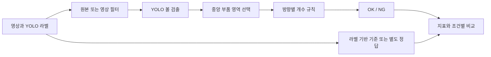

<div align="center">

# 🔎 볼 결함 탐지와 영상 필터 비교

### YOLO 객체 검출 · 영역별 OK/NG 판정 · 강건성 실험

부품 안의 볼을 찾고, 위치별 개수를 세어 정상·불량을 판정합니다.<br>
원본 영상과 필터를 적용한 영상을 같은 흐름으로 비교하며, 검출 성능과 최종 판정 성능을 구분합니다.


[빠른 시작](#quick-start) · [저장소 구성](#repository-structure) · [실험 설정](#data-settings)

</div>

---

<a name="introduction"></a>

## ✨ 프로젝트 소개

YOLO가 검출한 볼을 중앙 부품 영역으로 제한한 뒤, 위·왼쪽·아래·오른쪽의 개수 규칙으로 OK/NG를 판단하는 연구입니다. 단일 영상 필터, 조합 필터, 노이즈와 데이터 양 변화가 판정에 미치는 영향을 노트북에서 비교합니다.

| 기능 | 구현 내용 |
| :--- | :--- |
| 🎯 볼 검출 | Ultralytics YOLO로 위치와 객체 상자 예측 |
| 📐 영역 판정 | 중앙 사각형을 찾고 영역 내 볼의 위치별 개수 비교 |
| 🎛️ 필터 비교 | 반전·이진화·블러·엣지 등 단일 필터 10개와 조합 필터 5개 |
| 🧪 난도 실험 | 노이즈, 해상도, 블러 강도, 학습 데이터 양 조건 비교 |
| 🔁 반복 실험 | 다중 시드, 교차검증, 근접 중복 이미지 묶음 처리 |
| 📊 결과 시각화 | CSV·JSON 요약, 혼동행렬, 필터별 그래프, GPU 사용 기록 |



<a name="repository-structure"></a>

## 📁 저장소 구성

아래는 주요 경로를 발췌한 구조입니다.

```text
.
├── ball_ok_ng_yolo_v7.ipynb
├── DataSet/
├── 최종/
│   └── 연구코드/
│       └── ball_ok_ng_yolo_v7.ipynb
├── 이전 도커 실험/
│   └── 불량검출실험/
│       ├── paper_filter_figures.py
│       ├── reference_plot_style.py
│       └── render_saved_figures.py
├── docs/VERSIONS.md
└── CHANGELOG.md
```

- [최종 연구 노트북](최종/연구코드/ball_ok_ng_yolo_v7.ipynb): 검출·판정·필터 비교 및 추가 진단 실험.
- [기본 노트북](ball_ok_ng_yolo_v7.ipynb): 저장소 최상위에 보존한 연구 코드.
- [그림 생성 코드](이전%20도커%20실험/불량검출실험/paper_filter_figures.py): 연구 그림 구성.
- [버전별 파일 기록](docs/VERSIONS.md): 공개 코드의 차수별 비교.

<a name="implementation"></a>

## 🧩 주요 기술과 실험 구성

OpenCV로 영상을 다루고, PyTorch·Kornia로 필터 연산을 구성합니다. Ultralytics는 객체 검출을 담당하며 NumPy·pandas·Matplotlib는 결과 집계와 그림 생성에 사용합니다.

노트북은 초기 확인 실험과 뒤쪽의 교차검증·강건성 실험을 구분합니다. 앞부분의 개발 중 확인 결과를 독립된 평가 결과처럼 해석하지 않도록 셀 설명을 함께 확인해야 합니다.

| 비교 묶음 | 조건 |
| :--- | :--- |
| 기준 | 원본 영상 |
| 단일 필터 | Invert, Otsu, Solarize, Histogram Equalization, CLAHE, Gamma, Gaussian Blur, Sobel, Emboss, Unsharp |
| 조합 필터 | Invert+CLAHE, Blur+Otsu, Sobel+Invert, HistEq+Emboss, Unsharp+Sobel |
| 추가 진단 | 볼 지우기·추가하기, 판정 임계값 변화, 분포 변화, 다중 시드 반복 |

<a name="quick-start"></a>

## 🚀 빠른 시작

Python과 CUDA를 사용할 수 있는 PyTorch 환경을 먼저 준비합니다. 노트북의 기본 `REQUIRE_GPU = True` 설정에서는 CUDA를 찾지 못하면 중단됩니다. 필요한 패키지를 준비한 뒤 저장소 루트에서 실행합니다.

```powershell
python -m pip install jupyterlab numpy opencv-python matplotlib pandas pyyaml joblib ultralytics kornia
python -m jupyter lab "최종/연구코드/ball_ok_ng_yolo_v7.ipynb"
```

1. 노트북의 데이터 경로를 자신의 실험 자료 위치에 맞춥니다. 원래 코드는 `/root/추계학술대회/DataSet`을 전제로 작성되어 있습니다.
2. 이미지와 YOLO 라벨의 대응 관계, 학습·검증·시험 분할을 확인합니다.
3. 사용할 GPU와 데이터 경로를 확인한 뒤 필요한 실험 셀을 순서대로 실행합니다.
4. 결과 CSV와 JSON을 확인하고, 필요할 때 그림 생성 셀을 실행합니다.

원본 영상·학습 가중치·완성된 실행 환경은 별도로 준비해야 합니다. 공개 파일만으로 모든 실험을 즉시 재현할 수 있는 패키지는 아닙니다.

<a name="data-settings"></a>

## 📊 데이터 구성과 실험 설정

노트북이 기대하는 기본 데이터 구조는 다음과 같습니다.

```text
DataSet/
├── images/{train,val,test}/*.png
├── labels/{train,val,test}/*.txt
└── data.yaml
```

라벨 한 행은 `class cx cy w h`이며 좌표는 0~1로 정규화합니다. 별도의 실제 OK/NG 정답을 사용할 때는 노트북의 `OKNG_CSV` 및 후반부의 `REAL_LABEL_*` 설정을 확인합니다.

| 지표·설정 | 해석 |
| :--- | :--- |
| 위치별 개수 | 위 5개·왼쪽 4개·아래 2개·오른쪽 2개를 사용하는 구현 규칙 |
| 검출 mAP | 볼의 객체 상자 검출 성능 |
| OK/NG 정확도 | 선택한 정답 정의와 개수 규칙에 대한 판정 일치율 |
| Strict Acc | 라벨의 볼을 모두 찾고 추가 검출도 없는 엄격한 기준 |
| 다수 클래스 기준 | 클래스 불균형에서 단순 다수 예측과 비교하기 위한 기준 |
| McNemar 비교 | 같은 영상에 대한 두 방법의 정오답 차이 비교 |

라벨 상자에도 동일한 영역·개수 규칙을 적용해 정답을 만들면, 예측과 정답이 같은 규칙을 공유합니다. 이 결과를 별도 전문가 판정에 대한 정확도와 동일하게 해석하지 않습니다. 저장소 소개에는 새로 재현하지 않은 정확도나 처리속도를 성과 수치로 제시하지 않습니다.

<a name="troubleshooting"></a>

## 🛠️ 문제 해결

| 증상 | 확인할 내용 |
| :--- | :--- |
| CUDA GPU를 찾지 못함 | 드라이버, PyTorch의 CUDA 지원 여부, 노트북의 장치 설정 |
| 데이터 경로 오류 | 노트북의 원래 Linux 경로와 현재 데이터 위치 |
| 결과가 지나치게 높음 | 중복 이미지 묶음, 클래스 불균형, 정답 생성 규칙, 별도 실제 정답 유무 |
| 한글 그래프가 깨짐 | 나눔고딕 설치와 노트북의 폰트 경로 |
| 기존 결과와 수치가 다름 | 시드·분할·가중치·캐시·필터 파라미터가 같은지 확인 |

---

<div align="center">

**검출에서 판정까지, 조건을 나누어 비교합니다.**

</div>
