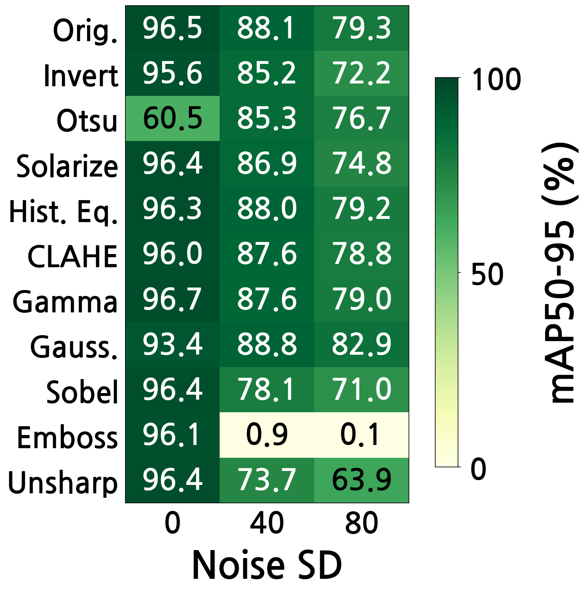

# 문서 줄바꿈과 읽기 배치 정정 전체 비교

기준 커밋: `878acf49c19e9b19fa21fcc6a56d2be07c1db2bf`

현재 원격 기준선에 대한 모든 Markdown 변경 줄과 새 문서 전문을 비교합니다. 사소한 줄바꿈·공백도 비교에 포함합니다. 이번 변경 기록과 이 비교 문서 자체만 비교 대상에서 제외합니다. 과거 전용 비교 문서는 비교 데이터와 의미를 보존한 배치 정정 대상으로 포함될 수 있습니다. 기존 변경 기록·라이선스와 문서 외 파일은 유지합니다.

`````````````diff
--- a/README.md
+++ b/README.md
@@ -5,7 +5,17 @@
 
 # Ball Defect Detection Project
 
-YOLOv8n과 영상 필터를 조합해 작은 볼 결함의 검출 성능을 비교합니다.
+**YOLOv8n과 영상 필터를 조합해 작은 볼 결함의 검출 성능을 비교합니다.**
+
+<!-- reading-levels17:start -->
+| 읽기 수준 | 안내 내용 |
+| --- | --- |
+| [LEVEL 1 - Beginner](docs/%EC%9D%BD%EA%B8%B0%EC%95%88%EB%82%B4/%EB%A0%88%EB%B2%A81.md) | 낯선 용어를 풀고 입력부터 결과까지 구체적인 예로 읽기 |
+| [LEVEL 2 - Explorer](docs/%EC%9D%BD%EA%B8%B0%EC%95%88%EB%82%B4/%EB%A0%88%EB%B2%A82.md) | 핵심 개념과 처리 흐름의 관계 이해 |
+| [LEVEL 3 - Practitioner](docs/%EC%9D%BD%EA%B8%B0%EC%95%88%EB%82%B4/%EB%A0%88%EB%B2%A83.md) | 실험·사용 절차와 결과 해석 따라가기 |
+| [LEVEL 4 - Advanced](docs/%EC%9D%BD%EA%B8%B0%EC%95%88%EB%82%B4/%EB%A0%88%EB%B2%A84.md) | 코드 구조·설정·설계 선택과 제약 검토 |
+| [LEVEL 5 - Expert](docs/%EC%9D%BD%EA%B8%B0%EC%95%88%EB%82%B4/%EB%A0%88%EB%B2%A85.md) | 논문·프로토콜·분모·누수·미검증 범위 대조 |
+<!-- reading-levels17:end -->
 
 분야: 컴퓨터 비전 › 딥러닝 객체 검출 › 소형 객체·전처리 강건성
 
@@ -78,19 +88,92 @@
 
 | 차수·단계 | 주요 내용 | 자료 | 직전 비교 |
 | --- | --- | --- | --- |
-| [논문 1차](docs/revisions/paper-1.md) | 다양한 영상 조건에서 YOLO 볼 검출을 위한 단일·복합 필터의 성능 비교를 정리한 초기 원고입니다. | [폴더](%EB%85%BC%EB%AC%B8) | [전체 비교](docs/revision-diffs/paper-1.diff) |
+| [논문 1차](docs/revisions/paper-1.md) | [상세 설명](#layout18-table-4-row-1-field-1) | [폴더](%EB%85%BC%EB%AC%B8) | [전체 비교](docs/revision-diffs/paper-1.diff) |
 | [논문 2차](docs/revisions/paper-2.md) | 1차와 같은 제목·연구 설정 아래 문장과 표현을 다듬은 원고 단계입니다. | [폴더](%EB%85%BC%EB%AC%B8) | [전체 비교](docs/revision-diffs/paper-2.diff) |
-| [논문 3차](docs/revisions/paper-3.md) | 제목을 YOLOv8n 기반 볼 검출의 단일·복합 전처리 필터 비교로 정리하고 조건·결과 해석을 확장한 단계입니다. | [폴더](%EB%85%BC%EB%AC%B8) | [전체 비교](docs/revision-diffs/paper-3.diff) |
-| [논문 4차 · 검토 도구](docs/revisions/paper-4.md) | 새 모델을 학습하는 대신 원고의 표·그림·문장과 저장된 원정밀도 결과를 대조한 검토 도구 단계입니다. | [폴더](%EB%85%BC%EB%AC%B8/4%EC%B0%A8/tools) | [전체 비교](docs/revision-diffs/paper-4.diff) |
-| [논문 5차 · 재구성 패키지](docs/revisions/paper-5.md) | 보존된 결과표와 노트북을 논문용 도표·참조 코드·전달 패키지로 구성한 단계입니다. 모델을 다시 학습하는 경로와 저장 결과를 다시 그리는 경로를 분리합니다. | [폴더](%EB%85%BC%EB%AC%B8/5%EC%B0%A8/%EC%BD%94%EB%93%9C) | [전체 비교](docs/revision-diffs/paper-5.diff) |
-| [논문 최종 · 3장/5장/요약](docs/revisions/paper-final.md) | 같은 연구의 3쪽 축약본·5쪽 전체본·별도 요약이 있던 최종 단계에서 현재는 5쪽 전체 원고와 같은 판의 HWP를 제공합니다. | [폴더](%EB%85%BC%EB%AC%B8) | [전체 비교](docs/revision-diffs/paper-final.diff) |
+| [논문 3차](docs/revisions/paper-3.md) | [상세 설명](#layout18-table-4-row-3-field-1) | [폴더](%EB%85%BC%EB%AC%B8) | [전체 비교](docs/revision-diffs/paper-3.diff) |
+| [논문 4차 · 검토 도구](docs/revisions/paper-4.md) | [상세 설명](#layout18-table-4-row-4-field-1) | [폴더](%EB%85%BC%EB%AC%B8/4%EC%B0%A8/tools) | [전체 비교](docs/revision-diffs/paper-4.diff) |
+| [논문 5차 · 재구성 패키지](docs/revisions/paper-5.md) | [상세 설명](#layout18-table-4-row-5-field-1) | [폴더](%EB%85%BC%EB%AC%B8/5%EC%B0%A8/%EC%BD%94%EB%93%9C) | [전체 비교](docs/revision-diffs/paper-5.diff) |
+| [논문 최종 · 3장/5장/요약](docs/revisions/paper-final.md) | [상세 설명](#layout18-table-4-row-6-field-1) | [폴더](%EB%85%BC%EB%AC%B8) | [전체 비교](docs/revision-diffs/paper-final.diff) |
 | [발표자료 1차](docs/revisions/talk-1.md) | 필터 비교 연구를 12장 본발표 600초와 3장 부록으로 설명한 초기 발표 구성입니다. | [폴더](%EB%B0%9C%ED%91%9C%EC%9E%90%EB%A3%8C/1%EC%B0%A8) | [전체 비교](docs/revision-diffs/talk-1.diff) |
 | [발표자료 2차](docs/revisions/talk-2.md) | 필터 비교 사진과 설명을 나누고 20장·600초 본발표로 재배치한 단계입니다. | [폴더](%EB%B0%9C%ED%91%9C%EC%9E%90%EB%A3%8C/2%EC%B0%A8) | [전체 비교](docs/revision-diffs/talk-2.diff) |
 | [발표자료 3차](docs/revisions/talk-3.md) | 2차의 20장 내용·시간을 유지하면서 투명 학교 마크와 전달 자산의 일치를 보강한 단계입니다. | [폴더](%EB%B0%9C%ED%91%9C%EC%9E%90%EB%A3%8C/3%EC%B0%A8) | [전체 비교](docs/revision-diffs/talk-3.diff) |
-| [발표자료 4차](docs/revisions/talk-4.md) | 3차의 20장 슬라이드 순서에 맞춰 발화·전환 문장을 다듬고 목표 시간을 배분한 전체 발표 대본입니다. 슬라이드를 새로 학습하거나 실험한 단계가 아닙니다. | [폴더](%EB%B0%9C%ED%91%9C%EC%9E%90%EB%A3%8C/4%EC%B0%A8) | [전체 비교](docs/revision-diffs/talk-4.diff) |
-| [발표자료 최종](docs/revisions/talk-final.md) | 단일·복합 필터와 잡음·시드 결과를 20장으로 설명하는 완성 발표 PDF/PPTX입니다. 논문과 다른 목적의 발표 자료로 같은 연구의 흐름을 전달합니다. | [폴더](%EB%B0%9C%ED%91%9C%EC%9E%90%EB%A3%8C/%EC%B5%9C%EC%A2%85) | [전체 비교](docs/revision-diffs/talk-final.diff) |
-| [최종](docs/revisions/code-final.md) | 유사 영상 그룹과 교차검증을 구성하고 전처리 필터별 YOLO 검출, 볼 일치, 영역별 개수 판정과 추가 진단을 함께 계산하는 노트북입니다. | [폴더](%EC%B5%9C%EC%A2%85) | [전체 비교](docs/revision-diffs/code-final.diff) |
-| [이전 도커 실험·기존 결과표](docs/revisions/legacy.md) | 단일·복합 필터 실험의 이전 노트북과 저장된 CSV·JSON·그래프를 함께 읽는 자료입니다. 결과표를 확인하는 경로와 새 학습을 수행하는 경로를 나누어 사용합니다. | [폴더](%EC%9D%B4%EC%A0%84%20%EB%8F%84%EC%BB%A4%20%EC%8B%A4%ED%97%98/%EB%B6%88%EB%9F%89%EA%B2%80%EC%B6%9C%EC%8B%A4%ED%97%98) | [전체 비교](docs/revision-diffs/legacy.diff) |
+| [발표자료 4차](docs/revisions/talk-4.md) | [상세 설명](#layout18-table-4-row-10-field-1) | [폴더](%EB%B0%9C%ED%91%9C%EC%9E%90%EB%A3%8C/4%EC%B0%A8) | [전체 비교](docs/revision-diffs/talk-4.diff) |
+| [발표자료 최종](docs/revisions/talk-final.md) | [상세 설명](#layout18-table-4-row-11-field-1) | [폴더](%EB%B0%9C%ED%91%9C%EC%9E%90%EB%A3%8C/%EC%B5%9C%EC%A2%85) | [전체 비교](docs/revision-diffs/talk-final.diff) |
+| [최종](docs/revisions/code-final.md) | [상세 설명](#layout18-table-4-row-12-field-1) | [폴더](%EC%B5%9C%EC%A2%85) | [전체 비교](docs/revision-diffs/code-final.diff) |
+| [이전 도커 실험·기존 결과표](docs/revisions/legacy.md) | [상세 설명](#layout18-table-4-row-13-field-1) | [폴더](%EC%9D%B4%EC%A0%84%20%EB%8F%84%EC%BB%A4%20%EC%8B%A4%ED%97%98/%EB%B6%88%EB%9F%89%EA%B2%80%EC%B6%9C%EC%8B%A4%ED%97%98) | [전체 비교](docs/revision-diffs/legacy.diff) |
+
+<a id="layout18-table-4-row-1-field-1"></a>
+
+**[논문 1차](docs/revisions/paper-1.md)**
+
+**주요 내용**
+
+다양한 영상 조건에서 YOLO 볼 검출을 위한 단일·복합 필터의 성능 비교를 정리한 초기 원고입니다.
+
+<a id="layout18-table-4-row-3-field-1"></a>
+
+**[논문 3차](docs/revisions/paper-3.md)**
+
+**주요 내용**
+
+제목을 YOLOv8n 기반 볼 검출의 단일·복합 전처리 필터 비교로 정리하고 조건·결과 해석을 확장한 단계입니다.
+
+<a id="layout18-table-4-row-4-field-1"></a>
+
+**[논문 4차 · 검토 도구](docs/revisions/paper-4.md)**
+
+**주요 내용**
+
+새 모델을 학습하는 대신 원고의 표·그림·문장과 저장된 원정밀도 결과를 대조한 검토 도구 단계입니다.
+
+<a id="layout18-table-4-row-5-field-1"></a>
+
+**[논문 5차 · 재구성 패키지](docs/revisions/paper-5.md)**
+
+**주요 내용**
+
+보존된 결과표와 노트북을 논문용 도표·참조 코드·전달 패키지로 구성한 단계입니다. 모델을 다시 학습하는 경로와 저장 결과를 다시 그리는 경로를 분리합니다.
+
+<a id="layout18-table-4-row-6-field-1"></a>
+
+**[논문 최종 · 3장/5장/요약](docs/revisions/paper-final.md)**
+
+**주요 내용**
+
+같은 연구의 3쪽 축약본·5쪽 전체본·별도 요약이 있던 최종 단계에서 현재는 5쪽 전체 원고와 같은 판의 HWP를 제공합니다.
+
+<a id="layout18-table-4-row-10-field-1"></a>
+
+**[발표자료 4차](docs/revisions/talk-4.md)**
+
+**주요 내용**
+
+3차의 20장 슬라이드 순서에 맞춰 발화·전환 문장을 다듬고 목표 시간을 배분한 전체 발표 대본입니다. 슬라이드를 새로 학습하거나 실험한 단계가 아닙니다.
+
+<a id="layout18-table-4-row-11-field-1"></a>
+
+**[발표자료 최종](docs/revisions/talk-final.md)**
+
+**주요 내용**
+
+단일·복합 필터와 잡음·시드 결과를 20장으로 설명하는 완성 발표 PDF/PPTX입니다. 논문과 다른 목적의 발표 자료로 같은 연구의 흐름을 전달합니다.
+
+<a id="layout18-table-4-row-12-field-1"></a>
+
+**[최종](docs/revisions/code-final.md)**
+
+**주요 내용**
+
+유사 영상 그룹과 교차검증을 구성하고 전처리 필터별 YOLO 검출, 볼 일치, 영역별 개수 판정과 추가 진단을 함께 계산하는 노트북입니다.
+
+<a id="layout18-table-4-row-13-field-1"></a>
+
+**[이전 도커 실험·기존 결과표](docs/revisions/legacy.md)**
+
+**주요 내용**
+
+단일·복합 필터 실험의 이전 노트북과 저장된 CSV·JSON·그래프를 함께 읽는 자료입니다. 결과표를 확인하는 경로와 새 학습을 수행하는 경로를 나누어 사용합니다.
+
 
 <a name="introduction"></a>
 
@@ -171,14 +254,78 @@
 
 한국정보기술학회([Korean Institute of Information Technology](https://eng.ki-it.or.kr/homepage/custom/memberadministrationregulation))의 2026 추계종합학술대회 양식으로 작성한 연구 원고입니다.
 
-| 최종 원고 항목 | 원고에 명시된 구성·결과 |
-| :--- | :--- |
-| 자료·분할 | 2944×2352 영상 500장, 초기 학습 400·검증 100; 근접 중복 368개 그룹을 이용한 5-fold 비교 |
-| 학습 조건 | YOLOv8n, 30 epoch, 입력 1280, batch 8, patience 15 |
-| 평가 구분 | mAP50-95용 conf 0.001·NMS IoU 0.7과 엄격 일치용 conf 0.25·NMS IoU 0.5를 구분 |
-| 단일 실행 | Gamma mAP50-95 96.70%, 원본 96.53%로 차이는 0.17%p |
-| 3개 시드 비교 | Invert+CLAHE Strict Acc 95.47±2.27%, 원본 95.40±0.53%; 단일 실행 98%를 반복 성능으로 대체하지 않음 |
-| 노이즈 σ=80 | Blur 82.86±0.08%, 원본 79.60±0.26%의 원고 보고값 |
+<a id="layout18-table-6-row-1"></a>
+
+**자료·분할**
+
+**최종 원고 항목**
+
+자료·분할
+
+**원고에 명시된 구성·결과**
+
+2944×2352 영상 500장, 초기 학습 400·검증 100; 근접 중복 368개 그룹을 이용한 5-fold 비교
+
+<a id="layout18-table-6-row-2"></a>
+
+**학습 조건**
+
+**최종 원고 항목**
+
+학습 조건
+
+**원고에 명시된 구성·결과**
+
+YOLOv8n, 30 epoch, 입력 1280, batch 8, patience 15
+
+<a id="layout18-table-6-row-3"></a>
+
+**평가 구분**
+
+**최종 원고 항목**
+
+평가 구분
+
+**원고에 명시된 구성·결과**
+
+mAP50-95용 conf 0.001·NMS IoU 0.7과 엄격 일치용 conf 0.25·NMS IoU 0.5를 구분
+
+<a id="layout18-table-6-row-4"></a>
+
+**단일 실행**
+
+**최종 원고 항목**
+
+단일 실행
+
+**원고에 명시된 구성·결과**
+
+Gamma mAP50-95 96.70%, 원본 96.53%로 차이는 0.17%p
+
+<a id="layout18-table-6-row-5"></a>
+
+**3개 시드 비교**
+
+**최종 원고 항목**
+
+3개 시드 비교
+
+**원고에 명시된 구성·결과**
+
+Invert+CLAHE Strict Acc 95.47±2.27%, 원본 95.40±0.53%; 단일 실행 98%를 반복 성능으로 대체하지 않음
+
+<a id="layout18-table-6-row-6"></a>
+
+**노이즈 σ=80**
+
+**최종 원고 항목**
+
+노이즈 σ=80
+
+**원고에 명시된 구성·결과**
+
+Blur 82.86±0.08%, 원본 79.60±0.26%의 원고 보고값
+
 
 엄격 일치는 주석·예측 중심을 가까운 순서로 일대일 대응시키며, 허용 거리는 주석 상자 긴 변의 0.5배입니다. 상자의 겹침을 평가하는 mAP50-95와 기준이 다릅니다.
 
@@ -202,12 +349,54 @@
 
 노트북 앞부분은 초기 개발 실험이며, 뒤쪽에는 교차검증과 강건성 실험을 구성했습니다.
 
-| 비교 묶음 | 조건 |
-| :--- | :--- |
-| 기준 | 원본 영상 |
-| 단일 필터 | Invert, Otsu, Solarize, Histogram Equalization, CLAHE, Gamma, Gaussian Blur, Sobel, Emboss, Unsharp |
-| 조합 필터 | Invert+CLAHE, Blur+Otsu, Sobel+Invert, HistEq+Emboss, Unsharp+Sobel |
-| 추가 진단 | 볼 지우기·추가하기, 판정 임계값 변화, 분포 변화, 다중 시드 반복 |
+<a id="layout18-table-7-row-1"></a>
+
+**기준**
+
+**비교 묶음**
+
+기준
+
+**조건**
+
+원본 영상
+
+<a id="layout18-table-7-row-2"></a>
+
+**단일 필터**
+
+**비교 묶음**
+
+단일 필터
+
+**조건**
+
+Invert, Otsu, Solarize, Histogram Equalization, CLAHE, Gamma, Gaussian Blur, Sobel, Emboss, Unsharp
+
+<a id="layout18-table-7-row-3"></a>
+
+**조합 필터**
+
+**비교 묶음**
+
+조합 필터
+
+**조건**
+
+Invert+CLAHE, Blur+Otsu, Sobel+Invert, HistEq+Emboss, Unsharp+Sobel
+
+<a id="layout18-table-7-row-4"></a>
+
+**추가 진단**
+
+**비교 묶음**
+
+추가 진단
+
+**조건**
+
+볼 지우기·추가하기, 판정 임계값 변화, 분포 변화, 다중 시드 반복
+
 
 <a name="quick-start"></a>
 
@@ -328,11 +517,42 @@
 
 복합 필터는 모든 경우에 단일 구성 필터보다 좋아지지 않습니다. 일반 조건의 결과와 잡음 조건의 안정성·세 시드의 변동을 나누어 읽습니다.
 
-| 제약 | 확인할 내용 |
-| --- | --- |
-| 일반화 범위 | 필터·잡음 조건별 재학습 결과이며 고정 모델의 미지 촬영 조건 적응성을 입증한 것은 아닙니다. |
-| 내부 분할 | 외부 평가 그룹은 분리하지만 내부 train/val에는 유사 그룹 중복이 남아 있습니다. |
-| 지표 정의 | Strict Acc는 중심 거리·누락·추가 검출 규칙이며 전문가 OK/NG 판정이나 mAP와 같지 않습니다. |
+<a id="layout18-table-13-row-1"></a>
+
+**일반화 범위**
+
+**제약**
+
+일반화 범위
+
+**확인할 내용**
+
+필터·잡음 조건별 재학습 결과이며 고정 모델의 미지 촬영 조건 적응성을 입증한 것은 아닙니다.
+
+<a id="layout18-table-13-row-2"></a>
+
+**내부 분할**
+
+**제약**
+
+내부 분할
+
+**확인할 내용**
+
+외부 평가 그룹은 분리하지만 내부 train/val에는 유사 그룹 중복이 남아 있습니다.
+
+<a id="layout18-table-13-row-3"></a>
+
+**지표 정의**
+
+**제약**
+
+지표 정의
+
+**확인할 내용**
+
+Strict Acc는 중심 거리·누락·추가 검출 규칙이며 전문가 OK/NG 판정이나 mAP와 같지 않습니다.
+
 
 [파일 구성·핵심 정의·사용 순서](docs/revisions/paper-1.md) · [이 단계 전체 비교](docs/revision-diffs/paper-1.diff)
 
@@ -369,11 +589,42 @@
 
 복합 필터는 모든 경우에 단일 구성 필터보다 좋아지지 않습니다. 일반 조건의 결과와 잡음 조건의 안정성·세 시드의 변동을 나누어 읽습니다.
 
-| 제약 | 확인할 내용 |
-| --- | --- |
-| 일반화 범위 | 필터·잡음 조건별 재학습 결과이며 고정 모델의 미지 촬영 조건 적응성을 입증한 것은 아닙니다. |
-| 내부 분할 | 외부 평가 그룹은 분리하지만 내부 train/val에는 유사 그룹 중복이 남아 있습니다. |
-| 지표 정의 | Strict Acc는 중심 거리·누락·추가 검출 규칙이며 전문가 OK/NG 판정이나 mAP와 같지 않습니다. |
+<a id="layout18-table-16-row-1"></a>
+
+**일반화 범위**
+
+**제약**
+
+일반화 범위
+
+**확인할 내용**
+
+필터·잡음 조건별 재학습 결과이며 고정 모델의 미지 촬영 조건 적응성을 입증한 것은 아닙니다.
+
+<a id="layout18-table-16-row-2"></a>
+
+**내부 분할**
+
+**제약**
+
+내부 분할
+
+**확인할 내용**
+
+외부 평가 그룹은 분리하지만 내부 train/val에는 유사 그룹 중복이 남아 있습니다.
+
+<a id="layout18-table-16-row-3"></a>
+
+**지표 정의**
+
+**제약**
+
+지표 정의
+
+**확인할 내용**
+
+Strict Acc는 중심 거리·누락·추가 검출 규칙이며 전문가 OK/NG 판정이나 mAP와 같지 않습니다.
+
 
 [파일 구성·핵심 정의·사용 순서](docs/revisions/paper-2.md) · [이 단계 전체 비교](docs/revision-diffs/paper-2.diff)
 
@@ -410,11 +661,42 @@
 
 복합 필터는 모든 경우에 단일 구성 필터보다 좋아지지 않습니다. 일반 조건의 결과와 잡음 조건의 안정성·세 시드의 변동을 나누어 읽습니다.
 
-| 제약 | 확인할 내용 |
-| --- | --- |
-| 일반화 범위 | 필터·잡음 조건별 재학습 결과이며 고정 모델의 미지 촬영 조건 적응성을 입증한 것은 아닙니다. |
-| 내부 분할 | 외부 평가 그룹은 분리하지만 내부 train/val에는 유사 그룹 중복이 남아 있습니다. |
-| 지표 정의 | Strict Acc는 중심 거리·누락·추가 검출 규칙이며 전문가 OK/NG 판정이나 mAP와 같지 않습니다. |
+<a id="layout18-table-19-row-1"></a>
+
+**일반화 범위**
+
+**제약**
+
+일반화 범위
+
+**확인할 내용**
+
+필터·잡음 조건별 재학습 결과이며 고정 모델의 미지 촬영 조건 적응성을 입증한 것은 아닙니다.
+
+<a id="layout18-table-19-row-2"></a>
+
+**내부 분할**
+
+**제약**
+
+내부 분할
+
+**확인할 내용**
+
+외부 평가 그룹은 분리하지만 내부 train/val에는 유사 그룹 중복이 남아 있습니다.
+
+<a id="layout18-table-19-row-3"></a>
+
+**지표 정의**
+
+**제약**
+
+지표 정의
+
+**확인할 내용**
+
+Strict Acc는 중심 거리·누락·추가 검출 규칙이며 전문가 OK/NG 판정이나 mAP와 같지 않습니다.
+
 
 [파일 구성·핵심 정의·사용 순서](docs/revisions/paper-3.md) · [이 단계 전체 비교](docs/revision-diffs/paper-3.diff)
 
@@ -429,18 +711,91 @@
 
 새 모델을 학습하는 대신 원고의 표·그림·문장과 저장된 원정밀도 결과를 대조한 검토 도구 단계입니다.
 
-| 구성 | 처리 내용 |
-| --- | --- |
-| 원문 결합 | 원고 SHA와 입력·근거 파일 해시를 대조합니다. |
-| 결과 계산 | 단일 16조건 8000행·반복 39조건 19500행의 영상별 결과를 집계하는 조건이 있습니다. |
-| 분할 점검 | 500영상·368유사그룹·154유사쌍, 외부 중복 0과 내부 9~20그룹 중복을 확인하는 조건을 포함합니다. |
-| 표시·서술 | 이중 반올림, HWP 그림 해상도, 인용·사사·원고 문장을 대조합니다. |
-
-| 입력·실행 조건 | 내용 |
-| --- | --- |
-| 도구 | Python·NumPy와 CSV/JSON |
-| 입력 | audit.json·원고·결과 CSV·recalculated·container_dataset·main_findings 등 |
-| 역할 | 입력 자료의 근거와 완결성을 대조 |
+<a id="layout18-table-20-row-1"></a>
+
+**원문 결합**
+
+**구성**
+
+원문 결합
+
+**처리 내용**
+
+원고 SHA와 입력·근거 파일 해시를 대조합니다.
+
+<a id="layout18-table-20-row-2"></a>
+
+**결과 계산**
+
+**구성**
+
+결과 계산
+
+**처리 내용**
+
+단일 16조건 8000행·반복 39조건 19500행의 영상별 결과를 집계하는 조건이 있습니다.
+
+<a id="layout18-table-20-row-3"></a>
+
+**분할 점검**
+
+**구성**
+
+분할 점검
+
+**처리 내용**
+
+500영상·368유사그룹·154유사쌍, 외부 중복 0과 내부 9~20그룹 중복을 확인하는 조건을 포함합니다.
+
+<a id="layout18-table-20-row-4"></a>
+
+**표시·서술**
+
+**구성**
+
+표시·서술
+
+**처리 내용**
+
+이중 반올림, HWP 그림 해상도, 인용·사사·원고 문장을 대조합니다.
+
+
+<a id="layout18-table-21-row-1"></a>
+
+**도구**
+
+**입력·실행 조건**
+
+도구
+
+**내용**
+
+Python·NumPy와 CSV/JSON
+
+<a id="layout18-table-21-row-2"></a>
+
+**입력**
+
+**입력·실행 조건**
+
+입력
+
+**내용**
+
+audit.json·원고·결과 CSV·recalculated·container_dataset·main_findings 등
+
+<a id="layout18-table-21-row-3"></a>
+
+**역할**
+
+**입력·실행 조건**
+
+역할
+
+**내용**
+
+입력 자료의 근거와 완결성을 대조
+
 
 도구는 paper_ready_for_submission=False를 요구하며 PASS·주의·수정필요·확인불가 상태를 구분합니다. 도구가 보존됐다는 사실만으로 원고가 수정됐거나 새 시험이 완료됐다고 보지 않습니다.
 
@@ -465,19 +820,103 @@
 
 보존된 결과표와 노트북을 논문용 도표·참조 코드·전달 패키지로 구성한 단계입니다. 모델을 다시 학습하는 경로와 저장 결과를 다시 그리는 경로를 분리합니다.
 
-| 구성 | 처리 내용 |
-| --- | --- |
-| 논문 그림 | paper_filter_figures.py가 단일·복합·잡음 CSV에서 3개 논문용 그림을 구성합니다. |
-| 스타일 함수 | reference_plot_style.py가 글꼴·색·막대·레이블·이웃 텍스트 배치를 공통 처리합니다. |
-| 결과 재렌더 | render_saved_figures.py가 저장 JSON·CSV와 참조 노트북의 그림 함수를 이용합니다. |
-| 입력 연결 | 재작성한 그림에 사용한 원자료 SHA를 기록하는 처리를 포함합니다. |
-
-| 입력·실행 조건 | 내용 |
-| --- | --- |
-| 입력 표 | table_round1·table_round2·table_grid_noise40·table_grid_noise80 |
-| 그림 도구 | NumPy·pandas·Matplotlib |
-| 인자 | paper_filter_figures: --results·--output |
-| 재렌더 인자 | --results·--output·--notebook |
+<a id="layout18-table-23-row-1"></a>
+
+**논문 그림**
+
+**구성**
+
+논문 그림
+
+**처리 내용**
+
+paper_filter_figures.py가 단일·복합·잡음 CSV에서 3개 논문용 그림을 구성합니다.
+
+<a id="layout18-table-23-row-2"></a>
+
+**스타일 함수**
+
+**구성**
+
+스타일 함수
+
+**처리 내용**
+
+reference_plot_style.py가 글꼴·색·막대·레이블·이웃 텍스트 배치를 공통 처리합니다.
+
+<a id="layout18-table-23-row-3"></a>
+
+**결과 재렌더**
+
+**구성**
+
+결과 재렌더
+
+**처리 내용**
+
+render_saved_figures.py가 저장 JSON·CSV와 참조 노트북의 그림 함수를 이용합니다.
+
+<a id="layout18-table-23-row-4"></a>
+
+**입력 연결**
+
+**구성**
+
+입력 연결
+
+**처리 내용**
+
+재작성한 그림에 사용한 원자료 SHA를 기록하는 처리를 포함합니다.
+
+
+<a id="layout18-table-24-row-1"></a>
+
+**입력 표**
+
+**입력·실행 조건**
+
+입력 표
+
+**내용**
+
+table_round1·table_round2·table_grid_noise40·table_grid_noise80
+
+<a id="layout18-table-24-row-2"></a>
+
+**그림 도구**
+
+**입력·실행 조건**
+
+그림 도구
+
+**내용**
+
+NumPy·pandas·Matplotlib
+
+<a id="layout18-table-24-row-3"></a>
+
+**인자**
+
+**입력·실행 조건**
+
+인자
+
+**내용**
+
+paper_filter_figures: --results·--output
+
+<a id="layout18-table-24-row-4"></a>
+
+**재렌더 인자**
+
+**입력·실행 조건**
+
+재렌더 인자
+
+**내용**
+
+--results·--output·--notebook
+
 
 도표 재구성은 저장 결과의 표현을 바꾼 것입니다. 새 실험이나 별도 논문 성과로 세지 않습니다.
 
@@ -524,11 +963,42 @@
 
 복합 필터는 모든 경우에 단일 구성 필터보다 좋아지지 않습니다. 일반 조건의 결과와 잡음 조건의 안정성·세 시드의 변동을 나누어 읽습니다.
 
-| 제약 | 확인할 내용 |
-| --- | --- |
-| 일반화 범위 | 필터·잡음 조건별 재학습 결과이며 고정 모델의 미지 촬영 조건 적응성을 입증한 것은 아닙니다. |
-| 내부 분할 | 외부 평가 그룹은 분리하지만 내부 train/val에는 유사 그룹 중복이 남아 있습니다. |
-| 지표 정의 | Strict Acc는 중심 거리·누락·추가 검출 규칙이며 전문가 OK/NG 판정이나 mAP와 같지 않습니다. |
+<a id="layout18-table-28-row-1"></a>
+
+**일반화 범위**
+
+**제약**
+
+일반화 범위
+
+**확인할 내용**
+
+필터·잡음 조건별 재학습 결과이며 고정 모델의 미지 촬영 조건 적응성을 입증한 것은 아닙니다.
+
+<a id="layout18-table-28-row-2"></a>
+
+**내부 분할**
+
+**제약**
+
+내부 분할
+
+**확인할 내용**
+
+외부 평가 그룹은 분리하지만 내부 train/val에는 유사 그룹 중복이 남아 있습니다.
+
+<a id="layout18-table-28-row-3"></a>
+
+**지표 정의**
+
+**제약**
+
+지표 정의
+
+**확인할 내용**
+
+Strict Acc는 중심 거리·누락·추가 검출 규칙이며 전문가 OK/NG 판정이나 mAP와 같지 않습니다.
+
 
 [파일 구성·핵심 정의·사용 순서](docs/revisions/paper-final.md) · [이 단계 전체 비교](docs/revision-diffs/paper-final.diff)
 
@@ -723,13 +1193,66 @@
 
 유사 영상 그룹과 교차검증을 구성하고 전처리 필터별 YOLO 검출, 볼 일치, 영역별 개수 판정과 추가 진단을 함께 계산하는 노트북입니다.
 
-| 구성 | 처리 내용 |
-| --- | --- |
-| 자료 점검 | 라벨·클래스 균형·128크기 축소영상의 평균 절대 차이 기반 유사 그룹을 점검합니다. |
-| 영역 규칙 | 부품 사각형 내부의 볼 중심을 위 5·왼쪽 4·아래 2·오른쪽 2 규칙에 맞춰 판정합니다. |
-| 외부 fold | assign_folds가 유사 그룹을 같은 외부 fold에 두고 fold_split은 남은 영상에서 내부 검증을 나눕니다. |
-| 검출 품질 | ball_match_stats는 라벨 크기의 0.5배 중심 허용거리로 일대일 매칭하고 누락·추가 검출을 셉니다. |
-| 필터 실험 | train_per_filter·inference_only 모드와 결과 서명 기반 캐시를 구분합니다. |
+<a id="layout18-table-44-row-1"></a>
+
+**자료 점검**
+
+**구성**
+
+자료 점검
+
+**처리 내용**
+
+라벨·클래스 균형·128크기 축소영상의 평균 절대 차이 기반 유사 그룹을 점검합니다.
+
+<a id="layout18-table-44-row-2"></a>
+
+**영역 규칙**
+
+**구성**
+
+영역 규칙
+
+**처리 내용**
+
+부품 사각형 내부의 볼 중심을 위 5·왼쪽 4·아래 2·오른쪽 2 규칙에 맞춰 판정합니다.
+
+<a id="layout18-table-44-row-3"></a>
+
+**외부 fold**
+
+**구성**
+
+외부 fold
+
+**처리 내용**
+
+assign_folds가 유사 그룹을 같은 외부 fold에 두고 fold_split은 남은 영상에서 내부 검증을 나눕니다.
+
+<a id="layout18-table-44-row-4"></a>
+
+**검출 품질**
+
+**구성**
+
+검출 품질
+
+**처리 내용**
+
+ball_match_stats는 라벨 크기의 0.5배 중심 허용거리로 일대일 매칭하고 누락·추가 검출을 셉니다.
+
+<a id="layout18-table-44-row-5"></a>
+
+**필터 실험**
+
+**구성**
+
+필터 실험
+
+**처리 내용**
+
+train_per_filter·inference_only 모드와 결과 서명 기반 캐시를 구분합니다.
+
 
 | 입력·실행 조건 | 내용 |
 | --- | --- |
@@ -745,13 +1268,66 @@
 
 OKNG_CSV가 없을 때 규칙 기반 정답과의 일치도를 전문가 판정 정확도로 부르지 않습니다.
 
-| 제약 | 확인할 내용 |
-| --- | --- |
-| 일반화 범위 | 필터·잡음 조건별 재학습 결과이며 고정 모델의 미지 촬영 조건 적응성을 입증한 것은 아닙니다. |
-| 내부 분할 | 외부 평가 그룹은 분리하지만 내부 train/val에는 유사 그룹 중복이 남아 있습니다. |
-| 지표 정의 | Strict Acc는 중심 거리·누락·추가 검출 규칙이며 전문가 OK/NG 판정이나 mAP와 같지 않습니다. |
-| 실행 비용 | GPU 학습·여러 조건 평가·모니터 스레드와 파일 생성이 포함됩니다. 단순 열람과 전체 실행을 구분합니다. |
-| 캐시 | 자료·가중치·임계값·필터 파라미터의 서명이 같을 때 결과를 재사용합니다. |
+<a id="layout18-table-46-row-1"></a>
+
+**일반화 범위**
+
+**제약**
+
+일반화 범위
+
+**확인할 내용**
+
+필터·잡음 조건별 재학습 결과이며 고정 모델의 미지 촬영 조건 적응성을 입증한 것은 아닙니다.
+
+<a id="layout18-table-46-row-2"></a>
+
+**내부 분할**
+
+**제약**
+
+내부 분할
+
+**확인할 내용**
+
+외부 평가 그룹은 분리하지만 내부 train/val에는 유사 그룹 중복이 남아 있습니다.
+
+<a id="layout18-table-46-row-3"></a>
+
+**지표 정의**
+
+**제약**
+
+지표 정의
+
+**확인할 내용**
+
+Strict Acc는 중심 거리·누락·추가 검출 규칙이며 전문가 OK/NG 판정이나 mAP와 같지 않습니다.
+
+<a id="layout18-table-46-row-4"></a>
+
+**실행 비용**
+
+**제약**
+
+실행 비용
+
+**확인할 내용**
+
+GPU 학습·여러 조건 평가·모니터 스레드와 파일 생성이 포함됩니다. 단순 열람과 전체 실행을 구분합니다.
+
+<a id="layout18-table-46-row-5"></a>
+
+**캐시**
+
+**제약**
+
+캐시
+
+**확인할 내용**
+
+자료·가중치·임계값·필터 파라미터의 서명이 같을 때 결과를 재사용합니다.
+
 
 [파일 구성·핵심 정의·사용 순서](docs/revisions/code-final.md) · [이 단계 전체 비교](docs/revision-diffs/code-final.diff)
 

--- a/docs/PAPERS.md
+++ b/docs/PAPERS.md
@@ -2,7 +2,11 @@
 
 # 논문과 최신 자료
 
-논문은 각 연구의 최종 전체본을 수록했습니다. 발표·대본·연구노트는 문서 목적을 구분해 연결합니다. 원문의 저자·소속·이메일·사진과 본문을 그대로 보존했습니다.
+<!-- reading-levels17:start -->
+**읽기 수준 선택** · [LEVEL 1 - Beginner](%EC%9D%BD%EA%B8%B0%EC%95%88%EB%82%B4/%EB%A0%88%EB%B2%A81.md) · [LEVEL 2 - Explorer](%EC%9D%BD%EA%B8%B0%EC%95%88%EB%82%B4/%EB%A0%88%EB%B2%A82.md) · [LEVEL 3 - Practitioner](%EC%9D%BD%EA%B8%B0%EC%95%88%EB%82%B4/%EB%A0%88%EB%B2%A83.md) · [LEVEL 4 - Advanced](%EC%9D%BD%EA%B8%B0%EC%95%88%EB%82%B4/%EB%A0%88%EB%B2%A84.md) · [LEVEL 5 - Expert](%EC%9D%BD%EA%B8%B0%EC%95%88%EB%82%B4/%EB%A0%88%EB%B2%A85.md)
+<!-- reading-levels17:end -->
+
+**논문은 각 연구의 최종 전체본을 수록했습니다.** 발표·대본·연구노트는 문서 목적을 구분해 연결합니다. 원문의 저자·소속·이메일·사진과 본문을 그대로 보존했습니다.
 
 | 자료 | 원문 파일 |
 |---|---|

--- a/docs/REVISION_INDEX.md
+++ b/docs/REVISION_INDEX.md
@@ -2,25 +2,102 @@
 
 # 전체 차수
 
-연구 원고·실험 코드·발표 자료의 목적과 사용 순서를 단계별로 살펴봅니다.
+<!-- reading-levels17:start -->
+**읽기 수준 선택** · [LEVEL 1 - Beginner](%EC%9D%BD%EA%B8%B0%EC%95%88%EB%82%B4/%EB%A0%88%EB%B2%A81.md) · [LEVEL 2 - Explorer](%EC%9D%BD%EA%B8%B0%EC%95%88%EB%82%B4/%EB%A0%88%EB%B2%A82.md) · [LEVEL 3 - Practitioner](%EC%9D%BD%EA%B8%B0%EC%95%88%EB%82%B4/%EB%A0%88%EB%B2%A83.md) · [LEVEL 4 - Advanced](%EC%9D%BD%EA%B8%B0%EC%95%88%EB%82%B4/%EB%A0%88%EB%B2%A84.md) · [LEVEL 5 - Expert](%EC%9D%BD%EA%B8%B0%EC%95%88%EB%82%B4/%EB%A0%88%EB%B2%A85.md)
+<!-- reading-levels17:end -->
+
+**연구 원고·실험 코드·발표 자료의 목적과 사용 순서를 단계별로 살펴봅니다.**
 
 [프로젝트 전체 소개](../README.md)
 
 | 차수·단계 | 주요 내용 | 자료 | 직전 비교 |
 | --- | --- | --- | --- |
-| [논문 1차](revisions/paper-1.md) | 다양한 영상 조건에서 YOLO 볼 검출을 위한 단일·복합 필터의 성능 비교를 정리한 초기 원고입니다. | [폴더](../%EB%85%BC%EB%AC%B8) | [전체 비교](revision-diffs/paper-1.diff) |
+| [논문 1차](revisions/paper-1.md) | [상세 설명](#layout18-table-1-row-1-field-1) | [폴더](../%EB%85%BC%EB%AC%B8) | [전체 비교](revision-diffs/paper-1.diff) |
 | [논문 2차](revisions/paper-2.md) | 1차와 같은 제목·연구 설정 아래 문장과 표현을 다듬은 원고 단계입니다. | [폴더](../%EB%85%BC%EB%AC%B8) | [전체 비교](revision-diffs/paper-2.diff) |
-| [논문 3차](revisions/paper-3.md) | 제목을 YOLOv8n 기반 볼 검출의 단일·복합 전처리 필터 비교로 정리하고 조건·결과 해석을 확장한 단계입니다. | [폴더](../%EB%85%BC%EB%AC%B8) | [전체 비교](revision-diffs/paper-3.diff) |
-| [논문 4차 · 검토 도구](revisions/paper-4.md) | 새 모델을 학습하는 대신 원고의 표·그림·문장과 저장된 원정밀도 결과를 대조한 검토 도구 단계입니다. | [폴더](../%EB%85%BC%EB%AC%B8/4%EC%B0%A8/tools) | [전체 비교](revision-diffs/paper-4.diff) |
-| [논문 5차 · 재구성 패키지](revisions/paper-5.md) | 보존된 결과표와 노트북을 논문용 도표·참조 코드·전달 패키지로 구성한 단계입니다. 모델을 다시 학습하는 경로와 저장 결과를 다시 그리는 경로를 분리합니다. | [폴더](../%EB%85%BC%EB%AC%B8/5%EC%B0%A8/%EC%BD%94%EB%93%9C) | [전체 비교](revision-diffs/paper-5.diff) |
-| [논문 최종 · 3장/5장/요약](revisions/paper-final.md) | 같은 연구의 3쪽 축약본·5쪽 전체본·별도 요약이 있던 최종 단계에서 현재는 5쪽 전체 원고와 같은 판의 HWP를 제공합니다. | [폴더](../%EB%85%BC%EB%AC%B8) | [전체 비교](revision-diffs/paper-final.diff) |
+| [논문 3차](revisions/paper-3.md) | [상세 설명](#layout18-table-1-row-3-field-1) | [폴더](../%EB%85%BC%EB%AC%B8) | [전체 비교](revision-diffs/paper-3.diff) |
+| [논문 4차 · 검토 도구](revisions/paper-4.md) | [상세 설명](#layout18-table-1-row-4-field-1) | [폴더](../%EB%85%BC%EB%AC%B8/4%EC%B0%A8/tools) | [전체 비교](revision-diffs/paper-4.diff) |
+| [논문 5차 · 재구성 패키지](revisions/paper-5.md) | [상세 설명](#layout18-table-1-row-5-field-1) | [폴더](../%EB%85%BC%EB%AC%B8/5%EC%B0%A8/%EC%BD%94%EB%93%9C) | [전체 비교](revision-diffs/paper-5.diff) |
+| [논문 최종 · 3장/5장/요약](revisions/paper-final.md) | [상세 설명](#layout18-table-1-row-6-field-1) | [폴더](../%EB%85%BC%EB%AC%B8) | [전체 비교](revision-diffs/paper-final.diff) |
 | [발표자료 1차](revisions/talk-1.md) | 필터 비교 연구를 12장 본발표 600초와 3장 부록으로 설명한 초기 발표 구성입니다. | [폴더](../%EB%B0%9C%ED%91%9C%EC%9E%90%EB%A3%8C/1%EC%B0%A8) | [전체 비교](revision-diffs/talk-1.diff) |
 | [발표자료 2차](revisions/talk-2.md) | 필터 비교 사진과 설명을 나누고 20장·600초 본발표로 재배치한 단계입니다. | [폴더](../%EB%B0%9C%ED%91%9C%EC%9E%90%EB%A3%8C/2%EC%B0%A8) | [전체 비교](revision-diffs/talk-2.diff) |
 | [발표자료 3차](revisions/talk-3.md) | 2차의 20장 내용·시간을 유지하면서 투명 학교 마크와 전달 자산의 일치를 보강한 단계입니다. | [폴더](../%EB%B0%9C%ED%91%9C%EC%9E%90%EB%A3%8C/3%EC%B0%A8) | [전체 비교](revision-diffs/talk-3.diff) |
-| [발표자료 4차](revisions/talk-4.md) | 3차의 20장 슬라이드 순서에 맞춰 발화·전환 문장을 다듬고 목표 시간을 배분한 전체 발표 대본입니다. 슬라이드를 새로 학습하거나 실험한 단계가 아닙니다. | [폴더](../%EB%B0%9C%ED%91%9C%EC%9E%90%EB%A3%8C/4%EC%B0%A8) | [전체 비교](revision-diffs/talk-4.diff) |
-| [발표자료 최종](revisions/talk-final.md) | 단일·복합 필터와 잡음·시드 결과를 20장으로 설명하는 완성 발표 PDF/PPTX입니다. 논문과 다른 목적의 발표 자료로 같은 연구의 흐름을 전달합니다. | [폴더](../%EB%B0%9C%ED%91%9C%EC%9E%90%EB%A3%8C/%EC%B5%9C%EC%A2%85) | [전체 비교](revision-diffs/talk-final.diff) |
-| [최종](revisions/code-final.md) | 유사 영상 그룹과 교차검증을 구성하고 전처리 필터별 YOLO 검출, 볼 일치, 영역별 개수 판정과 추가 진단을 함께 계산하는 노트북입니다. | [폴더](../%EC%B5%9C%EC%A2%85) | [전체 비교](revision-diffs/code-final.diff) |
-| [이전 도커 실험·기존 결과표](revisions/legacy.md) | 단일·복합 필터 실험의 이전 노트북과 저장된 CSV·JSON·그래프를 함께 읽는 자료입니다. 결과표를 확인하는 경로와 새 학습을 수행하는 경로를 나누어 사용합니다. | [폴더](../%EC%9D%B4%EC%A0%84%20%EB%8F%84%EC%BB%A4%20%EC%8B%A4%ED%97%98/%EB%B6%88%EB%9F%89%EA%B2%80%EC%B6%9C%EC%8B%A4%ED%97%98) | [전체 비교](revision-diffs/legacy.diff) |
+| [발표자료 4차](revisions/talk-4.md) | [상세 설명](#layout18-table-1-row-10-field-1) | [폴더](../%EB%B0%9C%ED%91%9C%EC%9E%90%EB%A3%8C/4%EC%B0%A8) | [전체 비교](revision-diffs/talk-4.diff) |
+| [발표자료 최종](revisions/talk-final.md) | [상세 설명](#layout18-table-1-row-11-field-1) | [폴더](../%EB%B0%9C%ED%91%9C%EC%9E%90%EB%A3%8C/%EC%B5%9C%EC%A2%85) | [전체 비교](revision-diffs/talk-final.diff) |
+| [최종](revisions/code-final.md) | [상세 설명](#layout18-table-1-row-12-field-1) | [폴더](../%EC%B5%9C%EC%A2%85) | [전체 비교](revision-diffs/code-final.diff) |
+| [이전 도커 실험·기존 결과표](revisions/legacy.md) | [상세 설명](#layout18-table-1-row-13-field-1) | [폴더](../%EC%9D%B4%EC%A0%84%20%EB%8F%84%EC%BB%A4%20%EC%8B%A4%ED%97%98/%EB%B6%88%EB%9F%89%EA%B2%80%EC%B6%9C%EC%8B%A4%ED%97%98) | [전체 비교](revision-diffs/legacy.diff) |
+
+<a id="layout18-table-1-row-1-field-1"></a>
+
+**[논문 1차](revisions/paper-1.md)**
+
+**주요 내용**
+
+다양한 영상 조건에서 YOLO 볼 검출을 위한 단일·복합 필터의 성능 비교를 정리한 초기 원고입니다.
+
+<a id="layout18-table-1-row-3-field-1"></a>
+
+**[논문 3차](revisions/paper-3.md)**
+
+**주요 내용**
+
+제목을 YOLOv8n 기반 볼 검출의 단일·복합 전처리 필터 비교로 정리하고 조건·결과 해석을 확장한 단계입니다.
+
+<a id="layout18-table-1-row-4-field-1"></a>
+
+**[논문 4차 · 검토 도구](revisions/paper-4.md)**
+
+**주요 내용**
+
+새 모델을 학습하는 대신 원고의 표·그림·문장과 저장된 원정밀도 결과를 대조한 검토 도구 단계입니다.
+
+<a id="layout18-table-1-row-5-field-1"></a>
+
+**[논문 5차 · 재구성 패키지](revisions/paper-5.md)**
+
+**주요 내용**
+
+보존된 결과표와 노트북을 논문용 도표·참조 코드·전달 패키지로 구성한 단계입니다. 모델을 다시 학습하는 경로와 저장 결과를 다시 그리는 경로를 분리합니다.
+
+<a id="layout18-table-1-row-6-field-1"></a>
+
+**[논문 최종 · 3장/5장/요약](revisions/paper-final.md)**
+
+**주요 내용**
+
+같은 연구의 3쪽 축약본·5쪽 전체본·별도 요약이 있던 최종 단계에서 현재는 5쪽 전체 원고와 같은 판의 HWP를 제공합니다.
+
+<a id="layout18-table-1-row-10-field-1"></a>
+
+**[발표자료 4차](revisions/talk-4.md)**
+
+**주요 내용**
+
+3차의 20장 슬라이드 순서에 맞춰 발화·전환 문장을 다듬고 목표 시간을 배분한 전체 발표 대본입니다. 슬라이드를 새로 학습하거나 실험한 단계가 아닙니다.
+
+<a id="layout18-table-1-row-11-field-1"></a>
+
+**[발표자료 최종](revisions/talk-final.md)**
+
+**주요 내용**
+
+단일·복합 필터와 잡음·시드 결과를 20장으로 설명하는 완성 발표 PDF/PPTX입니다. 논문과 다른 목적의 발표 자료로 같은 연구의 흐름을 전달합니다.
+
+<a id="layout18-table-1-row-12-field-1"></a>
+
+**[최종](revisions/code-final.md)**
+
+**주요 내용**
+
+유사 영상 그룹과 교차검증을 구성하고 전처리 필터별 YOLO 검출, 볼 일치, 영역별 개수 판정과 추가 진단을 함께 계산하는 노트북입니다.
+
+<a id="layout18-table-1-row-13-field-1"></a>
+
+**[이전 도커 실험·기존 결과표](revisions/legacy.md)**
+
+**주요 내용**
+
+단일·복합 필터 실험의 이전 노트북과 저장된 CSV·JSON·그래프를 함께 읽는 자료입니다. 결과표를 확인하는 경로와 새 학습을 수행하는 경로를 나누어 사용합니다.
+
 
 <a id="-자료-이용"></a>
 

--- a/docs/VERSIONS.md
+++ b/docs/VERSIONS.md
@@ -2,6 +2,10 @@
 
 # 차수별 연구 자료
 
+<!-- reading-levels17:start -->
+**읽기 수준 선택** · [LEVEL 1 - Beginner](%EC%9D%BD%EA%B8%B0%EC%95%88%EB%82%B4/%EB%A0%88%EB%B2%A81.md) · [LEVEL 2 - Explorer](%EC%9D%BD%EA%B8%B0%EC%95%88%EB%82%B4/%EB%A0%88%EB%B2%A82.md) · [LEVEL 3 - Practitioner](%EC%9D%BD%EA%B8%B0%EC%95%88%EB%82%B4/%EB%A0%88%EB%B2%A83.md) · [LEVEL 4 - Advanced](%EC%9D%BD%EA%B8%B0%EC%95%88%EB%82%B4/%EB%A0%88%EB%B2%A84.md) · [LEVEL 5 - Expert](%EC%9D%BD%EA%B8%B0%EC%95%88%EB%82%B4/%EB%A0%88%EB%B2%A85.md)
+<!-- reading-levels17:end -->
+
 [모든 실제 차수·원고·발표·최종본과 직전 차수 전체 비교](REVISION_INDEX.md)를 확인하실 수 있습니다.
 
 기존 `versions/`의 주제별 설명은 남겨 두고, 현재의 전체 파일·차수 목록은 새 색인으로 관리합니다.

--- a/docs/latest/ball-complete-talk-script.md
+++ b/docs/latest/ball-complete-talk-script.md
@@ -2,7 +2,11 @@
 
 # 볼 검출 10분 발표 완성 대본 4차
 
-3차의 20장 슬라이드 순서에 맞춰 발화·전환 문장을 다듬고 목표 시간을 배분한 전체 발표 대본입니다. 슬라이드를 새로 학습하거나 실험한 단계가 아닙니다.
+<!-- reading-levels17:start -->
+**읽기 수준 선택** · [LEVEL 1 - Beginner](../%EC%9D%BD%EA%B8%B0%EC%95%88%EB%82%B4/%EB%A0%88%EB%B2%A81.md) · [LEVEL 2 - Explorer](../%EC%9D%BD%EA%B8%B0%EC%95%88%EB%82%B4/%EB%A0%88%EB%B2%A82.md) · [LEVEL 3 - Practitioner](../%EC%9D%BD%EA%B8%B0%EC%95%88%EB%82%B4/%EB%A0%88%EB%B2%A83.md) · [LEVEL 4 - Advanced](../%EC%9D%BD%EA%B8%B0%EC%95%88%EB%82%B4/%EB%A0%88%EB%B2%A84.md) · [LEVEL 5 - Expert](../%EC%9D%BD%EA%B8%B0%EC%95%88%EB%82%B4/%EB%A0%88%EB%B2%A85.md)
+<!-- reading-levels17:end -->
+
+**3차의 20장 슬라이드 순서에 맞춰 발화·전환 문장을 다듬고 목표 시간을 배분한 전체 발표 대본입니다.** 슬라이드를 새로 학습하거나 실험한 단계가 아닙니다.
 
 [목적·구성·사용법·결과의 상세 안내](../revisions/talk-4.md) · [프로젝트](../../README.md) · [전체 차수](../REVISION_INDEX.md)
 
@@ -35,9 +39,22 @@
 <details>
 <summary>파일·크기·SHA-256과 자료 연결</summary>
 
-| 원문 파일 | 바이트 | SHA-256 |
-|---|---:|---|
-| [10분_학술대회_발표대본.txt](../../%EB%B0%9C%ED%91%9C%EC%9E%90%EB%A3%8C/4%EC%B0%A8/10%EB%B6%84_%ED%95%99%EC%88%A0%EB%8C%80%ED%9A%8C_%EB%B0%9C%ED%91%9C%EB%8C%80%EB%B3%B8.txt) | 12643 | `458a6f66cc3d55002025cbae65561357e6bc37dc3c5341802bae92c2ee3462c6` |
+<a id="layout18-table-2-row-1"></a>
+
+**[10분_학술대회_발표대본.txt](../../%EB%B0%9C%ED%91%9C%EC%9E%90%EB%A3%8C/4%EC%B0%A8/10%EB%B6%84_%ED%95%99%EC%88%A0%EB%8C%80%ED%9A%8C_%EB%B0%9C%ED%91%9C%EB%8C%80%EB%B3%B8.txt)**
+
+**원문 파일**
+
+[10분_학술대회_발표대본.txt](../../%EB%B0%9C%ED%91%9C%EC%9E%90%EB%A3%8C/4%EC%B0%A8/10%EB%B6%84_%ED%95%99%EC%88%A0%EB%8C%80%ED%9A%8C_%EB%B0%9C%ED%91%9C%EB%8C%80%EB%B3%B8.txt)
+
+**바이트**
+
+12643
+
+**SHA-256**
+
+`458a6f66cc3d55002025cbae65561357e6bc37dc3c5341802bae92c2ee3462c6`
+
 
 </details>
 

--- a/docs/latest/ball-conference-presentation.md
+++ b/docs/latest/ball-conference-presentation.md
@@ -2,7 +2,11 @@
 
 # 볼 검출 필터 비교 학술대회 10분 발표
 
-단일·복합 필터와 잡음·시드 결과를 20장으로 설명하는 완성 발표 PDF/PPTX입니다. 논문과 다른 목적의 발표 자료로 같은 연구의 흐름을 전달합니다.
+<!-- reading-levels17:start -->
+**읽기 수준 선택** · [LEVEL 1 - Beginner](../%EC%9D%BD%EA%B8%B0%EC%95%88%EB%82%B4/%EB%A0%88%EB%B2%A81.md) · [LEVEL 2 - Explorer](../%EC%9D%BD%EA%B8%B0%EC%95%88%EB%82%B4/%EB%A0%88%EB%B2%A82.md) · [LEVEL 3 - Practitioner](../%EC%9D%BD%EA%B8%B0%EC%95%88%EB%82%B4/%EB%A0%88%EB%B2%A83.md) · [LEVEL 4 - Advanced](../%EC%9D%BD%EA%B8%B0%EC%95%88%EB%82%B4/%EB%A0%88%EB%B2%A84.md) · [LEVEL 5 - Expert](../%EC%9D%BD%EA%B8%B0%EC%95%88%EB%82%B4/%EB%A0%88%EB%B2%A85.md)
+<!-- reading-levels17:end -->
+
+**단일·복합 필터와 잡음·시드 결과를 20장으로 설명하는 완성 발표 PDF/PPTX입니다.** 논문과 다른 목적의 발표 자료로 같은 연구의 흐름을 전달합니다.
 
 [목적·구성·사용법·결과의 상세 안내](../revisions/talk-final.md) · [프로젝트](../../README.md) · [전체 차수](../REVISION_INDEX.md)
 
@@ -35,10 +39,38 @@
 <details>
 <summary>파일·크기·SHA-256과 자료 연결</summary>
 
-| 원문 파일 | 바이트 | SHA-256 |
-|---|---:|---|
-| [추계학술대회_10분발표.pdf](../../%EB%B0%9C%ED%91%9C%EC%9E%90%EB%A3%8C/%EC%B5%9C%EC%A2%85/%EC%B6%94%EA%B3%84%ED%95%99%EC%88%A0%EB%8C%80%ED%9A%8C_10%EB%B6%84%EB%B0%9C%ED%91%9C.pdf) | 4071884 | `2c418f9bea55f538b0fe94c1c6b5f0b6ef9ceaebf17fffa8c9ae540f3e9d802c` |
-| [추계학술대회_10분발표.pptx](../../%EB%B0%9C%ED%91%9C%EC%9E%90%EB%A3%8C/%EC%B5%9C%EC%A2%85/%EC%B6%94%EA%B3%84%ED%95%99%EC%88%A0%EB%8C%80%ED%9A%8C_10%EB%B6%84%EB%B0%9C%ED%91%9C.pptx) | 22926957 | `45d6582f1f77fde70fea519d2dd573f3aec03b4c78f09388da8b46732900441a` |
+<a id="layout18-table-2-row-1"></a>
+
+**[추계학술대회_10분발표.pdf](../../%EB%B0%9C%ED%91%9C%EC%9E%90%EB%A3%8C/%EC%B5%9C%EC%A2%85/%EC%B6%94%EA%B3%84%ED%95%99%EC%88%A0%EB%8C%80%ED%9A%8C_10%EB%B6%84%EB%B0%9C%ED%91%9C.pdf)**
+
+**원문 파일**
+
+[추계학술대회_10분발표.pdf](../../%EB%B0%9C%ED%91%9C%EC%9E%90%EB%A3%8C/%EC%B5%9C%EC%A2%85/%EC%B6%94%EA%B3%84%ED%95%99%EC%88%A0%EB%8C%80%ED%9A%8C_10%EB%B6%84%EB%B0%9C%ED%91%9C.pdf)
+
+**바이트**
+
+4071884
+
+**SHA-256**
+
+`2c418f9bea55f538b0fe94c1c6b5f0b6ef9ceaebf17fffa8c9ae540f3e9d802c`
+
+<a id="layout18-table-2-row-2"></a>
+
+**[추계학술대회_10분발표.pptx](../../%EB%B0%9C%ED%91%9C%EC%9E%90%EB%A3%8C/%EC%B5%9C%EC%A2%85/%EC%B6%94%EA%B3%84%ED%95%99%EC%88%A0%EB%8C%80%ED%9A%8C_10%EB%B6%84%EB%B0%9C%ED%91%9C.pptx)**
+
+**원문 파일**
+
+[추계학술대회_10분발표.pptx](../../%EB%B0%9C%ED%91%9C%EC%9E%90%EB%A3%8C/%EC%B5%9C%EC%A2%85/%EC%B6%94%EA%B3%84%ED%95%99%EC%88%A0%EB%8C%80%ED%9A%8C_10%EB%B6%84%EB%B0%9C%ED%91%9C.pptx)
+
+**바이트**
+
+22926957
+
+**SHA-256**
+
+`45d6582f1f77fde70fea519d2dd573f3aec03b4c78f09388da8b46732900441a`
+
 
 </details>
 

--- a/docs/latest/ball-yolov8n-filter-paper.md
+++ b/docs/latest/ball-yolov8n-filter-paper.md
@@ -2,7 +2,11 @@
 
 # YOLOv8n 기반 볼 검출을 위한 단일 및 복합 전처리 필터의 성능 비교
 
-같은 연구의 3쪽 축약본·5쪽 전체본·별도 요약이 있던 최종 단계에서 현재는 5쪽 전체 원고와 같은 판의 HWP를 제공합니다.
+<!-- reading-levels17:start -->
+**읽기 수준 선택** · [LEVEL 1 - Beginner](../%EC%9D%BD%EA%B8%B0%EC%95%88%EB%82%B4/%EB%A0%88%EB%B2%A81.md) · [LEVEL 2 - Explorer](../%EC%9D%BD%EA%B8%B0%EC%95%88%EB%82%B4/%EB%A0%88%EB%B2%A82.md) · [LEVEL 3 - Practitioner](../%EC%9D%BD%EA%B8%B0%EC%95%88%EB%82%B4/%EB%A0%88%EB%B2%A83.md) · [LEVEL 4 - Advanced](../%EC%9D%BD%EA%B8%B0%EC%95%88%EB%82%B4/%EB%A0%88%EB%B2%A84.md) · [LEVEL 5 - Expert](../%EC%9D%BD%EA%B8%B0%EC%95%88%EB%82%B4/%EB%A0%88%EB%B2%A85.md)
+<!-- reading-levels17:end -->
+
+**같은 연구의 3쪽 축약본·5쪽 전체본·별도 요약이 있던 최종 단계에서 현재는 5쪽 전체 원고와 같은 판의 HWP를 제공합니다.**
 
 [목적·구성·사용법·결과의 상세 안내](../revisions/paper-final.md) · [프로젝트](../../README.md) · [전체 차수](../REVISION_INDEX.md)
 
@@ -39,10 +43,38 @@
 <details>
 <summary>파일·크기·SHA-256과 자료 연결</summary>
 
-| 원문 파일 | 바이트 | SHA-256 |
-|---|---:|---|
-| [최종_논문.pdf](../../%EB%85%BC%EB%AC%B8/%EC%B5%9C%EC%A2%85_%EB%85%BC%EB%AC%B8.pdf) | 420646 | `1a5074e28a0003d873e11d2d71eedc86a4a26bd098ed2360fd5418e4b32cd226` |
-| [최종_논문.hwp](../../%EB%85%BC%EB%AC%B8/%EC%B5%9C%EC%A2%85_%EB%85%BC%EB%AC%B8.hwp) | 528384 | `9328b43ab033f7fef1bc8d43fb6ba8a58b525b4b0663301e659d53697c700a27` |
+<a id="layout18-table-2-row-1"></a>
+
+**[최종_논문.pdf](../../%EB%85%BC%EB%AC%B8/%EC%B5%9C%EC%A2%85_%EB%85%BC%EB%AC%B8.pdf)**
+
+**원문 파일**
+
+[최종_논문.pdf](../../%EB%85%BC%EB%AC%B8/%EC%B5%9C%EC%A2%85_%EB%85%BC%EB%AC%B8.pdf)
+
+**바이트**
+
+420646
+
+**SHA-256**
+
+`1a5074e28a0003d873e11d2d71eedc86a4a26bd098ed2360fd5418e4b32cd226`
+
+<a id="layout18-table-2-row-2"></a>
+
+**[최종_논문.hwp](../../%EB%85%BC%EB%AC%B8/%EC%B5%9C%EC%A2%85_%EB%85%BC%EB%AC%B8.hwp)**
+
+**원문 파일**
+
+[최종_논문.hwp](../../%EB%85%BC%EB%AC%B8/%EC%B5%9C%EC%A2%85_%EB%85%BC%EB%AC%B8.hwp)
+
+**바이트**
+
+528384
+
+**SHA-256**
+
+`9328b43ab033f7fef1bc8d43fb6ba8a58b525b4b0663301e659d53697c700a27`
+
 
 </details>
 

--- a/docs/revisions/code-final.md
+++ b/docs/revisions/code-final.md
@@ -2,73 +2,134 @@
 
 # 최종 연구코드 · 볼 검출과 규칙 기반 판정
 
+<!-- reading-levels17:start -->
+**읽기 수준 선택** · [LEVEL 1 - Beginner](#reading-level-1) · [LEVEL 2 - Explorer](#reading-level-2) · [LEVEL 3 - Practitioner](#reading-level-3) · [LEVEL 4 - Advanced](#reading-level-4) · [LEVEL 5 - Expert](#reading-level-5)
+
+<a id="reading-level-1"></a>
+
+## LEVEL 1 - Beginner
+
+<!-- semantic-revision17:level-1:start -->
+
+<a id="semantic-local-code-final-level-1"></a>
+
+### LEVEL 1 · 검출과 별도 개수판정의 노트북
+
+**검출과 별도 개수판정의 노트북**을 읽는 단계입니다. 영상과 YOLO상자에서 필터별 검출지표를 계산하고 별도 중앙영역/위치별 개수규칙으로OK/NG를 비교합니다.원영상과 가중치는 별도로 필요합니다. 먼저 자료의 역할을 확인한 뒤 아래의 확인점을 따라가세요. 뒤 차수의 변경을 이 단계에서 이미 완료한 일로 바꾸지 않습니다.
+
+<a id="layout18-table-1-row-1"></a>
+
+**당시의 대상·조건**
+
+**조건·자료**
+
+당시의 대상·조건
+
+**의미와 확인 방법**
+
+영상과 YOLO상자에서 필터별 검출지표를 계산하고 별도 중앙영역/위치별 개수규칙으로OK/NG를 비교합니다.원영상과 가중치는 별도로 필요합니다.
+
+<a id="layout18-table-1-row-2"></a>
+
+**사용·확인·한계**
+
+**조건·자료**
+
+사용·확인·한계
+
+**의미와 확인 방법**
+
+검출 mAP·Strict와 라벨에 같은개수규칙을 적용한 정답의 일치율을 나눕니다.100epoch 기준실험·가상볼추가·임계값진단을 논문 주비교와 구분합니다.
+
+
+<!-- semantic-revision17:level-1:end -->
+
+[이 수준의 프로젝트 전체 안내](../%EC%9D%BD%EA%B8%B0%EC%95%88%EB%82%B4/%EB%A0%88%EB%B2%A81.md) · [같은 수준 프로필](https://github.com/PUVKID/PUVKID/blob/main/docs/읽기안내/레벨1.md)
+
+### LEVEL 1 · 목적과 대상
+
+**이 차수의 목적과 실제 구성**
+
 유사 영상 그룹과 교차검증을 구성하고 전처리 필터별 YOLO 검출, 볼 일치, 영역별 개수 판정과 추가 진단을 함께 계산하는 노트북입니다.
 
-분야: 컴퓨터 비전 › YOLOv8n·PyTorch › 유사 그룹·교차검증·필터 실험
-
-[목적](#purpose) · [기능](#features) · [입출력](#flow) · [구성](#files) · [준비](#setup) · [사용법](#usage) · [결과](#results) · [제약](#limits) · [변경](#changes)
-
-<a name="purpose"></a>
-
-<a id="-이-단계에서-하는-일"></a>
-
-## 연구 목적
-
-루트와 최종/연구코드의 노트북은 같은 공개 바이트입니다. 영상 단위 OK/NG와 검출 지표는 다른 평가이며, 정답 경계상자에 같은 규칙을 적용한 판정과 실제 전문가 판정을 구분합니다.
-
-<a name="features"></a>
-
-<a id="-주요-기능과-처리-방식"></a>
-
-## 방법과 구현
-
-| 구성 | 실제 역할 |
-| --- | --- |
-| 자료 점검 | 라벨·클래스 균형·128크기 축소영상의 평균 절대 차이 기반 유사 그룹을 점검합니다. |
-| 영역 규칙 | 부품 사각형 내부의 볼 중심을 위 5·왼쪽 4·아래 2·오른쪽 2 규칙에 맞춰 판정합니다. |
-| 외부 fold | assign_folds가 유사 그룹을 같은 외부 fold에 두고 fold_split은 남은 영상에서 내부 검증을 나눕니다. |
-| 검출 품질 | ball_match_stats는 라벨 크기의 0.5배 중심 허용거리로 일대일 매칭하고 누락·추가 검출을 셉니다. |
-| 필터 실험 | train_per_filter·inference_only 모드와 결과 서명 기반 캐시를 구분합니다. |
-
-<a name="flow"></a>
-
-<a id="-입력--처리--출력"></a>
-
-## 입력·처리·출력
+<a id="layout18-table-2-row-1"></a>
+
+**자료 점검**
+
+**구성**
+
+자료 점검
+
+**실제 역할**
+
+라벨·클래스 균형·128크기 축소영상의 평균 절대 차이 기반 유사 그룹을 점검합니다.
+
+<a id="layout18-table-2-row-2"></a>
+
+**영역 규칙**
+
+**구성**
+
+영역 규칙
+
+**실제 역할**
+
+부품 사각형 내부의 볼 중심을 위 5·왼쪽 4·아래 2·오른쪽 2 규칙에 맞춰 판정합니다.
+
+<a id="layout18-table-2-row-3"></a>
+
+**외부 fold**
+
+**구성**
+
+외부 fold
+
+**실제 역할**
+
+assign_folds가 유사 그룹을 같은 외부 fold에 두고 fold_split은 남은 영상에서 내부 검증을 나눕니다.
+
+<a id="layout18-table-2-row-4"></a>
+
+**검출 품질**
+
+**구성**
+
+검출 품질
+
+**실제 역할**
+
+ball_match_stats는 라벨 크기의 0.5배 중심 허용거리로 일대일 매칭하고 누락·추가 검출을 셉니다.
+
+<a id="layout18-table-2-row-5"></a>
+
+**필터 실험**
+
+**구성**
+
+필터 실험
+
+**실제 역할**
+
+train_per_filter·inference_only 모드와 결과 서명 기반 캐시를 구분합니다.
+
+
+부품 사진에서 작은 볼의 상자를 찾고, 볼이 정해진 배치·개수 규칙을 만족하는지 살피는 연구입니다. **결함 위치 자체를 직접 찾는 모델은 아닙니다.** 사진을 미리 처리하는 필터가 볼 검출과 영상 판정에 주는 영향을 비교합니다.
+
+### LEVEL 1 · 달라진 내용과 차수 관계
+
+단일 필터와 복합 필터 비교, 유사 그룹·Strict Acc·여러 조건 진단을 한 노트북에 모았습니다. 논문에 보고한 범위와 노트북의 추가 진단을 구분해 읽습니다.
+
+[직전 단계 전체 비교·구성](../revision-diffs/code-final.diff) · [전체 파일 크기·해시](../revision-manifests/code-final.json)
+
+볼이 하나 빠지거나 엉뚱한 위치에 추가로 보이면 영상 판정이 달라질 수 있습니다. 위 5·왼쪽 4·아래 2·오른쪽 2라는 규칙에 볼 중심을 맞춰 봅니다. 상자를 잘 찾는 일과 사람이 판단한 불량을 맞추는 일은 같지 않습니다.
+
+### LEVEL 1 · 입력과 실행 조건
 
 | 입력 | 처리 | 출력 |
 | --- | --- | --- |
 | 영상·YOLO 라벨 | 부품 위치·유사 그룹·fold 구성 | 학습·평가 자료 |
 | 조건별 영상 | YOLO 학습·검출·중심 매칭 | 상자·누락·추가·위치 오차 |
 | 정답·예측 상자 | 같은 영역 규칙과 별도 검출 mAP 집계 | 영상 판정·Strict Acc·mAP·그래프 |
-
-<a name="files"></a>
-
-<a id="-파일과-핵심-처리"></a>
-
-## 파일별 역할
-
-| 파일 | 이용 방법 |
-| --- | --- |
-| [ball_ok_ng_yolo_v7.ipynb](../../ball_ok_ng_yolo_v7.ipynb) | 설정·함수·실행 셀 |
-| [최종/연구코드/ball_ok_ng_yolo_v7.ipynb](../../%EC%B5%9C%EC%A2%85/%EC%97%B0%EA%B5%AC%EC%BD%94%EB%93%9C/ball_ok_ng_yolo_v7.ipynb) | 설정·함수·실행 셀 |
-
-<a id="-함수셀로-찾아가기"></a>
-
-### 관련 함수와 셀
-
-관련 함수와 셀을 파일별로 정리했습니다. 실행 전 설정과 호출 순서, 출력 경로를 확인하세요.
-
-| 파일 | 핵심 정의 |
-| --- | --- |
-| [ball_ok_ng_yolo_v7.ipynb](../../ball_ok_ng_yolo_v7.ipynb) | 셀 3: `GpuSampler` · `__init__` · `run` · `stop`<br>셀 4: `_bar_colors` · `plot_clean_bar`<br>셀 6: `read_yolo_boxes` · `list_dataset`<br>셀 8: `_ellipse` · `_locate_part_once` · `locate_part`<br>셀 10: `assign_region` · `judge_boxes`<br>셀 12: `_gt_worker`<br>셀 14: `find_dup_groups` · `find_root` |
-| [최종/연구코드/ball_ok_ng_yolo_v7.ipynb](../../%EC%B5%9C%EC%A2%85/%EC%97%B0%EA%B5%AC%EC%BD%94%EB%93%9C/ball_ok_ng_yolo_v7.ipynb) | 셀 3: `GpuSampler` · `__init__` · `run` · `stop`<br>셀 4: `_bar_colors` · `plot_clean_bar`<br>셀 6: `read_yolo_boxes` · `list_dataset`<br>셀 8: `_ellipse` · `_locate_part_once` · `locate_part`<br>셀 10: `assign_region` · `judge_boxes`<br>셀 12: `_gt_worker`<br>셀 14: `find_dup_groups` · `find_root` |
-
-<a name="setup"></a>
-
-<a id="️-환경과-설정"></a>
-
-## 실행 환경과 설정
 
 | 항목 | 조건·기본값 |
 | --- | --- |
@@ -78,11 +139,9 @@
 | 기준 시드 | 42 |
 | 필수 입력 | 데이터셋·라벨·GPU·필요한 가중치 |
 
-<a name="usage"></a>
-
-<a id="-준비와-사용-순서"></a>
-
-## 실행 순서
+500장 사진과 볼 위치 표시를 준비하고 원본·필터 사진으로 모델을 학습합니다. 예측한 볼 상자를 정답과 비교한 뒤 영상의 배치 규칙을 확인합니다. 서로 비슷한 사진은 바깥 평가 묶음에서 함께 취급합니다.
+
+### LEVEL 1 · 처리 절차
 
 1. 노트북의 설정·데이터 로드·라벨 점검 셀을 읽고 입력 경로를 준비합니다.
 2. DO_TRAIN·TRAINED_WEIGHTS·FILTER_MODE·USE_CV·RUN_PRESET를 실행 목적에 맞게 확인합니다.
@@ -90,6 +149,959 @@
 4. 조건별 결과표에서 분모·fold·캐시 서명을 확인하고 mAP와 Strict Acc를 따로 봅니다.
 5. 독립 OK/NG 정답 목록이 있다면 OKNG_CSV 경로와 라벨 대응을 따로 확인합니다.
 
+원고와 저장 결과를 먼저 읽고 새 학습이 필요한지 판단합니다. 그래프를 다시 그리는 것과 모델을 다시 학습하는 것은 다릅니다. 여러 조건의 학습에는 별도 제조 영상과 GPU 환경이 필요합니다.
+
+### LEVEL 1 · 결과를 확인하는 방법
+
+Strict Acc는 모든 라벨 볼을 중심 거리 기준으로 찾고 추가 검출이 없는 영상 비율입니다. fold_map은 model.val의 held-out test에서 mAP50·mAP50-95를 별도로 계산합니다.
+
+외부 그룹 분리와 내부 검증 분리는 같은 처리가 아닙니다. 내부 val은 이미지 단위로 나누므로 근접 중복 그룹이 겹칠 수 있습니다.
+
+OKNG_CSV가 없을 때 규칙 기반 정답과의 일치도를 전문가 판정 정확도로 부르지 않습니다.
+
+mAP50-95는 볼 상자가 정답 위치와 얼마나 잘 맞는지 보는 지표입니다. Strict Acc는 한 사진의 볼을 모두 찾고 추가 검출도 없는 사진 비율입니다. 둘 중 하나가 높다고 다른 하나도 같은 수치라는 뜻은 아닙니다.
+
+### LEVEL 1 · 주의할 범위
+
+<a id="layout18-table-5-row-1"></a>
+
+**일반화 범위**
+
+**상황**
+
+일반화 범위
+
+**확인할 내용**
+
+필터·잡음 조건별 재학습 결과이며 고정 모델의 미지 촬영 조건 적응성을 입증한 것은 아닙니다.
+
+<a id="layout18-table-5-row-2"></a>
+
+**내부 분할**
+
+**상황**
+
+내부 분할
+
+**확인할 내용**
+
+외부 평가 그룹은 분리하지만 내부 train/val에는 유사 그룹 중복이 남아 있습니다.
+
+<a id="layout18-table-5-row-3"></a>
+
+**지표 정의**
+
+**상황**
+
+지표 정의
+
+**확인할 내용**
+
+Strict Acc는 중심 거리·누락·추가 검출 규칙이며 전문가 OK/NG 판정이나 mAP와 같지 않습니다.
+
+<a id="layout18-table-5-row-4"></a>
+
+**실행 비용**
+
+**상황**
+
+실행 비용
+
+**확인할 내용**
+
+GPU 학습·여러 조건 평가·모니터 스레드와 파일 생성이 포함됩니다. 단순 열람과 전체 실행을 구분합니다.
+
+<a id="layout18-table-5-row-5"></a>
+
+**캐시**
+
+**상황**
+
+캐시
+
+**확인할 내용**
+
+자료·가중치·임계값·필터 파라미터의 서명이 같을 때 결과를 재사용합니다.
+
+
+비슷한 사진이 학습과 내부 검증에 남을 수 있어 결과가 낙관적으로 보일 수 있습니다. 다른 촬영 로트에서의 확인은 후속 과제입니다. 원영상 전체와 모델 가중치는 별도로 필요합니다.
+
+[표·코드·실행 설정·파일 전체 비교를 포함한 공통 상세](#reading-level-5)
+
+<a id="reading-level-2"></a>
+
+## LEVEL 2 - Explorer
+
+<!-- semantic-revision17:level-2:start -->
+
+<a id="semantic-local-code-final-level-2"></a>
+
+### LEVEL 2 · 검출과 별도 개수판정의 노트북
+
+검출과 별도 개수판정의 노트북에서는 입력자료와 결과물 사이의 연결을 봅니다. 검출 mAP·Strict와 라벨에 같은개수규칙을 적용한 정답의 일치율을 나눕니다.100epoch 기준실험·가상볼추가·임계값진단을 논문 주비교와 구분합니다. 각 산출물이 연구·계산·설명 중 어느 역할인지 나누면 차수의 의미가 분명해집니다.
+
+<a id="layout18-table-6-row-1"></a>
+
+**당시의 대상·조건**
+
+**조건·자료**
+
+당시의 대상·조건
+
+**의미와 확인 방법**
+
+영상과 YOLO상자에서 필터별 검출지표를 계산하고 별도 중앙영역/위치별 개수규칙으로OK/NG를 비교합니다.원영상과 가중치는 별도로 필요합니다.
+
+<a id="layout18-table-6-row-2"></a>
+
+**사용·확인·한계**
+
+**조건·자료**
+
+사용·확인·한계
+
+**의미와 확인 방법**
+
+검출 mAP·Strict와 라벨에 같은개수규칙을 적용한 정답의 일치율을 나눕니다.100epoch 기준실험·가상볼추가·임계값진단을 논문 주비교와 구분합니다.
+
+
+<!-- semantic-revision17:level-2:end -->
+
+[이 수준의 프로젝트 전체 안내](../%EC%9D%BD%EA%B8%B0%EC%95%88%EB%82%B4/%EB%A0%88%EB%B2%A82.md) · [같은 수준 프로필](https://github.com/PUVKID/PUVKID/blob/main/docs/읽기안내/레벨2.md)
+
+### LEVEL 2 · 목적과 대상
+
+**이 차수의 목적과 실제 구성**
+
+유사 영상 그룹과 교차검증을 구성하고 전처리 필터별 YOLO 검출, 볼 일치, 영역별 개수 판정과 추가 진단을 함께 계산하는 노트북입니다.
+
+<a id="layout18-table-7-row-1"></a>
+
+**자료 점검**
+
+**구성**
+
+자료 점검
+
+**실제 역할**
+
+라벨·클래스 균형·128크기 축소영상의 평균 절대 차이 기반 유사 그룹을 점검합니다.
+
+<a id="layout18-table-7-row-2"></a>
+
+**영역 규칙**
+
+**구성**
+
+영역 규칙
+
+**실제 역할**
+
+부품 사각형 내부의 볼 중심을 위 5·왼쪽 4·아래 2·오른쪽 2 규칙에 맞춰 판정합니다.
+
+<a id="layout18-table-7-row-3"></a>
+
+**외부 fold**
+
+**구성**
+
+외부 fold
+
+**실제 역할**
+
+assign_folds가 유사 그룹을 같은 외부 fold에 두고 fold_split은 남은 영상에서 내부 검증을 나눕니다.
+
+<a id="layout18-table-7-row-4"></a>
+
+**검출 품질**
+
+**구성**
+
+검출 품질
+
+**실제 역할**
+
+ball_match_stats는 라벨 크기의 0.5배 중심 허용거리로 일대일 매칭하고 누락·추가 검출을 셉니다.
+
+<a id="layout18-table-7-row-5"></a>
+
+**필터 실험**
+
+**구성**
+
+필터 실험
+
+**실제 역할**
+
+train_per_filter·inference_only 모드와 결과 서명 기반 캐시를 구분합니다.
+
+
+YOLOv8n 볼 검출과 영상 단위 OK/NG 규칙을 구분합니다. 전처리는 모델에 넣기 전 사진의 밝기·대비·무늬 등을 바꾸는 단계입니다. 검출 상자의 품질과 모든 볼을 빠짐없이 찾는 비율은 다른 지표입니다.
+
+### LEVEL 2 · 달라진 내용과 차수 관계
+
+단일 필터와 복합 필터 비교, 유사 그룹·Strict Acc·여러 조건 진단을 한 노트북에 모았습니다. 논문에 보고한 범위와 노트북의 추가 진단을 구분해 읽습니다.
+
+[직전 단계 전체 비교·구성](../revision-diffs/code-final.diff) · [전체 파일 크기·해시](../revision-manifests/code-final.json)
+
+부품 사각형 안에서 볼 중심의 영역별 개수를 확인합니다. 모델이 예측한 상자와 정답 상자에 같은 규칙을 적용해 판정할 수 있습니다. 전문가 판정 CSV가 없는 경우에는 이 규칙 일치도를 전문가 정확도로 부르지 않습니다.
+
+### LEVEL 2 · 입력과 실행 조건
+
+| 입력 | 처리 | 출력 |
+| --- | --- | --- |
+| 영상·YOLO 라벨 | 부품 위치·유사 그룹·fold 구성 | 학습·평가 자료 |
+| 조건별 영상 | YOLO 학습·검출·중심 매칭 | 상자·누락·추가·위치 오차 |
+| 정답·예측 상자 | 같은 영역 규칙과 별도 검출 mAP 집계 | 영상 판정·Strict Acc·mAP·그래프 |
+
+| 항목 | 조건·기본값 |
+| --- | --- |
+| 기본 학습 | YOLOv8n·100epoch·1280·batch8 |
+| 필터 학습 | 30epoch·외부 5fold·내부 val10% |
+| 추론 | 기본 conf0.25·IoU0.5 |
+| 기준 시드 | 42 |
+| 필수 입력 | 데이터셋·라벨·GPU·필요한 가중치 |
+
+유사 영상 그룹 기반 외부 5겹 분할→조건별 학습→검출→중심 매칭→영상 판정·mAP 집계 순서입니다. 단일 10종·순차 복합 5종 필터와 원본을 비교합니다. 잡음 실험은 일반 조건과 별도로 읽습니다.
+
+### LEVEL 2 · 처리 절차
+
+1. 노트북의 설정·데이터 로드·라벨 점검 셀을 읽고 입력 경로를 준비합니다.
+2. DO_TRAIN·TRAINED_WEIGHTS·FILTER_MODE·USE_CV·RUN_PRESET를 실행 목적에 맞게 확인합니다.
+3. GPU 모니터·학습·출력 경로와 데이터 생성/복사 셀을 확인한 뒤 필요한 구간만 실행합니다.
+4. 조건별 결과표에서 분모·fold·캐시 서명을 확인하고 mAP와 Strict Acc를 따로 봅니다.
+5. 독립 OK/NG 정답 목록이 있다면 OKNG_CSV 경로와 라벨 대응을 따로 확인합니다.
+
+최종 노트북과 이전 도커 결과를 구분하고 설정·캐시·출력 파일을 확인합니다. 원고·발표·검토 도구는 각 차수의 목적이 다릅니다. 발표 시간은 실제 리허설로 확인해야 합니다.
+
+### LEVEL 2 · 결과를 확인하는 방법
+
+Strict Acc는 모든 라벨 볼을 중심 거리 기준으로 찾고 추가 검출이 없는 영상 비율입니다. fold_map은 model.val의 held-out test에서 mAP50·mAP50-95를 별도로 계산합니다.
+
+외부 그룹 분리와 내부 검증 분리는 같은 처리가 아닙니다. 내부 val은 이미지 단위로 나누므로 근접 중복 그룹이 겹칠 수 있습니다.
+
+OKNG_CSV가 없을 때 규칙 기반 정답과의 일치도를 전문가 판정 정확도로 부르지 않습니다.
+
+일반 영상 단일 시드에서 원고는 Gamma0.3 mAP50-95 96.70%, Original 96.53%를 보고합니다. 차이는 0.17%p입니다. 작은 차이를 모든 촬영 환경에서의 우위로 확대하지 않습니다.
+
+### LEVEL 2 · 주의할 범위
+
+<a id="layout18-table-10-row-1"></a>
+
+**일반화 범위**
+
+**상황**
+
+일반화 범위
+
+**확인할 내용**
+
+필터·잡음 조건별 재학습 결과이며 고정 모델의 미지 촬영 조건 적응성을 입증한 것은 아닙니다.
+
+<a id="layout18-table-10-row-2"></a>
+
+**내부 분할**
+
+**상황**
+
+내부 분할
+
+**확인할 내용**
+
+외부 평가 그룹은 분리하지만 내부 train/val에는 유사 그룹 중복이 남아 있습니다.
+
+<a id="layout18-table-10-row-3"></a>
+
+**지표 정의**
+
+**상황**
+
+지표 정의
+
+**확인할 내용**
+
+Strict Acc는 중심 거리·누락·추가 검출 규칙이며 전문가 OK/NG 판정이나 mAP와 같지 않습니다.
+
+<a id="layout18-table-10-row-4"></a>
+
+**실행 비용**
+
+**상황**
+
+실행 비용
+
+**확인할 내용**
+
+GPU 학습·여러 조건 평가·모니터 스레드와 파일 생성이 포함됩니다. 단순 열람과 전체 실행을 구분합니다.
+
+<a id="layout18-table-10-row-5"></a>
+
+**캐시**
+
+**상황**
+
+캐시
+
+**확인할 내용**
+
+자료·가중치·임계값·필터 파라미터의 서명이 같을 때 결과를 재사용합니다.
+
+
+외부 그룹 분리와 내부 검증 분리는 다릅니다. 필터·잡음마다 모델을 다시 학습했기 때문에 처음 보는 환경에 같은 모델을 바로 쓰는 시험과도 다릅니다. 전문가 OK/NG 정답의 유무도 확인합니다.
+
+[표·코드·실행 설정·파일 전체 비교를 포함한 공통 상세](#reading-level-5)
+
+<a id="reading-level-3"></a>
+
+## LEVEL 3 - Practitioner
+
+<!-- semantic-revision17:level-3:start -->
+
+<a id="semantic-local-code-final-level-3"></a>
+
+### LEVEL 3 · 검출과 별도 개수판정의 노트북
+
+이 단계의 파일을 열고 입력 준비→처리→결과 확인 순서로 읽으세요. 영상과 YOLO상자에서 필터별 검출지표를 계산하고 별도 중앙영역/위치별 개수규칙으로OK/NG를 비교합니다.원영상과 가중치는 별도로 필요합니다. 검출 mAP·Strict와 라벨에 같은개수규칙을 적용한 정답의 일치율을 나눕니다.100epoch 기준실험·가상볼추가·임계값진단을 논문 주비교와 구분합니다. 필요한 입력이 없으면 실행/검토를 완료했다고 보고하지 않습니다.
+
+<a id="layout18-table-11-row-1"></a>
+
+**당시의 대상·조건**
+
+**조건·자료**
+
+당시의 대상·조건
+
+**의미와 확인 방법**
+
+영상과 YOLO상자에서 필터별 검출지표를 계산하고 별도 중앙영역/위치별 개수규칙으로OK/NG를 비교합니다.원영상과 가중치는 별도로 필요합니다.
+
+<a id="layout18-table-11-row-2"></a>
+
+**사용·확인·한계**
+
+**조건·자료**
+
+사용·확인·한계
+
+**의미와 확인 방법**
+
+검출 mAP·Strict와 라벨에 같은개수규칙을 적용한 정답의 일치율을 나눕니다.100epoch 기준실험·가상볼추가·임계값진단을 논문 주비교와 구분합니다.
+
+
+<!-- semantic-revision17:level-3:end -->
+
+[이 수준의 프로젝트 전체 안내](../%EC%9D%BD%EA%B8%B0%EC%95%88%EB%82%B4/%EB%A0%88%EB%B2%A83.md) · [같은 수준 프로필](https://github.com/PUVKID/PUVKID/blob/main/docs/읽기안내/레벨3.md)
+
+### LEVEL 3 · 목적과 대상
+
+**이 차수의 목적과 실제 구성**
+
+유사 영상 그룹과 교차검증을 구성하고 전처리 필터별 YOLO 검출, 볼 일치, 영역별 개수 판정과 추가 진단을 함께 계산하는 노트북입니다.
+
+<a id="layout18-table-12-row-1"></a>
+
+**자료 점검**
+
+**구성**
+
+자료 점검
+
+**실제 역할**
+
+라벨·클래스 균형·128크기 축소영상의 평균 절대 차이 기반 유사 그룹을 점검합니다.
+
+<a id="layout18-table-12-row-2"></a>
+
+**영역 규칙**
+
+**구성**
+
+영역 규칙
+
+**실제 역할**
+
+부품 사각형 내부의 볼 중심을 위 5·왼쪽 4·아래 2·오른쪽 2 규칙에 맞춰 판정합니다.
+
+<a id="layout18-table-12-row-3"></a>
+
+**외부 fold**
+
+**구성**
+
+외부 fold
+
+**실제 역할**
+
+assign_folds가 유사 그룹을 같은 외부 fold에 두고 fold_split은 남은 영상에서 내부 검증을 나눕니다.
+
+<a id="layout18-table-12-row-4"></a>
+
+**검출 품질**
+
+**구성**
+
+검출 품질
+
+**실제 역할**
+
+ball_match_stats는 라벨 크기의 0.5배 중심 허용거리로 일대일 매칭하고 누락·추가 검출을 셉니다.
+
+<a id="layout18-table-12-row-5"></a>
+
+**필터 실험**
+
+**구성**
+
+필터 실험
+
+**실제 역할**
+
+train_per_filter·inference_only 모드와 결과 서명 기반 캐시를 구분합니다.
+
+
+실행 노트북·저장 CSV/JSON·원고·발표를 연결해 결과를 읽는 자료입니다. 일반 영상과 잡음 조건, 단일 실험과 세 시드 반복을 나눕니다. 노트북의 추가 진단을 논문의 보고 범위에 소급하지 않습니다.
+
+### LEVEL 3 · 달라진 내용과 차수 관계
+
+단일 필터와 복합 필터 비교, 유사 그룹·Strict Acc·여러 조건 진단을 한 노트북에 모았습니다. 논문에 보고한 범위와 노트북의 추가 진단을 구분해 읽습니다.
+
+[직전 단계 전체 비교·구성](../revision-diffs/code-final.diff) · [전체 파일 크기·해시](../revision-manifests/code-final.json)
+
+OKNG_CSV의 유무와 정답 정의를 먼저 확인합니다. 경계상자 라벨 기반 판정, mAP, 누락·추가·위치 오류를 별도로 읽으세요. 어떤 지표가 실제 전문가 라벨과 비교했는지 기록해야 합니다.
+
+### LEVEL 3 · 입력과 실행 조건
+
+| 입력 | 처리 | 출력 |
+| --- | --- | --- |
+| 영상·YOLO 라벨 | 부품 위치·유사 그룹·fold 구성 | 학습·평가 자료 |
+| 조건별 영상 | YOLO 학습·검출·중심 매칭 | 상자·누락·추가·위치 오차 |
+| 정답·예측 상자 | 같은 영역 규칙과 별도 검출 mAP 집계 | 영상 판정·Strict Acc·mAP·그래프 |
+
+| 항목 | 조건·기본값 |
+| --- | --- |
+| 기본 학습 | YOLOv8n·100epoch·1280·batch8 |
+| 필터 학습 | 30epoch·외부 5fold·내부 val10% |
+| 추론 | 기본 conf0.25·IoU0.5 |
+| 기준 시드 | 42 |
+| 필수 입력 | 데이터셋·라벨·GPU·필요한 가중치 |
+
+A+B는 A 뒤 B 적용 순서입니다. 일반 영상은 원본·단일·복합, 노이즈는 원본·단일 필터 범위입니다. 파라미터는 원문 설정이며 모든 역순·가능 조합이나 최적값 탐색을 뜻하지 않습니다.
+
+### LEVEL 3 · 처리 절차
+
+1. 노트북의 설정·데이터 로드·라벨 점검 셀을 읽고 입력 경로를 준비합니다.
+2. DO_TRAIN·TRAINED_WEIGHTS·FILTER_MODE·USE_CV·RUN_PRESET를 실행 목적에 맞게 확인합니다.
+3. GPU 모니터·학습·출력 경로와 데이터 생성/복사 셀을 확인한 뒤 필요한 구간만 실행합니다.
+4. 조건별 결과표에서 분모·fold·캐시 서명을 확인하고 mAP와 Strict Acc를 따로 봅니다.
+5. 독립 OK/NG 정답 목록이 있다면 OKNG_CSV 경로와 라벨 대응을 따로 확인합니다.
+
+train_per_filter와 inference_only 모드, 자료·가중치·임계값·필터 서명 기반 캐시를 확인합니다. 기존 결과 열람과 재실행을 분리하세요. 단순 도구 검사 통과를 논문 제출이나 성능 승인으로 바꾸지 않습니다.
+
+### LEVEL 3 · 결과를 확인하는 방법
+
+Strict Acc는 모든 라벨 볼을 중심 거리 기준으로 찾고 추가 검출이 없는 영상 비율입니다. fold_map은 model.val의 held-out test에서 mAP50·mAP50-95를 별도로 계산합니다.
+
+외부 그룹 분리와 내부 검증 분리는 같은 처리가 아닙니다. 내부 val은 이미지 단위로 나누므로 근접 중복 그룹이 겹칠 수 있습니다.
+
+OKNG_CSV가 없을 때 규칙 기반 정답과의 일치도를 전문가 판정 정확도로 부르지 않습니다.
+
+원고의 단일·반복·잡음 결과를 각각 해당 분할·시드와 연결해 읽습니다. Strict Acc의 누락·추가 조건을 확인하고 mAP와 구분합니다. 표시된 그래프보다 CSV/JSON의 원정밀도와 조건이 우선 근거입니다.
+
+### LEVEL 3 · 주의할 범위
+
+<a id="layout18-table-15-row-1"></a>
+
+**일반화 범위**
+
+**상황**
+
+일반화 범위
+
+**확인할 내용**
+
+필터·잡음 조건별 재학습 결과이며 고정 모델의 미지 촬영 조건 적응성을 입증한 것은 아닙니다.
+
+<a id="layout18-table-15-row-2"></a>
+
+**내부 분할**
+
+**상황**
+
+내부 분할
+
+**확인할 내용**
+
+외부 평가 그룹은 분리하지만 내부 train/val에는 유사 그룹 중복이 남아 있습니다.
+
+<a id="layout18-table-15-row-3"></a>
+
+**지표 정의**
+
+**상황**
+
+지표 정의
+
+**확인할 내용**
+
+Strict Acc는 중심 거리·누락·추가 검출 규칙이며 전문가 OK/NG 판정이나 mAP와 같지 않습니다.
+
+<a id="layout18-table-15-row-4"></a>
+
+**실행 비용**
+
+**상황**
+
+실행 비용
+
+**확인할 내용**
+
+GPU 학습·여러 조건 평가·모니터 스레드와 파일 생성이 포함됩니다. 단순 열람과 전체 실행을 구분합니다.
+
+<a id="layout18-table-15-row-5"></a>
+
+**캐시**
+
+**상황**
+
+캐시
+
+**확인할 내용**
+
+자료·가중치·임계값·필터 파라미터의 서명이 같을 때 결과를 재사용합니다.
+
+
+내부 9~20그룹 중복과 독립 로트 부재를 결과 옆에 기록합니다. 캐시와 저장 결과의 실행 조건을 확인하고 없는 제조 자료를 제공된 입력처럼 쓰지 않습니다. 지표 이름이 같아도 다른 실행을 합치지 않습니다.
+
+[표·코드·실행 설정·파일 전체 비교를 포함한 공통 상세](#reading-level-5)
+
+<a id="reading-level-4"></a>
+
+## LEVEL 4 - Advanced
+
+<!-- semantic-revision17:level-4:start -->
+
+<a id="semantic-local-code-final-level-4"></a>
+
+### LEVEL 4 · 검출과 별도 개수판정의 노트북
+
+검출과 별도 개수판정의 노트북의 변경 경계는 아래 두 조건입니다. 원자료·계산결과·표시·전달자료를 구분하며,직전 비교에서 작은 문장·파일 변화도 확인합니다. 검출 mAP·Strict와 라벨에 같은개수규칙을 적용한 정답의 일치율을 나눕니다.100epoch 기준실험·가상볼추가·임계값진단을 논문 주비교와 구분합니다.
+
+<a id="layout18-table-16-row-1"></a>
+
+**당시의 대상·조건**
+
+**조건·자료**
+
+당시의 대상·조건
+
+**의미와 확인 방법**
+
+영상과 YOLO상자에서 필터별 검출지표를 계산하고 별도 중앙영역/위치별 개수규칙으로OK/NG를 비교합니다.원영상과 가중치는 별도로 필요합니다.
+
+<a id="layout18-table-16-row-2"></a>
+
+**사용·확인·한계**
+
+**조건·자료**
+
+사용·확인·한계
+
+**의미와 확인 방법**
+
+검출 mAP·Strict와 라벨에 같은개수규칙을 적용한 정답의 일치율을 나눕니다.100epoch 기준실험·가상볼추가·임계값진단을 논문 주비교와 구분합니다.
+
+
+<!-- semantic-revision17:level-4:end -->
+
+[이 수준의 프로젝트 전체 안내](../%EC%9D%BD%EA%B8%B0%EC%95%88%EB%82%B4/%EB%A0%88%EB%B2%A84.md) · [같은 수준 프로필](https://github.com/PUVKID/PUVKID/blob/main/docs/읽기안내/레벨4.md)
+
+### LEVEL 4 · 목적과 대상
+
+**이 차수의 목적과 실제 구성**
+
+유사 영상 그룹과 교차검증을 구성하고 전처리 필터별 YOLO 검출, 볼 일치, 영역별 개수 판정과 추가 진단을 함께 계산하는 노트북입니다.
+
+<a id="layout18-table-17-row-1"></a>
+
+**자료 점검**
+
+**구성**
+
+자료 점검
+
+**실제 역할**
+
+라벨·클래스 균형·128크기 축소영상의 평균 절대 차이 기반 유사 그룹을 점검합니다.
+
+<a id="layout18-table-17-row-2"></a>
+
+**영역 규칙**
+
+**구성**
+
+영역 규칙
+
+**실제 역할**
+
+부품 사각형 내부의 볼 중심을 위 5·왼쪽 4·아래 2·오른쪽 2 규칙에 맞춰 판정합니다.
+
+<a id="layout18-table-17-row-3"></a>
+
+**외부 fold**
+
+**구성**
+
+외부 fold
+
+**실제 역할**
+
+assign_folds가 유사 그룹을 같은 외부 fold에 두고 fold_split은 남은 영상에서 내부 검증을 나눕니다.
+
+<a id="layout18-table-17-row-4"></a>
+
+**검출 품질**
+
+**구성**
+
+검출 품질
+
+**실제 역할**
+
+ball_match_stats는 라벨 크기의 0.5배 중심 허용거리로 일대일 매칭하고 누락·추가 검출을 셉니다.
+
+<a id="layout18-table-17-row-5"></a>
+
+**필터 실험**
+
+**구성**
+
+필터 실험
+
+**실제 역할**
+
+train_per_filter·inference_only 모드와 결과 서명 기반 캐시를 구분합니다.
+
+
+필터·잡음 조건별 재학습 비교와 규칙 판정이 결합된 구조입니다. 외부 평가 그룹은 분리하지만 내부 train/val의 근접 중복은 남을 수 있습니다. 전처리의 효과와 분할·학습 정책의 효과를 함께 고려해야 합니다.
+
+### LEVEL 4 · 달라진 내용과 차수 관계
+
+단일 필터와 복합 필터 비교, 유사 그룹·Strict Acc·여러 조건 진단을 한 노트북에 모았습니다. 논문에 보고한 범위와 노트북의 추가 진단을 구분해 읽습니다.
+
+[직전 단계 전체 비교·구성](../revision-diffs/code-final.diff) · [전체 파일 크기·해시](../revision-manifests/code-final.json)
+
+영역 규칙은 검출기 출력의 후처리입니다. 중심 거리 매칭과 영역별 개수 판정은 다른 기준이며 파라미터 변화가 각 지표에 다르게 작용할 수 있습니다. 검출과 판정의 오류를 나누어 추적합니다.
+
+### LEVEL 4 · 입력과 실행 조건
+
+| 입력 | 처리 | 출력 |
+| --- | --- | --- |
+| 영상·YOLO 라벨 | 부품 위치·유사 그룹·fold 구성 | 학습·평가 자료 |
+| 조건별 영상 | YOLO 학습·검출·중심 매칭 | 상자·누락·추가·위치 오차 |
+| 정답·예측 상자 | 같은 영역 규칙과 별도 검출 mAP 집계 | 영상 판정·Strict Acc·mAP·그래프 |
+
+| 항목 | 조건·기본값 |
+| --- | --- |
+| 기본 학습 | YOLOv8n·100epoch·1280·batch8 |
+| 필터 학습 | 30epoch·외부 5fold·내부 val10% |
+| 추론 | 기본 conf0.25·IoU0.5 |
+| 기준 시드 | 42 |
+| 필수 입력 | 데이터셋·라벨·GPU·필요한 가중치 |
+
+assign_folds는 유사 그룹을 같은 외부 fold에 배치하고 fold_split은 남은 영상의 내부 검증을 나눕니다. ball_match_stats는 라벨 크기의 0.5배 중심 거리로 일대일 매칭합니다. 외부 그룹 보존이 내부 그룹 분리까지 보장하지 않습니다.
+
+### LEVEL 4 · 처리 절차
+
+1. 노트북의 설정·데이터 로드·라벨 점검 셀을 읽고 입력 경로를 준비합니다.
+2. DO_TRAIN·TRAINED_WEIGHTS·FILTER_MODE·USE_CV·RUN_PRESET를 실행 목적에 맞게 확인합니다.
+3. GPU 모니터·학습·출력 경로와 데이터 생성/복사 셀을 확인한 뒤 필요한 구간만 실행합니다.
+4. 조건별 결과표에서 분모·fold·캐시 서명을 확인하고 mAP와 Strict Acc를 따로 봅니다.
+5. 독립 OK/NG 정답 목록이 있다면 OKNG_CSV 경로와 라벨 대응을 따로 확인합니다.
+
+재현에는 분할·시드·전처리 순서·가중치·캐시 서명이 필요합니다. 서로 다른 실행 결과를 섞어 그래프를 만들지 않습니다. 발표자료의 그림·발화·대본 수정은 새 모델 실험을 뜻하지 않습니다.
+
+### LEVEL 4 · 결과를 확인하는 방법
+
+Strict Acc는 모든 라벨 볼을 중심 거리 기준으로 찾고 추가 검출이 없는 영상 비율입니다. fold_map은 model.val의 held-out test에서 mAP50·mAP50-95를 별도로 계산합니다.
+
+외부 그룹 분리와 내부 검증 분리는 같은 처리가 아닙니다. 내부 val은 이미지 단위로 나누므로 근접 중복 그룹이 겹칠 수 있습니다.
+
+OKNG_CSV가 없을 때 규칙 기반 정답과의 일치도를 전문가 판정 정확도로 부르지 않습니다.
+
+Strict Acc는 모든 라벨 볼의 중심 거리 매칭과 추가 검출 부재를 함께 요구합니다. mAP는 별도 검출 평가입니다. 조건별 재학습 성능이 좋아도 고정 모델에 처음 보는 촬영 조건을 넣었을 때의 강건성을 입증한 것은 아닙니다.
+
+### LEVEL 4 · 주의할 범위
+
+<a id="layout18-table-20-row-1"></a>
+
+**일반화 범위**
+
+**상황**
+
+일반화 범위
+
+**확인할 내용**
+
+필터·잡음 조건별 재학습 결과이며 고정 모델의 미지 촬영 조건 적응성을 입증한 것은 아닙니다.
+
+<a id="layout18-table-20-row-2"></a>
+
+**내부 분할**
+
+**상황**
+
+내부 분할
+
+**확인할 내용**
+
+외부 평가 그룹은 분리하지만 내부 train/val에는 유사 그룹 중복이 남아 있습니다.
+
+<a id="layout18-table-20-row-3"></a>
+
+**지표 정의**
+
+**상황**
+
+지표 정의
+
+**확인할 내용**
+
+Strict Acc는 중심 거리·누락·추가 검출 규칙이며 전문가 OK/NG 판정이나 mAP와 같지 않습니다.
+
+<a id="layout18-table-20-row-4"></a>
+
+**실행 비용**
+
+**상황**
+
+실행 비용
+
+**확인할 내용**
+
+GPU 학습·여러 조건 평가·모니터 스레드와 파일 생성이 포함됩니다. 단순 열람과 전체 실행을 구분합니다.
+
+<a id="layout18-table-20-row-5"></a>
+
+**캐시**
+
+**상황**
+
+캐시
+
+**확인할 내용**
+
+자료·가중치·임계값·필터 파라미터의 서명이 같을 때 결과를 재사용합니다.
+
+
+분할 누수·재학습 정책·대리 정답·조건별 비용이 주요 트레이드오프입니다. 필터 파라미터는 비교 설정이며 최적값이 아닙니다. 더 높은 한 지표만 골라 전체 조건의 우위를 주장하지 않습니다.
+
+[표·코드·실행 설정·파일 전체 비교를 포함한 공통 상세](#reading-level-5)
+
+<a id="reading-level-5"></a>
+
+## LEVEL 5 - Expert
+
+<!-- semantic-revision17:level-5:start -->
+
+<a id="semantic-local-code-final-level-5"></a>
+
+### LEVEL 5 · 검출과 별도 개수판정의 노트북
+
+이 단계의 수락 범위는 해당 자료의 역할과 조건에 한정됩니다. 영상과 YOLO상자에서 필터별 검출지표를 계산하고 별도 중앙영역/위치별 개수규칙으로OK/NG를 비교합니다.원영상과 가중치는 별도로 필요합니다. 검출 mAP·Strict와 라벨에 같은개수규칙을 적용한 정답의 일치율을 나눕니다.100epoch 기준실험·가상볼추가·임계값진단을 논문 주비교와 구분합니다. 독립적인 성능 재현·공개 승인·새 실험 완료로 확대하지 않습니다.
+
+<a id="layout18-table-21-row-1"></a>
+
+**당시의 대상·조건**
+
+**조건·자료**
+
+당시의 대상·조건
+
+**의미와 확인 방법**
+
+영상과 YOLO상자에서 필터별 검출지표를 계산하고 별도 중앙영역/위치별 개수규칙으로OK/NG를 비교합니다.원영상과 가중치는 별도로 필요합니다.
+
+<a id="layout18-table-21-row-2"></a>
+
+**사용·확인·한계**
+
+**조건·자료**
+
+사용·확인·한계
+
+**의미와 확인 방법**
+
+검출 mAP·Strict와 라벨에 같은개수규칙을 적용한 정답의 일치율을 나눕니다.100epoch 기준실험·가상볼추가·임계값진단을 논문 주비교와 구분합니다.
+
+
+<!-- semantic-revision17:level-5:end -->
+
+[전문가 수준 프로젝트 안내](../%EC%9D%BD%EA%B8%B0%EC%95%88%EB%82%B4/%EB%A0%88%EB%B2%A85.md) · [같은 수준 프로필](https://github.com/PUVKID/PUVKID/blob/main/docs/읽기안내/레벨5.md)
+
+**기존 전체 상세** — 다음 본문은 이 차수의 원래 방법·조건·결과·실패·한계와 전체 비교입니다. 위 수준의 설명에 필요한 공통 근거도 모두 여기서 확인할 수 있습니다.
+<!-- reading-levels17:end -->
+
+**유사 영상 그룹과 교차검증을 구성하고 전처리 필터별 YOLO 검출, 볼 일치, 영역별 개수 판정과 추가 진단을 함께 계산하는 노트북입니다.**
+
+분야: 컴퓨터 비전 › YOLOv8n·PyTorch › 유사 그룹·교차검증·필터 실험
+
+[목적](#purpose) · [기능](#features) · [입출력](#flow) · [구성](#files) · [준비](#setup) · [사용법](#usage) · [결과](#results) · [제약](#limits) · [변경](#changes)
+
+<a name="purpose"></a>
+
+<a id="-이-단계에서-하는-일"></a>
+
+## 연구 목적
+
+루트와 최종/연구코드의 노트북은 같은 공개 바이트입니다. 영상 단위 OK/NG와 검출 지표는 다른 평가이며, 정답 경계상자에 같은 규칙을 적용한 판정과 실제 전문가 판정을 구분합니다.
+
+<a name="features"></a>
+
+<a id="-주요-기능과-처리-방식"></a>
+
+## 방법과 구현
+
+<a id="layout18-table-22-row-1"></a>
+
+**자료 점검**
+
+**구성**
+
+자료 점검
+
+**실제 역할**
+
+라벨·클래스 균형·128크기 축소영상의 평균 절대 차이 기반 유사 그룹을 점검합니다.
+
+<a id="layout18-table-22-row-2"></a>
+
+**영역 규칙**
+
+**구성**
+
+영역 규칙
+
+**실제 역할**
+
+부품 사각형 내부의 볼 중심을 위 5·왼쪽 4·아래 2·오른쪽 2 규칙에 맞춰 판정합니다.
+
+<a id="layout18-table-22-row-3"></a>
+
+**외부 fold**
+
+**구성**
+
+외부 fold
+
+**실제 역할**
+
+assign_folds가 유사 그룹을 같은 외부 fold에 두고 fold_split은 남은 영상에서 내부 검증을 나눕니다.
+
+<a id="layout18-table-22-row-4"></a>
+
+**검출 품질**
+
+**구성**
+
+검출 품질
+
+**실제 역할**
+
+ball_match_stats는 라벨 크기의 0.5배 중심 허용거리로 일대일 매칭하고 누락·추가 검출을 셉니다.
+
+<a id="layout18-table-22-row-5"></a>
+
+**필터 실험**
+
+**구성**
+
+필터 실험
+
+**실제 역할**
+
+train_per_filter·inference_only 모드와 결과 서명 기반 캐시를 구분합니다.
+
+
+<a name="flow"></a>
+
+<a id="-입력--처리--출력"></a>
+
+## 입력·처리·출력
+
+| 입력 | 처리 | 출력 |
+| --- | --- | --- |
+| 영상·YOLO 라벨 | 부품 위치·유사 그룹·fold 구성 | 학습·평가 자료 |
+| 조건별 영상 | YOLO 학습·검출·중심 매칭 | 상자·누락·추가·위치 오차 |
+| 정답·예측 상자 | 같은 영역 규칙과 별도 검출 mAP 집계 | 영상 판정·Strict Acc·mAP·그래프 |
+
+<a name="files"></a>
+
+<a id="-파일과-핵심-처리"></a>
+
+## 파일별 역할
+
+| 파일 | 이용 방법 |
+| --- | --- |
+| [ball_ok_ng_yolo_v7.ipynb](../../ball_ok_ng_yolo_v7.ipynb) | 설정·함수·실행 셀 |
+| [최종/연구코드/ball_ok_ng_yolo_v7.ipynb](../../%EC%B5%9C%EC%A2%85/%EC%97%B0%EA%B5%AC%EC%BD%94%EB%93%9C/ball_ok_ng_yolo_v7.ipynb) | 설정·함수·실행 셀 |
+
+<a id="-함수셀로-찾아가기"></a>
+
+### 관련 함수와 셀
+
+관련 함수와 셀을 파일별로 정리했습니다. 실행 전 설정과 호출 순서, 출력 경로를 확인하세요.
+
+<a id="layout18-table-25-row-1"></a>
+
+**[ball_ok_ng_yolo_v7.ipynb](../../ball_ok_ng_yolo_v7.ipynb)**
+
+**파일**
+
+[ball_ok_ng_yolo_v7.ipynb](../../ball_ok_ng_yolo_v7.ipynb)
+
+**핵심 정의**
+
+셀 3: `GpuSampler` · `__init__` · `run` · `stop`<br>셀 4: `_bar_colors` · `plot_clean_bar`<br>셀 6: `read_yolo_boxes` · `list_dataset`<br>셀 8: `_ellipse` · `_locate_part_once` · `locate_part`<br>셀 10: `assign_region` · `judge_boxes`<br>셀 12: `_gt_worker`<br>셀 14: `find_dup_groups` · `find_root`
+
+<a id="layout18-table-25-row-2"></a>
+
+**[최종/연구코드/ball_ok_ng_yolo_v7.ipynb](../../%EC%B5%9C%EC%A2%85/%EC%97%B0%EA%B5%AC%EC%BD%94%EB%93%9C/ball_ok_ng_yolo_v7.ipynb)**
+
+**파일**
+
+[최종/연구코드/ball_ok_ng_yolo_v7.ipynb](../../%EC%B5%9C%EC%A2%85/%EC%97%B0%EA%B5%AC%EC%BD%94%EB%93%9C/ball_ok_ng_yolo_v7.ipynb)
+
+**핵심 정의**
+
+셀 3: `GpuSampler` · `__init__` · `run` · `stop`<br>셀 4: `_bar_colors` · `plot_clean_bar`<br>셀 6: `read_yolo_boxes` · `list_dataset`<br>셀 8: `_ellipse` · `_locate_part_once` · `locate_part`<br>셀 10: `assign_region` · `judge_boxes`<br>셀 12: `_gt_worker`<br>셀 14: `find_dup_groups` · `find_root`
+
+
+<a name="setup"></a>
+
+<a id="️-환경과-설정"></a>
+
+## 실행 환경과 설정
+
+| 항목 | 조건·기본값 |
+| --- | --- |
+| 기본 학습 | YOLOv8n·100epoch·1280·batch8 |
+| 필터 학습 | 30epoch·외부 5fold·내부 val10% |
+| 추론 | 기본 conf0.25·IoU0.5 |
+| 기준 시드 | 42 |
+| 필수 입력 | 데이터셋·라벨·GPU·필요한 가중치 |
+
+<a name="usage"></a>
+
+<a id="-준비와-사용-순서"></a>
+
+## 실행 순서
+
+1. 노트북의 설정·데이터 로드·라벨 점검 셀을 읽고 입력 경로를 준비합니다.
+2. DO_TRAIN·TRAINED_WEIGHTS·FILTER_MODE·USE_CV·RUN_PRESET를 실행 목적에 맞게 확인합니다.
+3. GPU 모니터·학습·출력 경로와 데이터 생성/복사 셀을 확인한 뒤 필요한 구간만 실행합니다.
+4. 조건별 결과표에서 분모·fold·캐시 서명을 확인하고 mAP와 Strict Acc를 따로 봅니다.
+5. 독립 OK/NG 정답 목록이 있다면 OKNG_CSV 경로와 라벨 대응을 따로 확인합니다.
+
 <a name="results"></a>
 
 <a id="-결과를-읽는-방법"></a>
@@ -108,13 +1120,66 @@
 
 ## 제약과 확인 사항
 
-| 상황 | 확인할 내용 |
-| --- | --- |
-| 일반화 범위 | 필터·잡음 조건별 재학습 결과이며 고정 모델의 미지 촬영 조건 적응성을 입증한 것은 아닙니다. |
-| 내부 분할 | 외부 평가 그룹은 분리하지만 내부 train/val에는 유사 그룹 중복이 남아 있습니다. |
-| 지표 정의 | Strict Acc는 중심 거리·누락·추가 검출 규칙이며 전문가 OK/NG 판정이나 mAP와 같지 않습니다. |
-| 실행 비용 | GPU 학습·여러 조건 평가·모니터 스레드와 파일 생성이 포함됩니다. 단순 열람과 전체 실행을 구분합니다. |
-| 캐시 | 자료·가중치·임계값·필터 파라미터의 서명이 같을 때 결과를 재사용합니다. |
+<a id="layout18-table-27-row-1"></a>
+
+**일반화 범위**
+
+**상황**
+
+일반화 범위
+
+**확인할 내용**
+
+필터·잡음 조건별 재학습 결과이며 고정 모델의 미지 촬영 조건 적응성을 입증한 것은 아닙니다.
+
+<a id="layout18-table-27-row-2"></a>
+
+**내부 분할**
+
+**상황**
+
+내부 분할
+
+**확인할 내용**
+
+외부 평가 그룹은 분리하지만 내부 train/val에는 유사 그룹 중복이 남아 있습니다.
+
+<a id="layout18-table-27-row-3"></a>
+
+**지표 정의**
+
+**상황**
+
+지표 정의
+
+**확인할 내용**
+
+Strict Acc는 중심 거리·누락·추가 검출 규칙이며 전문가 OK/NG 판정이나 mAP와 같지 않습니다.
+
+<a id="layout18-table-27-row-4"></a>
+
+**실행 비용**
+
+**상황**
+
+실행 비용
+
+**확인할 내용**
+
+GPU 학습·여러 조건 평가·모니터 스레드와 파일 생성이 포함됩니다. 단순 열람과 전체 실행을 구분합니다.
+
+<a id="layout18-table-27-row-5"></a>
+
+**캐시**
+
+**상황**
+
+캐시
+
+**확인할 내용**
+
+자료·가중치·임계값·필터 파라미터의 서명이 같을 때 결과를 재사용합니다.
+
 
 <a name="changes"></a>
 
@@ -129,13 +1194,68 @@
 <details>
 <summary>이 단계의 파일 기록과 전체 해시</summary>
 
-아래 표는 해당 단계가 기록될 당시의 파일 정보입니다. 현재 첨부는 [프로젝트 자료 안내](../PAPERS.md)에서 확인할 수 있습니다.
-
-| 파일 | 종류 | 바이트 | SHA-256 |
-|---|---|---:|---|
-| [ball_ok_ng_yolo_v7.ipynb](../../ball_ok_ng_yolo_v7.ipynb) | .ipynb | 277995 | `087c1a4c6a4a7487e2b037eb622b7336e59620d2731e69e4f35cbd0cb6847188` |
-| [최종/연구코드/ball_ok_ng_yolo_v7.ipynb](../../%EC%B5%9C%EC%A2%85/%EC%97%B0%EA%B5%AC%EC%BD%94%EB%93%9C/ball_ok_ng_yolo_v7.ipynb) | .ipynb | 277995 | `087c1a4c6a4a7487e2b037eb622b7336e59620d2731e69e4f35cbd0cb6847188` |
-| [원본작업자료/최종/연구코드/ball_ok_ng_yolo_v7.ipynb](../../%EC%9B%90%EB%B3%B8%EC%9E%91%EC%97%85%EC%9E%90%EB%A3%8C/%EC%B5%9C%EC%A2%85/%EC%97%B0%EA%B5%AC%EC%BD%94%EB%93%9C/ball_ok_ng_yolo_v7.ipynb) | .ipynb | 277994 | `fea389f8751b308129f4cfbbdc870eb7b20a025e2c0985cdeda33a1a9a3d354a` |
+아래 내용는 해당 단계가 기록될 당시의 파일 정보입니다. 현재 첨부는 [프로젝트 자료 안내](../PAPERS.md)에서 확인할 수 있습니다.
+
+<a id="layout18-table-28-row-1"></a>
+
+**[ball_ok_ng_yolo_v7.ipynb](../../ball_ok_ng_yolo_v7.ipynb)**
+
+**파일**
+
+[ball_ok_ng_yolo_v7.ipynb](../../ball_ok_ng_yolo_v7.ipynb)
+
+**종류**
+
+.ipynb
+
+**바이트**
+
+277995
+
+**SHA-256**
+
+`087c1a4c6a4a7487e2b037eb622b7336e59620d2731e69e4f35cbd0cb6847188`
+
+<a id="layout18-table-28-row-2"></a>
+
+**[최종/연구코드/ball_ok_ng_yolo_v7.ipynb](../../%EC%B5%9C%EC%A2%85/%EC%97%B0%EA%B5%AC%EC%BD%94%EB%93%9C/ball_ok_ng_yolo_v7.ipynb)**
+
+**파일**
+
+[최종/연구코드/ball_ok_ng_yolo_v7.ipynb](../../%EC%B5%9C%EC%A2%85/%EC%97%B0%EA%B5%AC%EC%BD%94%EB%93%9C/ball_ok_ng_yolo_v7.ipynb)
+
+**종류**
+
+.ipynb
+
+**바이트**
+
+277995
+
+**SHA-256**
+
+`087c1a4c6a4a7487e2b037eb622b7336e59620d2731e69e4f35cbd0cb6847188`
+
+<a id="layout18-table-28-row-3"></a>
+
+**[원본작업자료/최종/연구코드/ball_ok_ng_yolo_v7.ipynb](../../%EC%9B%90%EB%B3%B8%EC%9E%91%EC%97%85%EC%9E%90%EB%A3%8C/%EC%B5%9C%EC%A2%85/%EC%97%B0%EA%B5%AC%EC%BD%94%EB%93%9C/ball_ok_ng_yolo_v7.ipynb)**
+
+**파일**
+
+[원본작업자료/최종/연구코드/ball_ok_ng_yolo_v7.ipynb](../../%EC%9B%90%EB%B3%B8%EC%9E%91%EC%97%85%EC%9E%90%EB%A3%8C/%EC%B5%9C%EC%A2%85/%EC%97%B0%EA%B5%AC%EC%BD%94%EB%93%9C/ball_ok_ng_yolo_v7.ipynb)
+
+**종류**
+
+.ipynb
+
+**바이트**
+
+277994
+
+**SHA-256**
+
+`fea389f8751b308129f4cfbbdc870eb7b20a025e2c0985cdeda33a1a9a3d354a`
+
 
 </details>
 

--- a/docs/revisions/legacy.md
+++ b/docs/revisions/legacy.md
@@ -2,25 +2,55 @@
 
 # 이전 도커 실험 · 코드와 저장 결과 읽기
 
+<!-- reading-levels17:start -->
+**읽기 수준 선택** · [LEVEL 1 - Beginner](#reading-level-1) · [LEVEL 2 - Explorer](#reading-level-2) · [LEVEL 3 - Practitioner](#reading-level-3) · [LEVEL 4 - Advanced](#reading-level-4) · [LEVEL 5 - Expert](#reading-level-5)
+
+<a id="reading-level-1"></a>
+
+## LEVEL 1 - Beginner
+
+<!-- semantic-revision17:level-1:start -->
+
+<a id="semantic-local-legacy-level-1"></a>
+
+### LEVEL 1 · 이전 노트북과 보존된 결과표
+
+**이전 노트북과 보존된 결과표**을 읽는 단계입니다. 이전 단일/복합필터 노트북과CSV·JSON·그래프를 읽는 자료입니다.먼저 저장표 확인 경로인지 새학습 경로인지 선택합니다. 먼저 자료의 역할을 확인한 뒤 아래의 확인점을 따라가세요. 뒤 차수의 변경을 이 단계에서 이미 완료한 일로 바꾸지 않습니다.
+
+<a id="layout18-table-1-row-1"></a>
+
+**당시의 대상·조건**
+
+**조건·자료**
+
+당시의 대상·조건
+
+**의미와 확인 방법**
+
+이전 단일/복합필터 노트북과CSV·JSON·그래프를 읽는 자료입니다.먼저 저장표 확인 경로인지 새학습 경로인지 선택합니다.
+
+<a id="layout18-table-1-row-2"></a>
+
+**사용·확인·한계**
+
+**조건·자료**
+
+사용·확인·한계
+
+**의미와 확인 방법**
+
+그림생성 코드는 기존표의 재시각화입니다.캐시·분할·시드·가중치가 다른 결과를 하나의 새측정으로 합치지 않으며 Docker라는 이름으로 실행환경 전체를 보장하지 않습니다.
+
+
+<!-- semantic-revision17:level-1:end -->
+
+[이 수준의 프로젝트 전체 안내](../%EC%9D%BD%EA%B8%B0%EC%95%88%EB%82%B4/%EB%A0%88%EB%B2%A81.md) · [같은 수준 프로필](https://github.com/PUVKID/PUVKID/blob/main/docs/읽기안내/레벨1.md)
+
+### LEVEL 1 · 목적과 대상
+
+**이 차수의 목적과 실제 구성**
+
 단일·복합 필터 실험의 이전 노트북과 저장된 CSV·JSON·그래프를 함께 읽는 자료입니다. 결과표를 확인하는 경로와 새 학습을 수행하는 경로를 나누어 사용합니다.
-
-분야: 컴퓨터 비전 › 이전 필터 실험 › 저장된 결과표·그래프와 노트북
-
-[목적](#purpose) · [기능](#features) · [입출력](#flow) · [구성](#files) · [준비](#setup) · [사용법](#usage) · [결과](#results) · [제약](#limits) · [변경](#changes)
-
-<a name="purpose"></a>
-
-<a id="-이-단계에서-하는-일"></a>
-
-## 연구 목적
-
-이전 도커라는 폴더명은 실험 자료의 구분입니다. 현재 코드·결과 파일의 존재와 그대로 실행할 수 있는 컨테이너 이미지·데이터셋·GPU 환경이 제공된다는 사실은 구분합니다.
-
-<a name="features"></a>
-
-<a id="-주요-기능과-처리-방식"></a>
-
-## 방법과 구현
 
 | 구성 | 실제 역할 |
 | --- | --- |
@@ -29,11 +59,17 @@
 | 표와 그림 대응 | 원정밀도 CSV/JSON과 표시용 반올림 그래프를 구분합니다. |
 | 코드 연결 | 이전 노트북의 설정·캐시·출력과 최종 노트북의 변화를 비교합니다. |
 
-<a name="flow"></a>
-
-<a id="-입력--처리--출력"></a>
-
-## 입력·처리·출력
+부품 사진에서 작은 볼의 상자를 찾고, 볼이 정해진 배치·개수 규칙을 만족하는지 살피는 연구입니다. **결함 위치 자체를 직접 찾는 모델은 아닙니다.** 사진을 미리 처리하는 필터가 볼 검출과 영상 판정에 주는 영향을 비교합니다.
+
+### LEVEL 1 · 달라진 내용과 차수 관계
+
+이전 실험의 코드·저장 결과를 보존한 묶음입니다. 최종 연구코드와 결과 구성의 전체 차이를 연결합니다.
+
+[직전 단계 전체 비교·구성](../revision-diffs/legacy.diff) · [전체 파일 크기·해시](../revision-manifests/legacy.json)
+
+볼이 하나 빠지거나 엉뚱한 위치에 추가로 보이면 영상 판정이 달라질 수 있습니다. 위 5·왼쪽 4·아래 2·오른쪽 2라는 규칙에 볼 중심을 맞춰 봅니다. 상자를 잘 찾는 일과 사람이 판단한 불량을 맞추는 일은 같지 않습니다.
+
+### LEVEL 1 · 입력과 실행 조건
 
 | 입력 | 처리 | 출력 |
 | --- | --- | --- |
@@ -41,66 +77,32 @@
 | 결과표 | 그래프·필터 비교 | 상대 차이와 표시 정밀도 |
 | 이전·최종 노트북 | 설정과 함수 비교 | 구현 변화의 이해 |
 
-<a name="files"></a>
-
-<a id="-파일과-핵심-처리"></a>
-
-## 파일별 역할
-
-| 파일 | 이용 방법 |
-| --- | --- |
-| [이전 도커 실험/불량검출실험/ball_ok_ng_yolo_v7.ipynb](../../%EC%9D%B4%EC%A0%84%20%EB%8F%84%EC%BB%A4%20%EC%8B%A4%ED%97%98/%EB%B6%88%EB%9F%89%EA%B2%80%EC%B6%9C%EC%8B%A4%ED%97%98/ball_ok_ng_yolo_v7.ipynb) | 설정·함수·실행 셀 |
-| [ball_ok_ng_yolo_v7.ipynb](../../ball_ok_ng_yolo_v7.ipynb) | 설정·함수·실행 셀 |
-
-<a id="-함수셀로-찾아가기"></a>
-
-### 관련 함수와 셀
-
-관련 함수와 셀을 파일별로 정리했습니다. 실행 전 설정과 호출 순서, 출력 경로를 확인하세요.
-
-| 파일 | 핵심 정의 |
-| --- | --- |
-| [이전 도커 실험/불량검출실험/ball_ok_ng_yolo_v7.ipynb](../../%EC%9D%B4%EC%A0%84%20%EB%8F%84%EC%BB%A4%20%EC%8B%A4%ED%97%98/%EB%B6%88%EB%9F%89%EA%B2%80%EC%B6%9C%EC%8B%A4%ED%97%98/ball_ok_ng_yolo_v7.ipynb) | 셀 4: `GpuSampler` · `__init__` · `run` · `stop`<br>셀 5: `plot_clean_bar`<br>셀 8: `read_yolo_boxes` · `list_dataset`<br>셀 10: `_ellipse` · `_locate_part_once` · `locate_part`<br>셀 12: `assign_region` · `judge_boxes`<br>셀 14: `_gt_worker`<br>셀 16: `find_dup_groups` · `find_root` |
-| [ball_ok_ng_yolo_v7.ipynb](../../ball_ok_ng_yolo_v7.ipynb) | 셀 3: `GpuSampler` · `__init__` · `run` · `stop`<br>셀 4: `_bar_colors` · `plot_clean_bar`<br>셀 6: `read_yolo_boxes` · `list_dataset`<br>셀 8: `_ellipse` · `_locate_part_once` · `locate_part`<br>셀 10: `assign_region` · `judge_boxes`<br>셀 12: `_gt_worker`<br>셀 14: `find_dup_groups` · `find_root` |
-
-<a name="setup"></a>
-
-<a id="️-환경과-설정"></a>
-
-## 실행 환경과 설정
-
 | 항목 | 조건·기본값 |
 | --- | --- |
 | 읽기 | CSV·JSON 뷰어와 Jupyter |
 | 지표 | 정확도·Strict Acc·mAP·속도 등 각 열의 정의 확인 |
 | 실행 | 원본 데이터·GPU·가중치·경로를 별도로 준비 |
 
-<a name="usage"></a>
-
-<a id="-준비와-사용-순서"></a>
-
-## 실행 순서
+500장 사진과 볼 위치 표시를 준비하고 원본·필터 사진으로 모델을 학습합니다. 예측한 볼 상자를 정답과 비교한 뒤 영상의 배치 규칙을 확인합니다. 서로 비슷한 사진은 바깥 평가 묶음에서 함께 취급합니다.
+
+### LEVEL 1 · 처리 절차
 
 1. 보관된 결과 폴더에서 표와 요약 JSON의 조건명을 먼저 확인합니다.
 2. 일반·잡음·반복 실험을 나누고 단일 시드와 평균·표준편차를 구분합니다.
 3. 그래프 숫자와 원정밀도 표를 대조할 때 반올림 자리수를 확인합니다.
 4. 코드의 입력·캐시·출력 설정을 읽은 뒤 필요한 자료만 활용합니다.
 
-<a name="results"></a>
-
-<a id="-결과를-읽는-방법"></a>
-
-## 결과와 해석
+원고와 저장 결과를 먼저 읽고 새 학습이 필요한지 판단합니다. 그래프를 다시 그리는 것과 모델을 다시 학습하는 것은 다릅니다. 여러 조건의 학습에는 별도 제조 영상과 GPU 환경이 필요합니다.
+
+### LEVEL 1 · 결과를 확인하는 방법
 
 파일의 결과는 저장 당시 조건에 해당합니다. 같은 지표 이름이어도 실행·분할·시드가 다른 값을 합치지 않습니다.
 
 그림과 결과표를 재작성하는 것은 검출 모델을 다시 학습한 것과 다릅니다. 제조 원영상·모델 가중치를 새로 공개한 자료로 해석하지 않습니다.
 
-<a name="limits"></a>
-
-<a id="️-알려진-제약과-확인-지점"></a>
-
-## 제약과 확인 사항
+mAP50-95는 볼 상자가 정답 위치와 얼마나 잘 맞는지 보는 지표입니다. Strict Acc는 한 사진의 볼을 모두 찾고 추가 검출도 없는 사진 비율입니다. 둘 중 하나가 높다고 다른 하나도 같은 수치라는 뜻은 아닙니다.
+
+### LEVEL 1 · 주의할 범위
 
 | 상황 | 확인할 내용 |
 | --- | --- |
@@ -108,6 +110,507 @@
 | 표시 정밀도 | CSV/JSON의 원정밀도와 그래프 소수점 표시는 다릅니다. |
 | 비교 범위 | 최종 노트북의 추가 진단을 이 이전 결과에 소급하지 않습니다. |
 
+비슷한 사진이 학습과 내부 검증에 남을 수 있어 결과가 낙관적으로 보일 수 있습니다. 다른 촬영 로트에서의 확인은 후속 과제입니다. 원영상 전체와 모델 가중치는 별도로 필요합니다.
+
+[표·코드·실행 설정·파일 전체 비교를 포함한 공통 상세](#reading-level-5)
+
+<a id="reading-level-2"></a>
+
+## LEVEL 2 - Explorer
+
+<!-- semantic-revision17:level-2:start -->
+
+<a id="semantic-local-legacy-level-2"></a>
+
+### LEVEL 2 · 이전 노트북과 보존된 결과표
+
+이전 노트북과 보존된 결과표에서는 입력자료와 결과물 사이의 연결을 봅니다. 그림생성 코드는 기존표의 재시각화입니다.캐시·분할·시드·가중치가 다른 결과를 하나의 새측정으로 합치지 않으며 Docker라는 이름으로 실행환경 전체를 보장하지 않습니다. 각 산출물이 연구·계산·설명 중 어느 역할인지 나누면 차수의 의미가 분명해집니다.
+
+<a id="layout18-table-6-row-1"></a>
+
+**당시의 대상·조건**
+
+**조건·자료**
+
+당시의 대상·조건
+
+**의미와 확인 방법**
+
+이전 단일/복합필터 노트북과CSV·JSON·그래프를 읽는 자료입니다.먼저 저장표 확인 경로인지 새학습 경로인지 선택합니다.
+
+<a id="layout18-table-6-row-2"></a>
+
+**사용·확인·한계**
+
+**조건·자료**
+
+사용·확인·한계
+
+**의미와 확인 방법**
+
+그림생성 코드는 기존표의 재시각화입니다.캐시·분할·시드·가중치가 다른 결과를 하나의 새측정으로 합치지 않으며 Docker라는 이름으로 실행환경 전체를 보장하지 않습니다.
+
+
+<!-- semantic-revision17:level-2:end -->
+
+[이 수준의 프로젝트 전체 안내](../%EC%9D%BD%EA%B8%B0%EC%95%88%EB%82%B4/%EB%A0%88%EB%B2%A82.md) · [같은 수준 프로필](https://github.com/PUVKID/PUVKID/blob/main/docs/읽기안내/레벨2.md)
+
+### LEVEL 2 · 목적과 대상
+
+**이 차수의 목적과 실제 구성**
+
+단일·복합 필터 실험의 이전 노트북과 저장된 CSV·JSON·그래프를 함께 읽는 자료입니다. 결과표를 확인하는 경로와 새 학습을 수행하는 경로를 나누어 사용합니다.
+
+| 구성 | 실제 역할 |
+| --- | --- |
+| 결과 원자료 | results_summary·sweep·반복 결과와 표에서 조건과 지표를 확인합니다. |
+| 필터 비교 | 단일 10종과 복합 5종을 원본 기준과 비교한 결과가 연결됩니다. |
+| 표와 그림 대응 | 원정밀도 CSV/JSON과 표시용 반올림 그래프를 구분합니다. |
+| 코드 연결 | 이전 노트북의 설정·캐시·출력과 최종 노트북의 변화를 비교합니다. |
+
+YOLOv8n 볼 검출과 영상 단위 OK/NG 규칙을 구분합니다. 전처리는 모델에 넣기 전 사진의 밝기·대비·무늬 등을 바꾸는 단계입니다. 검출 상자의 품질과 모든 볼을 빠짐없이 찾는 비율은 다른 지표입니다.
+
+### LEVEL 2 · 달라진 내용과 차수 관계
+
+이전 실험의 코드·저장 결과를 보존한 묶음입니다. 최종 연구코드와 결과 구성의 전체 차이를 연결합니다.
+
+[직전 단계 전체 비교·구성](../revision-diffs/legacy.diff) · [전체 파일 크기·해시](../revision-manifests/legacy.json)
+
+부품 사각형 안에서 볼 중심의 영역별 개수를 확인합니다. 모델이 예측한 상자와 정답 상자에 같은 규칙을 적용해 판정할 수 있습니다. 전문가 판정 CSV가 없는 경우에는 이 규칙 일치도를 전문가 정확도로 부르지 않습니다.
+
+### LEVEL 2 · 입력과 실행 조건
+
+| 입력 | 처리 | 출력 |
+| --- | --- | --- |
+| 저장된 CSV·JSON | 조건·지표·시드 확인 | 당시 실험 결과 |
+| 결과표 | 그래프·필터 비교 | 상대 차이와 표시 정밀도 |
+| 이전·최종 노트북 | 설정과 함수 비교 | 구현 변화의 이해 |
+
+| 항목 | 조건·기본값 |
+| --- | --- |
+| 읽기 | CSV·JSON 뷰어와 Jupyter |
+| 지표 | 정확도·Strict Acc·mAP·속도 등 각 열의 정의 확인 |
+| 실행 | 원본 데이터·GPU·가중치·경로를 별도로 준비 |
+
+유사 영상 그룹 기반 외부 5겹 분할→조건별 학습→검출→중심 매칭→영상 판정·mAP 집계 순서입니다. 단일 10종·순차 복합 5종 필터와 원본을 비교합니다. 잡음 실험은 일반 조건과 별도로 읽습니다.
+
+### LEVEL 2 · 처리 절차
+
+1. 보관된 결과 폴더에서 표와 요약 JSON의 조건명을 먼저 확인합니다.
+2. 일반·잡음·반복 실험을 나누고 단일 시드와 평균·표준편차를 구분합니다.
+3. 그래프 숫자와 원정밀도 표를 대조할 때 반올림 자리수를 확인합니다.
+4. 코드의 입력·캐시·출력 설정을 읽은 뒤 필요한 자료만 활용합니다.
+
+최종 노트북과 이전 도커 결과를 구분하고 설정·캐시·출력 파일을 확인합니다. 원고·발표·검토 도구는 각 차수의 목적이 다릅니다. 발표 시간은 실제 리허설로 확인해야 합니다.
+
+### LEVEL 2 · 결과를 확인하는 방법
+
+파일의 결과는 저장 당시 조건에 해당합니다. 같은 지표 이름이어도 실행·분할·시드가 다른 값을 합치지 않습니다.
+
+그림과 결과표를 재작성하는 것은 검출 모델을 다시 학습한 것과 다릅니다. 제조 원영상·모델 가중치를 새로 공개한 자료로 해석하지 않습니다.
+
+일반 영상 단일 시드에서 원고는 Gamma0.3 mAP50-95 96.70%, Original 96.53%를 보고합니다. 차이는 0.17%p입니다. 작은 차이를 모든 촬영 환경에서의 우위로 확대하지 않습니다.
+
+### LEVEL 2 · 주의할 범위
+
+| 상황 | 확인할 내용 |
+| --- | --- |
+| 입력 부재 | 제조 원영상 전체와 가중치는 별도로 준비합니다. |
+| 표시 정밀도 | CSV/JSON의 원정밀도와 그래프 소수점 표시는 다릅니다. |
+| 비교 범위 | 최종 노트북의 추가 진단을 이 이전 결과에 소급하지 않습니다. |
+
+외부 그룹 분리와 내부 검증 분리는 다릅니다. 필터·잡음마다 모델을 다시 학습했기 때문에 처음 보는 환경에 같은 모델을 바로 쓰는 시험과도 다릅니다. 전문가 OK/NG 정답의 유무도 확인합니다.
+
+[표·코드·실행 설정·파일 전체 비교를 포함한 공통 상세](#reading-level-5)
+
+<a id="reading-level-3"></a>
+
+## LEVEL 3 - Practitioner
+
+<!-- semantic-revision17:level-3:start -->
+
+<a id="semantic-local-legacy-level-3"></a>
+
+### LEVEL 3 · 이전 노트북과 보존된 결과표
+
+이 단계의 파일을 열고 입력 준비→처리→결과 확인 순서로 읽으세요. 이전 단일/복합필터 노트북과CSV·JSON·그래프를 읽는 자료입니다.먼저 저장표 확인 경로인지 새학습 경로인지 선택합니다. 그림생성 코드는 기존표의 재시각화입니다.캐시·분할·시드·가중치가 다른 결과를 하나의 새측정으로 합치지 않으며 Docker라는 이름으로 실행환경 전체를 보장하지 않습니다. 필요한 입력이 없으면 실행/검토를 완료했다고 보고하지 않습니다.
+
+<a id="layout18-table-11-row-1"></a>
+
+**당시의 대상·조건**
+
+**조건·자료**
+
+당시의 대상·조건
+
+**의미와 확인 방법**
+
+이전 단일/복합필터 노트북과CSV·JSON·그래프를 읽는 자료입니다.먼저 저장표 확인 경로인지 새학습 경로인지 선택합니다.
+
+<a id="layout18-table-11-row-2"></a>
+
+**사용·확인·한계**
+
+**조건·자료**
+
+사용·확인·한계
+
+**의미와 확인 방법**
+
+그림생성 코드는 기존표의 재시각화입니다.캐시·분할·시드·가중치가 다른 결과를 하나의 새측정으로 합치지 않으며 Docker라는 이름으로 실행환경 전체를 보장하지 않습니다.
+
+
+<!-- semantic-revision17:level-3:end -->
+
+[이 수준의 프로젝트 전체 안내](../%EC%9D%BD%EA%B8%B0%EC%95%88%EB%82%B4/%EB%A0%88%EB%B2%A83.md) · [같은 수준 프로필](https://github.com/PUVKID/PUVKID/blob/main/docs/읽기안내/레벨3.md)
+
+### LEVEL 3 · 목적과 대상
+
+**이 차수의 목적과 실제 구성**
+
+단일·복합 필터 실험의 이전 노트북과 저장된 CSV·JSON·그래프를 함께 읽는 자료입니다. 결과표를 확인하는 경로와 새 학습을 수행하는 경로를 나누어 사용합니다.
+
+| 구성 | 실제 역할 |
+| --- | --- |
+| 결과 원자료 | results_summary·sweep·반복 결과와 표에서 조건과 지표를 확인합니다. |
+| 필터 비교 | 단일 10종과 복합 5종을 원본 기준과 비교한 결과가 연결됩니다. |
+| 표와 그림 대응 | 원정밀도 CSV/JSON과 표시용 반올림 그래프를 구분합니다. |
+| 코드 연결 | 이전 노트북의 설정·캐시·출력과 최종 노트북의 변화를 비교합니다. |
+
+실행 노트북·저장 CSV/JSON·원고·발표를 연결해 결과를 읽는 자료입니다. 일반 영상과 잡음 조건, 단일 실험과 세 시드 반복을 나눕니다. 노트북의 추가 진단을 논문의 보고 범위에 소급하지 않습니다.
+
+### LEVEL 3 · 달라진 내용과 차수 관계
+
+이전 실험의 코드·저장 결과를 보존한 묶음입니다. 최종 연구코드와 결과 구성의 전체 차이를 연결합니다.
+
+[직전 단계 전체 비교·구성](../revision-diffs/legacy.diff) · [전체 파일 크기·해시](../revision-manifests/legacy.json)
+
+OKNG_CSV의 유무와 정답 정의를 먼저 확인합니다. 경계상자 라벨 기반 판정, mAP, 누락·추가·위치 오류를 별도로 읽으세요. 어떤 지표가 실제 전문가 라벨과 비교했는지 기록해야 합니다.
+
+### LEVEL 3 · 입력과 실행 조건
+
+| 입력 | 처리 | 출력 |
+| --- | --- | --- |
+| 저장된 CSV·JSON | 조건·지표·시드 확인 | 당시 실험 결과 |
+| 결과표 | 그래프·필터 비교 | 상대 차이와 표시 정밀도 |
+| 이전·최종 노트북 | 설정과 함수 비교 | 구현 변화의 이해 |
+
+| 항목 | 조건·기본값 |
+| --- | --- |
+| 읽기 | CSV·JSON 뷰어와 Jupyter |
+| 지표 | 정확도·Strict Acc·mAP·속도 등 각 열의 정의 확인 |
+| 실행 | 원본 데이터·GPU·가중치·경로를 별도로 준비 |
+
+A+B는 A 뒤 B 적용 순서입니다. 일반 영상은 원본·단일·복합, 노이즈는 원본·단일 필터 범위입니다. 파라미터는 원문 설정이며 모든 역순·가능 조합이나 최적값 탐색을 뜻하지 않습니다.
+
+### LEVEL 3 · 처리 절차
+
+1. 보관된 결과 폴더에서 표와 요약 JSON의 조건명을 먼저 확인합니다.
+2. 일반·잡음·반복 실험을 나누고 단일 시드와 평균·표준편차를 구분합니다.
+3. 그래프 숫자와 원정밀도 표를 대조할 때 반올림 자리수를 확인합니다.
+4. 코드의 입력·캐시·출력 설정을 읽은 뒤 필요한 자료만 활용합니다.
+
+train_per_filter와 inference_only 모드, 자료·가중치·임계값·필터 서명 기반 캐시를 확인합니다. 기존 결과 열람과 재실행을 분리하세요. 단순 도구 검사 통과를 논문 제출이나 성능 승인으로 바꾸지 않습니다.
+
+### LEVEL 3 · 결과를 확인하는 방법
+
+파일의 결과는 저장 당시 조건에 해당합니다. 같은 지표 이름이어도 실행·분할·시드가 다른 값을 합치지 않습니다.
+
+그림과 결과표를 재작성하는 것은 검출 모델을 다시 학습한 것과 다릅니다. 제조 원영상·모델 가중치를 새로 공개한 자료로 해석하지 않습니다.
+
+원고의 단일·반복·잡음 결과를 각각 해당 분할·시드와 연결해 읽습니다. Strict Acc의 누락·추가 조건을 확인하고 mAP와 구분합니다. 표시된 그래프보다 CSV/JSON의 원정밀도와 조건이 우선 근거입니다.
+
+### LEVEL 3 · 주의할 범위
+
+| 상황 | 확인할 내용 |
+| --- | --- |
+| 입력 부재 | 제조 원영상 전체와 가중치는 별도로 준비합니다. |
+| 표시 정밀도 | CSV/JSON의 원정밀도와 그래프 소수점 표시는 다릅니다. |
+| 비교 범위 | 최종 노트북의 추가 진단을 이 이전 결과에 소급하지 않습니다. |
+
+내부 9~20그룹 중복과 독립 로트 부재를 결과 옆에 기록합니다. 캐시와 저장 결과의 실행 조건을 확인하고 없는 제조 자료를 제공된 입력처럼 쓰지 않습니다. 지표 이름이 같아도 다른 실행을 합치지 않습니다.
+
+[표·코드·실행 설정·파일 전체 비교를 포함한 공통 상세](#reading-level-5)
+
+<a id="reading-level-4"></a>
+
+## LEVEL 4 - Advanced
+
+<!-- semantic-revision17:level-4:start -->
+
+<a id="semantic-local-legacy-level-4"></a>
+
+### LEVEL 4 · 이전 노트북과 보존된 결과표
+
+이전 노트북과 보존된 결과표의 변경 경계는 아래 두 조건입니다. 원자료·계산결과·표시·전달자료를 구분하며,직전 비교에서 작은 문장·파일 변화도 확인합니다. 그림생성 코드는 기존표의 재시각화입니다.캐시·분할·시드·가중치가 다른 결과를 하나의 새측정으로 합치지 않으며 Docker라는 이름으로 실행환경 전체를 보장하지 않습니다.
+
+<a id="layout18-table-16-row-1"></a>
+
+**당시의 대상·조건**
+
+**조건·자료**
+
+당시의 대상·조건
+
+**의미와 확인 방법**
+
+이전 단일/복합필터 노트북과CSV·JSON·그래프를 읽는 자료입니다.먼저 저장표 확인 경로인지 새학습 경로인지 선택합니다.
+
+<a id="layout18-table-16-row-2"></a>
+
+**사용·확인·한계**
+
+**조건·자료**
+
+사용·확인·한계
+
+**의미와 확인 방법**
+
+그림생성 코드는 기존표의 재시각화입니다.캐시·분할·시드·가중치가 다른 결과를 하나의 새측정으로 합치지 않으며 Docker라는 이름으로 실행환경 전체를 보장하지 않습니다.
+
+
+<!-- semantic-revision17:level-4:end -->
+
+[이 수준의 프로젝트 전체 안내](../%EC%9D%BD%EA%B8%B0%EC%95%88%EB%82%B4/%EB%A0%88%EB%B2%A84.md) · [같은 수준 프로필](https://github.com/PUVKID/PUVKID/blob/main/docs/읽기안내/레벨4.md)
+
+### LEVEL 4 · 목적과 대상
+
+**이 차수의 목적과 실제 구성**
+
+단일·복합 필터 실험의 이전 노트북과 저장된 CSV·JSON·그래프를 함께 읽는 자료입니다. 결과표를 확인하는 경로와 새 학습을 수행하는 경로를 나누어 사용합니다.
+
+| 구성 | 실제 역할 |
+| --- | --- |
+| 결과 원자료 | results_summary·sweep·반복 결과와 표에서 조건과 지표를 확인합니다. |
+| 필터 비교 | 단일 10종과 복합 5종을 원본 기준과 비교한 결과가 연결됩니다. |
+| 표와 그림 대응 | 원정밀도 CSV/JSON과 표시용 반올림 그래프를 구분합니다. |
+| 코드 연결 | 이전 노트북의 설정·캐시·출력과 최종 노트북의 변화를 비교합니다. |
+
+필터·잡음 조건별 재학습 비교와 규칙 판정이 결합된 구조입니다. 외부 평가 그룹은 분리하지만 내부 train/val의 근접 중복은 남을 수 있습니다. 전처리의 효과와 분할·학습 정책의 효과를 함께 고려해야 합니다.
+
+### LEVEL 4 · 달라진 내용과 차수 관계
+
+이전 실험의 코드·저장 결과를 보존한 묶음입니다. 최종 연구코드와 결과 구성의 전체 차이를 연결합니다.
+
+[직전 단계 전체 비교·구성](../revision-diffs/legacy.diff) · [전체 파일 크기·해시](../revision-manifests/legacy.json)
+
+영역 규칙은 검출기 출력의 후처리입니다. 중심 거리 매칭과 영역별 개수 판정은 다른 기준이며 파라미터 변화가 각 지표에 다르게 작용할 수 있습니다. 검출과 판정의 오류를 나누어 추적합니다.
+
+### LEVEL 4 · 입력과 실행 조건
+
+| 입력 | 처리 | 출력 |
+| --- | --- | --- |
+| 저장된 CSV·JSON | 조건·지표·시드 확인 | 당시 실험 결과 |
+| 결과표 | 그래프·필터 비교 | 상대 차이와 표시 정밀도 |
+| 이전·최종 노트북 | 설정과 함수 비교 | 구현 변화의 이해 |
+
+| 항목 | 조건·기본값 |
+| --- | --- |
+| 읽기 | CSV·JSON 뷰어와 Jupyter |
+| 지표 | 정확도·Strict Acc·mAP·속도 등 각 열의 정의 확인 |
+| 실행 | 원본 데이터·GPU·가중치·경로를 별도로 준비 |
+
+assign_folds는 유사 그룹을 같은 외부 fold에 배치하고 fold_split은 남은 영상의 내부 검증을 나눕니다. ball_match_stats는 라벨 크기의 0.5배 중심 거리로 일대일 매칭합니다. 외부 그룹 보존이 내부 그룹 분리까지 보장하지 않습니다.
+
+### LEVEL 4 · 처리 절차
+
+1. 보관된 결과 폴더에서 표와 요약 JSON의 조건명을 먼저 확인합니다.
+2. 일반·잡음·반복 실험을 나누고 단일 시드와 평균·표준편차를 구분합니다.
+3. 그래프 숫자와 원정밀도 표를 대조할 때 반올림 자리수를 확인합니다.
+4. 코드의 입력·캐시·출력 설정을 읽은 뒤 필요한 자료만 활용합니다.
+
+재현에는 분할·시드·전처리 순서·가중치·캐시 서명이 필요합니다. 서로 다른 실행 결과를 섞어 그래프를 만들지 않습니다. 발표자료의 그림·발화·대본 수정은 새 모델 실험을 뜻하지 않습니다.
+
+### LEVEL 4 · 결과를 확인하는 방법
+
+파일의 결과는 저장 당시 조건에 해당합니다. 같은 지표 이름이어도 실행·분할·시드가 다른 값을 합치지 않습니다.
+
+그림과 결과표를 재작성하는 것은 검출 모델을 다시 학습한 것과 다릅니다. 제조 원영상·모델 가중치를 새로 공개한 자료로 해석하지 않습니다.
+
+Strict Acc는 모든 라벨 볼의 중심 거리 매칭과 추가 검출 부재를 함께 요구합니다. mAP는 별도 검출 평가입니다. 조건별 재학습 성능이 좋아도 고정 모델에 처음 보는 촬영 조건을 넣었을 때의 강건성을 입증한 것은 아닙니다.
+
+### LEVEL 4 · 주의할 범위
+
+| 상황 | 확인할 내용 |
+| --- | --- |
+| 입력 부재 | 제조 원영상 전체와 가중치는 별도로 준비합니다. |
+| 표시 정밀도 | CSV/JSON의 원정밀도와 그래프 소수점 표시는 다릅니다. |
+| 비교 범위 | 최종 노트북의 추가 진단을 이 이전 결과에 소급하지 않습니다. |
+
+분할 누수·재학습 정책·대리 정답·조건별 비용이 주요 트레이드오프입니다. 필터 파라미터는 비교 설정이며 최적값이 아닙니다. 더 높은 한 지표만 골라 전체 조건의 우위를 주장하지 않습니다.
+
+[표·코드·실행 설정·파일 전체 비교를 포함한 공통 상세](#reading-level-5)
+
+<a id="reading-level-5"></a>
+
+## LEVEL 5 - Expert
+
+<!-- semantic-revision17:level-5:start -->
+
+<a id="semantic-local-legacy-level-5"></a>
+
+### LEVEL 5 · 이전 노트북과 보존된 결과표
+
+이 단계의 수락 범위는 해당 자료의 역할과 조건에 한정됩니다. 이전 단일/복합필터 노트북과CSV·JSON·그래프를 읽는 자료입니다.먼저 저장표 확인 경로인지 새학습 경로인지 선택합니다. 그림생성 코드는 기존표의 재시각화입니다.캐시·분할·시드·가중치가 다른 결과를 하나의 새측정으로 합치지 않으며 Docker라는 이름으로 실행환경 전체를 보장하지 않습니다. 독립적인 성능 재현·공개 승인·새 실험 완료로 확대하지 않습니다.
+
+<a id="layout18-table-21-row-1"></a>
+
+**당시의 대상·조건**
+
+**조건·자료**
+
+당시의 대상·조건
+
+**의미와 확인 방법**
+
+이전 단일/복합필터 노트북과CSV·JSON·그래프를 읽는 자료입니다.먼저 저장표 확인 경로인지 새학습 경로인지 선택합니다.
+
+<a id="layout18-table-21-row-2"></a>
+
+**사용·확인·한계**
+
+**조건·자료**
+
+사용·확인·한계
+
+**의미와 확인 방법**
+
+그림생성 코드는 기존표의 재시각화입니다.캐시·분할·시드·가중치가 다른 결과를 하나의 새측정으로 합치지 않으며 Docker라는 이름으로 실행환경 전체를 보장하지 않습니다.
+
+
+<!-- semantic-revision17:level-5:end -->
+
+[전문가 수준 프로젝트 안내](../%EC%9D%BD%EA%B8%B0%EC%95%88%EB%82%B4/%EB%A0%88%EB%B2%A85.md) · [같은 수준 프로필](https://github.com/PUVKID/PUVKID/blob/main/docs/읽기안내/레벨5.md)
+
+**기존 전체 상세** — 다음 본문은 이 차수의 원래 방법·조건·결과·실패·한계와 전체 비교입니다. 위 수준의 설명에 필요한 공통 근거도 모두 여기서 확인할 수 있습니다.
+<!-- reading-levels17:end -->
+
+**단일·복합 필터 실험의 이전 노트북과 저장된 CSV·JSON·그래프를 함께 읽는 자료입니다.** 결과표를 확인하는 경로와 새 학습을 수행하는 경로를 나누어 사용합니다.
+
+분야: 컴퓨터 비전 › 이전 필터 실험 › 저장된 결과표·그래프와 노트북
+
+[목적](#purpose) · [기능](#features) · [입출력](#flow) · [구성](#files) · [준비](#setup) · [사용법](#usage) · [결과](#results) · [제약](#limits) · [변경](#changes)
+
+<a name="purpose"></a>
+
+<a id="-이-단계에서-하는-일"></a>
+
+## 연구 목적
+
+이전 도커라는 폴더명은 실험 자료의 구분입니다. 현재 코드·결과 파일의 존재와 그대로 실행할 수 있는 컨테이너 이미지·데이터셋·GPU 환경이 제공된다는 사실은 구분합니다.
+
+<a name="features"></a>
+
+<a id="-주요-기능과-처리-방식"></a>
+
+## 방법과 구현
+
+| 구성 | 실제 역할 |
+| --- | --- |
+| 결과 원자료 | results_summary·sweep·반복 결과와 표에서 조건과 지표를 확인합니다. |
+| 필터 비교 | 단일 10종과 복합 5종을 원본 기준과 비교한 결과가 연결됩니다. |
+| 표와 그림 대응 | 원정밀도 CSV/JSON과 표시용 반올림 그래프를 구분합니다. |
+| 코드 연결 | 이전 노트북의 설정·캐시·출력과 최종 노트북의 변화를 비교합니다. |
+
+<a name="flow"></a>
+
+<a id="-입력--처리--출력"></a>
+
+## 입력·처리·출력
+
+| 입력 | 처리 | 출력 |
+| --- | --- | --- |
+| 저장된 CSV·JSON | 조건·지표·시드 확인 | 당시 실험 결과 |
+| 결과표 | 그래프·필터 비교 | 상대 차이와 표시 정밀도 |
+| 이전·최종 노트북 | 설정과 함수 비교 | 구현 변화의 이해 |
+
+<a name="files"></a>
+
+<a id="-파일과-핵심-처리"></a>
+
+## 파일별 역할
+
+| 파일 | 이용 방법 |
+| --- | --- |
+| [이전 도커 실험/불량검출실험/ball_ok_ng_yolo_v7.ipynb](../../%EC%9D%B4%EC%A0%84%20%EB%8F%84%EC%BB%A4%20%EC%8B%A4%ED%97%98/%EB%B6%88%EB%9F%89%EA%B2%80%EC%B6%9C%EC%8B%A4%ED%97%98/ball_ok_ng_yolo_v7.ipynb) | 설정·함수·실행 셀 |
+| [ball_ok_ng_yolo_v7.ipynb](../../ball_ok_ng_yolo_v7.ipynb) | 설정·함수·실행 셀 |
+
+<a id="-함수셀로-찾아가기"></a>
+
+### 관련 함수와 셀
+
+관련 함수와 셀을 파일별로 정리했습니다. 실행 전 설정과 호출 순서, 출력 경로를 확인하세요.
+
+<a id="layout18-table-25-row-1"></a>
+
+**[이전 도커 실험/불량검출실험/ball_ok_ng_yolo_v7.ipynb](../../%EC%9D%B4%EC%A0%84%20%EB%8F%84%EC%BB%A4%20%EC%8B%A4%ED%97%98/%EB%B6%88%EB%9F%89%EA%B2%80%EC%B6%9C%EC%8B%A4%ED%97%98/ball_ok_ng_yolo_v7.ipynb)**
+
+**파일**
+
+[이전 도커 실험/불량검출실험/ball_ok_ng_yolo_v7.ipynb](../../%EC%9D%B4%EC%A0%84%20%EB%8F%84%EC%BB%A4%20%EC%8B%A4%ED%97%98/%EB%B6%88%EB%9F%89%EA%B2%80%EC%B6%9C%EC%8B%A4%ED%97%98/ball_ok_ng_yolo_v7.ipynb)
+
+**핵심 정의**
+
+셀 4: `GpuSampler` · `__init__` · `run` · `stop`<br>셀 5: `plot_clean_bar`<br>셀 8: `read_yolo_boxes` · `list_dataset`<br>셀 10: `_ellipse` · `_locate_part_once` · `locate_part`<br>셀 12: `assign_region` · `judge_boxes`<br>셀 14: `_gt_worker`<br>셀 16: `find_dup_groups` · `find_root`
+
+<a id="layout18-table-25-row-2"></a>
+
+**[ball_ok_ng_yolo_v7.ipynb](../../ball_ok_ng_yolo_v7.ipynb)**
+
+**파일**
+
+[ball_ok_ng_yolo_v7.ipynb](../../ball_ok_ng_yolo_v7.ipynb)
+
+**핵심 정의**
+
+셀 3: `GpuSampler` · `__init__` · `run` · `stop`<br>셀 4: `_bar_colors` · `plot_clean_bar`<br>셀 6: `read_yolo_boxes` · `list_dataset`<br>셀 8: `_ellipse` · `_locate_part_once` · `locate_part`<br>셀 10: `assign_region` · `judge_boxes`<br>셀 12: `_gt_worker`<br>셀 14: `find_dup_groups` · `find_root`
+
+
+<a name="setup"></a>
+
+<a id="️-환경과-설정"></a>
+
+## 실행 환경과 설정
+
+| 항목 | 조건·기본값 |
+| --- | --- |
+| 읽기 | CSV·JSON 뷰어와 Jupyter |
+| 지표 | 정확도·Strict Acc·mAP·속도 등 각 열의 정의 확인 |
+| 실행 | 원본 데이터·GPU·가중치·경로를 별도로 준비 |
+
+<a name="usage"></a>
+
+<a id="-준비와-사용-순서"></a>
+
+## 실행 순서
+
+1. 보관된 결과 폴더에서 표와 요약 JSON의 조건명을 먼저 확인합니다.
+2. 일반·잡음·반복 실험을 나누고 단일 시드와 평균·표준편차를 구분합니다.
+3. 그래프 숫자와 원정밀도 표를 대조할 때 반올림 자리수를 확인합니다.
+4. 코드의 입력·캐시·출력 설정을 읽은 뒤 필요한 자료만 활용합니다.
+
+<a name="results"></a>
+
+<a id="-결과를-읽는-방법"></a>
+
+## 결과와 해석
+
+파일의 결과는 저장 당시 조건에 해당합니다. 같은 지표 이름이어도 실행·분할·시드가 다른 값을 합치지 않습니다.
+
+그림과 결과표를 재작성하는 것은 검출 모델을 다시 학습한 것과 다릅니다. 제조 원영상·모델 가중치를 새로 공개한 자료로 해석하지 않습니다.
+
+<a name="limits"></a>
+
+<a id="️-알려진-제약과-확인-지점"></a>
+
+## 제약과 확인 사항
+
+| 상황 | 확인할 내용 |
+| --- | --- |
+| 입력 부재 | 제조 원영상 전체와 가중치는 별도로 준비합니다. |
+| 표시 정밀도 | CSV/JSON의 원정밀도와 그래프 소수점 표시는 다릅니다. |
+| 비교 범위 | 최종 노트북의 추가 진단을 이 이전 결과에 소급하지 않습니다. |
+
 <a name="changes"></a>
 
 <a id="-이전-단계와의-변화"></a>
@@ -121,1022 +624,20248 @@
 <details>
 <summary>이 단계의 파일 기록과 전체 해시</summary>
 
-아래 표는 해당 단계가 기록될 당시의 파일 정보입니다. 현재 첨부는 [프로젝트 자료 안내](../PAPERS.md)에서 확인할 수 있습니다.
-
-| 파일 | 종류 | 바이트 | SHA-256 |
-|---|---|---:|---|
-| [이전 도커 실험/불량검출실험/ball_ok_ng_yolo_v7.ipynb](../../%EC%9D%B4%EC%A0%84%20%EB%8F%84%EC%BB%A4%20%EC%8B%A4%ED%97%98/%EB%B6%88%EB%9F%89%EA%B2%80%EC%B6%9C%EC%8B%A4%ED%97%98/ball_ok_ng_yolo_v7.ipynb) | .ipynb | 271362 | `39d596e7b64354e9f073b2eff3e5cacf3c8c69af1e80a02d7291db01d3609268` |
-| [이전 도커 실험/불량검출실험/paper_filter_figures.py](../../%EC%9D%B4%EC%A0%84%20%EB%8F%84%EC%BB%A4%20%EC%8B%A4%ED%97%98/%EB%B6%88%EB%9F%89%EA%B2%80%EC%B6%9C%EC%8B%A4%ED%97%98/paper_filter_figures.py) | .py | 5680 | `3e6daf0bcf9564b2e1d21cb066056d0d62e14a2500d49bf143c9b87933a8c064` |
-| [이전 도커 실험/불량검출실험/reference_plot_style.py](../../%EC%9D%B4%EC%A0%84%20%EB%8F%84%EC%BB%A4%20%EC%8B%A4%ED%97%98/%EB%B6%88%EB%9F%89%EA%B2%80%EC%B6%9C%EC%8B%A4%ED%97%98/reference_plot_style.py) | .py | 14411 | `f40dd52465a6fb48eb6232544275d4f6d6991c485774fc23eed68559e8c0837b` |
-| [이전 도커 실험/불량검출실험/render_saved_figures.py](../../%EC%9D%B4%EC%A0%84%20%EB%8F%84%EC%BB%A4%20%EC%8B%A4%ED%97%98/%EB%B6%88%EB%9F%89%EA%B2%80%EC%B6%9C%EC%8B%A4%ED%97%98/render_saved_figures.py) | .py | 4005 | `89300bbd20c2279346a54dce66c3e44a7768327047b152ed419bd5b06af6d32c` |
-| [이전 도커 실험/불량검출실험/DataSet/data.yaml](../../%EC%9D%B4%EC%A0%84%20%EB%8F%84%EC%BB%A4%20%EC%8B%A4%ED%97%98/%EB%B6%88%EB%9F%89%EA%B2%80%EC%B6%9C%EC%8B%A4%ED%97%98/DataSet/data.yaml) | .yaml | 110 | `7ee639551331ed8814cb4e2b4f9a4968c972237cc7d0d9a9626e0de92b26f491` |
-| [이전 도커 실험/불량검출실험/yolo_oversampled/data.yaml](../../%EC%9D%B4%EC%A0%84%20%EB%8F%84%EC%BB%A4%20%EC%8B%A4%ED%97%98/%EB%B6%88%EB%9F%89%EA%B2%80%EC%B6%9C%EC%8B%A4%ED%97%98/yolo_oversampled/data.yaml) | .yaml | 134 | `f70b37157d9788b5010bb8a1faa28539e1079ec783de267ebc2ef9ef6398f7b9` |
-| [이전 도커 실험/불량검출실험/code_backups/20261013_all_bold/ball_ok_ng_yolo_v7.ipynb](../../%EC%9D%B4%EC%A0%84%20%EB%8F%84%EC%BB%A4%20%EC%8B%A4%ED%97%98/%EB%B6%88%EB%9F%89%EA%B2%80%EC%B6%9C%EC%8B%A4%ED%97%98/code_backups/20261013_all_bold/ball_ok_ng_yolo_v7.ipynb) | .ipynb | 271418 | `5bdf00bbfa0a0e3dea85bc599f984930e639d1792c4b49f6ff38c54637e06008` |
-| [이전 도커 실험/불량검출실험/code_backups/20261013_all_bold/paper_filter_figures.py](../../%EC%9D%B4%EC%A0%84%20%EB%8F%84%EC%BB%A4%20%EC%8B%A4%ED%97%98/%EB%B6%88%EB%9F%89%EA%B2%80%EC%B6%9C%EC%8B%A4%ED%97%98/code_backups/20261013_all_bold/paper_filter_figures.py) | .py | 4463 | `5da9095c61b3b101729e913a2ca4acf172b6a21f02a3f69ee2fc5c49a82f3dce` |
-| [이전 도커 실험/불량검출실험/code_backups/20261013_all_bold/reference_plot_style.py](../../%EC%9D%B4%EC%A0%84%20%EB%8F%84%EC%BB%A4%20%EC%8B%A4%ED%97%98/%EB%B6%88%EB%9F%89%EA%B2%80%EC%B6%9C%EC%8B%A4%ED%97%98/code_backups/20261013_all_bold/reference_plot_style.py) | .py | 14145 | `01cc5a0ec42cfc31925d25245dc9a894267045b83cdce00a8fa94d6977c2f096` |
-| [이전 도커 실험/불량검출실험/code_backups/20261013_english_vertical/ball_ok_ng_yolo_v7.ipynb](../../%EC%9D%B4%EC%A0%84%20%EB%8F%84%EC%BB%A4%20%EC%8B%A4%ED%97%98/%EB%B6%88%EB%9F%89%EA%B2%80%EC%B6%9C%EC%8B%A4%ED%97%98/code_backups/20261013_english_vertical/ball_ok_ng_yolo_v7.ipynb) | .ipynb | 270807 | `544c99643cb42d51493c9e921dc7a91c421aaf91e2dfb8ef8649b8f670dabaff` |
-| [이전 도커 실험/불량검출실험/code_backups/20261013_english_vertical/reference_plot_style.py](../../%EC%9D%B4%EC%A0%84%20%EB%8F%84%EC%BB%A4%20%EC%8B%A4%ED%97%98/%EB%B6%88%EB%9F%89%EA%B2%80%EC%B6%9C%EC%8B%A4%ED%97%98/code_backups/20261013_english_vertical/reference_plot_style.py) | .py | 12086 | `3091ece33b4cdda1a1a07f30c062945a49e335f32b93a33cfb16cf213c5c6f94` |
-| [이전 도커 실험/불량검출실험/code_backups/20261013_english_vertical/render_saved_figures.py](../../%EC%9D%B4%EC%A0%84%20%EB%8F%84%EC%BB%A4%20%EC%8B%A4%ED%97%98/%EB%B6%88%EB%9F%89%EA%B2%80%EC%B6%9C%EC%8B%A4%ED%97%98/code_backups/20261013_english_vertical/render_saved_figures.py) | .py | 4842 | `4d94ff176201ecbfc47db9a62a681adc83b97d94ea0429dcf07edcbbf77d0f60` |
-| [이전 도커 실험/불량검출실험/code_backups/20261013_filter_comparison/ball_ok_ng_yolo_v7.ipynb](../../%EC%9D%B4%EC%A0%84%20%EB%8F%84%EC%BB%A4%20%EC%8B%A4%ED%97%98/%EB%B6%88%EB%9F%89%EA%B2%80%EC%B6%9C%EC%8B%A4%ED%97%98/code_backups/20261013_filter_comparison/ball_ok_ng_yolo_v7.ipynb) | .ipynb | 270842 | `75142c9b0caaf5c386d8db840eaed3d3c878c9fe1eca02f5b2c83a8b0a91392d` |
-| [이전 도커 실험/불량검출실험/code_backups/20261013_filter_comparison/reference_plot_style.py](../../%EC%9D%B4%EC%A0%84%20%EB%8F%84%EC%BB%A4%20%EC%8B%A4%ED%97%98/%EB%B6%88%EB%9F%89%EA%B2%80%EC%B6%9C%EC%8B%A4%ED%97%98/code_backups/20261013_filter_comparison/reference_plot_style.py) | .py | 13440 | `8fd12105d4947f93b31a077e4bc18fe71f176aa3c505ce481f10a137d9d93bcf` |
-| [이전 도커 실험/불량검출실험/code_backups/20261013_filter_comparison/render_saved_figures.py](../../%EC%9D%B4%EC%A0%84%20%EB%8F%84%EC%BB%A4%20%EC%8B%A4%ED%97%98/%EB%B6%88%EB%9F%89%EA%B2%80%EC%B6%9C%EC%8B%A4%ED%97%98/code_backups/20261013_filter_comparison/render_saved_figures.py) | .py | 4991 | `a187749fc5254d27ef6bcc9bacf60a1912d7db1afa6857ee77e314cb40db89b2` |
-| [이전 도커 실험/불량검출실험/runs/detect/yolo_runs/ball_detect/args.yaml](../../%EC%9D%B4%EC%A0%84%20%EB%8F%84%EC%BB%A4%20%EC%8B%A4%ED%97%98/%EB%B6%88%EB%9F%89%EA%B2%80%EC%B6%9C%EC%8B%A4%ED%97%98/runs/detect/yolo_runs/ball_detect/args.yaml) | .yaml | 1702 | `149adfe5c75cf0b70c1d7347950d964bcd718fd0506929ad26bda8df0ab47b22` |
-| [이전 도커 실험/불량검출실험/runs/detect/yolo_runs/ball_detect_blur_otsu_04516c7a_cv5f0_grp_os6_e30_tf1_sz1280_v0.1/args.yaml](../../%EC%9D%B4%EC%A0%84%20%EB%8F%84%EC%BB%A4%20%EC%8B%A4%ED%97%98/%EB%B6%88%EB%9F%89%EA%B2%80%EC%B6%9C%EC%8B%A4%ED%97%98/runs/detect/yolo_runs/ball_detect_blur_otsu_04516c7a_cv5f0_grp_os6_e30_tf1_sz1280_v0.1/args.yaml) | .yaml | 1863 | `f38d329472a6a6a16e9f6c0957fdbf6ce2fc5e8460f2ba26039a9b5c453664fc` |
-| [이전 도커 실험/불량검출실험/runs/detect/yolo_runs/ball_detect_blur_otsu_04516c7a_cv5f1_grp_os6_e30_tf1_sz1280_v0.1/args.yaml](../../%EC%9D%B4%EC%A0%84%20%EB%8F%84%EC%BB%A4%20%EC%8B%A4%ED%97%98/%EB%B6%88%EB%9F%89%EA%B2%80%EC%B6%9C%EC%8B%A4%ED%97%98/runs/detect/yolo_runs/ball_detect_blur_otsu_04516c7a_cv5f1_grp_os6_e30_tf1_sz1280_v0.1/args.yaml) | .yaml | 1863 | `938fc2406fec3fd620fdb2f7ee121e5922651338d17a3b16ac42e422a2691d36` |
-| [이전 도커 실험/불량검출실험/runs/detect/yolo_runs/ball_detect_blur_otsu_04516c7a_cv5f2_grp_os6_e30_tf1_sz1280_v0.1/args.yaml](../../%EC%9D%B4%EC%A0%84%20%EB%8F%84%EC%BB%A4%20%EC%8B%A4%ED%97%98/%EB%B6%88%EB%9F%89%EA%B2%80%EC%B6%9C%EC%8B%A4%ED%97%98/runs/detect/yolo_runs/ball_detect_blur_otsu_04516c7a_cv5f2_grp_os6_e30_tf1_sz1280_v0.1/args.yaml) | .yaml | 1863 | `759fa004a8ea9c8c11a8699114f5a325dea30533273567da91eb80babf75a108` |
-| [이전 도커 실험/불량검출실험/runs/detect/yolo_runs/ball_detect_blur_otsu_04516c7a_cv5f3_grp_os6_e30_tf1_sz1280_v0.1/args.yaml](../../%EC%9D%B4%EC%A0%84%20%EB%8F%84%EC%BB%A4%20%EC%8B%A4%ED%97%98/%EB%B6%88%EB%9F%89%EA%B2%80%EC%B6%9C%EC%8B%A4%ED%97%98/runs/detect/yolo_runs/ball_detect_blur_otsu_04516c7a_cv5f3_grp_os6_e30_tf1_sz1280_v0.1/args.yaml) | .yaml | 1863 | `2320772d723e541131b3ed025bf3ce8e3e0c54f692c8b4912139c478bbb14a98` |
-| [이전 도커 실험/불량검출실험/runs/detect/yolo_runs/ball_detect_blur_otsu_04516c7a_cv5f4_grp_os6_e30_tf1_sz1280_v0.1/args.yaml](../../%EC%9D%B4%EC%A0%84%20%EB%8F%84%EC%BB%A4%20%EC%8B%A4%ED%97%98/%EB%B6%88%EB%9F%89%EA%B2%80%EC%B6%9C%EC%8B%A4%ED%97%98/runs/detect/yolo_runs/ball_detect_blur_otsu_04516c7a_cv5f4_grp_os6_e30_tf1_sz1280_v0.1/args.yaml) | .yaml | 1863 | `a0b8e3b864c937ef003af95e45a41f96e0febabb63794abaa0a1e0ed0b4eb163` |
-| [이전 도커 실험/불량검출실험/runs/detect/yolo_runs/ball_detect_blur_sigma_128_cf798dde_cv5f0_grp_os6_e30_tf1_sz1280_v0.1/args.yaml](../../%EC%9D%B4%EC%A0%84%20%EB%8F%84%EC%BB%A4%20%EC%8B%A4%ED%97%98/%EB%B6%88%EB%9F%89%EA%B2%80%EC%B6%9C%EC%8B%A4%ED%97%98/runs/detect/yolo_runs/ball_detect_blur_sigma_128_cf798dde_cv5f0_grp_os6_e30_tf1_sz1280_v0.1/args.yaml) | .yaml | 1878 | `04c0f0975b337aa81b4814682b5d2742b84a47673b9e3de9d07006e7b28e78e1` |
-| [이전 도커 실험/불량검출실험/runs/detect/yolo_runs/ball_detect_blur_sigma_128_cf798dde_cv5f1_grp_os6_e30_tf1_sz1280_v0.1/args.yaml](../../%EC%9D%B4%EC%A0%84%20%EB%8F%84%EC%BB%A4%20%EC%8B%A4%ED%97%98/%EB%B6%88%EB%9F%89%EA%B2%80%EC%B6%9C%EC%8B%A4%ED%97%98/runs/detect/yolo_runs/ball_detect_blur_sigma_128_cf798dde_cv5f1_grp_os6_e30_tf1_sz1280_v0.1/args.yaml) | .yaml | 1878 | `67ab15bbb18becc1095c5b35e0e2d5db97ac0d28b4c825856174204c9f31df0f` |
-| [이전 도커 실험/불량검출실험/runs/detect/yolo_runs/ball_detect_blur_sigma_128_cf798dde_cv5f2_grp_os6_e30_tf1_sz1280_v0.1/args.yaml](../../%EC%9D%B4%EC%A0%84%20%EB%8F%84%EC%BB%A4%20%EC%8B%A4%ED%97%98/%EB%B6%88%EB%9F%89%EA%B2%80%EC%B6%9C%EC%8B%A4%ED%97%98/runs/detect/yolo_runs/ball_detect_blur_sigma_128_cf798dde_cv5f2_grp_os6_e30_tf1_sz1280_v0.1/args.yaml) | .yaml | 1878 | `dc2d4e8f743510e4a4831253bea1dcee36d614c5e969bf841ca37ef8c7586a8a` |
-| [이전 도커 실험/불량검출실험/runs/detect/yolo_runs/ball_detect_blur_sigma_128_cf798dde_cv5f3_grp_os6_e30_tf1_sz1280_v0.1/args.yaml](../../%EC%9D%B4%EC%A0%84%20%EB%8F%84%EC%BB%A4%20%EC%8B%A4%ED%97%98/%EB%B6%88%EB%9F%89%EA%B2%80%EC%B6%9C%EC%8B%A4%ED%97%98/runs/detect/yolo_runs/ball_detect_blur_sigma_128_cf798dde_cv5f3_grp_os6_e30_tf1_sz1280_v0.1/args.yaml) | .yaml | 1878 | `e4e5c25a7f99bff5dc0ed9e88fe28324784b91bdfa5fda709be46f52cb1a3694` |
-| [이전 도커 실험/불량검출실험/runs/detect/yolo_runs/ball_detect_blur_sigma_128_cf798dde_cv5f4_grp_os6_e30_tf1_sz1280_v0.1/args.yaml](../../%EC%9D%B4%EC%A0%84%20%EB%8F%84%EC%BB%A4%20%EC%8B%A4%ED%97%98/%EB%B6%88%EB%9F%89%EA%B2%80%EC%B6%9C%EC%8B%A4%ED%97%98/runs/detect/yolo_runs/ball_detect_blur_sigma_128_cf798dde_cv5f4_grp_os6_e30_tf1_sz1280_v0.1/args.yaml) | .yaml | 1878 | `cd796c0f7ec1bf7a21ee871d9057a6600879ba02d210b59b6fe3ae4296370958` |
-| [이전 도커 실험/불량검출실험/runs/detect/yolo_runs/ball_detect_blur_sigma_16_cb268906_cv5f0_grp_os6_e30_tf1_sz1280_v0.1/args.yaml](../../%EC%9D%B4%EC%A0%84%20%EB%8F%84%EC%BB%A4%20%EC%8B%A4%ED%97%98/%EB%B6%88%EB%9F%89%EA%B2%80%EC%B6%9C%EC%8B%A4%ED%97%98/runs/detect/yolo_runs/ball_detect_blur_sigma_16_cb268906_cv5f0_grp_os6_e30_tf1_sz1280_v0.1/args.yaml) | .yaml | 1875 | `84dd0c337099e4b16a07dcb167d98e0ea3f4bf0e6450c8ae5c482f77d43b794f` |
-| [이전 도커 실험/불량검출실험/runs/detect/yolo_runs/ball_detect_blur_sigma_16_cb268906_cv5f1_grp_os6_e30_tf1_sz1280_v0.1/args.yaml](../../%EC%9D%B4%EC%A0%84%20%EB%8F%84%EC%BB%A4%20%EC%8B%A4%ED%97%98/%EB%B6%88%EB%9F%89%EA%B2%80%EC%B6%9C%EC%8B%A4%ED%97%98/runs/detect/yolo_runs/ball_detect_blur_sigma_16_cb268906_cv5f1_grp_os6_e30_tf1_sz1280_v0.1/args.yaml) | .yaml | 1875 | `96afc3ab7dd763648950db1da35999ad72b8977945b7740058b9694fc85e0ac2` |
-| [이전 도커 실험/불량검출실험/runs/detect/yolo_runs/ball_detect_blur_sigma_16_cb268906_cv5f2_grp_os6_e30_tf1_sz1280_v0.1/args.yaml](../../%EC%9D%B4%EC%A0%84%20%EB%8F%84%EC%BB%A4%20%EC%8B%A4%ED%97%98/%EB%B6%88%EB%9F%89%EA%B2%80%EC%B6%9C%EC%8B%A4%ED%97%98/runs/detect/yolo_runs/ball_detect_blur_sigma_16_cb268906_cv5f2_grp_os6_e30_tf1_sz1280_v0.1/args.yaml) | .yaml | 1875 | `78d6aa89fc4e4c28e8584bdb2d3eb66e9999281d811fa90d6a2510ebf82238a1` |
-| [이전 도커 실험/불량검출실험/runs/detect/yolo_runs/ball_detect_blur_sigma_16_cb268906_cv5f3_grp_os6_e30_tf1_sz1280_v0.1/args.yaml](../../%EC%9D%B4%EC%A0%84%20%EB%8F%84%EC%BB%A4%20%EC%8B%A4%ED%97%98/%EB%B6%88%EB%9F%89%EA%B2%80%EC%B6%9C%EC%8B%A4%ED%97%98/runs/detect/yolo_runs/ball_detect_blur_sigma_16_cb268906_cv5f3_grp_os6_e30_tf1_sz1280_v0.1/args.yaml) | .yaml | 1875 | `e1f6ae1db408b1bb27c52d17879279213c6ec3321eeccbd97cc54bd56e5084d4` |
-| [이전 도커 실험/불량검출실험/runs/detect/yolo_runs/ball_detect_blur_sigma_16_cb268906_cv5f4_grp_os6_e30_tf1_sz1280_v0.1/args.yaml](../../%EC%9D%B4%EC%A0%84%20%EB%8F%84%EC%BB%A4%20%EC%8B%A4%ED%97%98/%EB%B6%88%EB%9F%89%EA%B2%80%EC%B6%9C%EC%8B%A4%ED%97%98/runs/detect/yolo_runs/ball_detect_blur_sigma_16_cb268906_cv5f4_grp_os6_e30_tf1_sz1280_v0.1/args.yaml) | .yaml | 1875 | `e02de39bd44de196d6de61b9e9d878375728a41b2220138ddff0167c210ab511` |
-| [이전 도커 실험/불량검출실험/runs/detect/yolo_runs/ball_detect_blur_sigma_256_282c3afd_cv5f0_grp_os6_e30_tf1_sz1280_v0.1/args.yaml](../../%EC%9D%B4%EC%A0%84%20%EB%8F%84%EC%BB%A4%20%EC%8B%A4%ED%97%98/%EB%B6%88%EB%9F%89%EA%B2%80%EC%B6%9C%EC%8B%A4%ED%97%98/runs/detect/yolo_runs/ball_detect_blur_sigma_256_282c3afd_cv5f0_grp_os6_e30_tf1_sz1280_v0.1/args.yaml) | .yaml | 1878 | `f9d3aaa1f3c256818c992810686567f45ac52900e7b4c0f111a62b3c6e47aac9` |
-| [이전 도커 실험/불량검출실험/runs/detect/yolo_runs/ball_detect_blur_sigma_256_282c3afd_cv5f1_grp_os6_e30_tf1_sz1280_v0.1/args.yaml](../../%EC%9D%B4%EC%A0%84%20%EB%8F%84%EC%BB%A4%20%EC%8B%A4%ED%97%98/%EB%B6%88%EB%9F%89%EA%B2%80%EC%B6%9C%EC%8B%A4%ED%97%98/runs/detect/yolo_runs/ball_detect_blur_sigma_256_282c3afd_cv5f1_grp_os6_e30_tf1_sz1280_v0.1/args.yaml) | .yaml | 1878 | `0bf0c72474954432d9e3036c6db34d0416c8ca585857e59fdec621942ea2b74f` |
-| [이전 도커 실험/불량검출실험/runs/detect/yolo_runs/ball_detect_blur_sigma_256_282c3afd_cv5f2_grp_os6_e30_tf1_sz1280_v0.1/args.yaml](../../%EC%9D%B4%EC%A0%84%20%EB%8F%84%EC%BB%A4%20%EC%8B%A4%ED%97%98/%EB%B6%88%EB%9F%89%EA%B2%80%EC%B6%9C%EC%8B%A4%ED%97%98/runs/detect/yolo_runs/ball_detect_blur_sigma_256_282c3afd_cv5f2_grp_os6_e30_tf1_sz1280_v0.1/args.yaml) | .yaml | 1878 | `309bc8d35385066cf4ac2fe0f8a806b1d83fc153779e4bebc4e1cac3c767bd4b` |
-| [이전 도커 실험/불량검출실험/runs/detect/yolo_runs/ball_detect_blur_sigma_256_282c3afd_cv5f3_grp_os6_e30_tf1_sz1280_v0.1/args.yaml](../../%EC%9D%B4%EC%A0%84%20%EB%8F%84%EC%BB%A4%20%EC%8B%A4%ED%97%98/%EB%B6%88%EB%9F%89%EA%B2%80%EC%B6%9C%EC%8B%A4%ED%97%98/runs/detect/yolo_runs/ball_detect_blur_sigma_256_282c3afd_cv5f3_grp_os6_e30_tf1_sz1280_v0.1/args.yaml) | .yaml | 1878 | `0ae17dc756d5b41d13915debba9d3e0ac0c6d430455dcab15ca1fedb5e20fabb` |
-| [이전 도커 실험/불량검출실험/runs/detect/yolo_runs/ball_detect_blur_sigma_256_282c3afd_cv5f4_grp_os6_e30_tf1_sz1280_v0.1/args.yaml](../../%EC%9D%B4%EC%A0%84%20%EB%8F%84%EC%BB%A4%20%EC%8B%A4%ED%97%98/%EB%B6%88%EB%9F%89%EA%B2%80%EC%B6%9C%EC%8B%A4%ED%97%98/runs/detect/yolo_runs/ball_detect_blur_sigma_256_282c3afd_cv5f4_grp_os6_e30_tf1_sz1280_v0.1/args.yaml) | .yaml | 1878 | `7a55cbb518d35964d65c100f209976194963c348d5e71cc06e639fc7dffe983c` |
-| [이전 도커 실험/불량검출실험/runs/detect/yolo_runs/ball_detect_blur_sigma_32_619206c0_cv5f0_grp_os6_e30_tf1_sz1280_v0.1/args.yaml](../../%EC%9D%B4%EC%A0%84%20%EB%8F%84%EC%BB%A4%20%EC%8B%A4%ED%97%98/%EB%B6%88%EB%9F%89%EA%B2%80%EC%B6%9C%EC%8B%A4%ED%97%98/runs/detect/yolo_runs/ball_detect_blur_sigma_32_619206c0_cv5f0_grp_os6_e30_tf1_sz1280_v0.1/args.yaml) | .yaml | 1875 | `43d868bfedc907e57e273405d63fdd7afcb318943f94be68f0134473d6213668` |
-| [이전 도커 실험/불량검출실험/runs/detect/yolo_runs/ball_detect_blur_sigma_32_619206c0_cv5f1_grp_os6_e30_tf1_sz1280_v0.1/args.yaml](../../%EC%9D%B4%EC%A0%84%20%EB%8F%84%EC%BB%A4%20%EC%8B%A4%ED%97%98/%EB%B6%88%EB%9F%89%EA%B2%80%EC%B6%9C%EC%8B%A4%ED%97%98/runs/detect/yolo_runs/ball_detect_blur_sigma_32_619206c0_cv5f1_grp_os6_e30_tf1_sz1280_v0.1/args.yaml) | .yaml | 1875 | `cf45857aba122367396a0b85efc74f7ac35deb6d3ddea995d93787d3f967ddfe` |
-| [이전 도커 실험/불량검출실험/runs/detect/yolo_runs/ball_detect_blur_sigma_32_619206c0_cv5f2_grp_os6_e30_tf1_sz1280_v0.1/args.yaml](../../%EC%9D%B4%EC%A0%84%20%EB%8F%84%EC%BB%A4%20%EC%8B%A4%ED%97%98/%EB%B6%88%EB%9F%89%EA%B2%80%EC%B6%9C%EC%8B%A4%ED%97%98/runs/detect/yolo_runs/ball_detect_blur_sigma_32_619206c0_cv5f2_grp_os6_e30_tf1_sz1280_v0.1/args.yaml) | .yaml | 1875 | `54b15caa498116bc471feb85c7428fe7ec05f9127d5fa3594a92f92f57bf435b` |
-| [이전 도커 실험/불량검출실험/runs/detect/yolo_runs/ball_detect_blur_sigma_32_619206c0_cv5f3_grp_os6_e30_tf1_sz1280_v0.1/args.yaml](../../%EC%9D%B4%EC%A0%84%20%EB%8F%84%EC%BB%A4%20%EC%8B%A4%ED%97%98/%EB%B6%88%EB%9F%89%EA%B2%80%EC%B6%9C%EC%8B%A4%ED%97%98/runs/detect/yolo_runs/ball_detect_blur_sigma_32_619206c0_cv5f3_grp_os6_e30_tf1_sz1280_v0.1/args.yaml) | .yaml | 1875 | `822f665527beef53c51e769855b68d046f3e408fb049b6f7d64ba1767fc62cb0` |
-| [이전 도커 실험/불량검출실험/runs/detect/yolo_runs/ball_detect_blur_sigma_32_619206c0_cv5f4_grp_os6_e30_tf1_sz1280_v0.1/args.yaml](../../%EC%9D%B4%EC%A0%84%20%EB%8F%84%EC%BB%A4%20%EC%8B%A4%ED%97%98/%EB%B6%88%EB%9F%89%EA%B2%80%EC%B6%9C%EC%8B%A4%ED%97%98/runs/detect/yolo_runs/ball_detect_blur_sigma_32_619206c0_cv5f4_grp_os6_e30_tf1_sz1280_v0.1/args.yaml) | .yaml | 1875 | `500a0231facc99fe802b43cfefe2fd35f52be8afadf3322afcf76860aa8f588e` |
-| [이전 도커 실험/불량검출실험/runs/detect/yolo_runs/ball_detect_blur_sigma_64_4eba3eb1_cv5f0_grp_os6_e30_tf1_sz1280_v0.1/args.yaml](../../%EC%9D%B4%EC%A0%84%20%EB%8F%84%EC%BB%A4%20%EC%8B%A4%ED%97%98/%EB%B6%88%EB%9F%89%EA%B2%80%EC%B6%9C%EC%8B%A4%ED%97%98/runs/detect/yolo_runs/ball_detect_blur_sigma_64_4eba3eb1_cv5f0_grp_os6_e30_tf1_sz1280_v0.1/args.yaml) | .yaml | 1875 | `e584821cc9d63fb460eb18857a1cc3e365a1ff8d33ace4ac64e8e3c526af62d7` |
-| [이전 도커 실험/불량검출실험/runs/detect/yolo_runs/ball_detect_blur_sigma_64_4eba3eb1_cv5f1_grp_os6_e30_tf1_sz1280_v0.1/args.yaml](../../%EC%9D%B4%EC%A0%84%20%EB%8F%84%EC%BB%A4%20%EC%8B%A4%ED%97%98/%EB%B6%88%EB%9F%89%EA%B2%80%EC%B6%9C%EC%8B%A4%ED%97%98/runs/detect/yolo_runs/ball_detect_blur_sigma_64_4eba3eb1_cv5f1_grp_os6_e30_tf1_sz1280_v0.1/args.yaml) | .yaml | 1875 | `8e92acf7a519739b09b1e62cc57ca0c36a8d162144d3311ba7cec3c8e88089fd` |
-| [이전 도커 실험/불량검출실험/runs/detect/yolo_runs/ball_detect_blur_sigma_64_4eba3eb1_cv5f2_grp_os6_e30_tf1_sz1280_v0.1/args.yaml](../../%EC%9D%B4%EC%A0%84%20%EB%8F%84%EC%BB%A4%20%EC%8B%A4%ED%97%98/%EB%B6%88%EB%9F%89%EA%B2%80%EC%B6%9C%EC%8B%A4%ED%97%98/runs/detect/yolo_runs/ball_detect_blur_sigma_64_4eba3eb1_cv5f2_grp_os6_e30_tf1_sz1280_v0.1/args.yaml) | .yaml | 1875 | `5556e57f6055b0c79718a743851caba86ef49ef0a2cdee23a12fcbc4ec24c5dc` |
-| [이전 도커 실험/불량검출실험/runs/detect/yolo_runs/ball_detect_blur_sigma_64_4eba3eb1_cv5f3_grp_os6_e30_tf1_sz1280_v0.1/args.yaml](../../%EC%9D%B4%EC%A0%84%20%EB%8F%84%EC%BB%A4%20%EC%8B%A4%ED%97%98/%EB%B6%88%EB%9F%89%EA%B2%80%EC%B6%9C%EC%8B%A4%ED%97%98/runs/detect/yolo_runs/ball_detect_blur_sigma_64_4eba3eb1_cv5f3_grp_os6_e30_tf1_sz1280_v0.1/args.yaml) | .yaml | 1875 | `d6ec9eb4f86bf48122b51dc795ec850658af7a43d709b344d68f130ec483ee72` |
-| [이전 도커 실험/불량검출실험/runs/detect/yolo_runs/ball_detect_blur_sigma_64_4eba3eb1_cv5f4_grp_os6_e30_tf1_sz1280_v0.1/args.yaml](../../%EC%9D%B4%EC%A0%84%20%EB%8F%84%EC%BB%A4%20%EC%8B%A4%ED%97%98/%EB%B6%88%EB%9F%89%EA%B2%80%EC%B6%9C%EC%8B%A4%ED%97%98/runs/detect/yolo_runs/ball_detect_blur_sigma_64_4eba3eb1_cv5f4_grp_os6_e30_tf1_sz1280_v0.1/args.yaml) | .yaml | 1875 | `ded221bc052f11e04843b7c905e39373733c2f56ba5e64ba4e85059d847d62de` |
-| [이전 도커 실험/불량검출실험/runs/detect/yolo_runs/ball_detect_blur_sigma_8_8463f6c4_cv5f0_grp_os6_e30_tf1_sz1280_v0.1/args.yaml](../../%EC%9D%B4%EC%A0%84%20%EB%8F%84%EC%BB%A4%20%EC%8B%A4%ED%97%98/%EB%B6%88%EB%9F%89%EA%B2%80%EC%B6%9C%EC%8B%A4%ED%97%98/runs/detect/yolo_runs/ball_detect_blur_sigma_8_8463f6c4_cv5f0_grp_os6_e30_tf1_sz1280_v0.1/args.yaml) | .yaml | 1872 | `c0c382cead2cd843a4e12bfdab4cdf91193b596adfb1fba0d9b57451a2dbca83` |
-| [이전 도커 실험/불량검출실험/runs/detect/yolo_runs/ball_detect_blur_sigma_8_8463f6c4_cv5f1_grp_os6_e30_tf1_sz1280_v0.1/args.yaml](../../%EC%9D%B4%EC%A0%84%20%EB%8F%84%EC%BB%A4%20%EC%8B%A4%ED%97%98/%EB%B6%88%EB%9F%89%EA%B2%80%EC%B6%9C%EC%8B%A4%ED%97%98/runs/detect/yolo_runs/ball_detect_blur_sigma_8_8463f6c4_cv5f1_grp_os6_e30_tf1_sz1280_v0.1/args.yaml) | .yaml | 1872 | `3e7bf31a85a1d08f9d96264ab935037667ecb18f372b4f12d1b69457d230da6a` |
-| [이전 도커 실험/불량검출실험/runs/detect/yolo_runs/ball_detect_blur_sigma_8_8463f6c4_cv5f2_grp_os6_e30_tf1_sz1280_v0.1/args.yaml](../../%EC%9D%B4%EC%A0%84%20%EB%8F%84%EC%BB%A4%20%EC%8B%A4%ED%97%98/%EB%B6%88%EB%9F%89%EA%B2%80%EC%B6%9C%EC%8B%A4%ED%97%98/runs/detect/yolo_runs/ball_detect_blur_sigma_8_8463f6c4_cv5f2_grp_os6_e30_tf1_sz1280_v0.1/args.yaml) | .yaml | 1872 | `63db43ea56928cbcff6becca9620003940178252ef6591905c7cab75e6ac8e3c` |
-| [이전 도커 실험/불량검출실험/runs/detect/yolo_runs/ball_detect_blur_sigma_8_8463f6c4_cv5f3_grp_os6_e30_tf1_sz1280_v0.1/args.yaml](../../%EC%9D%B4%EC%A0%84%20%EB%8F%84%EC%BB%A4%20%EC%8B%A4%ED%97%98/%EB%B6%88%EB%9F%89%EA%B2%80%EC%B6%9C%EC%8B%A4%ED%97%98/runs/detect/yolo_runs/ball_detect_blur_sigma_8_8463f6c4_cv5f3_grp_os6_e30_tf1_sz1280_v0.1/args.yaml) | .yaml | 1872 | `95f186a0d59928251e0346b276a10259db9999e17e64ce0e7fc3a2a08e929057` |
-| [이전 도커 실험/불량검출실험/runs/detect/yolo_runs/ball_detect_blur_sigma_8_8463f6c4_cv5f4_grp_os6_e30_tf1_sz1280_v0.1/args.yaml](../../%EC%9D%B4%EC%A0%84%20%EB%8F%84%EC%BB%A4%20%EC%8B%A4%ED%97%98/%EB%B6%88%EB%9F%89%EA%B2%80%EC%B6%9C%EC%8B%A4%ED%97%98/runs/detect/yolo_runs/ball_detect_blur_sigma_8_8463f6c4_cv5f4_grp_os6_e30_tf1_sz1280_v0.1/args.yaml) | .yaml | 1872 | `a10f768796aafe77668ebbcf098b394893d2b632c9cbafcea31edc3e0de2c159` |
-| [이전 도커 실험/불량검출실험/runs/detect/yolo_runs/ball_detect_clahe__max_7a41f405_cv5f0_grp_os6_e30_tf1_sz1280_v0.1/args.yaml](../../%EC%9D%B4%EC%A0%84%20%EB%8F%84%EC%BB%A4%20%EC%8B%A4%ED%97%98/%EB%B6%88%EB%9F%89%EA%B2%80%EC%B6%9C%EC%8B%A4%ED%97%98/runs/detect/yolo_runs/ball_detect_clahe__max_7a41f405_cv5f0_grp_os6_e30_tf1_sz1280_v0.1/args.yaml) | .yaml | 1866 | `53948207d80a87e9b166d782cb5f297b4ea22b2f48d8a5b94226d505b412a9bc` |
-| [이전 도커 실험/불량검출실험/runs/detect/yolo_runs/ball_detect_clahe__max_7a41f405_cv5f0_grp_s43_os6_e30_tf1_sz1280_v0.1/args.yaml](../../%EC%9D%B4%EC%A0%84%20%EB%8F%84%EC%BB%A4%20%EC%8B%A4%ED%97%98/%EB%B6%88%EB%9F%89%EA%B2%80%EC%B6%9C%EC%8B%A4%ED%97%98/runs/detect/yolo_runs/ball_detect_clahe__max_7a41f405_cv5f0_grp_s43_os6_e30_tf1_sz1280_v0.1/args.yaml) | .yaml | 1874 | `be41972fc57db3eab2c68dd024535cad96aa95d15b63a88483dc54a5f8c78590` |
-| [이전 도커 실험/불량검출실험/runs/detect/yolo_runs/ball_detect_clahe__max_7a41f405_cv5f0_grp_s44_os6_e30_tf1_sz1280_v0.1/args.yaml](../../%EC%9D%B4%EC%A0%84%20%EB%8F%84%EC%BB%A4%20%EC%8B%A4%ED%97%98/%EB%B6%88%EB%9F%89%EA%B2%80%EC%B6%9C%EC%8B%A4%ED%97%98/runs/detect/yolo_runs/ball_detect_clahe__max_7a41f405_cv5f0_grp_s44_os6_e30_tf1_sz1280_v0.1/args.yaml) | .yaml | 1874 | `52d43c48852b005316ab3a885f86d1982ed466ead58ae590feb3416d9cc24506` |
-| [이전 도커 실험/불량검출실험/runs/detect/yolo_runs/ball_detect_clahe__max_7a41f405_cv5f1_grp_os6_e30_tf1_sz1280_v0.1/args.yaml](../../%EC%9D%B4%EC%A0%84%20%EB%8F%84%EC%BB%A4%20%EC%8B%A4%ED%97%98/%EB%B6%88%EB%9F%89%EA%B2%80%EC%B6%9C%EC%8B%A4%ED%97%98/runs/detect/yolo_runs/ball_detect_clahe__max_7a41f405_cv5f1_grp_os6_e30_tf1_sz1280_v0.1/args.yaml) | .yaml | 1866 | `2c2cd36133bd29cbe926865c55014d08c78b7e4d9ba4ed3527bcb1382d447ba6` |
-| [이전 도커 실험/불량검출실험/runs/detect/yolo_runs/ball_detect_clahe__max_7a41f405_cv5f1_grp_s43_os6_e30_tf1_sz1280_v0.1/args.yaml](../../%EC%9D%B4%EC%A0%84%20%EB%8F%84%EC%BB%A4%20%EC%8B%A4%ED%97%98/%EB%B6%88%EB%9F%89%EA%B2%80%EC%B6%9C%EC%8B%A4%ED%97%98/runs/detect/yolo_runs/ball_detect_clahe__max_7a41f405_cv5f1_grp_s43_os6_e30_tf1_sz1280_v0.1/args.yaml) | .yaml | 1874 | `bd24b129882cf7f08ce313267ccfce7fd9e8c1135fdd6c781d7415fcacb84775` |
-| [이전 도커 실험/불량검출실험/runs/detect/yolo_runs/ball_detect_clahe__max_7a41f405_cv5f1_grp_s44_os6_e30_tf1_sz1280_v0.1/args.yaml](../../%EC%9D%B4%EC%A0%84%20%EB%8F%84%EC%BB%A4%20%EC%8B%A4%ED%97%98/%EB%B6%88%EB%9F%89%EA%B2%80%EC%B6%9C%EC%8B%A4%ED%97%98/runs/detect/yolo_runs/ball_detect_clahe__max_7a41f405_cv5f1_grp_s44_os6_e30_tf1_sz1280_v0.1/args.yaml) | .yaml | 1874 | `0eef6aa1f4506df655be22690ef7ad946defa841fff87cecc42e17cfe01dbdaa` |
-| [이전 도커 실험/불량검출실험/runs/detect/yolo_runs/ball_detect_clahe__max_7a41f405_cv5f2_grp_os6_e30_tf1_sz1280_v0.1/args.yaml](../../%EC%9D%B4%EC%A0%84%20%EB%8F%84%EC%BB%A4%20%EC%8B%A4%ED%97%98/%EB%B6%88%EB%9F%89%EA%B2%80%EC%B6%9C%EC%8B%A4%ED%97%98/runs/detect/yolo_runs/ball_detect_clahe__max_7a41f405_cv5f2_grp_os6_e30_tf1_sz1280_v0.1/args.yaml) | .yaml | 1866 | `2ed6b88a278dfa4ad7739682be59c3d48bb6d591b0ec4f0326917a2cddd44dba` |
-| [이전 도커 실험/불량검출실험/runs/detect/yolo_runs/ball_detect_clahe__max_7a41f405_cv5f2_grp_s43_os6_e30_tf1_sz1280_v0.1/args.yaml](../../%EC%9D%B4%EC%A0%84%20%EB%8F%84%EC%BB%A4%20%EC%8B%A4%ED%97%98/%EB%B6%88%EB%9F%89%EA%B2%80%EC%B6%9C%EC%8B%A4%ED%97%98/runs/detect/yolo_runs/ball_detect_clahe__max_7a41f405_cv5f2_grp_s43_os6_e30_tf1_sz1280_v0.1/args.yaml) | .yaml | 1874 | `9e8b139d0b3646bb36be08fe5ed506e07161227829f0de982ade42c5c3a76f23` |
-| [이전 도커 실험/불량검출실험/runs/detect/yolo_runs/ball_detect_clahe__max_7a41f405_cv5f2_grp_s44_os6_e30_tf1_sz1280_v0.1/args.yaml](../../%EC%9D%B4%EC%A0%84%20%EB%8F%84%EC%BB%A4%20%EC%8B%A4%ED%97%98/%EB%B6%88%EB%9F%89%EA%B2%80%EC%B6%9C%EC%8B%A4%ED%97%98/runs/detect/yolo_runs/ball_detect_clahe__max_7a41f405_cv5f2_grp_s44_os6_e30_tf1_sz1280_v0.1/args.yaml) | .yaml | 1874 | `0b06e001df536bda68055a81289f9409c65a899d3b397cc18fbeaf606faa7265` |
-| [이전 도커 실험/불량검출실험/runs/detect/yolo_runs/ball_detect_clahe__max_7a41f405_cv5f3_grp_os6_e30_tf1_sz1280_v0.1/args.yaml](../../%EC%9D%B4%EC%A0%84%20%EB%8F%84%EC%BB%A4%20%EC%8B%A4%ED%97%98/%EB%B6%88%EB%9F%89%EA%B2%80%EC%B6%9C%EC%8B%A4%ED%97%98/runs/detect/yolo_runs/ball_detect_clahe__max_7a41f405_cv5f3_grp_os6_e30_tf1_sz1280_v0.1/args.yaml) | .yaml | 1866 | `f9c0b1863190fea2a4afcf181cee6c9cc19a8524affff3dcd83dc58a9f23b2d3` |
-| [이전 도커 실험/불량검출실험/runs/detect/yolo_runs/ball_detect_clahe__max_7a41f405_cv5f3_grp_s43_os6_e30_tf1_sz1280_v0.1/args.yaml](../../%EC%9D%B4%EC%A0%84%20%EB%8F%84%EC%BB%A4%20%EC%8B%A4%ED%97%98/%EB%B6%88%EB%9F%89%EA%B2%80%EC%B6%9C%EC%8B%A4%ED%97%98/runs/detect/yolo_runs/ball_detect_clahe__max_7a41f405_cv5f3_grp_s43_os6_e30_tf1_sz1280_v0.1/args.yaml) | .yaml | 1874 | `8e1d81745753abf0f8674ccfe6265ccd3bcd31f85c1f5c7f40269cc3c1219dae` |
-| [이전 도커 실험/불량검출실험/runs/detect/yolo_runs/ball_detect_clahe__max_7a41f405_cv5f3_grp_s44_os6_e30_tf1_sz1280_v0.1/args.yaml](../../%EC%9D%B4%EC%A0%84%20%EB%8F%84%EC%BB%A4%20%EC%8B%A4%ED%97%98/%EB%B6%88%EB%9F%89%EA%B2%80%EC%B6%9C%EC%8B%A4%ED%97%98/runs/detect/yolo_runs/ball_detect_clahe__max_7a41f405_cv5f3_grp_s44_os6_e30_tf1_sz1280_v0.1/args.yaml) | .yaml | 1874 | `d01ca79823915103ac7cba17cf80e7378d84851133f17d72c56208cb11bbb150` |
-| [이전 도커 실험/불량검출실험/runs/detect/yolo_runs/ball_detect_clahe__max_7a41f405_cv5f4_grp_os6_e30_tf1_sz1280_v0.1/args.yaml](../../%EC%9D%B4%EC%A0%84%20%EB%8F%84%EC%BB%A4%20%EC%8B%A4%ED%97%98/%EB%B6%88%EB%9F%89%EA%B2%80%EC%B6%9C%EC%8B%A4%ED%97%98/runs/detect/yolo_runs/ball_detect_clahe__max_7a41f405_cv5f4_grp_os6_e30_tf1_sz1280_v0.1/args.yaml) | .yaml | 1866 | `5581f50f1e7ffedd332b07be7e429d854b0bc67c4c29e687a0358d960ce39d48` |
-| [이전 도커 실험/불량검출실험/runs/detect/yolo_runs/ball_detect_clahe__max_7a41f405_cv5f4_grp_s43_os6_e30_tf1_sz1280_v0.1/args.yaml](../../%EC%9D%B4%EC%A0%84%20%EB%8F%84%EC%BB%A4%20%EC%8B%A4%ED%97%98/%EB%B6%88%EB%9F%89%EA%B2%80%EC%B6%9C%EC%8B%A4%ED%97%98/runs/detect/yolo_runs/ball_detect_clahe__max_7a41f405_cv5f4_grp_s43_os6_e30_tf1_sz1280_v0.1/args.yaml) | .yaml | 1874 | `589e44353a50e756246c32511e2987a5f3900a5a5c436395b0741df2e125c8d0` |
-| [이전 도커 실험/불량검출실험/runs/detect/yolo_runs/ball_detect_clahe__max_7a41f405_cv5f4_grp_s44_os6_e30_tf1_sz1280_v0.1/args.yaml](../../%EC%9D%B4%EC%A0%84%20%EB%8F%84%EC%BB%A4%20%EC%8B%A4%ED%97%98/%EB%B6%88%EB%9F%89%EA%B2%80%EC%B6%9C%EC%8B%A4%ED%97%98/runs/detect/yolo_runs/ball_detect_clahe__max_7a41f405_cv5f4_grp_s44_os6_e30_tf1_sz1280_v0.1/args.yaml) | .yaml | 1874 | `a053ed3783afaa44000190b5f60262d5d605180ab7fcc20a9ec77de0f0e3c715` |
-| [이전 도커 실험/불량검출실험/runs/detect/yolo_runs/ball_detect_clahe__max____noise_40_7a41f405_n40_cv5f0_grp_os6_e30_tf1_sz1280_v0.1/args.yaml](../../%EC%9D%B4%EC%A0%84%20%EB%8F%84%EC%BB%A4%20%EC%8B%A4%ED%97%98/%EB%B6%88%EB%9F%89%EA%B2%80%EC%B6%9C%EC%8B%A4%ED%97%98/runs/detect/yolo_runs/ball_detect_clahe__max____noise_40_7a41f405_n40_cv5f0_grp_os6_e30_tf1_sz1280_v0.1/args.yaml) | .yaml | 1914 | `784fec7ee564f9fa5ddeaf831fe9581de30437e602997ffbc5617ead36fcab04` |
-| [이전 도커 실험/불량검출실험/runs/detect/yolo_runs/ball_detect_clahe__max____noise_40_7a41f405_n40_cv5f1_grp_os6_e30_tf1_sz1280_v0.1/args.yaml](../../%EC%9D%B4%EC%A0%84%20%EB%8F%84%EC%BB%A4%20%EC%8B%A4%ED%97%98/%EB%B6%88%EB%9F%89%EA%B2%80%EC%B6%9C%EC%8B%A4%ED%97%98/runs/detect/yolo_runs/ball_detect_clahe__max____noise_40_7a41f405_n40_cv5f1_grp_os6_e30_tf1_sz1280_v0.1/args.yaml) | .yaml | 1914 | `759bb0e4e1414eda566ecff22f73c343176cbcd7e0756005b6a1d312fdce3ec8` |
-| [이전 도커 실험/불량검출실험/runs/detect/yolo_runs/ball_detect_clahe__max____noise_40_7a41f405_n40_cv5f2_grp_os6_e30_tf1_sz1280_v0.1/args.yaml](../../%EC%9D%B4%EC%A0%84%20%EB%8F%84%EC%BB%A4%20%EC%8B%A4%ED%97%98/%EB%B6%88%EB%9F%89%EA%B2%80%EC%B6%9C%EC%8B%A4%ED%97%98/runs/detect/yolo_runs/ball_detect_clahe__max____noise_40_7a41f405_n40_cv5f2_grp_os6_e30_tf1_sz1280_v0.1/args.yaml) | .yaml | 1914 | `56b52a86dcdb5c74612c9131868a993c7f6523c8d22b4aec9a74e2fa25e369a1` |
-| [이전 도커 실험/불량검출실험/runs/detect/yolo_runs/ball_detect_clahe__max____noise_40_7a41f405_n40_cv5f3_grp_os6_e30_tf1_sz1280_v0.1/args.yaml](../../%EC%9D%B4%EC%A0%84%20%EB%8F%84%EC%BB%A4%20%EC%8B%A4%ED%97%98/%EB%B6%88%EB%9F%89%EA%B2%80%EC%B6%9C%EC%8B%A4%ED%97%98/runs/detect/yolo_runs/ball_detect_clahe__max____noise_40_7a41f405_n40_cv5f3_grp_os6_e30_tf1_sz1280_v0.1/args.yaml) | .yaml | 1914 | `13b34812156bf4c277ff0eeea694954000f25295267902320cd6d2699aebc6a6` |
-| [이전 도커 실험/불량검출실험/runs/detect/yolo_runs/ball_detect_clahe__max____noise_40_7a41f405_n40_cv5f4_grp_os6_e30_tf1_sz1280_v0.1/args.yaml](../../%EC%9D%B4%EC%A0%84%20%EB%8F%84%EC%BB%A4%20%EC%8B%A4%ED%97%98/%EB%B6%88%EB%9F%89%EA%B2%80%EC%B6%9C%EC%8B%A4%ED%97%98/runs/detect/yolo_runs/ball_detect_clahe__max____noise_40_7a41f405_n40_cv5f4_grp_os6_e30_tf1_sz1280_v0.1/args.yaml) | .yaml | 1914 | `d8f1c66f60c341f701c9f3f2f483c5ef0b64f0e15a992f85179ebf0fe5dcb1ec` |
-| [이전 도커 실험/불량검출실험/runs/detect/yolo_runs/ball_detect_clahe__max____noise_80_7a41f405_n80_cv5f0_grp_os6_e30_tf1_sz1280_v0.1/args.yaml](../../%EC%9D%B4%EC%A0%84%20%EB%8F%84%EC%BB%A4%20%EC%8B%A4%ED%97%98/%EB%B6%88%EB%9F%89%EA%B2%80%EC%B6%9C%EC%8B%A4%ED%97%98/runs/detect/yolo_runs/ball_detect_clahe__max____noise_80_7a41f405_n80_cv5f0_grp_os6_e30_tf1_sz1280_v0.1/args.yaml) | .yaml | 1914 | `eb90731bafbe6c3b60f5e672acc015130a27576d428576fa9eae3e68a286ec38` |
-| [이전 도커 실험/불량검출실험/runs/detect/yolo_runs/ball_detect_clahe__max____noise_80_7a41f405_n80_cv5f1_grp_os6_e30_tf1_sz1280_v0.1/args.yaml](../../%EC%9D%B4%EC%A0%84%20%EB%8F%84%EC%BB%A4%20%EC%8B%A4%ED%97%98/%EB%B6%88%EB%9F%89%EA%B2%80%EC%B6%9C%EC%8B%A4%ED%97%98/runs/detect/yolo_runs/ball_detect_clahe__max____noise_80_7a41f405_n80_cv5f1_grp_os6_e30_tf1_sz1280_v0.1/args.yaml) | .yaml | 1914 | `828197db6d7b55ea138eb3197db4e3af4e01f62eb7304f721914fff63f9ee1d2` |
-| [이전 도커 실험/불량검출실험/runs/detect/yolo_runs/ball_detect_clahe__max____noise_80_7a41f405_n80_cv5f2_grp_os6_e30_tf1_sz1280_v0.1/args.yaml](../../%EC%9D%B4%EC%A0%84%20%EB%8F%84%EC%BB%A4%20%EC%8B%A4%ED%97%98/%EB%B6%88%EB%9F%89%EA%B2%80%EC%B6%9C%EC%8B%A4%ED%97%98/runs/detect/yolo_runs/ball_detect_clahe__max____noise_80_7a41f405_n80_cv5f2_grp_os6_e30_tf1_sz1280_v0.1/args.yaml) | .yaml | 1914 | `700822d16641f8a7cb6c65db025dc168598b5d4a2e3e203424cc859205223a11` |
-| [이전 도커 실험/불량검출실험/runs/detect/yolo_runs/ball_detect_clahe__max____noise_80_7a41f405_n80_cv5f3_grp_os6_e30_tf1_sz1280_v0.1/args.yaml](../../%EC%9D%B4%EC%A0%84%20%EB%8F%84%EC%BB%A4%20%EC%8B%A4%ED%97%98/%EB%B6%88%EB%9F%89%EA%B2%80%EC%B6%9C%EC%8B%A4%ED%97%98/runs/detect/yolo_runs/ball_detect_clahe__max____noise_80_7a41f405_n80_cv5f3_grp_os6_e30_tf1_sz1280_v0.1/args.yaml) | .yaml | 1914 | `cc81ea3b00b215674f293d90d9bb14dece25932b6dee06e93740cf02d06eeb11` |
-| [이전 도커 실험/불량검출실험/runs/detect/yolo_runs/ball_detect_clahe__max____noise_80_7a41f405_n80_cv5f4_grp_os6_e30_tf1_sz1280_v0.1/args.yaml](../../%EC%9D%B4%EC%A0%84%20%EB%8F%84%EC%BB%A4%20%EC%8B%A4%ED%97%98/%EB%B6%88%EB%9F%89%EA%B2%80%EC%B6%9C%EC%8B%A4%ED%97%98/runs/detect/yolo_runs/ball_detect_clahe__max____noise_80_7a41f405_n80_cv5f4_grp_os6_e30_tf1_sz1280_v0.1/args.yaml) | .yaml | 1914 | `848866f5a93fad6700898709face1423263b732a45ce0c1cec28d8bca983d181` |
-| [이전 도커 실험/불량검출실험/runs/detect/yolo_runs/ball_detect_clahe__max____noise_80_7a41f405_n80_s43_cv5f0_grp_s43_os6_e30_tf1_sz1280_v0.1/args.yaml](../../%EC%9D%B4%EC%A0%84%20%EB%8F%84%EC%BB%A4%20%EC%8B%A4%ED%97%98/%EB%B6%88%EB%9F%89%EA%B2%80%EC%B6%9C%EC%8B%A4%ED%97%98/runs/detect/yolo_runs/ball_detect_clahe__max____noise_80_7a41f405_n80_s43_cv5f0_grp_s43_os6_e30_tf1_sz1280_v0.1/args.yaml) | .yaml | 1934 | `4fdafee9aafa8345eb4a429d2609f74826d76c244f397f86e527264f6f60d7a6` |
-| [이전 도커 실험/불량검출실험/runs/detect/yolo_runs/ball_detect_clahe__max____noise_80_7a41f405_n80_s43_cv5f1_grp_s43_os6_e30_tf1_sz1280_v0.1/args.yaml](../../%EC%9D%B4%EC%A0%84%20%EB%8F%84%EC%BB%A4%20%EC%8B%A4%ED%97%98/%EB%B6%88%EB%9F%89%EA%B2%80%EC%B6%9C%EC%8B%A4%ED%97%98/runs/detect/yolo_runs/ball_detect_clahe__max____noise_80_7a41f405_n80_s43_cv5f1_grp_s43_os6_e30_tf1_sz1280_v0.1/args.yaml) | .yaml | 1934 | `607cdb4cf24e04204135aab943388b83f1ceb9af584ab77c259ff89ffb938f35` |
-| [이전 도커 실험/불량검출실험/runs/detect/yolo_runs/ball_detect_clahe__max____noise_80_7a41f405_n80_s43_cv5f2_grp_s43_os6_e30_tf1_sz1280_v0.1/args.yaml](../../%EC%9D%B4%EC%A0%84%20%EB%8F%84%EC%BB%A4%20%EC%8B%A4%ED%97%98/%EB%B6%88%EB%9F%89%EA%B2%80%EC%B6%9C%EC%8B%A4%ED%97%98/runs/detect/yolo_runs/ball_detect_clahe__max____noise_80_7a41f405_n80_s43_cv5f2_grp_s43_os6_e30_tf1_sz1280_v0.1/args.yaml) | .yaml | 1934 | `4371e68db395436c27568bb3951249ad435a8e5bea5e1e91d155e2940fe3c57b` |
-| [이전 도커 실험/불량검출실험/runs/detect/yolo_runs/ball_detect_clahe__max____noise_80_7a41f405_n80_s43_cv5f3_grp_s43_os6_e30_tf1_sz1280_v0.1/args.yaml](../../%EC%9D%B4%EC%A0%84%20%EB%8F%84%EC%BB%A4%20%EC%8B%A4%ED%97%98/%EB%B6%88%EB%9F%89%EA%B2%80%EC%B6%9C%EC%8B%A4%ED%97%98/runs/detect/yolo_runs/ball_detect_clahe__max____noise_80_7a41f405_n80_s43_cv5f3_grp_s43_os6_e30_tf1_sz1280_v0.1/args.yaml) | .yaml | 1934 | `0e7a1cbec301181af32827ae28bb92d08fcf180f4cb9e3292591e41ebfd9fa8c` |
-| [이전 도커 실험/불량검출실험/runs/detect/yolo_runs/ball_detect_clahe__max____noise_80_7a41f405_n80_s43_cv5f4_grp_s43_os6_e30_tf1_sz1280_v0.1/args.yaml](../../%EC%9D%B4%EC%A0%84%20%EB%8F%84%EC%BB%A4%20%EC%8B%A4%ED%97%98/%EB%B6%88%EB%9F%89%EA%B2%80%EC%B6%9C%EC%8B%A4%ED%97%98/runs/detect/yolo_runs/ball_detect_clahe__max____noise_80_7a41f405_n80_s43_cv5f4_grp_s43_os6_e30_tf1_sz1280_v0.1/args.yaml) | .yaml | 1934 | `d3be33aa7b16b38682a0a34094ebe8df54d6d0f0bf98fabf5a3696a95521cac5` |
-| [이전 도커 실험/불량검출실험/runs/detect/yolo_runs/ball_detect_clahe__max____noise_80_7a41f405_n80_s44_cv5f0_grp_s44_os6_e30_tf1_sz1280_v0.1/args.yaml](../../%EC%9D%B4%EC%A0%84%20%EB%8F%84%EC%BB%A4%20%EC%8B%A4%ED%97%98/%EB%B6%88%EB%9F%89%EA%B2%80%EC%B6%9C%EC%8B%A4%ED%97%98/runs/detect/yolo_runs/ball_detect_clahe__max____noise_80_7a41f405_n80_s44_cv5f0_grp_s44_os6_e30_tf1_sz1280_v0.1/args.yaml) | .yaml | 1934 | `33bbb9e237abd98e3708039e1cdd758bfeb6aef8c81d768651b7de5c03def84e` |
-| [이전 도커 실험/불량검출실험/runs/detect/yolo_runs/ball_detect_clahe__max____noise_80_7a41f405_n80_s44_cv5f1_grp_s44_os6_e30_tf1_sz1280_v0.1/args.yaml](../../%EC%9D%B4%EC%A0%84%20%EB%8F%84%EC%BB%A4%20%EC%8B%A4%ED%97%98/%EB%B6%88%EB%9F%89%EA%B2%80%EC%B6%9C%EC%8B%A4%ED%97%98/runs/detect/yolo_runs/ball_detect_clahe__max____noise_80_7a41f405_n80_s44_cv5f1_grp_s44_os6_e30_tf1_sz1280_v0.1/args.yaml) | .yaml | 1934 | `c0f63050952c7f912c8e197444de39dc08306a5ad38882690e237131ce63fc0f` |
-| [이전 도커 실험/불량검출실험/runs/detect/yolo_runs/ball_detect_clahe__max____noise_80_7a41f405_n80_s44_cv5f2_grp_s44_os6_e30_tf1_sz1280_v0.1/args.yaml](../../%EC%9D%B4%EC%A0%84%20%EB%8F%84%EC%BB%A4%20%EC%8B%A4%ED%97%98/%EB%B6%88%EB%9F%89%EA%B2%80%EC%B6%9C%EC%8B%A4%ED%97%98/runs/detect/yolo_runs/ball_detect_clahe__max____noise_80_7a41f405_n80_s44_cv5f2_grp_s44_os6_e30_tf1_sz1280_v0.1/args.yaml) | .yaml | 1934 | `d838498f563f91f2bf85af44fcd1b7e8029449e5c0b4f50416aa5dd3c06f71fe` |
-| [이전 도커 실험/불량검출실험/runs/detect/yolo_runs/ball_detect_clahe__max____noise_80_7a41f405_n80_s44_cv5f3_grp_s44_os6_e30_tf1_sz1280_v0.1/args.yaml](../../%EC%9D%B4%EC%A0%84%20%EB%8F%84%EC%BB%A4%20%EC%8B%A4%ED%97%98/%EB%B6%88%EB%9F%89%EA%B2%80%EC%B6%9C%EC%8B%A4%ED%97%98/runs/detect/yolo_runs/ball_detect_clahe__max____noise_80_7a41f405_n80_s44_cv5f3_grp_s44_os6_e30_tf1_sz1280_v0.1/args.yaml) | .yaml | 1934 | `b6874fb6c827f0b9f372d779daaf436d7e07cd894ed25f02e20c553ad0f976ad` |
-| [이전 도커 실험/불량검출실험/runs/detect/yolo_runs/ball_detect_clahe__max____noise_80_7a41f405_n80_s44_cv5f4_grp_s44_os6_e30_tf1_sz1280_v0.1/args.yaml](../../%EC%9D%B4%EC%A0%84%20%EB%8F%84%EC%BB%A4%20%EC%8B%A4%ED%97%98/%EB%B6%88%EB%9F%89%EA%B2%80%EC%B6%9C%EC%8B%A4%ED%97%98/runs/detect/yolo_runs/ball_detect_clahe__max____noise_80_7a41f405_n80_s44_cv5f4_grp_s44_os6_e30_tf1_sz1280_v0.1/args.yaml) | .yaml | 1934 | `a6d5370a4ed07f70dc7ef3a10223d37f04a6056b1d241e44bcc93b13b2f8b51c` |
-| [이전 도커 실험/불량검출실험/runs/detect/yolo_runs/ball_detect_emboss_14e8142b_cv5f0_grp_os6_e30_tf1_sz1280_v0.1/args.yaml](../../%EC%9D%B4%EC%A0%84%20%EB%8F%84%EC%BB%A4%20%EC%8B%A4%ED%97%98/%EB%B6%88%EB%9F%89%EA%B2%80%EC%B6%9C%EC%8B%A4%ED%97%98/runs/detect/yolo_runs/ball_detect_emboss_14e8142b_cv5f0_grp_os6_e30_tf1_sz1280_v0.1/args.yaml) | .yaml | 1854 | `dd62ac3fabe32bc2839daa0d99ef94ee5aaeaa3f08ce4e2b72836f696c200501` |
-| [이전 도커 실험/불량검출실험/runs/detect/yolo_runs/ball_detect_emboss_14e8142b_cv5f1_grp_os6_e30_tf1_sz1280_v0.1/args.yaml](../../%EC%9D%B4%EC%A0%84%20%EB%8F%84%EC%BB%A4%20%EC%8B%A4%ED%97%98/%EB%B6%88%EB%9F%89%EA%B2%80%EC%B6%9C%EC%8B%A4%ED%97%98/runs/detect/yolo_runs/ball_detect_emboss_14e8142b_cv5f1_grp_os6_e30_tf1_sz1280_v0.1/args.yaml) | .yaml | 1854 | `64dff52fe535256d4c87e6b246f490c5f67bacb18a8bd6145b01b11fff5aba87` |
-| [이전 도커 실험/불량검출실험/runs/detect/yolo_runs/ball_detect_emboss_14e8142b_cv5f2_grp_os6_e30_tf1_sz1280_v0.1/args.yaml](../../%EC%9D%B4%EC%A0%84%20%EB%8F%84%EC%BB%A4%20%EC%8B%A4%ED%97%98/%EB%B6%88%EB%9F%89%EA%B2%80%EC%B6%9C%EC%8B%A4%ED%97%98/runs/detect/yolo_runs/ball_detect_emboss_14e8142b_cv5f2_grp_os6_e30_tf1_sz1280_v0.1/args.yaml) | .yaml | 1854 | `39a61a44b5c4b245b21f8254f1c402cf04da9642d17139cd0d5f477490522a86` |
-| [이전 도커 실험/불량검출실험/runs/detect/yolo_runs/ball_detect_emboss_14e8142b_cv5f3_grp_os6_e30_tf1_sz1280_v0.1/args.yaml](../../%EC%9D%B4%EC%A0%84%20%EB%8F%84%EC%BB%A4%20%EC%8B%A4%ED%97%98/%EB%B6%88%EB%9F%89%EA%B2%80%EC%B6%9C%EC%8B%A4%ED%97%98/runs/detect/yolo_runs/ball_detect_emboss_14e8142b_cv5f3_grp_os6_e30_tf1_sz1280_v0.1/args.yaml) | .yaml | 1854 | `6deb75fcece24740e310408591ea84b7e39730d7b7d7151c82168cdca243bbcd` |
-| [이전 도커 실험/불량검출실험/runs/detect/yolo_runs/ball_detect_emboss_14e8142b_cv5f4_grp_os6_e30_tf1_sz1280_v0.1/args.yaml](../../%EC%9D%B4%EC%A0%84%20%EB%8F%84%EC%BB%A4%20%EC%8B%A4%ED%97%98/%EB%B6%88%EB%9F%89%EA%B2%80%EC%B6%9C%EC%8B%A4%ED%97%98/runs/detect/yolo_runs/ball_detect_emboss_14e8142b_cv5f4_grp_os6_e30_tf1_sz1280_v0.1/args.yaml) | .yaml | 1854 | `3022976893b1f2800d9274749d9e9660e56050e197e1505f14c7b0c383904fe5` |
-| [이전 도커 실험/불량검출실험/runs/detect/yolo_runs/ball_detect_emboss___noise_40_14e8142b_n40_cv5f0_grp_os6_e30_tf1_sz1280_v0.1/args.yaml](../../%EC%9D%B4%EC%A0%84%20%EB%8F%84%EC%BB%A4%20%EC%8B%A4%ED%97%98/%EB%B6%88%EB%9F%89%EA%B2%80%EC%B6%9C%EC%8B%A4%ED%97%98/runs/detect/yolo_runs/ball_detect_emboss___noise_40_14e8142b_n40_cv5f0_grp_os6_e30_tf1_sz1280_v0.1/args.yaml) | .yaml | 1899 | `65e34963695d50d0f97f93cc92fd2e0fcc049fd93381b3909a3423fce6eb47b9` |
-| [이전 도커 실험/불량검출실험/runs/detect/yolo_runs/ball_detect_emboss___noise_40_14e8142b_n40_cv5f1_grp_os6_e30_tf1_sz1280_v0.1/args.yaml](../../%EC%9D%B4%EC%A0%84%20%EB%8F%84%EC%BB%A4%20%EC%8B%A4%ED%97%98/%EB%B6%88%EB%9F%89%EA%B2%80%EC%B6%9C%EC%8B%A4%ED%97%98/runs/detect/yolo_runs/ball_detect_emboss___noise_40_14e8142b_n40_cv5f1_grp_os6_e30_tf1_sz1280_v0.1/args.yaml) | .yaml | 1899 | `de2c26f1aa6bd06350cc5a571b11036d2020b93669c7c3a8a3b487c41f3497cd` |
-| [이전 도커 실험/불량검출실험/runs/detect/yolo_runs/ball_detect_emboss___noise_40_14e8142b_n40_cv5f2_grp_os6_e30_tf1_sz1280_v0.1/args.yaml](../../%EC%9D%B4%EC%A0%84%20%EB%8F%84%EC%BB%A4%20%EC%8B%A4%ED%97%98/%EB%B6%88%EB%9F%89%EA%B2%80%EC%B6%9C%EC%8B%A4%ED%97%98/runs/detect/yolo_runs/ball_detect_emboss___noise_40_14e8142b_n40_cv5f2_grp_os6_e30_tf1_sz1280_v0.1/args.yaml) | .yaml | 1899 | `6d9f2184a3c2c141806fdf5bb0b9c4a81c9a33bd25b32f2383a309b44e02fdba` |
-| [이전 도커 실험/불량검출실험/runs/detect/yolo_runs/ball_detect_emboss___noise_40_14e8142b_n40_cv5f3_grp_os6_e30_tf1_sz1280_v0.1/args.yaml](../../%EC%9D%B4%EC%A0%84%20%EB%8F%84%EC%BB%A4%20%EC%8B%A4%ED%97%98/%EB%B6%88%EB%9F%89%EA%B2%80%EC%B6%9C%EC%8B%A4%ED%97%98/runs/detect/yolo_runs/ball_detect_emboss___noise_40_14e8142b_n40_cv5f3_grp_os6_e30_tf1_sz1280_v0.1/args.yaml) | .yaml | 1899 | `4893951c3b02d0c1a23b3f4c3d9fce330f5874b3c497f42341ee68f5a4d3c2a6` |
-| [이전 도커 실험/불량검출실험/runs/detect/yolo_runs/ball_detect_emboss___noise_40_14e8142b_n40_cv5f4_grp_os6_e30_tf1_sz1280_v0.1/args.yaml](../../%EC%9D%B4%EC%A0%84%20%EB%8F%84%EC%BB%A4%20%EC%8B%A4%ED%97%98/%EB%B6%88%EB%9F%89%EA%B2%80%EC%B6%9C%EC%8B%A4%ED%97%98/runs/detect/yolo_runs/ball_detect_emboss___noise_40_14e8142b_n40_cv5f4_grp_os6_e30_tf1_sz1280_v0.1/args.yaml) | .yaml | 1899 | `c3c52e3b5062c70e06559a372f56625f1258e09fb7c032d686bfcdd83fec2bc2` |
-| [이전 도커 실험/불량검출실험/runs/detect/yolo_runs/ball_detect_emboss___noise_80_14e8142b_n80_cv5f0_grp_os6_e30_tf1_sz1280_v0.1/args.yaml](../../%EC%9D%B4%EC%A0%84%20%EB%8F%84%EC%BB%A4%20%EC%8B%A4%ED%97%98/%EB%B6%88%EB%9F%89%EA%B2%80%EC%B6%9C%EC%8B%A4%ED%97%98/runs/detect/yolo_runs/ball_detect_emboss___noise_80_14e8142b_n80_cv5f0_grp_os6_e30_tf1_sz1280_v0.1/args.yaml) | .yaml | 1899 | `e32d5e31c54bee0feeade3fdb0ca093ae7c625080cf7020a56055a5234661813` |
-| [이전 도커 실험/불량검출실험/runs/detect/yolo_runs/ball_detect_emboss___noise_80_14e8142b_n80_cv5f1_grp_os6_e30_tf1_sz1280_v0.1/args.yaml](../../%EC%9D%B4%EC%A0%84%20%EB%8F%84%EC%BB%A4%20%EC%8B%A4%ED%97%98/%EB%B6%88%EB%9F%89%EA%B2%80%EC%B6%9C%EC%8B%A4%ED%97%98/runs/detect/yolo_runs/ball_detect_emboss___noise_80_14e8142b_n80_cv5f1_grp_os6_e30_tf1_sz1280_v0.1/args.yaml) | .yaml | 1899 | `5aefacabeec5d80d08043bcb9001e519d325be0da2670c1d99174a6b1b28296a` |
-| [이전 도커 실험/불량검출실험/runs/detect/yolo_runs/ball_detect_emboss___noise_80_14e8142b_n80_cv5f2_grp_os6_e30_tf1_sz1280_v0.1/args.yaml](../../%EC%9D%B4%EC%A0%84%20%EB%8F%84%EC%BB%A4%20%EC%8B%A4%ED%97%98/%EB%B6%88%EB%9F%89%EA%B2%80%EC%B6%9C%EC%8B%A4%ED%97%98/runs/detect/yolo_runs/ball_detect_emboss___noise_80_14e8142b_n80_cv5f2_grp_os6_e30_tf1_sz1280_v0.1/args.yaml) | .yaml | 1899 | `e1b8d411928fcaa92e9eadfb43a5888005a06f833acfec2e9750ba616ed8f832` |
-| [이전 도커 실험/불량검출실험/runs/detect/yolo_runs/ball_detect_emboss___noise_80_14e8142b_n80_cv5f3_grp_os6_e30_tf1_sz1280_v0.1/args.yaml](../../%EC%9D%B4%EC%A0%84%20%EB%8F%84%EC%BB%A4%20%EC%8B%A4%ED%97%98/%EB%B6%88%EB%9F%89%EA%B2%80%EC%B6%9C%EC%8B%A4%ED%97%98/runs/detect/yolo_runs/ball_detect_emboss___noise_80_14e8142b_n80_cv5f3_grp_os6_e30_tf1_sz1280_v0.1/args.yaml) | .yaml | 1899 | `09d72e8cc031e8b99bfc34e7fd04e5616ad231ad84b2a5d4c5e6e705470138af` |
-| [이전 도커 실험/불량검출실험/runs/detect/yolo_runs/ball_detect_emboss___noise_80_14e8142b_n80_cv5f4_grp_os6_e30_tf1_sz1280_v0.1/args.yaml](../../%EC%9D%B4%EC%A0%84%20%EB%8F%84%EC%BB%A4%20%EC%8B%A4%ED%97%98/%EB%B6%88%EB%9F%89%EA%B2%80%EC%B6%9C%EC%8B%A4%ED%97%98/runs/detect/yolo_runs/ball_detect_emboss___noise_80_14e8142b_n80_cv5f4_grp_os6_e30_tf1_sz1280_v0.1/args.yaml) | .yaml | 1899 | `5408c989f767256be2b276e909eda51e70e2235ab66bbdab9be22181334703f9` |
-| [이전 도커 실험/불량검출실험/runs/detect/yolo_runs/ball_detect_gamma_0_3_286f1a68_cv5f0_grp_os6_e30_tf1_sz1280_v0.1/args.yaml](../../%EC%9D%B4%EC%A0%84%20%EB%8F%84%EC%BB%A4%20%EC%8B%A4%ED%97%98/%EB%B6%88%EB%9F%89%EA%B2%80%EC%B6%9C%EC%8B%A4%ED%97%98/runs/detect/yolo_runs/ball_detect_gamma_0_3_286f1a68_cv5f0_grp_os6_e30_tf1_sz1280_v0.1/args.yaml) | .yaml | 1863 | `83efb58a5377c604fec15a4db349b60e037c216e316cf22ba3f2d0f1cdec28fe` |
-| [이전 도커 실험/불량검출실험/runs/detect/yolo_runs/ball_detect_gamma_0_3_286f1a68_cv5f1_grp_os6_e30_tf1_sz1280_v0.1/args.yaml](../../%EC%9D%B4%EC%A0%84%20%EB%8F%84%EC%BB%A4%20%EC%8B%A4%ED%97%98/%EB%B6%88%EB%9F%89%EA%B2%80%EC%B6%9C%EC%8B%A4%ED%97%98/runs/detect/yolo_runs/ball_detect_gamma_0_3_286f1a68_cv5f1_grp_os6_e30_tf1_sz1280_v0.1/args.yaml) | .yaml | 1863 | `6c77cc217937ce11f20b6c56bf65fe3f79ce1946b0cfafbfcf70117c00040b8c` |
-| [이전 도커 실험/불량검출실험/runs/detect/yolo_runs/ball_detect_gamma_0_3_286f1a68_cv5f2_grp_os6_e30_tf1_sz1280_v0.1/args.yaml](../../%EC%9D%B4%EC%A0%84%20%EB%8F%84%EC%BB%A4%20%EC%8B%A4%ED%97%98/%EB%B6%88%EB%9F%89%EA%B2%80%EC%B6%9C%EC%8B%A4%ED%97%98/runs/detect/yolo_runs/ball_detect_gamma_0_3_286f1a68_cv5f2_grp_os6_e30_tf1_sz1280_v0.1/args.yaml) | .yaml | 1863 | `1864a479c01db758c745c95a851fb8e307f87fbc9b3e32e66a855d7a5b95512e` |
-| [이전 도커 실험/불량검출실험/runs/detect/yolo_runs/ball_detect_gamma_0_3_286f1a68_cv5f3_grp_os6_e30_tf1_sz1280_v0.1/args.yaml](../../%EC%9D%B4%EC%A0%84%20%EB%8F%84%EC%BB%A4%20%EC%8B%A4%ED%97%98/%EB%B6%88%EB%9F%89%EA%B2%80%EC%B6%9C%EC%8B%A4%ED%97%98/runs/detect/yolo_runs/ball_detect_gamma_0_3_286f1a68_cv5f3_grp_os6_e30_tf1_sz1280_v0.1/args.yaml) | .yaml | 1863 | `8eccea90152e46e8638d58bdb65da328d332c9e079d051161cf122cdc99757a7` |
-| [이전 도커 실험/불량검출실험/runs/detect/yolo_runs/ball_detect_gamma_0_3_286f1a68_cv5f4_grp_os6_e30_tf1_sz1280_v0.1/args.yaml](../../%EC%9D%B4%EC%A0%84%20%EB%8F%84%EC%BB%A4%20%EC%8B%A4%ED%97%98/%EB%B6%88%EB%9F%89%EA%B2%80%EC%B6%9C%EC%8B%A4%ED%97%98/runs/detect/yolo_runs/ball_detect_gamma_0_3_286f1a68_cv5f4_grp_os6_e30_tf1_sz1280_v0.1/args.yaml) | .yaml | 1863 | `a3e672a9fa7879f6c4e62aa3f0ea01ea46daa85f822a4041b926f67be1cbf4d2` |
-| [이전 도커 실험/불량검출실험/runs/detect/yolo_runs/ball_detect_gamma_0_3___noise_40_286f1a68_n40_cv5f0_grp_os6_e30_tf1_sz1280_v0.1/args.yaml](../../%EC%9D%B4%EC%A0%84%20%EB%8F%84%EC%BB%A4%20%EC%8B%A4%ED%97%98/%EB%B6%88%EB%9F%89%EA%B2%80%EC%B6%9C%EC%8B%A4%ED%97%98/runs/detect/yolo_runs/ball_detect_gamma_0_3___noise_40_286f1a68_n40_cv5f0_grp_os6_e30_tf1_sz1280_v0.1/args.yaml) | .yaml | 1908 | `d1083e21809cea9a5ccc3dca4e0d1c6a2d93472f368636cc728934eb3187bbab` |
-| [이전 도커 실험/불량검출실험/runs/detect/yolo_runs/ball_detect_gamma_0_3___noise_40_286f1a68_n40_cv5f1_grp_os6_e30_tf1_sz1280_v0.1/args.yaml](../../%EC%9D%B4%EC%A0%84%20%EB%8F%84%EC%BB%A4%20%EC%8B%A4%ED%97%98/%EB%B6%88%EB%9F%89%EA%B2%80%EC%B6%9C%EC%8B%A4%ED%97%98/runs/detect/yolo_runs/ball_detect_gamma_0_3___noise_40_286f1a68_n40_cv5f1_grp_os6_e30_tf1_sz1280_v0.1/args.yaml) | .yaml | 1908 | `c4d86d4abd1f44f8810d67e32a6a227b97efcd861f2aaf84c51db997b71588c1` |
-| [이전 도커 실험/불량검출실험/runs/detect/yolo_runs/ball_detect_gamma_0_3___noise_40_286f1a68_n40_cv5f2_grp_os6_e30_tf1_sz1280_v0.1/args.yaml](../../%EC%9D%B4%EC%A0%84%20%EB%8F%84%EC%BB%A4%20%EC%8B%A4%ED%97%98/%EB%B6%88%EB%9F%89%EA%B2%80%EC%B6%9C%EC%8B%A4%ED%97%98/runs/detect/yolo_runs/ball_detect_gamma_0_3___noise_40_286f1a68_n40_cv5f2_grp_os6_e30_tf1_sz1280_v0.1/args.yaml) | .yaml | 1908 | `00292ae6bfe6af8b8ee312603f95a3d302b564f199f9ff2c4b19e5d410c63de2` |
-| [이전 도커 실험/불량검출실험/runs/detect/yolo_runs/ball_detect_gamma_0_3___noise_40_286f1a68_n40_cv5f3_grp_os6_e30_tf1_sz1280_v0.1/args.yaml](../../%EC%9D%B4%EC%A0%84%20%EB%8F%84%EC%BB%A4%20%EC%8B%A4%ED%97%98/%EB%B6%88%EB%9F%89%EA%B2%80%EC%B6%9C%EC%8B%A4%ED%97%98/runs/detect/yolo_runs/ball_detect_gamma_0_3___noise_40_286f1a68_n40_cv5f3_grp_os6_e30_tf1_sz1280_v0.1/args.yaml) | .yaml | 1908 | `1a4468d74eaaea93c37d2212e897d80b467f455b14328df46d06b7ea7b8ffe41` |
-| [이전 도커 실험/불량검출실험/runs/detect/yolo_runs/ball_detect_gamma_0_3___noise_40_286f1a68_n40_cv5f4_grp_os6_e30_tf1_sz1280_v0.1/args.yaml](../../%EC%9D%B4%EC%A0%84%20%EB%8F%84%EC%BB%A4%20%EC%8B%A4%ED%97%98/%EB%B6%88%EB%9F%89%EA%B2%80%EC%B6%9C%EC%8B%A4%ED%97%98/runs/detect/yolo_runs/ball_detect_gamma_0_3___noise_40_286f1a68_n40_cv5f4_grp_os6_e30_tf1_sz1280_v0.1/args.yaml) | .yaml | 1908 | `e697b7fa687b54cd34af3cf960a72dff0be90f5ad5024b43692be2f63c2faefe` |
-| [이전 도커 실험/불량검출실험/runs/detect/yolo_runs/ball_detect_gamma_0_3___noise_80_286f1a68_n80_cv5f0_grp_os6_e30_tf1_sz1280_v0.1/args.yaml](../../%EC%9D%B4%EC%A0%84%20%EB%8F%84%EC%BB%A4%20%EC%8B%A4%ED%97%98/%EB%B6%88%EB%9F%89%EA%B2%80%EC%B6%9C%EC%8B%A4%ED%97%98/runs/detect/yolo_runs/ball_detect_gamma_0_3___noise_80_286f1a68_n80_cv5f0_grp_os6_e30_tf1_sz1280_v0.1/args.yaml) | .yaml | 1908 | `974d8c2841e38934b5e43475a91c8471b333e591cb39da2bddf5f60ab6f45b85` |
-| [이전 도커 실험/불량검출실험/runs/detect/yolo_runs/ball_detect_gamma_0_3___noise_80_286f1a68_n80_cv5f1_grp_os6_e30_tf1_sz1280_v0.1/args.yaml](../../%EC%9D%B4%EC%A0%84%20%EB%8F%84%EC%BB%A4%20%EC%8B%A4%ED%97%98/%EB%B6%88%EB%9F%89%EA%B2%80%EC%B6%9C%EC%8B%A4%ED%97%98/runs/detect/yolo_runs/ball_detect_gamma_0_3___noise_80_286f1a68_n80_cv5f1_grp_os6_e30_tf1_sz1280_v0.1/args.yaml) | .yaml | 1908 | `282515486eb9ac80a37bddf426ac81ea60d6abf34bc6a64e7fd5fcf9eda3cac1` |
-| [이전 도커 실험/불량검출실험/runs/detect/yolo_runs/ball_detect_gamma_0_3___noise_80_286f1a68_n80_cv5f2_grp_os6_e30_tf1_sz1280_v0.1/args.yaml](../../%EC%9D%B4%EC%A0%84%20%EB%8F%84%EC%BB%A4%20%EC%8B%A4%ED%97%98/%EB%B6%88%EB%9F%89%EA%B2%80%EC%B6%9C%EC%8B%A4%ED%97%98/runs/detect/yolo_runs/ball_detect_gamma_0_3___noise_80_286f1a68_n80_cv5f2_grp_os6_e30_tf1_sz1280_v0.1/args.yaml) | .yaml | 1908 | `ebf0fd4fd5cc67bf36f1e9309f6aca76fc231a3d82ba9c000a987db255b7c294` |
-| [이전 도커 실험/불량검출실험/runs/detect/yolo_runs/ball_detect_gamma_0_3___noise_80_286f1a68_n80_cv5f3_grp_os6_e30_tf1_sz1280_v0.1/args.yaml](../../%EC%9D%B4%EC%A0%84%20%EB%8F%84%EC%BB%A4%20%EC%8B%A4%ED%97%98/%EB%B6%88%EB%9F%89%EA%B2%80%EC%B6%9C%EC%8B%A4%ED%97%98/runs/detect/yolo_runs/ball_detect_gamma_0_3___noise_80_286f1a68_n80_cv5f3_grp_os6_e30_tf1_sz1280_v0.1/args.yaml) | .yaml | 1908 | `ce74de5626b23a168c56b1fde2f922aba0800f9b825b2dab7193d7ca9ef62bd6` |
-| [이전 도커 실험/불량검출실험/runs/detect/yolo_runs/ball_detect_gamma_0_3___noise_80_286f1a68_n80_cv5f4_grp_os6_e30_tf1_sz1280_v0.1/args.yaml](../../%EC%9D%B4%EC%A0%84%20%EB%8F%84%EC%BB%A4%20%EC%8B%A4%ED%97%98/%EB%B6%88%EB%9F%89%EA%B2%80%EC%B6%9C%EC%8B%A4%ED%97%98/runs/detect/yolo_runs/ball_detect_gamma_0_3___noise_80_286f1a68_n80_cv5f4_grp_os6_e30_tf1_sz1280_v0.1/args.yaml) | .yaml | 1908 | `cb891cbe1ab0b73e74200c9fb812a5ab65a8dd1be700e0ee7c5f1d683336ef7c` |
-| [이전 도커 실험/불량검출실험/runs/detect/yolo_runs/ball_detect_gaussian_blur__max_506a732c_cv5f0_grp_os6_e30_tf1_sz1280_v0.1/args.yaml](../../%EC%9D%B4%EC%A0%84%20%EB%8F%84%EC%BB%A4%20%EC%8B%A4%ED%97%98/%EB%B6%88%EB%9F%89%EA%B2%80%EC%B6%9C%EC%8B%A4%ED%97%98/runs/detect/yolo_runs/ball_detect_gaussian_blur__max_506a732c_cv5f0_grp_os6_e30_tf1_sz1280_v0.1/args.yaml) | .yaml | 1890 | `adcf82a4ca786f522f7c6cd9709e5f6a9286b558a9d113e666df4edb6973e2e9` |
-| [이전 도커 실험/불량검출실험/runs/detect/yolo_runs/ball_detect_gaussian_blur__max_506a732c_cv5f1_grp_os6_e30_tf1_sz1280_v0.1/args.yaml](../../%EC%9D%B4%EC%A0%84%20%EB%8F%84%EC%BB%A4%20%EC%8B%A4%ED%97%98/%EB%B6%88%EB%9F%89%EA%B2%80%EC%B6%9C%EC%8B%A4%ED%97%98/runs/detect/yolo_runs/ball_detect_gaussian_blur__max_506a732c_cv5f1_grp_os6_e30_tf1_sz1280_v0.1/args.yaml) | .yaml | 1890 | `ec87040657c0799475385a2b7773af00fde87efaaa475dccfd463dcf69a1ecef` |
-| [이전 도커 실험/불량검출실험/runs/detect/yolo_runs/ball_detect_gaussian_blur__max_506a732c_cv5f2_grp_os6_e30_tf1_sz1280_v0.1/args.yaml](../../%EC%9D%B4%EC%A0%84%20%EB%8F%84%EC%BB%A4%20%EC%8B%A4%ED%97%98/%EB%B6%88%EB%9F%89%EA%B2%80%EC%B6%9C%EC%8B%A4%ED%97%98/runs/detect/yolo_runs/ball_detect_gaussian_blur__max_506a732c_cv5f2_grp_os6_e30_tf1_sz1280_v0.1/args.yaml) | .yaml | 1890 | `f3e74c748fe9b6e4594b0176c5d4757ec9f857eaabcc4f08d3318c965d285161` |
-| [이전 도커 실험/불량검출실험/runs/detect/yolo_runs/ball_detect_gaussian_blur__max_506a732c_cv5f3_grp_os6_e30_tf1_sz1280_v0.1/args.yaml](../../%EC%9D%B4%EC%A0%84%20%EB%8F%84%EC%BB%A4%20%EC%8B%A4%ED%97%98/%EB%B6%88%EB%9F%89%EA%B2%80%EC%B6%9C%EC%8B%A4%ED%97%98/runs/detect/yolo_runs/ball_detect_gaussian_blur__max_506a732c_cv5f3_grp_os6_e30_tf1_sz1280_v0.1/args.yaml) | .yaml | 1890 | `b1b6a226f31f07d18697f99fbde0926f527bfa529d174edaa312b8d6ed946154` |
-| [이전 도커 실험/불량검출실험/runs/detect/yolo_runs/ball_detect_gaussian_blur__max_506a732c_cv5f4_grp_os6_e30_tf1_sz1280_v0.1/args.yaml](../../%EC%9D%B4%EC%A0%84%20%EB%8F%84%EC%BB%A4%20%EC%8B%A4%ED%97%98/%EB%B6%88%EB%9F%89%EA%B2%80%EC%B6%9C%EC%8B%A4%ED%97%98/runs/detect/yolo_runs/ball_detect_gaussian_blur__max_506a732c_cv5f4_grp_os6_e30_tf1_sz1280_v0.1/args.yaml) | .yaml | 1890 | `a36e44aa6fa9fb484e45c91ace6fd152a0c6fb49460a795a1956fa37c2c8a274` |
-| [이전 도커 실험/불량검출실험/runs/detect/yolo_runs/ball_detect_gaussian_blur__max____noise_40_506a732c_n40_cv5f0_grp_os6_e30_tf1_sz1280_v0.1/args.yaml](../../%EC%9D%B4%EC%A0%84%20%EB%8F%84%EC%BB%A4%20%EC%8B%A4%ED%97%98/%EB%B6%88%EB%9F%89%EA%B2%80%EC%B6%9C%EC%8B%A4%ED%97%98/runs/detect/yolo_runs/ball_detect_gaussian_blur__max____noise_40_506a732c_n40_cv5f0_grp_os6_e30_tf1_sz1280_v0.1/args.yaml) | .yaml | 1938 | `e613b4b8ec49b455dd8084439ed08bd84d3453cce12233d7c82b96626a542b87` |
-| [이전 도커 실험/불량검출실험/runs/detect/yolo_runs/ball_detect_gaussian_blur__max____noise_40_506a732c_n40_cv5f1_grp_os6_e30_tf1_sz1280_v0.1/args.yaml](../../%EC%9D%B4%EC%A0%84%20%EB%8F%84%EC%BB%A4%20%EC%8B%A4%ED%97%98/%EB%B6%88%EB%9F%89%EA%B2%80%EC%B6%9C%EC%8B%A4%ED%97%98/runs/detect/yolo_runs/ball_detect_gaussian_blur__max____noise_40_506a732c_n40_cv5f1_grp_os6_e30_tf1_sz1280_v0.1/args.yaml) | .yaml | 1938 | `9848382e7069314d4ee7fb4de0199a6b379ed9a024145ebce57f2e1960afa204` |
-| [이전 도커 실험/불량검출실험/runs/detect/yolo_runs/ball_detect_gaussian_blur__max____noise_40_506a732c_n40_cv5f2_grp_os6_e30_tf1_sz1280_v0.1/args.yaml](../../%EC%9D%B4%EC%A0%84%20%EB%8F%84%EC%BB%A4%20%EC%8B%A4%ED%97%98/%EB%B6%88%EB%9F%89%EA%B2%80%EC%B6%9C%EC%8B%A4%ED%97%98/runs/detect/yolo_runs/ball_detect_gaussian_blur__max____noise_40_506a732c_n40_cv5f2_grp_os6_e30_tf1_sz1280_v0.1/args.yaml) | .yaml | 1938 | `f3054717f6e48e03bd91c1a361764fb8f7f7fbe3a9dad2d470d6239905aab321` |
-| [이전 도커 실험/불량검출실험/runs/detect/yolo_runs/ball_detect_gaussian_blur__max____noise_40_506a732c_n40_cv5f3_grp_os6_e30_tf1_sz1280_v0.1/args.yaml](../../%EC%9D%B4%EC%A0%84%20%EB%8F%84%EC%BB%A4%20%EC%8B%A4%ED%97%98/%EB%B6%88%EB%9F%89%EA%B2%80%EC%B6%9C%EC%8B%A4%ED%97%98/runs/detect/yolo_runs/ball_detect_gaussian_blur__max____noise_40_506a732c_n40_cv5f3_grp_os6_e30_tf1_sz1280_v0.1/args.yaml) | .yaml | 1938 | `c70af11fd581a477b6426fb3be342e854b798e20f0ce74a8cf42d7db950a4db2` |
-| [이전 도커 실험/불량검출실험/runs/detect/yolo_runs/ball_detect_gaussian_blur__max____noise_40_506a732c_n40_cv5f4_grp_os6_e30_tf1_sz1280_v0.1/args.yaml](../../%EC%9D%B4%EC%A0%84%20%EB%8F%84%EC%BB%A4%20%EC%8B%A4%ED%97%98/%EB%B6%88%EB%9F%89%EA%B2%80%EC%B6%9C%EC%8B%A4%ED%97%98/runs/detect/yolo_runs/ball_detect_gaussian_blur__max____noise_40_506a732c_n40_cv5f4_grp_os6_e30_tf1_sz1280_v0.1/args.yaml) | .yaml | 1938 | `896da1f86568f072f7cfad69a3f99e41c4af79386dbbf0bd80fb935228cf30e9` |
-| [이전 도커 실험/불량검출실험/runs/detect/yolo_runs/ball_detect_gaussian_blur__max____noise_80_506a732c_n80_cv5f0_grp_os6_e30_tf1_sz1280_v0.1/args.yaml](../../%EC%9D%B4%EC%A0%84%20%EB%8F%84%EC%BB%A4%20%EC%8B%A4%ED%97%98/%EB%B6%88%EB%9F%89%EA%B2%80%EC%B6%9C%EC%8B%A4%ED%97%98/runs/detect/yolo_runs/ball_detect_gaussian_blur__max____noise_80_506a732c_n80_cv5f0_grp_os6_e30_tf1_sz1280_v0.1/args.yaml) | .yaml | 1938 | `9025bbc72a7f84b430c90c754ed37335ad09bd2001b5055f1e567d54e7f8a530` |
-| [이전 도커 실험/불량검출실험/runs/detect/yolo_runs/ball_detect_gaussian_blur__max____noise_80_506a732c_n80_cv5f1_grp_os6_e30_tf1_sz1280_v0.1/args.yaml](../../%EC%9D%B4%EC%A0%84%20%EB%8F%84%EC%BB%A4%20%EC%8B%A4%ED%97%98/%EB%B6%88%EB%9F%89%EA%B2%80%EC%B6%9C%EC%8B%A4%ED%97%98/runs/detect/yolo_runs/ball_detect_gaussian_blur__max____noise_80_506a732c_n80_cv5f1_grp_os6_e30_tf1_sz1280_v0.1/args.yaml) | .yaml | 1938 | `290ff3044a68357c096afebf9546923890d978b65c5a953767d933d9bca55e69` |
-| [이전 도커 실험/불량검출실험/runs/detect/yolo_runs/ball_detect_gaussian_blur__max____noise_80_506a732c_n80_cv5f2_grp_os6_e30_tf1_sz1280_v0.1/args.yaml](../../%EC%9D%B4%EC%A0%84%20%EB%8F%84%EC%BB%A4%20%EC%8B%A4%ED%97%98/%EB%B6%88%EB%9F%89%EA%B2%80%EC%B6%9C%EC%8B%A4%ED%97%98/runs/detect/yolo_runs/ball_detect_gaussian_blur__max____noise_80_506a732c_n80_cv5f2_grp_os6_e30_tf1_sz1280_v0.1/args.yaml) | .yaml | 1938 | `97c8a0cdb53eb31d12d7ced1563441270a0f302044c7c8103e1fe243735b636a` |
-| [이전 도커 실험/불량검출실험/runs/detect/yolo_runs/ball_detect_gaussian_blur__max____noise_80_506a732c_n80_cv5f3_grp_os6_e30_tf1_sz1280_v0.1/args.yaml](../../%EC%9D%B4%EC%A0%84%20%EB%8F%84%EC%BB%A4%20%EC%8B%A4%ED%97%98/%EB%B6%88%EB%9F%89%EA%B2%80%EC%B6%9C%EC%8B%A4%ED%97%98/runs/detect/yolo_runs/ball_detect_gaussian_blur__max____noise_80_506a732c_n80_cv5f3_grp_os6_e30_tf1_sz1280_v0.1/args.yaml) | .yaml | 1938 | `40abdf76b3656ec04f808705098f3be534e57972b3d53d2d8403ed25962104fd` |
-| [이전 도커 실험/불량검출실험/runs/detect/yolo_runs/ball_detect_gaussian_blur__max____noise_80_506a732c_n80_cv5f4_grp_os6_e30_tf1_sz1280_v0.1/args.yaml](../../%EC%9D%B4%EC%A0%84%20%EB%8F%84%EC%BB%A4%20%EC%8B%A4%ED%97%98/%EB%B6%88%EB%9F%89%EA%B2%80%EC%B6%9C%EC%8B%A4%ED%97%98/runs/detect/yolo_runs/ball_detect_gaussian_blur__max____noise_80_506a732c_n80_cv5f4_grp_os6_e30_tf1_sz1280_v0.1/args.yaml) | .yaml | 1938 | `ce14d742dfcfedca7de114598f234476a364609422a3f3dfd2984da093fe6cb3` |
-| [이전 도커 실험/불량검출실험/runs/detect/yolo_runs/ball_detect_gaussian_blur__max____noise_80_506a732c_n80_s43_cv5f0_grp_s43_os6_e30_tf1_sz1280_v0.1/args.yaml](../../%EC%9D%B4%EC%A0%84%20%EB%8F%84%EC%BB%A4%20%EC%8B%A4%ED%97%98/%EB%B6%88%EB%9F%89%EA%B2%80%EC%B6%9C%EC%8B%A4%ED%97%98/runs/detect/yolo_runs/ball_detect_gaussian_blur__max____noise_80_506a732c_n80_s43_cv5f0_grp_s43_os6_e30_tf1_sz1280_v0.1/args.yaml) | .yaml | 1958 | `d8ca7bf65b6a850b9ee3cedb2b74c2f17f27955311cbb5a181b855b313cf1288` |
-| [이전 도커 실험/불량검출실험/runs/detect/yolo_runs/ball_detect_gaussian_blur__max____noise_80_506a732c_n80_s43_cv5f1_grp_s43_os6_e30_tf1_sz1280_v0.1/args.yaml](../../%EC%9D%B4%EC%A0%84%20%EB%8F%84%EC%BB%A4%20%EC%8B%A4%ED%97%98/%EB%B6%88%EB%9F%89%EA%B2%80%EC%B6%9C%EC%8B%A4%ED%97%98/runs/detect/yolo_runs/ball_detect_gaussian_blur__max____noise_80_506a732c_n80_s43_cv5f1_grp_s43_os6_e30_tf1_sz1280_v0.1/args.yaml) | .yaml | 1958 | `49017cabc4e17b335b899380942b1d987bf0d0b8a1f83183e38574f901df08ef` |
-| [이전 도커 실험/불량검출실험/runs/detect/yolo_runs/ball_detect_gaussian_blur__max____noise_80_506a732c_n80_s43_cv5f2_grp_s43_os6_e30_tf1_sz1280_v0.1/args.yaml](../../%EC%9D%B4%EC%A0%84%20%EB%8F%84%EC%BB%A4%20%EC%8B%A4%ED%97%98/%EB%B6%88%EB%9F%89%EA%B2%80%EC%B6%9C%EC%8B%A4%ED%97%98/runs/detect/yolo_runs/ball_detect_gaussian_blur__max____noise_80_506a732c_n80_s43_cv5f2_grp_s43_os6_e30_tf1_sz1280_v0.1/args.yaml) | .yaml | 1958 | `d37c2bf801c7a5218cd3ea0e802c07b23b1fc27efb014e0ab5967ae9fb729903` |
-| [이전 도커 실험/불량검출실험/runs/detect/yolo_runs/ball_detect_gaussian_blur__max____noise_80_506a732c_n80_s43_cv5f3_grp_s43_os6_e30_tf1_sz1280_v0.1/args.yaml](../../%EC%9D%B4%EC%A0%84%20%EB%8F%84%EC%BB%A4%20%EC%8B%A4%ED%97%98/%EB%B6%88%EB%9F%89%EA%B2%80%EC%B6%9C%EC%8B%A4%ED%97%98/runs/detect/yolo_runs/ball_detect_gaussian_blur__max____noise_80_506a732c_n80_s43_cv5f3_grp_s43_os6_e30_tf1_sz1280_v0.1/args.yaml) | .yaml | 1958 | `6aaa861993145176943cb62662b78d634163cd559414b83379c124d88f8e99d7` |
-| [이전 도커 실험/불량검출실험/runs/detect/yolo_runs/ball_detect_gaussian_blur__max____noise_80_506a732c_n80_s43_cv5f4_grp_s43_os6_e30_tf1_sz1280_v0.1/args.yaml](../../%EC%9D%B4%EC%A0%84%20%EB%8F%84%EC%BB%A4%20%EC%8B%A4%ED%97%98/%EB%B6%88%EB%9F%89%EA%B2%80%EC%B6%9C%EC%8B%A4%ED%97%98/runs/detect/yolo_runs/ball_detect_gaussian_blur__max____noise_80_506a732c_n80_s43_cv5f4_grp_s43_os6_e30_tf1_sz1280_v0.1/args.yaml) | .yaml | 1958 | `4d2c11a3b430c2df9269b0be25e96a4f01ccd3b44c32a961bd2f17909a760502` |
-| [이전 도커 실험/불량검출실험/runs/detect/yolo_runs/ball_detect_gaussian_blur__max____noise_80_506a732c_n80_s44_cv5f0_grp_s44_os6_e30_tf1_sz1280_v0.1/args.yaml](../../%EC%9D%B4%EC%A0%84%20%EB%8F%84%EC%BB%A4%20%EC%8B%A4%ED%97%98/%EB%B6%88%EB%9F%89%EA%B2%80%EC%B6%9C%EC%8B%A4%ED%97%98/runs/detect/yolo_runs/ball_detect_gaussian_blur__max____noise_80_506a732c_n80_s44_cv5f0_grp_s44_os6_e30_tf1_sz1280_v0.1/args.yaml) | .yaml | 1958 | `1e03e99b2c9e0e326f51876f89213684f8fe6a1eb051cb6102e6cf8f1c6b4d49` |
-| [이전 도커 실험/불량검출실험/runs/detect/yolo_runs/ball_detect_gaussian_blur__max____noise_80_506a732c_n80_s44_cv5f1_grp_s44_os6_e30_tf1_sz1280_v0.1/args.yaml](../../%EC%9D%B4%EC%A0%84%20%EB%8F%84%EC%BB%A4%20%EC%8B%A4%ED%97%98/%EB%B6%88%EB%9F%89%EA%B2%80%EC%B6%9C%EC%8B%A4%ED%97%98/runs/detect/yolo_runs/ball_detect_gaussian_blur__max____noise_80_506a732c_n80_s44_cv5f1_grp_s44_os6_e30_tf1_sz1280_v0.1/args.yaml) | .yaml | 1958 | `6c25855c3135e04e3acb2cd570b5ba0187c42cc9c0f00bb6815b6acb0fa0c32b` |
-| [이전 도커 실험/불량검출실험/runs/detect/yolo_runs/ball_detect_gaussian_blur__max____noise_80_506a732c_n80_s44_cv5f2_grp_s44_os6_e30_tf1_sz1280_v0.1/args.yaml](../../%EC%9D%B4%EC%A0%84%20%EB%8F%84%EC%BB%A4%20%EC%8B%A4%ED%97%98/%EB%B6%88%EB%9F%89%EA%B2%80%EC%B6%9C%EC%8B%A4%ED%97%98/runs/detect/yolo_runs/ball_detect_gaussian_blur__max____noise_80_506a732c_n80_s44_cv5f2_grp_s44_os6_e30_tf1_sz1280_v0.1/args.yaml) | .yaml | 1958 | `eb0c3c6d752063e7a66330ca10cdb7f58bba799db57c80712938331786b86d20` |
-| [이전 도커 실험/불량검출실험/runs/detect/yolo_runs/ball_detect_gaussian_blur__max____noise_80_506a732c_n80_s44_cv5f3_grp_s44_os6_e30_tf1_sz1280_v0.1/args.yaml](../../%EC%9D%B4%EC%A0%84%20%EB%8F%84%EC%BB%A4%20%EC%8B%A4%ED%97%98/%EB%B6%88%EB%9F%89%EA%B2%80%EC%B6%9C%EC%8B%A4%ED%97%98/runs/detect/yolo_runs/ball_detect_gaussian_blur__max____noise_80_506a732c_n80_s44_cv5f3_grp_s44_os6_e30_tf1_sz1280_v0.1/args.yaml) | .yaml | 1958 | `91132369b9b6d983d777c48b558e39293e47ad3acd851f4870bcbd7dd71711d2` |
-| [이전 도커 실험/불량검출실험/runs/detect/yolo_runs/ball_detect_gaussian_blur__max____noise_80_506a732c_n80_s44_cv5f4_grp_s44_os6_e30_tf1_sz1280_v0.1/args.yaml](../../%EC%9D%B4%EC%A0%84%20%EB%8F%84%EC%BB%A4%20%EC%8B%A4%ED%97%98/%EB%B6%88%EB%9F%89%EA%B2%80%EC%B6%9C%EC%8B%A4%ED%97%98/runs/detect/yolo_runs/ball_detect_gaussian_blur__max____noise_80_506a732c_n80_s44_cv5f4_grp_s44_os6_e30_tf1_sz1280_v0.1/args.yaml) | .yaml | 1958 | `9d5b7ca948239408a2c9f9d31f05d169bb0e0769fb658608e00aefd93791984c` |
-| [이전 도커 실험/불량검출실험/runs/detect/yolo_runs/ball_detect_hard_clahe__max____noise_40__data_25_7a41f405_n40_cv5f0_grp_os6_e30_tf0.25_sz1280_v0.1/args.yaml](../../%EC%9D%B4%EC%A0%84%20%EB%8F%84%EC%BB%A4%20%EC%8B%A4%ED%97%98/%EB%B6%88%EB%9F%89%EA%B2%80%EC%B6%9C%EC%8B%A4%ED%97%98/runs/detect/yolo_runs/ball_detect_hard_clahe__max____noise_40__data_25_7a41f405_n40_cv5f0_grp_os6_e30_tf0.25_sz1280_v0.1/args.yaml) | .yaml | 1962 | `c78b6c540176ba05d10cc6bf695defd709dd19978bd2f01416f8ea00dead64d6` |
-| [이전 도커 실험/불량검출실험/runs/detect/yolo_runs/ball_detect_hard_clahe__max____noise_40__data_25_7a41f405_n40_cv5f1_grp_os6_e30_tf0.25_sz1280_v0.1/args.yaml](../../%EC%9D%B4%EC%A0%84%20%EB%8F%84%EC%BB%A4%20%EC%8B%A4%ED%97%98/%EB%B6%88%EB%9F%89%EA%B2%80%EC%B6%9C%EC%8B%A4%ED%97%98/runs/detect/yolo_runs/ball_detect_hard_clahe__max____noise_40__data_25_7a41f405_n40_cv5f1_grp_os6_e30_tf0.25_sz1280_v0.1/args.yaml) | .yaml | 1962 | `26110bead84db8310d8f113ecf65bb12407353319113d2b4f5f981c98da39f0f` |
-| [이전 도커 실험/불량검출실험/runs/detect/yolo_runs/ball_detect_hard_clahe__max____noise_40__data_25_7a41f405_n40_cv5f2_grp_os6_e30_tf0.25_sz1280_v0.1/args.yaml](../../%EC%9D%B4%EC%A0%84%20%EB%8F%84%EC%BB%A4%20%EC%8B%A4%ED%97%98/%EB%B6%88%EB%9F%89%EA%B2%80%EC%B6%9C%EC%8B%A4%ED%97%98/runs/detect/yolo_runs/ball_detect_hard_clahe__max____noise_40__data_25_7a41f405_n40_cv5f2_grp_os6_e30_tf0.25_sz1280_v0.1/args.yaml) | .yaml | 1962 | `ffedacd430f73185fc3943ecf532b0f05f8afef7124f745b1e656e12e33c2eb0` |
-| [이전 도커 실험/불량검출실험/runs/detect/yolo_runs/ball_detect_hard_clahe__max____noise_40__data_25_7a41f405_n40_cv5f3_grp_os6_e30_tf0.25_sz1280_v0.1/args.yaml](../../%EC%9D%B4%EC%A0%84%20%EB%8F%84%EC%BB%A4%20%EC%8B%A4%ED%97%98/%EB%B6%88%EB%9F%89%EA%B2%80%EC%B6%9C%EC%8B%A4%ED%97%98/runs/detect/yolo_runs/ball_detect_hard_clahe__max____noise_40__data_25_7a41f405_n40_cv5f3_grp_os6_e30_tf0.25_sz1280_v0.1/args.yaml) | .yaml | 1962 | `3e819fe953587c4dd2655cd0e7ed4fc6ad06a82eae6a613a69d752b9aa76a9d1` |
-| [이전 도커 실험/불량검출실험/runs/detect/yolo_runs/ball_detect_hard_clahe__max____noise_40__data_25_7a41f405_n40_cv5f4_grp_os6_e30_tf0.25_sz1280_v0.1/args.yaml](../../%EC%9D%B4%EC%A0%84%20%EB%8F%84%EC%BB%A4%20%EC%8B%A4%ED%97%98/%EB%B6%88%EB%9F%89%EA%B2%80%EC%B6%9C%EC%8B%A4%ED%97%98/runs/detect/yolo_runs/ball_detect_hard_clahe__max____noise_40__data_25_7a41f405_n40_cv5f4_grp_os6_e30_tf0.25_sz1280_v0.1/args.yaml) | .yaml | 1962 | `f533843432f4886650b72da4ab509a99e690518c1a88ac806915a3e8fd9320ba` |
-| [이전 도커 실험/불량검출실험/runs/detect/yolo_runs/ball_detect_hard_clahe__max____noise_40__data_25_7a41f405_n40_s43_cv5f0_grp_s43_os6_e30_tf0.25_sz1280_v0.1/args.yaml](../../%EC%9D%B4%EC%A0%84%20%EB%8F%84%EC%BB%A4%20%EC%8B%A4%ED%97%98/%EB%B6%88%EB%9F%89%EA%B2%80%EC%B6%9C%EC%8B%A4%ED%97%98/runs/detect/yolo_runs/ball_detect_hard_clahe__max____noise_40__data_25_7a41f405_n40_s43_cv5f0_grp_s43_os6_e30_tf0.25_sz1280_v0.1/args.yaml) | .yaml | 1982 | `02e78773a0c8823cac32e99dcaf5c4258173c0f303ebcfbb610cc5b7b6683dc8` |
-| [이전 도커 실험/불량검출실험/runs/detect/yolo_runs/ball_detect_hard_clahe__max____noise_40__data_25_7a41f405_n40_s43_cv5f1_grp_s43_os6_e30_tf0.25_sz1280_v0.1/args.yaml](../../%EC%9D%B4%EC%A0%84%20%EB%8F%84%EC%BB%A4%20%EC%8B%A4%ED%97%98/%EB%B6%88%EB%9F%89%EA%B2%80%EC%B6%9C%EC%8B%A4%ED%97%98/runs/detect/yolo_runs/ball_detect_hard_clahe__max____noise_40__data_25_7a41f405_n40_s43_cv5f1_grp_s43_os6_e30_tf0.25_sz1280_v0.1/args.yaml) | .yaml | 1982 | `8943a1a4b179b882f91a08d717be36c8fb05fb45a3de3790809205e5527377a1` |
-| [이전 도커 실험/불량검출실험/runs/detect/yolo_runs/ball_detect_hard_clahe__max____noise_40__data_25_7a41f405_n40_s43_cv5f2_grp_s43_os6_e30_tf0.25_sz1280_v0.1/args.yaml](../../%EC%9D%B4%EC%A0%84%20%EB%8F%84%EC%BB%A4%20%EC%8B%A4%ED%97%98/%EB%B6%88%EB%9F%89%EA%B2%80%EC%B6%9C%EC%8B%A4%ED%97%98/runs/detect/yolo_runs/ball_detect_hard_clahe__max____noise_40__data_25_7a41f405_n40_s43_cv5f2_grp_s43_os6_e30_tf0.25_sz1280_v0.1/args.yaml) | .yaml | 1982 | `a7b5db574e46a3eee78c44d3b21b9508bc4d8e5ada367fa7082a9f74ccfe8ef7` |
-| [이전 도커 실험/불량검출실험/runs/detect/yolo_runs/ball_detect_hard_clahe__max____noise_40__data_25_7a41f405_n40_s43_cv5f3_grp_s43_os6_e30_tf0.25_sz1280_v0.1/args.yaml](../../%EC%9D%B4%EC%A0%84%20%EB%8F%84%EC%BB%A4%20%EC%8B%A4%ED%97%98/%EB%B6%88%EB%9F%89%EA%B2%80%EC%B6%9C%EC%8B%A4%ED%97%98/runs/detect/yolo_runs/ball_detect_hard_clahe__max____noise_40__data_25_7a41f405_n40_s43_cv5f3_grp_s43_os6_e30_tf0.25_sz1280_v0.1/args.yaml) | .yaml | 1982 | `5f5039e9aa16776c447268492a5605a5711e2efe26439aabde00a0742a8bcfff` |
-| [이전 도커 실험/불량검출실험/runs/detect/yolo_runs/ball_detect_hard_clahe__max____noise_40__data_25_7a41f405_n40_s43_cv5f4_grp_s43_os6_e30_tf0.25_sz1280_v0.1/args.yaml](../../%EC%9D%B4%EC%A0%84%20%EB%8F%84%EC%BB%A4%20%EC%8B%A4%ED%97%98/%EB%B6%88%EB%9F%89%EA%B2%80%EC%B6%9C%EC%8B%A4%ED%97%98/runs/detect/yolo_runs/ball_detect_hard_clahe__max____noise_40__data_25_7a41f405_n40_s43_cv5f4_grp_s43_os6_e30_tf0.25_sz1280_v0.1/args.yaml) | .yaml | 1982 | `4c25b10d3d640b01362dcf863f8ec35c5980c221b3617015dfc6044fcde474ce` |
-| [이전 도커 실험/불량검출실험/runs/detect/yolo_runs/ball_detect_hard_clahe__max____noise_40__data_25_7a41f405_n40_s44_cv5f0_grp_s44_os6_e30_tf0.25_sz1280_v0.1/args.yaml](../../%EC%9D%B4%EC%A0%84%20%EB%8F%84%EC%BB%A4%20%EC%8B%A4%ED%97%98/%EB%B6%88%EB%9F%89%EA%B2%80%EC%B6%9C%EC%8B%A4%ED%97%98/runs/detect/yolo_runs/ball_detect_hard_clahe__max____noise_40__data_25_7a41f405_n40_s44_cv5f0_grp_s44_os6_e30_tf0.25_sz1280_v0.1/args.yaml) | .yaml | 1982 | `630e0b88d74a855d3b244a2421841c100877f28a613cb5556b2bedcbbae9fd96` |
-| [이전 도커 실험/불량검출실험/runs/detect/yolo_runs/ball_detect_hard_clahe__max____noise_40__data_25_7a41f405_n40_s44_cv5f1_grp_s44_os6_e30_tf0.25_sz1280_v0.1/args.yaml](../../%EC%9D%B4%EC%A0%84%20%EB%8F%84%EC%BB%A4%20%EC%8B%A4%ED%97%98/%EB%B6%88%EB%9F%89%EA%B2%80%EC%B6%9C%EC%8B%A4%ED%97%98/runs/detect/yolo_runs/ball_detect_hard_clahe__max____noise_40__data_25_7a41f405_n40_s44_cv5f1_grp_s44_os6_e30_tf0.25_sz1280_v0.1/args.yaml) | .yaml | 1982 | `38c2c593a75961f75473761bc443f932ad2b9d6fba2c9f8df8db2b7d9a2f89ad` |
-| [이전 도커 실험/불량검출실험/runs/detect/yolo_runs/ball_detect_hard_clahe__max____noise_40__data_25_7a41f405_n40_s44_cv5f2_grp_s44_os6_e30_tf0.25_sz1280_v0.1/args.yaml](../../%EC%9D%B4%EC%A0%84%20%EB%8F%84%EC%BB%A4%20%EC%8B%A4%ED%97%98/%EB%B6%88%EB%9F%89%EA%B2%80%EC%B6%9C%EC%8B%A4%ED%97%98/runs/detect/yolo_runs/ball_detect_hard_clahe__max____noise_40__data_25_7a41f405_n40_s44_cv5f2_grp_s44_os6_e30_tf0.25_sz1280_v0.1/args.yaml) | .yaml | 1982 | `b8d65179ce65db66ff97b7cfe3adc2f7f444a093a7a855c3a9c20aa125ab45b6` |
-| [이전 도커 실험/불량검출실험/runs/detect/yolo_runs/ball_detect_hard_clahe__max____noise_40__data_25_7a41f405_n40_s44_cv5f3_grp_s44_os6_e30_tf0.25_sz1280_v0.1/args.yaml](../../%EC%9D%B4%EC%A0%84%20%EB%8F%84%EC%BB%A4%20%EC%8B%A4%ED%97%98/%EB%B6%88%EB%9F%89%EA%B2%80%EC%B6%9C%EC%8B%A4%ED%97%98/runs/detect/yolo_runs/ball_detect_hard_clahe__max____noise_40__data_25_7a41f405_n40_s44_cv5f3_grp_s44_os6_e30_tf0.25_sz1280_v0.1/args.yaml) | .yaml | 1982 | `fbde5750e470bb4d34e045ffaeeecec3aff3d97b08610f89b5b24676c02d6bf6` |
-| [이전 도커 실험/불량검출실험/runs/detect/yolo_runs/ball_detect_hard_clahe__max____noise_40__data_25_7a41f405_n40_s44_cv5f4_grp_s44_os6_e30_tf0.25_sz1280_v0.1/args.yaml](../../%EC%9D%B4%EC%A0%84%20%EB%8F%84%EC%BB%A4%20%EC%8B%A4%ED%97%98/%EB%B6%88%EB%9F%89%EA%B2%80%EC%B6%9C%EC%8B%A4%ED%97%98/runs/detect/yolo_runs/ball_detect_hard_clahe__max____noise_40__data_25_7a41f405_n40_s44_cv5f4_grp_s44_os6_e30_tf0.25_sz1280_v0.1/args.yaml) | .yaml | 1982 | `9cc7bdb8047c062ca745c397abc477c375b6ece824311537a20d7730220aacb0` |
-| [이전 도커 실험/불량검출실험/runs/detect/yolo_runs/ball_detect_hard_gamma_0_3___noise_40__data_25_286f1a68_n40_cv5f0_grp_os6_e30_tf0.25_sz1280_v0.1/args.yaml](../../%EC%9D%B4%EC%A0%84%20%EB%8F%84%EC%BB%A4%20%EC%8B%A4%ED%97%98/%EB%B6%88%EB%9F%89%EA%B2%80%EC%B6%9C%EC%8B%A4%ED%97%98/runs/detect/yolo_runs/ball_detect_hard_gamma_0_3___noise_40__data_25_286f1a68_n40_cv5f0_grp_os6_e30_tf0.25_sz1280_v0.1/args.yaml) | .yaml | 1956 | `2bdccd895b343fd246bd939fd53d8ae4a72a82c50fdd8ea24ee7c7e04c772b68` |
-| [이전 도커 실험/불량검출실험/runs/detect/yolo_runs/ball_detect_hard_gamma_0_3___noise_40__data_25_286f1a68_n40_cv5f1_grp_os6_e30_tf0.25_sz1280_v0.1/args.yaml](../../%EC%9D%B4%EC%A0%84%20%EB%8F%84%EC%BB%A4%20%EC%8B%A4%ED%97%98/%EB%B6%88%EB%9F%89%EA%B2%80%EC%B6%9C%EC%8B%A4%ED%97%98/runs/detect/yolo_runs/ball_detect_hard_gamma_0_3___noise_40__data_25_286f1a68_n40_cv5f1_grp_os6_e30_tf0.25_sz1280_v0.1/args.yaml) | .yaml | 1956 | `f604f01d41e65a8612344568bcbda454e05ec4045b6f191a194f2edacabeceeb` |
-| [이전 도커 실험/불량검출실험/runs/detect/yolo_runs/ball_detect_hard_gamma_0_3___noise_40__data_25_286f1a68_n40_cv5f2_grp_os6_e30_tf0.25_sz1280_v0.1/args.yaml](../../%EC%9D%B4%EC%A0%84%20%EB%8F%84%EC%BB%A4%20%EC%8B%A4%ED%97%98/%EB%B6%88%EB%9F%89%EA%B2%80%EC%B6%9C%EC%8B%A4%ED%97%98/runs/detect/yolo_runs/ball_detect_hard_gamma_0_3___noise_40__data_25_286f1a68_n40_cv5f2_grp_os6_e30_tf0.25_sz1280_v0.1/args.yaml) | .yaml | 1956 | `86625312b5b9aa6ce886801c326bbc09bb33a6f5ad41a6c7d703b5376086bd13` |
-| [이전 도커 실험/불량검출실험/runs/detect/yolo_runs/ball_detect_hard_gamma_0_3___noise_40__data_25_286f1a68_n40_cv5f3_grp_os6_e30_tf0.25_sz1280_v0.1/args.yaml](../../%EC%9D%B4%EC%A0%84%20%EB%8F%84%EC%BB%A4%20%EC%8B%A4%ED%97%98/%EB%B6%88%EB%9F%89%EA%B2%80%EC%B6%9C%EC%8B%A4%ED%97%98/runs/detect/yolo_runs/ball_detect_hard_gamma_0_3___noise_40__data_25_286f1a68_n40_cv5f3_grp_os6_e30_tf0.25_sz1280_v0.1/args.yaml) | .yaml | 1956 | `eb03bfd5c08736db34c93cad646d7b0a2381dee63c023ecffdba0c464bfacd29` |
-| [이전 도커 실험/불량검출실험/runs/detect/yolo_runs/ball_detect_hard_gamma_0_3___noise_40__data_25_286f1a68_n40_cv5f4_grp_os6_e30_tf0.25_sz1280_v0.1/args.yaml](../../%EC%9D%B4%EC%A0%84%20%EB%8F%84%EC%BB%A4%20%EC%8B%A4%ED%97%98/%EB%B6%88%EB%9F%89%EA%B2%80%EC%B6%9C%EC%8B%A4%ED%97%98/runs/detect/yolo_runs/ball_detect_hard_gamma_0_3___noise_40__data_25_286f1a68_n40_cv5f4_grp_os6_e30_tf0.25_sz1280_v0.1/args.yaml) | .yaml | 1956 | `0e775b5eed3b6ac86a7a73acb47c83e803ff2fad7cb8400481b3e4a535e83644` |
-| [이전 도커 실험/불량검출실험/runs/detect/yolo_runs/ball_detect_hard_gamma_0_3___noise_40__data_25_286f1a68_n40_s43_cv5f0_grp_s43_os6_e30_tf0.25_sz1280_v0.1/args.yaml](../../%EC%9D%B4%EC%A0%84%20%EB%8F%84%EC%BB%A4%20%EC%8B%A4%ED%97%98/%EB%B6%88%EB%9F%89%EA%B2%80%EC%B6%9C%EC%8B%A4%ED%97%98/runs/detect/yolo_runs/ball_detect_hard_gamma_0_3___noise_40__data_25_286f1a68_n40_s43_cv5f0_grp_s43_os6_e30_tf0.25_sz1280_v0.1/args.yaml) | .yaml | 1976 | `3f7c6908245421d6c8755b804100b07424b07342076e6ae404c19c4bfe5202f2` |
-| [이전 도커 실험/불량검출실험/runs/detect/yolo_runs/ball_detect_hard_gamma_0_3___noise_40__data_25_286f1a68_n40_s43_cv5f1_grp_s43_os6_e30_tf0.25_sz1280_v0.1/args.yaml](../../%EC%9D%B4%EC%A0%84%20%EB%8F%84%EC%BB%A4%20%EC%8B%A4%ED%97%98/%EB%B6%88%EB%9F%89%EA%B2%80%EC%B6%9C%EC%8B%A4%ED%97%98/runs/detect/yolo_runs/ball_detect_hard_gamma_0_3___noise_40__data_25_286f1a68_n40_s43_cv5f1_grp_s43_os6_e30_tf0.25_sz1280_v0.1/args.yaml) | .yaml | 1976 | `71842af7e772e165ee24320083342bd04a0bc8600507e2de94166395eb85efb2` |
-| [이전 도커 실험/불량검출실험/runs/detect/yolo_runs/ball_detect_hard_gamma_0_3___noise_40__data_25_286f1a68_n40_s43_cv5f2_grp_s43_os6_e30_tf0.25_sz1280_v0.1/args.yaml](../../%EC%9D%B4%EC%A0%84%20%EB%8F%84%EC%BB%A4%20%EC%8B%A4%ED%97%98/%EB%B6%88%EB%9F%89%EA%B2%80%EC%B6%9C%EC%8B%A4%ED%97%98/runs/detect/yolo_runs/ball_detect_hard_gamma_0_3___noise_40__data_25_286f1a68_n40_s43_cv5f2_grp_s43_os6_e30_tf0.25_sz1280_v0.1/args.yaml) | .yaml | 1976 | `ec362f088c3a1597a96c85173990f01a490446b059ed15f4b5aebcc954b31e73` |
-| [이전 도커 실험/불량검출실험/runs/detect/yolo_runs/ball_detect_hard_gamma_0_3___noise_40__data_25_286f1a68_n40_s43_cv5f3_grp_s43_os6_e30_tf0.25_sz1280_v0.1/args.yaml](../../%EC%9D%B4%EC%A0%84%20%EB%8F%84%EC%BB%A4%20%EC%8B%A4%ED%97%98/%EB%B6%88%EB%9F%89%EA%B2%80%EC%B6%9C%EC%8B%A4%ED%97%98/runs/detect/yolo_runs/ball_detect_hard_gamma_0_3___noise_40__data_25_286f1a68_n40_s43_cv5f3_grp_s43_os6_e30_tf0.25_sz1280_v0.1/args.yaml) | .yaml | 1976 | `91b430bb9c7aa5f3c067080cf187590195154ae0fd18993dfa3a9c61ab33069d` |
-| [이전 도커 실험/불량검출실험/runs/detect/yolo_runs/ball_detect_hard_gamma_0_3___noise_40__data_25_286f1a68_n40_s43_cv5f4_grp_s43_os6_e30_tf0.25_sz1280_v0.1/args.yaml](../../%EC%9D%B4%EC%A0%84%20%EB%8F%84%EC%BB%A4%20%EC%8B%A4%ED%97%98/%EB%B6%88%EB%9F%89%EA%B2%80%EC%B6%9C%EC%8B%A4%ED%97%98/runs/detect/yolo_runs/ball_detect_hard_gamma_0_3___noise_40__data_25_286f1a68_n40_s43_cv5f4_grp_s43_os6_e30_tf0.25_sz1280_v0.1/args.yaml) | .yaml | 1976 | `be39b7fc84eb21ad0350fb5d04861c5e6651334019791a6d5711e422db489408` |
-| [이전 도커 실험/불량검출실험/runs/detect/yolo_runs/ball_detect_hard_gamma_0_3___noise_40__data_25_286f1a68_n40_s44_cv5f0_grp_s44_os6_e30_tf0.25_sz1280_v0.1/args.yaml](../../%EC%9D%B4%EC%A0%84%20%EB%8F%84%EC%BB%A4%20%EC%8B%A4%ED%97%98/%EB%B6%88%EB%9F%89%EA%B2%80%EC%B6%9C%EC%8B%A4%ED%97%98/runs/detect/yolo_runs/ball_detect_hard_gamma_0_3___noise_40__data_25_286f1a68_n40_s44_cv5f0_grp_s44_os6_e30_tf0.25_sz1280_v0.1/args.yaml) | .yaml | 1976 | `fd351134a54398cc12c608a4018c6ac64e1ab27c69870390a5408e1a4b89c910` |
-| [이전 도커 실험/불량검출실험/runs/detect/yolo_runs/ball_detect_hard_gamma_0_3___noise_40__data_25_286f1a68_n40_s44_cv5f1_grp_s44_os6_e30_tf0.25_sz1280_v0.1/args.yaml](../../%EC%9D%B4%EC%A0%84%20%EB%8F%84%EC%BB%A4%20%EC%8B%A4%ED%97%98/%EB%B6%88%EB%9F%89%EA%B2%80%EC%B6%9C%EC%8B%A4%ED%97%98/runs/detect/yolo_runs/ball_detect_hard_gamma_0_3___noise_40__data_25_286f1a68_n40_s44_cv5f1_grp_s44_os6_e30_tf0.25_sz1280_v0.1/args.yaml) | .yaml | 1976 | `045791c7078848c68211e3a48b4ff4f15b1ccf800a3cc9ac470779a56e7210fe` |
-| [이전 도커 실험/불량검출실험/runs/detect/yolo_runs/ball_detect_hard_gamma_0_3___noise_40__data_25_286f1a68_n40_s44_cv5f2_grp_s44_os6_e30_tf0.25_sz1280_v0.1/args.yaml](../../%EC%9D%B4%EC%A0%84%20%EB%8F%84%EC%BB%A4%20%EC%8B%A4%ED%97%98/%EB%B6%88%EB%9F%89%EA%B2%80%EC%B6%9C%EC%8B%A4%ED%97%98/runs/detect/yolo_runs/ball_detect_hard_gamma_0_3___noise_40__data_25_286f1a68_n40_s44_cv5f2_grp_s44_os6_e30_tf0.25_sz1280_v0.1/args.yaml) | .yaml | 1976 | `75780d58f27f75174b4a3b76749e0ad3ee48a1b1a9e6bc5ba7f908de155d1599` |
-| [이전 도커 실험/불량검출실험/runs/detect/yolo_runs/ball_detect_hard_gamma_0_3___noise_40__data_25_286f1a68_n40_s44_cv5f3_grp_s44_os6_e30_tf0.25_sz1280_v0.1/args.yaml](../../%EC%9D%B4%EC%A0%84%20%EB%8F%84%EC%BB%A4%20%EC%8B%A4%ED%97%98/%EB%B6%88%EB%9F%89%EA%B2%80%EC%B6%9C%EC%8B%A4%ED%97%98/runs/detect/yolo_runs/ball_detect_hard_gamma_0_3___noise_40__data_25_286f1a68_n40_s44_cv5f3_grp_s44_os6_e30_tf0.25_sz1280_v0.1/args.yaml) | .yaml | 1976 | `0d79cb7b5e5bf40f1f19572e9a87fca9b53343b6e7e8c9effc5d233a6d635c61` |
-| [이전 도커 실험/불량검출실험/runs/detect/yolo_runs/ball_detect_hard_gamma_0_3___noise_40__data_25_286f1a68_n40_s44_cv5f4_grp_s44_os6_e30_tf0.25_sz1280_v0.1/args.yaml](../../%EC%9D%B4%EC%A0%84%20%EB%8F%84%EC%BB%A4%20%EC%8B%A4%ED%97%98/%EB%B6%88%EB%9F%89%EA%B2%80%EC%B6%9C%EC%8B%A4%ED%97%98/runs/detect/yolo_runs/ball_detect_hard_gamma_0_3___noise_40__data_25_286f1a68_n40_s44_cv5f4_grp_s44_os6_e30_tf0.25_sz1280_v0.1/args.yaml) | .yaml | 1976 | `d06bbf2879ac52236e48817fb071261adfa60cf83ade213c1472b9474e287d65` |
-| [이전 도커 실험/불량검출실험/runs/detect/yolo_runs/ball_detect_hard_gaussian_blur__max____noise_40__data_25_506a732c_n40_cv5f0_grp_os6_e30_tf0.25_sz1280_v0.1/args.yaml](../../%EC%9D%B4%EC%A0%84%20%EB%8F%84%EC%BB%A4%20%EC%8B%A4%ED%97%98/%EB%B6%88%EB%9F%89%EA%B2%80%EC%B6%9C%EC%8B%A4%ED%97%98/runs/detect/yolo_runs/ball_detect_hard_gaussian_blur__max____noise_40__data_25_506a732c_n40_cv5f0_grp_os6_e30_tf0.25_sz1280_v0.1/args.yaml) | .yaml | 1986 | `e003971c3faac78863f976265bc1da0a573466ab8170b4fd95f66d31b2787cef` |
-| [이전 도커 실험/불량검출실험/runs/detect/yolo_runs/ball_detect_hard_gaussian_blur__max____noise_40__data_25_506a732c_n40_cv5f1_grp_os6_e30_tf0.25_sz1280_v0.1/args.yaml](../../%EC%9D%B4%EC%A0%84%20%EB%8F%84%EC%BB%A4%20%EC%8B%A4%ED%97%98/%EB%B6%88%EB%9F%89%EA%B2%80%EC%B6%9C%EC%8B%A4%ED%97%98/runs/detect/yolo_runs/ball_detect_hard_gaussian_blur__max____noise_40__data_25_506a732c_n40_cv5f1_grp_os6_e30_tf0.25_sz1280_v0.1/args.yaml) | .yaml | 1986 | `995007ff038706feeda6939aaa2dbbd29094f836f1389c211a2acddfadb6f804` |
-| [이전 도커 실험/불량검출실험/runs/detect/yolo_runs/ball_detect_hard_gaussian_blur__max____noise_40__data_25_506a732c_n40_cv5f2_grp_os6_e30_tf0.25_sz1280_v0.1/args.yaml](../../%EC%9D%B4%EC%A0%84%20%EB%8F%84%EC%BB%A4%20%EC%8B%A4%ED%97%98/%EB%B6%88%EB%9F%89%EA%B2%80%EC%B6%9C%EC%8B%A4%ED%97%98/runs/detect/yolo_runs/ball_detect_hard_gaussian_blur__max____noise_40__data_25_506a732c_n40_cv5f2_grp_os6_e30_tf0.25_sz1280_v0.1/args.yaml) | .yaml | 1986 | `20c234612f90531b098ebd37460b87b3c7999b53f54e33d9574e1aa55d3411fb` |
-| [이전 도커 실험/불량검출실험/runs/detect/yolo_runs/ball_detect_hard_gaussian_blur__max____noise_40__data_25_506a732c_n40_cv5f3_grp_os6_e30_tf0.25_sz1280_v0.1/args.yaml](../../%EC%9D%B4%EC%A0%84%20%EB%8F%84%EC%BB%A4%20%EC%8B%A4%ED%97%98/%EB%B6%88%EB%9F%89%EA%B2%80%EC%B6%9C%EC%8B%A4%ED%97%98/runs/detect/yolo_runs/ball_detect_hard_gaussian_blur__max____noise_40__data_25_506a732c_n40_cv5f3_grp_os6_e30_tf0.25_sz1280_v0.1/args.yaml) | .yaml | 1986 | `fc7d0375d039f591e1328d05cc123af2d49835a02de7ca588f2a9b8a98364877` |
-| [이전 도커 실험/불량검출실험/runs/detect/yolo_runs/ball_detect_hard_gaussian_blur__max____noise_40__data_25_506a732c_n40_cv5f4_grp_os6_e30_tf0.25_sz1280_v0.1/args.yaml](../../%EC%9D%B4%EC%A0%84%20%EB%8F%84%EC%BB%A4%20%EC%8B%A4%ED%97%98/%EB%B6%88%EB%9F%89%EA%B2%80%EC%B6%9C%EC%8B%A4%ED%97%98/runs/detect/yolo_runs/ball_detect_hard_gaussian_blur__max____noise_40__data_25_506a732c_n40_cv5f4_grp_os6_e30_tf0.25_sz1280_v0.1/args.yaml) | .yaml | 1986 | `ae49d0108bd20f88c04cb6f48cccb5fdc6291bf7954769c05e9e5fe38c13cb2f` |
-| [이전 도커 실험/불량검출실험/runs/detect/yolo_runs/ball_detect_hard_gaussian_blur__max____noise_40__data_25_506a732c_n40_s43_cv5f0_grp_s43_os6_e30_tf0.25_sz1280_v0.1/args.yaml](../../%EC%9D%B4%EC%A0%84%20%EB%8F%84%EC%BB%A4%20%EC%8B%A4%ED%97%98/%EB%B6%88%EB%9F%89%EA%B2%80%EC%B6%9C%EC%8B%A4%ED%97%98/runs/detect/yolo_runs/ball_detect_hard_gaussian_blur__max____noise_40__data_25_506a732c_n40_s43_cv5f0_grp_s43_os6_e30_tf0.25_sz1280_v0.1/args.yaml) | .yaml | 2006 | `8b35117479432c4f81a061f23bdd619a1396e805bd3af6b587de52aa07486416` |
-| [이전 도커 실험/불량검출실험/runs/detect/yolo_runs/ball_detect_hard_gaussian_blur__max____noise_40__data_25_506a732c_n40_s43_cv5f1_grp_s43_os6_e30_tf0.25_sz1280_v0.1/args.yaml](../../%EC%9D%B4%EC%A0%84%20%EB%8F%84%EC%BB%A4%20%EC%8B%A4%ED%97%98/%EB%B6%88%EB%9F%89%EA%B2%80%EC%B6%9C%EC%8B%A4%ED%97%98/runs/detect/yolo_runs/ball_detect_hard_gaussian_blur__max____noise_40__data_25_506a732c_n40_s43_cv5f1_grp_s43_os6_e30_tf0.25_sz1280_v0.1/args.yaml) | .yaml | 2006 | `a070cdc307f45946ac49f7fe7ca1d0ccef9c8c9dc797422759af5903c25ff982` |
-| [이전 도커 실험/불량검출실험/runs/detect/yolo_runs/ball_detect_hard_gaussian_blur__max____noise_40__data_25_506a732c_n40_s43_cv5f2_grp_s43_os6_e30_tf0.25_sz1280_v0.1/args.yaml](../../%EC%9D%B4%EC%A0%84%20%EB%8F%84%EC%BB%A4%20%EC%8B%A4%ED%97%98/%EB%B6%88%EB%9F%89%EA%B2%80%EC%B6%9C%EC%8B%A4%ED%97%98/runs/detect/yolo_runs/ball_detect_hard_gaussian_blur__max____noise_40__data_25_506a732c_n40_s43_cv5f2_grp_s43_os6_e30_tf0.25_sz1280_v0.1/args.yaml) | .yaml | 2006 | `07e1a94a8cea9a77efe3835e41f4d4175b472284e37e03816b5271e0cc167c4c` |
-| [이전 도커 실험/불량검출실험/runs/detect/yolo_runs/ball_detect_hard_gaussian_blur__max____noise_40__data_25_506a732c_n40_s43_cv5f3_grp_s43_os6_e30_tf0.25_sz1280_v0.1/args.yaml](../../%EC%9D%B4%EC%A0%84%20%EB%8F%84%EC%BB%A4%20%EC%8B%A4%ED%97%98/%EB%B6%88%EB%9F%89%EA%B2%80%EC%B6%9C%EC%8B%A4%ED%97%98/runs/detect/yolo_runs/ball_detect_hard_gaussian_blur__max____noise_40__data_25_506a732c_n40_s43_cv5f3_grp_s43_os6_e30_tf0.25_sz1280_v0.1/args.yaml) | .yaml | 2006 | `8d731bd913b9b9522ce88c71f64675f915d95874cd8ac7e83e8a8b1859cceb8e` |
-| [이전 도커 실험/불량검출실험/runs/detect/yolo_runs/ball_detect_hard_gaussian_blur__max____noise_40__data_25_506a732c_n40_s43_cv5f4_grp_s43_os6_e30_tf0.25_sz1280_v0.1/args.yaml](../../%EC%9D%B4%EC%A0%84%20%EB%8F%84%EC%BB%A4%20%EC%8B%A4%ED%97%98/%EB%B6%88%EB%9F%89%EA%B2%80%EC%B6%9C%EC%8B%A4%ED%97%98/runs/detect/yolo_runs/ball_detect_hard_gaussian_blur__max____noise_40__data_25_506a732c_n40_s43_cv5f4_grp_s43_os6_e30_tf0.25_sz1280_v0.1/args.yaml) | .yaml | 2006 | `522b750b4d3f9f8a64547971fddc254a23c778b1826ae23ba83e737b550b9871` |
-| [이전 도커 실험/불량검출실험/runs/detect/yolo_runs/ball_detect_hard_gaussian_blur__max____noise_40__data_25_506a732c_n40_s44_cv5f0_grp_s44_os6_e30_tf0.25_sz1280_v0.1/args.yaml](../../%EC%9D%B4%EC%A0%84%20%EB%8F%84%EC%BB%A4%20%EC%8B%A4%ED%97%98/%EB%B6%88%EB%9F%89%EA%B2%80%EC%B6%9C%EC%8B%A4%ED%97%98/runs/detect/yolo_runs/ball_detect_hard_gaussian_blur__max____noise_40__data_25_506a732c_n40_s44_cv5f0_grp_s44_os6_e30_tf0.25_sz1280_v0.1/args.yaml) | .yaml | 2006 | `ce379ff646f63fcdd339f48e0e47c1aad41cebdd2c05301a063f4ee4b86249f9` |
-| [이전 도커 실험/불량검출실험/runs/detect/yolo_runs/ball_detect_hard_gaussian_blur__max____noise_40__data_25_506a732c_n40_s44_cv5f1_grp_s44_os6_e30_tf0.25_sz1280_v0.1/args.yaml](../../%EC%9D%B4%EC%A0%84%20%EB%8F%84%EC%BB%A4%20%EC%8B%A4%ED%97%98/%EB%B6%88%EB%9F%89%EA%B2%80%EC%B6%9C%EC%8B%A4%ED%97%98/runs/detect/yolo_runs/ball_detect_hard_gaussian_blur__max____noise_40__data_25_506a732c_n40_s44_cv5f1_grp_s44_os6_e30_tf0.25_sz1280_v0.1/args.yaml) | .yaml | 2006 | `ba9d0e49f2ee550a4571cf7fac754c206208ed00ebff2372322f204e3e94f5cc` |
-| [이전 도커 실험/불량검출실험/runs/detect/yolo_runs/ball_detect_hard_gaussian_blur__max____noise_40__data_25_506a732c_n40_s44_cv5f2_grp_s44_os6_e30_tf0.25_sz1280_v0.1/args.yaml](../../%EC%9D%B4%EC%A0%84%20%EB%8F%84%EC%BB%A4%20%EC%8B%A4%ED%97%98/%EB%B6%88%EB%9F%89%EA%B2%80%EC%B6%9C%EC%8B%A4%ED%97%98/runs/detect/yolo_runs/ball_detect_hard_gaussian_blur__max____noise_40__data_25_506a732c_n40_s44_cv5f2_grp_s44_os6_e30_tf0.25_sz1280_v0.1/args.yaml) | .yaml | 2006 | `683df6639ec9135db675ae0f31f6a5157af81031805657b8fc606a60ae088bfd` |
-| [이전 도커 실험/불량검출실험/runs/detect/yolo_runs/ball_detect_hard_gaussian_blur__max____noise_40__data_25_506a732c_n40_s44_cv5f3_grp_s44_os6_e30_tf0.25_sz1280_v0.1/args.yaml](../../%EC%9D%B4%EC%A0%84%20%EB%8F%84%EC%BB%A4%20%EC%8B%A4%ED%97%98/%EB%B6%88%EB%9F%89%EA%B2%80%EC%B6%9C%EC%8B%A4%ED%97%98/runs/detect/yolo_runs/ball_detect_hard_gaussian_blur__max____noise_40__data_25_506a732c_n40_s44_cv5f3_grp_s44_os6_e30_tf0.25_sz1280_v0.1/args.yaml) | .yaml | 2006 | `323bf6081f085e03a0edf0c1602c8c5f2ab12628fe30c6b143e6f7e8ba3f4101` |
-| [이전 도커 실험/불량검출실험/runs/detect/yolo_runs/ball_detect_hard_gaussian_blur__max____noise_40__data_25_506a732c_n40_s44_cv5f4_grp_s44_os6_e30_tf0.25_sz1280_v0.1/args.yaml](../../%EC%9D%B4%EC%A0%84%20%EB%8F%84%EC%BB%A4%20%EC%8B%A4%ED%97%98/%EB%B6%88%EB%9F%89%EA%B2%80%EC%B6%9C%EC%8B%A4%ED%97%98/runs/detect/yolo_runs/ball_detect_hard_gaussian_blur__max____noise_40__data_25_506a732c_n40_s44_cv5f4_grp_s44_os6_e30_tf0.25_sz1280_v0.1/args.yaml) | .yaml | 2006 | `c5c49c2b26e358d7224576994510c14f53d4321693d35ba78760a1472d20edcf` |
-| [이전 도커 실험/불량검출실험/runs/detect/yolo_runs/ball_detect_hard_histogram_equalization___noise_40__data_25_b192e3b3_n40_cv5f0_grp_os6_e30_tf0.25_sz1280_v0.1/args.yaml](../../%EC%9D%B4%EC%A0%84%20%EB%8F%84%EC%BB%A4%20%EC%8B%A4%ED%97%98/%EB%B6%88%EB%9F%89%EA%B2%80%EC%B6%9C%EC%8B%A4%ED%97%98/runs/detect/yolo_runs/ball_detect_hard_histogram_equalization___noise_40__data_25_b192e3b3_n40_cv5f0_grp_os6_e30_tf0.25_sz1280_v0.1/args.yaml) | .yaml | 1995 | `769a38b80a7b6e2f3c015925a67826d475ca40636f11e9bcbb4505c78da0a14a` |
-| [이전 도커 실험/불량검출실험/runs/detect/yolo_runs/ball_detect_hard_histogram_equalization___noise_40__data_25_b192e3b3_n40_cv5f1_grp_os6_e30_tf0.25_sz1280_v0.1/args.yaml](../../%EC%9D%B4%EC%A0%84%20%EB%8F%84%EC%BB%A4%20%EC%8B%A4%ED%97%98/%EB%B6%88%EB%9F%89%EA%B2%80%EC%B6%9C%EC%8B%A4%ED%97%98/runs/detect/yolo_runs/ball_detect_hard_histogram_equalization___noise_40__data_25_b192e3b3_n40_cv5f1_grp_os6_e30_tf0.25_sz1280_v0.1/args.yaml) | .yaml | 1995 | `2e923d798ba4745df0debb9d78e8b2759f952638b72177313d45026cff65adc4` |
-| [이전 도커 실험/불량검출실험/runs/detect/yolo_runs/ball_detect_hard_histogram_equalization___noise_40__data_25_b192e3b3_n40_cv5f2_grp_os6_e30_tf0.25_sz1280_v0.1/args.yaml](../../%EC%9D%B4%EC%A0%84%20%EB%8F%84%EC%BB%A4%20%EC%8B%A4%ED%97%98/%EB%B6%88%EB%9F%89%EA%B2%80%EC%B6%9C%EC%8B%A4%ED%97%98/runs/detect/yolo_runs/ball_detect_hard_histogram_equalization___noise_40__data_25_b192e3b3_n40_cv5f2_grp_os6_e30_tf0.25_sz1280_v0.1/args.yaml) | .yaml | 1995 | `88ed54a2cccd35e012f205d9dffee3f771a35a30689c0fd2e58f33c334354107` |
-| [이전 도커 실험/불량검출실험/runs/detect/yolo_runs/ball_detect_hard_histogram_equalization___noise_40__data_25_b192e3b3_n40_cv5f3_grp_os6_e30_tf0.25_sz1280_v0.1/args.yaml](../../%EC%9D%B4%EC%A0%84%20%EB%8F%84%EC%BB%A4%20%EC%8B%A4%ED%97%98/%EB%B6%88%EB%9F%89%EA%B2%80%EC%B6%9C%EC%8B%A4%ED%97%98/runs/detect/yolo_runs/ball_detect_hard_histogram_equalization___noise_40__data_25_b192e3b3_n40_cv5f3_grp_os6_e30_tf0.25_sz1280_v0.1/args.yaml) | .yaml | 1995 | `06f8bc37571af996f017aff9b4ead9f97f00b9939afa430d7688b5980935bab7` |
-| [이전 도커 실험/불량검출실험/runs/detect/yolo_runs/ball_detect_hard_histogram_equalization___noise_40__data_25_b192e3b3_n40_cv5f4_grp_os6_e30_tf0.25_sz1280_v0.1/args.yaml](../../%EC%9D%B4%EC%A0%84%20%EB%8F%84%EC%BB%A4%20%EC%8B%A4%ED%97%98/%EB%B6%88%EB%9F%89%EA%B2%80%EC%B6%9C%EC%8B%A4%ED%97%98/runs/detect/yolo_runs/ball_detect_hard_histogram_equalization___noise_40__data_25_b192e3b3_n40_cv5f4_grp_os6_e30_tf0.25_sz1280_v0.1/args.yaml) | .yaml | 1995 | `df298a1afa8aa1792e1d7bbd730f141c5b8c3fa7f7ed42538f94091cd73e309c` |
-| [이전 도커 실험/불량검출실험/runs/detect/yolo_runs/ball_detect_hard_histogram_equalization___noise_40__data_25_b192e3b3_n40_s43_cv5f0_grp_s43_os6_e30_tf0.25_sz1280_v0.1/args.yaml](../../%EC%9D%B4%EC%A0%84%20%EB%8F%84%EC%BB%A4%20%EC%8B%A4%ED%97%98/%EB%B6%88%EB%9F%89%EA%B2%80%EC%B6%9C%EC%8B%A4%ED%97%98/runs/detect/yolo_runs/ball_detect_hard_histogram_equalization___noise_40__data_25_b192e3b3_n40_s43_cv5f0_grp_s43_os6_e30_tf0.25_sz1280_v0.1/args.yaml) | .yaml | 2015 | `8abe0c21c2bee1322f30b53a25249b51e101bb8084da42132c3d821315b51ef9` |
-| [이전 도커 실험/불량검출실험/runs/detect/yolo_runs/ball_detect_hard_histogram_equalization___noise_40__data_25_b192e3b3_n40_s43_cv5f1_grp_s43_os6_e30_tf0.25_sz1280_v0.1/args.yaml](../../%EC%9D%B4%EC%A0%84%20%EB%8F%84%EC%BB%A4%20%EC%8B%A4%ED%97%98/%EB%B6%88%EB%9F%89%EA%B2%80%EC%B6%9C%EC%8B%A4%ED%97%98/runs/detect/yolo_runs/ball_detect_hard_histogram_equalization___noise_40__data_25_b192e3b3_n40_s43_cv5f1_grp_s43_os6_e30_tf0.25_sz1280_v0.1/args.yaml) | .yaml | 2015 | `014d4949ec55689ca647b9984f1f88f5c06301fa584ce511ac0b58a2b69ad0f0` |
-| [이전 도커 실험/불량검출실험/runs/detect/yolo_runs/ball_detect_hard_histogram_equalization___noise_40__data_25_b192e3b3_n40_s43_cv5f2_grp_s43_os6_e30_tf0.25_sz1280_v0.1/args.yaml](../../%EC%9D%B4%EC%A0%84%20%EB%8F%84%EC%BB%A4%20%EC%8B%A4%ED%97%98/%EB%B6%88%EB%9F%89%EA%B2%80%EC%B6%9C%EC%8B%A4%ED%97%98/runs/detect/yolo_runs/ball_detect_hard_histogram_equalization___noise_40__data_25_b192e3b3_n40_s43_cv5f2_grp_s43_os6_e30_tf0.25_sz1280_v0.1/args.yaml) | .yaml | 2015 | `34ba4d32ee533bd92df11359c7df7cbbe4cd07c4369333e529a3e2318cba69d7` |
-| [이전 도커 실험/불량검출실험/runs/detect/yolo_runs/ball_detect_hard_histogram_equalization___noise_40__data_25_b192e3b3_n40_s43_cv5f3_grp_s43_os6_e30_tf0.25_sz1280_v0.1/args.yaml](../../%EC%9D%B4%EC%A0%84%20%EB%8F%84%EC%BB%A4%20%EC%8B%A4%ED%97%98/%EB%B6%88%EB%9F%89%EA%B2%80%EC%B6%9C%EC%8B%A4%ED%97%98/runs/detect/yolo_runs/ball_detect_hard_histogram_equalization___noise_40__data_25_b192e3b3_n40_s43_cv5f3_grp_s43_os6_e30_tf0.25_sz1280_v0.1/args.yaml) | .yaml | 2015 | `bcdaaec415964f39ff6aa2f43a4341d0d895122dc314b9d1d4df2e97d0d1777d` |
-| [이전 도커 실험/불량검출실험/runs/detect/yolo_runs/ball_detect_hard_histogram_equalization___noise_40__data_25_b192e3b3_n40_s43_cv5f4_grp_s43_os6_e30_tf0.25_sz1280_v0.1/args.yaml](../../%EC%9D%B4%EC%A0%84%20%EB%8F%84%EC%BB%A4%20%EC%8B%A4%ED%97%98/%EB%B6%88%EB%9F%89%EA%B2%80%EC%B6%9C%EC%8B%A4%ED%97%98/runs/detect/yolo_runs/ball_detect_hard_histogram_equalization___noise_40__data_25_b192e3b3_n40_s43_cv5f4_grp_s43_os6_e30_tf0.25_sz1280_v0.1/args.yaml) | .yaml | 2015 | `4f8f54d17aa34f0ac900b9c0caaf802382157beebf43d177726075ccd73cfec2` |
-| [이전 도커 실험/불량검출실험/runs/detect/yolo_runs/ball_detect_hard_histogram_equalization___noise_40__data_25_b192e3b3_n40_s44_cv5f0_grp_s44_os6_e30_tf0.25_sz1280_v0.1/args.yaml](../../%EC%9D%B4%EC%A0%84%20%EB%8F%84%EC%BB%A4%20%EC%8B%A4%ED%97%98/%EB%B6%88%EB%9F%89%EA%B2%80%EC%B6%9C%EC%8B%A4%ED%97%98/runs/detect/yolo_runs/ball_detect_hard_histogram_equalization___noise_40__data_25_b192e3b3_n40_s44_cv5f0_grp_s44_os6_e30_tf0.25_sz1280_v0.1/args.yaml) | .yaml | 2015 | `843624d6031d91917e2741d5861211f7711c6e9764b58b88df312e37d6b1021d` |
-| [이전 도커 실험/불량검출실험/runs/detect/yolo_runs/ball_detect_hard_histogram_equalization___noise_40__data_25_b192e3b3_n40_s44_cv5f1_grp_s44_os6_e30_tf0.25_sz1280_v0.1/args.yaml](../../%EC%9D%B4%EC%A0%84%20%EB%8F%84%EC%BB%A4%20%EC%8B%A4%ED%97%98/%EB%B6%88%EB%9F%89%EA%B2%80%EC%B6%9C%EC%8B%A4%ED%97%98/runs/detect/yolo_runs/ball_detect_hard_histogram_equalization___noise_40__data_25_b192e3b3_n40_s44_cv5f1_grp_s44_os6_e30_tf0.25_sz1280_v0.1/args.yaml) | .yaml | 2015 | `cf0cd0b5163ba529d9442fba1716f69bee378e950afca911c745b02552307054` |
-| [이전 도커 실험/불량검출실험/runs/detect/yolo_runs/ball_detect_hard_histogram_equalization___noise_40__data_25_b192e3b3_n40_s44_cv5f2_grp_s44_os6_e30_tf0.25_sz1280_v0.1/args.yaml](../../%EC%9D%B4%EC%A0%84%20%EB%8F%84%EC%BB%A4%20%EC%8B%A4%ED%97%98/%EB%B6%88%EB%9F%89%EA%B2%80%EC%B6%9C%EC%8B%A4%ED%97%98/runs/detect/yolo_runs/ball_detect_hard_histogram_equalization___noise_40__data_25_b192e3b3_n40_s44_cv5f2_grp_s44_os6_e30_tf0.25_sz1280_v0.1/args.yaml) | .yaml | 2015 | `027e14c4a6e988e9c679adaaa0d3485ec046a9fb1e294fc84e3298acf9a2ab91` |
-| [이전 도커 실험/불량검출실험/runs/detect/yolo_runs/ball_detect_hard_histogram_equalization___noise_40__data_25_b192e3b3_n40_s44_cv5f3_grp_s44_os6_e30_tf0.25_sz1280_v0.1/args.yaml](../../%EC%9D%B4%EC%A0%84%20%EB%8F%84%EC%BB%A4%20%EC%8B%A4%ED%97%98/%EB%B6%88%EB%9F%89%EA%B2%80%EC%B6%9C%EC%8B%A4%ED%97%98/runs/detect/yolo_runs/ball_detect_hard_histogram_equalization___noise_40__data_25_b192e3b3_n40_s44_cv5f3_grp_s44_os6_e30_tf0.25_sz1280_v0.1/args.yaml) | .yaml | 2015 | `fb7064fd6e03e0fac1e1357ea1ef8fbdcd9fc0711e0f1780e37b4ee096e5185c` |
-| [이전 도커 실험/불량검출실험/runs/detect/yolo_runs/ball_detect_hard_histogram_equalization___noise_40__data_25_b192e3b3_n40_s44_cv5f4_grp_s44_os6_e30_tf0.25_sz1280_v0.1/args.yaml](../../%EC%9D%B4%EC%A0%84%20%EB%8F%84%EC%BB%A4%20%EC%8B%A4%ED%97%98/%EB%B6%88%EB%9F%89%EA%B2%80%EC%B6%9C%EC%8B%A4%ED%97%98/runs/detect/yolo_runs/ball_detect_hard_histogram_equalization___noise_40__data_25_b192e3b3_n40_s44_cv5f4_grp_s44_os6_e30_tf0.25_sz1280_v0.1/args.yaml) | .yaml | 2015 | `08e46ba37dc4ba6fb3b0a3106f50ebb7735e47f14c8275a0c953a0ed254cf4e6` |
-| [이전 도커 실험/불량검출실험/runs/detect/yolo_runs/ball_detect_hard_invert___noise_40__data_25_00dca0aa_n40_cv5f0_grp_os6_e30_tf0.25_sz1280_v0.1/args.yaml](../../%EC%9D%B4%EC%A0%84%20%EB%8F%84%EC%BB%A4%20%EC%8B%A4%ED%97%98/%EB%B6%88%EB%9F%89%EA%B2%80%EC%B6%9C%EC%8B%A4%ED%97%98/runs/detect/yolo_runs/ball_detect_hard_invert___noise_40__data_25_00dca0aa_n40_cv5f0_grp_os6_e30_tf0.25_sz1280_v0.1/args.yaml) | .yaml | 1947 | `45dacb31da8889a8fb193c0e280575d8ea9610b72d450ca19ecf68d815013a5f` |
-| [이전 도커 실험/불량검출실험/runs/detect/yolo_runs/ball_detect_hard_invert___noise_40__data_25_00dca0aa_n40_cv5f1_grp_os6_e30_tf0.25_sz1280_v0.1/args.yaml](../../%EC%9D%B4%EC%A0%84%20%EB%8F%84%EC%BB%A4%20%EC%8B%A4%ED%97%98/%EB%B6%88%EB%9F%89%EA%B2%80%EC%B6%9C%EC%8B%A4%ED%97%98/runs/detect/yolo_runs/ball_detect_hard_invert___noise_40__data_25_00dca0aa_n40_cv5f1_grp_os6_e30_tf0.25_sz1280_v0.1/args.yaml) | .yaml | 1947 | `ba22529ee2e0054f1a29c6eb38b8b6fae89f51d88bf2f094d315d3b915b2029f` |
-| [이전 도커 실험/불량검출실험/runs/detect/yolo_runs/ball_detect_hard_invert___noise_40__data_25_00dca0aa_n40_cv5f2_grp_os6_e30_tf0.25_sz1280_v0.1/args.yaml](../../%EC%9D%B4%EC%A0%84%20%EB%8F%84%EC%BB%A4%20%EC%8B%A4%ED%97%98/%EB%B6%88%EB%9F%89%EA%B2%80%EC%B6%9C%EC%8B%A4%ED%97%98/runs/detect/yolo_runs/ball_detect_hard_invert___noise_40__data_25_00dca0aa_n40_cv5f2_grp_os6_e30_tf0.25_sz1280_v0.1/args.yaml) | .yaml | 1947 | `97a2ad025d47ae86b4a6ffcd7737d8a5acb1141c39dd90ac6c29f49044e76389` |
-| [이전 도커 실험/불량검출실험/runs/detect/yolo_runs/ball_detect_hard_invert___noise_40__data_25_00dca0aa_n40_cv5f3_grp_os6_e30_tf0.25_sz1280_v0.1/args.yaml](../../%EC%9D%B4%EC%A0%84%20%EB%8F%84%EC%BB%A4%20%EC%8B%A4%ED%97%98/%EB%B6%88%EB%9F%89%EA%B2%80%EC%B6%9C%EC%8B%A4%ED%97%98/runs/detect/yolo_runs/ball_detect_hard_invert___noise_40__data_25_00dca0aa_n40_cv5f3_grp_os6_e30_tf0.25_sz1280_v0.1/args.yaml) | .yaml | 1947 | `1a45d9c291405845b22141abc1a3f846e3c6c0dff4b3e9e87b58a9f2ea1d25c0` |
-| [이전 도커 실험/불량검출실험/runs/detect/yolo_runs/ball_detect_hard_invert___noise_40__data_25_00dca0aa_n40_cv5f4_grp_os6_e30_tf0.25_sz1280_v0.1/args.yaml](../../%EC%9D%B4%EC%A0%84%20%EB%8F%84%EC%BB%A4%20%EC%8B%A4%ED%97%98/%EB%B6%88%EB%9F%89%EA%B2%80%EC%B6%9C%EC%8B%A4%ED%97%98/runs/detect/yolo_runs/ball_detect_hard_invert___noise_40__data_25_00dca0aa_n40_cv5f4_grp_os6_e30_tf0.25_sz1280_v0.1/args.yaml) | .yaml | 1947 | `99a73a18ce39c0cad2c4fdce8573852834b5226671e9bd12a1fea9374c86f48a` |
-| [이전 도커 실험/불량검출실험/runs/detect/yolo_runs/ball_detect_hard_invert___noise_40__data_25_00dca0aa_n40_s43_cv5f0_grp_s43_os6_e30_tf0.25_sz1280_v0.1/args.yaml](../../%EC%9D%B4%EC%A0%84%20%EB%8F%84%EC%BB%A4%20%EC%8B%A4%ED%97%98/%EB%B6%88%EB%9F%89%EA%B2%80%EC%B6%9C%EC%8B%A4%ED%97%98/runs/detect/yolo_runs/ball_detect_hard_invert___noise_40__data_25_00dca0aa_n40_s43_cv5f0_grp_s43_os6_e30_tf0.25_sz1280_v0.1/args.yaml) | .yaml | 1967 | `4b076fd9c7e271057cf99a0af756cd1ac648035af92bc2b1ed715a2c3b49dba1` |
-| [이전 도커 실험/불량검출실험/runs/detect/yolo_runs/ball_detect_hard_invert___noise_40__data_25_00dca0aa_n40_s43_cv5f1_grp_s43_os6_e30_tf0.25_sz1280_v0.1/args.yaml](../../%EC%9D%B4%EC%A0%84%20%EB%8F%84%EC%BB%A4%20%EC%8B%A4%ED%97%98/%EB%B6%88%EB%9F%89%EA%B2%80%EC%B6%9C%EC%8B%A4%ED%97%98/runs/detect/yolo_runs/ball_detect_hard_invert___noise_40__data_25_00dca0aa_n40_s43_cv5f1_grp_s43_os6_e30_tf0.25_sz1280_v0.1/args.yaml) | .yaml | 1967 | `7504d93029bad0548bd555bd739d0d28532ca57ad4fb51d0df52995490e5f953` |
-| [이전 도커 실험/불량검출실험/runs/detect/yolo_runs/ball_detect_hard_invert___noise_40__data_25_00dca0aa_n40_s43_cv5f2_grp_s43_os6_e30_tf0.25_sz1280_v0.1/args.yaml](../../%EC%9D%B4%EC%A0%84%20%EB%8F%84%EC%BB%A4%20%EC%8B%A4%ED%97%98/%EB%B6%88%EB%9F%89%EA%B2%80%EC%B6%9C%EC%8B%A4%ED%97%98/runs/detect/yolo_runs/ball_detect_hard_invert___noise_40__data_25_00dca0aa_n40_s43_cv5f2_grp_s43_os6_e30_tf0.25_sz1280_v0.1/args.yaml) | .yaml | 1967 | `fa9848523379f1a617fdaaa111ae38f502d98a31361019283b3457f13d54b118` |
-| [이전 도커 실험/불량검출실험/runs/detect/yolo_runs/ball_detect_hard_invert___noise_40__data_25_00dca0aa_n40_s43_cv5f3_grp_s43_os6_e30_tf0.25_sz1280_v0.1/args.yaml](../../%EC%9D%B4%EC%A0%84%20%EB%8F%84%EC%BB%A4%20%EC%8B%A4%ED%97%98/%EB%B6%88%EB%9F%89%EA%B2%80%EC%B6%9C%EC%8B%A4%ED%97%98/runs/detect/yolo_runs/ball_detect_hard_invert___noise_40__data_25_00dca0aa_n40_s43_cv5f3_grp_s43_os6_e30_tf0.25_sz1280_v0.1/args.yaml) | .yaml | 1967 | `6990edd86ef61d669ed7bb09eb68d5e841bc215eea37a9f541e6ad24da40bbde` |
-| [이전 도커 실험/불량검출실험/runs/detect/yolo_runs/ball_detect_hard_invert___noise_40__data_25_00dca0aa_n40_s43_cv5f4_grp_s43_os6_e30_tf0.25_sz1280_v0.1/args.yaml](../../%EC%9D%B4%EC%A0%84%20%EB%8F%84%EC%BB%A4%20%EC%8B%A4%ED%97%98/%EB%B6%88%EB%9F%89%EA%B2%80%EC%B6%9C%EC%8B%A4%ED%97%98/runs/detect/yolo_runs/ball_detect_hard_invert___noise_40__data_25_00dca0aa_n40_s43_cv5f4_grp_s43_os6_e30_tf0.25_sz1280_v0.1/args.yaml) | .yaml | 1967 | `8b798030bf8221d230248e293fe488c50d72cf01aad4ac2acfa11aec8d21dadf` |
-| [이전 도커 실험/불량검출실험/runs/detect/yolo_runs/ball_detect_hard_invert___noise_40__data_25_00dca0aa_n40_s44_cv5f0_grp_s44_os6_e30_tf0.25_sz1280_v0.1/args.yaml](../../%EC%9D%B4%EC%A0%84%20%EB%8F%84%EC%BB%A4%20%EC%8B%A4%ED%97%98/%EB%B6%88%EB%9F%89%EA%B2%80%EC%B6%9C%EC%8B%A4%ED%97%98/runs/detect/yolo_runs/ball_detect_hard_invert___noise_40__data_25_00dca0aa_n40_s44_cv5f0_grp_s44_os6_e30_tf0.25_sz1280_v0.1/args.yaml) | .yaml | 1967 | `5cc4aaaabeca4c9732a945246cee94cdb3af5b8d7bfd356b21ae4bad8055a9f0` |
-| [이전 도커 실험/불량검출실험/runs/detect/yolo_runs/ball_detect_hard_invert___noise_40__data_25_00dca0aa_n40_s44_cv5f1_grp_s44_os6_e30_tf0.25_sz1280_v0.1/args.yaml](../../%EC%9D%B4%EC%A0%84%20%EB%8F%84%EC%BB%A4%20%EC%8B%A4%ED%97%98/%EB%B6%88%EB%9F%89%EA%B2%80%EC%B6%9C%EC%8B%A4%ED%97%98/runs/detect/yolo_runs/ball_detect_hard_invert___noise_40__data_25_00dca0aa_n40_s44_cv5f1_grp_s44_os6_e30_tf0.25_sz1280_v0.1/args.yaml) | .yaml | 1967 | `d7136a60aff3d8fd93264bfad7169ac3acf47d8c8bba6ff7c61616520ad0a4d0` |
-| [이전 도커 실험/불량검출실험/runs/detect/yolo_runs/ball_detect_hard_invert___noise_40__data_25_00dca0aa_n40_s44_cv5f2_grp_s44_os6_e30_tf0.25_sz1280_v0.1/args.yaml](../../%EC%9D%B4%EC%A0%84%20%EB%8F%84%EC%BB%A4%20%EC%8B%A4%ED%97%98/%EB%B6%88%EB%9F%89%EA%B2%80%EC%B6%9C%EC%8B%A4%ED%97%98/runs/detect/yolo_runs/ball_detect_hard_invert___noise_40__data_25_00dca0aa_n40_s44_cv5f2_grp_s44_os6_e30_tf0.25_sz1280_v0.1/args.yaml) | .yaml | 1967 | `009c8cf85438ab7cbb3487628859ad38fccae571bdbfd07f43a408d51d6a6243` |
-| [이전 도커 실험/불량검출실험/runs/detect/yolo_runs/ball_detect_hard_invert___noise_40__data_25_00dca0aa_n40_s44_cv5f3_grp_s44_os6_e30_tf0.25_sz1280_v0.1/args.yaml](../../%EC%9D%B4%EC%A0%84%20%EB%8F%84%EC%BB%A4%20%EC%8B%A4%ED%97%98/%EB%B6%88%EB%9F%89%EA%B2%80%EC%B6%9C%EC%8B%A4%ED%97%98/runs/detect/yolo_runs/ball_detect_hard_invert___noise_40__data_25_00dca0aa_n40_s44_cv5f3_grp_s44_os6_e30_tf0.25_sz1280_v0.1/args.yaml) | .yaml | 1967 | `470e11ccee9308e2a7d700b1aae2316c65b68cfc7909cc280e0dff4e29fb3976` |
-| [이전 도커 실험/불량검출실험/runs/detect/yolo_runs/ball_detect_hard_invert___noise_40__data_25_00dca0aa_n40_s44_cv5f4_grp_s44_os6_e30_tf0.25_sz1280_v0.1/args.yaml](../../%EC%9D%B4%EC%A0%84%20%EB%8F%84%EC%BB%A4%20%EC%8B%A4%ED%97%98/%EB%B6%88%EB%9F%89%EA%B2%80%EC%B6%9C%EC%8B%A4%ED%97%98/runs/detect/yolo_runs/ball_detect_hard_invert___noise_40__data_25_00dca0aa_n40_s44_cv5f4_grp_s44_os6_e30_tf0.25_sz1280_v0.1/args.yaml) | .yaml | 1967 | `e45d3f305d4e66c301c09dee4d206ceaf96be8695464a9bae40610d3e00da602` |
-| [이전 도커 실험/불량검출실험/runs/detect/yolo_runs/ball_detect_histeq_emboss_558bd0f0_cv5f0_grp_os6_e30_tf1_sz1280_v0.1/args.yaml](../../%EC%9D%B4%EC%A0%84%20%EB%8F%84%EC%BB%A4%20%EC%8B%A4%ED%97%98/%EB%B6%88%EB%9F%89%EA%B2%80%EC%B6%9C%EC%8B%A4%ED%97%98/runs/detect/yolo_runs/ball_detect_histeq_emboss_558bd0f0_cv5f0_grp_os6_e30_tf1_sz1280_v0.1/args.yaml) | .yaml | 1875 | `0bcbc6907d18b23a7eb5218c86e12c2c3a5257acedbf13711b10eec1c9b3bfe7` |
-| [이전 도커 실험/불량검출실험/runs/detect/yolo_runs/ball_detect_histeq_emboss_558bd0f0_cv5f1_grp_os6_e30_tf1_sz1280_v0.1/args.yaml](../../%EC%9D%B4%EC%A0%84%20%EB%8F%84%EC%BB%A4%20%EC%8B%A4%ED%97%98/%EB%B6%88%EB%9F%89%EA%B2%80%EC%B6%9C%EC%8B%A4%ED%97%98/runs/detect/yolo_runs/ball_detect_histeq_emboss_558bd0f0_cv5f1_grp_os6_e30_tf1_sz1280_v0.1/args.yaml) | .yaml | 1875 | `c00b920a51e530f4635a7b9b8323ad45aac6aedc9ef46faf6c7e12925426693f` |
-| [이전 도커 실험/불량검출실험/runs/detect/yolo_runs/ball_detect_histeq_emboss_558bd0f0_cv5f2_grp_os6_e30_tf1_sz1280_v0.1/args.yaml](../../%EC%9D%B4%EC%A0%84%20%EB%8F%84%EC%BB%A4%20%EC%8B%A4%ED%97%98/%EB%B6%88%EB%9F%89%EA%B2%80%EC%B6%9C%EC%8B%A4%ED%97%98/runs/detect/yolo_runs/ball_detect_histeq_emboss_558bd0f0_cv5f2_grp_os6_e30_tf1_sz1280_v0.1/args.yaml) | .yaml | 1875 | `a86f19cd22ee3dd7ffaeb7ccda14526ebd1f31b77b9492f2d2d3aa9831dad35e` |
-| [이전 도커 실험/불량검출실험/runs/detect/yolo_runs/ball_detect_histeq_emboss_558bd0f0_cv5f3_grp_os6_e30_tf1_sz1280_v0.1/args.yaml](../../%EC%9D%B4%EC%A0%84%20%EB%8F%84%EC%BB%A4%20%EC%8B%A4%ED%97%98/%EB%B6%88%EB%9F%89%EA%B2%80%EC%B6%9C%EC%8B%A4%ED%97%98/runs/detect/yolo_runs/ball_detect_histeq_emboss_558bd0f0_cv5f3_grp_os6_e30_tf1_sz1280_v0.1/args.yaml) | .yaml | 1875 | `1bde0cf344a040aecf2bae10f8deed7f825b65ef10df0b23bb138b709ec9624a` |
-| [이전 도커 실험/불량검출실험/runs/detect/yolo_runs/ball_detect_histeq_emboss_558bd0f0_cv5f4_grp_os6_e30_tf1_sz1280_v0.1/args.yaml](../../%EC%9D%B4%EC%A0%84%20%EB%8F%84%EC%BB%A4%20%EC%8B%A4%ED%97%98/%EB%B6%88%EB%9F%89%EA%B2%80%EC%B6%9C%EC%8B%A4%ED%97%98/runs/detect/yolo_runs/ball_detect_histeq_emboss_558bd0f0_cv5f4_grp_os6_e30_tf1_sz1280_v0.1/args.yaml) | .yaml | 1875 | `6d170d959582d7287ab63087b4472a5dca92e261b91dc80526ed9f898ef90545` |
-| [이전 도커 실험/불량검출실험/runs/detect/yolo_runs/ball_detect_histogram_equalization_b192e3b3_cv5f0_grp_os6_e30_tf1_sz1280_v0.1/args.yaml](../../%EC%9D%B4%EC%A0%84%20%EB%8F%84%EC%BB%A4%20%EC%8B%A4%ED%97%98/%EB%B6%88%EB%9F%89%EA%B2%80%EC%B6%9C%EC%8B%A4%ED%97%98/runs/detect/yolo_runs/ball_detect_histogram_equalization_b192e3b3_cv5f0_grp_os6_e30_tf1_sz1280_v0.1/args.yaml) | .yaml | 1902 | `3f9e4754938be4a78433a08917a3a8b2f7fff3aaa0056e94beb45d15b503dcee` |
-| [이전 도커 실험/불량검출실험/runs/detect/yolo_runs/ball_detect_histogram_equalization_b192e3b3_cv5f1_grp_os6_e30_tf1_sz1280_v0.1/args.yaml](../../%EC%9D%B4%EC%A0%84%20%EB%8F%84%EC%BB%A4%20%EC%8B%A4%ED%97%98/%EB%B6%88%EB%9F%89%EA%B2%80%EC%B6%9C%EC%8B%A4%ED%97%98/runs/detect/yolo_runs/ball_detect_histogram_equalization_b192e3b3_cv5f1_grp_os6_e30_tf1_sz1280_v0.1/args.yaml) | .yaml | 1902 | `9cb22492b45545e12595ee4b88e122428bb5c0a54f5b60439ed76d9b9d786197` |
-| [이전 도커 실험/불량검출실험/runs/detect/yolo_runs/ball_detect_histogram_equalization_b192e3b3_cv5f2_grp_os6_e30_tf1_sz1280_v0.1/args.yaml](../../%EC%9D%B4%EC%A0%84%20%EB%8F%84%EC%BB%A4%20%EC%8B%A4%ED%97%98/%EB%B6%88%EB%9F%89%EA%B2%80%EC%B6%9C%EC%8B%A4%ED%97%98/runs/detect/yolo_runs/ball_detect_histogram_equalization_b192e3b3_cv5f2_grp_os6_e30_tf1_sz1280_v0.1/args.yaml) | .yaml | 1902 | `eecfa90a08497a5976243d2f51815a278f3c941e393996f4d2b1b1fed3be107c` |
-| [이전 도커 실험/불량검출실험/runs/detect/yolo_runs/ball_detect_histogram_equalization_b192e3b3_cv5f3_grp_os6_e30_tf1_sz1280_v0.1/args.yaml](../../%EC%9D%B4%EC%A0%84%20%EB%8F%84%EC%BB%A4%20%EC%8B%A4%ED%97%98/%EB%B6%88%EB%9F%89%EA%B2%80%EC%B6%9C%EC%8B%A4%ED%97%98/runs/detect/yolo_runs/ball_detect_histogram_equalization_b192e3b3_cv5f3_grp_os6_e30_tf1_sz1280_v0.1/args.yaml) | .yaml | 1902 | `c350f83f0ae1be8e5a2d26cb5aa885c3aaf343482d364023d3d3361fd86ea180` |
-| [이전 도커 실험/불량검출실험/runs/detect/yolo_runs/ball_detect_histogram_equalization_b192e3b3_cv5f4_grp_os6_e30_tf1_sz1280_v0.1/args.yaml](../../%EC%9D%B4%EC%A0%84%20%EB%8F%84%EC%BB%A4%20%EC%8B%A4%ED%97%98/%EB%B6%88%EB%9F%89%EA%B2%80%EC%B6%9C%EC%8B%A4%ED%97%98/runs/detect/yolo_runs/ball_detect_histogram_equalization_b192e3b3_cv5f4_grp_os6_e30_tf1_sz1280_v0.1/args.yaml) | .yaml | 1902 | `20008f3f8fdeb4e07a52e4c2d63b4d1bcb83588784d92337345844b23eafdce5` |
-| [이전 도커 실험/불량검출실험/runs/detect/yolo_runs/ball_detect_histogram_equalization___noise_40_b192e3b3_n40_cv5f0_grp_os6_e30_tf1_sz1280_v0.1/args.yaml](../../%EC%9D%B4%EC%A0%84%20%EB%8F%84%EC%BB%A4%20%EC%8B%A4%ED%97%98/%EB%B6%88%EB%9F%89%EA%B2%80%EC%B6%9C%EC%8B%A4%ED%97%98/runs/detect/yolo_runs/ball_detect_histogram_equalization___noise_40_b192e3b3_n40_cv5f0_grp_os6_e30_tf1_sz1280_v0.1/args.yaml) | .yaml | 1947 | `f81f4fa858a3ff8faccd1d438ef3bcdfb7802632a84bfb5b4ffd7d53b2727846` |
-| [이전 도커 실험/불량검출실험/runs/detect/yolo_runs/ball_detect_histogram_equalization___noise_40_b192e3b3_n40_cv5f1_grp_os6_e30_tf1_sz1280_v0.1/args.yaml](../../%EC%9D%B4%EC%A0%84%20%EB%8F%84%EC%BB%A4%20%EC%8B%A4%ED%97%98/%EB%B6%88%EB%9F%89%EA%B2%80%EC%B6%9C%EC%8B%A4%ED%97%98/runs/detect/yolo_runs/ball_detect_histogram_equalization___noise_40_b192e3b3_n40_cv5f1_grp_os6_e30_tf1_sz1280_v0.1/args.yaml) | .yaml | 1947 | `91d985a2a73cdf3b45615c8f8ca591bd6c5499cee07793b1fd36a7ebdd427b51` |
-| [이전 도커 실험/불량검출실험/runs/detect/yolo_runs/ball_detect_histogram_equalization___noise_40_b192e3b3_n40_cv5f2_grp_os6_e30_tf1_sz1280_v0.1/args.yaml](../../%EC%9D%B4%EC%A0%84%20%EB%8F%84%EC%BB%A4%20%EC%8B%A4%ED%97%98/%EB%B6%88%EB%9F%89%EA%B2%80%EC%B6%9C%EC%8B%A4%ED%97%98/runs/detect/yolo_runs/ball_detect_histogram_equalization___noise_40_b192e3b3_n40_cv5f2_grp_os6_e30_tf1_sz1280_v0.1/args.yaml) | .yaml | 1947 | `630ceb54073277a1745e1c56fa214ba50a76d474d1e90ddb06b58cdbdc4a8908` |
-| [이전 도커 실험/불량검출실험/runs/detect/yolo_runs/ball_detect_histogram_equalization___noise_40_b192e3b3_n40_cv5f3_grp_os6_e30_tf1_sz1280_v0.1/args.yaml](../../%EC%9D%B4%EC%A0%84%20%EB%8F%84%EC%BB%A4%20%EC%8B%A4%ED%97%98/%EB%B6%88%EB%9F%89%EA%B2%80%EC%B6%9C%EC%8B%A4%ED%97%98/runs/detect/yolo_runs/ball_detect_histogram_equalization___noise_40_b192e3b3_n40_cv5f3_grp_os6_e30_tf1_sz1280_v0.1/args.yaml) | .yaml | 1947 | `2942582e5fdc50f23c41954207ce3a78cd2ea3605ab91aa4a0a6ad2193bf673b` |
-| [이전 도커 실험/불량검출실험/runs/detect/yolo_runs/ball_detect_histogram_equalization___noise_40_b192e3b3_n40_cv5f4_grp_os6_e30_tf1_sz1280_v0.1/args.yaml](../../%EC%9D%B4%EC%A0%84%20%EB%8F%84%EC%BB%A4%20%EC%8B%A4%ED%97%98/%EB%B6%88%EB%9F%89%EA%B2%80%EC%B6%9C%EC%8B%A4%ED%97%98/runs/detect/yolo_runs/ball_detect_histogram_equalization___noise_40_b192e3b3_n40_cv5f4_grp_os6_e30_tf1_sz1280_v0.1/args.yaml) | .yaml | 1947 | `077d6b1d0a7dead6c4300a6f66fc328cee0c8252026936fb0eae991a4738daea` |
-| [이전 도커 실험/불량검출실험/runs/detect/yolo_runs/ball_detect_histogram_equalization___noise_80_b192e3b3_n80_cv5f0_grp_os6_e30_tf1_sz1280_v0.1/args.yaml](../../%EC%9D%B4%EC%A0%84%20%EB%8F%84%EC%BB%A4%20%EC%8B%A4%ED%97%98/%EB%B6%88%EB%9F%89%EA%B2%80%EC%B6%9C%EC%8B%A4%ED%97%98/runs/detect/yolo_runs/ball_detect_histogram_equalization___noise_80_b192e3b3_n80_cv5f0_grp_os6_e30_tf1_sz1280_v0.1/args.yaml) | .yaml | 1947 | `2c1b74c9ba1c6ec9d0b78aa7b13ca8755401ac7c5f87db5ad1d1c7fad6bad6c2` |
-| [이전 도커 실험/불량검출실험/runs/detect/yolo_runs/ball_detect_histogram_equalization___noise_80_b192e3b3_n80_cv5f1_grp_os6_e30_tf1_sz1280_v0.1/args.yaml](../../%EC%9D%B4%EC%A0%84%20%EB%8F%84%EC%BB%A4%20%EC%8B%A4%ED%97%98/%EB%B6%88%EB%9F%89%EA%B2%80%EC%B6%9C%EC%8B%A4%ED%97%98/runs/detect/yolo_runs/ball_detect_histogram_equalization___noise_80_b192e3b3_n80_cv5f1_grp_os6_e30_tf1_sz1280_v0.1/args.yaml) | .yaml | 1947 | `93b8813843b449adf627302c281663a81611b5670831cbee8791b8ec3bdfb428` |
-| [이전 도커 실험/불량검출실험/runs/detect/yolo_runs/ball_detect_histogram_equalization___noise_80_b192e3b3_n80_cv5f2_grp_os6_e30_tf1_sz1280_v0.1/args.yaml](../../%EC%9D%B4%EC%A0%84%20%EB%8F%84%EC%BB%A4%20%EC%8B%A4%ED%97%98/%EB%B6%88%EB%9F%89%EA%B2%80%EC%B6%9C%EC%8B%A4%ED%97%98/runs/detect/yolo_runs/ball_detect_histogram_equalization___noise_80_b192e3b3_n80_cv5f2_grp_os6_e30_tf1_sz1280_v0.1/args.yaml) | .yaml | 1947 | `03f655bc935ad2450b42257cf602966e19ab59e649346fba9ac700f49d2eeadb` |
-| [이전 도커 실험/불량검출실험/runs/detect/yolo_runs/ball_detect_histogram_equalization___noise_80_b192e3b3_n80_cv5f3_grp_os6_e30_tf1_sz1280_v0.1/args.yaml](../../%EC%9D%B4%EC%A0%84%20%EB%8F%84%EC%BB%A4%20%EC%8B%A4%ED%97%98/%EB%B6%88%EB%9F%89%EA%B2%80%EC%B6%9C%EC%8B%A4%ED%97%98/runs/detect/yolo_runs/ball_detect_histogram_equalization___noise_80_b192e3b3_n80_cv5f3_grp_os6_e30_tf1_sz1280_v0.1/args.yaml) | .yaml | 1947 | `8e3ebe5f0c07a0051844ccff4bf5a4f85b4f85700ac9a2f37ae3575c7319372a` |
-| [이전 도커 실험/불량검출실험/runs/detect/yolo_runs/ball_detect_histogram_equalization___noise_80_b192e3b3_n80_cv5f4_grp_os6_e30_tf1_sz1280_v0.1/args.yaml](../../%EC%9D%B4%EC%A0%84%20%EB%8F%84%EC%BB%A4%20%EC%8B%A4%ED%97%98/%EB%B6%88%EB%9F%89%EA%B2%80%EC%B6%9C%EC%8B%A4%ED%97%98/runs/detect/yolo_runs/ball_detect_histogram_equalization___noise_80_b192e3b3_n80_cv5f4_grp_os6_e30_tf1_sz1280_v0.1/args.yaml) | .yaml | 1947 | `5eb594166a9a95f1b82d0ce67efde408e59cb1297f788ebecec09ad64fabbc79` |
-| [이전 도커 실험/불량검출실험/runs/detect/yolo_runs/ball_detect_invert_00dca0aa_cv5f0_grp_os6_e30_tf1_sz1280_v0.1/args.yaml](../../%EC%9D%B4%EC%A0%84%20%EB%8F%84%EC%BB%A4%20%EC%8B%A4%ED%97%98/%EB%B6%88%EB%9F%89%EA%B2%80%EC%B6%9C%EC%8B%A4%ED%97%98/runs/detect/yolo_runs/ball_detect_invert_00dca0aa_cv5f0_grp_os6_e30_tf1_sz1280_v0.1/args.yaml) | .yaml | 1854 | `85a88f58593a3ae8e07c50a4e6e2ca2806f00f0a84c85794bdc0452a7c5b6c1b` |
-| [이전 도커 실험/불량검출실험/runs/detect/yolo_runs/ball_detect_invert_00dca0aa_cv5f0_grp_s43_os6_e30_tf1_sz1280_v0.1/args.yaml](../../%EC%9D%B4%EC%A0%84%20%EB%8F%84%EC%BB%A4%20%EC%8B%A4%ED%97%98/%EB%B6%88%EB%9F%89%EA%B2%80%EC%B6%9C%EC%8B%A4%ED%97%98/runs/detect/yolo_runs/ball_detect_invert_00dca0aa_cv5f0_grp_s43_os6_e30_tf1_sz1280_v0.1/args.yaml) | .yaml | 1862 | `26ce8475b4c35733dd2162302b7f46f0f970760aa919f613463c3517e36bd05a` |
-| [이전 도커 실험/불량검출실험/runs/detect/yolo_runs/ball_detect_invert_00dca0aa_cv5f0_grp_s44_os6_e30_tf1_sz1280_v0.1/args.yaml](../../%EC%9D%B4%EC%A0%84%20%EB%8F%84%EC%BB%A4%20%EC%8B%A4%ED%97%98/%EB%B6%88%EB%9F%89%EA%B2%80%EC%B6%9C%EC%8B%A4%ED%97%98/runs/detect/yolo_runs/ball_detect_invert_00dca0aa_cv5f0_grp_s44_os6_e30_tf1_sz1280_v0.1/args.yaml) | .yaml | 1862 | `8f7fb6f98febdb9a43fabe79bee91f82d74ee75a53ef607913fffa83c86edcdb` |
-| [이전 도커 실험/불량검출실험/runs/detect/yolo_runs/ball_detect_invert_00dca0aa_cv5f1_grp_os6_e30_tf1_sz1280_v0.1/args.yaml](../../%EC%9D%B4%EC%A0%84%20%EB%8F%84%EC%BB%A4%20%EC%8B%A4%ED%97%98/%EB%B6%88%EB%9F%89%EA%B2%80%EC%B6%9C%EC%8B%A4%ED%97%98/runs/detect/yolo_runs/ball_detect_invert_00dca0aa_cv5f1_grp_os6_e30_tf1_sz1280_v0.1/args.yaml) | .yaml | 1854 | `ee1dd0870bec5af1cef38dfa4199614760fee54159791f8442950428f9f72928` |
-| [이전 도커 실험/불량검출실험/runs/detect/yolo_runs/ball_detect_invert_00dca0aa_cv5f1_grp_s43_os6_e30_tf1_sz1280_v0.1/args.yaml](../../%EC%9D%B4%EC%A0%84%20%EB%8F%84%EC%BB%A4%20%EC%8B%A4%ED%97%98/%EB%B6%88%EB%9F%89%EA%B2%80%EC%B6%9C%EC%8B%A4%ED%97%98/runs/detect/yolo_runs/ball_detect_invert_00dca0aa_cv5f1_grp_s43_os6_e30_tf1_sz1280_v0.1/args.yaml) | .yaml | 1862 | `29228e53ab332ed4e84de1f32a4855b4a9dbbd869d5f45e8b32d5ac0bdcee2e8` |
-| [이전 도커 실험/불량검출실험/runs/detect/yolo_runs/ball_detect_invert_00dca0aa_cv5f1_grp_s44_os6_e30_tf1_sz1280_v0.1/args.yaml](../../%EC%9D%B4%EC%A0%84%20%EB%8F%84%EC%BB%A4%20%EC%8B%A4%ED%97%98/%EB%B6%88%EB%9F%89%EA%B2%80%EC%B6%9C%EC%8B%A4%ED%97%98/runs/detect/yolo_runs/ball_detect_invert_00dca0aa_cv5f1_grp_s44_os6_e30_tf1_sz1280_v0.1/args.yaml) | .yaml | 1862 | `4d46c5ffaab1ecf079c493ec885e6a39c2e6ed26138ffa3f8f6f939e9bb85c16` |
-| [이전 도커 실험/불량검출실험/runs/detect/yolo_runs/ball_detect_invert_00dca0aa_cv5f2_grp_os6_e30_tf1_sz1280_v0.1/args.yaml](../../%EC%9D%B4%EC%A0%84%20%EB%8F%84%EC%BB%A4%20%EC%8B%A4%ED%97%98/%EB%B6%88%EB%9F%89%EA%B2%80%EC%B6%9C%EC%8B%A4%ED%97%98/runs/detect/yolo_runs/ball_detect_invert_00dca0aa_cv5f2_grp_os6_e30_tf1_sz1280_v0.1/args.yaml) | .yaml | 1854 | `56d7e361ae2e1045fa4591b5e3df71f48fc016118498dcfedc6569519dde2e36` |
-| [이전 도커 실험/불량검출실험/runs/detect/yolo_runs/ball_detect_invert_00dca0aa_cv5f2_grp_s43_os6_e30_tf1_sz1280_v0.1/args.yaml](../../%EC%9D%B4%EC%A0%84%20%EB%8F%84%EC%BB%A4%20%EC%8B%A4%ED%97%98/%EB%B6%88%EB%9F%89%EA%B2%80%EC%B6%9C%EC%8B%A4%ED%97%98/runs/detect/yolo_runs/ball_detect_invert_00dca0aa_cv5f2_grp_s43_os6_e30_tf1_sz1280_v0.1/args.yaml) | .yaml | 1862 | `b6f7388a33c73177f52d17d50422d8e90282b1a3bf325877fbb6514e7636629d` |
-| [이전 도커 실험/불량검출실험/runs/detect/yolo_runs/ball_detect_invert_00dca0aa_cv5f2_grp_s44_os6_e30_tf1_sz1280_v0.1/args.yaml](../../%EC%9D%B4%EC%A0%84%20%EB%8F%84%EC%BB%A4%20%EC%8B%A4%ED%97%98/%EB%B6%88%EB%9F%89%EA%B2%80%EC%B6%9C%EC%8B%A4%ED%97%98/runs/detect/yolo_runs/ball_detect_invert_00dca0aa_cv5f2_grp_s44_os6_e30_tf1_sz1280_v0.1/args.yaml) | .yaml | 1862 | `d5883d9d659688a52c482b7b0c60a7278bec15455313eb0f3f34c49207660e6b` |
-| [이전 도커 실험/불량검출실험/runs/detect/yolo_runs/ball_detect_invert_00dca0aa_cv5f3_grp_os6_e30_tf1_sz1280_v0.1/args.yaml](../../%EC%9D%B4%EC%A0%84%20%EB%8F%84%EC%BB%A4%20%EC%8B%A4%ED%97%98/%EB%B6%88%EB%9F%89%EA%B2%80%EC%B6%9C%EC%8B%A4%ED%97%98/runs/detect/yolo_runs/ball_detect_invert_00dca0aa_cv5f3_grp_os6_e30_tf1_sz1280_v0.1/args.yaml) | .yaml | 1854 | `404bb171624ca56979ce139911f06fcd6d68df3d49e53263ffc99f322544d95d` |
-| [이전 도커 실험/불량검출실험/runs/detect/yolo_runs/ball_detect_invert_00dca0aa_cv5f3_grp_s43_os6_e30_tf1_sz1280_v0.1/args.yaml](../../%EC%9D%B4%EC%A0%84%20%EB%8F%84%EC%BB%A4%20%EC%8B%A4%ED%97%98/%EB%B6%88%EB%9F%89%EA%B2%80%EC%B6%9C%EC%8B%A4%ED%97%98/runs/detect/yolo_runs/ball_detect_invert_00dca0aa_cv5f3_grp_s43_os6_e30_tf1_sz1280_v0.1/args.yaml) | .yaml | 1862 | `ddc396a29f79094aef86713160618df4459d3de7541c7d6d0e81560712346101` |
-| [이전 도커 실험/불량검출실험/runs/detect/yolo_runs/ball_detect_invert_00dca0aa_cv5f3_grp_s44_os6_e30_tf1_sz1280_v0.1/args.yaml](../../%EC%9D%B4%EC%A0%84%20%EB%8F%84%EC%BB%A4%20%EC%8B%A4%ED%97%98/%EB%B6%88%EB%9F%89%EA%B2%80%EC%B6%9C%EC%8B%A4%ED%97%98/runs/detect/yolo_runs/ball_detect_invert_00dca0aa_cv5f3_grp_s44_os6_e30_tf1_sz1280_v0.1/args.yaml) | .yaml | 1862 | `3ad7dc4224245e4542eedcd1bf8e070b384acf28608b3687bcf7df6b4202f138` |
-| [이전 도커 실험/불량검출실험/runs/detect/yolo_runs/ball_detect_invert_00dca0aa_cv5f4_grp_os6_e30_tf1_sz1280_v0.1/args.yaml](../../%EC%9D%B4%EC%A0%84%20%EB%8F%84%EC%BB%A4%20%EC%8B%A4%ED%97%98/%EB%B6%88%EB%9F%89%EA%B2%80%EC%B6%9C%EC%8B%A4%ED%97%98/runs/detect/yolo_runs/ball_detect_invert_00dca0aa_cv5f4_grp_os6_e30_tf1_sz1280_v0.1/args.yaml) | .yaml | 1854 | `49354bae9d5a95247b7c83438b2716dde482c2687069dea223c9bba3aa196b40` |
-| [이전 도커 실험/불량검출실험/runs/detect/yolo_runs/ball_detect_invert_00dca0aa_cv5f4_grp_s43_os6_e30_tf1_sz1280_v0.1/args.yaml](../../%EC%9D%B4%EC%A0%84%20%EB%8F%84%EC%BB%A4%20%EC%8B%A4%ED%97%98/%EB%B6%88%EB%9F%89%EA%B2%80%EC%B6%9C%EC%8B%A4%ED%97%98/runs/detect/yolo_runs/ball_detect_invert_00dca0aa_cv5f4_grp_s43_os6_e30_tf1_sz1280_v0.1/args.yaml) | .yaml | 1862 | `4b008bcd008866ebae2d96171f16cd6460982120304cc4e01a8061b16a6d7966` |
-| [이전 도커 실험/불량검출실험/runs/detect/yolo_runs/ball_detect_invert_00dca0aa_cv5f4_grp_s44_os6_e30_tf1_sz1280_v0.1/args.yaml](../../%EC%9D%B4%EC%A0%84%20%EB%8F%84%EC%BB%A4%20%EC%8B%A4%ED%97%98/%EB%B6%88%EB%9F%89%EA%B2%80%EC%B6%9C%EC%8B%A4%ED%97%98/runs/detect/yolo_runs/ball_detect_invert_00dca0aa_cv5f4_grp_s44_os6_e30_tf1_sz1280_v0.1/args.yaml) | .yaml | 1862 | `3dd3863b56b51fac3c6a5a6a333f4cc5de1c14bf494215c19ee9d943b9a4bcb6` |
-| [이전 도커 실험/불량검출실험/runs/detect/yolo_runs/ball_detect_invert_clahe_4099db22_cv5f0_grp_os6_e30_tf1_sz1280_v0.1/args.yaml](../../%EC%9D%B4%EC%A0%84%20%EB%8F%84%EC%BB%A4%20%EC%8B%A4%ED%97%98/%EB%B6%88%EB%9F%89%EA%B2%80%EC%B6%9C%EC%8B%A4%ED%97%98/runs/detect/yolo_runs/ball_detect_invert_clahe_4099db22_cv5f0_grp_os6_e30_tf1_sz1280_v0.1/args.yaml) | .yaml | 1872 | `638a9e04a98759eacb6016730972e533a383b52b30ee00fc7b19becd1a89c83e` |
-| [이전 도커 실험/불량검출실험/runs/detect/yolo_runs/ball_detect_invert_clahe_4099db22_cv5f0_grp_s43_os6_e30_tf1_sz1280_v0.1/args.yaml](../../%EC%9D%B4%EC%A0%84%20%EB%8F%84%EC%BB%A4%20%EC%8B%A4%ED%97%98/%EB%B6%88%EB%9F%89%EA%B2%80%EC%B6%9C%EC%8B%A4%ED%97%98/runs/detect/yolo_runs/ball_detect_invert_clahe_4099db22_cv5f0_grp_s43_os6_e30_tf1_sz1280_v0.1/args.yaml) | .yaml | 1880 | `7aed43aa24d03e2c9c8d8e41d2af3e7fcaf854467ded6d80d30a5b4daaf420c4` |
-| [이전 도커 실험/불량검출실험/runs/detect/yolo_runs/ball_detect_invert_clahe_4099db22_cv5f0_grp_s44_os6_e30_tf1_sz1280_v0.1/args.yaml](../../%EC%9D%B4%EC%A0%84%20%EB%8F%84%EC%BB%A4%20%EC%8B%A4%ED%97%98/%EB%B6%88%EB%9F%89%EA%B2%80%EC%B6%9C%EC%8B%A4%ED%97%98/runs/detect/yolo_runs/ball_detect_invert_clahe_4099db22_cv5f0_grp_s44_os6_e30_tf1_sz1280_v0.1/args.yaml) | .yaml | 1880 | `6131abf8664e85d3c2505bad747a60782a5ec9f8dfdaa8210895b24450793b32` |
-| [이전 도커 실험/불량검출실험/runs/detect/yolo_runs/ball_detect_invert_clahe_4099db22_cv5f1_grp_os6_e30_tf1_sz1280_v0.1/args.yaml](../../%EC%9D%B4%EC%A0%84%20%EB%8F%84%EC%BB%A4%20%EC%8B%A4%ED%97%98/%EB%B6%88%EB%9F%89%EA%B2%80%EC%B6%9C%EC%8B%A4%ED%97%98/runs/detect/yolo_runs/ball_detect_invert_clahe_4099db22_cv5f1_grp_os6_e30_tf1_sz1280_v0.1/args.yaml) | .yaml | 1872 | `0865f14095195432161229224a5558d58fa8d87130b839bd100d282d8842cf08` |
-| [이전 도커 실험/불량검출실험/runs/detect/yolo_runs/ball_detect_invert_clahe_4099db22_cv5f1_grp_s43_os6_e30_tf1_sz1280_v0.1/args.yaml](../../%EC%9D%B4%EC%A0%84%20%EB%8F%84%EC%BB%A4%20%EC%8B%A4%ED%97%98/%EB%B6%88%EB%9F%89%EA%B2%80%EC%B6%9C%EC%8B%A4%ED%97%98/runs/detect/yolo_runs/ball_detect_invert_clahe_4099db22_cv5f1_grp_s43_os6_e30_tf1_sz1280_v0.1/args.yaml) | .yaml | 1880 | `c8be40ae5eea1fd13dcbbb9b32c51417385bfe2382c187cfe6c8ff961be50be2` |
-| [이전 도커 실험/불량검출실험/runs/detect/yolo_runs/ball_detect_invert_clahe_4099db22_cv5f1_grp_s44_os6_e30_tf1_sz1280_v0.1/args.yaml](../../%EC%9D%B4%EC%A0%84%20%EB%8F%84%EC%BB%A4%20%EC%8B%A4%ED%97%98/%EB%B6%88%EB%9F%89%EA%B2%80%EC%B6%9C%EC%8B%A4%ED%97%98/runs/detect/yolo_runs/ball_detect_invert_clahe_4099db22_cv5f1_grp_s44_os6_e30_tf1_sz1280_v0.1/args.yaml) | .yaml | 1880 | `11175a068f4e8a17a440c25c42c61b6203649183b1168984eda1f2c96404406f` |
-| [이전 도커 실험/불량검출실험/runs/detect/yolo_runs/ball_detect_invert_clahe_4099db22_cv5f2_grp_os6_e30_tf1_sz1280_v0.1/args.yaml](../../%EC%9D%B4%EC%A0%84%20%EB%8F%84%EC%BB%A4%20%EC%8B%A4%ED%97%98/%EB%B6%88%EB%9F%89%EA%B2%80%EC%B6%9C%EC%8B%A4%ED%97%98/runs/detect/yolo_runs/ball_detect_invert_clahe_4099db22_cv5f2_grp_os6_e30_tf1_sz1280_v0.1/args.yaml) | .yaml | 1872 | `94163056107b2a8e440f04bc7e2d4ceb12a5b0ff80208058f33be330048e8ea3` |
-| [이전 도커 실험/불량검출실험/runs/detect/yolo_runs/ball_detect_invert_clahe_4099db22_cv5f2_grp_s43_os6_e30_tf1_sz1280_v0.1/args.yaml](../../%EC%9D%B4%EC%A0%84%20%EB%8F%84%EC%BB%A4%20%EC%8B%A4%ED%97%98/%EB%B6%88%EB%9F%89%EA%B2%80%EC%B6%9C%EC%8B%A4%ED%97%98/runs/detect/yolo_runs/ball_detect_invert_clahe_4099db22_cv5f2_grp_s43_os6_e30_tf1_sz1280_v0.1/args.yaml) | .yaml | 1880 | `e12fdcc116d78918263d28ca97c6003b93c5d2dd2706df0875195c6620e33e12` |
-| [이전 도커 실험/불량검출실험/runs/detect/yolo_runs/ball_detect_invert_clahe_4099db22_cv5f2_grp_s44_os6_e30_tf1_sz1280_v0.1/args.yaml](../../%EC%9D%B4%EC%A0%84%20%EB%8F%84%EC%BB%A4%20%EC%8B%A4%ED%97%98/%EB%B6%88%EB%9F%89%EA%B2%80%EC%B6%9C%EC%8B%A4%ED%97%98/runs/detect/yolo_runs/ball_detect_invert_clahe_4099db22_cv5f2_grp_s44_os6_e30_tf1_sz1280_v0.1/args.yaml) | .yaml | 1880 | `6ddce12f4943b614a5878d1e13703660f55671aba64011e48efa3e7fe60c513a` |
-| [이전 도커 실험/불량검출실험/runs/detect/yolo_runs/ball_detect_invert_clahe_4099db22_cv5f3_grp_os6_e30_tf1_sz1280_v0.1/args.yaml](../../%EC%9D%B4%EC%A0%84%20%EB%8F%84%EC%BB%A4%20%EC%8B%A4%ED%97%98/%EB%B6%88%EB%9F%89%EA%B2%80%EC%B6%9C%EC%8B%A4%ED%97%98/runs/detect/yolo_runs/ball_detect_invert_clahe_4099db22_cv5f3_grp_os6_e30_tf1_sz1280_v0.1/args.yaml) | .yaml | 1872 | `5a9748b6d909ef82f5b9db7dad933bab5d8574700780db391cf4fee975a300a6` |
-| [이전 도커 실험/불량검출실험/runs/detect/yolo_runs/ball_detect_invert_clahe_4099db22_cv5f3_grp_s43_os6_e30_tf1_sz1280_v0.1/args.yaml](../../%EC%9D%B4%EC%A0%84%20%EB%8F%84%EC%BB%A4%20%EC%8B%A4%ED%97%98/%EB%B6%88%EB%9F%89%EA%B2%80%EC%B6%9C%EC%8B%A4%ED%97%98/runs/detect/yolo_runs/ball_detect_invert_clahe_4099db22_cv5f3_grp_s43_os6_e30_tf1_sz1280_v0.1/args.yaml) | .yaml | 1880 | `a2a3a255f4b1a840b91f33fa83f8ae1142b05f7b2923597de795696ace30cbd3` |
-| [이전 도커 실험/불량검출실험/runs/detect/yolo_runs/ball_detect_invert_clahe_4099db22_cv5f3_grp_s44_os6_e30_tf1_sz1280_v0.1/args.yaml](../../%EC%9D%B4%EC%A0%84%20%EB%8F%84%EC%BB%A4%20%EC%8B%A4%ED%97%98/%EB%B6%88%EB%9F%89%EA%B2%80%EC%B6%9C%EC%8B%A4%ED%97%98/runs/detect/yolo_runs/ball_detect_invert_clahe_4099db22_cv5f3_grp_s44_os6_e30_tf1_sz1280_v0.1/args.yaml) | .yaml | 1880 | `6de0b727a2ac0d77f6a992921925f93edf64bbc1dc9a0228ebf56edf5f43d524` |
-| [이전 도커 실험/불량검출실험/runs/detect/yolo_runs/ball_detect_invert_clahe_4099db22_cv5f4_grp_os6_e30_tf1_sz1280_v0.1/args.yaml](../../%EC%9D%B4%EC%A0%84%20%EB%8F%84%EC%BB%A4%20%EC%8B%A4%ED%97%98/%EB%B6%88%EB%9F%89%EA%B2%80%EC%B6%9C%EC%8B%A4%ED%97%98/runs/detect/yolo_runs/ball_detect_invert_clahe_4099db22_cv5f4_grp_os6_e30_tf1_sz1280_v0.1/args.yaml) | .yaml | 1872 | `2e4fc88a921a5a1957b348c47e044b382c95b4d50a1056933d5a61be9440af11` |
-| [이전 도커 실험/불량검출실험/runs/detect/yolo_runs/ball_detect_invert_clahe_4099db22_cv5f4_grp_s43_os6_e30_tf1_sz1280_v0.1/args.yaml](../../%EC%9D%B4%EC%A0%84%20%EB%8F%84%EC%BB%A4%20%EC%8B%A4%ED%97%98/%EB%B6%88%EB%9F%89%EA%B2%80%EC%B6%9C%EC%8B%A4%ED%97%98/runs/detect/yolo_runs/ball_detect_invert_clahe_4099db22_cv5f4_grp_s43_os6_e30_tf1_sz1280_v0.1/args.yaml) | .yaml | 1880 | `19410af18e49e4993ed7f8aef872a46dc488ac3d19992332177a7cff165a9626` |
-| [이전 도커 실험/불량검출실험/runs/detect/yolo_runs/ball_detect_invert_clahe_4099db22_cv5f4_grp_s44_os6_e30_tf1_sz1280_v0.1/args.yaml](../../%EC%9D%B4%EC%A0%84%20%EB%8F%84%EC%BB%A4%20%EC%8B%A4%ED%97%98/%EB%B6%88%EB%9F%89%EA%B2%80%EC%B6%9C%EC%8B%A4%ED%97%98/runs/detect/yolo_runs/ball_detect_invert_clahe_4099db22_cv5f4_grp_s44_os6_e30_tf1_sz1280_v0.1/args.yaml) | .yaml | 1880 | `e01c1815da8ab2f8b607c30330564b7ff90e6eed3f3c3a7ef00592d8b6fb6441` |
-| [이전 도커 실험/불량검출실험/runs/detect/yolo_runs/ball_detect_invert___noise_40_00dca0aa_n40_cv5f0_grp_os6_e30_tf1_sz1280_v0.1/args.yaml](../../%EC%9D%B4%EC%A0%84%20%EB%8F%84%EC%BB%A4%20%EC%8B%A4%ED%97%98/%EB%B6%88%EB%9F%89%EA%B2%80%EC%B6%9C%EC%8B%A4%ED%97%98/runs/detect/yolo_runs/ball_detect_invert___noise_40_00dca0aa_n40_cv5f0_grp_os6_e30_tf1_sz1280_v0.1/args.yaml) | .yaml | 1899 | `0d41d218f38328441066a9479a98077974a62b4c43a8cd61618fe26234ce65f9` |
-| [이전 도커 실험/불량검출실험/runs/detect/yolo_runs/ball_detect_invert___noise_40_00dca0aa_n40_cv5f1_grp_os6_e30_tf1_sz1280_v0.1/args.yaml](../../%EC%9D%B4%EC%A0%84%20%EB%8F%84%EC%BB%A4%20%EC%8B%A4%ED%97%98/%EB%B6%88%EB%9F%89%EA%B2%80%EC%B6%9C%EC%8B%A4%ED%97%98/runs/detect/yolo_runs/ball_detect_invert___noise_40_00dca0aa_n40_cv5f1_grp_os6_e30_tf1_sz1280_v0.1/args.yaml) | .yaml | 1899 | `f1d93c7e10c71eb76e1affd8a99ac89dbee89c7510d71d60b3c7af347095cdd5` |
-| [이전 도커 실험/불량검출실험/runs/detect/yolo_runs/ball_detect_invert___noise_40_00dca0aa_n40_cv5f2_grp_os6_e30_tf1_sz1280_v0.1/args.yaml](../../%EC%9D%B4%EC%A0%84%20%EB%8F%84%EC%BB%A4%20%EC%8B%A4%ED%97%98/%EB%B6%88%EB%9F%89%EA%B2%80%EC%B6%9C%EC%8B%A4%ED%97%98/runs/detect/yolo_runs/ball_detect_invert___noise_40_00dca0aa_n40_cv5f2_grp_os6_e30_tf1_sz1280_v0.1/args.yaml) | .yaml | 1899 | `fa5a23d72f83cd8a02bc22b14f08179b8e5377238196054be5113c2e5b7f53d4` |
-| [이전 도커 실험/불량검출실험/runs/detect/yolo_runs/ball_detect_invert___noise_40_00dca0aa_n40_cv5f3_grp_os6_e30_tf1_sz1280_v0.1/args.yaml](../../%EC%9D%B4%EC%A0%84%20%EB%8F%84%EC%BB%A4%20%EC%8B%A4%ED%97%98/%EB%B6%88%EB%9F%89%EA%B2%80%EC%B6%9C%EC%8B%A4%ED%97%98/runs/detect/yolo_runs/ball_detect_invert___noise_40_00dca0aa_n40_cv5f3_grp_os6_e30_tf1_sz1280_v0.1/args.yaml) | .yaml | 1899 | `8b98c97bb56858f32960967e088c51298f85bd9b65b7482dcfa0f7ff3acb7f42` |
-| [이전 도커 실험/불량검출실험/runs/detect/yolo_runs/ball_detect_invert___noise_40_00dca0aa_n40_cv5f4_grp_os6_e30_tf1_sz1280_v0.1/args.yaml](../../%EC%9D%B4%EC%A0%84%20%EB%8F%84%EC%BB%A4%20%EC%8B%A4%ED%97%98/%EB%B6%88%EB%9F%89%EA%B2%80%EC%B6%9C%EC%8B%A4%ED%97%98/runs/detect/yolo_runs/ball_detect_invert___noise_40_00dca0aa_n40_cv5f4_grp_os6_e30_tf1_sz1280_v0.1/args.yaml) | .yaml | 1899 | `116e4ac73a651d50f8972b79f209a1e73b93abb9b890c3baf178df738e6bc881` |
-| [이전 도커 실험/불량검출실험/runs/detect/yolo_runs/ball_detect_invert___noise_80_00dca0aa_n80_cv5f0_grp_os6_e30_tf1_sz1280_v0.1/args.yaml](../../%EC%9D%B4%EC%A0%84%20%EB%8F%84%EC%BB%A4%20%EC%8B%A4%ED%97%98/%EB%B6%88%EB%9F%89%EA%B2%80%EC%B6%9C%EC%8B%A4%ED%97%98/runs/detect/yolo_runs/ball_detect_invert___noise_80_00dca0aa_n80_cv5f0_grp_os6_e30_tf1_sz1280_v0.1/args.yaml) | .yaml | 1899 | `ac8163eaf97e1802a04b813a7aa621d665115ebcd9d5400c67301055c7c07650` |
-| [이전 도커 실험/불량검출실험/runs/detect/yolo_runs/ball_detect_invert___noise_80_00dca0aa_n80_cv5f1_grp_os6_e30_tf1_sz1280_v0.1/args.yaml](../../%EC%9D%B4%EC%A0%84%20%EB%8F%84%EC%BB%A4%20%EC%8B%A4%ED%97%98/%EB%B6%88%EB%9F%89%EA%B2%80%EC%B6%9C%EC%8B%A4%ED%97%98/runs/detect/yolo_runs/ball_detect_invert___noise_80_00dca0aa_n80_cv5f1_grp_os6_e30_tf1_sz1280_v0.1/args.yaml) | .yaml | 1899 | `635e4d88d9e6d8ce22aba346f1175942365722ff78f88a7ea7d4db49c9329e1c` |
-| [이전 도커 실험/불량검출실험/runs/detect/yolo_runs/ball_detect_invert___noise_80_00dca0aa_n80_cv5f2_grp_os6_e30_tf1_sz1280_v0.1/args.yaml](../../%EC%9D%B4%EC%A0%84%20%EB%8F%84%EC%BB%A4%20%EC%8B%A4%ED%97%98/%EB%B6%88%EB%9F%89%EA%B2%80%EC%B6%9C%EC%8B%A4%ED%97%98/runs/detect/yolo_runs/ball_detect_invert___noise_80_00dca0aa_n80_cv5f2_grp_os6_e30_tf1_sz1280_v0.1/args.yaml) | .yaml | 1899 | `0abcb73c788f6031feefafbf8ce707da4509e9b86898ab4ed14c2e58a5bc5d59` |
-| [이전 도커 실험/불량검출실험/runs/detect/yolo_runs/ball_detect_invert___noise_80_00dca0aa_n80_cv5f3_grp_os6_e30_tf1_sz1280_v0.1/args.yaml](../../%EC%9D%B4%EC%A0%84%20%EB%8F%84%EC%BB%A4%20%EC%8B%A4%ED%97%98/%EB%B6%88%EB%9F%89%EA%B2%80%EC%B6%9C%EC%8B%A4%ED%97%98/runs/detect/yolo_runs/ball_detect_invert___noise_80_00dca0aa_n80_cv5f3_grp_os6_e30_tf1_sz1280_v0.1/args.yaml) | .yaml | 1899 | `40ffa4048be0ae05e491d0a5d17e4efcc48dd416f7a230b2e82047b4274e6388` |
-| [이전 도커 실험/불량검출실험/runs/detect/yolo_runs/ball_detect_invert___noise_80_00dca0aa_n80_cv5f4_grp_os6_e30_tf1_sz1280_v0.1/args.yaml](../../%EC%9D%B4%EC%A0%84%20%EB%8F%84%EC%BB%A4%20%EC%8B%A4%ED%97%98/%EB%B6%88%EB%9F%89%EA%B2%80%EC%B6%9C%EC%8B%A4%ED%97%98/runs/detect/yolo_runs/ball_detect_invert___noise_80_00dca0aa_n80_cv5f4_grp_os6_e30_tf1_sz1280_v0.1/args.yaml) | .yaml | 1899 | `208049e54418564b1c8a9c298d5931915441df9497e76ad98d72876345d03f0e` |
-| [이전 도커 실험/불량검출실험/runs/detect/yolo_runs/ball_detect_original_cv5f0_grp_os6_e30_tf0.05_sz1280_v0.1/args.yaml](../../%EC%9D%B4%EC%A0%84%20%EB%8F%84%EC%BB%A4%20%EC%8B%A4%ED%97%98/%EB%B6%88%EB%9F%89%EA%B2%80%EC%B6%9C%EC%8B%A4%ED%97%98/runs/detect/yolo_runs/ball_detect_original_cv5f0_grp_os6_e30_tf0.05_sz1280_v0.1/args.yaml) | .yaml | 1839 | `6959f96c5a11ead7d609b661b15acd783a0d1bac9094b1732b7ca62fdae9d89c` |
-| [이전 도커 실험/불량검출실험/runs/detect/yolo_runs/ball_detect_original_cv5f0_grp_os6_e30_tf0.1_sz1280_v0.1/args.yaml](../../%EC%9D%B4%EC%A0%84%20%EB%8F%84%EC%BB%A4%20%EC%8B%A4%ED%97%98/%EB%B6%88%EB%9F%89%EA%B2%80%EC%B6%9C%EC%8B%A4%ED%97%98/runs/detect/yolo_runs/ball_detect_original_cv5f0_grp_os6_e30_tf0.1_sz1280_v0.1/args.yaml) | .yaml | 1837 | `d490606dcbf76dd8a45cd7239b46449a873dbcd956b550d3a1c2100fe4aa5319` |
-| [이전 도커 실험/불량검출실험/runs/detect/yolo_runs/ball_detect_original_cv5f0_grp_os6_e30_tf0.25_sz1280_v0.1/args.yaml](../../%EC%9D%B4%EC%A0%84%20%EB%8F%84%EC%BB%A4%20%EC%8B%A4%ED%97%98/%EB%B6%88%EB%9F%89%EA%B2%80%EC%B6%9C%EC%8B%A4%ED%97%98/runs/detect/yolo_runs/ball_detect_original_cv5f0_grp_os6_e30_tf0.25_sz1280_v0.1/args.yaml) | .yaml | 1839 | `ce3a5c856d1ca73b0abe14be1e71d407c0450a9d3f73a832f058f8f4620e2e67` |
-| [이전 도커 실험/불량검출실험/runs/detect/yolo_runs/ball_detect_original_cv5f0_grp_os6_e30_tf0.5_sz1280_v0.1/args.yaml](../../%EC%9D%B4%EC%A0%84%20%EB%8F%84%EC%BB%A4%20%EC%8B%A4%ED%97%98/%EB%B6%88%EB%9F%89%EA%B2%80%EC%B6%9C%EC%8B%A4%ED%97%98/runs/detect/yolo_runs/ball_detect_original_cv5f0_grp_os6_e30_tf0.5_sz1280_v0.1/args.yaml) | .yaml | 1837 | `ec75dae9068a73e548954f4ca6a3a53d0cc1489dbe0c28fc62b03b9a9deb2140` |
-| [이전 도커 실험/불량검출실험/runs/detect/yolo_runs/ball_detect_original_cv5f0_grp_os6_e30_tf1_sz1280_v0.1/args.yaml](../../%EC%9D%B4%EC%A0%84%20%EB%8F%84%EC%BB%A4%20%EC%8B%A4%ED%97%98/%EB%B6%88%EB%9F%89%EA%B2%80%EC%B6%9C%EC%8B%A4%ED%97%98/runs/detect/yolo_runs/ball_detect_original_cv5f0_grp_os6_e30_tf1_sz1280_v0.1/args.yaml) | .yaml | 1833 | `8a99dce468f6770f2180ea6888a884a25614e82aa65cb5c56deed059d267964e` |
-| [이전 도커 실험/불량검출실험/runs/detect/yolo_runs/ball_detect_original_cv5f0_grp_os6_e30_tf1_sz224_v0.1/args.yaml](../../%EC%9D%B4%EC%A0%84%20%EB%8F%84%EC%BB%A4%20%EC%8B%A4%ED%97%98/%EB%B6%88%EB%9F%89%EA%B2%80%EC%B6%9C%EC%8B%A4%ED%97%98/runs/detect/yolo_runs/ball_detect_original_cv5f0_grp_os6_e30_tf1_sz224_v0.1/args.yaml) | .yaml | 1830 | `18c157349aa9e3cdb01550485aab64c397cd5638ff0898b5192ee469503b6639` |
-| [이전 도커 실험/불량검출실험/runs/detect/yolo_runs/ball_detect_original_cv5f0_grp_os6_e30_tf1_sz320_v0.1/args.yaml](../../%EC%9D%B4%EC%A0%84%20%EB%8F%84%EC%BB%A4%20%EC%8B%A4%ED%97%98/%EB%B6%88%EB%9F%89%EA%B2%80%EC%B6%9C%EC%8B%A4%ED%97%98/runs/detect/yolo_runs/ball_detect_original_cv5f0_grp_os6_e30_tf1_sz320_v0.1/args.yaml) | .yaml | 1830 | `5c2f014a8bbf88b235316bfa3a6d9c06d5c421bbb739609e31d2299b74e0ec3b` |
-| [이전 도커 실험/불량검출실험/runs/detect/yolo_runs/ball_detect_original_cv5f0_grp_os6_e30_tf1_sz480_v0.1/args.yaml](../../%EC%9D%B4%EC%A0%84%20%EB%8F%84%EC%BB%A4%20%EC%8B%A4%ED%97%98/%EB%B6%88%EB%9F%89%EA%B2%80%EC%B6%9C%EC%8B%A4%ED%97%98/runs/detect/yolo_runs/ball_detect_original_cv5f0_grp_os6_e30_tf1_sz480_v0.1/args.yaml) | .yaml | 1830 | `b4b342047d1838bd88d6097ea32acd5fc7ebe9fee914e43f005e5dc240cdc575` |
-| [이전 도커 실험/불량검출실험/runs/detect/yolo_runs/ball_detect_original_cv5f0_grp_os6_e30_tf1_sz640_v0.1/args.yaml](../../%EC%9D%B4%EC%A0%84%20%EB%8F%84%EC%BB%A4%20%EC%8B%A4%ED%97%98/%EB%B6%88%EB%9F%89%EA%B2%80%EC%B6%9C%EC%8B%A4%ED%97%98/runs/detect/yolo_runs/ball_detect_original_cv5f0_grp_os6_e30_tf1_sz640_v0.1/args.yaml) | .yaml | 1830 | `851beafe4b2b6a61969e00dfda33fcd85aa4d038d2d2afbc17ec0a9bc8be3a90` |
-| [이전 도커 실험/불량검출실험/runs/detect/yolo_runs/ball_detect_original_cv5f0_grp_os6_e30_tf1_sz960_v0.1/args.yaml](../../%EC%9D%B4%EC%A0%84%20%EB%8F%84%EC%BB%A4%20%EC%8B%A4%ED%97%98/%EB%B6%88%EB%9F%89%EA%B2%80%EC%B6%9C%EC%8B%A4%ED%97%98/runs/detect/yolo_runs/ball_detect_original_cv5f0_grp_os6_e30_tf1_sz960_v0.1/args.yaml) | .yaml | 1830 | `fcf967bf34e3ed027bd74bfddc2da6b3c8c0ca748aebff28d8308b2e285b09aa` |
-| [이전 도커 실험/불량검출실험/runs/detect/yolo_runs/ball_detect_original_cv5f0_grp_s43_os6_e30_tf1_sz1280_v0.1/args.yaml](../../%EC%9D%B4%EC%A0%84%20%EB%8F%84%EC%BB%A4%20%EC%8B%A4%ED%97%98/%EB%B6%88%EB%9F%89%EA%B2%80%EC%B6%9C%EC%8B%A4%ED%97%98/runs/detect/yolo_runs/ball_detect_original_cv5f0_grp_s43_os6_e30_tf1_sz1280_v0.1/args.yaml) | .yaml | 1841 | `02d8ceafb67584e7143c846129b9f640b8d924dbdc89fd9a891290326f1904b9` |
-| [이전 도커 실험/불량검출실험/runs/detect/yolo_runs/ball_detect_original_cv5f0_grp_s44_os6_e30_tf1_sz1280_v0.1/args.yaml](../../%EC%9D%B4%EC%A0%84%20%EB%8F%84%EC%BB%A4%20%EC%8B%A4%ED%97%98/%EB%B6%88%EB%9F%89%EA%B2%80%EC%B6%9C%EC%8B%A4%ED%97%98/runs/detect/yolo_runs/ball_detect_original_cv5f0_grp_s44_os6_e30_tf1_sz1280_v0.1/args.yaml) | .yaml | 1841 | `8983653f03659a9664f87485a2f2bc8e42c9c7b99a9e72bdd54cca6ee2e8f2c7` |
-| [이전 도커 실험/불량검출실험/runs/detect/yolo_runs/ball_detect_original_cv5f1_grp_os6_e30_tf0.05_sz1280_v0.1/args.yaml](../../%EC%9D%B4%EC%A0%84%20%EB%8F%84%EC%BB%A4%20%EC%8B%A4%ED%97%98/%EB%B6%88%EB%9F%89%EA%B2%80%EC%B6%9C%EC%8B%A4%ED%97%98/runs/detect/yolo_runs/ball_detect_original_cv5f1_grp_os6_e30_tf0.05_sz1280_v0.1/args.yaml) | .yaml | 1839 | `af502f96a3db823e458d77448c7153844c6857be1baf6c31960acd1e1c3ebb89` |
-| [이전 도커 실험/불량검출실험/runs/detect/yolo_runs/ball_detect_original_cv5f1_grp_os6_e30_tf0.1_sz1280_v0.1/args.yaml](../../%EC%9D%B4%EC%A0%84%20%EB%8F%84%EC%BB%A4%20%EC%8B%A4%ED%97%98/%EB%B6%88%EB%9F%89%EA%B2%80%EC%B6%9C%EC%8B%A4%ED%97%98/runs/detect/yolo_runs/ball_detect_original_cv5f1_grp_os6_e30_tf0.1_sz1280_v0.1/args.yaml) | .yaml | 1837 | `84cbc51ecf4b5724ad5e2d46b41d34c690bb9038fb0acb9f5ddd055cbc3609e0` |
-| [이전 도커 실험/불량검출실험/runs/detect/yolo_runs/ball_detect_original_cv5f1_grp_os6_e30_tf0.25_sz1280_v0.1/args.yaml](../../%EC%9D%B4%EC%A0%84%20%EB%8F%84%EC%BB%A4%20%EC%8B%A4%ED%97%98/%EB%B6%88%EB%9F%89%EA%B2%80%EC%B6%9C%EC%8B%A4%ED%97%98/runs/detect/yolo_runs/ball_detect_original_cv5f1_grp_os6_e30_tf0.25_sz1280_v0.1/args.yaml) | .yaml | 1839 | `4056c486b5da00e294b3e2314dd556a0c15e30a90cd079b5f9f1878cec95109f` |
-| [이전 도커 실험/불량검출실험/runs/detect/yolo_runs/ball_detect_original_cv5f1_grp_os6_e30_tf0.5_sz1280_v0.1/args.yaml](../../%EC%9D%B4%EC%A0%84%20%EB%8F%84%EC%BB%A4%20%EC%8B%A4%ED%97%98/%EB%B6%88%EB%9F%89%EA%B2%80%EC%B6%9C%EC%8B%A4%ED%97%98/runs/detect/yolo_runs/ball_detect_original_cv5f1_grp_os6_e30_tf0.5_sz1280_v0.1/args.yaml) | .yaml | 1837 | `07335ef6c681751f13d4949342f28ca0008457ecae7854fc866042806494a676` |
-| [이전 도커 실험/불량검출실험/runs/detect/yolo_runs/ball_detect_original_cv5f1_grp_os6_e30_tf1_sz1280_v0.1/args.yaml](../../%EC%9D%B4%EC%A0%84%20%EB%8F%84%EC%BB%A4%20%EC%8B%A4%ED%97%98/%EB%B6%88%EB%9F%89%EA%B2%80%EC%B6%9C%EC%8B%A4%ED%97%98/runs/detect/yolo_runs/ball_detect_original_cv5f1_grp_os6_e30_tf1_sz1280_v0.1/args.yaml) | .yaml | 1833 | `9597cd80791c3c88d86226292d72bb2b4411db32503d43c855382566089cd502` |
-| [이전 도커 실험/불량검출실험/runs/detect/yolo_runs/ball_detect_original_cv5f1_grp_os6_e30_tf1_sz224_v0.1/args.yaml](../../%EC%9D%B4%EC%A0%84%20%EB%8F%84%EC%BB%A4%20%EC%8B%A4%ED%97%98/%EB%B6%88%EB%9F%89%EA%B2%80%EC%B6%9C%EC%8B%A4%ED%97%98/runs/detect/yolo_runs/ball_detect_original_cv5f1_grp_os6_e30_tf1_sz224_v0.1/args.yaml) | .yaml | 1830 | `a91a0ca057e52d8c13facde01cd44e38a51efe21ce9f30a57514e3aff2e0c7e3` |
-| [이전 도커 실험/불량검출실험/runs/detect/yolo_runs/ball_detect_original_cv5f1_grp_os6_e30_tf1_sz320_v0.1/args.yaml](../../%EC%9D%B4%EC%A0%84%20%EB%8F%84%EC%BB%A4%20%EC%8B%A4%ED%97%98/%EB%B6%88%EB%9F%89%EA%B2%80%EC%B6%9C%EC%8B%A4%ED%97%98/runs/detect/yolo_runs/ball_detect_original_cv5f1_grp_os6_e30_tf1_sz320_v0.1/args.yaml) | .yaml | 1830 | `69a5991a937e429e86ba48e823908039ec5fe6f9424db76a7412f4e07e253d9d` |
-| [이전 도커 실험/불량검출실험/runs/detect/yolo_runs/ball_detect_original_cv5f1_grp_os6_e30_tf1_sz480_v0.1/args.yaml](../../%EC%9D%B4%EC%A0%84%20%EB%8F%84%EC%BB%A4%20%EC%8B%A4%ED%97%98/%EB%B6%88%EB%9F%89%EA%B2%80%EC%B6%9C%EC%8B%A4%ED%97%98/runs/detect/yolo_runs/ball_detect_original_cv5f1_grp_os6_e30_tf1_sz480_v0.1/args.yaml) | .yaml | 1830 | `e79e8b03c6ccab999ad5e46306caf8a562a588b121deddc9bc6b3d110bf576de` |
-| [이전 도커 실험/불량검출실험/runs/detect/yolo_runs/ball_detect_original_cv5f1_grp_os6_e30_tf1_sz640_v0.1/args.yaml](../../%EC%9D%B4%EC%A0%84%20%EB%8F%84%EC%BB%A4%20%EC%8B%A4%ED%97%98/%EB%B6%88%EB%9F%89%EA%B2%80%EC%B6%9C%EC%8B%A4%ED%97%98/runs/detect/yolo_runs/ball_detect_original_cv5f1_grp_os6_e30_tf1_sz640_v0.1/args.yaml) | .yaml | 1830 | `3f6694fdcd51e5a57457a4247a43fe038665b225e558724ce71baa4b5b416b70` |
-| [이전 도커 실험/불량검출실험/runs/detect/yolo_runs/ball_detect_original_cv5f1_grp_os6_e30_tf1_sz960_v0.1/args.yaml](../../%EC%9D%B4%EC%A0%84%20%EB%8F%84%EC%BB%A4%20%EC%8B%A4%ED%97%98/%EB%B6%88%EB%9F%89%EA%B2%80%EC%B6%9C%EC%8B%A4%ED%97%98/runs/detect/yolo_runs/ball_detect_original_cv5f1_grp_os6_e30_tf1_sz960_v0.1/args.yaml) | .yaml | 1830 | `d5db83f8cbfb8ea4f9e476d6144313c1593606587568c4f954c4a353c87de6b6` |
-| [이전 도커 실험/불량검출실험/runs/detect/yolo_runs/ball_detect_original_cv5f1_grp_s43_os6_e30_tf1_sz1280_v0.1/args.yaml](../../%EC%9D%B4%EC%A0%84%20%EB%8F%84%EC%BB%A4%20%EC%8B%A4%ED%97%98/%EB%B6%88%EB%9F%89%EA%B2%80%EC%B6%9C%EC%8B%A4%ED%97%98/runs/detect/yolo_runs/ball_detect_original_cv5f1_grp_s43_os6_e30_tf1_sz1280_v0.1/args.yaml) | .yaml | 1841 | `f1bdf43e66543698d66d0ab1bfe8184211190831615934ef59a8389d59c27bb3` |
-| [이전 도커 실험/불량검출실험/runs/detect/yolo_runs/ball_detect_original_cv5f1_grp_s44_os6_e30_tf1_sz1280_v0.1/args.yaml](../../%EC%9D%B4%EC%A0%84%20%EB%8F%84%EC%BB%A4%20%EC%8B%A4%ED%97%98/%EB%B6%88%EB%9F%89%EA%B2%80%EC%B6%9C%EC%8B%A4%ED%97%98/runs/detect/yolo_runs/ball_detect_original_cv5f1_grp_s44_os6_e30_tf1_sz1280_v0.1/args.yaml) | .yaml | 1841 | `e7cfc3a0558daeea8ec56e9040c72ad9eaaf2c83262fe5bbed40a88ed6159b01` |
-| [이전 도커 실험/불량검출실험/runs/detect/yolo_runs/ball_detect_original_cv5f2_grp_os6_e30_tf0.05_sz1280_v0.1/args.yaml](../../%EC%9D%B4%EC%A0%84%20%EB%8F%84%EC%BB%A4%20%EC%8B%A4%ED%97%98/%EB%B6%88%EB%9F%89%EA%B2%80%EC%B6%9C%EC%8B%A4%ED%97%98/runs/detect/yolo_runs/ball_detect_original_cv5f2_grp_os6_e30_tf0.05_sz1280_v0.1/args.yaml) | .yaml | 1839 | `088eafb209465a2c7bd36ac9b0d721c518ccff95c4ce240af9892b62e6db8ca5` |
-| [이전 도커 실험/불량검출실험/runs/detect/yolo_runs/ball_detect_original_cv5f2_grp_os6_e30_tf0.1_sz1280_v0.1/args.yaml](../../%EC%9D%B4%EC%A0%84%20%EB%8F%84%EC%BB%A4%20%EC%8B%A4%ED%97%98/%EB%B6%88%EB%9F%89%EA%B2%80%EC%B6%9C%EC%8B%A4%ED%97%98/runs/detect/yolo_runs/ball_detect_original_cv5f2_grp_os6_e30_tf0.1_sz1280_v0.1/args.yaml) | .yaml | 1837 | `37cc02393fb79bd908b89715dfb828e1c670d101be6608169fdb1729e26c3f65` |
-| [이전 도커 실험/불량검출실험/runs/detect/yolo_runs/ball_detect_original_cv5f2_grp_os6_e30_tf0.25_sz1280_v0.1/args.yaml](../../%EC%9D%B4%EC%A0%84%20%EB%8F%84%EC%BB%A4%20%EC%8B%A4%ED%97%98/%EB%B6%88%EB%9F%89%EA%B2%80%EC%B6%9C%EC%8B%A4%ED%97%98/runs/detect/yolo_runs/ball_detect_original_cv5f2_grp_os6_e30_tf0.25_sz1280_v0.1/args.yaml) | .yaml | 1839 | `61077778e52b598d2317be74f3c3803356a71799b39285214c5b7ef6b8edc642` |
-| [이전 도커 실험/불량검출실험/runs/detect/yolo_runs/ball_detect_original_cv5f2_grp_os6_e30_tf0.5_sz1280_v0.1/args.yaml](../../%EC%9D%B4%EC%A0%84%20%EB%8F%84%EC%BB%A4%20%EC%8B%A4%ED%97%98/%EB%B6%88%EB%9F%89%EA%B2%80%EC%B6%9C%EC%8B%A4%ED%97%98/runs/detect/yolo_runs/ball_detect_original_cv5f2_grp_os6_e30_tf0.5_sz1280_v0.1/args.yaml) | .yaml | 1837 | `2401f5e73339e838eef919631a14d915254332712d8c139d9273273bf0fb0508` |
-| [이전 도커 실험/불량검출실험/runs/detect/yolo_runs/ball_detect_original_cv5f2_grp_os6_e30_tf1_sz1280_v0.1/args.yaml](../../%EC%9D%B4%EC%A0%84%20%EB%8F%84%EC%BB%A4%20%EC%8B%A4%ED%97%98/%EB%B6%88%EB%9F%89%EA%B2%80%EC%B6%9C%EC%8B%A4%ED%97%98/runs/detect/yolo_runs/ball_detect_original_cv5f2_grp_os6_e30_tf1_sz1280_v0.1/args.yaml) | .yaml | 1833 | `8d042e39fe51699492f800ae5038abab6a8d07e2ee0e04cf87fab156cd5864df` |
-| [이전 도커 실험/불량검출실험/runs/detect/yolo_runs/ball_detect_original_cv5f2_grp_os6_e30_tf1_sz224_v0.1/args.yaml](../../%EC%9D%B4%EC%A0%84%20%EB%8F%84%EC%BB%A4%20%EC%8B%A4%ED%97%98/%EB%B6%88%EB%9F%89%EA%B2%80%EC%B6%9C%EC%8B%A4%ED%97%98/runs/detect/yolo_runs/ball_detect_original_cv5f2_grp_os6_e30_tf1_sz224_v0.1/args.yaml) | .yaml | 1830 | `7be4a8fbe85424c74b19279ced1d1b2e43eab758c4c339a75d911bbaa371115f` |
-| [이전 도커 실험/불량검출실험/runs/detect/yolo_runs/ball_detect_original_cv5f2_grp_os6_e30_tf1_sz320_v0.1/args.yaml](../../%EC%9D%B4%EC%A0%84%20%EB%8F%84%EC%BB%A4%20%EC%8B%A4%ED%97%98/%EB%B6%88%EB%9F%89%EA%B2%80%EC%B6%9C%EC%8B%A4%ED%97%98/runs/detect/yolo_runs/ball_detect_original_cv5f2_grp_os6_e30_tf1_sz320_v0.1/args.yaml) | .yaml | 1830 | `2322c1925d6815e4312a2110d446c88c992a71ddef3eb501ac4bbdb39f9f0bb5` |
-| [이전 도커 실험/불량검출실험/runs/detect/yolo_runs/ball_detect_original_cv5f2_grp_os6_e30_tf1_sz480_v0.1/args.yaml](../../%EC%9D%B4%EC%A0%84%20%EB%8F%84%EC%BB%A4%20%EC%8B%A4%ED%97%98/%EB%B6%88%EB%9F%89%EA%B2%80%EC%B6%9C%EC%8B%A4%ED%97%98/runs/detect/yolo_runs/ball_detect_original_cv5f2_grp_os6_e30_tf1_sz480_v0.1/args.yaml) | .yaml | 1830 | `9eb5b0e0f46fc887e50f3f790f5fd08ffed5130c2c7d3e87fc73fa66a12c1644` |
-| [이전 도커 실험/불량검출실험/runs/detect/yolo_runs/ball_detect_original_cv5f2_grp_os6_e30_tf1_sz640_v0.1/args.yaml](../../%EC%9D%B4%EC%A0%84%20%EB%8F%84%EC%BB%A4%20%EC%8B%A4%ED%97%98/%EB%B6%88%EB%9F%89%EA%B2%80%EC%B6%9C%EC%8B%A4%ED%97%98/runs/detect/yolo_runs/ball_detect_original_cv5f2_grp_os6_e30_tf1_sz640_v0.1/args.yaml) | .yaml | 1830 | `d8b778bf7fffaa7c6ebccd3b73f27851dc4a7017bc5ef99b898aa71cce844ed6` |
-| [이전 도커 실험/불량검출실험/runs/detect/yolo_runs/ball_detect_original_cv5f2_grp_os6_e30_tf1_sz960_v0.1/args.yaml](../../%EC%9D%B4%EC%A0%84%20%EB%8F%84%EC%BB%A4%20%EC%8B%A4%ED%97%98/%EB%B6%88%EB%9F%89%EA%B2%80%EC%B6%9C%EC%8B%A4%ED%97%98/runs/detect/yolo_runs/ball_detect_original_cv5f2_grp_os6_e30_tf1_sz960_v0.1/args.yaml) | .yaml | 1830 | `20cecc8629a6a0b7b3a6893ccd9ba1cd0acf0d84aece092f5f581662d4e5ca7e` |
-| [이전 도커 실험/불량검출실험/runs/detect/yolo_runs/ball_detect_original_cv5f2_grp_s43_os6_e30_tf1_sz1280_v0.1/args.yaml](../../%EC%9D%B4%EC%A0%84%20%EB%8F%84%EC%BB%A4%20%EC%8B%A4%ED%97%98/%EB%B6%88%EB%9F%89%EA%B2%80%EC%B6%9C%EC%8B%A4%ED%97%98/runs/detect/yolo_runs/ball_detect_original_cv5f2_grp_s43_os6_e30_tf1_sz1280_v0.1/args.yaml) | .yaml | 1841 | `7a9a02309f18b286808e435f24b212955b657f4726e1cd2c5591beb5a7f8c071` |
-| [이전 도커 실험/불량검출실험/runs/detect/yolo_runs/ball_detect_original_cv5f2_grp_s44_os6_e30_tf1_sz1280_v0.1/args.yaml](../../%EC%9D%B4%EC%A0%84%20%EB%8F%84%EC%BB%A4%20%EC%8B%A4%ED%97%98/%EB%B6%88%EB%9F%89%EA%B2%80%EC%B6%9C%EC%8B%A4%ED%97%98/runs/detect/yolo_runs/ball_detect_original_cv5f2_grp_s44_os6_e30_tf1_sz1280_v0.1/args.yaml) | .yaml | 1841 | `91f2973b98f01a5edf63bed66f2b5304cf267ac1d28b7e520c6299e50bc2d6af` |
-| [이전 도커 실험/불량검출실험/runs/detect/yolo_runs/ball_detect_original_cv5f3_grp_os6_e30_tf0.05_sz1280_v0.1/args.yaml](../../%EC%9D%B4%EC%A0%84%20%EB%8F%84%EC%BB%A4%20%EC%8B%A4%ED%97%98/%EB%B6%88%EB%9F%89%EA%B2%80%EC%B6%9C%EC%8B%A4%ED%97%98/runs/detect/yolo_runs/ball_detect_original_cv5f3_grp_os6_e30_tf0.05_sz1280_v0.1/args.yaml) | .yaml | 1839 | `87af319819bb676eadb1bea8f4ecff3c7099cc86329cfbd2d71fb910a1d035e8` |
-| [이전 도커 실험/불량검출실험/runs/detect/yolo_runs/ball_detect_original_cv5f3_grp_os6_e30_tf0.1_sz1280_v0.1/args.yaml](../../%EC%9D%B4%EC%A0%84%20%EB%8F%84%EC%BB%A4%20%EC%8B%A4%ED%97%98/%EB%B6%88%EB%9F%89%EA%B2%80%EC%B6%9C%EC%8B%A4%ED%97%98/runs/detect/yolo_runs/ball_detect_original_cv5f3_grp_os6_e30_tf0.1_sz1280_v0.1/args.yaml) | .yaml | 1837 | `cfbf1048038afb002b517a49364e01511c39f32a5286b5d20627d35a4ceb1b42` |
-| [이전 도커 실험/불량검출실험/runs/detect/yolo_runs/ball_detect_original_cv5f3_grp_os6_e30_tf0.25_sz1280_v0.1/args.yaml](../../%EC%9D%B4%EC%A0%84%20%EB%8F%84%EC%BB%A4%20%EC%8B%A4%ED%97%98/%EB%B6%88%EB%9F%89%EA%B2%80%EC%B6%9C%EC%8B%A4%ED%97%98/runs/detect/yolo_runs/ball_detect_original_cv5f3_grp_os6_e30_tf0.25_sz1280_v0.1/args.yaml) | .yaml | 1839 | `710fc25666a1acf09768fec01a6113968a762a357a49d49445d5bead5aea9874` |
-| [이전 도커 실험/불량검출실험/runs/detect/yolo_runs/ball_detect_original_cv5f3_grp_os6_e30_tf0.5_sz1280_v0.1/args.yaml](../../%EC%9D%B4%EC%A0%84%20%EB%8F%84%EC%BB%A4%20%EC%8B%A4%ED%97%98/%EB%B6%88%EB%9F%89%EA%B2%80%EC%B6%9C%EC%8B%A4%ED%97%98/runs/detect/yolo_runs/ball_detect_original_cv5f3_grp_os6_e30_tf0.5_sz1280_v0.1/args.yaml) | .yaml | 1837 | `484974e554ba92f2dabf82ff4aa93e29505419d0e17458b714714c4706cd6770` |
-| [이전 도커 실험/불량검출실험/runs/detect/yolo_runs/ball_detect_original_cv5f3_grp_os6_e30_tf1_sz1280_v0.1/args.yaml](../../%EC%9D%B4%EC%A0%84%20%EB%8F%84%EC%BB%A4%20%EC%8B%A4%ED%97%98/%EB%B6%88%EB%9F%89%EA%B2%80%EC%B6%9C%EC%8B%A4%ED%97%98/runs/detect/yolo_runs/ball_detect_original_cv5f3_grp_os6_e30_tf1_sz1280_v0.1/args.yaml) | .yaml | 1833 | `8be681460389aa23fe262f2774000cf72524b4cf48d1a4355a46ed3798ba5e44` |
-| [이전 도커 실험/불량검출실험/runs/detect/yolo_runs/ball_detect_original_cv5f3_grp_os6_e30_tf1_sz224_v0.1/args.yaml](../../%EC%9D%B4%EC%A0%84%20%EB%8F%84%EC%BB%A4%20%EC%8B%A4%ED%97%98/%EB%B6%88%EB%9F%89%EA%B2%80%EC%B6%9C%EC%8B%A4%ED%97%98/runs/detect/yolo_runs/ball_detect_original_cv5f3_grp_os6_e30_tf1_sz224_v0.1/args.yaml) | .yaml | 1830 | `e9fd69449bd900ee9bbb2bc8ec395ca4e3ecab3b65d683d82cacd9ac26838fe2` |
-| [이전 도커 실험/불량검출실험/runs/detect/yolo_runs/ball_detect_original_cv5f3_grp_os6_e30_tf1_sz320_v0.1/args.yaml](../../%EC%9D%B4%EC%A0%84%20%EB%8F%84%EC%BB%A4%20%EC%8B%A4%ED%97%98/%EB%B6%88%EB%9F%89%EA%B2%80%EC%B6%9C%EC%8B%A4%ED%97%98/runs/detect/yolo_runs/ball_detect_original_cv5f3_grp_os6_e30_tf1_sz320_v0.1/args.yaml) | .yaml | 1830 | `9f05460ea3c5423403a3bd6aa1fa49effa293f62baeb21d9d81845198ad9c81b` |
-| [이전 도커 실험/불량검출실험/runs/detect/yolo_runs/ball_detect_original_cv5f3_grp_os6_e30_tf1_sz480_v0.1/args.yaml](../../%EC%9D%B4%EC%A0%84%20%EB%8F%84%EC%BB%A4%20%EC%8B%A4%ED%97%98/%EB%B6%88%EB%9F%89%EA%B2%80%EC%B6%9C%EC%8B%A4%ED%97%98/runs/detect/yolo_runs/ball_detect_original_cv5f3_grp_os6_e30_tf1_sz480_v0.1/args.yaml) | .yaml | 1830 | `1f8562d1ba86951b0ac897a0e00b857c33eadd1e456bf459fba2e12ec8c77990` |
-| [이전 도커 실험/불량검출실험/runs/detect/yolo_runs/ball_detect_original_cv5f3_grp_os6_e30_tf1_sz640_v0.1/args.yaml](../../%EC%9D%B4%EC%A0%84%20%EB%8F%84%EC%BB%A4%20%EC%8B%A4%ED%97%98/%EB%B6%88%EB%9F%89%EA%B2%80%EC%B6%9C%EC%8B%A4%ED%97%98/runs/detect/yolo_runs/ball_detect_original_cv5f3_grp_os6_e30_tf1_sz640_v0.1/args.yaml) | .yaml | 1830 | `e3b3a338435945646a06c8a8271e5c5c84355da87e1d4e94ed26e4ddeb848262` |
-| [이전 도커 실험/불량검출실험/runs/detect/yolo_runs/ball_detect_original_cv5f3_grp_os6_e30_tf1_sz960_v0.1/args.yaml](../../%EC%9D%B4%EC%A0%84%20%EB%8F%84%EC%BB%A4%20%EC%8B%A4%ED%97%98/%EB%B6%88%EB%9F%89%EA%B2%80%EC%B6%9C%EC%8B%A4%ED%97%98/runs/detect/yolo_runs/ball_detect_original_cv5f3_grp_os6_e30_tf1_sz960_v0.1/args.yaml) | .yaml | 1830 | `a1246f1d91bed5a73822c9a32622e7b81977048b8f5ebb12c3991194700a87d1` |
-| [이전 도커 실험/불량검출실험/runs/detect/yolo_runs/ball_detect_original_cv5f3_grp_s43_os6_e30_tf1_sz1280_v0.1/args.yaml](../../%EC%9D%B4%EC%A0%84%20%EB%8F%84%EC%BB%A4%20%EC%8B%A4%ED%97%98/%EB%B6%88%EB%9F%89%EA%B2%80%EC%B6%9C%EC%8B%A4%ED%97%98/runs/detect/yolo_runs/ball_detect_original_cv5f3_grp_s43_os6_e30_tf1_sz1280_v0.1/args.yaml) | .yaml | 1841 | `bfd47e2dd6389f3c17675a334a98f33dd4535c418a15a4e54ee8bc44084d9280` |
-| [이전 도커 실험/불량검출실험/runs/detect/yolo_runs/ball_detect_original_cv5f3_grp_s44_os6_e30_tf1_sz1280_v0.1/args.yaml](../../%EC%9D%B4%EC%A0%84%20%EB%8F%84%EC%BB%A4%20%EC%8B%A4%ED%97%98/%EB%B6%88%EB%9F%89%EA%B2%80%EC%B6%9C%EC%8B%A4%ED%97%98/runs/detect/yolo_runs/ball_detect_original_cv5f3_grp_s44_os6_e30_tf1_sz1280_v0.1/args.yaml) | .yaml | 1841 | `1539aeb6f3ae3f5929e0a446433877b9ece77e0417d641aa382ea174c4096d65` |
-| [이전 도커 실험/불량검출실험/runs/detect/yolo_runs/ball_detect_original_cv5f4_grp_os6_e30_tf0.05_sz1280_v0.1/args.yaml](../../%EC%9D%B4%EC%A0%84%20%EB%8F%84%EC%BB%A4%20%EC%8B%A4%ED%97%98/%EB%B6%88%EB%9F%89%EA%B2%80%EC%B6%9C%EC%8B%A4%ED%97%98/runs/detect/yolo_runs/ball_detect_original_cv5f4_grp_os6_e30_tf0.05_sz1280_v0.1/args.yaml) | .yaml | 1839 | `8341fcd5050a6b9eede9781848c8c30c0cf6eaa93774a50d4f3f0c507ad9002e` |
-| [이전 도커 실험/불량검출실험/runs/detect/yolo_runs/ball_detect_original_cv5f4_grp_os6_e30_tf0.1_sz1280_v0.1/args.yaml](../../%EC%9D%B4%EC%A0%84%20%EB%8F%84%EC%BB%A4%20%EC%8B%A4%ED%97%98/%EB%B6%88%EB%9F%89%EA%B2%80%EC%B6%9C%EC%8B%A4%ED%97%98/runs/detect/yolo_runs/ball_detect_original_cv5f4_grp_os6_e30_tf0.1_sz1280_v0.1/args.yaml) | .yaml | 1837 | `e49d1883b828385eb92b89adc9aa0b671bf068f0b43ce26f35990d073b59b515` |
-| [이전 도커 실험/불량검출실험/runs/detect/yolo_runs/ball_detect_original_cv5f4_grp_os6_e30_tf0.25_sz1280_v0.1/args.yaml](../../%EC%9D%B4%EC%A0%84%20%EB%8F%84%EC%BB%A4%20%EC%8B%A4%ED%97%98/%EB%B6%88%EB%9F%89%EA%B2%80%EC%B6%9C%EC%8B%A4%ED%97%98/runs/detect/yolo_runs/ball_detect_original_cv5f4_grp_os6_e30_tf0.25_sz1280_v0.1/args.yaml) | .yaml | 1839 | `1e0d86da25683a3d4d95bdcc3998890f556766536d1dba202fb1deec4ba4e137` |
-| [이전 도커 실험/불량검출실험/runs/detect/yolo_runs/ball_detect_original_cv5f4_grp_os6_e30_tf0.5_sz1280_v0.1/args.yaml](../../%EC%9D%B4%EC%A0%84%20%EB%8F%84%EC%BB%A4%20%EC%8B%A4%ED%97%98/%EB%B6%88%EB%9F%89%EA%B2%80%EC%B6%9C%EC%8B%A4%ED%97%98/runs/detect/yolo_runs/ball_detect_original_cv5f4_grp_os6_e30_tf0.5_sz1280_v0.1/args.yaml) | .yaml | 1837 | `a6a904b7a5c441a8641bc4b6c1eea244281aaa02eb14fba8a676ff73978752bd` |
-| [이전 도커 실험/불량검출실험/runs/detect/yolo_runs/ball_detect_original_cv5f4_grp_os6_e30_tf1_sz1280_v0.1/args.yaml](../../%EC%9D%B4%EC%A0%84%20%EB%8F%84%EC%BB%A4%20%EC%8B%A4%ED%97%98/%EB%B6%88%EB%9F%89%EA%B2%80%EC%B6%9C%EC%8B%A4%ED%97%98/runs/detect/yolo_runs/ball_detect_original_cv5f4_grp_os6_e30_tf1_sz1280_v0.1/args.yaml) | .yaml | 1833 | `51d19bac8f87b7fb1b0c27bf0cea47bdecad25192fbd5184326e0c1abd1ed9eb` |
-| [이전 도커 실험/불량검출실험/runs/detect/yolo_runs/ball_detect_original_cv5f4_grp_os6_e30_tf1_sz224_v0.1/args.yaml](../../%EC%9D%B4%EC%A0%84%20%EB%8F%84%EC%BB%A4%20%EC%8B%A4%ED%97%98/%EB%B6%88%EB%9F%89%EA%B2%80%EC%B6%9C%EC%8B%A4%ED%97%98/runs/detect/yolo_runs/ball_detect_original_cv5f4_grp_os6_e30_tf1_sz224_v0.1/args.yaml) | .yaml | 1830 | `04d553d606f7d2e082cf85f4d94bc081e53bd3a2968225e8851f04179c473d44` |
-| [이전 도커 실험/불량검출실험/runs/detect/yolo_runs/ball_detect_original_cv5f4_grp_os6_e30_tf1_sz320_v0.1/args.yaml](../../%EC%9D%B4%EC%A0%84%20%EB%8F%84%EC%BB%A4%20%EC%8B%A4%ED%97%98/%EB%B6%88%EB%9F%89%EA%B2%80%EC%B6%9C%EC%8B%A4%ED%97%98/runs/detect/yolo_runs/ball_detect_original_cv5f4_grp_os6_e30_tf1_sz320_v0.1/args.yaml) | .yaml | 1830 | `bf47128b7d60a002003415b007bb97c1b141e8e365c307e6955529b20359963c` |
-| [이전 도커 실험/불량검출실험/runs/detect/yolo_runs/ball_detect_original_cv5f4_grp_os6_e30_tf1_sz480_v0.1/args.yaml](../../%EC%9D%B4%EC%A0%84%20%EB%8F%84%EC%BB%A4%20%EC%8B%A4%ED%97%98/%EB%B6%88%EB%9F%89%EA%B2%80%EC%B6%9C%EC%8B%A4%ED%97%98/runs/detect/yolo_runs/ball_detect_original_cv5f4_grp_os6_e30_tf1_sz480_v0.1/args.yaml) | .yaml | 1830 | `3632cb7ca3067c9811d6a502b09fd760d687e34fd0d5bf8f02ecc40da11fb78c` |
-| [이전 도커 실험/불량검출실험/runs/detect/yolo_runs/ball_detect_original_cv5f4_grp_os6_e30_tf1_sz640_v0.1/args.yaml](../../%EC%9D%B4%EC%A0%84%20%EB%8F%84%EC%BB%A4%20%EC%8B%A4%ED%97%98/%EB%B6%88%EB%9F%89%EA%B2%80%EC%B6%9C%EC%8B%A4%ED%97%98/runs/detect/yolo_runs/ball_detect_original_cv5f4_grp_os6_e30_tf1_sz640_v0.1/args.yaml) | .yaml | 1830 | `2fc2de34a95be56ed5c262fb375b25988cf4a90a792fc4b4b89515da58477404` |
-| [이전 도커 실험/불량검출실험/runs/detect/yolo_runs/ball_detect_original_cv5f4_grp_os6_e30_tf1_sz960_v0.1/args.yaml](../../%EC%9D%B4%EC%A0%84%20%EB%8F%84%EC%BB%A4%20%EC%8B%A4%ED%97%98/%EB%B6%88%EB%9F%89%EA%B2%80%EC%B6%9C%EC%8B%A4%ED%97%98/runs/detect/yolo_runs/ball_detect_original_cv5f4_grp_os6_e30_tf1_sz960_v0.1/args.yaml) | .yaml | 1830 | `00df3e3b9dfec756b7e95f31ef8c3749d44097697298fb500a6e2328af5ace52` |
-| [이전 도커 실험/불량검출실험/runs/detect/yolo_runs/ball_detect_original_cv5f4_grp_s43_os6_e30_tf1_sz1280_v0.1/args.yaml](../../%EC%9D%B4%EC%A0%84%20%EB%8F%84%EC%BB%A4%20%EC%8B%A4%ED%97%98/%EB%B6%88%EB%9F%89%EA%B2%80%EC%B6%9C%EC%8B%A4%ED%97%98/runs/detect/yolo_runs/ball_detect_original_cv5f4_grp_s43_os6_e30_tf1_sz1280_v0.1/args.yaml) | .yaml | 1841 | `2f66f8707e3ef4f2c4415314fdc74ac2397a333e9d0990771c632f622c3c558b` |
-| [이전 도커 실험/불량검출실험/runs/detect/yolo_runs/ball_detect_original_cv5f4_grp_s44_os6_e30_tf1_sz1280_v0.1/args.yaml](../../%EC%9D%B4%EC%A0%84%20%EB%8F%84%EC%BB%A4%20%EC%8B%A4%ED%97%98/%EB%B6%88%EB%9F%89%EA%B2%80%EC%B6%9C%EC%8B%A4%ED%97%98/runs/detect/yolo_runs/ball_detect_original_cv5f4_grp_s44_os6_e30_tf1_sz1280_v0.1/args.yaml) | .yaml | 1841 | `bdbb5506aac19bc1aaee9c4769b769f63ebb46df1e239ff17fd519da9a41dbf9` |
-| [이전 도커 실험/불량검출실험/runs/detect/yolo_runs/ball_detect_original_n10_cv5f0_grp_os6_e30_tf1_sz1280_v0.1/args.yaml](../../%EC%9D%B4%EC%A0%84%20%EB%8F%84%EC%BB%A4%20%EC%8B%A4%ED%97%98/%EB%B6%88%EB%9F%89%EA%B2%80%EC%B6%9C%EC%8B%A4%ED%97%98/runs/detect/yolo_runs/ball_detect_original_n10_cv5f0_grp_os6_e30_tf1_sz1280_v0.1/args.yaml) | .yaml | 1845 | `70edea238709fa5c34b8fe3182b3d7842030d4c4a91348f1d7554272733f4930` |
-| [이전 도커 실험/불량검출실험/runs/detect/yolo_runs/ball_detect_original_n10_cv5f1_grp_os6_e30_tf1_sz1280_v0.1/args.yaml](../../%EC%9D%B4%EC%A0%84%20%EB%8F%84%EC%BB%A4%20%EC%8B%A4%ED%97%98/%EB%B6%88%EB%9F%89%EA%B2%80%EC%B6%9C%EC%8B%A4%ED%97%98/runs/detect/yolo_runs/ball_detect_original_n10_cv5f1_grp_os6_e30_tf1_sz1280_v0.1/args.yaml) | .yaml | 1845 | `a7d0f47219cbbdeecca56c8023cc4a31e1d4ea7657177839fcd77210e47765aa` |
-| [이전 도커 실험/불량검출실험/runs/detect/yolo_runs/ball_detect_original_n10_cv5f2_grp_os6_e30_tf1_sz1280_v0.1/args.yaml](../../%EC%9D%B4%EC%A0%84%20%EB%8F%84%EC%BB%A4%20%EC%8B%A4%ED%97%98/%EB%B6%88%EB%9F%89%EA%B2%80%EC%B6%9C%EC%8B%A4%ED%97%98/runs/detect/yolo_runs/ball_detect_original_n10_cv5f2_grp_os6_e30_tf1_sz1280_v0.1/args.yaml) | .yaml | 1845 | `df44fbea8c220c146e02a1fb8671c9401f3f4004d368d52f3c97351498940388` |
-| [이전 도커 실험/불량검출실험/runs/detect/yolo_runs/ball_detect_original_n10_cv5f3_grp_os6_e30_tf1_sz1280_v0.1/args.yaml](../../%EC%9D%B4%EC%A0%84%20%EB%8F%84%EC%BB%A4%20%EC%8B%A4%ED%97%98/%EB%B6%88%EB%9F%89%EA%B2%80%EC%B6%9C%EC%8B%A4%ED%97%98/runs/detect/yolo_runs/ball_detect_original_n10_cv5f3_grp_os6_e30_tf1_sz1280_v0.1/args.yaml) | .yaml | 1845 | `0af1470dcfb3ab2deed46350f49a09261bde569777ebf3a217e6e8ece21ff398` |
-| [이전 도커 실험/불량검출실험/runs/detect/yolo_runs/ball_detect_original_n10_cv5f4_grp_os6_e30_tf1_sz1280_v0.1/args.yaml](../../%EC%9D%B4%EC%A0%84%20%EB%8F%84%EC%BB%A4%20%EC%8B%A4%ED%97%98/%EB%B6%88%EB%9F%89%EA%B2%80%EC%B6%9C%EC%8B%A4%ED%97%98/runs/detect/yolo_runs/ball_detect_original_n10_cv5f4_grp_os6_e30_tf1_sz1280_v0.1/args.yaml) | .yaml | 1845 | `290eac55108d24b055644b55353cfdd972b994e35783081f8bbe498133349393` |
-| [이전 도커 실험/불량검출실험/runs/detect/yolo_runs/ball_detect_original_n120_cv5f0_grp_os6_e30_tf1_sz1280_v0.1/args.yaml](../../%EC%9D%B4%EC%A0%84%20%EB%8F%84%EC%BB%A4%20%EC%8B%A4%ED%97%98/%EB%B6%88%EB%9F%89%EA%B2%80%EC%B6%9C%EC%8B%A4%ED%97%98/runs/detect/yolo_runs/ball_detect_original_n120_cv5f0_grp_os6_e30_tf1_sz1280_v0.1/args.yaml) | .yaml | 1848 | `d7a2140f334db00d0afeec15936c75c577cc106bf48cd92c7dbf1c7ed4fd44ae` |
-| [이전 도커 실험/불량검출실험/runs/detect/yolo_runs/ball_detect_original_n120_cv5f1_grp_os6_e30_tf1_sz1280_v0.1/args.yaml](../../%EC%9D%B4%EC%A0%84%20%EB%8F%84%EC%BB%A4%20%EC%8B%A4%ED%97%98/%EB%B6%88%EB%9F%89%EA%B2%80%EC%B6%9C%EC%8B%A4%ED%97%98/runs/detect/yolo_runs/ball_detect_original_n120_cv5f1_grp_os6_e30_tf1_sz1280_v0.1/args.yaml) | .yaml | 1848 | `9f32c5f0e98c528c5079f3d3b39c27ff307ea2fe66f8bc90839b39839b09efb2` |
-| [이전 도커 실험/불량검출실험/runs/detect/yolo_runs/ball_detect_original_n120_cv5f2_grp_os6_e30_tf1_sz1280_v0.1/args.yaml](../../%EC%9D%B4%EC%A0%84%20%EB%8F%84%EC%BB%A4%20%EC%8B%A4%ED%97%98/%EB%B6%88%EB%9F%89%EA%B2%80%EC%B6%9C%EC%8B%A4%ED%97%98/runs/detect/yolo_runs/ball_detect_original_n120_cv5f2_grp_os6_e30_tf1_sz1280_v0.1/args.yaml) | .yaml | 1848 | `205a11a9bf6950d5df9a570ab01ce66dd44438c0188962f53f85f5cc93077daf` |
-| [이전 도커 실험/불량검출실험/runs/detect/yolo_runs/ball_detect_original_n120_cv5f3_grp_os6_e30_tf1_sz1280_v0.1/args.yaml](../../%EC%9D%B4%EC%A0%84%20%EB%8F%84%EC%BB%A4%20%EC%8B%A4%ED%97%98/%EB%B6%88%EB%9F%89%EA%B2%80%EC%B6%9C%EC%8B%A4%ED%97%98/runs/detect/yolo_runs/ball_detect_original_n120_cv5f3_grp_os6_e30_tf1_sz1280_v0.1/args.yaml) | .yaml | 1848 | `eea31a7601da6d9ca91936d632214fec0c2b60127ccd8513c92dce5064f9fb14` |
-| [이전 도커 실험/불량검출실험/runs/detect/yolo_runs/ball_detect_original_n120_cv5f4_grp_os6_e30_tf1_sz1280_v0.1/args.yaml](../../%EC%9D%B4%EC%A0%84%20%EB%8F%84%EC%BB%A4%20%EC%8B%A4%ED%97%98/%EB%B6%88%EB%9F%89%EA%B2%80%EC%B6%9C%EC%8B%A4%ED%97%98/runs/detect/yolo_runs/ball_detect_original_n120_cv5f4_grp_os6_e30_tf1_sz1280_v0.1/args.yaml) | .yaml | 1848 | `4a63c805ee5774e80fde5a0c695bfca1ec778d0c5c53a408817a755a9d855c75` |
-| [이전 도커 실험/불량검출실험/runs/detect/yolo_runs/ball_detect_original_n20_cv5f0_grp_os6_e30_tf1_sz1280_v0.1/args.yaml](../../%EC%9D%B4%EC%A0%84%20%EB%8F%84%EC%BB%A4%20%EC%8B%A4%ED%97%98/%EB%B6%88%EB%9F%89%EA%B2%80%EC%B6%9C%EC%8B%A4%ED%97%98/runs/detect/yolo_runs/ball_detect_original_n20_cv5f0_grp_os6_e30_tf1_sz1280_v0.1/args.yaml) | .yaml | 1845 | `e5ea997d7fd5bead9ead202cee62d43ffdb4b3f4702b3efd9857268385b503cb` |
-| [이전 도커 실험/불량검출실험/runs/detect/yolo_runs/ball_detect_original_n20_cv5f1_grp_os6_e30_tf1_sz1280_v0.1/args.yaml](../../%EC%9D%B4%EC%A0%84%20%EB%8F%84%EC%BB%A4%20%EC%8B%A4%ED%97%98/%EB%B6%88%EB%9F%89%EA%B2%80%EC%B6%9C%EC%8B%A4%ED%97%98/runs/detect/yolo_runs/ball_detect_original_n20_cv5f1_grp_os6_e30_tf1_sz1280_v0.1/args.yaml) | .yaml | 1845 | `dd7d440757fdf67e2a3b5776c5c03939d28113eea392849f1f4d14c80dc3ca7d` |
-| [이전 도커 실험/불량검출실험/runs/detect/yolo_runs/ball_detect_original_n20_cv5f2_grp_os6_e30_tf1_sz1280_v0.1/args.yaml](../../%EC%9D%B4%EC%A0%84%20%EB%8F%84%EC%BB%A4%20%EC%8B%A4%ED%97%98/%EB%B6%88%EB%9F%89%EA%B2%80%EC%B6%9C%EC%8B%A4%ED%97%98/runs/detect/yolo_runs/ball_detect_original_n20_cv5f2_grp_os6_e30_tf1_sz1280_v0.1/args.yaml) | .yaml | 1845 | `18b8e5538a4bd3a0951229c2c97bab1b7fca841e1adb36bf1f8b056f30cbdf49` |
-| [이전 도커 실험/불량검출실험/runs/detect/yolo_runs/ball_detect_original_n20_cv5f3_grp_os6_e30_tf1_sz1280_v0.1/args.yaml](../../%EC%9D%B4%EC%A0%84%20%EB%8F%84%EC%BB%A4%20%EC%8B%A4%ED%97%98/%EB%B6%88%EB%9F%89%EA%B2%80%EC%B6%9C%EC%8B%A4%ED%97%98/runs/detect/yolo_runs/ball_detect_original_n20_cv5f3_grp_os6_e30_tf1_sz1280_v0.1/args.yaml) | .yaml | 1845 | `b22e9b86611a5dbed0ca62665b238a8b8503aba881ca694cc1f000a6fd9f7dd9` |
-| [이전 도커 실험/불량검출실험/runs/detect/yolo_runs/ball_detect_original_n20_cv5f4_grp_os6_e30_tf1_sz1280_v0.1/args.yaml](../../%EC%9D%B4%EC%A0%84%20%EB%8F%84%EC%BB%A4%20%EC%8B%A4%ED%97%98/%EB%B6%88%EB%9F%89%EA%B2%80%EC%B6%9C%EC%8B%A4%ED%97%98/runs/detect/yolo_runs/ball_detect_original_n20_cv5f4_grp_os6_e30_tf1_sz1280_v0.1/args.yaml) | .yaml | 1845 | `10ac5e03ff93db6b63e03aa62b9f20e91ef1a7a09adb51eecc4a16386ec27b44` |
-| [이전 도커 실험/불량검출실험/runs/detect/yolo_runs/ball_detect_original_n40_cv5f0_grp_os6_e30_tf0.25_sz1280_v0.1/args.yaml](../../%EC%9D%B4%EC%A0%84%20%EB%8F%84%EC%BB%A4%20%EC%8B%A4%ED%97%98/%EB%B6%88%EB%9F%89%EA%B2%80%EC%B6%9C%EC%8B%A4%ED%97%98/runs/detect/yolo_runs/ball_detect_original_n40_cv5f0_grp_os6_e30_tf0.25_sz1280_v0.1/args.yaml) | .yaml | 1851 | `d3b98bb88cc4b78dfa28787fdfe574ec04293c1e64e825394eddc227bbc64a2d` |
-| [이전 도커 실험/불량검출실험/runs/detect/yolo_runs/ball_detect_original_n40_cv5f0_grp_os6_e30_tf1_sz1280_v0.1/args.yaml](../../%EC%9D%B4%EC%A0%84%20%EB%8F%84%EC%BB%A4%20%EC%8B%A4%ED%97%98/%EB%B6%88%EB%9F%89%EA%B2%80%EC%B6%9C%EC%8B%A4%ED%97%98/runs/detect/yolo_runs/ball_detect_original_n40_cv5f0_grp_os6_e30_tf1_sz1280_v0.1/args.yaml) | .yaml | 1845 | `07b29fd5cd19735bc8926a43663ccad6128aab4ad364960a51a68206ae8ab470` |
-| [이전 도커 실험/불량검출실험/runs/detect/yolo_runs/ball_detect_original_n40_cv5f1_grp_os6_e30_tf0.25_sz1280_v0.1/args.yaml](../../%EC%9D%B4%EC%A0%84%20%EB%8F%84%EC%BB%A4%20%EC%8B%A4%ED%97%98/%EB%B6%88%EB%9F%89%EA%B2%80%EC%B6%9C%EC%8B%A4%ED%97%98/runs/detect/yolo_runs/ball_detect_original_n40_cv5f1_grp_os6_e30_tf0.25_sz1280_v0.1/args.yaml) | .yaml | 1851 | `f4719e891b648bce49b608f26d2c3479a128481111f97c3198e76fe7ea420df4` |
-| [이전 도커 실험/불량검출실험/runs/detect/yolo_runs/ball_detect_original_n40_cv5f1_grp_os6_e30_tf1_sz1280_v0.1/args.yaml](../../%EC%9D%B4%EC%A0%84%20%EB%8F%84%EC%BB%A4%20%EC%8B%A4%ED%97%98/%EB%B6%88%EB%9F%89%EA%B2%80%EC%B6%9C%EC%8B%A4%ED%97%98/runs/detect/yolo_runs/ball_detect_original_n40_cv5f1_grp_os6_e30_tf1_sz1280_v0.1/args.yaml) | .yaml | 1845 | `9ce189041476811db8579c8d3cf85de00898ef62ad37f7b01653eeddb52787bf` |
-| [이전 도커 실험/불량검출실험/runs/detect/yolo_runs/ball_detect_original_n40_cv5f2_grp_os6_e30_tf0.25_sz1280_v0.1/args.yaml](../../%EC%9D%B4%EC%A0%84%20%EB%8F%84%EC%BB%A4%20%EC%8B%A4%ED%97%98/%EB%B6%88%EB%9F%89%EA%B2%80%EC%B6%9C%EC%8B%A4%ED%97%98/runs/detect/yolo_runs/ball_detect_original_n40_cv5f2_grp_os6_e30_tf0.25_sz1280_v0.1/args.yaml) | .yaml | 1851 | `603223a4e9cb52ca19e8bc4b4f8d14a6b172dd770dd7c964907ee3b11f074145` |
-| [이전 도커 실험/불량검출실험/runs/detect/yolo_runs/ball_detect_original_n40_cv5f2_grp_os6_e30_tf1_sz1280_v0.1/args.yaml](../../%EC%9D%B4%EC%A0%84%20%EB%8F%84%EC%BB%A4%20%EC%8B%A4%ED%97%98/%EB%B6%88%EB%9F%89%EA%B2%80%EC%B6%9C%EC%8B%A4%ED%97%98/runs/detect/yolo_runs/ball_detect_original_n40_cv5f2_grp_os6_e30_tf1_sz1280_v0.1/args.yaml) | .yaml | 1845 | `7c0bb631737e9a00396a6c0acd2993a4583fb6de83b512d31411942cdb077a02` |
-| [이전 도커 실험/불량검출실험/runs/detect/yolo_runs/ball_detect_original_n40_cv5f3_grp_os6_e30_tf0.25_sz1280_v0.1/args.yaml](../../%EC%9D%B4%EC%A0%84%20%EB%8F%84%EC%BB%A4%20%EC%8B%A4%ED%97%98/%EB%B6%88%EB%9F%89%EA%B2%80%EC%B6%9C%EC%8B%A4%ED%97%98/runs/detect/yolo_runs/ball_detect_original_n40_cv5f3_grp_os6_e30_tf0.25_sz1280_v0.1/args.yaml) | .yaml | 1851 | `50406615983048846427fe30bb9ffea0285ef3c73328accae7e7be7d60f91e0a` |
-| [이전 도커 실험/불량검출실험/runs/detect/yolo_runs/ball_detect_original_n40_cv5f3_grp_os6_e30_tf1_sz1280_v0.1/args.yaml](../../%EC%9D%B4%EC%A0%84%20%EB%8F%84%EC%BB%A4%20%EC%8B%A4%ED%97%98/%EB%B6%88%EB%9F%89%EA%B2%80%EC%B6%9C%EC%8B%A4%ED%97%98/runs/detect/yolo_runs/ball_detect_original_n40_cv5f3_grp_os6_e30_tf1_sz1280_v0.1/args.yaml) | .yaml | 1845 | `18007008ece577ec9529a7a314a2b441d9e772abb60675fb65bda5925b2ddc92` |
-| [이전 도커 실험/불량검출실험/runs/detect/yolo_runs/ball_detect_original_n40_cv5f4_grp_os6_e30_tf0.25_sz1280_v0.1/args.yaml](../../%EC%9D%B4%EC%A0%84%20%EB%8F%84%EC%BB%A4%20%EC%8B%A4%ED%97%98/%EB%B6%88%EB%9F%89%EA%B2%80%EC%B6%9C%EC%8B%A4%ED%97%98/runs/detect/yolo_runs/ball_detect_original_n40_cv5f4_grp_os6_e30_tf0.25_sz1280_v0.1/args.yaml) | .yaml | 1851 | `c7af021d3b94f309451cd65d6b2268e8389b27fef8a2c19580a5c9873e31bed6` |
-| [이전 도커 실험/불량검출실험/runs/detect/yolo_runs/ball_detect_original_n40_cv5f4_grp_os6_e30_tf1_sz1280_v0.1/args.yaml](../../%EC%9D%B4%EC%A0%84%20%EB%8F%84%EC%BB%A4%20%EC%8B%A4%ED%97%98/%EB%B6%88%EB%9F%89%EA%B2%80%EC%B6%9C%EC%8B%A4%ED%97%98/runs/detect/yolo_runs/ball_detect_original_n40_cv5f4_grp_os6_e30_tf1_sz1280_v0.1/args.yaml) | .yaml | 1845 | `3cbf80b3dcc6a8b5e6e3f84681df02400419a2a4cf70e6622922069046ed0f87` |
-| [이전 도커 실험/불량검출실험/runs/detect/yolo_runs/ball_detect_original_n40_s43_cv5f0_grp_s43_os6_e30_tf0.25_sz1280_v0.1/args.yaml](../../%EC%9D%B4%EC%A0%84%20%EB%8F%84%EC%BB%A4%20%EC%8B%A4%ED%97%98/%EB%B6%88%EB%9F%89%EA%B2%80%EC%B6%9C%EC%8B%A4%ED%97%98/runs/detect/yolo_runs/ball_detect_original_n40_s43_cv5f0_grp_s43_os6_e30_tf0.25_sz1280_v0.1/args.yaml) | .yaml | 1871 | `7dbf0d4106a5659a4b19b22b745f4be08b131fd6733c430944046c7267d00447` |
-| [이전 도커 실험/불량검출실험/runs/detect/yolo_runs/ball_detect_original_n40_s43_cv5f1_grp_s43_os6_e30_tf0.25_sz1280_v0.1/args.yaml](../../%EC%9D%B4%EC%A0%84%20%EB%8F%84%EC%BB%A4%20%EC%8B%A4%ED%97%98/%EB%B6%88%EB%9F%89%EA%B2%80%EC%B6%9C%EC%8B%A4%ED%97%98/runs/detect/yolo_runs/ball_detect_original_n40_s43_cv5f1_grp_s43_os6_e30_tf0.25_sz1280_v0.1/args.yaml) | .yaml | 1871 | `042e7b9a0f45de0a0a9a0a270fff2f5c6ec7235311c5495c2829fb4f945ef293` |
-| [이전 도커 실험/불량검출실험/runs/detect/yolo_runs/ball_detect_original_n40_s43_cv5f2_grp_s43_os6_e30_tf0.25_sz1280_v0.1/args.yaml](../../%EC%9D%B4%EC%A0%84%20%EB%8F%84%EC%BB%A4%20%EC%8B%A4%ED%97%98/%EB%B6%88%EB%9F%89%EA%B2%80%EC%B6%9C%EC%8B%A4%ED%97%98/runs/detect/yolo_runs/ball_detect_original_n40_s43_cv5f2_grp_s43_os6_e30_tf0.25_sz1280_v0.1/args.yaml) | .yaml | 1871 | `0a48073da822f389f7649a56ef11ae389957df2595509266452aa3295a460568` |
-| [이전 도커 실험/불량검출실험/runs/detect/yolo_runs/ball_detect_original_n40_s43_cv5f3_grp_s43_os6_e30_tf0.25_sz1280_v0.1/args.yaml](../../%EC%9D%B4%EC%A0%84%20%EB%8F%84%EC%BB%A4%20%EC%8B%A4%ED%97%98/%EB%B6%88%EB%9F%89%EA%B2%80%EC%B6%9C%EC%8B%A4%ED%97%98/runs/detect/yolo_runs/ball_detect_original_n40_s43_cv5f3_grp_s43_os6_e30_tf0.25_sz1280_v0.1/args.yaml) | .yaml | 1871 | `8963920de0b117a9ecac736cf27b18b237cfab1a129fae6a198c7c33557fa759` |
-| [이전 도커 실험/불량검출실험/runs/detect/yolo_runs/ball_detect_original_n40_s43_cv5f4_grp_s43_os6_e30_tf0.25_sz1280_v0.1/args.yaml](../../%EC%9D%B4%EC%A0%84%20%EB%8F%84%EC%BB%A4%20%EC%8B%A4%ED%97%98/%EB%B6%88%EB%9F%89%EA%B2%80%EC%B6%9C%EC%8B%A4%ED%97%98/runs/detect/yolo_runs/ball_detect_original_n40_s43_cv5f4_grp_s43_os6_e30_tf0.25_sz1280_v0.1/args.yaml) | .yaml | 1871 | `72aa5094db804e9f6785a7f3a3a046ebf48f3e0329d0fb904286d4e0d92f2c2f` |
-| [이전 도커 실험/불량검출실험/runs/detect/yolo_runs/ball_detect_original_n40_s44_cv5f0_grp_s44_os6_e30_tf0.25_sz1280_v0.1/args.yaml](../../%EC%9D%B4%EC%A0%84%20%EB%8F%84%EC%BB%A4%20%EC%8B%A4%ED%97%98/%EB%B6%88%EB%9F%89%EA%B2%80%EC%B6%9C%EC%8B%A4%ED%97%98/runs/detect/yolo_runs/ball_detect_original_n40_s44_cv5f0_grp_s44_os6_e30_tf0.25_sz1280_v0.1/args.yaml) | .yaml | 1871 | `47a20db42414100c1b78872268330b837b49d079537cd6312b3915c8ae87ea3b` |
-| [이전 도커 실험/불량검출실험/runs/detect/yolo_runs/ball_detect_original_n40_s44_cv5f1_grp_s44_os6_e30_tf0.25_sz1280_v0.1/args.yaml](../../%EC%9D%B4%EC%A0%84%20%EB%8F%84%EC%BB%A4%20%EC%8B%A4%ED%97%98/%EB%B6%88%EB%9F%89%EA%B2%80%EC%B6%9C%EC%8B%A4%ED%97%98/runs/detect/yolo_runs/ball_detect_original_n40_s44_cv5f1_grp_s44_os6_e30_tf0.25_sz1280_v0.1/args.yaml) | .yaml | 1871 | `c78aeb057e10e422e833f71307ca532d6d7da8ac0a2e6908a21e65f8c5b31603` |
-| [이전 도커 실험/불량검출실험/runs/detect/yolo_runs/ball_detect_original_n40_s44_cv5f2_grp_s44_os6_e30_tf0.25_sz1280_v0.1/args.yaml](../../%EC%9D%B4%EC%A0%84%20%EB%8F%84%EC%BB%A4%20%EC%8B%A4%ED%97%98/%EB%B6%88%EB%9F%89%EA%B2%80%EC%B6%9C%EC%8B%A4%ED%97%98/runs/detect/yolo_runs/ball_detect_original_n40_s44_cv5f2_grp_s44_os6_e30_tf0.25_sz1280_v0.1/args.yaml) | .yaml | 1871 | `a7054835ff85d7cdb6329083758edba4a9ef8da83a1509cccb71dc720b2301ac` |
-| [이전 도커 실험/불량검출실험/runs/detect/yolo_runs/ball_detect_original_n40_s44_cv5f3_grp_s44_os6_e30_tf0.25_sz1280_v0.1/args.yaml](../../%EC%9D%B4%EC%A0%84%20%EB%8F%84%EC%BB%A4%20%EC%8B%A4%ED%97%98/%EB%B6%88%EB%9F%89%EA%B2%80%EC%B6%9C%EC%8B%A4%ED%97%98/runs/detect/yolo_runs/ball_detect_original_n40_s44_cv5f3_grp_s44_os6_e30_tf0.25_sz1280_v0.1/args.yaml) | .yaml | 1871 | `be8ae8286045440ec4c83f864641e7df34955626bcf376fd7deb78097f31a593` |
-| [이전 도커 실험/불량검출실험/runs/detect/yolo_runs/ball_detect_original_n40_s44_cv5f4_grp_s44_os6_e30_tf0.25_sz1280_v0.1/args.yaml](../../%EC%9D%B4%EC%A0%84%20%EB%8F%84%EC%BB%A4%20%EC%8B%A4%ED%97%98/%EB%B6%88%EB%9F%89%EA%B2%80%EC%B6%9C%EC%8B%A4%ED%97%98/runs/detect/yolo_runs/ball_detect_original_n40_s44_cv5f4_grp_s44_os6_e30_tf0.25_sz1280_v0.1/args.yaml) | .yaml | 1871 | `f90674bda2bd3141ca2ebf0b1e7bd462579663b975ae1a6bd82842ccb6bc0085` |
-| [이전 도커 실험/불량검출실험/runs/detect/yolo_runs/ball_detect_original_n80_cv5f0_grp_os6_e30_tf1_sz1280_v0.1/args.yaml](../../%EC%9D%B4%EC%A0%84%20%EB%8F%84%EC%BB%A4%20%EC%8B%A4%ED%97%98/%EB%B6%88%EB%9F%89%EA%B2%80%EC%B6%9C%EC%8B%A4%ED%97%98/runs/detect/yolo_runs/ball_detect_original_n80_cv5f0_grp_os6_e30_tf1_sz1280_v0.1/args.yaml) | .yaml | 1845 | `4099c0586ab090859a3702c1a2040ef8ae95a5f08a7dc0c48ea4bfacf9e42d4d` |
-| [이전 도커 실험/불량검출실험/runs/detect/yolo_runs/ball_detect_original_n80_cv5f1_grp_os6_e30_tf1_sz1280_v0.1/args.yaml](../../%EC%9D%B4%EC%A0%84%20%EB%8F%84%EC%BB%A4%20%EC%8B%A4%ED%97%98/%EB%B6%88%EB%9F%89%EA%B2%80%EC%B6%9C%EC%8B%A4%ED%97%98/runs/detect/yolo_runs/ball_detect_original_n80_cv5f1_grp_os6_e30_tf1_sz1280_v0.1/args.yaml) | .yaml | 1845 | `6046a6edbb0e94dc858ee562ac77760bb381793df2729f6eba30a35fec0b64bf` |
-| [이전 도커 실험/불량검출실험/runs/detect/yolo_runs/ball_detect_original_n80_cv5f2_grp_os6_e30_tf1_sz1280_v0.1/args.yaml](../../%EC%9D%B4%EC%A0%84%20%EB%8F%84%EC%BB%A4%20%EC%8B%A4%ED%97%98/%EB%B6%88%EB%9F%89%EA%B2%80%EC%B6%9C%EC%8B%A4%ED%97%98/runs/detect/yolo_runs/ball_detect_original_n80_cv5f2_grp_os6_e30_tf1_sz1280_v0.1/args.yaml) | .yaml | 1845 | `54ca54b80b7effa8dece42897c68f7258d20e5e3e13bbecd10dcbcb0c5d240c0` |
-| [이전 도커 실험/불량검출실험/runs/detect/yolo_runs/ball_detect_original_n80_cv5f3_grp_os6_e30_tf1_sz1280_v0.1/args.yaml](../../%EC%9D%B4%EC%A0%84%20%EB%8F%84%EC%BB%A4%20%EC%8B%A4%ED%97%98/%EB%B6%88%EB%9F%89%EA%B2%80%EC%B6%9C%EC%8B%A4%ED%97%98/runs/detect/yolo_runs/ball_detect_original_n80_cv5f3_grp_os6_e30_tf1_sz1280_v0.1/args.yaml) | .yaml | 1845 | `1893206802ee705603d8f57ba29bf900f1c97483191bd577690f6301398acb6f` |
-| [이전 도커 실험/불량검출실험/runs/detect/yolo_runs/ball_detect_original_n80_cv5f4_grp_os6_e30_tf1_sz1280_v0.1/args.yaml](../../%EC%9D%B4%EC%A0%84%20%EB%8F%84%EC%BB%A4%20%EC%8B%A4%ED%97%98/%EB%B6%88%EB%9F%89%EA%B2%80%EC%B6%9C%EC%8B%A4%ED%97%98/runs/detect/yolo_runs/ball_detect_original_n80_cv5f4_grp_os6_e30_tf1_sz1280_v0.1/args.yaml) | .yaml | 1845 | `3c576de3c8d70ec87c732909400400d6bdade1cc979db95b14be8d9bb9800626` |
-| [이전 도커 실험/불량검출실험/runs/detect/yolo_runs/ball_detect_original_n80_s43_cv5f0_grp_s43_os6_e30_tf1_sz1280_v0.1/args.yaml](../../%EC%9D%B4%EC%A0%84%20%EB%8F%84%EC%BB%A4%20%EC%8B%A4%ED%97%98/%EB%B6%88%EB%9F%89%EA%B2%80%EC%B6%9C%EC%8B%A4%ED%97%98/runs/detect/yolo_runs/ball_detect_original_n80_s43_cv5f0_grp_s43_os6_e30_tf1_sz1280_v0.1/args.yaml) | .yaml | 1865 | `6782a5ef221652867fe478eb66cba705eee707b67a0e458985249256ca7c0989` |
-| [이전 도커 실험/불량검출실험/runs/detect/yolo_runs/ball_detect_original_n80_s43_cv5f1_grp_s43_os6_e30_tf1_sz1280_v0.1/args.yaml](../../%EC%9D%B4%EC%A0%84%20%EB%8F%84%EC%BB%A4%20%EC%8B%A4%ED%97%98/%EB%B6%88%EB%9F%89%EA%B2%80%EC%B6%9C%EC%8B%A4%ED%97%98/runs/detect/yolo_runs/ball_detect_original_n80_s43_cv5f1_grp_s43_os6_e30_tf1_sz1280_v0.1/args.yaml) | .yaml | 1865 | `646872e1486511a21361bf5305b7a6e1d0b51d80212debd6ef115c95c6423a0b` |
-| [이전 도커 실험/불량검출실험/runs/detect/yolo_runs/ball_detect_original_n80_s43_cv5f2_grp_s43_os6_e30_tf1_sz1280_v0.1/args.yaml](../../%EC%9D%B4%EC%A0%84%20%EB%8F%84%EC%BB%A4%20%EC%8B%A4%ED%97%98/%EB%B6%88%EB%9F%89%EA%B2%80%EC%B6%9C%EC%8B%A4%ED%97%98/runs/detect/yolo_runs/ball_detect_original_n80_s43_cv5f2_grp_s43_os6_e30_tf1_sz1280_v0.1/args.yaml) | .yaml | 1865 | `5fd3539e9bfe52ebd443a60c0a389c176f1c5c8de12e00b6dd9cddb4dfdc15fb` |
-| [이전 도커 실험/불량검출실험/runs/detect/yolo_runs/ball_detect_original_n80_s43_cv5f3_grp_s43_os6_e30_tf1_sz1280_v0.1/args.yaml](../../%EC%9D%B4%EC%A0%84%20%EB%8F%84%EC%BB%A4%20%EC%8B%A4%ED%97%98/%EB%B6%88%EB%9F%89%EA%B2%80%EC%B6%9C%EC%8B%A4%ED%97%98/runs/detect/yolo_runs/ball_detect_original_n80_s43_cv5f3_grp_s43_os6_e30_tf1_sz1280_v0.1/args.yaml) | .yaml | 1865 | `cb0b785e9b4102279ca9d3e68938e23364ccd0dae89a3651f871c4200680a6c7` |
-| [이전 도커 실험/불량검출실험/runs/detect/yolo_runs/ball_detect_original_n80_s43_cv5f4_grp_s43_os6_e30_tf1_sz1280_v0.1/args.yaml](../../%EC%9D%B4%EC%A0%84%20%EB%8F%84%EC%BB%A4%20%EC%8B%A4%ED%97%98/%EB%B6%88%EB%9F%89%EA%B2%80%EC%B6%9C%EC%8B%A4%ED%97%98/runs/detect/yolo_runs/ball_detect_original_n80_s43_cv5f4_grp_s43_os6_e30_tf1_sz1280_v0.1/args.yaml) | .yaml | 1865 | `0f74ecd9d6f3ada536c9ae2cab5f7c80de7d661fa205b2c1483967a5266014c0` |
-| [이전 도커 실험/불량검출실험/runs/detect/yolo_runs/ball_detect_original_n80_s44_cv5f0_grp_s44_os6_e30_tf1_sz1280_v0.1/args.yaml](../../%EC%9D%B4%EC%A0%84%20%EB%8F%84%EC%BB%A4%20%EC%8B%A4%ED%97%98/%EB%B6%88%EB%9F%89%EA%B2%80%EC%B6%9C%EC%8B%A4%ED%97%98/runs/detect/yolo_runs/ball_detect_original_n80_s44_cv5f0_grp_s44_os6_e30_tf1_sz1280_v0.1/args.yaml) | .yaml | 1865 | `bafc960a569d727fa2f314351b2e00603b33b5fa2a115fc52244c1d6abdaa2fb` |
-| [이전 도커 실험/불량검출실험/runs/detect/yolo_runs/ball_detect_original_n80_s44_cv5f1_grp_s44_os6_e30_tf1_sz1280_v0.1/args.yaml](../../%EC%9D%B4%EC%A0%84%20%EB%8F%84%EC%BB%A4%20%EC%8B%A4%ED%97%98/%EB%B6%88%EB%9F%89%EA%B2%80%EC%B6%9C%EC%8B%A4%ED%97%98/runs/detect/yolo_runs/ball_detect_original_n80_s44_cv5f1_grp_s44_os6_e30_tf1_sz1280_v0.1/args.yaml) | .yaml | 1865 | `0e5e971b0b18d94db8d96f613d5e9a14da6d068ab509779b6f16933ccd595f46` |
-| [이전 도커 실험/불량검출실험/runs/detect/yolo_runs/ball_detect_original_n80_s44_cv5f2_grp_s44_os6_e30_tf1_sz1280_v0.1/args.yaml](../../%EC%9D%B4%EC%A0%84%20%EB%8F%84%EC%BB%A4%20%EC%8B%A4%ED%97%98/%EB%B6%88%EB%9F%89%EA%B2%80%EC%B6%9C%EC%8B%A4%ED%97%98/runs/detect/yolo_runs/ball_detect_original_n80_s44_cv5f2_grp_s44_os6_e30_tf1_sz1280_v0.1/args.yaml) | .yaml | 1865 | `1376a9f7b9a1cd850ae65c2479fc1a2eab50ace7b6ad3c3637155ce1c39c0175` |
-| [이전 도커 실험/불량검출실험/runs/detect/yolo_runs/ball_detect_original_n80_s44_cv5f3_grp_s44_os6_e30_tf1_sz1280_v0.1/args.yaml](../../%EC%9D%B4%EC%A0%84%20%EB%8F%84%EC%BB%A4%20%EC%8B%A4%ED%97%98/%EB%B6%88%EB%9F%89%EA%B2%80%EC%B6%9C%EC%8B%A4%ED%97%98/runs/detect/yolo_runs/ball_detect_original_n80_s44_cv5f3_grp_s44_os6_e30_tf1_sz1280_v0.1/args.yaml) | .yaml | 1865 | `344a36338611c8bf0f943c926bd6fc1620957b7df65a9ca16e45cb454a922eb3` |
-| [이전 도커 실험/불량검출실험/runs/detect/yolo_runs/ball_detect_original_n80_s44_cv5f4_grp_s44_os6_e30_tf1_sz1280_v0.1/args.yaml](../../%EC%9D%B4%EC%A0%84%20%EB%8F%84%EC%BB%A4%20%EC%8B%A4%ED%97%98/%EB%B6%88%EB%9F%89%EA%B2%80%EC%B6%9C%EC%8B%A4%ED%97%98/runs/detect/yolo_runs/ball_detect_original_n80_s44_cv5f4_grp_s44_os6_e30_tf1_sz1280_v0.1/args.yaml) | .yaml | 1865 | `be25595c5e7162d9593569e23b7c709ed1681aba38ae8a421bebfd111afc452d` |
-| [이전 도커 실험/불량검출실험/runs/detect/yolo_runs/ball_detect_otsu_threshold_44f26a50_cv5f0_grp_os6_e30_tf1_sz1280_v0.1/args.yaml](../../%EC%9D%B4%EC%A0%84%20%EB%8F%84%EC%BB%A4%20%EC%8B%A4%ED%97%98/%EB%B6%88%EB%9F%89%EA%B2%80%EC%B6%9C%EC%8B%A4%ED%97%98/runs/detect/yolo_runs/ball_detect_otsu_threshold_44f26a50_cv5f0_grp_os6_e30_tf1_sz1280_v0.1/args.yaml) | .yaml | 1878 | `eea8b66ecd2c186299799f4da5317ce9deb4cc1ed11cb89071b64982a0d77900` |
-| [이전 도커 실험/불량검출실험/runs/detect/yolo_runs/ball_detect_otsu_threshold_44f26a50_cv5f1_grp_os6_e30_tf1_sz1280_v0.1/args.yaml](../../%EC%9D%B4%EC%A0%84%20%EB%8F%84%EC%BB%A4%20%EC%8B%A4%ED%97%98/%EB%B6%88%EB%9F%89%EA%B2%80%EC%B6%9C%EC%8B%A4%ED%97%98/runs/detect/yolo_runs/ball_detect_otsu_threshold_44f26a50_cv5f1_grp_os6_e30_tf1_sz1280_v0.1/args.yaml) | .yaml | 1878 | `8e71f39a3d2004ff1f5f5e995088811e3249155c91446935d97c1e278dcdd1a8` |
-| [이전 도커 실험/불량검출실험/runs/detect/yolo_runs/ball_detect_otsu_threshold_44f26a50_cv5f2_grp_os6_e30_tf1_sz1280_v0.1/args.yaml](../../%EC%9D%B4%EC%A0%84%20%EB%8F%84%EC%BB%A4%20%EC%8B%A4%ED%97%98/%EB%B6%88%EB%9F%89%EA%B2%80%EC%B6%9C%EC%8B%A4%ED%97%98/runs/detect/yolo_runs/ball_detect_otsu_threshold_44f26a50_cv5f2_grp_os6_e30_tf1_sz1280_v0.1/args.yaml) | .yaml | 1878 | `cce89efad16d6c654fbb974c92195d63eee27eb4b316fbd54bc5d5b8858723e8` |
-| [이전 도커 실험/불량검출실험/runs/detect/yolo_runs/ball_detect_otsu_threshold_44f26a50_cv5f3_grp_os6_e30_tf1_sz1280_v0.1/args.yaml](../../%EC%9D%B4%EC%A0%84%20%EB%8F%84%EC%BB%A4%20%EC%8B%A4%ED%97%98/%EB%B6%88%EB%9F%89%EA%B2%80%EC%B6%9C%EC%8B%A4%ED%97%98/runs/detect/yolo_runs/ball_detect_otsu_threshold_44f26a50_cv5f3_grp_os6_e30_tf1_sz1280_v0.1/args.yaml) | .yaml | 1878 | `dc6796f43bff88d279a2f6798702efd5674947dde7ddb25fb565294c559f1353` |
-| [이전 도커 실험/불량검출실험/runs/detect/yolo_runs/ball_detect_otsu_threshold_44f26a50_cv5f4_grp_os6_e30_tf1_sz1280_v0.1/args.yaml](../../%EC%9D%B4%EC%A0%84%20%EB%8F%84%EC%BB%A4%20%EC%8B%A4%ED%97%98/%EB%B6%88%EB%9F%89%EA%B2%80%EC%B6%9C%EC%8B%A4%ED%97%98/runs/detect/yolo_runs/ball_detect_otsu_threshold_44f26a50_cv5f4_grp_os6_e30_tf1_sz1280_v0.1/args.yaml) | .yaml | 1878 | `22fa31575016ec815585d68e218b28b1d502429a63ba87d73e69b2950614821b` |
-| [이전 도커 실험/불량검출실험/runs/detect/yolo_runs/ball_detect_otsu_threshold___noise_40_44f26a50_n40_cv5f0_grp_os6_e30_tf1_sz1280_v0.1/args.yaml](../../%EC%9D%B4%EC%A0%84%20%EB%8F%84%EC%BB%A4%20%EC%8B%A4%ED%97%98/%EB%B6%88%EB%9F%89%EA%B2%80%EC%B6%9C%EC%8B%A4%ED%97%98/runs/detect/yolo_runs/ball_detect_otsu_threshold___noise_40_44f26a50_n40_cv5f0_grp_os6_e30_tf1_sz1280_v0.1/args.yaml) | .yaml | 1923 | `b87c46fb3da9c7622440afc4f9ae5c5982dcbde7ccc37fc07eb1e5436046948d` |
-| [이전 도커 실험/불량검출실험/runs/detect/yolo_runs/ball_detect_otsu_threshold___noise_40_44f26a50_n40_cv5f1_grp_os6_e30_tf1_sz1280_v0.1/args.yaml](../../%EC%9D%B4%EC%A0%84%20%EB%8F%84%EC%BB%A4%20%EC%8B%A4%ED%97%98/%EB%B6%88%EB%9F%89%EA%B2%80%EC%B6%9C%EC%8B%A4%ED%97%98/runs/detect/yolo_runs/ball_detect_otsu_threshold___noise_40_44f26a50_n40_cv5f1_grp_os6_e30_tf1_sz1280_v0.1/args.yaml) | .yaml | 1923 | `8af9ca3e986ee43dc1ad20677791c5f6764fd7fb1aa6ba802ea082f49477c1ca` |
-| [이전 도커 실험/불량검출실험/runs/detect/yolo_runs/ball_detect_otsu_threshold___noise_40_44f26a50_n40_cv5f2_grp_os6_e30_tf1_sz1280_v0.1/args.yaml](../../%EC%9D%B4%EC%A0%84%20%EB%8F%84%EC%BB%A4%20%EC%8B%A4%ED%97%98/%EB%B6%88%EB%9F%89%EA%B2%80%EC%B6%9C%EC%8B%A4%ED%97%98/runs/detect/yolo_runs/ball_detect_otsu_threshold___noise_40_44f26a50_n40_cv5f2_grp_os6_e30_tf1_sz1280_v0.1/args.yaml) | .yaml | 1923 | `19b0e4591ddc1e8cc5270aa116c4af4a0c216db7eb069f4788af6688d9d98660` |
-| [이전 도커 실험/불량검출실험/runs/detect/yolo_runs/ball_detect_otsu_threshold___noise_40_44f26a50_n40_cv5f3_grp_os6_e30_tf1_sz1280_v0.1/args.yaml](../../%EC%9D%B4%EC%A0%84%20%EB%8F%84%EC%BB%A4%20%EC%8B%A4%ED%97%98/%EB%B6%88%EB%9F%89%EA%B2%80%EC%B6%9C%EC%8B%A4%ED%97%98/runs/detect/yolo_runs/ball_detect_otsu_threshold___noise_40_44f26a50_n40_cv5f3_grp_os6_e30_tf1_sz1280_v0.1/args.yaml) | .yaml | 1923 | `3b0966eede4b7367a13c2c371edd52f05a9c6ba14fc5e6633fd8f8352d493a53` |
-| [이전 도커 실험/불량검출실험/runs/detect/yolo_runs/ball_detect_otsu_threshold___noise_40_44f26a50_n40_cv5f4_grp_os6_e30_tf1_sz1280_v0.1/args.yaml](../../%EC%9D%B4%EC%A0%84%20%EB%8F%84%EC%BB%A4%20%EC%8B%A4%ED%97%98/%EB%B6%88%EB%9F%89%EA%B2%80%EC%B6%9C%EC%8B%A4%ED%97%98/runs/detect/yolo_runs/ball_detect_otsu_threshold___noise_40_44f26a50_n40_cv5f4_grp_os6_e30_tf1_sz1280_v0.1/args.yaml) | .yaml | 1923 | `f4a58b47dff03c0797d4fafa4cb62806b7c8a0a4da26305f66c996e36288c0e7` |
-| [이전 도커 실험/불량검출실험/runs/detect/yolo_runs/ball_detect_otsu_threshold___noise_80_44f26a50_n80_cv5f0_grp_os6_e30_tf1_sz1280_v0.1/args.yaml](../../%EC%9D%B4%EC%A0%84%20%EB%8F%84%EC%BB%A4%20%EC%8B%A4%ED%97%98/%EB%B6%88%EB%9F%89%EA%B2%80%EC%B6%9C%EC%8B%A4%ED%97%98/runs/detect/yolo_runs/ball_detect_otsu_threshold___noise_80_44f26a50_n80_cv5f0_grp_os6_e30_tf1_sz1280_v0.1/args.yaml) | .yaml | 1923 | `964e72bcd4af6e846e3a924e00c642eee9435e1e52ae9750a101e1bdea87252c` |
-| [이전 도커 실험/불량검출실험/runs/detect/yolo_runs/ball_detect_otsu_threshold___noise_80_44f26a50_n80_cv5f1_grp_os6_e30_tf1_sz1280_v0.1/args.yaml](../../%EC%9D%B4%EC%A0%84%20%EB%8F%84%EC%BB%A4%20%EC%8B%A4%ED%97%98/%EB%B6%88%EB%9F%89%EA%B2%80%EC%B6%9C%EC%8B%A4%ED%97%98/runs/detect/yolo_runs/ball_detect_otsu_threshold___noise_80_44f26a50_n80_cv5f1_grp_os6_e30_tf1_sz1280_v0.1/args.yaml) | .yaml | 1923 | `339c2b09dcdbaae0f848a6693d66b34d159e517064a78701dc0aa4bde3922cca` |
-| [이전 도커 실험/불량검출실험/runs/detect/yolo_runs/ball_detect_otsu_threshold___noise_80_44f26a50_n80_cv5f2_grp_os6_e30_tf1_sz1280_v0.1/args.yaml](../../%EC%9D%B4%EC%A0%84%20%EB%8F%84%EC%BB%A4%20%EC%8B%A4%ED%97%98/%EB%B6%88%EB%9F%89%EA%B2%80%EC%B6%9C%EC%8B%A4%ED%97%98/runs/detect/yolo_runs/ball_detect_otsu_threshold___noise_80_44f26a50_n80_cv5f2_grp_os6_e30_tf1_sz1280_v0.1/args.yaml) | .yaml | 1923 | `a4e60ce1b35094e23dea31672ccc9cffbbd600ee40d7cf71c46af3367d3064e9` |
-| [이전 도커 실험/불량검출실험/runs/detect/yolo_runs/ball_detect_otsu_threshold___noise_80_44f26a50_n80_cv5f3_grp_os6_e30_tf1_sz1280_v0.1/args.yaml](../../%EC%9D%B4%EC%A0%84%20%EB%8F%84%EC%BB%A4%20%EC%8B%A4%ED%97%98/%EB%B6%88%EB%9F%89%EA%B2%80%EC%B6%9C%EC%8B%A4%ED%97%98/runs/detect/yolo_runs/ball_detect_otsu_threshold___noise_80_44f26a50_n80_cv5f3_grp_os6_e30_tf1_sz1280_v0.1/args.yaml) | .yaml | 1923 | `0ad87c5dc23d5d50d764496232d6f60aac47871471e6e846a18a29b7a048dddb` |
-| [이전 도커 실험/불량검출실험/runs/detect/yolo_runs/ball_detect_otsu_threshold___noise_80_44f26a50_n80_cv5f4_grp_os6_e30_tf1_sz1280_v0.1/args.yaml](../../%EC%9D%B4%EC%A0%84%20%EB%8F%84%EC%BB%A4%20%EC%8B%A4%ED%97%98/%EB%B6%88%EB%9F%89%EA%B2%80%EC%B6%9C%EC%8B%A4%ED%97%98/runs/detect/yolo_runs/ball_detect_otsu_threshold___noise_80_44f26a50_n80_cv5f4_grp_os6_e30_tf1_sz1280_v0.1/args.yaml) | .yaml | 1923 | `b1ba05947680b7240b06205338d0c86b21112cd8c7631e387bc0126efca29123` |
-| [이전 도커 실험/불량검출실험/runs/detect/yolo_runs/ball_detect_sobel_edges_faff24a5_cv5f0_grp_os6_e30_tf1_sz1280_v0.1/args.yaml](../../%EC%9D%B4%EC%A0%84%20%EB%8F%84%EC%BB%A4%20%EC%8B%A4%ED%97%98/%EB%B6%88%EB%9F%89%EA%B2%80%EC%B6%9C%EC%8B%A4%ED%97%98/runs/detect/yolo_runs/ball_detect_sobel_edges_faff24a5_cv5f0_grp_os6_e30_tf1_sz1280_v0.1/args.yaml) | .yaml | 1869 | `55f1780a0a47cc8a2f17d38db561bf994de5665496f707e9b09d5a26d4b6cbe0` |
-| [이전 도커 실험/불량검출실험/runs/detect/yolo_runs/ball_detect_sobel_edges_faff24a5_cv5f1_grp_os6_e30_tf1_sz1280_v0.1/args.yaml](../../%EC%9D%B4%EC%A0%84%20%EB%8F%84%EC%BB%A4%20%EC%8B%A4%ED%97%98/%EB%B6%88%EB%9F%89%EA%B2%80%EC%B6%9C%EC%8B%A4%ED%97%98/runs/detect/yolo_runs/ball_detect_sobel_edges_faff24a5_cv5f1_grp_os6_e30_tf1_sz1280_v0.1/args.yaml) | .yaml | 1869 | `4ae2dd39f1ee0cd4a0116db4d74dcfbc95d29d1736a204be6d8d1f51b7f7c044` |
-| [이전 도커 실험/불량검출실험/runs/detect/yolo_runs/ball_detect_sobel_edges_faff24a5_cv5f2_grp_os6_e30_tf1_sz1280_v0.1/args.yaml](../../%EC%9D%B4%EC%A0%84%20%EB%8F%84%EC%BB%A4%20%EC%8B%A4%ED%97%98/%EB%B6%88%EB%9F%89%EA%B2%80%EC%B6%9C%EC%8B%A4%ED%97%98/runs/detect/yolo_runs/ball_detect_sobel_edges_faff24a5_cv5f2_grp_os6_e30_tf1_sz1280_v0.1/args.yaml) | .yaml | 1869 | `6b8c7a503a02060ba24d5ef4e660eb7395a54236c2f2ff5322953fb9a3761fcc` |
-| [이전 도커 실험/불량검출실험/runs/detect/yolo_runs/ball_detect_sobel_edges_faff24a5_cv5f3_grp_os6_e30_tf1_sz1280_v0.1/args.yaml](../../%EC%9D%B4%EC%A0%84%20%EB%8F%84%EC%BB%A4%20%EC%8B%A4%ED%97%98/%EB%B6%88%EB%9F%89%EA%B2%80%EC%B6%9C%EC%8B%A4%ED%97%98/runs/detect/yolo_runs/ball_detect_sobel_edges_faff24a5_cv5f3_grp_os6_e30_tf1_sz1280_v0.1/args.yaml) | .yaml | 1869 | `e29234ed4c1f191ab16708d7c9ecdb1d4f6062756003c2d062c4ed3338a98857` |
-| [이전 도커 실험/불량검출실험/runs/detect/yolo_runs/ball_detect_sobel_edges_faff24a5_cv5f4_grp_os6_e30_tf1_sz1280_v0.1/args.yaml](../../%EC%9D%B4%EC%A0%84%20%EB%8F%84%EC%BB%A4%20%EC%8B%A4%ED%97%98/%EB%B6%88%EB%9F%89%EA%B2%80%EC%B6%9C%EC%8B%A4%ED%97%98/runs/detect/yolo_runs/ball_detect_sobel_edges_faff24a5_cv5f4_grp_os6_e30_tf1_sz1280_v0.1/args.yaml) | .yaml | 1869 | `a0bb5f2b1883b1deed5baa8429bd4c88e6b52bab6fbe1e4d2410c7faf723e066` |
-| [이전 도커 실험/불량검출실험/runs/detect/yolo_runs/ball_detect_sobel_edges___noise_40_faff24a5_n40_cv5f0_grp_os6_e30_tf1_sz1280_v0.1/args.yaml](../../%EC%9D%B4%EC%A0%84%20%EB%8F%84%EC%BB%A4%20%EC%8B%A4%ED%97%98/%EB%B6%88%EB%9F%89%EA%B2%80%EC%B6%9C%EC%8B%A4%ED%97%98/runs/detect/yolo_runs/ball_detect_sobel_edges___noise_40_faff24a5_n40_cv5f0_grp_os6_e30_tf1_sz1280_v0.1/args.yaml) | .yaml | 1914 | `4bd7947bcd42c52eaed786bc15ab7af382cef8d678f5372ddbd007e2546ae6b4` |
-| [이전 도커 실험/불량검출실험/runs/detect/yolo_runs/ball_detect_sobel_edges___noise_40_faff24a5_n40_cv5f1_grp_os6_e30_tf1_sz1280_v0.1/args.yaml](../../%EC%9D%B4%EC%A0%84%20%EB%8F%84%EC%BB%A4%20%EC%8B%A4%ED%97%98/%EB%B6%88%EB%9F%89%EA%B2%80%EC%B6%9C%EC%8B%A4%ED%97%98/runs/detect/yolo_runs/ball_detect_sobel_edges___noise_40_faff24a5_n40_cv5f1_grp_os6_e30_tf1_sz1280_v0.1/args.yaml) | .yaml | 1914 | `55527e0462dea2711cf176e24dd6985d7f7d05867bca1bc8d6b7e5e44db5db01` |
-| [이전 도커 실험/불량검출실험/runs/detect/yolo_runs/ball_detect_sobel_edges___noise_40_faff24a5_n40_cv5f2_grp_os6_e30_tf1_sz1280_v0.1/args.yaml](../../%EC%9D%B4%EC%A0%84%20%EB%8F%84%EC%BB%A4%20%EC%8B%A4%ED%97%98/%EB%B6%88%EB%9F%89%EA%B2%80%EC%B6%9C%EC%8B%A4%ED%97%98/runs/detect/yolo_runs/ball_detect_sobel_edges___noise_40_faff24a5_n40_cv5f2_grp_os6_e30_tf1_sz1280_v0.1/args.yaml) | .yaml | 1914 | `41cbccceedf601294f2caf27eccb8ad9528165466bd0fe10e331a48a2571a3f4` |
-| [이전 도커 실험/불량검출실험/runs/detect/yolo_runs/ball_detect_sobel_edges___noise_40_faff24a5_n40_cv5f3_grp_os6_e30_tf1_sz1280_v0.1/args.yaml](../../%EC%9D%B4%EC%A0%84%20%EB%8F%84%EC%BB%A4%20%EC%8B%A4%ED%97%98/%EB%B6%88%EB%9F%89%EA%B2%80%EC%B6%9C%EC%8B%A4%ED%97%98/runs/detect/yolo_runs/ball_detect_sobel_edges___noise_40_faff24a5_n40_cv5f3_grp_os6_e30_tf1_sz1280_v0.1/args.yaml) | .yaml | 1914 | `eb265c68831ec727d1592e1405723627758d286b3bcce8484ac7e98f62d64980` |
-| [이전 도커 실험/불량검출실험/runs/detect/yolo_runs/ball_detect_sobel_edges___noise_40_faff24a5_n40_cv5f4_grp_os6_e30_tf1_sz1280_v0.1/args.yaml](../../%EC%9D%B4%EC%A0%84%20%EB%8F%84%EC%BB%A4%20%EC%8B%A4%ED%97%98/%EB%B6%88%EB%9F%89%EA%B2%80%EC%B6%9C%EC%8B%A4%ED%97%98/runs/detect/yolo_runs/ball_detect_sobel_edges___noise_40_faff24a5_n40_cv5f4_grp_os6_e30_tf1_sz1280_v0.1/args.yaml) | .yaml | 1914 | `f5802bc99c8145237d69c332f5e8b823fd9753516dd47ffbfbdf579e5c327860` |
-| [이전 도커 실험/불량검출실험/runs/detect/yolo_runs/ball_detect_sobel_edges___noise_80_faff24a5_n80_cv5f0_grp_os6_e30_tf1_sz1280_v0.1/args.yaml](../../%EC%9D%B4%EC%A0%84%20%EB%8F%84%EC%BB%A4%20%EC%8B%A4%ED%97%98/%EB%B6%88%EB%9F%89%EA%B2%80%EC%B6%9C%EC%8B%A4%ED%97%98/runs/detect/yolo_runs/ball_detect_sobel_edges___noise_80_faff24a5_n80_cv5f0_grp_os6_e30_tf1_sz1280_v0.1/args.yaml) | .yaml | 1914 | `a5abbc05767f2fbe5fa31bf3c4626d3e54cd1fed273227b87b0346b37a1dabd7` |
-| [이전 도커 실험/불량검출실험/runs/detect/yolo_runs/ball_detect_sobel_edges___noise_80_faff24a5_n80_cv5f1_grp_os6_e30_tf1_sz1280_v0.1/args.yaml](../../%EC%9D%B4%EC%A0%84%20%EB%8F%84%EC%BB%A4%20%EC%8B%A4%ED%97%98/%EB%B6%88%EB%9F%89%EA%B2%80%EC%B6%9C%EC%8B%A4%ED%97%98/runs/detect/yolo_runs/ball_detect_sobel_edges___noise_80_faff24a5_n80_cv5f1_grp_os6_e30_tf1_sz1280_v0.1/args.yaml) | .yaml | 1914 | `a41fa68ad79f6757006819047eb744774ca3fe9410ad1d0b17871ad10e73444f` |
-| [이전 도커 실험/불량검출실험/runs/detect/yolo_runs/ball_detect_sobel_edges___noise_80_faff24a5_n80_cv5f2_grp_os6_e30_tf1_sz1280_v0.1/args.yaml](../../%EC%9D%B4%EC%A0%84%20%EB%8F%84%EC%BB%A4%20%EC%8B%A4%ED%97%98/%EB%B6%88%EB%9F%89%EA%B2%80%EC%B6%9C%EC%8B%A4%ED%97%98/runs/detect/yolo_runs/ball_detect_sobel_edges___noise_80_faff24a5_n80_cv5f2_grp_os6_e30_tf1_sz1280_v0.1/args.yaml) | .yaml | 1914 | `618820797b60711ce118dce1b1b2de95c36583cc4e6c08375adb15cfca28c7a2` |
-| [이전 도커 실험/불량검출실험/runs/detect/yolo_runs/ball_detect_sobel_edges___noise_80_faff24a5_n80_cv5f3_grp_os6_e30_tf1_sz1280_v0.1/args.yaml](../../%EC%9D%B4%EC%A0%84%20%EB%8F%84%EC%BB%A4%20%EC%8B%A4%ED%97%98/%EB%B6%88%EB%9F%89%EA%B2%80%EC%B6%9C%EC%8B%A4%ED%97%98/runs/detect/yolo_runs/ball_detect_sobel_edges___noise_80_faff24a5_n80_cv5f3_grp_os6_e30_tf1_sz1280_v0.1/args.yaml) | .yaml | 1914 | `d09cabf60a1af28fd277c6c9cc9aa761e382ce8d2553eb3a4378614c994cd278` |
-| [이전 도커 실험/불량검출실험/runs/detect/yolo_runs/ball_detect_sobel_edges___noise_80_faff24a5_n80_cv5f4_grp_os6_e30_tf1_sz1280_v0.1/args.yaml](../../%EC%9D%B4%EC%A0%84%20%EB%8F%84%EC%BB%A4%20%EC%8B%A4%ED%97%98/%EB%B6%88%EB%9F%89%EA%B2%80%EC%B6%9C%EC%8B%A4%ED%97%98/runs/detect/yolo_runs/ball_detect_sobel_edges___noise_80_faff24a5_n80_cv5f4_grp_os6_e30_tf1_sz1280_v0.1/args.yaml) | .yaml | 1914 | `11079fcc911fa8c6e3457f357243f0e3d25ac72fc311c9d6a76cf754eabdf43f` |
-| [이전 도커 실험/불량검출실험/runs/detect/yolo_runs/ball_detect_sobel_invert_a222368d_cv5f0_grp_os6_e30_tf1_sz1280_v0.1/args.yaml](../../%EC%9D%B4%EC%A0%84%20%EB%8F%84%EC%BB%A4%20%EC%8B%A4%ED%97%98/%EB%B6%88%EB%9F%89%EA%B2%80%EC%B6%9C%EC%8B%A4%ED%97%98/runs/detect/yolo_runs/ball_detect_sobel_invert_a222368d_cv5f0_grp_os6_e30_tf1_sz1280_v0.1/args.yaml) | .yaml | 1872 | `b79ea6249fe02b1b7099779c07fc6fceb34dda615e6c05aa3629f4589c2859d7` |
-| [이전 도커 실험/불량검출실험/runs/detect/yolo_runs/ball_detect_sobel_invert_a222368d_cv5f1_grp_os6_e30_tf1_sz1280_v0.1/args.yaml](../../%EC%9D%B4%EC%A0%84%20%EB%8F%84%EC%BB%A4%20%EC%8B%A4%ED%97%98/%EB%B6%88%EB%9F%89%EA%B2%80%EC%B6%9C%EC%8B%A4%ED%97%98/runs/detect/yolo_runs/ball_detect_sobel_invert_a222368d_cv5f1_grp_os6_e30_tf1_sz1280_v0.1/args.yaml) | .yaml | 1872 | `681d4375ae2878661a01825acc6ba0b57a62342085385a8b2a906b40c15f1337` |
-| [이전 도커 실험/불량검출실험/runs/detect/yolo_runs/ball_detect_sobel_invert_a222368d_cv5f2_grp_os6_e30_tf1_sz1280_v0.1/args.yaml](../../%EC%9D%B4%EC%A0%84%20%EB%8F%84%EC%BB%A4%20%EC%8B%A4%ED%97%98/%EB%B6%88%EB%9F%89%EA%B2%80%EC%B6%9C%EC%8B%A4%ED%97%98/runs/detect/yolo_runs/ball_detect_sobel_invert_a222368d_cv5f2_grp_os6_e30_tf1_sz1280_v0.1/args.yaml) | .yaml | 1872 | `53626647d1a00821c25fe0bfa397b1f82fad5f1477e9a6f4fa727145d6d2ea44` |
-| [이전 도커 실험/불량검출실험/runs/detect/yolo_runs/ball_detect_sobel_invert_a222368d_cv5f3_grp_os6_e30_tf1_sz1280_v0.1/args.yaml](../../%EC%9D%B4%EC%A0%84%20%EB%8F%84%EC%BB%A4%20%EC%8B%A4%ED%97%98/%EB%B6%88%EB%9F%89%EA%B2%80%EC%B6%9C%EC%8B%A4%ED%97%98/runs/detect/yolo_runs/ball_detect_sobel_invert_a222368d_cv5f3_grp_os6_e30_tf1_sz1280_v0.1/args.yaml) | .yaml | 1872 | `a12d86dc6b5d143ec05c56814c71b4e35789ef986ff21d8eae4f103aa3af279f` |
-| [이전 도커 실험/불량검출실험/runs/detect/yolo_runs/ball_detect_sobel_invert_a222368d_cv5f4_grp_os6_e30_tf1_sz1280_v0.1/args.yaml](../../%EC%9D%B4%EC%A0%84%20%EB%8F%84%EC%BB%A4%20%EC%8B%A4%ED%97%98/%EB%B6%88%EB%9F%89%EA%B2%80%EC%B6%9C%EC%8B%A4%ED%97%98/runs/detect/yolo_runs/ball_detect_sobel_invert_a222368d_cv5f4_grp_os6_e30_tf1_sz1280_v0.1/args.yaml) | .yaml | 1872 | `a38d410baee6ee86734a4db85ff147ede0980d506e474b69e4c8f0e6f0f48d48` |
-| [이전 도커 실험/불량검출실험/runs/detect/yolo_runs/ball_detect_solarize_1753d456_cv5f0_grp_os6_e30_tf1_sz1280_v0.1/args.yaml](../../%EC%9D%B4%EC%A0%84%20%EB%8F%84%EC%BB%A4%20%EC%8B%A4%ED%97%98/%EB%B6%88%EB%9F%89%EA%B2%80%EC%B6%9C%EC%8B%A4%ED%97%98/runs/detect/yolo_runs/ball_detect_solarize_1753d456_cv5f0_grp_os6_e30_tf1_sz1280_v0.1/args.yaml) | .yaml | 1860 | `3ced5f61930f7d765fe151fe169e9812f0558b909575ddf7a11987fd0f0befa1` |
-| [이전 도커 실험/불량검출실험/runs/detect/yolo_runs/ball_detect_solarize_1753d456_cv5f1_grp_os6_e30_tf1_sz1280_v0.1/args.yaml](../../%EC%9D%B4%EC%A0%84%20%EB%8F%84%EC%BB%A4%20%EC%8B%A4%ED%97%98/%EB%B6%88%EB%9F%89%EA%B2%80%EC%B6%9C%EC%8B%A4%ED%97%98/runs/detect/yolo_runs/ball_detect_solarize_1753d456_cv5f1_grp_os6_e30_tf1_sz1280_v0.1/args.yaml) | .yaml | 1860 | `0f8f2e80eeb52a703ed773ba6a8838f4ce0734fa47ffc6c12955991a96187205` |
-| [이전 도커 실험/불량검출실험/runs/detect/yolo_runs/ball_detect_solarize_1753d456_cv5f2_grp_os6_e30_tf1_sz1280_v0.1/args.yaml](../../%EC%9D%B4%EC%A0%84%20%EB%8F%84%EC%BB%A4%20%EC%8B%A4%ED%97%98/%EB%B6%88%EB%9F%89%EA%B2%80%EC%B6%9C%EC%8B%A4%ED%97%98/runs/detect/yolo_runs/ball_detect_solarize_1753d456_cv5f2_grp_os6_e30_tf1_sz1280_v0.1/args.yaml) | .yaml | 1860 | `3a9b127a536ac7d11eccb72dbe708b672150a1e0f0e0b44d0428efba8c7a8f83` |
-| [이전 도커 실험/불량검출실험/runs/detect/yolo_runs/ball_detect_solarize_1753d456_cv5f3_grp_os6_e30_tf1_sz1280_v0.1/args.yaml](../../%EC%9D%B4%EC%A0%84%20%EB%8F%84%EC%BB%A4%20%EC%8B%A4%ED%97%98/%EB%B6%88%EB%9F%89%EA%B2%80%EC%B6%9C%EC%8B%A4%ED%97%98/runs/detect/yolo_runs/ball_detect_solarize_1753d456_cv5f3_grp_os6_e30_tf1_sz1280_v0.1/args.yaml) | .yaml | 1860 | `75094bcc8c3181beaad5ce26a877861d8447bdfeaab973dadf4c7450afaf72a7` |
-| [이전 도커 실험/불량검출실험/runs/detect/yolo_runs/ball_detect_solarize_1753d456_cv5f4_grp_os6_e30_tf1_sz1280_v0.1/args.yaml](../../%EC%9D%B4%EC%A0%84%20%EB%8F%84%EC%BB%A4%20%EC%8B%A4%ED%97%98/%EB%B6%88%EB%9F%89%EA%B2%80%EC%B6%9C%EC%8B%A4%ED%97%98/runs/detect/yolo_runs/ball_detect_solarize_1753d456_cv5f4_grp_os6_e30_tf1_sz1280_v0.1/args.yaml) | .yaml | 1860 | `25d344bd8650761f38766e70b424e26d9f41d9319b3aa45b1e647903b52c1fcf` |
-| [이전 도커 실험/불량검출실험/runs/detect/yolo_runs/ball_detect_solarize___noise_40_1753d456_n40_cv5f0_grp_os6_e30_tf1_sz1280_v0.1/args.yaml](../../%EC%9D%B4%EC%A0%84%20%EB%8F%84%EC%BB%A4%20%EC%8B%A4%ED%97%98/%EB%B6%88%EB%9F%89%EA%B2%80%EC%B6%9C%EC%8B%A4%ED%97%98/runs/detect/yolo_runs/ball_detect_solarize___noise_40_1753d456_n40_cv5f0_grp_os6_e30_tf1_sz1280_v0.1/args.yaml) | .yaml | 1905 | `9cc51ac0df7b3b95276d8e6f7d2573df7b1e6a1d01165bbac3228214d561f5b4` |
-| [이전 도커 실험/불량검출실험/runs/detect/yolo_runs/ball_detect_solarize___noise_40_1753d456_n40_cv5f1_grp_os6_e30_tf1_sz1280_v0.1/args.yaml](../../%EC%9D%B4%EC%A0%84%20%EB%8F%84%EC%BB%A4%20%EC%8B%A4%ED%97%98/%EB%B6%88%EB%9F%89%EA%B2%80%EC%B6%9C%EC%8B%A4%ED%97%98/runs/detect/yolo_runs/ball_detect_solarize___noise_40_1753d456_n40_cv5f1_grp_os6_e30_tf1_sz1280_v0.1/args.yaml) | .yaml | 1905 | `d9a57456427ee7d48d9f9cfa815712c15776fd0ab2d56e7645cde5c63672aa33` |
-| [이전 도커 실험/불량검출실험/runs/detect/yolo_runs/ball_detect_solarize___noise_40_1753d456_n40_cv5f2_grp_os6_e30_tf1_sz1280_v0.1/args.yaml](../../%EC%9D%B4%EC%A0%84%20%EB%8F%84%EC%BB%A4%20%EC%8B%A4%ED%97%98/%EB%B6%88%EB%9F%89%EA%B2%80%EC%B6%9C%EC%8B%A4%ED%97%98/runs/detect/yolo_runs/ball_detect_solarize___noise_40_1753d456_n40_cv5f2_grp_os6_e30_tf1_sz1280_v0.1/args.yaml) | .yaml | 1905 | `b01648918bb0aa6eab599be3913978cb9347f8399d4fed947648eb97999e4459` |
-| [이전 도커 실험/불량검출실험/runs/detect/yolo_runs/ball_detect_solarize___noise_40_1753d456_n40_cv5f3_grp_os6_e30_tf1_sz1280_v0.1/args.yaml](../../%EC%9D%B4%EC%A0%84%20%EB%8F%84%EC%BB%A4%20%EC%8B%A4%ED%97%98/%EB%B6%88%EB%9F%89%EA%B2%80%EC%B6%9C%EC%8B%A4%ED%97%98/runs/detect/yolo_runs/ball_detect_solarize___noise_40_1753d456_n40_cv5f3_grp_os6_e30_tf1_sz1280_v0.1/args.yaml) | .yaml | 1905 | `793137ca4fab24379d640bad9eff1b3325da5d2e48075b97b73dba63784ea399` |
-| [이전 도커 실험/불량검출실험/runs/detect/yolo_runs/ball_detect_solarize___noise_40_1753d456_n40_cv5f4_grp_os6_e30_tf1_sz1280_v0.1/args.yaml](../../%EC%9D%B4%EC%A0%84%20%EB%8F%84%EC%BB%A4%20%EC%8B%A4%ED%97%98/%EB%B6%88%EB%9F%89%EA%B2%80%EC%B6%9C%EC%8B%A4%ED%97%98/runs/detect/yolo_runs/ball_detect_solarize___noise_40_1753d456_n40_cv5f4_grp_os6_e30_tf1_sz1280_v0.1/args.yaml) | .yaml | 1905 | `15347f6847dd0dc362d877a75e0ce18f5561530035059408aa8e48559014bafa` |
-| [이전 도커 실험/불량검출실험/runs/detect/yolo_runs/ball_detect_solarize___noise_80_1753d456_n80_cv5f0_grp_os6_e30_tf1_sz1280_v0.1/args.yaml](../../%EC%9D%B4%EC%A0%84%20%EB%8F%84%EC%BB%A4%20%EC%8B%A4%ED%97%98/%EB%B6%88%EB%9F%89%EA%B2%80%EC%B6%9C%EC%8B%A4%ED%97%98/runs/detect/yolo_runs/ball_detect_solarize___noise_80_1753d456_n80_cv5f0_grp_os6_e30_tf1_sz1280_v0.1/args.yaml) | .yaml | 1905 | `8198546f4e179185840084c0cfebff0f7142dd5c2a1b7e551c9fe0b255c003f0` |
-| [이전 도커 실험/불량검출실험/runs/detect/yolo_runs/ball_detect_solarize___noise_80_1753d456_n80_cv5f1_grp_os6_e30_tf1_sz1280_v0.1/args.yaml](../../%EC%9D%B4%EC%A0%84%20%EB%8F%84%EC%BB%A4%20%EC%8B%A4%ED%97%98/%EB%B6%88%EB%9F%89%EA%B2%80%EC%B6%9C%EC%8B%A4%ED%97%98/runs/detect/yolo_runs/ball_detect_solarize___noise_80_1753d456_n80_cv5f1_grp_os6_e30_tf1_sz1280_v0.1/args.yaml) | .yaml | 1905 | `bd6aa1e2cba0cf30b91485bbfba66ea61f6c11264cbfca8e423b56230c18f81d` |
-| [이전 도커 실험/불량검출실험/runs/detect/yolo_runs/ball_detect_solarize___noise_80_1753d456_n80_cv5f2_grp_os6_e30_tf1_sz1280_v0.1/args.yaml](../../%EC%9D%B4%EC%A0%84%20%EB%8F%84%EC%BB%A4%20%EC%8B%A4%ED%97%98/%EB%B6%88%EB%9F%89%EA%B2%80%EC%B6%9C%EC%8B%A4%ED%97%98/runs/detect/yolo_runs/ball_detect_solarize___noise_80_1753d456_n80_cv5f2_grp_os6_e30_tf1_sz1280_v0.1/args.yaml) | .yaml | 1905 | `7a24562ea0953feb0008622e608e827b20a199a306f51b6ce8f2ce9b3d3e5752` |
-| [이전 도커 실험/불량검출실험/runs/detect/yolo_runs/ball_detect_solarize___noise_80_1753d456_n80_cv5f3_grp_os6_e30_tf1_sz1280_v0.1/args.yaml](../../%EC%9D%B4%EC%A0%84%20%EB%8F%84%EC%BB%A4%20%EC%8B%A4%ED%97%98/%EB%B6%88%EB%9F%89%EA%B2%80%EC%B6%9C%EC%8B%A4%ED%97%98/runs/detect/yolo_runs/ball_detect_solarize___noise_80_1753d456_n80_cv5f3_grp_os6_e30_tf1_sz1280_v0.1/args.yaml) | .yaml | 1905 | `672c1ba5f39124805da5692ddf605645c6d5d79c23b4cb0d8905c8080632e0fe` |
-| [이전 도커 실험/불량검출실험/runs/detect/yolo_runs/ball_detect_solarize___noise_80_1753d456_n80_cv5f4_grp_os6_e30_tf1_sz1280_v0.1/args.yaml](../../%EC%9D%B4%EC%A0%84%20%EB%8F%84%EC%BB%A4%20%EC%8B%A4%ED%97%98/%EB%B6%88%EB%9F%89%EA%B2%80%EC%B6%9C%EC%8B%A4%ED%97%98/runs/detect/yolo_runs/ball_detect_solarize___noise_80_1753d456_n80_cv5f4_grp_os6_e30_tf1_sz1280_v0.1/args.yaml) | .yaml | 1905 | `57d027200253971bd62284a3f24e8f90cb63d6bec46e0dfa90ec8f9e1e150d1b` |
-| [이전 도커 실험/불량검출실험/runs/detect/yolo_runs/ball_detect_unsharp_sobel_79d9839d_cv5f0_grp_os6_e30_tf1_sz1280_v0.1/args.yaml](../../%EC%9D%B4%EC%A0%84%20%EB%8F%84%EC%BB%A4%20%EC%8B%A4%ED%97%98/%EB%B6%88%EB%9F%89%EA%B2%80%EC%B6%9C%EC%8B%A4%ED%97%98/runs/detect/yolo_runs/ball_detect_unsharp_sobel_79d9839d_cv5f0_grp_os6_e30_tf1_sz1280_v0.1/args.yaml) | .yaml | 1875 | `146ea99928f2c67a9c174818c18487f43961575b490ac0a880785ed927f097a6` |
-| [이전 도커 실험/불량검출실험/runs/detect/yolo_runs/ball_detect_unsharp_sobel_79d9839d_cv5f1_grp_os6_e30_tf1_sz1280_v0.1/args.yaml](../../%EC%9D%B4%EC%A0%84%20%EB%8F%84%EC%BB%A4%20%EC%8B%A4%ED%97%98/%EB%B6%88%EB%9F%89%EA%B2%80%EC%B6%9C%EC%8B%A4%ED%97%98/runs/detect/yolo_runs/ball_detect_unsharp_sobel_79d9839d_cv5f1_grp_os6_e30_tf1_sz1280_v0.1/args.yaml) | .yaml | 1875 | `90ca963b753e9329572682915843d64eb86dad18115d11ef158c5100cd8d0b07` |
-| [이전 도커 실험/불량검출실험/runs/detect/yolo_runs/ball_detect_unsharp_sobel_79d9839d_cv5f2_grp_os6_e30_tf1_sz1280_v0.1/args.yaml](../../%EC%9D%B4%EC%A0%84%20%EB%8F%84%EC%BB%A4%20%EC%8B%A4%ED%97%98/%EB%B6%88%EB%9F%89%EA%B2%80%EC%B6%9C%EC%8B%A4%ED%97%98/runs/detect/yolo_runs/ball_detect_unsharp_sobel_79d9839d_cv5f2_grp_os6_e30_tf1_sz1280_v0.1/args.yaml) | .yaml | 1875 | `6d47411155678b8e5e47f7c8c3fc96836c2b367fc1c3e3b48943399521d5cef1` |
-| [이전 도커 실험/불량검출실험/runs/detect/yolo_runs/ball_detect_unsharp_sobel_79d9839d_cv5f3_grp_os6_e30_tf1_sz1280_v0.1/args.yaml](../../%EC%9D%B4%EC%A0%84%20%EB%8F%84%EC%BB%A4%20%EC%8B%A4%ED%97%98/%EB%B6%88%EB%9F%89%EA%B2%80%EC%B6%9C%EC%8B%A4%ED%97%98/runs/detect/yolo_runs/ball_detect_unsharp_sobel_79d9839d_cv5f3_grp_os6_e30_tf1_sz1280_v0.1/args.yaml) | .yaml | 1875 | `422a0cdaed6e53aa8d14e5543cb825776ce82cafa90fdffb262a2d927cbebf83` |
-| [이전 도커 실험/불량검출실험/runs/detect/yolo_runs/ball_detect_unsharp_sobel_79d9839d_cv5f4_grp_os6_e30_tf1_sz1280_v0.1/args.yaml](../../%EC%9D%B4%EC%A0%84%20%EB%8F%84%EC%BB%A4%20%EC%8B%A4%ED%97%98/%EB%B6%88%EB%9F%89%EA%B2%80%EC%B6%9C%EC%8B%A4%ED%97%98/runs/detect/yolo_runs/ball_detect_unsharp_sobel_79d9839d_cv5f4_grp_os6_e30_tf1_sz1280_v0.1/args.yaml) | .yaml | 1875 | `effae55fa06ff65004afcd60c4805bb2dd62e4576159571571c19e47a6bf71f0` |
-| [이전 도커 실험/불량검출실험/runs/detect/yolo_runs/ball_detect_unsharp__max_79e17df3_cv5f0_grp_os6_e30_tf1_sz1280_v0.1/args.yaml](../../%EC%9D%B4%EC%A0%84%20%EB%8F%84%EC%BB%A4%20%EC%8B%A4%ED%97%98/%EB%B6%88%EB%9F%89%EA%B2%80%EC%B6%9C%EC%8B%A4%ED%97%98/runs/detect/yolo_runs/ball_detect_unsharp__max_79e17df3_cv5f0_grp_os6_e30_tf1_sz1280_v0.1/args.yaml) | .yaml | 1872 | `0d61e2fbf700ca7187371aae158f43f4c16c72b9f9141c2c63a8f9b8a0542eef` |
-| [이전 도커 실험/불량검출실험/runs/detect/yolo_runs/ball_detect_unsharp__max_79e17df3_cv5f1_grp_os6_e30_tf1_sz1280_v0.1/args.yaml](../../%EC%9D%B4%EC%A0%84%20%EB%8F%84%EC%BB%A4%20%EC%8B%A4%ED%97%98/%EB%B6%88%EB%9F%89%EA%B2%80%EC%B6%9C%EC%8B%A4%ED%97%98/runs/detect/yolo_runs/ball_detect_unsharp__max_79e17df3_cv5f1_grp_os6_e30_tf1_sz1280_v0.1/args.yaml) | .yaml | 1872 | `fb5b5c6ccc329dd438e5cb431f329f81e91964f3c66354d31ec57ae06352d263` |
-| [이전 도커 실험/불량검출실험/runs/detect/yolo_runs/ball_detect_unsharp__max_79e17df3_cv5f2_grp_os6_e30_tf1_sz1280_v0.1/args.yaml](../../%EC%9D%B4%EC%A0%84%20%EB%8F%84%EC%BB%A4%20%EC%8B%A4%ED%97%98/%EB%B6%88%EB%9F%89%EA%B2%80%EC%B6%9C%EC%8B%A4%ED%97%98/runs/detect/yolo_runs/ball_detect_unsharp__max_79e17df3_cv5f2_grp_os6_e30_tf1_sz1280_v0.1/args.yaml) | .yaml | 1872 | `90f71bb78e70d94e96be712bbfe9cca5d4d818460a8cb5dc9414c7c1bdba1c41` |
-| [이전 도커 실험/불량검출실험/runs/detect/yolo_runs/ball_detect_unsharp__max_79e17df3_cv5f3_grp_os6_e30_tf1_sz1280_v0.1/args.yaml](../../%EC%9D%B4%EC%A0%84%20%EB%8F%84%EC%BB%A4%20%EC%8B%A4%ED%97%98/%EB%B6%88%EB%9F%89%EA%B2%80%EC%B6%9C%EC%8B%A4%ED%97%98/runs/detect/yolo_runs/ball_detect_unsharp__max_79e17df3_cv5f3_grp_os6_e30_tf1_sz1280_v0.1/args.yaml) | .yaml | 1872 | `903cf085759c1f11e510228c4e8b0b1a31e13eec76ad8772b2828e399e0e47a8` |
-| [이전 도커 실험/불량검출실험/runs/detect/yolo_runs/ball_detect_unsharp__max_79e17df3_cv5f4_grp_os6_e30_tf1_sz1280_v0.1/args.yaml](../../%EC%9D%B4%EC%A0%84%20%EB%8F%84%EC%BB%A4%20%EC%8B%A4%ED%97%98/%EB%B6%88%EB%9F%89%EA%B2%80%EC%B6%9C%EC%8B%A4%ED%97%98/runs/detect/yolo_runs/ball_detect_unsharp__max_79e17df3_cv5f4_grp_os6_e30_tf1_sz1280_v0.1/args.yaml) | .yaml | 1872 | `9a4b2047dc56e558db9679112aae8e73cf80d587d80dae32bf4cc8221ea1cef5` |
-| [이전 도커 실험/불량검출실험/runs/detect/yolo_runs/ball_detect_unsharp__max____noise_40_79e17df3_n40_cv5f0_grp_os6_e30_tf1_sz1280_v0.1/args.yaml](../../%EC%9D%B4%EC%A0%84%20%EB%8F%84%EC%BB%A4%20%EC%8B%A4%ED%97%98/%EB%B6%88%EB%9F%89%EA%B2%80%EC%B6%9C%EC%8B%A4%ED%97%98/runs/detect/yolo_runs/ball_detect_unsharp__max____noise_40_79e17df3_n40_cv5f0_grp_os6_e30_tf1_sz1280_v0.1/args.yaml) | .yaml | 1920 | `ec01f84909480216ca26d9cc11299a1c419248e8cfb4d598ba7ec8b010538e4f` |
-| [이전 도커 실험/불량검출실험/runs/detect/yolo_runs/ball_detect_unsharp__max____noise_40_79e17df3_n40_cv5f1_grp_os6_e30_tf1_sz1280_v0.1/args.yaml](../../%EC%9D%B4%EC%A0%84%20%EB%8F%84%EC%BB%A4%20%EC%8B%A4%ED%97%98/%EB%B6%88%EB%9F%89%EA%B2%80%EC%B6%9C%EC%8B%A4%ED%97%98/runs/detect/yolo_runs/ball_detect_unsharp__max____noise_40_79e17df3_n40_cv5f1_grp_os6_e30_tf1_sz1280_v0.1/args.yaml) | .yaml | 1920 | `b92bc50b45fef5d790a203a2e3faec6c6031b6df397083565946e058fdc236da` |
-| [이전 도커 실험/불량검출실험/runs/detect/yolo_runs/ball_detect_unsharp__max____noise_40_79e17df3_n40_cv5f2_grp_os6_e30_tf1_sz1280_v0.1/args.yaml](../../%EC%9D%B4%EC%A0%84%20%EB%8F%84%EC%BB%A4%20%EC%8B%A4%ED%97%98/%EB%B6%88%EB%9F%89%EA%B2%80%EC%B6%9C%EC%8B%A4%ED%97%98/runs/detect/yolo_runs/ball_detect_unsharp__max____noise_40_79e17df3_n40_cv5f2_grp_os6_e30_tf1_sz1280_v0.1/args.yaml) | .yaml | 1920 | `350eb07fc55b530f9071c1effa725c4adebeebfa22b0bebc021da7b52043f7cf` |
-| [이전 도커 실험/불량검출실험/runs/detect/yolo_runs/ball_detect_unsharp__max____noise_40_79e17df3_n40_cv5f3_grp_os6_e30_tf1_sz1280_v0.1/args.yaml](../../%EC%9D%B4%EC%A0%84%20%EB%8F%84%EC%BB%A4%20%EC%8B%A4%ED%97%98/%EB%B6%88%EB%9F%89%EA%B2%80%EC%B6%9C%EC%8B%A4%ED%97%98/runs/detect/yolo_runs/ball_detect_unsharp__max____noise_40_79e17df3_n40_cv5f3_grp_os6_e30_tf1_sz1280_v0.1/args.yaml) | .yaml | 1920 | `393dd52f8d0860ce0577fbbd723fa0f43233aaef1c631bc4668b9b0a5a1b62ca` |
-| [이전 도커 실험/불량검출실험/runs/detect/yolo_runs/ball_detect_unsharp__max____noise_40_79e17df3_n40_cv5f4_grp_os6_e30_tf1_sz1280_v0.1/args.yaml](../../%EC%9D%B4%EC%A0%84%20%EB%8F%84%EC%BB%A4%20%EC%8B%A4%ED%97%98/%EB%B6%88%EB%9F%89%EA%B2%80%EC%B6%9C%EC%8B%A4%ED%97%98/runs/detect/yolo_runs/ball_detect_unsharp__max____noise_40_79e17df3_n40_cv5f4_grp_os6_e30_tf1_sz1280_v0.1/args.yaml) | .yaml | 1920 | `0804a0b24de86f91c557ec497c77a011e4130d1a40d62cbf3a90823d39927ebb` |
-| [이전 도커 실험/불량검출실험/runs/detect/yolo_runs/ball_detect_unsharp__max____noise_80_79e17df3_n80_cv5f0_grp_os6_e30_tf1_sz1280_v0.1/args.yaml](../../%EC%9D%B4%EC%A0%84%20%EB%8F%84%EC%BB%A4%20%EC%8B%A4%ED%97%98/%EB%B6%88%EB%9F%89%EA%B2%80%EC%B6%9C%EC%8B%A4%ED%97%98/runs/detect/yolo_runs/ball_detect_unsharp__max____noise_80_79e17df3_n80_cv5f0_grp_os6_e30_tf1_sz1280_v0.1/args.yaml) | .yaml | 1920 | `c6c23ccf432d0d900345088fc2c16441ccb7f6a14bfcb454364a52ed5ef4954f` |
-| [이전 도커 실험/불량검출실험/runs/detect/yolo_runs/ball_detect_unsharp__max____noise_80_79e17df3_n80_cv5f1_grp_os6_e30_tf1_sz1280_v0.1/args.yaml](../../%EC%9D%B4%EC%A0%84%20%EB%8F%84%EC%BB%A4%20%EC%8B%A4%ED%97%98/%EB%B6%88%EB%9F%89%EA%B2%80%EC%B6%9C%EC%8B%A4%ED%97%98/runs/detect/yolo_runs/ball_detect_unsharp__max____noise_80_79e17df3_n80_cv5f1_grp_os6_e30_tf1_sz1280_v0.1/args.yaml) | .yaml | 1920 | `5e453161eadca35ce324aa69faf17c09f2d4996488969832005962760757d441` |
-| [이전 도커 실험/불량검출실험/runs/detect/yolo_runs/ball_detect_unsharp__max____noise_80_79e17df3_n80_cv5f2_grp_os6_e30_tf1_sz1280_v0.1/args.yaml](../../%EC%9D%B4%EC%A0%84%20%EB%8F%84%EC%BB%A4%20%EC%8B%A4%ED%97%98/%EB%B6%88%EB%9F%89%EA%B2%80%EC%B6%9C%EC%8B%A4%ED%97%98/runs/detect/yolo_runs/ball_detect_unsharp__max____noise_80_79e17df3_n80_cv5f2_grp_os6_e30_tf1_sz1280_v0.1/args.yaml) | .yaml | 1920 | `54c84785920e2176fafa6aa76fcfb3a35e8c448bcefc17d43c14271166d43dca` |
-| [이전 도커 실험/불량검출실험/runs/detect/yolo_runs/ball_detect_unsharp__max____noise_80_79e17df3_n80_cv5f3_grp_os6_e30_tf1_sz1280_v0.1/args.yaml](../../%EC%9D%B4%EC%A0%84%20%EB%8F%84%EC%BB%A4%20%EC%8B%A4%ED%97%98/%EB%B6%88%EB%9F%89%EA%B2%80%EC%B6%9C%EC%8B%A4%ED%97%98/runs/detect/yolo_runs/ball_detect_unsharp__max____noise_80_79e17df3_n80_cv5f3_grp_os6_e30_tf1_sz1280_v0.1/args.yaml) | .yaml | 1920 | `927b06e1b33a43f37fafa3e597e4fec7b5e8001f196b048c21e376485002eb7c` |
-| [이전 도커 실험/불량검출실험/runs/detect/yolo_runs/ball_detect_unsharp__max____noise_80_79e17df3_n80_cv5f4_grp_os6_e30_tf1_sz1280_v0.1/args.yaml](../../%EC%9D%B4%EC%A0%84%20%EB%8F%84%EC%BB%A4%20%EC%8B%A4%ED%97%98/%EB%B6%88%EB%9F%89%EA%B2%80%EC%B6%9C%EC%8B%A4%ED%97%98/runs/detect/yolo_runs/ball_detect_unsharp__max____noise_80_79e17df3_n80_cv5f4_grp_os6_e30_tf1_sz1280_v0.1/args.yaml) | .yaml | 1920 | `84244296be1d21de0c0ec5d1ceec8cd8e60855df3f5fee775ecf1ced52ae45a4` |
-| [이전 도커 실험/불량검출실험/yolo_filtered_datasets/blur_otsu_04516c7a/data.yaml](../../%EC%9D%B4%EC%A0%84%20%EB%8F%84%EC%BB%A4%20%EC%8B%A4%ED%97%98/%EB%B6%88%EB%9F%89%EA%B2%80%EC%B6%9C%EC%8B%A4%ED%97%98/yolo_filtered_datasets/blur_otsu_04516c7a/data.yaml) | .yaml | 126 | `410313a9e4d0c28cf4d17c1ec200bfc930513231c7ce73586fa71bb6bede9e0f` |
-| [이전 도커 실험/불량검출실험/yolo_filtered_datasets/blur_otsu_04516c7a_cv5f0/data.yaml](../../%EC%9D%B4%EC%A0%84%20%EB%8F%84%EC%BB%A4%20%EC%8B%A4%ED%97%98/%EB%B6%88%EB%9F%89%EA%B2%80%EC%B6%9C%EC%8B%A4%ED%97%98/yolo_filtered_datasets/blur_otsu_04516c7a_cv5f0/data.yaml) | .yaml | 296 | `5ea51a8dea0aaa749362058b8263526927fb0268c35ceb3a0c902f8842fa29bd` |
-| [이전 도커 실험/불량검출실험/yolo_filtered_datasets/blur_otsu_04516c7a_cv5f1/data.yaml](../../%EC%9D%B4%EC%A0%84%20%EB%8F%84%EC%BB%A4%20%EC%8B%A4%ED%97%98/%EB%B6%88%EB%9F%89%EA%B2%80%EC%B6%9C%EC%8B%A4%ED%97%98/yolo_filtered_datasets/blur_otsu_04516c7a_cv5f1/data.yaml) | .yaml | 296 | `7dd7dbcac9f6191c6e7d04a661aa970848591582a570a24e3513b084fca6e2ac` |
-| [이전 도커 실험/불량검출실험/yolo_filtered_datasets/blur_otsu_04516c7a_cv5f2/data.yaml](../../%EC%9D%B4%EC%A0%84%20%EB%8F%84%EC%BB%A4%20%EC%8B%A4%ED%97%98/%EB%B6%88%EB%9F%89%EA%B2%80%EC%B6%9C%EC%8B%A4%ED%97%98/yolo_filtered_datasets/blur_otsu_04516c7a_cv5f2/data.yaml) | .yaml | 296 | `e9d137264843d88d88dae4f13cc3eafdf65046c069cb0e862540c2ce87315cc2` |
-| [이전 도커 실험/불량검출실험/yolo_filtered_datasets/blur_otsu_04516c7a_cv5f3/data.yaml](../../%EC%9D%B4%EC%A0%84%20%EB%8F%84%EC%BB%A4%20%EC%8B%A4%ED%97%98/%EB%B6%88%EB%9F%89%EA%B2%80%EC%B6%9C%EC%8B%A4%ED%97%98/yolo_filtered_datasets/blur_otsu_04516c7a_cv5f3/data.yaml) | .yaml | 296 | `e7ea29b75e18e240f21fa5a7216f6031f749e49f37ad1bcf272ef50ed8d08549` |
-| [이전 도커 실험/불량검출실험/yolo_filtered_datasets/blur_otsu_04516c7a_cv5f4/data.yaml](../../%EC%9D%B4%EC%A0%84%20%EB%8F%84%EC%BB%A4%20%EC%8B%A4%ED%97%98/%EB%B6%88%EB%9F%89%EA%B2%80%EC%B6%9C%EC%8B%A4%ED%97%98/yolo_filtered_datasets/blur_otsu_04516c7a_cv5f4/data.yaml) | .yaml | 296 | `4274585efddb53187cda98823c9b274f2ec43d5bea329c029c8e6dc0488ee74e` |
-| [이전 도커 실험/불량검출실험/yolo_filtered_datasets/emboss_14e8142b/data.yaml](../../%EC%9D%B4%EC%A0%84%20%EB%8F%84%EC%BB%A4%20%EC%8B%A4%ED%97%98/%EB%B6%88%EB%9F%89%EA%B2%80%EC%B6%9C%EC%8B%A4%ED%97%98/yolo_filtered_datasets/emboss_14e8142b/data.yaml) | .yaml | 123 | `304a7ad3cfb27194e64dbcdce03c5a9145ae5e0837b201b4861ea51158324038` |
-| [이전 도커 실험/불량검출실험/yolo_filtered_datasets/emboss_14e8142b_cv5f0/data.yaml](../../%EC%9D%B4%EC%A0%84%20%EB%8F%84%EC%BB%A4%20%EC%8B%A4%ED%97%98/%EB%B6%88%EB%9F%89%EA%B2%80%EC%B6%9C%EC%8B%A4%ED%97%98/yolo_filtered_datasets/emboss_14e8142b_cv5f0/data.yaml) | .yaml | 287 | `f915b2515e8226604294f659c28e45c0198346281cd2b242bada3691cba40ecc` |
-| [이전 도커 실험/불량검출실험/yolo_filtered_datasets/emboss_14e8142b_cv5f1/data.yaml](../../%EC%9D%B4%EC%A0%84%20%EB%8F%84%EC%BB%A4%20%EC%8B%A4%ED%97%98/%EB%B6%88%EB%9F%89%EA%B2%80%EC%B6%9C%EC%8B%A4%ED%97%98/yolo_filtered_datasets/emboss_14e8142b_cv5f1/data.yaml) | .yaml | 287 | `eee49b8058d748d2a15334e75568fd0a3c33ccaa9d2aef10658aac6a52606731` |
-| [이전 도커 실험/불량검출실험/yolo_filtered_datasets/emboss_14e8142b_cv5f2/data.yaml](../../%EC%9D%B4%EC%A0%84%20%EB%8F%84%EC%BB%A4%20%EC%8B%A4%ED%97%98/%EB%B6%88%EB%9F%89%EA%B2%80%EC%B6%9C%EC%8B%A4%ED%97%98/yolo_filtered_datasets/emboss_14e8142b_cv5f2/data.yaml) | .yaml | 287 | `e4e1c10542504b14e98e0f9d2dc165d8ce3833d56cae25d4fff0dcc01e1ec153` |
-| [이전 도커 실험/불량검출실험/yolo_filtered_datasets/emboss_14e8142b_cv5f3/data.yaml](../../%EC%9D%B4%EC%A0%84%20%EB%8F%84%EC%BB%A4%20%EC%8B%A4%ED%97%98/%EB%B6%88%EB%9F%89%EA%B2%80%EC%B6%9C%EC%8B%A4%ED%97%98/yolo_filtered_datasets/emboss_14e8142b_cv5f3/data.yaml) | .yaml | 287 | `e96b481f94f6e0a0d982dea172790c3e68c726b95d7097807198d2defc752e60` |
-| [이전 도커 실험/불량검출실험/yolo_filtered_datasets/emboss_14e8142b_cv5f4/data.yaml](../../%EC%9D%B4%EC%A0%84%20%EB%8F%84%EC%BB%A4%20%EC%8B%A4%ED%97%98/%EB%B6%88%EB%9F%89%EA%B2%80%EC%B6%9C%EC%8B%A4%ED%97%98/yolo_filtered_datasets/emboss_14e8142b_cv5f4/data.yaml) | .yaml | 287 | `6ac4f00b31df6a964fe9336a14f51ae5604597a780ed5b360ec181a25d81df1e` |
-| [이전 도커 실험/불량검출실험/yolo_filtered_datasets/gamma_0_3_286f1a68/data.yaml](../../%EC%9D%B4%EC%A0%84%20%EB%8F%84%EC%BB%A4%20%EC%8B%A4%ED%97%98/%EB%B6%88%EB%9F%89%EA%B2%80%EC%B6%9C%EC%8B%A4%ED%97%98/yolo_filtered_datasets/gamma_0_3_286f1a68/data.yaml) | .yaml | 126 | `a2632d69948af59765b80e40b2c3b049d61e574f0658757bff2afb2ca933dcb8` |
-| [이전 도커 실험/불량검출실험/yolo_filtered_datasets/gamma_0_3_286f1a68_cv5f0/data.yaml](../../%EC%9D%B4%EC%A0%84%20%EB%8F%84%EC%BB%A4%20%EC%8B%A4%ED%97%98/%EB%B6%88%EB%9F%89%EA%B2%80%EC%B6%9C%EC%8B%A4%ED%97%98/yolo_filtered_datasets/gamma_0_3_286f1a68_cv5f0/data.yaml) | .yaml | 296 | `a92e5ff57a398c3238c64f6a42435957d64dd3a306f18be0d81945bd459e6c19` |
-| [이전 도커 실험/불량검출실험/yolo_filtered_datasets/gamma_0_3_286f1a68_cv5f1/data.yaml](../../%EC%9D%B4%EC%A0%84%20%EB%8F%84%EC%BB%A4%20%EC%8B%A4%ED%97%98/%EB%B6%88%EB%9F%89%EA%B2%80%EC%B6%9C%EC%8B%A4%ED%97%98/yolo_filtered_datasets/gamma_0_3_286f1a68_cv5f1/data.yaml) | .yaml | 296 | `d08730e69cce3ef082edaa7e1509c7eb760622e18314e341d9dc047516c886d4` |
-| [이전 도커 실험/불량검출실험/yolo_filtered_datasets/gamma_0_3_286f1a68_cv5f2/data.yaml](../../%EC%9D%B4%EC%A0%84%20%EB%8F%84%EC%BB%A4%20%EC%8B%A4%ED%97%98/%EB%B6%88%EB%9F%89%EA%B2%80%EC%B6%9C%EC%8B%A4%ED%97%98/yolo_filtered_datasets/gamma_0_3_286f1a68_cv5f2/data.yaml) | .yaml | 296 | `1a44474db9c64edceeeb1741c307a0651d19dca2a4092413c558a9629bd948d6` |
-| [이전 도커 실험/불량검출실험/yolo_filtered_datasets/gamma_0_3_286f1a68_cv5f3/data.yaml](../../%EC%9D%B4%EC%A0%84%20%EB%8F%84%EC%BB%A4%20%EC%8B%A4%ED%97%98/%EB%B6%88%EB%9F%89%EA%B2%80%EC%B6%9C%EC%8B%A4%ED%97%98/yolo_filtered_datasets/gamma_0_3_286f1a68_cv5f3/data.yaml) | .yaml | 296 | `2adca52863db76a39298d434dcee81fd51627bccb3b5e1f54d4c23c091c6018f` |
-| [이전 도커 실험/불량검출실험/yolo_filtered_datasets/gamma_0_3_286f1a68_cv5f4/data.yaml](../../%EC%9D%B4%EC%A0%84%20%EB%8F%84%EC%BB%A4%20%EC%8B%A4%ED%97%98/%EB%B6%88%EB%9F%89%EA%B2%80%EC%B6%9C%EC%8B%A4%ED%97%98/yolo_filtered_datasets/gamma_0_3_286f1a68_cv5f4/data.yaml) | .yaml | 296 | `cf6cef0d0edf55a364536ce0bad2196c3861a1eb846986392141a5aa426bf187` |
-| [이전 도커 실험/불량검출실험/yolo_filtered_datasets/gaussian_blur__max_506a732c/data.yaml](../../%EC%9D%B4%EC%A0%84%20%EB%8F%84%EC%BB%A4%20%EC%8B%A4%ED%97%98/%EB%B6%88%EB%9F%89%EA%B2%80%EC%B6%9C%EC%8B%A4%ED%97%98/yolo_filtered_datasets/gaussian_blur__max_506a732c/data.yaml) | .yaml | 135 | `4aa188954b5c78eb573fb037728ffeb8913671559d8652618daff40d631ca271` |
-| [이전 도커 실험/불량검출실험/yolo_filtered_datasets/gaussian_blur__max_506a732c_cv5f0/data.yaml](../../%EC%9D%B4%EC%A0%84%20%EB%8F%84%EC%BB%A4%20%EC%8B%A4%ED%97%98/%EB%B6%88%EB%9F%89%EA%B2%80%EC%B6%9C%EC%8B%A4%ED%97%98/yolo_filtered_datasets/gaussian_blur__max_506a732c_cv5f0/data.yaml) | .yaml | 323 | `4a4256dd5304cc41602ba75640795f308557014127e02d97e836fde13814d1ca` |
-| [이전 도커 실험/불량검출실험/yolo_filtered_datasets/gaussian_blur__max_506a732c_cv5f1/data.yaml](../../%EC%9D%B4%EC%A0%84%20%EB%8F%84%EC%BB%A4%20%EC%8B%A4%ED%97%98/%EB%B6%88%EB%9F%89%EA%B2%80%EC%B6%9C%EC%8B%A4%ED%97%98/yolo_filtered_datasets/gaussian_blur__max_506a732c_cv5f1/data.yaml) | .yaml | 323 | `9ab41883d4d431453c541734511f0a87866ad0b082bc91104ef9687e098d00c7` |
-| [이전 도커 실험/불량검출실험/yolo_filtered_datasets/gaussian_blur__max_506a732c_cv5f2/data.yaml](../../%EC%9D%B4%EC%A0%84%20%EB%8F%84%EC%BB%A4%20%EC%8B%A4%ED%97%98/%EB%B6%88%EB%9F%89%EA%B2%80%EC%B6%9C%EC%8B%A4%ED%97%98/yolo_filtered_datasets/gaussian_blur__max_506a732c_cv5f2/data.yaml) | .yaml | 323 | `bca518a4524af312a3c62b35f4c9bfbd449233784b1e189982b444c173fa7b2f` |
-| [이전 도커 실험/불량검출실험/yolo_filtered_datasets/gaussian_blur__max_506a732c_cv5f3/data.yaml](../../%EC%9D%B4%EC%A0%84%20%EB%8F%84%EC%BB%A4%20%EC%8B%A4%ED%97%98/%EB%B6%88%EB%9F%89%EA%B2%80%EC%B6%9C%EC%8B%A4%ED%97%98/yolo_filtered_datasets/gaussian_blur__max_506a732c_cv5f3/data.yaml) | .yaml | 323 | `06fb16471245d3f82a43dcaae8d2b5da4cb0f6f1cddd25c1d89e38c310fa4f86` |
-| [이전 도커 실험/불량검출실험/yolo_filtered_datasets/gaussian_blur__max_506a732c_cv5f4/data.yaml](../../%EC%9D%B4%EC%A0%84%20%EB%8F%84%EC%BB%A4%20%EC%8B%A4%ED%97%98/%EB%B6%88%EB%9F%89%EA%B2%80%EC%B6%9C%EC%8B%A4%ED%97%98/yolo_filtered_datasets/gaussian_blur__max_506a732c_cv5f4/data.yaml) | .yaml | 323 | `b6714881800c210fa72be99d6f18b3d1d222de18f10fb77ceaa0322f662c6a1c` |
-| [이전 도커 실험/불량검출실험/yolo_filtered_datasets/histeq_emboss_558bd0f0/data.yaml](../../%EC%9D%B4%EC%A0%84%20%EB%8F%84%EC%BB%A4%20%EC%8B%A4%ED%97%98/%EB%B6%88%EB%9F%89%EA%B2%80%EC%B6%9C%EC%8B%A4%ED%97%98/yolo_filtered_datasets/histeq_emboss_558bd0f0/data.yaml) | .yaml | 130 | `411fc7338d261a034988315945fe3bc543603e06d5932d001490919aa662cf8c` |
-| [이전 도커 실험/불량검출실험/yolo_filtered_datasets/histeq_emboss_558bd0f0_cv5f0/data.yaml](../../%EC%9D%B4%EC%A0%84%20%EB%8F%84%EC%BB%A4%20%EC%8B%A4%ED%97%98/%EB%B6%88%EB%9F%89%EA%B2%80%EC%B6%9C%EC%8B%A4%ED%97%98/yolo_filtered_datasets/histeq_emboss_558bd0f0_cv5f0/data.yaml) | .yaml | 308 | `cb29136c62a560d8c4bbd8871e7ad0b09ca02e9c0cc209aad20acdadd75ec358` |
-| [이전 도커 실험/불량검출실험/yolo_filtered_datasets/histeq_emboss_558bd0f0_cv5f1/data.yaml](../../%EC%9D%B4%EC%A0%84%20%EB%8F%84%EC%BB%A4%20%EC%8B%A4%ED%97%98/%EB%B6%88%EB%9F%89%EA%B2%80%EC%B6%9C%EC%8B%A4%ED%97%98/yolo_filtered_datasets/histeq_emboss_558bd0f0_cv5f1/data.yaml) | .yaml | 308 | `263c4171180726ab50d25e55eed8856516ea966bcbd7d5d38c34dfb0b766763a` |
-| [이전 도커 실험/불량검출실험/yolo_filtered_datasets/histeq_emboss_558bd0f0_cv5f2/data.yaml](../../%EC%9D%B4%EC%A0%84%20%EB%8F%84%EC%BB%A4%20%EC%8B%A4%ED%97%98/%EB%B6%88%EB%9F%89%EA%B2%80%EC%B6%9C%EC%8B%A4%ED%97%98/yolo_filtered_datasets/histeq_emboss_558bd0f0_cv5f2/data.yaml) | .yaml | 308 | `0743d9006119be2edd8de710225682afa242ef3a89d6ee6de9156eb6ee7412ff` |
-| [이전 도커 실험/불량검출실험/yolo_filtered_datasets/histeq_emboss_558bd0f0_cv5f3/data.yaml](../../%EC%9D%B4%EC%A0%84%20%EB%8F%84%EC%BB%A4%20%EC%8B%A4%ED%97%98/%EB%B6%88%EB%9F%89%EA%B2%80%EC%B6%9C%EC%8B%A4%ED%97%98/yolo_filtered_datasets/histeq_emboss_558bd0f0_cv5f3/data.yaml) | .yaml | 308 | `88c2df040107610417eb0387511df8c61a37766e18aeba8a18609f4b29c4902d` |
-| [이전 도커 실험/불량검출실험/yolo_filtered_datasets/histeq_emboss_558bd0f0_cv5f4/data.yaml](../../%EC%9D%B4%EC%A0%84%20%EB%8F%84%EC%BB%A4%20%EC%8B%A4%ED%97%98/%EB%B6%88%EB%9F%89%EA%B2%80%EC%B6%9C%EC%8B%A4%ED%97%98/yolo_filtered_datasets/histeq_emboss_558bd0f0_cv5f4/data.yaml) | .yaml | 308 | `04dbfaeeda80a5debf06cb3b5f2964cb0defb29e14a949ca567a8dee6a73ef99` |
-| [이전 도커 실험/불량검출실험/yolo_filtered_datasets/histogram_equalization_b192e3b3/data.yaml](../../%EC%9D%B4%EC%A0%84%20%EB%8F%84%EC%BB%A4%20%EC%8B%A4%ED%97%98/%EB%B6%88%EB%9F%89%EA%B2%80%EC%B6%9C%EC%8B%A4%ED%97%98/yolo_filtered_datasets/histogram_equalization_b192e3b3/data.yaml) | .yaml | 139 | `7d36f4f28aae055682f4c5d4d678defb919c3c2f77791cee577d0eaf10d98ed8` |
-| [이전 도커 실험/불량검출실험/yolo_filtered_datasets/histogram_equalization_b192e3b3_cv5f0/data.yaml](../../%EC%9D%B4%EC%A0%84%20%EB%8F%84%EC%BB%A4%20%EC%8B%A4%ED%97%98/%EB%B6%88%EB%9F%89%EA%B2%80%EC%B6%9C%EC%8B%A4%ED%97%98/yolo_filtered_datasets/histogram_equalization_b192e3b3_cv5f0/data.yaml) | .yaml | 335 | `725a970cfaebc1b7958198a2e3d22dc10d495093ae94e95578d11a7683387e2f` |
-| [이전 도커 실험/불량검출실험/yolo_filtered_datasets/histogram_equalization_b192e3b3_cv5f1/data.yaml](../../%EC%9D%B4%EC%A0%84%20%EB%8F%84%EC%BB%A4%20%EC%8B%A4%ED%97%98/%EB%B6%88%EB%9F%89%EA%B2%80%EC%B6%9C%EC%8B%A4%ED%97%98/yolo_filtered_datasets/histogram_equalization_b192e3b3_cv5f1/data.yaml) | .yaml | 335 | `0c25ccd3e95dfcff7e5bb0401ca3887c063f18ee2d84d3d29cfc55cdd4da9d58` |
-| [이전 도커 실험/불량검출실험/yolo_filtered_datasets/histogram_equalization_b192e3b3_cv5f2/data.yaml](../../%EC%9D%B4%EC%A0%84%20%EB%8F%84%EC%BB%A4%20%EC%8B%A4%ED%97%98/%EB%B6%88%EB%9F%89%EA%B2%80%EC%B6%9C%EC%8B%A4%ED%97%98/yolo_filtered_datasets/histogram_equalization_b192e3b3_cv5f2/data.yaml) | .yaml | 335 | `0d3a305d62232d2eafaf65a4dc86dcd6fac0bbf63bdd7c09d8905f8d989b19f4` |
-| [이전 도커 실험/불량검출실험/yolo_filtered_datasets/histogram_equalization_b192e3b3_cv5f3/data.yaml](../../%EC%9D%B4%EC%A0%84%20%EB%8F%84%EC%BB%A4%20%EC%8B%A4%ED%97%98/%EB%B6%88%EB%9F%89%EA%B2%80%EC%B6%9C%EC%8B%A4%ED%97%98/yolo_filtered_datasets/histogram_equalization_b192e3b3_cv5f3/data.yaml) | .yaml | 335 | `43afb6871ee89f78f9674fbed686521ec549e87e459199ee9d513f8a32a12a3d` |
-| [이전 도커 실험/불량검출실험/yolo_filtered_datasets/histogram_equalization_b192e3b3_cv5f4/data.yaml](../../%EC%9D%B4%EC%A0%84%20%EB%8F%84%EC%BB%A4%20%EC%8B%A4%ED%97%98/%EB%B6%88%EB%9F%89%EA%B2%80%EC%B6%9C%EC%8B%A4%ED%97%98/yolo_filtered_datasets/histogram_equalization_b192e3b3_cv5f4/data.yaml) | .yaml | 335 | `a862c5123f425297a54898c0a5b1cfc7972df9eb361364bdb0803b10617fb16c` |
-| [이전 도커 실험/불량검출실험/yolo_filtered_datasets/original/data.yaml](../../%EC%9D%B4%EC%A0%84%20%EB%8F%84%EC%BB%A4%20%EC%8B%A4%ED%97%98/%EB%B6%88%EB%9F%89%EA%B2%80%EC%B6%9C%EC%8B%A4%ED%97%98/yolo_filtered_datasets/original/data.yaml) | .yaml | 116 | `6c870f8665e7bddc815aca423c8d110a019652216efb9b47cdbf2c0d93742dba` |
-| [이전 도커 실험/불량검출실험/yolo_filtered_datasets/original_cv5f0/data.yaml](../../%EC%9D%B4%EC%A0%84%20%EB%8F%84%EC%BB%A4%20%EC%8B%A4%ED%97%98/%EB%B6%88%EB%9F%89%EA%B2%80%EC%B6%9C%EC%8B%A4%ED%97%98/yolo_filtered_datasets/original_cv5f0/data.yaml) | .yaml | 266 | `528ead10f454e61df4cb69590474950311f2d01a1284830adc4804dd85ba71af` |
-| [이전 도커 실험/불량검출실험/yolo_filtered_datasets/original_cv5f1/data.yaml](../../%EC%9D%B4%EC%A0%84%20%EB%8F%84%EC%BB%A4%20%EC%8B%A4%ED%97%98/%EB%B6%88%EB%9F%89%EA%B2%80%EC%B6%9C%EC%8B%A4%ED%97%98/yolo_filtered_datasets/original_cv5f1/data.yaml) | .yaml | 266 | `38b1a6036a3c59ce5520ea3f5dce53a0e1903ed569df0bd7d9d634041fbe73ef` |
-| [이전 도커 실험/불량검출실험/yolo_filtered_datasets/original_cv5f2/data.yaml](../../%EC%9D%B4%EC%A0%84%20%EB%8F%84%EC%BB%A4%20%EC%8B%A4%ED%97%98/%EB%B6%88%EB%9F%89%EA%B2%80%EC%B6%9C%EC%8B%A4%ED%97%98/yolo_filtered_datasets/original_cv5f2/data.yaml) | .yaml | 266 | `23ab0501db504ef599ccb0d999e6dd43be243c568406408184cca1b55c269506` |
-| [이전 도커 실험/불량검출실험/yolo_filtered_datasets/original_cv5f3/data.yaml](../../%EC%9D%B4%EC%A0%84%20%EB%8F%84%EC%BB%A4%20%EC%8B%A4%ED%97%98/%EB%B6%88%EB%9F%89%EA%B2%80%EC%B6%9C%EC%8B%A4%ED%97%98/yolo_filtered_datasets/original_cv5f3/data.yaml) | .yaml | 266 | `971f1b7f7c6e3ab262d72d7114033f72313267595b11cad71fb4c99fe70d3463` |
-| [이전 도커 실험/불량검출실험/yolo_filtered_datasets/original_cv5f4/data.yaml](../../%EC%9D%B4%EC%A0%84%20%EB%8F%84%EC%BB%A4%20%EC%8B%A4%ED%97%98/%EB%B6%88%EB%9F%89%EA%B2%80%EC%B6%9C%EC%8B%A4%ED%97%98/yolo_filtered_datasets/original_cv5f4/data.yaml) | .yaml | 266 | `84c53010fa6430752104c080d1620168b50429a3509be3319bc7db5782924a1d` |
-| [이전 도커 실험/불량검출실험/yolo_filtered_datasets/otsu_threshold_44f26a50/data.yaml](../../%EC%9D%B4%EC%A0%84%20%EB%8F%84%EC%BB%A4%20%EC%8B%A4%ED%97%98/%EB%B6%88%EB%9F%89%EA%B2%80%EC%B6%9C%EC%8B%A4%ED%97%98/yolo_filtered_datasets/otsu_threshold_44f26a50/data.yaml) | .yaml | 131 | `155e510dc8ce54ff37490070f7ecce37d15891d110d729bd20118640168d8498` |
-| [이전 도커 실험/불량검출실험/yolo_filtered_datasets/otsu_threshold_44f26a50_cv5f0/data.yaml](../../%EC%9D%B4%EC%A0%84%20%EB%8F%84%EC%BB%A4%20%EC%8B%A4%ED%97%98/%EB%B6%88%EB%9F%89%EA%B2%80%EC%B6%9C%EC%8B%A4%ED%97%98/yolo_filtered_datasets/otsu_threshold_44f26a50_cv5f0/data.yaml) | .yaml | 311 | `0c26fe957a8f741c89805a14954d5028b98965d4b802979e25f6897d17426c9d` |
-| [이전 도커 실험/불량검출실험/yolo_filtered_datasets/otsu_threshold_44f26a50_cv5f1/data.yaml](../../%EC%9D%B4%EC%A0%84%20%EB%8F%84%EC%BB%A4%20%EC%8B%A4%ED%97%98/%EB%B6%88%EB%9F%89%EA%B2%80%EC%B6%9C%EC%8B%A4%ED%97%98/yolo_filtered_datasets/otsu_threshold_44f26a50_cv5f1/data.yaml) | .yaml | 311 | `e1ac95ae4df20de48ec9e90b64fd60ad52a6504979223c45e76dac3c71bd2ca4` |
-| [이전 도커 실험/불량검출실험/yolo_filtered_datasets/otsu_threshold_44f26a50_cv5f2/data.yaml](../../%EC%9D%B4%EC%A0%84%20%EB%8F%84%EC%BB%A4%20%EC%8B%A4%ED%97%98/%EB%B6%88%EB%9F%89%EA%B2%80%EC%B6%9C%EC%8B%A4%ED%97%98/yolo_filtered_datasets/otsu_threshold_44f26a50_cv5f2/data.yaml) | .yaml | 311 | `2583c62479e0d81bab9e95f6204472ac1edcf48e0f53c50f96e4230ce043cb2f` |
-| [이전 도커 실험/불량검출실험/yolo_filtered_datasets/otsu_threshold_44f26a50_cv5f3/data.yaml](../../%EC%9D%B4%EC%A0%84%20%EB%8F%84%EC%BB%A4%20%EC%8B%A4%ED%97%98/%EB%B6%88%EB%9F%89%EA%B2%80%EC%B6%9C%EC%8B%A4%ED%97%98/yolo_filtered_datasets/otsu_threshold_44f26a50_cv5f3/data.yaml) | .yaml | 311 | `eabac011fd93efe0d5f764799dc354264ed71aff5de9aad50b3eba5eb97766b5` |
-| [이전 도커 실험/불량검출실험/yolo_filtered_datasets/otsu_threshold_44f26a50_cv5f4/data.yaml](../../%EC%9D%B4%EC%A0%84%20%EB%8F%84%EC%BB%A4%20%EC%8B%A4%ED%97%98/%EB%B6%88%EB%9F%89%EA%B2%80%EC%B6%9C%EC%8B%A4%ED%97%98/yolo_filtered_datasets/otsu_threshold_44f26a50_cv5f4/data.yaml) | .yaml | 311 | `77997b5dcfee775f60dbc02dac83b2bcb72a017dad7981c299a147ea5f009445` |
-| [이전 도커 실험/불량검출실험/yolo_filtered_datasets/sobel_edges_faff24a5/data.yaml](../../%EC%9D%B4%EC%A0%84%20%EB%8F%84%EC%BB%A4%20%EC%8B%A4%ED%97%98/%EB%B6%88%EB%9F%89%EA%B2%80%EC%B6%9C%EC%8B%A4%ED%97%98/yolo_filtered_datasets/sobel_edges_faff24a5/data.yaml) | .yaml | 128 | `b0e4a9c8b55c78dada83d1b80f635bde9930a9ed09803a392e7a3c781246151a` |
-| [이전 도커 실험/불량검출실험/yolo_filtered_datasets/sobel_edges_faff24a5_cv5f0/data.yaml](../../%EC%9D%B4%EC%A0%84%20%EB%8F%84%EC%BB%A4%20%EC%8B%A4%ED%97%98/%EB%B6%88%EB%9F%89%EA%B2%80%EC%B6%9C%EC%8B%A4%ED%97%98/yolo_filtered_datasets/sobel_edges_faff24a5_cv5f0/data.yaml) | .yaml | 302 | `3674a81240771fd4f502d03cc18f8d0ce2b30cc5422e455a636e2dd460125cfd` |
-| [이전 도커 실험/불량검출실험/yolo_filtered_datasets/sobel_edges_faff24a5_cv5f1/data.yaml](../../%EC%9D%B4%EC%A0%84%20%EB%8F%84%EC%BB%A4%20%EC%8B%A4%ED%97%98/%EB%B6%88%EB%9F%89%EA%B2%80%EC%B6%9C%EC%8B%A4%ED%97%98/yolo_filtered_datasets/sobel_edges_faff24a5_cv5f1/data.yaml) | .yaml | 302 | `c4d599ed83ab69a63792d0041195693bd04efb226167f12aa5af1302a5c34168` |
-| [이전 도커 실험/불량검출실험/yolo_filtered_datasets/sobel_edges_faff24a5_cv5f2/data.yaml](../../%EC%9D%B4%EC%A0%84%20%EB%8F%84%EC%BB%A4%20%EC%8B%A4%ED%97%98/%EB%B6%88%EB%9F%89%EA%B2%80%EC%B6%9C%EC%8B%A4%ED%97%98/yolo_filtered_datasets/sobel_edges_faff24a5_cv5f2/data.yaml) | .yaml | 302 | `958ffb6bf115cfe297445c9ccade037a0431435ba158fa333500ed7e6f40cd56` |
-| [이전 도커 실험/불량검출실험/yolo_filtered_datasets/sobel_edges_faff24a5_cv5f3/data.yaml](../../%EC%9D%B4%EC%A0%84%20%EB%8F%84%EC%BB%A4%20%EC%8B%A4%ED%97%98/%EB%B6%88%EB%9F%89%EA%B2%80%EC%B6%9C%EC%8B%A4%ED%97%98/yolo_filtered_datasets/sobel_edges_faff24a5_cv5f3/data.yaml) | .yaml | 302 | `4bb4b06b3a382d4da13236ddb4a0ff534bddc1034a9a7b99f380cbf12cf8afc3` |
-| [이전 도커 실험/불량검출실험/yolo_filtered_datasets/sobel_edges_faff24a5_cv5f4/data.yaml](../../%EC%9D%B4%EC%A0%84%20%EB%8F%84%EC%BB%A4%20%EC%8B%A4%ED%97%98/%EB%B6%88%EB%9F%89%EA%B2%80%EC%B6%9C%EC%8B%A4%ED%97%98/yolo_filtered_datasets/sobel_edges_faff24a5_cv5f4/data.yaml) | .yaml | 302 | `0a44d4c3d0c5324099e1e1483ed4400a7633fc11fb05a6980c77a500ad709d4c` |
-| [이전 도커 실험/불량검출실험/yolo_filtered_datasets/sobel_invert_a222368d/data.yaml](../../%EC%9D%B4%EC%A0%84%20%EB%8F%84%EC%BB%A4%20%EC%8B%A4%ED%97%98/%EB%B6%88%EB%9F%89%EA%B2%80%EC%B6%9C%EC%8B%A4%ED%97%98/yolo_filtered_datasets/sobel_invert_a222368d/data.yaml) | .yaml | 129 | `d0c768ce14034cfd1729829faa04f21fe151f0d1990d4632a9c3d5fcac654998` |
-| [이전 도커 실험/불량검출실험/yolo_filtered_datasets/sobel_invert_a222368d_cv5f0/data.yaml](../../%EC%9D%B4%EC%A0%84%20%EB%8F%84%EC%BB%A4%20%EC%8B%A4%ED%97%98/%EB%B6%88%EB%9F%89%EA%B2%80%EC%B6%9C%EC%8B%A4%ED%97%98/yolo_filtered_datasets/sobel_invert_a222368d_cv5f0/data.yaml) | .yaml | 305 | `f266278afff668b771d02620976b2febd108f0f06a7176884ac1eb0b51b53c56` |
-| [이전 도커 실험/불량검출실험/yolo_filtered_datasets/sobel_invert_a222368d_cv5f1/data.yaml](../../%EC%9D%B4%EC%A0%84%20%EB%8F%84%EC%BB%A4%20%EC%8B%A4%ED%97%98/%EB%B6%88%EB%9F%89%EA%B2%80%EC%B6%9C%EC%8B%A4%ED%97%98/yolo_filtered_datasets/sobel_invert_a222368d_cv5f1/data.yaml) | .yaml | 305 | `3ee55c69af9e3120656c62a747d1af7a983b246fb6f39ebb67ade7382f27f177` |
-| [이전 도커 실험/불량검출실험/yolo_filtered_datasets/sobel_invert_a222368d_cv5f2/data.yaml](../../%EC%9D%B4%EC%A0%84%20%EB%8F%84%EC%BB%A4%20%EC%8B%A4%ED%97%98/%EB%B6%88%EB%9F%89%EA%B2%80%EC%B6%9C%EC%8B%A4%ED%97%98/yolo_filtered_datasets/sobel_invert_a222368d_cv5f2/data.yaml) | .yaml | 305 | `1ca157b4f9a6554ca8b55940a651b3610c36176c067229a59098f00acbd555e0` |
-| [이전 도커 실험/불량검출실험/yolo_filtered_datasets/sobel_invert_a222368d_cv5f3/data.yaml](../../%EC%9D%B4%EC%A0%84%20%EB%8F%84%EC%BB%A4%20%EC%8B%A4%ED%97%98/%EB%B6%88%EB%9F%89%EA%B2%80%EC%B6%9C%EC%8B%A4%ED%97%98/yolo_filtered_datasets/sobel_invert_a222368d_cv5f3/data.yaml) | .yaml | 305 | `c8147eafb9c5faffc994226ab00b5705ab71a411eea624fe1594835d0a485635` |
-| [이전 도커 실험/불량검출실험/yolo_filtered_datasets/sobel_invert_a222368d_cv5f4/data.yaml](../../%EC%9D%B4%EC%A0%84%20%EB%8F%84%EC%BB%A4%20%EC%8B%A4%ED%97%98/%EB%B6%88%EB%9F%89%EA%B2%80%EC%B6%9C%EC%8B%A4%ED%97%98/yolo_filtered_datasets/sobel_invert_a222368d_cv5f4/data.yaml) | .yaml | 305 | `d9cd2b783870db8d1e1a6531a88fef1216da68f6f1b6bb7ce1ed2a1918d0da0b` |
-| [이전 도커 실험/불량검출실험/yolo_filtered_datasets/solarize_1753d456/data.yaml](../../%EC%9D%B4%EC%A0%84%20%EB%8F%84%EC%BB%A4%20%EC%8B%A4%ED%97%98/%EB%B6%88%EB%9F%89%EA%B2%80%EC%B6%9C%EC%8B%A4%ED%97%98/yolo_filtered_datasets/solarize_1753d456/data.yaml) | .yaml | 125 | `cfea39d5580d9f3a1b6d669efe083d272a229fa8fbb8672ad232d5f3cb749fec` |
-| [이전 도커 실험/불량검출실험/yolo_filtered_datasets/solarize_1753d456_cv5f0/data.yaml](../../%EC%9D%B4%EC%A0%84%20%EB%8F%84%EC%BB%A4%20%EC%8B%A4%ED%97%98/%EB%B6%88%EB%9F%89%EA%B2%80%EC%B6%9C%EC%8B%A4%ED%97%98/yolo_filtered_datasets/solarize_1753d456_cv5f0/data.yaml) | .yaml | 293 | `f1681789abc10d306adedef19a72ace98ed7bcabbb15416fc7d7e0f478b75897` |
-| [이전 도커 실험/불량검출실험/yolo_filtered_datasets/solarize_1753d456_cv5f1/data.yaml](../../%EC%9D%B4%EC%A0%84%20%EB%8F%84%EC%BB%A4%20%EC%8B%A4%ED%97%98/%EB%B6%88%EB%9F%89%EA%B2%80%EC%B6%9C%EC%8B%A4%ED%97%98/yolo_filtered_datasets/solarize_1753d456_cv5f1/data.yaml) | .yaml | 293 | `1d652b728fdbc76a12a8a3f7c9ab92b6ac38cec0332ec0f698b8d1be3de76e32` |
-| [이전 도커 실험/불량검출실험/yolo_filtered_datasets/solarize_1753d456_cv5f2/data.yaml](../../%EC%9D%B4%EC%A0%84%20%EB%8F%84%EC%BB%A4%20%EC%8B%A4%ED%97%98/%EB%B6%88%EB%9F%89%EA%B2%80%EC%B6%9C%EC%8B%A4%ED%97%98/yolo_filtered_datasets/solarize_1753d456_cv5f2/data.yaml) | .yaml | 293 | `bc47c649b3cc3aea349aea83f105a4897dde280a0cb6911c66bf4003944d1c6b` |
-| [이전 도커 실험/불량검출실험/yolo_filtered_datasets/solarize_1753d456_cv5f3/data.yaml](../../%EC%9D%B4%EC%A0%84%20%EB%8F%84%EC%BB%A4%20%EC%8B%A4%ED%97%98/%EB%B6%88%EB%9F%89%EA%B2%80%EC%B6%9C%EC%8B%A4%ED%97%98/yolo_filtered_datasets/solarize_1753d456_cv5f3/data.yaml) | .yaml | 293 | `36d19d2509553d4990dcaeb010c81b7388996aa9107ce1da59af347d68155189` |
-| [이전 도커 실험/불량검출실험/yolo_filtered_datasets/solarize_1753d456_cv5f4/data.yaml](../../%EC%9D%B4%EC%A0%84%20%EB%8F%84%EC%BB%A4%20%EC%8B%A4%ED%97%98/%EB%B6%88%EB%9F%89%EA%B2%80%EC%B6%9C%EC%8B%A4%ED%97%98/yolo_filtered_datasets/solarize_1753d456_cv5f4/data.yaml) | .yaml | 293 | `a98ac9d0d3d55e1c1f753f9532a3b765b69dc97fd849f254f19aeac251d162fa` |
-| [이전 도커 실험/불량검출실험/yolo_filtered_datasets/unsharp_sobel_79d9839d/data.yaml](../../%EC%9D%B4%EC%A0%84%20%EB%8F%84%EC%BB%A4%20%EC%8B%A4%ED%97%98/%EB%B6%88%EB%9F%89%EA%B2%80%EC%B6%9C%EC%8B%A4%ED%97%98/yolo_filtered_datasets/unsharp_sobel_79d9839d/data.yaml) | .yaml | 130 | `753602ffa225b5451af8e1ce69964cc085281d05ec4fff24a93e6db638f024c2` |
-| [이전 도커 실험/불량검출실험/yolo_filtered_datasets/unsharp_sobel_79d9839d_cv5f0/data.yaml](../../%EC%9D%B4%EC%A0%84%20%EB%8F%84%EC%BB%A4%20%EC%8B%A4%ED%97%98/%EB%B6%88%EB%9F%89%EA%B2%80%EC%B6%9C%EC%8B%A4%ED%97%98/yolo_filtered_datasets/unsharp_sobel_79d9839d_cv5f0/data.yaml) | .yaml | 308 | `d29095169fd5592fc38bc3e458fc4b308a8f62f51bafccc6f52c43510b01ce1d` |
-| [이전 도커 실험/불량검출실험/yolo_filtered_datasets/unsharp_sobel_79d9839d_cv5f1/data.yaml](../../%EC%9D%B4%EC%A0%84%20%EB%8F%84%EC%BB%A4%20%EC%8B%A4%ED%97%98/%EB%B6%88%EB%9F%89%EA%B2%80%EC%B6%9C%EC%8B%A4%ED%97%98/yolo_filtered_datasets/unsharp_sobel_79d9839d_cv5f1/data.yaml) | .yaml | 308 | `9ef09f24d4c9bf6d4177beb4d3da0b5d90efa9bec638f9e58bebf99db086f7bf` |
-| [이전 도커 실험/불량검출실험/yolo_filtered_datasets/unsharp_sobel_79d9839d_cv5f2/data.yaml](../../%EC%9D%B4%EC%A0%84%20%EB%8F%84%EC%BB%A4%20%EC%8B%A4%ED%97%98/%EB%B6%88%EB%9F%89%EA%B2%80%EC%B6%9C%EC%8B%A4%ED%97%98/yolo_filtered_datasets/unsharp_sobel_79d9839d_cv5f2/data.yaml) | .yaml | 308 | `db715cedc71988f9c6c64c8df12f303252d67c47f1d65806dfbaa29811938c14` |
-| [이전 도커 실험/불량검출실험/yolo_filtered_datasets/unsharp_sobel_79d9839d_cv5f3/data.yaml](../../%EC%9D%B4%EC%A0%84%20%EB%8F%84%EC%BB%A4%20%EC%8B%A4%ED%97%98/%EB%B6%88%EB%9F%89%EA%B2%80%EC%B6%9C%EC%8B%A4%ED%97%98/yolo_filtered_datasets/unsharp_sobel_79d9839d_cv5f3/data.yaml) | .yaml | 308 | `10c631cc7b025b21c09eab81709a8abc0c886d93d564211445de94f54dbb3b34` |
-| [이전 도커 실험/불량검출실험/yolo_filtered_datasets/unsharp_sobel_79d9839d_cv5f4/data.yaml](../../%EC%9D%B4%EC%A0%84%20%EB%8F%84%EC%BB%A4%20%EC%8B%A4%ED%97%98/%EB%B6%88%EB%9F%89%EA%B2%80%EC%B6%9C%EC%8B%A4%ED%97%98/yolo_filtered_datasets/unsharp_sobel_79d9839d_cv5f4/data.yaml) | .yaml | 308 | `f4785dce64b54164d478a6fb32e0e529ef77b0d88a095902f276db07b1931d60` |
-| [이전 도커 실험/불량검출실험/yolo_filtered_datasets/unsharp__max_79e17df3/data.yaml](../../%EC%9D%B4%EC%A0%84%20%EB%8F%84%EC%BB%A4%20%EC%8B%A4%ED%97%98/%EB%B6%88%EB%9F%89%EA%B2%80%EC%B6%9C%EC%8B%A4%ED%97%98/yolo_filtered_datasets/unsharp__max_79e17df3/data.yaml) | .yaml | 129 | `c7afc2a8373e39bbfeaab09e254447fc07098b976ee2350a1b5cde0679dde99c` |
-| [이전 도커 실험/불량검출실험/yolo_filtered_datasets/unsharp__max_79e17df3_cv5f0/data.yaml](../../%EC%9D%B4%EC%A0%84%20%EB%8F%84%EC%BB%A4%20%EC%8B%A4%ED%97%98/%EB%B6%88%EB%9F%89%EA%B2%80%EC%B6%9C%EC%8B%A4%ED%97%98/yolo_filtered_datasets/unsharp__max_79e17df3_cv5f0/data.yaml) | .yaml | 305 | `a2b40d50588ad9150284ab92d304ef0c5e84b7472f27d5755253a39691e8f4ac` |
-| [이전 도커 실험/불량검출실험/yolo_filtered_datasets/unsharp__max_79e17df3_cv5f1/data.yaml](../../%EC%9D%B4%EC%A0%84%20%EB%8F%84%EC%BB%A4%20%EC%8B%A4%ED%97%98/%EB%B6%88%EB%9F%89%EA%B2%80%EC%B6%9C%EC%8B%A4%ED%97%98/yolo_filtered_datasets/unsharp__max_79e17df3_cv5f1/data.yaml) | .yaml | 305 | `b39abd5c6c1f43c23f55a7252b82e6780a696da23c3d60a5beffe4fdfdf2fb98` |
-| [이전 도커 실험/불량검출실험/yolo_filtered_datasets/unsharp__max_79e17df3_cv5f2/data.yaml](../../%EC%9D%B4%EC%A0%84%20%EB%8F%84%EC%BB%A4%20%EC%8B%A4%ED%97%98/%EB%B6%88%EB%9F%89%EA%B2%80%EC%B6%9C%EC%8B%A4%ED%97%98/yolo_filtered_datasets/unsharp__max_79e17df3_cv5f2/data.yaml) | .yaml | 305 | `93bf043485f0ee3023e09c1affebbaa8d40ebf0c51c453a6cd37d92af9806b9c` |
-| [이전 도커 실험/불량검출실험/yolo_filtered_datasets/unsharp__max_79e17df3_cv5f3/data.yaml](../../%EC%9D%B4%EC%A0%84%20%EB%8F%84%EC%BB%A4%20%EC%8B%A4%ED%97%98/%EB%B6%88%EB%9F%89%EA%B2%80%EC%B6%9C%EC%8B%A4%ED%97%98/yolo_filtered_datasets/unsharp__max_79e17df3_cv5f3/data.yaml) | .yaml | 305 | `5e418775475c47ade9870b16bdb93a70bf0e837e72d4d3105b1961a9f8178c75` |
-| [이전 도커 실험/불량검출실험/yolo_filtered_datasets/unsharp__max_79e17df3_cv5f4/data.yaml](../../%EC%9D%B4%EC%A0%84%20%EB%8F%84%EC%BB%A4%20%EC%8B%A4%ED%97%98/%EB%B6%88%EB%9F%89%EA%B2%80%EC%B6%9C%EC%8B%A4%ED%97%98/yolo_filtered_datasets/unsharp__max_79e17df3_cv5f4/data.yaml) | .yaml | 305 | `7cbb58da99506fa271769a089c70db7c5b86e40f1f359043a144808f42357279` |
-| [원본작업자료/ball_ok_ng_yolo_v7.ipynb](../../%EC%9B%90%EB%B3%B8%EC%9E%91%EC%97%85%EC%9E%90%EB%A3%8C/ball_ok_ng_yolo_v7.ipynb) | .ipynb | 277994 | `fea389f8751b308129f4cfbbdc870eb7b20a025e2c0985cdeda33a1a9a3d354a` |
-| [원본작업자료/이전 도커 실험/불량검출실험/code_backups/20261013_2139_reference_style/ball_ok_ng_yolo_v7.ipynb](../../%EC%9B%90%EB%B3%B8%EC%9E%91%EC%97%85%EC%9E%90%EB%A3%8C/%EC%9D%B4%EC%A0%84%20%EB%8F%84%EC%BB%A4%20%EC%8B%A4%ED%97%98/%EB%B6%88%EB%9F%89%EA%B2%80%EC%B6%9C%EC%8B%A4%ED%97%98/code_backups/20261013_2139_reference_style/ball_ok_ng_yolo_v7.ipynb) | .ipynb | 28469855 | `1f52ab0b45c65bd7d35a165fe398e84d2ee060eda652773202ee8d739a85c5e5` |
-| [원본작업자료/이전 도커 실험/불량검출실험/code_backups/20261013_all_bold/ball_ok_ng_yolo_v7.ipynb](../../%EC%9B%90%EB%B3%B8%EC%9E%91%EC%97%85%EC%9E%90%EB%A3%8C/%EC%9D%B4%EC%A0%84%20%EB%8F%84%EC%BB%A4%20%EC%8B%A4%ED%97%98/%EB%B6%88%EB%9F%89%EA%B2%80%EC%B6%9C%EC%8B%A4%ED%97%98/code_backups/20261013_all_bold/ball_ok_ng_yolo_v7.ipynb) | .ipynb | 275842 | `42567d85e73754caf80597e4279084fb7280a6bbaf4045525a694f9c4ec0e315` |
-| [원본작업자료/이전 도커 실험/불량검출실험/code_backups/20261013_english_vertical/ball_ok_ng_yolo_v7.ipynb](../../%EC%9B%90%EB%B3%B8%EC%9E%91%EC%97%85%EC%9E%90%EB%A3%8C/%EC%9D%B4%EC%A0%84%20%EB%8F%84%EC%BB%A4%20%EC%8B%A4%ED%97%98/%EB%B6%88%EB%9F%89%EA%B2%80%EC%B6%9C%EC%8B%A4%ED%97%98/code_backups/20261013_english_vertical/ball_ok_ng_yolo_v7.ipynb) | .ipynb | 275213 | `681f6fd7002045329a6ff8662e280e3800ca48b27de5caffa55f3137b45dca3a` |
-| [원본작업자료/이전 도커 실험/불량검출실험/code_backups/20261013_filter_comparison/ball_ok_ng_yolo_v7.ipynb](../../%EC%9B%90%EB%B3%B8%EC%9E%91%EC%97%85%EC%9E%90%EB%A3%8C/%EC%9D%B4%EC%A0%84%20%EB%8F%84%EC%BB%A4%20%EC%8B%A4%ED%97%98/%EB%B6%88%EB%9F%89%EA%B2%80%EC%B6%9C%EC%8B%A4%ED%97%98/code_backups/20261013_filter_comparison/ball_ok_ng_yolo_v7.ipynb) | .ipynb | 275248 | `487bc4d8d478373efff5c1929c64de6d7567d96cdfd02f4302daa424c46a377b` |
-| [원본작업자료/이전 도커 실험/불량검출실험/runs/detect/yolo_runs/ball_detect/results.csv](../../%EC%9B%90%EB%B3%B8%EC%9E%91%EC%97%85%EC%9E%90%EB%A3%8C/%EC%9D%B4%EC%A0%84%20%EB%8F%84%EC%BB%A4%20%EC%8B%A4%ED%97%98/%EB%B6%88%EB%9F%89%EA%B2%80%EC%B6%9C%EC%8B%A4%ED%97%98/runs/detect/yolo_runs/ball_detect/results.csv) | .csv | 11378 | `e10ee64fadb2d3c4455cdad15434b2fa39e6202f32624af9d438b06f62299791` |
-| [원본작업자료/이전 도커 실험/불량검출실험/runs/detect/yolo_runs/ball_detect_blur_otsu_04516c7a_cv5f0_grp_os6_e30_tf1_sz1280_v0.1/results.csv](../../%EC%9B%90%EB%B3%B8%EC%9E%91%EC%97%85%EC%9E%90%EB%A3%8C/%EC%9D%B4%EC%A0%84%20%EB%8F%84%EC%BB%A4%20%EC%8B%A4%ED%97%98/%EB%B6%88%EB%9F%89%EA%B2%80%EC%B6%9C%EC%8B%A4%ED%97%98/runs/detect/yolo_runs/ball_detect_blur_otsu_04516c7a_cv5f0_grp_os6_e30_tf1_sz1280_v0.1/results.csv) | .csv | 3637 | `950896746c21143ebd0499a3154e460b714c3a10f4b1661e20bc70c37fbc3fb2` |
-| [원본작업자료/이전 도커 실험/불량검출실험/runs/detect/yolo_runs/ball_detect_blur_otsu_04516c7a_cv5f1_grp_os6_e30_tf1_sz1280_v0.1/results.csv](../../%EC%9B%90%EB%B3%B8%EC%9E%91%EC%97%85%EC%9E%90%EB%A3%8C/%EC%9D%B4%EC%A0%84%20%EB%8F%84%EC%BB%A4%20%EC%8B%A4%ED%97%98/%EB%B6%88%EB%9F%89%EA%B2%80%EC%B6%9C%EC%8B%A4%ED%97%98/runs/detect/yolo_runs/ball_detect_blur_otsu_04516c7a_cv5f1_grp_os6_e30_tf1_sz1280_v0.1/results.csv) | .csv | 3657 | `43c95df3744d4e2ff49505966a30bc1f6d0e64d0f9e0bcfaf5f3e2e808482c38` |
-| [원본작업자료/이전 도커 실험/불량검출실험/runs/detect/yolo_runs/ball_detect_blur_otsu_04516c7a_cv5f2_grp_os6_e30_tf1_sz1280_v0.1/results.csv](../../%EC%9B%90%EB%B3%B8%EC%9E%91%EC%97%85%EC%9E%90%EB%A3%8C/%EC%9D%B4%EC%A0%84%20%EB%8F%84%EC%BB%A4%20%EC%8B%A4%ED%97%98/%EB%B6%88%EB%9F%89%EA%B2%80%EC%B6%9C%EC%8B%A4%ED%97%98/runs/detect/yolo_runs/ball_detect_blur_otsu_04516c7a_cv5f2_grp_os6_e30_tf1_sz1280_v0.1/results.csv) | .csv | 3657 | `f347d0290ae1ed832d5ff7964a2f1a7ea80806a0993bce6df1ba2edbb7088594` |
-| [원본작업자료/이전 도커 실험/불량검출실험/runs/detect/yolo_runs/ball_detect_blur_otsu_04516c7a_cv5f3_grp_os6_e30_tf1_sz1280_v0.1/results.csv](../../%EC%9B%90%EB%B3%B8%EC%9E%91%EC%97%85%EC%9E%90%EB%A3%8C/%EC%9D%B4%EC%A0%84%20%EB%8F%84%EC%BB%A4%20%EC%8B%A4%ED%97%98/%EB%B6%88%EB%9F%89%EA%B2%80%EC%B6%9C%EC%8B%A4%ED%97%98/runs/detect/yolo_runs/ball_detect_blur_otsu_04516c7a_cv5f3_grp_os6_e30_tf1_sz1280_v0.1/results.csv) | .csv | 3672 | `32bbeaf7fc2111d4e1ba017f835cc20e983bd4778950cf9da4b107ad3cb825a4` |
-| [원본작업자료/이전 도커 실험/불량검출실험/runs/detect/yolo_runs/ball_detect_blur_otsu_04516c7a_cv5f4_grp_os6_e30_tf1_sz1280_v0.1/results.csv](../../%EC%9B%90%EB%B3%B8%EC%9E%91%EC%97%85%EC%9E%90%EB%A3%8C/%EC%9D%B4%EC%A0%84%20%EB%8F%84%EC%BB%A4%20%EC%8B%A4%ED%97%98/%EB%B6%88%EB%9F%89%EA%B2%80%EC%B6%9C%EC%8B%A4%ED%97%98/runs/detect/yolo_runs/ball_detect_blur_otsu_04516c7a_cv5f4_grp_os6_e30_tf1_sz1280_v0.1/results.csv) | .csv | 3655 | `7149f1ee72f695cd3c4db6e1072aaea80757f4f7899b41f3aad2aa442f00c427` |
-| [원본작업자료/이전 도커 실험/불량검출실험/runs/detect/yolo_runs/ball_detect_blur_sigma_128_cf798dde_cv5f0_grp_os6_e30_tf1_sz1280_v0.1/results.csv](../../%EC%9B%90%EB%B3%B8%EC%9E%91%EC%97%85%EC%9E%90%EB%A3%8C/%EC%9D%B4%EC%A0%84%20%EB%8F%84%EC%BB%A4%20%EC%8B%A4%ED%97%98/%EB%B6%88%EB%9F%89%EA%B2%80%EC%B6%9C%EC%8B%A4%ED%97%98/runs/detect/yolo_runs/ball_detect_blur_sigma_128_cf798dde_cv5f0_grp_os6_e30_tf1_sz1280_v0.1/results.csv) | .csv | 3663 | `a4a46ab396fa53b7fd88ba408a9cad4b99c085d4edf0e7b8ce02f769124c9b19` |
-| [원본작업자료/이전 도커 실험/불량검출실험/runs/detect/yolo_runs/ball_detect_blur_sigma_128_cf798dde_cv5f1_grp_os6_e30_tf1_sz1280_v0.1/results.csv](../../%EC%9B%90%EB%B3%B8%EC%9E%91%EC%97%85%EC%9E%90%EB%A3%8C/%EC%9D%B4%EC%A0%84%20%EB%8F%84%EC%BB%A4%20%EC%8B%A4%ED%97%98/%EB%B6%88%EB%9F%89%EA%B2%80%EC%B6%9C%EC%8B%A4%ED%97%98/runs/detect/yolo_runs/ball_detect_blur_sigma_128_cf798dde_cv5f1_grp_os6_e30_tf1_sz1280_v0.1/results.csv) | .csv | 3636 | `3f637ee4b642bf1e6c23707965e09edc35bbbfc7c83d01215e6ca84610a94aed` |
-| [원본작업자료/이전 도커 실험/불량검출실험/runs/detect/yolo_runs/ball_detect_blur_sigma_128_cf798dde_cv5f2_grp_os6_e30_tf1_sz1280_v0.1/results.csv](../../%EC%9B%90%EB%B3%B8%EC%9E%91%EC%97%85%EC%9E%90%EB%A3%8C/%EC%9D%B4%EC%A0%84%20%EB%8F%84%EC%BB%A4%20%EC%8B%A4%ED%97%98/%EB%B6%88%EB%9F%89%EA%B2%80%EC%B6%9C%EC%8B%A4%ED%97%98/runs/detect/yolo_runs/ball_detect_blur_sigma_128_cf798dde_cv5f2_grp_os6_e30_tf1_sz1280_v0.1/results.csv) | .csv | 3620 | `2c073eeb04be91de4716a9ee755d3d9c8ed0683df12ede55454494925675cfde` |
-| [원본작업자료/이전 도커 실험/불량검출실험/runs/detect/yolo_runs/ball_detect_blur_sigma_128_cf798dde_cv5f3_grp_os6_e30_tf1_sz1280_v0.1/results.csv](../../%EC%9B%90%EB%B3%B8%EC%9E%91%EC%97%85%EC%9E%90%EB%A3%8C/%EC%9D%B4%EC%A0%84%20%EB%8F%84%EC%BB%A4%20%EC%8B%A4%ED%97%98/%EB%B6%88%EB%9F%89%EA%B2%80%EC%B6%9C%EC%8B%A4%ED%97%98/runs/detect/yolo_runs/ball_detect_blur_sigma_128_cf798dde_cv5f3_grp_os6_e30_tf1_sz1280_v0.1/results.csv) | .csv | 3657 | `115c1a9ad921362cb7206489d1d490ec1a48a1cf4d941a0ba1a6896cb9a24b4a` |
-| [원본작업자료/이전 도커 실험/불량검출실험/runs/detect/yolo_runs/ball_detect_blur_sigma_128_cf798dde_cv5f4_grp_os6_e30_tf1_sz1280_v0.1/results.csv](../../%EC%9B%90%EB%B3%B8%EC%9E%91%EC%97%85%EC%9E%90%EB%A3%8C/%EC%9D%B4%EC%A0%84%20%EB%8F%84%EC%BB%A4%20%EC%8B%A4%ED%97%98/%EB%B6%88%EB%9F%89%EA%B2%80%EC%B6%9C%EC%8B%A4%ED%97%98/runs/detect/yolo_runs/ball_detect_blur_sigma_128_cf798dde_cv5f4_grp_os6_e30_tf1_sz1280_v0.1/results.csv) | .csv | 3665 | `7d17cc61de64c6633fb42d3b1635ff0d50df7e230b8931ec81b4703e9c95068a` |
-| [원본작업자료/이전 도커 실험/불량검출실험/runs/detect/yolo_runs/ball_detect_blur_sigma_16_cb268906_cv5f0_grp_os6_e30_tf1_sz1280_v0.1/results.csv](../../%EC%9B%90%EB%B3%B8%EC%9E%91%EC%97%85%EC%9E%90%EB%A3%8C/%EC%9D%B4%EC%A0%84%20%EB%8F%84%EC%BB%A4%20%EC%8B%A4%ED%97%98/%EB%B6%88%EB%9F%89%EA%B2%80%EC%B6%9C%EC%8B%A4%ED%97%98/runs/detect/yolo_runs/ball_detect_blur_sigma_16_cb268906_cv5f0_grp_os6_e30_tf1_sz1280_v0.1/results.csv) | .csv | 3479 | `1602fea44fbd2ab19cd1ecb77213d256ecd9127c24853e0f8a303a6b946c0853` |
-| [원본작업자료/이전 도커 실험/불량검출실험/runs/detect/yolo_runs/ball_detect_blur_sigma_16_cb268906_cv5f1_grp_os6_e30_tf1_sz1280_v0.1/results.csv](../../%EC%9B%90%EB%B3%B8%EC%9E%91%EC%97%85%EC%9E%90%EB%A3%8C/%EC%9D%B4%EC%A0%84%20%EB%8F%84%EC%BB%A4%20%EC%8B%A4%ED%97%98/%EB%B6%88%EB%9F%89%EA%B2%80%EC%B6%9C%EC%8B%A4%ED%97%98/runs/detect/yolo_runs/ball_detect_blur_sigma_16_cb268906_cv5f1_grp_os6_e30_tf1_sz1280_v0.1/results.csv) | .csv | 3478 | `f30491935ddb0b51126f52c8a0427abed6e5f3507fb9269f964d0382e8858fef` |
-| [원본작업자료/이전 도커 실험/불량검출실험/runs/detect/yolo_runs/ball_detect_blur_sigma_16_cb268906_cv5f2_grp_os6_e30_tf1_sz1280_v0.1/results.csv](../../%EC%9B%90%EB%B3%B8%EC%9E%91%EC%97%85%EC%9E%90%EB%A3%8C/%EC%9D%B4%EC%A0%84%20%EB%8F%84%EC%BB%A4%20%EC%8B%A4%ED%97%98/%EB%B6%88%EB%9F%89%EA%B2%80%EC%B6%9C%EC%8B%A4%ED%97%98/runs/detect/yolo_runs/ball_detect_blur_sigma_16_cb268906_cv5f2_grp_os6_e30_tf1_sz1280_v0.1/results.csv) | .csv | 3464 | `e8701218b27a207cc0831a515b438b7d9421efbe75fbf8de283d626442a15947` |
-| [원본작업자료/이전 도커 실험/불량검출실험/runs/detect/yolo_runs/ball_detect_blur_sigma_16_cb268906_cv5f3_grp_os6_e30_tf1_sz1280_v0.1/results.csv](../../%EC%9B%90%EB%B3%B8%EC%9E%91%EC%97%85%EC%9E%90%EB%A3%8C/%EC%9D%B4%EC%A0%84%20%EB%8F%84%EC%BB%A4%20%EC%8B%A4%ED%97%98/%EB%B6%88%EB%9F%89%EA%B2%80%EC%B6%9C%EC%8B%A4%ED%97%98/runs/detect/yolo_runs/ball_detect_blur_sigma_16_cb268906_cv5f3_grp_os6_e30_tf1_sz1280_v0.1/results.csv) | .csv | 3473 | `30235e8863e3067da9c99aae4410a7f0dafbb5544a9d68cb37553e2d9c46b607` |
-| [원본작업자료/이전 도커 실험/불량검출실험/runs/detect/yolo_runs/ball_detect_blur_sigma_16_cb268906_cv5f4_grp_os6_e30_tf1_sz1280_v0.1/results.csv](../../%EC%9B%90%EB%B3%B8%EC%9E%91%EC%97%85%EC%9E%90%EB%A3%8C/%EC%9D%B4%EC%A0%84%20%EB%8F%84%EC%BB%A4%20%EC%8B%A4%ED%97%98/%EB%B6%88%EB%9F%89%EA%B2%80%EC%B6%9C%EC%8B%A4%ED%97%98/runs/detect/yolo_runs/ball_detect_blur_sigma_16_cb268906_cv5f4_grp_os6_e30_tf1_sz1280_v0.1/results.csv) | .csv | 3500 | `93107eba6cc7f58940bd5fe2cda54456af8f60ca84616007e3619d12c9535dc9` |
-| [원본작업자료/이전 도커 실험/불량검출실험/runs/detect/yolo_runs/ball_detect_blur_sigma_256_282c3afd_cv5f0_grp_os6_e30_tf1_sz1280_v0.1/results.csv](../../%EC%9B%90%EB%B3%B8%EC%9E%91%EC%97%85%EC%9E%90%EB%A3%8C/%EC%9D%B4%EC%A0%84%20%EB%8F%84%EC%BB%A4%20%EC%8B%A4%ED%97%98/%EB%B6%88%EB%9F%89%EA%B2%80%EC%B6%9C%EC%8B%A4%ED%97%98/runs/detect/yolo_runs/ball_detect_blur_sigma_256_282c3afd_cv5f0_grp_os6_e30_tf1_sz1280_v0.1/results.csv) | .csv | 3643 | `51191383139efbc554eddcc97e9289c74c499d8acaa458796ff195ce422f8d66` |
-| [원본작업자료/이전 도커 실험/불량검출실험/runs/detect/yolo_runs/ball_detect_blur_sigma_256_282c3afd_cv5f1_grp_os6_e30_tf1_sz1280_v0.1/results.csv](../../%EC%9B%90%EB%B3%B8%EC%9E%91%EC%97%85%EC%9E%90%EB%A3%8C/%EC%9D%B4%EC%A0%84%20%EB%8F%84%EC%BB%A4%20%EC%8B%A4%ED%97%98/%EB%B6%88%EB%9F%89%EA%B2%80%EC%B6%9C%EC%8B%A4%ED%97%98/runs/detect/yolo_runs/ball_detect_blur_sigma_256_282c3afd_cv5f1_grp_os6_e30_tf1_sz1280_v0.1/results.csv) | .csv | 3659 | `b00c237894c25801a9fbe1aa2140b19065bc00d95495ecbd5135d706d0cfd900` |
-| [원본작업자료/이전 도커 실험/불량검출실험/runs/detect/yolo_runs/ball_detect_blur_sigma_256_282c3afd_cv5f2_grp_os6_e30_tf1_sz1280_v0.1/results.csv](../../%EC%9B%90%EB%B3%B8%EC%9E%91%EC%97%85%EC%9E%90%EB%A3%8C/%EC%9D%B4%EC%A0%84%20%EB%8F%84%EC%BB%A4%20%EC%8B%A4%ED%97%98/%EB%B6%88%EB%9F%89%EA%B2%80%EC%B6%9C%EC%8B%A4%ED%97%98/runs/detect/yolo_runs/ball_detect_blur_sigma_256_282c3afd_cv5f2_grp_os6_e30_tf1_sz1280_v0.1/results.csv) | .csv | 3665 | `886ddd8bc5d4555e318ce192a928cfb421bedf1c718d3b3510ebfee15804e987` |
-| [원본작업자료/이전 도커 실험/불량검출실험/runs/detect/yolo_runs/ball_detect_blur_sigma_256_282c3afd_cv5f3_grp_os6_e30_tf1_sz1280_v0.1/results.csv](../../%EC%9B%90%EB%B3%B8%EC%9E%91%EC%97%85%EC%9E%90%EB%A3%8C/%EC%9D%B4%EC%A0%84%20%EB%8F%84%EC%BB%A4%20%EC%8B%A4%ED%97%98/%EB%B6%88%EB%9F%89%EA%B2%80%EC%B6%9C%EC%8B%A4%ED%97%98/runs/detect/yolo_runs/ball_detect_blur_sigma_256_282c3afd_cv5f3_grp_os6_e30_tf1_sz1280_v0.1/results.csv) | .csv | 3631 | `2cf5588e28843b27e6c1e94dd0d5c61126958589ac504ec9eb66c8a4cdb41176` |
-| [원본작업자료/이전 도커 실험/불량검출실험/runs/detect/yolo_runs/ball_detect_blur_sigma_256_282c3afd_cv5f4_grp_os6_e30_tf1_sz1280_v0.1/results.csv](../../%EC%9B%90%EB%B3%B8%EC%9E%91%EC%97%85%EC%9E%90%EB%A3%8C/%EC%9D%B4%EC%A0%84%20%EB%8F%84%EC%BB%A4%20%EC%8B%A4%ED%97%98/%EB%B6%88%EB%9F%89%EA%B2%80%EC%B6%9C%EC%8B%A4%ED%97%98/runs/detect/yolo_runs/ball_detect_blur_sigma_256_282c3afd_cv5f4_grp_os6_e30_tf1_sz1280_v0.1/results.csv) | .csv | 3621 | `b42b1b83accc373fec4deb243d2af26a6cbebc36b9d26be09cacaf6aed8b6d92` |
-| [원본작업자료/이전 도커 실험/불량검출실험/runs/detect/yolo_runs/ball_detect_blur_sigma_32_619206c0_cv5f0_grp_os6_e30_tf1_sz1280_v0.1/results.csv](../../%EC%9B%90%EB%B3%B8%EC%9E%91%EC%97%85%EC%9E%90%EB%A3%8C/%EC%9D%B4%EC%A0%84%20%EB%8F%84%EC%BB%A4%20%EC%8B%A4%ED%97%98/%EB%B6%88%EB%9F%89%EA%B2%80%EC%B6%9C%EC%8B%A4%ED%97%98/runs/detect/yolo_runs/ball_detect_blur_sigma_32_619206c0_cv5f0_grp_os6_e30_tf1_sz1280_v0.1/results.csv) | .csv | 3528 | `03b3ca8a4b1475e8b40230f098b549e7594f199cb2b056f84c4dd34a93c9fae6` |
-| [원본작업자료/이전 도커 실험/불량검출실험/runs/detect/yolo_runs/ball_detect_blur_sigma_32_619206c0_cv5f1_grp_os6_e30_tf1_sz1280_v0.1/results.csv](../../%EC%9B%90%EB%B3%B8%EC%9E%91%EC%97%85%EC%9E%90%EB%A3%8C/%EC%9D%B4%EC%A0%84%20%EB%8F%84%EC%BB%A4%20%EC%8B%A4%ED%97%98/%EB%B6%88%EB%9F%89%EA%B2%80%EC%B6%9C%EC%8B%A4%ED%97%98/runs/detect/yolo_runs/ball_detect_blur_sigma_32_619206c0_cv5f1_grp_os6_e30_tf1_sz1280_v0.1/results.csv) | .csv | 3506 | `dfa28340d2124c9c47c90911b0f2e729737eed159692f0d05d274293cf6acb04` |
-| [원본작업자료/이전 도커 실험/불량검출실험/runs/detect/yolo_runs/ball_detect_blur_sigma_32_619206c0_cv5f2_grp_os6_e30_tf1_sz1280_v0.1/results.csv](../../%EC%9B%90%EB%B3%B8%EC%9E%91%EC%97%85%EC%9E%90%EB%A3%8C/%EC%9D%B4%EC%A0%84%20%EB%8F%84%EC%BB%A4%20%EC%8B%A4%ED%97%98/%EB%B6%88%EB%9F%89%EA%B2%80%EC%B6%9C%EC%8B%A4%ED%97%98/runs/detect/yolo_runs/ball_detect_blur_sigma_32_619206c0_cv5f2_grp_os6_e30_tf1_sz1280_v0.1/results.csv) | .csv | 3518 | `4f826b20892a1790546d11c9b5262540d2888ad6d619cfe5d035c15c82cca8f4` |
-| [원본작업자료/이전 도커 실험/불량검출실험/runs/detect/yolo_runs/ball_detect_blur_sigma_32_619206c0_cv5f3_grp_os6_e30_tf1_sz1280_v0.1/results.csv](../../%EC%9B%90%EB%B3%B8%EC%9E%91%EC%97%85%EC%9E%90%EB%A3%8C/%EC%9D%B4%EC%A0%84%20%EB%8F%84%EC%BB%A4%20%EC%8B%A4%ED%97%98/%EB%B6%88%EB%9F%89%EA%B2%80%EC%B6%9C%EC%8B%A4%ED%97%98/runs/detect/yolo_runs/ball_detect_blur_sigma_32_619206c0_cv5f3_grp_os6_e30_tf1_sz1280_v0.1/results.csv) | .csv | 3529 | `613f1eea3cc85c0741238744f760fe7a6321e0127fbbaa18a4b635652fe63a39` |
-| [원본작업자료/이전 도커 실험/불량검출실험/runs/detect/yolo_runs/ball_detect_blur_sigma_32_619206c0_cv5f4_grp_os6_e30_tf1_sz1280_v0.1/results.csv](../../%EC%9B%90%EB%B3%B8%EC%9E%91%EC%97%85%EC%9E%90%EB%A3%8C/%EC%9D%B4%EC%A0%84%20%EB%8F%84%EC%BB%A4%20%EC%8B%A4%ED%97%98/%EB%B6%88%EB%9F%89%EA%B2%80%EC%B6%9C%EC%8B%A4%ED%97%98/runs/detect/yolo_runs/ball_detect_blur_sigma_32_619206c0_cv5f4_grp_os6_e30_tf1_sz1280_v0.1/results.csv) | .csv | 3532 | `d6cae26d93f2fc525c2f6d6087d11ef642464e5122e76d8b34c6d2010f6fb33d` |
-| [원본작업자료/이전 도커 실험/불량검출실험/runs/detect/yolo_runs/ball_detect_blur_sigma_64_4eba3eb1_cv5f0_grp_os6_e30_tf1_sz1280_v0.1/results.csv](../../%EC%9B%90%EB%B3%B8%EC%9E%91%EC%97%85%EC%9E%90%EB%A3%8C/%EC%9D%B4%EC%A0%84%20%EB%8F%84%EC%BB%A4%20%EC%8B%A4%ED%97%98/%EB%B6%88%EB%9F%89%EA%B2%80%EC%B6%9C%EC%8B%A4%ED%97%98/runs/detect/yolo_runs/ball_detect_blur_sigma_64_4eba3eb1_cv5f0_grp_os6_e30_tf1_sz1280_v0.1/results.csv) | .csv | 3639 | `ae8b7eb7514286f107ba46a022f439c1a653f8f729ab7f84fa427b8f1074db88` |
-| [원본작업자료/이전 도커 실험/불량검출실험/runs/detect/yolo_runs/ball_detect_blur_sigma_64_4eba3eb1_cv5f1_grp_os6_e30_tf1_sz1280_v0.1/results.csv](../../%EC%9B%90%EB%B3%B8%EC%9E%91%EC%97%85%EC%9E%90%EB%A3%8C/%EC%9D%B4%EC%A0%84%20%EB%8F%84%EC%BB%A4%20%EC%8B%A4%ED%97%98/%EB%B6%88%EB%9F%89%EA%B2%80%EC%B6%9C%EC%8B%A4%ED%97%98/runs/detect/yolo_runs/ball_detect_blur_sigma_64_4eba3eb1_cv5f1_grp_os6_e30_tf1_sz1280_v0.1/results.csv) | .csv | 3674 | `3f7551509f233c14199e68987d77bfb3d61bd68a1a419335188b89af104071eb` |
-| [원본작업자료/이전 도커 실험/불량검출실험/runs/detect/yolo_runs/ball_detect_blur_sigma_64_4eba3eb1_cv5f2_grp_os6_e30_tf1_sz1280_v0.1/results.csv](../../%EC%9B%90%EB%B3%B8%EC%9E%91%EC%97%85%EC%9E%90%EB%A3%8C/%EC%9D%B4%EC%A0%84%20%EB%8F%84%EC%BB%A4%20%EC%8B%A4%ED%97%98/%EB%B6%88%EB%9F%89%EA%B2%80%EC%B6%9C%EC%8B%A4%ED%97%98/runs/detect/yolo_runs/ball_detect_blur_sigma_64_4eba3eb1_cv5f2_grp_os6_e30_tf1_sz1280_v0.1/results.csv) | .csv | 3666 | `0dba7cee95d5e13189c47e11491ba7d397a81812ba6d5b0b1ed464d908eb4569` |
-| [원본작업자료/이전 도커 실험/불량검출실험/runs/detect/yolo_runs/ball_detect_blur_sigma_64_4eba3eb1_cv5f3_grp_os6_e30_tf1_sz1280_v0.1/results.csv](../../%EC%9B%90%EB%B3%B8%EC%9E%91%EC%97%85%EC%9E%90%EB%A3%8C/%EC%9D%B4%EC%A0%84%20%EB%8F%84%EC%BB%A4%20%EC%8B%A4%ED%97%98/%EB%B6%88%EB%9F%89%EA%B2%80%EC%B6%9C%EC%8B%A4%ED%97%98/runs/detect/yolo_runs/ball_detect_blur_sigma_64_4eba3eb1_cv5f3_grp_os6_e30_tf1_sz1280_v0.1/results.csv) | .csv | 3672 | `1570f00360e39d2e954eaee5304c4cbfd116ed22be31ec1729eefa5645c4b60f` |
-| [원본작업자료/이전 도커 실험/불량검출실험/runs/detect/yolo_runs/ball_detect_blur_sigma_64_4eba3eb1_cv5f4_grp_os6_e30_tf1_sz1280_v0.1/results.csv](../../%EC%9B%90%EB%B3%B8%EC%9E%91%EC%97%85%EC%9E%90%EB%A3%8C/%EC%9D%B4%EC%A0%84%20%EB%8F%84%EC%BB%A4%20%EC%8B%A4%ED%97%98/%EB%B6%88%EB%9F%89%EA%B2%80%EC%B6%9C%EC%8B%A4%ED%97%98/runs/detect/yolo_runs/ball_detect_blur_sigma_64_4eba3eb1_cv5f4_grp_os6_e30_tf1_sz1280_v0.1/results.csv) | .csv | 3663 | `cee661c5e8200e2a2e178902b1cd402caf187eed0c89cf41fbaed42b1e539f0b` |
-| [원본작업자료/이전 도커 실험/불량검출실험/runs/detect/yolo_runs/ball_detect_blur_sigma_8_8463f6c4_cv5f0_grp_os6_e30_tf1_sz1280_v0.1/results.csv](../../%EC%9B%90%EB%B3%B8%EC%9E%91%EC%97%85%EC%9E%90%EB%A3%8C/%EC%9D%B4%EC%A0%84%20%EB%8F%84%EC%BB%A4%20%EC%8B%A4%ED%97%98/%EB%B6%88%EB%9F%89%EA%B2%80%EC%B6%9C%EC%8B%A4%ED%97%98/runs/detect/yolo_runs/ball_detect_blur_sigma_8_8463f6c4_cv5f0_grp_os6_e30_tf1_sz1280_v0.1/results.csv) | .csv | 3447 | `b89e9a88fe9df5d6ebed6580f6f522c816c6aeedd058d4c9954383480bc0d48c` |
-| [원본작업자료/이전 도커 실험/불량검출실험/runs/detect/yolo_runs/ball_detect_blur_sigma_8_8463f6c4_cv5f1_grp_os6_e30_tf1_sz1280_v0.1/results.csv](../../%EC%9B%90%EB%B3%B8%EC%9E%91%EC%97%85%EC%9E%90%EB%A3%8C/%EC%9D%B4%EC%A0%84%20%EB%8F%84%EC%BB%A4%20%EC%8B%A4%ED%97%98/%EB%B6%88%EB%9F%89%EA%B2%80%EC%B6%9C%EC%8B%A4%ED%97%98/runs/detect/yolo_runs/ball_detect_blur_sigma_8_8463f6c4_cv5f1_grp_os6_e30_tf1_sz1280_v0.1/results.csv) | .csv | 3459 | `61ef308ccb92467dbdfc005fd912a6756aba62f14df27d80aec35da0442a4efa` |
-| [원본작업자료/이전 도커 실험/불량검출실험/runs/detect/yolo_runs/ball_detect_blur_sigma_8_8463f6c4_cv5f2_grp_os6_e30_tf1_sz1280_v0.1/results.csv](../../%EC%9B%90%EB%B3%B8%EC%9E%91%EC%97%85%EC%9E%90%EB%A3%8C/%EC%9D%B4%EC%A0%84%20%EB%8F%84%EC%BB%A4%20%EC%8B%A4%ED%97%98/%EB%B6%88%EB%9F%89%EA%B2%80%EC%B6%9C%EC%8B%A4%ED%97%98/runs/detect/yolo_runs/ball_detect_blur_sigma_8_8463f6c4_cv5f2_grp_os6_e30_tf1_sz1280_v0.1/results.csv) | .csv | 3447 | `1c3bf0f64232a33bbfdc50b2fb5cf6c7f45e15b6bf5870cdfe719049ffff09c6` |
-| [원본작업자료/이전 도커 실험/불량검출실험/runs/detect/yolo_runs/ball_detect_blur_sigma_8_8463f6c4_cv5f3_grp_os6_e30_tf1_sz1280_v0.1/results.csv](../../%EC%9B%90%EB%B3%B8%EC%9E%91%EC%97%85%EC%9E%90%EB%A3%8C/%EC%9D%B4%EC%A0%84%20%EB%8F%84%EC%BB%A4%20%EC%8B%A4%ED%97%98/%EB%B6%88%EB%9F%89%EA%B2%80%EC%B6%9C%EC%8B%A4%ED%97%98/runs/detect/yolo_runs/ball_detect_blur_sigma_8_8463f6c4_cv5f3_grp_os6_e30_tf1_sz1280_v0.1/results.csv) | .csv | 3464 | `4407644907619b98519a74812a5b8796dd148572dc45b0a360e568007d4cefbc` |
-| [원본작업자료/이전 도커 실험/불량검출실험/runs/detect/yolo_runs/ball_detect_blur_sigma_8_8463f6c4_cv5f4_grp_os6_e30_tf1_sz1280_v0.1/results.csv](../../%EC%9B%90%EB%B3%B8%EC%9E%91%EC%97%85%EC%9E%90%EB%A3%8C/%EC%9D%B4%EC%A0%84%20%EB%8F%84%EC%BB%A4%20%EC%8B%A4%ED%97%98/%EB%B6%88%EB%9F%89%EA%B2%80%EC%B6%9C%EC%8B%A4%ED%97%98/runs/detect/yolo_runs/ball_detect_blur_sigma_8_8463f6c4_cv5f4_grp_os6_e30_tf1_sz1280_v0.1/results.csv) | .csv | 3492 | `a5012b269619321920775833b6d997b2d94db7c2fd77e0a30e86f166956d1d10` |
-| [원본작업자료/이전 도커 실험/불량검출실험/runs/detect/yolo_runs/ball_detect_clahe__max_7a41f405_cv5f0_grp_os6_e30_tf1_sz1280_v0.1/results.csv](../../%EC%9B%90%EB%B3%B8%EC%9E%91%EC%97%85%EC%9E%90%EB%A3%8C/%EC%9D%B4%EC%A0%84%20%EB%8F%84%EC%BB%A4%20%EC%8B%A4%ED%97%98/%EB%B6%88%EB%9F%89%EA%B2%80%EC%B6%9C%EC%8B%A4%ED%97%98/runs/detect/yolo_runs/ball_detect_clahe__max_7a41f405_cv5f0_grp_os6_e30_tf1_sz1280_v0.1/results.csv) | .csv | 3453 | `37457ab1ad250e0620034d6d2ff59648c2924c69a7a953b268da053aa283a521` |
-| [원본작업자료/이전 도커 실험/불량검출실험/runs/detect/yolo_runs/ball_detect_clahe__max_7a41f405_cv5f0_grp_s43_os6_e30_tf1_sz1280_v0.1/results.csv](../../%EC%9B%90%EB%B3%B8%EC%9E%91%EC%97%85%EC%9E%90%EB%A3%8C/%EC%9D%B4%EC%A0%84%20%EB%8F%84%EC%BB%A4%20%EC%8B%A4%ED%97%98/%EB%B6%88%EB%9F%89%EA%B2%80%EC%B6%9C%EC%8B%A4%ED%97%98/runs/detect/yolo_runs/ball_detect_clahe__max_7a41f405_cv5f0_grp_s43_os6_e30_tf1_sz1280_v0.1/results.csv) | .csv | 3473 | `7002bb139923b9d057646755acdb09f71ac6bebd985558fa9d53a00301534841` |
-| [원본작업자료/이전 도커 실험/불량검출실험/runs/detect/yolo_runs/ball_detect_clahe__max_7a41f405_cv5f0_grp_s44_os6_e30_tf1_sz1280_v0.1/results.csv](../../%EC%9B%90%EB%B3%B8%EC%9E%91%EC%97%85%EC%9E%90%EB%A3%8C/%EC%9D%B4%EC%A0%84%20%EB%8F%84%EC%BB%A4%20%EC%8B%A4%ED%97%98/%EB%B6%88%EB%9F%89%EA%B2%80%EC%B6%9C%EC%8B%A4%ED%97%98/runs/detect/yolo_runs/ball_detect_clahe__max_7a41f405_cv5f0_grp_s44_os6_e30_tf1_sz1280_v0.1/results.csv) | .csv | 3498 | `85bddd4346948f52d5a4f081064ba574f4a1c9f62dcefd7270f338f8562f423d` |
-| [원본작업자료/이전 도커 실험/불량검출실험/runs/detect/yolo_runs/ball_detect_clahe__max_7a41f405_cv5f1_grp_os6_e30_tf1_sz1280_v0.1/results.csv](../../%EC%9B%90%EB%B3%B8%EC%9E%91%EC%97%85%EC%9E%90%EB%A3%8C/%EC%9D%B4%EC%A0%84%20%EB%8F%84%EC%BB%A4%20%EC%8B%A4%ED%97%98/%EB%B6%88%EB%9F%89%EA%B2%80%EC%B6%9C%EC%8B%A4%ED%97%98/runs/detect/yolo_runs/ball_detect_clahe__max_7a41f405_cv5f1_grp_os6_e30_tf1_sz1280_v0.1/results.csv) | .csv | 3470 | `b596d4ffe3da3785765691836a89d13ff06d2482b9290e9fcadfe2300abe773d` |
-| [원본작업자료/이전 도커 실험/불량검출실험/runs/detect/yolo_runs/ball_detect_clahe__max_7a41f405_cv5f1_grp_s43_os6_e30_tf1_sz1280_v0.1/results.csv](../../%EC%9B%90%EB%B3%B8%EC%9E%91%EC%97%85%EC%9E%90%EB%A3%8C/%EC%9D%B4%EC%A0%84%20%EB%8F%84%EC%BB%A4%20%EC%8B%A4%ED%97%98/%EB%B6%88%EB%9F%89%EA%B2%80%EC%B6%9C%EC%8B%A4%ED%97%98/runs/detect/yolo_runs/ball_detect_clahe__max_7a41f405_cv5f1_grp_s43_os6_e30_tf1_sz1280_v0.1/results.csv) | .csv | 3479 | `4d6524464f4de636444f6f49885457d10dabca891de8928f6982a9f901966827` |
-| [원본작업자료/이전 도커 실험/불량검출실험/runs/detect/yolo_runs/ball_detect_clahe__max_7a41f405_cv5f1_grp_s44_os6_e30_tf1_sz1280_v0.1/results.csv](../../%EC%9B%90%EB%B3%B8%EC%9E%91%EC%97%85%EC%9E%90%EB%A3%8C/%EC%9D%B4%EC%A0%84%20%EB%8F%84%EC%BB%A4%20%EC%8B%A4%ED%97%98/%EB%B6%88%EB%9F%89%EA%B2%80%EC%B6%9C%EC%8B%A4%ED%97%98/runs/detect/yolo_runs/ball_detect_clahe__max_7a41f405_cv5f1_grp_s44_os6_e30_tf1_sz1280_v0.1/results.csv) | .csv | 3458 | `5d1fd358d7ca94a9f9616dcc24ebd0b0b6f56e3044ee456fd50108e494f74169` |
-| [원본작업자료/이전 도커 실험/불량검출실험/runs/detect/yolo_runs/ball_detect_clahe__max_7a41f405_cv5f2_grp_os6_e30_tf1_sz1280_v0.1/results.csv](../../%EC%9B%90%EB%B3%B8%EC%9E%91%EC%97%85%EC%9E%90%EB%A3%8C/%EC%9D%B4%EC%A0%84%20%EB%8F%84%EC%BB%A4%20%EC%8B%A4%ED%97%98/%EB%B6%88%EB%9F%89%EA%B2%80%EC%B6%9C%EC%8B%A4%ED%97%98/runs/detect/yolo_runs/ball_detect_clahe__max_7a41f405_cv5f2_grp_os6_e30_tf1_sz1280_v0.1/results.csv) | .csv | 3467 | `5e59ce12c5a7d27ccbdda5f598e7bb7838c17e1a3ecc9d73230f2447f62dfbb5` |
-| [원본작업자료/이전 도커 실험/불량검출실험/runs/detect/yolo_runs/ball_detect_clahe__max_7a41f405_cv5f2_grp_s43_os6_e30_tf1_sz1280_v0.1/results.csv](../../%EC%9B%90%EB%B3%B8%EC%9E%91%EC%97%85%EC%9E%90%EB%A3%8C/%EC%9D%B4%EC%A0%84%20%EB%8F%84%EC%BB%A4%20%EC%8B%A4%ED%97%98/%EB%B6%88%EB%9F%89%EA%B2%80%EC%B6%9C%EC%8B%A4%ED%97%98/runs/detect/yolo_runs/ball_detect_clahe__max_7a41f405_cv5f2_grp_s43_os6_e30_tf1_sz1280_v0.1/results.csv) | .csv | 3466 | `c798819cf8082edad6b483021b7460369681c2f030ed23c083b7a6c3d55aecb3` |
-| [원본작업자료/이전 도커 실험/불량검출실험/runs/detect/yolo_runs/ball_detect_clahe__max_7a41f405_cv5f2_grp_s44_os6_e30_tf1_sz1280_v0.1/results.csv](../../%EC%9B%90%EB%B3%B8%EC%9E%91%EC%97%85%EC%9E%90%EB%A3%8C/%EC%9D%B4%EC%A0%84%20%EB%8F%84%EC%BB%A4%20%EC%8B%A4%ED%97%98/%EB%B6%88%EB%9F%89%EA%B2%80%EC%B6%9C%EC%8B%A4%ED%97%98/runs/detect/yolo_runs/ball_detect_clahe__max_7a41f405_cv5f2_grp_s44_os6_e30_tf1_sz1280_v0.1/results.csv) | .csv | 3504 | `3d6ccda57db6c413775537322508731164abed27988432a24ef71f7abef2de42` |
-| [원본작업자료/이전 도커 실험/불량검출실험/runs/detect/yolo_runs/ball_detect_clahe__max_7a41f405_cv5f3_grp_os6_e30_tf1_sz1280_v0.1/results.csv](../../%EC%9B%90%EB%B3%B8%EC%9E%91%EC%97%85%EC%9E%90%EB%A3%8C/%EC%9D%B4%EC%A0%84%20%EB%8F%84%EC%BB%A4%20%EC%8B%A4%ED%97%98/%EB%B6%88%EB%9F%89%EA%B2%80%EC%B6%9C%EC%8B%A4%ED%97%98/runs/detect/yolo_runs/ball_detect_clahe__max_7a41f405_cv5f3_grp_os6_e30_tf1_sz1280_v0.1/results.csv) | .csv | 3455 | `ecccdeffba6b22f335c82c9094d9adf6125ae97f05090188560e69aac75c6575` |
-| [원본작업자료/이전 도커 실험/불량검출실험/runs/detect/yolo_runs/ball_detect_clahe__max_7a41f405_cv5f3_grp_s43_os6_e30_tf1_sz1280_v0.1/results.csv](../../%EC%9B%90%EB%B3%B8%EC%9E%91%EC%97%85%EC%9E%90%EB%A3%8C/%EC%9D%B4%EC%A0%84%20%EB%8F%84%EC%BB%A4%20%EC%8B%A4%ED%97%98/%EB%B6%88%EB%9F%89%EA%B2%80%EC%B6%9C%EC%8B%A4%ED%97%98/runs/detect/yolo_runs/ball_detect_clahe__max_7a41f405_cv5f3_grp_s43_os6_e30_tf1_sz1280_v0.1/results.csv) | .csv | 3468 | `123ac56e3430e0dde91e06afdbf3e79e54d6b336aa3959eea9bfcec1418dd050` |
-| [원본작업자료/이전 도커 실험/불량검출실험/runs/detect/yolo_runs/ball_detect_clahe__max_7a41f405_cv5f3_grp_s44_os6_e30_tf1_sz1280_v0.1/results.csv](../../%EC%9B%90%EB%B3%B8%EC%9E%91%EC%97%85%EC%9E%90%EB%A3%8C/%EC%9D%B4%EC%A0%84%20%EB%8F%84%EC%BB%A4%20%EC%8B%A4%ED%97%98/%EB%B6%88%EB%9F%89%EA%B2%80%EC%B6%9C%EC%8B%A4%ED%97%98/runs/detect/yolo_runs/ball_detect_clahe__max_7a41f405_cv5f3_grp_s44_os6_e30_tf1_sz1280_v0.1/results.csv) | .csv | 3494 | `eafe35fdd91a4ef30803d18da4f52104d1b255dd27fd00b81bb7c4abbf3be377` |
-| [원본작업자료/이전 도커 실험/불량검출실험/runs/detect/yolo_runs/ball_detect_clahe__max_7a41f405_cv5f4_grp_os6_e30_tf1_sz1280_v0.1/results.csv](../../%EC%9B%90%EB%B3%B8%EC%9E%91%EC%97%85%EC%9E%90%EB%A3%8C/%EC%9D%B4%EC%A0%84%20%EB%8F%84%EC%BB%A4%20%EC%8B%A4%ED%97%98/%EB%B6%88%EB%9F%89%EA%B2%80%EC%B6%9C%EC%8B%A4%ED%97%98/runs/detect/yolo_runs/ball_detect_clahe__max_7a41f405_cv5f4_grp_os6_e30_tf1_sz1280_v0.1/results.csv) | .csv | 3451 | `1096204aa3ae8f094108785f69eaee42cb2360323b42e0733e54f6f46644baa2` |
-| [원본작업자료/이전 도커 실험/불량검출실험/runs/detect/yolo_runs/ball_detect_clahe__max_7a41f405_cv5f4_grp_s43_os6_e30_tf1_sz1280_v0.1/results.csv](../../%EC%9B%90%EB%B3%B8%EC%9E%91%EC%97%85%EC%9E%90%EB%A3%8C/%EC%9D%B4%EC%A0%84%20%EB%8F%84%EC%BB%A4%20%EC%8B%A4%ED%97%98/%EB%B6%88%EB%9F%89%EA%B2%80%EC%B6%9C%EC%8B%A4%ED%97%98/runs/detect/yolo_runs/ball_detect_clahe__max_7a41f405_cv5f4_grp_s43_os6_e30_tf1_sz1280_v0.1/results.csv) | .csv | 3468 | `3b01961b994a376f06be9f0108d679368ed2649de75396b9a65d0b4900c13a40` |
-| [원본작업자료/이전 도커 실험/불량검출실험/runs/detect/yolo_runs/ball_detect_clahe__max_7a41f405_cv5f4_grp_s44_os6_e30_tf1_sz1280_v0.1/results.csv](../../%EC%9B%90%EB%B3%B8%EC%9E%91%EC%97%85%EC%9E%90%EB%A3%8C/%EC%9D%B4%EC%A0%84%20%EB%8F%84%EC%BB%A4%20%EC%8B%A4%ED%97%98/%EB%B6%88%EB%9F%89%EA%B2%80%EC%B6%9C%EC%8B%A4%ED%97%98/runs/detect/yolo_runs/ball_detect_clahe__max_7a41f405_cv5f4_grp_s44_os6_e30_tf1_sz1280_v0.1/results.csv) | .csv | 3466 | `0dc36b86a211ddac8213ac9425242779b7377c37bbe1530944394cdc14c7ab09` |
-| [원본작업자료/이전 도커 실험/불량검출실험/runs/detect/yolo_runs/ball_detect_clahe__max____noise_40_7a41f405_n40_cv5f0_grp_os6_e30_tf1_sz1280_v0.1/results.csv](../../%EC%9B%90%EB%B3%B8%EC%9E%91%EC%97%85%EC%9E%90%EB%A3%8C/%EC%9D%B4%EC%A0%84%20%EB%8F%84%EC%BB%A4%20%EC%8B%A4%ED%97%98/%EB%B6%88%EB%9F%89%EA%B2%80%EC%B6%9C%EC%8B%A4%ED%97%98/runs/detect/yolo_runs/ball_detect_clahe__max____noise_40_7a41f405_n40_cv5f0_grp_os6_e30_tf1_sz1280_v0.1/results.csv) | .csv | 3581 | `6e1e68b154bad596c4bc08da1b26192f338aa32a365388fc4a6c91ea107d546b` |
-| [원본작업자료/이전 도커 실험/불량검출실험/runs/detect/yolo_runs/ball_detect_clahe__max____noise_40_7a41f405_n40_cv5f1_grp_os6_e30_tf1_sz1280_v0.1/results.csv](../../%EC%9B%90%EB%B3%B8%EC%9E%91%EC%97%85%EC%9E%90%EB%A3%8C/%EC%9D%B4%EC%A0%84%20%EB%8F%84%EC%BB%A4%20%EC%8B%A4%ED%97%98/%EB%B6%88%EB%9F%89%EA%B2%80%EC%B6%9C%EC%8B%A4%ED%97%98/runs/detect/yolo_runs/ball_detect_clahe__max____noise_40_7a41f405_n40_cv5f1_grp_os6_e30_tf1_sz1280_v0.1/results.csv) | .csv | 3596 | `26d390bd4713bc72f0a4e385bedf0fcd54cc1f34fd1e1376b52d911b37c80004` |
-| [원본작업자료/이전 도커 실험/불량검출실험/runs/detect/yolo_runs/ball_detect_clahe__max____noise_40_7a41f405_n40_cv5f2_grp_os6_e30_tf1_sz1280_v0.1/results.csv](../../%EC%9B%90%EB%B3%B8%EC%9E%91%EC%97%85%EC%9E%90%EB%A3%8C/%EC%9D%B4%EC%A0%84%20%EB%8F%84%EC%BB%A4%20%EC%8B%A4%ED%97%98/%EB%B6%88%EB%9F%89%EA%B2%80%EC%B6%9C%EC%8B%A4%ED%97%98/runs/detect/yolo_runs/ball_detect_clahe__max____noise_40_7a41f405_n40_cv5f2_grp_os6_e30_tf1_sz1280_v0.1/results.csv) | .csv | 3527 | `ee9da04f623c8d4500021a7971e5e71d4dc3f6305d1bef965f0253499b71e36b` |
-| [원본작업자료/이전 도커 실험/불량검출실험/runs/detect/yolo_runs/ball_detect_clahe__max____noise_40_7a41f405_n40_cv5f3_grp_os6_e30_tf1_sz1280_v0.1/results.csv](../../%EC%9B%90%EB%B3%B8%EC%9E%91%EC%97%85%EC%9E%90%EB%A3%8C/%EC%9D%B4%EC%A0%84%20%EB%8F%84%EC%BB%A4%20%EC%8B%A4%ED%97%98/%EB%B6%88%EB%9F%89%EA%B2%80%EC%B6%9C%EC%8B%A4%ED%97%98/runs/detect/yolo_runs/ball_detect_clahe__max____noise_40_7a41f405_n40_cv5f3_grp_os6_e30_tf1_sz1280_v0.1/results.csv) | .csv | 3528 | `fb7ef06693bd4097fe8470831dcd50cc3f11d29dc39e9e5ab319fbfdaa869683` |
-| [원본작업자료/이전 도커 실험/불량검출실험/runs/detect/yolo_runs/ball_detect_clahe__max____noise_40_7a41f405_n40_cv5f4_grp_os6_e30_tf1_sz1280_v0.1/results.csv](../../%EC%9B%90%EB%B3%B8%EC%9E%91%EC%97%85%EC%9E%90%EB%A3%8C/%EC%9D%B4%EC%A0%84%20%EB%8F%84%EC%BB%A4%20%EC%8B%A4%ED%97%98/%EB%B6%88%EB%9F%89%EA%B2%80%EC%B6%9C%EC%8B%A4%ED%97%98/runs/detect/yolo_runs/ball_detect_clahe__max____noise_40_7a41f405_n40_cv5f4_grp_os6_e30_tf1_sz1280_v0.1/results.csv) | .csv | 3579 | `75480d7d9bf0241a06081dffbeea51f43a34a08d1fd94027bd774b6b08dea02a` |
-| [원본작업자료/이전 도커 실험/불량검출실험/runs/detect/yolo_runs/ball_detect_clahe__max____noise_80_7a41f405_n80_cv5f0_grp_os6_e30_tf1_sz1280_v0.1/results.csv](../../%EC%9B%90%EB%B3%B8%EC%9E%91%EC%97%85%EC%9E%90%EB%A3%8C/%EC%9D%B4%EC%A0%84%20%EB%8F%84%EC%BB%A4%20%EC%8B%A4%ED%97%98/%EB%B6%88%EB%9F%89%EA%B2%80%EC%B6%9C%EC%8B%A4%ED%97%98/runs/detect/yolo_runs/ball_detect_clahe__max____noise_80_7a41f405_n80_cv5f0_grp_os6_e30_tf1_sz1280_v0.1/results.csv) | .csv | 3647 | `57934cc0984b795c623d63a8b775ab7f89bcaf41814b9084fcb6ac90e3869595` |
-| [원본작업자료/이전 도커 실험/불량검출실험/runs/detect/yolo_runs/ball_detect_clahe__max____noise_80_7a41f405_n80_cv5f1_grp_os6_e30_tf1_sz1280_v0.1/results.csv](../../%EC%9B%90%EB%B3%B8%EC%9E%91%EC%97%85%EC%9E%90%EB%A3%8C/%EC%9D%B4%EC%A0%84%20%EB%8F%84%EC%BB%A4%20%EC%8B%A4%ED%97%98/%EB%B6%88%EB%9F%89%EA%B2%80%EC%B6%9C%EC%8B%A4%ED%97%98/runs/detect/yolo_runs/ball_detect_clahe__max____noise_80_7a41f405_n80_cv5f1_grp_os6_e30_tf1_sz1280_v0.1/results.csv) | .csv | 3659 | `3f7d7746f2d8a65c1332fe83dca0c0e013469ab8cddb46c0cf8d383d72d630e9` |
-| [원본작업자료/이전 도커 실험/불량검출실험/runs/detect/yolo_runs/ball_detect_clahe__max____noise_80_7a41f405_n80_cv5f2_grp_os6_e30_tf1_sz1280_v0.1/results.csv](../../%EC%9B%90%EB%B3%B8%EC%9E%91%EC%97%85%EC%9E%90%EB%A3%8C/%EC%9D%B4%EC%A0%84%20%EB%8F%84%EC%BB%A4%20%EC%8B%A4%ED%97%98/%EB%B6%88%EB%9F%89%EA%B2%80%EC%B6%9C%EC%8B%A4%ED%97%98/runs/detect/yolo_runs/ball_detect_clahe__max____noise_80_7a41f405_n80_cv5f2_grp_os6_e30_tf1_sz1280_v0.1/results.csv) | .csv | 3635 | `a9d51bf1ee80060b4ba209e326c18410e88f9e612a7d6c98329bf49458b19015` |
-| [원본작업자료/이전 도커 실험/불량검출실험/runs/detect/yolo_runs/ball_detect_clahe__max____noise_80_7a41f405_n80_cv5f3_grp_os6_e30_tf1_sz1280_v0.1/results.csv](../../%EC%9B%90%EB%B3%B8%EC%9E%91%EC%97%85%EC%9E%90%EB%A3%8C/%EC%9D%B4%EC%A0%84%20%EB%8F%84%EC%BB%A4%20%EC%8B%A4%ED%97%98/%EB%B6%88%EB%9F%89%EA%B2%80%EC%B6%9C%EC%8B%A4%ED%97%98/runs/detect/yolo_runs/ball_detect_clahe__max____noise_80_7a41f405_n80_cv5f3_grp_os6_e30_tf1_sz1280_v0.1/results.csv) | .csv | 3660 | `a2e5b75f4e752af15609051893b48378d5074496dc34ef25f87d9b1cf5817811` |
-| [원본작업자료/이전 도커 실험/불량검출실험/runs/detect/yolo_runs/ball_detect_clahe__max____noise_80_7a41f405_n80_cv5f4_grp_os6_e30_tf1_sz1280_v0.1/results.csv](../../%EC%9B%90%EB%B3%B8%EC%9E%91%EC%97%85%EC%9E%90%EB%A3%8C/%EC%9D%B4%EC%A0%84%20%EB%8F%84%EC%BB%A4%20%EC%8B%A4%ED%97%98/%EB%B6%88%EB%9F%89%EA%B2%80%EC%B6%9C%EC%8B%A4%ED%97%98/runs/detect/yolo_runs/ball_detect_clahe__max____noise_80_7a41f405_n80_cv5f4_grp_os6_e30_tf1_sz1280_v0.1/results.csv) | .csv | 3672 | `a36453e2968f1ca42889e27f62e5bf669fb6119a7281b9ecce1fe6b6208be699` |
-| [원본작업자료/이전 도커 실험/불량검출실험/runs/detect/yolo_runs/ball_detect_clahe__max____noise_80_7a41f405_n80_s43_cv5f0_grp_s43_os6_e30_tf1_sz1280_v0.1/results.csv](../../%EC%9B%90%EB%B3%B8%EC%9E%91%EC%97%85%EC%9E%90%EB%A3%8C/%EC%9D%B4%EC%A0%84%20%EB%8F%84%EC%BB%A4%20%EC%8B%A4%ED%97%98/%EB%B6%88%EB%9F%89%EA%B2%80%EC%B6%9C%EC%8B%A4%ED%97%98/runs/detect/yolo_runs/ball_detect_clahe__max____noise_80_7a41f405_n80_s43_cv5f0_grp_s43_os6_e30_tf1_sz1280_v0.1/results.csv) | .csv | 3590 | `311de5cf57829c27473eb03e1c4a5e0d27a1a375dddbd93b0edad3d2cec920c1` |
-| [원본작업자료/이전 도커 실험/불량검출실험/runs/detect/yolo_runs/ball_detect_clahe__max____noise_80_7a41f405_n80_s43_cv5f1_grp_s43_os6_e30_tf1_sz1280_v0.1/results.csv](../../%EC%9B%90%EB%B3%B8%EC%9E%91%EC%97%85%EC%9E%90%EB%A3%8C/%EC%9D%B4%EC%A0%84%20%EB%8F%84%EC%BB%A4%20%EC%8B%A4%ED%97%98/%EB%B6%88%EB%9F%89%EA%B2%80%EC%B6%9C%EC%8B%A4%ED%97%98/runs/detect/yolo_runs/ball_detect_clahe__max____noise_80_7a41f405_n80_s43_cv5f1_grp_s43_os6_e30_tf1_sz1280_v0.1/results.csv) | .csv | 3685 | `975e500d35cb666b13ba754bc9703201d96bc86367d6056170d901018b8d1a22` |
-| [원본작업자료/이전 도커 실험/불량검출실험/runs/detect/yolo_runs/ball_detect_clahe__max____noise_80_7a41f405_n80_s43_cv5f2_grp_s43_os6_e30_tf1_sz1280_v0.1/results.csv](../../%EC%9B%90%EB%B3%B8%EC%9E%91%EC%97%85%EC%9E%90%EB%A3%8C/%EC%9D%B4%EC%A0%84%20%EB%8F%84%EC%BB%A4%20%EC%8B%A4%ED%97%98/%EB%B6%88%EB%9F%89%EA%B2%80%EC%B6%9C%EC%8B%A4%ED%97%98/runs/detect/yolo_runs/ball_detect_clahe__max____noise_80_7a41f405_n80_s43_cv5f2_grp_s43_os6_e30_tf1_sz1280_v0.1/results.csv) | .csv | 3610 | `ed63f340260c52df96bcc2a57a07ade5db1269b4e338c371b8ff048b26345c29` |
-| [원본작업자료/이전 도커 실험/불량검출실험/runs/detect/yolo_runs/ball_detect_clahe__max____noise_80_7a41f405_n80_s43_cv5f3_grp_s43_os6_e30_tf1_sz1280_v0.1/results.csv](../../%EC%9B%90%EB%B3%B8%EC%9E%91%EC%97%85%EC%9E%90%EB%A3%8C/%EC%9D%B4%EC%A0%84%20%EB%8F%84%EC%BB%A4%20%EC%8B%A4%ED%97%98/%EB%B6%88%EB%9F%89%EA%B2%80%EC%B6%9C%EC%8B%A4%ED%97%98/runs/detect/yolo_runs/ball_detect_clahe__max____noise_80_7a41f405_n80_s43_cv5f3_grp_s43_os6_e30_tf1_sz1280_v0.1/results.csv) | .csv | 3677 | `358ba92f93dce66d05bcaa6d3a85046bea41fb4a8b07f69468017625bee0e243` |
-| [원본작업자료/이전 도커 실험/불량검출실험/runs/detect/yolo_runs/ball_detect_clahe__max____noise_80_7a41f405_n80_s43_cv5f4_grp_s43_os6_e30_tf1_sz1280_v0.1/results.csv](../../%EC%9B%90%EB%B3%B8%EC%9E%91%EC%97%85%EC%9E%90%EB%A3%8C/%EC%9D%B4%EC%A0%84%20%EB%8F%84%EC%BB%A4%20%EC%8B%A4%ED%97%98/%EB%B6%88%EB%9F%89%EA%B2%80%EC%B6%9C%EC%8B%A4%ED%97%98/runs/detect/yolo_runs/ball_detect_clahe__max____noise_80_7a41f405_n80_s43_cv5f4_grp_s43_os6_e30_tf1_sz1280_v0.1/results.csv) | .csv | 3624 | `697654318c7aa9db27e7ddfa7ac41060d46974117d2c0ad6e24110ee8b80c086` |
-| [원본작업자료/이전 도커 실험/불량검출실험/runs/detect/yolo_runs/ball_detect_clahe__max____noise_80_7a41f405_n80_s44_cv5f0_grp_s44_os6_e30_tf1_sz1280_v0.1/results.csv](../../%EC%9B%90%EB%B3%B8%EC%9E%91%EC%97%85%EC%9E%90%EB%A3%8C/%EC%9D%B4%EC%A0%84%20%EB%8F%84%EC%BB%A4%20%EC%8B%A4%ED%97%98/%EB%B6%88%EB%9F%89%EA%B2%80%EC%B6%9C%EC%8B%A4%ED%97%98/runs/detect/yolo_runs/ball_detect_clahe__max____noise_80_7a41f405_n80_s44_cv5f0_grp_s44_os6_e30_tf1_sz1280_v0.1/results.csv) | .csv | 3668 | `c9d220e67542c08e6fd74edb6a1c75eea92d616eff3646fcd2d5c5a1ec5a9ed8` |
-| [원본작업자료/이전 도커 실험/불량검출실험/runs/detect/yolo_runs/ball_detect_clahe__max____noise_80_7a41f405_n80_s44_cv5f1_grp_s44_os6_e30_tf1_sz1280_v0.1/results.csv](../../%EC%9B%90%EB%B3%B8%EC%9E%91%EC%97%85%EC%9E%90%EB%A3%8C/%EC%9D%B4%EC%A0%84%20%EB%8F%84%EC%BB%A4%20%EC%8B%A4%ED%97%98/%EB%B6%88%EB%9F%89%EA%B2%80%EC%B6%9C%EC%8B%A4%ED%97%98/runs/detect/yolo_runs/ball_detect_clahe__max____noise_80_7a41f405_n80_s44_cv5f1_grp_s44_os6_e30_tf1_sz1280_v0.1/results.csv) | .csv | 3676 | `a88ae679715f97f6a8e24fb18fc8196828c3fe18128444375ee463dddb2f48d1` |
-| [원본작업자료/이전 도커 실험/불량검출실험/runs/detect/yolo_runs/ball_detect_clahe__max____noise_80_7a41f405_n80_s44_cv5f2_grp_s44_os6_e30_tf1_sz1280_v0.1/results.csv](../../%EC%9B%90%EB%B3%B8%EC%9E%91%EC%97%85%EC%9E%90%EB%A3%8C/%EC%9D%B4%EC%A0%84%20%EB%8F%84%EC%BB%A4%20%EC%8B%A4%ED%97%98/%EB%B6%88%EB%9F%89%EA%B2%80%EC%B6%9C%EC%8B%A4%ED%97%98/runs/detect/yolo_runs/ball_detect_clahe__max____noise_80_7a41f405_n80_s44_cv5f2_grp_s44_os6_e30_tf1_sz1280_v0.1/results.csv) | .csv | 3664 | `98aa057ed3b6b06f9aaf347daf41b4d90d2776629bb3dabd2cbcf790d8e632d5` |
-| [원본작업자료/이전 도커 실험/불량검출실험/runs/detect/yolo_runs/ball_detect_clahe__max____noise_80_7a41f405_n80_s44_cv5f3_grp_s44_os6_e30_tf1_sz1280_v0.1/results.csv](../../%EC%9B%90%EB%B3%B8%EC%9E%91%EC%97%85%EC%9E%90%EB%A3%8C/%EC%9D%B4%EC%A0%84%20%EB%8F%84%EC%BB%A4%20%EC%8B%A4%ED%97%98/%EB%B6%88%EB%9F%89%EA%B2%80%EC%B6%9C%EC%8B%A4%ED%97%98/runs/detect/yolo_runs/ball_detect_clahe__max____noise_80_7a41f405_n80_s44_cv5f3_grp_s44_os6_e30_tf1_sz1280_v0.1/results.csv) | .csv | 3668 | `4d58d9d3962ac8a75a85d072c146e577ab0cfcd509aff3269194ac522fb2637b` |
-| [원본작업자료/이전 도커 실험/불량검출실험/runs/detect/yolo_runs/ball_detect_clahe__max____noise_80_7a41f405_n80_s44_cv5f4_grp_s44_os6_e30_tf1_sz1280_v0.1/results.csv](../../%EC%9B%90%EB%B3%B8%EC%9E%91%EC%97%85%EC%9E%90%EB%A3%8C/%EC%9D%B4%EC%A0%84%20%EB%8F%84%EC%BB%A4%20%EC%8B%A4%ED%97%98/%EB%B6%88%EB%9F%89%EA%B2%80%EC%B6%9C%EC%8B%A4%ED%97%98/runs/detect/yolo_runs/ball_detect_clahe__max____noise_80_7a41f405_n80_s44_cv5f4_grp_s44_os6_e30_tf1_sz1280_v0.1/results.csv) | .csv | 3643 | `8da0d7a2e90a4561ca3ecbf2613800cb088f8285e301aefe4366ba8e8823091c` |
-| [원본작업자료/이전 도커 실험/불량검출실험/runs/detect/yolo_runs/ball_detect_emboss_14e8142b_cv5f0_grp_os6_e30_tf1_sz1280_v0.1/results.csv](../../%EC%9B%90%EB%B3%B8%EC%9E%91%EC%97%85%EC%9E%90%EB%A3%8C/%EC%9D%B4%EC%A0%84%20%EB%8F%84%EC%BB%A4%20%EC%8B%A4%ED%97%98/%EB%B6%88%EB%9F%89%EA%B2%80%EC%B6%9C%EC%8B%A4%ED%97%98/runs/detect/yolo_runs/ball_detect_emboss_14e8142b_cv5f0_grp_os6_e30_tf1_sz1280_v0.1/results.csv) | .csv | 3453 | `6e130f5ef67dd4d2dc9bdbb24bfda5f9d3d949ee3671d4d98cf04daa4a17fbdf` |
-| [원본작업자료/이전 도커 실험/불량검출실험/runs/detect/yolo_runs/ball_detect_emboss_14e8142b_cv5f1_grp_os6_e30_tf1_sz1280_v0.1/results.csv](../../%EC%9B%90%EB%B3%B8%EC%9E%91%EC%97%85%EC%9E%90%EB%A3%8C/%EC%9D%B4%EC%A0%84%20%EB%8F%84%EC%BB%A4%20%EC%8B%A4%ED%97%98/%EB%B6%88%EB%9F%89%EA%B2%80%EC%B6%9C%EC%8B%A4%ED%97%98/runs/detect/yolo_runs/ball_detect_emboss_14e8142b_cv5f1_grp_os6_e30_tf1_sz1280_v0.1/results.csv) | .csv | 3461 | `48a1a0986fab24b718dd508b74db8e379f6a87296b64d326b6427714a7531357` |
-| [원본작업자료/이전 도커 실험/불량검출실험/runs/detect/yolo_runs/ball_detect_emboss_14e8142b_cv5f2_grp_os6_e30_tf1_sz1280_v0.1/results.csv](../../%EC%9B%90%EB%B3%B8%EC%9E%91%EC%97%85%EC%9E%90%EB%A3%8C/%EC%9D%B4%EC%A0%84%20%EB%8F%84%EC%BB%A4%20%EC%8B%A4%ED%97%98/%EB%B6%88%EB%9F%89%EA%B2%80%EC%B6%9C%EC%8B%A4%ED%97%98/runs/detect/yolo_runs/ball_detect_emboss_14e8142b_cv5f2_grp_os6_e30_tf1_sz1280_v0.1/results.csv) | .csv | 3500 | `bbaabbc927bfe5a61a819b79af67266e311a1017c18d86b3f16ac82730ee15be` |
-| [원본작업자료/이전 도커 실험/불량검출실험/runs/detect/yolo_runs/ball_detect_emboss_14e8142b_cv5f3_grp_os6_e30_tf1_sz1280_v0.1/results.csv](../../%EC%9B%90%EB%B3%B8%EC%9E%91%EC%97%85%EC%9E%90%EB%A3%8C/%EC%9D%B4%EC%A0%84%20%EB%8F%84%EC%BB%A4%20%EC%8B%A4%ED%97%98/%EB%B6%88%EB%9F%89%EA%B2%80%EC%B6%9C%EC%8B%A4%ED%97%98/runs/detect/yolo_runs/ball_detect_emboss_14e8142b_cv5f3_grp_os6_e30_tf1_sz1280_v0.1/results.csv) | .csv | 3510 | `a8d4e2d7c4abc5b05e16ad400b7f2f71c116d58d0b16b3090c69d60d31c088c3` |
-| [원본작업자료/이전 도커 실험/불량검출실험/runs/detect/yolo_runs/ball_detect_emboss_14e8142b_cv5f4_grp_os6_e30_tf1_sz1280_v0.1/results.csv](../../%EC%9B%90%EB%B3%B8%EC%9E%91%EC%97%85%EC%9E%90%EB%A3%8C/%EC%9D%B4%EC%A0%84%20%EB%8F%84%EC%BB%A4%20%EC%8B%A4%ED%97%98/%EB%B6%88%EB%9F%89%EA%B2%80%EC%B6%9C%EC%8B%A4%ED%97%98/runs/detect/yolo_runs/ball_detect_emboss_14e8142b_cv5f4_grp_os6_e30_tf1_sz1280_v0.1/results.csv) | .csv | 3511 | `3672226902e09fdc4483a0c2a81d20ee87844cdd7275b99dec794281948fdc3d` |
-| [원본작업자료/이전 도커 실험/불량검출실험/runs/detect/yolo_runs/ball_detect_emboss___noise_40_14e8142b_n40_cv5f0_grp_os6_e30_tf1_sz1280_v0.1/results.csv](../../%EC%9B%90%EB%B3%B8%EC%9E%91%EC%97%85%EC%9E%90%EB%A3%8C/%EC%9D%B4%EC%A0%84%20%EB%8F%84%EC%BB%A4%20%EC%8B%A4%ED%97%98/%EB%B6%88%EB%9F%89%EA%B2%80%EC%B6%9C%EC%8B%A4%ED%97%98/runs/detect/yolo_runs/ball_detect_emboss___noise_40_14e8142b_n40_cv5f0_grp_os6_e30_tf1_sz1280_v0.1/results.csv) | .csv | 3445 | `5ea80e305022aa43216fef2a369a3ee41ff5f4305ddb6d4505e107571541b028` |
-| [원본작업자료/이전 도커 실험/불량검출실험/runs/detect/yolo_runs/ball_detect_emboss___noise_40_14e8142b_n40_cv5f1_grp_os6_e30_tf1_sz1280_v0.1/results.csv](../../%EC%9B%90%EB%B3%B8%EC%9E%91%EC%97%85%EC%9E%90%EB%A3%8C/%EC%9D%B4%EC%A0%84%20%EB%8F%84%EC%BB%A4%20%EC%8B%A4%ED%97%98/%EB%B6%88%EB%9F%89%EA%B2%80%EC%B6%9C%EC%8B%A4%ED%97%98/runs/detect/yolo_runs/ball_detect_emboss___noise_40_14e8142b_n40_cv5f1_grp_os6_e30_tf1_sz1280_v0.1/results.csv) | .csv | 3463 | `7da3b9c27a9310076624e6732051e0df0b5a7dbfb08cc834a2f05eb953f28210` |
-| [원본작업자료/이전 도커 실험/불량검출실험/runs/detect/yolo_runs/ball_detect_emboss___noise_40_14e8142b_n40_cv5f2_grp_os6_e30_tf1_sz1280_v0.1/results.csv](../../%EC%9B%90%EB%B3%B8%EC%9E%91%EC%97%85%EC%9E%90%EB%A3%8C/%EC%9D%B4%EC%A0%84%20%EB%8F%84%EC%BB%A4%20%EC%8B%A4%ED%97%98/%EB%B6%88%EB%9F%89%EA%B2%80%EC%B6%9C%EC%8B%A4%ED%97%98/runs/detect/yolo_runs/ball_detect_emboss___noise_40_14e8142b_n40_cv5f2_grp_os6_e30_tf1_sz1280_v0.1/results.csv) | .csv | 3330 | `ee4d0a6f2cf9fbec64164b9f94261e1fbce732d6df3304ffd8b5e70371edd2ed` |
-| [원본작업자료/이전 도커 실험/불량검출실험/runs/detect/yolo_runs/ball_detect_emboss___noise_40_14e8142b_n40_cv5f3_grp_os6_e30_tf1_sz1280_v0.1/results.csv](../../%EC%9B%90%EB%B3%B8%EC%9E%91%EC%97%85%EC%9E%90%EB%A3%8C/%EC%9D%B4%EC%A0%84%20%EB%8F%84%EC%BB%A4%20%EC%8B%A4%ED%97%98/%EB%B6%88%EB%9F%89%EA%B2%80%EC%B6%9C%EC%8B%A4%ED%97%98/runs/detect/yolo_runs/ball_detect_emboss___noise_40_14e8142b_n40_cv5f3_grp_os6_e30_tf1_sz1280_v0.1/results.csv) | .csv | 3457 | `ec91b95ef47d5c3f1f8b88014a65efdb83fa75026398c086b985c04ea86984fd` |
-| [원본작업자료/이전 도커 실험/불량검출실험/runs/detect/yolo_runs/ball_detect_emboss___noise_40_14e8142b_n40_cv5f4_grp_os6_e30_tf1_sz1280_v0.1/results.csv](../../%EC%9B%90%EB%B3%B8%EC%9E%91%EC%97%85%EC%9E%90%EB%A3%8C/%EC%9D%B4%EC%A0%84%20%EB%8F%84%EC%BB%A4%20%EC%8B%A4%ED%97%98/%EB%B6%88%EB%9F%89%EA%B2%80%EC%B6%9C%EC%8B%A4%ED%97%98/runs/detect/yolo_runs/ball_detect_emboss___noise_40_14e8142b_n40_cv5f4_grp_os6_e30_tf1_sz1280_v0.1/results.csv) | .csv | 3486 | `61e9ac5630079be0492adac141c34168aa1946a45fe5fcaf30603f507cb074f5` |
-| [원본작업자료/이전 도커 실험/불량검출실험/runs/detect/yolo_runs/ball_detect_emboss___noise_80_14e8142b_n80_cv5f0_grp_os6_e30_tf1_sz1280_v0.1/results.csv](../../%EC%9B%90%EB%B3%B8%EC%9E%91%EC%97%85%EC%9E%90%EB%A3%8C/%EC%9D%B4%EC%A0%84%20%EB%8F%84%EC%BB%A4%20%EC%8B%A4%ED%97%98/%EB%B6%88%EB%9F%89%EA%B2%80%EC%B6%9C%EC%8B%A4%ED%97%98/runs/detect/yolo_runs/ball_detect_emboss___noise_80_14e8142b_n80_cv5f0_grp_os6_e30_tf1_sz1280_v0.1/results.csv) | .csv | 3455 | `b0cf5d976d132e4d7a6d13969b9b21343bc8ea8a75065dbaa04f8b0876e3ea1a` |
-| [원본작업자료/이전 도커 실험/불량검출실험/runs/detect/yolo_runs/ball_detect_emboss___noise_80_14e8142b_n80_cv5f1_grp_os6_e30_tf1_sz1280_v0.1/results.csv](../../%EC%9B%90%EB%B3%B8%EC%9E%91%EC%97%85%EC%9E%90%EB%A3%8C/%EC%9D%B4%EC%A0%84%20%EB%8F%84%EC%BB%A4%20%EC%8B%A4%ED%97%98/%EB%B6%88%EB%9F%89%EA%B2%80%EC%B6%9C%EC%8B%A4%ED%97%98/runs/detect/yolo_runs/ball_detect_emboss___noise_80_14e8142b_n80_cv5f1_grp_os6_e30_tf1_sz1280_v0.1/results.csv) | .csv | 3180 | `1a25e01cdf73ecdee3d9767071524b5017ae3ecbbc0d5a41f707fd59fda6f8d9` |
-| [원본작업자료/이전 도커 실험/불량검출실험/runs/detect/yolo_runs/ball_detect_emboss___noise_80_14e8142b_n80_cv5f2_grp_os6_e30_tf1_sz1280_v0.1/results.csv](../../%EC%9B%90%EB%B3%B8%EC%9E%91%EC%97%85%EC%9E%90%EB%A3%8C/%EC%9D%B4%EC%A0%84%20%EB%8F%84%EC%BB%A4%20%EC%8B%A4%ED%97%98/%EB%B6%88%EB%9F%89%EA%B2%80%EC%B6%9C%EC%8B%A4%ED%97%98/runs/detect/yolo_runs/ball_detect_emboss___noise_80_14e8142b_n80_cv5f2_grp_os6_e30_tf1_sz1280_v0.1/results.csv) | .csv | 3510 | `d14bad521e54cc20f6697d99b1a277528051481706eaf82653c66594628e85f1` |
-| [원본작업자료/이전 도커 실험/불량검출실험/runs/detect/yolo_runs/ball_detect_emboss___noise_80_14e8142b_n80_cv5f3_grp_os6_e30_tf1_sz1280_v0.1/results.csv](../../%EC%9B%90%EB%B3%B8%EC%9E%91%EC%97%85%EC%9E%90%EB%A3%8C/%EC%9D%B4%EC%A0%84%20%EB%8F%84%EC%BB%A4%20%EC%8B%A4%ED%97%98/%EB%B6%88%EB%9F%89%EA%B2%80%EC%B6%9C%EC%8B%A4%ED%97%98/runs/detect/yolo_runs/ball_detect_emboss___noise_80_14e8142b_n80_cv5f3_grp_os6_e30_tf1_sz1280_v0.1/results.csv) | .csv | 3453 | `a8434d0eaf8e5ef48308fa00bbb03192403e58d684c24e74cb914991dc19be03` |
-| [원본작업자료/이전 도커 실험/불량검출실험/runs/detect/yolo_runs/ball_detect_emboss___noise_80_14e8142b_n80_cv5f4_grp_os6_e30_tf1_sz1280_v0.1/results.csv](../../%EC%9B%90%EB%B3%B8%EC%9E%91%EC%97%85%EC%9E%90%EB%A3%8C/%EC%9D%B4%EC%A0%84%20%EB%8F%84%EC%BB%A4%20%EC%8B%A4%ED%97%98/%EB%B6%88%EB%9F%89%EA%B2%80%EC%B6%9C%EC%8B%A4%ED%97%98/runs/detect/yolo_runs/ball_detect_emboss___noise_80_14e8142b_n80_cv5f4_grp_os6_e30_tf1_sz1280_v0.1/results.csv) | .csv | 3424 | `e026373fc305bfff52bd1f3c2d31468c478231a560ce15db78d55ffde44e6c73` |
-| [원본작업자료/이전 도커 실험/불량검출실험/runs/detect/yolo_runs/ball_detect_gamma_0_3_286f1a68_cv5f0_grp_os6_e30_tf1_sz1280_v0.1/results.csv](../../%EC%9B%90%EB%B3%B8%EC%9E%91%EC%97%85%EC%9E%90%EB%A3%8C/%EC%9D%B4%EC%A0%84%20%EB%8F%84%EC%BB%A4%20%EC%8B%A4%ED%97%98/%EB%B6%88%EB%9F%89%EA%B2%80%EC%B6%9C%EC%8B%A4%ED%97%98/runs/detect/yolo_runs/ball_detect_gamma_0_3_286f1a68_cv5f0_grp_os6_e30_tf1_sz1280_v0.1/results.csv) | .csv | 3477 | `4ff39e5535c8b91424577c49e8bcf4b144ef40b4b63da990d84543262a2b2d00` |
-| [원본작업자료/이전 도커 실험/불량검출실험/runs/detect/yolo_runs/ball_detect_gamma_0_3_286f1a68_cv5f1_grp_os6_e30_tf1_sz1280_v0.1/results.csv](../../%EC%9B%90%EB%B3%B8%EC%9E%91%EC%97%85%EC%9E%90%EB%A3%8C/%EC%9D%B4%EC%A0%84%20%EB%8F%84%EC%BB%A4%20%EC%8B%A4%ED%97%98/%EB%B6%88%EB%9F%89%EA%B2%80%EC%B6%9C%EC%8B%A4%ED%97%98/runs/detect/yolo_runs/ball_detect_gamma_0_3_286f1a68_cv5f1_grp_os6_e30_tf1_sz1280_v0.1/results.csv) | .csv | 3467 | `fa140a8e164689627daccae0adfc2d1a91981027a7df2cb12b7134cff604366b` |
-| [원본작업자료/이전 도커 실험/불량검출실험/runs/detect/yolo_runs/ball_detect_gamma_0_3_286f1a68_cv5f2_grp_os6_e30_tf1_sz1280_v0.1/results.csv](../../%EC%9B%90%EB%B3%B8%EC%9E%91%EC%97%85%EC%9E%90%EB%A3%8C/%EC%9D%B4%EC%A0%84%20%EB%8F%84%EC%BB%A4%20%EC%8B%A4%ED%97%98/%EB%B6%88%EB%9F%89%EA%B2%80%EC%B6%9C%EC%8B%A4%ED%97%98/runs/detect/yolo_runs/ball_detect_gamma_0_3_286f1a68_cv5f2_grp_os6_e30_tf1_sz1280_v0.1/results.csv) | .csv | 3470 | `ea3fe94ba4d8ffb5bf3fbf4ca8241d1fee016debe3fe4f1b39cf7ec246c7e1a8` |
-| [원본작업자료/이전 도커 실험/불량검출실험/runs/detect/yolo_runs/ball_detect_gamma_0_3_286f1a68_cv5f3_grp_os6_e30_tf1_sz1280_v0.1/results.csv](../../%EC%9B%90%EB%B3%B8%EC%9E%91%EC%97%85%EC%9E%90%EB%A3%8C/%EC%9D%B4%EC%A0%84%20%EB%8F%84%EC%BB%A4%20%EC%8B%A4%ED%97%98/%EB%B6%88%EB%9F%89%EA%B2%80%EC%B6%9C%EC%8B%A4%ED%97%98/runs/detect/yolo_runs/ball_detect_gamma_0_3_286f1a68_cv5f3_grp_os6_e30_tf1_sz1280_v0.1/results.csv) | .csv | 3483 | `d13ced7fe471a197fdd2b2c1c4180c1d7f28396baf9a1917a0a0914fe2f4f4f1` |
-| [원본작업자료/이전 도커 실험/불량검출실험/runs/detect/yolo_runs/ball_detect_gamma_0_3_286f1a68_cv5f4_grp_os6_e30_tf1_sz1280_v0.1/results.csv](../../%EC%9B%90%EB%B3%B8%EC%9E%91%EC%97%85%EC%9E%90%EB%A3%8C/%EC%9D%B4%EC%A0%84%20%EB%8F%84%EC%BB%A4%20%EC%8B%A4%ED%97%98/%EB%B6%88%EB%9F%89%EA%B2%80%EC%B6%9C%EC%8B%A4%ED%97%98/runs/detect/yolo_runs/ball_detect_gamma_0_3_286f1a68_cv5f4_grp_os6_e30_tf1_sz1280_v0.1/results.csv) | .csv | 3488 | `ad1893948cd7a200e6c1dccc0326996209724e3ae02629c1d653231942ec8149` |
-| [원본작업자료/이전 도커 실험/불량검출실험/runs/detect/yolo_runs/ball_detect_gamma_0_3___noise_40_286f1a68_n40_cv5f0_grp_os6_e30_tf1_sz1280_v0.1/results.csv](../../%EC%9B%90%EB%B3%B8%EC%9E%91%EC%97%85%EC%9E%90%EB%A3%8C/%EC%9D%B4%EC%A0%84%20%EB%8F%84%EC%BB%A4%20%EC%8B%A4%ED%97%98/%EB%B6%88%EB%9F%89%EA%B2%80%EC%B6%9C%EC%8B%A4%ED%97%98/runs/detect/yolo_runs/ball_detect_gamma_0_3___noise_40_286f1a68_n40_cv5f0_grp_os6_e30_tf1_sz1280_v0.1/results.csv) | .csv | 3600 | `c8e6f12af6f532bff90327156cb09a249e41bfb7095ca42c096ccf39cb87cd44` |
-| [원본작업자료/이전 도커 실험/불량검출실험/runs/detect/yolo_runs/ball_detect_gamma_0_3___noise_40_286f1a68_n40_cv5f1_grp_os6_e30_tf1_sz1280_v0.1/results.csv](../../%EC%9B%90%EB%B3%B8%EC%9E%91%EC%97%85%EC%9E%90%EB%A3%8C/%EC%9D%B4%EC%A0%84%20%EB%8F%84%EC%BB%A4%20%EC%8B%A4%ED%97%98/%EB%B6%88%EB%9F%89%EA%B2%80%EC%B6%9C%EC%8B%A4%ED%97%98/runs/detect/yolo_runs/ball_detect_gamma_0_3___noise_40_286f1a68_n40_cv5f1_grp_os6_e30_tf1_sz1280_v0.1/results.csv) | .csv | 3634 | `8056e4f758053832710aee4c2f9ebf214d0962b9626b62730562e2fa0a95c237` |
-| [원본작업자료/이전 도커 실험/불량검출실험/runs/detect/yolo_runs/ball_detect_gamma_0_3___noise_40_286f1a68_n40_cv5f2_grp_os6_e30_tf1_sz1280_v0.1/results.csv](../../%EC%9B%90%EB%B3%B8%EC%9E%91%EC%97%85%EC%9E%90%EB%A3%8C/%EC%9D%B4%EC%A0%84%20%EB%8F%84%EC%BB%A4%20%EC%8B%A4%ED%97%98/%EB%B6%88%EB%9F%89%EA%B2%80%EC%B6%9C%EC%8B%A4%ED%97%98/runs/detect/yolo_runs/ball_detect_gamma_0_3___noise_40_286f1a68_n40_cv5f2_grp_os6_e30_tf1_sz1280_v0.1/results.csv) | .csv | 3520 | `fb94eb5d03526143741847212a6be98849a0e0bb3f39859a1725ac89638e50eb` |
-| [원본작업자료/이전 도커 실험/불량검출실험/runs/detect/yolo_runs/ball_detect_gamma_0_3___noise_40_286f1a68_n40_cv5f3_grp_os6_e30_tf1_sz1280_v0.1/results.csv](../../%EC%9B%90%EB%B3%B8%EC%9E%91%EC%97%85%EC%9E%90%EB%A3%8C/%EC%9D%B4%EC%A0%84%20%EB%8F%84%EC%BB%A4%20%EC%8B%A4%ED%97%98/%EB%B6%88%EB%9F%89%EA%B2%80%EC%B6%9C%EC%8B%A4%ED%97%98/runs/detect/yolo_runs/ball_detect_gamma_0_3___noise_40_286f1a68_n40_cv5f3_grp_os6_e30_tf1_sz1280_v0.1/results.csv) | .csv | 3528 | `0ac31ca7bbfd4d53d01e192c38e479374178749c4c1428641a3a61f79e3bc666` |
-| [원본작업자료/이전 도커 실험/불량검출실험/runs/detect/yolo_runs/ball_detect_gamma_0_3___noise_40_286f1a68_n40_cv5f4_grp_os6_e30_tf1_sz1280_v0.1/results.csv](../../%EC%9B%90%EB%B3%B8%EC%9E%91%EC%97%85%EC%9E%90%EB%A3%8C/%EC%9D%B4%EC%A0%84%20%EB%8F%84%EC%BB%A4%20%EC%8B%A4%ED%97%98/%EB%B6%88%EB%9F%89%EA%B2%80%EC%B6%9C%EC%8B%A4%ED%97%98/runs/detect/yolo_runs/ball_detect_gamma_0_3___noise_40_286f1a68_n40_cv5f4_grp_os6_e30_tf1_sz1280_v0.1/results.csv) | .csv | 3604 | `43b4967a21f7ae22d9dcb048608e67b80416dd12436ddc6c5c7bf55eb7c016ea` |
-| [원본작업자료/이전 도커 실험/불량검출실험/runs/detect/yolo_runs/ball_detect_gamma_0_3___noise_80_286f1a68_n80_cv5f0_grp_os6_e30_tf1_sz1280_v0.1/results.csv](../../%EC%9B%90%EB%B3%B8%EC%9E%91%EC%97%85%EC%9E%90%EB%A3%8C/%EC%9D%B4%EC%A0%84%20%EB%8F%84%EC%BB%A4%20%EC%8B%A4%ED%97%98/%EB%B6%88%EB%9F%89%EA%B2%80%EC%B6%9C%EC%8B%A4%ED%97%98/runs/detect/yolo_runs/ball_detect_gamma_0_3___noise_80_286f1a68_n80_cv5f0_grp_os6_e30_tf1_sz1280_v0.1/results.csv) | .csv | 3680 | `842c5f8a4c16daed2f6b6dd94c006ecfef397a4e9a491cd32d63c455cab2abe3` |
-| [원본작업자료/이전 도커 실험/불량검출실험/runs/detect/yolo_runs/ball_detect_gamma_0_3___noise_80_286f1a68_n80_cv5f1_grp_os6_e30_tf1_sz1280_v0.1/results.csv](../../%EC%9B%90%EB%B3%B8%EC%9E%91%EC%97%85%EC%9E%90%EB%A3%8C/%EC%9D%B4%EC%A0%84%20%EB%8F%84%EC%BB%A4%20%EC%8B%A4%ED%97%98/%EB%B6%88%EB%9F%89%EA%B2%80%EC%B6%9C%EC%8B%A4%ED%97%98/runs/detect/yolo_runs/ball_detect_gamma_0_3___noise_80_286f1a68_n80_cv5f1_grp_os6_e30_tf1_sz1280_v0.1/results.csv) | .csv | 3695 | `ab5f006bf7a6147bc3bf54097f24654a230717a06090d46ad4d6577d923a1dd1` |
-| [원본작업자료/이전 도커 실험/불량검출실험/runs/detect/yolo_runs/ball_detect_gamma_0_3___noise_80_286f1a68_n80_cv5f2_grp_os6_e30_tf1_sz1280_v0.1/results.csv](../../%EC%9B%90%EB%B3%B8%EC%9E%91%EC%97%85%EC%9E%90%EB%A3%8C/%EC%9D%B4%EC%A0%84%20%EB%8F%84%EC%BB%A4%20%EC%8B%A4%ED%97%98/%EB%B6%88%EB%9F%89%EA%B2%80%EC%B6%9C%EC%8B%A4%ED%97%98/runs/detect/yolo_runs/ball_detect_gamma_0_3___noise_80_286f1a68_n80_cv5f2_grp_os6_e30_tf1_sz1280_v0.1/results.csv) | .csv | 3662 | `683612112eaa1b136bd10838cb65c3296968b514f501fab7b36e84aebb9f50c2` |
-| [원본작업자료/이전 도커 실험/불량검출실험/runs/detect/yolo_runs/ball_detect_gamma_0_3___noise_80_286f1a68_n80_cv5f3_grp_os6_e30_tf1_sz1280_v0.1/results.csv](../../%EC%9B%90%EB%B3%B8%EC%9E%91%EC%97%85%EC%9E%90%EB%A3%8C/%EC%9D%B4%EC%A0%84%20%EB%8F%84%EC%BB%A4%20%EC%8B%A4%ED%97%98/%EB%B6%88%EB%9F%89%EA%B2%80%EC%B6%9C%EC%8B%A4%ED%97%98/runs/detect/yolo_runs/ball_detect_gamma_0_3___noise_80_286f1a68_n80_cv5f3_grp_os6_e30_tf1_sz1280_v0.1/results.csv) | .csv | 3656 | `3368dfc013ab88b4f13b53012c131c0119f205f16b8c4e1ff43456d3ac56e0e3` |
-| [원본작업자료/이전 도커 실험/불량검출실험/runs/detect/yolo_runs/ball_detect_gamma_0_3___noise_80_286f1a68_n80_cv5f4_grp_os6_e30_tf1_sz1280_v0.1/results.csv](../../%EC%9B%90%EB%B3%B8%EC%9E%91%EC%97%85%EC%9E%90%EB%A3%8C/%EC%9D%B4%EC%A0%84%20%EB%8F%84%EC%BB%A4%20%EC%8B%A4%ED%97%98/%EB%B6%88%EB%9F%89%EA%B2%80%EC%B6%9C%EC%8B%A4%ED%97%98/runs/detect/yolo_runs/ball_detect_gamma_0_3___noise_80_286f1a68_n80_cv5f4_grp_os6_e30_tf1_sz1280_v0.1/results.csv) | .csv | 3671 | `0bceed15df68958d949d89dd07e84b73ff39caf15e8afca9e39edb776d23edd1` |
-| [원본작업자료/이전 도커 실험/불량검출실험/runs/detect/yolo_runs/ball_detect_gaussian_blur__max_506a732c_cv5f0_grp_os6_e30_tf1_sz1280_v0.1/results.csv](../../%EC%9B%90%EB%B3%B8%EC%9E%91%EC%97%85%EC%9E%90%EB%A3%8C/%EC%9D%B4%EC%A0%84%20%EB%8F%84%EC%BB%A4%20%EC%8B%A4%ED%97%98/%EB%B6%88%EB%9F%89%EA%B2%80%EC%B6%9C%EC%8B%A4%ED%97%98/runs/detect/yolo_runs/ball_detect_gaussian_blur__max_506a732c_cv5f0_grp_os6_e30_tf1_sz1280_v0.1/results.csv) | .csv | 3487 | `d015f5228ea369a039ce7bf922f0b4def667c9ddfc994334c60eab881f30b0a6` |
-| [원본작업자료/이전 도커 실험/불량검출실험/runs/detect/yolo_runs/ball_detect_gaussian_blur__max_506a732c_cv5f1_grp_os6_e30_tf1_sz1280_v0.1/results.csv](../../%EC%9B%90%EB%B3%B8%EC%9E%91%EC%97%85%EC%9E%90%EB%A3%8C/%EC%9D%B4%EC%A0%84%20%EB%8F%84%EC%BB%A4%20%EC%8B%A4%ED%97%98/%EB%B6%88%EB%9F%89%EA%B2%80%EC%B6%9C%EC%8B%A4%ED%97%98/runs/detect/yolo_runs/ball_detect_gaussian_blur__max_506a732c_cv5f1_grp_os6_e30_tf1_sz1280_v0.1/results.csv) | .csv | 3474 | `e244d0a47dac6579df092175812d46d9256b1bff0c5c7cac645200eb7ed5a079` |
-| [원본작업자료/이전 도커 실험/불량검출실험/runs/detect/yolo_runs/ball_detect_gaussian_blur__max_506a732c_cv5f2_grp_os6_e30_tf1_sz1280_v0.1/results.csv](../../%EC%9B%90%EB%B3%B8%EC%9E%91%EC%97%85%EC%9E%90%EB%A3%8C/%EC%9D%B4%EC%A0%84%20%EB%8F%84%EC%BB%A4%20%EC%8B%A4%ED%97%98/%EB%B6%88%EB%9F%89%EA%B2%80%EC%B6%9C%EC%8B%A4%ED%97%98/runs/detect/yolo_runs/ball_detect_gaussian_blur__max_506a732c_cv5f2_grp_os6_e30_tf1_sz1280_v0.1/results.csv) | .csv | 3485 | `3a0876134a9fa5e66ed3fa6d628cd0836cfbbbfc9b82ead1ec2a22a67c4612ff` |
-| [원본작업자료/이전 도커 실험/불량검출실험/runs/detect/yolo_runs/ball_detect_gaussian_blur__max_506a732c_cv5f3_grp_os6_e30_tf1_sz1280_v0.1/results.csv](../../%EC%9B%90%EB%B3%B8%EC%9E%91%EC%97%85%EC%9E%90%EB%A3%8C/%EC%9D%B4%EC%A0%84%20%EB%8F%84%EC%BB%A4%20%EC%8B%A4%ED%97%98/%EB%B6%88%EB%9F%89%EA%B2%80%EC%B6%9C%EC%8B%A4%ED%97%98/runs/detect/yolo_runs/ball_detect_gaussian_blur__max_506a732c_cv5f3_grp_os6_e30_tf1_sz1280_v0.1/results.csv) | .csv | 3507 | `9a4b128548a24b9e1aaac1d6e635cfedc1a8af6833e79a4a2fd79a05e609b506` |
-| [원본작업자료/이전 도커 실험/불량검출실험/runs/detect/yolo_runs/ball_detect_gaussian_blur__max_506a732c_cv5f4_grp_os6_e30_tf1_sz1280_v0.1/results.csv](../../%EC%9B%90%EB%B3%B8%EC%9E%91%EC%97%85%EC%9E%90%EB%A3%8C/%EC%9D%B4%EC%A0%84%20%EB%8F%84%EC%BB%A4%20%EC%8B%A4%ED%97%98/%EB%B6%88%EB%9F%89%EA%B2%80%EC%B6%9C%EC%8B%A4%ED%97%98/runs/detect/yolo_runs/ball_detect_gaussian_blur__max_506a732c_cv5f4_grp_os6_e30_tf1_sz1280_v0.1/results.csv) | .csv | 3498 | `3909eb79a71e276020b8406bd30221122c2d129302ec2a47a0ec2734a75af347` |
-| [원본작업자료/이전 도커 실험/불량검출실험/runs/detect/yolo_runs/ball_detect_gaussian_blur__max____noise_40_506a732c_n40_cv5f0_grp_os6_e30_tf1_sz1280_v0.1/results.csv](../../%EC%9B%90%EB%B3%B8%EC%9E%91%EC%97%85%EC%9E%90%EB%A3%8C/%EC%9D%B4%EC%A0%84%20%EB%8F%84%EC%BB%A4%20%EC%8B%A4%ED%97%98/%EB%B6%88%EB%9F%89%EA%B2%80%EC%B6%9C%EC%8B%A4%ED%97%98/runs/detect/yolo_runs/ball_detect_gaussian_blur__max____noise_40_506a732c_n40_cv5f0_grp_os6_e30_tf1_sz1280_v0.1/results.csv) | .csv | 3503 | `72fd0ab7e0ac01dc1219d1aa025c6d1f498e890c972b4fcf78322b43335dadb3` |
-| [원본작업자료/이전 도커 실험/불량검출실험/runs/detect/yolo_runs/ball_detect_gaussian_blur__max____noise_40_506a732c_n40_cv5f1_grp_os6_e30_tf1_sz1280_v0.1/results.csv](../../%EC%9B%90%EB%B3%B8%EC%9E%91%EC%97%85%EC%9E%90%EB%A3%8C/%EC%9D%B4%EC%A0%84%20%EB%8F%84%EC%BB%A4%20%EC%8B%A4%ED%97%98/%EB%B6%88%EB%9F%89%EA%B2%80%EC%B6%9C%EC%8B%A4%ED%97%98/runs/detect/yolo_runs/ball_detect_gaussian_blur__max____noise_40_506a732c_n40_cv5f1_grp_os6_e30_tf1_sz1280_v0.1/results.csv) | .csv | 3579 | `53e72df8b3dcff015e73f4deaac2d12dbf7389f7baa62f19db49ea52d43c2182` |
-| [원본작업자료/이전 도커 실험/불량검출실험/runs/detect/yolo_runs/ball_detect_gaussian_blur__max____noise_40_506a732c_n40_cv5f2_grp_os6_e30_tf1_sz1280_v0.1/results.csv](../../%EC%9B%90%EB%B3%B8%EC%9E%91%EC%97%85%EC%9E%90%EB%A3%8C/%EC%9D%B4%EC%A0%84%20%EB%8F%84%EC%BB%A4%20%EC%8B%A4%ED%97%98/%EB%B6%88%EB%9F%89%EA%B2%80%EC%B6%9C%EC%8B%A4%ED%97%98/runs/detect/yolo_runs/ball_detect_gaussian_blur__max____noise_40_506a732c_n40_cv5f2_grp_os6_e30_tf1_sz1280_v0.1/results.csv) | .csv | 3564 | `3ae98b3ff643c34cb73263c20e85c2b9803d81f98bb2728cf3993b0419b3c204` |
-| [원본작업자료/이전 도커 실험/불량검출실험/runs/detect/yolo_runs/ball_detect_gaussian_blur__max____noise_40_506a732c_n40_cv5f3_grp_os6_e30_tf1_sz1280_v0.1/results.csv](../../%EC%9B%90%EB%B3%B8%EC%9E%91%EC%97%85%EC%9E%90%EB%A3%8C/%EC%9D%B4%EC%A0%84%20%EB%8F%84%EC%BB%A4%20%EC%8B%A4%ED%97%98/%EB%B6%88%EB%9F%89%EA%B2%80%EC%B6%9C%EC%8B%A4%ED%97%98/runs/detect/yolo_runs/ball_detect_gaussian_blur__max____noise_40_506a732c_n40_cv5f3_grp_os6_e30_tf1_sz1280_v0.1/results.csv) | .csv | 3522 | `dfc63f6bc17a4322f81deb21c23f699a942ac692de0f78714244ec7b4ae49094` |
-| [원본작업자료/이전 도커 실험/불량검출실험/runs/detect/yolo_runs/ball_detect_gaussian_blur__max____noise_40_506a732c_n40_cv5f4_grp_os6_e30_tf1_sz1280_v0.1/results.csv](../../%EC%9B%90%EB%B3%B8%EC%9E%91%EC%97%85%EC%9E%90%EB%A3%8C/%EC%9D%B4%EC%A0%84%20%EB%8F%84%EC%BB%A4%20%EC%8B%A4%ED%97%98/%EB%B6%88%EB%9F%89%EA%B2%80%EC%B6%9C%EC%8B%A4%ED%97%98/runs/detect/yolo_runs/ball_detect_gaussian_blur__max____noise_40_506a732c_n40_cv5f4_grp_os6_e30_tf1_sz1280_v0.1/results.csv) | .csv | 3524 | `51a5304e2f90a1481b2b4e8c8b841f64245e1feb72f24193d7dc4ece034410ae` |
-| [원본작업자료/이전 도커 실험/불량검출실험/runs/detect/yolo_runs/ball_detect_gaussian_blur__max____noise_80_506a732c_n80_cv5f0_grp_os6_e30_tf1_sz1280_v0.1/results.csv](../../%EC%9B%90%EB%B3%B8%EC%9E%91%EC%97%85%EC%9E%90%EB%A3%8C/%EC%9D%B4%EC%A0%84%20%EB%8F%84%EC%BB%A4%20%EC%8B%A4%ED%97%98/%EB%B6%88%EB%9F%89%EA%B2%80%EC%B6%9C%EC%8B%A4%ED%97%98/runs/detect/yolo_runs/ball_detect_gaussian_blur__max____noise_80_506a732c_n80_cv5f0_grp_os6_e30_tf1_sz1280_v0.1/results.csv) | .csv | 3624 | `5cea619b29e1547201ee6c2f319052d1f8a333062b280771a493a0a0fff59e98` |
-| [원본작업자료/이전 도커 실험/불량검출실험/runs/detect/yolo_runs/ball_detect_gaussian_blur__max____noise_80_506a732c_n80_cv5f1_grp_os6_e30_tf1_sz1280_v0.1/results.csv](../../%EC%9B%90%EB%B3%B8%EC%9E%91%EC%97%85%EC%9E%90%EB%A3%8C/%EC%9D%B4%EC%A0%84%20%EB%8F%84%EC%BB%A4%20%EC%8B%A4%ED%97%98/%EB%B6%88%EB%9F%89%EA%B2%80%EC%B6%9C%EC%8B%A4%ED%97%98/runs/detect/yolo_runs/ball_detect_gaussian_blur__max____noise_80_506a732c_n80_cv5f1_grp_os6_e30_tf1_sz1280_v0.1/results.csv) | .csv | 3585 | `0d4d7e0318945b183eacd68ec4576d7f8071f16bb34c3ae73a0e269dd9ebe84c` |
-| [원본작업자료/이전 도커 실험/불량검출실험/runs/detect/yolo_runs/ball_detect_gaussian_blur__max____noise_80_506a732c_n80_cv5f2_grp_os6_e30_tf1_sz1280_v0.1/results.csv](../../%EC%9B%90%EB%B3%B8%EC%9E%91%EC%97%85%EC%9E%90%EB%A3%8C/%EC%9D%B4%EC%A0%84%20%EB%8F%84%EC%BB%A4%20%EC%8B%A4%ED%97%98/%EB%B6%88%EB%9F%89%EA%B2%80%EC%B6%9C%EC%8B%A4%ED%97%98/runs/detect/yolo_runs/ball_detect_gaussian_blur__max____noise_80_506a732c_n80_cv5f2_grp_os6_e30_tf1_sz1280_v0.1/results.csv) | .csv | 3532 | `29680fa20f1ec7a11870bc79fc1059943d7dd663a8ec410eb906366b349605d7` |
-| [원본작업자료/이전 도커 실험/불량검출실험/runs/detect/yolo_runs/ball_detect_gaussian_blur__max____noise_80_506a732c_n80_cv5f3_grp_os6_e30_tf1_sz1280_v0.1/results.csv](../../%EC%9B%90%EB%B3%B8%EC%9E%91%EC%97%85%EC%9E%90%EB%A3%8C/%EC%9D%B4%EC%A0%84%20%EB%8F%84%EC%BB%A4%20%EC%8B%A4%ED%97%98/%EB%B6%88%EB%9F%89%EA%B2%80%EC%B6%9C%EC%8B%A4%ED%97%98/runs/detect/yolo_runs/ball_detect_gaussian_blur__max____noise_80_506a732c_n80_cv5f3_grp_os6_e30_tf1_sz1280_v0.1/results.csv) | .csv | 3519 | `727b5dd401aeab3f36b3f6cce7aa0ffb406e2480da5962f36d5a438ab7ab0b2e` |
-| [원본작업자료/이전 도커 실험/불량검출실험/runs/detect/yolo_runs/ball_detect_gaussian_blur__max____noise_80_506a732c_n80_cv5f4_grp_os6_e30_tf1_sz1280_v0.1/results.csv](../../%EC%9B%90%EB%B3%B8%EC%9E%91%EC%97%85%EC%9E%90%EB%A3%8C/%EC%9D%B4%EC%A0%84%20%EB%8F%84%EC%BB%A4%20%EC%8B%A4%ED%97%98/%EB%B6%88%EB%9F%89%EA%B2%80%EC%B6%9C%EC%8B%A4%ED%97%98/runs/detect/yolo_runs/ball_detect_gaussian_blur__max____noise_80_506a732c_n80_cv5f4_grp_os6_e30_tf1_sz1280_v0.1/results.csv) | .csv | 3571 | `91e7713208691412f9cbc4ea2241e2aa8e8998cf7f7dfd3d72c808c5111782d5` |
-| [원본작업자료/이전 도커 실험/불량검출실험/runs/detect/yolo_runs/ball_detect_gaussian_blur__max____noise_80_506a732c_n80_s43_cv5f0_grp_s43_os6_e30_tf1_sz1280_v0.1/results.csv](../../%EC%9B%90%EB%B3%B8%EC%9E%91%EC%97%85%EC%9E%90%EB%A3%8C/%EC%9D%B4%EC%A0%84%20%EB%8F%84%EC%BB%A4%20%EC%8B%A4%ED%97%98/%EB%B6%88%EB%9F%89%EA%B2%80%EC%B6%9C%EC%8B%A4%ED%97%98/runs/detect/yolo_runs/ball_detect_gaussian_blur__max____noise_80_506a732c_n80_s43_cv5f0_grp_s43_os6_e30_tf1_sz1280_v0.1/results.csv) | .csv | 3517 | `76baeeac3fa792a1f6499634d1d8800b8ade2ce11820f7273e966a19e6001b86` |
-| [원본작업자료/이전 도커 실험/불량검출실험/runs/detect/yolo_runs/ball_detect_gaussian_blur__max____noise_80_506a732c_n80_s43_cv5f1_grp_s43_os6_e30_tf1_sz1280_v0.1/results.csv](../../%EC%9B%90%EB%B3%B8%EC%9E%91%EC%97%85%EC%9E%90%EB%A3%8C/%EC%9D%B4%EC%A0%84%20%EB%8F%84%EC%BB%A4%20%EC%8B%A4%ED%97%98/%EB%B6%88%EB%9F%89%EA%B2%80%EC%B6%9C%EC%8B%A4%ED%97%98/runs/detect/yolo_runs/ball_detect_gaussian_blur__max____noise_80_506a732c_n80_s43_cv5f1_grp_s43_os6_e30_tf1_sz1280_v0.1/results.csv) | .csv | 3557 | `f5e8defce10fd6a3c9584d0cce7f4085e2039e2dc1ac04378a4f32e1cca7c269` |
-| [원본작업자료/이전 도커 실험/불량검출실험/runs/detect/yolo_runs/ball_detect_gaussian_blur__max____noise_80_506a732c_n80_s43_cv5f2_grp_s43_os6_e30_tf1_sz1280_v0.1/results.csv](../../%EC%9B%90%EB%B3%B8%EC%9E%91%EC%97%85%EC%9E%90%EB%A3%8C/%EC%9D%B4%EC%A0%84%20%EB%8F%84%EC%BB%A4%20%EC%8B%A4%ED%97%98/%EB%B6%88%EB%9F%89%EA%B2%80%EC%B6%9C%EC%8B%A4%ED%97%98/runs/detect/yolo_runs/ball_detect_gaussian_blur__max____noise_80_506a732c_n80_s43_cv5f2_grp_s43_os6_e30_tf1_sz1280_v0.1/results.csv) | .csv | 3515 | `01c0c1cf869e02b7791683a5c9d5ce1109ab8c76d7fc29b58a3ec0bf456a3242` |
-| [원본작업자료/이전 도커 실험/불량검출실험/runs/detect/yolo_runs/ball_detect_gaussian_blur__max____noise_80_506a732c_n80_s43_cv5f3_grp_s43_os6_e30_tf1_sz1280_v0.1/results.csv](../../%EC%9B%90%EB%B3%B8%EC%9E%91%EC%97%85%EC%9E%90%EB%A3%8C/%EC%9D%B4%EC%A0%84%20%EB%8F%84%EC%BB%A4%20%EC%8B%A4%ED%97%98/%EB%B6%88%EB%9F%89%EA%B2%80%EC%B6%9C%EC%8B%A4%ED%97%98/runs/detect/yolo_runs/ball_detect_gaussian_blur__max____noise_80_506a732c_n80_s43_cv5f3_grp_s43_os6_e30_tf1_sz1280_v0.1/results.csv) | .csv | 3577 | `23d0bdb79efa06f0c60f61f3a45627761c91a2241d567b45b70d5de1e1f2e810` |
-| [원본작업자료/이전 도커 실험/불량검출실험/runs/detect/yolo_runs/ball_detect_gaussian_blur__max____noise_80_506a732c_n80_s43_cv5f4_grp_s43_os6_e30_tf1_sz1280_v0.1/results.csv](../../%EC%9B%90%EB%B3%B8%EC%9E%91%EC%97%85%EC%9E%90%EB%A3%8C/%EC%9D%B4%EC%A0%84%20%EB%8F%84%EC%BB%A4%20%EC%8B%A4%ED%97%98/%EB%B6%88%EB%9F%89%EA%B2%80%EC%B6%9C%EC%8B%A4%ED%97%98/runs/detect/yolo_runs/ball_detect_gaussian_blur__max____noise_80_506a732c_n80_s43_cv5f4_grp_s43_os6_e30_tf1_sz1280_v0.1/results.csv) | .csv | 3574 | `3ab08ef34dd63a5ebacb99c2fd9a5a95acda3e59c9f90ef35a90d23b7ce1dbfc` |
-| [원본작업자료/이전 도커 실험/불량검출실험/runs/detect/yolo_runs/ball_detect_gaussian_blur__max____noise_80_506a732c_n80_s44_cv5f0_grp_s44_os6_e30_tf1_sz1280_v0.1/results.csv](../../%EC%9B%90%EB%B3%B8%EC%9E%91%EC%97%85%EC%9E%90%EB%A3%8C/%EC%9D%B4%EC%A0%84%20%EB%8F%84%EC%BB%A4%20%EC%8B%A4%ED%97%98/%EB%B6%88%EB%9F%89%EA%B2%80%EC%B6%9C%EC%8B%A4%ED%97%98/runs/detect/yolo_runs/ball_detect_gaussian_blur__max____noise_80_506a732c_n80_s44_cv5f0_grp_s44_os6_e30_tf1_sz1280_v0.1/results.csv) | .csv | 3610 | `633dc2afb659dfa4d71f042a3b947f6731e6ba474d438d19eba83a76e934d8a4` |
-| [원본작업자료/이전 도커 실험/불량검출실험/runs/detect/yolo_runs/ball_detect_gaussian_blur__max____noise_80_506a732c_n80_s44_cv5f1_grp_s44_os6_e30_tf1_sz1280_v0.1/results.csv](../../%EC%9B%90%EB%B3%B8%EC%9E%91%EC%97%85%EC%9E%90%EB%A3%8C/%EC%9D%B4%EC%A0%84%20%EB%8F%84%EC%BB%A4%20%EC%8B%A4%ED%97%98/%EB%B6%88%EB%9F%89%EA%B2%80%EC%B6%9C%EC%8B%A4%ED%97%98/runs/detect/yolo_runs/ball_detect_gaussian_blur__max____noise_80_506a732c_n80_s44_cv5f1_grp_s44_os6_e30_tf1_sz1280_v0.1/results.csv) | .csv | 3511 | `9e35d3aff9de95c9a7a66a67d477d0e75dc8980dbdb54f864599c69dc9d0445f` |
-| [원본작업자료/이전 도커 실험/불량검출실험/runs/detect/yolo_runs/ball_detect_gaussian_blur__max____noise_80_506a732c_n80_s44_cv5f2_grp_s44_os6_e30_tf1_sz1280_v0.1/results.csv](../../%EC%9B%90%EB%B3%B8%EC%9E%91%EC%97%85%EC%9E%90%EB%A3%8C/%EC%9D%B4%EC%A0%84%20%EB%8F%84%EC%BB%A4%20%EC%8B%A4%ED%97%98/%EB%B6%88%EB%9F%89%EA%B2%80%EC%B6%9C%EC%8B%A4%ED%97%98/runs/detect/yolo_runs/ball_detect_gaussian_blur__max____noise_80_506a732c_n80_s44_cv5f2_grp_s44_os6_e30_tf1_sz1280_v0.1/results.csv) | .csv | 3557 | `0b5c57e52d54aad8ba6056986819ee34a2a49a093cc98d9f40ed709c06874028` |
-| [원본작업자료/이전 도커 실험/불량검출실험/runs/detect/yolo_runs/ball_detect_gaussian_blur__max____noise_80_506a732c_n80_s44_cv5f3_grp_s44_os6_e30_tf1_sz1280_v0.1/results.csv](../../%EC%9B%90%EB%B3%B8%EC%9E%91%EC%97%85%EC%9E%90%EB%A3%8C/%EC%9D%B4%EC%A0%84%20%EB%8F%84%EC%BB%A4%20%EC%8B%A4%ED%97%98/%EB%B6%88%EB%9F%89%EA%B2%80%EC%B6%9C%EC%8B%A4%ED%97%98/runs/detect/yolo_runs/ball_detect_gaussian_blur__max____noise_80_506a732c_n80_s44_cv5f3_grp_s44_os6_e30_tf1_sz1280_v0.1/results.csv) | .csv | 3552 | `19b8b9c35c8981e69b1c087310da5dca40a4c29f7b552cda78b83eda4f0cdd5e` |
-| [원본작업자료/이전 도커 실험/불량검출실험/runs/detect/yolo_runs/ball_detect_gaussian_blur__max____noise_80_506a732c_n80_s44_cv5f4_grp_s44_os6_e30_tf1_sz1280_v0.1/results.csv](../../%EC%9B%90%EB%B3%B8%EC%9E%91%EC%97%85%EC%9E%90%EB%A3%8C/%EC%9D%B4%EC%A0%84%20%EB%8F%84%EC%BB%A4%20%EC%8B%A4%ED%97%98/%EB%B6%88%EB%9F%89%EA%B2%80%EC%B6%9C%EC%8B%A4%ED%97%98/runs/detect/yolo_runs/ball_detect_gaussian_blur__max____noise_80_506a732c_n80_s44_cv5f4_grp_s44_os6_e30_tf1_sz1280_v0.1/results.csv) | .csv | 3561 | `631dd338ab7f9b21aad25abd56721ada296f2f8cf99759b0773ff2f87f394df5` |
-| [원본작업자료/이전 도커 실험/불량검출실험/runs/detect/yolo_runs/ball_detect_hard_clahe__max____noise_40__data_25_7a41f405_n40_cv5f0_grp_os6_e30_tf0.25_sz1280_v0.1/results.csv](../../%EC%9B%90%EB%B3%B8%EC%9E%91%EC%97%85%EC%9E%90%EB%A3%8C/%EC%9D%B4%EC%A0%84%20%EB%8F%84%EC%BB%A4%20%EC%8B%A4%ED%97%98/%EB%B6%88%EB%9F%89%EA%B2%80%EC%B6%9C%EC%8B%A4%ED%97%98/runs/detect/yolo_runs/ball_detect_hard_clahe__max____noise_40__data_25_7a41f405_n40_cv5f0_grp_os6_e30_tf0.25_sz1280_v0.1/results.csv) | .csv | 3624 | `6a46dfda7ff9f5ba05039646448ee67728c759fe4a6ee6f0b685de02608db1d6` |
-| [원본작업자료/이전 도커 실험/불량검출실험/runs/detect/yolo_runs/ball_detect_hard_clahe__max____noise_40__data_25_7a41f405_n40_cv5f1_grp_os6_e30_tf0.25_sz1280_v0.1/results.csv](../../%EC%9B%90%EB%B3%B8%EC%9E%91%EC%97%85%EC%9E%90%EB%A3%8C/%EC%9D%B4%EC%A0%84%20%EB%8F%84%EC%BB%A4%20%EC%8B%A4%ED%97%98/%EB%B6%88%EB%9F%89%EA%B2%80%EC%B6%9C%EC%8B%A4%ED%97%98/runs/detect/yolo_runs/ball_detect_hard_clahe__max____noise_40__data_25_7a41f405_n40_cv5f1_grp_os6_e30_tf0.25_sz1280_v0.1/results.csv) | .csv | 3611 | `a79121b2b2749bd6a8ab7e568a3cd26c02d2633c83f4385849e7caaeb42efc3e` |
-| [원본작업자료/이전 도커 실험/불량검출실험/runs/detect/yolo_runs/ball_detect_hard_clahe__max____noise_40__data_25_7a41f405_n40_cv5f2_grp_os6_e30_tf0.25_sz1280_v0.1/results.csv](../../%EC%9B%90%EB%B3%B8%EC%9E%91%EC%97%85%EC%9E%90%EB%A3%8C/%EC%9D%B4%EC%A0%84%20%EB%8F%84%EC%BB%A4%20%EC%8B%A4%ED%97%98/%EB%B6%88%EB%9F%89%EA%B2%80%EC%B6%9C%EC%8B%A4%ED%97%98/runs/detect/yolo_runs/ball_detect_hard_clahe__max____noise_40__data_25_7a41f405_n40_cv5f2_grp_os6_e30_tf0.25_sz1280_v0.1/results.csv) | .csv | 3636 | `4d14443ab1397422ec73a1db295ab332bb5708a105acbd41f1db3beeb9c0bf40` |
-| [원본작업자료/이전 도커 실험/불량검출실험/runs/detect/yolo_runs/ball_detect_hard_clahe__max____noise_40__data_25_7a41f405_n40_cv5f3_grp_os6_e30_tf0.25_sz1280_v0.1/results.csv](../../%EC%9B%90%EB%B3%B8%EC%9E%91%EC%97%85%EC%9E%90%EB%A3%8C/%EC%9D%B4%EC%A0%84%20%EB%8F%84%EC%BB%A4%20%EC%8B%A4%ED%97%98/%EB%B6%88%EB%9F%89%EA%B2%80%EC%B6%9C%EC%8B%A4%ED%97%98/runs/detect/yolo_runs/ball_detect_hard_clahe__max____noise_40__data_25_7a41f405_n40_cv5f3_grp_os6_e30_tf0.25_sz1280_v0.1/results.csv) | .csv | 3640 | `2390fe97fd81e080d4a963c65b09a040430454b46b83ea17d0063140846dba50` |
-| [원본작업자료/이전 도커 실험/불량검출실험/runs/detect/yolo_runs/ball_detect_hard_clahe__max____noise_40__data_25_7a41f405_n40_cv5f4_grp_os6_e30_tf0.25_sz1280_v0.1/results.csv](../../%EC%9B%90%EB%B3%B8%EC%9E%91%EC%97%85%EC%9E%90%EB%A3%8C/%EC%9D%B4%EC%A0%84%20%EB%8F%84%EC%BB%A4%20%EC%8B%A4%ED%97%98/%EB%B6%88%EB%9F%89%EA%B2%80%EC%B6%9C%EC%8B%A4%ED%97%98/runs/detect/yolo_runs/ball_detect_hard_clahe__max____noise_40__data_25_7a41f405_n40_cv5f4_grp_os6_e30_tf0.25_sz1280_v0.1/results.csv) | .csv | 3597 | `05957237566491b4f3c39f3e65e69b9a51694bfd74695777a82858f4846b142c` |
-| [원본작업자료/이전 도커 실험/불량검출실험/runs/detect/yolo_runs/ball_detect_hard_clahe__max____noise_40__data_25_7a41f405_n40_s43_cv5f0_grp_s43_os6_e30_tf0.25_sz1280_v0.1/results.csv](../../%EC%9B%90%EB%B3%B8%EC%9E%91%EC%97%85%EC%9E%90%EB%A3%8C/%EC%9D%B4%EC%A0%84%20%EB%8F%84%EC%BB%A4%20%EC%8B%A4%ED%97%98/%EB%B6%88%EB%9F%89%EA%B2%80%EC%B6%9C%EC%8B%A4%ED%97%98/runs/detect/yolo_runs/ball_detect_hard_clahe__max____noise_40__data_25_7a41f405_n40_s43_cv5f0_grp_s43_os6_e30_tf0.25_sz1280_v0.1/results.csv) | .csv | 3603 | `4521973ce2b377a247ec0711c631f566a3049d937e555b602b0fb3830f4e1ca9` |
-| [원본작업자료/이전 도커 실험/불량검출실험/runs/detect/yolo_runs/ball_detect_hard_clahe__max____noise_40__data_25_7a41f405_n40_s43_cv5f1_grp_s43_os6_e30_tf0.25_sz1280_v0.1/results.csv](../../%EC%9B%90%EB%B3%B8%EC%9E%91%EC%97%85%EC%9E%90%EB%A3%8C/%EC%9D%B4%EC%A0%84%20%EB%8F%84%EC%BB%A4%20%EC%8B%A4%ED%97%98/%EB%B6%88%EB%9F%89%EA%B2%80%EC%B6%9C%EC%8B%A4%ED%97%98/runs/detect/yolo_runs/ball_detect_hard_clahe__max____noise_40__data_25_7a41f405_n40_s43_cv5f1_grp_s43_os6_e30_tf0.25_sz1280_v0.1/results.csv) | .csv | 3639 | `cbaf1f68b6742bf7da6d46943d6e8f943c7a4d850f4b56176814c1349dac77ff` |
-| [원본작업자료/이전 도커 실험/불량검출실험/runs/detect/yolo_runs/ball_detect_hard_clahe__max____noise_40__data_25_7a41f405_n40_s43_cv5f2_grp_s43_os6_e30_tf0.25_sz1280_v0.1/results.csv](../../%EC%9B%90%EB%B3%B8%EC%9E%91%EC%97%85%EC%9E%90%EB%A3%8C/%EC%9D%B4%EC%A0%84%20%EB%8F%84%EC%BB%A4%20%EC%8B%A4%ED%97%98/%EB%B6%88%EB%9F%89%EA%B2%80%EC%B6%9C%EC%8B%A4%ED%97%98/runs/detect/yolo_runs/ball_detect_hard_clahe__max____noise_40__data_25_7a41f405_n40_s43_cv5f2_grp_s43_os6_e30_tf0.25_sz1280_v0.1/results.csv) | .csv | 3618 | `bae350e29cd3606668d63da0e59c4bbce0eb4a3c12a40129e1f37a234d47b3a4` |
-| [원본작업자료/이전 도커 실험/불량검출실험/runs/detect/yolo_runs/ball_detect_hard_clahe__max____noise_40__data_25_7a41f405_n40_s43_cv5f3_grp_s43_os6_e30_tf0.25_sz1280_v0.1/results.csv](../../%EC%9B%90%EB%B3%B8%EC%9E%91%EC%97%85%EC%9E%90%EB%A3%8C/%EC%9D%B4%EC%A0%84%20%EB%8F%84%EC%BB%A4%20%EC%8B%A4%ED%97%98/%EB%B6%88%EB%9F%89%EA%B2%80%EC%B6%9C%EC%8B%A4%ED%97%98/runs/detect/yolo_runs/ball_detect_hard_clahe__max____noise_40__data_25_7a41f405_n40_s43_cv5f3_grp_s43_os6_e30_tf0.25_sz1280_v0.1/results.csv) | .csv | 3647 | `d9c3621157ded82dde2d8e5a2a5bd36b9f38136e1a9bbb16ea7c2c6877d3004e` |
-| [원본작업자료/이전 도커 실험/불량검출실험/runs/detect/yolo_runs/ball_detect_hard_clahe__max____noise_40__data_25_7a41f405_n40_s43_cv5f4_grp_s43_os6_e30_tf0.25_sz1280_v0.1/results.csv](../../%EC%9B%90%EB%B3%B8%EC%9E%91%EC%97%85%EC%9E%90%EB%A3%8C/%EC%9D%B4%EC%A0%84%20%EB%8F%84%EC%BB%A4%20%EC%8B%A4%ED%97%98/%EB%B6%88%EB%9F%89%EA%B2%80%EC%B6%9C%EC%8B%A4%ED%97%98/runs/detect/yolo_runs/ball_detect_hard_clahe__max____noise_40__data_25_7a41f405_n40_s43_cv5f4_grp_s43_os6_e30_tf0.25_sz1280_v0.1/results.csv) | .csv | 3603 | `80825f3bcc00e7dc2b199a3fdb66ee5375959f736bd56d585583c46ffeee81a3` |
-| [원본작업자료/이전 도커 실험/불량검출실험/runs/detect/yolo_runs/ball_detect_hard_clahe__max____noise_40__data_25_7a41f405_n40_s44_cv5f0_grp_s44_os6_e30_tf0.25_sz1280_v0.1/results.csv](../../%EC%9B%90%EB%B3%B8%EC%9E%91%EC%97%85%EC%9E%90%EB%A3%8C/%EC%9D%B4%EC%A0%84%20%EB%8F%84%EC%BB%A4%20%EC%8B%A4%ED%97%98/%EB%B6%88%EB%9F%89%EA%B2%80%EC%B6%9C%EC%8B%A4%ED%97%98/runs/detect/yolo_runs/ball_detect_hard_clahe__max____noise_40__data_25_7a41f405_n40_s44_cv5f0_grp_s44_os6_e30_tf0.25_sz1280_v0.1/results.csv) | .csv | 3613 | `94696cb04f796fd8fca3a36a7ca44c6d87f283b260ffd2bf3f2f3603dceadc00` |
-| [원본작업자료/이전 도커 실험/불량검출실험/runs/detect/yolo_runs/ball_detect_hard_clahe__max____noise_40__data_25_7a41f405_n40_s44_cv5f1_grp_s44_os6_e30_tf0.25_sz1280_v0.1/results.csv](../../%EC%9B%90%EB%B3%B8%EC%9E%91%EC%97%85%EC%9E%90%EB%A3%8C/%EC%9D%B4%EC%A0%84%20%EB%8F%84%EC%BB%A4%20%EC%8B%A4%ED%97%98/%EB%B6%88%EB%9F%89%EA%B2%80%EC%B6%9C%EC%8B%A4%ED%97%98/runs/detect/yolo_runs/ball_detect_hard_clahe__max____noise_40__data_25_7a41f405_n40_s44_cv5f1_grp_s44_os6_e30_tf0.25_sz1280_v0.1/results.csv) | .csv | 3607 | `a07d92efae9eca078c6cc5f64685f1a5050ae1967ba7a19ef8951a334eb1d26f` |
-| [원본작업자료/이전 도커 실험/불량검출실험/runs/detect/yolo_runs/ball_detect_hard_clahe__max____noise_40__data_25_7a41f405_n40_s44_cv5f2_grp_s44_os6_e30_tf0.25_sz1280_v0.1/results.csv](../../%EC%9B%90%EB%B3%B8%EC%9E%91%EC%97%85%EC%9E%90%EB%A3%8C/%EC%9D%B4%EC%A0%84%20%EB%8F%84%EC%BB%A4%20%EC%8B%A4%ED%97%98/%EB%B6%88%EB%9F%89%EA%B2%80%EC%B6%9C%EC%8B%A4%ED%97%98/runs/detect/yolo_runs/ball_detect_hard_clahe__max____noise_40__data_25_7a41f405_n40_s44_cv5f2_grp_s44_os6_e30_tf0.25_sz1280_v0.1/results.csv) | .csv | 3583 | `03a158e2f81f0d58a565fea7a3dcb35339093357e671969551e8e2fda2187c7f` |
-| [원본작업자료/이전 도커 실험/불량검출실험/runs/detect/yolo_runs/ball_detect_hard_clahe__max____noise_40__data_25_7a41f405_n40_s44_cv5f3_grp_s44_os6_e30_tf0.25_sz1280_v0.1/results.csv](../../%EC%9B%90%EB%B3%B8%EC%9E%91%EC%97%85%EC%9E%90%EB%A3%8C/%EC%9D%B4%EC%A0%84%20%EB%8F%84%EC%BB%A4%20%EC%8B%A4%ED%97%98/%EB%B6%88%EB%9F%89%EA%B2%80%EC%B6%9C%EC%8B%A4%ED%97%98/runs/detect/yolo_runs/ball_detect_hard_clahe__max____noise_40__data_25_7a41f405_n40_s44_cv5f3_grp_s44_os6_e30_tf0.25_sz1280_v0.1/results.csv) | .csv | 3540 | `7ee464556aea81873037137ba6d442b94e0667c3b9fbd911a6fac9c2fbd0fefe` |
-| [원본작업자료/이전 도커 실험/불량검출실험/runs/detect/yolo_runs/ball_detect_hard_clahe__max____noise_40__data_25_7a41f405_n40_s44_cv5f4_grp_s44_os6_e30_tf0.25_sz1280_v0.1/results.csv](../../%EC%9B%90%EB%B3%B8%EC%9E%91%EC%97%85%EC%9E%90%EB%A3%8C/%EC%9D%B4%EC%A0%84%20%EB%8F%84%EC%BB%A4%20%EC%8B%A4%ED%97%98/%EB%B6%88%EB%9F%89%EA%B2%80%EC%B6%9C%EC%8B%A4%ED%97%98/runs/detect/yolo_runs/ball_detect_hard_clahe__max____noise_40__data_25_7a41f405_n40_s44_cv5f4_grp_s44_os6_e30_tf0.25_sz1280_v0.1/results.csv) | .csv | 3613 | `fe296d3ee8c153e8f6c35d5d209f8ed6fcae9b819c3a4cbb58a2ffb22ae3c3f2` |
-| [원본작업자료/이전 도커 실험/불량검출실험/runs/detect/yolo_runs/ball_detect_hard_gamma_0_3___noise_40__data_25_286f1a68_n40_cv5f0_grp_os6_e30_tf0.25_sz1280_v0.1/results.csv](../../%EC%9B%90%EB%B3%B8%EC%9E%91%EC%97%85%EC%9E%90%EB%A3%8C/%EC%9D%B4%EC%A0%84%20%EB%8F%84%EC%BB%A4%20%EC%8B%A4%ED%97%98/%EB%B6%88%EB%9F%89%EA%B2%80%EC%B6%9C%EC%8B%A4%ED%97%98/runs/detect/yolo_runs/ball_detect_hard_gamma_0_3___noise_40__data_25_286f1a68_n40_cv5f0_grp_os6_e30_tf0.25_sz1280_v0.1/results.csv) | .csv | 3639 | `ab0eff4a2246bba1ca88c52d3c22f75b95880378b4e7ddc1b62436adb5f619ab` |
-| [원본작업자료/이전 도커 실험/불량검출실험/runs/detect/yolo_runs/ball_detect_hard_gamma_0_3___noise_40__data_25_286f1a68_n40_cv5f1_grp_os6_e30_tf0.25_sz1280_v0.1/results.csv](../../%EC%9B%90%EB%B3%B8%EC%9E%91%EC%97%85%EC%9E%90%EB%A3%8C/%EC%9D%B4%EC%A0%84%20%EB%8F%84%EC%BB%A4%20%EC%8B%A4%ED%97%98/%EB%B6%88%EB%9F%89%EA%B2%80%EC%B6%9C%EC%8B%A4%ED%97%98/runs/detect/yolo_runs/ball_detect_hard_gamma_0_3___noise_40__data_25_286f1a68_n40_cv5f1_grp_os6_e30_tf0.25_sz1280_v0.1/results.csv) | .csv | 3507 | `08ea7e30a38d799552807527ac51fdf58c07fdb7f95a02fd72d674c9dd6caccb` |
-| [원본작업자료/이전 도커 실험/불량검출실험/runs/detect/yolo_runs/ball_detect_hard_gamma_0_3___noise_40__data_25_286f1a68_n40_cv5f2_grp_os6_e30_tf0.25_sz1280_v0.1/results.csv](../../%EC%9B%90%EB%B3%B8%EC%9E%91%EC%97%85%EC%9E%90%EB%A3%8C/%EC%9D%B4%EC%A0%84%20%EB%8F%84%EC%BB%A4%20%EC%8B%A4%ED%97%98/%EB%B6%88%EB%9F%89%EA%B2%80%EC%B6%9C%EC%8B%A4%ED%97%98/runs/detect/yolo_runs/ball_detect_hard_gamma_0_3___noise_40__data_25_286f1a68_n40_cv5f2_grp_os6_e30_tf0.25_sz1280_v0.1/results.csv) | .csv | 3631 | `63613799bf9d19ddb87d88622d9e41f792e208e11554e50bd79d705a90068534` |
-| [원본작업자료/이전 도커 실험/불량검출실험/runs/detect/yolo_runs/ball_detect_hard_gamma_0_3___noise_40__data_25_286f1a68_n40_cv5f3_grp_os6_e30_tf0.25_sz1280_v0.1/results.csv](../../%EC%9B%90%EB%B3%B8%EC%9E%91%EC%97%85%EC%9E%90%EB%A3%8C/%EC%9D%B4%EC%A0%84%20%EB%8F%84%EC%BB%A4%20%EC%8B%A4%ED%97%98/%EB%B6%88%EB%9F%89%EA%B2%80%EC%B6%9C%EC%8B%A4%ED%97%98/runs/detect/yolo_runs/ball_detect_hard_gamma_0_3___noise_40__data_25_286f1a68_n40_cv5f3_grp_os6_e30_tf0.25_sz1280_v0.1/results.csv) | .csv | 3625 | `7777388246ea92e267c3205a9a1ae86ce8211e207670f4cfdedbdab10acecf14` |
-| [원본작업자료/이전 도커 실험/불량검출실험/runs/detect/yolo_runs/ball_detect_hard_gamma_0_3___noise_40__data_25_286f1a68_n40_cv5f4_grp_os6_e30_tf0.25_sz1280_v0.1/results.csv](../../%EC%9B%90%EB%B3%B8%EC%9E%91%EC%97%85%EC%9E%90%EB%A3%8C/%EC%9D%B4%EC%A0%84%20%EB%8F%84%EC%BB%A4%20%EC%8B%A4%ED%97%98/%EB%B6%88%EB%9F%89%EA%B2%80%EC%B6%9C%EC%8B%A4%ED%97%98/runs/detect/yolo_runs/ball_detect_hard_gamma_0_3___noise_40__data_25_286f1a68_n40_cv5f4_grp_os6_e30_tf0.25_sz1280_v0.1/results.csv) | .csv | 3670 | `c86d220f86505b05c5c9ecd62e5227764257474b354867c70b6dc53c77441fd5` |
-| [원본작업자료/이전 도커 실험/불량검출실험/runs/detect/yolo_runs/ball_detect_hard_gamma_0_3___noise_40__data_25_286f1a68_n40_s43_cv5f0_grp_s43_os6_e30_tf0.25_sz1280_v0.1/results.csv](../../%EC%9B%90%EB%B3%B8%EC%9E%91%EC%97%85%EC%9E%90%EB%A3%8C/%EC%9D%B4%EC%A0%84%20%EB%8F%84%EC%BB%A4%20%EC%8B%A4%ED%97%98/%EB%B6%88%EB%9F%89%EA%B2%80%EC%B6%9C%EC%8B%A4%ED%97%98/runs/detect/yolo_runs/ball_detect_hard_gamma_0_3___noise_40__data_25_286f1a68_n40_s43_cv5f0_grp_s43_os6_e30_tf0.25_sz1280_v0.1/results.csv) | .csv | 3659 | `76aeb2cb7b562c5a7b14481df2eb735e8f47fcead38a0f4427f8644292614993` |
-| [원본작업자료/이전 도커 실험/불량검출실험/runs/detect/yolo_runs/ball_detect_hard_gamma_0_3___noise_40__data_25_286f1a68_n40_s43_cv5f1_grp_s43_os6_e30_tf0.25_sz1280_v0.1/results.csv](../../%EC%9B%90%EB%B3%B8%EC%9E%91%EC%97%85%EC%9E%90%EB%A3%8C/%EC%9D%B4%EC%A0%84%20%EB%8F%84%EC%BB%A4%20%EC%8B%A4%ED%97%98/%EB%B6%88%EB%9F%89%EA%B2%80%EC%B6%9C%EC%8B%A4%ED%97%98/runs/detect/yolo_runs/ball_detect_hard_gamma_0_3___noise_40__data_25_286f1a68_n40_s43_cv5f1_grp_s43_os6_e30_tf0.25_sz1280_v0.1/results.csv) | .csv | 3626 | `42431dbb0bea689404348c74388881ac8647e5348e56ded169dbbf51fc34586a` |
-| [원본작업자료/이전 도커 실험/불량검출실험/runs/detect/yolo_runs/ball_detect_hard_gamma_0_3___noise_40__data_25_286f1a68_n40_s43_cv5f2_grp_s43_os6_e30_tf0.25_sz1280_v0.1/results.csv](../../%EC%9B%90%EB%B3%B8%EC%9E%91%EC%97%85%EC%9E%90%EB%A3%8C/%EC%9D%B4%EC%A0%84%20%EB%8F%84%EC%BB%A4%20%EC%8B%A4%ED%97%98/%EB%B6%88%EB%9F%89%EA%B2%80%EC%B6%9C%EC%8B%A4%ED%97%98/runs/detect/yolo_runs/ball_detect_hard_gamma_0_3___noise_40__data_25_286f1a68_n40_s43_cv5f2_grp_s43_os6_e30_tf0.25_sz1280_v0.1/results.csv) | .csv | 3613 | `21a6e27d5cf98c654e8285634ca6db8432598ad19aecf73d75085c23e944b594` |
-| [원본작업자료/이전 도커 실험/불량검출실험/runs/detect/yolo_runs/ball_detect_hard_gamma_0_3___noise_40__data_25_286f1a68_n40_s43_cv5f3_grp_s43_os6_e30_tf0.25_sz1280_v0.1/results.csv](../../%EC%9B%90%EB%B3%B8%EC%9E%91%EC%97%85%EC%9E%90%EB%A3%8C/%EC%9D%B4%EC%A0%84%20%EB%8F%84%EC%BB%A4%20%EC%8B%A4%ED%97%98/%EB%B6%88%EB%9F%89%EA%B2%80%EC%B6%9C%EC%8B%A4%ED%97%98/runs/detect/yolo_runs/ball_detect_hard_gamma_0_3___noise_40__data_25_286f1a68_n40_s43_cv5f3_grp_s43_os6_e30_tf0.25_sz1280_v0.1/results.csv) | .csv | 3633 | `0e808adfff69280be5eab2a0912517dfb0c6ee5e019dd8fb7efcd45c2be682ea` |
-| [원본작업자료/이전 도커 실험/불량검출실험/runs/detect/yolo_runs/ball_detect_hard_gamma_0_3___noise_40__data_25_286f1a68_n40_s43_cv5f4_grp_s43_os6_e30_tf0.25_sz1280_v0.1/results.csv](../../%EC%9B%90%EB%B3%B8%EC%9E%91%EC%97%85%EC%9E%90%EB%A3%8C/%EC%9D%B4%EC%A0%84%20%EB%8F%84%EC%BB%A4%20%EC%8B%A4%ED%97%98/%EB%B6%88%EB%9F%89%EA%B2%80%EC%B6%9C%EC%8B%A4%ED%97%98/runs/detect/yolo_runs/ball_detect_hard_gamma_0_3___noise_40__data_25_286f1a68_n40_s43_cv5f4_grp_s43_os6_e30_tf0.25_sz1280_v0.1/results.csv) | .csv | 3595 | `4f250a8b7d2be1f2fa45150e7c79c8d13b97266d1dae4e0fc34abbb9402eeb72` |
-| [원본작업자료/이전 도커 실험/불량검출실험/runs/detect/yolo_runs/ball_detect_hard_gamma_0_3___noise_40__data_25_286f1a68_n40_s44_cv5f0_grp_s44_os6_e30_tf0.25_sz1280_v0.1/results.csv](../../%EC%9B%90%EB%B3%B8%EC%9E%91%EC%97%85%EC%9E%90%EB%A3%8C/%EC%9D%B4%EC%A0%84%20%EB%8F%84%EC%BB%A4%20%EC%8B%A4%ED%97%98/%EB%B6%88%EB%9F%89%EA%B2%80%EC%B6%9C%EC%8B%A4%ED%97%98/runs/detect/yolo_runs/ball_detect_hard_gamma_0_3___noise_40__data_25_286f1a68_n40_s44_cv5f0_grp_s44_os6_e30_tf0.25_sz1280_v0.1/results.csv) | .csv | 3645 | `a319be7712418a2c66bafeb83bb65ced117f27f0c0a34f4b90446775f8639a55` |
-| [원본작업자료/이전 도커 실험/불량검출실험/runs/detect/yolo_runs/ball_detect_hard_gamma_0_3___noise_40__data_25_286f1a68_n40_s44_cv5f1_grp_s44_os6_e30_tf0.25_sz1280_v0.1/results.csv](../../%EC%9B%90%EB%B3%B8%EC%9E%91%EC%97%85%EC%9E%90%EB%A3%8C/%EC%9D%B4%EC%A0%84%20%EB%8F%84%EC%BB%A4%20%EC%8B%A4%ED%97%98/%EB%B6%88%EB%9F%89%EA%B2%80%EC%B6%9C%EC%8B%A4%ED%97%98/runs/detect/yolo_runs/ball_detect_hard_gamma_0_3___noise_40__data_25_286f1a68_n40_s44_cv5f1_grp_s44_os6_e30_tf0.25_sz1280_v0.1/results.csv) | .csv | 3536 | `574cc54b7490dad0e05a1d3c0a31fc2929ad8afe62875ac660e596276248ca1c` |
-| [원본작업자료/이전 도커 실험/불량검출실험/runs/detect/yolo_runs/ball_detect_hard_gamma_0_3___noise_40__data_25_286f1a68_n40_s44_cv5f2_grp_s44_os6_e30_tf0.25_sz1280_v0.1/results.csv](../../%EC%9B%90%EB%B3%B8%EC%9E%91%EC%97%85%EC%9E%90%EB%A3%8C/%EC%9D%B4%EC%A0%84%20%EB%8F%84%EC%BB%A4%20%EC%8B%A4%ED%97%98/%EB%B6%88%EB%9F%89%EA%B2%80%EC%B6%9C%EC%8B%A4%ED%97%98/runs/detect/yolo_runs/ball_detect_hard_gamma_0_3___noise_40__data_25_286f1a68_n40_s44_cv5f2_grp_s44_os6_e30_tf0.25_sz1280_v0.1/results.csv) | .csv | 3616 | `6410d0946b60a1ff75382d2669ed231b6845218c10190ab77fa359a66d0e0bee` |
-| [원본작업자료/이전 도커 실험/불량검출실험/runs/detect/yolo_runs/ball_detect_hard_gamma_0_3___noise_40__data_25_286f1a68_n40_s44_cv5f3_grp_s44_os6_e30_tf0.25_sz1280_v0.1/results.csv](../../%EC%9B%90%EB%B3%B8%EC%9E%91%EC%97%85%EC%9E%90%EB%A3%8C/%EC%9D%B4%EC%A0%84%20%EB%8F%84%EC%BB%A4%20%EC%8B%A4%ED%97%98/%EB%B6%88%EB%9F%89%EA%B2%80%EC%B6%9C%EC%8B%A4%ED%97%98/runs/detect/yolo_runs/ball_detect_hard_gamma_0_3___noise_40__data_25_286f1a68_n40_s44_cv5f3_grp_s44_os6_e30_tf0.25_sz1280_v0.1/results.csv) | .csv | 3572 | `34ae0509e26a267a95382ab4ab0557c5c55b83d1b041e303a94e80f4ca2e86b0` |
-| [원본작업자료/이전 도커 실험/불량검출실험/runs/detect/yolo_runs/ball_detect_hard_gamma_0_3___noise_40__data_25_286f1a68_n40_s44_cv5f4_grp_s44_os6_e30_tf0.25_sz1280_v0.1/results.csv](../../%EC%9B%90%EB%B3%B8%EC%9E%91%EC%97%85%EC%9E%90%EB%A3%8C/%EC%9D%B4%EC%A0%84%20%EB%8F%84%EC%BB%A4%20%EC%8B%A4%ED%97%98/%EB%B6%88%EB%9F%89%EA%B2%80%EC%B6%9C%EC%8B%A4%ED%97%98/runs/detect/yolo_runs/ball_detect_hard_gamma_0_3___noise_40__data_25_286f1a68_n40_s44_cv5f4_grp_s44_os6_e30_tf0.25_sz1280_v0.1/results.csv) | .csv | 3537 | `21fa41b9fdf309a0e1720154c61879633c313727a79ef66183ebc46b587d2c24` |
-| [원본작업자료/이전 도커 실험/불량검출실험/runs/detect/yolo_runs/ball_detect_hard_gaussian_blur__max____noise_40__data_25_506a732c_n40_cv5f0_grp_os6_e30_tf0.25_sz1280_v0.1/results.csv](../../%EC%9B%90%EB%B3%B8%EC%9E%91%EC%97%85%EC%9E%90%EB%A3%8C/%EC%9D%B4%EC%A0%84%20%EB%8F%84%EC%BB%A4%20%EC%8B%A4%ED%97%98/%EB%B6%88%EB%9F%89%EA%B2%80%EC%B6%9C%EC%8B%A4%ED%97%98/runs/detect/yolo_runs/ball_detect_hard_gaussian_blur__max____noise_40__data_25_506a732c_n40_cv5f0_grp_os6_e30_tf0.25_sz1280_v0.1/results.csv) | .csv | 3593 | `4c739e54b871c1bcab7a78fe942e3d62567b8a11e4cefdff1778d4a8b7d7270c` |
-| [원본작업자료/이전 도커 실험/불량검출실험/runs/detect/yolo_runs/ball_detect_hard_gaussian_blur__max____noise_40__data_25_506a732c_n40_cv5f1_grp_os6_e30_tf0.25_sz1280_v0.1/results.csv](../../%EC%9B%90%EB%B3%B8%EC%9E%91%EC%97%85%EC%9E%90%EB%A3%8C/%EC%9D%B4%EC%A0%84%20%EB%8F%84%EC%BB%A4%20%EC%8B%A4%ED%97%98/%EB%B6%88%EB%9F%89%EA%B2%80%EC%B6%9C%EC%8B%A4%ED%97%98/runs/detect/yolo_runs/ball_detect_hard_gaussian_blur__max____noise_40__data_25_506a732c_n40_cv5f1_grp_os6_e30_tf0.25_sz1280_v0.1/results.csv) | .csv | 3592 | `898e695eff88e62249a9fce371dbc838ced83f18c6d836027011bdcc31e5a0f8` |
-| [원본작업자료/이전 도커 실험/불량검출실험/runs/detect/yolo_runs/ball_detect_hard_gaussian_blur__max____noise_40__data_25_506a732c_n40_cv5f2_grp_os6_e30_tf0.25_sz1280_v0.1/results.csv](../../%EC%9B%90%EB%B3%B8%EC%9E%91%EC%97%85%EC%9E%90%EB%A3%8C/%EC%9D%B4%EC%A0%84%20%EB%8F%84%EC%BB%A4%20%EC%8B%A4%ED%97%98/%EB%B6%88%EB%9F%89%EA%B2%80%EC%B6%9C%EC%8B%A4%ED%97%98/runs/detect/yolo_runs/ball_detect_hard_gaussian_blur__max____noise_40__data_25_506a732c_n40_cv5f2_grp_os6_e30_tf0.25_sz1280_v0.1/results.csv) | .csv | 3627 | `327f17beb41880d6a235365e91fa72673247257bf1b7405f18ac2b20998102d7` |
-| [원본작업자료/이전 도커 실험/불량검출실험/runs/detect/yolo_runs/ball_detect_hard_gaussian_blur__max____noise_40__data_25_506a732c_n40_cv5f3_grp_os6_e30_tf0.25_sz1280_v0.1/results.csv](../../%EC%9B%90%EB%B3%B8%EC%9E%91%EC%97%85%EC%9E%90%EB%A3%8C/%EC%9D%B4%EC%A0%84%20%EB%8F%84%EC%BB%A4%20%EC%8B%A4%ED%97%98/%EB%B6%88%EB%9F%89%EA%B2%80%EC%B6%9C%EC%8B%A4%ED%97%98/runs/detect/yolo_runs/ball_detect_hard_gaussian_blur__max____noise_40__data_25_506a732c_n40_cv5f3_grp_os6_e30_tf0.25_sz1280_v0.1/results.csv) | .csv | 3619 | `0689d533a16d985522176a9f5ffcbd0b3fb05e1b69a35c81af2c1727b5962a59` |
-| [원본작업자료/이전 도커 실험/불량검출실험/runs/detect/yolo_runs/ball_detect_hard_gaussian_blur__max____noise_40__data_25_506a732c_n40_cv5f4_grp_os6_e30_tf0.25_sz1280_v0.1/results.csv](../../%EC%9B%90%EB%B3%B8%EC%9E%91%EC%97%85%EC%9E%90%EB%A3%8C/%EC%9D%B4%EC%A0%84%20%EB%8F%84%EC%BB%A4%20%EC%8B%A4%ED%97%98/%EB%B6%88%EB%9F%89%EA%B2%80%EC%B6%9C%EC%8B%A4%ED%97%98/runs/detect/yolo_runs/ball_detect_hard_gaussian_blur__max____noise_40__data_25_506a732c_n40_cv5f4_grp_os6_e30_tf0.25_sz1280_v0.1/results.csv) | .csv | 3658 | `b554a48faf996a6d247b50811ecf5db959077a796fea73105ed531ee2df7fcdf` |
-| [원본작업자료/이전 도커 실험/불량검출실험/runs/detect/yolo_runs/ball_detect_hard_gaussian_blur__max____noise_40__data_25_506a732c_n40_s43_cv5f0_grp_s43_os6_e30_tf0.25_sz1280_v0.1/results.csv](../../%EC%9B%90%EB%B3%B8%EC%9E%91%EC%97%85%EC%9E%90%EB%A3%8C/%EC%9D%B4%EC%A0%84%20%EB%8F%84%EC%BB%A4%20%EC%8B%A4%ED%97%98/%EB%B6%88%EB%9F%89%EA%B2%80%EC%B6%9C%EC%8B%A4%ED%97%98/runs/detect/yolo_runs/ball_detect_hard_gaussian_blur__max____noise_40__data_25_506a732c_n40_s43_cv5f0_grp_s43_os6_e30_tf0.25_sz1280_v0.1/results.csv) | .csv | 3673 | `e7bee31341dea0dd19f32233c21a5e0b2e3e3b83504ddfeead361fb77f3bc3ad` |
-| [원본작업자료/이전 도커 실험/불량검출실험/runs/detect/yolo_runs/ball_detect_hard_gaussian_blur__max____noise_40__data_25_506a732c_n40_s43_cv5f1_grp_s43_os6_e30_tf0.25_sz1280_v0.1/results.csv](../../%EC%9B%90%EB%B3%B8%EC%9E%91%EC%97%85%EC%9E%90%EB%A3%8C/%EC%9D%B4%EC%A0%84%20%EB%8F%84%EC%BB%A4%20%EC%8B%A4%ED%97%98/%EB%B6%88%EB%9F%89%EA%B2%80%EC%B6%9C%EC%8B%A4%ED%97%98/runs/detect/yolo_runs/ball_detect_hard_gaussian_blur__max____noise_40__data_25_506a732c_n40_s43_cv5f1_grp_s43_os6_e30_tf0.25_sz1280_v0.1/results.csv) | .csv | 3639 | `e5e6befa1030dd70d1d34118b911f2c891ee9daac607fae6b375373c853c2f2d` |
-| [원본작업자료/이전 도커 실험/불량검출실험/runs/detect/yolo_runs/ball_detect_hard_gaussian_blur__max____noise_40__data_25_506a732c_n40_s43_cv5f2_grp_s43_os6_e30_tf0.25_sz1280_v0.1/results.csv](../../%EC%9B%90%EB%B3%B8%EC%9E%91%EC%97%85%EC%9E%90%EB%A3%8C/%EC%9D%B4%EC%A0%84%20%EB%8F%84%EC%BB%A4%20%EC%8B%A4%ED%97%98/%EB%B6%88%EB%9F%89%EA%B2%80%EC%B6%9C%EC%8B%A4%ED%97%98/runs/detect/yolo_runs/ball_detect_hard_gaussian_blur__max____noise_40__data_25_506a732c_n40_s43_cv5f2_grp_s43_os6_e30_tf0.25_sz1280_v0.1/results.csv) | .csv | 3668 | `e391a81daa49ac0f58f258f7447c17ae7d210ff040375e073a912fd977b053e3` |
-| [원본작업자료/이전 도커 실험/불량검출실험/runs/detect/yolo_runs/ball_detect_hard_gaussian_blur__max____noise_40__data_25_506a732c_n40_s43_cv5f3_grp_s43_os6_e30_tf0.25_sz1280_v0.1/results.csv](../../%EC%9B%90%EB%B3%B8%EC%9E%91%EC%97%85%EC%9E%90%EB%A3%8C/%EC%9D%B4%EC%A0%84%20%EB%8F%84%EC%BB%A4%20%EC%8B%A4%ED%97%98/%EB%B6%88%EB%9F%89%EA%B2%80%EC%B6%9C%EC%8B%A4%ED%97%98/runs/detect/yolo_runs/ball_detect_hard_gaussian_blur__max____noise_40__data_25_506a732c_n40_s43_cv5f3_grp_s43_os6_e30_tf0.25_sz1280_v0.1/results.csv) | .csv | 3659 | `427356e5ea78c4e6f034d8ce985ef3ded4f93a2a3e947d13a5726d3b5bfbd0d8` |
-| [원본작업자료/이전 도커 실험/불량검출실험/runs/detect/yolo_runs/ball_detect_hard_gaussian_blur__max____noise_40__data_25_506a732c_n40_s43_cv5f4_grp_s43_os6_e30_tf0.25_sz1280_v0.1/results.csv](../../%EC%9B%90%EB%B3%B8%EC%9E%91%EC%97%85%EC%9E%90%EB%A3%8C/%EC%9D%B4%EC%A0%84%20%EB%8F%84%EC%BB%A4%20%EC%8B%A4%ED%97%98/%EB%B6%88%EB%9F%89%EA%B2%80%EC%B6%9C%EC%8B%A4%ED%97%98/runs/detect/yolo_runs/ball_detect_hard_gaussian_blur__max____noise_40__data_25_506a732c_n40_s43_cv5f4_grp_s43_os6_e30_tf0.25_sz1280_v0.1/results.csv) | .csv | 3589 | `5c950223f99114fd913f3df8f1597e59bd16a897a2fcdc1009b8a0adc427554e` |
-| [원본작업자료/이전 도커 실험/불량검출실험/runs/detect/yolo_runs/ball_detect_hard_gaussian_blur__max____noise_40__data_25_506a732c_n40_s44_cv5f0_grp_s44_os6_e30_tf0.25_sz1280_v0.1/results.csv](../../%EC%9B%90%EB%B3%B8%EC%9E%91%EC%97%85%EC%9E%90%EB%A3%8C/%EC%9D%B4%EC%A0%84%20%EB%8F%84%EC%BB%A4%20%EC%8B%A4%ED%97%98/%EB%B6%88%EB%9F%89%EA%B2%80%EC%B6%9C%EC%8B%A4%ED%97%98/runs/detect/yolo_runs/ball_detect_hard_gaussian_blur__max____noise_40__data_25_506a732c_n40_s44_cv5f0_grp_s44_os6_e30_tf0.25_sz1280_v0.1/results.csv) | .csv | 3668 | `c22d5dc47c77af4fb38291fc4660a1e40d2f3cb83a1b59166194b6aa7ec08f9e` |
-| [원본작업자료/이전 도커 실험/불량검출실험/runs/detect/yolo_runs/ball_detect_hard_gaussian_blur__max____noise_40__data_25_506a732c_n40_s44_cv5f1_grp_s44_os6_e30_tf0.25_sz1280_v0.1/results.csv](../../%EC%9B%90%EB%B3%B8%EC%9E%91%EC%97%85%EC%9E%90%EB%A3%8C/%EC%9D%B4%EC%A0%84%20%EB%8F%84%EC%BB%A4%20%EC%8B%A4%ED%97%98/%EB%B6%88%EB%9F%89%EA%B2%80%EC%B6%9C%EC%8B%A4%ED%97%98/runs/detect/yolo_runs/ball_detect_hard_gaussian_blur__max____noise_40__data_25_506a732c_n40_s44_cv5f1_grp_s44_os6_e30_tf0.25_sz1280_v0.1/results.csv) | .csv | 3593 | `b971cad6e4c9bac53e2edde7469e8f21e434e0200711ab6e1f1c76eed983fb45` |
-| [원본작업자료/이전 도커 실험/불량검출실험/runs/detect/yolo_runs/ball_detect_hard_gaussian_blur__max____noise_40__data_25_506a732c_n40_s44_cv5f2_grp_s44_os6_e30_tf0.25_sz1280_v0.1/results.csv](../../%EC%9B%90%EB%B3%B8%EC%9E%91%EC%97%85%EC%9E%90%EB%A3%8C/%EC%9D%B4%EC%A0%84%20%EB%8F%84%EC%BB%A4%20%EC%8B%A4%ED%97%98/%EB%B6%88%EB%9F%89%EA%B2%80%EC%B6%9C%EC%8B%A4%ED%97%98/runs/detect/yolo_runs/ball_detect_hard_gaussian_blur__max____noise_40__data_25_506a732c_n40_s44_cv5f2_grp_s44_os6_e30_tf0.25_sz1280_v0.1/results.csv) | .csv | 3594 | `e2c2df9b81eaeb465019b82a50a96a6d6be5dd5fcd75b3ba991196b8233f759b` |
-| [원본작업자료/이전 도커 실험/불량검출실험/runs/detect/yolo_runs/ball_detect_hard_gaussian_blur__max____noise_40__data_25_506a732c_n40_s44_cv5f3_grp_s44_os6_e30_tf0.25_sz1280_v0.1/results.csv](../../%EC%9B%90%EB%B3%B8%EC%9E%91%EC%97%85%EC%9E%90%EB%A3%8C/%EC%9D%B4%EC%A0%84%20%EB%8F%84%EC%BB%A4%20%EC%8B%A4%ED%97%98/%EB%B6%88%EB%9F%89%EA%B2%80%EC%B6%9C%EC%8B%A4%ED%97%98/runs/detect/yolo_runs/ball_detect_hard_gaussian_blur__max____noise_40__data_25_506a732c_n40_s44_cv5f3_grp_s44_os6_e30_tf0.25_sz1280_v0.1/results.csv) | .csv | 3654 | `685e097bf0bbdfa93feae742362722033edf25a3fd18ebf87452d8766413bb99` |
-| [원본작업자료/이전 도커 실험/불량검출실험/runs/detect/yolo_runs/ball_detect_hard_gaussian_blur__max____noise_40__data_25_506a732c_n40_s44_cv5f4_grp_s44_os6_e30_tf0.25_sz1280_v0.1/results.csv](../../%EC%9B%90%EB%B3%B8%EC%9E%91%EC%97%85%EC%9E%90%EB%A3%8C/%EC%9D%B4%EC%A0%84%20%EB%8F%84%EC%BB%A4%20%EC%8B%A4%ED%97%98/%EB%B6%88%EB%9F%89%EA%B2%80%EC%B6%9C%EC%8B%A4%ED%97%98/runs/detect/yolo_runs/ball_detect_hard_gaussian_blur__max____noise_40__data_25_506a732c_n40_s44_cv5f4_grp_s44_os6_e30_tf0.25_sz1280_v0.1/results.csv) | .csv | 3666 | `03cd65d950ae1d7c870c5ed235ca599e00e31260d42767a3f9ec5fe2eca7cc6b` |
-| [원본작업자료/이전 도커 실험/불량검출실험/runs/detect/yolo_runs/ball_detect_hard_histogram_equalization___noise_40__data_25_b192e3b3_n40_cv5f0_grp_os6_e30_tf0.25_sz1280_v0.1/results.csv](../../%EC%9B%90%EB%B3%B8%EC%9E%91%EC%97%85%EC%9E%90%EB%A3%8C/%EC%9D%B4%EC%A0%84%20%EB%8F%84%EC%BB%A4%20%EC%8B%A4%ED%97%98/%EB%B6%88%EB%9F%89%EA%B2%80%EC%B6%9C%EC%8B%A4%ED%97%98/runs/detect/yolo_runs/ball_detect_hard_histogram_equalization___noise_40__data_25_b192e3b3_n40_cv5f0_grp_os6_e30_tf0.25_sz1280_v0.1/results.csv) | .csv | 3659 | `01f4c854b7562f41a37448f300eb3aa25ac0b26fe2ea92d8a87224d1aeb4967b` |
-| [원본작업자료/이전 도커 실험/불량검출실험/runs/detect/yolo_runs/ball_detect_hard_histogram_equalization___noise_40__data_25_b192e3b3_n40_cv5f1_grp_os6_e30_tf0.25_sz1280_v0.1/results.csv](../../%EC%9B%90%EB%B3%B8%EC%9E%91%EC%97%85%EC%9E%90%EB%A3%8C/%EC%9D%B4%EC%A0%84%20%EB%8F%84%EC%BB%A4%20%EC%8B%A4%ED%97%98/%EB%B6%88%EB%9F%89%EA%B2%80%EC%B6%9C%EC%8B%A4%ED%97%98/runs/detect/yolo_runs/ball_detect_hard_histogram_equalization___noise_40__data_25_b192e3b3_n40_cv5f1_grp_os6_e30_tf0.25_sz1280_v0.1/results.csv) | .csv | 3642 | `7c5da889cd48ce203ae0232bc7c7f1ef7c7df976c67b3b73b18346075fdfc3a0` |
-| [원본작업자료/이전 도커 실험/불량검출실험/runs/detect/yolo_runs/ball_detect_hard_histogram_equalization___noise_40__data_25_b192e3b3_n40_cv5f2_grp_os6_e30_tf0.25_sz1280_v0.1/results.csv](../../%EC%9B%90%EB%B3%B8%EC%9E%91%EC%97%85%EC%9E%90%EB%A3%8C/%EC%9D%B4%EC%A0%84%20%EB%8F%84%EC%BB%A4%20%EC%8B%A4%ED%97%98/%EB%B6%88%EB%9F%89%EA%B2%80%EC%B6%9C%EC%8B%A4%ED%97%98/runs/detect/yolo_runs/ball_detect_hard_histogram_equalization___noise_40__data_25_b192e3b3_n40_cv5f2_grp_os6_e30_tf0.25_sz1280_v0.1/results.csv) | .csv | 3660 | `0ef923852eea0daaf8d94f2f546024b38fb50b5a66da88b722fadd4fd68c2873` |
-| [원본작업자료/이전 도커 실험/불량검출실험/runs/detect/yolo_runs/ball_detect_hard_histogram_equalization___noise_40__data_25_b192e3b3_n40_cv5f3_grp_os6_e30_tf0.25_sz1280_v0.1/results.csv](../../%EC%9B%90%EB%B3%B8%EC%9E%91%EC%97%85%EC%9E%90%EB%A3%8C/%EC%9D%B4%EC%A0%84%20%EB%8F%84%EC%BB%A4%20%EC%8B%A4%ED%97%98/%EB%B6%88%EB%9F%89%EA%B2%80%EC%B6%9C%EC%8B%A4%ED%97%98/runs/detect/yolo_runs/ball_detect_hard_histogram_equalization___noise_40__data_25_b192e3b3_n40_cv5f3_grp_os6_e30_tf0.25_sz1280_v0.1/results.csv) | .csv | 3547 | `0801cfa5363cb17d35188cf46215c2907626a5f7e39c79c323ca5594c27eef09` |
-| [원본작업자료/이전 도커 실험/불량검출실험/runs/detect/yolo_runs/ball_detect_hard_histogram_equalization___noise_40__data_25_b192e3b3_n40_cv5f4_grp_os6_e30_tf0.25_sz1280_v0.1/results.csv](../../%EC%9B%90%EB%B3%B8%EC%9E%91%EC%97%85%EC%9E%90%EB%A3%8C/%EC%9D%B4%EC%A0%84%20%EB%8F%84%EC%BB%A4%20%EC%8B%A4%ED%97%98/%EB%B6%88%EB%9F%89%EA%B2%80%EC%B6%9C%EC%8B%A4%ED%97%98/runs/detect/yolo_runs/ball_detect_hard_histogram_equalization___noise_40__data_25_b192e3b3_n40_cv5f4_grp_os6_e30_tf0.25_sz1280_v0.1/results.csv) | .csv | 3656 | `7f33ec8f6e87ed0e14bdab84fc11be2fe46056b55cb220e520e5429a00a5c3d0` |
-| [원본작업자료/이전 도커 실험/불량검출실험/runs/detect/yolo_runs/ball_detect_hard_histogram_equalization___noise_40__data_25_b192e3b3_n40_s43_cv5f0_grp_s43_os6_e30_tf0.25_sz1280_v0.1/results.csv](../../%EC%9B%90%EB%B3%B8%EC%9E%91%EC%97%85%EC%9E%90%EB%A3%8C/%EC%9D%B4%EC%A0%84%20%EB%8F%84%EC%BB%A4%20%EC%8B%A4%ED%97%98/%EB%B6%88%EB%9F%89%EA%B2%80%EC%B6%9C%EC%8B%A4%ED%97%98/runs/detect/yolo_runs/ball_detect_hard_histogram_equalization___noise_40__data_25_b192e3b3_n40_s43_cv5f0_grp_s43_os6_e30_tf0.25_sz1280_v0.1/results.csv) | .csv | 3650 | `69e6ebf255493dc76eb49a82f07d3a0044db38faaa89aa6b871774d8bc6c8db8` |
-| [원본작업자료/이전 도커 실험/불량검출실험/runs/detect/yolo_runs/ball_detect_hard_histogram_equalization___noise_40__data_25_b192e3b3_n40_s43_cv5f1_grp_s43_os6_e30_tf0.25_sz1280_v0.1/results.csv](../../%EC%9B%90%EB%B3%B8%EC%9E%91%EC%97%85%EC%9E%90%EB%A3%8C/%EC%9D%B4%EC%A0%84%20%EB%8F%84%EC%BB%A4%20%EC%8B%A4%ED%97%98/%EB%B6%88%EB%9F%89%EA%B2%80%EC%B6%9C%EC%8B%A4%ED%97%98/runs/detect/yolo_runs/ball_detect_hard_histogram_equalization___noise_40__data_25_b192e3b3_n40_s43_cv5f1_grp_s43_os6_e30_tf0.25_sz1280_v0.1/results.csv) | .csv | 3619 | `13fe589f5d3343b0aa5d0f0e9fecf00c4b35c76b2cd187f164a4c06fe1b65113` |
-| [원본작업자료/이전 도커 실험/불량검출실험/runs/detect/yolo_runs/ball_detect_hard_histogram_equalization___noise_40__data_25_b192e3b3_n40_s43_cv5f2_grp_s43_os6_e30_tf0.25_sz1280_v0.1/results.csv](../../%EC%9B%90%EB%B3%B8%EC%9E%91%EC%97%85%EC%9E%90%EB%A3%8C/%EC%9D%B4%EC%A0%84%20%EB%8F%84%EC%BB%A4%20%EC%8B%A4%ED%97%98/%EB%B6%88%EB%9F%89%EA%B2%80%EC%B6%9C%EC%8B%A4%ED%97%98/runs/detect/yolo_runs/ball_detect_hard_histogram_equalization___noise_40__data_25_b192e3b3_n40_s43_cv5f2_grp_s43_os6_e30_tf0.25_sz1280_v0.1/results.csv) | .csv | 3557 | `74ffa23b4fa681d56ec0e2224063f8137b1bf8b193dec1a8e77bde50f716fa00` |
-| [원본작업자료/이전 도커 실험/불량검출실험/runs/detect/yolo_runs/ball_detect_hard_histogram_equalization___noise_40__data_25_b192e3b3_n40_s43_cv5f3_grp_s43_os6_e30_tf0.25_sz1280_v0.1/results.csv](../../%EC%9B%90%EB%B3%B8%EC%9E%91%EC%97%85%EC%9E%90%EB%A3%8C/%EC%9D%B4%EC%A0%84%20%EB%8F%84%EC%BB%A4%20%EC%8B%A4%ED%97%98/%EB%B6%88%EB%9F%89%EA%B2%80%EC%B6%9C%EC%8B%A4%ED%97%98/runs/detect/yolo_runs/ball_detect_hard_histogram_equalization___noise_40__data_25_b192e3b3_n40_s43_cv5f3_grp_s43_os6_e30_tf0.25_sz1280_v0.1/results.csv) | .csv | 3593 | `6a842b92da5c08747b2e132f7b9cc614ab125dbca89708b3719184c4e7fee8d0` |
-| [원본작업자료/이전 도커 실험/불량검출실험/runs/detect/yolo_runs/ball_detect_hard_histogram_equalization___noise_40__data_25_b192e3b3_n40_s43_cv5f4_grp_s43_os6_e30_tf0.25_sz1280_v0.1/results.csv](../../%EC%9B%90%EB%B3%B8%EC%9E%91%EC%97%85%EC%9E%90%EB%A3%8C/%EC%9D%B4%EC%A0%84%20%EB%8F%84%EC%BB%A4%20%EC%8B%A4%ED%97%98/%EB%B6%88%EB%9F%89%EA%B2%80%EC%B6%9C%EC%8B%A4%ED%97%98/runs/detect/yolo_runs/ball_detect_hard_histogram_equalization___noise_40__data_25_b192e3b3_n40_s43_cv5f4_grp_s43_os6_e30_tf0.25_sz1280_v0.1/results.csv) | .csv | 3631 | `bea16939b74a561f8cce2f2aaa1f6a792510d171b87a782200f22a54265845f6` |
-| [원본작업자료/이전 도커 실험/불량검출실험/runs/detect/yolo_runs/ball_detect_hard_histogram_equalization___noise_40__data_25_b192e3b3_n40_s44_cv5f0_grp_s44_os6_e30_tf0.25_sz1280_v0.1/results.csv](../../%EC%9B%90%EB%B3%B8%EC%9E%91%EC%97%85%EC%9E%90%EB%A3%8C/%EC%9D%B4%EC%A0%84%20%EB%8F%84%EC%BB%A4%20%EC%8B%A4%ED%97%98/%EB%B6%88%EB%9F%89%EA%B2%80%EC%B6%9C%EC%8B%A4%ED%97%98/runs/detect/yolo_runs/ball_detect_hard_histogram_equalization___noise_40__data_25_b192e3b3_n40_s44_cv5f0_grp_s44_os6_e30_tf0.25_sz1280_v0.1/results.csv) | .csv | 3622 | `58603c16a00a5c75da4a01bf3fbb2b45a8ce156638b616cb42e0863a7a8c2792` |
-| [원본작업자료/이전 도커 실험/불량검출실험/runs/detect/yolo_runs/ball_detect_hard_histogram_equalization___noise_40__data_25_b192e3b3_n40_s44_cv5f1_grp_s44_os6_e30_tf0.25_sz1280_v0.1/results.csv](../../%EC%9B%90%EB%B3%B8%EC%9E%91%EC%97%85%EC%9E%90%EB%A3%8C/%EC%9D%B4%EC%A0%84%20%EB%8F%84%EC%BB%A4%20%EC%8B%A4%ED%97%98/%EB%B6%88%EB%9F%89%EA%B2%80%EC%B6%9C%EC%8B%A4%ED%97%98/runs/detect/yolo_runs/ball_detect_hard_histogram_equalization___noise_40__data_25_b192e3b3_n40_s44_cv5f1_grp_s44_os6_e30_tf0.25_sz1280_v0.1/results.csv) | .csv | 3567 | `f82d6a312c976ae22b55d1b2671fbc890c3f09cc399d0b95d56523fc62622c42` |
-| [원본작업자료/이전 도커 실험/불량검출실험/runs/detect/yolo_runs/ball_detect_hard_histogram_equalization___noise_40__data_25_b192e3b3_n40_s44_cv5f2_grp_s44_os6_e30_tf0.25_sz1280_v0.1/results.csv](../../%EC%9B%90%EB%B3%B8%EC%9E%91%EC%97%85%EC%9E%90%EB%A3%8C/%EC%9D%B4%EC%A0%84%20%EB%8F%84%EC%BB%A4%20%EC%8B%A4%ED%97%98/%EB%B6%88%EB%9F%89%EA%B2%80%EC%B6%9C%EC%8B%A4%ED%97%98/runs/detect/yolo_runs/ball_detect_hard_histogram_equalization___noise_40__data_25_b192e3b3_n40_s44_cv5f2_grp_s44_os6_e30_tf0.25_sz1280_v0.1/results.csv) | .csv | 3632 | `5e29f2c3699d84471b5af7a108bc426d3f2b1323bbf3b399d4a14dd9201bec02` |
-| [원본작업자료/이전 도커 실험/불량검출실험/runs/detect/yolo_runs/ball_detect_hard_histogram_equalization___noise_40__data_25_b192e3b3_n40_s44_cv5f3_grp_s44_os6_e30_tf0.25_sz1280_v0.1/results.csv](../../%EC%9B%90%EB%B3%B8%EC%9E%91%EC%97%85%EC%9E%90%EB%A3%8C/%EC%9D%B4%EC%A0%84%20%EB%8F%84%EC%BB%A4%20%EC%8B%A4%ED%97%98/%EB%B6%88%EB%9F%89%EA%B2%80%EC%B6%9C%EC%8B%A4%ED%97%98/runs/detect/yolo_runs/ball_detect_hard_histogram_equalization___noise_40__data_25_b192e3b3_n40_s44_cv5f3_grp_s44_os6_e30_tf0.25_sz1280_v0.1/results.csv) | .csv | 3621 | `c5ad09d319c5006ef1b1f2c9abe1041600724185ad359c8351e77682f4661c53` |
-| [원본작업자료/이전 도커 실험/불량검출실험/runs/detect/yolo_runs/ball_detect_hard_histogram_equalization___noise_40__data_25_b192e3b3_n40_s44_cv5f4_grp_s44_os6_e30_tf0.25_sz1280_v0.1/results.csv](../../%EC%9B%90%EB%B3%B8%EC%9E%91%EC%97%85%EC%9E%90%EB%A3%8C/%EC%9D%B4%EC%A0%84%20%EB%8F%84%EC%BB%A4%20%EC%8B%A4%ED%97%98/%EB%B6%88%EB%9F%89%EA%B2%80%EC%B6%9C%EC%8B%A4%ED%97%98/runs/detect/yolo_runs/ball_detect_hard_histogram_equalization___noise_40__data_25_b192e3b3_n40_s44_cv5f4_grp_s44_os6_e30_tf0.25_sz1280_v0.1/results.csv) | .csv | 3598 | `d58e5b59262f213f425cb258565bc732f87a588b5233b0168ebde21630ea47b7` |
-| [원본작업자료/이전 도커 실험/불량검출실험/runs/detect/yolo_runs/ball_detect_hard_invert___noise_40__data_25_00dca0aa_n40_cv5f0_grp_os6_e30_tf0.25_sz1280_v0.1/results.csv](../../%EC%9B%90%EB%B3%B8%EC%9E%91%EC%97%85%EC%9E%90%EB%A3%8C/%EC%9D%B4%EC%A0%84%20%EB%8F%84%EC%BB%A4%20%EC%8B%A4%ED%97%98/%EB%B6%88%EB%9F%89%EA%B2%80%EC%B6%9C%EC%8B%A4%ED%97%98/runs/detect/yolo_runs/ball_detect_hard_invert___noise_40__data_25_00dca0aa_n40_cv5f0_grp_os6_e30_tf0.25_sz1280_v0.1/results.csv) | .csv | 3518 | `77705a60a84e99094da4690eb2047fc236e17a5644143569b240d973ea4199f5` |
-| [원본작업자료/이전 도커 실험/불량검출실험/runs/detect/yolo_runs/ball_detect_hard_invert___noise_40__data_25_00dca0aa_n40_cv5f1_grp_os6_e30_tf0.25_sz1280_v0.1/results.csv](../../%EC%9B%90%EB%B3%B8%EC%9E%91%EC%97%85%EC%9E%90%EB%A3%8C/%EC%9D%B4%EC%A0%84%20%EB%8F%84%EC%BB%A4%20%EC%8B%A4%ED%97%98/%EB%B6%88%EB%9F%89%EA%B2%80%EC%B6%9C%EC%8B%A4%ED%97%98/runs/detect/yolo_runs/ball_detect_hard_invert___noise_40__data_25_00dca0aa_n40_cv5f1_grp_os6_e30_tf0.25_sz1280_v0.1/results.csv) | .csv | 3536 | `36a48b8a43f172398e8d10a33ff789e6e4b2af7d1f6091b92747b10b78d26fff` |
-| [원본작업자료/이전 도커 실험/불량검출실험/runs/detect/yolo_runs/ball_detect_hard_invert___noise_40__data_25_00dca0aa_n40_cv5f2_grp_os6_e30_tf0.25_sz1280_v0.1/results.csv](../../%EC%9B%90%EB%B3%B8%EC%9E%91%EC%97%85%EC%9E%90%EB%A3%8C/%EC%9D%B4%EC%A0%84%20%EB%8F%84%EC%BB%A4%20%EC%8B%A4%ED%97%98/%EB%B6%88%EB%9F%89%EA%B2%80%EC%B6%9C%EC%8B%A4%ED%97%98/runs/detect/yolo_runs/ball_detect_hard_invert___noise_40__data_25_00dca0aa_n40_cv5f2_grp_os6_e30_tf0.25_sz1280_v0.1/results.csv) | .csv | 3571 | `3a4220e2615994dd04e28b56465fb421e3a810d8d331db73131f478778229432` |
-| [원본작업자료/이전 도커 실험/불량검출실험/runs/detect/yolo_runs/ball_detect_hard_invert___noise_40__data_25_00dca0aa_n40_cv5f3_grp_os6_e30_tf0.25_sz1280_v0.1/results.csv](../../%EC%9B%90%EB%B3%B8%EC%9E%91%EC%97%85%EC%9E%90%EB%A3%8C/%EC%9D%B4%EC%A0%84%20%EB%8F%84%EC%BB%A4%20%EC%8B%A4%ED%97%98/%EB%B6%88%EB%9F%89%EA%B2%80%EC%B6%9C%EC%8B%A4%ED%97%98/runs/detect/yolo_runs/ball_detect_hard_invert___noise_40__data_25_00dca0aa_n40_cv5f3_grp_os6_e30_tf0.25_sz1280_v0.1/results.csv) | .csv | 3621 | `ab28f2891724edfce4024f97b4bf38468388d8cb3370f9db435f6e84248f8315` |
-| [원본작업자료/이전 도커 실험/불량검출실험/runs/detect/yolo_runs/ball_detect_hard_invert___noise_40__data_25_00dca0aa_n40_cv5f4_grp_os6_e30_tf0.25_sz1280_v0.1/results.csv](../../%EC%9B%90%EB%B3%B8%EC%9E%91%EC%97%85%EC%9E%90%EB%A3%8C/%EC%9D%B4%EC%A0%84%20%EB%8F%84%EC%BB%A4%20%EC%8B%A4%ED%97%98/%EB%B6%88%EB%9F%89%EA%B2%80%EC%B6%9C%EC%8B%A4%ED%97%98/runs/detect/yolo_runs/ball_detect_hard_invert___noise_40__data_25_00dca0aa_n40_cv5f4_grp_os6_e30_tf0.25_sz1280_v0.1/results.csv) | .csv | 3612 | `3a51df95f14b7421e9a96285dc97df197004c7fac6c5cdb4e5805e90aa7819a8` |
-| [원본작업자료/이전 도커 실험/불량검출실험/runs/detect/yolo_runs/ball_detect_hard_invert___noise_40__data_25_00dca0aa_n40_s43_cv5f0_grp_s43_os6_e30_tf0.25_sz1280_v0.1/results.csv](../../%EC%9B%90%EB%B3%B8%EC%9E%91%EC%97%85%EC%9E%90%EB%A3%8C/%EC%9D%B4%EC%A0%84%20%EB%8F%84%EC%BB%A4%20%EC%8B%A4%ED%97%98/%EB%B6%88%EB%9F%89%EA%B2%80%EC%B6%9C%EC%8B%A4%ED%97%98/runs/detect/yolo_runs/ball_detect_hard_invert___noise_40__data_25_00dca0aa_n40_s43_cv5f0_grp_s43_os6_e30_tf0.25_sz1280_v0.1/results.csv) | .csv | 3635 | `2e7678caadfb23076dc3b4874b6997bb957c2bcc447416b7b197fa9f489e1fa2` |
-| [원본작업자료/이전 도커 실험/불량검출실험/runs/detect/yolo_runs/ball_detect_hard_invert___noise_40__data_25_00dca0aa_n40_s43_cv5f1_grp_s43_os6_e30_tf0.25_sz1280_v0.1/results.csv](../../%EC%9B%90%EB%B3%B8%EC%9E%91%EC%97%85%EC%9E%90%EB%A3%8C/%EC%9D%B4%EC%A0%84%20%EB%8F%84%EC%BB%A4%20%EC%8B%A4%ED%97%98/%EB%B6%88%EB%9F%89%EA%B2%80%EC%B6%9C%EC%8B%A4%ED%97%98/runs/detect/yolo_runs/ball_detect_hard_invert___noise_40__data_25_00dca0aa_n40_s43_cv5f1_grp_s43_os6_e30_tf0.25_sz1280_v0.1/results.csv) | .csv | 3586 | `3cbb152b03085663392cb2e78b66954b7d3812ce999eeac242277eefff3f9dbd` |
-| [원본작업자료/이전 도커 실험/불량검출실험/runs/detect/yolo_runs/ball_detect_hard_invert___noise_40__data_25_00dca0aa_n40_s43_cv5f2_grp_s43_os6_e30_tf0.25_sz1280_v0.1/results.csv](../../%EC%9B%90%EB%B3%B8%EC%9E%91%EC%97%85%EC%9E%90%EB%A3%8C/%EC%9D%B4%EC%A0%84%20%EB%8F%84%EC%BB%A4%20%EC%8B%A4%ED%97%98/%EB%B6%88%EB%9F%89%EA%B2%80%EC%B6%9C%EC%8B%A4%ED%97%98/runs/detect/yolo_runs/ball_detect_hard_invert___noise_40__data_25_00dca0aa_n40_s43_cv5f2_grp_s43_os6_e30_tf0.25_sz1280_v0.1/results.csv) | .csv | 3615 | `2e4bd574b2a28f8e5673d28d7d5390ba89e17e59fc5d7d8a73eb4d21c5af07c6` |
-| [원본작업자료/이전 도커 실험/불량검출실험/runs/detect/yolo_runs/ball_detect_hard_invert___noise_40__data_25_00dca0aa_n40_s43_cv5f3_grp_s43_os6_e30_tf0.25_sz1280_v0.1/results.csv](../../%EC%9B%90%EB%B3%B8%EC%9E%91%EC%97%85%EC%9E%90%EB%A3%8C/%EC%9D%B4%EC%A0%84%20%EB%8F%84%EC%BB%A4%20%EC%8B%A4%ED%97%98/%EB%B6%88%EB%9F%89%EA%B2%80%EC%B6%9C%EC%8B%A4%ED%97%98/runs/detect/yolo_runs/ball_detect_hard_invert___noise_40__data_25_00dca0aa_n40_s43_cv5f3_grp_s43_os6_e30_tf0.25_sz1280_v0.1/results.csv) | .csv | 3629 | `96420a9915cd8bc7b4df5c5692ece194f73e9e8cd725542626885942c5495efa` |
-| [원본작업자료/이전 도커 실험/불량검출실험/runs/detect/yolo_runs/ball_detect_hard_invert___noise_40__data_25_00dca0aa_n40_s43_cv5f4_grp_s43_os6_e30_tf0.25_sz1280_v0.1/results.csv](../../%EC%9B%90%EB%B3%B8%EC%9E%91%EC%97%85%EC%9E%90%EB%A3%8C/%EC%9D%B4%EC%A0%84%20%EB%8F%84%EC%BB%A4%20%EC%8B%A4%ED%97%98/%EB%B6%88%EB%9F%89%EA%B2%80%EC%B6%9C%EC%8B%A4%ED%97%98/runs/detect/yolo_runs/ball_detect_hard_invert___noise_40__data_25_00dca0aa_n40_s43_cv5f4_grp_s43_os6_e30_tf0.25_sz1280_v0.1/results.csv) | .csv | 3492 | `38e32ed64a6905db68ad7a901727420bc0f5afaa149d0a938ec84ab440d86a9f` |
-| [원본작업자료/이전 도커 실험/불량검출실험/runs/detect/yolo_runs/ball_detect_hard_invert___noise_40__data_25_00dca0aa_n40_s44_cv5f0_grp_s44_os6_e30_tf0.25_sz1280_v0.1/results.csv](../../%EC%9B%90%EB%B3%B8%EC%9E%91%EC%97%85%EC%9E%90%EB%A3%8C/%EC%9D%B4%EC%A0%84%20%EB%8F%84%EC%BB%A4%20%EC%8B%A4%ED%97%98/%EB%B6%88%EB%9F%89%EA%B2%80%EC%B6%9C%EC%8B%A4%ED%97%98/runs/detect/yolo_runs/ball_detect_hard_invert___noise_40__data_25_00dca0aa_n40_s44_cv5f0_grp_s44_os6_e30_tf0.25_sz1280_v0.1/results.csv) | .csv | 3610 | `e07fbdd589661a1642c610c8a05ba235dbe290db2ac0e003325805d98e9cc892` |
-| [원본작업자료/이전 도커 실험/불량검출실험/runs/detect/yolo_runs/ball_detect_hard_invert___noise_40__data_25_00dca0aa_n40_s44_cv5f1_grp_s44_os6_e30_tf0.25_sz1280_v0.1/results.csv](../../%EC%9B%90%EB%B3%B8%EC%9E%91%EC%97%85%EC%9E%90%EB%A3%8C/%EC%9D%B4%EC%A0%84%20%EB%8F%84%EC%BB%A4%20%EC%8B%A4%ED%97%98/%EB%B6%88%EB%9F%89%EA%B2%80%EC%B6%9C%EC%8B%A4%ED%97%98/runs/detect/yolo_runs/ball_detect_hard_invert___noise_40__data_25_00dca0aa_n40_s44_cv5f1_grp_s44_os6_e30_tf0.25_sz1280_v0.1/results.csv) | .csv | 3488 | `16bd3186fb011c903cf60686280bea80dfb1ebf5a773f60fcfdf4ca52b43cbe4` |
-| [원본작업자료/이전 도커 실험/불량검출실험/runs/detect/yolo_runs/ball_detect_hard_invert___noise_40__data_25_00dca0aa_n40_s44_cv5f2_grp_s44_os6_e30_tf0.25_sz1280_v0.1/results.csv](../../%EC%9B%90%EB%B3%B8%EC%9E%91%EC%97%85%EC%9E%90%EB%A3%8C/%EC%9D%B4%EC%A0%84%20%EB%8F%84%EC%BB%A4%20%EC%8B%A4%ED%97%98/%EB%B6%88%EB%9F%89%EA%B2%80%EC%B6%9C%EC%8B%A4%ED%97%98/runs/detect/yolo_runs/ball_detect_hard_invert___noise_40__data_25_00dca0aa_n40_s44_cv5f2_grp_s44_os6_e30_tf0.25_sz1280_v0.1/results.csv) | .csv | 3523 | `915e7a3a09738738c78d8115fdffd091a6263f550322a7c1a3bfae9998987f41` |
-| [원본작업자료/이전 도커 실험/불량검출실험/runs/detect/yolo_runs/ball_detect_hard_invert___noise_40__data_25_00dca0aa_n40_s44_cv5f3_grp_s44_os6_e30_tf0.25_sz1280_v0.1/results.csv](../../%EC%9B%90%EB%B3%B8%EC%9E%91%EC%97%85%EC%9E%90%EB%A3%8C/%EC%9D%B4%EC%A0%84%20%EB%8F%84%EC%BB%A4%20%EC%8B%A4%ED%97%98/%EB%B6%88%EB%9F%89%EA%B2%80%EC%B6%9C%EC%8B%A4%ED%97%98/runs/detect/yolo_runs/ball_detect_hard_invert___noise_40__data_25_00dca0aa_n40_s44_cv5f3_grp_s44_os6_e30_tf0.25_sz1280_v0.1/results.csv) | .csv | 3602 | `537742f837ff3e22dceea80babdbe4138a99a567f54f8d380abcad65d67ff0ea` |
-| [원본작업자료/이전 도커 실험/불량검출실험/runs/detect/yolo_runs/ball_detect_hard_invert___noise_40__data_25_00dca0aa_n40_s44_cv5f4_grp_s44_os6_e30_tf0.25_sz1280_v0.1/results.csv](../../%EC%9B%90%EB%B3%B8%EC%9E%91%EC%97%85%EC%9E%90%EB%A3%8C/%EC%9D%B4%EC%A0%84%20%EB%8F%84%EC%BB%A4%20%EC%8B%A4%ED%97%98/%EB%B6%88%EB%9F%89%EA%B2%80%EC%B6%9C%EC%8B%A4%ED%97%98/runs/detect/yolo_runs/ball_detect_hard_invert___noise_40__data_25_00dca0aa_n40_s44_cv5f4_grp_s44_os6_e30_tf0.25_sz1280_v0.1/results.csv) | .csv | 3583 | `c645b2d11fbbad4682ea5b86d0b3ab7376601e47488b961956c549f90753c73f` |
-| [원본작업자료/이전 도커 실험/불량검출실험/runs/detect/yolo_runs/ball_detect_histeq_emboss_558bd0f0_cv5f0_grp_os6_e30_tf1_sz1280_v0.1/results.csv](../../%EC%9B%90%EB%B3%B8%EC%9E%91%EC%97%85%EC%9E%90%EB%A3%8C/%EC%9D%B4%EC%A0%84%20%EB%8F%84%EC%BB%A4%20%EC%8B%A4%ED%97%98/%EB%B6%88%EB%9F%89%EA%B2%80%EC%B6%9C%EC%8B%A4%ED%97%98/runs/detect/yolo_runs/ball_detect_histeq_emboss_558bd0f0_cv5f0_grp_os6_e30_tf1_sz1280_v0.1/results.csv) | .csv | 3504 | `8ffdd6e15d0511afdd0b83437ac872bb3b1a8b5da5f9e8e75ade20001bea00d3` |
-| [원본작업자료/이전 도커 실험/불량검출실험/runs/detect/yolo_runs/ball_detect_histeq_emboss_558bd0f0_cv5f1_grp_os6_e30_tf1_sz1280_v0.1/results.csv](../../%EC%9B%90%EB%B3%B8%EC%9E%91%EC%97%85%EC%9E%90%EB%A3%8C/%EC%9D%B4%EC%A0%84%20%EB%8F%84%EC%BB%A4%20%EC%8B%A4%ED%97%98/%EB%B6%88%EB%9F%89%EA%B2%80%EC%B6%9C%EC%8B%A4%ED%97%98/runs/detect/yolo_runs/ball_detect_histeq_emboss_558bd0f0_cv5f1_grp_os6_e30_tf1_sz1280_v0.1/results.csv) | .csv | 3469 | `9b045248b05fe9b718c418c63c879cfea7f3dd729c1351bb55a5a719bfdb699c` |
-| [원본작업자료/이전 도커 실험/불량검출실험/runs/detect/yolo_runs/ball_detect_histeq_emboss_558bd0f0_cv5f2_grp_os6_e30_tf1_sz1280_v0.1/results.csv](../../%EC%9B%90%EB%B3%B8%EC%9E%91%EC%97%85%EC%9E%90%EB%A3%8C/%EC%9D%B4%EC%A0%84%20%EB%8F%84%EC%BB%A4%20%EC%8B%A4%ED%97%98/%EB%B6%88%EB%9F%89%EA%B2%80%EC%B6%9C%EC%8B%A4%ED%97%98/runs/detect/yolo_runs/ball_detect_histeq_emboss_558bd0f0_cv5f2_grp_os6_e30_tf1_sz1280_v0.1/results.csv) | .csv | 3471 | `8e4eb55b3e5efe2da912e2f075bef72730a9666fdc68b1fc4135533ab525d5c5` |
-| [원본작업자료/이전 도커 실험/불량검출실험/runs/detect/yolo_runs/ball_detect_histeq_emboss_558bd0f0_cv5f3_grp_os6_e30_tf1_sz1280_v0.1/results.csv](../../%EC%9B%90%EB%B3%B8%EC%9E%91%EC%97%85%EC%9E%90%EB%A3%8C/%EC%9D%B4%EC%A0%84%20%EB%8F%84%EC%BB%A4%20%EC%8B%A4%ED%97%98/%EB%B6%88%EB%9F%89%EA%B2%80%EC%B6%9C%EC%8B%A4%ED%97%98/runs/detect/yolo_runs/ball_detect_histeq_emboss_558bd0f0_cv5f3_grp_os6_e30_tf1_sz1280_v0.1/results.csv) | .csv | 3491 | `e8448beeeb89564296513dba6abd74483dc3a520d0e2dbde2bb58404aedc0ee1` |
-| [원본작업자료/이전 도커 실험/불량검출실험/runs/detect/yolo_runs/ball_detect_histeq_emboss_558bd0f0_cv5f4_grp_os6_e30_tf1_sz1280_v0.1/results.csv](../../%EC%9B%90%EB%B3%B8%EC%9E%91%EC%97%85%EC%9E%90%EB%A3%8C/%EC%9D%B4%EC%A0%84%20%EB%8F%84%EC%BB%A4%20%EC%8B%A4%ED%97%98/%EB%B6%88%EB%9F%89%EA%B2%80%EC%B6%9C%EC%8B%A4%ED%97%98/runs/detect/yolo_runs/ball_detect_histeq_emboss_558bd0f0_cv5f4_grp_os6_e30_tf1_sz1280_v0.1/results.csv) | .csv | 3515 | `26743fafb6b9cd511d7dad71d67916b79bf7701f8e44326b2d3f3bd8cb288d9f` |
-| [원본작업자료/이전 도커 실험/불량검출실험/runs/detect/yolo_runs/ball_detect_histogram_equalization_b192e3b3_cv5f0_grp_os6_e30_tf1_sz1280_v0.1/results.csv](../../%EC%9B%90%EB%B3%B8%EC%9E%91%EC%97%85%EC%9E%90%EB%A3%8C/%EC%9D%B4%EC%A0%84%20%EB%8F%84%EC%BB%A4%20%EC%8B%A4%ED%97%98/%EB%B6%88%EB%9F%89%EA%B2%80%EC%B6%9C%EC%8B%A4%ED%97%98/runs/detect/yolo_runs/ball_detect_histogram_equalization_b192e3b3_cv5f0_grp_os6_e30_tf1_sz1280_v0.1/results.csv) | .csv | 3482 | `56907e2c21f775f0055fc76211e9fca00863c13a425cb1387ae84806143b1c7e` |
-| [원본작업자료/이전 도커 실험/불량검출실험/runs/detect/yolo_runs/ball_detect_histogram_equalization_b192e3b3_cv5f1_grp_os6_e30_tf1_sz1280_v0.1/results.csv](../../%EC%9B%90%EB%B3%B8%EC%9E%91%EC%97%85%EC%9E%90%EB%A3%8C/%EC%9D%B4%EC%A0%84%20%EB%8F%84%EC%BB%A4%20%EC%8B%A4%ED%97%98/%EB%B6%88%EB%9F%89%EA%B2%80%EC%B6%9C%EC%8B%A4%ED%97%98/runs/detect/yolo_runs/ball_detect_histogram_equalization_b192e3b3_cv5f1_grp_os6_e30_tf1_sz1280_v0.1/results.csv) | .csv | 3478 | `d51c982ef5332afe93249ac0d2204ff0185c0649991a13465fbbd29ca38c3d62` |
-| [원본작업자료/이전 도커 실험/불량검출실험/runs/detect/yolo_runs/ball_detect_histogram_equalization_b192e3b3_cv5f2_grp_os6_e30_tf1_sz1280_v0.1/results.csv](../../%EC%9B%90%EB%B3%B8%EC%9E%91%EC%97%85%EC%9E%90%EB%A3%8C/%EC%9D%B4%EC%A0%84%20%EB%8F%84%EC%BB%A4%20%EC%8B%A4%ED%97%98/%EB%B6%88%EB%9F%89%EA%B2%80%EC%B6%9C%EC%8B%A4%ED%97%98/runs/detect/yolo_runs/ball_detect_histogram_equalization_b192e3b3_cv5f2_grp_os6_e30_tf1_sz1280_v0.1/results.csv) | .csv | 3470 | `95dd9c1bdbb4d5d04f92797ee7fca2adc611e6e3c5a004a22fc25fb645957827` |
-| [원본작업자료/이전 도커 실험/불량검출실험/runs/detect/yolo_runs/ball_detect_histogram_equalization_b192e3b3_cv5f3_grp_os6_e30_tf1_sz1280_v0.1/results.csv](../../%EC%9B%90%EB%B3%B8%EC%9E%91%EC%97%85%EC%9E%90%EB%A3%8C/%EC%9D%B4%EC%A0%84%20%EB%8F%84%EC%BB%A4%20%EC%8B%A4%ED%97%98/%EB%B6%88%EB%9F%89%EA%B2%80%EC%B6%9C%EC%8B%A4%ED%97%98/runs/detect/yolo_runs/ball_detect_histogram_equalization_b192e3b3_cv5f3_grp_os6_e30_tf1_sz1280_v0.1/results.csv) | .csv | 3488 | `eda7f27f1c8da79f9e93d7970eb00661ac9d5529a0eeec2d58020981ea904363` |
-| [원본작업자료/이전 도커 실험/불량검출실험/runs/detect/yolo_runs/ball_detect_histogram_equalization_b192e3b3_cv5f4_grp_os6_e30_tf1_sz1280_v0.1/results.csv](../../%EC%9B%90%EB%B3%B8%EC%9E%91%EC%97%85%EC%9E%90%EB%A3%8C/%EC%9D%B4%EC%A0%84%20%EB%8F%84%EC%BB%A4%20%EC%8B%A4%ED%97%98/%EB%B6%88%EB%9F%89%EA%B2%80%EC%B6%9C%EC%8B%A4%ED%97%98/runs/detect/yolo_runs/ball_detect_histogram_equalization_b192e3b3_cv5f4_grp_os6_e30_tf1_sz1280_v0.1/results.csv) | .csv | 3534 | `161039b5d9704a51ac6bbc1f79376a53a668876cfc82221857e007bab92d1d60` |
-| [원본작업자료/이전 도커 실험/불량검출실험/runs/detect/yolo_runs/ball_detect_histogram_equalization___noise_40_b192e3b3_n40_cv5f0_grp_os6_e30_tf1_sz1280_v0.1/results.csv](../../%EC%9B%90%EB%B3%B8%EC%9E%91%EC%97%85%EC%9E%90%EB%A3%8C/%EC%9D%B4%EC%A0%84%20%EB%8F%84%EC%BB%A4%20%EC%8B%A4%ED%97%98/%EB%B6%88%EB%9F%89%EA%B2%80%EC%B6%9C%EC%8B%A4%ED%97%98/runs/detect/yolo_runs/ball_detect_histogram_equalization___noise_40_b192e3b3_n40_cv5f0_grp_os6_e30_tf1_sz1280_v0.1/results.csv) | .csv | 3604 | `673c94824de2805166080964b0a0cd8f4a546369764d1516ad83894dd94e074d` |
-| [원본작업자료/이전 도커 실험/불량검출실험/runs/detect/yolo_runs/ball_detect_histogram_equalization___noise_40_b192e3b3_n40_cv5f1_grp_os6_e30_tf1_sz1280_v0.1/results.csv](../../%EC%9B%90%EB%B3%B8%EC%9E%91%EC%97%85%EC%9E%90%EB%A3%8C/%EC%9D%B4%EC%A0%84%20%EB%8F%84%EC%BB%A4%20%EC%8B%A4%ED%97%98/%EB%B6%88%EB%9F%89%EA%B2%80%EC%B6%9C%EC%8B%A4%ED%97%98/runs/detect/yolo_runs/ball_detect_histogram_equalization___noise_40_b192e3b3_n40_cv5f1_grp_os6_e30_tf1_sz1280_v0.1/results.csv) | .csv | 3566 | `e5f52ad3e2feea3d29a34c0095c5bd67c2162981191894882d659117a0bd062e` |
-| [원본작업자료/이전 도커 실험/불량검출실험/runs/detect/yolo_runs/ball_detect_histogram_equalization___noise_40_b192e3b3_n40_cv5f2_grp_os6_e30_tf1_sz1280_v0.1/results.csv](../../%EC%9B%90%EB%B3%B8%EC%9E%91%EC%97%85%EC%9E%90%EB%A3%8C/%EC%9D%B4%EC%A0%84%20%EB%8F%84%EC%BB%A4%20%EC%8B%A4%ED%97%98/%EB%B6%88%EB%9F%89%EA%B2%80%EC%B6%9C%EC%8B%A4%ED%97%98/runs/detect/yolo_runs/ball_detect_histogram_equalization___noise_40_b192e3b3_n40_cv5f2_grp_os6_e30_tf1_sz1280_v0.1/results.csv) | .csv | 3499 | `1da36399e25c533589bab7e2c00717a57e060915269c02f50ad581b73085e9ad` |
-| [원본작업자료/이전 도커 실험/불량검출실험/runs/detect/yolo_runs/ball_detect_histogram_equalization___noise_40_b192e3b3_n40_cv5f3_grp_os6_e30_tf1_sz1280_v0.1/results.csv](../../%EC%9B%90%EB%B3%B8%EC%9E%91%EC%97%85%EC%9E%90%EB%A3%8C/%EC%9D%B4%EC%A0%84%20%EB%8F%84%EC%BB%A4%20%EC%8B%A4%ED%97%98/%EB%B6%88%EB%9F%89%EA%B2%80%EC%B6%9C%EC%8B%A4%ED%97%98/runs/detect/yolo_runs/ball_detect_histogram_equalization___noise_40_b192e3b3_n40_cv5f3_grp_os6_e30_tf1_sz1280_v0.1/results.csv) | .csv | 3516 | `c5fd76d5ac1b74f97c238a8a5c8eaebfa93288da92585a5aa60f2e1d1aefa0a4` |
-| [원본작업자료/이전 도커 실험/불량검출실험/runs/detect/yolo_runs/ball_detect_histogram_equalization___noise_40_b192e3b3_n40_cv5f4_grp_os6_e30_tf1_sz1280_v0.1/results.csv](../../%EC%9B%90%EB%B3%B8%EC%9E%91%EC%97%85%EC%9E%90%EB%A3%8C/%EC%9D%B4%EC%A0%84%20%EB%8F%84%EC%BB%A4%20%EC%8B%A4%ED%97%98/%EB%B6%88%EB%9F%89%EA%B2%80%EC%B6%9C%EC%8B%A4%ED%97%98/runs/detect/yolo_runs/ball_detect_histogram_equalization___noise_40_b192e3b3_n40_cv5f4_grp_os6_e30_tf1_sz1280_v0.1/results.csv) | .csv | 3574 | `0a7267b23be8e5bcc5b18f3e8f112860f50cc7dfbcae3d010772750aa2f8ed71` |
-| [원본작업자료/이전 도커 실험/불량검출실험/runs/detect/yolo_runs/ball_detect_histogram_equalization___noise_80_b192e3b3_n80_cv5f0_grp_os6_e30_tf1_sz1280_v0.1/results.csv](../../%EC%9B%90%EB%B3%B8%EC%9E%91%EC%97%85%EC%9E%90%EB%A3%8C/%EC%9D%B4%EC%A0%84%20%EB%8F%84%EC%BB%A4%20%EC%8B%A4%ED%97%98/%EB%B6%88%EB%9F%89%EA%B2%80%EC%B6%9C%EC%8B%A4%ED%97%98/runs/detect/yolo_runs/ball_detect_histogram_equalization___noise_80_b192e3b3_n80_cv5f0_grp_os6_e30_tf1_sz1280_v0.1/results.csv) | .csv | 3673 | `20d643464f3b71d647909e4701768862984f7e6dcbf3dbd139297c0d3eaa513f` |
-| [원본작업자료/이전 도커 실험/불량검출실험/runs/detect/yolo_runs/ball_detect_histogram_equalization___noise_80_b192e3b3_n80_cv5f1_grp_os6_e30_tf1_sz1280_v0.1/results.csv](../../%EC%9B%90%EB%B3%B8%EC%9E%91%EC%97%85%EC%9E%90%EB%A3%8C/%EC%9D%B4%EC%A0%84%20%EB%8F%84%EC%BB%A4%20%EC%8B%A4%ED%97%98/%EB%B6%88%EB%9F%89%EA%B2%80%EC%B6%9C%EC%8B%A4%ED%97%98/runs/detect/yolo_runs/ball_detect_histogram_equalization___noise_80_b192e3b3_n80_cv5f1_grp_os6_e30_tf1_sz1280_v0.1/results.csv) | .csv | 3697 | `a86122abe81d56f8ede30504e21e299a7bbc255111b96182ad68f524da2cc82d` |
-| [원본작업자료/이전 도커 실험/불량검출실험/runs/detect/yolo_runs/ball_detect_histogram_equalization___noise_80_b192e3b3_n80_cv5f2_grp_os6_e30_tf1_sz1280_v0.1/results.csv](../../%EC%9B%90%EB%B3%B8%EC%9E%91%EC%97%85%EC%9E%90%EB%A3%8C/%EC%9D%B4%EC%A0%84%20%EB%8F%84%EC%BB%A4%20%EC%8B%A4%ED%97%98/%EB%B6%88%EB%9F%89%EA%B2%80%EC%B6%9C%EC%8B%A4%ED%97%98/runs/detect/yolo_runs/ball_detect_histogram_equalization___noise_80_b192e3b3_n80_cv5f2_grp_os6_e30_tf1_sz1280_v0.1/results.csv) | .csv | 3641 | `23820ee7c980682fb300c721c57ecdd1cb3eb430b236f646e6bf91ee1a9f1fba` |
-| [원본작업자료/이전 도커 실험/불량검출실험/runs/detect/yolo_runs/ball_detect_histogram_equalization___noise_80_b192e3b3_n80_cv5f3_grp_os6_e30_tf1_sz1280_v0.1/results.csv](../../%EC%9B%90%EB%B3%B8%EC%9E%91%EC%97%85%EC%9E%90%EB%A3%8C/%EC%9D%B4%EC%A0%84%20%EB%8F%84%EC%BB%A4%20%EC%8B%A4%ED%97%98/%EB%B6%88%EB%9F%89%EA%B2%80%EC%B6%9C%EC%8B%A4%ED%97%98/runs/detect/yolo_runs/ball_detect_histogram_equalization___noise_80_b192e3b3_n80_cv5f3_grp_os6_e30_tf1_sz1280_v0.1/results.csv) | .csv | 3659 | `2cb74e8e0546c57bf3455a09089aff7e17d46538c3332da27a644c5b2c4938d8` |
-| [원본작업자료/이전 도커 실험/불량검출실험/runs/detect/yolo_runs/ball_detect_histogram_equalization___noise_80_b192e3b3_n80_cv5f4_grp_os6_e30_tf1_sz1280_v0.1/results.csv](../../%EC%9B%90%EB%B3%B8%EC%9E%91%EC%97%85%EC%9E%90%EB%A3%8C/%EC%9D%B4%EC%A0%84%20%EB%8F%84%EC%BB%A4%20%EC%8B%A4%ED%97%98/%EB%B6%88%EB%9F%89%EA%B2%80%EC%B6%9C%EC%8B%A4%ED%97%98/runs/detect/yolo_runs/ball_detect_histogram_equalization___noise_80_b192e3b3_n80_cv5f4_grp_os6_e30_tf1_sz1280_v0.1/results.csv) | .csv | 3682 | `92b799f777efe2a8e075167e662dd49191e2b9771d7bc9a12dea2e9625e79414` |
-| [원본작업자료/이전 도커 실험/불량검출실험/runs/detect/yolo_runs/ball_detect_invert_00dca0aa_cv5f0_grp_os6_e30_tf1_sz1280_v0.1/results.csv](../../%EC%9B%90%EB%B3%B8%EC%9E%91%EC%97%85%EC%9E%90%EB%A3%8C/%EC%9D%B4%EC%A0%84%20%EB%8F%84%EC%BB%A4%20%EC%8B%A4%ED%97%98/%EB%B6%88%EB%9F%89%EA%B2%80%EC%B6%9C%EC%8B%A4%ED%97%98/runs/detect/yolo_runs/ball_detect_invert_00dca0aa_cv5f0_grp_os6_e30_tf1_sz1280_v0.1/results.csv) | .csv | 3481 | `83753f9dcdb20baa365b24d3a8119fbed85963015815a6503c88b77688646dd1` |
-| [원본작업자료/이전 도커 실험/불량검출실험/runs/detect/yolo_runs/ball_detect_invert_00dca0aa_cv5f0_grp_s43_os6_e30_tf1_sz1280_v0.1/results.csv](../../%EC%9B%90%EB%B3%B8%EC%9E%91%EC%97%85%EC%9E%90%EB%A3%8C/%EC%9D%B4%EC%A0%84%20%EB%8F%84%EC%BB%A4%20%EC%8B%A4%ED%97%98/%EB%B6%88%EB%9F%89%EA%B2%80%EC%B6%9C%EC%8B%A4%ED%97%98/runs/detect/yolo_runs/ball_detect_invert_00dca0aa_cv5f0_grp_s43_os6_e30_tf1_sz1280_v0.1/results.csv) | .csv | 3522 | `d2c30dd0d383ab0acb24746ac851803e241a5f114c5f21a20fde8f0ba50f3461` |
-| [원본작업자료/이전 도커 실험/불량검출실험/runs/detect/yolo_runs/ball_detect_invert_00dca0aa_cv5f0_grp_s44_os6_e30_tf1_sz1280_v0.1/results.csv](../../%EC%9B%90%EB%B3%B8%EC%9E%91%EC%97%85%EC%9E%90%EB%A3%8C/%EC%9D%B4%EC%A0%84%20%EB%8F%84%EC%BB%A4%20%EC%8B%A4%ED%97%98/%EB%B6%88%EB%9F%89%EA%B2%80%EC%B6%9C%EC%8B%A4%ED%97%98/runs/detect/yolo_runs/ball_detect_invert_00dca0aa_cv5f0_grp_s44_os6_e30_tf1_sz1280_v0.1/results.csv) | .csv | 3489 | `0ec6a602a171a8a7c15166489f38ffb7189d20793608c76906c86051cf476ce2` |
-| [원본작업자료/이전 도커 실험/불량검출실험/runs/detect/yolo_runs/ball_detect_invert_00dca0aa_cv5f1_grp_os6_e30_tf1_sz1280_v0.1/results.csv](../../%EC%9B%90%EB%B3%B8%EC%9E%91%EC%97%85%EC%9E%90%EB%A3%8C/%EC%9D%B4%EC%A0%84%20%EB%8F%84%EC%BB%A4%20%EC%8B%A4%ED%97%98/%EB%B6%88%EB%9F%89%EA%B2%80%EC%B6%9C%EC%8B%A4%ED%97%98/runs/detect/yolo_runs/ball_detect_invert_00dca0aa_cv5f1_grp_os6_e30_tf1_sz1280_v0.1/results.csv) | .csv | 3483 | `410020e52cf984021020d40608e4139f345ccb4c94533d9d255d8c18b23f391c` |
-| [원본작업자료/이전 도커 실험/불량검출실험/runs/detect/yolo_runs/ball_detect_invert_00dca0aa_cv5f1_grp_s43_os6_e30_tf1_sz1280_v0.1/results.csv](../../%EC%9B%90%EB%B3%B8%EC%9E%91%EC%97%85%EC%9E%90%EB%A3%8C/%EC%9D%B4%EC%A0%84%20%EB%8F%84%EC%BB%A4%20%EC%8B%A4%ED%97%98/%EB%B6%88%EB%9F%89%EA%B2%80%EC%B6%9C%EC%8B%A4%ED%97%98/runs/detect/yolo_runs/ball_detect_invert_00dca0aa_cv5f1_grp_s43_os6_e30_tf1_sz1280_v0.1/results.csv) | .csv | 3538 | `1f671b145f130a64a76a74ed9860ee3d99f3434ed27d579993dd2ad9b4328d63` |
-| [원본작업자료/이전 도커 실험/불량검출실험/runs/detect/yolo_runs/ball_detect_invert_00dca0aa_cv5f1_grp_s44_os6_e30_tf1_sz1280_v0.1/results.csv](../../%EC%9B%90%EB%B3%B8%EC%9E%91%EC%97%85%EC%9E%90%EB%A3%8C/%EC%9D%B4%EC%A0%84%20%EB%8F%84%EC%BB%A4%20%EC%8B%A4%ED%97%98/%EB%B6%88%EB%9F%89%EA%B2%80%EC%B6%9C%EC%8B%A4%ED%97%98/runs/detect/yolo_runs/ball_detect_invert_00dca0aa_cv5f1_grp_s44_os6_e30_tf1_sz1280_v0.1/results.csv) | .csv | 3512 | `476267f33488aee1d905e734e7b4ef7edad827d04e4785b4c043f7fd93511a34` |
-| [원본작업자료/이전 도커 실험/불량검출실험/runs/detect/yolo_runs/ball_detect_invert_00dca0aa_cv5f2_grp_os6_e30_tf1_sz1280_v0.1/results.csv](../../%EC%9B%90%EB%B3%B8%EC%9E%91%EC%97%85%EC%9E%90%EB%A3%8C/%EC%9D%B4%EC%A0%84%20%EB%8F%84%EC%BB%A4%20%EC%8B%A4%ED%97%98/%EB%B6%88%EB%9F%89%EA%B2%80%EC%B6%9C%EC%8B%A4%ED%97%98/runs/detect/yolo_runs/ball_detect_invert_00dca0aa_cv5f2_grp_os6_e30_tf1_sz1280_v0.1/results.csv) | .csv | 3473 | `86e4ddeb444034bce403e62992aaa30e8237cb8c156a8bf6ca0a2a355d43e860` |
-| [원본작업자료/이전 도커 실험/불량검출실험/runs/detect/yolo_runs/ball_detect_invert_00dca0aa_cv5f2_grp_s43_os6_e30_tf1_sz1280_v0.1/results.csv](../../%EC%9B%90%EB%B3%B8%EC%9E%91%EC%97%85%EC%9E%90%EB%A3%8C/%EC%9D%B4%EC%A0%84%20%EB%8F%84%EC%BB%A4%20%EC%8B%A4%ED%97%98/%EB%B6%88%EB%9F%89%EA%B2%80%EC%B6%9C%EC%8B%A4%ED%97%98/runs/detect/yolo_runs/ball_detect_invert_00dca0aa_cv5f2_grp_s43_os6_e30_tf1_sz1280_v0.1/results.csv) | .csv | 3498 | `7320fed611d8c8311b5e2e64a42ca15fd1977c0ed57b8663a958f86c4e371fd1` |
-| [원본작업자료/이전 도커 실험/불량검출실험/runs/detect/yolo_runs/ball_detect_invert_00dca0aa_cv5f2_grp_s44_os6_e30_tf1_sz1280_v0.1/results.csv](../../%EC%9B%90%EB%B3%B8%EC%9E%91%EC%97%85%EC%9E%90%EB%A3%8C/%EC%9D%B4%EC%A0%84%20%EB%8F%84%EC%BB%A4%20%EC%8B%A4%ED%97%98/%EB%B6%88%EB%9F%89%EA%B2%80%EC%B6%9C%EC%8B%A4%ED%97%98/runs/detect/yolo_runs/ball_detect_invert_00dca0aa_cv5f2_grp_s44_os6_e30_tf1_sz1280_v0.1/results.csv) | .csv | 3505 | `77b4fd06afd6998c52273cb9974e438169d258c910d7e1cae93f1d051796e59e` |
-| [원본작업자료/이전 도커 실험/불량검출실험/runs/detect/yolo_runs/ball_detect_invert_00dca0aa_cv5f3_grp_os6_e30_tf1_sz1280_v0.1/results.csv](../../%EC%9B%90%EB%B3%B8%EC%9E%91%EC%97%85%EC%9E%90%EB%A3%8C/%EC%9D%B4%EC%A0%84%20%EB%8F%84%EC%BB%A4%20%EC%8B%A4%ED%97%98/%EB%B6%88%EB%9F%89%EA%B2%80%EC%B6%9C%EC%8B%A4%ED%97%98/runs/detect/yolo_runs/ball_detect_invert_00dca0aa_cv5f3_grp_os6_e30_tf1_sz1280_v0.1/results.csv) | .csv | 3480 | `eaddab33b45995060d664be84c806cecabf1fc2041f7d9a952c488ed1c89fa91` |
-| [원본작업자료/이전 도커 실험/불량검출실험/runs/detect/yolo_runs/ball_detect_invert_00dca0aa_cv5f3_grp_s43_os6_e30_tf1_sz1280_v0.1/results.csv](../../%EC%9B%90%EB%B3%B8%EC%9E%91%EC%97%85%EC%9E%90%EB%A3%8C/%EC%9D%B4%EC%A0%84%20%EB%8F%84%EC%BB%A4%20%EC%8B%A4%ED%97%98/%EB%B6%88%EB%9F%89%EA%B2%80%EC%B6%9C%EC%8B%A4%ED%97%98/runs/detect/yolo_runs/ball_detect_invert_00dca0aa_cv5f3_grp_s43_os6_e30_tf1_sz1280_v0.1/results.csv) | .csv | 3495 | `d86cc07763eed2d5b07ab456e9a619f288e488c8e94e8eea0c8f5cccd0ed38a1` |
-| [원본작업자료/이전 도커 실험/불량검출실험/runs/detect/yolo_runs/ball_detect_invert_00dca0aa_cv5f3_grp_s44_os6_e30_tf1_sz1280_v0.1/results.csv](../../%EC%9B%90%EB%B3%B8%EC%9E%91%EC%97%85%EC%9E%90%EB%A3%8C/%EC%9D%B4%EC%A0%84%20%EB%8F%84%EC%BB%A4%20%EC%8B%A4%ED%97%98/%EB%B6%88%EB%9F%89%EA%B2%80%EC%B6%9C%EC%8B%A4%ED%97%98/runs/detect/yolo_runs/ball_detect_invert_00dca0aa_cv5f3_grp_s44_os6_e30_tf1_sz1280_v0.1/results.csv) | .csv | 3523 | `be666bfe623e76906a7bea31dec4bf7f5053b05f489c5b342acd69104afea75c` |
-| [원본작업자료/이전 도커 실험/불량검출실험/runs/detect/yolo_runs/ball_detect_invert_00dca0aa_cv5f4_grp_os6_e30_tf1_sz1280_v0.1/results.csv](../../%EC%9B%90%EB%B3%B8%EC%9E%91%EC%97%85%EC%9E%90%EB%A3%8C/%EC%9D%B4%EC%A0%84%20%EB%8F%84%EC%BB%A4%20%EC%8B%A4%ED%97%98/%EB%B6%88%EB%9F%89%EA%B2%80%EC%B6%9C%EC%8B%A4%ED%97%98/runs/detect/yolo_runs/ball_detect_invert_00dca0aa_cv5f4_grp_os6_e30_tf1_sz1280_v0.1/results.csv) | .csv | 3510 | `a33c53bf25cd5c4f5d918178d7e4066c68c5824c72db2251567b2fa1b6cef5ec` |
-| [원본작업자료/이전 도커 실험/불량검출실험/runs/detect/yolo_runs/ball_detect_invert_00dca0aa_cv5f4_grp_s43_os6_e30_tf1_sz1280_v0.1/results.csv](../../%EC%9B%90%EB%B3%B8%EC%9E%91%EC%97%85%EC%9E%90%EB%A3%8C/%EC%9D%B4%EC%A0%84%20%EB%8F%84%EC%BB%A4%20%EC%8B%A4%ED%97%98/%EB%B6%88%EB%9F%89%EA%B2%80%EC%B6%9C%EC%8B%A4%ED%97%98/runs/detect/yolo_runs/ball_detect_invert_00dca0aa_cv5f4_grp_s43_os6_e30_tf1_sz1280_v0.1/results.csv) | .csv | 3501 | `30ada0b8e918b62cda4ce7625ea7d198b4e219bc14d4106b2cedf7ed46ac3ba2` |
-| [원본작업자료/이전 도커 실험/불량검출실험/runs/detect/yolo_runs/ball_detect_invert_00dca0aa_cv5f4_grp_s44_os6_e30_tf1_sz1280_v0.1/results.csv](../../%EC%9B%90%EB%B3%B8%EC%9E%91%EC%97%85%EC%9E%90%EB%A3%8C/%EC%9D%B4%EC%A0%84%20%EB%8F%84%EC%BB%A4%20%EC%8B%A4%ED%97%98/%EB%B6%88%EB%9F%89%EA%B2%80%EC%B6%9C%EC%8B%A4%ED%97%98/runs/detect/yolo_runs/ball_detect_invert_00dca0aa_cv5f4_grp_s44_os6_e30_tf1_sz1280_v0.1/results.csv) | .csv | 3512 | `6dbf4c42e944d91c4293c0b3d14264e23f64d75f1b249caedaf64dd84741c05c` |
-| [원본작업자료/이전 도커 실험/불량검출실험/runs/detect/yolo_runs/ball_detect_invert_clahe_4099db22_cv5f0_grp_os6_e30_tf1_sz1280_v0.1/results.csv](../../%EC%9B%90%EB%B3%B8%EC%9E%91%EC%97%85%EC%9E%90%EB%A3%8C/%EC%9D%B4%EC%A0%84%20%EB%8F%84%EC%BB%A4%20%EC%8B%A4%ED%97%98/%EB%B6%88%EB%9F%89%EA%B2%80%EC%B6%9C%EC%8B%A4%ED%97%98/runs/detect/yolo_runs/ball_detect_invert_clahe_4099db22_cv5f0_grp_os6_e30_tf1_sz1280_v0.1/results.csv) | .csv | 3502 | `09a8d0ca01f0d9b32daf4c1c18a9d43e3b4f22c4eb519987222a9dbc612a77b8` |
-| [원본작업자료/이전 도커 실험/불량검출실험/runs/detect/yolo_runs/ball_detect_invert_clahe_4099db22_cv5f0_grp_s43_os6_e30_tf1_sz1280_v0.1/results.csv](../../%EC%9B%90%EB%B3%B8%EC%9E%91%EC%97%85%EC%9E%90%EB%A3%8C/%EC%9D%B4%EC%A0%84%20%EB%8F%84%EC%BB%A4%20%EC%8B%A4%ED%97%98/%EB%B6%88%EB%9F%89%EA%B2%80%EC%B6%9C%EC%8B%A4%ED%97%98/runs/detect/yolo_runs/ball_detect_invert_clahe_4099db22_cv5f0_grp_s43_os6_e30_tf1_sz1280_v0.1/results.csv) | .csv | 3480 | `66a2f42ca1dccd3ec29fe0f530bcae9458accd87822e0098cd171513770704f4` |
-| [원본작업자료/이전 도커 실험/불량검출실험/runs/detect/yolo_runs/ball_detect_invert_clahe_4099db22_cv5f0_grp_s44_os6_e30_tf1_sz1280_v0.1/results.csv](../../%EC%9B%90%EB%B3%B8%EC%9E%91%EC%97%85%EC%9E%90%EB%A3%8C/%EC%9D%B4%EC%A0%84%20%EB%8F%84%EC%BB%A4%20%EC%8B%A4%ED%97%98/%EB%B6%88%EB%9F%89%EA%B2%80%EC%B6%9C%EC%8B%A4%ED%97%98/runs/detect/yolo_runs/ball_detect_invert_clahe_4099db22_cv5f0_grp_s44_os6_e30_tf1_sz1280_v0.1/results.csv) | .csv | 3492 | `fff0138a78b5c3034951cbadc3b04350ed7e0cb1fcfed449e5ade5d45806555b` |
-| [원본작업자료/이전 도커 실험/불량검출실험/runs/detect/yolo_runs/ball_detect_invert_clahe_4099db22_cv5f1_grp_os6_e30_tf1_sz1280_v0.1/results.csv](../../%EC%9B%90%EB%B3%B8%EC%9E%91%EC%97%85%EC%9E%90%EB%A3%8C/%EC%9D%B4%EC%A0%84%20%EB%8F%84%EC%BB%A4%20%EC%8B%A4%ED%97%98/%EB%B6%88%EB%9F%89%EA%B2%80%EC%B6%9C%EC%8B%A4%ED%97%98/runs/detect/yolo_runs/ball_detect_invert_clahe_4099db22_cv5f1_grp_os6_e30_tf1_sz1280_v0.1/results.csv) | .csv | 3475 | `bd96504b5314ff3b92f16fd93c1cde88854299aad736d9067637374d3965f685` |
-| [원본작업자료/이전 도커 실험/불량검출실험/runs/detect/yolo_runs/ball_detect_invert_clahe_4099db22_cv5f1_grp_s43_os6_e30_tf1_sz1280_v0.1/results.csv](../../%EC%9B%90%EB%B3%B8%EC%9E%91%EC%97%85%EC%9E%90%EB%A3%8C/%EC%9D%B4%EC%A0%84%20%EB%8F%84%EC%BB%A4%20%EC%8B%A4%ED%97%98/%EB%B6%88%EB%9F%89%EA%B2%80%EC%B6%9C%EC%8B%A4%ED%97%98/runs/detect/yolo_runs/ball_detect_invert_clahe_4099db22_cv5f1_grp_s43_os6_e30_tf1_sz1280_v0.1/results.csv) | .csv | 3491 | `c8780d6597afbd0015a81ab05da681859b8600c0f21081e9865075769b47e555` |
-| [원본작업자료/이전 도커 실험/불량검출실험/runs/detect/yolo_runs/ball_detect_invert_clahe_4099db22_cv5f1_grp_s44_os6_e30_tf1_sz1280_v0.1/results.csv](../../%EC%9B%90%EB%B3%B8%EC%9E%91%EC%97%85%EC%9E%90%EB%A3%8C/%EC%9D%B4%EC%A0%84%20%EB%8F%84%EC%BB%A4%20%EC%8B%A4%ED%97%98/%EB%B6%88%EB%9F%89%EA%B2%80%EC%B6%9C%EC%8B%A4%ED%97%98/runs/detect/yolo_runs/ball_detect_invert_clahe_4099db22_cv5f1_grp_s44_os6_e30_tf1_sz1280_v0.1/results.csv) | .csv | 3495 | `7185082fcb927795b4e2ec098ea315dad292ed3c2b3b7ea1cf1b31e3850d9914` |
-| [원본작업자료/이전 도커 실험/불량검출실험/runs/detect/yolo_runs/ball_detect_invert_clahe_4099db22_cv5f2_grp_os6_e30_tf1_sz1280_v0.1/results.csv](../../%EC%9B%90%EB%B3%B8%EC%9E%91%EC%97%85%EC%9E%90%EB%A3%8C/%EC%9D%B4%EC%A0%84%20%EB%8F%84%EC%BB%A4%20%EC%8B%A4%ED%97%98/%EB%B6%88%EB%9F%89%EA%B2%80%EC%B6%9C%EC%8B%A4%ED%97%98/runs/detect/yolo_runs/ball_detect_invert_clahe_4099db22_cv5f2_grp_os6_e30_tf1_sz1280_v0.1/results.csv) | .csv | 3468 | `e0a6da06ba9fdc8a1741886aa96b60164dfec0279bd1809e509c29d1344e6175` |
-| [원본작업자료/이전 도커 실험/불량검출실험/runs/detect/yolo_runs/ball_detect_invert_clahe_4099db22_cv5f2_grp_s43_os6_e30_tf1_sz1280_v0.1/results.csv](../../%EC%9B%90%EB%B3%B8%EC%9E%91%EC%97%85%EC%9E%90%EB%A3%8C/%EC%9D%B4%EC%A0%84%20%EB%8F%84%EC%BB%A4%20%EC%8B%A4%ED%97%98/%EB%B6%88%EB%9F%89%EA%B2%80%EC%B6%9C%EC%8B%A4%ED%97%98/runs/detect/yolo_runs/ball_detect_invert_clahe_4099db22_cv5f2_grp_s43_os6_e30_tf1_sz1280_v0.1/results.csv) | .csv | 3470 | `da1714f226c02fc63450979b715fbed42bc023eaccff4825e5bbe822ef63e942` |
-| [원본작업자료/이전 도커 실험/불량검출실험/runs/detect/yolo_runs/ball_detect_invert_clahe_4099db22_cv5f2_grp_s44_os6_e30_tf1_sz1280_v0.1/results.csv](../../%EC%9B%90%EB%B3%B8%EC%9E%91%EC%97%85%EC%9E%90%EB%A3%8C/%EC%9D%B4%EC%A0%84%20%EB%8F%84%EC%BB%A4%20%EC%8B%A4%ED%97%98/%EB%B6%88%EB%9F%89%EA%B2%80%EC%B6%9C%EC%8B%A4%ED%97%98/runs/detect/yolo_runs/ball_detect_invert_clahe_4099db22_cv5f2_grp_s44_os6_e30_tf1_sz1280_v0.1/results.csv) | .csv | 3497 | `eb17e6c16af3b128c936b62ae21b13e3235b2d0859c146567d546e02c4550803` |
-| [원본작업자료/이전 도커 실험/불량검출실험/runs/detect/yolo_runs/ball_detect_invert_clahe_4099db22_cv5f3_grp_os6_e30_tf1_sz1280_v0.1/results.csv](../../%EC%9B%90%EB%B3%B8%EC%9E%91%EC%97%85%EC%9E%90%EB%A3%8C/%EC%9D%B4%EC%A0%84%20%EB%8F%84%EC%BB%A4%20%EC%8B%A4%ED%97%98/%EB%B6%88%EB%9F%89%EA%B2%80%EC%B6%9C%EC%8B%A4%ED%97%98/runs/detect/yolo_runs/ball_detect_invert_clahe_4099db22_cv5f3_grp_os6_e30_tf1_sz1280_v0.1/results.csv) | .csv | 3484 | `e46322f528059e7c9a2bc3c4dbf6a644b8d39520023d9603c878a263edf2b15a` |
-| [원본작업자료/이전 도커 실험/불량검출실험/runs/detect/yolo_runs/ball_detect_invert_clahe_4099db22_cv5f3_grp_s43_os6_e30_tf1_sz1280_v0.1/results.csv](../../%EC%9B%90%EB%B3%B8%EC%9E%91%EC%97%85%EC%9E%90%EB%A3%8C/%EC%9D%B4%EC%A0%84%20%EB%8F%84%EC%BB%A4%20%EC%8B%A4%ED%97%98/%EB%B6%88%EB%9F%89%EA%B2%80%EC%B6%9C%EC%8B%A4%ED%97%98/runs/detect/yolo_runs/ball_detect_invert_clahe_4099db22_cv5f3_grp_s43_os6_e30_tf1_sz1280_v0.1/results.csv) | .csv | 3497 | `356e325498a0bb34645f118ccb4ab9d50cf14c0e54ebba041ac14d43045e4a58` |
-| [원본작업자료/이전 도커 실험/불량검출실험/runs/detect/yolo_runs/ball_detect_invert_clahe_4099db22_cv5f3_grp_s44_os6_e30_tf1_sz1280_v0.1/results.csv](../../%EC%9B%90%EB%B3%B8%EC%9E%91%EC%97%85%EC%9E%90%EB%A3%8C/%EC%9D%B4%EC%A0%84%20%EB%8F%84%EC%BB%A4%20%EC%8B%A4%ED%97%98/%EB%B6%88%EB%9F%89%EA%B2%80%EC%B6%9C%EC%8B%A4%ED%97%98/runs/detect/yolo_runs/ball_detect_invert_clahe_4099db22_cv5f3_grp_s44_os6_e30_tf1_sz1280_v0.1/results.csv) | .csv | 3491 | `df7af840ca2e58a9ac0580a236903118adff7ae5774e1d4c2b74627b026cb68d` |
-| [원본작업자료/이전 도커 실험/불량검출실험/runs/detect/yolo_runs/ball_detect_invert_clahe_4099db22_cv5f4_grp_os6_e30_tf1_sz1280_v0.1/results.csv](../../%EC%9B%90%EB%B3%B8%EC%9E%91%EC%97%85%EC%9E%90%EB%A3%8C/%EC%9D%B4%EC%A0%84%20%EB%8F%84%EC%BB%A4%20%EC%8B%A4%ED%97%98/%EB%B6%88%EB%9F%89%EA%B2%80%EC%B6%9C%EC%8B%A4%ED%97%98/runs/detect/yolo_runs/ball_detect_invert_clahe_4099db22_cv5f4_grp_os6_e30_tf1_sz1280_v0.1/results.csv) | .csv | 3489 | `0ccec50643ddd0adf7e6b301242454f2a4bdd5a3562761869bd2fcdec040a073` |
-| [원본작업자료/이전 도커 실험/불량검출실험/runs/detect/yolo_runs/ball_detect_invert_clahe_4099db22_cv5f4_grp_s43_os6_e30_tf1_sz1280_v0.1/results.csv](../../%EC%9B%90%EB%B3%B8%EC%9E%91%EC%97%85%EC%9E%90%EB%A3%8C/%EC%9D%B4%EC%A0%84%20%EB%8F%84%EC%BB%A4%20%EC%8B%A4%ED%97%98/%EB%B6%88%EB%9F%89%EA%B2%80%EC%B6%9C%EC%8B%A4%ED%97%98/runs/detect/yolo_runs/ball_detect_invert_clahe_4099db22_cv5f4_grp_s43_os6_e30_tf1_sz1280_v0.1/results.csv) | .csv | 3497 | `c46bb1a875f9835fdd77479080b541e04bfbd6da41965180ccbf798c6f12e52b` |
-| [원본작업자료/이전 도커 실험/불량검출실험/runs/detect/yolo_runs/ball_detect_invert_clahe_4099db22_cv5f4_grp_s44_os6_e30_tf1_sz1280_v0.1/results.csv](../../%EC%9B%90%EB%B3%B8%EC%9E%91%EC%97%85%EC%9E%90%EB%A3%8C/%EC%9D%B4%EC%A0%84%20%EB%8F%84%EC%BB%A4%20%EC%8B%A4%ED%97%98/%EB%B6%88%EB%9F%89%EA%B2%80%EC%B6%9C%EC%8B%A4%ED%97%98/runs/detect/yolo_runs/ball_detect_invert_clahe_4099db22_cv5f4_grp_s44_os6_e30_tf1_sz1280_v0.1/results.csv) | .csv | 3481 | `1678590f1fb77366b4fa90de627091d63eeff9544bf861602d4e5d9a070958b8` |
-| [원본작업자료/이전 도커 실험/불량검출실험/runs/detect/yolo_runs/ball_detect_invert___noise_40_00dca0aa_n40_cv5f0_grp_os6_e30_tf1_sz1280_v0.1/results.csv](../../%EC%9B%90%EB%B3%B8%EC%9E%91%EC%97%85%EC%9E%90%EB%A3%8C/%EC%9D%B4%EC%A0%84%20%EB%8F%84%EC%BB%A4%20%EC%8B%A4%ED%97%98/%EB%B6%88%EB%9F%89%EA%B2%80%EC%B6%9C%EC%8B%A4%ED%97%98/runs/detect/yolo_runs/ball_detect_invert___noise_40_00dca0aa_n40_cv5f0_grp_os6_e30_tf1_sz1280_v0.1/results.csv) | .csv | 3647 | `1388f7279960ef0c6db284351300c97abe864169e6aeed196b589bb01fd0a105` |
-| [원본작업자료/이전 도커 실험/불량검출실험/runs/detect/yolo_runs/ball_detect_invert___noise_40_00dca0aa_n40_cv5f1_grp_os6_e30_tf1_sz1280_v0.1/results.csv](../../%EC%9B%90%EB%B3%B8%EC%9E%91%EC%97%85%EC%9E%90%EB%A3%8C/%EC%9D%B4%EC%A0%84%20%EB%8F%84%EC%BB%A4%20%EC%8B%A4%ED%97%98/%EB%B6%88%EB%9F%89%EA%B2%80%EC%B6%9C%EC%8B%A4%ED%97%98/runs/detect/yolo_runs/ball_detect_invert___noise_40_00dca0aa_n40_cv5f1_grp_os6_e30_tf1_sz1280_v0.1/results.csv) | .csv | 3694 | `515d1ba5958a2a2cd27674c105e3eb6682c9cc4a861cb5ef9fc180ca5f89bd9e` |
-| [원본작업자료/이전 도커 실험/불량검출실험/runs/detect/yolo_runs/ball_detect_invert___noise_40_00dca0aa_n40_cv5f2_grp_os6_e30_tf1_sz1280_v0.1/results.csv](../../%EC%9B%90%EB%B3%B8%EC%9E%91%EC%97%85%EC%9E%90%EB%A3%8C/%EC%9D%B4%EC%A0%84%20%EB%8F%84%EC%BB%A4%20%EC%8B%A4%ED%97%98/%EB%B6%88%EB%9F%89%EA%B2%80%EC%B6%9C%EC%8B%A4%ED%97%98/runs/detect/yolo_runs/ball_detect_invert___noise_40_00dca0aa_n40_cv5f2_grp_os6_e30_tf1_sz1280_v0.1/results.csv) | .csv | 3636 | `8feada03b5de139487f929200fdf08f0c6ed4a87da9de79c490b56c0f47b775f` |
-| [원본작업자료/이전 도커 실험/불량검출실험/runs/detect/yolo_runs/ball_detect_invert___noise_40_00dca0aa_n40_cv5f3_grp_os6_e30_tf1_sz1280_v0.1/results.csv](../../%EC%9B%90%EB%B3%B8%EC%9E%91%EC%97%85%EC%9E%90%EB%A3%8C/%EC%9D%B4%EC%A0%84%20%EB%8F%84%EC%BB%A4%20%EC%8B%A4%ED%97%98/%EB%B6%88%EB%9F%89%EA%B2%80%EC%B6%9C%EC%8B%A4%ED%97%98/runs/detect/yolo_runs/ball_detect_invert___noise_40_00dca0aa_n40_cv5f3_grp_os6_e30_tf1_sz1280_v0.1/results.csv) | .csv | 3653 | `6d41f699400c178c0843dedf8f35a7334119d9b6fc6717cf60c77e5d72979dfb` |
-| [원본작업자료/이전 도커 실험/불량검출실험/runs/detect/yolo_runs/ball_detect_invert___noise_40_00dca0aa_n40_cv5f4_grp_os6_e30_tf1_sz1280_v0.1/results.csv](../../%EC%9B%90%EB%B3%B8%EC%9E%91%EC%97%85%EC%9E%90%EB%A3%8C/%EC%9D%B4%EC%A0%84%20%EB%8F%84%EC%BB%A4%20%EC%8B%A4%ED%97%98/%EB%B6%88%EB%9F%89%EA%B2%80%EC%B6%9C%EC%8B%A4%ED%97%98/runs/detect/yolo_runs/ball_detect_invert___noise_40_00dca0aa_n40_cv5f4_grp_os6_e30_tf1_sz1280_v0.1/results.csv) | .csv | 3667 | `c0d8f77cc42498b93eb23d94f5c19a98677f36f9173d9703b55ce20c6645b43d` |
-| [원본작업자료/이전 도커 실험/불량검출실험/runs/detect/yolo_runs/ball_detect_invert___noise_80_00dca0aa_n80_cv5f0_grp_os6_e30_tf1_sz1280_v0.1/results.csv](../../%EC%9B%90%EB%B3%B8%EC%9E%91%EC%97%85%EC%9E%90%EB%A3%8C/%EC%9D%B4%EC%A0%84%20%EB%8F%84%EC%BB%A4%20%EC%8B%A4%ED%97%98/%EB%B6%88%EB%9F%89%EA%B2%80%EC%B6%9C%EC%8B%A4%ED%97%98/runs/detect/yolo_runs/ball_detect_invert___noise_80_00dca0aa_n80_cv5f0_grp_os6_e30_tf1_sz1280_v0.1/results.csv) | .csv | 3651 | `67105f313eb553e261ab7e46f8fb7ce018e54563b25be64232f3ba36125a582e` |
-| [원본작업자료/이전 도커 실험/불량검출실험/runs/detect/yolo_runs/ball_detect_invert___noise_80_00dca0aa_n80_cv5f1_grp_os6_e30_tf1_sz1280_v0.1/results.csv](../../%EC%9B%90%EB%B3%B8%EC%9E%91%EC%97%85%EC%9E%90%EB%A3%8C/%EC%9D%B4%EC%A0%84%20%EB%8F%84%EC%BB%A4%20%EC%8B%A4%ED%97%98/%EB%B6%88%EB%9F%89%EA%B2%80%EC%B6%9C%EC%8B%A4%ED%97%98/runs/detect/yolo_runs/ball_detect_invert___noise_80_00dca0aa_n80_cv5f1_grp_os6_e30_tf1_sz1280_v0.1/results.csv) | .csv | 3656 | `03bd9f9b3506d1e0e2bfc509af6d74df1eb1ed917a62d4373b2fb44698e216ba` |
-| [원본작업자료/이전 도커 실험/불량검출실험/runs/detect/yolo_runs/ball_detect_invert___noise_80_00dca0aa_n80_cv5f2_grp_os6_e30_tf1_sz1280_v0.1/results.csv](../../%EC%9B%90%EB%B3%B8%EC%9E%91%EC%97%85%EC%9E%90%EB%A3%8C/%EC%9D%B4%EC%A0%84%20%EB%8F%84%EC%BB%A4%20%EC%8B%A4%ED%97%98/%EB%B6%88%EB%9F%89%EA%B2%80%EC%B6%9C%EC%8B%A4%ED%97%98/runs/detect/yolo_runs/ball_detect_invert___noise_80_00dca0aa_n80_cv5f2_grp_os6_e30_tf1_sz1280_v0.1/results.csv) | .csv | 3669 | `4bb161ae3183a5033ec5ded2e153357f8829b6c224e2f39fd35a80e139734a4d` |
-| [원본작업자료/이전 도커 실험/불량검출실험/runs/detect/yolo_runs/ball_detect_invert___noise_80_00dca0aa_n80_cv5f3_grp_os6_e30_tf1_sz1280_v0.1/results.csv](../../%EC%9B%90%EB%B3%B8%EC%9E%91%EC%97%85%EC%9E%90%EB%A3%8C/%EC%9D%B4%EC%A0%84%20%EB%8F%84%EC%BB%A4%20%EC%8B%A4%ED%97%98/%EB%B6%88%EB%9F%89%EA%B2%80%EC%B6%9C%EC%8B%A4%ED%97%98/runs/detect/yolo_runs/ball_detect_invert___noise_80_00dca0aa_n80_cv5f3_grp_os6_e30_tf1_sz1280_v0.1/results.csv) | .csv | 3664 | `7617124d9d215b5965bc60f44dbc2d75bb82bd7f0f9cb784c192d89db27a7e84` |
-| [원본작업자료/이전 도커 실험/불량검출실험/runs/detect/yolo_runs/ball_detect_invert___noise_80_00dca0aa_n80_cv5f4_grp_os6_e30_tf1_sz1280_v0.1/results.csv](../../%EC%9B%90%EB%B3%B8%EC%9E%91%EC%97%85%EC%9E%90%EB%A3%8C/%EC%9D%B4%EC%A0%84%20%EB%8F%84%EC%BB%A4%20%EC%8B%A4%ED%97%98/%EB%B6%88%EB%9F%89%EA%B2%80%EC%B6%9C%EC%8B%A4%ED%97%98/runs/detect/yolo_runs/ball_detect_invert___noise_80_00dca0aa_n80_cv5f4_grp_os6_e30_tf1_sz1280_v0.1/results.csv) | .csv | 3629 | `83cd585309a1381d48cb713e1c56d1449258d643d21d0886dcd68523246be965` |
-| [원본작업자료/이전 도커 실험/불량검출실험/runs/detect/yolo_runs/ball_detect_original_cv5f0_grp_os6_e30_tf0.05_sz1280_v0.1/results.csv](../../%EC%9B%90%EB%B3%B8%EC%9E%91%EC%97%85%EC%9E%90%EB%A3%8C/%EC%9D%B4%EC%A0%84%20%EB%8F%84%EC%BB%A4%20%EC%8B%A4%ED%97%98/%EB%B6%88%EB%9F%89%EA%B2%80%EC%B6%9C%EC%8B%A4%ED%97%98/runs/detect/yolo_runs/ball_detect_original_cv5f0_grp_os6_e30_tf0.05_sz1280_v0.1/results.csv) | .csv | 3325 | `04fd7f0e3e6e129e0f2062d0e841d60e69162fd53545c01c1c55efd61c08ea2a` |
-| [원본작업자료/이전 도커 실험/불량검출실험/runs/detect/yolo_runs/ball_detect_original_cv5f0_grp_os6_e30_tf0.1_sz1280_v0.1/results.csv](../../%EC%9B%90%EB%B3%B8%EC%9E%91%EC%97%85%EC%9E%90%EB%A3%8C/%EC%9D%B4%EC%A0%84%20%EB%8F%84%EC%BB%A4%20%EC%8B%A4%ED%97%98/%EB%B6%88%EB%9F%89%EA%B2%80%EC%B6%9C%EC%8B%A4%ED%97%98/runs/detect/yolo_runs/ball_detect_original_cv5f0_grp_os6_e30_tf0.1_sz1280_v0.1/results.csv) | .csv | 3514 | `01e7ca205a6c2cbae2e6a521a26da210b67ce74e56f8bfd5dd46d9a07622583e` |
-| [원본작업자료/이전 도커 실험/불량검출실험/runs/detect/yolo_runs/ball_detect_original_cv5f0_grp_os6_e30_tf0.25_sz1280_v0.1/results.csv](../../%EC%9B%90%EB%B3%B8%EC%9E%91%EC%97%85%EC%9E%90%EB%A3%8C/%EC%9D%B4%EC%A0%84%20%EB%8F%84%EC%BB%A4%20%EC%8B%A4%ED%97%98/%EB%B6%88%EB%9F%89%EA%B2%80%EC%B6%9C%EC%8B%A4%ED%97%98/runs/detect/yolo_runs/ball_detect_original_cv5f0_grp_os6_e30_tf0.25_sz1280_v0.1/results.csv) | .csv | 3585 | `657537a1c22c39010854a356bee6d2cb81669421b1f4aa9ba41a1d6eae80ff00` |
-| [원본작업자료/이전 도커 실험/불량검출실험/runs/detect/yolo_runs/ball_detect_original_cv5f0_grp_os6_e30_tf0.5_sz1280_v0.1/results.csv](../../%EC%9B%90%EB%B3%B8%EC%9E%91%EC%97%85%EC%9E%90%EB%A3%8C/%EC%9D%B4%EC%A0%84%20%EB%8F%84%EC%BB%A4%20%EC%8B%A4%ED%97%98/%EB%B6%88%EB%9F%89%EA%B2%80%EC%B6%9C%EC%8B%A4%ED%97%98/runs/detect/yolo_runs/ball_detect_original_cv5f0_grp_os6_e30_tf0.5_sz1280_v0.1/results.csv) | .csv | 3459 | `a5db7281344c72a024197ef95d964356947624e4abffca4d1bfe06a92a6edafa` |
-| [원본작업자료/이전 도커 실험/불량검출실험/runs/detect/yolo_runs/ball_detect_original_cv5f0_grp_os6_e30_tf1_sz1280_v0.1/results.csv](../../%EC%9B%90%EB%B3%B8%EC%9E%91%EC%97%85%EC%9E%90%EB%A3%8C/%EC%9D%B4%EC%A0%84%20%EB%8F%84%EC%BB%A4%20%EC%8B%A4%ED%97%98/%EB%B6%88%EB%9F%89%EA%B2%80%EC%B6%9C%EC%8B%A4%ED%97%98/runs/detect/yolo_runs/ball_detect_original_cv5f0_grp_os6_e30_tf1_sz1280_v0.1/results.csv) | .csv | 3471 | `231057356d6be91b28ec7ac8c8b491f70a9369b463ffd54fd57bb0113a2007d9` |
-| [원본작업자료/이전 도커 실험/불량검출실험/runs/detect/yolo_runs/ball_detect_original_cv5f0_grp_os6_e30_tf1_sz224_v0.1/results.csv](../../%EC%9B%90%EB%B3%B8%EC%9E%91%EC%97%85%EC%9E%90%EB%A3%8C/%EC%9D%B4%EC%A0%84%20%EB%8F%84%EC%BB%A4%20%EC%8B%A4%ED%97%98/%EB%B6%88%EB%9F%89%EA%B2%80%EC%B6%9C%EC%8B%A4%ED%97%98/runs/detect/yolo_runs/ball_detect_original_cv5f0_grp_os6_e30_tf1_sz224_v0.1/results.csv) | .csv | 3692 | `2090d0fe2ce2d7e51582d0b4fdf19e44055155194fe7e408424e35bc65326b47` |
-| [원본작업자료/이전 도커 실험/불량검출실험/runs/detect/yolo_runs/ball_detect_original_cv5f0_grp_os6_e30_tf1_sz320_v0.1/results.csv](../../%EC%9B%90%EB%B3%B8%EC%9E%91%EC%97%85%EC%9E%90%EB%A3%8C/%EC%9D%B4%EC%A0%84%20%EB%8F%84%EC%BB%A4%20%EC%8B%A4%ED%97%98/%EB%B6%88%EB%9F%89%EA%B2%80%EC%B6%9C%EC%8B%A4%ED%97%98/runs/detect/yolo_runs/ball_detect_original_cv5f0_grp_os6_e30_tf1_sz320_v0.1/results.csv) | .csv | 3692 | `3d2ffc6d8edc9ad266de95609e2fe11abce475574988f2cfe362e86aa5068d34` |
-| [원본작업자료/이전 도커 실험/불량검출실험/runs/detect/yolo_runs/ball_detect_original_cv5f0_grp_os6_e30_tf1_sz480_v0.1/results.csv](../../%EC%9B%90%EB%B3%B8%EC%9E%91%EC%97%85%EC%9E%90%EB%A3%8C/%EC%9D%B4%EC%A0%84%20%EB%8F%84%EC%BB%A4%20%EC%8B%A4%ED%97%98/%EB%B6%88%EB%9F%89%EA%B2%80%EC%B6%9C%EC%8B%A4%ED%97%98/runs/detect/yolo_runs/ball_detect_original_cv5f0_grp_os6_e30_tf1_sz480_v0.1/results.csv) | .csv | 3529 | `b09816777c745f3d07524865ca7497daac9fa3edb9b10144edd2770c251dc051` |
-| [원본작업자료/이전 도커 실험/불량검출실험/runs/detect/yolo_runs/ball_detect_original_cv5f0_grp_os6_e30_tf1_sz640_v0.1/results.csv](../../%EC%9B%90%EB%B3%B8%EC%9E%91%EC%97%85%EC%9E%90%EB%A3%8C/%EC%9D%B4%EC%A0%84%20%EB%8F%84%EC%BB%A4%20%EC%8B%A4%ED%97%98/%EB%B6%88%EB%9F%89%EA%B2%80%EC%B6%9C%EC%8B%A4%ED%97%98/runs/detect/yolo_runs/ball_detect_original_cv5f0_grp_os6_e30_tf1_sz640_v0.1/results.csv) | .csv | 3516 | `7ce7abb1ceb068638ad51a48a3682288510e0387b8d75ed131a88b30ae18a3d8` |
-| [원본작업자료/이전 도커 실험/불량검출실험/runs/detect/yolo_runs/ball_detect_original_cv5f0_grp_os6_e30_tf1_sz960_v0.1/results.csv](../../%EC%9B%90%EB%B3%B8%EC%9E%91%EC%97%85%EC%9E%90%EB%A3%8C/%EC%9D%B4%EC%A0%84%20%EB%8F%84%EC%BB%A4%20%EC%8B%A4%ED%97%98/%EB%B6%88%EB%9F%89%EA%B2%80%EC%B6%9C%EC%8B%A4%ED%97%98/runs/detect/yolo_runs/ball_detect_original_cv5f0_grp_os6_e30_tf1_sz960_v0.1/results.csv) | .csv | 3493 | `68692421409957473d987cd35efa9f558e5eae96f22821a4468fe3ac3becbc1b` |
-| [원본작업자료/이전 도커 실험/불량검출실험/runs/detect/yolo_runs/ball_detect_original_cv5f0_grp_s43_os6_e30_tf1_sz1280_v0.1/results.csv](../../%EC%9B%90%EB%B3%B8%EC%9E%91%EC%97%85%EC%9E%90%EB%A3%8C/%EC%9D%B4%EC%A0%84%20%EB%8F%84%EC%BB%A4%20%EC%8B%A4%ED%97%98/%EB%B6%88%EB%9F%89%EA%B2%80%EC%B6%9C%EC%8B%A4%ED%97%98/runs/detect/yolo_runs/ball_detect_original_cv5f0_grp_s43_os6_e30_tf1_sz1280_v0.1/results.csv) | .csv | 3443 | `09cd23014d5010e766779e67e1908c5d891b773323ed1b732313e379e605ce4d` |
-| [원본작업자료/이전 도커 실험/불량검출실험/runs/detect/yolo_runs/ball_detect_original_cv5f0_grp_s44_os6_e30_tf1_sz1280_v0.1/results.csv](../../%EC%9B%90%EB%B3%B8%EC%9E%91%EC%97%85%EC%9E%90%EB%A3%8C/%EC%9D%B4%EC%A0%84%20%EB%8F%84%EC%BB%A4%20%EC%8B%A4%ED%97%98/%EB%B6%88%EB%9F%89%EA%B2%80%EC%B6%9C%EC%8B%A4%ED%97%98/runs/detect/yolo_runs/ball_detect_original_cv5f0_grp_s44_os6_e30_tf1_sz1280_v0.1/results.csv) | .csv | 3468 | `126ed14ea432749332d9876e8a3eadbbb2df8e16ac43d32394af383a0632955b` |
-| [원본작업자료/이전 도커 실험/불량검출실험/runs/detect/yolo_runs/ball_detect_original_cv5f1_grp_os6_e30_tf0.05_sz1280_v0.1/results.csv](../../%EC%9B%90%EB%B3%B8%EC%9E%91%EC%97%85%EC%9E%90%EB%A3%8C/%EC%9D%B4%EC%A0%84%20%EB%8F%84%EC%BB%A4%20%EC%8B%A4%ED%97%98/%EB%B6%88%EB%9F%89%EA%B2%80%EC%B6%9C%EC%8B%A4%ED%97%98/runs/detect/yolo_runs/ball_detect_original_cv5f1_grp_os6_e30_tf0.05_sz1280_v0.1/results.csv) | .csv | 3371 | `b206adfca6070c4a7c303674548406a93accdfaab15c6609a1c844676f72cdd9` |
-| [원본작업자료/이전 도커 실험/불량검출실험/runs/detect/yolo_runs/ball_detect_original_cv5f1_grp_os6_e30_tf0.1_sz1280_v0.1/results.csv](../../%EC%9B%90%EB%B3%B8%EC%9E%91%EC%97%85%EC%9E%90%EB%A3%8C/%EC%9D%B4%EC%A0%84%20%EB%8F%84%EC%BB%A4%20%EC%8B%A4%ED%97%98/%EB%B6%88%EB%9F%89%EA%B2%80%EC%B6%9C%EC%8B%A4%ED%97%98/runs/detect/yolo_runs/ball_detect_original_cv5f1_grp_os6_e30_tf0.1_sz1280_v0.1/results.csv) | .csv | 3559 | `cc588b776a32097f3d0787543f21fb031b9555afc20bbc9442579a1c872e2ffd` |
-| [원본작업자료/이전 도커 실험/불량검출실험/runs/detect/yolo_runs/ball_detect_original_cv5f1_grp_os6_e30_tf0.25_sz1280_v0.1/results.csv](../../%EC%9B%90%EB%B3%B8%EC%9E%91%EC%97%85%EC%9E%90%EB%A3%8C/%EC%9D%B4%EC%A0%84%20%EB%8F%84%EC%BB%A4%20%EC%8B%A4%ED%97%98/%EB%B6%88%EB%9F%89%EA%B2%80%EC%B6%9C%EC%8B%A4%ED%97%98/runs/detect/yolo_runs/ball_detect_original_cv5f1_grp_os6_e30_tf0.25_sz1280_v0.1/results.csv) | .csv | 3602 | `099530ff59580222e822dbf5849c6986ea18d881de7b93a11a5f0dc755b6a36e` |
-| [원본작업자료/이전 도커 실험/불량검출실험/runs/detect/yolo_runs/ball_detect_original_cv5f1_grp_os6_e30_tf0.5_sz1280_v0.1/results.csv](../../%EC%9B%90%EB%B3%B8%EC%9E%91%EC%97%85%EC%9E%90%EB%A3%8C/%EC%9D%B4%EC%A0%84%20%EB%8F%84%EC%BB%A4%20%EC%8B%A4%ED%97%98/%EB%B6%88%EB%9F%89%EA%B2%80%EC%B6%9C%EC%8B%A4%ED%97%98/runs/detect/yolo_runs/ball_detect_original_cv5f1_grp_os6_e30_tf0.5_sz1280_v0.1/results.csv) | .csv | 3496 | `a5cf0d4584acdac8ecd55720ec7a0812e6db39958fa95aa211cb4e2e219a0a1f` |
-| [원본작업자료/이전 도커 실험/불량검출실험/runs/detect/yolo_runs/ball_detect_original_cv5f1_grp_os6_e30_tf1_sz1280_v0.1/results.csv](../../%EC%9B%90%EB%B3%B8%EC%9E%91%EC%97%85%EC%9E%90%EB%A3%8C/%EC%9D%B4%EC%A0%84%20%EB%8F%84%EC%BB%A4%20%EC%8B%A4%ED%97%98/%EB%B6%88%EB%9F%89%EA%B2%80%EC%B6%9C%EC%8B%A4%ED%97%98/runs/detect/yolo_runs/ball_detect_original_cv5f1_grp_os6_e30_tf1_sz1280_v0.1/results.csv) | .csv | 3443 | `d8155202dcd44c0321de3966b26ced143b1147ecb34bac88d1df3d2b9e4ea454` |
-| [원본작업자료/이전 도커 실험/불량검출실험/runs/detect/yolo_runs/ball_detect_original_cv5f1_grp_os6_e30_tf1_sz224_v0.1/results.csv](../../%EC%9B%90%EB%B3%B8%EC%9E%91%EC%97%85%EC%9E%90%EB%A3%8C/%EC%9D%B4%EC%A0%84%20%EB%8F%84%EC%BB%A4%20%EC%8B%A4%ED%97%98/%EB%B6%88%EB%9F%89%EA%B2%80%EC%B6%9C%EC%8B%A4%ED%97%98/runs/detect/yolo_runs/ball_detect_original_cv5f1_grp_os6_e30_tf1_sz224_v0.1/results.csv) | .csv | 3690 | `2277aad83ff1fd27a56127d9e774b247ea9973c9496c37ae0b74a0bd3ad149de` |
-| [원본작업자료/이전 도커 실험/불량검출실험/runs/detect/yolo_runs/ball_detect_original_cv5f1_grp_os6_e30_tf1_sz320_v0.1/results.csv](../../%EC%9B%90%EB%B3%B8%EC%9E%91%EC%97%85%EC%9E%90%EB%A3%8C/%EC%9D%B4%EC%A0%84%20%EB%8F%84%EC%BB%A4%20%EC%8B%A4%ED%97%98/%EB%B6%88%EB%9F%89%EA%B2%80%EC%B6%9C%EC%8B%A4%ED%97%98/runs/detect/yolo_runs/ball_detect_original_cv5f1_grp_os6_e30_tf1_sz320_v0.1/results.csv) | .csv | 3665 | `7e3ce5f92b53b6ace9d1339ac4ecb20d52e7be98cb3d14727cd7847ae3f6d37d` |
-| [원본작업자료/이전 도커 실험/불량검출실험/runs/detect/yolo_runs/ball_detect_original_cv5f1_grp_os6_e30_tf1_sz480_v0.1/results.csv](../../%EC%9B%90%EB%B3%B8%EC%9E%91%EC%97%85%EC%9E%90%EB%A3%8C/%EC%9D%B4%EC%A0%84%20%EB%8F%84%EC%BB%A4%20%EC%8B%A4%ED%97%98/%EB%B6%88%EB%9F%89%EA%B2%80%EC%B6%9C%EC%8B%A4%ED%97%98/runs/detect/yolo_runs/ball_detect_original_cv5f1_grp_os6_e30_tf1_sz480_v0.1/results.csv) | .csv | 3511 | `751f05dd019099493611c4bf10ce90162ce9bc44b199dbbdc27afa6f7e430fee` |
-| [원본작업자료/이전 도커 실험/불량검출실험/runs/detect/yolo_runs/ball_detect_original_cv5f1_grp_os6_e30_tf1_sz640_v0.1/results.csv](../../%EC%9B%90%EB%B3%B8%EC%9E%91%EC%97%85%EC%9E%90%EB%A3%8C/%EC%9D%B4%EC%A0%84%20%EB%8F%84%EC%BB%A4%20%EC%8B%A4%ED%97%98/%EB%B6%88%EB%9F%89%EA%B2%80%EC%B6%9C%EC%8B%A4%ED%97%98/runs/detect/yolo_runs/ball_detect_original_cv5f1_grp_os6_e30_tf1_sz640_v0.1/results.csv) | .csv | 3499 | `f90ed7e173ec46c51d48dd6fb9719ccf8f2733384ce0651ffc445cf1782caa6c` |
-| [원본작업자료/이전 도커 실험/불량검출실험/runs/detect/yolo_runs/ball_detect_original_cv5f1_grp_os6_e30_tf1_sz960_v0.1/results.csv](../../%EC%9B%90%EB%B3%B8%EC%9E%91%EC%97%85%EC%9E%90%EB%A3%8C/%EC%9D%B4%EC%A0%84%20%EB%8F%84%EC%BB%A4%20%EC%8B%A4%ED%97%98/%EB%B6%88%EB%9F%89%EA%B2%80%EC%B6%9C%EC%8B%A4%ED%97%98/runs/detect/yolo_runs/ball_detect_original_cv5f1_grp_os6_e30_tf1_sz960_v0.1/results.csv) | .csv | 3496 | `e66a99785e13bb1625edbbf9633a4231391831bf41cb1909b92c1c3f8c10d415` |
-| [원본작업자료/이전 도커 실험/불량검출실험/runs/detect/yolo_runs/ball_detect_original_cv5f1_grp_s43_os6_e30_tf1_sz1280_v0.1/results.csv](../../%EC%9B%90%EB%B3%B8%EC%9E%91%EC%97%85%EC%9E%90%EB%A3%8C/%EC%9D%B4%EC%A0%84%20%EB%8F%84%EC%BB%A4%20%EC%8B%A4%ED%97%98/%EB%B6%88%EB%9F%89%EA%B2%80%EC%B6%9C%EC%8B%A4%ED%97%98/runs/detect/yolo_runs/ball_detect_original_cv5f1_grp_s43_os6_e30_tf1_sz1280_v0.1/results.csv) | .csv | 3463 | `0ad5eecf6b8bf806736a36d3d346f84eae8a47669a22c93ed973b4e02b668343` |
-| [원본작업자료/이전 도커 실험/불량검출실험/runs/detect/yolo_runs/ball_detect_original_cv5f1_grp_s44_os6_e30_tf1_sz1280_v0.1/results.csv](../../%EC%9B%90%EB%B3%B8%EC%9E%91%EC%97%85%EC%9E%90%EB%A3%8C/%EC%9D%B4%EC%A0%84%20%EB%8F%84%EC%BB%A4%20%EC%8B%A4%ED%97%98/%EB%B6%88%EB%9F%89%EA%B2%80%EC%B6%9C%EC%8B%A4%ED%97%98/runs/detect/yolo_runs/ball_detect_original_cv5f1_grp_s44_os6_e30_tf1_sz1280_v0.1/results.csv) | .csv | 3473 | `ec8225fbff2f9627e42017491ac178b6520a32edf74ca271f90a99b1fae42f13` |
-| [원본작업자료/이전 도커 실험/불량검출실험/runs/detect/yolo_runs/ball_detect_original_cv5f2_grp_os6_e30_tf0.05_sz1280_v0.1/results.csv](../../%EC%9B%90%EB%B3%B8%EC%9E%91%EC%97%85%EC%9E%90%EB%A3%8C/%EC%9D%B4%EC%A0%84%20%EB%8F%84%EC%BB%A4%20%EC%8B%A4%ED%97%98/%EB%B6%88%EB%9F%89%EA%B2%80%EC%B6%9C%EC%8B%A4%ED%97%98/runs/detect/yolo_runs/ball_detect_original_cv5f2_grp_os6_e30_tf0.05_sz1280_v0.1/results.csv) | .csv | 3390 | `3e8b046b84156234ab0b5a7955c0dcb7b472497a0bc3798a40b244ee18dddb0e` |
-| [원본작업자료/이전 도커 실험/불량검출실험/runs/detect/yolo_runs/ball_detect_original_cv5f2_grp_os6_e30_tf0.1_sz1280_v0.1/results.csv](../../%EC%9B%90%EB%B3%B8%EC%9E%91%EC%97%85%EC%9E%90%EB%A3%8C/%EC%9D%B4%EC%A0%84%20%EB%8F%84%EC%BB%A4%20%EC%8B%A4%ED%97%98/%EB%B6%88%EB%9F%89%EA%B2%80%EC%B6%9C%EC%8B%A4%ED%97%98/runs/detect/yolo_runs/ball_detect_original_cv5f2_grp_os6_e30_tf0.1_sz1280_v0.1/results.csv) | .csv | 3543 | `e18c27a5ad632813fbca046db6d3a5e9fefd56be150655586f9c1c9ef2cd1da8` |
-| [원본작업자료/이전 도커 실험/불량검출실험/runs/detect/yolo_runs/ball_detect_original_cv5f2_grp_os6_e30_tf0.25_sz1280_v0.1/results.csv](../../%EC%9B%90%EB%B3%B8%EC%9E%91%EC%97%85%EC%9E%90%EB%A3%8C/%EC%9D%B4%EC%A0%84%20%EB%8F%84%EC%BB%A4%20%EC%8B%A4%ED%97%98/%EB%B6%88%EB%9F%89%EA%B2%80%EC%B6%9C%EC%8B%A4%ED%97%98/runs/detect/yolo_runs/ball_detect_original_cv5f2_grp_os6_e30_tf0.25_sz1280_v0.1/results.csv) | .csv | 3547 | `47d515f28cc2ebdc4db87bcacfdaa6e3837514f4867232bd4ba72d901d7f2f12` |
-| [원본작업자료/이전 도커 실험/불량검출실험/runs/detect/yolo_runs/ball_detect_original_cv5f2_grp_os6_e30_tf0.5_sz1280_v0.1/results.csv](../../%EC%9B%90%EB%B3%B8%EC%9E%91%EC%97%85%EC%9E%90%EB%A3%8C/%EC%9D%B4%EC%A0%84%20%EB%8F%84%EC%BB%A4%20%EC%8B%A4%ED%97%98/%EB%B6%88%EB%9F%89%EA%B2%80%EC%B6%9C%EC%8B%A4%ED%97%98/runs/detect/yolo_runs/ball_detect_original_cv5f2_grp_os6_e30_tf0.5_sz1280_v0.1/results.csv) | .csv | 3517 | `7770c260b682667919d4ecca334012a501c19279e38352a8f668cbdc1397494d` |
-| [원본작업자료/이전 도커 실험/불량검출실험/runs/detect/yolo_runs/ball_detect_original_cv5f2_grp_os6_e30_tf1_sz1280_v0.1/results.csv](../../%EC%9B%90%EB%B3%B8%EC%9E%91%EC%97%85%EC%9E%90%EB%A3%8C/%EC%9D%B4%EC%A0%84%20%EB%8F%84%EC%BB%A4%20%EC%8B%A4%ED%97%98/%EB%B6%88%EB%9F%89%EA%B2%80%EC%B6%9C%EC%8B%A4%ED%97%98/runs/detect/yolo_runs/ball_detect_original_cv5f2_grp_os6_e30_tf1_sz1280_v0.1/results.csv) | .csv | 3460 | `e4ba6164f5c29c586cabd9d071b1845edf36c0f8fb70db1aff6cac1f0f0c1684` |
-| [원본작업자료/이전 도커 실험/불량검출실험/runs/detect/yolo_runs/ball_detect_original_cv5f2_grp_os6_e30_tf1_sz224_v0.1/results.csv](../../%EC%9B%90%EB%B3%B8%EC%9E%91%EC%97%85%EC%9E%90%EB%A3%8C/%EC%9D%B4%EC%A0%84%20%EB%8F%84%EC%BB%A4%20%EC%8B%A4%ED%97%98/%EB%B6%88%EB%9F%89%EA%B2%80%EC%B6%9C%EC%8B%A4%ED%97%98/runs/detect/yolo_runs/ball_detect_original_cv5f2_grp_os6_e30_tf1_sz224_v0.1/results.csv) | .csv | 3696 | `e059b912e969cd56e8952ce3c09d81e9852325a7868f8ae1171f3d58292e64e6` |
-| [원본작업자료/이전 도커 실험/불량검출실험/runs/detect/yolo_runs/ball_detect_original_cv5f2_grp_os6_e30_tf1_sz320_v0.1/results.csv](../../%EC%9B%90%EB%B3%B8%EC%9E%91%EC%97%85%EC%9E%90%EB%A3%8C/%EC%9D%B4%EC%A0%84%20%EB%8F%84%EC%BB%A4%20%EC%8B%A4%ED%97%98/%EB%B6%88%EB%9F%89%EA%B2%80%EC%B6%9C%EC%8B%A4%ED%97%98/runs/detect/yolo_runs/ball_detect_original_cv5f2_grp_os6_e30_tf1_sz320_v0.1/results.csv) | .csv | 3686 | `af339b42d7678f02d15516e565cd765c45c02247eb19a923ce2970ef1a5767d3` |
-| [원본작업자료/이전 도커 실험/불량검출실험/runs/detect/yolo_runs/ball_detect_original_cv5f2_grp_os6_e30_tf1_sz480_v0.1/results.csv](../../%EC%9B%90%EB%B3%B8%EC%9E%91%EC%97%85%EC%9E%90%EB%A3%8C/%EC%9D%B4%EC%A0%84%20%EB%8F%84%EC%BB%A4%20%EC%8B%A4%ED%97%98/%EB%B6%88%EB%9F%89%EA%B2%80%EC%B6%9C%EC%8B%A4%ED%97%98/runs/detect/yolo_runs/ball_detect_original_cv5f2_grp_os6_e30_tf1_sz480_v0.1/results.csv) | .csv | 3519 | `fceca7f8fe528483f5a02bb48d16ff9ad878897ad0e70e4515ab7ab0cf11f930` |
-| [원본작업자료/이전 도커 실험/불량검출실험/runs/detect/yolo_runs/ball_detect_original_cv5f2_grp_os6_e30_tf1_sz640_v0.1/results.csv](../../%EC%9B%90%EB%B3%B8%EC%9E%91%EC%97%85%EC%9E%90%EB%A3%8C/%EC%9D%B4%EC%A0%84%20%EB%8F%84%EC%BB%A4%20%EC%8B%A4%ED%97%98/%EB%B6%88%EB%9F%89%EA%B2%80%EC%B6%9C%EC%8B%A4%ED%97%98/runs/detect/yolo_runs/ball_detect_original_cv5f2_grp_os6_e30_tf1_sz640_v0.1/results.csv) | .csv | 3499 | `12cee577bfd60d7a57e101cc3719fc891812c676904d0a6cb35809f5fbe5aaa6` |
-| [원본작업자료/이전 도커 실험/불량검출실험/runs/detect/yolo_runs/ball_detect_original_cv5f2_grp_os6_e30_tf1_sz960_v0.1/results.csv](../../%EC%9B%90%EB%B3%B8%EC%9E%91%EC%97%85%EC%9E%90%EB%A3%8C/%EC%9D%B4%EC%A0%84%20%EB%8F%84%EC%BB%A4%20%EC%8B%A4%ED%97%98/%EB%B6%88%EB%9F%89%EA%B2%80%EC%B6%9C%EC%8B%A4%ED%97%98/runs/detect/yolo_runs/ball_detect_original_cv5f2_grp_os6_e30_tf1_sz960_v0.1/results.csv) | .csv | 3524 | `1abad554f674004eb6e31504a4d383c40138324317c6c5fc90c6d52b6345573d` |
-| [원본작업자료/이전 도커 실험/불량검출실험/runs/detect/yolo_runs/ball_detect_original_cv5f2_grp_s43_os6_e30_tf1_sz1280_v0.1/results.csv](../../%EC%9B%90%EB%B3%B8%EC%9E%91%EC%97%85%EC%9E%90%EB%A3%8C/%EC%9D%B4%EC%A0%84%20%EB%8F%84%EC%BB%A4%20%EC%8B%A4%ED%97%98/%EB%B6%88%EB%9F%89%EA%B2%80%EC%B6%9C%EC%8B%A4%ED%97%98/runs/detect/yolo_runs/ball_detect_original_cv5f2_grp_s43_os6_e30_tf1_sz1280_v0.1/results.csv) | .csv | 3485 | `dc01087bf07536749796357df7c0c25d1128c143772fd697ae48df452179b78a` |
-| [원본작업자료/이전 도커 실험/불량검출실험/runs/detect/yolo_runs/ball_detect_original_cv5f2_grp_s44_os6_e30_tf1_sz1280_v0.1/results.csv](../../%EC%9B%90%EB%B3%B8%EC%9E%91%EC%97%85%EC%9E%90%EB%A3%8C/%EC%9D%B4%EC%A0%84%20%EB%8F%84%EC%BB%A4%20%EC%8B%A4%ED%97%98/%EB%B6%88%EB%9F%89%EA%B2%80%EC%B6%9C%EC%8B%A4%ED%97%98/runs/detect/yolo_runs/ball_detect_original_cv5f2_grp_s44_os6_e30_tf1_sz1280_v0.1/results.csv) | .csv | 3469 | `3ee1d04079ec11139750283ed7682ce792c8d9c9a27f72eedb3cfd77ab788434` |
-| [원본작업자료/이전 도커 실험/불량검출실험/runs/detect/yolo_runs/ball_detect_original_cv5f3_grp_os6_e30_tf0.05_sz1280_v0.1/results.csv](../../%EC%9B%90%EB%B3%B8%EC%9E%91%EC%97%85%EC%9E%90%EB%A3%8C/%EC%9D%B4%EC%A0%84%20%EB%8F%84%EC%BB%A4%20%EC%8B%A4%ED%97%98/%EB%B6%88%EB%9F%89%EA%B2%80%EC%B6%9C%EC%8B%A4%ED%97%98/runs/detect/yolo_runs/ball_detect_original_cv5f3_grp_os6_e30_tf0.05_sz1280_v0.1/results.csv) | .csv | 3347 | `909cb4f6c4cc9cbf9d8510424b40c1f734ed2c819ffc8921d0379a4f372637bd` |
-| [원본작업자료/이전 도커 실험/불량검출실험/runs/detect/yolo_runs/ball_detect_original_cv5f3_grp_os6_e30_tf0.1_sz1280_v0.1/results.csv](../../%EC%9B%90%EB%B3%B8%EC%9E%91%EC%97%85%EC%9E%90%EB%A3%8C/%EC%9D%B4%EC%A0%84%20%EB%8F%84%EC%BB%A4%20%EC%8B%A4%ED%97%98/%EB%B6%88%EB%9F%89%EA%B2%80%EC%B6%9C%EC%8B%A4%ED%97%98/runs/detect/yolo_runs/ball_detect_original_cv5f3_grp_os6_e30_tf0.1_sz1280_v0.1/results.csv) | .csv | 3516 | `83444bc0aaf87441ba6c4c185cc0787dafd65260015b609397d135d390dba579` |
-| [원본작업자료/이전 도커 실험/불량검출실험/runs/detect/yolo_runs/ball_detect_original_cv5f3_grp_os6_e30_tf0.25_sz1280_v0.1/results.csv](../../%EC%9B%90%EB%B3%B8%EC%9E%91%EC%97%85%EC%9E%90%EB%A3%8C/%EC%9D%B4%EC%A0%84%20%EB%8F%84%EC%BB%A4%20%EC%8B%A4%ED%97%98/%EB%B6%88%EB%9F%89%EA%B2%80%EC%B6%9C%EC%8B%A4%ED%97%98/runs/detect/yolo_runs/ball_detect_original_cv5f3_grp_os6_e30_tf0.25_sz1280_v0.1/results.csv) | .csv | 3596 | `80110eca7965140bbef6a430d1ae55ca2644c365e9b540328b41c071db009581` |
-| [원본작업자료/이전 도커 실험/불량검출실험/runs/detect/yolo_runs/ball_detect_original_cv5f3_grp_os6_e30_tf0.5_sz1280_v0.1/results.csv](../../%EC%9B%90%EB%B3%B8%EC%9E%91%EC%97%85%EC%9E%90%EB%A3%8C/%EC%9D%B4%EC%A0%84%20%EB%8F%84%EC%BB%A4%20%EC%8B%A4%ED%97%98/%EB%B6%88%EB%9F%89%EA%B2%80%EC%B6%9C%EC%8B%A4%ED%97%98/runs/detect/yolo_runs/ball_detect_original_cv5f3_grp_os6_e30_tf0.5_sz1280_v0.1/results.csv) | .csv | 3513 | `54e4c697ab6867f6a34bcef8f671471b866d1941d4a3b5977ab9eba4210b7119` |
-| [원본작업자료/이전 도커 실험/불량검출실험/runs/detect/yolo_runs/ball_detect_original_cv5f3_grp_os6_e30_tf1_sz1280_v0.1/results.csv](../../%EC%9B%90%EB%B3%B8%EC%9E%91%EC%97%85%EC%9E%90%EB%A3%8C/%EC%9D%B4%EC%A0%84%20%EB%8F%84%EC%BB%A4%20%EC%8B%A4%ED%97%98/%EB%B6%88%EB%9F%89%EA%B2%80%EC%B6%9C%EC%8B%A4%ED%97%98/runs/detect/yolo_runs/ball_detect_original_cv5f3_grp_os6_e30_tf1_sz1280_v0.1/results.csv) | .csv | 3468 | `2aec5c8925533571dd5e3ffe1add561a738ca97b649f9f057fe49db433d8f933` |
-| [원본작업자료/이전 도커 실험/불량검출실험/runs/detect/yolo_runs/ball_detect_original_cv5f3_grp_os6_e30_tf1_sz224_v0.1/results.csv](../../%EC%9B%90%EB%B3%B8%EC%9E%91%EC%97%85%EC%9E%90%EB%A3%8C/%EC%9D%B4%EC%A0%84%20%EB%8F%84%EC%BB%A4%20%EC%8B%A4%ED%97%98/%EB%B6%88%EB%9F%89%EA%B2%80%EC%B6%9C%EC%8B%A4%ED%97%98/runs/detect/yolo_runs/ball_detect_original_cv5f3_grp_os6_e30_tf1_sz224_v0.1/results.csv) | .csv | 3685 | `89c2e6c20e53b7845b31ba6630037953df0f742fe7814c8bffb01253ec5e9e5c` |
-| [원본작업자료/이전 도커 실험/불량검출실험/runs/detect/yolo_runs/ball_detect_original_cv5f3_grp_os6_e30_tf1_sz320_v0.1/results.csv](../../%EC%9B%90%EB%B3%B8%EC%9E%91%EC%97%85%EC%9E%90%EB%A3%8C/%EC%9D%B4%EC%A0%84%20%EB%8F%84%EC%BB%A4%20%EC%8B%A4%ED%97%98/%EB%B6%88%EB%9F%89%EA%B2%80%EC%B6%9C%EC%8B%A4%ED%97%98/runs/detect/yolo_runs/ball_detect_original_cv5f3_grp_os6_e30_tf1_sz320_v0.1/results.csv) | .csv | 3699 | `c283844947f95dee6f5c70188c8312e1c30f216c409104b4130e1ac190f34ebb` |
-| [원본작업자료/이전 도커 실험/불량검출실험/runs/detect/yolo_runs/ball_detect_original_cv5f3_grp_os6_e30_tf1_sz480_v0.1/results.csv](../../%EC%9B%90%EB%B3%B8%EC%9E%91%EC%97%85%EC%9E%90%EB%A3%8C/%EC%9D%B4%EC%A0%84%20%EB%8F%84%EC%BB%A4%20%EC%8B%A4%ED%97%98/%EB%B6%88%EB%9F%89%EA%B2%80%EC%B6%9C%EC%8B%A4%ED%97%98/runs/detect/yolo_runs/ball_detect_original_cv5f3_grp_os6_e30_tf1_sz480_v0.1/results.csv) | .csv | 3508 | `35375771bc43805d14dad3b5d1795f9a0942991df6f42c8c79759204a9aaa7ee` |
-| [원본작업자료/이전 도커 실험/불량검출실험/runs/detect/yolo_runs/ball_detect_original_cv5f3_grp_os6_e30_tf1_sz640_v0.1/results.csv](../../%EC%9B%90%EB%B3%B8%EC%9E%91%EC%97%85%EC%9E%90%EB%A3%8C/%EC%9D%B4%EC%A0%84%20%EB%8F%84%EC%BB%A4%20%EC%8B%A4%ED%97%98/%EB%B6%88%EB%9F%89%EA%B2%80%EC%B6%9C%EC%8B%A4%ED%97%98/runs/detect/yolo_runs/ball_detect_original_cv5f3_grp_os6_e30_tf1_sz640_v0.1/results.csv) | .csv | 3481 | `df989b58e2fdc876b86d6920fcebd0263a40d0e1e8c4414050a7ea4997805d07` |
-| [원본작업자료/이전 도커 실험/불량검출실험/runs/detect/yolo_runs/ball_detect_original_cv5f3_grp_os6_e30_tf1_sz960_v0.1/results.csv](../../%EC%9B%90%EB%B3%B8%EC%9E%91%EC%97%85%EC%9E%90%EB%A3%8C/%EC%9D%B4%EC%A0%84%20%EB%8F%84%EC%BB%A4%20%EC%8B%A4%ED%97%98/%EB%B6%88%EB%9F%89%EA%B2%80%EC%B6%9C%EC%8B%A4%ED%97%98/runs/detect/yolo_runs/ball_detect_original_cv5f3_grp_os6_e30_tf1_sz960_v0.1/results.csv) | .csv | 3490 | `2138901ebc526e7cde7173dfe2e93f795eaf6dfa82bca6ed7ba60fb28c2d3368` |
-| [원본작업자료/이전 도커 실험/불량검출실험/runs/detect/yolo_runs/ball_detect_original_cv5f3_grp_s43_os6_e30_tf1_sz1280_v0.1/results.csv](../../%EC%9B%90%EB%B3%B8%EC%9E%91%EC%97%85%EC%9E%90%EB%A3%8C/%EC%9D%B4%EC%A0%84%20%EB%8F%84%EC%BB%A4%20%EC%8B%A4%ED%97%98/%EB%B6%88%EB%9F%89%EA%B2%80%EC%B6%9C%EC%8B%A4%ED%97%98/runs/detect/yolo_runs/ball_detect_original_cv5f3_grp_s43_os6_e30_tf1_sz1280_v0.1/results.csv) | .csv | 3494 | `7f5cec344ab3b48b64c06e0016844e3d814fd58e85c9afdbed723f0033645944` |
-| [원본작업자료/이전 도커 실험/불량검출실험/runs/detect/yolo_runs/ball_detect_original_cv5f3_grp_s44_os6_e30_tf1_sz1280_v0.1/results.csv](../../%EC%9B%90%EB%B3%B8%EC%9E%91%EC%97%85%EC%9E%90%EB%A3%8C/%EC%9D%B4%EC%A0%84%20%EB%8F%84%EC%BB%A4%20%EC%8B%A4%ED%97%98/%EB%B6%88%EB%9F%89%EA%B2%80%EC%B6%9C%EC%8B%A4%ED%97%98/runs/detect/yolo_runs/ball_detect_original_cv5f3_grp_s44_os6_e30_tf1_sz1280_v0.1/results.csv) | .csv | 3480 | `00c8484d37bfdf22a788e6c278425697aa2b1a2d763a68391e17184097699d3b` |
-| [원본작업자료/이전 도커 실험/불량검출실험/runs/detect/yolo_runs/ball_detect_original_cv5f4_grp_os6_e30_tf0.05_sz1280_v0.1/results.csv](../../%EC%9B%90%EB%B3%B8%EC%9E%91%EC%97%85%EC%9E%90%EB%A3%8C/%EC%9D%B4%EC%A0%84%20%EB%8F%84%EC%BB%A4%20%EC%8B%A4%ED%97%98/%EB%B6%88%EB%9F%89%EA%B2%80%EC%B6%9C%EC%8B%A4%ED%97%98/runs/detect/yolo_runs/ball_detect_original_cv5f4_grp_os6_e30_tf0.05_sz1280_v0.1/results.csv) | .csv | 3365 | `952186ab35c96a99864ed2e517184d4cc0978747f93235ce452a45cf6f20677b` |
-| [원본작업자료/이전 도커 실험/불량검출실험/runs/detect/yolo_runs/ball_detect_original_cv5f4_grp_os6_e30_tf0.1_sz1280_v0.1/results.csv](../../%EC%9B%90%EB%B3%B8%EC%9E%91%EC%97%85%EC%9E%90%EB%A3%8C/%EC%9D%B4%EC%A0%84%20%EB%8F%84%EC%BB%A4%20%EC%8B%A4%ED%97%98/%EB%B6%88%EB%9F%89%EA%B2%80%EC%B6%9C%EC%8B%A4%ED%97%98/runs/detect/yolo_runs/ball_detect_original_cv5f4_grp_os6_e30_tf0.1_sz1280_v0.1/results.csv) | .csv | 3474 | `d5430ff33b0ee6094c9460cd2a8ac4e682b7ba28c8dba5f960d813d348af6963` |
-| [원본작업자료/이전 도커 실험/불량검출실험/runs/detect/yolo_runs/ball_detect_original_cv5f4_grp_os6_e30_tf0.25_sz1280_v0.1/results.csv](../../%EC%9B%90%EB%B3%B8%EC%9E%91%EC%97%85%EC%9E%90%EB%A3%8C/%EC%9D%B4%EC%A0%84%20%EB%8F%84%EC%BB%A4%20%EC%8B%A4%ED%97%98/%EB%B6%88%EB%9F%89%EA%B2%80%EC%B6%9C%EC%8B%A4%ED%97%98/runs/detect/yolo_runs/ball_detect_original_cv5f4_grp_os6_e30_tf0.25_sz1280_v0.1/results.csv) | .csv | 3647 | `f98978c6271c4b8fb18f73d3ba00f0def9131f64168b105cbca4568579a063ef` |
-| [원본작업자료/이전 도커 실험/불량검출실험/runs/detect/yolo_runs/ball_detect_original_cv5f4_grp_os6_e30_tf0.5_sz1280_v0.1/results.csv](../../%EC%9B%90%EB%B3%B8%EC%9E%91%EC%97%85%EC%9E%90%EB%A3%8C/%EC%9D%B4%EC%A0%84%20%EB%8F%84%EC%BB%A4%20%EC%8B%A4%ED%97%98/%EB%B6%88%EB%9F%89%EA%B2%80%EC%B6%9C%EC%8B%A4%ED%97%98/runs/detect/yolo_runs/ball_detect_original_cv5f4_grp_os6_e30_tf0.5_sz1280_v0.1/results.csv) | .csv | 3518 | `4be479734b5485726ff6d13cb7198e158a2483bc8ec081149c1a30f0c0531458` |
-| [원본작업자료/이전 도커 실험/불량검출실험/runs/detect/yolo_runs/ball_detect_original_cv5f4_grp_os6_e30_tf1_sz1280_v0.1/results.csv](../../%EC%9B%90%EB%B3%B8%EC%9E%91%EC%97%85%EC%9E%90%EB%A3%8C/%EC%9D%B4%EC%A0%84%20%EB%8F%84%EC%BB%A4%20%EC%8B%A4%ED%97%98/%EB%B6%88%EB%9F%89%EA%B2%80%EC%B6%9C%EC%8B%A4%ED%97%98/runs/detect/yolo_runs/ball_detect_original_cv5f4_grp_os6_e30_tf1_sz1280_v0.1/results.csv) | .csv | 3465 | `d542ce59a4538fe300cec702000ea41a7b6b96eb2c6e41d3c7e89bc1ad5422fd` |
-| [원본작업자료/이전 도커 실험/불량검출실험/runs/detect/yolo_runs/ball_detect_original_cv5f4_grp_os6_e30_tf1_sz224_v0.1/results.csv](../../%EC%9B%90%EB%B3%B8%EC%9E%91%EC%97%85%EC%9E%90%EB%A3%8C/%EC%9D%B4%EC%A0%84%20%EB%8F%84%EC%BB%A4%20%EC%8B%A4%ED%97%98/%EB%B6%88%EB%9F%89%EA%B2%80%EC%B6%9C%EC%8B%A4%ED%97%98/runs/detect/yolo_runs/ball_detect_original_cv5f4_grp_os6_e30_tf1_sz224_v0.1/results.csv) | .csv | 3690 | `086582247becf526e36798da6981d639e6e59cc171e442e80df8a6177f4f76b3` |
-| [원본작업자료/이전 도커 실험/불량검출실험/runs/detect/yolo_runs/ball_detect_original_cv5f4_grp_os6_e30_tf1_sz320_v0.1/results.csv](../../%EC%9B%90%EB%B3%B8%EC%9E%91%EC%97%85%EC%9E%90%EB%A3%8C/%EC%9D%B4%EC%A0%84%20%EB%8F%84%EC%BB%A4%20%EC%8B%A4%ED%97%98/%EB%B6%88%EB%9F%89%EA%B2%80%EC%B6%9C%EC%8B%A4%ED%97%98/runs/detect/yolo_runs/ball_detect_original_cv5f4_grp_os6_e30_tf1_sz320_v0.1/results.csv) | .csv | 3699 | `24c982d6ae6b8c20e0cac0eeeb83816bfed79cbb5ed64f5f0b18ab5e5ba6b2cf` |
-| [원본작업자료/이전 도커 실험/불량검출실험/runs/detect/yolo_runs/ball_detect_original_cv5f4_grp_os6_e30_tf1_sz480_v0.1/results.csv](../../%EC%9B%90%EB%B3%B8%EC%9E%91%EC%97%85%EC%9E%90%EB%A3%8C/%EC%9D%B4%EC%A0%84%20%EB%8F%84%EC%BB%A4%20%EC%8B%A4%ED%97%98/%EB%B6%88%EB%9F%89%EA%B2%80%EC%B6%9C%EC%8B%A4%ED%97%98/runs/detect/yolo_runs/ball_detect_original_cv5f4_grp_os6_e30_tf1_sz480_v0.1/results.csv) | .csv | 3496 | `221a681b0bd4c883b7abd24d42ec1d4c29504b241d9e4f76d7e7a1c020eb924c` |
-| [원본작업자료/이전 도커 실험/불량검출실험/runs/detect/yolo_runs/ball_detect_original_cv5f4_grp_os6_e30_tf1_sz640_v0.1/results.csv](../../%EC%9B%90%EB%B3%B8%EC%9E%91%EC%97%85%EC%9E%90%EB%A3%8C/%EC%9D%B4%EC%A0%84%20%EB%8F%84%EC%BB%A4%20%EC%8B%A4%ED%97%98/%EB%B6%88%EB%9F%89%EA%B2%80%EC%B6%9C%EC%8B%A4%ED%97%98/runs/detect/yolo_runs/ball_detect_original_cv5f4_grp_os6_e30_tf1_sz640_v0.1/results.csv) | .csv | 3510 | `126985f4f8fe75904193e04c9d7f8d71e213df58ee906b3d2401591f3ffd6b67` |
-| [원본작업자료/이전 도커 실험/불량검출실험/runs/detect/yolo_runs/ball_detect_original_cv5f4_grp_os6_e30_tf1_sz960_v0.1/results.csv](../../%EC%9B%90%EB%B3%B8%EC%9E%91%EC%97%85%EC%9E%90%EB%A3%8C/%EC%9D%B4%EC%A0%84%20%EB%8F%84%EC%BB%A4%20%EC%8B%A4%ED%97%98/%EB%B6%88%EB%9F%89%EA%B2%80%EC%B6%9C%EC%8B%A4%ED%97%98/runs/detect/yolo_runs/ball_detect_original_cv5f4_grp_os6_e30_tf1_sz960_v0.1/results.csv) | .csv | 3526 | `f3f9ab9456df35aba7cb5cd756160a7317b5c86bd6a06def28e51d00addd5a2d` |
-| [원본작업자료/이전 도커 실험/불량검출실험/runs/detect/yolo_runs/ball_detect_original_cv5f4_grp_s43_os6_e30_tf1_sz1280_v0.1/results.csv](../../%EC%9B%90%EB%B3%B8%EC%9E%91%EC%97%85%EC%9E%90%EB%A3%8C/%EC%9D%B4%EC%A0%84%20%EB%8F%84%EC%BB%A4%20%EC%8B%A4%ED%97%98/%EB%B6%88%EB%9F%89%EA%B2%80%EC%B6%9C%EC%8B%A4%ED%97%98/runs/detect/yolo_runs/ball_detect_original_cv5f4_grp_s43_os6_e30_tf1_sz1280_v0.1/results.csv) | .csv | 3507 | `ec9cead1c09425d17196ce0415672c932c3901ed55dbdc560a8af97f99e4cb6d` |
-| [원본작업자료/이전 도커 실험/불량검출실험/runs/detect/yolo_runs/ball_detect_original_cv5f4_grp_s44_os6_e30_tf1_sz1280_v0.1/results.csv](../../%EC%9B%90%EB%B3%B8%EC%9E%91%EC%97%85%EC%9E%90%EB%A3%8C/%EC%9D%B4%EC%A0%84%20%EB%8F%84%EC%BB%A4%20%EC%8B%A4%ED%97%98/%EB%B6%88%EB%9F%89%EA%B2%80%EC%B6%9C%EC%8B%A4%ED%97%98/runs/detect/yolo_runs/ball_detect_original_cv5f4_grp_s44_os6_e30_tf1_sz1280_v0.1/results.csv) | .csv | 3462 | `72cc32c838d807eea1770e11d31d72d063e537c4671a2f152094dc60e027ae81` |
-| [원본작업자료/이전 도커 실험/불량검출실험/runs/detect/yolo_runs/ball_detect_original_n10_cv5f0_grp_os6_e30_tf1_sz1280_v0.1/results.csv](../../%EC%9B%90%EB%B3%B8%EC%9E%91%EC%97%85%EC%9E%90%EB%A3%8C/%EC%9D%B4%EC%A0%84%20%EB%8F%84%EC%BB%A4%20%EC%8B%A4%ED%97%98/%EB%B6%88%EB%9F%89%EA%B2%80%EC%B6%9C%EC%8B%A4%ED%97%98/runs/detect/yolo_runs/ball_detect_original_n10_cv5f0_grp_os6_e30_tf1_sz1280_v0.1/results.csv) | .csv | 3483 | `4a545707630602497505de76eeaed190887458dd2039e66d9e8206ff01771946` |
-| [원본작업자료/이전 도커 실험/불량검출실험/runs/detect/yolo_runs/ball_detect_original_n10_cv5f1_grp_os6_e30_tf1_sz1280_v0.1/results.csv](../../%EC%9B%90%EB%B3%B8%EC%9E%91%EC%97%85%EC%9E%90%EB%A3%8C/%EC%9D%B4%EC%A0%84%20%EB%8F%84%EC%BB%A4%20%EC%8B%A4%ED%97%98/%EB%B6%88%EB%9F%89%EA%B2%80%EC%B6%9C%EC%8B%A4%ED%97%98/runs/detect/yolo_runs/ball_detect_original_n10_cv5f1_grp_os6_e30_tf1_sz1280_v0.1/results.csv) | .csv | 3480 | `8e3925512c77a3582f992e31084a3165135a23064450cf2db0825f5e7e333177` |
-| [원본작업자료/이전 도커 실험/불량검출실험/runs/detect/yolo_runs/ball_detect_original_n10_cv5f2_grp_os6_e30_tf1_sz1280_v0.1/results.csv](../../%EC%9B%90%EB%B3%B8%EC%9E%91%EC%97%85%EC%9E%90%EB%A3%8C/%EC%9D%B4%EC%A0%84%20%EB%8F%84%EC%BB%A4%20%EC%8B%A4%ED%97%98/%EB%B6%88%EB%9F%89%EA%B2%80%EC%B6%9C%EC%8B%A4%ED%97%98/runs/detect/yolo_runs/ball_detect_original_n10_cv5f2_grp_os6_e30_tf1_sz1280_v0.1/results.csv) | .csv | 3488 | `414fd313e91416e707c01d07ff46efb968779b85bcc4cf0d1c12074533876fdc` |
-| [원본작업자료/이전 도커 실험/불량검출실험/runs/detect/yolo_runs/ball_detect_original_n10_cv5f3_grp_os6_e30_tf1_sz1280_v0.1/results.csv](../../%EC%9B%90%EB%B3%B8%EC%9E%91%EC%97%85%EC%9E%90%EB%A3%8C/%EC%9D%B4%EC%A0%84%20%EB%8F%84%EC%BB%A4%20%EC%8B%A4%ED%97%98/%EB%B6%88%EB%9F%89%EA%B2%80%EC%B6%9C%EC%8B%A4%ED%97%98/runs/detect/yolo_runs/ball_detect_original_n10_cv5f3_grp_os6_e30_tf1_sz1280_v0.1/results.csv) | .csv | 3474 | `8d629714ae345404bff33dd48593880328d451ff9a76589bdb04c0b9dbef475e` |
-| [원본작업자료/이전 도커 실험/불량검출실험/runs/detect/yolo_runs/ball_detect_original_n10_cv5f4_grp_os6_e30_tf1_sz1280_v0.1/results.csv](../../%EC%9B%90%EB%B3%B8%EC%9E%91%EC%97%85%EC%9E%90%EB%A3%8C/%EC%9D%B4%EC%A0%84%20%EB%8F%84%EC%BB%A4%20%EC%8B%A4%ED%97%98/%EB%B6%88%EB%9F%89%EA%B2%80%EC%B6%9C%EC%8B%A4%ED%97%98/runs/detect/yolo_runs/ball_detect_original_n10_cv5f4_grp_os6_e30_tf1_sz1280_v0.1/results.csv) | .csv | 3492 | `12af3529aebc2e1044b930794ddba325e7a82ed0b6de8a055933c03b87cabd24` |
-| [원본작업자료/이전 도커 실험/불량검출실험/runs/detect/yolo_runs/ball_detect_original_n120_cv5f0_grp_os6_e30_tf1_sz1280_v0.1/results.csv](../../%EC%9B%90%EB%B3%B8%EC%9E%91%EC%97%85%EC%9E%90%EB%A3%8C/%EC%9D%B4%EC%A0%84%20%EB%8F%84%EC%BB%A4%20%EC%8B%A4%ED%97%98/%EB%B6%88%EB%9F%89%EA%B2%80%EC%B6%9C%EC%8B%A4%ED%97%98/runs/detect/yolo_runs/ball_detect_original_n120_cv5f0_grp_os6_e30_tf1_sz1280_v0.1/results.csv) | .csv | 3681 | `d72596bff6537dd3bbdd2455c0994183a4591d893ab84bace03f4898245d60c0` |
-| [원본작업자료/이전 도커 실험/불량검출실험/runs/detect/yolo_runs/ball_detect_original_n120_cv5f1_grp_os6_e30_tf1_sz1280_v0.1/results.csv](../../%EC%9B%90%EB%B3%B8%EC%9E%91%EC%97%85%EC%9E%90%EB%A3%8C/%EC%9D%B4%EC%A0%84%20%EB%8F%84%EC%BB%A4%20%EC%8B%A4%ED%97%98/%EB%B6%88%EB%9F%89%EA%B2%80%EC%B6%9C%EC%8B%A4%ED%97%98/runs/detect/yolo_runs/ball_detect_original_n120_cv5f1_grp_os6_e30_tf1_sz1280_v0.1/results.csv) | .csv | 3683 | `0d67fbd0aed77a9631d1afa66d459467d8a3e609d707fdf99eaded453600f326` |
-| [원본작업자료/이전 도커 실험/불량검출실험/runs/detect/yolo_runs/ball_detect_original_n120_cv5f2_grp_os6_e30_tf1_sz1280_v0.1/results.csv](../../%EC%9B%90%EB%B3%B8%EC%9E%91%EC%97%85%EC%9E%90%EB%A3%8C/%EC%9D%B4%EC%A0%84%20%EB%8F%84%EC%BB%A4%20%EC%8B%A4%ED%97%98/%EB%B6%88%EB%9F%89%EA%B2%80%EC%B6%9C%EC%8B%A4%ED%97%98/runs/detect/yolo_runs/ball_detect_original_n120_cv5f2_grp_os6_e30_tf1_sz1280_v0.1/results.csv) | .csv | 3676 | `5c125360850e0ab79a486b6610a7a1d984c6cb82938cc47228d0f78ace98731e` |
-| [원본작업자료/이전 도커 실험/불량검출실험/runs/detect/yolo_runs/ball_detect_original_n120_cv5f3_grp_os6_e30_tf1_sz1280_v0.1/results.csv](../../%EC%9B%90%EB%B3%B8%EC%9E%91%EC%97%85%EC%9E%90%EB%A3%8C/%EC%9D%B4%EC%A0%84%20%EB%8F%84%EC%BB%A4%20%EC%8B%A4%ED%97%98/%EB%B6%88%EB%9F%89%EA%B2%80%EC%B6%9C%EC%8B%A4%ED%97%98/runs/detect/yolo_runs/ball_detect_original_n120_cv5f3_grp_os6_e30_tf1_sz1280_v0.1/results.csv) | .csv | 3679 | `1a417cfb10779fdf51eb4521eda3317f8b0033ce5493d18d09267c5b340c716a` |
-| [원본작업자료/이전 도커 실험/불량검출실험/runs/detect/yolo_runs/ball_detect_original_n120_cv5f4_grp_os6_e30_tf1_sz1280_v0.1/results.csv](../../%EC%9B%90%EB%B3%B8%EC%9E%91%EC%97%85%EC%9E%90%EB%A3%8C/%EC%9D%B4%EC%A0%84%20%EB%8F%84%EC%BB%A4%20%EC%8B%A4%ED%97%98/%EB%B6%88%EB%9F%89%EA%B2%80%EC%B6%9C%EC%8B%A4%ED%97%98/runs/detect/yolo_runs/ball_detect_original_n120_cv5f4_grp_os6_e30_tf1_sz1280_v0.1/results.csv) | .csv | 3689 | `354c17474ef752ad3991b07822c820fa012b8c9ceb39a92b603a52dd4977cd9a` |
-| [원본작업자료/이전 도커 실험/불량검출실험/runs/detect/yolo_runs/ball_detect_original_n20_cv5f0_grp_os6_e30_tf1_sz1280_v0.1/results.csv](../../%EC%9B%90%EB%B3%B8%EC%9E%91%EC%97%85%EC%9E%90%EB%A3%8C/%EC%9D%B4%EC%A0%84%20%EB%8F%84%EC%BB%A4%20%EC%8B%A4%ED%97%98/%EB%B6%88%EB%9F%89%EA%B2%80%EC%B6%9C%EC%8B%A4%ED%97%98/runs/detect/yolo_runs/ball_detect_original_n20_cv5f0_grp_os6_e30_tf1_sz1280_v0.1/results.csv) | .csv | 3503 | `01233ba13e740df764bd8379f005294b860a0b60f82a014dcb7f2a7bd1295765` |
-| [원본작업자료/이전 도커 실험/불량검출실험/runs/detect/yolo_runs/ball_detect_original_n20_cv5f1_grp_os6_e30_tf1_sz1280_v0.1/results.csv](../../%EC%9B%90%EB%B3%B8%EC%9E%91%EC%97%85%EC%9E%90%EB%A3%8C/%EC%9D%B4%EC%A0%84%20%EB%8F%84%EC%BB%A4%20%EC%8B%A4%ED%97%98/%EB%B6%88%EB%9F%89%EA%B2%80%EC%B6%9C%EC%8B%A4%ED%97%98/runs/detect/yolo_runs/ball_detect_original_n20_cv5f1_grp_os6_e30_tf1_sz1280_v0.1/results.csv) | .csv | 3517 | `5be553404282394aacc1a468bbc4bdee77b773d9590977bc83d98f132c7edeab` |
-| [원본작업자료/이전 도커 실험/불량검출실험/runs/detect/yolo_runs/ball_detect_original_n20_cv5f2_grp_os6_e30_tf1_sz1280_v0.1/results.csv](../../%EC%9B%90%EB%B3%B8%EC%9E%91%EC%97%85%EC%9E%90%EB%A3%8C/%EC%9D%B4%EC%A0%84%20%EB%8F%84%EC%BB%A4%20%EC%8B%A4%ED%97%98/%EB%B6%88%EB%9F%89%EA%B2%80%EC%B6%9C%EC%8B%A4%ED%97%98/runs/detect/yolo_runs/ball_detect_original_n20_cv5f2_grp_os6_e30_tf1_sz1280_v0.1/results.csv) | .csv | 3482 | `dafaa4a6110ba3877390eac68f2642c56849e8b590a7bd7f10330ed2b2aa6f72` |
-| [원본작업자료/이전 도커 실험/불량검출실험/runs/detect/yolo_runs/ball_detect_original_n20_cv5f3_grp_os6_e30_tf1_sz1280_v0.1/results.csv](../../%EC%9B%90%EB%B3%B8%EC%9E%91%EC%97%85%EC%9E%90%EB%A3%8C/%EC%9D%B4%EC%A0%84%20%EB%8F%84%EC%BB%A4%20%EC%8B%A4%ED%97%98/%EB%B6%88%EB%9F%89%EA%B2%80%EC%B6%9C%EC%8B%A4%ED%97%98/runs/detect/yolo_runs/ball_detect_original_n20_cv5f3_grp_os6_e30_tf1_sz1280_v0.1/results.csv) | .csv | 3488 | `dc465bbc0cf77429161a5c87d304e8f620ce5b7680112bf4a810dd7550492aa1` |
-| [원본작업자료/이전 도커 실험/불량검출실험/runs/detect/yolo_runs/ball_detect_original_n20_cv5f4_grp_os6_e30_tf1_sz1280_v0.1/results.csv](../../%EC%9B%90%EB%B3%B8%EC%9E%91%EC%97%85%EC%9E%90%EB%A3%8C/%EC%9D%B4%EC%A0%84%20%EB%8F%84%EC%BB%A4%20%EC%8B%A4%ED%97%98/%EB%B6%88%EB%9F%89%EA%B2%80%EC%B6%9C%EC%8B%A4%ED%97%98/runs/detect/yolo_runs/ball_detect_original_n20_cv5f4_grp_os6_e30_tf1_sz1280_v0.1/results.csv) | .csv | 3481 | `65264d29b4282652d253b6036c39ecb8a75fca3f0f1ca595db639a7b6867a4fb` |
-| [원본작업자료/이전 도커 실험/불량검출실험/runs/detect/yolo_runs/ball_detect_original_n40_cv5f0_grp_os6_e30_tf0.25_sz1280_v0.1/results.csv](../../%EC%9B%90%EB%B3%B8%EC%9E%91%EC%97%85%EC%9E%90%EB%A3%8C/%EC%9D%B4%EC%A0%84%20%EB%8F%84%EC%BB%A4%20%EC%8B%A4%ED%97%98/%EB%B6%88%EB%9F%89%EA%B2%80%EC%B6%9C%EC%8B%A4%ED%97%98/runs/detect/yolo_runs/ball_detect_original_n40_cv5f0_grp_os6_e30_tf0.25_sz1280_v0.1/results.csv) | .csv | 3636 | `9fa52acdebec90646485c62b7d723c5f1bd9f24b36047bf6ac7633d887a6e038` |
-| [원본작업자료/이전 도커 실험/불량검출실험/runs/detect/yolo_runs/ball_detect_original_n40_cv5f0_grp_os6_e30_tf1_sz1280_v0.1/results.csv](../../%EC%9B%90%EB%B3%B8%EC%9E%91%EC%97%85%EC%9E%90%EB%A3%8C/%EC%9D%B4%EC%A0%84%20%EB%8F%84%EC%BB%A4%20%EC%8B%A4%ED%97%98/%EB%B6%88%EB%9F%89%EA%B2%80%EC%B6%9C%EC%8B%A4%ED%97%98/runs/detect/yolo_runs/ball_detect_original_n40_cv5f0_grp_os6_e30_tf1_sz1280_v0.1/results.csv) | .csv | 3552 | `d59d513af5b5042acc552cf414b93d0a5d807932769e04f259f122950c6fa6a8` |
-| [원본작업자료/이전 도커 실험/불량검출실험/runs/detect/yolo_runs/ball_detect_original_n40_cv5f1_grp_os6_e30_tf0.25_sz1280_v0.1/results.csv](../../%EC%9B%90%EB%B3%B8%EC%9E%91%EC%97%85%EC%9E%90%EB%A3%8C/%EC%9D%B4%EC%A0%84%20%EB%8F%84%EC%BB%A4%20%EC%8B%A4%ED%97%98/%EB%B6%88%EB%9F%89%EA%B2%80%EC%B6%9C%EC%8B%A4%ED%97%98/runs/detect/yolo_runs/ball_detect_original_n40_cv5f1_grp_os6_e30_tf0.25_sz1280_v0.1/results.csv) | .csv | 3638 | `101ab05c4152108b9e7596dcccf171061518000bbf64a853e7e38010167afa1a` |
-| [원본작업자료/이전 도커 실험/불량검출실험/runs/detect/yolo_runs/ball_detect_original_n40_cv5f1_grp_os6_e30_tf1_sz1280_v0.1/results.csv](../../%EC%9B%90%EB%B3%B8%EC%9E%91%EC%97%85%EC%9E%90%EB%A3%8C/%EC%9D%B4%EC%A0%84%20%EB%8F%84%EC%BB%A4%20%EC%8B%A4%ED%97%98/%EB%B6%88%EB%9F%89%EA%B2%80%EC%B6%9C%EC%8B%A4%ED%97%98/runs/detect/yolo_runs/ball_detect_original_n40_cv5f1_grp_os6_e30_tf1_sz1280_v0.1/results.csv) | .csv | 3556 | `3aa136a778a4b3c92ea6f3caf36f9c42ade177f5e4339d95ca2ed7f492705e41` |
-| [원본작업자료/이전 도커 실험/불량검출실험/runs/detect/yolo_runs/ball_detect_original_n40_cv5f2_grp_os6_e30_tf0.25_sz1280_v0.1/results.csv](../../%EC%9B%90%EB%B3%B8%EC%9E%91%EC%97%85%EC%9E%90%EB%A3%8C/%EC%9D%B4%EC%A0%84%20%EB%8F%84%EC%BB%A4%20%EC%8B%A4%ED%97%98/%EB%B6%88%EB%9F%89%EA%B2%80%EC%B6%9C%EC%8B%A4%ED%97%98/runs/detect/yolo_runs/ball_detect_original_n40_cv5f2_grp_os6_e30_tf0.25_sz1280_v0.1/results.csv) | .csv | 3598 | `7467f3c12b0ed30109769e0cc145ee55a77f04dbf1fdeba480c06bd373ae3da6` |
-| [원본작업자료/이전 도커 실험/불량검출실험/runs/detect/yolo_runs/ball_detect_original_n40_cv5f2_grp_os6_e30_tf1_sz1280_v0.1/results.csv](../../%EC%9B%90%EB%B3%B8%EC%9E%91%EC%97%85%EC%9E%90%EB%A3%8C/%EC%9D%B4%EC%A0%84%20%EB%8F%84%EC%BB%A4%20%EC%8B%A4%ED%97%98/%EB%B6%88%EB%9F%89%EA%B2%80%EC%B6%9C%EC%8B%A4%ED%97%98/runs/detect/yolo_runs/ball_detect_original_n40_cv5f2_grp_os6_e30_tf1_sz1280_v0.1/results.csv) | .csv | 3495 | `9012096c2f5e05fc5608718326610ae3d97444fb52a2ae469b0bf7ca0a00ef3a` |
-| [원본작업자료/이전 도커 실험/불량검출실험/runs/detect/yolo_runs/ball_detect_original_n40_cv5f3_grp_os6_e30_tf0.25_sz1280_v0.1/results.csv](../../%EC%9B%90%EB%B3%B8%EC%9E%91%EC%97%85%EC%9E%90%EB%A3%8C/%EC%9D%B4%EC%A0%84%20%EB%8F%84%EC%BB%A4%20%EC%8B%A4%ED%97%98/%EB%B6%88%EB%9F%89%EA%B2%80%EC%B6%9C%EC%8B%A4%ED%97%98/runs/detect/yolo_runs/ball_detect_original_n40_cv5f3_grp_os6_e30_tf0.25_sz1280_v0.1/results.csv) | .csv | 3645 | `d9aa82283d4f9f8c1fd9ab6a7c0aa9f5b39b8c876d22763e09ed75bc78b00047` |
-| [원본작업자료/이전 도커 실험/불량검출실험/runs/detect/yolo_runs/ball_detect_original_n40_cv5f3_grp_os6_e30_tf1_sz1280_v0.1/results.csv](../../%EC%9B%90%EB%B3%B8%EC%9E%91%EC%97%85%EC%9E%90%EB%A3%8C/%EC%9D%B4%EC%A0%84%20%EB%8F%84%EC%BB%A4%20%EC%8B%A4%ED%97%98/%EB%B6%88%EB%9F%89%EA%B2%80%EC%B6%9C%EC%8B%A4%ED%97%98/runs/detect/yolo_runs/ball_detect_original_n40_cv5f3_grp_os6_e30_tf1_sz1280_v0.1/results.csv) | .csv | 3532 | `2eda0531ffe9ca1d60fc241fdcb58a37e976e5c0307547d73b0f43d45b044d1d` |
-| [원본작업자료/이전 도커 실험/불량검출실험/runs/detect/yolo_runs/ball_detect_original_n40_cv5f4_grp_os6_e30_tf0.25_sz1280_v0.1/results.csv](../../%EC%9B%90%EB%B3%B8%EC%9E%91%EC%97%85%EC%9E%90%EB%A3%8C/%EC%9D%B4%EC%A0%84%20%EB%8F%84%EC%BB%A4%20%EC%8B%A4%ED%97%98/%EB%B6%88%EB%9F%89%EA%B2%80%EC%B6%9C%EC%8B%A4%ED%97%98/runs/detect/yolo_runs/ball_detect_original_n40_cv5f4_grp_os6_e30_tf0.25_sz1280_v0.1/results.csv) | .csv | 3605 | `419391be66c156aaf24d4600258f4c73339a52958e15d54afd8b6f7e66784bdb` |
-| [원본작업자료/이전 도커 실험/불량검출실험/runs/detect/yolo_runs/ball_detect_original_n40_cv5f4_grp_os6_e30_tf1_sz1280_v0.1/results.csv](../../%EC%9B%90%EB%B3%B8%EC%9E%91%EC%97%85%EC%9E%90%EB%A3%8C/%EC%9D%B4%EC%A0%84%20%EB%8F%84%EC%BB%A4%20%EC%8B%A4%ED%97%98/%EB%B6%88%EB%9F%89%EA%B2%80%EC%B6%9C%EC%8B%A4%ED%97%98/runs/detect/yolo_runs/ball_detect_original_n40_cv5f4_grp_os6_e30_tf1_sz1280_v0.1/results.csv) | .csv | 3587 | `50e098393e794c7247c7125c9f42ecfe95148d9ec3566b1c4b46a9c7f10c78ff` |
-| [원본작업자료/이전 도커 실험/불량검출실험/runs/detect/yolo_runs/ball_detect_original_n40_s43_cv5f0_grp_s43_os6_e30_tf0.25_sz1280_v0.1/results.csv](../../%EC%9B%90%EB%B3%B8%EC%9E%91%EC%97%85%EC%9E%90%EB%A3%8C/%EC%9D%B4%EC%A0%84%20%EB%8F%84%EC%BB%A4%20%EC%8B%A4%ED%97%98/%EB%B6%88%EB%9F%89%EA%B2%80%EC%B6%9C%EC%8B%A4%ED%97%98/runs/detect/yolo_runs/ball_detect_original_n40_s43_cv5f0_grp_s43_os6_e30_tf0.25_sz1280_v0.1/results.csv) | .csv | 3630 | `23fbd7c34554a2ec19086803f12ec09b48c90834b80babb95375eecf7e3a9ff4` |
-| [원본작업자료/이전 도커 실험/불량검출실험/runs/detect/yolo_runs/ball_detect_original_n40_s43_cv5f1_grp_s43_os6_e30_tf0.25_sz1280_v0.1/results.csv](../../%EC%9B%90%EB%B3%B8%EC%9E%91%EC%97%85%EC%9E%90%EB%A3%8C/%EC%9D%B4%EC%A0%84%20%EB%8F%84%EC%BB%A4%20%EC%8B%A4%ED%97%98/%EB%B6%88%EB%9F%89%EA%B2%80%EC%B6%9C%EC%8B%A4%ED%97%98/runs/detect/yolo_runs/ball_detect_original_n40_s43_cv5f1_grp_s43_os6_e30_tf0.25_sz1280_v0.1/results.csv) | .csv | 3638 | `44892a202ef61b7f00a89be9c026e42fe0aa993b31e42a2100b8ede35a1f1dda` |
-| [원본작업자료/이전 도커 실험/불량검출실험/runs/detect/yolo_runs/ball_detect_original_n40_s43_cv5f2_grp_s43_os6_e30_tf0.25_sz1280_v0.1/results.csv](../../%EC%9B%90%EB%B3%B8%EC%9E%91%EC%97%85%EC%9E%90%EB%A3%8C/%EC%9D%B4%EC%A0%84%20%EB%8F%84%EC%BB%A4%20%EC%8B%A4%ED%97%98/%EB%B6%88%EB%9F%89%EA%B2%80%EC%B6%9C%EC%8B%A4%ED%97%98/runs/detect/yolo_runs/ball_detect_original_n40_s43_cv5f2_grp_s43_os6_e30_tf0.25_sz1280_v0.1/results.csv) | .csv | 3630 | `713f05ecedd2652cfa8a9f7e1a95c767105b56cd4d59c3264ca25853a35e0d94` |
-| [원본작업자료/이전 도커 실험/불량검출실험/runs/detect/yolo_runs/ball_detect_original_n40_s43_cv5f3_grp_s43_os6_e30_tf0.25_sz1280_v0.1/results.csv](../../%EC%9B%90%EB%B3%B8%EC%9E%91%EC%97%85%EC%9E%90%EB%A3%8C/%EC%9D%B4%EC%A0%84%20%EB%8F%84%EC%BB%A4%20%EC%8B%A4%ED%97%98/%EB%B6%88%EB%9F%89%EA%B2%80%EC%B6%9C%EC%8B%A4%ED%97%98/runs/detect/yolo_runs/ball_detect_original_n40_s43_cv5f3_grp_s43_os6_e30_tf0.25_sz1280_v0.1/results.csv) | .csv | 3617 | `abad86ed2fb411eab4522ee67bb11b9d69001194b1f5f73c4857b68782e3a0d5` |
-| [원본작업자료/이전 도커 실험/불량검출실험/runs/detect/yolo_runs/ball_detect_original_n40_s43_cv5f4_grp_s43_os6_e30_tf0.25_sz1280_v0.1/results.csv](../../%EC%9B%90%EB%B3%B8%EC%9E%91%EC%97%85%EC%9E%90%EB%A3%8C/%EC%9D%B4%EC%A0%84%20%EB%8F%84%EC%BB%A4%20%EC%8B%A4%ED%97%98/%EB%B6%88%EB%9F%89%EA%B2%80%EC%B6%9C%EC%8B%A4%ED%97%98/runs/detect/yolo_runs/ball_detect_original_n40_s43_cv5f4_grp_s43_os6_e30_tf0.25_sz1280_v0.1/results.csv) | .csv | 3604 | `2b072ad5df19f58a0a489398db301d2bfc106a6c1313b0e3c3045e601a0d4bf1` |
-| [원본작업자료/이전 도커 실험/불량검출실험/runs/detect/yolo_runs/ball_detect_original_n40_s44_cv5f0_grp_s44_os6_e30_tf0.25_sz1280_v0.1/results.csv](../../%EC%9B%90%EB%B3%B8%EC%9E%91%EC%97%85%EC%9E%90%EB%A3%8C/%EC%9D%B4%EC%A0%84%20%EB%8F%84%EC%BB%A4%20%EC%8B%A4%ED%97%98/%EB%B6%88%EB%9F%89%EA%B2%80%EC%B6%9C%EC%8B%A4%ED%97%98/runs/detect/yolo_runs/ball_detect_original_n40_s44_cv5f0_grp_s44_os6_e30_tf0.25_sz1280_v0.1/results.csv) | .csv | 3602 | `8440b6be40b2615b1171a20f6dbf6fbe4dec125691694e08dfc1e877729edc77` |
-| [원본작업자료/이전 도커 실험/불량검출실험/runs/detect/yolo_runs/ball_detect_original_n40_s44_cv5f1_grp_s44_os6_e30_tf0.25_sz1280_v0.1/results.csv](../../%EC%9B%90%EB%B3%B8%EC%9E%91%EC%97%85%EC%9E%90%EB%A3%8C/%EC%9D%B4%EC%A0%84%20%EB%8F%84%EC%BB%A4%20%EC%8B%A4%ED%97%98/%EB%B6%88%EB%9F%89%EA%B2%80%EC%B6%9C%EC%8B%A4%ED%97%98/runs/detect/yolo_runs/ball_detect_original_n40_s44_cv5f1_grp_s44_os6_e30_tf0.25_sz1280_v0.1/results.csv) | .csv | 3597 | `e8e4e8ba68309a93d48d377ddabda862ddebfdc6039c65e85b488ed7222c6a97` |
-| [원본작업자료/이전 도커 실험/불량검출실험/runs/detect/yolo_runs/ball_detect_original_n40_s44_cv5f2_grp_s44_os6_e30_tf0.25_sz1280_v0.1/results.csv](../../%EC%9B%90%EB%B3%B8%EC%9E%91%EC%97%85%EC%9E%90%EB%A3%8C/%EC%9D%B4%EC%A0%84%20%EB%8F%84%EC%BB%A4%20%EC%8B%A4%ED%97%98/%EB%B6%88%EB%9F%89%EA%B2%80%EC%B6%9C%EC%8B%A4%ED%97%98/runs/detect/yolo_runs/ball_detect_original_n40_s44_cv5f2_grp_s44_os6_e30_tf0.25_sz1280_v0.1/results.csv) | .csv | 3637 | `9dfccfb3a0e943ba4156a1d88e1885b28e304dd014e4ca80c95f7a1c371c0331` |
-| [원본작업자료/이전 도커 실험/불량검출실험/runs/detect/yolo_runs/ball_detect_original_n40_s44_cv5f3_grp_s44_os6_e30_tf0.25_sz1280_v0.1/results.csv](../../%EC%9B%90%EB%B3%B8%EC%9E%91%EC%97%85%EC%9E%90%EB%A3%8C/%EC%9D%B4%EC%A0%84%20%EB%8F%84%EC%BB%A4%20%EC%8B%A4%ED%97%98/%EB%B6%88%EB%9F%89%EA%B2%80%EC%B6%9C%EC%8B%A4%ED%97%98/runs/detect/yolo_runs/ball_detect_original_n40_s44_cv5f3_grp_s44_os6_e30_tf0.25_sz1280_v0.1/results.csv) | .csv | 3611 | `98958acf020a1b6460d940729b1639c23e5d302b0871f9d7a3dd1874bb72035a` |
-| [원본작업자료/이전 도커 실험/불량검출실험/runs/detect/yolo_runs/ball_detect_original_n40_s44_cv5f4_grp_s44_os6_e30_tf0.25_sz1280_v0.1/results.csv](../../%EC%9B%90%EB%B3%B8%EC%9E%91%EC%97%85%EC%9E%90%EB%A3%8C/%EC%9D%B4%EC%A0%84%20%EB%8F%84%EC%BB%A4%20%EC%8B%A4%ED%97%98/%EB%B6%88%EB%9F%89%EA%B2%80%EC%B6%9C%EC%8B%A4%ED%97%98/runs/detect/yolo_runs/ball_detect_original_n40_s44_cv5f4_grp_s44_os6_e30_tf0.25_sz1280_v0.1/results.csv) | .csv | 3620 | `73850c8db632a45b68c281f96e9ccbd3eec408d8ec9883cf71fe2f0c6f6d6f71` |
-| [원본작업자료/이전 도커 실험/불량검출실험/runs/detect/yolo_runs/ball_detect_original_n80_cv5f0_grp_os6_e30_tf1_sz1280_v0.1/results.csv](../../%EC%9B%90%EB%B3%B8%EC%9E%91%EC%97%85%EC%9E%90%EB%A3%8C/%EC%9D%B4%EC%A0%84%20%EB%8F%84%EC%BB%A4%20%EC%8B%A4%ED%97%98/%EB%B6%88%EB%9F%89%EA%B2%80%EC%B6%9C%EC%8B%A4%ED%97%98/runs/detect/yolo_runs/ball_detect_original_n80_cv5f0_grp_os6_e30_tf1_sz1280_v0.1/results.csv) | .csv | 3649 | `344561271a0703d76a0d681534d3b030316adccb9c04abb40a0956fd8e057be8` |
-| [원본작업자료/이전 도커 실험/불량검출실험/runs/detect/yolo_runs/ball_detect_original_n80_cv5f1_grp_os6_e30_tf1_sz1280_v0.1/results.csv](../../%EC%9B%90%EB%B3%B8%EC%9E%91%EC%97%85%EC%9E%90%EB%A3%8C/%EC%9D%B4%EC%A0%84%20%EB%8F%84%EC%BB%A4%20%EC%8B%A4%ED%97%98/%EB%B6%88%EB%9F%89%EA%B2%80%EC%B6%9C%EC%8B%A4%ED%97%98/runs/detect/yolo_runs/ball_detect_original_n80_cv5f1_grp_os6_e30_tf1_sz1280_v0.1/results.csv) | .csv | 3676 | `3e24e4b8d65c20001503ee1dab68c95bdc535e93457733a36dc5e13dd3a04e8c` |
-| [원본작업자료/이전 도커 실험/불량검출실험/runs/detect/yolo_runs/ball_detect_original_n80_cv5f2_grp_os6_e30_tf1_sz1280_v0.1/results.csv](../../%EC%9B%90%EB%B3%B8%EC%9E%91%EC%97%85%EC%9E%90%EB%A3%8C/%EC%9D%B4%EC%A0%84%20%EB%8F%84%EC%BB%A4%20%EC%8B%A4%ED%97%98/%EB%B6%88%EB%9F%89%EA%B2%80%EC%B6%9C%EC%8B%A4%ED%97%98/runs/detect/yolo_runs/ball_detect_original_n80_cv5f2_grp_os6_e30_tf1_sz1280_v0.1/results.csv) | .csv | 3691 | `99eae4491af7efdc0789706afe8d15e6aadd4d9e236ff34309ddf2bdc0e2aa94` |
-| [원본작업자료/이전 도커 실험/불량검출실험/runs/detect/yolo_runs/ball_detect_original_n80_cv5f3_grp_os6_e30_tf1_sz1280_v0.1/results.csv](../../%EC%9B%90%EB%B3%B8%EC%9E%91%EC%97%85%EC%9E%90%EB%A3%8C/%EC%9D%B4%EC%A0%84%20%EB%8F%84%EC%BB%A4%20%EC%8B%A4%ED%97%98/%EB%B6%88%EB%9F%89%EA%B2%80%EC%B6%9C%EC%8B%A4%ED%97%98/runs/detect/yolo_runs/ball_detect_original_n80_cv5f3_grp_os6_e30_tf1_sz1280_v0.1/results.csv) | .csv | 3650 | `c6fa74e92ce8f12e6f4853dd016eb33ae7e8b889d291d0d1f4ebb8a97b61d31d` |
-| [원본작업자료/이전 도커 실험/불량검출실험/runs/detect/yolo_runs/ball_detect_original_n80_cv5f4_grp_os6_e30_tf1_sz1280_v0.1/results.csv](../../%EC%9B%90%EB%B3%B8%EC%9E%91%EC%97%85%EC%9E%90%EB%A3%8C/%EC%9D%B4%EC%A0%84%20%EB%8F%84%EC%BB%A4%20%EC%8B%A4%ED%97%98/%EB%B6%88%EB%9F%89%EA%B2%80%EC%B6%9C%EC%8B%A4%ED%97%98/runs/detect/yolo_runs/ball_detect_original_n80_cv5f4_grp_os6_e30_tf1_sz1280_v0.1/results.csv) | .csv | 3690 | `fd3622ab78cd47b75123de787644ecf7622012dcfcabc8b40a6f9e36392c6b80` |
-| [원본작업자료/이전 도커 실험/불량검출실험/runs/detect/yolo_runs/ball_detect_original_n80_s43_cv5f0_grp_s43_os6_e30_tf1_sz1280_v0.1/results.csv](../../%EC%9B%90%EB%B3%B8%EC%9E%91%EC%97%85%EC%9E%90%EB%A3%8C/%EC%9D%B4%EC%A0%84%20%EB%8F%84%EC%BB%A4%20%EC%8B%A4%ED%97%98/%EB%B6%88%EB%9F%89%EA%B2%80%EC%B6%9C%EC%8B%A4%ED%97%98/runs/detect/yolo_runs/ball_detect_original_n80_s43_cv5f0_grp_s43_os6_e30_tf1_sz1280_v0.1/results.csv) | .csv | 3543 | `ecdff77517ceb5cd444235e948828311b82f050d096c01687679b93625d117db` |
-| [원본작업자료/이전 도커 실험/불량검출실험/runs/detect/yolo_runs/ball_detect_original_n80_s43_cv5f1_grp_s43_os6_e30_tf1_sz1280_v0.1/results.csv](../../%EC%9B%90%EB%B3%B8%EC%9E%91%EC%97%85%EC%9E%90%EB%A3%8C/%EC%9D%B4%EC%A0%84%20%EB%8F%84%EC%BB%A4%20%EC%8B%A4%ED%97%98/%EB%B6%88%EB%9F%89%EA%B2%80%EC%B6%9C%EC%8B%A4%ED%97%98/runs/detect/yolo_runs/ball_detect_original_n80_s43_cv5f1_grp_s43_os6_e30_tf1_sz1280_v0.1/results.csv) | .csv | 3657 | `743e254f610a3e13cd88a339b1b59402f217581d34db094ad2735a854dced2b6` |
-| [원본작업자료/이전 도커 실험/불량검출실험/runs/detect/yolo_runs/ball_detect_original_n80_s43_cv5f2_grp_s43_os6_e30_tf1_sz1280_v0.1/results.csv](../../%EC%9B%90%EB%B3%B8%EC%9E%91%EC%97%85%EC%9E%90%EB%A3%8C/%EC%9D%B4%EC%A0%84%20%EB%8F%84%EC%BB%A4%20%EC%8B%A4%ED%97%98/%EB%B6%88%EB%9F%89%EA%B2%80%EC%B6%9C%EC%8B%A4%ED%97%98/runs/detect/yolo_runs/ball_detect_original_n80_s43_cv5f2_grp_s43_os6_e30_tf1_sz1280_v0.1/results.csv) | .csv | 3588 | `0ab94503cecdbc6a59dc9320fd4b94d2eaa52f900e887cec7bc9b0cf629dd06a` |
-| [원본작업자료/이전 도커 실험/불량검출실험/runs/detect/yolo_runs/ball_detect_original_n80_s43_cv5f3_grp_s43_os6_e30_tf1_sz1280_v0.1/results.csv](../../%EC%9B%90%EB%B3%B8%EC%9E%91%EC%97%85%EC%9E%90%EB%A3%8C/%EC%9D%B4%EC%A0%84%20%EB%8F%84%EC%BB%A4%20%EC%8B%A4%ED%97%98/%EB%B6%88%EB%9F%89%EA%B2%80%EC%B6%9C%EC%8B%A4%ED%97%98/runs/detect/yolo_runs/ball_detect_original_n80_s43_cv5f3_grp_s43_os6_e30_tf1_sz1280_v0.1/results.csv) | .csv | 3671 | `ebdca988bd98629d4555c59328d54dd63ead0bc807cf9edf4faa1c1999d1c6e6` |
-| [원본작업자료/이전 도커 실험/불량검출실험/runs/detect/yolo_runs/ball_detect_original_n80_s43_cv5f4_grp_s43_os6_e30_tf1_sz1280_v0.1/results.csv](../../%EC%9B%90%EB%B3%B8%EC%9E%91%EC%97%85%EC%9E%90%EB%A3%8C/%EC%9D%B4%EC%A0%84%20%EB%8F%84%EC%BB%A4%20%EC%8B%A4%ED%97%98/%EB%B6%88%EB%9F%89%EA%B2%80%EC%B6%9C%EC%8B%A4%ED%97%98/runs/detect/yolo_runs/ball_detect_original_n80_s43_cv5f4_grp_s43_os6_e30_tf1_sz1280_v0.1/results.csv) | .csv | 3607 | `440aa8d2e98dea1738eab22059b4438cebc11c521a0d045c3136a21d01eaf661` |
-| [원본작업자료/이전 도커 실험/불량검출실험/runs/detect/yolo_runs/ball_detect_original_n80_s44_cv5f0_grp_s44_os6_e30_tf1_sz1280_v0.1/results.csv](../../%EC%9B%90%EB%B3%B8%EC%9E%91%EC%97%85%EC%9E%90%EB%A3%8C/%EC%9D%B4%EC%A0%84%20%EB%8F%84%EC%BB%A4%20%EC%8B%A4%ED%97%98/%EB%B6%88%EB%9F%89%EA%B2%80%EC%B6%9C%EC%8B%A4%ED%97%98/runs/detect/yolo_runs/ball_detect_original_n80_s44_cv5f0_grp_s44_os6_e30_tf1_sz1280_v0.1/results.csv) | .csv | 3625 | `51f5c4b0b95397df3c3fe4544ec87ba862bce25101db912c0ff803b4e58f0c97` |
-| [원본작업자료/이전 도커 실험/불량검출실험/runs/detect/yolo_runs/ball_detect_original_n80_s44_cv5f1_grp_s44_os6_e30_tf1_sz1280_v0.1/results.csv](../../%EC%9B%90%EB%B3%B8%EC%9E%91%EC%97%85%EC%9E%90%EB%A3%8C/%EC%9D%B4%EC%A0%84%20%EB%8F%84%EC%BB%A4%20%EC%8B%A4%ED%97%98/%EB%B6%88%EB%9F%89%EA%B2%80%EC%B6%9C%EC%8B%A4%ED%97%98/runs/detect/yolo_runs/ball_detect_original_n80_s44_cv5f1_grp_s44_os6_e30_tf1_sz1280_v0.1/results.csv) | .csv | 3685 | `62758db6bddd6430ed40d324227149c086d4fa3c6b0202b9c6220feaf3af635f` |
-| [원본작업자료/이전 도커 실험/불량검출실험/runs/detect/yolo_runs/ball_detect_original_n80_s44_cv5f2_grp_s44_os6_e30_tf1_sz1280_v0.1/results.csv](../../%EC%9B%90%EB%B3%B8%EC%9E%91%EC%97%85%EC%9E%90%EB%A3%8C/%EC%9D%B4%EC%A0%84%20%EB%8F%84%EC%BB%A4%20%EC%8B%A4%ED%97%98/%EB%B6%88%EB%9F%89%EA%B2%80%EC%B6%9C%EC%8B%A4%ED%97%98/runs/detect/yolo_runs/ball_detect_original_n80_s44_cv5f2_grp_s44_os6_e30_tf1_sz1280_v0.1/results.csv) | .csv | 3675 | `6b88d6182e2bf05d103d3838ef16d1eb17e193fff885d7a3bdc7e820d0576447` |
-| [원본작업자료/이전 도커 실험/불량검출실험/runs/detect/yolo_runs/ball_detect_original_n80_s44_cv5f3_grp_s44_os6_e30_tf1_sz1280_v0.1/results.csv](../../%EC%9B%90%EB%B3%B8%EC%9E%91%EC%97%85%EC%9E%90%EB%A3%8C/%EC%9D%B4%EC%A0%84%20%EB%8F%84%EC%BB%A4%20%EC%8B%A4%ED%97%98/%EB%B6%88%EB%9F%89%EA%B2%80%EC%B6%9C%EC%8B%A4%ED%97%98/runs/detect/yolo_runs/ball_detect_original_n80_s44_cv5f3_grp_s44_os6_e30_tf1_sz1280_v0.1/results.csv) | .csv | 3652 | `65d0836cb339c5b9c580e9c09f6d855a7b4b77dea9526a60573d2b873b167aaf` |
-| [원본작업자료/이전 도커 실험/불량검출실험/runs/detect/yolo_runs/ball_detect_original_n80_s44_cv5f4_grp_s44_os6_e30_tf1_sz1280_v0.1/results.csv](../../%EC%9B%90%EB%B3%B8%EC%9E%91%EC%97%85%EC%9E%90%EB%A3%8C/%EC%9D%B4%EC%A0%84%20%EB%8F%84%EC%BB%A4%20%EC%8B%A4%ED%97%98/%EB%B6%88%EB%9F%89%EA%B2%80%EC%B6%9C%EC%8B%A4%ED%97%98/runs/detect/yolo_runs/ball_detect_original_n80_s44_cv5f4_grp_s44_os6_e30_tf1_sz1280_v0.1/results.csv) | .csv | 3621 | `9c5d1e59f902254b4023b4c11258ac6e6a46b32dede7a00107c10ff9d862c760` |
-| [원본작업자료/이전 도커 실험/불량검출실험/runs/detect/yolo_runs/ball_detect_otsu_threshold_44f26a50_cv5f0_grp_os6_e30_tf1_sz1280_v0.1/results.csv](../../%EC%9B%90%EB%B3%B8%EC%9E%91%EC%97%85%EC%9E%90%EB%A3%8C/%EC%9D%B4%EC%A0%84%20%EB%8F%84%EC%BB%A4%20%EC%8B%A4%ED%97%98/%EB%B6%88%EB%9F%89%EA%B2%80%EC%B6%9C%EC%8B%A4%ED%97%98/runs/detect/yolo_runs/ball_detect_otsu_threshold_44f26a50_cv5f0_grp_os6_e30_tf1_sz1280_v0.1/results.csv) | .csv | 3692 | `787f87f721900d1c902d3f06c7effba2a8b7992a49eba5c4a214efa36350006c` |
-| [원본작업자료/이전 도커 실험/불량검출실험/runs/detect/yolo_runs/ball_detect_otsu_threshold_44f26a50_cv5f1_grp_os6_e30_tf1_sz1280_v0.1/results.csv](../../%EC%9B%90%EB%B3%B8%EC%9E%91%EC%97%85%EC%9E%90%EB%A3%8C/%EC%9D%B4%EC%A0%84%20%EB%8F%84%EC%BB%A4%20%EC%8B%A4%ED%97%98/%EB%B6%88%EB%9F%89%EA%B2%80%EC%B6%9C%EC%8B%A4%ED%97%98/runs/detect/yolo_runs/ball_detect_otsu_threshold_44f26a50_cv5f1_grp_os6_e30_tf1_sz1280_v0.1/results.csv) | .csv | 3670 | `f507e34bb7a5914472a70f67031f9f028d3d6cbc23d414269e8f8002ca7f722c` |
-| [원본작업자료/이전 도커 실험/불량검출실험/runs/detect/yolo_runs/ball_detect_otsu_threshold_44f26a50_cv5f2_grp_os6_e30_tf1_sz1280_v0.1/results.csv](../../%EC%9B%90%EB%B3%B8%EC%9E%91%EC%97%85%EC%9E%90%EB%A3%8C/%EC%9D%B4%EC%A0%84%20%EB%8F%84%EC%BB%A4%20%EC%8B%A4%ED%97%98/%EB%B6%88%EB%9F%89%EA%B2%80%EC%B6%9C%EC%8B%A4%ED%97%98/runs/detect/yolo_runs/ball_detect_otsu_threshold_44f26a50_cv5f2_grp_os6_e30_tf1_sz1280_v0.1/results.csv) | .csv | 3666 | `975473f7de2b48cc7de108b7229cfd9f9fda614b4a9ca0e4d51238ccc4b23c71` |
-| [원본작업자료/이전 도커 실험/불량검출실험/runs/detect/yolo_runs/ball_detect_otsu_threshold_44f26a50_cv5f3_grp_os6_e30_tf1_sz1280_v0.1/results.csv](../../%EC%9B%90%EB%B3%B8%EC%9E%91%EC%97%85%EC%9E%90%EB%A3%8C/%EC%9D%B4%EC%A0%84%20%EB%8F%84%EC%BB%A4%20%EC%8B%A4%ED%97%98/%EB%B6%88%EB%9F%89%EA%B2%80%EC%B6%9C%EC%8B%A4%ED%97%98/runs/detect/yolo_runs/ball_detect_otsu_threshold_44f26a50_cv5f3_grp_os6_e30_tf1_sz1280_v0.1/results.csv) | .csv | 3673 | `f542098f674f1bc8163d192c0e4f5cd96af7eec1ed8ef23094ccf7c1938aa852` |
-| [원본작업자료/이전 도커 실험/불량검출실험/runs/detect/yolo_runs/ball_detect_otsu_threshold_44f26a50_cv5f4_grp_os6_e30_tf1_sz1280_v0.1/results.csv](../../%EC%9B%90%EB%B3%B8%EC%9E%91%EC%97%85%EC%9E%90%EB%A3%8C/%EC%9D%B4%EC%A0%84%20%EB%8F%84%EC%BB%A4%20%EC%8B%A4%ED%97%98/%EB%B6%88%EB%9F%89%EA%B2%80%EC%B6%9C%EC%8B%A4%ED%97%98/runs/detect/yolo_runs/ball_detect_otsu_threshold_44f26a50_cv5f4_grp_os6_e30_tf1_sz1280_v0.1/results.csv) | .csv | 3662 | `446f583c70df4f1447e8820c378ae3145a42682c3bbc3f1dbba79a7e47730c11` |
-| [원본작업자료/이전 도커 실험/불량검출실험/runs/detect/yolo_runs/ball_detect_otsu_threshold___noise_40_44f26a50_n40_cv5f0_grp_os6_e30_tf1_sz1280_v0.1/results.csv](../../%EC%9B%90%EB%B3%B8%EC%9E%91%EC%97%85%EC%9E%90%EB%A3%8C/%EC%9D%B4%EC%A0%84%20%EB%8F%84%EC%BB%A4%20%EC%8B%A4%ED%97%98/%EB%B6%88%EB%9F%89%EA%B2%80%EC%B6%9C%EC%8B%A4%ED%97%98/runs/detect/yolo_runs/ball_detect_otsu_threshold___noise_40_44f26a50_n40_cv5f0_grp_os6_e30_tf1_sz1280_v0.1/results.csv) | .csv | 3604 | `fc27b1303b9ed6ffd848fc9256767bedc30564b90285d209803557c140816702` |
-| [원본작업자료/이전 도커 실험/불량검출실험/runs/detect/yolo_runs/ball_detect_otsu_threshold___noise_40_44f26a50_n40_cv5f1_grp_os6_e30_tf1_sz1280_v0.1/results.csv](../../%EC%9B%90%EB%B3%B8%EC%9E%91%EC%97%85%EC%9E%90%EB%A3%8C/%EC%9D%B4%EC%A0%84%20%EB%8F%84%EC%BB%A4%20%EC%8B%A4%ED%97%98/%EB%B6%88%EB%9F%89%EA%B2%80%EC%B6%9C%EC%8B%A4%ED%97%98/runs/detect/yolo_runs/ball_detect_otsu_threshold___noise_40_44f26a50_n40_cv5f1_grp_os6_e30_tf1_sz1280_v0.1/results.csv) | .csv | 3636 | `639500d31548e467e6d4cc19d70361c2194b4a82223e206fc1c93d4f27d0cc0b` |
-| [원본작업자료/이전 도커 실험/불량검출실험/runs/detect/yolo_runs/ball_detect_otsu_threshold___noise_40_44f26a50_n40_cv5f2_grp_os6_e30_tf1_sz1280_v0.1/results.csv](../../%EC%9B%90%EB%B3%B8%EC%9E%91%EC%97%85%EC%9E%90%EB%A3%8C/%EC%9D%B4%EC%A0%84%20%EB%8F%84%EC%BB%A4%20%EC%8B%A4%ED%97%98/%EB%B6%88%EB%9F%89%EA%B2%80%EC%B6%9C%EC%8B%A4%ED%97%98/runs/detect/yolo_runs/ball_detect_otsu_threshold___noise_40_44f26a50_n40_cv5f2_grp_os6_e30_tf1_sz1280_v0.1/results.csv) | .csv | 3573 | `2568ca476962d669ddf0aa35a93fafffda748bd6c308d5cc06e4ef324563b184` |
-| [원본작업자료/이전 도커 실험/불량검출실험/runs/detect/yolo_runs/ball_detect_otsu_threshold___noise_40_44f26a50_n40_cv5f3_grp_os6_e30_tf1_sz1280_v0.1/results.csv](../../%EC%9B%90%EB%B3%B8%EC%9E%91%EC%97%85%EC%9E%90%EB%A3%8C/%EC%9D%B4%EC%A0%84%20%EB%8F%84%EC%BB%A4%20%EC%8B%A4%ED%97%98/%EB%B6%88%EB%9F%89%EA%B2%80%EC%B6%9C%EC%8B%A4%ED%97%98/runs/detect/yolo_runs/ball_detect_otsu_threshold___noise_40_44f26a50_n40_cv5f3_grp_os6_e30_tf1_sz1280_v0.1/results.csv) | .csv | 3575 | `2a5009444ae4a9c1b089c6313dd412123e034c1c9f4a02a139ba868b60ddc700` |
-| [원본작업자료/이전 도커 실험/불량검출실험/runs/detect/yolo_runs/ball_detect_otsu_threshold___noise_40_44f26a50_n40_cv5f4_grp_os6_e30_tf1_sz1280_v0.1/results.csv](../../%EC%9B%90%EB%B3%B8%EC%9E%91%EC%97%85%EC%9E%90%EB%A3%8C/%EC%9D%B4%EC%A0%84%20%EB%8F%84%EC%BB%A4%20%EC%8B%A4%ED%97%98/%EB%B6%88%EB%9F%89%EA%B2%80%EC%B6%9C%EC%8B%A4%ED%97%98/runs/detect/yolo_runs/ball_detect_otsu_threshold___noise_40_44f26a50_n40_cv5f4_grp_os6_e30_tf1_sz1280_v0.1/results.csv) | .csv | 3574 | `9809df559a2d9b9580e83f06d3e4f5e127bcd70f02f6c4adf752c6af52c7dfab` |
-| [원본작업자료/이전 도커 실험/불량검출실험/runs/detect/yolo_runs/ball_detect_otsu_threshold___noise_80_44f26a50_n80_cv5f0_grp_os6_e30_tf1_sz1280_v0.1/results.csv](../../%EC%9B%90%EB%B3%B8%EC%9E%91%EC%97%85%EC%9E%90%EB%A3%8C/%EC%9D%B4%EC%A0%84%20%EB%8F%84%EC%BB%A4%20%EC%8B%A4%ED%97%98/%EB%B6%88%EB%9F%89%EA%B2%80%EC%B6%9C%EC%8B%A4%ED%97%98/runs/detect/yolo_runs/ball_detect_otsu_threshold___noise_80_44f26a50_n80_cv5f0_grp_os6_e30_tf1_sz1280_v0.1/results.csv) | .csv | 3675 | `47dd5cd97bbfdf4c11bae37eee9e0188a6491be570a8f68475cc13f4b3ab5240` |
-| [원본작업자료/이전 도커 실험/불량검출실험/runs/detect/yolo_runs/ball_detect_otsu_threshold___noise_80_44f26a50_n80_cv5f1_grp_os6_e30_tf1_sz1280_v0.1/results.csv](../../%EC%9B%90%EB%B3%B8%EC%9E%91%EC%97%85%EC%9E%90%EB%A3%8C/%EC%9D%B4%EC%A0%84%20%EB%8F%84%EC%BB%A4%20%EC%8B%A4%ED%97%98/%EB%B6%88%EB%9F%89%EA%B2%80%EC%B6%9C%EC%8B%A4%ED%97%98/runs/detect/yolo_runs/ball_detect_otsu_threshold___noise_80_44f26a50_n80_cv5f1_grp_os6_e30_tf1_sz1280_v0.1/results.csv) | .csv | 3693 | `133c1275d61fbc5cfc7f07e6d31928ea466887f5e25e1e8b76bcc3aaa86b5529` |
-| [원본작업자료/이전 도커 실험/불량검출실험/runs/detect/yolo_runs/ball_detect_otsu_threshold___noise_80_44f26a50_n80_cv5f2_grp_os6_e30_tf1_sz1280_v0.1/results.csv](../../%EC%9B%90%EB%B3%B8%EC%9E%91%EC%97%85%EC%9E%90%EB%A3%8C/%EC%9D%B4%EC%A0%84%20%EB%8F%84%EC%BB%A4%20%EC%8B%A4%ED%97%98/%EB%B6%88%EB%9F%89%EA%B2%80%EC%B6%9C%EC%8B%A4%ED%97%98/runs/detect/yolo_runs/ball_detect_otsu_threshold___noise_80_44f26a50_n80_cv5f2_grp_os6_e30_tf1_sz1280_v0.1/results.csv) | .csv | 3668 | `1157a71bc44361891badec829080436d75b6c2a88e99bc65cc4fc630a03be1ed` |
-| [원본작업자료/이전 도커 실험/불량검출실험/runs/detect/yolo_runs/ball_detect_otsu_threshold___noise_80_44f26a50_n80_cv5f3_grp_os6_e30_tf1_sz1280_v0.1/results.csv](../../%EC%9B%90%EB%B3%B8%EC%9E%91%EC%97%85%EC%9E%90%EB%A3%8C/%EC%9D%B4%EC%A0%84%20%EB%8F%84%EC%BB%A4%20%EC%8B%A4%ED%97%98/%EB%B6%88%EB%9F%89%EA%B2%80%EC%B6%9C%EC%8B%A4%ED%97%98/runs/detect/yolo_runs/ball_detect_otsu_threshold___noise_80_44f26a50_n80_cv5f3_grp_os6_e30_tf1_sz1280_v0.1/results.csv) | .csv | 3685 | `3494817973c4f08661f7ea67553eb36df4385204b138f3b0dc4b7d2f25ae5926` |
-| [원본작업자료/이전 도커 실험/불량검출실험/runs/detect/yolo_runs/ball_detect_otsu_threshold___noise_80_44f26a50_n80_cv5f4_grp_os6_e30_tf1_sz1280_v0.1/results.csv](../../%EC%9B%90%EB%B3%B8%EC%9E%91%EC%97%85%EC%9E%90%EB%A3%8C/%EC%9D%B4%EC%A0%84%20%EB%8F%84%EC%BB%A4%20%EC%8B%A4%ED%97%98/%EB%B6%88%EB%9F%89%EA%B2%80%EC%B6%9C%EC%8B%A4%ED%97%98/runs/detect/yolo_runs/ball_detect_otsu_threshold___noise_80_44f26a50_n80_cv5f4_grp_os6_e30_tf1_sz1280_v0.1/results.csv) | .csv | 3677 | `aca313051ee9804632b2bb7b5b04f4963e46e8e310adb38c0c863bd66cbc7d49` |
-| [원본작업자료/이전 도커 실험/불량검출실험/runs/detect/yolo_runs/ball_detect_sobel_edges_faff24a5_cv5f0_grp_os6_e30_tf1_sz1280_v0.1/results.csv](../../%EC%9B%90%EB%B3%B8%EC%9E%91%EC%97%85%EC%9E%90%EB%A3%8C/%EC%9D%B4%EC%A0%84%20%EB%8F%84%EC%BB%A4%20%EC%8B%A4%ED%97%98/%EB%B6%88%EB%9F%89%EA%B2%80%EC%B6%9C%EC%8B%A4%ED%97%98/runs/detect/yolo_runs/ball_detect_sobel_edges_faff24a5_cv5f0_grp_os6_e30_tf1_sz1280_v0.1/results.csv) | .csv | 3507 | `8ec4ac324af8b9fbf1198371279323dd4971f95247df7d0ea36ce5bfe7dd00fd` |
-| [원본작업자료/이전 도커 실험/불량검출실험/runs/detect/yolo_runs/ball_detect_sobel_edges_faff24a5_cv5f1_grp_os6_e30_tf1_sz1280_v0.1/results.csv](../../%EC%9B%90%EB%B3%B8%EC%9E%91%EC%97%85%EC%9E%90%EB%A3%8C/%EC%9D%B4%EC%A0%84%20%EB%8F%84%EC%BB%A4%20%EC%8B%A4%ED%97%98/%EB%B6%88%EB%9F%89%EA%B2%80%EC%B6%9C%EC%8B%A4%ED%97%98/runs/detect/yolo_runs/ball_detect_sobel_edges_faff24a5_cv5f1_grp_os6_e30_tf1_sz1280_v0.1/results.csv) | .csv | 3516 | `e52fc186008262b186ba0ded4795df1bd53a1213763c22b1275f0d8a7159e0b4` |
-| [원본작업자료/이전 도커 실험/불량검출실험/runs/detect/yolo_runs/ball_detect_sobel_edges_faff24a5_cv5f2_grp_os6_e30_tf1_sz1280_v0.1/results.csv](../../%EC%9B%90%EB%B3%B8%EC%9E%91%EC%97%85%EC%9E%90%EB%A3%8C/%EC%9D%B4%EC%A0%84%20%EB%8F%84%EC%BB%A4%20%EC%8B%A4%ED%97%98/%EB%B6%88%EB%9F%89%EA%B2%80%EC%B6%9C%EC%8B%A4%ED%97%98/runs/detect/yolo_runs/ball_detect_sobel_edges_faff24a5_cv5f2_grp_os6_e30_tf1_sz1280_v0.1/results.csv) | .csv | 3477 | `66ffc4ec091975dd10dca19121cb2fe1dc701f47005f33672d2a3bba2180e701` |
-| [원본작업자료/이전 도커 실험/불량검출실험/runs/detect/yolo_runs/ball_detect_sobel_edges_faff24a5_cv5f3_grp_os6_e30_tf1_sz1280_v0.1/results.csv](../../%EC%9B%90%EB%B3%B8%EC%9E%91%EC%97%85%EC%9E%90%EB%A3%8C/%EC%9D%B4%EC%A0%84%20%EB%8F%84%EC%BB%A4%20%EC%8B%A4%ED%97%98/%EB%B6%88%EB%9F%89%EA%B2%80%EC%B6%9C%EC%8B%A4%ED%97%98/runs/detect/yolo_runs/ball_detect_sobel_edges_faff24a5_cv5f3_grp_os6_e30_tf1_sz1280_v0.1/results.csv) | .csv | 3501 | `794ddff1ee8a94e963600967f102ae8543bf730d9af3d4fd77841e448c58a550` |
-| [원본작업자료/이전 도커 실험/불량검출실험/runs/detect/yolo_runs/ball_detect_sobel_edges_faff24a5_cv5f4_grp_os6_e30_tf1_sz1280_v0.1/results.csv](../../%EC%9B%90%EB%B3%B8%EC%9E%91%EC%97%85%EC%9E%90%EB%A3%8C/%EC%9D%B4%EC%A0%84%20%EB%8F%84%EC%BB%A4%20%EC%8B%A4%ED%97%98/%EB%B6%88%EB%9F%89%EA%B2%80%EC%B6%9C%EC%8B%A4%ED%97%98/runs/detect/yolo_runs/ball_detect_sobel_edges_faff24a5_cv5f4_grp_os6_e30_tf1_sz1280_v0.1/results.csv) | .csv | 3543 | `f7a7e2db417550220715f2a22e7bb81155b3d47a431a503c8ab34edda9774e9d` |
-| [원본작업자료/이전 도커 실험/불량검출실험/runs/detect/yolo_runs/ball_detect_sobel_edges___noise_40_faff24a5_n40_cv5f0_grp_os6_e30_tf1_sz1280_v0.1/results.csv](../../%EC%9B%90%EB%B3%B8%EC%9E%91%EC%97%85%EC%9E%90%EB%A3%8C/%EC%9D%B4%EC%A0%84%20%EB%8F%84%EC%BB%A4%20%EC%8B%A4%ED%97%98/%EB%B6%88%EB%9F%89%EA%B2%80%EC%B6%9C%EC%8B%A4%ED%97%98/runs/detect/yolo_runs/ball_detect_sobel_edges___noise_40_faff24a5_n40_cv5f0_grp_os6_e30_tf1_sz1280_v0.1/results.csv) | .csv | 3647 | `9660b2a4d73280c685a2e203a4cb61918d1dbc5a1dd3425cbebf9305630ff3dc` |
-| [원본작업자료/이전 도커 실험/불량검출실험/runs/detect/yolo_runs/ball_detect_sobel_edges___noise_40_faff24a5_n40_cv5f1_grp_os6_e30_tf1_sz1280_v0.1/results.csv](../../%EC%9B%90%EB%B3%B8%EC%9E%91%EC%97%85%EC%9E%90%EB%A3%8C/%EC%9D%B4%EC%A0%84%20%EB%8F%84%EC%BB%A4%20%EC%8B%A4%ED%97%98/%EB%B6%88%EB%9F%89%EA%B2%80%EC%B6%9C%EC%8B%A4%ED%97%98/runs/detect/yolo_runs/ball_detect_sobel_edges___noise_40_faff24a5_n40_cv5f1_grp_os6_e30_tf1_sz1280_v0.1/results.csv) | .csv | 3657 | `d71df1c51922eab2e692cd67969af1e59c6a7d91bbc6bb1b0dd8f59c24a1b114` |
-| [원본작업자료/이전 도커 실험/불량검출실험/runs/detect/yolo_runs/ball_detect_sobel_edges___noise_40_faff24a5_n40_cv5f2_grp_os6_e30_tf1_sz1280_v0.1/results.csv](../../%EC%9B%90%EB%B3%B8%EC%9E%91%EC%97%85%EC%9E%90%EB%A3%8C/%EC%9D%B4%EC%A0%84%20%EB%8F%84%EC%BB%A4%20%EC%8B%A4%ED%97%98/%EB%B6%88%EB%9F%89%EA%B2%80%EC%B6%9C%EC%8B%A4%ED%97%98/runs/detect/yolo_runs/ball_detect_sobel_edges___noise_40_faff24a5_n40_cv5f2_grp_os6_e30_tf1_sz1280_v0.1/results.csv) | .csv | 3634 | `cf5f01a335d3767c832adae974023630cd40442cef4985955940ba72216d9eea` |
-| [원본작업자료/이전 도커 실험/불량검출실험/runs/detect/yolo_runs/ball_detect_sobel_edges___noise_40_faff24a5_n40_cv5f3_grp_os6_e30_tf1_sz1280_v0.1/results.csv](../../%EC%9B%90%EB%B3%B8%EC%9E%91%EC%97%85%EC%9E%90%EB%A3%8C/%EC%9D%B4%EC%A0%84%20%EB%8F%84%EC%BB%A4%20%EC%8B%A4%ED%97%98/%EB%B6%88%EB%9F%89%EA%B2%80%EC%B6%9C%EC%8B%A4%ED%97%98/runs/detect/yolo_runs/ball_detect_sobel_edges___noise_40_faff24a5_n40_cv5f3_grp_os6_e30_tf1_sz1280_v0.1/results.csv) | .csv | 3642 | `7e063bd708621cbc7f1172069fe7e43336456f5da30191b85ba6eaea492ea7c9` |
-| [원본작업자료/이전 도커 실험/불량검출실험/runs/detect/yolo_runs/ball_detect_sobel_edges___noise_40_faff24a5_n40_cv5f4_grp_os6_e30_tf1_sz1280_v0.1/results.csv](../../%EC%9B%90%EB%B3%B8%EC%9E%91%EC%97%85%EC%9E%90%EB%A3%8C/%EC%9D%B4%EC%A0%84%20%EB%8F%84%EC%BB%A4%20%EC%8B%A4%ED%97%98/%EB%B6%88%EB%9F%89%EA%B2%80%EC%B6%9C%EC%8B%A4%ED%97%98/runs/detect/yolo_runs/ball_detect_sobel_edges___noise_40_faff24a5_n40_cv5f4_grp_os6_e30_tf1_sz1280_v0.1/results.csv) | .csv | 3658 | `7484f12183ba6123d35053aa41e3cd2e7290fe3a1a5a73e3b990dd6f43246f82` |
-| [원본작업자료/이전 도커 실험/불량검출실험/runs/detect/yolo_runs/ball_detect_sobel_edges___noise_80_faff24a5_n80_cv5f0_grp_os6_e30_tf1_sz1280_v0.1/results.csv](../../%EC%9B%90%EB%B3%B8%EC%9E%91%EC%97%85%EC%9E%90%EB%A3%8C/%EC%9D%B4%EC%A0%84%20%EB%8F%84%EC%BB%A4%20%EC%8B%A4%ED%97%98/%EB%B6%88%EB%9F%89%EA%B2%80%EC%B6%9C%EC%8B%A4%ED%97%98/runs/detect/yolo_runs/ball_detect_sobel_edges___noise_80_faff24a5_n80_cv5f0_grp_os6_e30_tf1_sz1280_v0.1/results.csv) | .csv | 3671 | `d599027c0d53654cced834a9f1073f80826518347d5fc99fbc3649a2196df464` |
-| [원본작업자료/이전 도커 실험/불량검출실험/runs/detect/yolo_runs/ball_detect_sobel_edges___noise_80_faff24a5_n80_cv5f1_grp_os6_e30_tf1_sz1280_v0.1/results.csv](../../%EC%9B%90%EB%B3%B8%EC%9E%91%EC%97%85%EC%9E%90%EB%A3%8C/%EC%9D%B4%EC%A0%84%20%EB%8F%84%EC%BB%A4%20%EC%8B%A4%ED%97%98/%EB%B6%88%EB%9F%89%EA%B2%80%EC%B6%9C%EC%8B%A4%ED%97%98/runs/detect/yolo_runs/ball_detect_sobel_edges___noise_80_faff24a5_n80_cv5f1_grp_os6_e30_tf1_sz1280_v0.1/results.csv) | .csv | 3655 | `2f4ba4c4d9090782cc9041fe656585c6859eb912c36bd6bacadffda852eaf795` |
-| [원본작업자료/이전 도커 실험/불량검출실험/runs/detect/yolo_runs/ball_detect_sobel_edges___noise_80_faff24a5_n80_cv5f2_grp_os6_e30_tf1_sz1280_v0.1/results.csv](../../%EC%9B%90%EB%B3%B8%EC%9E%91%EC%97%85%EC%9E%90%EB%A3%8C/%EC%9D%B4%EC%A0%84%20%EB%8F%84%EC%BB%A4%20%EC%8B%A4%ED%97%98/%EB%B6%88%EB%9F%89%EA%B2%80%EC%B6%9C%EC%8B%A4%ED%97%98/runs/detect/yolo_runs/ball_detect_sobel_edges___noise_80_faff24a5_n80_cv5f2_grp_os6_e30_tf1_sz1280_v0.1/results.csv) | .csv | 3684 | `d35ba179786d01c17c8527def23e91f0a7dcb4b4e8f809c1ecb390c8bc290d3f` |
-| [원본작업자료/이전 도커 실험/불량검출실험/runs/detect/yolo_runs/ball_detect_sobel_edges___noise_80_faff24a5_n80_cv5f3_grp_os6_e30_tf1_sz1280_v0.1/results.csv](../../%EC%9B%90%EB%B3%B8%EC%9E%91%EC%97%85%EC%9E%90%EB%A3%8C/%EC%9D%B4%EC%A0%84%20%EB%8F%84%EC%BB%A4%20%EC%8B%A4%ED%97%98/%EB%B6%88%EB%9F%89%EA%B2%80%EC%B6%9C%EC%8B%A4%ED%97%98/runs/detect/yolo_runs/ball_detect_sobel_edges___noise_80_faff24a5_n80_cv5f3_grp_os6_e30_tf1_sz1280_v0.1/results.csv) | .csv | 3695 | `6bd10fdac426d51fa5c014c3216752350cc6daa940de9b4b2bd8601d8ce3b8a4` |
-| [원본작업자료/이전 도커 실험/불량검출실험/runs/detect/yolo_runs/ball_detect_sobel_edges___noise_80_faff24a5_n80_cv5f4_grp_os6_e30_tf1_sz1280_v0.1/results.csv](../../%EC%9B%90%EB%B3%B8%EC%9E%91%EC%97%85%EC%9E%90%EB%A3%8C/%EC%9D%B4%EC%A0%84%20%EB%8F%84%EC%BB%A4%20%EC%8B%A4%ED%97%98/%EB%B6%88%EB%9F%89%EA%B2%80%EC%B6%9C%EC%8B%A4%ED%97%98/runs/detect/yolo_runs/ball_detect_sobel_edges___noise_80_faff24a5_n80_cv5f4_grp_os6_e30_tf1_sz1280_v0.1/results.csv) | .csv | 3665 | `1969bae28d14d6df6dbf334af8a675f1eea9d811d97afa5bec4941e4b070b386` |
-| [원본작업자료/이전 도커 실험/불량검출실험/runs/detect/yolo_runs/ball_detect_sobel_invert_a222368d_cv5f0_grp_os6_e30_tf1_sz1280_v0.1/results.csv](../../%EC%9B%90%EB%B3%B8%EC%9E%91%EC%97%85%EC%9E%90%EB%A3%8C/%EC%9D%B4%EC%A0%84%20%EB%8F%84%EC%BB%A4%20%EC%8B%A4%ED%97%98/%EB%B6%88%EB%9F%89%EA%B2%80%EC%B6%9C%EC%8B%A4%ED%97%98/runs/detect/yolo_runs/ball_detect_sobel_invert_a222368d_cv5f0_grp_os6_e30_tf1_sz1280_v0.1/results.csv) | .csv | 3510 | `2865e290efeea5b00593e9204ad2d7a384cdf4dfc71952041ce64eab41449736` |
-| [원본작업자료/이전 도커 실험/불량검출실험/runs/detect/yolo_runs/ball_detect_sobel_invert_a222368d_cv5f1_grp_os6_e30_tf1_sz1280_v0.1/results.csv](../../%EC%9B%90%EB%B3%B8%EC%9E%91%EC%97%85%EC%9E%90%EB%A3%8C/%EC%9D%B4%EC%A0%84%20%EB%8F%84%EC%BB%A4%20%EC%8B%A4%ED%97%98/%EB%B6%88%EB%9F%89%EA%B2%80%EC%B6%9C%EC%8B%A4%ED%97%98/runs/detect/yolo_runs/ball_detect_sobel_invert_a222368d_cv5f1_grp_os6_e30_tf1_sz1280_v0.1/results.csv) | .csv | 3470 | `80f638cd45e8ec79bcc39e7b2f1165af85a077406425563d3005af50d9082595` |
-| [원본작업자료/이전 도커 실험/불량검출실험/runs/detect/yolo_runs/ball_detect_sobel_invert_a222368d_cv5f2_grp_os6_e30_tf1_sz1280_v0.1/results.csv](../../%EC%9B%90%EB%B3%B8%EC%9E%91%EC%97%85%EC%9E%90%EB%A3%8C/%EC%9D%B4%EC%A0%84%20%EB%8F%84%EC%BB%A4%20%EC%8B%A4%ED%97%98/%EB%B6%88%EB%9F%89%EA%B2%80%EC%B6%9C%EC%8B%A4%ED%97%98/runs/detect/yolo_runs/ball_detect_sobel_invert_a222368d_cv5f2_grp_os6_e30_tf1_sz1280_v0.1/results.csv) | .csv | 3495 | `b6fc3c6415abefda2891732e02250d0815dc11315f871ec5a7049ae5cee3a58f` |
-| [원본작업자료/이전 도커 실험/불량검출실험/runs/detect/yolo_runs/ball_detect_sobel_invert_a222368d_cv5f3_grp_os6_e30_tf1_sz1280_v0.1/results.csv](../../%EC%9B%90%EB%B3%B8%EC%9E%91%EC%97%85%EC%9E%90%EB%A3%8C/%EC%9D%B4%EC%A0%84%20%EB%8F%84%EC%BB%A4%20%EC%8B%A4%ED%97%98/%EB%B6%88%EB%9F%89%EA%B2%80%EC%B6%9C%EC%8B%A4%ED%97%98/runs/detect/yolo_runs/ball_detect_sobel_invert_a222368d_cv5f3_grp_os6_e30_tf1_sz1280_v0.1/results.csv) | .csv | 3504 | `53378f32a18fcf37f6479e22f38c9bbe70a3fb762f1a4be7b00ae1ea88ac11c0` |
-| [원본작업자료/이전 도커 실험/불량검출실험/runs/detect/yolo_runs/ball_detect_sobel_invert_a222368d_cv5f4_grp_os6_e30_tf1_sz1280_v0.1/results.csv](../../%EC%9B%90%EB%B3%B8%EC%9E%91%EC%97%85%EC%9E%90%EB%A3%8C/%EC%9D%B4%EC%A0%84%20%EB%8F%84%EC%BB%A4%20%EC%8B%A4%ED%97%98/%EB%B6%88%EB%9F%89%EA%B2%80%EC%B6%9C%EC%8B%A4%ED%97%98/runs/detect/yolo_runs/ball_detect_sobel_invert_a222368d_cv5f4_grp_os6_e30_tf1_sz1280_v0.1/results.csv) | .csv | 3518 | `6dfe9399eafbddad9ead5883975e7631409bb1044044194319556e5c01d0c3d6` |
-| [원본작업자료/이전 도커 실험/불량검출실험/runs/detect/yolo_runs/ball_detect_solarize_1753d456_cv5f0_grp_os6_e30_tf1_sz1280_v0.1/results.csv](../../%EC%9B%90%EB%B3%B8%EC%9E%91%EC%97%85%EC%9E%90%EB%A3%8C/%EC%9D%B4%EC%A0%84%20%EB%8F%84%EC%BB%A4%20%EC%8B%A4%ED%97%98/%EB%B6%88%EB%9F%89%EA%B2%80%EC%B6%9C%EC%8B%A4%ED%97%98/runs/detect/yolo_runs/ball_detect_solarize_1753d456_cv5f0_grp_os6_e30_tf1_sz1280_v0.1/results.csv) | .csv | 3474 | `4158575f530678513b25cef0c5849d3473720e507a78fdce28ed622ebaf3e181` |
-| [원본작업자료/이전 도커 실험/불량검출실험/runs/detect/yolo_runs/ball_detect_solarize_1753d456_cv5f1_grp_os6_e30_tf1_sz1280_v0.1/results.csv](../../%EC%9B%90%EB%B3%B8%EC%9E%91%EC%97%85%EC%9E%90%EB%A3%8C/%EC%9D%B4%EC%A0%84%20%EB%8F%84%EC%BB%A4%20%EC%8B%A4%ED%97%98/%EB%B6%88%EB%9F%89%EA%B2%80%EC%B6%9C%EC%8B%A4%ED%97%98/runs/detect/yolo_runs/ball_detect_solarize_1753d456_cv5f1_grp_os6_e30_tf1_sz1280_v0.1/results.csv) | .csv | 3480 | `9ba027fc27ca2a366ba12cb41bb35089c8c83e2368106720f869ac08bdb1b2b4` |
-| [원본작업자료/이전 도커 실험/불량검출실험/runs/detect/yolo_runs/ball_detect_solarize_1753d456_cv5f2_grp_os6_e30_tf1_sz1280_v0.1/results.csv](../../%EC%9B%90%EB%B3%B8%EC%9E%91%EC%97%85%EC%9E%90%EB%A3%8C/%EC%9D%B4%EC%A0%84%20%EB%8F%84%EC%BB%A4%20%EC%8B%A4%ED%97%98/%EB%B6%88%EB%9F%89%EA%B2%80%EC%B6%9C%EC%8B%A4%ED%97%98/runs/detect/yolo_runs/ball_detect_solarize_1753d456_cv5f2_grp_os6_e30_tf1_sz1280_v0.1/results.csv) | .csv | 3472 | `30f146565f252cbe92eb982b57717f6a39a95c1d394445b0dfe6a1e4c5b19868` |
-| [원본작업자료/이전 도커 실험/불량검출실험/runs/detect/yolo_runs/ball_detect_solarize_1753d456_cv5f3_grp_os6_e30_tf1_sz1280_v0.1/results.csv](../../%EC%9B%90%EB%B3%B8%EC%9E%91%EC%97%85%EC%9E%90%EB%A3%8C/%EC%9D%B4%EC%A0%84%20%EB%8F%84%EC%BB%A4%20%EC%8B%A4%ED%97%98/%EB%B6%88%EB%9F%89%EA%B2%80%EC%B6%9C%EC%8B%A4%ED%97%98/runs/detect/yolo_runs/ball_detect_solarize_1753d456_cv5f3_grp_os6_e30_tf1_sz1280_v0.1/results.csv) | .csv | 3482 | `6f61f2ae83753717ba4b913119e342cfb6d2b5b9dfce222155b1ae67cdc3a0cc` |
-| [원본작업자료/이전 도커 실험/불량검출실험/runs/detect/yolo_runs/ball_detect_solarize_1753d456_cv5f4_grp_os6_e30_tf1_sz1280_v0.1/results.csv](../../%EC%9B%90%EB%B3%B8%EC%9E%91%EC%97%85%EC%9E%90%EB%A3%8C/%EC%9D%B4%EC%A0%84%20%EB%8F%84%EC%BB%A4%20%EC%8B%A4%ED%97%98/%EB%B6%88%EB%9F%89%EA%B2%80%EC%B6%9C%EC%8B%A4%ED%97%98/runs/detect/yolo_runs/ball_detect_solarize_1753d456_cv5f4_grp_os6_e30_tf1_sz1280_v0.1/results.csv) | .csv | 3525 | `41115ba8a135bf3230ad065ad4df2454776a06ff9a15b7e50bcb290cf7f4c176` |
-| [원본작업자료/이전 도커 실험/불량검출실험/runs/detect/yolo_runs/ball_detect_solarize___noise_40_1753d456_n40_cv5f0_grp_os6_e30_tf1_sz1280_v0.1/results.csv](../../%EC%9B%90%EB%B3%B8%EC%9E%91%EC%97%85%EC%9E%90%EB%A3%8C/%EC%9D%B4%EC%A0%84%20%EB%8F%84%EC%BB%A4%20%EC%8B%A4%ED%97%98/%EB%B6%88%EB%9F%89%EA%B2%80%EC%B6%9C%EC%8B%A4%ED%97%98/runs/detect/yolo_runs/ball_detect_solarize___noise_40_1753d456_n40_cv5f0_grp_os6_e30_tf1_sz1280_v0.1/results.csv) | .csv | 3530 | `a3309514e21f5056f1122e6993b234056007c8d0eeb01e4f0c60efcb6e86da12` |
-| [원본작업자료/이전 도커 실험/불량검출실험/runs/detect/yolo_runs/ball_detect_solarize___noise_40_1753d456_n40_cv5f1_grp_os6_e30_tf1_sz1280_v0.1/results.csv](../../%EC%9B%90%EB%B3%B8%EC%9E%91%EC%97%85%EC%9E%90%EB%A3%8C/%EC%9D%B4%EC%A0%84%20%EB%8F%84%EC%BB%A4%20%EC%8B%A4%ED%97%98/%EB%B6%88%EB%9F%89%EA%B2%80%EC%B6%9C%EC%8B%A4%ED%97%98/runs/detect/yolo_runs/ball_detect_solarize___noise_40_1753d456_n40_cv5f1_grp_os6_e30_tf1_sz1280_v0.1/results.csv) | .csv | 3637 | `ce40fa8fef9ef27b46875fdbab4f720cec5e824fbd673521bcc246875c759438` |
-| [원본작업자료/이전 도커 실험/불량검출실험/runs/detect/yolo_runs/ball_detect_solarize___noise_40_1753d456_n40_cv5f2_grp_os6_e30_tf1_sz1280_v0.1/results.csv](../../%EC%9B%90%EB%B3%B8%EC%9E%91%EC%97%85%EC%9E%90%EB%A3%8C/%EC%9D%B4%EC%A0%84%20%EB%8F%84%EC%BB%A4%20%EC%8B%A4%ED%97%98/%EB%B6%88%EB%9F%89%EA%B2%80%EC%B6%9C%EC%8B%A4%ED%97%98/runs/detect/yolo_runs/ball_detect_solarize___noise_40_1753d456_n40_cv5f2_grp_os6_e30_tf1_sz1280_v0.1/results.csv) | .csv | 3499 | `c27d74c02ea6b55fd806a149e5022a2fa8bd82114bd277421be1ec2bcb9240e5` |
-| [원본작업자료/이전 도커 실험/불량검출실험/runs/detect/yolo_runs/ball_detect_solarize___noise_40_1753d456_n40_cv5f3_grp_os6_e30_tf1_sz1280_v0.1/results.csv](../../%EC%9B%90%EB%B3%B8%EC%9E%91%EC%97%85%EC%9E%90%EB%A3%8C/%EC%9D%B4%EC%A0%84%20%EB%8F%84%EC%BB%A4%20%EC%8B%A4%ED%97%98/%EB%B6%88%EB%9F%89%EA%B2%80%EC%B6%9C%EC%8B%A4%ED%97%98/runs/detect/yolo_runs/ball_detect_solarize___noise_40_1753d456_n40_cv5f3_grp_os6_e30_tf1_sz1280_v0.1/results.csv) | .csv | 3513 | `0a1fb15f13c343cc53d0ede5bf40fa658339225f6b2aeb1854d4a22013369cd4` |
-| [원본작업자료/이전 도커 실험/불량검출실험/runs/detect/yolo_runs/ball_detect_solarize___noise_40_1753d456_n40_cv5f4_grp_os6_e30_tf1_sz1280_v0.1/results.csv](../../%EC%9B%90%EB%B3%B8%EC%9E%91%EC%97%85%EC%9E%90%EB%A3%8C/%EC%9D%B4%EC%A0%84%20%EB%8F%84%EC%BB%A4%20%EC%8B%A4%ED%97%98/%EB%B6%88%EB%9F%89%EA%B2%80%EC%B6%9C%EC%8B%A4%ED%97%98/runs/detect/yolo_runs/ball_detect_solarize___noise_40_1753d456_n40_cv5f4_grp_os6_e30_tf1_sz1280_v0.1/results.csv) | .csv | 3592 | `ba4bfbf7876b196dddb468f6dfa407dea91329e7ba61ad2188a2fd97de6ff0ac` |
-| [원본작업자료/이전 도커 실험/불량검출실험/runs/detect/yolo_runs/ball_detect_solarize___noise_80_1753d456_n80_cv5f0_grp_os6_e30_tf1_sz1280_v0.1/results.csv](../../%EC%9B%90%EB%B3%B8%EC%9E%91%EC%97%85%EC%9E%90%EB%A3%8C/%EC%9D%B4%EC%A0%84%20%EB%8F%84%EC%BB%A4%20%EC%8B%A4%ED%97%98/%EB%B6%88%EB%9F%89%EA%B2%80%EC%B6%9C%EC%8B%A4%ED%97%98/runs/detect/yolo_runs/ball_detect_solarize___noise_80_1753d456_n80_cv5f0_grp_os6_e30_tf1_sz1280_v0.1/results.csv) | .csv | 3689 | `8795a137857969d547f8d98d1c6b2926ee190344b90e4eee683ec660647d8c14` |
-| [원본작업자료/이전 도커 실험/불량검출실험/runs/detect/yolo_runs/ball_detect_solarize___noise_80_1753d456_n80_cv5f1_grp_os6_e30_tf1_sz1280_v0.1/results.csv](../../%EC%9B%90%EB%B3%B8%EC%9E%91%EC%97%85%EC%9E%90%EB%A3%8C/%EC%9D%B4%EC%A0%84%20%EB%8F%84%EC%BB%A4%20%EC%8B%A4%ED%97%98/%EB%B6%88%EB%9F%89%EA%B2%80%EC%B6%9C%EC%8B%A4%ED%97%98/runs/detect/yolo_runs/ball_detect_solarize___noise_80_1753d456_n80_cv5f1_grp_os6_e30_tf1_sz1280_v0.1/results.csv) | .csv | 3688 | `a03ba5ea53c0acf047229bf0d203e8054f57ab17fd1d46196aa516c49d85cadf` |
-| [원본작업자료/이전 도커 실험/불량검출실험/runs/detect/yolo_runs/ball_detect_solarize___noise_80_1753d456_n80_cv5f2_grp_os6_e30_tf1_sz1280_v0.1/results.csv](../../%EC%9B%90%EB%B3%B8%EC%9E%91%EC%97%85%EC%9E%90%EB%A3%8C/%EC%9D%B4%EC%A0%84%20%EB%8F%84%EC%BB%A4%20%EC%8B%A4%ED%97%98/%EB%B6%88%EB%9F%89%EA%B2%80%EC%B6%9C%EC%8B%A4%ED%97%98/runs/detect/yolo_runs/ball_detect_solarize___noise_80_1753d456_n80_cv5f2_grp_os6_e30_tf1_sz1280_v0.1/results.csv) | .csv | 3671 | `87eba16618480ede03e2a1c445b6de2461f55d4ea18193b29b286dac17749730` |
-| [원본작업자료/이전 도커 실험/불량검출실험/runs/detect/yolo_runs/ball_detect_solarize___noise_80_1753d456_n80_cv5f3_grp_os6_e30_tf1_sz1280_v0.1/results.csv](../../%EC%9B%90%EB%B3%B8%EC%9E%91%EC%97%85%EC%9E%90%EB%A3%8C/%EC%9D%B4%EC%A0%84%20%EB%8F%84%EC%BB%A4%20%EC%8B%A4%ED%97%98/%EB%B6%88%EB%9F%89%EA%B2%80%EC%B6%9C%EC%8B%A4%ED%97%98/runs/detect/yolo_runs/ball_detect_solarize___noise_80_1753d456_n80_cv5f3_grp_os6_e30_tf1_sz1280_v0.1/results.csv) | .csv | 3676 | `2206473b3cd31ff5c80ff08c147a95559acb9a61c71e2ae4d9e4bec7f685687f` |
-| [원본작업자료/이전 도커 실험/불량검출실험/runs/detect/yolo_runs/ball_detect_solarize___noise_80_1753d456_n80_cv5f4_grp_os6_e30_tf1_sz1280_v0.1/results.csv](../../%EC%9B%90%EB%B3%B8%EC%9E%91%EC%97%85%EC%9E%90%EB%A3%8C/%EC%9D%B4%EC%A0%84%20%EB%8F%84%EC%BB%A4%20%EC%8B%A4%ED%97%98/%EB%B6%88%EB%9F%89%EA%B2%80%EC%B6%9C%EC%8B%A4%ED%97%98/runs/detect/yolo_runs/ball_detect_solarize___noise_80_1753d456_n80_cv5f4_grp_os6_e30_tf1_sz1280_v0.1/results.csv) | .csv | 3680 | `4123aada0cd18dfcdc355aa4831b845322c947a30d138ad8b4fb297d48ed95e9` |
-| [원본작업자료/이전 도커 실험/불량검출실험/runs/detect/yolo_runs/ball_detect_unsharp_sobel_79d9839d_cv5f0_grp_os6_e30_tf1_sz1280_v0.1/results.csv](../../%EC%9B%90%EB%B3%B8%EC%9E%91%EC%97%85%EC%9E%90%EB%A3%8C/%EC%9D%B4%EC%A0%84%20%EB%8F%84%EC%BB%A4%20%EC%8B%A4%ED%97%98/%EB%B6%88%EB%9F%89%EA%B2%80%EC%B6%9C%EC%8B%A4%ED%97%98/runs/detect/yolo_runs/ball_detect_unsharp_sobel_79d9839d_cv5f0_grp_os6_e30_tf1_sz1280_v0.1/results.csv) | .csv | 3559 | `7f69c97adb6aef264b173c959d4ae3036e39b8dba3b19ce5d1381b8c3e4ca967` |
-| [원본작업자료/이전 도커 실험/불량검출실험/runs/detect/yolo_runs/ball_detect_unsharp_sobel_79d9839d_cv5f1_grp_os6_e30_tf1_sz1280_v0.1/results.csv](../../%EC%9B%90%EB%B3%B8%EC%9E%91%EC%97%85%EC%9E%90%EB%A3%8C/%EC%9D%B4%EC%A0%84%20%EB%8F%84%EC%BB%A4%20%EC%8B%A4%ED%97%98/%EB%B6%88%EB%9F%89%EA%B2%80%EC%B6%9C%EC%8B%A4%ED%97%98/runs/detect/yolo_runs/ball_detect_unsharp_sobel_79d9839d_cv5f1_grp_os6_e30_tf1_sz1280_v0.1/results.csv) | .csv | 3486 | `97c666af0a3a85d145d83c7a57f256a84e5ed1ead5b77756bb5a3d63deb89b71` |
-| [원본작업자료/이전 도커 실험/불량검출실험/runs/detect/yolo_runs/ball_detect_unsharp_sobel_79d9839d_cv5f2_grp_os6_e30_tf1_sz1280_v0.1/results.csv](../../%EC%9B%90%EB%B3%B8%EC%9E%91%EC%97%85%EC%9E%90%EB%A3%8C/%EC%9D%B4%EC%A0%84%20%EB%8F%84%EC%BB%A4%20%EC%8B%A4%ED%97%98/%EB%B6%88%EB%9F%89%EA%B2%80%EC%B6%9C%EC%8B%A4%ED%97%98/runs/detect/yolo_runs/ball_detect_unsharp_sobel_79d9839d_cv5f2_grp_os6_e30_tf1_sz1280_v0.1/results.csv) | .csv | 3514 | `a99cce4eb35125ac287a41a364c41b23044944c3c27034d5712fe8f74ef31376` |
-| [원본작업자료/이전 도커 실험/불량검출실험/runs/detect/yolo_runs/ball_detect_unsharp_sobel_79d9839d_cv5f3_grp_os6_e30_tf1_sz1280_v0.1/results.csv](../../%EC%9B%90%EB%B3%B8%EC%9E%91%EC%97%85%EC%9E%90%EB%A3%8C/%EC%9D%B4%EC%A0%84%20%EB%8F%84%EC%BB%A4%20%EC%8B%A4%ED%97%98/%EB%B6%88%EB%9F%89%EA%B2%80%EC%B6%9C%EC%8B%A4%ED%97%98/runs/detect/yolo_runs/ball_detect_unsharp_sobel_79d9839d_cv5f3_grp_os6_e30_tf1_sz1280_v0.1/results.csv) | .csv | 3532 | `ec133f8d7dc09699c4760f7b1a7024c55838d8d58dc8f678cda5b0ab4f50cd0d` |
-| [원본작업자료/이전 도커 실험/불량검출실험/runs/detect/yolo_runs/ball_detect_unsharp_sobel_79d9839d_cv5f4_grp_os6_e30_tf1_sz1280_v0.1/results.csv](../../%EC%9B%90%EB%B3%B8%EC%9E%91%EC%97%85%EC%9E%90%EB%A3%8C/%EC%9D%B4%EC%A0%84%20%EB%8F%84%EC%BB%A4%20%EC%8B%A4%ED%97%98/%EB%B6%88%EB%9F%89%EA%B2%80%EC%B6%9C%EC%8B%A4%ED%97%98/runs/detect/yolo_runs/ball_detect_unsharp_sobel_79d9839d_cv5f4_grp_os6_e30_tf1_sz1280_v0.1/results.csv) | .csv | 3566 | `50e2ee625f33f872bbdfb96a73bdfad6bc9b49fe4b8f084e9a196f6f81696149` |
-| [원본작업자료/이전 도커 실험/불량검출실험/runs/detect/yolo_runs/ball_detect_unsharp__max_79e17df3_cv5f0_grp_os6_e30_tf1_sz1280_v0.1/results.csv](../../%EC%9B%90%EB%B3%B8%EC%9E%91%EC%97%85%EC%9E%90%EB%A3%8C/%EC%9D%B4%EC%A0%84%20%EB%8F%84%EC%BB%A4%20%EC%8B%A4%ED%97%98/%EB%B6%88%EB%9F%89%EA%B2%80%EC%B6%9C%EC%8B%A4%ED%97%98/runs/detect/yolo_runs/ball_detect_unsharp__max_79e17df3_cv5f0_grp_os6_e30_tf1_sz1280_v0.1/results.csv) | .csv | 3476 | `e3cedf72a6b2080916ad215afb504fed11ad4fa8154fe34a728ac030252ee34b` |
-| [원본작업자료/이전 도커 실험/불량검출실험/runs/detect/yolo_runs/ball_detect_unsharp__max_79e17df3_cv5f1_grp_os6_e30_tf1_sz1280_v0.1/results.csv](../../%EC%9B%90%EB%B3%B8%EC%9E%91%EC%97%85%EC%9E%90%EB%A3%8C/%EC%9D%B4%EC%A0%84%20%EB%8F%84%EC%BB%A4%20%EC%8B%A4%ED%97%98/%EB%B6%88%EB%9F%89%EA%B2%80%EC%B6%9C%EC%8B%A4%ED%97%98/runs/detect/yolo_runs/ball_detect_unsharp__max_79e17df3_cv5f1_grp_os6_e30_tf1_sz1280_v0.1/results.csv) | .csv | 3476 | `00be8e581de609241f7116d761442684078508bc5e78717865c0f0861d759aa8` |
-| [원본작업자료/이전 도커 실험/불량검출실험/runs/detect/yolo_runs/ball_detect_unsharp__max_79e17df3_cv5f2_grp_os6_e30_tf1_sz1280_v0.1/results.csv](../../%EC%9B%90%EB%B3%B8%EC%9E%91%EC%97%85%EC%9E%90%EB%A3%8C/%EC%9D%B4%EC%A0%84%20%EB%8F%84%EC%BB%A4%20%EC%8B%A4%ED%97%98/%EB%B6%88%EB%9F%89%EA%B2%80%EC%B6%9C%EC%8B%A4%ED%97%98/runs/detect/yolo_runs/ball_detect_unsharp__max_79e17df3_cv5f2_grp_os6_e30_tf1_sz1280_v0.1/results.csv) | .csv | 3477 | `b9582160aa7e0b188c6368d7441b567c93930748de73dde3868ff1b874a1d57a` |
-| [원본작업자료/이전 도커 실험/불량검출실험/runs/detect/yolo_runs/ball_detect_unsharp__max_79e17df3_cv5f3_grp_os6_e30_tf1_sz1280_v0.1/results.csv](../../%EC%9B%90%EB%B3%B8%EC%9E%91%EC%97%85%EC%9E%90%EB%A3%8C/%EC%9D%B4%EC%A0%84%20%EB%8F%84%EC%BB%A4%20%EC%8B%A4%ED%97%98/%EB%B6%88%EB%9F%89%EA%B2%80%EC%B6%9C%EC%8B%A4%ED%97%98/runs/detect/yolo_runs/ball_detect_unsharp__max_79e17df3_cv5f3_grp_os6_e30_tf1_sz1280_v0.1/results.csv) | .csv | 3469 | `72ca124ae5d92654155d90d70903573bcb4316764b665609ac8af6baaf4fa484` |
-| [원본작업자료/이전 도커 실험/불량검출실험/runs/detect/yolo_runs/ball_detect_unsharp__max_79e17df3_cv5f4_grp_os6_e30_tf1_sz1280_v0.1/results.csv](../../%EC%9B%90%EB%B3%B8%EC%9E%91%EC%97%85%EC%9E%90%EB%A3%8C/%EC%9D%B4%EC%A0%84%20%EB%8F%84%EC%BB%A4%20%EC%8B%A4%ED%97%98/%EB%B6%88%EB%9F%89%EA%B2%80%EC%B6%9C%EC%8B%A4%ED%97%98/runs/detect/yolo_runs/ball_detect_unsharp__max_79e17df3_cv5f4_grp_os6_e30_tf1_sz1280_v0.1/results.csv) | .csv | 3483 | `2279bc1b35d012d437e7442b7a76f88e27605144fceac9afd5d8a0621c6a65a9` |
-| [원본작업자료/이전 도커 실험/불량검출실험/runs/detect/yolo_runs/ball_detect_unsharp__max____noise_40_79e17df3_n40_cv5f0_grp_os6_e30_tf1_sz1280_v0.1/results.csv](../../%EC%9B%90%EB%B3%B8%EC%9E%91%EC%97%85%EC%9E%90%EB%A3%8C/%EC%9D%B4%EC%A0%84%20%EB%8F%84%EC%BB%A4%20%EC%8B%A4%ED%97%98/%EB%B6%88%EB%9F%89%EA%B2%80%EC%B6%9C%EC%8B%A4%ED%97%98/runs/detect/yolo_runs/ball_detect_unsharp__max____noise_40_79e17df3_n40_cv5f0_grp_os6_e30_tf1_sz1280_v0.1/results.csv) | .csv | 3681 | `7f93066d6bf58708f39d7fc776aafe40ecdcf399b2d3e2794059c277a5973654` |
-| [원본작업자료/이전 도커 실험/불량검출실험/runs/detect/yolo_runs/ball_detect_unsharp__max____noise_40_79e17df3_n40_cv5f1_grp_os6_e30_tf1_sz1280_v0.1/results.csv](../../%EC%9B%90%EB%B3%B8%EC%9E%91%EC%97%85%EC%9E%90%EB%A3%8C/%EC%9D%B4%EC%A0%84%20%EB%8F%84%EC%BB%A4%20%EC%8B%A4%ED%97%98/%EB%B6%88%EB%9F%89%EA%B2%80%EC%B6%9C%EC%8B%A4%ED%97%98/runs/detect/yolo_runs/ball_detect_unsharp__max____noise_40_79e17df3_n40_cv5f1_grp_os6_e30_tf1_sz1280_v0.1/results.csv) | .csv | 3678 | `12e0ae62ba76fe6c7b46269e8f3ec6f627e291f1a82c9a6c3515a8aad419ac89` |
-| [원본작업자료/이전 도커 실험/불량검출실험/runs/detect/yolo_runs/ball_detect_unsharp__max____noise_40_79e17df3_n40_cv5f2_grp_os6_e30_tf1_sz1280_v0.1/results.csv](../../%EC%9B%90%EB%B3%B8%EC%9E%91%EC%97%85%EC%9E%90%EB%A3%8C/%EC%9D%B4%EC%A0%84%20%EB%8F%84%EC%BB%A4%20%EC%8B%A4%ED%97%98/%EB%B6%88%EB%9F%89%EA%B2%80%EC%B6%9C%EC%8B%A4%ED%97%98/runs/detect/yolo_runs/ball_detect_unsharp__max____noise_40_79e17df3_n40_cv5f2_grp_os6_e30_tf1_sz1280_v0.1/results.csv) | .csv | 3702 | `9b1f1efb8994666c6eb04a4baa46f2214f7e32eb2a16baf26e9dab0c9c3a9a5e` |
-| [원본작업자료/이전 도커 실험/불량검출실험/runs/detect/yolo_runs/ball_detect_unsharp__max____noise_40_79e17df3_n40_cv5f3_grp_os6_e30_tf1_sz1280_v0.1/results.csv](../../%EC%9B%90%EB%B3%B8%EC%9E%91%EC%97%85%EC%9E%90%EB%A3%8C/%EC%9D%B4%EC%A0%84%20%EB%8F%84%EC%BB%A4%20%EC%8B%A4%ED%97%98/%EB%B6%88%EB%9F%89%EA%B2%80%EC%B6%9C%EC%8B%A4%ED%97%98/runs/detect/yolo_runs/ball_detect_unsharp__max____noise_40_79e17df3_n40_cv5f3_grp_os6_e30_tf1_sz1280_v0.1/results.csv) | .csv | 3675 | `aaa44204d9a2269f65685e6980bb0777e21581c948c7b02185c554dca1ea9863` |
-| [원본작업자료/이전 도커 실험/불량검출실험/runs/detect/yolo_runs/ball_detect_unsharp__max____noise_40_79e17df3_n40_cv5f4_grp_os6_e30_tf1_sz1280_v0.1/results.csv](../../%EC%9B%90%EB%B3%B8%EC%9E%91%EC%97%85%EC%9E%90%EB%A3%8C/%EC%9D%B4%EC%A0%84%20%EB%8F%84%EC%BB%A4%20%EC%8B%A4%ED%97%98/%EB%B6%88%EB%9F%89%EA%B2%80%EC%B6%9C%EC%8B%A4%ED%97%98/runs/detect/yolo_runs/ball_detect_unsharp__max____noise_40_79e17df3_n40_cv5f4_grp_os6_e30_tf1_sz1280_v0.1/results.csv) | .csv | 3685 | `778971309e23ea16a1e728426954b0fa032f8efe29e40d44c18d643865e1160b` |
-| [원본작업자료/이전 도커 실험/불량검출실험/runs/detect/yolo_runs/ball_detect_unsharp__max____noise_80_79e17df3_n80_cv5f0_grp_os6_e30_tf1_sz1280_v0.1/results.csv](../../%EC%9B%90%EB%B3%B8%EC%9E%91%EC%97%85%EC%9E%90%EB%A3%8C/%EC%9D%B4%EC%A0%84%20%EB%8F%84%EC%BB%A4%20%EC%8B%A4%ED%97%98/%EB%B6%88%EB%9F%89%EA%B2%80%EC%B6%9C%EC%8B%A4%ED%97%98/runs/detect/yolo_runs/ball_detect_unsharp__max____noise_80_79e17df3_n80_cv5f0_grp_os6_e30_tf1_sz1280_v0.1/results.csv) | .csv | 3692 | `f39a07aa85b143a4a3fc54f55de67413cbf4102fce304a447cbcec5bc986f4da` |
-| [원본작업자료/이전 도커 실험/불량검출실험/runs/detect/yolo_runs/ball_detect_unsharp__max____noise_80_79e17df3_n80_cv5f1_grp_os6_e30_tf1_sz1280_v0.1/results.csv](../../%EC%9B%90%EB%B3%B8%EC%9E%91%EC%97%85%EC%9E%90%EB%A3%8C/%EC%9D%B4%EC%A0%84%20%EB%8F%84%EC%BB%A4%20%EC%8B%A4%ED%97%98/%EB%B6%88%EB%9F%89%EA%B2%80%EC%B6%9C%EC%8B%A4%ED%97%98/runs/detect/yolo_runs/ball_detect_unsharp__max____noise_80_79e17df3_n80_cv5f1_grp_os6_e30_tf1_sz1280_v0.1/results.csv) | .csv | 3687 | `bee1de78fa725f50cc3fdbc8ded0b3748be12277439622b6d83cadcbb194b1e5` |
-| [원본작업자료/이전 도커 실험/불량검출실험/runs/detect/yolo_runs/ball_detect_unsharp__max____noise_80_79e17df3_n80_cv5f2_grp_os6_e30_tf1_sz1280_v0.1/results.csv](../../%EC%9B%90%EB%B3%B8%EC%9E%91%EC%97%85%EC%9E%90%EB%A3%8C/%EC%9D%B4%EC%A0%84%20%EB%8F%84%EC%BB%A4%20%EC%8B%A4%ED%97%98/%EB%B6%88%EB%9F%89%EA%B2%80%EC%B6%9C%EC%8B%A4%ED%97%98/runs/detect/yolo_runs/ball_detect_unsharp__max____noise_80_79e17df3_n80_cv5f2_grp_os6_e30_tf1_sz1280_v0.1/results.csv) | .csv | 3691 | `677c2d47c38ca0ead8209b6d665c5fb734b8e8865c8a57b69d636ac70fb8b6b2` |
-| [원본작업자료/이전 도커 실험/불량검출실험/runs/detect/yolo_runs/ball_detect_unsharp__max____noise_80_79e17df3_n80_cv5f3_grp_os6_e30_tf1_sz1280_v0.1/results.csv](../../%EC%9B%90%EB%B3%B8%EC%9E%91%EC%97%85%EC%9E%90%EB%A3%8C/%EC%9D%B4%EC%A0%84%20%EB%8F%84%EC%BB%A4%20%EC%8B%A4%ED%97%98/%EB%B6%88%EB%9F%89%EA%B2%80%EC%B6%9C%EC%8B%A4%ED%97%98/runs/detect/yolo_runs/ball_detect_unsharp__max____noise_80_79e17df3_n80_cv5f3_grp_os6_e30_tf1_sz1280_v0.1/results.csv) | .csv | 3690 | `5beed64f6ed776345a57dc5ea98dc5e090e0db299650f9d9ac598ceac331c111` |
-| [원본작업자료/이전 도커 실험/불량검출실험/runs/detect/yolo_runs/ball_detect_unsharp__max____noise_80_79e17df3_n80_cv5f4_grp_os6_e30_tf1_sz1280_v0.1/results.csv](../../%EC%9B%90%EB%B3%B8%EC%9E%91%EC%97%85%EC%9E%90%EB%A3%8C/%EC%9D%B4%EC%A0%84%20%EB%8F%84%EC%BB%A4%20%EC%8B%A4%ED%97%98/%EB%B6%88%EB%9F%89%EA%B2%80%EC%B6%9C%EC%8B%A4%ED%97%98/runs/detect/yolo_runs/ball_detect_unsharp__max____noise_80_79e17df3_n80_cv5f4_grp_os6_e30_tf1_sz1280_v0.1/results.csv) | .csv | 3686 | `305738a2c06ee6b89a816f206a96df95d10421ec2d616805689faa5c0b02caad` |
-| [원본작업자료/이전 도커 실험/불량검출실험/yolo_filter_figures/diag_ghost_rows.csv](../../%EC%9B%90%EB%B3%B8%EC%9E%91%EC%97%85%EC%9E%90%EB%A3%8C/%EC%9D%B4%EC%A0%84%20%EB%8F%84%EC%BB%A4%20%EC%8B%A4%ED%97%98/%EB%B6%88%EB%9F%89%EA%B2%80%EC%B6%9C%EC%8B%A4%ED%97%98/yolo_filter_figures/diag_ghost_rows.csv) | .csv | 63428 | `24b329ae8a22e6c561cd6f24bf054f07cfff7a5e3da06ca8dd72b58cffd8da00` |
-| [원본작업자료/이전 도커 실험/불량검출실험/yolo_filter_figures/diag_ghost_table.csv](../../%EC%9B%90%EB%B3%B8%EC%9E%91%EC%97%85%EC%9E%90%EB%A3%8C/%EC%9D%B4%EC%A0%84%20%EB%8F%84%EC%BB%A4%20%EC%8B%A4%ED%97%98/%EB%B6%88%EB%9F%89%EA%B2%80%EC%B6%9C%EC%8B%A4%ED%97%98/yolo_filter_figures/diag_ghost_table.csv) | .csv | 78 | `180f9b1a43dc7643ca1ea6610441ff1ae7d1c017ff4a93b54f37041a11372b14` |
-| [원본작업자료/이전 도커 실험/불량검출실험/yolo_filter_figures/diag_global_feature_auc.csv](../../%EC%9B%90%EB%B3%B8%EC%9E%91%EC%97%85%EC%9E%90%EB%A3%8C/%EC%9D%B4%EC%A0%84%20%EB%8F%84%EC%BB%A4%20%EC%8B%A4%ED%97%98/%EB%B6%88%EB%9F%89%EA%B2%80%EC%B6%9C%EC%8B%A4%ED%97%98/yolo_filter_figures/diag_global_feature_auc.csv) | .csv | 583 | `ea46eaf84df7db653f968024488efe1db24d2d5d23459e3d67473ad698d67c86` |
-| [원본작업자료/이전 도커 실험/불량검출실험/yolo_filter_figures/diag_operating_point_strict.csv](../../%EC%9B%90%EB%B3%B8%EC%9E%91%EC%97%85%EC%9E%90%EB%A3%8C/%EC%9D%B4%EC%A0%84%20%EB%8F%84%EC%BB%A4%20%EC%8B%A4%ED%97%98/%EB%B6%88%EB%9F%89%EA%B2%80%EC%B6%9C%EC%8B%A4%ED%97%98/yolo_filter_figures/diag_operating_point_strict.csv) | .csv | 116 | `72ec3832f24ac0754a4b55f43de20c3d6077b6dede692d6b8c10ee5fc9c473b1` |
-| [원본작업자료/이전 도커 실험/불량검출실험/yolo_filter_figures/diag_shortcut_thumbnail.csv](../../%EC%9B%90%EB%B3%B8%EC%9E%91%EC%97%85%EC%9E%90%EB%A3%8C/%EC%9D%B4%EC%A0%84%20%EB%8F%84%EC%BB%A4%20%EC%8B%A4%ED%97%98/%EB%B6%88%EB%9F%89%EA%B2%80%EC%B6%9C%EC%8B%A4%ED%97%98/yolo_filter_figures/diag_shortcut_thumbnail.csv) | .csv | 322 | `d9b0d416b3a7ab3e7920d308edb23bcd8bfb39ac1dec1b4b1971a5b4fdcf8624` |
-| [원본작업자료/이전 도커 실험/불량검출실험/yolo_filter_figures/ms_per_image.csv](../../%EC%9B%90%EB%B3%B8%EC%9E%91%EC%97%85%EC%9E%90%EB%A3%8C/%EC%9D%B4%EC%A0%84%20%EB%8F%84%EC%BB%A4%20%EC%8B%A4%ED%97%98/%EB%B6%88%EB%9F%89%EA%B2%80%EC%B6%9C%EC%8B%A4%ED%97%98/yolo_filter_figures/ms_per_image.csv) | .csv | 1084706 | `245666708a5c4bbc53c90110ededa791eb5adbf16afacbc380fa9843d9330b49` |
-| [원본작업자료/이전 도커 실험/불량검출실험/yolo_filter_figures/ms_run_results.csv](../../%EC%9B%90%EB%B3%B8%EC%9E%91%EC%97%85%EC%9E%90%EB%A3%8C/%EC%9D%B4%EC%A0%84%20%EB%8F%84%EC%BB%A4%20%EC%8B%A4%ED%97%98/%EB%B6%88%EB%9F%89%EA%B2%80%EC%B6%9C%EC%8B%A4%ED%97%98/yolo_filter_figures/ms_run_results.csv) | .csv | 5443 | `6362089e5186a88b5129c7507e533e9bdb94702f7826a6dde788111641cc4aaf` |
-| [원본작업자료/이전 도커 실험/불량검출실험/yolo_filter_figures/ms_table_hard__noise_40___25__data.csv](../../%EC%9B%90%EB%B3%B8%EC%9E%91%EC%97%85%EC%9E%90%EB%A3%8C/%EC%9D%B4%EC%A0%84%20%EB%8F%84%EC%BB%A4%20%EC%8B%A4%ED%97%98/%EB%B6%88%EB%9F%89%EA%B2%80%EC%B6%9C%EC%8B%A4%ED%97%98/yolo_filter_figures/ms_table_hard__noise_40___25__data.csv) | .csv | 835 | `a9db4901ca5e42f8a46efc701dd8c24d132ee65ae9ff0a159672e67f74131c98` |
-| [원본작업자료/이전 도커 실험/불량검출실험/yolo_filter_figures/ms_table_noise_80.csv](../../%EC%9B%90%EB%B3%B8%EC%9E%91%EC%97%85%EC%9E%90%EB%A3%8C/%EC%9D%B4%EC%A0%84%20%EB%8F%84%EC%BB%A4%20%EC%8B%A4%ED%97%98/%EB%B6%88%EB%9F%89%EA%B2%80%EC%B6%9C%EC%8B%A4%ED%97%98/yolo_filter_figures/ms_table_noise_80.csv) | .csv | 476 | `20eefa0ea5042c84c60a1790bfb53c2f8f7846484173c0f7e47dd0dcfd538c4e` |
-| [원본작업자료/이전 도커 실험/불량검출실험/yolo_filter_figures/ms_table_normal.csv](../../%EC%9B%90%EB%B3%B8%EC%9E%91%EC%97%85%EC%9E%90%EB%A3%8C/%EC%9D%B4%EC%A0%84%20%EB%8F%84%EC%BB%A4%20%EC%8B%A4%ED%97%98/%EB%B6%88%EB%9F%89%EA%B2%80%EC%B6%9C%EC%8B%A4%ED%97%98/yolo_filter_figures/ms_table_normal.csv) | .csv | 568 | `493f2afc4daed24211afbca1e37e1c37810323f0cb472bf37209a710a6c2bdda` |
-| [원본작업자료/이전 도커 실험/불량검출실험/yolo_filter_figures/per_image_predictions.csv](../../%EC%9B%90%EB%B3%B8%EC%9E%91%EC%97%85%EC%9E%90%EB%A3%8C/%EC%9D%B4%EC%A0%84%20%EB%8F%84%EC%BB%A4%20%EC%8B%A4%ED%97%98/%EB%B6%88%EB%9F%89%EA%B2%80%EC%B6%9C%EC%8B%A4%ED%97%98/yolo_filter_figures/per_image_predictions.csv) | .csv | 741148 | `54ef48d5d21f0b8c8e04302b598ce70d6ddc4a3bc071b43fbe984e09674eb6ee` |
-| [원본작업자료/이전 도커 실험/불량검출실험/yolo_filter_figures/table_all.csv](../../%EC%9B%90%EB%B3%B8%EC%9E%91%EC%97%85%EC%9E%90%EB%A3%8C/%EC%9D%B4%EC%A0%84%20%EB%8F%84%EC%BB%A4%20%EC%8B%A4%ED%97%98/%EB%B6%88%EB%9F%89%EA%B2%80%EC%B6%9C%EC%8B%A4%ED%97%98/yolo_filter_figures/table_all.csv) | .csv | 3537 | `da512412004ed6a4d7e241aab5b4be43a63ee8afedb57450e8cb8e0173202149` |
-| [원본작업자료/이전 도커 실험/불량검출실험/yolo_filter_figures/table_combo_vs_components.csv](../../%EC%9B%90%EB%B3%B8%EC%9E%91%EC%97%85%EC%9E%90%EB%A3%8C/%EC%9D%B4%EC%A0%84%20%EB%8F%84%EC%BB%A4%20%EC%8B%A4%ED%97%98/%EB%B6%88%EB%9F%89%EA%B2%80%EC%B6%9C%EC%8B%A4%ED%97%98/yolo_filter_figures/table_combo_vs_components.csv) | .csv | 752 | `939fd29a075220abb087c933dd274c59dad8406dfcd9fa5c74756cb58db2d8a1` |
-| [원본작업자료/이전 도커 실험/불량검출실험/yolo_filter_figures/table_filters.csv](../../%EC%9B%90%EB%B3%B8%EC%9E%91%EC%97%85%EC%9E%90%EB%A3%8C/%EC%9D%B4%EC%A0%84%20%EB%8F%84%EC%BB%A4%20%EC%8B%A4%ED%97%98/%EB%B6%88%EB%9F%89%EA%B2%80%EC%B6%9C%EC%8B%A4%ED%97%98/yolo_filter_figures/table_filters.csv) | .csv | 3610 | `e368a08954dd6368822791e743a1a40eac1ee52a01ef205df0cb792f9ee89174` |
-| [원본작업자료/이전 도커 실험/불량검출실험/yolo_filter_figures/table_grid_noise40.csv](../../%EC%9B%90%EB%B3%B8%EC%9E%91%EC%97%85%EC%9E%90%EB%A3%8C/%EC%9D%B4%EC%A0%84%20%EB%8F%84%EC%BB%A4%20%EC%8B%A4%ED%97%98/%EB%B6%88%EB%9F%89%EA%B2%80%EC%B6%9C%EC%8B%A4%ED%97%98/yolo_filter_figures/table_grid_noise40.csv) | .csv | 3038 | `2c1fb68885a47d028ab8708e4f818bcb0251a4bb540c7822fabcc0d1ee0c0967` |
-| [원본작업자료/이전 도커 실험/불량검출실험/yolo_filter_figures/table_grid_noise80.csv](../../%EC%9B%90%EB%B3%B8%EC%9E%91%EC%97%85%EC%9E%90%EB%A3%8C/%EC%9D%B4%EC%A0%84%20%EB%8F%84%EC%BB%A4%20%EC%8B%A4%ED%97%98/%EB%B6%88%EB%9F%89%EA%B2%80%EC%B6%9C%EC%8B%A4%ED%97%98/yolo_filter_figures/table_grid_noise80.csv) | .csv | 3050 | `6a8b8c27a91d10279fa147eff427f4f7b819e8b529bad00fcfe8cdaf3cd5e89c` |
-| [원본작업자료/이전 도커 실험/불량검출실험/yolo_filter_figures/table_hard_retrain.csv](../../%EC%9B%90%EB%B3%B8%EC%9E%91%EC%97%85%EC%9E%90%EB%A3%8C/%EC%9D%B4%EC%A0%84%20%EB%8F%84%EC%BB%A4%20%EC%8B%A4%ED%97%98/%EB%B6%88%EB%9F%89%EA%B2%80%EC%B6%9C%EC%8B%A4%ED%97%98/yolo_filter_figures/table_hard_retrain.csv) | .csv | 753 | `8cb0bfea05fe5d541e3935ca35a494e0bcf541de7c1c5bb64160d95e5d629eff` |
-| [원본작업자료/이전 도커 실험/불량검출실험/yolo_filter_figures/table_round1.csv](../../%EC%9B%90%EB%B3%B8%EC%9E%91%EC%97%85%EC%9E%90%EB%A3%8C/%EC%9D%B4%EC%A0%84%20%EB%8F%84%EC%BB%A4%20%EC%8B%A4%ED%97%98/%EB%B6%88%EB%9F%89%EA%B2%80%EC%B6%9C%EC%8B%A4%ED%97%98/yolo_filter_figures/table_round1.csv) | .csv | 2351 | `65e88e7aaf2978deeb41426b10cfcb129077c11a0f1d9c284d03e52bc79a8e45` |
-| [원본작업자료/이전 도커 실험/불량검출실험/yolo_filter_figures/table_round2.csv](../../%EC%9B%90%EB%B3%B8%EC%9E%91%EC%97%85%EC%9E%90%EB%A3%8C/%EC%9D%B4%EC%A0%84%20%EB%8F%84%EC%BB%A4%20%EC%8B%A4%ED%97%98/%EB%B6%88%EB%9F%89%EA%B2%80%EC%B6%9C%EC%8B%A4%ED%97%98/yolo_filter_figures/table_round2.csv) | .csv | 1683 | `537fa01ac87dabb056212845b1b2973760cf384077ea2eaaac46c4bc519e7fc8` |
-| [원본작업자료/이전 도커 실험/불량검출실험/yolo_filter_figures/table_shift_accuracy.csv](../../%EC%9B%90%EB%B3%B8%EC%9E%91%EC%97%85%EC%9E%90%EB%A3%8C/%EC%9D%B4%EC%A0%84%20%EB%8F%84%EC%BB%A4%20%EC%8B%A4%ED%97%98/%EB%B6%88%EB%9F%89%EA%B2%80%EC%B6%9C%EC%8B%A4%ED%97%98/yolo_filter_figures/table_shift_accuracy.csv) | .csv | 893 | `dd2b605c93556bd24294839de0b4bb84f08f64bf5af8a53e17b1b689654b3aa7` |
-| [원본작업자료/이전 도커 실험/불량검출실험/yolo_filter_figures/table_shift_strict.csv](../../%EC%9B%90%EB%B3%B8%EC%9E%91%EC%97%85%EC%9E%90%EB%A3%8C/%EC%9D%B4%EC%A0%84%20%EB%8F%84%EC%BB%A4%20%EC%8B%A4%ED%97%98/%EB%B6%88%EB%9F%89%EA%B2%80%EC%B6%9C%EC%8B%A4%ED%97%98/yolo_filter_figures/table_shift_strict.csv) | .csv | 887 | `bbc15e1da9b9afb6bf327c0bec7726ac0be507047669150981ab102e370b1b66` |
-| [원본작업자료/이전 도커 실험/불량검출실험/yolo_filter_figures/table_stratified.csv](../../%EC%9B%90%EB%B3%B8%EC%9E%91%EC%97%85%EC%9E%90%EB%A3%8C/%EC%9D%B4%EC%A0%84%20%EB%8F%84%EC%BB%A4%20%EC%8B%A4%ED%97%98/%EB%B6%88%EB%9F%89%EA%B2%80%EC%B6%9C%EC%8B%A4%ED%97%98/yolo_filter_figures/table_stratified.csv) | .csv | 1584 | `c0fc5d7dd5fe75ca35c247d210985780a12ee971ed40005354a6490acaa84711` |
-| [원본작업자료/이전 도커 실험/불량검출실험/yolo_filter_figures/table_strict_mcnemar.csv](../../%EC%9B%90%EB%B3%B8%EC%9E%91%EC%97%85%EC%9E%90%EB%A3%8C/%EC%9D%B4%EC%A0%84%20%EB%8F%84%EC%BB%A4%20%EC%8B%A4%ED%97%98/%EB%B6%88%EB%9F%89%EA%B2%80%EC%B6%9C%EC%8B%A4%ED%97%98/yolo_filter_figures/table_strict_mcnemar.csv) | .csv | 1110 | `0faff55a54b358d97552d3e9d095caa6dc21157ea02750cd00dc3d5f43d5b24a` |
-| [원본작업자료/이전 도커 실험/불량검출실험/yolo_filter_figures/table_sweep_blur.csv](../../%EC%9B%90%EB%B3%B8%EC%9E%91%EC%97%85%EC%9E%90%EB%A3%8C/%EC%9D%B4%EC%A0%84%20%EB%8F%84%EC%BB%A4%20%EC%8B%A4%ED%97%98/%EB%B6%88%EB%9F%89%EA%B2%80%EC%B6%9C%EC%8B%A4%ED%97%98/yolo_filter_figures/table_sweep_blur.csv) | .csv | 1966 | `d70295722f76698dfb9ec7d2990a4c4214fb1bc5b18ac59d40fb14566935200e` |
-| [원본작업자료/이전 도커 실험/불량검출실험/yolo_filter_figures/table_sweep_data.csv](../../%EC%9B%90%EB%B3%B8%EC%9E%91%EC%97%85%EC%9E%90%EB%A3%8C/%EC%9D%B4%EC%A0%84%20%EB%8F%84%EC%BB%A4%20%EC%8B%A4%ED%97%98/%EB%B6%88%EB%9F%89%EA%B2%80%EC%B6%9C%EC%8B%A4%ED%97%98/yolo_filter_figures/table_sweep_data.csv) | .csv | 1467 | `15fdf2fdbbd21578f9454a329955e3e4640ee5338fa603b504385741039b45b7` |
-| [원본작업자료/이전 도커 실험/불량검출실험/yolo_filter_figures/table_sweep_noise.csv](../../%EC%9B%90%EB%B3%B8%EC%9E%91%EC%97%85%EC%9E%90%EB%A3%8C/%EC%9D%B4%EC%A0%84%20%EB%8F%84%EC%BB%A4%20%EC%8B%A4%ED%97%98/%EB%B6%88%EB%9F%89%EA%B2%80%EC%B6%9C%EC%8B%A4%ED%97%98/yolo_filter_figures/table_sweep_noise.csv) | .csv | 1714 | `527124da2d87f6175e58445b37615a203322e0261b2739a30b308a494be2f01f` |
-| [원본작업자료/이전 도커 실험/불량검출실험/yolo_filter_figures/table_sweep_resolution.csv](../../%EC%9B%90%EB%B3%B8%EC%9E%91%EC%97%85%EC%9E%90%EB%A3%8C/%EC%9D%B4%EC%A0%84%20%EB%8F%84%EC%BB%A4%20%EC%8B%A4%ED%97%98/%EB%B6%88%EB%9F%89%EA%B2%80%EC%B6%9C%EC%8B%A4%ED%97%98/yolo_filter_figures/table_sweep_resolution.csv) | .csv | 1659 | `6ea1225f87020b8b1bceec1afe771e6108577d646b0da0f3f7b9fa9503bd3eef` |
-| [원본작업자료/이전 도커 실험/불량검출실험/yolo_filter_figures/verification_summary.csv](../../%EC%9B%90%EB%B3%B8%EC%9E%91%EC%97%85%EC%9E%90%EB%A3%8C/%EC%9D%B4%EC%A0%84%20%EB%8F%84%EC%BB%A4%20%EC%8B%A4%ED%97%98/%EB%B6%88%EB%9F%89%EA%B2%80%EC%B6%9C%EC%8B%A4%ED%97%98/yolo_filter_figures/verification_summary.csv) | .csv | 409 | `ab8ac065bb34e9b1eccb603203d66d43afb4ed80d456f0e4ee7855ed7f307cf9` |
-| [원본작업자료/이전 도커 실험/불량검출실험/yolo_filter_figures/paper_filter_comparison/paper_figure1.pdf](../../%EC%9B%90%EB%B3%B8%EC%9E%91%EC%97%85%EC%9E%90%EB%A3%8C/%EC%9D%B4%EC%A0%84%20%EB%8F%84%EC%BB%A4%20%EC%8B%A4%ED%97%98/%EB%B6%88%EB%9F%89%EA%B2%80%EC%B6%9C%EC%8B%A4%ED%97%98/yolo_filter_figures/paper_filter_comparison/paper_figure1.pdf) | .pdf | 24042 | `5facc529db1c622a890fe8cdf5db9128bd56ecbc4e904dbdd66571908db69cd1` |
-| [원본작업자료/이전 도커 실험/불량검출실험/yolo_filter_figures/paper_filter_comparison/paper_figure2.pdf](../../%EC%9B%90%EB%B3%B8%EC%9E%91%EC%97%85%EC%9E%90%EB%A3%8C/%EC%9D%B4%EC%A0%84%20%EB%8F%84%EC%BB%A4%20%EC%8B%A4%ED%97%98/%EB%B6%88%EB%9F%89%EA%B2%80%EC%B6%9C%EC%8B%A4%ED%97%98/yolo_filter_figures/paper_filter_comparison/paper_figure2.pdf) | .pdf | 22502 | `c6f2160f2c467019ae2c86818c549a43d020e940195c62e55ee9d1ca80f58434` |
-| [원본작업자료/이전 도커 실험/불량검출실험/yolo_filter_figures/paper_filter_comparison/paper_figure3.pdf](../../%EC%9B%90%EB%B3%B8%EC%9E%91%EC%97%85%EC%9E%90%EB%A3%8C/%EC%9D%B4%EC%A0%84%20%EB%8F%84%EC%BB%A4%20%EC%8B%A4%ED%97%98/%EB%B6%88%EB%9F%89%EA%B2%80%EC%B6%9C%EC%8B%A4%ED%97%98/yolo_filter_figures/paper_filter_comparison/paper_figure3.pdf) | .pdf | 31982 | `74724fff6a5b30ae8d97bcd8b88eedde6a22c37256339c1c4f6b89c4d84e351f` |
-| [원본작업자료/이전 도커 실험/불량검출실험/yolo_ok_ng_figures/yolo_judgement_results.csv](../../%EC%9B%90%EB%B3%B8%EC%9E%91%EC%97%85%EC%9E%90%EB%A3%8C/%EC%9D%B4%EC%A0%84%20%EB%8F%84%EC%BB%A4%20%EC%8B%A4%ED%97%98/%EB%B6%88%EB%9F%89%EA%B2%80%EC%B6%9C%EC%8B%A4%ED%97%98/yolo_ok_ng_figures/yolo_judgement_results.csv) | .csv | 19596 | `ac759c3140cea5e6ebcf4b9dc50ed1df225bd6ba64438fabdba036c3f4389d7d` |
+아래 내용는 해당 단계가 기록될 당시의 파일 정보입니다. 현재 첨부는 [프로젝트 자료 안내](../PAPERS.md)에서 확인할 수 있습니다.
+
+<a id="layout18-table-28-row-1"></a>
+
+**[이전 도커 실험/불량검출실험/ball_ok_ng_yolo_v7.ipynb](../../%EC%9D%B4%EC%A0%84%20%EB%8F%84%EC%BB%A4%20%EC%8B%A4%ED%97%98/%EB%B6%88%EB%9F%89%EA%B2%80%EC%B6%9C%EC%8B%A4%ED%97%98/ball_ok_ng_yolo_v7.ipynb)**
+
+**파일**
+
+[이전 도커 실험/불량검출실험/ball_ok_ng_yolo_v7.ipynb](../../%EC%9D%B4%EC%A0%84%20%EB%8F%84%EC%BB%A4%20%EC%8B%A4%ED%97%98/%EB%B6%88%EB%9F%89%EA%B2%80%EC%B6%9C%EC%8B%A4%ED%97%98/ball_ok_ng_yolo_v7.ipynb)
+
+**종류**
+
+.ipynb
+
+**바이트**
+
+271362
+
+**SHA-256**
+
+`39d596e7b64354e9f073b2eff3e5cacf3c8c69af1e80a02d7291db01d3609268`
+
+<a id="layout18-table-28-row-2"></a>
+
+**[이전 도커 실험/불량검출실험/paper_filter_figures.py](../../%EC%9D%B4%EC%A0%84%20%EB%8F%84%EC%BB%A4%20%EC%8B%A4%ED%97%98/%EB%B6%88%EB%9F%89%EA%B2%80%EC%B6%9C%EC%8B%A4%ED%97%98/paper_filter_figures.py)**
+
+**파일**
+
+[이전 도커 실험/불량검출실험/paper_filter_figures.py](../../%EC%9D%B4%EC%A0%84%20%EB%8F%84%EC%BB%A4%20%EC%8B%A4%ED%97%98/%EB%B6%88%EB%9F%89%EA%B2%80%EC%B6%9C%EC%8B%A4%ED%97%98/paper_filter_figures.py)
+
+**종류**
+
+.py
+
+**바이트**
+
+5680
+
+**SHA-256**
+
+`3e6daf0bcf9564b2e1d21cb066056d0d62e14a2500d49bf143c9b87933a8c064`
+
+<a id="layout18-table-28-row-3"></a>
+
+**[이전 도커 실험/불량검출실험/reference_plot_style.py](../../%EC%9D%B4%EC%A0%84%20%EB%8F%84%EC%BB%A4%20%EC%8B%A4%ED%97%98/%EB%B6%88%EB%9F%89%EA%B2%80%EC%B6%9C%EC%8B%A4%ED%97%98/reference_plot_style.py)**
+
+**파일**
+
+[이전 도커 실험/불량검출실험/reference_plot_style.py](../../%EC%9D%B4%EC%A0%84%20%EB%8F%84%EC%BB%A4%20%EC%8B%A4%ED%97%98/%EB%B6%88%EB%9F%89%EA%B2%80%EC%B6%9C%EC%8B%A4%ED%97%98/reference_plot_style.py)
+
+**종류**
+
+.py
+
+**바이트**
+
+14411
+
+**SHA-256**
+
+`f40dd52465a6fb48eb6232544275d4f6d6991c485774fc23eed68559e8c0837b`
+
+<a id="layout18-table-28-row-4"></a>
+
+**[이전 도커 실험/불량검출실험/render_saved_figures.py](../../%EC%9D%B4%EC%A0%84%20%EB%8F%84%EC%BB%A4%20%EC%8B%A4%ED%97%98/%EB%B6%88%EB%9F%89%EA%B2%80%EC%B6%9C%EC%8B%A4%ED%97%98/render_saved_figures.py)**
+
+**파일**
+
+[이전 도커 실험/불량검출실험/render_saved_figures.py](../../%EC%9D%B4%EC%A0%84%20%EB%8F%84%EC%BB%A4%20%EC%8B%A4%ED%97%98/%EB%B6%88%EB%9F%89%EA%B2%80%EC%B6%9C%EC%8B%A4%ED%97%98/render_saved_figures.py)
+
+**종류**
+
+.py
+
+**바이트**
+
+4005
+
+**SHA-256**
+
+`89300bbd20c2279346a54dce66c3e44a7768327047b152ed419bd5b06af6d32c`
+
+<a id="layout18-table-28-row-5"></a>
+
+**[이전 도커 실험/불량검출실험/DataSet/data.yaml](../../%EC%9D%B4%EC%A0%84%20%EB%8F%84%EC%BB%A4%20%EC%8B%A4%ED%97%98/%EB%B6%88%EB%9F%89%EA%B2%80%EC%B6%9C%EC%8B%A4%ED%97%98/DataSet/data.yaml)**
+
+**파일**
+
+[이전 도커 실험/불량검출실험/DataSet/data.yaml](../../%EC%9D%B4%EC%A0%84%20%EB%8F%84%EC%BB%A4%20%EC%8B%A4%ED%97%98/%EB%B6%88%EB%9F%89%EA%B2%80%EC%B6%9C%EC%8B%A4%ED%97%98/DataSet/data.yaml)
+
+**종류**
+
+.yaml
+
+**바이트**
+
+110
+
+**SHA-256**
+
+`7ee639551331ed8814cb4e2b4f9a4968c972237cc7d0d9a9626e0de92b26f491`
+
+<a id="layout18-table-28-row-6"></a>
+
+**[이전 도커 실험/불량검출실험/yolo_oversampled/data.yaml](../../%EC%9D%B4%EC%A0%84%20%EB%8F%84%EC%BB%A4%20%EC%8B%A4%ED%97%98/%EB%B6%88%EB%9F%89%EA%B2%80%EC%B6%9C%EC%8B%A4%ED%97%98/yolo_oversampled/data.yaml)**
+
+**파일**
+
+[이전 도커 실험/불량검출실험/yolo_oversampled/data.yaml](../../%EC%9D%B4%EC%A0%84%20%EB%8F%84%EC%BB%A4%20%EC%8B%A4%ED%97%98/%EB%B6%88%EB%9F%89%EA%B2%80%EC%B6%9C%EC%8B%A4%ED%97%98/yolo_oversampled/data.yaml)
+
+**종류**
+
+.yaml
+
+**바이트**
+
+134
+
+**SHA-256**
+
+`f70b37157d9788b5010bb8a1faa28539e1079ec783de267ebc2ef9ef6398f7b9`
+
+<a id="layout18-table-28-row-7"></a>
+
+**항목 7**
+
+**파일**
+
+[이전 도커 실험/불량검출실험/code_backups/20261013_all_bold/ball_ok_ng_yolo_v7.ipynb](../../%EC%9D%B4%EC%A0%84%20%EB%8F%84%EC%BB%A4%20%EC%8B%A4%ED%97%98/%EB%B6%88%EB%9F%89%EA%B2%80%EC%B6%9C%EC%8B%A4%ED%97%98/code_backups/20261013_all_bold/ball_ok_ng_yolo_v7.ipynb)
+
+**종류**
+
+.ipynb
+
+**바이트**
+
+271418
+
+**SHA-256**
+
+`5bdf00bbfa0a0e3dea85bc599f984930e639d1792c4b49f6ff38c54637e06008`
+
+<a id="layout18-table-28-row-8"></a>
+
+**항목 8**
+
+**파일**
+
+[이전 도커 실험/불량검출실험/code_backups/20261013_all_bold/paper_filter_figures.py](../../%EC%9D%B4%EC%A0%84%20%EB%8F%84%EC%BB%A4%20%EC%8B%A4%ED%97%98/%EB%B6%88%EB%9F%89%EA%B2%80%EC%B6%9C%EC%8B%A4%ED%97%98/code_backups/20261013_all_bold/paper_filter_figures.py)
+
+**종류**
+
+.py
+
+**바이트**
+
+4463
+
+**SHA-256**
+
+`5da9095c61b3b101729e913a2ca4acf172b6a21f02a3f69ee2fc5c49a82f3dce`
+
+<a id="layout18-table-28-row-9"></a>
+
+**항목 9**
+
+**파일**
+
+[이전 도커 실험/불량검출실험/code_backups/20261013_all_bold/reference_plot_style.py](../../%EC%9D%B4%EC%A0%84%20%EB%8F%84%EC%BB%A4%20%EC%8B%A4%ED%97%98/%EB%B6%88%EB%9F%89%EA%B2%80%EC%B6%9C%EC%8B%A4%ED%97%98/code_backups/20261013_all_bold/reference_plot_style.py)
+
+**종류**
+
+.py
+
+**바이트**
+
+14145
+
+**SHA-256**
+
+`01cc5a0ec42cfc31925d25245dc9a894267045b83cdce00a8fa94d6977c2f096`
+
+<a id="layout18-table-28-row-10"></a>
+
+**항목 10**
+
+**파일**
+
+[이전 도커 실험/불량검출실험/code_backups/20261013_english_vertical/ball_ok_ng_yolo_v7.ipynb](../../%EC%9D%B4%EC%A0%84%20%EB%8F%84%EC%BB%A4%20%EC%8B%A4%ED%97%98/%EB%B6%88%EB%9F%89%EA%B2%80%EC%B6%9C%EC%8B%A4%ED%97%98/code_backups/20261013_english_vertical/ball_ok_ng_yolo_v7.ipynb)
+
+**종류**
+
+.ipynb
+
+**바이트**
+
+270807
+
+**SHA-256**
+
+`544c99643cb42d51493c9e921dc7a91c421aaf91e2dfb8ef8649b8f670dabaff`
+
+<a id="layout18-table-28-row-11"></a>
+
+**항목 11**
+
+**파일**
+
+[이전 도커 실험/불량검출실험/code_backups/20261013_english_vertical/reference_plot_style.py](../../%EC%9D%B4%EC%A0%84%20%EB%8F%84%EC%BB%A4%20%EC%8B%A4%ED%97%98/%EB%B6%88%EB%9F%89%EA%B2%80%EC%B6%9C%EC%8B%A4%ED%97%98/code_backups/20261013_english_vertical/reference_plot_style.py)
+
+**종류**
+
+.py
+
+**바이트**
+
+12086
+
+**SHA-256**
+
+`3091ece33b4cdda1a1a07f30c062945a49e335f32b93a33cfb16cf213c5c6f94`
+
+<a id="layout18-table-28-row-12"></a>
+
+**항목 12**
+
+**파일**
+
+[이전 도커 실험/불량검출실험/code_backups/20261013_english_vertical/render_saved_figures.py](../../%EC%9D%B4%EC%A0%84%20%EB%8F%84%EC%BB%A4%20%EC%8B%A4%ED%97%98/%EB%B6%88%EB%9F%89%EA%B2%80%EC%B6%9C%EC%8B%A4%ED%97%98/code_backups/20261013_english_vertical/render_saved_figures.py)
+
+**종류**
+
+.py
+
+**바이트**
+
+4842
+
+**SHA-256**
+
+`4d94ff176201ecbfc47db9a62a681adc83b97d94ea0429dcf07edcbbf77d0f60`
+
+<a id="layout18-table-28-row-13"></a>
+
+**항목 13**
+
+**파일**
+
+[이전 도커 실험/불량검출실험/code_backups/20261013_filter_comparison/ball_ok_ng_yolo_v7.ipynb](../../%EC%9D%B4%EC%A0%84%20%EB%8F%84%EC%BB%A4%20%EC%8B%A4%ED%97%98/%EB%B6%88%EB%9F%89%EA%B2%80%EC%B6%9C%EC%8B%A4%ED%97%98/code_backups/20261013_filter_comparison/ball_ok_ng_yolo_v7.ipynb)
+
+**종류**
+
+.ipynb
+
+**바이트**
+
+270842
+
+**SHA-256**
+
+`75142c9b0caaf5c386d8db840eaed3d3c878c9fe1eca02f5b2c83a8b0a91392d`
+
+<a id="layout18-table-28-row-14"></a>
+
+**항목 14**
+
+**파일**
+
+[이전 도커 실험/불량검출실험/code_backups/20261013_filter_comparison/reference_plot_style.py](../../%EC%9D%B4%EC%A0%84%20%EB%8F%84%EC%BB%A4%20%EC%8B%A4%ED%97%98/%EB%B6%88%EB%9F%89%EA%B2%80%EC%B6%9C%EC%8B%A4%ED%97%98/code_backups/20261013_filter_comparison/reference_plot_style.py)
+
+**종류**
+
+.py
+
+**바이트**
+
+13440
+
+**SHA-256**
+
+`8fd12105d4947f93b31a077e4bc18fe71f176aa3c505ce481f10a137d9d93bcf`
+
+<a id="layout18-table-28-row-15"></a>
+
+**항목 15**
+
+**파일**
+
+[이전 도커 실험/불량검출실험/code_backups/20261013_filter_comparison/render_saved_figures.py](../../%EC%9D%B4%EC%A0%84%20%EB%8F%84%EC%BB%A4%20%EC%8B%A4%ED%97%98/%EB%B6%88%EB%9F%89%EA%B2%80%EC%B6%9C%EC%8B%A4%ED%97%98/code_backups/20261013_filter_comparison/render_saved_figures.py)
+
+**종류**
+
+.py
+
+**바이트**
+
+4991
+
+**SHA-256**
+
+`a187749fc5254d27ef6bcc9bacf60a1912d7db1afa6857ee77e314cb40db89b2`
+
+<a id="layout18-table-28-row-16"></a>
+
+**항목 16**
+
+**파일**
+
+[이전 도커 실험/불량검출실험/runs/detect/yolo_runs/ball_detect/args.yaml](../../%EC%9D%B4%EC%A0%84%20%EB%8F%84%EC%BB%A4%20%EC%8B%A4%ED%97%98/%EB%B6%88%EB%9F%89%EA%B2%80%EC%B6%9C%EC%8B%A4%ED%97%98/runs/detect/yolo_runs/ball_detect/args.yaml)
+
+**종류**
+
+.yaml
+
+**바이트**
+
+1702
+
+**SHA-256**
+
+`149adfe5c75cf0b70c1d7347950d964bcd718fd0506929ad26bda8df0ab47b22`
+
+<a id="layout18-table-28-row-17"></a>
+
+**항목 17**
+
+**파일**
+
+[이전 도커 실험/불량검출실험/runs/detect/yolo_runs/ball_detect_blur_otsu_04516c7a_cv5f0_grp_os6_e30_tf1_sz1280_v0.1/args.yaml](../../%EC%9D%B4%EC%A0%84%20%EB%8F%84%EC%BB%A4%20%EC%8B%A4%ED%97%98/%EB%B6%88%EB%9F%89%EA%B2%80%EC%B6%9C%EC%8B%A4%ED%97%98/runs/detect/yolo_runs/ball_detect_blur_otsu_04516c7a_cv5f0_grp_os6_e30_tf1_sz1280_v0.1/args.yaml)
+
+**종류**
+
+.yaml
+
+**바이트**
+
+1863
+
+**SHA-256**
+
+`f38d329472a6a6a16e9f6c0957fdbf6ce2fc5e8460f2ba26039a9b5c453664fc`
+
+<a id="layout18-table-28-row-18"></a>
+
+**항목 18**
+
+**파일**
+
+[이전 도커 실험/불량검출실험/runs/detect/yolo_runs/ball_detect_blur_otsu_04516c7a_cv5f1_grp_os6_e30_tf1_sz1280_v0.1/args.yaml](../../%EC%9D%B4%EC%A0%84%20%EB%8F%84%EC%BB%A4%20%EC%8B%A4%ED%97%98/%EB%B6%88%EB%9F%89%EA%B2%80%EC%B6%9C%EC%8B%A4%ED%97%98/runs/detect/yolo_runs/ball_detect_blur_otsu_04516c7a_cv5f1_grp_os6_e30_tf1_sz1280_v0.1/args.yaml)
+
+**종류**
+
+.yaml
+
+**바이트**
+
+1863
+
+**SHA-256**
+
+`938fc2406fec3fd620fdb2f7ee121e5922651338d17a3b16ac42e422a2691d36`
+
+<a id="layout18-table-28-row-19"></a>
+
+**항목 19**
+
+**파일**
+
+[이전 도커 실험/불량검출실험/runs/detect/yolo_runs/ball_detect_blur_otsu_04516c7a_cv5f2_grp_os6_e30_tf1_sz1280_v0.1/args.yaml](../../%EC%9D%B4%EC%A0%84%20%EB%8F%84%EC%BB%A4%20%EC%8B%A4%ED%97%98/%EB%B6%88%EB%9F%89%EA%B2%80%EC%B6%9C%EC%8B%A4%ED%97%98/runs/detect/yolo_runs/ball_detect_blur_otsu_04516c7a_cv5f2_grp_os6_e30_tf1_sz1280_v0.1/args.yaml)
+
+**종류**
+
+.yaml
+
+**바이트**
+
+1863
+
+**SHA-256**
+
+`759fa004a8ea9c8c11a8699114f5a325dea30533273567da91eb80babf75a108`
+
+<a id="layout18-table-28-row-20"></a>
+
+**항목 20**
+
+**파일**
+
+[이전 도커 실험/불량검출실험/runs/detect/yolo_runs/ball_detect_blur_otsu_04516c7a_cv5f3_grp_os6_e30_tf1_sz1280_v0.1/args.yaml](../../%EC%9D%B4%EC%A0%84%20%EB%8F%84%EC%BB%A4%20%EC%8B%A4%ED%97%98/%EB%B6%88%EB%9F%89%EA%B2%80%EC%B6%9C%EC%8B%A4%ED%97%98/runs/detect/yolo_runs/ball_detect_blur_otsu_04516c7a_cv5f3_grp_os6_e30_tf1_sz1280_v0.1/args.yaml)
+
+**종류**
+
+.yaml
+
+**바이트**
+
+1863
+
+**SHA-256**
+
+`2320772d723e541131b3ed025bf3ce8e3e0c54f692c8b4912139c478bbb14a98`
+
+<a id="layout18-table-28-row-21"></a>
+
+**항목 21**
+
+**파일**
+
+[이전 도커 실험/불량검출실험/runs/detect/yolo_runs/ball_detect_blur_otsu_04516c7a_cv5f4_grp_os6_e30_tf1_sz1280_v0.1/args.yaml](../../%EC%9D%B4%EC%A0%84%20%EB%8F%84%EC%BB%A4%20%EC%8B%A4%ED%97%98/%EB%B6%88%EB%9F%89%EA%B2%80%EC%B6%9C%EC%8B%A4%ED%97%98/runs/detect/yolo_runs/ball_detect_blur_otsu_04516c7a_cv5f4_grp_os6_e30_tf1_sz1280_v0.1/args.yaml)
+
+**종류**
+
+.yaml
+
+**바이트**
+
+1863
+
+**SHA-256**
+
+`a0b8e3b864c937ef003af95e45a41f96e0febabb63794abaa0a1e0ed0b4eb163`
+
+<a id="layout18-table-28-row-22"></a>
+
+**항목 22**
+
+**파일**
+
+[이전 도커 실험/불량검출실험/runs/detect/yolo_runs/ball_detect_blur_sigma_128_cf798dde_cv5f0_grp_os6_e30_tf1_sz1280_v0.1/args.yaml](../../%EC%9D%B4%EC%A0%84%20%EB%8F%84%EC%BB%A4%20%EC%8B%A4%ED%97%98/%EB%B6%88%EB%9F%89%EA%B2%80%EC%B6%9C%EC%8B%A4%ED%97%98/runs/detect/yolo_runs/ball_detect_blur_sigma_128_cf798dde_cv5f0_grp_os6_e30_tf1_sz1280_v0.1/args.yaml)
+
+**종류**
+
+.yaml
+
+**바이트**
+
+1878
+
+**SHA-256**
+
+`04c0f0975b337aa81b4814682b5d2742b84a47673b9e3de9d07006e7b28e78e1`
+
+<a id="layout18-table-28-row-23"></a>
+
+**항목 23**
+
+**파일**
+
+[이전 도커 실험/불량검출실험/runs/detect/yolo_runs/ball_detect_blur_sigma_128_cf798dde_cv5f1_grp_os6_e30_tf1_sz1280_v0.1/args.yaml](../../%EC%9D%B4%EC%A0%84%20%EB%8F%84%EC%BB%A4%20%EC%8B%A4%ED%97%98/%EB%B6%88%EB%9F%89%EA%B2%80%EC%B6%9C%EC%8B%A4%ED%97%98/runs/detect/yolo_runs/ball_detect_blur_sigma_128_cf798dde_cv5f1_grp_os6_e30_tf1_sz1280_v0.1/args.yaml)
+
+**종류**
+
+.yaml
+
+**바이트**
+
+1878
+
+**SHA-256**
+
+`67ab15bbb18becc1095c5b35e0e2d5db97ac0d28b4c825856174204c9f31df0f`
+
+<a id="layout18-table-28-row-24"></a>
+
+**항목 24**
+
+**파일**
+
+[이전 도커 실험/불량검출실험/runs/detect/yolo_runs/ball_detect_blur_sigma_128_cf798dde_cv5f2_grp_os6_e30_tf1_sz1280_v0.1/args.yaml](../../%EC%9D%B4%EC%A0%84%20%EB%8F%84%EC%BB%A4%20%EC%8B%A4%ED%97%98/%EB%B6%88%EB%9F%89%EA%B2%80%EC%B6%9C%EC%8B%A4%ED%97%98/runs/detect/yolo_runs/ball_detect_blur_sigma_128_cf798dde_cv5f2_grp_os6_e30_tf1_sz1280_v0.1/args.yaml)
+
+**종류**
+
+.yaml
+
+**바이트**
+
+1878
+
+**SHA-256**
+
+`dc2d4e8f743510e4a4831253bea1dcee36d614c5e969bf841ca37ef8c7586a8a`
+
+<a id="layout18-table-28-row-25"></a>
+
+**항목 25**
+
+**파일**
+
+[이전 도커 실험/불량검출실험/runs/detect/yolo_runs/ball_detect_blur_sigma_128_cf798dde_cv5f3_grp_os6_e30_tf1_sz1280_v0.1/args.yaml](../../%EC%9D%B4%EC%A0%84%20%EB%8F%84%EC%BB%A4%20%EC%8B%A4%ED%97%98/%EB%B6%88%EB%9F%89%EA%B2%80%EC%B6%9C%EC%8B%A4%ED%97%98/runs/detect/yolo_runs/ball_detect_blur_sigma_128_cf798dde_cv5f3_grp_os6_e30_tf1_sz1280_v0.1/args.yaml)
+
+**종류**
+
+.yaml
+
+**바이트**
+
+1878
+
+**SHA-256**
+
+`e4e5c25a7f99bff5dc0ed9e88fe28324784b91bdfa5fda709be46f52cb1a3694`
+
+<a id="layout18-table-28-row-26"></a>
+
+**항목 26**
+
+**파일**
+
+[이전 도커 실험/불량검출실험/runs/detect/yolo_runs/ball_detect_blur_sigma_128_cf798dde_cv5f4_grp_os6_e30_tf1_sz1280_v0.1/args.yaml](../../%EC%9D%B4%EC%A0%84%20%EB%8F%84%EC%BB%A4%20%EC%8B%A4%ED%97%98/%EB%B6%88%EB%9F%89%EA%B2%80%EC%B6%9C%EC%8B%A4%ED%97%98/runs/detect/yolo_runs/ball_detect_blur_sigma_128_cf798dde_cv5f4_grp_os6_e30_tf1_sz1280_v0.1/args.yaml)
+
+**종류**
+
+.yaml
+
+**바이트**
+
+1878
+
+**SHA-256**
+
+`cd796c0f7ec1bf7a21ee871d9057a6600879ba02d210b59b6fe3ae4296370958`
+
+<a id="layout18-table-28-row-27"></a>
+
+**항목 27**
+
+**파일**
+
+[이전 도커 실험/불량검출실험/runs/detect/yolo_runs/ball_detect_blur_sigma_16_cb268906_cv5f0_grp_os6_e30_tf1_sz1280_v0.1/args.yaml](../../%EC%9D%B4%EC%A0%84%20%EB%8F%84%EC%BB%A4%20%EC%8B%A4%ED%97%98/%EB%B6%88%EB%9F%89%EA%B2%80%EC%B6%9C%EC%8B%A4%ED%97%98/runs/detect/yolo_runs/ball_detect_blur_sigma_16_cb268906_cv5f0_grp_os6_e30_tf1_sz1280_v0.1/args.yaml)
+
+**종류**
+
+.yaml
+
+**바이트**
+
+1875
+
+**SHA-256**
+
+`84dd0c337099e4b16a07dcb167d98e0ea3f4bf0e6450c8ae5c482f77d43b794f`
+
+<a id="layout18-table-28-row-28"></a>
+
+**항목 28**
+
+**파일**
+
+[이전 도커 실험/불량검출실험/runs/detect/yolo_runs/ball_detect_blur_sigma_16_cb268906_cv5f1_grp_os6_e30_tf1_sz1280_v0.1/args.yaml](../../%EC%9D%B4%EC%A0%84%20%EB%8F%84%EC%BB%A4%20%EC%8B%A4%ED%97%98/%EB%B6%88%EB%9F%89%EA%B2%80%EC%B6%9C%EC%8B%A4%ED%97%98/runs/detect/yolo_runs/ball_detect_blur_sigma_16_cb268906_cv5f1_grp_os6_e30_tf1_sz1280_v0.1/args.yaml)
+
+**종류**
+
+.yaml
+
+**바이트**
+
+1875
+
+**SHA-256**
+
+`96afc3ab7dd763648950db1da35999ad72b8977945b7740058b9694fc85e0ac2`
+
+<a id="layout18-table-28-row-29"></a>
+
+**항목 29**
+
+**파일**
+
+[이전 도커 실험/불량검출실험/runs/detect/yolo_runs/ball_detect_blur_sigma_16_cb268906_cv5f2_grp_os6_e30_tf1_sz1280_v0.1/args.yaml](../../%EC%9D%B4%EC%A0%84%20%EB%8F%84%EC%BB%A4%20%EC%8B%A4%ED%97%98/%EB%B6%88%EB%9F%89%EA%B2%80%EC%B6%9C%EC%8B%A4%ED%97%98/runs/detect/yolo_runs/ball_detect_blur_sigma_16_cb268906_cv5f2_grp_os6_e30_tf1_sz1280_v0.1/args.yaml)
+
+**종류**
+
+.yaml
+
+**바이트**
+
+1875
+
+**SHA-256**
+
+`78d6aa89fc4e4c28e8584bdb2d3eb66e9999281d811fa90d6a2510ebf82238a1`
+
+<a id="layout18-table-28-row-30"></a>
+
+**항목 30**
+
+**파일**
+
+[이전 도커 실험/불량검출실험/runs/detect/yolo_runs/ball_detect_blur_sigma_16_cb268906_cv5f3_grp_os6_e30_tf1_sz1280_v0.1/args.yaml](../../%EC%9D%B4%EC%A0%84%20%EB%8F%84%EC%BB%A4%20%EC%8B%A4%ED%97%98/%EB%B6%88%EB%9F%89%EA%B2%80%EC%B6%9C%EC%8B%A4%ED%97%98/runs/detect/yolo_runs/ball_detect_blur_sigma_16_cb268906_cv5f3_grp_os6_e30_tf1_sz1280_v0.1/args.yaml)
+
+**종류**
+
+.yaml
+
+**바이트**
+
+1875
+
+**SHA-256**
+
+`e1f6ae1db408b1bb27c52d17879279213c6ec3321eeccbd97cc54bd56e5084d4`
+
+<a id="layout18-table-28-row-31"></a>
+
+**항목 31**
+
+**파일**
+
+[이전 도커 실험/불량검출실험/runs/detect/yolo_runs/ball_detect_blur_sigma_16_cb268906_cv5f4_grp_os6_e30_tf1_sz1280_v0.1/args.yaml](../../%EC%9D%B4%EC%A0%84%20%EB%8F%84%EC%BB%A4%20%EC%8B%A4%ED%97%98/%EB%B6%88%EB%9F%89%EA%B2%80%EC%B6%9C%EC%8B%A4%ED%97%98/runs/detect/yolo_runs/ball_detect_blur_sigma_16_cb268906_cv5f4_grp_os6_e30_tf1_sz1280_v0.1/args.yaml)
+
+**종류**
+
+.yaml
+
+**바이트**
+
+1875
+
+**SHA-256**
+
+`e02de39bd44de196d6de61b9e9d878375728a41b2220138ddff0167c210ab511`
+
+<a id="layout18-table-28-row-32"></a>
+
+**항목 32**
+
+**파일**
+
+[이전 도커 실험/불량검출실험/runs/detect/yolo_runs/ball_detect_blur_sigma_256_282c3afd_cv5f0_grp_os6_e30_tf1_sz1280_v0.1/args.yaml](../../%EC%9D%B4%EC%A0%84%20%EB%8F%84%EC%BB%A4%20%EC%8B%A4%ED%97%98/%EB%B6%88%EB%9F%89%EA%B2%80%EC%B6%9C%EC%8B%A4%ED%97%98/runs/detect/yolo_runs/ball_detect_blur_sigma_256_282c3afd_cv5f0_grp_os6_e30_tf1_sz1280_v0.1/args.yaml)
+
+**종류**
+
+.yaml
+
+**바이트**
+
+1878
+
+**SHA-256**
+
+`f9d3aaa1f3c256818c992810686567f45ac52900e7b4c0f111a62b3c6e47aac9`
+
+<a id="layout18-table-28-row-33"></a>
+
+**항목 33**
+
+**파일**
+
+[이전 도커 실험/불량검출실험/runs/detect/yolo_runs/ball_detect_blur_sigma_256_282c3afd_cv5f1_grp_os6_e30_tf1_sz1280_v0.1/args.yaml](../../%EC%9D%B4%EC%A0%84%20%EB%8F%84%EC%BB%A4%20%EC%8B%A4%ED%97%98/%EB%B6%88%EB%9F%89%EA%B2%80%EC%B6%9C%EC%8B%A4%ED%97%98/runs/detect/yolo_runs/ball_detect_blur_sigma_256_282c3afd_cv5f1_grp_os6_e30_tf1_sz1280_v0.1/args.yaml)
+
+**종류**
+
+.yaml
+
+**바이트**
+
+1878
+
+**SHA-256**
+
+`0bf0c72474954432d9e3036c6db34d0416c8ca585857e59fdec621942ea2b74f`
+
+<a id="layout18-table-28-row-34"></a>
+
+**항목 34**
+
+**파일**
+
+[이전 도커 실험/불량검출실험/runs/detect/yolo_runs/ball_detect_blur_sigma_256_282c3afd_cv5f2_grp_os6_e30_tf1_sz1280_v0.1/args.yaml](../../%EC%9D%B4%EC%A0%84%20%EB%8F%84%EC%BB%A4%20%EC%8B%A4%ED%97%98/%EB%B6%88%EB%9F%89%EA%B2%80%EC%B6%9C%EC%8B%A4%ED%97%98/runs/detect/yolo_runs/ball_detect_blur_sigma_256_282c3afd_cv5f2_grp_os6_e30_tf1_sz1280_v0.1/args.yaml)
+
+**종류**
+
+.yaml
+
+**바이트**
+
+1878
+
+**SHA-256**
+
+`309bc8d35385066cf4ac2fe0f8a806b1d83fc153779e4bebc4e1cac3c767bd4b`
+
+<a id="layout18-table-28-row-35"></a>
+
+**항목 35**
+
+**파일**
+
+[이전 도커 실험/불량검출실험/runs/detect/yolo_runs/ball_detect_blur_sigma_256_282c3afd_cv5f3_grp_os6_e30_tf1_sz1280_v0.1/args.yaml](../../%EC%9D%B4%EC%A0%84%20%EB%8F%84%EC%BB%A4%20%EC%8B%A4%ED%97%98/%EB%B6%88%EB%9F%89%EA%B2%80%EC%B6%9C%EC%8B%A4%ED%97%98/runs/detect/yolo_runs/ball_detect_blur_sigma_256_282c3afd_cv5f3_grp_os6_e30_tf1_sz1280_v0.1/args.yaml)
+
+**종류**
+
+.yaml
+
+**바이트**
+
+1878
+
+**SHA-256**
+
+`0ae17dc756d5b41d13915debba9d3e0ac0c6d430455dcab15ca1fedb5e20fabb`
+
+<a id="layout18-table-28-row-36"></a>
+
+**항목 36**
+
+**파일**
+
+[이전 도커 실험/불량검출실험/runs/detect/yolo_runs/ball_detect_blur_sigma_256_282c3afd_cv5f4_grp_os6_e30_tf1_sz1280_v0.1/args.yaml](../../%EC%9D%B4%EC%A0%84%20%EB%8F%84%EC%BB%A4%20%EC%8B%A4%ED%97%98/%EB%B6%88%EB%9F%89%EA%B2%80%EC%B6%9C%EC%8B%A4%ED%97%98/runs/detect/yolo_runs/ball_detect_blur_sigma_256_282c3afd_cv5f4_grp_os6_e30_tf1_sz1280_v0.1/args.yaml)
+
+**종류**
+
+.yaml
+
+**바이트**
+
+1878
+
+**SHA-256**
+
+`7a55cbb518d35964d65c100f209976194963c348d5e71cc06e639fc7dffe983c`
+
+<a id="layout18-table-28-row-37"></a>
+
+**항목 37**
+
+**파일**
+
+[이전 도커 실험/불량검출실험/runs/detect/yolo_runs/ball_detect_blur_sigma_32_619206c0_cv5f0_grp_os6_e30_tf1_sz1280_v0.1/args.yaml](../../%EC%9D%B4%EC%A0%84%20%EB%8F%84%EC%BB%A4%20%EC%8B%A4%ED%97%98/%EB%B6%88%EB%9F%89%EA%B2%80%EC%B6%9C%EC%8B%A4%ED%97%98/runs/detect/yolo_runs/ball_detect_blur_sigma_32_619206c0_cv5f0_grp_os6_e30_tf1_sz1280_v0.1/args.yaml)
+
+**종류**
+
+.yaml
+
+**바이트**
+
+1875
+
+**SHA-256**
+
+`43d868bfedc907e57e273405d63fdd7afcb318943f94be68f0134473d6213668`
+
+<a id="layout18-table-28-row-38"></a>
+
+**항목 38**
+
+**파일**
+
+[이전 도커 실험/불량검출실험/runs/detect/yolo_runs/ball_detect_blur_sigma_32_619206c0_cv5f1_grp_os6_e30_tf1_sz1280_v0.1/args.yaml](../../%EC%9D%B4%EC%A0%84%20%EB%8F%84%EC%BB%A4%20%EC%8B%A4%ED%97%98/%EB%B6%88%EB%9F%89%EA%B2%80%EC%B6%9C%EC%8B%A4%ED%97%98/runs/detect/yolo_runs/ball_detect_blur_sigma_32_619206c0_cv5f1_grp_os6_e30_tf1_sz1280_v0.1/args.yaml)
+
+**종류**
+
+.yaml
+
+**바이트**
+
+1875
+
+**SHA-256**
+
+`cf45857aba122367396a0b85efc74f7ac35deb6d3ddea995d93787d3f967ddfe`
+
+<a id="layout18-table-28-row-39"></a>
+
+**항목 39**
+
+**파일**
+
+[이전 도커 실험/불량검출실험/runs/detect/yolo_runs/ball_detect_blur_sigma_32_619206c0_cv5f2_grp_os6_e30_tf1_sz1280_v0.1/args.yaml](../../%EC%9D%B4%EC%A0%84%20%EB%8F%84%EC%BB%A4%20%EC%8B%A4%ED%97%98/%EB%B6%88%EB%9F%89%EA%B2%80%EC%B6%9C%EC%8B%A4%ED%97%98/runs/detect/yolo_runs/ball_detect_blur_sigma_32_619206c0_cv5f2_grp_os6_e30_tf1_sz1280_v0.1/args.yaml)
+
+**종류**
+
+.yaml
+
+**바이트**
+
+1875
+
+**SHA-256**
+
+`54b15caa498116bc471feb85c7428fe7ec05f9127d5fa3594a92f92f57bf435b`
+
+<a id="layout18-table-28-row-40"></a>
+
+**항목 40**
+
+**파일**
+
+[이전 도커 실험/불량검출실험/runs/detect/yolo_runs/ball_detect_blur_sigma_32_619206c0_cv5f3_grp_os6_e30_tf1_sz1280_v0.1/args.yaml](../../%EC%9D%B4%EC%A0%84%20%EB%8F%84%EC%BB%A4%20%EC%8B%A4%ED%97%98/%EB%B6%88%EB%9F%89%EA%B2%80%EC%B6%9C%EC%8B%A4%ED%97%98/runs/detect/yolo_runs/ball_detect_blur_sigma_32_619206c0_cv5f3_grp_os6_e30_tf1_sz1280_v0.1/args.yaml)
+
+**종류**
+
+.yaml
+
+**바이트**
+
+1875
+
+**SHA-256**
+
+`822f665527beef53c51e769855b68d046f3e408fb049b6f7d64ba1767fc62cb0`
+
+<a id="layout18-table-28-row-41"></a>
+
+**항목 41**
+
+**파일**
+
+[이전 도커 실험/불량검출실험/runs/detect/yolo_runs/ball_detect_blur_sigma_32_619206c0_cv5f4_grp_os6_e30_tf1_sz1280_v0.1/args.yaml](../../%EC%9D%B4%EC%A0%84%20%EB%8F%84%EC%BB%A4%20%EC%8B%A4%ED%97%98/%EB%B6%88%EB%9F%89%EA%B2%80%EC%B6%9C%EC%8B%A4%ED%97%98/runs/detect/yolo_runs/ball_detect_blur_sigma_32_619206c0_cv5f4_grp_os6_e30_tf1_sz1280_v0.1/args.yaml)
+
+**종류**
+
+.yaml
+
+**바이트**
+
+1875
+
+**SHA-256**
+
+`500a0231facc99fe802b43cfefe2fd35f52be8afadf3322afcf76860aa8f588e`
+
+<a id="layout18-table-28-row-42"></a>
+
+**항목 42**
+
+**파일**
+
+[이전 도커 실험/불량검출실험/runs/detect/yolo_runs/ball_detect_blur_sigma_64_4eba3eb1_cv5f0_grp_os6_e30_tf1_sz1280_v0.1/args.yaml](../../%EC%9D%B4%EC%A0%84%20%EB%8F%84%EC%BB%A4%20%EC%8B%A4%ED%97%98/%EB%B6%88%EB%9F%89%EA%B2%80%EC%B6%9C%EC%8B%A4%ED%97%98/runs/detect/yolo_runs/ball_detect_blur_sigma_64_4eba3eb1_cv5f0_grp_os6_e30_tf1_sz1280_v0.1/args.yaml)
+
+**종류**
+
+.yaml
+
+**바이트**
+
+1875
+
+**SHA-256**
+
+`e584821cc9d63fb460eb18857a1cc3e365a1ff8d33ace4ac64e8e3c526af62d7`
+
+<a id="layout18-table-28-row-43"></a>
+
+**항목 43**
+
+**파일**
+
+[이전 도커 실험/불량검출실험/runs/detect/yolo_runs/ball_detect_blur_sigma_64_4eba3eb1_cv5f1_grp_os6_e30_tf1_sz1280_v0.1/args.yaml](../../%EC%9D%B4%EC%A0%84%20%EB%8F%84%EC%BB%A4%20%EC%8B%A4%ED%97%98/%EB%B6%88%EB%9F%89%EA%B2%80%EC%B6%9C%EC%8B%A4%ED%97%98/runs/detect/yolo_runs/ball_detect_blur_sigma_64_4eba3eb1_cv5f1_grp_os6_e30_tf1_sz1280_v0.1/args.yaml)
+
+**종류**
+
+.yaml
+
+**바이트**
+
+1875
+
+**SHA-256**
+
+`8e92acf7a519739b09b1e62cc57ca0c36a8d162144d3311ba7cec3c8e88089fd`
+
+<a id="layout18-table-28-row-44"></a>
+
+**항목 44**
+
+**파일**
+
+[이전 도커 실험/불량검출실험/runs/detect/yolo_runs/ball_detect_blur_sigma_64_4eba3eb1_cv5f2_grp_os6_e30_tf1_sz1280_v0.1/args.yaml](../../%EC%9D%B4%EC%A0%84%20%EB%8F%84%EC%BB%A4%20%EC%8B%A4%ED%97%98/%EB%B6%88%EB%9F%89%EA%B2%80%EC%B6%9C%EC%8B%A4%ED%97%98/runs/detect/yolo_runs/ball_detect_blur_sigma_64_4eba3eb1_cv5f2_grp_os6_e30_tf1_sz1280_v0.1/args.yaml)
+
+**종류**
+
+.yaml
+
+**바이트**
+
+1875
+
+**SHA-256**
+
+`5556e57f6055b0c79718a743851caba86ef49ef0a2cdee23a12fcbc4ec24c5dc`
+
+<a id="layout18-table-28-row-45"></a>
+
+**항목 45**
+
+**파일**
+
+[이전 도커 실험/불량검출실험/runs/detect/yolo_runs/ball_detect_blur_sigma_64_4eba3eb1_cv5f3_grp_os6_e30_tf1_sz1280_v0.1/args.yaml](../../%EC%9D%B4%EC%A0%84%20%EB%8F%84%EC%BB%A4%20%EC%8B%A4%ED%97%98/%EB%B6%88%EB%9F%89%EA%B2%80%EC%B6%9C%EC%8B%A4%ED%97%98/runs/detect/yolo_runs/ball_detect_blur_sigma_64_4eba3eb1_cv5f3_grp_os6_e30_tf1_sz1280_v0.1/args.yaml)
+
+**종류**
+
+.yaml
+
+**바이트**
+
+1875
+
+**SHA-256**
+
+`d6ec9eb4f86bf48122b51dc795ec850658af7a43d709b344d68f130ec483ee72`
+
+<a id="layout18-table-28-row-46"></a>
+
+**항목 46**
+
+**파일**
+
+[이전 도커 실험/불량검출실험/runs/detect/yolo_runs/ball_detect_blur_sigma_64_4eba3eb1_cv5f4_grp_os6_e30_tf1_sz1280_v0.1/args.yaml](../../%EC%9D%B4%EC%A0%84%20%EB%8F%84%EC%BB%A4%20%EC%8B%A4%ED%97%98/%EB%B6%88%EB%9F%89%EA%B2%80%EC%B6%9C%EC%8B%A4%ED%97%98/runs/detect/yolo_runs/ball_detect_blur_sigma_64_4eba3eb1_cv5f4_grp_os6_e30_tf1_sz1280_v0.1/args.yaml)
+
+**종류**
+
+.yaml
+
+**바이트**
+
+1875
+
+**SHA-256**
+
+`ded221bc052f11e04843b7c905e39373733c2f56ba5e64ba4e85059d847d62de`
+
+<a id="layout18-table-28-row-47"></a>
+
+**항목 47**
+
+**파일**
+
+[이전 도커 실험/불량검출실험/runs/detect/yolo_runs/ball_detect_blur_sigma_8_8463f6c4_cv5f0_grp_os6_e30_tf1_sz1280_v0.1/args.yaml](../../%EC%9D%B4%EC%A0%84%20%EB%8F%84%EC%BB%A4%20%EC%8B%A4%ED%97%98/%EB%B6%88%EB%9F%89%EA%B2%80%EC%B6%9C%EC%8B%A4%ED%97%98/runs/detect/yolo_runs/ball_detect_blur_sigma_8_8463f6c4_cv5f0_grp_os6_e30_tf1_sz1280_v0.1/args.yaml)
+
+**종류**
+
+.yaml
+
+**바이트**
+
+1872
+
+**SHA-256**
+
+`c0c382cead2cd843a4e12bfdab4cdf91193b596adfb1fba0d9b57451a2dbca83`
+
+<a id="layout18-table-28-row-48"></a>
+
+**항목 48**
+
+**파일**
+
+[이전 도커 실험/불량검출실험/runs/detect/yolo_runs/ball_detect_blur_sigma_8_8463f6c4_cv5f1_grp_os6_e30_tf1_sz1280_v0.1/args.yaml](../../%EC%9D%B4%EC%A0%84%20%EB%8F%84%EC%BB%A4%20%EC%8B%A4%ED%97%98/%EB%B6%88%EB%9F%89%EA%B2%80%EC%B6%9C%EC%8B%A4%ED%97%98/runs/detect/yolo_runs/ball_detect_blur_sigma_8_8463f6c4_cv5f1_grp_os6_e30_tf1_sz1280_v0.1/args.yaml)
+
+**종류**
+
+.yaml
+
+**바이트**
+
+1872
+
+**SHA-256**
+
+`3e7bf31a85a1d08f9d96264ab935037667ecb18f372b4f12d1b69457d230da6a`
+
+<a id="layout18-table-28-row-49"></a>
+
+**항목 49**
+
+**파일**
+
+[이전 도커 실험/불량검출실험/runs/detect/yolo_runs/ball_detect_blur_sigma_8_8463f6c4_cv5f2_grp_os6_e30_tf1_sz1280_v0.1/args.yaml](../../%EC%9D%B4%EC%A0%84%20%EB%8F%84%EC%BB%A4%20%EC%8B%A4%ED%97%98/%EB%B6%88%EB%9F%89%EA%B2%80%EC%B6%9C%EC%8B%A4%ED%97%98/runs/detect/yolo_runs/ball_detect_blur_sigma_8_8463f6c4_cv5f2_grp_os6_e30_tf1_sz1280_v0.1/args.yaml)
+
+**종류**
+
+.yaml
+
+**바이트**
+
+1872
+
+**SHA-256**
+
+`63db43ea56928cbcff6becca9620003940178252ef6591905c7cab75e6ac8e3c`
+
+<a id="layout18-table-28-row-50"></a>
+
+**항목 50**
+
+**파일**
+
+[이전 도커 실험/불량검출실험/runs/detect/yolo_runs/ball_detect_blur_sigma_8_8463f6c4_cv5f3_grp_os6_e30_tf1_sz1280_v0.1/args.yaml](../../%EC%9D%B4%EC%A0%84%20%EB%8F%84%EC%BB%A4%20%EC%8B%A4%ED%97%98/%EB%B6%88%EB%9F%89%EA%B2%80%EC%B6%9C%EC%8B%A4%ED%97%98/runs/detect/yolo_runs/ball_detect_blur_sigma_8_8463f6c4_cv5f3_grp_os6_e30_tf1_sz1280_v0.1/args.yaml)
+
+**종류**
+
+.yaml
+
+**바이트**
+
+1872
+
+**SHA-256**
+
+`95f186a0d59928251e0346b276a10259db9999e17e64ce0e7fc3a2a08e929057`
+
+<a id="layout18-table-28-row-51"></a>
+
+**항목 51**
+
+**파일**
+
+[이전 도커 실험/불량검출실험/runs/detect/yolo_runs/ball_detect_blur_sigma_8_8463f6c4_cv5f4_grp_os6_e30_tf1_sz1280_v0.1/args.yaml](../../%EC%9D%B4%EC%A0%84%20%EB%8F%84%EC%BB%A4%20%EC%8B%A4%ED%97%98/%EB%B6%88%EB%9F%89%EA%B2%80%EC%B6%9C%EC%8B%A4%ED%97%98/runs/detect/yolo_runs/ball_detect_blur_sigma_8_8463f6c4_cv5f4_grp_os6_e30_tf1_sz1280_v0.1/args.yaml)
+
+**종류**
+
+.yaml
+
+**바이트**
+
+1872
+
+**SHA-256**
+
+`a10f768796aafe77668ebbcf098b394893d2b632c9cbafcea31edc3e0de2c159`
+
+<a id="layout18-table-28-row-52"></a>
+
+**항목 52**
+
+**파일**
+
+[이전 도커 실험/불량검출실험/runs/detect/yolo_runs/ball_detect_clahe__max_7a41f405_cv5f0_grp_os6_e30_tf1_sz1280_v0.1/args.yaml](../../%EC%9D%B4%EC%A0%84%20%EB%8F%84%EC%BB%A4%20%EC%8B%A4%ED%97%98/%EB%B6%88%EB%9F%89%EA%B2%80%EC%B6%9C%EC%8B%A4%ED%97%98/runs/detect/yolo_runs/ball_detect_clahe__max_7a41f405_cv5f0_grp_os6_e30_tf1_sz1280_v0.1/args.yaml)
+
+**종류**
+
+.yaml
+
+**바이트**
+
+1866
+
+**SHA-256**
+
+`53948207d80a87e9b166d782cb5f297b4ea22b2f48d8a5b94226d505b412a9bc`
+
+<a id="layout18-table-28-row-53"></a>
+
+**항목 53**
+
+**파일**
+
+[이전 도커 실험/불량검출실험/runs/detect/yolo_runs/ball_detect_clahe__max_7a41f405_cv5f0_grp_s43_os6_e30_tf1_sz1280_v0.1/args.yaml](../../%EC%9D%B4%EC%A0%84%20%EB%8F%84%EC%BB%A4%20%EC%8B%A4%ED%97%98/%EB%B6%88%EB%9F%89%EA%B2%80%EC%B6%9C%EC%8B%A4%ED%97%98/runs/detect/yolo_runs/ball_detect_clahe__max_7a41f405_cv5f0_grp_s43_os6_e30_tf1_sz1280_v0.1/args.yaml)
+
+**종류**
+
+.yaml
+
+**바이트**
+
+1874
+
+**SHA-256**
+
+`be41972fc57db3eab2c68dd024535cad96aa95d15b63a88483dc54a5f8c78590`
+
+<a id="layout18-table-28-row-54"></a>
+
+**항목 54**
+
+**파일**
+
+[이전 도커 실험/불량검출실험/runs/detect/yolo_runs/ball_detect_clahe__max_7a41f405_cv5f0_grp_s44_os6_e30_tf1_sz1280_v0.1/args.yaml](../../%EC%9D%B4%EC%A0%84%20%EB%8F%84%EC%BB%A4%20%EC%8B%A4%ED%97%98/%EB%B6%88%EB%9F%89%EA%B2%80%EC%B6%9C%EC%8B%A4%ED%97%98/runs/detect/yolo_runs/ball_detect_clahe__max_7a41f405_cv5f0_grp_s44_os6_e30_tf1_sz1280_v0.1/args.yaml)
+
+**종류**
+
+.yaml
+
+**바이트**
+
+1874
+
+**SHA-256**
+
+`52d43c48852b005316ab3a885f86d1982ed466ead58ae590feb3416d9cc24506`
+
+<a id="layout18-table-28-row-55"></a>
+
+**항목 55**
+
+**파일**
+
+[이전 도커 실험/불량검출실험/runs/detect/yolo_runs/ball_detect_clahe__max_7a41f405_cv5f1_grp_os6_e30_tf1_sz1280_v0.1/args.yaml](../../%EC%9D%B4%EC%A0%84%20%EB%8F%84%EC%BB%A4%20%EC%8B%A4%ED%97%98/%EB%B6%88%EB%9F%89%EA%B2%80%EC%B6%9C%EC%8B%A4%ED%97%98/runs/detect/yolo_runs/ball_detect_clahe__max_7a41f405_cv5f1_grp_os6_e30_tf1_sz1280_v0.1/args.yaml)
+
+**종류**
+
+.yaml
+
+**바이트**
+
+1866
+
+**SHA-256**
+
+`2c2cd36133bd29cbe926865c55014d08c78b7e4d9ba4ed3527bcb1382d447ba6`
+
+<a id="layout18-table-28-row-56"></a>
+
+**항목 56**
+
+**파일**
+
+[이전 도커 실험/불량검출실험/runs/detect/yolo_runs/ball_detect_clahe__max_7a41f405_cv5f1_grp_s43_os6_e30_tf1_sz1280_v0.1/args.yaml](../../%EC%9D%B4%EC%A0%84%20%EB%8F%84%EC%BB%A4%20%EC%8B%A4%ED%97%98/%EB%B6%88%EB%9F%89%EA%B2%80%EC%B6%9C%EC%8B%A4%ED%97%98/runs/detect/yolo_runs/ball_detect_clahe__max_7a41f405_cv5f1_grp_s43_os6_e30_tf1_sz1280_v0.1/args.yaml)
+
+**종류**
+
+.yaml
+
+**바이트**
+
+1874
+
+**SHA-256**
+
+`bd24b129882cf7f08ce313267ccfce7fd9e8c1135fdd6c781d7415fcacb84775`
+
+<a id="layout18-table-28-row-57"></a>
+
+**항목 57**
+
+**파일**
+
+[이전 도커 실험/불량검출실험/runs/detect/yolo_runs/ball_detect_clahe__max_7a41f405_cv5f1_grp_s44_os6_e30_tf1_sz1280_v0.1/args.yaml](../../%EC%9D%B4%EC%A0%84%20%EB%8F%84%EC%BB%A4%20%EC%8B%A4%ED%97%98/%EB%B6%88%EB%9F%89%EA%B2%80%EC%B6%9C%EC%8B%A4%ED%97%98/runs/detect/yolo_runs/ball_detect_clahe__max_7a41f405_cv5f1_grp_s44_os6_e30_tf1_sz1280_v0.1/args.yaml)
+
+**종류**
+
+.yaml
+
+**바이트**
+
+1874
+
+**SHA-256**
+
+`0eef6aa1f4506df655be22690ef7ad946defa841fff87cecc42e17cfe01dbdaa`
+
+<a id="layout18-table-28-row-58"></a>
+
+**항목 58**
+
+**파일**
+
+[이전 도커 실험/불량검출실험/runs/detect/yolo_runs/ball_detect_clahe__max_7a41f405_cv5f2_grp_os6_e30_tf1_sz1280_v0.1/args.yaml](../../%EC%9D%B4%EC%A0%84%20%EB%8F%84%EC%BB%A4%20%EC%8B%A4%ED%97%98/%EB%B6%88%EB%9F%89%EA%B2%80%EC%B6%9C%EC%8B%A4%ED%97%98/runs/detect/yolo_runs/ball_detect_clahe__max_7a41f405_cv5f2_grp_os6_e30_tf1_sz1280_v0.1/args.yaml)
+
+**종류**
+
+.yaml
+
+**바이트**
+
+1866
+
+**SHA-256**
+
+`2ed6b88a278dfa4ad7739682be59c3d48bb6d591b0ec4f0326917a2cddd44dba`
+
+<a id="layout18-table-28-row-59"></a>
+
+**항목 59**
+
+**파일**
+
+[이전 도커 실험/불량검출실험/runs/detect/yolo_runs/ball_detect_clahe__max_7a41f405_cv5f2_grp_s43_os6_e30_tf1_sz1280_v0.1/args.yaml](../../%EC%9D%B4%EC%A0%84%20%EB%8F%84%EC%BB%A4%20%EC%8B%A4%ED%97%98/%EB%B6%88%EB%9F%89%EA%B2%80%EC%B6%9C%EC%8B%A4%ED%97%98/runs/detect/yolo_runs/ball_detect_clahe__max_7a41f405_cv5f2_grp_s43_os6_e30_tf1_sz1280_v0.1/args.yaml)
+
+**종류**
+
+.yaml
+
+**바이트**
+
+1874
+
+**SHA-256**
+
+`9e8b139d0b3646bb36be08fe5ed506e07161227829f0de982ade42c5c3a76f23`
+
+<a id="layout18-table-28-row-60"></a>
+
+**항목 60**
+
+**파일**
+
+[이전 도커 실험/불량검출실험/runs/detect/yolo_runs/ball_detect_clahe__max_7a41f405_cv5f2_grp_s44_os6_e30_tf1_sz1280_v0.1/args.yaml](../../%EC%9D%B4%EC%A0%84%20%EB%8F%84%EC%BB%A4%20%EC%8B%A4%ED%97%98/%EB%B6%88%EB%9F%89%EA%B2%80%EC%B6%9C%EC%8B%A4%ED%97%98/runs/detect/yolo_runs/ball_detect_clahe__max_7a41f405_cv5f2_grp_s44_os6_e30_tf1_sz1280_v0.1/args.yaml)
+
+**종류**
+
+.yaml
+
+**바이트**
+
+1874
+
+**SHA-256**
+
+`0b06e001df536bda68055a81289f9409c65a899d3b397cc18fbeaf606faa7265`
+
+<a id="layout18-table-28-row-61"></a>
+
+**항목 61**
+
+**파일**
+
+[이전 도커 실험/불량검출실험/runs/detect/yolo_runs/ball_detect_clahe__max_7a41f405_cv5f3_grp_os6_e30_tf1_sz1280_v0.1/args.yaml](../../%EC%9D%B4%EC%A0%84%20%EB%8F%84%EC%BB%A4%20%EC%8B%A4%ED%97%98/%EB%B6%88%EB%9F%89%EA%B2%80%EC%B6%9C%EC%8B%A4%ED%97%98/runs/detect/yolo_runs/ball_detect_clahe__max_7a41f405_cv5f3_grp_os6_e30_tf1_sz1280_v0.1/args.yaml)
+
+**종류**
+
+.yaml
+
+**바이트**
+
+1866
+
+**SHA-256**
+
+`f9c0b1863190fea2a4afcf181cee6c9cc19a8524affff3dcd83dc58a9f23b2d3`
+
+<a id="layout18-table-28-row-62"></a>
+
+**항목 62**
+
+**파일**
+
+[이전 도커 실험/불량검출실험/runs/detect/yolo_runs/ball_detect_clahe__max_7a41f405_cv5f3_grp_s43_os6_e30_tf1_sz1280_v0.1/args.yaml](../../%EC%9D%B4%EC%A0%84%20%EB%8F%84%EC%BB%A4%20%EC%8B%A4%ED%97%98/%EB%B6%88%EB%9F%89%EA%B2%80%EC%B6%9C%EC%8B%A4%ED%97%98/runs/detect/yolo_runs/ball_detect_clahe__max_7a41f405_cv5f3_grp_s43_os6_e30_tf1_sz1280_v0.1/args.yaml)
+
+**종류**
+
+.yaml
+
+**바이트**
+
+1874
+
+**SHA-256**
+
+`8e1d81745753abf0f8674ccfe6265ccd3bcd31f85c1f5c7f40269cc3c1219dae`
+
+<a id="layout18-table-28-row-63"></a>
+
+**항목 63**
+
+**파일**
+
+[이전 도커 실험/불량검출실험/runs/detect/yolo_runs/ball_detect_clahe__max_7a41f405_cv5f3_grp_s44_os6_e30_tf1_sz1280_v0.1/args.yaml](../../%EC%9D%B4%EC%A0%84%20%EB%8F%84%EC%BB%A4%20%EC%8B%A4%ED%97%98/%EB%B6%88%EB%9F%89%EA%B2%80%EC%B6%9C%EC%8B%A4%ED%97%98/runs/detect/yolo_runs/ball_detect_clahe__max_7a41f405_cv5f3_grp_s44_os6_e30_tf1_sz1280_v0.1/args.yaml)
+
+**종류**
+
+.yaml
+
+**바이트**
+
+1874
+
+**SHA-256**
+
+`d01ca79823915103ac7cba17cf80e7378d84851133f17d72c56208cb11bbb150`
+
+<a id="layout18-table-28-row-64"></a>
+
+**항목 64**
+
+**파일**
+
+[이전 도커 실험/불량검출실험/runs/detect/yolo_runs/ball_detect_clahe__max_7a41f405_cv5f4_grp_os6_e30_tf1_sz1280_v0.1/args.yaml](../../%EC%9D%B4%EC%A0%84%20%EB%8F%84%EC%BB%A4%20%EC%8B%A4%ED%97%98/%EB%B6%88%EB%9F%89%EA%B2%80%EC%B6%9C%EC%8B%A4%ED%97%98/runs/detect/yolo_runs/ball_detect_clahe__max_7a41f405_cv5f4_grp_os6_e30_tf1_sz1280_v0.1/args.yaml)
+
+**종류**
+
+.yaml
+
+**바이트**
+
+1866
+
+**SHA-256**
+
+`5581f50f1e7ffedd332b07be7e429d854b0bc67c4c29e687a0358d960ce39d48`
+
+<a id="layout18-table-28-row-65"></a>
+
+**항목 65**
+
+**파일**
+
+[이전 도커 실험/불량검출실험/runs/detect/yolo_runs/ball_detect_clahe__max_7a41f405_cv5f4_grp_s43_os6_e30_tf1_sz1280_v0.1/args.yaml](../../%EC%9D%B4%EC%A0%84%20%EB%8F%84%EC%BB%A4%20%EC%8B%A4%ED%97%98/%EB%B6%88%EB%9F%89%EA%B2%80%EC%B6%9C%EC%8B%A4%ED%97%98/runs/detect/yolo_runs/ball_detect_clahe__max_7a41f405_cv5f4_grp_s43_os6_e30_tf1_sz1280_v0.1/args.yaml)
+
+**종류**
+
+.yaml
+
+**바이트**
+
+1874
+
+**SHA-256**
+
+`589e44353a50e756246c32511e2987a5f3900a5a5c436395b0741df2e125c8d0`
+
+<a id="layout18-table-28-row-66"></a>
+
+**항목 66**
+
+**파일**
+
+[이전 도커 실험/불량검출실험/runs/detect/yolo_runs/ball_detect_clahe__max_7a41f405_cv5f4_grp_s44_os6_e30_tf1_sz1280_v0.1/args.yaml](../../%EC%9D%B4%EC%A0%84%20%EB%8F%84%EC%BB%A4%20%EC%8B%A4%ED%97%98/%EB%B6%88%EB%9F%89%EA%B2%80%EC%B6%9C%EC%8B%A4%ED%97%98/runs/detect/yolo_runs/ball_detect_clahe__max_7a41f405_cv5f4_grp_s44_os6_e30_tf1_sz1280_v0.1/args.yaml)
+
+**종류**
+
+.yaml
+
+**바이트**
+
+1874
+
+**SHA-256**
+
+`a053ed3783afaa44000190b5f60262d5d605180ab7fcc20a9ec77de0f0e3c715`
+
+<a id="layout18-table-28-row-67"></a>
+
+**항목 67**
+
+**파일**
+
+[이전 도커 실험/불량검출실험/runs/detect/yolo_runs/ball_detect_clahe__max____noise_40_7a41f405_n40_cv5f0_grp_os6_e30_tf1_sz1280_v0.1/args.yaml](../../%EC%9D%B4%EC%A0%84%20%EB%8F%84%EC%BB%A4%20%EC%8B%A4%ED%97%98/%EB%B6%88%EB%9F%89%EA%B2%80%EC%B6%9C%EC%8B%A4%ED%97%98/runs/detect/yolo_runs/ball_detect_clahe__max____noise_40_7a41f405_n40_cv5f0_grp_os6_e30_tf1_sz1280_v0.1/args.yaml)
+
+**종류**
+
+.yaml
+
+**바이트**
+
+1914
+
+**SHA-256**
+
+`784fec7ee564f9fa5ddeaf831fe9581de30437e602997ffbc5617ead36fcab04`
+
+<a id="layout18-table-28-row-68"></a>
+
+**항목 68**
+
+**파일**
+
+[이전 도커 실험/불량검출실험/runs/detect/yolo_runs/ball_detect_clahe__max____noise_40_7a41f405_n40_cv5f1_grp_os6_e30_tf1_sz1280_v0.1/args.yaml](../../%EC%9D%B4%EC%A0%84%20%EB%8F%84%EC%BB%A4%20%EC%8B%A4%ED%97%98/%EB%B6%88%EB%9F%89%EA%B2%80%EC%B6%9C%EC%8B%A4%ED%97%98/runs/detect/yolo_runs/ball_detect_clahe__max____noise_40_7a41f405_n40_cv5f1_grp_os6_e30_tf1_sz1280_v0.1/args.yaml)
+
+**종류**
+
+.yaml
+
+**바이트**
+
+1914
+
+**SHA-256**
+
+`759bb0e4e1414eda566ecff22f73c343176cbcd7e0756005b6a1d312fdce3ec8`
+
+<a id="layout18-table-28-row-69"></a>
+
+**항목 69**
+
+**파일**
+
+[이전 도커 실험/불량검출실험/runs/detect/yolo_runs/ball_detect_clahe__max____noise_40_7a41f405_n40_cv5f2_grp_os6_e30_tf1_sz1280_v0.1/args.yaml](../../%EC%9D%B4%EC%A0%84%20%EB%8F%84%EC%BB%A4%20%EC%8B%A4%ED%97%98/%EB%B6%88%EB%9F%89%EA%B2%80%EC%B6%9C%EC%8B%A4%ED%97%98/runs/detect/yolo_runs/ball_detect_clahe__max____noise_40_7a41f405_n40_cv5f2_grp_os6_e30_tf1_sz1280_v0.1/args.yaml)
+
+**종류**
+
+.yaml
+
+**바이트**
+
+1914
+
+**SHA-256**
+
+`56b52a86dcdb5c74612c9131868a993c7f6523c8d22b4aec9a74e2fa25e369a1`
+
+<a id="layout18-table-28-row-70"></a>
+
+**항목 70**
+
+**파일**
+
+[이전 도커 실험/불량검출실험/runs/detect/yolo_runs/ball_detect_clahe__max____noise_40_7a41f405_n40_cv5f3_grp_os6_e30_tf1_sz1280_v0.1/args.yaml](../../%EC%9D%B4%EC%A0%84%20%EB%8F%84%EC%BB%A4%20%EC%8B%A4%ED%97%98/%EB%B6%88%EB%9F%89%EA%B2%80%EC%B6%9C%EC%8B%A4%ED%97%98/runs/detect/yolo_runs/ball_detect_clahe__max____noise_40_7a41f405_n40_cv5f3_grp_os6_e30_tf1_sz1280_v0.1/args.yaml)
+
+**종류**
+
+.yaml
+
+**바이트**
+
+1914
+
+**SHA-256**
+
+`13b34812156bf4c277ff0eeea694954000f25295267902320cd6d2699aebc6a6`
+
+<a id="layout18-table-28-row-71"></a>
+
+**항목 71**
+
+**파일**
+
+[이전 도커 실험/불량검출실험/runs/detect/yolo_runs/ball_detect_clahe__max____noise_40_7a41f405_n40_cv5f4_grp_os6_e30_tf1_sz1280_v0.1/args.yaml](../../%EC%9D%B4%EC%A0%84%20%EB%8F%84%EC%BB%A4%20%EC%8B%A4%ED%97%98/%EB%B6%88%EB%9F%89%EA%B2%80%EC%B6%9C%EC%8B%A4%ED%97%98/runs/detect/yolo_runs/ball_detect_clahe__max____noise_40_7a41f405_n40_cv5f4_grp_os6_e30_tf1_sz1280_v0.1/args.yaml)
+
+**종류**
+
+.yaml
+
+**바이트**
+
+1914
+
+**SHA-256**
+
+`d8f1c66f60c341f701c9f3f2f483c5ef0b64f0e15a992f85179ebf0fe5dcb1ec`
+
+<a id="layout18-table-28-row-72"></a>
+
+**항목 72**
+
+**파일**
+
+[이전 도커 실험/불량검출실험/runs/detect/yolo_runs/ball_detect_clahe__max____noise_80_7a41f405_n80_cv5f0_grp_os6_e30_tf1_sz1280_v0.1/args.yaml](../../%EC%9D%B4%EC%A0%84%20%EB%8F%84%EC%BB%A4%20%EC%8B%A4%ED%97%98/%EB%B6%88%EB%9F%89%EA%B2%80%EC%B6%9C%EC%8B%A4%ED%97%98/runs/detect/yolo_runs/ball_detect_clahe__max____noise_80_7a41f405_n80_cv5f0_grp_os6_e30_tf1_sz1280_v0.1/args.yaml)
+
+**종류**
+
+.yaml
+
+**바이트**
+
+1914
+
+**SHA-256**
+
+`eb90731bafbe6c3b60f5e672acc015130a27576d428576fa9eae3e68a286ec38`
+
+<a id="layout18-table-28-row-73"></a>
+
+**항목 73**
+
+**파일**
+
+[이전 도커 실험/불량검출실험/runs/detect/yolo_runs/ball_detect_clahe__max____noise_80_7a41f405_n80_cv5f1_grp_os6_e30_tf1_sz1280_v0.1/args.yaml](../../%EC%9D%B4%EC%A0%84%20%EB%8F%84%EC%BB%A4%20%EC%8B%A4%ED%97%98/%EB%B6%88%EB%9F%89%EA%B2%80%EC%B6%9C%EC%8B%A4%ED%97%98/runs/detect/yolo_runs/ball_detect_clahe__max____noise_80_7a41f405_n80_cv5f1_grp_os6_e30_tf1_sz1280_v0.1/args.yaml)
+
+**종류**
+
+.yaml
+
+**바이트**
+
+1914
+
+**SHA-256**
+
+`828197db6d7b55ea138eb3197db4e3af4e01f62eb7304f721914fff63f9ee1d2`
+
+<a id="layout18-table-28-row-74"></a>
+
+**항목 74**
+
+**파일**
+
+[이전 도커 실험/불량검출실험/runs/detect/yolo_runs/ball_detect_clahe__max____noise_80_7a41f405_n80_cv5f2_grp_os6_e30_tf1_sz1280_v0.1/args.yaml](../../%EC%9D%B4%EC%A0%84%20%EB%8F%84%EC%BB%A4%20%EC%8B%A4%ED%97%98/%EB%B6%88%EB%9F%89%EA%B2%80%EC%B6%9C%EC%8B%A4%ED%97%98/runs/detect/yolo_runs/ball_detect_clahe__max____noise_80_7a41f405_n80_cv5f2_grp_os6_e30_tf1_sz1280_v0.1/args.yaml)
+
+**종류**
+
+.yaml
+
+**바이트**
+
+1914
+
+**SHA-256**
+
+`700822d16641f8a7cb6c65db025dc168598b5d4a2e3e203424cc859205223a11`
+
+<a id="layout18-table-28-row-75"></a>
+
+**항목 75**
+
+**파일**
+
+[이전 도커 실험/불량검출실험/runs/detect/yolo_runs/ball_detect_clahe__max____noise_80_7a41f405_n80_cv5f3_grp_os6_e30_tf1_sz1280_v0.1/args.yaml](../../%EC%9D%B4%EC%A0%84%20%EB%8F%84%EC%BB%A4%20%EC%8B%A4%ED%97%98/%EB%B6%88%EB%9F%89%EA%B2%80%EC%B6%9C%EC%8B%A4%ED%97%98/runs/detect/yolo_runs/ball_detect_clahe__max____noise_80_7a41f405_n80_cv5f3_grp_os6_e30_tf1_sz1280_v0.1/args.yaml)
+
+**종류**
+
+.yaml
+
+**바이트**
+
+1914
+
+**SHA-256**
+
+`cc81ea3b00b215674f293d90d9bb14dece25932b6dee06e93740cf02d06eeb11`
+
+<a id="layout18-table-28-row-76"></a>
+
+**항목 76**
+
+**파일**
+
+[이전 도커 실험/불량검출실험/runs/detect/yolo_runs/ball_detect_clahe__max____noise_80_7a41f405_n80_cv5f4_grp_os6_e30_tf1_sz1280_v0.1/args.yaml](../../%EC%9D%B4%EC%A0%84%20%EB%8F%84%EC%BB%A4%20%EC%8B%A4%ED%97%98/%EB%B6%88%EB%9F%89%EA%B2%80%EC%B6%9C%EC%8B%A4%ED%97%98/runs/detect/yolo_runs/ball_detect_clahe__max____noise_80_7a41f405_n80_cv5f4_grp_os6_e30_tf1_sz1280_v0.1/args.yaml)
+
+**종류**
+
+.yaml
+
+**바이트**
+
+1914
+
+**SHA-256**
+
+`848866f5a93fad6700898709face1423263b732a45ce0c1cec28d8bca983d181`
+
+<a id="layout18-table-28-row-77"></a>
+
+**항목 77**
+
+**파일**
+
+[이전 도커 실험/불량검출실험/runs/detect/yolo_runs/ball_detect_clahe__max____noise_80_7a41f405_n80_s43_cv5f0_grp_s43_os6_e30_tf1_sz1280_v0.1/args.yaml](../../%EC%9D%B4%EC%A0%84%20%EB%8F%84%EC%BB%A4%20%EC%8B%A4%ED%97%98/%EB%B6%88%EB%9F%89%EA%B2%80%EC%B6%9C%EC%8B%A4%ED%97%98/runs/detect/yolo_runs/ball_detect_clahe__max____noise_80_7a41f405_n80_s43_cv5f0_grp_s43_os6_e30_tf1_sz1280_v0.1/args.yaml)
+
+**종류**
+
+.yaml
+
+**바이트**
+
+1934
+
+**SHA-256**
+
+`4fdafee9aafa8345eb4a429d2609f74826d76c244f397f86e527264f6f60d7a6`
+
+<a id="layout18-table-28-row-78"></a>
+
+**항목 78**
+
+**파일**
+
+[이전 도커 실험/불량검출실험/runs/detect/yolo_runs/ball_detect_clahe__max____noise_80_7a41f405_n80_s43_cv5f1_grp_s43_os6_e30_tf1_sz1280_v0.1/args.yaml](../../%EC%9D%B4%EC%A0%84%20%EB%8F%84%EC%BB%A4%20%EC%8B%A4%ED%97%98/%EB%B6%88%EB%9F%89%EA%B2%80%EC%B6%9C%EC%8B%A4%ED%97%98/runs/detect/yolo_runs/ball_detect_clahe__max____noise_80_7a41f405_n80_s43_cv5f1_grp_s43_os6_e30_tf1_sz1280_v0.1/args.yaml)
+
+**종류**
+
+.yaml
+
+**바이트**
+
+1934
+
+**SHA-256**
+
+`607cdb4cf24e04204135aab943388b83f1ceb9af584ab77c259ff89ffb938f35`
+
+<a id="layout18-table-28-row-79"></a>
+
+**항목 79**
+
+**파일**
+
+[이전 도커 실험/불량검출실험/runs/detect/yolo_runs/ball_detect_clahe__max____noise_80_7a41f405_n80_s43_cv5f2_grp_s43_os6_e30_tf1_sz1280_v0.1/args.yaml](../../%EC%9D%B4%EC%A0%84%20%EB%8F%84%EC%BB%A4%20%EC%8B%A4%ED%97%98/%EB%B6%88%EB%9F%89%EA%B2%80%EC%B6%9C%EC%8B%A4%ED%97%98/runs/detect/yolo_runs/ball_detect_clahe__max____noise_80_7a41f405_n80_s43_cv5f2_grp_s43_os6_e30_tf1_sz1280_v0.1/args.yaml)
+
+**종류**
+
+.yaml
+
+**바이트**
+
+1934
+
+**SHA-256**
+
+`4371e68db395436c27568bb3951249ad435a8e5bea5e1e91d155e2940fe3c57b`
+
+<a id="layout18-table-28-row-80"></a>
+
+**항목 80**
+
+**파일**
+
+[이전 도커 실험/불량검출실험/runs/detect/yolo_runs/ball_detect_clahe__max____noise_80_7a41f405_n80_s43_cv5f3_grp_s43_os6_e30_tf1_sz1280_v0.1/args.yaml](../../%EC%9D%B4%EC%A0%84%20%EB%8F%84%EC%BB%A4%20%EC%8B%A4%ED%97%98/%EB%B6%88%EB%9F%89%EA%B2%80%EC%B6%9C%EC%8B%A4%ED%97%98/runs/detect/yolo_runs/ball_detect_clahe__max____noise_80_7a41f405_n80_s43_cv5f3_grp_s43_os6_e30_tf1_sz1280_v0.1/args.yaml)
+
+**종류**
+
+.yaml
+
+**바이트**
+
+1934
+
+**SHA-256**
+
+`0e7a1cbec301181af32827ae28bb92d08fcf180f4cb9e3292591e41ebfd9fa8c`
+
+<a id="layout18-table-28-row-81"></a>
+
+**항목 81**
+
+**파일**
+
+[이전 도커 실험/불량검출실험/runs/detect/yolo_runs/ball_detect_clahe__max____noise_80_7a41f405_n80_s43_cv5f4_grp_s43_os6_e30_tf1_sz1280_v0.1/args.yaml](../../%EC%9D%B4%EC%A0%84%20%EB%8F%84%EC%BB%A4%20%EC%8B%A4%ED%97%98/%EB%B6%88%EB%9F%89%EA%B2%80%EC%B6%9C%EC%8B%A4%ED%97%98/runs/detect/yolo_runs/ball_detect_clahe__max____noise_80_7a41f405_n80_s43_cv5f4_grp_s43_os6_e30_tf1_sz1280_v0.1/args.yaml)
+
+**종류**
+
+.yaml
+
+**바이트**
+
+1934
+
+**SHA-256**
+
+`d3be33aa7b16b38682a0a34094ebe8df54d6d0f0bf98fabf5a3696a95521cac5`
+
+<a id="layout18-table-28-row-82"></a>
+
+**항목 82**
+
+**파일**
+
+[이전 도커 실험/불량검출실험/runs/detect/yolo_runs/ball_detect_clahe__max____noise_80_7a41f405_n80_s44_cv5f0_grp_s44_os6_e30_tf1_sz1280_v0.1/args.yaml](../../%EC%9D%B4%EC%A0%84%20%EB%8F%84%EC%BB%A4%20%EC%8B%A4%ED%97%98/%EB%B6%88%EB%9F%89%EA%B2%80%EC%B6%9C%EC%8B%A4%ED%97%98/runs/detect/yolo_runs/ball_detect_clahe__max____noise_80_7a41f405_n80_s44_cv5f0_grp_s44_os6_e30_tf1_sz1280_v0.1/args.yaml)
+
+**종류**
+
+.yaml
+
+**바이트**
+
+1934
+
+**SHA-256**
+
+`33bbb9e237abd98e3708039e1cdd758bfeb6aef8c81d768651b7de5c03def84e`
+
+<a id="layout18-table-28-row-83"></a>
+
+**항목 83**
+
+**파일**
+
+[이전 도커 실험/불량검출실험/runs/detect/yolo_runs/ball_detect_clahe__max____noise_80_7a41f405_n80_s44_cv5f1_grp_s44_os6_e30_tf1_sz1280_v0.1/args.yaml](../../%EC%9D%B4%EC%A0%84%20%EB%8F%84%EC%BB%A4%20%EC%8B%A4%ED%97%98/%EB%B6%88%EB%9F%89%EA%B2%80%EC%B6%9C%EC%8B%A4%ED%97%98/runs/detect/yolo_runs/ball_detect_clahe__max____noise_80_7a41f405_n80_s44_cv5f1_grp_s44_os6_e30_tf1_sz1280_v0.1/args.yaml)
+
+**종류**
+
+.yaml
+
+**바이트**
+
+1934
+
+**SHA-256**
+
+`c0f63050952c7f912c8e197444de39dc08306a5ad38882690e237131ce63fc0f`
+
+<a id="layout18-table-28-row-84"></a>
+
+**항목 84**
+
+**파일**
+
+[이전 도커 실험/불량검출실험/runs/detect/yolo_runs/ball_detect_clahe__max____noise_80_7a41f405_n80_s44_cv5f2_grp_s44_os6_e30_tf1_sz1280_v0.1/args.yaml](../../%EC%9D%B4%EC%A0%84%20%EB%8F%84%EC%BB%A4%20%EC%8B%A4%ED%97%98/%EB%B6%88%EB%9F%89%EA%B2%80%EC%B6%9C%EC%8B%A4%ED%97%98/runs/detect/yolo_runs/ball_detect_clahe__max____noise_80_7a41f405_n80_s44_cv5f2_grp_s44_os6_e30_tf1_sz1280_v0.1/args.yaml)
+
+**종류**
+
+.yaml
+
+**바이트**
+
+1934
+
+**SHA-256**
+
+`d838498f563f91f2bf85af44fcd1b7e8029449e5c0b4f50416aa5dd3c06f71fe`
+
+<a id="layout18-table-28-row-85"></a>
+
+**항목 85**
+
+**파일**
+
+[이전 도커 실험/불량검출실험/runs/detect/yolo_runs/ball_detect_clahe__max____noise_80_7a41f405_n80_s44_cv5f3_grp_s44_os6_e30_tf1_sz1280_v0.1/args.yaml](../../%EC%9D%B4%EC%A0%84%20%EB%8F%84%EC%BB%A4%20%EC%8B%A4%ED%97%98/%EB%B6%88%EB%9F%89%EA%B2%80%EC%B6%9C%EC%8B%A4%ED%97%98/runs/detect/yolo_runs/ball_detect_clahe__max____noise_80_7a41f405_n80_s44_cv5f3_grp_s44_os6_e30_tf1_sz1280_v0.1/args.yaml)
+
+**종류**
+
+.yaml
+
+**바이트**
+
+1934
+
+**SHA-256**
+
+`b6874fb6c827f0b9f372d779daaf436d7e07cd894ed25f02e20c553ad0f976ad`
+
+<a id="layout18-table-28-row-86"></a>
+
+**항목 86**
+
+**파일**
+
+[이전 도커 실험/불량검출실험/runs/detect/yolo_runs/ball_detect_clahe__max____noise_80_7a41f405_n80_s44_cv5f4_grp_s44_os6_e30_tf1_sz1280_v0.1/args.yaml](../../%EC%9D%B4%EC%A0%84%20%EB%8F%84%EC%BB%A4%20%EC%8B%A4%ED%97%98/%EB%B6%88%EB%9F%89%EA%B2%80%EC%B6%9C%EC%8B%A4%ED%97%98/runs/detect/yolo_runs/ball_detect_clahe__max____noise_80_7a41f405_n80_s44_cv5f4_grp_s44_os6_e30_tf1_sz1280_v0.1/args.yaml)
+
+**종류**
+
+.yaml
+
+**바이트**
+
+1934
+
+**SHA-256**
+
+`a6d5370a4ed07f70dc7ef3a10223d37f04a6056b1d241e44bcc93b13b2f8b51c`
+
+<a id="layout18-table-28-row-87"></a>
+
+**항목 87**
+
+**파일**
+
+[이전 도커 실험/불량검출실험/runs/detect/yolo_runs/ball_detect_emboss_14e8142b_cv5f0_grp_os6_e30_tf1_sz1280_v0.1/args.yaml](../../%EC%9D%B4%EC%A0%84%20%EB%8F%84%EC%BB%A4%20%EC%8B%A4%ED%97%98/%EB%B6%88%EB%9F%89%EA%B2%80%EC%B6%9C%EC%8B%A4%ED%97%98/runs/detect/yolo_runs/ball_detect_emboss_14e8142b_cv5f0_grp_os6_e30_tf1_sz1280_v0.1/args.yaml)
+
+**종류**
+
+.yaml
+
+**바이트**
+
+1854
+
+**SHA-256**
+
+`dd62ac3fabe32bc2839daa0d99ef94ee5aaeaa3f08ce4e2b72836f696c200501`
+
+<a id="layout18-table-28-row-88"></a>
+
+**항목 88**
+
+**파일**
+
+[이전 도커 실험/불량검출실험/runs/detect/yolo_runs/ball_detect_emboss_14e8142b_cv5f1_grp_os6_e30_tf1_sz1280_v0.1/args.yaml](../../%EC%9D%B4%EC%A0%84%20%EB%8F%84%EC%BB%A4%20%EC%8B%A4%ED%97%98/%EB%B6%88%EB%9F%89%EA%B2%80%EC%B6%9C%EC%8B%A4%ED%97%98/runs/detect/yolo_runs/ball_detect_emboss_14e8142b_cv5f1_grp_os6_e30_tf1_sz1280_v0.1/args.yaml)
+
+**종류**
+
+.yaml
+
+**바이트**
+
+1854
+
+**SHA-256**
+
+`64dff52fe535256d4c87e6b246f490c5f67bacb18a8bd6145b01b11fff5aba87`
+
+<a id="layout18-table-28-row-89"></a>
+
+**항목 89**
+
+**파일**
+
+[이전 도커 실험/불량검출실험/runs/detect/yolo_runs/ball_detect_emboss_14e8142b_cv5f2_grp_os6_e30_tf1_sz1280_v0.1/args.yaml](../../%EC%9D%B4%EC%A0%84%20%EB%8F%84%EC%BB%A4%20%EC%8B%A4%ED%97%98/%EB%B6%88%EB%9F%89%EA%B2%80%EC%B6%9C%EC%8B%A4%ED%97%98/runs/detect/yolo_runs/ball_detect_emboss_14e8142b_cv5f2_grp_os6_e30_tf1_sz1280_v0.1/args.yaml)
+
+**종류**
+
+.yaml
+
+**바이트**
+
+1854
+
+**SHA-256**
+
+`39a61a44b5c4b245b21f8254f1c402cf04da9642d17139cd0d5f477490522a86`
+
+<a id="layout18-table-28-row-90"></a>
+
+**항목 90**
+
+**파일**
+
+[이전 도커 실험/불량검출실험/runs/detect/yolo_runs/ball_detect_emboss_14e8142b_cv5f3_grp_os6_e30_tf1_sz1280_v0.1/args.yaml](../../%EC%9D%B4%EC%A0%84%20%EB%8F%84%EC%BB%A4%20%EC%8B%A4%ED%97%98/%EB%B6%88%EB%9F%89%EA%B2%80%EC%B6%9C%EC%8B%A4%ED%97%98/runs/detect/yolo_runs/ball_detect_emboss_14e8142b_cv5f3_grp_os6_e30_tf1_sz1280_v0.1/args.yaml)
+
+**종류**
+
+.yaml
+
+**바이트**
+
+1854
+
+**SHA-256**
+
+`6deb75fcece24740e310408591ea84b7e39730d7b7d7151c82168cdca243bbcd`
+
+<a id="layout18-table-28-row-91"></a>
+
+**항목 91**
+
+**파일**
+
+[이전 도커 실험/불량검출실험/runs/detect/yolo_runs/ball_detect_emboss_14e8142b_cv5f4_grp_os6_e30_tf1_sz1280_v0.1/args.yaml](../../%EC%9D%B4%EC%A0%84%20%EB%8F%84%EC%BB%A4%20%EC%8B%A4%ED%97%98/%EB%B6%88%EB%9F%89%EA%B2%80%EC%B6%9C%EC%8B%A4%ED%97%98/runs/detect/yolo_runs/ball_detect_emboss_14e8142b_cv5f4_grp_os6_e30_tf1_sz1280_v0.1/args.yaml)
+
+**종류**
+
+.yaml
+
+**바이트**
+
+1854
+
+**SHA-256**
+
+`3022976893b1f2800d9274749d9e9660e56050e197e1505f14c7b0c383904fe5`
+
+<a id="layout18-table-28-row-92"></a>
+
+**항목 92**
+
+**파일**
+
+[이전 도커 실험/불량검출실험/runs/detect/yolo_runs/ball_detect_emboss___noise_40_14e8142b_n40_cv5f0_grp_os6_e30_tf1_sz1280_v0.1/args.yaml](../../%EC%9D%B4%EC%A0%84%20%EB%8F%84%EC%BB%A4%20%EC%8B%A4%ED%97%98/%EB%B6%88%EB%9F%89%EA%B2%80%EC%B6%9C%EC%8B%A4%ED%97%98/runs/detect/yolo_runs/ball_detect_emboss___noise_40_14e8142b_n40_cv5f0_grp_os6_e30_tf1_sz1280_v0.1/args.yaml)
+
+**종류**
+
+.yaml
+
+**바이트**
+
+1899
+
+**SHA-256**
+
+`65e34963695d50d0f97f93cc92fd2e0fcc049fd93381b3909a3423fce6eb47b9`
+
+<a id="layout18-table-28-row-93"></a>
+
+**항목 93**
+
+**파일**
+
+[이전 도커 실험/불량검출실험/runs/detect/yolo_runs/ball_detect_emboss___noise_40_14e8142b_n40_cv5f1_grp_os6_e30_tf1_sz1280_v0.1/args.yaml](../../%EC%9D%B4%EC%A0%84%20%EB%8F%84%EC%BB%A4%20%EC%8B%A4%ED%97%98/%EB%B6%88%EB%9F%89%EA%B2%80%EC%B6%9C%EC%8B%A4%ED%97%98/runs/detect/yolo_runs/ball_detect_emboss___noise_40_14e8142b_n40_cv5f1_grp_os6_e30_tf1_sz1280_v0.1/args.yaml)
+
+**종류**
+
+.yaml
+
+**바이트**
+
+1899
+
+**SHA-256**
+
+`de2c26f1aa6bd06350cc5a571b11036d2020b93669c7c3a8a3b487c41f3497cd`
+
+<a id="layout18-table-28-row-94"></a>
+
+**항목 94**
+
+**파일**
+
+[이전 도커 실험/불량검출실험/runs/detect/yolo_runs/ball_detect_emboss___noise_40_14e8142b_n40_cv5f2_grp_os6_e30_tf1_sz1280_v0.1/args.yaml](../../%EC%9D%B4%EC%A0%84%20%EB%8F%84%EC%BB%A4%20%EC%8B%A4%ED%97%98/%EB%B6%88%EB%9F%89%EA%B2%80%EC%B6%9C%EC%8B%A4%ED%97%98/runs/detect/yolo_runs/ball_detect_emboss___noise_40_14e8142b_n40_cv5f2_grp_os6_e30_tf1_sz1280_v0.1/args.yaml)
+
+**종류**
+
+.yaml
+
+**바이트**
+
+1899
+
+**SHA-256**
+
+`6d9f2184a3c2c141806fdf5bb0b9c4a81c9a33bd25b32f2383a309b44e02fdba`
+
+<a id="layout18-table-28-row-95"></a>
+
+**항목 95**
+
+**파일**
+
+[이전 도커 실험/불량검출실험/runs/detect/yolo_runs/ball_detect_emboss___noise_40_14e8142b_n40_cv5f3_grp_os6_e30_tf1_sz1280_v0.1/args.yaml](../../%EC%9D%B4%EC%A0%84%20%EB%8F%84%EC%BB%A4%20%EC%8B%A4%ED%97%98/%EB%B6%88%EB%9F%89%EA%B2%80%EC%B6%9C%EC%8B%A4%ED%97%98/runs/detect/yolo_runs/ball_detect_emboss___noise_40_14e8142b_n40_cv5f3_grp_os6_e30_tf1_sz1280_v0.1/args.yaml)
+
+**종류**
+
+.yaml
+
+**바이트**
+
+1899
+
+**SHA-256**
+
+`4893951c3b02d0c1a23b3f4c3d9fce330f5874b3c497f42341ee68f5a4d3c2a6`
+
+<a id="layout18-table-28-row-96"></a>
+
+**항목 96**
+
+**파일**
+
+[이전 도커 실험/불량검출실험/runs/detect/yolo_runs/ball_detect_emboss___noise_40_14e8142b_n40_cv5f4_grp_os6_e30_tf1_sz1280_v0.1/args.yaml](../../%EC%9D%B4%EC%A0%84%20%EB%8F%84%EC%BB%A4%20%EC%8B%A4%ED%97%98/%EB%B6%88%EB%9F%89%EA%B2%80%EC%B6%9C%EC%8B%A4%ED%97%98/runs/detect/yolo_runs/ball_detect_emboss___noise_40_14e8142b_n40_cv5f4_grp_os6_e30_tf1_sz1280_v0.1/args.yaml)
+
+**종류**
+
+.yaml
+
+**바이트**
+
+1899
+
+**SHA-256**
+
+`c3c52e3b5062c70e06559a372f56625f1258e09fb7c032d686bfcdd83fec2bc2`
+
+<a id="layout18-table-28-row-97"></a>
+
+**항목 97**
+
+**파일**
+
+[이전 도커 실험/불량검출실험/runs/detect/yolo_runs/ball_detect_emboss___noise_80_14e8142b_n80_cv5f0_grp_os6_e30_tf1_sz1280_v0.1/args.yaml](../../%EC%9D%B4%EC%A0%84%20%EB%8F%84%EC%BB%A4%20%EC%8B%A4%ED%97%98/%EB%B6%88%EB%9F%89%EA%B2%80%EC%B6%9C%EC%8B%A4%ED%97%98/runs/detect/yolo_runs/ball_detect_emboss___noise_80_14e8142b_n80_cv5f0_grp_os6_e30_tf1_sz1280_v0.1/args.yaml)
+
+**종류**
+
+.yaml
+
+**바이트**
+
+1899
+
+**SHA-256**
+
+`e32d5e31c54bee0feeade3fdb0ca093ae7c625080cf7020a56055a5234661813`
+
+<a id="layout18-table-28-row-98"></a>
+
+**항목 98**
+
+**파일**
+
+[이전 도커 실험/불량검출실험/runs/detect/yolo_runs/ball_detect_emboss___noise_80_14e8142b_n80_cv5f1_grp_os6_e30_tf1_sz1280_v0.1/args.yaml](../../%EC%9D%B4%EC%A0%84%20%EB%8F%84%EC%BB%A4%20%EC%8B%A4%ED%97%98/%EB%B6%88%EB%9F%89%EA%B2%80%EC%B6%9C%EC%8B%A4%ED%97%98/runs/detect/yolo_runs/ball_detect_emboss___noise_80_14e8142b_n80_cv5f1_grp_os6_e30_tf1_sz1280_v0.1/args.yaml)
+
+**종류**
+
+.yaml
+
+**바이트**
+
+1899
+
+**SHA-256**
+
+`5aefacabeec5d80d08043bcb9001e519d325be0da2670c1d99174a6b1b28296a`
+
+<a id="layout18-table-28-row-99"></a>
+
+**항목 99**
+
+**파일**
+
+[이전 도커 실험/불량검출실험/runs/detect/yolo_runs/ball_detect_emboss___noise_80_14e8142b_n80_cv5f2_grp_os6_e30_tf1_sz1280_v0.1/args.yaml](../../%EC%9D%B4%EC%A0%84%20%EB%8F%84%EC%BB%A4%20%EC%8B%A4%ED%97%98/%EB%B6%88%EB%9F%89%EA%B2%80%EC%B6%9C%EC%8B%A4%ED%97%98/runs/detect/yolo_runs/ball_detect_emboss___noise_80_14e8142b_n80_cv5f2_grp_os6_e30_tf1_sz1280_v0.1/args.yaml)
+
+**종류**
+
+.yaml
+
+**바이트**
+
+1899
+
+**SHA-256**
+
+`e1b8d411928fcaa92e9eadfb43a5888005a06f833acfec2e9750ba616ed8f832`
+
+<a id="layout18-table-28-row-100"></a>
+
+**항목 100**
+
+**파일**
+
+[이전 도커 실험/불량검출실험/runs/detect/yolo_runs/ball_detect_emboss___noise_80_14e8142b_n80_cv5f3_grp_os6_e30_tf1_sz1280_v0.1/args.yaml](../../%EC%9D%B4%EC%A0%84%20%EB%8F%84%EC%BB%A4%20%EC%8B%A4%ED%97%98/%EB%B6%88%EB%9F%89%EA%B2%80%EC%B6%9C%EC%8B%A4%ED%97%98/runs/detect/yolo_runs/ball_detect_emboss___noise_80_14e8142b_n80_cv5f3_grp_os6_e30_tf1_sz1280_v0.1/args.yaml)
+
+**종류**
+
+.yaml
+
+**바이트**
+
+1899
+
+**SHA-256**
+
+`09d72e8cc031e8b99bfc34e7fd04e5616ad231ad84b2a5d4c5e6e705470138af`
+
+<a id="layout18-table-28-row-101"></a>
+
+**항목 101**
+
+**파일**
+
+[이전 도커 실험/불량검출실험/runs/detect/yolo_runs/ball_detect_emboss___noise_80_14e8142b_n80_cv5f4_grp_os6_e30_tf1_sz1280_v0.1/args.yaml](../../%EC%9D%B4%EC%A0%84%20%EB%8F%84%EC%BB%A4%20%EC%8B%A4%ED%97%98/%EB%B6%88%EB%9F%89%EA%B2%80%EC%B6%9C%EC%8B%A4%ED%97%98/runs/detect/yolo_runs/ball_detect_emboss___noise_80_14e8142b_n80_cv5f4_grp_os6_e30_tf1_sz1280_v0.1/args.yaml)
+
+**종류**
+
+.yaml
+
+**바이트**
+
+1899
+
+**SHA-256**
+
+`5408c989f767256be2b276e909eda51e70e2235ab66bbdab9be22181334703f9`
+
+<a id="layout18-table-28-row-102"></a>
+
+**항목 102**
+
+**파일**
+
+[이전 도커 실험/불량검출실험/runs/detect/yolo_runs/ball_detect_gamma_0_3_286f1a68_cv5f0_grp_os6_e30_tf1_sz1280_v0.1/args.yaml](../../%EC%9D%B4%EC%A0%84%20%EB%8F%84%EC%BB%A4%20%EC%8B%A4%ED%97%98/%EB%B6%88%EB%9F%89%EA%B2%80%EC%B6%9C%EC%8B%A4%ED%97%98/runs/detect/yolo_runs/ball_detect_gamma_0_3_286f1a68_cv5f0_grp_os6_e30_tf1_sz1280_v0.1/args.yaml)
+
+**종류**
+
+.yaml
+
+**바이트**
+
+1863
+
+**SHA-256**
+
+`83efb58a5377c604fec15a4db349b60e037c216e316cf22ba3f2d0f1cdec28fe`
+
+<a id="layout18-table-28-row-103"></a>
+
+**항목 103**
+
+**파일**
+
+[이전 도커 실험/불량검출실험/runs/detect/yolo_runs/ball_detect_gamma_0_3_286f1a68_cv5f1_grp_os6_e30_tf1_sz1280_v0.1/args.yaml](../../%EC%9D%B4%EC%A0%84%20%EB%8F%84%EC%BB%A4%20%EC%8B%A4%ED%97%98/%EB%B6%88%EB%9F%89%EA%B2%80%EC%B6%9C%EC%8B%A4%ED%97%98/runs/detect/yolo_runs/ball_detect_gamma_0_3_286f1a68_cv5f1_grp_os6_e30_tf1_sz1280_v0.1/args.yaml)
+
+**종류**
+
+.yaml
+
+**바이트**
+
+1863
+
+**SHA-256**
+
+`6c77cc217937ce11f20b6c56bf65fe3f79ce1946b0cfafbfcf70117c00040b8c`
+
+<a id="layout18-table-28-row-104"></a>
+
+**항목 104**
+
+**파일**
+
+[이전 도커 실험/불량검출실험/runs/detect/yolo_runs/ball_detect_gamma_0_3_286f1a68_cv5f2_grp_os6_e30_tf1_sz1280_v0.1/args.yaml](../../%EC%9D%B4%EC%A0%84%20%EB%8F%84%EC%BB%A4%20%EC%8B%A4%ED%97%98/%EB%B6%88%EB%9F%89%EA%B2%80%EC%B6%9C%EC%8B%A4%ED%97%98/runs/detect/yolo_runs/ball_detect_gamma_0_3_286f1a68_cv5f2_grp_os6_e30_tf1_sz1280_v0.1/args.yaml)
+
+**종류**
+
+.yaml
+
+**바이트**
+
+1863
+
+**SHA-256**
+
+`1864a479c01db758c745c95a851fb8e307f87fbc9b3e32e66a855d7a5b95512e`
+
+<a id="layout18-table-28-row-105"></a>
+
+**항목 105**
+
+**파일**
+
+[이전 도커 실험/불량검출실험/runs/detect/yolo_runs/ball_detect_gamma_0_3_286f1a68_cv5f3_grp_os6_e30_tf1_sz1280_v0.1/args.yaml](../../%EC%9D%B4%EC%A0%84%20%EB%8F%84%EC%BB%A4%20%EC%8B%A4%ED%97%98/%EB%B6%88%EB%9F%89%EA%B2%80%EC%B6%9C%EC%8B%A4%ED%97%98/runs/detect/yolo_runs/ball_detect_gamma_0_3_286f1a68_cv5f3_grp_os6_e30_tf1_sz1280_v0.1/args.yaml)
+
+**종류**
+
+.yaml
+
+**바이트**
+
+1863
+
+**SHA-256**
+
+`8eccea90152e46e8638d58bdb65da328d332c9e079d051161cf122cdc99757a7`
+
+<a id="layout18-table-28-row-106"></a>
+
+**항목 106**
+
+**파일**
+
+[이전 도커 실험/불량검출실험/runs/detect/yolo_runs/ball_detect_gamma_0_3_286f1a68_cv5f4_grp_os6_e30_tf1_sz1280_v0.1/args.yaml](../../%EC%9D%B4%EC%A0%84%20%EB%8F%84%EC%BB%A4%20%EC%8B%A4%ED%97%98/%EB%B6%88%EB%9F%89%EA%B2%80%EC%B6%9C%EC%8B%A4%ED%97%98/runs/detect/yolo_runs/ball_detect_gamma_0_3_286f1a68_cv5f4_grp_os6_e30_tf1_sz1280_v0.1/args.yaml)
+
+**종류**
+
+.yaml
+
+**바이트**
+
+1863
+
+**SHA-256**
+
+`a3e672a9fa7879f6c4e62aa3f0ea01ea46daa85f822a4041b926f67be1cbf4d2`
+
+<a id="layout18-table-28-row-107"></a>
+
+**항목 107**
+
+**파일**
+
+[이전 도커 실험/불량검출실험/runs/detect/yolo_runs/ball_detect_gamma_0_3___noise_40_286f1a68_n40_cv5f0_grp_os6_e30_tf1_sz1280_v0.1/args.yaml](../../%EC%9D%B4%EC%A0%84%20%EB%8F%84%EC%BB%A4%20%EC%8B%A4%ED%97%98/%EB%B6%88%EB%9F%89%EA%B2%80%EC%B6%9C%EC%8B%A4%ED%97%98/runs/detect/yolo_runs/ball_detect_gamma_0_3___noise_40_286f1a68_n40_cv5f0_grp_os6_e30_tf1_sz1280_v0.1/args.yaml)
+
+**종류**
+
+.yaml
+
+**바이트**
+
+1908
+
+**SHA-256**
+
+`d1083e21809cea9a5ccc3dca4e0d1c6a2d93472f368636cc728934eb3187bbab`
+
+<a id="layout18-table-28-row-108"></a>
+
+**항목 108**
+
+**파일**
+
+[이전 도커 실험/불량검출실험/runs/detect/yolo_runs/ball_detect_gamma_0_3___noise_40_286f1a68_n40_cv5f1_grp_os6_e30_tf1_sz1280_v0.1/args.yaml](../../%EC%9D%B4%EC%A0%84%20%EB%8F%84%EC%BB%A4%20%EC%8B%A4%ED%97%98/%EB%B6%88%EB%9F%89%EA%B2%80%EC%B6%9C%EC%8B%A4%ED%97%98/runs/detect/yolo_runs/ball_detect_gamma_0_3___noise_40_286f1a68_n40_cv5f1_grp_os6_e30_tf1_sz1280_v0.1/args.yaml)
+
+**종류**
+
+.yaml
+
+**바이트**
+
+1908
+
+**SHA-256**
+
+`c4d86d4abd1f44f8810d67e32a6a227b97efcd861f2aaf84c51db997b71588c1`
+
+<a id="layout18-table-28-row-109"></a>
+
+**항목 109**
+
+**파일**
+
+[이전 도커 실험/불량검출실험/runs/detect/yolo_runs/ball_detect_gamma_0_3___noise_40_286f1a68_n40_cv5f2_grp_os6_e30_tf1_sz1280_v0.1/args.yaml](../../%EC%9D%B4%EC%A0%84%20%EB%8F%84%EC%BB%A4%20%EC%8B%A4%ED%97%98/%EB%B6%88%EB%9F%89%EA%B2%80%EC%B6%9C%EC%8B%A4%ED%97%98/runs/detect/yolo_runs/ball_detect_gamma_0_3___noise_40_286f1a68_n40_cv5f2_grp_os6_e30_tf1_sz1280_v0.1/args.yaml)
+
+**종류**
+
+.yaml
+
+**바이트**
+
+1908
+
+**SHA-256**
+
+`00292ae6bfe6af8b8ee312603f95a3d302b564f199f9ff2c4b19e5d410c63de2`
+
+<a id="layout18-table-28-row-110"></a>
+
+**항목 110**
+
+**파일**
+
+[이전 도커 실험/불량검출실험/runs/detect/yolo_runs/ball_detect_gamma_0_3___noise_40_286f1a68_n40_cv5f3_grp_os6_e30_tf1_sz1280_v0.1/args.yaml](../../%EC%9D%B4%EC%A0%84%20%EB%8F%84%EC%BB%A4%20%EC%8B%A4%ED%97%98/%EB%B6%88%EB%9F%89%EA%B2%80%EC%B6%9C%EC%8B%A4%ED%97%98/runs/detect/yolo_runs/ball_detect_gamma_0_3___noise_40_286f1a68_n40_cv5f3_grp_os6_e30_tf1_sz1280_v0.1/args.yaml)
+
+**종류**
+
+.yaml
+
+**바이트**
+
+1908
+
+**SHA-256**
+
+`1a4468d74eaaea93c37d2212e897d80b467f455b14328df46d06b7ea7b8ffe41`
+
+<a id="layout18-table-28-row-111"></a>
+
+**항목 111**
+
+**파일**
+
+[이전 도커 실험/불량검출실험/runs/detect/yolo_runs/ball_detect_gamma_0_3___noise_40_286f1a68_n40_cv5f4_grp_os6_e30_tf1_sz1280_v0.1/args.yaml](../../%EC%9D%B4%EC%A0%84%20%EB%8F%84%EC%BB%A4%20%EC%8B%A4%ED%97%98/%EB%B6%88%EB%9F%89%EA%B2%80%EC%B6%9C%EC%8B%A4%ED%97%98/runs/detect/yolo_runs/ball_detect_gamma_0_3___noise_40_286f1a68_n40_cv5f4_grp_os6_e30_tf1_sz1280_v0.1/args.yaml)
+
+**종류**
+
+.yaml
+
+**바이트**
+
+1908
+
+**SHA-256**
+
+`e697b7fa687b54cd34af3cf960a72dff0be90f5ad5024b43692be2f63c2faefe`
+
+<a id="layout18-table-28-row-112"></a>
+
+**항목 112**
+
+**파일**
+
+[이전 도커 실험/불량검출실험/runs/detect/yolo_runs/ball_detect_gamma_0_3___noise_80_286f1a68_n80_cv5f0_grp_os6_e30_tf1_sz1280_v0.1/args.yaml](../../%EC%9D%B4%EC%A0%84%20%EB%8F%84%EC%BB%A4%20%EC%8B%A4%ED%97%98/%EB%B6%88%EB%9F%89%EA%B2%80%EC%B6%9C%EC%8B%A4%ED%97%98/runs/detect/yolo_runs/ball_detect_gamma_0_3___noise_80_286f1a68_n80_cv5f0_grp_os6_e30_tf1_sz1280_v0.1/args.yaml)
+
+**종류**
+
+.yaml
+
+**바이트**
+
+1908
+
+**SHA-256**
+
+`974d8c2841e38934b5e43475a91c8471b333e591cb39da2bddf5f60ab6f45b85`
+
+<a id="layout18-table-28-row-113"></a>
+
+**항목 113**
+
+**파일**
+
+[이전 도커 실험/불량검출실험/runs/detect/yolo_runs/ball_detect_gamma_0_3___noise_80_286f1a68_n80_cv5f1_grp_os6_e30_tf1_sz1280_v0.1/args.yaml](../../%EC%9D%B4%EC%A0%84%20%EB%8F%84%EC%BB%A4%20%EC%8B%A4%ED%97%98/%EB%B6%88%EB%9F%89%EA%B2%80%EC%B6%9C%EC%8B%A4%ED%97%98/runs/detect/yolo_runs/ball_detect_gamma_0_3___noise_80_286f1a68_n80_cv5f1_grp_os6_e30_tf1_sz1280_v0.1/args.yaml)
+
+**종류**
+
+.yaml
+
+**바이트**
+
+1908
+
+**SHA-256**
+
+`282515486eb9ac80a37bddf426ac81ea60d6abf34bc6a64e7fd5fcf9eda3cac1`
+
+<a id="layout18-table-28-row-114"></a>
+
+**항목 114**
+
+**파일**
+
+[이전 도커 실험/불량검출실험/runs/detect/yolo_runs/ball_detect_gamma_0_3___noise_80_286f1a68_n80_cv5f2_grp_os6_e30_tf1_sz1280_v0.1/args.yaml](../../%EC%9D%B4%EC%A0%84%20%EB%8F%84%EC%BB%A4%20%EC%8B%A4%ED%97%98/%EB%B6%88%EB%9F%89%EA%B2%80%EC%B6%9C%EC%8B%A4%ED%97%98/runs/detect/yolo_runs/ball_detect_gamma_0_3___noise_80_286f1a68_n80_cv5f2_grp_os6_e30_tf1_sz1280_v0.1/args.yaml)
+
+**종류**
+
+.yaml
+
+**바이트**
+
+1908
+
+**SHA-256**
+
+`ebf0fd4fd5cc67bf36f1e9309f6aca76fc231a3d82ba9c000a987db255b7c294`
+
+<a id="layout18-table-28-row-115"></a>
+
+**항목 115**
+
+**파일**
+
+[이전 도커 실험/불량검출실험/runs/detect/yolo_runs/ball_detect_gamma_0_3___noise_80_286f1a68_n80_cv5f3_grp_os6_e30_tf1_sz1280_v0.1/args.yaml](../../%EC%9D%B4%EC%A0%84%20%EB%8F%84%EC%BB%A4%20%EC%8B%A4%ED%97%98/%EB%B6%88%EB%9F%89%EA%B2%80%EC%B6%9C%EC%8B%A4%ED%97%98/runs/detect/yolo_runs/ball_detect_gamma_0_3___noise_80_286f1a68_n80_cv5f3_grp_os6_e30_tf1_sz1280_v0.1/args.yaml)
+
+**종류**
+
+.yaml
+
+**바이트**
+
+1908
+
+**SHA-256**
+
+`ce74de5626b23a168c56b1fde2f922aba0800f9b825b2dab7193d7ca9ef62bd6`
+
+<a id="layout18-table-28-row-116"></a>
+
+**항목 116**
+
+**파일**
+
+[이전 도커 실험/불량검출실험/runs/detect/yolo_runs/ball_detect_gamma_0_3___noise_80_286f1a68_n80_cv5f4_grp_os6_e30_tf1_sz1280_v0.1/args.yaml](../../%EC%9D%B4%EC%A0%84%20%EB%8F%84%EC%BB%A4%20%EC%8B%A4%ED%97%98/%EB%B6%88%EB%9F%89%EA%B2%80%EC%B6%9C%EC%8B%A4%ED%97%98/runs/detect/yolo_runs/ball_detect_gamma_0_3___noise_80_286f1a68_n80_cv5f4_grp_os6_e30_tf1_sz1280_v0.1/args.yaml)
+
+**종류**
+
+.yaml
+
+**바이트**
+
+1908
+
+**SHA-256**
+
+`cb891cbe1ab0b73e74200c9fb812a5ab65a8dd1be700e0ee7c5f1d683336ef7c`
+
+<a id="layout18-table-28-row-117"></a>
+
+**항목 117**
+
+**파일**
+
+[이전 도커 실험/불량검출실험/runs/detect/yolo_runs/ball_detect_gaussian_blur__max_506a732c_cv5f0_grp_os6_e30_tf1_sz1280_v0.1/args.yaml](../../%EC%9D%B4%EC%A0%84%20%EB%8F%84%EC%BB%A4%20%EC%8B%A4%ED%97%98/%EB%B6%88%EB%9F%89%EA%B2%80%EC%B6%9C%EC%8B%A4%ED%97%98/runs/detect/yolo_runs/ball_detect_gaussian_blur__max_506a732c_cv5f0_grp_os6_e30_tf1_sz1280_v0.1/args.yaml)
+
+**종류**
+
+.yaml
+
+**바이트**
+
+1890
+
+**SHA-256**
+
+`adcf82a4ca786f522f7c6cd9709e5f6a9286b558a9d113e666df4edb6973e2e9`
+
+<a id="layout18-table-28-row-118"></a>
+
+**항목 118**
+
+**파일**
+
+[이전 도커 실험/불량검출실험/runs/detect/yolo_runs/ball_detect_gaussian_blur__max_506a732c_cv5f1_grp_os6_e30_tf1_sz1280_v0.1/args.yaml](../../%EC%9D%B4%EC%A0%84%20%EB%8F%84%EC%BB%A4%20%EC%8B%A4%ED%97%98/%EB%B6%88%EB%9F%89%EA%B2%80%EC%B6%9C%EC%8B%A4%ED%97%98/runs/detect/yolo_runs/ball_detect_gaussian_blur__max_506a732c_cv5f1_grp_os6_e30_tf1_sz1280_v0.1/args.yaml)
+
+**종류**
+
+.yaml
+
+**바이트**
+
+1890
+
+**SHA-256**
+
+`ec87040657c0799475385a2b7773af00fde87efaaa475dccfd463dcf69a1ecef`
+
+<a id="layout18-table-28-row-119"></a>
+
+**항목 119**
+
+**파일**
+
+[이전 도커 실험/불량검출실험/runs/detect/yolo_runs/ball_detect_gaussian_blur__max_506a732c_cv5f2_grp_os6_e30_tf1_sz1280_v0.1/args.yaml](../../%EC%9D%B4%EC%A0%84%20%EB%8F%84%EC%BB%A4%20%EC%8B%A4%ED%97%98/%EB%B6%88%EB%9F%89%EA%B2%80%EC%B6%9C%EC%8B%A4%ED%97%98/runs/detect/yolo_runs/ball_detect_gaussian_blur__max_506a732c_cv5f2_grp_os6_e30_tf1_sz1280_v0.1/args.yaml)
+
+**종류**
+
+.yaml
+
+**바이트**
+
+1890
+
+**SHA-256**
+
+`f3e74c748fe9b6e4594b0176c5d4757ec9f857eaabcc4f08d3318c965d285161`
+
+<a id="layout18-table-28-row-120"></a>
+
+**항목 120**
+
+**파일**
+
+[이전 도커 실험/불량검출실험/runs/detect/yolo_runs/ball_detect_gaussian_blur__max_506a732c_cv5f3_grp_os6_e30_tf1_sz1280_v0.1/args.yaml](../../%EC%9D%B4%EC%A0%84%20%EB%8F%84%EC%BB%A4%20%EC%8B%A4%ED%97%98/%EB%B6%88%EB%9F%89%EA%B2%80%EC%B6%9C%EC%8B%A4%ED%97%98/runs/detect/yolo_runs/ball_detect_gaussian_blur__max_506a732c_cv5f3_grp_os6_e30_tf1_sz1280_v0.1/args.yaml)
+
+**종류**
+
+.yaml
+
+**바이트**
+
+1890
+
+**SHA-256**
+
+`b1b6a226f31f07d18697f99fbde0926f527bfa529d174edaa312b8d6ed946154`
+
+<a id="layout18-table-28-row-121"></a>
+
+**항목 121**
+
+**파일**
+
+[이전 도커 실험/불량검출실험/runs/detect/yolo_runs/ball_detect_gaussian_blur__max_506a732c_cv5f4_grp_os6_e30_tf1_sz1280_v0.1/args.yaml](../../%EC%9D%B4%EC%A0%84%20%EB%8F%84%EC%BB%A4%20%EC%8B%A4%ED%97%98/%EB%B6%88%EB%9F%89%EA%B2%80%EC%B6%9C%EC%8B%A4%ED%97%98/runs/detect/yolo_runs/ball_detect_gaussian_blur__max_506a732c_cv5f4_grp_os6_e30_tf1_sz1280_v0.1/args.yaml)
+
+**종류**
+
+.yaml
+
+**바이트**
+
+1890
+
+**SHA-256**
+
+`a36e44aa6fa9fb484e45c91ace6fd152a0c6fb49460a795a1956fa37c2c8a274`
+
+<a id="layout18-table-28-row-122"></a>
+
+**항목 122**
+
+**파일**
+
+[이전 도커 실험/불량검출실험/runs/detect/yolo_runs/ball_detect_gaussian_blur__max____noise_40_506a732c_n40_cv5f0_grp_os6_e30_tf1_sz1280_v0.1/args.yaml](../../%EC%9D%B4%EC%A0%84%20%EB%8F%84%EC%BB%A4%20%EC%8B%A4%ED%97%98/%EB%B6%88%EB%9F%89%EA%B2%80%EC%B6%9C%EC%8B%A4%ED%97%98/runs/detect/yolo_runs/ball_detect_gaussian_blur__max____noise_40_506a732c_n40_cv5f0_grp_os6_e30_tf1_sz1280_v0.1/args.yaml)
+
+**종류**
+
+.yaml
+
+**바이트**
+
+1938
+
+**SHA-256**
+
+`e613b4b8ec49b455dd8084439ed08bd84d3453cce12233d7c82b96626a542b87`
+
+<a id="layout18-table-28-row-123"></a>
+
+**항목 123**
+
+**파일**
+
+[이전 도커 실험/불량검출실험/runs/detect/yolo_runs/ball_detect_gaussian_blur__max____noise_40_506a732c_n40_cv5f1_grp_os6_e30_tf1_sz1280_v0.1/args.yaml](../../%EC%9D%B4%EC%A0%84%20%EB%8F%84%EC%BB%A4%20%EC%8B%A4%ED%97%98/%EB%B6%88%EB%9F%89%EA%B2%80%EC%B6%9C%EC%8B%A4%ED%97%98/runs/detect/yolo_runs/ball_detect_gaussian_blur__max____noise_40_506a732c_n40_cv5f1_grp_os6_e30_tf1_sz1280_v0.1/args.yaml)
+
+**종류**
+
+.yaml
+
+**바이트**
+
+1938
+
+**SHA-256**
+
+`9848382e7069314d4ee7fb4de0199a6b379ed9a024145ebce57f2e1960afa204`
+
+<a id="layout18-table-28-row-124"></a>
+
+**항목 124**
+
+**파일**
+
+[이전 도커 실험/불량검출실험/runs/detect/yolo_runs/ball_detect_gaussian_blur__max____noise_40_506a732c_n40_cv5f2_grp_os6_e30_tf1_sz1280_v0.1/args.yaml](../../%EC%9D%B4%EC%A0%84%20%EB%8F%84%EC%BB%A4%20%EC%8B%A4%ED%97%98/%EB%B6%88%EB%9F%89%EA%B2%80%EC%B6%9C%EC%8B%A4%ED%97%98/runs/detect/yolo_runs/ball_detect_gaussian_blur__max____noise_40_506a732c_n40_cv5f2_grp_os6_e30_tf1_sz1280_v0.1/args.yaml)
+
+**종류**
+
+.yaml
+
+**바이트**
+
+1938
+
+**SHA-256**
+
+`f3054717f6e48e03bd91c1a361764fb8f7f7fbe3a9dad2d470d6239905aab321`
+
+<a id="layout18-table-28-row-125"></a>
+
+**항목 125**
+
+**파일**
+
+[이전 도커 실험/불량검출실험/runs/detect/yolo_runs/ball_detect_gaussian_blur__max____noise_40_506a732c_n40_cv5f3_grp_os6_e30_tf1_sz1280_v0.1/args.yaml](../../%EC%9D%B4%EC%A0%84%20%EB%8F%84%EC%BB%A4%20%EC%8B%A4%ED%97%98/%EB%B6%88%EB%9F%89%EA%B2%80%EC%B6%9C%EC%8B%A4%ED%97%98/runs/detect/yolo_runs/ball_detect_gaussian_blur__max____noise_40_506a732c_n40_cv5f3_grp_os6_e30_tf1_sz1280_v0.1/args.yaml)
+
+**종류**
+
+.yaml
+
+**바이트**
+
+1938
+
+**SHA-256**
+
+`c70af11fd581a477b6426fb3be342e854b798e20f0ce74a8cf42d7db950a4db2`
+
+<a id="layout18-table-28-row-126"></a>
+
+**항목 126**
+
+**파일**
+
+[이전 도커 실험/불량검출실험/runs/detect/yolo_runs/ball_detect_gaussian_blur__max____noise_40_506a732c_n40_cv5f4_grp_os6_e30_tf1_sz1280_v0.1/args.yaml](../../%EC%9D%B4%EC%A0%84%20%EB%8F%84%EC%BB%A4%20%EC%8B%A4%ED%97%98/%EB%B6%88%EB%9F%89%EA%B2%80%EC%B6%9C%EC%8B%A4%ED%97%98/runs/detect/yolo_runs/ball_detect_gaussian_blur__max____noise_40_506a732c_n40_cv5f4_grp_os6_e30_tf1_sz1280_v0.1/args.yaml)
+
+**종류**
+
+.yaml
+
+**바이트**
+
+1938
+
+**SHA-256**
+
+`896da1f86568f072f7cfad69a3f99e41c4af79386dbbf0bd80fb935228cf30e9`
+
+<a id="layout18-table-28-row-127"></a>
+
+**항목 127**
+
+**파일**
+
+[이전 도커 실험/불량검출실험/runs/detect/yolo_runs/ball_detect_gaussian_blur__max____noise_80_506a732c_n80_cv5f0_grp_os6_e30_tf1_sz1280_v0.1/args.yaml](../../%EC%9D%B4%EC%A0%84%20%EB%8F%84%EC%BB%A4%20%EC%8B%A4%ED%97%98/%EB%B6%88%EB%9F%89%EA%B2%80%EC%B6%9C%EC%8B%A4%ED%97%98/runs/detect/yolo_runs/ball_detect_gaussian_blur__max____noise_80_506a732c_n80_cv5f0_grp_os6_e30_tf1_sz1280_v0.1/args.yaml)
+
+**종류**
+
+.yaml
+
+**바이트**
+
+1938
+
+**SHA-256**
+
+`9025bbc72a7f84b430c90c754ed37335ad09bd2001b5055f1e567d54e7f8a530`
+
+<a id="layout18-table-28-row-128"></a>
+
+**항목 128**
+
+**파일**
+
+[이전 도커 실험/불량검출실험/runs/detect/yolo_runs/ball_detect_gaussian_blur__max____noise_80_506a732c_n80_cv5f1_grp_os6_e30_tf1_sz1280_v0.1/args.yaml](../../%EC%9D%B4%EC%A0%84%20%EB%8F%84%EC%BB%A4%20%EC%8B%A4%ED%97%98/%EB%B6%88%EB%9F%89%EA%B2%80%EC%B6%9C%EC%8B%A4%ED%97%98/runs/detect/yolo_runs/ball_detect_gaussian_blur__max____noise_80_506a732c_n80_cv5f1_grp_os6_e30_tf1_sz1280_v0.1/args.yaml)
+
+**종류**
+
+.yaml
+
+**바이트**
+
+1938
+
+**SHA-256**
+
+`290ff3044a68357c096afebf9546923890d978b65c5a953767d933d9bca55e69`
+
+<a id="layout18-table-28-row-129"></a>
+
+**항목 129**
+
+**파일**
+
+[이전 도커 실험/불량검출실험/runs/detect/yolo_runs/ball_detect_gaussian_blur__max____noise_80_506a732c_n80_cv5f2_grp_os6_e30_tf1_sz1280_v0.1/args.yaml](../../%EC%9D%B4%EC%A0%84%20%EB%8F%84%EC%BB%A4%20%EC%8B%A4%ED%97%98/%EB%B6%88%EB%9F%89%EA%B2%80%EC%B6%9C%EC%8B%A4%ED%97%98/runs/detect/yolo_runs/ball_detect_gaussian_blur__max____noise_80_506a732c_n80_cv5f2_grp_os6_e30_tf1_sz1280_v0.1/args.yaml)
+
+**종류**
+
+.yaml
+
+**바이트**
+
+1938
+
+**SHA-256**
+
+`97c8a0cdb53eb31d12d7ced1563441270a0f302044c7c8103e1fe243735b636a`
+
+<a id="layout18-table-28-row-130"></a>
+
+**항목 130**
+
+**파일**
+
+[이전 도커 실험/불량검출실험/runs/detect/yolo_runs/ball_detect_gaussian_blur__max____noise_80_506a732c_n80_cv5f3_grp_os6_e30_tf1_sz1280_v0.1/args.yaml](../../%EC%9D%B4%EC%A0%84%20%EB%8F%84%EC%BB%A4%20%EC%8B%A4%ED%97%98/%EB%B6%88%EB%9F%89%EA%B2%80%EC%B6%9C%EC%8B%A4%ED%97%98/runs/detect/yolo_runs/ball_detect_gaussian_blur__max____noise_80_506a732c_n80_cv5f3_grp_os6_e30_tf1_sz1280_v0.1/args.yaml)
+
+**종류**
+
+.yaml
+
+**바이트**
+
+1938
+
+**SHA-256**
+
+`40abdf76b3656ec04f808705098f3be534e57972b3d53d2d8403ed25962104fd`
+
+<a id="layout18-table-28-row-131"></a>
+
+**항목 131**
+
+**파일**
+
+[이전 도커 실험/불량검출실험/runs/detect/yolo_runs/ball_detect_gaussian_blur__max____noise_80_506a732c_n80_cv5f4_grp_os6_e30_tf1_sz1280_v0.1/args.yaml](../../%EC%9D%B4%EC%A0%84%20%EB%8F%84%EC%BB%A4%20%EC%8B%A4%ED%97%98/%EB%B6%88%EB%9F%89%EA%B2%80%EC%B6%9C%EC%8B%A4%ED%97%98/runs/detect/yolo_runs/ball_detect_gaussian_blur__max____noise_80_506a732c_n80_cv5f4_grp_os6_e30_tf1_sz1280_v0.1/args.yaml)
+
+**종류**
+
+.yaml
+
+**바이트**
+
+1938
+
+**SHA-256**
+
+`ce14d742dfcfedca7de114598f234476a364609422a3f3dfd2984da093fe6cb3`
+
+<a id="layout18-table-28-row-132"></a>
+
+**항목 132**
+
+**파일**
+
+[이전 도커 실험/불량검출실험/runs/detect/yolo_runs/ball_detect_gaussian_blur__max____noise_80_506a732c_n80_s43_cv5f0_grp_s43_os6_e30_tf1_sz1280_v0.1/args.yaml](../../%EC%9D%B4%EC%A0%84%20%EB%8F%84%EC%BB%A4%20%EC%8B%A4%ED%97%98/%EB%B6%88%EB%9F%89%EA%B2%80%EC%B6%9C%EC%8B%A4%ED%97%98/runs/detect/yolo_runs/ball_detect_gaussian_blur__max____noise_80_506a732c_n80_s43_cv5f0_grp_s43_os6_e30_tf1_sz1280_v0.1/args.yaml)
+
+**종류**
+
+.yaml
+
+**바이트**
+
+1958
+
+**SHA-256**
+
+`d8ca7bf65b6a850b9ee3cedb2b74c2f17f27955311cbb5a181b855b313cf1288`
+
+<a id="layout18-table-28-row-133"></a>
+
+**항목 133**
+
+**파일**
+
+[이전 도커 실험/불량검출실험/runs/detect/yolo_runs/ball_detect_gaussian_blur__max____noise_80_506a732c_n80_s43_cv5f1_grp_s43_os6_e30_tf1_sz1280_v0.1/args.yaml](../../%EC%9D%B4%EC%A0%84%20%EB%8F%84%EC%BB%A4%20%EC%8B%A4%ED%97%98/%EB%B6%88%EB%9F%89%EA%B2%80%EC%B6%9C%EC%8B%A4%ED%97%98/runs/detect/yolo_runs/ball_detect_gaussian_blur__max____noise_80_506a732c_n80_s43_cv5f1_grp_s43_os6_e30_tf1_sz1280_v0.1/args.yaml)
+
+**종류**
+
+.yaml
+
+**바이트**
+
+1958
+
+**SHA-256**
+
+`49017cabc4e17b335b899380942b1d987bf0d0b8a1f83183e38574f901df08ef`
+
+<a id="layout18-table-28-row-134"></a>
+
+**항목 134**
+
+**파일**
+
+[이전 도커 실험/불량검출실험/runs/detect/yolo_runs/ball_detect_gaussian_blur__max____noise_80_506a732c_n80_s43_cv5f2_grp_s43_os6_e30_tf1_sz1280_v0.1/args.yaml](../../%EC%9D%B4%EC%A0%84%20%EB%8F%84%EC%BB%A4%20%EC%8B%A4%ED%97%98/%EB%B6%88%EB%9F%89%EA%B2%80%EC%B6%9C%EC%8B%A4%ED%97%98/runs/detect/yolo_runs/ball_detect_gaussian_blur__max____noise_80_506a732c_n80_s43_cv5f2_grp_s43_os6_e30_tf1_sz1280_v0.1/args.yaml)
+
+**종류**
+
+.yaml
+
+**바이트**
+
+1958
+
+**SHA-256**
+
+`d37c2bf801c7a5218cd3ea0e802c07b23b1fc27efb014e0ab5967ae9fb729903`
+
+<a id="layout18-table-28-row-135"></a>
+
+**항목 135**
+
+**파일**
+
+[이전 도커 실험/불량검출실험/runs/detect/yolo_runs/ball_detect_gaussian_blur__max____noise_80_506a732c_n80_s43_cv5f3_grp_s43_os6_e30_tf1_sz1280_v0.1/args.yaml](../../%EC%9D%B4%EC%A0%84%20%EB%8F%84%EC%BB%A4%20%EC%8B%A4%ED%97%98/%EB%B6%88%EB%9F%89%EA%B2%80%EC%B6%9C%EC%8B%A4%ED%97%98/runs/detect/yolo_runs/ball_detect_gaussian_blur__max____noise_80_506a732c_n80_s43_cv5f3_grp_s43_os6_e30_tf1_sz1280_v0.1/args.yaml)
+
+**종류**
+
+.yaml
+
+**바이트**
+
+1958
+
+**SHA-256**
+
+`6aaa861993145176943cb62662b78d634163cd559414b83379c124d88f8e99d7`
+
+<a id="layout18-table-28-row-136"></a>
+
+**항목 136**
+
+**파일**
+
+[이전 도커 실험/불량검출실험/runs/detect/yolo_runs/ball_detect_gaussian_blur__max____noise_80_506a732c_n80_s43_cv5f4_grp_s43_os6_e30_tf1_sz1280_v0.1/args.yaml](../../%EC%9D%B4%EC%A0%84%20%EB%8F%84%EC%BB%A4%20%EC%8B%A4%ED%97%98/%EB%B6%88%EB%9F%89%EA%B2%80%EC%B6%9C%EC%8B%A4%ED%97%98/runs/detect/yolo_runs/ball_detect_gaussian_blur__max____noise_80_506a732c_n80_s43_cv5f4_grp_s43_os6_e30_tf1_sz1280_v0.1/args.yaml)
+
+**종류**
+
+.yaml
+
+**바이트**
+
+1958
+
+**SHA-256**
+
+`4d2c11a3b430c2df9269b0be25e96a4f01ccd3b44c32a961bd2f17909a760502`
+
+<a id="layout18-table-28-row-137"></a>
+
+**항목 137**
+
+**파일**
+
+[이전 도커 실험/불량검출실험/runs/detect/yolo_runs/ball_detect_gaussian_blur__max____noise_80_506a732c_n80_s44_cv5f0_grp_s44_os6_e30_tf1_sz1280_v0.1/args.yaml](../../%EC%9D%B4%EC%A0%84%20%EB%8F%84%EC%BB%A4%20%EC%8B%A4%ED%97%98/%EB%B6%88%EB%9F%89%EA%B2%80%EC%B6%9C%EC%8B%A4%ED%97%98/runs/detect/yolo_runs/ball_detect_gaussian_blur__max____noise_80_506a732c_n80_s44_cv5f0_grp_s44_os6_e30_tf1_sz1280_v0.1/args.yaml)
+
+**종류**
+
+.yaml
+
+**바이트**
+
+1958
+
+**SHA-256**
+
+`1e03e99b2c9e0e326f51876f89213684f8fe6a1eb051cb6102e6cf8f1c6b4d49`
+
+<a id="layout18-table-28-row-138"></a>
+
+**항목 138**
+
+**파일**
+
+[이전 도커 실험/불량검출실험/runs/detect/yolo_runs/ball_detect_gaussian_blur__max____noise_80_506a732c_n80_s44_cv5f1_grp_s44_os6_e30_tf1_sz1280_v0.1/args.yaml](../../%EC%9D%B4%EC%A0%84%20%EB%8F%84%EC%BB%A4%20%EC%8B%A4%ED%97%98/%EB%B6%88%EB%9F%89%EA%B2%80%EC%B6%9C%EC%8B%A4%ED%97%98/runs/detect/yolo_runs/ball_detect_gaussian_blur__max____noise_80_506a732c_n80_s44_cv5f1_grp_s44_os6_e30_tf1_sz1280_v0.1/args.yaml)
+
+**종류**
+
+.yaml
+
+**바이트**
+
+1958
+
+**SHA-256**
+
+`6c25855c3135e04e3acb2cd570b5ba0187c42cc9c0f00bb6815b6acb0fa0c32b`
+
+<a id="layout18-table-28-row-139"></a>
+
+**항목 139**
+
+**파일**
+
+[이전 도커 실험/불량검출실험/runs/detect/yolo_runs/ball_detect_gaussian_blur__max____noise_80_506a732c_n80_s44_cv5f2_grp_s44_os6_e30_tf1_sz1280_v0.1/args.yaml](../../%EC%9D%B4%EC%A0%84%20%EB%8F%84%EC%BB%A4%20%EC%8B%A4%ED%97%98/%EB%B6%88%EB%9F%89%EA%B2%80%EC%B6%9C%EC%8B%A4%ED%97%98/runs/detect/yolo_runs/ball_detect_gaussian_blur__max____noise_80_506a732c_n80_s44_cv5f2_grp_s44_os6_e30_tf1_sz1280_v0.1/args.yaml)
+
+**종류**
+
+.yaml
+
+**바이트**
+
+1958
+
+**SHA-256**
+
+`eb0c3c6d752063e7a66330ca10cdb7f58bba799db57c80712938331786b86d20`
+
+<a id="layout18-table-28-row-140"></a>
+
+**항목 140**
+
+**파일**
+
+[이전 도커 실험/불량검출실험/runs/detect/yolo_runs/ball_detect_gaussian_blur__max____noise_80_506a732c_n80_s44_cv5f3_grp_s44_os6_e30_tf1_sz1280_v0.1/args.yaml](../../%EC%9D%B4%EC%A0%84%20%EB%8F%84%EC%BB%A4%20%EC%8B%A4%ED%97%98/%EB%B6%88%EB%9F%89%EA%B2%80%EC%B6%9C%EC%8B%A4%ED%97%98/runs/detect/yolo_runs/ball_detect_gaussian_blur__max____noise_80_506a732c_n80_s44_cv5f3_grp_s44_os6_e30_tf1_sz1280_v0.1/args.yaml)
+
+**종류**
+
+.yaml
+
+**바이트**
+
+1958
+
+**SHA-256**
+
+`91132369b9b6d983d777c48b558e39293e47ad3acd851f4870bcbd7dd71711d2`
+
+<a id="layout18-table-28-row-141"></a>
+
+**항목 141**
+
+**파일**
+
+[이전 도커 실험/불량검출실험/runs/detect/yolo_runs/ball_detect_gaussian_blur__max____noise_80_506a732c_n80_s44_cv5f4_grp_s44_os6_e30_tf1_sz1280_v0.1/args.yaml](../../%EC%9D%B4%EC%A0%84%20%EB%8F%84%EC%BB%A4%20%EC%8B%A4%ED%97%98/%EB%B6%88%EB%9F%89%EA%B2%80%EC%B6%9C%EC%8B%A4%ED%97%98/runs/detect/yolo_runs/ball_detect_gaussian_blur__max____noise_80_506a732c_n80_s44_cv5f4_grp_s44_os6_e30_tf1_sz1280_v0.1/args.yaml)
+
+**종류**
+
+.yaml
+
+**바이트**
+
+1958
+
+**SHA-256**
+
+`9d5b7ca948239408a2c9f9d31f05d169bb0e0769fb658608e00aefd93791984c`
+
+<a id="layout18-table-28-row-142"></a>
+
+**항목 142**
+
+**파일**
+
+[이전 도커 실험/불량검출실험/runs/detect/yolo_runs/ball_detect_hard_clahe__max____noise_40__data_25_7a41f405_n40_cv5f0_grp_os6_e30_tf0.25_sz1280_v0.1/args.yaml](../../%EC%9D%B4%EC%A0%84%20%EB%8F%84%EC%BB%A4%20%EC%8B%A4%ED%97%98/%EB%B6%88%EB%9F%89%EA%B2%80%EC%B6%9C%EC%8B%A4%ED%97%98/runs/detect/yolo_runs/ball_detect_hard_clahe__max____noise_40__data_25_7a41f405_n40_cv5f0_grp_os6_e30_tf0.25_sz1280_v0.1/args.yaml)
+
+**종류**
+
+.yaml
+
+**바이트**
+
+1962
+
+**SHA-256**
+
+`c78b6c540176ba05d10cc6bf695defd709dd19978bd2f01416f8ea00dead64d6`
+
+<a id="layout18-table-28-row-143"></a>
+
+**항목 143**
+
+**파일**
+
+[이전 도커 실험/불량검출실험/runs/detect/yolo_runs/ball_detect_hard_clahe__max____noise_40__data_25_7a41f405_n40_cv5f1_grp_os6_e30_tf0.25_sz1280_v0.1/args.yaml](../../%EC%9D%B4%EC%A0%84%20%EB%8F%84%EC%BB%A4%20%EC%8B%A4%ED%97%98/%EB%B6%88%EB%9F%89%EA%B2%80%EC%B6%9C%EC%8B%A4%ED%97%98/runs/detect/yolo_runs/ball_detect_hard_clahe__max____noise_40__data_25_7a41f405_n40_cv5f1_grp_os6_e30_tf0.25_sz1280_v0.1/args.yaml)
+
+**종류**
+
+.yaml
+
+**바이트**
+
+1962
+
+**SHA-256**
+
+`26110bead84db8310d8f113ecf65bb12407353319113d2b4f5f981c98da39f0f`
+
+<a id="layout18-table-28-row-144"></a>
+
+**항목 144**
+
+**파일**
+
+[이전 도커 실험/불량검출실험/runs/detect/yolo_runs/ball_detect_hard_clahe__max____noise_40__data_25_7a41f405_n40_cv5f2_grp_os6_e30_tf0.25_sz1280_v0.1/args.yaml](../../%EC%9D%B4%EC%A0%84%20%EB%8F%84%EC%BB%A4%20%EC%8B%A4%ED%97%98/%EB%B6%88%EB%9F%89%EA%B2%80%EC%B6%9C%EC%8B%A4%ED%97%98/runs/detect/yolo_runs/ball_detect_hard_clahe__max____noise_40__data_25_7a41f405_n40_cv5f2_grp_os6_e30_tf0.25_sz1280_v0.1/args.yaml)
+
+**종류**
+
+.yaml
+
+**바이트**
+
+1962
+
+**SHA-256**
+
+`ffedacd430f73185fc3943ecf532b0f05f8afef7124f745b1e656e12e33c2eb0`
+
+<a id="layout18-table-28-row-145"></a>
+
+**항목 145**
+
+**파일**
+
+[이전 도커 실험/불량검출실험/runs/detect/yolo_runs/ball_detect_hard_clahe__max____noise_40__data_25_7a41f405_n40_cv5f3_grp_os6_e30_tf0.25_sz1280_v0.1/args.yaml](../../%EC%9D%B4%EC%A0%84%20%EB%8F%84%EC%BB%A4%20%EC%8B%A4%ED%97%98/%EB%B6%88%EB%9F%89%EA%B2%80%EC%B6%9C%EC%8B%A4%ED%97%98/runs/detect/yolo_runs/ball_detect_hard_clahe__max____noise_40__data_25_7a41f405_n40_cv5f3_grp_os6_e30_tf0.25_sz1280_v0.1/args.yaml)
+
+**종류**
+
+.yaml
+
+**바이트**
+
+1962
+
+**SHA-256**
+
+`3e819fe953587c4dd2655cd0e7ed4fc6ad06a82eae6a613a69d752b9aa76a9d1`
+
+<a id="layout18-table-28-row-146"></a>
+
+**항목 146**
+
+**파일**
+
+[이전 도커 실험/불량검출실험/runs/detect/yolo_runs/ball_detect_hard_clahe__max____noise_40__data_25_7a41f405_n40_cv5f4_grp_os6_e30_tf0.25_sz1280_v0.1/args.yaml](../../%EC%9D%B4%EC%A0%84%20%EB%8F%84%EC%BB%A4%20%EC%8B%A4%ED%97%98/%EB%B6%88%EB%9F%89%EA%B2%80%EC%B6%9C%EC%8B%A4%ED%97%98/runs/detect/yolo_runs/ball_detect_hard_clahe__max____noise_40__data_25_7a41f405_n40_cv5f4_grp_os6_e30_tf0.25_sz1280_v0.1/args.yaml)
+
+**종류**
+
+.yaml
+
+**바이트**
+
+1962
+
+**SHA-256**
+
+`f533843432f4886650b72da4ab509a99e690518c1a88ac806915a3e8fd9320ba`
+
+<a id="layout18-table-28-row-147"></a>
+
+**항목 147**
+
+**파일**
+
+[이전 도커 실험/불량검출실험/runs/detect/yolo_runs/ball_detect_hard_clahe__max____noise_40__data_25_7a41f405_n40_s43_cv5f0_grp_s43_os6_e30_tf0.25_sz1280_v0.1/args.yaml](../../%EC%9D%B4%EC%A0%84%20%EB%8F%84%EC%BB%A4%20%EC%8B%A4%ED%97%98/%EB%B6%88%EB%9F%89%EA%B2%80%EC%B6%9C%EC%8B%A4%ED%97%98/runs/detect/yolo_runs/ball_detect_hard_clahe__max____noise_40__data_25_7a41f405_n40_s43_cv5f0_grp_s43_os6_e30_tf0.25_sz1280_v0.1/args.yaml)
+
+**종류**
+
+.yaml
+
+**바이트**
+
+1982
+
+**SHA-256**
+
+`02e78773a0c8823cac32e99dcaf5c4258173c0f303ebcfbb610cc5b7b6683dc8`
+
+<a id="layout18-table-28-row-148"></a>
+
+**항목 148**
+
+**파일**
+
+[이전 도커 실험/불량검출실험/runs/detect/yolo_runs/ball_detect_hard_clahe__max____noise_40__data_25_7a41f405_n40_s43_cv5f1_grp_s43_os6_e30_tf0.25_sz1280_v0.1/args.yaml](../../%EC%9D%B4%EC%A0%84%20%EB%8F%84%EC%BB%A4%20%EC%8B%A4%ED%97%98/%EB%B6%88%EB%9F%89%EA%B2%80%EC%B6%9C%EC%8B%A4%ED%97%98/runs/detect/yolo_runs/ball_detect_hard_clahe__max____noise_40__data_25_7a41f405_n40_s43_cv5f1_grp_s43_os6_e30_tf0.25_sz1280_v0.1/args.yaml)
+
+**종류**
+
+.yaml
+
+**바이트**
+
+1982
+
+**SHA-256**
+
+`8943a1a4b179b882f91a08d717be36c8fb05fb45a3de3790809205e5527377a1`
+
+<a id="layout18-table-28-row-149"></a>
+
+**항목 149**
+
+**파일**
+
+[이전 도커 실험/불량검출실험/runs/detect/yolo_runs/ball_detect_hard_clahe__max____noise_40__data_25_7a41f405_n40_s43_cv5f2_grp_s43_os6_e30_tf0.25_sz1280_v0.1/args.yaml](../../%EC%9D%B4%EC%A0%84%20%EB%8F%84%EC%BB%A4%20%EC%8B%A4%ED%97%98/%EB%B6%88%EB%9F%89%EA%B2%80%EC%B6%9C%EC%8B%A4%ED%97%98/runs/detect/yolo_runs/ball_detect_hard_clahe__max____noise_40__data_25_7a41f405_n40_s43_cv5f2_grp_s43_os6_e30_tf0.25_sz1280_v0.1/args.yaml)
+
+**종류**
+
+.yaml
+
+**바이트**
+
+1982
+
+**SHA-256**
+
+`a7b5db574e46a3eee78c44d3b21b9508bc4d8e5ada367fa7082a9f74ccfe8ef7`
+
+<a id="layout18-table-28-row-150"></a>
+
+**항목 150**
+
+**파일**
+
+[이전 도커 실험/불량검출실험/runs/detect/yolo_runs/ball_detect_hard_clahe__max____noise_40__data_25_7a41f405_n40_s43_cv5f3_grp_s43_os6_e30_tf0.25_sz1280_v0.1/args.yaml](../../%EC%9D%B4%EC%A0%84%20%EB%8F%84%EC%BB%A4%20%EC%8B%A4%ED%97%98/%EB%B6%88%EB%9F%89%EA%B2%80%EC%B6%9C%EC%8B%A4%ED%97%98/runs/detect/yolo_runs/ball_detect_hard_clahe__max____noise_40__data_25_7a41f405_n40_s43_cv5f3_grp_s43_os6_e30_tf0.25_sz1280_v0.1/args.yaml)
+
+**종류**
+
+.yaml
+
+**바이트**
+
+1982
+
+**SHA-256**
+
+`5f5039e9aa16776c447268492a5605a5711e2efe26439aabde00a0742a8bcfff`
+
+<a id="layout18-table-28-row-151"></a>
+
+**항목 151**
+
+**파일**
+
+[이전 도커 실험/불량검출실험/runs/detect/yolo_runs/ball_detect_hard_clahe__max____noise_40__data_25_7a41f405_n40_s43_cv5f4_grp_s43_os6_e30_tf0.25_sz1280_v0.1/args.yaml](../../%EC%9D%B4%EC%A0%84%20%EB%8F%84%EC%BB%A4%20%EC%8B%A4%ED%97%98/%EB%B6%88%EB%9F%89%EA%B2%80%EC%B6%9C%EC%8B%A4%ED%97%98/runs/detect/yolo_runs/ball_detect_hard_clahe__max____noise_40__data_25_7a41f405_n40_s43_cv5f4_grp_s43_os6_e30_tf0.25_sz1280_v0.1/args.yaml)
+
+**종류**
+
+.yaml
+
+**바이트**
+
+1982
+
+**SHA-256**
+
+`4c25b10d3d640b01362dcf863f8ec35c5980c221b3617015dfc6044fcde474ce`
+
+<a id="layout18-table-28-row-152"></a>
+
+**항목 152**
+
+**파일**
+
+[이전 도커 실험/불량검출실험/runs/detect/yolo_runs/ball_detect_hard_clahe__max____noise_40__data_25_7a41f405_n40_s44_cv5f0_grp_s44_os6_e30_tf0.25_sz1280_v0.1/args.yaml](../../%EC%9D%B4%EC%A0%84%20%EB%8F%84%EC%BB%A4%20%EC%8B%A4%ED%97%98/%EB%B6%88%EB%9F%89%EA%B2%80%EC%B6%9C%EC%8B%A4%ED%97%98/runs/detect/yolo_runs/ball_detect_hard_clahe__max____noise_40__data_25_7a41f405_n40_s44_cv5f0_grp_s44_os6_e30_tf0.25_sz1280_v0.1/args.yaml)
+
+**종류**
+
+.yaml
+
+**바이트**
+
+1982
+
+**SHA-256**
+
+`630e0b88d74a855d3b244a2421841c100877f28a613cb5556b2bedcbbae9fd96`
+
+<a id="layout18-table-28-row-153"></a>
+
+**항목 153**
+
+**파일**
+
+[이전 도커 실험/불량검출실험/runs/detect/yolo_runs/ball_detect_hard_clahe__max____noise_40__data_25_7a41f405_n40_s44_cv5f1_grp_s44_os6_e30_tf0.25_sz1280_v0.1/args.yaml](../../%EC%9D%B4%EC%A0%84%20%EB%8F%84%EC%BB%A4%20%EC%8B%A4%ED%97%98/%EB%B6%88%EB%9F%89%EA%B2%80%EC%B6%9C%EC%8B%A4%ED%97%98/runs/detect/yolo_runs/ball_detect_hard_clahe__max____noise_40__data_25_7a41f405_n40_s44_cv5f1_grp_s44_os6_e30_tf0.25_sz1280_v0.1/args.yaml)
+
+**종류**
+
+.yaml
+
+**바이트**
+
+1982
+
+**SHA-256**
+
+`38c2c593a75961f75473761bc443f932ad2b9d6fba2c9f8df8db2b7d9a2f89ad`
+
+<a id="layout18-table-28-row-154"></a>
+
+**항목 154**
+
+**파일**
+
+[이전 도커 실험/불량검출실험/runs/detect/yolo_runs/ball_detect_hard_clahe__max____noise_40__data_25_7a41f405_n40_s44_cv5f2_grp_s44_os6_e30_tf0.25_sz1280_v0.1/args.yaml](../../%EC%9D%B4%EC%A0%84%20%EB%8F%84%EC%BB%A4%20%EC%8B%A4%ED%97%98/%EB%B6%88%EB%9F%89%EA%B2%80%EC%B6%9C%EC%8B%A4%ED%97%98/runs/detect/yolo_runs/ball_detect_hard_clahe__max____noise_40__data_25_7a41f405_n40_s44_cv5f2_grp_s44_os6_e30_tf0.25_sz1280_v0.1/args.yaml)
+
+**종류**
+
+.yaml
+
+**바이트**
+
+1982
+
+**SHA-256**
+
+`b8d65179ce65db66ff97b7cfe3adc2f7f444a093a7a855c3a9c20aa125ab45b6`
+
+<a id="layout18-table-28-row-155"></a>
+
+**항목 155**
+
+**파일**
+
+[이전 도커 실험/불량검출실험/runs/detect/yolo_runs/ball_detect_hard_clahe__max____noise_40__data_25_7a41f405_n40_s44_cv5f3_grp_s44_os6_e30_tf0.25_sz1280_v0.1/args.yaml](../../%EC%9D%B4%EC%A0%84%20%EB%8F%84%EC%BB%A4%20%EC%8B%A4%ED%97%98/%EB%B6%88%EB%9F%89%EA%B2%80%EC%B6%9C%EC%8B%A4%ED%97%98/runs/detect/yolo_runs/ball_detect_hard_clahe__max____noise_40__data_25_7a41f405_n40_s44_cv5f3_grp_s44_os6_e30_tf0.25_sz1280_v0.1/args.yaml)
+
+**종류**
+
+.yaml
+
+**바이트**
+
+1982
+
+**SHA-256**
+
+`fbde5750e470bb4d34e045ffaeeecec3aff3d97b08610f89b5b24676c02d6bf6`
+
+<a id="layout18-table-28-row-156"></a>
+
+**항목 156**
+
+**파일**
+
+[이전 도커 실험/불량검출실험/runs/detect/yolo_runs/ball_detect_hard_clahe__max____noise_40__data_25_7a41f405_n40_s44_cv5f4_grp_s44_os6_e30_tf0.25_sz1280_v0.1/args.yaml](../../%EC%9D%B4%EC%A0%84%20%EB%8F%84%EC%BB%A4%20%EC%8B%A4%ED%97%98/%EB%B6%88%EB%9F%89%EA%B2%80%EC%B6%9C%EC%8B%A4%ED%97%98/runs/detect/yolo_runs/ball_detect_hard_clahe__max____noise_40__data_25_7a41f405_n40_s44_cv5f4_grp_s44_os6_e30_tf0.25_sz1280_v0.1/args.yaml)
+
+**종류**
+
+.yaml
+
+**바이트**
+
+1982
+
+**SHA-256**
+
+`9cc7bdb8047c062ca745c397abc477c375b6ece824311537a20d7730220aacb0`
+
+<a id="layout18-table-28-row-157"></a>
+
+**항목 157**
+
+**파일**
+
+[이전 도커 실험/불량검출실험/runs/detect/yolo_runs/ball_detect_hard_gamma_0_3___noise_40__data_25_286f1a68_n40_cv5f0_grp_os6_e30_tf0.25_sz1280_v0.1/args.yaml](../../%EC%9D%B4%EC%A0%84%20%EB%8F%84%EC%BB%A4%20%EC%8B%A4%ED%97%98/%EB%B6%88%EB%9F%89%EA%B2%80%EC%B6%9C%EC%8B%A4%ED%97%98/runs/detect/yolo_runs/ball_detect_hard_gamma_0_3___noise_40__data_25_286f1a68_n40_cv5f0_grp_os6_e30_tf0.25_sz1280_v0.1/args.yaml)
+
+**종류**
+
+.yaml
+
+**바이트**
+
+1956
+
+**SHA-256**
+
+`2bdccd895b343fd246bd939fd53d8ae4a72a82c50fdd8ea24ee7c7e04c772b68`
+
+<a id="layout18-table-28-row-158"></a>
+
+**항목 158**
+
+**파일**
+
+[이전 도커 실험/불량검출실험/runs/detect/yolo_runs/ball_detect_hard_gamma_0_3___noise_40__data_25_286f1a68_n40_cv5f1_grp_os6_e30_tf0.25_sz1280_v0.1/args.yaml](../../%EC%9D%B4%EC%A0%84%20%EB%8F%84%EC%BB%A4%20%EC%8B%A4%ED%97%98/%EB%B6%88%EB%9F%89%EA%B2%80%EC%B6%9C%EC%8B%A4%ED%97%98/runs/detect/yolo_runs/ball_detect_hard_gamma_0_3___noise_40__data_25_286f1a68_n40_cv5f1_grp_os6_e30_tf0.25_sz1280_v0.1/args.yaml)
+
+**종류**
+
+.yaml
+
+**바이트**
+
+1956
+
+**SHA-256**
+
+`f604f01d41e65a8612344568bcbda454e05ec4045b6f191a194f2edacabeceeb`
+
+<a id="layout18-table-28-row-159"></a>
+
+**항목 159**
+
+**파일**
+
+[이전 도커 실험/불량검출실험/runs/detect/yolo_runs/ball_detect_hard_gamma_0_3___noise_40__data_25_286f1a68_n40_cv5f2_grp_os6_e30_tf0.25_sz1280_v0.1/args.yaml](../../%EC%9D%B4%EC%A0%84%20%EB%8F%84%EC%BB%A4%20%EC%8B%A4%ED%97%98/%EB%B6%88%EB%9F%89%EA%B2%80%EC%B6%9C%EC%8B%A4%ED%97%98/runs/detect/yolo_runs/ball_detect_hard_gamma_0_3___noise_40__data_25_286f1a68_n40_cv5f2_grp_os6_e30_tf0.25_sz1280_v0.1/args.yaml)
+
+**종류**
+
+.yaml
+
+**바이트**
+
+1956
+
+**SHA-256**
+
+`86625312b5b9aa6ce886801c326bbc09bb33a6f5ad41a6c7d703b5376086bd13`
+
+<a id="layout18-table-28-row-160"></a>
+
+**항목 160**
+
+**파일**
+
+[이전 도커 실험/불량검출실험/runs/detect/yolo_runs/ball_detect_hard_gamma_0_3___noise_40__data_25_286f1a68_n40_cv5f3_grp_os6_e30_tf0.25_sz1280_v0.1/args.yaml](../../%EC%9D%B4%EC%A0%84%20%EB%8F%84%EC%BB%A4%20%EC%8B%A4%ED%97%98/%EB%B6%88%EB%9F%89%EA%B2%80%EC%B6%9C%EC%8B%A4%ED%97%98/runs/detect/yolo_runs/ball_detect_hard_gamma_0_3___noise_40__data_25_286f1a68_n40_cv5f3_grp_os6_e30_tf0.25_sz1280_v0.1/args.yaml)
+
+**종류**
+
+.yaml
+
+**바이트**
+
+1956
+
+**SHA-256**
+
+`eb03bfd5c08736db34c93cad646d7b0a2381dee63c023ecffdba0c464bfacd29`
+
+<a id="layout18-table-28-row-161"></a>
+
+**항목 161**
+
+**파일**
+
+[이전 도커 실험/불량검출실험/runs/detect/yolo_runs/ball_detect_hard_gamma_0_3___noise_40__data_25_286f1a68_n40_cv5f4_grp_os6_e30_tf0.25_sz1280_v0.1/args.yaml](../../%EC%9D%B4%EC%A0%84%20%EB%8F%84%EC%BB%A4%20%EC%8B%A4%ED%97%98/%EB%B6%88%EB%9F%89%EA%B2%80%EC%B6%9C%EC%8B%A4%ED%97%98/runs/detect/yolo_runs/ball_detect_hard_gamma_0_3___noise_40__data_25_286f1a68_n40_cv5f4_grp_os6_e30_tf0.25_sz1280_v0.1/args.yaml)
+
+**종류**
+
+.yaml
+
+**바이트**
+
+1956
+
+**SHA-256**
+
+`0e775b5eed3b6ac86a7a73acb47c83e803ff2fad7cb8400481b3e4a535e83644`
+
+<a id="layout18-table-28-row-162"></a>
+
+**항목 162**
+
+**파일**
+
+[이전 도커 실험/불량검출실험/runs/detect/yolo_runs/ball_detect_hard_gamma_0_3___noise_40__data_25_286f1a68_n40_s43_cv5f0_grp_s43_os6_e30_tf0.25_sz1280_v0.1/args.yaml](../../%EC%9D%B4%EC%A0%84%20%EB%8F%84%EC%BB%A4%20%EC%8B%A4%ED%97%98/%EB%B6%88%EB%9F%89%EA%B2%80%EC%B6%9C%EC%8B%A4%ED%97%98/runs/detect/yolo_runs/ball_detect_hard_gamma_0_3___noise_40__data_25_286f1a68_n40_s43_cv5f0_grp_s43_os6_e30_tf0.25_sz1280_v0.1/args.yaml)
+
+**종류**
+
+.yaml
+
+**바이트**
+
+1976
+
+**SHA-256**
+
+`3f7c6908245421d6c8755b804100b07424b07342076e6ae404c19c4bfe5202f2`
+
+<a id="layout18-table-28-row-163"></a>
+
+**항목 163**
+
+**파일**
+
+[이전 도커 실험/불량검출실험/runs/detect/yolo_runs/ball_detect_hard_gamma_0_3___noise_40__data_25_286f1a68_n40_s43_cv5f1_grp_s43_os6_e30_tf0.25_sz1280_v0.1/args.yaml](../../%EC%9D%B4%EC%A0%84%20%EB%8F%84%EC%BB%A4%20%EC%8B%A4%ED%97%98/%EB%B6%88%EB%9F%89%EA%B2%80%EC%B6%9C%EC%8B%A4%ED%97%98/runs/detect/yolo_runs/ball_detect_hard_gamma_0_3___noise_40__data_25_286f1a68_n40_s43_cv5f1_grp_s43_os6_e30_tf0.25_sz1280_v0.1/args.yaml)
+
+**종류**
+
+.yaml
+
+**바이트**
+
+1976
+
+**SHA-256**
+
+`71842af7e772e165ee24320083342bd04a0bc8600507e2de94166395eb85efb2`
+
+<a id="layout18-table-28-row-164"></a>
+
+**항목 164**
+
+**파일**
+
+[이전 도커 실험/불량검출실험/runs/detect/yolo_runs/ball_detect_hard_gamma_0_3___noise_40__data_25_286f1a68_n40_s43_cv5f2_grp_s43_os6_e30_tf0.25_sz1280_v0.1/args.yaml](../../%EC%9D%B4%EC%A0%84%20%EB%8F%84%EC%BB%A4%20%EC%8B%A4%ED%97%98/%EB%B6%88%EB%9F%89%EA%B2%80%EC%B6%9C%EC%8B%A4%ED%97%98/runs/detect/yolo_runs/ball_detect_hard_gamma_0_3___noise_40__data_25_286f1a68_n40_s43_cv5f2_grp_s43_os6_e30_tf0.25_sz1280_v0.1/args.yaml)
+
+**종류**
+
+.yaml
+
+**바이트**
+
+1976
+
+**SHA-256**
+
+`ec362f088c3a1597a96c85173990f01a490446b059ed15f4b5aebcc954b31e73`
+
+<a id="layout18-table-28-row-165"></a>
+
+**항목 165**
+
+**파일**
+
+[이전 도커 실험/불량검출실험/runs/detect/yolo_runs/ball_detect_hard_gamma_0_3___noise_40__data_25_286f1a68_n40_s43_cv5f3_grp_s43_os6_e30_tf0.25_sz1280_v0.1/args.yaml](../../%EC%9D%B4%EC%A0%84%20%EB%8F%84%EC%BB%A4%20%EC%8B%A4%ED%97%98/%EB%B6%88%EB%9F%89%EA%B2%80%EC%B6%9C%EC%8B%A4%ED%97%98/runs/detect/yolo_runs/ball_detect_hard_gamma_0_3___noise_40__data_25_286f1a68_n40_s43_cv5f3_grp_s43_os6_e30_tf0.25_sz1280_v0.1/args.yaml)
+
+**종류**
+
+.yaml
+
+**바이트**
+
+1976
+
+**SHA-256**
+
+`91b430bb9c7aa5f3c067080cf187590195154ae0fd18993dfa3a9c61ab33069d`
+
+<a id="layout18-table-28-row-166"></a>
+
+**항목 166**
+
+**파일**
+
+[이전 도커 실험/불량검출실험/runs/detect/yolo_runs/ball_detect_hard_gamma_0_3___noise_40__data_25_286f1a68_n40_s43_cv5f4_grp_s43_os6_e30_tf0.25_sz1280_v0.1/args.yaml](../../%EC%9D%B4%EC%A0%84%20%EB%8F%84%EC%BB%A4%20%EC%8B%A4%ED%97%98/%EB%B6%88%EB%9F%89%EA%B2%80%EC%B6%9C%EC%8B%A4%ED%97%98/runs/detect/yolo_runs/ball_detect_hard_gamma_0_3___noise_40__data_25_286f1a68_n40_s43_cv5f4_grp_s43_os6_e30_tf0.25_sz1280_v0.1/args.yaml)
+
+**종류**
+
+.yaml
+
+**바이트**
+
+1976
+
+**SHA-256**
+
+`be39b7fc84eb21ad0350fb5d04861c5e6651334019791a6d5711e422db489408`
+
+<a id="layout18-table-28-row-167"></a>
+
+**항목 167**
+
+**파일**
+
+[이전 도커 실험/불량검출실험/runs/detect/yolo_runs/ball_detect_hard_gamma_0_3___noise_40__data_25_286f1a68_n40_s44_cv5f0_grp_s44_os6_e30_tf0.25_sz1280_v0.1/args.yaml](../../%EC%9D%B4%EC%A0%84%20%EB%8F%84%EC%BB%A4%20%EC%8B%A4%ED%97%98/%EB%B6%88%EB%9F%89%EA%B2%80%EC%B6%9C%EC%8B%A4%ED%97%98/runs/detect/yolo_runs/ball_detect_hard_gamma_0_3___noise_40__data_25_286f1a68_n40_s44_cv5f0_grp_s44_os6_e30_tf0.25_sz1280_v0.1/args.yaml)
+
+**종류**
+
+.yaml
+
+**바이트**
+
+1976
+
+**SHA-256**
+
+`fd351134a54398cc12c608a4018c6ac64e1ab27c69870390a5408e1a4b89c910`
+
+<a id="layout18-table-28-row-168"></a>
+
+**항목 168**
+
+**파일**
+
+[이전 도커 실험/불량검출실험/runs/detect/yolo_runs/ball_detect_hard_gamma_0_3___noise_40__data_25_286f1a68_n40_s44_cv5f1_grp_s44_os6_e30_tf0.25_sz1280_v0.1/args.yaml](../../%EC%9D%B4%EC%A0%84%20%EB%8F%84%EC%BB%A4%20%EC%8B%A4%ED%97%98/%EB%B6%88%EB%9F%89%EA%B2%80%EC%B6%9C%EC%8B%A4%ED%97%98/runs/detect/yolo_runs/ball_detect_hard_gamma_0_3___noise_40__data_25_286f1a68_n40_s44_cv5f1_grp_s44_os6_e30_tf0.25_sz1280_v0.1/args.yaml)
+
+**종류**
+
+.yaml
+
+**바이트**
+
+1976
+
+**SHA-256**
+
+`045791c7078848c68211e3a48b4ff4f15b1ccf800a3cc9ac470779a56e7210fe`
+
+<a id="layout18-table-28-row-169"></a>
+
+**항목 169**
+
+**파일**
+
+[이전 도커 실험/불량검출실험/runs/detect/yolo_runs/ball_detect_hard_gamma_0_3___noise_40__data_25_286f1a68_n40_s44_cv5f2_grp_s44_os6_e30_tf0.25_sz1280_v0.1/args.yaml](../../%EC%9D%B4%EC%A0%84%20%EB%8F%84%EC%BB%A4%20%EC%8B%A4%ED%97%98/%EB%B6%88%EB%9F%89%EA%B2%80%EC%B6%9C%EC%8B%A4%ED%97%98/runs/detect/yolo_runs/ball_detect_hard_gamma_0_3___noise_40__data_25_286f1a68_n40_s44_cv5f2_grp_s44_os6_e30_tf0.25_sz1280_v0.1/args.yaml)
+
+**종류**
+
+.yaml
+
+**바이트**
+
+1976
+
+**SHA-256**
+
+`75780d58f27f75174b4a3b76749e0ad3ee48a1b1a9e6bc5ba7f908de155d1599`
+
+<a id="layout18-table-28-row-170"></a>
+
+**항목 170**
+
+**파일**
+
+[이전 도커 실험/불량검출실험/runs/detect/yolo_runs/ball_detect_hard_gamma_0_3___noise_40__data_25_286f1a68_n40_s44_cv5f3_grp_s44_os6_e30_tf0.25_sz1280_v0.1/args.yaml](../../%EC%9D%B4%EC%A0%84%20%EB%8F%84%EC%BB%A4%20%EC%8B%A4%ED%97%98/%EB%B6%88%EB%9F%89%EA%B2%80%EC%B6%9C%EC%8B%A4%ED%97%98/runs/detect/yolo_runs/ball_detect_hard_gamma_0_3___noise_40__data_25_286f1a68_n40_s44_cv5f3_grp_s44_os6_e30_tf0.25_sz1280_v0.1/args.yaml)
+
+**종류**
+
+.yaml
+
+**바이트**
+
+1976
+
+**SHA-256**
+
+`0d79cb7b5e5bf40f1f19572e9a87fca9b53343b6e7e8c9effc5d233a6d635c61`
+
+<a id="layout18-table-28-row-171"></a>
+
+**항목 171**
+
+**파일**
+
+[이전 도커 실험/불량검출실험/runs/detect/yolo_runs/ball_detect_hard_gamma_0_3___noise_40__data_25_286f1a68_n40_s44_cv5f4_grp_s44_os6_e30_tf0.25_sz1280_v0.1/args.yaml](../../%EC%9D%B4%EC%A0%84%20%EB%8F%84%EC%BB%A4%20%EC%8B%A4%ED%97%98/%EB%B6%88%EB%9F%89%EA%B2%80%EC%B6%9C%EC%8B%A4%ED%97%98/runs/detect/yolo_runs/ball_detect_hard_gamma_0_3___noise_40__data_25_286f1a68_n40_s44_cv5f4_grp_s44_os6_e30_tf0.25_sz1280_v0.1/args.yaml)
+
+**종류**
+
+.yaml
+
+**바이트**
+
+1976
+
+**SHA-256**
+
+`d06bbf2879ac52236e48817fb071261adfa60cf83ade213c1472b9474e287d65`
+
+<a id="layout18-table-28-row-172"></a>
+
+**항목 172**
+
+**파일**
+
+[이전 도커 실험/불량검출실험/runs/detect/yolo_runs/ball_detect_hard_gaussian_blur__max____noise_40__data_25_506a732c_n40_cv5f0_grp_os6_e30_tf0.25_sz1280_v0.1/args.yaml](../../%EC%9D%B4%EC%A0%84%20%EB%8F%84%EC%BB%A4%20%EC%8B%A4%ED%97%98/%EB%B6%88%EB%9F%89%EA%B2%80%EC%B6%9C%EC%8B%A4%ED%97%98/runs/detect/yolo_runs/ball_detect_hard_gaussian_blur__max____noise_40__data_25_506a732c_n40_cv5f0_grp_os6_e30_tf0.25_sz1280_v0.1/args.yaml)
+
+**종류**
+
+.yaml
+
+**바이트**
+
+1986
+
+**SHA-256**
+
+`e003971c3faac78863f976265bc1da0a573466ab8170b4fd95f66d31b2787cef`
+
+<a id="layout18-table-28-row-173"></a>
+
+**항목 173**
+
+**파일**
+
+[이전 도커 실험/불량검출실험/runs/detect/yolo_runs/ball_detect_hard_gaussian_blur__max____noise_40__data_25_506a732c_n40_cv5f1_grp_os6_e30_tf0.25_sz1280_v0.1/args.yaml](../../%EC%9D%B4%EC%A0%84%20%EB%8F%84%EC%BB%A4%20%EC%8B%A4%ED%97%98/%EB%B6%88%EB%9F%89%EA%B2%80%EC%B6%9C%EC%8B%A4%ED%97%98/runs/detect/yolo_runs/ball_detect_hard_gaussian_blur__max____noise_40__data_25_506a732c_n40_cv5f1_grp_os6_e30_tf0.25_sz1280_v0.1/args.yaml)
+
+**종류**
+
+.yaml
+
+**바이트**
+
+1986
+
+**SHA-256**
+
+`995007ff038706feeda6939aaa2dbbd29094f836f1389c211a2acddfadb6f804`
+
+<a id="layout18-table-28-row-174"></a>
+
+**항목 174**
+
+**파일**
+
+[이전 도커 실험/불량검출실험/runs/detect/yolo_runs/ball_detect_hard_gaussian_blur__max____noise_40__data_25_506a732c_n40_cv5f2_grp_os6_e30_tf0.25_sz1280_v0.1/args.yaml](../../%EC%9D%B4%EC%A0%84%20%EB%8F%84%EC%BB%A4%20%EC%8B%A4%ED%97%98/%EB%B6%88%EB%9F%89%EA%B2%80%EC%B6%9C%EC%8B%A4%ED%97%98/runs/detect/yolo_runs/ball_detect_hard_gaussian_blur__max____noise_40__data_25_506a732c_n40_cv5f2_grp_os6_e30_tf0.25_sz1280_v0.1/args.yaml)
+
+**종류**
+
+.yaml
+
+**바이트**
+
+1986
+
+**SHA-256**
+
+`20c234612f90531b098ebd37460b87b3c7999b53f54e33d9574e1aa55d3411fb`
+
+<a id="layout18-table-28-row-175"></a>
+
+**항목 175**
+
+**파일**
+
+[이전 도커 실험/불량검출실험/runs/detect/yolo_runs/ball_detect_hard_gaussian_blur__max____noise_40__data_25_506a732c_n40_cv5f3_grp_os6_e30_tf0.25_sz1280_v0.1/args.yaml](../../%EC%9D%B4%EC%A0%84%20%EB%8F%84%EC%BB%A4%20%EC%8B%A4%ED%97%98/%EB%B6%88%EB%9F%89%EA%B2%80%EC%B6%9C%EC%8B%A4%ED%97%98/runs/detect/yolo_runs/ball_detect_hard_gaussian_blur__max____noise_40__data_25_506a732c_n40_cv5f3_grp_os6_e30_tf0.25_sz1280_v0.1/args.yaml)
+
+**종류**
+
+.yaml
+
+**바이트**
+
+1986
+
+**SHA-256**
+
+`fc7d0375d039f591e1328d05cc123af2d49835a02de7ca588f2a9b8a98364877`
+
+<a id="layout18-table-28-row-176"></a>
+
+**항목 176**
+
+**파일**
+
+[이전 도커 실험/불량검출실험/runs/detect/yolo_runs/ball_detect_hard_gaussian_blur__max____noise_40__data_25_506a732c_n40_cv5f4_grp_os6_e30_tf0.25_sz1280_v0.1/args.yaml](../../%EC%9D%B4%EC%A0%84%20%EB%8F%84%EC%BB%A4%20%EC%8B%A4%ED%97%98/%EB%B6%88%EB%9F%89%EA%B2%80%EC%B6%9C%EC%8B%A4%ED%97%98/runs/detect/yolo_runs/ball_detect_hard_gaussian_blur__max____noise_40__data_25_506a732c_n40_cv5f4_grp_os6_e30_tf0.25_sz1280_v0.1/args.yaml)
+
+**종류**
+
+.yaml
+
+**바이트**
+
+1986
+
+**SHA-256**
+
+`ae49d0108bd20f88c04cb6f48cccb5fdc6291bf7954769c05e9e5fe38c13cb2f`
+
+<a id="layout18-table-28-row-177"></a>
+
+**항목 177**
+
+**파일**
+
+[이전 도커 실험/불량검출실험/runs/detect/yolo_runs/ball_detect_hard_gaussian_blur__max____noise_40__data_25_506a732c_n40_s43_cv5f0_grp_s43_os6_e30_tf0.25_sz1280_v0.1/args.yaml](../../%EC%9D%B4%EC%A0%84%20%EB%8F%84%EC%BB%A4%20%EC%8B%A4%ED%97%98/%EB%B6%88%EB%9F%89%EA%B2%80%EC%B6%9C%EC%8B%A4%ED%97%98/runs/detect/yolo_runs/ball_detect_hard_gaussian_blur__max____noise_40__data_25_506a732c_n40_s43_cv5f0_grp_s43_os6_e30_tf0.25_sz1280_v0.1/args.yaml)
+
+**종류**
+
+.yaml
+
+**바이트**
+
+2006
+
+**SHA-256**
+
+`8b35117479432c4f81a061f23bdd619a1396e805bd3af6b587de52aa07486416`
+
+<a id="layout18-table-28-row-178"></a>
+
+**항목 178**
+
+**파일**
+
+[이전 도커 실험/불량검출실험/runs/detect/yolo_runs/ball_detect_hard_gaussian_blur__max____noise_40__data_25_506a732c_n40_s43_cv5f1_grp_s43_os6_e30_tf0.25_sz1280_v0.1/args.yaml](../../%EC%9D%B4%EC%A0%84%20%EB%8F%84%EC%BB%A4%20%EC%8B%A4%ED%97%98/%EB%B6%88%EB%9F%89%EA%B2%80%EC%B6%9C%EC%8B%A4%ED%97%98/runs/detect/yolo_runs/ball_detect_hard_gaussian_blur__max____noise_40__data_25_506a732c_n40_s43_cv5f1_grp_s43_os6_e30_tf0.25_sz1280_v0.1/args.yaml)
+
+**종류**
+
+.yaml
+
+**바이트**
+
+2006
+
+**SHA-256**
+
+`a070cdc307f45946ac49f7fe7ca1d0ccef9c8c9dc797422759af5903c25ff982`
+
+<a id="layout18-table-28-row-179"></a>
+
+**항목 179**
+
+**파일**
+
+[이전 도커 실험/불량검출실험/runs/detect/yolo_runs/ball_detect_hard_gaussian_blur__max____noise_40__data_25_506a732c_n40_s43_cv5f2_grp_s43_os6_e30_tf0.25_sz1280_v0.1/args.yaml](../../%EC%9D%B4%EC%A0%84%20%EB%8F%84%EC%BB%A4%20%EC%8B%A4%ED%97%98/%EB%B6%88%EB%9F%89%EA%B2%80%EC%B6%9C%EC%8B%A4%ED%97%98/runs/detect/yolo_runs/ball_detect_hard_gaussian_blur__max____noise_40__data_25_506a732c_n40_s43_cv5f2_grp_s43_os6_e30_tf0.25_sz1280_v0.1/args.yaml)
+
+**종류**
+
+.yaml
+
+**바이트**
+
+2006
+
+**SHA-256**
+
+`07e1a94a8cea9a77efe3835e41f4d4175b472284e37e03816b5271e0cc167c4c`
+
+<a id="layout18-table-28-row-180"></a>
+
+**항목 180**
+
+**파일**
+
+[이전 도커 실험/불량검출실험/runs/detect/yolo_runs/ball_detect_hard_gaussian_blur__max____noise_40__data_25_506a732c_n40_s43_cv5f3_grp_s43_os6_e30_tf0.25_sz1280_v0.1/args.yaml](../../%EC%9D%B4%EC%A0%84%20%EB%8F%84%EC%BB%A4%20%EC%8B%A4%ED%97%98/%EB%B6%88%EB%9F%89%EA%B2%80%EC%B6%9C%EC%8B%A4%ED%97%98/runs/detect/yolo_runs/ball_detect_hard_gaussian_blur__max____noise_40__data_25_506a732c_n40_s43_cv5f3_grp_s43_os6_e30_tf0.25_sz1280_v0.1/args.yaml)
+
+**종류**
+
+.yaml
+
+**바이트**
+
+2006
+
+**SHA-256**
+
+`8d731bd913b9b9522ce88c71f64675f915d95874cd8ac7e83e8a8b1859cceb8e`
+
+<a id="layout18-table-28-row-181"></a>
+
+**항목 181**
+
+**파일**
+
+[이전 도커 실험/불량검출실험/runs/detect/yolo_runs/ball_detect_hard_gaussian_blur__max____noise_40__data_25_506a732c_n40_s43_cv5f4_grp_s43_os6_e30_tf0.25_sz1280_v0.1/args.yaml](../../%EC%9D%B4%EC%A0%84%20%EB%8F%84%EC%BB%A4%20%EC%8B%A4%ED%97%98/%EB%B6%88%EB%9F%89%EA%B2%80%EC%B6%9C%EC%8B%A4%ED%97%98/runs/detect/yolo_runs/ball_detect_hard_gaussian_blur__max____noise_40__data_25_506a732c_n40_s43_cv5f4_grp_s43_os6_e30_tf0.25_sz1280_v0.1/args.yaml)
+
+**종류**
+
+.yaml
+
+**바이트**
+
+2006
+
+**SHA-256**
+
+`522b750b4d3f9f8a64547971fddc254a23c778b1826ae23ba83e737b550b9871`
+
+<a id="layout18-table-28-row-182"></a>
+
+**항목 182**
+
+**파일**
+
+[이전 도커 실험/불량검출실험/runs/detect/yolo_runs/ball_detect_hard_gaussian_blur__max____noise_40__data_25_506a732c_n40_s44_cv5f0_grp_s44_os6_e30_tf0.25_sz1280_v0.1/args.yaml](../../%EC%9D%B4%EC%A0%84%20%EB%8F%84%EC%BB%A4%20%EC%8B%A4%ED%97%98/%EB%B6%88%EB%9F%89%EA%B2%80%EC%B6%9C%EC%8B%A4%ED%97%98/runs/detect/yolo_runs/ball_detect_hard_gaussian_blur__max____noise_40__data_25_506a732c_n40_s44_cv5f0_grp_s44_os6_e30_tf0.25_sz1280_v0.1/args.yaml)
+
+**종류**
+
+.yaml
+
+**바이트**
+
+2006
+
+**SHA-256**
+
+`ce379ff646f63fcdd339f48e0e47c1aad41cebdd2c05301a063f4ee4b86249f9`
+
+<a id="layout18-table-28-row-183"></a>
+
+**항목 183**
+
+**파일**
+
+[이전 도커 실험/불량검출실험/runs/detect/yolo_runs/ball_detect_hard_gaussian_blur__max____noise_40__data_25_506a732c_n40_s44_cv5f1_grp_s44_os6_e30_tf0.25_sz1280_v0.1/args.yaml](../../%EC%9D%B4%EC%A0%84%20%EB%8F%84%EC%BB%A4%20%EC%8B%A4%ED%97%98/%EB%B6%88%EB%9F%89%EA%B2%80%EC%B6%9C%EC%8B%A4%ED%97%98/runs/detect/yolo_runs/ball_detect_hard_gaussian_blur__max____noise_40__data_25_506a732c_n40_s44_cv5f1_grp_s44_os6_e30_tf0.25_sz1280_v0.1/args.yaml)
+
+**종류**
+
+.yaml
+
+**바이트**
+
+2006
+
+**SHA-256**
+
+`ba9d0e49f2ee550a4571cf7fac754c206208ed00ebff2372322f204e3e94f5cc`
+
+<a id="layout18-table-28-row-184"></a>
+
+**항목 184**
+
+**파일**
+
+[이전 도커 실험/불량검출실험/runs/detect/yolo_runs/ball_detect_hard_gaussian_blur__max____noise_40__data_25_506a732c_n40_s44_cv5f2_grp_s44_os6_e30_tf0.25_sz1280_v0.1/args.yaml](../../%EC%9D%B4%EC%A0%84%20%EB%8F%84%EC%BB%A4%20%EC%8B%A4%ED%97%98/%EB%B6%88%EB%9F%89%EA%B2%80%EC%B6%9C%EC%8B%A4%ED%97%98/runs/detect/yolo_runs/ball_detect_hard_gaussian_blur__max____noise_40__data_25_506a732c_n40_s44_cv5f2_grp_s44_os6_e30_tf0.25_sz1280_v0.1/args.yaml)
+
+**종류**
+
+.yaml
+
+**바이트**
+
+2006
+
+**SHA-256**
+
+`683df6639ec9135db675ae0f31f6a5157af81031805657b8fc606a60ae088bfd`
+
+<a id="layout18-table-28-row-185"></a>
+
+**항목 185**
+
+**파일**
+
+[이전 도커 실험/불량검출실험/runs/detect/yolo_runs/ball_detect_hard_gaussian_blur__max____noise_40__data_25_506a732c_n40_s44_cv5f3_grp_s44_os6_e30_tf0.25_sz1280_v0.1/args.yaml](../../%EC%9D%B4%EC%A0%84%20%EB%8F%84%EC%BB%A4%20%EC%8B%A4%ED%97%98/%EB%B6%88%EB%9F%89%EA%B2%80%EC%B6%9C%EC%8B%A4%ED%97%98/runs/detect/yolo_runs/ball_detect_hard_gaussian_blur__max____noise_40__data_25_506a732c_n40_s44_cv5f3_grp_s44_os6_e30_tf0.25_sz1280_v0.1/args.yaml)
+
+**종류**
+
+.yaml
+
+**바이트**
+
+2006
+
+**SHA-256**
+
+`323bf6081f085e03a0edf0c1602c8c5f2ab12628fe30c6b143e6f7e8ba3f4101`
+
+<a id="layout18-table-28-row-186"></a>
+
+**항목 186**
+
+**파일**
+
+[이전 도커 실험/불량검출실험/runs/detect/yolo_runs/ball_detect_hard_gaussian_blur__max____noise_40__data_25_506a732c_n40_s44_cv5f4_grp_s44_os6_e30_tf0.25_sz1280_v0.1/args.yaml](../../%EC%9D%B4%EC%A0%84%20%EB%8F%84%EC%BB%A4%20%EC%8B%A4%ED%97%98/%EB%B6%88%EB%9F%89%EA%B2%80%EC%B6%9C%EC%8B%A4%ED%97%98/runs/detect/yolo_runs/ball_detect_hard_gaussian_blur__max____noise_40__data_25_506a732c_n40_s44_cv5f4_grp_s44_os6_e30_tf0.25_sz1280_v0.1/args.yaml)
+
+**종류**
+
+.yaml
+
+**바이트**
+
+2006
+
+**SHA-256**
+
+`c5c49c2b26e358d7224576994510c14f53d4321693d35ba78760a1472d20edcf`
+
+<a id="layout18-table-28-row-187"></a>
+
+**항목 187**
+
+**파일**
+
+[이전 도커 실험/불량검출실험/runs/detect/yolo_runs/ball_detect_hard_histogram_equalization___noise_40__data_25_b192e3b3_n40_cv5f0_grp_os6_e30_tf0.25_sz1280_v0.1/args.yaml](../../%EC%9D%B4%EC%A0%84%20%EB%8F%84%EC%BB%A4%20%EC%8B%A4%ED%97%98/%EB%B6%88%EB%9F%89%EA%B2%80%EC%B6%9C%EC%8B%A4%ED%97%98/runs/detect/yolo_runs/ball_detect_hard_histogram_equalization___noise_40__data_25_b192e3b3_n40_cv5f0_grp_os6_e30_tf0.25_sz1280_v0.1/args.yaml)
+
+**종류**
+
+.yaml
+
+**바이트**
+
+1995
+
+**SHA-256**
+
+`769a38b80a7b6e2f3c015925a67826d475ca40636f11e9bcbb4505c78da0a14a`
+
+<a id="layout18-table-28-row-188"></a>
+
+**항목 188**
+
+**파일**
+
+[이전 도커 실험/불량검출실험/runs/detect/yolo_runs/ball_detect_hard_histogram_equalization___noise_40__data_25_b192e3b3_n40_cv5f1_grp_os6_e30_tf0.25_sz1280_v0.1/args.yaml](../../%EC%9D%B4%EC%A0%84%20%EB%8F%84%EC%BB%A4%20%EC%8B%A4%ED%97%98/%EB%B6%88%EB%9F%89%EA%B2%80%EC%B6%9C%EC%8B%A4%ED%97%98/runs/detect/yolo_runs/ball_detect_hard_histogram_equalization___noise_40__data_25_b192e3b3_n40_cv5f1_grp_os6_e30_tf0.25_sz1280_v0.1/args.yaml)
+
+**종류**
+
+.yaml
+
+**바이트**
+
+1995
+
+**SHA-256**
+
+`2e923d798ba4745df0debb9d78e8b2759f952638b72177313d45026cff65adc4`
+
+<a id="layout18-table-28-row-189"></a>
+
+**항목 189**
+
+**파일**
+
+[이전 도커 실험/불량검출실험/runs/detect/yolo_runs/ball_detect_hard_histogram_equalization___noise_40__data_25_b192e3b3_n40_cv5f2_grp_os6_e30_tf0.25_sz1280_v0.1/args.yaml](../../%EC%9D%B4%EC%A0%84%20%EB%8F%84%EC%BB%A4%20%EC%8B%A4%ED%97%98/%EB%B6%88%EB%9F%89%EA%B2%80%EC%B6%9C%EC%8B%A4%ED%97%98/runs/detect/yolo_runs/ball_detect_hard_histogram_equalization___noise_40__data_25_b192e3b3_n40_cv5f2_grp_os6_e30_tf0.25_sz1280_v0.1/args.yaml)
+
+**종류**
+
+.yaml
+
+**바이트**
+
+1995
+
+**SHA-256**
+
+`88ed54a2cccd35e012f205d9dffee3f771a35a30689c0fd2e58f33c334354107`
+
+<a id="layout18-table-28-row-190"></a>
+
+**항목 190**
+
+**파일**
+
+[이전 도커 실험/불량검출실험/runs/detect/yolo_runs/ball_detect_hard_histogram_equalization___noise_40__data_25_b192e3b3_n40_cv5f3_grp_os6_e30_tf0.25_sz1280_v0.1/args.yaml](../../%EC%9D%B4%EC%A0%84%20%EB%8F%84%EC%BB%A4%20%EC%8B%A4%ED%97%98/%EB%B6%88%EB%9F%89%EA%B2%80%EC%B6%9C%EC%8B%A4%ED%97%98/runs/detect/yolo_runs/ball_detect_hard_histogram_equalization___noise_40__data_25_b192e3b3_n40_cv5f3_grp_os6_e30_tf0.25_sz1280_v0.1/args.yaml)
+
+**종류**
+
+.yaml
+
+**바이트**
+
+1995
+
+**SHA-256**
+
+`06f8bc37571af996f017aff9b4ead9f97f00b9939afa430d7688b5980935bab7`
+
+<a id="layout18-table-28-row-191"></a>
+
+**항목 191**
+
+**파일**
+
+[이전 도커 실험/불량검출실험/runs/detect/yolo_runs/ball_detect_hard_histogram_equalization___noise_40__data_25_b192e3b3_n40_cv5f4_grp_os6_e30_tf0.25_sz1280_v0.1/args.yaml](../../%EC%9D%B4%EC%A0%84%20%EB%8F%84%EC%BB%A4%20%EC%8B%A4%ED%97%98/%EB%B6%88%EB%9F%89%EA%B2%80%EC%B6%9C%EC%8B%A4%ED%97%98/runs/detect/yolo_runs/ball_detect_hard_histogram_equalization___noise_40__data_25_b192e3b3_n40_cv5f4_grp_os6_e30_tf0.25_sz1280_v0.1/args.yaml)
+
+**종류**
+
+.yaml
+
+**바이트**
+
+1995
+
+**SHA-256**
+
+`df298a1afa8aa1792e1d7bbd730f141c5b8c3fa7f7ed42538f94091cd73e309c`
+
+<a id="layout18-table-28-row-192"></a>
+
+**항목 192**
+
+**파일**
+
+[이전 도커 실험/불량검출실험/runs/detect/yolo_runs/ball_detect_hard_histogram_equalization___noise_40__data_25_b192e3b3_n40_s43_cv5f0_grp_s43_os6_e30_tf0.25_sz1280_v0.1/args.yaml](../../%EC%9D%B4%EC%A0%84%20%EB%8F%84%EC%BB%A4%20%EC%8B%A4%ED%97%98/%EB%B6%88%EB%9F%89%EA%B2%80%EC%B6%9C%EC%8B%A4%ED%97%98/runs/detect/yolo_runs/ball_detect_hard_histogram_equalization___noise_40__data_25_b192e3b3_n40_s43_cv5f0_grp_s43_os6_e30_tf0.25_sz1280_v0.1/args.yaml)
+
+**종류**
+
+.yaml
+
+**바이트**
+
+2015
+
+**SHA-256**
+
+`8abe0c21c2bee1322f30b53a25249b51e101bb8084da42132c3d821315b51ef9`
+
+<a id="layout18-table-28-row-193"></a>
+
+**항목 193**
+
+**파일**
+
+[이전 도커 실험/불량검출실험/runs/detect/yolo_runs/ball_detect_hard_histogram_equalization___noise_40__data_25_b192e3b3_n40_s43_cv5f1_grp_s43_os6_e30_tf0.25_sz1280_v0.1/args.yaml](../../%EC%9D%B4%EC%A0%84%20%EB%8F%84%EC%BB%A4%20%EC%8B%A4%ED%97%98/%EB%B6%88%EB%9F%89%EA%B2%80%EC%B6%9C%EC%8B%A4%ED%97%98/runs/detect/yolo_runs/ball_detect_hard_histogram_equalization___noise_40__data_25_b192e3b3_n40_s43_cv5f1_grp_s43_os6_e30_tf0.25_sz1280_v0.1/args.yaml)
+
+**종류**
+
+.yaml
+
+**바이트**
+
+2015
+
+**SHA-256**
+
+`014d4949ec55689ca647b9984f1f88f5c06301fa584ce511ac0b58a2b69ad0f0`
+
+<a id="layout18-table-28-row-194"></a>
+
+**항목 194**
+
+**파일**
+
+[이전 도커 실험/불량검출실험/runs/detect/yolo_runs/ball_detect_hard_histogram_equalization___noise_40__data_25_b192e3b3_n40_s43_cv5f2_grp_s43_os6_e30_tf0.25_sz1280_v0.1/args.yaml](../../%EC%9D%B4%EC%A0%84%20%EB%8F%84%EC%BB%A4%20%EC%8B%A4%ED%97%98/%EB%B6%88%EB%9F%89%EA%B2%80%EC%B6%9C%EC%8B%A4%ED%97%98/runs/detect/yolo_runs/ball_detect_hard_histogram_equalization___noise_40__data_25_b192e3b3_n40_s43_cv5f2_grp_s43_os6_e30_tf0.25_sz1280_v0.1/args.yaml)
+
+**종류**
+
+.yaml
+
+**바이트**
+
+2015
+
+**SHA-256**
+
+`34ba4d32ee533bd92df11359c7df7cbbe4cd07c4369333e529a3e2318cba69d7`
+
+<a id="layout18-table-28-row-195"></a>
+
+**항목 195**
+
+**파일**
+
+[이전 도커 실험/불량검출실험/runs/detect/yolo_runs/ball_detect_hard_histogram_equalization___noise_40__data_25_b192e3b3_n40_s43_cv5f3_grp_s43_os6_e30_tf0.25_sz1280_v0.1/args.yaml](../../%EC%9D%B4%EC%A0%84%20%EB%8F%84%EC%BB%A4%20%EC%8B%A4%ED%97%98/%EB%B6%88%EB%9F%89%EA%B2%80%EC%B6%9C%EC%8B%A4%ED%97%98/runs/detect/yolo_runs/ball_detect_hard_histogram_equalization___noise_40__data_25_b192e3b3_n40_s43_cv5f3_grp_s43_os6_e30_tf0.25_sz1280_v0.1/args.yaml)
+
+**종류**
+
+.yaml
+
+**바이트**
+
+2015
+
+**SHA-256**
+
+`bcdaaec415964f39ff6aa2f43a4341d0d895122dc314b9d1d4df2e97d0d1777d`
+
+<a id="layout18-table-28-row-196"></a>
+
+**항목 196**
+
+**파일**
+
+[이전 도커 실험/불량검출실험/runs/detect/yolo_runs/ball_detect_hard_histogram_equalization___noise_40__data_25_b192e3b3_n40_s43_cv5f4_grp_s43_os6_e30_tf0.25_sz1280_v0.1/args.yaml](../../%EC%9D%B4%EC%A0%84%20%EB%8F%84%EC%BB%A4%20%EC%8B%A4%ED%97%98/%EB%B6%88%EB%9F%89%EA%B2%80%EC%B6%9C%EC%8B%A4%ED%97%98/runs/detect/yolo_runs/ball_detect_hard_histogram_equalization___noise_40__data_25_b192e3b3_n40_s43_cv5f4_grp_s43_os6_e30_tf0.25_sz1280_v0.1/args.yaml)
+
+**종류**
+
+.yaml
+
+**바이트**
+
+2015
+
+**SHA-256**
+
+`4f8f54d17aa34f0ac900b9c0caaf802382157beebf43d177726075ccd73cfec2`
+
+<a id="layout18-table-28-row-197"></a>
+
+**항목 197**
+
+**파일**
+
+[이전 도커 실험/불량검출실험/runs/detect/yolo_runs/ball_detect_hard_histogram_equalization___noise_40__data_25_b192e3b3_n40_s44_cv5f0_grp_s44_os6_e30_tf0.25_sz1280_v0.1/args.yaml](../../%EC%9D%B4%EC%A0%84%20%EB%8F%84%EC%BB%A4%20%EC%8B%A4%ED%97%98/%EB%B6%88%EB%9F%89%EA%B2%80%EC%B6%9C%EC%8B%A4%ED%97%98/runs/detect/yolo_runs/ball_detect_hard_histogram_equalization___noise_40__data_25_b192e3b3_n40_s44_cv5f0_grp_s44_os6_e30_tf0.25_sz1280_v0.1/args.yaml)
+
+**종류**
+
+.yaml
+
+**바이트**
+
+2015
+
+**SHA-256**
+
+`843624d6031d91917e2741d5861211f7711c6e9764b58b88df312e37d6b1021d`
+
+<a id="layout18-table-28-row-198"></a>
+
+**항목 198**
+
+**파일**
+
+[이전 도커 실험/불량검출실험/runs/detect/yolo_runs/ball_detect_hard_histogram_equalization___noise_40__data_25_b192e3b3_n40_s44_cv5f1_grp_s44_os6_e30_tf0.25_sz1280_v0.1/args.yaml](../../%EC%9D%B4%EC%A0%84%20%EB%8F%84%EC%BB%A4%20%EC%8B%A4%ED%97%98/%EB%B6%88%EB%9F%89%EA%B2%80%EC%B6%9C%EC%8B%A4%ED%97%98/runs/detect/yolo_runs/ball_detect_hard_histogram_equalization___noise_40__data_25_b192e3b3_n40_s44_cv5f1_grp_s44_os6_e30_tf0.25_sz1280_v0.1/args.yaml)
+
+**종류**
+
+.yaml
+
+**바이트**
+
+2015
+
+**SHA-256**
+
+`cf0cd0b5163ba529d9442fba1716f69bee378e950afca911c745b02552307054`
+
+<a id="layout18-table-28-row-199"></a>
+
+**항목 199**
+
+**파일**
+
+[이전 도커 실험/불량검출실험/runs/detect/yolo_runs/ball_detect_hard_histogram_equalization___noise_40__data_25_b192e3b3_n40_s44_cv5f2_grp_s44_os6_e30_tf0.25_sz1280_v0.1/args.yaml](../../%EC%9D%B4%EC%A0%84%20%EB%8F%84%EC%BB%A4%20%EC%8B%A4%ED%97%98/%EB%B6%88%EB%9F%89%EA%B2%80%EC%B6%9C%EC%8B%A4%ED%97%98/runs/detect/yolo_runs/ball_detect_hard_histogram_equalization___noise_40__data_25_b192e3b3_n40_s44_cv5f2_grp_s44_os6_e30_tf0.25_sz1280_v0.1/args.yaml)
+
+**종류**
+
+.yaml
+
+**바이트**
+
+2015
+
+**SHA-256**
+
+`027e14c4a6e988e9c679adaaa0d3485ec046a9fb1e294fc84e3298acf9a2ab91`
+
+<a id="layout18-table-28-row-200"></a>
+
+**항목 200**
+
+**파일**
+
+[이전 도커 실험/불량검출실험/runs/detect/yolo_runs/ball_detect_hard_histogram_equalization___noise_40__data_25_b192e3b3_n40_s44_cv5f3_grp_s44_os6_e30_tf0.25_sz1280_v0.1/args.yaml](../../%EC%9D%B4%EC%A0%84%20%EB%8F%84%EC%BB%A4%20%EC%8B%A4%ED%97%98/%EB%B6%88%EB%9F%89%EA%B2%80%EC%B6%9C%EC%8B%A4%ED%97%98/runs/detect/yolo_runs/ball_detect_hard_histogram_equalization___noise_40__data_25_b192e3b3_n40_s44_cv5f3_grp_s44_os6_e30_tf0.25_sz1280_v0.1/args.yaml)
+
+**종류**
+
+.yaml
+
+**바이트**
+
+2015
+
+**SHA-256**
+
+`fb7064fd6e03e0fac1e1357ea1ef8fbdcd9fc0711e0f1780e37b4ee096e5185c`
+
+<a id="layout18-table-28-row-201"></a>
+
+**항목 201**
+
+**파일**
+
+[이전 도커 실험/불량검출실험/runs/detect/yolo_runs/ball_detect_hard_histogram_equalization___noise_40__data_25_b192e3b3_n40_s44_cv5f4_grp_s44_os6_e30_tf0.25_sz1280_v0.1/args.yaml](../../%EC%9D%B4%EC%A0%84%20%EB%8F%84%EC%BB%A4%20%EC%8B%A4%ED%97%98/%EB%B6%88%EB%9F%89%EA%B2%80%EC%B6%9C%EC%8B%A4%ED%97%98/runs/detect/yolo_runs/ball_detect_hard_histogram_equalization___noise_40__data_25_b192e3b3_n40_s44_cv5f4_grp_s44_os6_e30_tf0.25_sz1280_v0.1/args.yaml)
+
+**종류**
+
+.yaml
+
+**바이트**
+
+2015
+
+**SHA-256**
+
+`08e46ba37dc4ba6fb3b0a3106f50ebb7735e47f14c8275a0c953a0ed254cf4e6`
+
+<a id="layout18-table-28-row-202"></a>
+
+**항목 202**
+
+**파일**
+
+[이전 도커 실험/불량검출실험/runs/detect/yolo_runs/ball_detect_hard_invert___noise_40__data_25_00dca0aa_n40_cv5f0_grp_os6_e30_tf0.25_sz1280_v0.1/args.yaml](../../%EC%9D%B4%EC%A0%84%20%EB%8F%84%EC%BB%A4%20%EC%8B%A4%ED%97%98/%EB%B6%88%EB%9F%89%EA%B2%80%EC%B6%9C%EC%8B%A4%ED%97%98/runs/detect/yolo_runs/ball_detect_hard_invert___noise_40__data_25_00dca0aa_n40_cv5f0_grp_os6_e30_tf0.25_sz1280_v0.1/args.yaml)
+
+**종류**
+
+.yaml
+
+**바이트**
+
+1947
+
+**SHA-256**
+
+`45dacb31da8889a8fb193c0e280575d8ea9610b72d450ca19ecf68d815013a5f`
+
+<a id="layout18-table-28-row-203"></a>
+
+**항목 203**
+
+**파일**
+
+[이전 도커 실험/불량검출실험/runs/detect/yolo_runs/ball_detect_hard_invert___noise_40__data_25_00dca0aa_n40_cv5f1_grp_os6_e30_tf0.25_sz1280_v0.1/args.yaml](../../%EC%9D%B4%EC%A0%84%20%EB%8F%84%EC%BB%A4%20%EC%8B%A4%ED%97%98/%EB%B6%88%EB%9F%89%EA%B2%80%EC%B6%9C%EC%8B%A4%ED%97%98/runs/detect/yolo_runs/ball_detect_hard_invert___noise_40__data_25_00dca0aa_n40_cv5f1_grp_os6_e30_tf0.25_sz1280_v0.1/args.yaml)
+
+**종류**
+
+.yaml
+
+**바이트**
+
+1947
+
+**SHA-256**
+
+`ba22529ee2e0054f1a29c6eb38b8b6fae89f51d88bf2f094d315d3b915b2029f`
+
+<a id="layout18-table-28-row-204"></a>
+
+**항목 204**
+
+**파일**
+
+[이전 도커 실험/불량검출실험/runs/detect/yolo_runs/ball_detect_hard_invert___noise_40__data_25_00dca0aa_n40_cv5f2_grp_os6_e30_tf0.25_sz1280_v0.1/args.yaml](../../%EC%9D%B4%EC%A0%84%20%EB%8F%84%EC%BB%A4%20%EC%8B%A4%ED%97%98/%EB%B6%88%EB%9F%89%EA%B2%80%EC%B6%9C%EC%8B%A4%ED%97%98/runs/detect/yolo_runs/ball_detect_hard_invert___noise_40__data_25_00dca0aa_n40_cv5f2_grp_os6_e30_tf0.25_sz1280_v0.1/args.yaml)
+
+**종류**
+
+.yaml
+
+**바이트**
+
+1947
+
+**SHA-256**
+
+`97a2ad025d47ae86b4a6ffcd7737d8a5acb1141c39dd90ac6c29f49044e76389`
+
+<a id="layout18-table-28-row-205"></a>
+
+**항목 205**
+
+**파일**
+
+[이전 도커 실험/불량검출실험/runs/detect/yolo_runs/ball_detect_hard_invert___noise_40__data_25_00dca0aa_n40_cv5f3_grp_os6_e30_tf0.25_sz1280_v0.1/args.yaml](../../%EC%9D%B4%EC%A0%84%20%EB%8F%84%EC%BB%A4%20%EC%8B%A4%ED%97%98/%EB%B6%88%EB%9F%89%EA%B2%80%EC%B6%9C%EC%8B%A4%ED%97%98/runs/detect/yolo_runs/ball_detect_hard_invert___noise_40__data_25_00dca0aa_n40_cv5f3_grp_os6_e30_tf0.25_sz1280_v0.1/args.yaml)
+
+**종류**
+
+.yaml
+
+**바이트**
+
+1947
+
+**SHA-256**
+
+`1a45d9c291405845b22141abc1a3f846e3c6c0dff4b3e9e87b58a9f2ea1d25c0`
+
+<a id="layout18-table-28-row-206"></a>
+
+**항목 206**
+
+**파일**
+
+[이전 도커 실험/불량검출실험/runs/detect/yolo_runs/ball_detect_hard_invert___noise_40__data_25_00dca0aa_n40_cv5f4_grp_os6_e30_tf0.25_sz1280_v0.1/args.yaml](../../%EC%9D%B4%EC%A0%84%20%EB%8F%84%EC%BB%A4%20%EC%8B%A4%ED%97%98/%EB%B6%88%EB%9F%89%EA%B2%80%EC%B6%9C%EC%8B%A4%ED%97%98/runs/detect/yolo_runs/ball_detect_hard_invert___noise_40__data_25_00dca0aa_n40_cv5f4_grp_os6_e30_tf0.25_sz1280_v0.1/args.yaml)
+
+**종류**
+
+.yaml
+
+**바이트**
+
+1947
+
+**SHA-256**
+
+`99a73a18ce39c0cad2c4fdce8573852834b5226671e9bd12a1fea9374c86f48a`
+
+<a id="layout18-table-28-row-207"></a>
+
+**항목 207**
+
+**파일**
+
+[이전 도커 실험/불량검출실험/runs/detect/yolo_runs/ball_detect_hard_invert___noise_40__data_25_00dca0aa_n40_s43_cv5f0_grp_s43_os6_e30_tf0.25_sz1280_v0.1/args.yaml](../../%EC%9D%B4%EC%A0%84%20%EB%8F%84%EC%BB%A4%20%EC%8B%A4%ED%97%98/%EB%B6%88%EB%9F%89%EA%B2%80%EC%B6%9C%EC%8B%A4%ED%97%98/runs/detect/yolo_runs/ball_detect_hard_invert___noise_40__data_25_00dca0aa_n40_s43_cv5f0_grp_s43_os6_e30_tf0.25_sz1280_v0.1/args.yaml)
+
+**종류**
+
+.yaml
+
+**바이트**
+
+1967
+
+**SHA-256**
+
+`4b076fd9c7e271057cf99a0af756cd1ac648035af92bc2b1ed715a2c3b49dba1`
+
+<a id="layout18-table-28-row-208"></a>
+
+**항목 208**
+
+**파일**
+
+[이전 도커 실험/불량검출실험/runs/detect/yolo_runs/ball_detect_hard_invert___noise_40__data_25_00dca0aa_n40_s43_cv5f1_grp_s43_os6_e30_tf0.25_sz1280_v0.1/args.yaml](../../%EC%9D%B4%EC%A0%84%20%EB%8F%84%EC%BB%A4%20%EC%8B%A4%ED%97%98/%EB%B6%88%EB%9F%89%EA%B2%80%EC%B6%9C%EC%8B%A4%ED%97%98/runs/detect/yolo_runs/ball_detect_hard_invert___noise_40__data_25_00dca0aa_n40_s43_cv5f1_grp_s43_os6_e30_tf0.25_sz1280_v0.1/args.yaml)
+
+**종류**
+
+.yaml
+
+**바이트**
+
+1967
+
+**SHA-256**
+
+`7504d93029bad0548bd555bd739d0d28532ca57ad4fb51d0df52995490e5f953`
+
+<a id="layout18-table-28-row-209"></a>
+
+**항목 209**
+
+**파일**
+
+[이전 도커 실험/불량검출실험/runs/detect/yolo_runs/ball_detect_hard_invert___noise_40__data_25_00dca0aa_n40_s43_cv5f2_grp_s43_os6_e30_tf0.25_sz1280_v0.1/args.yaml](../../%EC%9D%B4%EC%A0%84%20%EB%8F%84%EC%BB%A4%20%EC%8B%A4%ED%97%98/%EB%B6%88%EB%9F%89%EA%B2%80%EC%B6%9C%EC%8B%A4%ED%97%98/runs/detect/yolo_runs/ball_detect_hard_invert___noise_40__data_25_00dca0aa_n40_s43_cv5f2_grp_s43_os6_e30_tf0.25_sz1280_v0.1/args.yaml)
+
+**종류**
+
+.yaml
+
+**바이트**
+
+1967
+
+**SHA-256**
+
+`fa9848523379f1a617fdaaa111ae38f502d98a31361019283b3457f13d54b118`
+
+<a id="layout18-table-28-row-210"></a>
+
+**항목 210**
+
+**파일**
+
+[이전 도커 실험/불량검출실험/runs/detect/yolo_runs/ball_detect_hard_invert___noise_40__data_25_00dca0aa_n40_s43_cv5f3_grp_s43_os6_e30_tf0.25_sz1280_v0.1/args.yaml](../../%EC%9D%B4%EC%A0%84%20%EB%8F%84%EC%BB%A4%20%EC%8B%A4%ED%97%98/%EB%B6%88%EB%9F%89%EA%B2%80%EC%B6%9C%EC%8B%A4%ED%97%98/runs/detect/yolo_runs/ball_detect_hard_invert___noise_40__data_25_00dca0aa_n40_s43_cv5f3_grp_s43_os6_e30_tf0.25_sz1280_v0.1/args.yaml)
+
+**종류**
+
+.yaml
+
+**바이트**
+
+1967
+
+**SHA-256**
+
+`6990edd86ef61d669ed7bb09eb68d5e841bc215eea37a9f541e6ad24da40bbde`
+
+<a id="layout18-table-28-row-211"></a>
+
+**항목 211**
+
+**파일**
+
+[이전 도커 실험/불량검출실험/runs/detect/yolo_runs/ball_detect_hard_invert___noise_40__data_25_00dca0aa_n40_s43_cv5f4_grp_s43_os6_e30_tf0.25_sz1280_v0.1/args.yaml](../../%EC%9D%B4%EC%A0%84%20%EB%8F%84%EC%BB%A4%20%EC%8B%A4%ED%97%98/%EB%B6%88%EB%9F%89%EA%B2%80%EC%B6%9C%EC%8B%A4%ED%97%98/runs/detect/yolo_runs/ball_detect_hard_invert___noise_40__data_25_00dca0aa_n40_s43_cv5f4_grp_s43_os6_e30_tf0.25_sz1280_v0.1/args.yaml)
+
+**종류**
+
+.yaml
+
+**바이트**
+
+1967
+
+**SHA-256**
+
+`8b798030bf8221d230248e293fe488c50d72cf01aad4ac2acfa11aec8d21dadf`
+
+<a id="layout18-table-28-row-212"></a>
+
+**항목 212**
+
+**파일**
+
+[이전 도커 실험/불량검출실험/runs/detect/yolo_runs/ball_detect_hard_invert___noise_40__data_25_00dca0aa_n40_s44_cv5f0_grp_s44_os6_e30_tf0.25_sz1280_v0.1/args.yaml](../../%EC%9D%B4%EC%A0%84%20%EB%8F%84%EC%BB%A4%20%EC%8B%A4%ED%97%98/%EB%B6%88%EB%9F%89%EA%B2%80%EC%B6%9C%EC%8B%A4%ED%97%98/runs/detect/yolo_runs/ball_detect_hard_invert___noise_40__data_25_00dca0aa_n40_s44_cv5f0_grp_s44_os6_e30_tf0.25_sz1280_v0.1/args.yaml)
+
+**종류**
+
+.yaml
+
+**바이트**
+
+1967
+
+**SHA-256**
+
+`5cc4aaaabeca4c9732a945246cee94cdb3af5b8d7bfd356b21ae4bad8055a9f0`
+
+<a id="layout18-table-28-row-213"></a>
+
+**항목 213**
+
+**파일**
+
+[이전 도커 실험/불량검출실험/runs/detect/yolo_runs/ball_detect_hard_invert___noise_40__data_25_00dca0aa_n40_s44_cv5f1_grp_s44_os6_e30_tf0.25_sz1280_v0.1/args.yaml](../../%EC%9D%B4%EC%A0%84%20%EB%8F%84%EC%BB%A4%20%EC%8B%A4%ED%97%98/%EB%B6%88%EB%9F%89%EA%B2%80%EC%B6%9C%EC%8B%A4%ED%97%98/runs/detect/yolo_runs/ball_detect_hard_invert___noise_40__data_25_00dca0aa_n40_s44_cv5f1_grp_s44_os6_e30_tf0.25_sz1280_v0.1/args.yaml)
+
+**종류**
+
+.yaml
+
+**바이트**
+
+1967
+
+**SHA-256**
+
+`d7136a60aff3d8fd93264bfad7169ac3acf47d8c8bba6ff7c61616520ad0a4d0`
+
+<a id="layout18-table-28-row-214"></a>
+
+**항목 214**
+
+**파일**
+
+[이전 도커 실험/불량검출실험/runs/detect/yolo_runs/ball_detect_hard_invert___noise_40__data_25_00dca0aa_n40_s44_cv5f2_grp_s44_os6_e30_tf0.25_sz1280_v0.1/args.yaml](../../%EC%9D%B4%EC%A0%84%20%EB%8F%84%EC%BB%A4%20%EC%8B%A4%ED%97%98/%EB%B6%88%EB%9F%89%EA%B2%80%EC%B6%9C%EC%8B%A4%ED%97%98/runs/detect/yolo_runs/ball_detect_hard_invert___noise_40__data_25_00dca0aa_n40_s44_cv5f2_grp_s44_os6_e30_tf0.25_sz1280_v0.1/args.yaml)
+
+**종류**
+
+.yaml
+
+**바이트**
+
+1967
+
+**SHA-256**
+
+`009c8cf85438ab7cbb3487628859ad38fccae571bdbfd07f43a408d51d6a6243`
+
+<a id="layout18-table-28-row-215"></a>
+
+**항목 215**
+
+**파일**
+
+[이전 도커 실험/불량검출실험/runs/detect/yolo_runs/ball_detect_hard_invert___noise_40__data_25_00dca0aa_n40_s44_cv5f3_grp_s44_os6_e30_tf0.25_sz1280_v0.1/args.yaml](../../%EC%9D%B4%EC%A0%84%20%EB%8F%84%EC%BB%A4%20%EC%8B%A4%ED%97%98/%EB%B6%88%EB%9F%89%EA%B2%80%EC%B6%9C%EC%8B%A4%ED%97%98/runs/detect/yolo_runs/ball_detect_hard_invert___noise_40__data_25_00dca0aa_n40_s44_cv5f3_grp_s44_os6_e30_tf0.25_sz1280_v0.1/args.yaml)
+
+**종류**
+
+.yaml
+
+**바이트**
+
+1967
+
+**SHA-256**
+
+`470e11ccee9308e2a7d700b1aae2316c65b68cfc7909cc280e0dff4e29fb3976`
+
+<a id="layout18-table-28-row-216"></a>
+
+**항목 216**
+
+**파일**
+
+[이전 도커 실험/불량검출실험/runs/detect/yolo_runs/ball_detect_hard_invert___noise_40__data_25_00dca0aa_n40_s44_cv5f4_grp_s44_os6_e30_tf0.25_sz1280_v0.1/args.yaml](../../%EC%9D%B4%EC%A0%84%20%EB%8F%84%EC%BB%A4%20%EC%8B%A4%ED%97%98/%EB%B6%88%EB%9F%89%EA%B2%80%EC%B6%9C%EC%8B%A4%ED%97%98/runs/detect/yolo_runs/ball_detect_hard_invert___noise_40__data_25_00dca0aa_n40_s44_cv5f4_grp_s44_os6_e30_tf0.25_sz1280_v0.1/args.yaml)
+
+**종류**
+
+.yaml
+
+**바이트**
+
+1967
+
+**SHA-256**
+
+`e45d3f305d4e66c301c09dee4d206ceaf96be8695464a9bae40610d3e00da602`
+
+<a id="layout18-table-28-row-217"></a>
+
+**항목 217**
+
+**파일**
+
+[이전 도커 실험/불량검출실험/runs/detect/yolo_runs/ball_detect_histeq_emboss_558bd0f0_cv5f0_grp_os6_e30_tf1_sz1280_v0.1/args.yaml](../../%EC%9D%B4%EC%A0%84%20%EB%8F%84%EC%BB%A4%20%EC%8B%A4%ED%97%98/%EB%B6%88%EB%9F%89%EA%B2%80%EC%B6%9C%EC%8B%A4%ED%97%98/runs/detect/yolo_runs/ball_detect_histeq_emboss_558bd0f0_cv5f0_grp_os6_e30_tf1_sz1280_v0.1/args.yaml)
+
+**종류**
+
+.yaml
+
+**바이트**
+
+1875
+
+**SHA-256**
+
+`0bcbc6907d18b23a7eb5218c86e12c2c3a5257acedbf13711b10eec1c9b3bfe7`
+
+<a id="layout18-table-28-row-218"></a>
+
+**항목 218**
+
+**파일**
+
+[이전 도커 실험/불량검출실험/runs/detect/yolo_runs/ball_detect_histeq_emboss_558bd0f0_cv5f1_grp_os6_e30_tf1_sz1280_v0.1/args.yaml](../../%EC%9D%B4%EC%A0%84%20%EB%8F%84%EC%BB%A4%20%EC%8B%A4%ED%97%98/%EB%B6%88%EB%9F%89%EA%B2%80%EC%B6%9C%EC%8B%A4%ED%97%98/runs/detect/yolo_runs/ball_detect_histeq_emboss_558bd0f0_cv5f1_grp_os6_e30_tf1_sz1280_v0.1/args.yaml)
+
+**종류**
+
+.yaml
+
+**바이트**
+
+1875
+
+**SHA-256**
+
+`c00b920a51e530f4635a7b9b8323ad45aac6aedc9ef46faf6c7e12925426693f`
+
+<a id="layout18-table-28-row-219"></a>
+
+**항목 219**
+
+**파일**
+
+[이전 도커 실험/불량검출실험/runs/detect/yolo_runs/ball_detect_histeq_emboss_558bd0f0_cv5f2_grp_os6_e30_tf1_sz1280_v0.1/args.yaml](../../%EC%9D%B4%EC%A0%84%20%EB%8F%84%EC%BB%A4%20%EC%8B%A4%ED%97%98/%EB%B6%88%EB%9F%89%EA%B2%80%EC%B6%9C%EC%8B%A4%ED%97%98/runs/detect/yolo_runs/ball_detect_histeq_emboss_558bd0f0_cv5f2_grp_os6_e30_tf1_sz1280_v0.1/args.yaml)
+
+**종류**
+
+.yaml
+
+**바이트**
+
+1875
+
+**SHA-256**
+
+`a86f19cd22ee3dd7ffaeb7ccda14526ebd1f31b77b9492f2d2d3aa9831dad35e`
+
+<a id="layout18-table-28-row-220"></a>
+
+**항목 220**
+
+**파일**
+
+[이전 도커 실험/불량검출실험/runs/detect/yolo_runs/ball_detect_histeq_emboss_558bd0f0_cv5f3_grp_os6_e30_tf1_sz1280_v0.1/args.yaml](../../%EC%9D%B4%EC%A0%84%20%EB%8F%84%EC%BB%A4%20%EC%8B%A4%ED%97%98/%EB%B6%88%EB%9F%89%EA%B2%80%EC%B6%9C%EC%8B%A4%ED%97%98/runs/detect/yolo_runs/ball_detect_histeq_emboss_558bd0f0_cv5f3_grp_os6_e30_tf1_sz1280_v0.1/args.yaml)
+
+**종류**
+
+.yaml
+
+**바이트**
+
+1875
+
+**SHA-256**
+
+`1bde0cf344a040aecf2bae10f8deed7f825b65ef10df0b23bb138b709ec9624a`
+
+<a id="layout18-table-28-row-221"></a>
+
+**항목 221**
+
+**파일**
+
+[이전 도커 실험/불량검출실험/runs/detect/yolo_runs/ball_detect_histeq_emboss_558bd0f0_cv5f4_grp_os6_e30_tf1_sz1280_v0.1/args.yaml](../../%EC%9D%B4%EC%A0%84%20%EB%8F%84%EC%BB%A4%20%EC%8B%A4%ED%97%98/%EB%B6%88%EB%9F%89%EA%B2%80%EC%B6%9C%EC%8B%A4%ED%97%98/runs/detect/yolo_runs/ball_detect_histeq_emboss_558bd0f0_cv5f4_grp_os6_e30_tf1_sz1280_v0.1/args.yaml)
+
+**종류**
+
+.yaml
+
+**바이트**
+
+1875
+
+**SHA-256**
+
+`6d170d959582d7287ab63087b4472a5dca92e261b91dc80526ed9f898ef90545`
+
+<a id="layout18-table-28-row-222"></a>
+
+**항목 222**
+
+**파일**
+
+[이전 도커 실험/불량검출실험/runs/detect/yolo_runs/ball_detect_histogram_equalization_b192e3b3_cv5f0_grp_os6_e30_tf1_sz1280_v0.1/args.yaml](../../%EC%9D%B4%EC%A0%84%20%EB%8F%84%EC%BB%A4%20%EC%8B%A4%ED%97%98/%EB%B6%88%EB%9F%89%EA%B2%80%EC%B6%9C%EC%8B%A4%ED%97%98/runs/detect/yolo_runs/ball_detect_histogram_equalization_b192e3b3_cv5f0_grp_os6_e30_tf1_sz1280_v0.1/args.yaml)
+
+**종류**
+
+.yaml
+
+**바이트**
+
+1902
+
+**SHA-256**
+
+`3f9e4754938be4a78433a08917a3a8b2f7fff3aaa0056e94beb45d15b503dcee`
+
+<a id="layout18-table-28-row-223"></a>
+
+**항목 223**
+
+**파일**
+
+[이전 도커 실험/불량검출실험/runs/detect/yolo_runs/ball_detect_histogram_equalization_b192e3b3_cv5f1_grp_os6_e30_tf1_sz1280_v0.1/args.yaml](../../%EC%9D%B4%EC%A0%84%20%EB%8F%84%EC%BB%A4%20%EC%8B%A4%ED%97%98/%EB%B6%88%EB%9F%89%EA%B2%80%EC%B6%9C%EC%8B%A4%ED%97%98/runs/detect/yolo_runs/ball_detect_histogram_equalization_b192e3b3_cv5f1_grp_os6_e30_tf1_sz1280_v0.1/args.yaml)
+
+**종류**
+
+.yaml
+
+**바이트**
+
+1902
+
+**SHA-256**
+
+`9cb22492b45545e12595ee4b88e122428bb5c0a54f5b60439ed76d9b9d786197`
+
+<a id="layout18-table-28-row-224"></a>
+
+**항목 224**
+
+**파일**
+
+[이전 도커 실험/불량검출실험/runs/detect/yolo_runs/ball_detect_histogram_equalization_b192e3b3_cv5f2_grp_os6_e30_tf1_sz1280_v0.1/args.yaml](../../%EC%9D%B4%EC%A0%84%20%EB%8F%84%EC%BB%A4%20%EC%8B%A4%ED%97%98/%EB%B6%88%EB%9F%89%EA%B2%80%EC%B6%9C%EC%8B%A4%ED%97%98/runs/detect/yolo_runs/ball_detect_histogram_equalization_b192e3b3_cv5f2_grp_os6_e30_tf1_sz1280_v0.1/args.yaml)
+
+**종류**
+
+.yaml
+
+**바이트**
+
+1902
+
+**SHA-256**
+
+`eecfa90a08497a5976243d2f51815a278f3c941e393996f4d2b1b1fed3be107c`
+
+<a id="layout18-table-28-row-225"></a>
+
+**항목 225**
+
+**파일**
+
+[이전 도커 실험/불량검출실험/runs/detect/yolo_runs/ball_detect_histogram_equalization_b192e3b3_cv5f3_grp_os6_e30_tf1_sz1280_v0.1/args.yaml](../../%EC%9D%B4%EC%A0%84%20%EB%8F%84%EC%BB%A4%20%EC%8B%A4%ED%97%98/%EB%B6%88%EB%9F%89%EA%B2%80%EC%B6%9C%EC%8B%A4%ED%97%98/runs/detect/yolo_runs/ball_detect_histogram_equalization_b192e3b3_cv5f3_grp_os6_e30_tf1_sz1280_v0.1/args.yaml)
+
+**종류**
+
+.yaml
+
+**바이트**
+
+1902
+
+**SHA-256**
+
+`c350f83f0ae1be8e5a2d26cb5aa885c3aaf343482d364023d3d3361fd86ea180`
+
+<a id="layout18-table-28-row-226"></a>
+
+**항목 226**
+
+**파일**
+
+[이전 도커 실험/불량검출실험/runs/detect/yolo_runs/ball_detect_histogram_equalization_b192e3b3_cv5f4_grp_os6_e30_tf1_sz1280_v0.1/args.yaml](../../%EC%9D%B4%EC%A0%84%20%EB%8F%84%EC%BB%A4%20%EC%8B%A4%ED%97%98/%EB%B6%88%EB%9F%89%EA%B2%80%EC%B6%9C%EC%8B%A4%ED%97%98/runs/detect/yolo_runs/ball_detect_histogram_equalization_b192e3b3_cv5f4_grp_os6_e30_tf1_sz1280_v0.1/args.yaml)
+
+**종류**
+
+.yaml
+
+**바이트**
+
+1902
+
+**SHA-256**
+
+`20008f3f8fdeb4e07a52e4c2d63b4d1bcb83588784d92337345844b23eafdce5`
+
+<a id="layout18-table-28-row-227"></a>
+
+**항목 227**
+
+**파일**
+
+[이전 도커 실험/불량검출실험/runs/detect/yolo_runs/ball_detect_histogram_equalization___noise_40_b192e3b3_n40_cv5f0_grp_os6_e30_tf1_sz1280_v0.1/args.yaml](../../%EC%9D%B4%EC%A0%84%20%EB%8F%84%EC%BB%A4%20%EC%8B%A4%ED%97%98/%EB%B6%88%EB%9F%89%EA%B2%80%EC%B6%9C%EC%8B%A4%ED%97%98/runs/detect/yolo_runs/ball_detect_histogram_equalization___noise_40_b192e3b3_n40_cv5f0_grp_os6_e30_tf1_sz1280_v0.1/args.yaml)
+
+**종류**
+
+.yaml
+
+**바이트**
+
+1947
+
+**SHA-256**
+
+`f81f4fa858a3ff8faccd1d438ef3bcdfb7802632a84bfb5b4ffd7d53b2727846`
+
+<a id="layout18-table-28-row-228"></a>
+
+**항목 228**
+
+**파일**
+
+[이전 도커 실험/불량검출실험/runs/detect/yolo_runs/ball_detect_histogram_equalization___noise_40_b192e3b3_n40_cv5f1_grp_os6_e30_tf1_sz1280_v0.1/args.yaml](../../%EC%9D%B4%EC%A0%84%20%EB%8F%84%EC%BB%A4%20%EC%8B%A4%ED%97%98/%EB%B6%88%EB%9F%89%EA%B2%80%EC%B6%9C%EC%8B%A4%ED%97%98/runs/detect/yolo_runs/ball_detect_histogram_equalization___noise_40_b192e3b3_n40_cv5f1_grp_os6_e30_tf1_sz1280_v0.1/args.yaml)
+
+**종류**
+
+.yaml
+
+**바이트**
+
+1947
+
+**SHA-256**
+
+`91d985a2a73cdf3b45615c8f8ca591bd6c5499cee07793b1fd36a7ebdd427b51`
+
+<a id="layout18-table-28-row-229"></a>
+
+**항목 229**
+
+**파일**
+
+[이전 도커 실험/불량검출실험/runs/detect/yolo_runs/ball_detect_histogram_equalization___noise_40_b192e3b3_n40_cv5f2_grp_os6_e30_tf1_sz1280_v0.1/args.yaml](../../%EC%9D%B4%EC%A0%84%20%EB%8F%84%EC%BB%A4%20%EC%8B%A4%ED%97%98/%EB%B6%88%EB%9F%89%EA%B2%80%EC%B6%9C%EC%8B%A4%ED%97%98/runs/detect/yolo_runs/ball_detect_histogram_equalization___noise_40_b192e3b3_n40_cv5f2_grp_os6_e30_tf1_sz1280_v0.1/args.yaml)
+
+**종류**
+
+.yaml
+
+**바이트**
+
+1947
+
+**SHA-256**
+
+`630ceb54073277a1745e1c56fa214ba50a76d474d1e90ddb06b58cdbdc4a8908`
+
+<a id="layout18-table-28-row-230"></a>
+
+**항목 230**
+
+**파일**
+
+[이전 도커 실험/불량검출실험/runs/detect/yolo_runs/ball_detect_histogram_equalization___noise_40_b192e3b3_n40_cv5f3_grp_os6_e30_tf1_sz1280_v0.1/args.yaml](../../%EC%9D%B4%EC%A0%84%20%EB%8F%84%EC%BB%A4%20%EC%8B%A4%ED%97%98/%EB%B6%88%EB%9F%89%EA%B2%80%EC%B6%9C%EC%8B%A4%ED%97%98/runs/detect/yolo_runs/ball_detect_histogram_equalization___noise_40_b192e3b3_n40_cv5f3_grp_os6_e30_tf1_sz1280_v0.1/args.yaml)
+
+**종류**
+
+.yaml
+
+**바이트**
+
+1947
+
+**SHA-256**
+
+`2942582e5fdc50f23c41954207ce3a78cd2ea3605ab91aa4a0a6ad2193bf673b`
+
+<a id="layout18-table-28-row-231"></a>
+
+**항목 231**
+
+**파일**
+
+[이전 도커 실험/불량검출실험/runs/detect/yolo_runs/ball_detect_histogram_equalization___noise_40_b192e3b3_n40_cv5f4_grp_os6_e30_tf1_sz1280_v0.1/args.yaml](../../%EC%9D%B4%EC%A0%84%20%EB%8F%84%EC%BB%A4%20%EC%8B%A4%ED%97%98/%EB%B6%88%EB%9F%89%EA%B2%80%EC%B6%9C%EC%8B%A4%ED%97%98/runs/detect/yolo_runs/ball_detect_histogram_equalization___noise_40_b192e3b3_n40_cv5f4_grp_os6_e30_tf1_sz1280_v0.1/args.yaml)
+
+**종류**
+
+.yaml
+
+**바이트**
+
+1947
+
+**SHA-256**
+
+`077d6b1d0a7dead6c4300a6f66fc328cee0c8252026936fb0eae991a4738daea`
+
+<a id="layout18-table-28-row-232"></a>
+
+**항목 232**
+
+**파일**
+
+[이전 도커 실험/불량검출실험/runs/detect/yolo_runs/ball_detect_histogram_equalization___noise_80_b192e3b3_n80_cv5f0_grp_os6_e30_tf1_sz1280_v0.1/args.yaml](../../%EC%9D%B4%EC%A0%84%20%EB%8F%84%EC%BB%A4%20%EC%8B%A4%ED%97%98/%EB%B6%88%EB%9F%89%EA%B2%80%EC%B6%9C%EC%8B%A4%ED%97%98/runs/detect/yolo_runs/ball_detect_histogram_equalization___noise_80_b192e3b3_n80_cv5f0_grp_os6_e30_tf1_sz1280_v0.1/args.yaml)
+
+**종류**
+
+.yaml
+
+**바이트**
+
+1947
+
+**SHA-256**
+
+`2c1b74c9ba1c6ec9d0b78aa7b13ca8755401ac7c5f87db5ad1d1c7fad6bad6c2`
+
+<a id="layout18-table-28-row-233"></a>
+
+**항목 233**
+
+**파일**
+
+[이전 도커 실험/불량검출실험/runs/detect/yolo_runs/ball_detect_histogram_equalization___noise_80_b192e3b3_n80_cv5f1_grp_os6_e30_tf1_sz1280_v0.1/args.yaml](../../%EC%9D%B4%EC%A0%84%20%EB%8F%84%EC%BB%A4%20%EC%8B%A4%ED%97%98/%EB%B6%88%EB%9F%89%EA%B2%80%EC%B6%9C%EC%8B%A4%ED%97%98/runs/detect/yolo_runs/ball_detect_histogram_equalization___noise_80_b192e3b3_n80_cv5f1_grp_os6_e30_tf1_sz1280_v0.1/args.yaml)
+
+**종류**
+
+.yaml
+
+**바이트**
+
+1947
+
+**SHA-256**
+
+`93b8813843b449adf627302c281663a81611b5670831cbee8791b8ec3bdfb428`
+
+<a id="layout18-table-28-row-234"></a>
+
+**항목 234**
+
+**파일**
+
+[이전 도커 실험/불량검출실험/runs/detect/yolo_runs/ball_detect_histogram_equalization___noise_80_b192e3b3_n80_cv5f2_grp_os6_e30_tf1_sz1280_v0.1/args.yaml](../../%EC%9D%B4%EC%A0%84%20%EB%8F%84%EC%BB%A4%20%EC%8B%A4%ED%97%98/%EB%B6%88%EB%9F%89%EA%B2%80%EC%B6%9C%EC%8B%A4%ED%97%98/runs/detect/yolo_runs/ball_detect_histogram_equalization___noise_80_b192e3b3_n80_cv5f2_grp_os6_e30_tf1_sz1280_v0.1/args.yaml)
+
+**종류**
+
+.yaml
+
+**바이트**
+
+1947
+
+**SHA-256**
+
+`03f655bc935ad2450b42257cf602966e19ab59e649346fba9ac700f49d2eeadb`
+
+<a id="layout18-table-28-row-235"></a>
+
+**항목 235**
+
+**파일**
+
+[이전 도커 실험/불량검출실험/runs/detect/yolo_runs/ball_detect_histogram_equalization___noise_80_b192e3b3_n80_cv5f3_grp_os6_e30_tf1_sz1280_v0.1/args.yaml](../../%EC%9D%B4%EC%A0%84%20%EB%8F%84%EC%BB%A4%20%EC%8B%A4%ED%97%98/%EB%B6%88%EB%9F%89%EA%B2%80%EC%B6%9C%EC%8B%A4%ED%97%98/runs/detect/yolo_runs/ball_detect_histogram_equalization___noise_80_b192e3b3_n80_cv5f3_grp_os6_e30_tf1_sz1280_v0.1/args.yaml)
+
+**종류**
+
+.yaml
+
+**바이트**
+
+1947
+
+**SHA-256**
+
+`8e3ebe5f0c07a0051844ccff4bf5a4f85b4f85700ac9a2f37ae3575c7319372a`
+
+<a id="layout18-table-28-row-236"></a>
+
+**항목 236**
+
+**파일**
+
+[이전 도커 실험/불량검출실험/runs/detect/yolo_runs/ball_detect_histogram_equalization___noise_80_b192e3b3_n80_cv5f4_grp_os6_e30_tf1_sz1280_v0.1/args.yaml](../../%EC%9D%B4%EC%A0%84%20%EB%8F%84%EC%BB%A4%20%EC%8B%A4%ED%97%98/%EB%B6%88%EB%9F%89%EA%B2%80%EC%B6%9C%EC%8B%A4%ED%97%98/runs/detect/yolo_runs/ball_detect_histogram_equalization___noise_80_b192e3b3_n80_cv5f4_grp_os6_e30_tf1_sz1280_v0.1/args.yaml)
+
+**종류**
+
+.yaml
+
+**바이트**
+
+1947
+
+**SHA-256**
+
+`5eb594166a9a95f1b82d0ce67efde408e59cb1297f788ebecec09ad64fabbc79`
+
+<a id="layout18-table-28-row-237"></a>
+
+**항목 237**
+
+**파일**
+
+[이전 도커 실험/불량검출실험/runs/detect/yolo_runs/ball_detect_invert_00dca0aa_cv5f0_grp_os6_e30_tf1_sz1280_v0.1/args.yaml](../../%EC%9D%B4%EC%A0%84%20%EB%8F%84%EC%BB%A4%20%EC%8B%A4%ED%97%98/%EB%B6%88%EB%9F%89%EA%B2%80%EC%B6%9C%EC%8B%A4%ED%97%98/runs/detect/yolo_runs/ball_detect_invert_00dca0aa_cv5f0_grp_os6_e30_tf1_sz1280_v0.1/args.yaml)
+
+**종류**
+
+.yaml
+
+**바이트**
+
+1854
+
+**SHA-256**
+
+`85a88f58593a3ae8e07c50a4e6e2ca2806f00f0a84c85794bdc0452a7c5b6c1b`
+
+<a id="layout18-table-28-row-238"></a>
+
+**항목 238**
+
+**파일**
+
+[이전 도커 실험/불량검출실험/runs/detect/yolo_runs/ball_detect_invert_00dca0aa_cv5f0_grp_s43_os6_e30_tf1_sz1280_v0.1/args.yaml](../../%EC%9D%B4%EC%A0%84%20%EB%8F%84%EC%BB%A4%20%EC%8B%A4%ED%97%98/%EB%B6%88%EB%9F%89%EA%B2%80%EC%B6%9C%EC%8B%A4%ED%97%98/runs/detect/yolo_runs/ball_detect_invert_00dca0aa_cv5f0_grp_s43_os6_e30_tf1_sz1280_v0.1/args.yaml)
+
+**종류**
+
+.yaml
+
+**바이트**
+
+1862
+
+**SHA-256**
+
+`26ce8475b4c35733dd2162302b7f46f0f970760aa919f613463c3517e36bd05a`
+
+<a id="layout18-table-28-row-239"></a>
+
+**항목 239**
+
+**파일**
+
+[이전 도커 실험/불량검출실험/runs/detect/yolo_runs/ball_detect_invert_00dca0aa_cv5f0_grp_s44_os6_e30_tf1_sz1280_v0.1/args.yaml](../../%EC%9D%B4%EC%A0%84%20%EB%8F%84%EC%BB%A4%20%EC%8B%A4%ED%97%98/%EB%B6%88%EB%9F%89%EA%B2%80%EC%B6%9C%EC%8B%A4%ED%97%98/runs/detect/yolo_runs/ball_detect_invert_00dca0aa_cv5f0_grp_s44_os6_e30_tf1_sz1280_v0.1/args.yaml)
+
+**종류**
+
+.yaml
+
+**바이트**
+
+1862
+
+**SHA-256**
+
+`8f7fb6f98febdb9a43fabe79bee91f82d74ee75a53ef607913fffa83c86edcdb`
+
+<a id="layout18-table-28-row-240"></a>
+
+**항목 240**
+
+**파일**
+
+[이전 도커 실험/불량검출실험/runs/detect/yolo_runs/ball_detect_invert_00dca0aa_cv5f1_grp_os6_e30_tf1_sz1280_v0.1/args.yaml](../../%EC%9D%B4%EC%A0%84%20%EB%8F%84%EC%BB%A4%20%EC%8B%A4%ED%97%98/%EB%B6%88%EB%9F%89%EA%B2%80%EC%B6%9C%EC%8B%A4%ED%97%98/runs/detect/yolo_runs/ball_detect_invert_00dca0aa_cv5f1_grp_os6_e30_tf1_sz1280_v0.1/args.yaml)
+
+**종류**
+
+.yaml
+
+**바이트**
+
+1854
+
+**SHA-256**
+
+`ee1dd0870bec5af1cef38dfa4199614760fee54159791f8442950428f9f72928`
+
+<a id="layout18-table-28-row-241"></a>
+
+**항목 241**
+
+**파일**
+
+[이전 도커 실험/불량검출실험/runs/detect/yolo_runs/ball_detect_invert_00dca0aa_cv5f1_grp_s43_os6_e30_tf1_sz1280_v0.1/args.yaml](../../%EC%9D%B4%EC%A0%84%20%EB%8F%84%EC%BB%A4%20%EC%8B%A4%ED%97%98/%EB%B6%88%EB%9F%89%EA%B2%80%EC%B6%9C%EC%8B%A4%ED%97%98/runs/detect/yolo_runs/ball_detect_invert_00dca0aa_cv5f1_grp_s43_os6_e30_tf1_sz1280_v0.1/args.yaml)
+
+**종류**
+
+.yaml
+
+**바이트**
+
+1862
+
+**SHA-256**
+
+`29228e53ab332ed4e84de1f32a4855b4a9dbbd869d5f45e8b32d5ac0bdcee2e8`
+
+<a id="layout18-table-28-row-242"></a>
+
+**항목 242**
+
+**파일**
+
+[이전 도커 실험/불량검출실험/runs/detect/yolo_runs/ball_detect_invert_00dca0aa_cv5f1_grp_s44_os6_e30_tf1_sz1280_v0.1/args.yaml](../../%EC%9D%B4%EC%A0%84%20%EB%8F%84%EC%BB%A4%20%EC%8B%A4%ED%97%98/%EB%B6%88%EB%9F%89%EA%B2%80%EC%B6%9C%EC%8B%A4%ED%97%98/runs/detect/yolo_runs/ball_detect_invert_00dca0aa_cv5f1_grp_s44_os6_e30_tf1_sz1280_v0.1/args.yaml)
+
+**종류**
+
+.yaml
+
+**바이트**
+
+1862
+
+**SHA-256**
+
+`4d46c5ffaab1ecf079c493ec885e6a39c2e6ed26138ffa3f8f6f939e9bb85c16`
+
+<a id="layout18-table-28-row-243"></a>
+
+**항목 243**
+
+**파일**
+
+[이전 도커 실험/불량검출실험/runs/detect/yolo_runs/ball_detect_invert_00dca0aa_cv5f2_grp_os6_e30_tf1_sz1280_v0.1/args.yaml](../../%EC%9D%B4%EC%A0%84%20%EB%8F%84%EC%BB%A4%20%EC%8B%A4%ED%97%98/%EB%B6%88%EB%9F%89%EA%B2%80%EC%B6%9C%EC%8B%A4%ED%97%98/runs/detect/yolo_runs/ball_detect_invert_00dca0aa_cv5f2_grp_os6_e30_tf1_sz1280_v0.1/args.yaml)
+
+**종류**
+
+.yaml
+
+**바이트**
+
+1854
+
+**SHA-256**
+
+`56d7e361ae2e1045fa4591b5e3df71f48fc016118498dcfedc6569519dde2e36`
+
+<a id="layout18-table-28-row-244"></a>
+
+**항목 244**
+
+**파일**
+
+[이전 도커 실험/불량검출실험/runs/detect/yolo_runs/ball_detect_invert_00dca0aa_cv5f2_grp_s43_os6_e30_tf1_sz1280_v0.1/args.yaml](../../%EC%9D%B4%EC%A0%84%20%EB%8F%84%EC%BB%A4%20%EC%8B%A4%ED%97%98/%EB%B6%88%EB%9F%89%EA%B2%80%EC%B6%9C%EC%8B%A4%ED%97%98/runs/detect/yolo_runs/ball_detect_invert_00dca0aa_cv5f2_grp_s43_os6_e30_tf1_sz1280_v0.1/args.yaml)
+
+**종류**
+
+.yaml
+
+**바이트**
+
+1862
+
+**SHA-256**
+
+`b6f7388a33c73177f52d17d50422d8e90282b1a3bf325877fbb6514e7636629d`
+
+<a id="layout18-table-28-row-245"></a>
+
+**항목 245**
+
+**파일**
+
+[이전 도커 실험/불량검출실험/runs/detect/yolo_runs/ball_detect_invert_00dca0aa_cv5f2_grp_s44_os6_e30_tf1_sz1280_v0.1/args.yaml](../../%EC%9D%B4%EC%A0%84%20%EB%8F%84%EC%BB%A4%20%EC%8B%A4%ED%97%98/%EB%B6%88%EB%9F%89%EA%B2%80%EC%B6%9C%EC%8B%A4%ED%97%98/runs/detect/yolo_runs/ball_detect_invert_00dca0aa_cv5f2_grp_s44_os6_e30_tf1_sz1280_v0.1/args.yaml)
+
+**종류**
+
+.yaml
+
+**바이트**
+
+1862
+
+**SHA-256**
+
+`d5883d9d659688a52c482b7b0c60a7278bec15455313eb0f3f34c49207660e6b`
+
+<a id="layout18-table-28-row-246"></a>
+
+**항목 246**
+
+**파일**
+
+[이전 도커 실험/불량검출실험/runs/detect/yolo_runs/ball_detect_invert_00dca0aa_cv5f3_grp_os6_e30_tf1_sz1280_v0.1/args.yaml](../../%EC%9D%B4%EC%A0%84%20%EB%8F%84%EC%BB%A4%20%EC%8B%A4%ED%97%98/%EB%B6%88%EB%9F%89%EA%B2%80%EC%B6%9C%EC%8B%A4%ED%97%98/runs/detect/yolo_runs/ball_detect_invert_00dca0aa_cv5f3_grp_os6_e30_tf1_sz1280_v0.1/args.yaml)
+
+**종류**
+
+.yaml
+
+**바이트**
+
+1854
+
+**SHA-256**
+
+`404bb171624ca56979ce139911f06fcd6d68df3d49e53263ffc99f322544d95d`
+
+<a id="layout18-table-28-row-247"></a>
+
+**항목 247**
+
+**파일**
+
+[이전 도커 실험/불량검출실험/runs/detect/yolo_runs/ball_detect_invert_00dca0aa_cv5f3_grp_s43_os6_e30_tf1_sz1280_v0.1/args.yaml](../../%EC%9D%B4%EC%A0%84%20%EB%8F%84%EC%BB%A4%20%EC%8B%A4%ED%97%98/%EB%B6%88%EB%9F%89%EA%B2%80%EC%B6%9C%EC%8B%A4%ED%97%98/runs/detect/yolo_runs/ball_detect_invert_00dca0aa_cv5f3_grp_s43_os6_e30_tf1_sz1280_v0.1/args.yaml)
+
+**종류**
+
+.yaml
+
+**바이트**
+
+1862
+
+**SHA-256**
+
+`ddc396a29f79094aef86713160618df4459d3de7541c7d6d0e81560712346101`
+
+<a id="layout18-table-28-row-248"></a>
+
+**항목 248**
+
+**파일**
+
+[이전 도커 실험/불량검출실험/runs/detect/yolo_runs/ball_detect_invert_00dca0aa_cv5f3_grp_s44_os6_e30_tf1_sz1280_v0.1/args.yaml](../../%EC%9D%B4%EC%A0%84%20%EB%8F%84%EC%BB%A4%20%EC%8B%A4%ED%97%98/%EB%B6%88%EB%9F%89%EA%B2%80%EC%B6%9C%EC%8B%A4%ED%97%98/runs/detect/yolo_runs/ball_detect_invert_00dca0aa_cv5f3_grp_s44_os6_e30_tf1_sz1280_v0.1/args.yaml)
+
+**종류**
+
+.yaml
+
+**바이트**
+
+1862
+
+**SHA-256**
+
+`3ad7dc4224245e4542eedcd1bf8e070b384acf28608b3687bcf7df6b4202f138`
+
+<a id="layout18-table-28-row-249"></a>
+
+**항목 249**
+
+**파일**
+
+[이전 도커 실험/불량검출실험/runs/detect/yolo_runs/ball_detect_invert_00dca0aa_cv5f4_grp_os6_e30_tf1_sz1280_v0.1/args.yaml](../../%EC%9D%B4%EC%A0%84%20%EB%8F%84%EC%BB%A4%20%EC%8B%A4%ED%97%98/%EB%B6%88%EB%9F%89%EA%B2%80%EC%B6%9C%EC%8B%A4%ED%97%98/runs/detect/yolo_runs/ball_detect_invert_00dca0aa_cv5f4_grp_os6_e30_tf1_sz1280_v0.1/args.yaml)
+
+**종류**
+
+.yaml
+
+**바이트**
+
+1854
+
+**SHA-256**
+
+`49354bae9d5a95247b7c83438b2716dde482c2687069dea223c9bba3aa196b40`
+
+<a id="layout18-table-28-row-250"></a>
+
+**항목 250**
+
+**파일**
+
+[이전 도커 실험/불량검출실험/runs/detect/yolo_runs/ball_detect_invert_00dca0aa_cv5f4_grp_s43_os6_e30_tf1_sz1280_v0.1/args.yaml](../../%EC%9D%B4%EC%A0%84%20%EB%8F%84%EC%BB%A4%20%EC%8B%A4%ED%97%98/%EB%B6%88%EB%9F%89%EA%B2%80%EC%B6%9C%EC%8B%A4%ED%97%98/runs/detect/yolo_runs/ball_detect_invert_00dca0aa_cv5f4_grp_s43_os6_e30_tf1_sz1280_v0.1/args.yaml)
+
+**종류**
+
+.yaml
+
+**바이트**
+
+1862
+
+**SHA-256**
+
+`4b008bcd008866ebae2d96171f16cd6460982120304cc4e01a8061b16a6d7966`
+
+<a id="layout18-table-28-row-251"></a>
+
+**항목 251**
+
+**파일**
+
+[이전 도커 실험/불량검출실험/runs/detect/yolo_runs/ball_detect_invert_00dca0aa_cv5f4_grp_s44_os6_e30_tf1_sz1280_v0.1/args.yaml](../../%EC%9D%B4%EC%A0%84%20%EB%8F%84%EC%BB%A4%20%EC%8B%A4%ED%97%98/%EB%B6%88%EB%9F%89%EA%B2%80%EC%B6%9C%EC%8B%A4%ED%97%98/runs/detect/yolo_runs/ball_detect_invert_00dca0aa_cv5f4_grp_s44_os6_e30_tf1_sz1280_v0.1/args.yaml)
+
+**종류**
+
+.yaml
+
+**바이트**
+
+1862
+
+**SHA-256**
+
+`3dd3863b56b51fac3c6a5a6a333f4cc5de1c14bf494215c19ee9d943b9a4bcb6`
+
+<a id="layout18-table-28-row-252"></a>
+
+**항목 252**
+
+**파일**
+
+[이전 도커 실험/불량검출실험/runs/detect/yolo_runs/ball_detect_invert_clahe_4099db22_cv5f0_grp_os6_e30_tf1_sz1280_v0.1/args.yaml](../../%EC%9D%B4%EC%A0%84%20%EB%8F%84%EC%BB%A4%20%EC%8B%A4%ED%97%98/%EB%B6%88%EB%9F%89%EA%B2%80%EC%B6%9C%EC%8B%A4%ED%97%98/runs/detect/yolo_runs/ball_detect_invert_clahe_4099db22_cv5f0_grp_os6_e30_tf1_sz1280_v0.1/args.yaml)
+
+**종류**
+
+.yaml
+
+**바이트**
+
+1872
+
+**SHA-256**
+
+`638a9e04a98759eacb6016730972e533a383b52b30ee00fc7b19becd1a89c83e`
+
+<a id="layout18-table-28-row-253"></a>
+
+**항목 253**
+
+**파일**
+
+[이전 도커 실험/불량검출실험/runs/detect/yolo_runs/ball_detect_invert_clahe_4099db22_cv5f0_grp_s43_os6_e30_tf1_sz1280_v0.1/args.yaml](../../%EC%9D%B4%EC%A0%84%20%EB%8F%84%EC%BB%A4%20%EC%8B%A4%ED%97%98/%EB%B6%88%EB%9F%89%EA%B2%80%EC%B6%9C%EC%8B%A4%ED%97%98/runs/detect/yolo_runs/ball_detect_invert_clahe_4099db22_cv5f0_grp_s43_os6_e30_tf1_sz1280_v0.1/args.yaml)
+
+**종류**
+
+.yaml
+
+**바이트**
+
+1880
+
+**SHA-256**
+
+`7aed43aa24d03e2c9c8d8e41d2af3e7fcaf854467ded6d80d30a5b4daaf420c4`
+
+<a id="layout18-table-28-row-254"></a>
+
+**항목 254**
+
+**파일**
+
+[이전 도커 실험/불량검출실험/runs/detect/yolo_runs/ball_detect_invert_clahe_4099db22_cv5f0_grp_s44_os6_e30_tf1_sz1280_v0.1/args.yaml](../../%EC%9D%B4%EC%A0%84%20%EB%8F%84%EC%BB%A4%20%EC%8B%A4%ED%97%98/%EB%B6%88%EB%9F%89%EA%B2%80%EC%B6%9C%EC%8B%A4%ED%97%98/runs/detect/yolo_runs/ball_detect_invert_clahe_4099db22_cv5f0_grp_s44_os6_e30_tf1_sz1280_v0.1/args.yaml)
+
+**종류**
+
+.yaml
+
+**바이트**
+
+1880
+
+**SHA-256**
+
+`6131abf8664e85d3c2505bad747a60782a5ec9f8dfdaa8210895b24450793b32`
+
+<a id="layout18-table-28-row-255"></a>
+
+**항목 255**
+
+**파일**
+
+[이전 도커 실험/불량검출실험/runs/detect/yolo_runs/ball_detect_invert_clahe_4099db22_cv5f1_grp_os6_e30_tf1_sz1280_v0.1/args.yaml](../../%EC%9D%B4%EC%A0%84%20%EB%8F%84%EC%BB%A4%20%EC%8B%A4%ED%97%98/%EB%B6%88%EB%9F%89%EA%B2%80%EC%B6%9C%EC%8B%A4%ED%97%98/runs/detect/yolo_runs/ball_detect_invert_clahe_4099db22_cv5f1_grp_os6_e30_tf1_sz1280_v0.1/args.yaml)
+
+**종류**
+
+.yaml
+
+**바이트**
+
+1872
+
+**SHA-256**
+
+`0865f14095195432161229224a5558d58fa8d87130b839bd100d282d8842cf08`
+
+<a id="layout18-table-28-row-256"></a>
+
+**항목 256**
+
+**파일**
+
+[이전 도커 실험/불량검출실험/runs/detect/yolo_runs/ball_detect_invert_clahe_4099db22_cv5f1_grp_s43_os6_e30_tf1_sz1280_v0.1/args.yaml](../../%EC%9D%B4%EC%A0%84%20%EB%8F%84%EC%BB%A4%20%EC%8B%A4%ED%97%98/%EB%B6%88%EB%9F%89%EA%B2%80%EC%B6%9C%EC%8B%A4%ED%97%98/runs/detect/yolo_runs/ball_detect_invert_clahe_4099db22_cv5f1_grp_s43_os6_e30_tf1_sz1280_v0.1/args.yaml)
+
+**종류**
+
+.yaml
+
+**바이트**
+
+1880
+
+**SHA-256**
+
+`c8be40ae5eea1fd13dcbbb9b32c51417385bfe2382c187cfe6c8ff961be50be2`
+
+<a id="layout18-table-28-row-257"></a>
+
+**항목 257**
+
+**파일**
+
+[이전 도커 실험/불량검출실험/runs/detect/yolo_runs/ball_detect_invert_clahe_4099db22_cv5f1_grp_s44_os6_e30_tf1_sz1280_v0.1/args.yaml](../../%EC%9D%B4%EC%A0%84%20%EB%8F%84%EC%BB%A4%20%EC%8B%A4%ED%97%98/%EB%B6%88%EB%9F%89%EA%B2%80%EC%B6%9C%EC%8B%A4%ED%97%98/runs/detect/yolo_runs/ball_detect_invert_clahe_4099db22_cv5f1_grp_s44_os6_e30_tf1_sz1280_v0.1/args.yaml)
+
+**종류**
+
+.yaml
+
+**바이트**
+
+1880
+
+**SHA-256**
+
+`11175a068f4e8a17a440c25c42c61b6203649183b1168984eda1f2c96404406f`
+
+<a id="layout18-table-28-row-258"></a>
+
+**항목 258**
+
+**파일**
+
+[이전 도커 실험/불량검출실험/runs/detect/yolo_runs/ball_detect_invert_clahe_4099db22_cv5f2_grp_os6_e30_tf1_sz1280_v0.1/args.yaml](../../%EC%9D%B4%EC%A0%84%20%EB%8F%84%EC%BB%A4%20%EC%8B%A4%ED%97%98/%EB%B6%88%EB%9F%89%EA%B2%80%EC%B6%9C%EC%8B%A4%ED%97%98/runs/detect/yolo_runs/ball_detect_invert_clahe_4099db22_cv5f2_grp_os6_e30_tf1_sz1280_v0.1/args.yaml)
+
+**종류**
+
+.yaml
+
+**바이트**
+
+1872
+
+**SHA-256**
+
+`94163056107b2a8e440f04bc7e2d4ceb12a5b0ff80208058f33be330048e8ea3`
+
+<a id="layout18-table-28-row-259"></a>
+
+**항목 259**
+
+**파일**
+
+[이전 도커 실험/불량검출실험/runs/detect/yolo_runs/ball_detect_invert_clahe_4099db22_cv5f2_grp_s43_os6_e30_tf1_sz1280_v0.1/args.yaml](../../%EC%9D%B4%EC%A0%84%20%EB%8F%84%EC%BB%A4%20%EC%8B%A4%ED%97%98/%EB%B6%88%EB%9F%89%EA%B2%80%EC%B6%9C%EC%8B%A4%ED%97%98/runs/detect/yolo_runs/ball_detect_invert_clahe_4099db22_cv5f2_grp_s43_os6_e30_tf1_sz1280_v0.1/args.yaml)
+
+**종류**
+
+.yaml
+
+**바이트**
+
+1880
+
+**SHA-256**
+
+`e12fdcc116d78918263d28ca97c6003b93c5d2dd2706df0875195c6620e33e12`
+
+<a id="layout18-table-28-row-260"></a>
+
+**항목 260**
+
+**파일**
+
+[이전 도커 실험/불량검출실험/runs/detect/yolo_runs/ball_detect_invert_clahe_4099db22_cv5f2_grp_s44_os6_e30_tf1_sz1280_v0.1/args.yaml](../../%EC%9D%B4%EC%A0%84%20%EB%8F%84%EC%BB%A4%20%EC%8B%A4%ED%97%98/%EB%B6%88%EB%9F%89%EA%B2%80%EC%B6%9C%EC%8B%A4%ED%97%98/runs/detect/yolo_runs/ball_detect_invert_clahe_4099db22_cv5f2_grp_s44_os6_e30_tf1_sz1280_v0.1/args.yaml)
+
+**종류**
+
+.yaml
+
+**바이트**
+
+1880
+
+**SHA-256**
+
+`6ddce12f4943b614a5878d1e13703660f55671aba64011e48efa3e7fe60c513a`
+
+<a id="layout18-table-28-row-261"></a>
+
+**항목 261**
+
+**파일**
+
+[이전 도커 실험/불량검출실험/runs/detect/yolo_runs/ball_detect_invert_clahe_4099db22_cv5f3_grp_os6_e30_tf1_sz1280_v0.1/args.yaml](../../%EC%9D%B4%EC%A0%84%20%EB%8F%84%EC%BB%A4%20%EC%8B%A4%ED%97%98/%EB%B6%88%EB%9F%89%EA%B2%80%EC%B6%9C%EC%8B%A4%ED%97%98/runs/detect/yolo_runs/ball_detect_invert_clahe_4099db22_cv5f3_grp_os6_e30_tf1_sz1280_v0.1/args.yaml)
+
+**종류**
+
+.yaml
+
+**바이트**
+
+1872
+
+**SHA-256**
+
+`5a9748b6d909ef82f5b9db7dad933bab5d8574700780db391cf4fee975a300a6`
+
+<a id="layout18-table-28-row-262"></a>
+
+**항목 262**
+
+**파일**
+
+[이전 도커 실험/불량검출실험/runs/detect/yolo_runs/ball_detect_invert_clahe_4099db22_cv5f3_grp_s43_os6_e30_tf1_sz1280_v0.1/args.yaml](../../%EC%9D%B4%EC%A0%84%20%EB%8F%84%EC%BB%A4%20%EC%8B%A4%ED%97%98/%EB%B6%88%EB%9F%89%EA%B2%80%EC%B6%9C%EC%8B%A4%ED%97%98/runs/detect/yolo_runs/ball_detect_invert_clahe_4099db22_cv5f3_grp_s43_os6_e30_tf1_sz1280_v0.1/args.yaml)
+
+**종류**
+
+.yaml
+
+**바이트**
+
+1880
+
+**SHA-256**
+
+`a2a3a255f4b1a840b91f33fa83f8ae1142b05f7b2923597de795696ace30cbd3`
+
+<a id="layout18-table-28-row-263"></a>
+
+**항목 263**
+
+**파일**
+
+[이전 도커 실험/불량검출실험/runs/detect/yolo_runs/ball_detect_invert_clahe_4099db22_cv5f3_grp_s44_os6_e30_tf1_sz1280_v0.1/args.yaml](../../%EC%9D%B4%EC%A0%84%20%EB%8F%84%EC%BB%A4%20%EC%8B%A4%ED%97%98/%EB%B6%88%EB%9F%89%EA%B2%80%EC%B6%9C%EC%8B%A4%ED%97%98/runs/detect/yolo_runs/ball_detect_invert_clahe_4099db22_cv5f3_grp_s44_os6_e30_tf1_sz1280_v0.1/args.yaml)
+
+**종류**
+
+.yaml
+
+**바이트**
+
+1880
+
+**SHA-256**
+
+`6de0b727a2ac0d77f6a992921925f93edf64bbc1dc9a0228ebf56edf5f43d524`
+
+<a id="layout18-table-28-row-264"></a>
+
+**항목 264**
+
+**파일**
+
+[이전 도커 실험/불량검출실험/runs/detect/yolo_runs/ball_detect_invert_clahe_4099db22_cv5f4_grp_os6_e30_tf1_sz1280_v0.1/args.yaml](../../%EC%9D%B4%EC%A0%84%20%EB%8F%84%EC%BB%A4%20%EC%8B%A4%ED%97%98/%EB%B6%88%EB%9F%89%EA%B2%80%EC%B6%9C%EC%8B%A4%ED%97%98/runs/detect/yolo_runs/ball_detect_invert_clahe_4099db22_cv5f4_grp_os6_e30_tf1_sz1280_v0.1/args.yaml)
+
+**종류**
+
+.yaml
+
+**바이트**
+
+1872
+
+**SHA-256**
+
+`2e4fc88a921a5a1957b348c47e044b382c95b4d50a1056933d5a61be9440af11`
+
+<a id="layout18-table-28-row-265"></a>
+
+**항목 265**
+
+**파일**
+
+[이전 도커 실험/불량검출실험/runs/detect/yolo_runs/ball_detect_invert_clahe_4099db22_cv5f4_grp_s43_os6_e30_tf1_sz1280_v0.1/args.yaml](../../%EC%9D%B4%EC%A0%84%20%EB%8F%84%EC%BB%A4%20%EC%8B%A4%ED%97%98/%EB%B6%88%EB%9F%89%EA%B2%80%EC%B6%9C%EC%8B%A4%ED%97%98/runs/detect/yolo_runs/ball_detect_invert_clahe_4099db22_cv5f4_grp_s43_os6_e30_tf1_sz1280_v0.1/args.yaml)
+
+**종류**
+
+.yaml
+
+**바이트**
+
+1880
+
+**SHA-256**
+
+`19410af18e49e4993ed7f8aef872a46dc488ac3d19992332177a7cff165a9626`
+
+<a id="layout18-table-28-row-266"></a>
+
+**항목 266**
+
+**파일**
+
+[이전 도커 실험/불량검출실험/runs/detect/yolo_runs/ball_detect_invert_clahe_4099db22_cv5f4_grp_s44_os6_e30_tf1_sz1280_v0.1/args.yaml](../../%EC%9D%B4%EC%A0%84%20%EB%8F%84%EC%BB%A4%20%EC%8B%A4%ED%97%98/%EB%B6%88%EB%9F%89%EA%B2%80%EC%B6%9C%EC%8B%A4%ED%97%98/runs/detect/yolo_runs/ball_detect_invert_clahe_4099db22_cv5f4_grp_s44_os6_e30_tf1_sz1280_v0.1/args.yaml)
+
+**종류**
+
+.yaml
+
+**바이트**
+
+1880
+
+**SHA-256**
+
+`e01c1815da8ab2f8b607c30330564b7ff90e6eed3f3c3a7ef00592d8b6fb6441`
+
+<a id="layout18-table-28-row-267"></a>
+
+**항목 267**
+
+**파일**
+
+[이전 도커 실험/불량검출실험/runs/detect/yolo_runs/ball_detect_invert___noise_40_00dca0aa_n40_cv5f0_grp_os6_e30_tf1_sz1280_v0.1/args.yaml](../../%EC%9D%B4%EC%A0%84%20%EB%8F%84%EC%BB%A4%20%EC%8B%A4%ED%97%98/%EB%B6%88%EB%9F%89%EA%B2%80%EC%B6%9C%EC%8B%A4%ED%97%98/runs/detect/yolo_runs/ball_detect_invert___noise_40_00dca0aa_n40_cv5f0_grp_os6_e30_tf1_sz1280_v0.1/args.yaml)
+
+**종류**
+
+.yaml
+
+**바이트**
+
+1899
+
+**SHA-256**
+
+`0d41d218f38328441066a9479a98077974a62b4c43a8cd61618fe26234ce65f9`
+
+<a id="layout18-table-28-row-268"></a>
+
+**항목 268**
+
+**파일**
+
+[이전 도커 실험/불량검출실험/runs/detect/yolo_runs/ball_detect_invert___noise_40_00dca0aa_n40_cv5f1_grp_os6_e30_tf1_sz1280_v0.1/args.yaml](../../%EC%9D%B4%EC%A0%84%20%EB%8F%84%EC%BB%A4%20%EC%8B%A4%ED%97%98/%EB%B6%88%EB%9F%89%EA%B2%80%EC%B6%9C%EC%8B%A4%ED%97%98/runs/detect/yolo_runs/ball_detect_invert___noise_40_00dca0aa_n40_cv5f1_grp_os6_e30_tf1_sz1280_v0.1/args.yaml)
+
+**종류**
+
+.yaml
+
+**바이트**
+
+1899
+
+**SHA-256**
+
+`f1d93c7e10c71eb76e1affd8a99ac89dbee89c7510d71d60b3c7af347095cdd5`
+
+<a id="layout18-table-28-row-269"></a>
+
+**항목 269**
+
+**파일**
+
+[이전 도커 실험/불량검출실험/runs/detect/yolo_runs/ball_detect_invert___noise_40_00dca0aa_n40_cv5f2_grp_os6_e30_tf1_sz1280_v0.1/args.yaml](../../%EC%9D%B4%EC%A0%84%20%EB%8F%84%EC%BB%A4%20%EC%8B%A4%ED%97%98/%EB%B6%88%EB%9F%89%EA%B2%80%EC%B6%9C%EC%8B%A4%ED%97%98/runs/detect/yolo_runs/ball_detect_invert___noise_40_00dca0aa_n40_cv5f2_grp_os6_e30_tf1_sz1280_v0.1/args.yaml)
+
+**종류**
+
+.yaml
+
+**바이트**
+
+1899
+
+**SHA-256**
+
+`fa5a23d72f83cd8a02bc22b14f08179b8e5377238196054be5113c2e5b7f53d4`
+
+<a id="layout18-table-28-row-270"></a>
+
+**항목 270**
+
+**파일**
+
+[이전 도커 실험/불량검출실험/runs/detect/yolo_runs/ball_detect_invert___noise_40_00dca0aa_n40_cv5f3_grp_os6_e30_tf1_sz1280_v0.1/args.yaml](../../%EC%9D%B4%EC%A0%84%20%EB%8F%84%EC%BB%A4%20%EC%8B%A4%ED%97%98/%EB%B6%88%EB%9F%89%EA%B2%80%EC%B6%9C%EC%8B%A4%ED%97%98/runs/detect/yolo_runs/ball_detect_invert___noise_40_00dca0aa_n40_cv5f3_grp_os6_e30_tf1_sz1280_v0.1/args.yaml)
+
+**종류**
+
+.yaml
+
+**바이트**
+
+1899
+
+**SHA-256**
+
+`8b98c97bb56858f32960967e088c51298f85bd9b65b7482dcfa0f7ff3acb7f42`
+
+<a id="layout18-table-28-row-271"></a>
+
+**항목 271**
+
+**파일**
+
+[이전 도커 실험/불량검출실험/runs/detect/yolo_runs/ball_detect_invert___noise_40_00dca0aa_n40_cv5f4_grp_os6_e30_tf1_sz1280_v0.1/args.yaml](../../%EC%9D%B4%EC%A0%84%20%EB%8F%84%EC%BB%A4%20%EC%8B%A4%ED%97%98/%EB%B6%88%EB%9F%89%EA%B2%80%EC%B6%9C%EC%8B%A4%ED%97%98/runs/detect/yolo_runs/ball_detect_invert___noise_40_00dca0aa_n40_cv5f4_grp_os6_e30_tf1_sz1280_v0.1/args.yaml)
+
+**종류**
+
+.yaml
+
+**바이트**
+
+1899
+
+**SHA-256**
+
+`116e4ac73a651d50f8972b79f209a1e73b93abb9b890c3baf178df738e6bc881`
+
+<a id="layout18-table-28-row-272"></a>
+
+**항목 272**
+
+**파일**
+
+[이전 도커 실험/불량검출실험/runs/detect/yolo_runs/ball_detect_invert___noise_80_00dca0aa_n80_cv5f0_grp_os6_e30_tf1_sz1280_v0.1/args.yaml](../../%EC%9D%B4%EC%A0%84%20%EB%8F%84%EC%BB%A4%20%EC%8B%A4%ED%97%98/%EB%B6%88%EB%9F%89%EA%B2%80%EC%B6%9C%EC%8B%A4%ED%97%98/runs/detect/yolo_runs/ball_detect_invert___noise_80_00dca0aa_n80_cv5f0_grp_os6_e30_tf1_sz1280_v0.1/args.yaml)
+
+**종류**
+
+.yaml
+
+**바이트**
+
+1899
+
+**SHA-256**
+
+`ac8163eaf97e1802a04b813a7aa621d665115ebcd9d5400c67301055c7c07650`
+
+<a id="layout18-table-28-row-273"></a>
+
+**항목 273**
+
+**파일**
+
+[이전 도커 실험/불량검출실험/runs/detect/yolo_runs/ball_detect_invert___noise_80_00dca0aa_n80_cv5f1_grp_os6_e30_tf1_sz1280_v0.1/args.yaml](../../%EC%9D%B4%EC%A0%84%20%EB%8F%84%EC%BB%A4%20%EC%8B%A4%ED%97%98/%EB%B6%88%EB%9F%89%EA%B2%80%EC%B6%9C%EC%8B%A4%ED%97%98/runs/detect/yolo_runs/ball_detect_invert___noise_80_00dca0aa_n80_cv5f1_grp_os6_e30_tf1_sz1280_v0.1/args.yaml)
+
+**종류**
+
+.yaml
+
+**바이트**
+
+1899
+
+**SHA-256**
+
+`635e4d88d9e6d8ce22aba346f1175942365722ff78f88a7ea7d4db49c9329e1c`
+
+<a id="layout18-table-28-row-274"></a>
+
+**항목 274**
+
+**파일**
+
+[이전 도커 실험/불량검출실험/runs/detect/yolo_runs/ball_detect_invert___noise_80_00dca0aa_n80_cv5f2_grp_os6_e30_tf1_sz1280_v0.1/args.yaml](../../%EC%9D%B4%EC%A0%84%20%EB%8F%84%EC%BB%A4%20%EC%8B%A4%ED%97%98/%EB%B6%88%EB%9F%89%EA%B2%80%EC%B6%9C%EC%8B%A4%ED%97%98/runs/detect/yolo_runs/ball_detect_invert___noise_80_00dca0aa_n80_cv5f2_grp_os6_e30_tf1_sz1280_v0.1/args.yaml)
+
+**종류**
+
+.yaml
+
+**바이트**
+
+1899
+
+**SHA-256**
+
+`0abcb73c788f6031feefafbf8ce707da4509e9b86898ab4ed14c2e58a5bc5d59`
+
+<a id="layout18-table-28-row-275"></a>
+
+**항목 275**
+
+**파일**
+
+[이전 도커 실험/불량검출실험/runs/detect/yolo_runs/ball_detect_invert___noise_80_00dca0aa_n80_cv5f3_grp_os6_e30_tf1_sz1280_v0.1/args.yaml](../../%EC%9D%B4%EC%A0%84%20%EB%8F%84%EC%BB%A4%20%EC%8B%A4%ED%97%98/%EB%B6%88%EB%9F%89%EA%B2%80%EC%B6%9C%EC%8B%A4%ED%97%98/runs/detect/yolo_runs/ball_detect_invert___noise_80_00dca0aa_n80_cv5f3_grp_os6_e30_tf1_sz1280_v0.1/args.yaml)
+
+**종류**
+
+.yaml
+
+**바이트**
+
+1899
+
+**SHA-256**
+
+`40ffa4048be0ae05e491d0a5d17e4efcc48dd416f7a230b2e82047b4274e6388`
+
+<a id="layout18-table-28-row-276"></a>
+
+**항목 276**
+
+**파일**
+
+[이전 도커 실험/불량검출실험/runs/detect/yolo_runs/ball_detect_invert___noise_80_00dca0aa_n80_cv5f4_grp_os6_e30_tf1_sz1280_v0.1/args.yaml](../../%EC%9D%B4%EC%A0%84%20%EB%8F%84%EC%BB%A4%20%EC%8B%A4%ED%97%98/%EB%B6%88%EB%9F%89%EA%B2%80%EC%B6%9C%EC%8B%A4%ED%97%98/runs/detect/yolo_runs/ball_detect_invert___noise_80_00dca0aa_n80_cv5f4_grp_os6_e30_tf1_sz1280_v0.1/args.yaml)
+
+**종류**
+
+.yaml
+
+**바이트**
+
+1899
+
+**SHA-256**
+
+`208049e54418564b1c8a9c298d5931915441df9497e76ad98d72876345d03f0e`
+
+<a id="layout18-table-28-row-277"></a>
+
+**항목 277**
+
+**파일**
+
+[이전 도커 실험/불량검출실험/runs/detect/yolo_runs/ball_detect_original_cv5f0_grp_os6_e30_tf0.05_sz1280_v0.1/args.yaml](../../%EC%9D%B4%EC%A0%84%20%EB%8F%84%EC%BB%A4%20%EC%8B%A4%ED%97%98/%EB%B6%88%EB%9F%89%EA%B2%80%EC%B6%9C%EC%8B%A4%ED%97%98/runs/detect/yolo_runs/ball_detect_original_cv5f0_grp_os6_e30_tf0.05_sz1280_v0.1/args.yaml)
+
+**종류**
+
+.yaml
+
+**바이트**
+
+1839
+
+**SHA-256**
+
+`6959f96c5a11ead7d609b661b15acd783a0d1bac9094b1732b7ca62fdae9d89c`
+
+<a id="layout18-table-28-row-278"></a>
+
+**항목 278**
+
+**파일**
+
+[이전 도커 실험/불량검출실험/runs/detect/yolo_runs/ball_detect_original_cv5f0_grp_os6_e30_tf0.1_sz1280_v0.1/args.yaml](../../%EC%9D%B4%EC%A0%84%20%EB%8F%84%EC%BB%A4%20%EC%8B%A4%ED%97%98/%EB%B6%88%EB%9F%89%EA%B2%80%EC%B6%9C%EC%8B%A4%ED%97%98/runs/detect/yolo_runs/ball_detect_original_cv5f0_grp_os6_e30_tf0.1_sz1280_v0.1/args.yaml)
+
+**종류**
+
+.yaml
+
+**바이트**
+
+1837
+
+**SHA-256**
+
+`d490606dcbf76dd8a45cd7239b46449a873dbcd956b550d3a1c2100fe4aa5319`
+
+<a id="layout18-table-28-row-279"></a>
+
+**항목 279**
+
+**파일**
+
+[이전 도커 실험/불량검출실험/runs/detect/yolo_runs/ball_detect_original_cv5f0_grp_os6_e30_tf0.25_sz1280_v0.1/args.yaml](../../%EC%9D%B4%EC%A0%84%20%EB%8F%84%EC%BB%A4%20%EC%8B%A4%ED%97%98/%EB%B6%88%EB%9F%89%EA%B2%80%EC%B6%9C%EC%8B%A4%ED%97%98/runs/detect/yolo_runs/ball_detect_original_cv5f0_grp_os6_e30_tf0.25_sz1280_v0.1/args.yaml)
+
+**종류**
+
+.yaml
+
+**바이트**
+
+1839
+
+**SHA-256**
+
+`ce3a5c856d1ca73b0abe14be1e71d407c0450a9d3f73a832f058f8f4620e2e67`
+
+<a id="layout18-table-28-row-280"></a>
+
+**항목 280**
+
+**파일**
+
+[이전 도커 실험/불량검출실험/runs/detect/yolo_runs/ball_detect_original_cv5f0_grp_os6_e30_tf0.5_sz1280_v0.1/args.yaml](../../%EC%9D%B4%EC%A0%84%20%EB%8F%84%EC%BB%A4%20%EC%8B%A4%ED%97%98/%EB%B6%88%EB%9F%89%EA%B2%80%EC%B6%9C%EC%8B%A4%ED%97%98/runs/detect/yolo_runs/ball_detect_original_cv5f0_grp_os6_e30_tf0.5_sz1280_v0.1/args.yaml)
+
+**종류**
+
+.yaml
+
+**바이트**
+
+1837
+
+**SHA-256**
+
+`ec75dae9068a73e548954f4ca6a3a53d0cc1489dbe0c28fc62b03b9a9deb2140`
+
+<a id="layout18-table-28-row-281"></a>
+
+**항목 281**
+
+**파일**
+
+[이전 도커 실험/불량검출실험/runs/detect/yolo_runs/ball_detect_original_cv5f0_grp_os6_e30_tf1_sz1280_v0.1/args.yaml](../../%EC%9D%B4%EC%A0%84%20%EB%8F%84%EC%BB%A4%20%EC%8B%A4%ED%97%98/%EB%B6%88%EB%9F%89%EA%B2%80%EC%B6%9C%EC%8B%A4%ED%97%98/runs/detect/yolo_runs/ball_detect_original_cv5f0_grp_os6_e30_tf1_sz1280_v0.1/args.yaml)
+
+**종류**
+
+.yaml
+
+**바이트**
+
+1833
+
+**SHA-256**
+
+`8a99dce468f6770f2180ea6888a884a25614e82aa65cb5c56deed059d267964e`
+
+<a id="layout18-table-28-row-282"></a>
+
+**항목 282**
+
+**파일**
+
+[이전 도커 실험/불량검출실험/runs/detect/yolo_runs/ball_detect_original_cv5f0_grp_os6_e30_tf1_sz224_v0.1/args.yaml](../../%EC%9D%B4%EC%A0%84%20%EB%8F%84%EC%BB%A4%20%EC%8B%A4%ED%97%98/%EB%B6%88%EB%9F%89%EA%B2%80%EC%B6%9C%EC%8B%A4%ED%97%98/runs/detect/yolo_runs/ball_detect_original_cv5f0_grp_os6_e30_tf1_sz224_v0.1/args.yaml)
+
+**종류**
+
+.yaml
+
+**바이트**
+
+1830
+
+**SHA-256**
+
+`18c157349aa9e3cdb01550485aab64c397cd5638ff0898b5192ee469503b6639`
+
+<a id="layout18-table-28-row-283"></a>
+
+**항목 283**
+
+**파일**
+
+[이전 도커 실험/불량검출실험/runs/detect/yolo_runs/ball_detect_original_cv5f0_grp_os6_e30_tf1_sz320_v0.1/args.yaml](../../%EC%9D%B4%EC%A0%84%20%EB%8F%84%EC%BB%A4%20%EC%8B%A4%ED%97%98/%EB%B6%88%EB%9F%89%EA%B2%80%EC%B6%9C%EC%8B%A4%ED%97%98/runs/detect/yolo_runs/ball_detect_original_cv5f0_grp_os6_e30_tf1_sz320_v0.1/args.yaml)
+
+**종류**
+
+.yaml
+
+**바이트**
+
+1830
+
+**SHA-256**
+
+`5c2f014a8bbf88b235316bfa3a6d9c06d5c421bbb739609e31d2299b74e0ec3b`
+
+<a id="layout18-table-28-row-284"></a>
+
+**항목 284**
+
+**파일**
+
+[이전 도커 실험/불량검출실험/runs/detect/yolo_runs/ball_detect_original_cv5f0_grp_os6_e30_tf1_sz480_v0.1/args.yaml](../../%EC%9D%B4%EC%A0%84%20%EB%8F%84%EC%BB%A4%20%EC%8B%A4%ED%97%98/%EB%B6%88%EB%9F%89%EA%B2%80%EC%B6%9C%EC%8B%A4%ED%97%98/runs/detect/yolo_runs/ball_detect_original_cv5f0_grp_os6_e30_tf1_sz480_v0.1/args.yaml)
+
+**종류**
+
+.yaml
+
+**바이트**
+
+1830
+
+**SHA-256**
+
+`b4b342047d1838bd88d6097ea32acd5fc7ebe9fee914e43f005e5dc240cdc575`
+
+<a id="layout18-table-28-row-285"></a>
+
+**항목 285**
+
+**파일**
+
+[이전 도커 실험/불량검출실험/runs/detect/yolo_runs/ball_detect_original_cv5f0_grp_os6_e30_tf1_sz640_v0.1/args.yaml](../../%EC%9D%B4%EC%A0%84%20%EB%8F%84%EC%BB%A4%20%EC%8B%A4%ED%97%98/%EB%B6%88%EB%9F%89%EA%B2%80%EC%B6%9C%EC%8B%A4%ED%97%98/runs/detect/yolo_runs/ball_detect_original_cv5f0_grp_os6_e30_tf1_sz640_v0.1/args.yaml)
+
+**종류**
+
+.yaml
+
+**바이트**
+
+1830
+
+**SHA-256**
+
+`851beafe4b2b6a61969e00dfda33fcd85aa4d038d2d2afbc17ec0a9bc8be3a90`
+
+<a id="layout18-table-28-row-286"></a>
+
+**항목 286**
+
+**파일**
+
+[이전 도커 실험/불량검출실험/runs/detect/yolo_runs/ball_detect_original_cv5f0_grp_os6_e30_tf1_sz960_v0.1/args.yaml](../../%EC%9D%B4%EC%A0%84%20%EB%8F%84%EC%BB%A4%20%EC%8B%A4%ED%97%98/%EB%B6%88%EB%9F%89%EA%B2%80%EC%B6%9C%EC%8B%A4%ED%97%98/runs/detect/yolo_runs/ball_detect_original_cv5f0_grp_os6_e30_tf1_sz960_v0.1/args.yaml)
+
+**종류**
+
+.yaml
+
+**바이트**
+
+1830
+
+**SHA-256**
+
+`fcf967bf34e3ed027bd74bfddc2da6b3c8c0ca748aebff28d8308b2e285b09aa`
+
+<a id="layout18-table-28-row-287"></a>
+
+**항목 287**
+
+**파일**
+
+[이전 도커 실험/불량검출실험/runs/detect/yolo_runs/ball_detect_original_cv5f0_grp_s43_os6_e30_tf1_sz1280_v0.1/args.yaml](../../%EC%9D%B4%EC%A0%84%20%EB%8F%84%EC%BB%A4%20%EC%8B%A4%ED%97%98/%EB%B6%88%EB%9F%89%EA%B2%80%EC%B6%9C%EC%8B%A4%ED%97%98/runs/detect/yolo_runs/ball_detect_original_cv5f0_grp_s43_os6_e30_tf1_sz1280_v0.1/args.yaml)
+
+**종류**
+
+.yaml
+
+**바이트**
+
+1841
+
+**SHA-256**
+
+`02d8ceafb67584e7143c846129b9f640b8d924dbdc89fd9a891290326f1904b9`
+
+<a id="layout18-table-28-row-288"></a>
+
+**항목 288**
+
+**파일**
+
+[이전 도커 실험/불량검출실험/runs/detect/yolo_runs/ball_detect_original_cv5f0_grp_s44_os6_e30_tf1_sz1280_v0.1/args.yaml](../../%EC%9D%B4%EC%A0%84%20%EB%8F%84%EC%BB%A4%20%EC%8B%A4%ED%97%98/%EB%B6%88%EB%9F%89%EA%B2%80%EC%B6%9C%EC%8B%A4%ED%97%98/runs/detect/yolo_runs/ball_detect_original_cv5f0_grp_s44_os6_e30_tf1_sz1280_v0.1/args.yaml)
+
+**종류**
+
+.yaml
+
+**바이트**
+
+1841
+
+**SHA-256**
+
+`8983653f03659a9664f87485a2f2bc8e42c9c7b99a9e72bdd54cca6ee2e8f2c7`
+
+<a id="layout18-table-28-row-289"></a>
+
+**항목 289**
+
+**파일**
+
+[이전 도커 실험/불량검출실험/runs/detect/yolo_runs/ball_detect_original_cv5f1_grp_os6_e30_tf0.05_sz1280_v0.1/args.yaml](../../%EC%9D%B4%EC%A0%84%20%EB%8F%84%EC%BB%A4%20%EC%8B%A4%ED%97%98/%EB%B6%88%EB%9F%89%EA%B2%80%EC%B6%9C%EC%8B%A4%ED%97%98/runs/detect/yolo_runs/ball_detect_original_cv5f1_grp_os6_e30_tf0.05_sz1280_v0.1/args.yaml)
+
+**종류**
+
+.yaml
+
+**바이트**
+
+1839
+
+**SHA-256**
+
+`af502f96a3db823e458d77448c7153844c6857be1baf6c31960acd1e1c3ebb89`
+
+<a id="layout18-table-28-row-290"></a>
+
+**항목 290**
+
+**파일**
+
+[이전 도커 실험/불량검출실험/runs/detect/yolo_runs/ball_detect_original_cv5f1_grp_os6_e30_tf0.1_sz1280_v0.1/args.yaml](../../%EC%9D%B4%EC%A0%84%20%EB%8F%84%EC%BB%A4%20%EC%8B%A4%ED%97%98/%EB%B6%88%EB%9F%89%EA%B2%80%EC%B6%9C%EC%8B%A4%ED%97%98/runs/detect/yolo_runs/ball_detect_original_cv5f1_grp_os6_e30_tf0.1_sz1280_v0.1/args.yaml)
+
+**종류**
+
+.yaml
+
+**바이트**
+
+1837
+
+**SHA-256**
+
+`84cbc51ecf4b5724ad5e2d46b41d34c690bb9038fb0acb9f5ddd055cbc3609e0`
+
+<a id="layout18-table-28-row-291"></a>
+
+**항목 291**
+
+**파일**
+
+[이전 도커 실험/불량검출실험/runs/detect/yolo_runs/ball_detect_original_cv5f1_grp_os6_e30_tf0.25_sz1280_v0.1/args.yaml](../../%EC%9D%B4%EC%A0%84%20%EB%8F%84%EC%BB%A4%20%EC%8B%A4%ED%97%98/%EB%B6%88%EB%9F%89%EA%B2%80%EC%B6%9C%EC%8B%A4%ED%97%98/runs/detect/yolo_runs/ball_detect_original_cv5f1_grp_os6_e30_tf0.25_sz1280_v0.1/args.yaml)
+
+**종류**
+
+.yaml
+
+**바이트**
+
+1839
+
+**SHA-256**
+
+`4056c486b5da00e294b3e2314dd556a0c15e30a90cd079b5f9f1878cec95109f`
+
+<a id="layout18-table-28-row-292"></a>
+
+**항목 292**
+
+**파일**
+
+[이전 도커 실험/불량검출실험/runs/detect/yolo_runs/ball_detect_original_cv5f1_grp_os6_e30_tf0.5_sz1280_v0.1/args.yaml](../../%EC%9D%B4%EC%A0%84%20%EB%8F%84%EC%BB%A4%20%EC%8B%A4%ED%97%98/%EB%B6%88%EB%9F%89%EA%B2%80%EC%B6%9C%EC%8B%A4%ED%97%98/runs/detect/yolo_runs/ball_detect_original_cv5f1_grp_os6_e30_tf0.5_sz1280_v0.1/args.yaml)
+
+**종류**
+
+.yaml
+
+**바이트**
+
+1837
+
+**SHA-256**
+
+`07335ef6c681751f13d4949342f28ca0008457ecae7854fc866042806494a676`
+
+<a id="layout18-table-28-row-293"></a>
+
+**항목 293**
+
+**파일**
+
+[이전 도커 실험/불량검출실험/runs/detect/yolo_runs/ball_detect_original_cv5f1_grp_os6_e30_tf1_sz1280_v0.1/args.yaml](../../%EC%9D%B4%EC%A0%84%20%EB%8F%84%EC%BB%A4%20%EC%8B%A4%ED%97%98/%EB%B6%88%EB%9F%89%EA%B2%80%EC%B6%9C%EC%8B%A4%ED%97%98/runs/detect/yolo_runs/ball_detect_original_cv5f1_grp_os6_e30_tf1_sz1280_v0.1/args.yaml)
+
+**종류**
+
+.yaml
+
+**바이트**
+
+1833
+
+**SHA-256**
+
+`9597cd80791c3c88d86226292d72bb2b4411db32503d43c855382566089cd502`
+
+<a id="layout18-table-28-row-294"></a>
+
+**항목 294**
+
+**파일**
+
+[이전 도커 실험/불량검출실험/runs/detect/yolo_runs/ball_detect_original_cv5f1_grp_os6_e30_tf1_sz224_v0.1/args.yaml](../../%EC%9D%B4%EC%A0%84%20%EB%8F%84%EC%BB%A4%20%EC%8B%A4%ED%97%98/%EB%B6%88%EB%9F%89%EA%B2%80%EC%B6%9C%EC%8B%A4%ED%97%98/runs/detect/yolo_runs/ball_detect_original_cv5f1_grp_os6_e30_tf1_sz224_v0.1/args.yaml)
+
+**종류**
+
+.yaml
+
+**바이트**
+
+1830
+
+**SHA-256**
+
+`a91a0ca057e52d8c13facde01cd44e38a51efe21ce9f30a57514e3aff2e0c7e3`
+
+<a id="layout18-table-28-row-295"></a>
+
+**항목 295**
+
+**파일**
+
+[이전 도커 실험/불량검출실험/runs/detect/yolo_runs/ball_detect_original_cv5f1_grp_os6_e30_tf1_sz320_v0.1/args.yaml](../../%EC%9D%B4%EC%A0%84%20%EB%8F%84%EC%BB%A4%20%EC%8B%A4%ED%97%98/%EB%B6%88%EB%9F%89%EA%B2%80%EC%B6%9C%EC%8B%A4%ED%97%98/runs/detect/yolo_runs/ball_detect_original_cv5f1_grp_os6_e30_tf1_sz320_v0.1/args.yaml)
+
+**종류**
+
+.yaml
+
+**바이트**
+
+1830
+
+**SHA-256**
+
+`69a5991a937e429e86ba48e823908039ec5fe6f9424db76a7412f4e07e253d9d`
+
+<a id="layout18-table-28-row-296"></a>
+
+**항목 296**
+
+**파일**
+
+[이전 도커 실험/불량검출실험/runs/detect/yolo_runs/ball_detect_original_cv5f1_grp_os6_e30_tf1_sz480_v0.1/args.yaml](../../%EC%9D%B4%EC%A0%84%20%EB%8F%84%EC%BB%A4%20%EC%8B%A4%ED%97%98/%EB%B6%88%EB%9F%89%EA%B2%80%EC%B6%9C%EC%8B%A4%ED%97%98/runs/detect/yolo_runs/ball_detect_original_cv5f1_grp_os6_e30_tf1_sz480_v0.1/args.yaml)
+
+**종류**
+
+.yaml
+
+**바이트**
+
+1830
+
+**SHA-256**
+
+`e79e8b03c6ccab999ad5e46306caf8a562a588b121deddc9bc6b3d110bf576de`
+
+<a id="layout18-table-28-row-297"></a>
+
+**항목 297**
+
+**파일**
+
+[이전 도커 실험/불량검출실험/runs/detect/yolo_runs/ball_detect_original_cv5f1_grp_os6_e30_tf1_sz640_v0.1/args.yaml](../../%EC%9D%B4%EC%A0%84%20%EB%8F%84%EC%BB%A4%20%EC%8B%A4%ED%97%98/%EB%B6%88%EB%9F%89%EA%B2%80%EC%B6%9C%EC%8B%A4%ED%97%98/runs/detect/yolo_runs/ball_detect_original_cv5f1_grp_os6_e30_tf1_sz640_v0.1/args.yaml)
+
+**종류**
+
+.yaml
+
+**바이트**
+
+1830
+
+**SHA-256**
+
+`3f6694fdcd51e5a57457a4247a43fe038665b225e558724ce71baa4b5b416b70`
+
+<a id="layout18-table-28-row-298"></a>
+
+**항목 298**
+
+**파일**
+
+[이전 도커 실험/불량검출실험/runs/detect/yolo_runs/ball_detect_original_cv5f1_grp_os6_e30_tf1_sz960_v0.1/args.yaml](../../%EC%9D%B4%EC%A0%84%20%EB%8F%84%EC%BB%A4%20%EC%8B%A4%ED%97%98/%EB%B6%88%EB%9F%89%EA%B2%80%EC%B6%9C%EC%8B%A4%ED%97%98/runs/detect/yolo_runs/ball_detect_original_cv5f1_grp_os6_e30_tf1_sz960_v0.1/args.yaml)
+
+**종류**
+
+.yaml
+
+**바이트**
+
+1830
+
+**SHA-256**
+
+`d5db83f8cbfb8ea4f9e476d6144313c1593606587568c4f954c4a353c87de6b6`
+
+<a id="layout18-table-28-row-299"></a>
+
+**항목 299**
+
+**파일**
+
+[이전 도커 실험/불량검출실험/runs/detect/yolo_runs/ball_detect_original_cv5f1_grp_s43_os6_e30_tf1_sz1280_v0.1/args.yaml](../../%EC%9D%B4%EC%A0%84%20%EB%8F%84%EC%BB%A4%20%EC%8B%A4%ED%97%98/%EB%B6%88%EB%9F%89%EA%B2%80%EC%B6%9C%EC%8B%A4%ED%97%98/runs/detect/yolo_runs/ball_detect_original_cv5f1_grp_s43_os6_e30_tf1_sz1280_v0.1/args.yaml)
+
+**종류**
+
+.yaml
+
+**바이트**
+
+1841
+
+**SHA-256**
+
+`f1bdf43e66543698d66d0ab1bfe8184211190831615934ef59a8389d59c27bb3`
+
+<a id="layout18-table-28-row-300"></a>
+
+**항목 300**
+
+**파일**
+
+[이전 도커 실험/불량검출실험/runs/detect/yolo_runs/ball_detect_original_cv5f1_grp_s44_os6_e30_tf1_sz1280_v0.1/args.yaml](../../%EC%9D%B4%EC%A0%84%20%EB%8F%84%EC%BB%A4%20%EC%8B%A4%ED%97%98/%EB%B6%88%EB%9F%89%EA%B2%80%EC%B6%9C%EC%8B%A4%ED%97%98/runs/detect/yolo_runs/ball_detect_original_cv5f1_grp_s44_os6_e30_tf1_sz1280_v0.1/args.yaml)
+
+**종류**
+
+.yaml
+
+**바이트**
+
+1841
+
+**SHA-256**
+
+`e7cfc3a0558daeea8ec56e9040c72ad9eaaf2c83262fe5bbed40a88ed6159b01`
+
+<a id="layout18-table-28-row-301"></a>
+
+**항목 301**
+
+**파일**
+
+[이전 도커 실험/불량검출실험/runs/detect/yolo_runs/ball_detect_original_cv5f2_grp_os6_e30_tf0.05_sz1280_v0.1/args.yaml](../../%EC%9D%B4%EC%A0%84%20%EB%8F%84%EC%BB%A4%20%EC%8B%A4%ED%97%98/%EB%B6%88%EB%9F%89%EA%B2%80%EC%B6%9C%EC%8B%A4%ED%97%98/runs/detect/yolo_runs/ball_detect_original_cv5f2_grp_os6_e30_tf0.05_sz1280_v0.1/args.yaml)
+
+**종류**
+
+.yaml
+
+**바이트**
+
+1839
+
+**SHA-256**
+
+`088eafb209465a2c7bd36ac9b0d721c518ccff95c4ce240af9892b62e6db8ca5`
+
+<a id="layout18-table-28-row-302"></a>
+
+**항목 302**
+
+**파일**
+
+[이전 도커 실험/불량검출실험/runs/detect/yolo_runs/ball_detect_original_cv5f2_grp_os6_e30_tf0.1_sz1280_v0.1/args.yaml](../../%EC%9D%B4%EC%A0%84%20%EB%8F%84%EC%BB%A4%20%EC%8B%A4%ED%97%98/%EB%B6%88%EB%9F%89%EA%B2%80%EC%B6%9C%EC%8B%A4%ED%97%98/runs/detect/yolo_runs/ball_detect_original_cv5f2_grp_os6_e30_tf0.1_sz1280_v0.1/args.yaml)
+
+**종류**
+
+.yaml
+
+**바이트**
+
+1837
+
+**SHA-256**
+
+`37cc02393fb79bd908b89715dfb828e1c670d101be6608169fdb1729e26c3f65`
+
+<a id="layout18-table-28-row-303"></a>
+
+**항목 303**
+
+**파일**
+
+[이전 도커 실험/불량검출실험/runs/detect/yolo_runs/ball_detect_original_cv5f2_grp_os6_e30_tf0.25_sz1280_v0.1/args.yaml](../../%EC%9D%B4%EC%A0%84%20%EB%8F%84%EC%BB%A4%20%EC%8B%A4%ED%97%98/%EB%B6%88%EB%9F%89%EA%B2%80%EC%B6%9C%EC%8B%A4%ED%97%98/runs/detect/yolo_runs/ball_detect_original_cv5f2_grp_os6_e30_tf0.25_sz1280_v0.1/args.yaml)
+
+**종류**
+
+.yaml
+
+**바이트**
+
+1839
+
+**SHA-256**
+
+`61077778e52b598d2317be74f3c3803356a71799b39285214c5b7ef6b8edc642`
+
+<a id="layout18-table-28-row-304"></a>
+
+**항목 304**
+
+**파일**
+
+[이전 도커 실험/불량검출실험/runs/detect/yolo_runs/ball_detect_original_cv5f2_grp_os6_e30_tf0.5_sz1280_v0.1/args.yaml](../../%EC%9D%B4%EC%A0%84%20%EB%8F%84%EC%BB%A4%20%EC%8B%A4%ED%97%98/%EB%B6%88%EB%9F%89%EA%B2%80%EC%B6%9C%EC%8B%A4%ED%97%98/runs/detect/yolo_runs/ball_detect_original_cv5f2_grp_os6_e30_tf0.5_sz1280_v0.1/args.yaml)
+
+**종류**
+
+.yaml
+
+**바이트**
+
+1837
+
+**SHA-256**
+
+`2401f5e73339e838eef919631a14d915254332712d8c139d9273273bf0fb0508`
+
+<a id="layout18-table-28-row-305"></a>
+
+**항목 305**
+
+**파일**
+
+[이전 도커 실험/불량검출실험/runs/detect/yolo_runs/ball_detect_original_cv5f2_grp_os6_e30_tf1_sz1280_v0.1/args.yaml](../../%EC%9D%B4%EC%A0%84%20%EB%8F%84%EC%BB%A4%20%EC%8B%A4%ED%97%98/%EB%B6%88%EB%9F%89%EA%B2%80%EC%B6%9C%EC%8B%A4%ED%97%98/runs/detect/yolo_runs/ball_detect_original_cv5f2_grp_os6_e30_tf1_sz1280_v0.1/args.yaml)
+
+**종류**
+
+.yaml
+
+**바이트**
+
+1833
+
+**SHA-256**
+
+`8d042e39fe51699492f800ae5038abab6a8d07e2ee0e04cf87fab156cd5864df`
+
+<a id="layout18-table-28-row-306"></a>
+
+**항목 306**
+
+**파일**
+
+[이전 도커 실험/불량검출실험/runs/detect/yolo_runs/ball_detect_original_cv5f2_grp_os6_e30_tf1_sz224_v0.1/args.yaml](../../%EC%9D%B4%EC%A0%84%20%EB%8F%84%EC%BB%A4%20%EC%8B%A4%ED%97%98/%EB%B6%88%EB%9F%89%EA%B2%80%EC%B6%9C%EC%8B%A4%ED%97%98/runs/detect/yolo_runs/ball_detect_original_cv5f2_grp_os6_e30_tf1_sz224_v0.1/args.yaml)
+
+**종류**
+
+.yaml
+
+**바이트**
+
+1830
+
+**SHA-256**
+
+`7be4a8fbe85424c74b19279ced1d1b2e43eab758c4c339a75d911bbaa371115f`
+
+<a id="layout18-table-28-row-307"></a>
+
+**항목 307**
+
+**파일**
+
+[이전 도커 실험/불량검출실험/runs/detect/yolo_runs/ball_detect_original_cv5f2_grp_os6_e30_tf1_sz320_v0.1/args.yaml](../../%EC%9D%B4%EC%A0%84%20%EB%8F%84%EC%BB%A4%20%EC%8B%A4%ED%97%98/%EB%B6%88%EB%9F%89%EA%B2%80%EC%B6%9C%EC%8B%A4%ED%97%98/runs/detect/yolo_runs/ball_detect_original_cv5f2_grp_os6_e30_tf1_sz320_v0.1/args.yaml)
+
+**종류**
+
+.yaml
+
+**바이트**
+
+1830
+
+**SHA-256**
+
+`2322c1925d6815e4312a2110d446c88c992a71ddef3eb501ac4bbdb39f9f0bb5`
+
+<a id="layout18-table-28-row-308"></a>
+
+**항목 308**
+
+**파일**
+
+[이전 도커 실험/불량검출실험/runs/detect/yolo_runs/ball_detect_original_cv5f2_grp_os6_e30_tf1_sz480_v0.1/args.yaml](../../%EC%9D%B4%EC%A0%84%20%EB%8F%84%EC%BB%A4%20%EC%8B%A4%ED%97%98/%EB%B6%88%EB%9F%89%EA%B2%80%EC%B6%9C%EC%8B%A4%ED%97%98/runs/detect/yolo_runs/ball_detect_original_cv5f2_grp_os6_e30_tf1_sz480_v0.1/args.yaml)
+
+**종류**
+
+.yaml
+
+**바이트**
+
+1830
+
+**SHA-256**
+
+`9eb5b0e0f46fc887e50f3f790f5fd08ffed5130c2c7d3e87fc73fa66a12c1644`
+
+<a id="layout18-table-28-row-309"></a>
+
+**항목 309**
+
+**파일**
+
+[이전 도커 실험/불량검출실험/runs/detect/yolo_runs/ball_detect_original_cv5f2_grp_os6_e30_tf1_sz640_v0.1/args.yaml](../../%EC%9D%B4%EC%A0%84%20%EB%8F%84%EC%BB%A4%20%EC%8B%A4%ED%97%98/%EB%B6%88%EB%9F%89%EA%B2%80%EC%B6%9C%EC%8B%A4%ED%97%98/runs/detect/yolo_runs/ball_detect_original_cv5f2_grp_os6_e30_tf1_sz640_v0.1/args.yaml)
+
+**종류**
+
+.yaml
+
+**바이트**
+
+1830
+
+**SHA-256**
+
+`d8b778bf7fffaa7c6ebccd3b73f27851dc4a7017bc5ef99b898aa71cce844ed6`
+
+<a id="layout18-table-28-row-310"></a>
+
+**항목 310**
+
+**파일**
+
+[이전 도커 실험/불량검출실험/runs/detect/yolo_runs/ball_detect_original_cv5f2_grp_os6_e30_tf1_sz960_v0.1/args.yaml](../../%EC%9D%B4%EC%A0%84%20%EB%8F%84%EC%BB%A4%20%EC%8B%A4%ED%97%98/%EB%B6%88%EB%9F%89%EA%B2%80%EC%B6%9C%EC%8B%A4%ED%97%98/runs/detect/yolo_runs/ball_detect_original_cv5f2_grp_os6_e30_tf1_sz960_v0.1/args.yaml)
+
+**종류**
+
+.yaml
+
+**바이트**
+
+1830
+
+**SHA-256**
+
+`20cecc8629a6a0b7b3a6893ccd9ba1cd0acf0d84aece092f5f581662d4e5ca7e`
+
+<a id="layout18-table-28-row-311"></a>
+
+**항목 311**
+
+**파일**
+
+[이전 도커 실험/불량검출실험/runs/detect/yolo_runs/ball_detect_original_cv5f2_grp_s43_os6_e30_tf1_sz1280_v0.1/args.yaml](../../%EC%9D%B4%EC%A0%84%20%EB%8F%84%EC%BB%A4%20%EC%8B%A4%ED%97%98/%EB%B6%88%EB%9F%89%EA%B2%80%EC%B6%9C%EC%8B%A4%ED%97%98/runs/detect/yolo_runs/ball_detect_original_cv5f2_grp_s43_os6_e30_tf1_sz1280_v0.1/args.yaml)
+
+**종류**
+
+.yaml
+
+**바이트**
+
+1841
+
+**SHA-256**
+
+`7a9a02309f18b286808e435f24b212955b657f4726e1cd2c5591beb5a7f8c071`
+
+<a id="layout18-table-28-row-312"></a>
+
+**항목 312**
+
+**파일**
+
+[이전 도커 실험/불량검출실험/runs/detect/yolo_runs/ball_detect_original_cv5f2_grp_s44_os6_e30_tf1_sz1280_v0.1/args.yaml](../../%EC%9D%B4%EC%A0%84%20%EB%8F%84%EC%BB%A4%20%EC%8B%A4%ED%97%98/%EB%B6%88%EB%9F%89%EA%B2%80%EC%B6%9C%EC%8B%A4%ED%97%98/runs/detect/yolo_runs/ball_detect_original_cv5f2_grp_s44_os6_e30_tf1_sz1280_v0.1/args.yaml)
+
+**종류**
+
+.yaml
+
+**바이트**
+
+1841
+
+**SHA-256**
+
+`91f2973b98f01a5edf63bed66f2b5304cf267ac1d28b7e520c6299e50bc2d6af`
+
+<a id="layout18-table-28-row-313"></a>
+
+**항목 313**
+
+**파일**
+
+[이전 도커 실험/불량검출실험/runs/detect/yolo_runs/ball_detect_original_cv5f3_grp_os6_e30_tf0.05_sz1280_v0.1/args.yaml](../../%EC%9D%B4%EC%A0%84%20%EB%8F%84%EC%BB%A4%20%EC%8B%A4%ED%97%98/%EB%B6%88%EB%9F%89%EA%B2%80%EC%B6%9C%EC%8B%A4%ED%97%98/runs/detect/yolo_runs/ball_detect_original_cv5f3_grp_os6_e30_tf0.05_sz1280_v0.1/args.yaml)
+
+**종류**
+
+.yaml
+
+**바이트**
+
+1839
+
+**SHA-256**
+
+`87af319819bb676eadb1bea8f4ecff3c7099cc86329cfbd2d71fb910a1d035e8`
+
+<a id="layout18-table-28-row-314"></a>
+
+**항목 314**
+
+**파일**
+
+[이전 도커 실험/불량검출실험/runs/detect/yolo_runs/ball_detect_original_cv5f3_grp_os6_e30_tf0.1_sz1280_v0.1/args.yaml](../../%EC%9D%B4%EC%A0%84%20%EB%8F%84%EC%BB%A4%20%EC%8B%A4%ED%97%98/%EB%B6%88%EB%9F%89%EA%B2%80%EC%B6%9C%EC%8B%A4%ED%97%98/runs/detect/yolo_runs/ball_detect_original_cv5f3_grp_os6_e30_tf0.1_sz1280_v0.1/args.yaml)
+
+**종류**
+
+.yaml
+
+**바이트**
+
+1837
+
+**SHA-256**
+
+`cfbf1048038afb002b517a49364e01511c39f32a5286b5d20627d35a4ceb1b42`
+
+<a id="layout18-table-28-row-315"></a>
+
+**항목 315**
+
+**파일**
+
+[이전 도커 실험/불량검출실험/runs/detect/yolo_runs/ball_detect_original_cv5f3_grp_os6_e30_tf0.25_sz1280_v0.1/args.yaml](../../%EC%9D%B4%EC%A0%84%20%EB%8F%84%EC%BB%A4%20%EC%8B%A4%ED%97%98/%EB%B6%88%EB%9F%89%EA%B2%80%EC%B6%9C%EC%8B%A4%ED%97%98/runs/detect/yolo_runs/ball_detect_original_cv5f3_grp_os6_e30_tf0.25_sz1280_v0.1/args.yaml)
+
+**종류**
+
+.yaml
+
+**바이트**
+
+1839
+
+**SHA-256**
+
+`710fc25666a1acf09768fec01a6113968a762a357a49d49445d5bead5aea9874`
+
+<a id="layout18-table-28-row-316"></a>
+
+**항목 316**
+
+**파일**
+
+[이전 도커 실험/불량검출실험/runs/detect/yolo_runs/ball_detect_original_cv5f3_grp_os6_e30_tf0.5_sz1280_v0.1/args.yaml](../../%EC%9D%B4%EC%A0%84%20%EB%8F%84%EC%BB%A4%20%EC%8B%A4%ED%97%98/%EB%B6%88%EB%9F%89%EA%B2%80%EC%B6%9C%EC%8B%A4%ED%97%98/runs/detect/yolo_runs/ball_detect_original_cv5f3_grp_os6_e30_tf0.5_sz1280_v0.1/args.yaml)
+
+**종류**
+
+.yaml
+
+**바이트**
+
+1837
+
+**SHA-256**
+
+`484974e554ba92f2dabf82ff4aa93e29505419d0e17458b714714c4706cd6770`
+
+<a id="layout18-table-28-row-317"></a>
+
+**항목 317**
+
+**파일**
+
+[이전 도커 실험/불량검출실험/runs/detect/yolo_runs/ball_detect_original_cv5f3_grp_os6_e30_tf1_sz1280_v0.1/args.yaml](../../%EC%9D%B4%EC%A0%84%20%EB%8F%84%EC%BB%A4%20%EC%8B%A4%ED%97%98/%EB%B6%88%EB%9F%89%EA%B2%80%EC%B6%9C%EC%8B%A4%ED%97%98/runs/detect/yolo_runs/ball_detect_original_cv5f3_grp_os6_e30_tf1_sz1280_v0.1/args.yaml)
+
+**종류**
+
+.yaml
+
+**바이트**
+
+1833
+
+**SHA-256**
+
+`8be681460389aa23fe262f2774000cf72524b4cf48d1a4355a46ed3798ba5e44`
+
+<a id="layout18-table-28-row-318"></a>
+
+**항목 318**
+
+**파일**
+
+[이전 도커 실험/불량검출실험/runs/detect/yolo_runs/ball_detect_original_cv5f3_grp_os6_e30_tf1_sz224_v0.1/args.yaml](../../%EC%9D%B4%EC%A0%84%20%EB%8F%84%EC%BB%A4%20%EC%8B%A4%ED%97%98/%EB%B6%88%EB%9F%89%EA%B2%80%EC%B6%9C%EC%8B%A4%ED%97%98/runs/detect/yolo_runs/ball_detect_original_cv5f3_grp_os6_e30_tf1_sz224_v0.1/args.yaml)
+
+**종류**
+
+.yaml
+
+**바이트**
+
+1830
+
+**SHA-256**
+
+`e9fd69449bd900ee9bbb2bc8ec395ca4e3ecab3b65d683d82cacd9ac26838fe2`
+
+<a id="layout18-table-28-row-319"></a>
+
+**항목 319**
+
+**파일**
+
+[이전 도커 실험/불량검출실험/runs/detect/yolo_runs/ball_detect_original_cv5f3_grp_os6_e30_tf1_sz320_v0.1/args.yaml](../../%EC%9D%B4%EC%A0%84%20%EB%8F%84%EC%BB%A4%20%EC%8B%A4%ED%97%98/%EB%B6%88%EB%9F%89%EA%B2%80%EC%B6%9C%EC%8B%A4%ED%97%98/runs/detect/yolo_runs/ball_detect_original_cv5f3_grp_os6_e30_tf1_sz320_v0.1/args.yaml)
+
+**종류**
+
+.yaml
+
+**바이트**
+
+1830
+
+**SHA-256**
+
+`9f05460ea3c5423403a3bd6aa1fa49effa293f62baeb21d9d81845198ad9c81b`
+
+<a id="layout18-table-28-row-320"></a>
+
+**항목 320**
+
+**파일**
+
+[이전 도커 실험/불량검출실험/runs/detect/yolo_runs/ball_detect_original_cv5f3_grp_os6_e30_tf1_sz480_v0.1/args.yaml](../../%EC%9D%B4%EC%A0%84%20%EB%8F%84%EC%BB%A4%20%EC%8B%A4%ED%97%98/%EB%B6%88%EB%9F%89%EA%B2%80%EC%B6%9C%EC%8B%A4%ED%97%98/runs/detect/yolo_runs/ball_detect_original_cv5f3_grp_os6_e30_tf1_sz480_v0.1/args.yaml)
+
+**종류**
+
+.yaml
+
+**바이트**
+
+1830
+
+**SHA-256**
+
+`1f8562d1ba86951b0ac897a0e00b857c33eadd1e456bf459fba2e12ec8c77990`
+
+<a id="layout18-table-28-row-321"></a>
+
+**항목 321**
+
+**파일**
+
+[이전 도커 실험/불량검출실험/runs/detect/yolo_runs/ball_detect_original_cv5f3_grp_os6_e30_tf1_sz640_v0.1/args.yaml](../../%EC%9D%B4%EC%A0%84%20%EB%8F%84%EC%BB%A4%20%EC%8B%A4%ED%97%98/%EB%B6%88%EB%9F%89%EA%B2%80%EC%B6%9C%EC%8B%A4%ED%97%98/runs/detect/yolo_runs/ball_detect_original_cv5f3_grp_os6_e30_tf1_sz640_v0.1/args.yaml)
+
+**종류**
+
+.yaml
+
+**바이트**
+
+1830
+
+**SHA-256**
+
+`e3b3a338435945646a06c8a8271e5c5c84355da87e1d4e94ed26e4ddeb848262`
+
+<a id="layout18-table-28-row-322"></a>
+
+**항목 322**
+
+**파일**
+
+[이전 도커 실험/불량검출실험/runs/detect/yolo_runs/ball_detect_original_cv5f3_grp_os6_e30_tf1_sz960_v0.1/args.yaml](../../%EC%9D%B4%EC%A0%84%20%EB%8F%84%EC%BB%A4%20%EC%8B%A4%ED%97%98/%EB%B6%88%EB%9F%89%EA%B2%80%EC%B6%9C%EC%8B%A4%ED%97%98/runs/detect/yolo_runs/ball_detect_original_cv5f3_grp_os6_e30_tf1_sz960_v0.1/args.yaml)
+
+**종류**
+
+.yaml
+
+**바이트**
+
+1830
+
+**SHA-256**
+
+`a1246f1d91bed5a73822c9a32622e7b81977048b8f5ebb12c3991194700a87d1`
+
+<a id="layout18-table-28-row-323"></a>
+
+**항목 323**
+
+**파일**
+
+[이전 도커 실험/불량검출실험/runs/detect/yolo_runs/ball_detect_original_cv5f3_grp_s43_os6_e30_tf1_sz1280_v0.1/args.yaml](../../%EC%9D%B4%EC%A0%84%20%EB%8F%84%EC%BB%A4%20%EC%8B%A4%ED%97%98/%EB%B6%88%EB%9F%89%EA%B2%80%EC%B6%9C%EC%8B%A4%ED%97%98/runs/detect/yolo_runs/ball_detect_original_cv5f3_grp_s43_os6_e30_tf1_sz1280_v0.1/args.yaml)
+
+**종류**
+
+.yaml
+
+**바이트**
+
+1841
+
+**SHA-256**
+
+`bfd47e2dd6389f3c17675a334a98f33dd4535c418a15a4e54ee8bc44084d9280`
+
+<a id="layout18-table-28-row-324"></a>
+
+**항목 324**
+
+**파일**
+
+[이전 도커 실험/불량검출실험/runs/detect/yolo_runs/ball_detect_original_cv5f3_grp_s44_os6_e30_tf1_sz1280_v0.1/args.yaml](../../%EC%9D%B4%EC%A0%84%20%EB%8F%84%EC%BB%A4%20%EC%8B%A4%ED%97%98/%EB%B6%88%EB%9F%89%EA%B2%80%EC%B6%9C%EC%8B%A4%ED%97%98/runs/detect/yolo_runs/ball_detect_original_cv5f3_grp_s44_os6_e30_tf1_sz1280_v0.1/args.yaml)
+
+**종류**
+
+.yaml
+
+**바이트**
+
+1841
+
+**SHA-256**
+
+`1539aeb6f3ae3f5929e0a446433877b9ece77e0417d641aa382ea174c4096d65`
+
+<a id="layout18-table-28-row-325"></a>
+
+**항목 325**
+
+**파일**
+
+[이전 도커 실험/불량검출실험/runs/detect/yolo_runs/ball_detect_original_cv5f4_grp_os6_e30_tf0.05_sz1280_v0.1/args.yaml](../../%EC%9D%B4%EC%A0%84%20%EB%8F%84%EC%BB%A4%20%EC%8B%A4%ED%97%98/%EB%B6%88%EB%9F%89%EA%B2%80%EC%B6%9C%EC%8B%A4%ED%97%98/runs/detect/yolo_runs/ball_detect_original_cv5f4_grp_os6_e30_tf0.05_sz1280_v0.1/args.yaml)
+
+**종류**
+
+.yaml
+
+**바이트**
+
+1839
+
+**SHA-256**
+
+`8341fcd5050a6b9eede9781848c8c30c0cf6eaa93774a50d4f3f0c507ad9002e`
+
+<a id="layout18-table-28-row-326"></a>
+
+**항목 326**
+
+**파일**
+
+[이전 도커 실험/불량검출실험/runs/detect/yolo_runs/ball_detect_original_cv5f4_grp_os6_e30_tf0.1_sz1280_v0.1/args.yaml](../../%EC%9D%B4%EC%A0%84%20%EB%8F%84%EC%BB%A4%20%EC%8B%A4%ED%97%98/%EB%B6%88%EB%9F%89%EA%B2%80%EC%B6%9C%EC%8B%A4%ED%97%98/runs/detect/yolo_runs/ball_detect_original_cv5f4_grp_os6_e30_tf0.1_sz1280_v0.1/args.yaml)
+
+**종류**
+
+.yaml
+
+**바이트**
+
+1837
+
+**SHA-256**
+
+`e49d1883b828385eb92b89adc9aa0b671bf068f0b43ce26f35990d073b59b515`
+
+<a id="layout18-table-28-row-327"></a>
+
+**항목 327**
+
+**파일**
+
+[이전 도커 실험/불량검출실험/runs/detect/yolo_runs/ball_detect_original_cv5f4_grp_os6_e30_tf0.25_sz1280_v0.1/args.yaml](../../%EC%9D%B4%EC%A0%84%20%EB%8F%84%EC%BB%A4%20%EC%8B%A4%ED%97%98/%EB%B6%88%EB%9F%89%EA%B2%80%EC%B6%9C%EC%8B%A4%ED%97%98/runs/detect/yolo_runs/ball_detect_original_cv5f4_grp_os6_e30_tf0.25_sz1280_v0.1/args.yaml)
+
+**종류**
+
+.yaml
+
+**바이트**
+
+1839
+
+**SHA-256**
+
+`1e0d86da25683a3d4d95bdcc3998890f556766536d1dba202fb1deec4ba4e137`
+
+<a id="layout18-table-28-row-328"></a>
+
+**항목 328**
+
+**파일**
+
+[이전 도커 실험/불량검출실험/runs/detect/yolo_runs/ball_detect_original_cv5f4_grp_os6_e30_tf0.5_sz1280_v0.1/args.yaml](../../%EC%9D%B4%EC%A0%84%20%EB%8F%84%EC%BB%A4%20%EC%8B%A4%ED%97%98/%EB%B6%88%EB%9F%89%EA%B2%80%EC%B6%9C%EC%8B%A4%ED%97%98/runs/detect/yolo_runs/ball_detect_original_cv5f4_grp_os6_e30_tf0.5_sz1280_v0.1/args.yaml)
+
+**종류**
+
+.yaml
+
+**바이트**
+
+1837
+
+**SHA-256**
+
+`a6a904b7a5c441a8641bc4b6c1eea244281aaa02eb14fba8a676ff73978752bd`
+
+<a id="layout18-table-28-row-329"></a>
+
+**항목 329**
+
+**파일**
+
+[이전 도커 실험/불량검출실험/runs/detect/yolo_runs/ball_detect_original_cv5f4_grp_os6_e30_tf1_sz1280_v0.1/args.yaml](../../%EC%9D%B4%EC%A0%84%20%EB%8F%84%EC%BB%A4%20%EC%8B%A4%ED%97%98/%EB%B6%88%EB%9F%89%EA%B2%80%EC%B6%9C%EC%8B%A4%ED%97%98/runs/detect/yolo_runs/ball_detect_original_cv5f4_grp_os6_e30_tf1_sz1280_v0.1/args.yaml)
+
+**종류**
+
+.yaml
+
+**바이트**
+
+1833
+
+**SHA-256**
+
+`51d19bac8f87b7fb1b0c27bf0cea47bdecad25192fbd5184326e0c1abd1ed9eb`
+
+<a id="layout18-table-28-row-330"></a>
+
+**항목 330**
+
+**파일**
+
+[이전 도커 실험/불량검출실험/runs/detect/yolo_runs/ball_detect_original_cv5f4_grp_os6_e30_tf1_sz224_v0.1/args.yaml](../../%EC%9D%B4%EC%A0%84%20%EB%8F%84%EC%BB%A4%20%EC%8B%A4%ED%97%98/%EB%B6%88%EB%9F%89%EA%B2%80%EC%B6%9C%EC%8B%A4%ED%97%98/runs/detect/yolo_runs/ball_detect_original_cv5f4_grp_os6_e30_tf1_sz224_v0.1/args.yaml)
+
+**종류**
+
+.yaml
+
+**바이트**
+
+1830
+
+**SHA-256**
+
+`04d553d606f7d2e082cf85f4d94bc081e53bd3a2968225e8851f04179c473d44`
+
+<a id="layout18-table-28-row-331"></a>
+
+**항목 331**
+
+**파일**
+
+[이전 도커 실험/불량검출실험/runs/detect/yolo_runs/ball_detect_original_cv5f4_grp_os6_e30_tf1_sz320_v0.1/args.yaml](../../%EC%9D%B4%EC%A0%84%20%EB%8F%84%EC%BB%A4%20%EC%8B%A4%ED%97%98/%EB%B6%88%EB%9F%89%EA%B2%80%EC%B6%9C%EC%8B%A4%ED%97%98/runs/detect/yolo_runs/ball_detect_original_cv5f4_grp_os6_e30_tf1_sz320_v0.1/args.yaml)
+
+**종류**
+
+.yaml
+
+**바이트**
+
+1830
+
+**SHA-256**
+
+`bf47128b7d60a002003415b007bb97c1b141e8e365c307e6955529b20359963c`
+
+<a id="layout18-table-28-row-332"></a>
+
+**항목 332**
+
+**파일**
+
+[이전 도커 실험/불량검출실험/runs/detect/yolo_runs/ball_detect_original_cv5f4_grp_os6_e30_tf1_sz480_v0.1/args.yaml](../../%EC%9D%B4%EC%A0%84%20%EB%8F%84%EC%BB%A4%20%EC%8B%A4%ED%97%98/%EB%B6%88%EB%9F%89%EA%B2%80%EC%B6%9C%EC%8B%A4%ED%97%98/runs/detect/yolo_runs/ball_detect_original_cv5f4_grp_os6_e30_tf1_sz480_v0.1/args.yaml)
+
+**종류**
+
+.yaml
+
+**바이트**
+
+1830
+
+**SHA-256**
+
+`3632cb7ca3067c9811d6a502b09fd760d687e34fd0d5bf8f02ecc40da11fb78c`
+
+<a id="layout18-table-28-row-333"></a>
+
+**항목 333**
+
+**파일**
+
+[이전 도커 실험/불량검출실험/runs/detect/yolo_runs/ball_detect_original_cv5f4_grp_os6_e30_tf1_sz640_v0.1/args.yaml](../../%EC%9D%B4%EC%A0%84%20%EB%8F%84%EC%BB%A4%20%EC%8B%A4%ED%97%98/%EB%B6%88%EB%9F%89%EA%B2%80%EC%B6%9C%EC%8B%A4%ED%97%98/runs/detect/yolo_runs/ball_detect_original_cv5f4_grp_os6_e30_tf1_sz640_v0.1/args.yaml)
+
+**종류**
+
+.yaml
+
+**바이트**
+
+1830
+
+**SHA-256**
+
+`2fc2de34a95be56ed5c262fb375b25988cf4a90a792fc4b4b89515da58477404`
+
+<a id="layout18-table-28-row-334"></a>
+
+**항목 334**
+
+**파일**
+
+[이전 도커 실험/불량검출실험/runs/detect/yolo_runs/ball_detect_original_cv5f4_grp_os6_e30_tf1_sz960_v0.1/args.yaml](../../%EC%9D%B4%EC%A0%84%20%EB%8F%84%EC%BB%A4%20%EC%8B%A4%ED%97%98/%EB%B6%88%EB%9F%89%EA%B2%80%EC%B6%9C%EC%8B%A4%ED%97%98/runs/detect/yolo_runs/ball_detect_original_cv5f4_grp_os6_e30_tf1_sz960_v0.1/args.yaml)
+
+**종류**
+
+.yaml
+
+**바이트**
+
+1830
+
+**SHA-256**
+
+`00df3e3b9dfec756b7e95f31ef8c3749d44097697298fb500a6e2328af5ace52`
+
+<a id="layout18-table-28-row-335"></a>
+
+**항목 335**
+
+**파일**
+
+[이전 도커 실험/불량검출실험/runs/detect/yolo_runs/ball_detect_original_cv5f4_grp_s43_os6_e30_tf1_sz1280_v0.1/args.yaml](../../%EC%9D%B4%EC%A0%84%20%EB%8F%84%EC%BB%A4%20%EC%8B%A4%ED%97%98/%EB%B6%88%EB%9F%89%EA%B2%80%EC%B6%9C%EC%8B%A4%ED%97%98/runs/detect/yolo_runs/ball_detect_original_cv5f4_grp_s43_os6_e30_tf1_sz1280_v0.1/args.yaml)
+
+**종류**
+
+.yaml
+
+**바이트**
+
+1841
+
+**SHA-256**
+
+`2f66f8707e3ef4f2c4415314fdc74ac2397a333e9d0990771c632f622c3c558b`
+
+<a id="layout18-table-28-row-336"></a>
+
+**항목 336**
+
+**파일**
+
+[이전 도커 실험/불량검출실험/runs/detect/yolo_runs/ball_detect_original_cv5f4_grp_s44_os6_e30_tf1_sz1280_v0.1/args.yaml](../../%EC%9D%B4%EC%A0%84%20%EB%8F%84%EC%BB%A4%20%EC%8B%A4%ED%97%98/%EB%B6%88%EB%9F%89%EA%B2%80%EC%B6%9C%EC%8B%A4%ED%97%98/runs/detect/yolo_runs/ball_detect_original_cv5f4_grp_s44_os6_e30_tf1_sz1280_v0.1/args.yaml)
+
+**종류**
+
+.yaml
+
+**바이트**
+
+1841
+
+**SHA-256**
+
+`bdbb5506aac19bc1aaee9c4769b769f63ebb46df1e239ff17fd519da9a41dbf9`
+
+<a id="layout18-table-28-row-337"></a>
+
+**항목 337**
+
+**파일**
+
+[이전 도커 실험/불량검출실험/runs/detect/yolo_runs/ball_detect_original_n10_cv5f0_grp_os6_e30_tf1_sz1280_v0.1/args.yaml](../../%EC%9D%B4%EC%A0%84%20%EB%8F%84%EC%BB%A4%20%EC%8B%A4%ED%97%98/%EB%B6%88%EB%9F%89%EA%B2%80%EC%B6%9C%EC%8B%A4%ED%97%98/runs/detect/yolo_runs/ball_detect_original_n10_cv5f0_grp_os6_e30_tf1_sz1280_v0.1/args.yaml)
+
+**종류**
+
+.yaml
+
+**바이트**
+
+1845
+
+**SHA-256**
+
+`70edea238709fa5c34b8fe3182b3d7842030d4c4a91348f1d7554272733f4930`
+
+<a id="layout18-table-28-row-338"></a>
+
+**항목 338**
+
+**파일**
+
+[이전 도커 실험/불량검출실험/runs/detect/yolo_runs/ball_detect_original_n10_cv5f1_grp_os6_e30_tf1_sz1280_v0.1/args.yaml](../../%EC%9D%B4%EC%A0%84%20%EB%8F%84%EC%BB%A4%20%EC%8B%A4%ED%97%98/%EB%B6%88%EB%9F%89%EA%B2%80%EC%B6%9C%EC%8B%A4%ED%97%98/runs/detect/yolo_runs/ball_detect_original_n10_cv5f1_grp_os6_e30_tf1_sz1280_v0.1/args.yaml)
+
+**종류**
+
+.yaml
+
+**바이트**
+
+1845
+
+**SHA-256**
+
+`a7d0f47219cbbdeecca56c8023cc4a31e1d4ea7657177839fcd77210e47765aa`
+
+<a id="layout18-table-28-row-339"></a>
+
+**항목 339**
+
+**파일**
+
+[이전 도커 실험/불량검출실험/runs/detect/yolo_runs/ball_detect_original_n10_cv5f2_grp_os6_e30_tf1_sz1280_v0.1/args.yaml](../../%EC%9D%B4%EC%A0%84%20%EB%8F%84%EC%BB%A4%20%EC%8B%A4%ED%97%98/%EB%B6%88%EB%9F%89%EA%B2%80%EC%B6%9C%EC%8B%A4%ED%97%98/runs/detect/yolo_runs/ball_detect_original_n10_cv5f2_grp_os6_e30_tf1_sz1280_v0.1/args.yaml)
+
+**종류**
+
+.yaml
+
+**바이트**
+
+1845
+
+**SHA-256**
+
+`df44fbea8c220c146e02a1fb8671c9401f3f4004d368d52f3c97351498940388`
+
+<a id="layout18-table-28-row-340"></a>
+
+**항목 340**
+
+**파일**
+
+[이전 도커 실험/불량검출실험/runs/detect/yolo_runs/ball_detect_original_n10_cv5f3_grp_os6_e30_tf1_sz1280_v0.1/args.yaml](../../%EC%9D%B4%EC%A0%84%20%EB%8F%84%EC%BB%A4%20%EC%8B%A4%ED%97%98/%EB%B6%88%EB%9F%89%EA%B2%80%EC%B6%9C%EC%8B%A4%ED%97%98/runs/detect/yolo_runs/ball_detect_original_n10_cv5f3_grp_os6_e30_tf1_sz1280_v0.1/args.yaml)
+
+**종류**
+
+.yaml
+
+**바이트**
+
+1845
+
+**SHA-256**
+
+`0af1470dcfb3ab2deed46350f49a09261bde569777ebf3a217e6e8ece21ff398`
+
+<a id="layout18-table-28-row-341"></a>
+
+**항목 341**
+
+**파일**
+
+[이전 도커 실험/불량검출실험/runs/detect/yolo_runs/ball_detect_original_n10_cv5f4_grp_os6_e30_tf1_sz1280_v0.1/args.yaml](../../%EC%9D%B4%EC%A0%84%20%EB%8F%84%EC%BB%A4%20%EC%8B%A4%ED%97%98/%EB%B6%88%EB%9F%89%EA%B2%80%EC%B6%9C%EC%8B%A4%ED%97%98/runs/detect/yolo_runs/ball_detect_original_n10_cv5f4_grp_os6_e30_tf1_sz1280_v0.1/args.yaml)
+
+**종류**
+
+.yaml
+
+**바이트**
+
+1845
+
+**SHA-256**
+
+`290eac55108d24b055644b55353cfdd972b994e35783081f8bbe498133349393`
+
+<a id="layout18-table-28-row-342"></a>
+
+**항목 342**
+
+**파일**
+
+[이전 도커 실험/불량검출실험/runs/detect/yolo_runs/ball_detect_original_n120_cv5f0_grp_os6_e30_tf1_sz1280_v0.1/args.yaml](../../%EC%9D%B4%EC%A0%84%20%EB%8F%84%EC%BB%A4%20%EC%8B%A4%ED%97%98/%EB%B6%88%EB%9F%89%EA%B2%80%EC%B6%9C%EC%8B%A4%ED%97%98/runs/detect/yolo_runs/ball_detect_original_n120_cv5f0_grp_os6_e30_tf1_sz1280_v0.1/args.yaml)
+
+**종류**
+
+.yaml
+
+**바이트**
+
+1848
+
+**SHA-256**
+
+`d7a2140f334db00d0afeec15936c75c577cc106bf48cd92c7dbf1c7ed4fd44ae`
+
+<a id="layout18-table-28-row-343"></a>
+
+**항목 343**
+
+**파일**
+
+[이전 도커 실험/불량검출실험/runs/detect/yolo_runs/ball_detect_original_n120_cv5f1_grp_os6_e30_tf1_sz1280_v0.1/args.yaml](../../%EC%9D%B4%EC%A0%84%20%EB%8F%84%EC%BB%A4%20%EC%8B%A4%ED%97%98/%EB%B6%88%EB%9F%89%EA%B2%80%EC%B6%9C%EC%8B%A4%ED%97%98/runs/detect/yolo_runs/ball_detect_original_n120_cv5f1_grp_os6_e30_tf1_sz1280_v0.1/args.yaml)
+
+**종류**
+
+.yaml
+
+**바이트**
+
+1848
+
+**SHA-256**
+
+`9f32c5f0e98c528c5079f3d3b39c27ff307ea2fe66f8bc90839b39839b09efb2`
+
+<a id="layout18-table-28-row-344"></a>
+
+**항목 344**
+
+**파일**
+
+[이전 도커 실험/불량검출실험/runs/detect/yolo_runs/ball_detect_original_n120_cv5f2_grp_os6_e30_tf1_sz1280_v0.1/args.yaml](../../%EC%9D%B4%EC%A0%84%20%EB%8F%84%EC%BB%A4%20%EC%8B%A4%ED%97%98/%EB%B6%88%EB%9F%89%EA%B2%80%EC%B6%9C%EC%8B%A4%ED%97%98/runs/detect/yolo_runs/ball_detect_original_n120_cv5f2_grp_os6_e30_tf1_sz1280_v0.1/args.yaml)
+
+**종류**
+
+.yaml
+
+**바이트**
+
+1848
+
+**SHA-256**
+
+`205a11a9bf6950d5df9a570ab01ce66dd44438c0188962f53f85f5cc93077daf`
+
+<a id="layout18-table-28-row-345"></a>
+
+**항목 345**
+
+**파일**
+
+[이전 도커 실험/불량검출실험/runs/detect/yolo_runs/ball_detect_original_n120_cv5f3_grp_os6_e30_tf1_sz1280_v0.1/args.yaml](../../%EC%9D%B4%EC%A0%84%20%EB%8F%84%EC%BB%A4%20%EC%8B%A4%ED%97%98/%EB%B6%88%EB%9F%89%EA%B2%80%EC%B6%9C%EC%8B%A4%ED%97%98/runs/detect/yolo_runs/ball_detect_original_n120_cv5f3_grp_os6_e30_tf1_sz1280_v0.1/args.yaml)
+
+**종류**
+
+.yaml
+
+**바이트**
+
+1848
+
+**SHA-256**
+
+`eea31a7601da6d9ca91936d632214fec0c2b60127ccd8513c92dce5064f9fb14`
+
+<a id="layout18-table-28-row-346"></a>
+
+**항목 346**
+
+**파일**
+
+[이전 도커 실험/불량검출실험/runs/detect/yolo_runs/ball_detect_original_n120_cv5f4_grp_os6_e30_tf1_sz1280_v0.1/args.yaml](../../%EC%9D%B4%EC%A0%84%20%EB%8F%84%EC%BB%A4%20%EC%8B%A4%ED%97%98/%EB%B6%88%EB%9F%89%EA%B2%80%EC%B6%9C%EC%8B%A4%ED%97%98/runs/detect/yolo_runs/ball_detect_original_n120_cv5f4_grp_os6_e30_tf1_sz1280_v0.1/args.yaml)
+
+**종류**
+
+.yaml
+
+**바이트**
+
+1848
+
+**SHA-256**
+
+`4a63c805ee5774e80fde5a0c695bfca1ec778d0c5c53a408817a755a9d855c75`
+
+<a id="layout18-table-28-row-347"></a>
+
+**항목 347**
+
+**파일**
+
+[이전 도커 실험/불량검출실험/runs/detect/yolo_runs/ball_detect_original_n20_cv5f0_grp_os6_e30_tf1_sz1280_v0.1/args.yaml](../../%EC%9D%B4%EC%A0%84%20%EB%8F%84%EC%BB%A4%20%EC%8B%A4%ED%97%98/%EB%B6%88%EB%9F%89%EA%B2%80%EC%B6%9C%EC%8B%A4%ED%97%98/runs/detect/yolo_runs/ball_detect_original_n20_cv5f0_grp_os6_e30_tf1_sz1280_v0.1/args.yaml)
+
+**종류**
+
+.yaml
+
+**바이트**
+
+1845
+
+**SHA-256**
+
+`e5ea997d7fd5bead9ead202cee62d43ffdb4b3f4702b3efd9857268385b503cb`
+
+<a id="layout18-table-28-row-348"></a>
+
+**항목 348**
+
+**파일**
+
+[이전 도커 실험/불량검출실험/runs/detect/yolo_runs/ball_detect_original_n20_cv5f1_grp_os6_e30_tf1_sz1280_v0.1/args.yaml](../../%EC%9D%B4%EC%A0%84%20%EB%8F%84%EC%BB%A4%20%EC%8B%A4%ED%97%98/%EB%B6%88%EB%9F%89%EA%B2%80%EC%B6%9C%EC%8B%A4%ED%97%98/runs/detect/yolo_runs/ball_detect_original_n20_cv5f1_grp_os6_e30_tf1_sz1280_v0.1/args.yaml)
+
+**종류**
+
+.yaml
+
+**바이트**
+
+1845
+
+**SHA-256**
+
+`dd7d440757fdf67e2a3b5776c5c03939d28113eea392849f1f4d14c80dc3ca7d`
+
+<a id="layout18-table-28-row-349"></a>
+
+**항목 349**
+
+**파일**
+
+[이전 도커 실험/불량검출실험/runs/detect/yolo_runs/ball_detect_original_n20_cv5f2_grp_os6_e30_tf1_sz1280_v0.1/args.yaml](../../%EC%9D%B4%EC%A0%84%20%EB%8F%84%EC%BB%A4%20%EC%8B%A4%ED%97%98/%EB%B6%88%EB%9F%89%EA%B2%80%EC%B6%9C%EC%8B%A4%ED%97%98/runs/detect/yolo_runs/ball_detect_original_n20_cv5f2_grp_os6_e30_tf1_sz1280_v0.1/args.yaml)
+
+**종류**
+
+.yaml
+
+**바이트**
+
+1845
+
+**SHA-256**
+
+`18b8e5538a4bd3a0951229c2c97bab1b7fca841e1adb36bf1f8b056f30cbdf49`
+
+<a id="layout18-table-28-row-350"></a>
+
+**항목 350**
+
+**파일**
+
+[이전 도커 실험/불량검출실험/runs/detect/yolo_runs/ball_detect_original_n20_cv5f3_grp_os6_e30_tf1_sz1280_v0.1/args.yaml](../../%EC%9D%B4%EC%A0%84%20%EB%8F%84%EC%BB%A4%20%EC%8B%A4%ED%97%98/%EB%B6%88%EB%9F%89%EA%B2%80%EC%B6%9C%EC%8B%A4%ED%97%98/runs/detect/yolo_runs/ball_detect_original_n20_cv5f3_grp_os6_e30_tf1_sz1280_v0.1/args.yaml)
+
+**종류**
+
+.yaml
+
+**바이트**
+
+1845
+
+**SHA-256**
+
+`b22e9b86611a5dbed0ca62665b238a8b8503aba881ca694cc1f000a6fd9f7dd9`
+
+<a id="layout18-table-28-row-351"></a>
+
+**항목 351**
+
+**파일**
+
+[이전 도커 실험/불량검출실험/runs/detect/yolo_runs/ball_detect_original_n20_cv5f4_grp_os6_e30_tf1_sz1280_v0.1/args.yaml](../../%EC%9D%B4%EC%A0%84%20%EB%8F%84%EC%BB%A4%20%EC%8B%A4%ED%97%98/%EB%B6%88%EB%9F%89%EA%B2%80%EC%B6%9C%EC%8B%A4%ED%97%98/runs/detect/yolo_runs/ball_detect_original_n20_cv5f4_grp_os6_e30_tf1_sz1280_v0.1/args.yaml)
+
+**종류**
+
+.yaml
+
+**바이트**
+
+1845
+
+**SHA-256**
+
+`10ac5e03ff93db6b63e03aa62b9f20e91ef1a7a09adb51eecc4a16386ec27b44`
+
+<a id="layout18-table-28-row-352"></a>
+
+**항목 352**
+
+**파일**
+
+[이전 도커 실험/불량검출실험/runs/detect/yolo_runs/ball_detect_original_n40_cv5f0_grp_os6_e30_tf0.25_sz1280_v0.1/args.yaml](../../%EC%9D%B4%EC%A0%84%20%EB%8F%84%EC%BB%A4%20%EC%8B%A4%ED%97%98/%EB%B6%88%EB%9F%89%EA%B2%80%EC%B6%9C%EC%8B%A4%ED%97%98/runs/detect/yolo_runs/ball_detect_original_n40_cv5f0_grp_os6_e30_tf0.25_sz1280_v0.1/args.yaml)
+
+**종류**
+
+.yaml
+
+**바이트**
+
+1851
+
+**SHA-256**
+
+`d3b98bb88cc4b78dfa28787fdfe574ec04293c1e64e825394eddc227bbc64a2d`
+
+<a id="layout18-table-28-row-353"></a>
+
+**항목 353**
+
+**파일**
+
+[이전 도커 실험/불량검출실험/runs/detect/yolo_runs/ball_detect_original_n40_cv5f0_grp_os6_e30_tf1_sz1280_v0.1/args.yaml](../../%EC%9D%B4%EC%A0%84%20%EB%8F%84%EC%BB%A4%20%EC%8B%A4%ED%97%98/%EB%B6%88%EB%9F%89%EA%B2%80%EC%B6%9C%EC%8B%A4%ED%97%98/runs/detect/yolo_runs/ball_detect_original_n40_cv5f0_grp_os6_e30_tf1_sz1280_v0.1/args.yaml)
+
+**종류**
+
+.yaml
+
+**바이트**
+
+1845
+
+**SHA-256**
+
+`07b29fd5cd19735bc8926a43663ccad6128aab4ad364960a51a68206ae8ab470`
+
+<a id="layout18-table-28-row-354"></a>
+
+**항목 354**
+
+**파일**
+
+[이전 도커 실험/불량검출실험/runs/detect/yolo_runs/ball_detect_original_n40_cv5f1_grp_os6_e30_tf0.25_sz1280_v0.1/args.yaml](../../%EC%9D%B4%EC%A0%84%20%EB%8F%84%EC%BB%A4%20%EC%8B%A4%ED%97%98/%EB%B6%88%EB%9F%89%EA%B2%80%EC%B6%9C%EC%8B%A4%ED%97%98/runs/detect/yolo_runs/ball_detect_original_n40_cv5f1_grp_os6_e30_tf0.25_sz1280_v0.1/args.yaml)
+
+**종류**
+
+.yaml
+
+**바이트**
+
+1851
+
+**SHA-256**
+
+`f4719e891b648bce49b608f26d2c3479a128481111f97c3198e76fe7ea420df4`
+
+<a id="layout18-table-28-row-355"></a>
+
+**항목 355**
+
+**파일**
+
+[이전 도커 실험/불량검출실험/runs/detect/yolo_runs/ball_detect_original_n40_cv5f1_grp_os6_e30_tf1_sz1280_v0.1/args.yaml](../../%EC%9D%B4%EC%A0%84%20%EB%8F%84%EC%BB%A4%20%EC%8B%A4%ED%97%98/%EB%B6%88%EB%9F%89%EA%B2%80%EC%B6%9C%EC%8B%A4%ED%97%98/runs/detect/yolo_runs/ball_detect_original_n40_cv5f1_grp_os6_e30_tf1_sz1280_v0.1/args.yaml)
+
+**종류**
+
+.yaml
+
+**바이트**
+
+1845
+
+**SHA-256**
+
+`9ce189041476811db8579c8d3cf85de00898ef62ad37f7b01653eeddb52787bf`
+
+<a id="layout18-table-28-row-356"></a>
+
+**항목 356**
+
+**파일**
+
+[이전 도커 실험/불량검출실험/runs/detect/yolo_runs/ball_detect_original_n40_cv5f2_grp_os6_e30_tf0.25_sz1280_v0.1/args.yaml](../../%EC%9D%B4%EC%A0%84%20%EB%8F%84%EC%BB%A4%20%EC%8B%A4%ED%97%98/%EB%B6%88%EB%9F%89%EA%B2%80%EC%B6%9C%EC%8B%A4%ED%97%98/runs/detect/yolo_runs/ball_detect_original_n40_cv5f2_grp_os6_e30_tf0.25_sz1280_v0.1/args.yaml)
+
+**종류**
+
+.yaml
+
+**바이트**
+
+1851
+
+**SHA-256**
+
+`603223a4e9cb52ca19e8bc4b4f8d14a6b172dd770dd7c964907ee3b11f074145`
+
+<a id="layout18-table-28-row-357"></a>
+
+**항목 357**
+
+**파일**
+
+[이전 도커 실험/불량검출실험/runs/detect/yolo_runs/ball_detect_original_n40_cv5f2_grp_os6_e30_tf1_sz1280_v0.1/args.yaml](../../%EC%9D%B4%EC%A0%84%20%EB%8F%84%EC%BB%A4%20%EC%8B%A4%ED%97%98/%EB%B6%88%EB%9F%89%EA%B2%80%EC%B6%9C%EC%8B%A4%ED%97%98/runs/detect/yolo_runs/ball_detect_original_n40_cv5f2_grp_os6_e30_tf1_sz1280_v0.1/args.yaml)
+
+**종류**
+
+.yaml
+
+**바이트**
+
+1845
+
+**SHA-256**
+
+`7c0bb631737e9a00396a6c0acd2993a4583fb6de83b512d31411942cdb077a02`
+
+<a id="layout18-table-28-row-358"></a>
+
+**항목 358**
+
+**파일**
+
+[이전 도커 실험/불량검출실험/runs/detect/yolo_runs/ball_detect_original_n40_cv5f3_grp_os6_e30_tf0.25_sz1280_v0.1/args.yaml](../../%EC%9D%B4%EC%A0%84%20%EB%8F%84%EC%BB%A4%20%EC%8B%A4%ED%97%98/%EB%B6%88%EB%9F%89%EA%B2%80%EC%B6%9C%EC%8B%A4%ED%97%98/runs/detect/yolo_runs/ball_detect_original_n40_cv5f3_grp_os6_e30_tf0.25_sz1280_v0.1/args.yaml)
+
+**종류**
+
+.yaml
+
+**바이트**
+
+1851
+
+**SHA-256**
+
+`50406615983048846427fe30bb9ffea0285ef3c73328accae7e7be7d60f91e0a`
+
+<a id="layout18-table-28-row-359"></a>
+
+**항목 359**
+
+**파일**
+
+[이전 도커 실험/불량검출실험/runs/detect/yolo_runs/ball_detect_original_n40_cv5f3_grp_os6_e30_tf1_sz1280_v0.1/args.yaml](../../%EC%9D%B4%EC%A0%84%20%EB%8F%84%EC%BB%A4%20%EC%8B%A4%ED%97%98/%EB%B6%88%EB%9F%89%EA%B2%80%EC%B6%9C%EC%8B%A4%ED%97%98/runs/detect/yolo_runs/ball_detect_original_n40_cv5f3_grp_os6_e30_tf1_sz1280_v0.1/args.yaml)
+
+**종류**
+
+.yaml
+
+**바이트**
+
+1845
+
+**SHA-256**
+
+`18007008ece577ec9529a7a314a2b441d9e772abb60675fb65bda5925b2ddc92`
+
+<a id="layout18-table-28-row-360"></a>
+
+**항목 360**
+
+**파일**
+
+[이전 도커 실험/불량검출실험/runs/detect/yolo_runs/ball_detect_original_n40_cv5f4_grp_os6_e30_tf0.25_sz1280_v0.1/args.yaml](../../%EC%9D%B4%EC%A0%84%20%EB%8F%84%EC%BB%A4%20%EC%8B%A4%ED%97%98/%EB%B6%88%EB%9F%89%EA%B2%80%EC%B6%9C%EC%8B%A4%ED%97%98/runs/detect/yolo_runs/ball_detect_original_n40_cv5f4_grp_os6_e30_tf0.25_sz1280_v0.1/args.yaml)
+
+**종류**
+
+.yaml
+
+**바이트**
+
+1851
+
+**SHA-256**
+
+`c7af021d3b94f309451cd65d6b2268e8389b27fef8a2c19580a5c9873e31bed6`
+
+<a id="layout18-table-28-row-361"></a>
+
+**항목 361**
+
+**파일**
+
+[이전 도커 실험/불량검출실험/runs/detect/yolo_runs/ball_detect_original_n40_cv5f4_grp_os6_e30_tf1_sz1280_v0.1/args.yaml](../../%EC%9D%B4%EC%A0%84%20%EB%8F%84%EC%BB%A4%20%EC%8B%A4%ED%97%98/%EB%B6%88%EB%9F%89%EA%B2%80%EC%B6%9C%EC%8B%A4%ED%97%98/runs/detect/yolo_runs/ball_detect_original_n40_cv5f4_grp_os6_e30_tf1_sz1280_v0.1/args.yaml)
+
+**종류**
+
+.yaml
+
+**바이트**
+
+1845
+
+**SHA-256**
+
+`3cbf80b3dcc6a8b5e6e3f84681df02400419a2a4cf70e6622922069046ed0f87`
+
+<a id="layout18-table-28-row-362"></a>
+
+**항목 362**
+
+**파일**
+
+[이전 도커 실험/불량검출실험/runs/detect/yolo_runs/ball_detect_original_n40_s43_cv5f0_grp_s43_os6_e30_tf0.25_sz1280_v0.1/args.yaml](../../%EC%9D%B4%EC%A0%84%20%EB%8F%84%EC%BB%A4%20%EC%8B%A4%ED%97%98/%EB%B6%88%EB%9F%89%EA%B2%80%EC%B6%9C%EC%8B%A4%ED%97%98/runs/detect/yolo_runs/ball_detect_original_n40_s43_cv5f0_grp_s43_os6_e30_tf0.25_sz1280_v0.1/args.yaml)
+
+**종류**
+
+.yaml
+
+**바이트**
+
+1871
+
+**SHA-256**
+
+`7dbf0d4106a5659a4b19b22b745f4be08b131fd6733c430944046c7267d00447`
+
+<a id="layout18-table-28-row-363"></a>
+
+**항목 363**
+
+**파일**
+
+[이전 도커 실험/불량검출실험/runs/detect/yolo_runs/ball_detect_original_n40_s43_cv5f1_grp_s43_os6_e30_tf0.25_sz1280_v0.1/args.yaml](../../%EC%9D%B4%EC%A0%84%20%EB%8F%84%EC%BB%A4%20%EC%8B%A4%ED%97%98/%EB%B6%88%EB%9F%89%EA%B2%80%EC%B6%9C%EC%8B%A4%ED%97%98/runs/detect/yolo_runs/ball_detect_original_n40_s43_cv5f1_grp_s43_os6_e30_tf0.25_sz1280_v0.1/args.yaml)
+
+**종류**
+
+.yaml
+
+**바이트**
+
+1871
+
+**SHA-256**
+
+`042e7b9a0f45de0a0a9a0a270fff2f5c6ec7235311c5495c2829fb4f945ef293`
+
+<a id="layout18-table-28-row-364"></a>
+
+**항목 364**
+
+**파일**
+
+[이전 도커 실험/불량검출실험/runs/detect/yolo_runs/ball_detect_original_n40_s43_cv5f2_grp_s43_os6_e30_tf0.25_sz1280_v0.1/args.yaml](../../%EC%9D%B4%EC%A0%84%20%EB%8F%84%EC%BB%A4%20%EC%8B%A4%ED%97%98/%EB%B6%88%EB%9F%89%EA%B2%80%EC%B6%9C%EC%8B%A4%ED%97%98/runs/detect/yolo_runs/ball_detect_original_n40_s43_cv5f2_grp_s43_os6_e30_tf0.25_sz1280_v0.1/args.yaml)
+
+**종류**
+
+.yaml
+
+**바이트**
+
+1871
+
+**SHA-256**
+
+`0a48073da822f389f7649a56ef11ae389957df2595509266452aa3295a460568`
+
+<a id="layout18-table-28-row-365"></a>
+
+**항목 365**
+
+**파일**
+
+[이전 도커 실험/불량검출실험/runs/detect/yolo_runs/ball_detect_original_n40_s43_cv5f3_grp_s43_os6_e30_tf0.25_sz1280_v0.1/args.yaml](../../%EC%9D%B4%EC%A0%84%20%EB%8F%84%EC%BB%A4%20%EC%8B%A4%ED%97%98/%EB%B6%88%EB%9F%89%EA%B2%80%EC%B6%9C%EC%8B%A4%ED%97%98/runs/detect/yolo_runs/ball_detect_original_n40_s43_cv5f3_grp_s43_os6_e30_tf0.25_sz1280_v0.1/args.yaml)
+
+**종류**
+
+.yaml
+
+**바이트**
+
+1871
+
+**SHA-256**
+
+`8963920de0b117a9ecac736cf27b18b237cfab1a129fae6a198c7c33557fa759`
+
+<a id="layout18-table-28-row-366"></a>
+
+**항목 366**
+
+**파일**
+
+[이전 도커 실험/불량검출실험/runs/detect/yolo_runs/ball_detect_original_n40_s43_cv5f4_grp_s43_os6_e30_tf0.25_sz1280_v0.1/args.yaml](../../%EC%9D%B4%EC%A0%84%20%EB%8F%84%EC%BB%A4%20%EC%8B%A4%ED%97%98/%EB%B6%88%EB%9F%89%EA%B2%80%EC%B6%9C%EC%8B%A4%ED%97%98/runs/detect/yolo_runs/ball_detect_original_n40_s43_cv5f4_grp_s43_os6_e30_tf0.25_sz1280_v0.1/args.yaml)
+
+**종류**
+
+.yaml
+
+**바이트**
+
+1871
+
+**SHA-256**
+
+`72aa5094db804e9f6785a7f3a3a046ebf48f3e0329d0fb904286d4e0d92f2c2f`
+
+<a id="layout18-table-28-row-367"></a>
+
+**항목 367**
+
+**파일**
+
+[이전 도커 실험/불량검출실험/runs/detect/yolo_runs/ball_detect_original_n40_s44_cv5f0_grp_s44_os6_e30_tf0.25_sz1280_v0.1/args.yaml](../../%EC%9D%B4%EC%A0%84%20%EB%8F%84%EC%BB%A4%20%EC%8B%A4%ED%97%98/%EB%B6%88%EB%9F%89%EA%B2%80%EC%B6%9C%EC%8B%A4%ED%97%98/runs/detect/yolo_runs/ball_detect_original_n40_s44_cv5f0_grp_s44_os6_e30_tf0.25_sz1280_v0.1/args.yaml)
+
+**종류**
+
+.yaml
+
+**바이트**
+
+1871
+
+**SHA-256**
+
+`47a20db42414100c1b78872268330b837b49d079537cd6312b3915c8ae87ea3b`
+
+<a id="layout18-table-28-row-368"></a>
+
+**항목 368**
+
+**파일**
+
+[이전 도커 실험/불량검출실험/runs/detect/yolo_runs/ball_detect_original_n40_s44_cv5f1_grp_s44_os6_e30_tf0.25_sz1280_v0.1/args.yaml](../../%EC%9D%B4%EC%A0%84%20%EB%8F%84%EC%BB%A4%20%EC%8B%A4%ED%97%98/%EB%B6%88%EB%9F%89%EA%B2%80%EC%B6%9C%EC%8B%A4%ED%97%98/runs/detect/yolo_runs/ball_detect_original_n40_s44_cv5f1_grp_s44_os6_e30_tf0.25_sz1280_v0.1/args.yaml)
+
+**종류**
+
+.yaml
+
+**바이트**
+
+1871
+
+**SHA-256**
+
+`c78aeb057e10e422e833f71307ca532d6d7da8ac0a2e6908a21e65f8c5b31603`
+
+<a id="layout18-table-28-row-369"></a>
+
+**항목 369**
+
+**파일**
+
+[이전 도커 실험/불량검출실험/runs/detect/yolo_runs/ball_detect_original_n40_s44_cv5f2_grp_s44_os6_e30_tf0.25_sz1280_v0.1/args.yaml](../../%EC%9D%B4%EC%A0%84%20%EB%8F%84%EC%BB%A4%20%EC%8B%A4%ED%97%98/%EB%B6%88%EB%9F%89%EA%B2%80%EC%B6%9C%EC%8B%A4%ED%97%98/runs/detect/yolo_runs/ball_detect_original_n40_s44_cv5f2_grp_s44_os6_e30_tf0.25_sz1280_v0.1/args.yaml)
+
+**종류**
+
+.yaml
+
+**바이트**
+
+1871
+
+**SHA-256**
+
+`a7054835ff85d7cdb6329083758edba4a9ef8da83a1509cccb71dc720b2301ac`
+
+<a id="layout18-table-28-row-370"></a>
+
+**항목 370**
+
+**파일**
+
+[이전 도커 실험/불량검출실험/runs/detect/yolo_runs/ball_detect_original_n40_s44_cv5f3_grp_s44_os6_e30_tf0.25_sz1280_v0.1/args.yaml](../../%EC%9D%B4%EC%A0%84%20%EB%8F%84%EC%BB%A4%20%EC%8B%A4%ED%97%98/%EB%B6%88%EB%9F%89%EA%B2%80%EC%B6%9C%EC%8B%A4%ED%97%98/runs/detect/yolo_runs/ball_detect_original_n40_s44_cv5f3_grp_s44_os6_e30_tf0.25_sz1280_v0.1/args.yaml)
+
+**종류**
+
+.yaml
+
+**바이트**
+
+1871
+
+**SHA-256**
+
+`be8ae8286045440ec4c83f864641e7df34955626bcf376fd7deb78097f31a593`
+
+<a id="layout18-table-28-row-371"></a>
+
+**항목 371**
+
+**파일**
+
+[이전 도커 실험/불량검출실험/runs/detect/yolo_runs/ball_detect_original_n40_s44_cv5f4_grp_s44_os6_e30_tf0.25_sz1280_v0.1/args.yaml](../../%EC%9D%B4%EC%A0%84%20%EB%8F%84%EC%BB%A4%20%EC%8B%A4%ED%97%98/%EB%B6%88%EB%9F%89%EA%B2%80%EC%B6%9C%EC%8B%A4%ED%97%98/runs/detect/yolo_runs/ball_detect_original_n40_s44_cv5f4_grp_s44_os6_e30_tf0.25_sz1280_v0.1/args.yaml)
+
+**종류**
+
+.yaml
+
+**바이트**
+
+1871
+
+**SHA-256**
+
+`f90674bda2bd3141ca2ebf0b1e7bd462579663b975ae1a6bd82842ccb6bc0085`
+
+<a id="layout18-table-28-row-372"></a>
+
+**항목 372**
+
+**파일**
+
+[이전 도커 실험/불량검출실험/runs/detect/yolo_runs/ball_detect_original_n80_cv5f0_grp_os6_e30_tf1_sz1280_v0.1/args.yaml](../../%EC%9D%B4%EC%A0%84%20%EB%8F%84%EC%BB%A4%20%EC%8B%A4%ED%97%98/%EB%B6%88%EB%9F%89%EA%B2%80%EC%B6%9C%EC%8B%A4%ED%97%98/runs/detect/yolo_runs/ball_detect_original_n80_cv5f0_grp_os6_e30_tf1_sz1280_v0.1/args.yaml)
+
+**종류**
+
+.yaml
+
+**바이트**
+
+1845
+
+**SHA-256**
+
+`4099c0586ab090859a3702c1a2040ef8ae95a5f08a7dc0c48ea4bfacf9e42d4d`
+
+<a id="layout18-table-28-row-373"></a>
+
+**항목 373**
+
+**파일**
+
+[이전 도커 실험/불량검출실험/runs/detect/yolo_runs/ball_detect_original_n80_cv5f1_grp_os6_e30_tf1_sz1280_v0.1/args.yaml](../../%EC%9D%B4%EC%A0%84%20%EB%8F%84%EC%BB%A4%20%EC%8B%A4%ED%97%98/%EB%B6%88%EB%9F%89%EA%B2%80%EC%B6%9C%EC%8B%A4%ED%97%98/runs/detect/yolo_runs/ball_detect_original_n80_cv5f1_grp_os6_e30_tf1_sz1280_v0.1/args.yaml)
+
+**종류**
+
+.yaml
+
+**바이트**
+
+1845
+
+**SHA-256**
+
+`6046a6edbb0e94dc858ee562ac77760bb381793df2729f6eba30a35fec0b64bf`
+
+<a id="layout18-table-28-row-374"></a>
+
+**항목 374**
+
+**파일**
+
+[이전 도커 실험/불량검출실험/runs/detect/yolo_runs/ball_detect_original_n80_cv5f2_grp_os6_e30_tf1_sz1280_v0.1/args.yaml](../../%EC%9D%B4%EC%A0%84%20%EB%8F%84%EC%BB%A4%20%EC%8B%A4%ED%97%98/%EB%B6%88%EB%9F%89%EA%B2%80%EC%B6%9C%EC%8B%A4%ED%97%98/runs/detect/yolo_runs/ball_detect_original_n80_cv5f2_grp_os6_e30_tf1_sz1280_v0.1/args.yaml)
+
+**종류**
+
+.yaml
+
+**바이트**
+
+1845
+
+**SHA-256**
+
+`54ca54b80b7effa8dece42897c68f7258d20e5e3e13bbecd10dcbcb0c5d240c0`
+
+<a id="layout18-table-28-row-375"></a>
+
+**항목 375**
+
+**파일**
+
+[이전 도커 실험/불량검출실험/runs/detect/yolo_runs/ball_detect_original_n80_cv5f3_grp_os6_e30_tf1_sz1280_v0.1/args.yaml](../../%EC%9D%B4%EC%A0%84%20%EB%8F%84%EC%BB%A4%20%EC%8B%A4%ED%97%98/%EB%B6%88%EB%9F%89%EA%B2%80%EC%B6%9C%EC%8B%A4%ED%97%98/runs/detect/yolo_runs/ball_detect_original_n80_cv5f3_grp_os6_e30_tf1_sz1280_v0.1/args.yaml)
+
+**종류**
+
+.yaml
+
+**바이트**
+
+1845
+
+**SHA-256**
+
+`1893206802ee705603d8f57ba29bf900f1c97483191bd577690f6301398acb6f`
+
+<a id="layout18-table-28-row-376"></a>
+
+**항목 376**
+
+**파일**
+
+[이전 도커 실험/불량검출실험/runs/detect/yolo_runs/ball_detect_original_n80_cv5f4_grp_os6_e30_tf1_sz1280_v0.1/args.yaml](../../%EC%9D%B4%EC%A0%84%20%EB%8F%84%EC%BB%A4%20%EC%8B%A4%ED%97%98/%EB%B6%88%EB%9F%89%EA%B2%80%EC%B6%9C%EC%8B%A4%ED%97%98/runs/detect/yolo_runs/ball_detect_original_n80_cv5f4_grp_os6_e30_tf1_sz1280_v0.1/args.yaml)
+
+**종류**
+
+.yaml
+
+**바이트**
+
+1845
+
+**SHA-256**
+
+`3c576de3c8d70ec87c732909400400d6bdade1cc979db95b14be8d9bb9800626`
+
+<a id="layout18-table-28-row-377"></a>
+
+**항목 377**
+
+**파일**
+
+[이전 도커 실험/불량검출실험/runs/detect/yolo_runs/ball_detect_original_n80_s43_cv5f0_grp_s43_os6_e30_tf1_sz1280_v0.1/args.yaml](../../%EC%9D%B4%EC%A0%84%20%EB%8F%84%EC%BB%A4%20%EC%8B%A4%ED%97%98/%EB%B6%88%EB%9F%89%EA%B2%80%EC%B6%9C%EC%8B%A4%ED%97%98/runs/detect/yolo_runs/ball_detect_original_n80_s43_cv5f0_grp_s43_os6_e30_tf1_sz1280_v0.1/args.yaml)
+
+**종류**
+
+.yaml
+
+**바이트**
+
+1865
+
+**SHA-256**
+
+`6782a5ef221652867fe478eb66cba705eee707b67a0e458985249256ca7c0989`
+
+<a id="layout18-table-28-row-378"></a>
+
+**항목 378**
+
+**파일**
+
+[이전 도커 실험/불량검출실험/runs/detect/yolo_runs/ball_detect_original_n80_s43_cv5f1_grp_s43_os6_e30_tf1_sz1280_v0.1/args.yaml](../../%EC%9D%B4%EC%A0%84%20%EB%8F%84%EC%BB%A4%20%EC%8B%A4%ED%97%98/%EB%B6%88%EB%9F%89%EA%B2%80%EC%B6%9C%EC%8B%A4%ED%97%98/runs/detect/yolo_runs/ball_detect_original_n80_s43_cv5f1_grp_s43_os6_e30_tf1_sz1280_v0.1/args.yaml)
+
+**종류**
+
+.yaml
+
+**바이트**
+
+1865
+
+**SHA-256**
+
+`646872e1486511a21361bf5305b7a6e1d0b51d80212debd6ef115c95c6423a0b`
+
+<a id="layout18-table-28-row-379"></a>
+
+**항목 379**
+
+**파일**
+
+[이전 도커 실험/불량검출실험/runs/detect/yolo_runs/ball_detect_original_n80_s43_cv5f2_grp_s43_os6_e30_tf1_sz1280_v0.1/args.yaml](../../%EC%9D%B4%EC%A0%84%20%EB%8F%84%EC%BB%A4%20%EC%8B%A4%ED%97%98/%EB%B6%88%EB%9F%89%EA%B2%80%EC%B6%9C%EC%8B%A4%ED%97%98/runs/detect/yolo_runs/ball_detect_original_n80_s43_cv5f2_grp_s43_os6_e30_tf1_sz1280_v0.1/args.yaml)
+
+**종류**
+
+.yaml
+
+**바이트**
+
+1865
+
+**SHA-256**
+
+`5fd3539e9bfe52ebd443a60c0a389c176f1c5c8de12e00b6dd9cddb4dfdc15fb`
+
+<a id="layout18-table-28-row-380"></a>
+
+**항목 380**
+
+**파일**
+
+[이전 도커 실험/불량검출실험/runs/detect/yolo_runs/ball_detect_original_n80_s43_cv5f3_grp_s43_os6_e30_tf1_sz1280_v0.1/args.yaml](../../%EC%9D%B4%EC%A0%84%20%EB%8F%84%EC%BB%A4%20%EC%8B%A4%ED%97%98/%EB%B6%88%EB%9F%89%EA%B2%80%EC%B6%9C%EC%8B%A4%ED%97%98/runs/detect/yolo_runs/ball_detect_original_n80_s43_cv5f3_grp_s43_os6_e30_tf1_sz1280_v0.1/args.yaml)
+
+**종류**
+
+.yaml
+
+**바이트**
+
+1865
+
+**SHA-256**
+
+`cb0b785e9b4102279ca9d3e68938e23364ccd0dae89a3651f871c4200680a6c7`
+
+<a id="layout18-table-28-row-381"></a>
+
+**항목 381**
+
+**파일**
+
+[이전 도커 실험/불량검출실험/runs/detect/yolo_runs/ball_detect_original_n80_s43_cv5f4_grp_s43_os6_e30_tf1_sz1280_v0.1/args.yaml](../../%EC%9D%B4%EC%A0%84%20%EB%8F%84%EC%BB%A4%20%EC%8B%A4%ED%97%98/%EB%B6%88%EB%9F%89%EA%B2%80%EC%B6%9C%EC%8B%A4%ED%97%98/runs/detect/yolo_runs/ball_detect_original_n80_s43_cv5f4_grp_s43_os6_e30_tf1_sz1280_v0.1/args.yaml)
+
+**종류**
+
+.yaml
+
+**바이트**
+
+1865
+
+**SHA-256**
+
+`0f74ecd9d6f3ada536c9ae2cab5f7c80de7d661fa205b2c1483967a5266014c0`
+
+<a id="layout18-table-28-row-382"></a>
+
+**항목 382**
+
+**파일**
+
+[이전 도커 실험/불량검출실험/runs/detect/yolo_runs/ball_detect_original_n80_s44_cv5f0_grp_s44_os6_e30_tf1_sz1280_v0.1/args.yaml](../../%EC%9D%B4%EC%A0%84%20%EB%8F%84%EC%BB%A4%20%EC%8B%A4%ED%97%98/%EB%B6%88%EB%9F%89%EA%B2%80%EC%B6%9C%EC%8B%A4%ED%97%98/runs/detect/yolo_runs/ball_detect_original_n80_s44_cv5f0_grp_s44_os6_e30_tf1_sz1280_v0.1/args.yaml)
+
+**종류**
+
+.yaml
+
+**바이트**
+
+1865
+
+**SHA-256**
+
+`bafc960a569d727fa2f314351b2e00603b33b5fa2a115fc52244c1d6abdaa2fb`
+
+<a id="layout18-table-28-row-383"></a>
+
+**항목 383**
+
+**파일**
+
+[이전 도커 실험/불량검출실험/runs/detect/yolo_runs/ball_detect_original_n80_s44_cv5f1_grp_s44_os6_e30_tf1_sz1280_v0.1/args.yaml](../../%EC%9D%B4%EC%A0%84%20%EB%8F%84%EC%BB%A4%20%EC%8B%A4%ED%97%98/%EB%B6%88%EB%9F%89%EA%B2%80%EC%B6%9C%EC%8B%A4%ED%97%98/runs/detect/yolo_runs/ball_detect_original_n80_s44_cv5f1_grp_s44_os6_e30_tf1_sz1280_v0.1/args.yaml)
+
+**종류**
+
+.yaml
+
+**바이트**
+
+1865
+
+**SHA-256**
+
+`0e5e971b0b18d94db8d96f613d5e9a14da6d068ab509779b6f16933ccd595f46`
+
+<a id="layout18-table-28-row-384"></a>
+
+**항목 384**
+
+**파일**
+
+[이전 도커 실험/불량검출실험/runs/detect/yolo_runs/ball_detect_original_n80_s44_cv5f2_grp_s44_os6_e30_tf1_sz1280_v0.1/args.yaml](../../%EC%9D%B4%EC%A0%84%20%EB%8F%84%EC%BB%A4%20%EC%8B%A4%ED%97%98/%EB%B6%88%EB%9F%89%EA%B2%80%EC%B6%9C%EC%8B%A4%ED%97%98/runs/detect/yolo_runs/ball_detect_original_n80_s44_cv5f2_grp_s44_os6_e30_tf1_sz1280_v0.1/args.yaml)
+
+**종류**
+
+.yaml
+
+**바이트**
+
+1865
+
+**SHA-256**
+
+`1376a9f7b9a1cd850ae65c2479fc1a2eab50ace7b6ad3c3637155ce1c39c0175`
+
+<a id="layout18-table-28-row-385"></a>
+
+**항목 385**
+
+**파일**
+
+[이전 도커 실험/불량검출실험/runs/detect/yolo_runs/ball_detect_original_n80_s44_cv5f3_grp_s44_os6_e30_tf1_sz1280_v0.1/args.yaml](../../%EC%9D%B4%EC%A0%84%20%EB%8F%84%EC%BB%A4%20%EC%8B%A4%ED%97%98/%EB%B6%88%EB%9F%89%EA%B2%80%EC%B6%9C%EC%8B%A4%ED%97%98/runs/detect/yolo_runs/ball_detect_original_n80_s44_cv5f3_grp_s44_os6_e30_tf1_sz1280_v0.1/args.yaml)
+
+**종류**
+
+.yaml
+
+**바이트**
+
+1865
+
+**SHA-256**
+
+`344a36338611c8bf0f943c926bd6fc1620957b7df65a9ca16e45cb454a922eb3`
+
+<a id="layout18-table-28-row-386"></a>
+
+**항목 386**
+
+**파일**
+
+[이전 도커 실험/불량검출실험/runs/detect/yolo_runs/ball_detect_original_n80_s44_cv5f4_grp_s44_os6_e30_tf1_sz1280_v0.1/args.yaml](../../%EC%9D%B4%EC%A0%84%20%EB%8F%84%EC%BB%A4%20%EC%8B%A4%ED%97%98/%EB%B6%88%EB%9F%89%EA%B2%80%EC%B6%9C%EC%8B%A4%ED%97%98/runs/detect/yolo_runs/ball_detect_original_n80_s44_cv5f4_grp_s44_os6_e30_tf1_sz1280_v0.1/args.yaml)
+
+**종류**
+
+.yaml
+
+**바이트**
+
+1865
+
+**SHA-256**
+
+`be25595c5e7162d9593569e23b7c709ed1681aba38ae8a421bebfd111afc452d`
+
+<a id="layout18-table-28-row-387"></a>
+
+**항목 387**
+
+**파일**
+
+[이전 도커 실험/불량검출실험/runs/detect/yolo_runs/ball_detect_otsu_threshold_44f26a50_cv5f0_grp_os6_e30_tf1_sz1280_v0.1/args.yaml](../../%EC%9D%B4%EC%A0%84%20%EB%8F%84%EC%BB%A4%20%EC%8B%A4%ED%97%98/%EB%B6%88%EB%9F%89%EA%B2%80%EC%B6%9C%EC%8B%A4%ED%97%98/runs/detect/yolo_runs/ball_detect_otsu_threshold_44f26a50_cv5f0_grp_os6_e30_tf1_sz1280_v0.1/args.yaml)
+
+**종류**
+
+.yaml
+
+**바이트**
+
+1878
+
+**SHA-256**
+
+`eea8b66ecd2c186299799f4da5317ce9deb4cc1ed11cb89071b64982a0d77900`
+
+<a id="layout18-table-28-row-388"></a>
+
+**항목 388**
+
+**파일**
+
+[이전 도커 실험/불량검출실험/runs/detect/yolo_runs/ball_detect_otsu_threshold_44f26a50_cv5f1_grp_os6_e30_tf1_sz1280_v0.1/args.yaml](../../%EC%9D%B4%EC%A0%84%20%EB%8F%84%EC%BB%A4%20%EC%8B%A4%ED%97%98/%EB%B6%88%EB%9F%89%EA%B2%80%EC%B6%9C%EC%8B%A4%ED%97%98/runs/detect/yolo_runs/ball_detect_otsu_threshold_44f26a50_cv5f1_grp_os6_e30_tf1_sz1280_v0.1/args.yaml)
+
+**종류**
+
+.yaml
+
+**바이트**
+
+1878
+
+**SHA-256**
+
+`8e71f39a3d2004ff1f5f5e995088811e3249155c91446935d97c1e278dcdd1a8`
+
+<a id="layout18-table-28-row-389"></a>
+
+**항목 389**
+
+**파일**
+
+[이전 도커 실험/불량검출실험/runs/detect/yolo_runs/ball_detect_otsu_threshold_44f26a50_cv5f2_grp_os6_e30_tf1_sz1280_v0.1/args.yaml](../../%EC%9D%B4%EC%A0%84%20%EB%8F%84%EC%BB%A4%20%EC%8B%A4%ED%97%98/%EB%B6%88%EB%9F%89%EA%B2%80%EC%B6%9C%EC%8B%A4%ED%97%98/runs/detect/yolo_runs/ball_detect_otsu_threshold_44f26a50_cv5f2_grp_os6_e30_tf1_sz1280_v0.1/args.yaml)
+
+**종류**
+
+.yaml
+
+**바이트**
+
+1878
+
+**SHA-256**
+
+`cce89efad16d6c654fbb974c92195d63eee27eb4b316fbd54bc5d5b8858723e8`
+
+<a id="layout18-table-28-row-390"></a>
+
+**항목 390**
+
+**파일**
+
+[이전 도커 실험/불량검출실험/runs/detect/yolo_runs/ball_detect_otsu_threshold_44f26a50_cv5f3_grp_os6_e30_tf1_sz1280_v0.1/args.yaml](../../%EC%9D%B4%EC%A0%84%20%EB%8F%84%EC%BB%A4%20%EC%8B%A4%ED%97%98/%EB%B6%88%EB%9F%89%EA%B2%80%EC%B6%9C%EC%8B%A4%ED%97%98/runs/detect/yolo_runs/ball_detect_otsu_threshold_44f26a50_cv5f3_grp_os6_e30_tf1_sz1280_v0.1/args.yaml)
+
+**종류**
+
+.yaml
+
+**바이트**
+
+1878
+
+**SHA-256**
+
+`dc6796f43bff88d279a2f6798702efd5674947dde7ddb25fb565294c559f1353`
+
+<a id="layout18-table-28-row-391"></a>
+
+**항목 391**
+
+**파일**
+
+[이전 도커 실험/불량검출실험/runs/detect/yolo_runs/ball_detect_otsu_threshold_44f26a50_cv5f4_grp_os6_e30_tf1_sz1280_v0.1/args.yaml](../../%EC%9D%B4%EC%A0%84%20%EB%8F%84%EC%BB%A4%20%EC%8B%A4%ED%97%98/%EB%B6%88%EB%9F%89%EA%B2%80%EC%B6%9C%EC%8B%A4%ED%97%98/runs/detect/yolo_runs/ball_detect_otsu_threshold_44f26a50_cv5f4_grp_os6_e30_tf1_sz1280_v0.1/args.yaml)
+
+**종류**
+
+.yaml
+
+**바이트**
+
+1878
+
+**SHA-256**
+
+`22fa31575016ec815585d68e218b28b1d502429a63ba87d73e69b2950614821b`
+
+<a id="layout18-table-28-row-392"></a>
+
+**항목 392**
+
+**파일**
+
+[이전 도커 실험/불량검출실험/runs/detect/yolo_runs/ball_detect_otsu_threshold___noise_40_44f26a50_n40_cv5f0_grp_os6_e30_tf1_sz1280_v0.1/args.yaml](../../%EC%9D%B4%EC%A0%84%20%EB%8F%84%EC%BB%A4%20%EC%8B%A4%ED%97%98/%EB%B6%88%EB%9F%89%EA%B2%80%EC%B6%9C%EC%8B%A4%ED%97%98/runs/detect/yolo_runs/ball_detect_otsu_threshold___noise_40_44f26a50_n40_cv5f0_grp_os6_e30_tf1_sz1280_v0.1/args.yaml)
+
+**종류**
+
+.yaml
+
+**바이트**
+
+1923
+
+**SHA-256**
+
+`b87c46fb3da9c7622440afc4f9ae5c5982dcbde7ccc37fc07eb1e5436046948d`
+
+<a id="layout18-table-28-row-393"></a>
+
+**항목 393**
+
+**파일**
+
+[이전 도커 실험/불량검출실험/runs/detect/yolo_runs/ball_detect_otsu_threshold___noise_40_44f26a50_n40_cv5f1_grp_os6_e30_tf1_sz1280_v0.1/args.yaml](../../%EC%9D%B4%EC%A0%84%20%EB%8F%84%EC%BB%A4%20%EC%8B%A4%ED%97%98/%EB%B6%88%EB%9F%89%EA%B2%80%EC%B6%9C%EC%8B%A4%ED%97%98/runs/detect/yolo_runs/ball_detect_otsu_threshold___noise_40_44f26a50_n40_cv5f1_grp_os6_e30_tf1_sz1280_v0.1/args.yaml)
+
+**종류**
+
+.yaml
+
+**바이트**
+
+1923
+
+**SHA-256**
+
+`8af9ca3e986ee43dc1ad20677791c5f6764fd7fb1aa6ba802ea082f49477c1ca`
+
+<a id="layout18-table-28-row-394"></a>
+
+**항목 394**
+
+**파일**
+
+[이전 도커 실험/불량검출실험/runs/detect/yolo_runs/ball_detect_otsu_threshold___noise_40_44f26a50_n40_cv5f2_grp_os6_e30_tf1_sz1280_v0.1/args.yaml](../../%EC%9D%B4%EC%A0%84%20%EB%8F%84%EC%BB%A4%20%EC%8B%A4%ED%97%98/%EB%B6%88%EB%9F%89%EA%B2%80%EC%B6%9C%EC%8B%A4%ED%97%98/runs/detect/yolo_runs/ball_detect_otsu_threshold___noise_40_44f26a50_n40_cv5f2_grp_os6_e30_tf1_sz1280_v0.1/args.yaml)
+
+**종류**
+
+.yaml
+
+**바이트**
+
+1923
+
+**SHA-256**
+
+`19b0e4591ddc1e8cc5270aa116c4af4a0c216db7eb069f4788af6688d9d98660`
+
+<a id="layout18-table-28-row-395"></a>
+
+**항목 395**
+
+**파일**
+
+[이전 도커 실험/불량검출실험/runs/detect/yolo_runs/ball_detect_otsu_threshold___noise_40_44f26a50_n40_cv5f3_grp_os6_e30_tf1_sz1280_v0.1/args.yaml](../../%EC%9D%B4%EC%A0%84%20%EB%8F%84%EC%BB%A4%20%EC%8B%A4%ED%97%98/%EB%B6%88%EB%9F%89%EA%B2%80%EC%B6%9C%EC%8B%A4%ED%97%98/runs/detect/yolo_runs/ball_detect_otsu_threshold___noise_40_44f26a50_n40_cv5f3_grp_os6_e30_tf1_sz1280_v0.1/args.yaml)
+
+**종류**
+
+.yaml
+
+**바이트**
+
+1923
+
+**SHA-256**
+
+`3b0966eede4b7367a13c2c371edd52f05a9c6ba14fc5e6633fd8f8352d493a53`
+
+<a id="layout18-table-28-row-396"></a>
+
+**항목 396**
+
+**파일**
+
+[이전 도커 실험/불량검출실험/runs/detect/yolo_runs/ball_detect_otsu_threshold___noise_40_44f26a50_n40_cv5f4_grp_os6_e30_tf1_sz1280_v0.1/args.yaml](../../%EC%9D%B4%EC%A0%84%20%EB%8F%84%EC%BB%A4%20%EC%8B%A4%ED%97%98/%EB%B6%88%EB%9F%89%EA%B2%80%EC%B6%9C%EC%8B%A4%ED%97%98/runs/detect/yolo_runs/ball_detect_otsu_threshold___noise_40_44f26a50_n40_cv5f4_grp_os6_e30_tf1_sz1280_v0.1/args.yaml)
+
+**종류**
+
+.yaml
+
+**바이트**
+
+1923
+
+**SHA-256**
+
+`f4a58b47dff03c0797d4fafa4cb62806b7c8a0a4da26305f66c996e36288c0e7`
+
+<a id="layout18-table-28-row-397"></a>
+
+**항목 397**
+
+**파일**
+
+[이전 도커 실험/불량검출실험/runs/detect/yolo_runs/ball_detect_otsu_threshold___noise_80_44f26a50_n80_cv5f0_grp_os6_e30_tf1_sz1280_v0.1/args.yaml](../../%EC%9D%B4%EC%A0%84%20%EB%8F%84%EC%BB%A4%20%EC%8B%A4%ED%97%98/%EB%B6%88%EB%9F%89%EA%B2%80%EC%B6%9C%EC%8B%A4%ED%97%98/runs/detect/yolo_runs/ball_detect_otsu_threshold___noise_80_44f26a50_n80_cv5f0_grp_os6_e30_tf1_sz1280_v0.1/args.yaml)
+
+**종류**
+
+.yaml
+
+**바이트**
+
+1923
+
+**SHA-256**
+
+`964e72bcd4af6e846e3a924e00c642eee9435e1e52ae9750a101e1bdea87252c`
+
+<a id="layout18-table-28-row-398"></a>
+
+**항목 398**
+
+**파일**
+
+[이전 도커 실험/불량검출실험/runs/detect/yolo_runs/ball_detect_otsu_threshold___noise_80_44f26a50_n80_cv5f1_grp_os6_e30_tf1_sz1280_v0.1/args.yaml](../../%EC%9D%B4%EC%A0%84%20%EB%8F%84%EC%BB%A4%20%EC%8B%A4%ED%97%98/%EB%B6%88%EB%9F%89%EA%B2%80%EC%B6%9C%EC%8B%A4%ED%97%98/runs/detect/yolo_runs/ball_detect_otsu_threshold___noise_80_44f26a50_n80_cv5f1_grp_os6_e30_tf1_sz1280_v0.1/args.yaml)
+
+**종류**
+
+.yaml
+
+**바이트**
+
+1923
+
+**SHA-256**
+
+`339c2b09dcdbaae0f848a6693d66b34d159e517064a78701dc0aa4bde3922cca`
+
+<a id="layout18-table-28-row-399"></a>
+
+**항목 399**
+
+**파일**
+
+[이전 도커 실험/불량검출실험/runs/detect/yolo_runs/ball_detect_otsu_threshold___noise_80_44f26a50_n80_cv5f2_grp_os6_e30_tf1_sz1280_v0.1/args.yaml](../../%EC%9D%B4%EC%A0%84%20%EB%8F%84%EC%BB%A4%20%EC%8B%A4%ED%97%98/%EB%B6%88%EB%9F%89%EA%B2%80%EC%B6%9C%EC%8B%A4%ED%97%98/runs/detect/yolo_runs/ball_detect_otsu_threshold___noise_80_44f26a50_n80_cv5f2_grp_os6_e30_tf1_sz1280_v0.1/args.yaml)
+
+**종류**
+
+.yaml
+
+**바이트**
+
+1923
+
+**SHA-256**
+
+`a4e60ce1b35094e23dea31672ccc9cffbbd600ee40d7cf71c46af3367d3064e9`
+
+<a id="layout18-table-28-row-400"></a>
+
+**항목 400**
+
+**파일**
+
+[이전 도커 실험/불량검출실험/runs/detect/yolo_runs/ball_detect_otsu_threshold___noise_80_44f26a50_n80_cv5f3_grp_os6_e30_tf1_sz1280_v0.1/args.yaml](../../%EC%9D%B4%EC%A0%84%20%EB%8F%84%EC%BB%A4%20%EC%8B%A4%ED%97%98/%EB%B6%88%EB%9F%89%EA%B2%80%EC%B6%9C%EC%8B%A4%ED%97%98/runs/detect/yolo_runs/ball_detect_otsu_threshold___noise_80_44f26a50_n80_cv5f3_grp_os6_e30_tf1_sz1280_v0.1/args.yaml)
+
+**종류**
+
+.yaml
+
+**바이트**
+
+1923
+
+**SHA-256**
+
+`0ad87c5dc23d5d50d764496232d6f60aac47871471e6e846a18a29b7a048dddb`
+
+<a id="layout18-table-28-row-401"></a>
+
+**항목 401**
+
+**파일**
+
+[이전 도커 실험/불량검출실험/runs/detect/yolo_runs/ball_detect_otsu_threshold___noise_80_44f26a50_n80_cv5f4_grp_os6_e30_tf1_sz1280_v0.1/args.yaml](../../%EC%9D%B4%EC%A0%84%20%EB%8F%84%EC%BB%A4%20%EC%8B%A4%ED%97%98/%EB%B6%88%EB%9F%89%EA%B2%80%EC%B6%9C%EC%8B%A4%ED%97%98/runs/detect/yolo_runs/ball_detect_otsu_threshold___noise_80_44f26a50_n80_cv5f4_grp_os6_e30_tf1_sz1280_v0.1/args.yaml)
+
+**종류**
+
+.yaml
+
+**바이트**
+
+1923
+
+**SHA-256**
+
+`b1ba05947680b7240b06205338d0c86b21112cd8c7631e387bc0126efca29123`
+
+<a id="layout18-table-28-row-402"></a>
+
+**항목 402**
+
+**파일**
+
+[이전 도커 실험/불량검출실험/runs/detect/yolo_runs/ball_detect_sobel_edges_faff24a5_cv5f0_grp_os6_e30_tf1_sz1280_v0.1/args.yaml](../../%EC%9D%B4%EC%A0%84%20%EB%8F%84%EC%BB%A4%20%EC%8B%A4%ED%97%98/%EB%B6%88%EB%9F%89%EA%B2%80%EC%B6%9C%EC%8B%A4%ED%97%98/runs/detect/yolo_runs/ball_detect_sobel_edges_faff24a5_cv5f0_grp_os6_e30_tf1_sz1280_v0.1/args.yaml)
+
+**종류**
+
+.yaml
+
+**바이트**
+
+1869
+
+**SHA-256**
+
+`55f1780a0a47cc8a2f17d38db561bf994de5665496f707e9b09d5a26d4b6cbe0`
+
+<a id="layout18-table-28-row-403"></a>
+
+**항목 403**
+
+**파일**
+
+[이전 도커 실험/불량검출실험/runs/detect/yolo_runs/ball_detect_sobel_edges_faff24a5_cv5f1_grp_os6_e30_tf1_sz1280_v0.1/args.yaml](../../%EC%9D%B4%EC%A0%84%20%EB%8F%84%EC%BB%A4%20%EC%8B%A4%ED%97%98/%EB%B6%88%EB%9F%89%EA%B2%80%EC%B6%9C%EC%8B%A4%ED%97%98/runs/detect/yolo_runs/ball_detect_sobel_edges_faff24a5_cv5f1_grp_os6_e30_tf1_sz1280_v0.1/args.yaml)
+
+**종류**
+
+.yaml
+
+**바이트**
+
+1869
+
+**SHA-256**
+
+`4ae2dd39f1ee0cd4a0116db4d74dcfbc95d29d1736a204be6d8d1f51b7f7c044`
+
+<a id="layout18-table-28-row-404"></a>
+
+**항목 404**
+
+**파일**
+
+[이전 도커 실험/불량검출실험/runs/detect/yolo_runs/ball_detect_sobel_edges_faff24a5_cv5f2_grp_os6_e30_tf1_sz1280_v0.1/args.yaml](../../%EC%9D%B4%EC%A0%84%20%EB%8F%84%EC%BB%A4%20%EC%8B%A4%ED%97%98/%EB%B6%88%EB%9F%89%EA%B2%80%EC%B6%9C%EC%8B%A4%ED%97%98/runs/detect/yolo_runs/ball_detect_sobel_edges_faff24a5_cv5f2_grp_os6_e30_tf1_sz1280_v0.1/args.yaml)
+
+**종류**
+
+.yaml
+
+**바이트**
+
+1869
+
+**SHA-256**
+
+`6b8c7a503a02060ba24d5ef4e660eb7395a54236c2f2ff5322953fb9a3761fcc`
+
+<a id="layout18-table-28-row-405"></a>
+
+**항목 405**
+
+**파일**
+
+[이전 도커 실험/불량검출실험/runs/detect/yolo_runs/ball_detect_sobel_edges_faff24a5_cv5f3_grp_os6_e30_tf1_sz1280_v0.1/args.yaml](../../%EC%9D%B4%EC%A0%84%20%EB%8F%84%EC%BB%A4%20%EC%8B%A4%ED%97%98/%EB%B6%88%EB%9F%89%EA%B2%80%EC%B6%9C%EC%8B%A4%ED%97%98/runs/detect/yolo_runs/ball_detect_sobel_edges_faff24a5_cv5f3_grp_os6_e30_tf1_sz1280_v0.1/args.yaml)
+
+**종류**
+
+.yaml
+
+**바이트**
+
+1869
+
+**SHA-256**
+
+`e29234ed4c1f191ab16708d7c9ecdb1d4f6062756003c2d062c4ed3338a98857`
+
+<a id="layout18-table-28-row-406"></a>
+
+**항목 406**
+
+**파일**
+
+[이전 도커 실험/불량검출실험/runs/detect/yolo_runs/ball_detect_sobel_edges_faff24a5_cv5f4_grp_os6_e30_tf1_sz1280_v0.1/args.yaml](../../%EC%9D%B4%EC%A0%84%20%EB%8F%84%EC%BB%A4%20%EC%8B%A4%ED%97%98/%EB%B6%88%EB%9F%89%EA%B2%80%EC%B6%9C%EC%8B%A4%ED%97%98/runs/detect/yolo_runs/ball_detect_sobel_edges_faff24a5_cv5f4_grp_os6_e30_tf1_sz1280_v0.1/args.yaml)
+
+**종류**
+
+.yaml
+
+**바이트**
+
+1869
+
+**SHA-256**
+
+`a0bb5f2b1883b1deed5baa8429bd4c88e6b52bab6fbe1e4d2410c7faf723e066`
+
+<a id="layout18-table-28-row-407"></a>
+
+**항목 407**
+
+**파일**
+
+[이전 도커 실험/불량검출실험/runs/detect/yolo_runs/ball_detect_sobel_edges___noise_40_faff24a5_n40_cv5f0_grp_os6_e30_tf1_sz1280_v0.1/args.yaml](../../%EC%9D%B4%EC%A0%84%20%EB%8F%84%EC%BB%A4%20%EC%8B%A4%ED%97%98/%EB%B6%88%EB%9F%89%EA%B2%80%EC%B6%9C%EC%8B%A4%ED%97%98/runs/detect/yolo_runs/ball_detect_sobel_edges___noise_40_faff24a5_n40_cv5f0_grp_os6_e30_tf1_sz1280_v0.1/args.yaml)
+
+**종류**
+
+.yaml
+
+**바이트**
+
+1914
+
+**SHA-256**
+
+`4bd7947bcd42c52eaed786bc15ab7af382cef8d678f5372ddbd007e2546ae6b4`
+
+<a id="layout18-table-28-row-408"></a>
+
+**항목 408**
+
+**파일**
+
+[이전 도커 실험/불량검출실험/runs/detect/yolo_runs/ball_detect_sobel_edges___noise_40_faff24a5_n40_cv5f1_grp_os6_e30_tf1_sz1280_v0.1/args.yaml](../../%EC%9D%B4%EC%A0%84%20%EB%8F%84%EC%BB%A4%20%EC%8B%A4%ED%97%98/%EB%B6%88%EB%9F%89%EA%B2%80%EC%B6%9C%EC%8B%A4%ED%97%98/runs/detect/yolo_runs/ball_detect_sobel_edges___noise_40_faff24a5_n40_cv5f1_grp_os6_e30_tf1_sz1280_v0.1/args.yaml)
+
+**종류**
+
+.yaml
+
+**바이트**
+
+1914
+
+**SHA-256**
+
+`55527e0462dea2711cf176e24dd6985d7f7d05867bca1bc8d6b7e5e44db5db01`
+
+<a id="layout18-table-28-row-409"></a>
+
+**항목 409**
+
+**파일**
+
+[이전 도커 실험/불량검출실험/runs/detect/yolo_runs/ball_detect_sobel_edges___noise_40_faff24a5_n40_cv5f2_grp_os6_e30_tf1_sz1280_v0.1/args.yaml](../../%EC%9D%B4%EC%A0%84%20%EB%8F%84%EC%BB%A4%20%EC%8B%A4%ED%97%98/%EB%B6%88%EB%9F%89%EA%B2%80%EC%B6%9C%EC%8B%A4%ED%97%98/runs/detect/yolo_runs/ball_detect_sobel_edges___noise_40_faff24a5_n40_cv5f2_grp_os6_e30_tf1_sz1280_v0.1/args.yaml)
+
+**종류**
+
+.yaml
+
+**바이트**
+
+1914
+
+**SHA-256**
+
+`41cbccceedf601294f2caf27eccb8ad9528165466bd0fe10e331a48a2571a3f4`
+
+<a id="layout18-table-28-row-410"></a>
+
+**항목 410**
+
+**파일**
+
+[이전 도커 실험/불량검출실험/runs/detect/yolo_runs/ball_detect_sobel_edges___noise_40_faff24a5_n40_cv5f3_grp_os6_e30_tf1_sz1280_v0.1/args.yaml](../../%EC%9D%B4%EC%A0%84%20%EB%8F%84%EC%BB%A4%20%EC%8B%A4%ED%97%98/%EB%B6%88%EB%9F%89%EA%B2%80%EC%B6%9C%EC%8B%A4%ED%97%98/runs/detect/yolo_runs/ball_detect_sobel_edges___noise_40_faff24a5_n40_cv5f3_grp_os6_e30_tf1_sz1280_v0.1/args.yaml)
+
+**종류**
+
+.yaml
+
+**바이트**
+
+1914
+
+**SHA-256**
+
+`eb265c68831ec727d1592e1405723627758d286b3bcce8484ac7e98f62d64980`
+
+<a id="layout18-table-28-row-411"></a>
+
+**항목 411**
+
+**파일**
+
+[이전 도커 실험/불량검출실험/runs/detect/yolo_runs/ball_detect_sobel_edges___noise_40_faff24a5_n40_cv5f4_grp_os6_e30_tf1_sz1280_v0.1/args.yaml](../../%EC%9D%B4%EC%A0%84%20%EB%8F%84%EC%BB%A4%20%EC%8B%A4%ED%97%98/%EB%B6%88%EB%9F%89%EA%B2%80%EC%B6%9C%EC%8B%A4%ED%97%98/runs/detect/yolo_runs/ball_detect_sobel_edges___noise_40_faff24a5_n40_cv5f4_grp_os6_e30_tf1_sz1280_v0.1/args.yaml)
+
+**종류**
+
+.yaml
+
+**바이트**
+
+1914
+
+**SHA-256**
+
+`f5802bc99c8145237d69c332f5e8b823fd9753516dd47ffbfbdf579e5c327860`
+
+<a id="layout18-table-28-row-412"></a>
+
+**항목 412**
+
+**파일**
+
+[이전 도커 실험/불량검출실험/runs/detect/yolo_runs/ball_detect_sobel_edges___noise_80_faff24a5_n80_cv5f0_grp_os6_e30_tf1_sz1280_v0.1/args.yaml](../../%EC%9D%B4%EC%A0%84%20%EB%8F%84%EC%BB%A4%20%EC%8B%A4%ED%97%98/%EB%B6%88%EB%9F%89%EA%B2%80%EC%B6%9C%EC%8B%A4%ED%97%98/runs/detect/yolo_runs/ball_detect_sobel_edges___noise_80_faff24a5_n80_cv5f0_grp_os6_e30_tf1_sz1280_v0.1/args.yaml)
+
+**종류**
+
+.yaml
+
+**바이트**
+
+1914
+
+**SHA-256**
+
+`a5abbc05767f2fbe5fa31bf3c4626d3e54cd1fed273227b87b0346b37a1dabd7`
+
+<a id="layout18-table-28-row-413"></a>
+
+**항목 413**
+
+**파일**
+
+[이전 도커 실험/불량검출실험/runs/detect/yolo_runs/ball_detect_sobel_edges___noise_80_faff24a5_n80_cv5f1_grp_os6_e30_tf1_sz1280_v0.1/args.yaml](../../%EC%9D%B4%EC%A0%84%20%EB%8F%84%EC%BB%A4%20%EC%8B%A4%ED%97%98/%EB%B6%88%EB%9F%89%EA%B2%80%EC%B6%9C%EC%8B%A4%ED%97%98/runs/detect/yolo_runs/ball_detect_sobel_edges___noise_80_faff24a5_n80_cv5f1_grp_os6_e30_tf1_sz1280_v0.1/args.yaml)
+
+**종류**
+
+.yaml
+
+**바이트**
+
+1914
+
+**SHA-256**
+
+`a41fa68ad79f6757006819047eb744774ca3fe9410ad1d0b17871ad10e73444f`
+
+<a id="layout18-table-28-row-414"></a>
+
+**항목 414**
+
+**파일**
+
+[이전 도커 실험/불량검출실험/runs/detect/yolo_runs/ball_detect_sobel_edges___noise_80_faff24a5_n80_cv5f2_grp_os6_e30_tf1_sz1280_v0.1/args.yaml](../../%EC%9D%B4%EC%A0%84%20%EB%8F%84%EC%BB%A4%20%EC%8B%A4%ED%97%98/%EB%B6%88%EB%9F%89%EA%B2%80%EC%B6%9C%EC%8B%A4%ED%97%98/runs/detect/yolo_runs/ball_detect_sobel_edges___noise_80_faff24a5_n80_cv5f2_grp_os6_e30_tf1_sz1280_v0.1/args.yaml)
+
+**종류**
+
+.yaml
+
+**바이트**
+
+1914
+
+**SHA-256**
+
+`618820797b60711ce118dce1b1b2de95c36583cc4e6c08375adb15cfca28c7a2`
+
+<a id="layout18-table-28-row-415"></a>
+
+**항목 415**
+
+**파일**
+
+[이전 도커 실험/불량검출실험/runs/detect/yolo_runs/ball_detect_sobel_edges___noise_80_faff24a5_n80_cv5f3_grp_os6_e30_tf1_sz1280_v0.1/args.yaml](../../%EC%9D%B4%EC%A0%84%20%EB%8F%84%EC%BB%A4%20%EC%8B%A4%ED%97%98/%EB%B6%88%EB%9F%89%EA%B2%80%EC%B6%9C%EC%8B%A4%ED%97%98/runs/detect/yolo_runs/ball_detect_sobel_edges___noise_80_faff24a5_n80_cv5f3_grp_os6_e30_tf1_sz1280_v0.1/args.yaml)
+
+**종류**
+
+.yaml
+
+**바이트**
+
+1914
+
+**SHA-256**
+
+`d09cabf60a1af28fd277c6c9cc9aa761e382ce8d2553eb3a4378614c994cd278`
+
+<a id="layout18-table-28-row-416"></a>
+
+**항목 416**
+
+**파일**
+
+[이전 도커 실험/불량검출실험/runs/detect/yolo_runs/ball_detect_sobel_edges___noise_80_faff24a5_n80_cv5f4_grp_os6_e30_tf1_sz1280_v0.1/args.yaml](../../%EC%9D%B4%EC%A0%84%20%EB%8F%84%EC%BB%A4%20%EC%8B%A4%ED%97%98/%EB%B6%88%EB%9F%89%EA%B2%80%EC%B6%9C%EC%8B%A4%ED%97%98/runs/detect/yolo_runs/ball_detect_sobel_edges___noise_80_faff24a5_n80_cv5f4_grp_os6_e30_tf1_sz1280_v0.1/args.yaml)
+
+**종류**
+
+.yaml
+
+**바이트**
+
+1914
+
+**SHA-256**
+
+`11079fcc911fa8c6e3457f357243f0e3d25ac72fc311c9d6a76cf754eabdf43f`
+
+<a id="layout18-table-28-row-417"></a>
+
+**항목 417**
+
+**파일**
+
+[이전 도커 실험/불량검출실험/runs/detect/yolo_runs/ball_detect_sobel_invert_a222368d_cv5f0_grp_os6_e30_tf1_sz1280_v0.1/args.yaml](../../%EC%9D%B4%EC%A0%84%20%EB%8F%84%EC%BB%A4%20%EC%8B%A4%ED%97%98/%EB%B6%88%EB%9F%89%EA%B2%80%EC%B6%9C%EC%8B%A4%ED%97%98/runs/detect/yolo_runs/ball_detect_sobel_invert_a222368d_cv5f0_grp_os6_e30_tf1_sz1280_v0.1/args.yaml)
+
+**종류**
+
+.yaml
+
+**바이트**
+
+1872
+
+**SHA-256**
+
+`b79ea6249fe02b1b7099779c07fc6fceb34dda615e6c05aa3629f4589c2859d7`
+
+<a id="layout18-table-28-row-418"></a>
+
+**항목 418**
+
+**파일**
+
+[이전 도커 실험/불량검출실험/runs/detect/yolo_runs/ball_detect_sobel_invert_a222368d_cv5f1_grp_os6_e30_tf1_sz1280_v0.1/args.yaml](../../%EC%9D%B4%EC%A0%84%20%EB%8F%84%EC%BB%A4%20%EC%8B%A4%ED%97%98/%EB%B6%88%EB%9F%89%EA%B2%80%EC%B6%9C%EC%8B%A4%ED%97%98/runs/detect/yolo_runs/ball_detect_sobel_invert_a222368d_cv5f1_grp_os6_e30_tf1_sz1280_v0.1/args.yaml)
+
+**종류**
+
+.yaml
+
+**바이트**
+
+1872
+
+**SHA-256**
+
+`681d4375ae2878661a01825acc6ba0b57a62342085385a8b2a906b40c15f1337`
+
+<a id="layout18-table-28-row-419"></a>
+
+**항목 419**
+
+**파일**
+
+[이전 도커 실험/불량검출실험/runs/detect/yolo_runs/ball_detect_sobel_invert_a222368d_cv5f2_grp_os6_e30_tf1_sz1280_v0.1/args.yaml](../../%EC%9D%B4%EC%A0%84%20%EB%8F%84%EC%BB%A4%20%EC%8B%A4%ED%97%98/%EB%B6%88%EB%9F%89%EA%B2%80%EC%B6%9C%EC%8B%A4%ED%97%98/runs/detect/yolo_runs/ball_detect_sobel_invert_a222368d_cv5f2_grp_os6_e30_tf1_sz1280_v0.1/args.yaml)
+
+**종류**
+
+.yaml
+
+**바이트**
+
+1872
+
+**SHA-256**
+
+`53626647d1a00821c25fe0bfa397b1f82fad5f1477e9a6f4fa727145d6d2ea44`
+
+<a id="layout18-table-28-row-420"></a>
+
+**항목 420**
+
+**파일**
+
+[이전 도커 실험/불량검출실험/runs/detect/yolo_runs/ball_detect_sobel_invert_a222368d_cv5f3_grp_os6_e30_tf1_sz1280_v0.1/args.yaml](../../%EC%9D%B4%EC%A0%84%20%EB%8F%84%EC%BB%A4%20%EC%8B%A4%ED%97%98/%EB%B6%88%EB%9F%89%EA%B2%80%EC%B6%9C%EC%8B%A4%ED%97%98/runs/detect/yolo_runs/ball_detect_sobel_invert_a222368d_cv5f3_grp_os6_e30_tf1_sz1280_v0.1/args.yaml)
+
+**종류**
+
+.yaml
+
+**바이트**
+
+1872
+
+**SHA-256**
+
+`a12d86dc6b5d143ec05c56814c71b4e35789ef986ff21d8eae4f103aa3af279f`
+
+<a id="layout18-table-28-row-421"></a>
+
+**항목 421**
+
+**파일**
+
+[이전 도커 실험/불량검출실험/runs/detect/yolo_runs/ball_detect_sobel_invert_a222368d_cv5f4_grp_os6_e30_tf1_sz1280_v0.1/args.yaml](../../%EC%9D%B4%EC%A0%84%20%EB%8F%84%EC%BB%A4%20%EC%8B%A4%ED%97%98/%EB%B6%88%EB%9F%89%EA%B2%80%EC%B6%9C%EC%8B%A4%ED%97%98/runs/detect/yolo_runs/ball_detect_sobel_invert_a222368d_cv5f4_grp_os6_e30_tf1_sz1280_v0.1/args.yaml)
+
+**종류**
+
+.yaml
+
+**바이트**
+
+1872
+
+**SHA-256**
+
+`a38d410baee6ee86734a4db85ff147ede0980d506e474b69e4c8f0e6f0f48d48`
+
+<a id="layout18-table-28-row-422"></a>
+
+**항목 422**
+
+**파일**
+
+[이전 도커 실험/불량검출실험/runs/detect/yolo_runs/ball_detect_solarize_1753d456_cv5f0_grp_os6_e30_tf1_sz1280_v0.1/args.yaml](../../%EC%9D%B4%EC%A0%84%20%EB%8F%84%EC%BB%A4%20%EC%8B%A4%ED%97%98/%EB%B6%88%EB%9F%89%EA%B2%80%EC%B6%9C%EC%8B%A4%ED%97%98/runs/detect/yolo_runs/ball_detect_solarize_1753d456_cv5f0_grp_os6_e30_tf1_sz1280_v0.1/args.yaml)
+
+**종류**
+
+.yaml
+
+**바이트**
+
+1860
+
+**SHA-256**
+
+`3ced5f61930f7d765fe151fe169e9812f0558b909575ddf7a11987fd0f0befa1`
+
+<a id="layout18-table-28-row-423"></a>
+
+**항목 423**
+
+**파일**
+
+[이전 도커 실험/불량검출실험/runs/detect/yolo_runs/ball_detect_solarize_1753d456_cv5f1_grp_os6_e30_tf1_sz1280_v0.1/args.yaml](../../%EC%9D%B4%EC%A0%84%20%EB%8F%84%EC%BB%A4%20%EC%8B%A4%ED%97%98/%EB%B6%88%EB%9F%89%EA%B2%80%EC%B6%9C%EC%8B%A4%ED%97%98/runs/detect/yolo_runs/ball_detect_solarize_1753d456_cv5f1_grp_os6_e30_tf1_sz1280_v0.1/args.yaml)
+
+**종류**
+
+.yaml
+
+**바이트**
+
+1860
+
+**SHA-256**
+
+`0f8f2e80eeb52a703ed773ba6a8838f4ce0734fa47ffc6c12955991a96187205`
+
+<a id="layout18-table-28-row-424"></a>
+
+**항목 424**
+
+**파일**
+
+[이전 도커 실험/불량검출실험/runs/detect/yolo_runs/ball_detect_solarize_1753d456_cv5f2_grp_os6_e30_tf1_sz1280_v0.1/args.yaml](../../%EC%9D%B4%EC%A0%84%20%EB%8F%84%EC%BB%A4%20%EC%8B%A4%ED%97%98/%EB%B6%88%EB%9F%89%EA%B2%80%EC%B6%9C%EC%8B%A4%ED%97%98/runs/detect/yolo_runs/ball_detect_solarize_1753d456_cv5f2_grp_os6_e30_tf1_sz1280_v0.1/args.yaml)
+
+**종류**
+
+.yaml
+
+**바이트**
+
+1860
+
+**SHA-256**
+
+`3a9b127a536ac7d11eccb72dbe708b672150a1e0f0e0b44d0428efba8c7a8f83`
+
+<a id="layout18-table-28-row-425"></a>
+
+**항목 425**
+
+**파일**
+
+[이전 도커 실험/불량검출실험/runs/detect/yolo_runs/ball_detect_solarize_1753d456_cv5f3_grp_os6_e30_tf1_sz1280_v0.1/args.yaml](../../%EC%9D%B4%EC%A0%84%20%EB%8F%84%EC%BB%A4%20%EC%8B%A4%ED%97%98/%EB%B6%88%EB%9F%89%EA%B2%80%EC%B6%9C%EC%8B%A4%ED%97%98/runs/detect/yolo_runs/ball_detect_solarize_1753d456_cv5f3_grp_os6_e30_tf1_sz1280_v0.1/args.yaml)
+
+**종류**
+
+.yaml
+
+**바이트**
+
+1860
+
+**SHA-256**
+
+`75094bcc8c3181beaad5ce26a877861d8447bdfeaab973dadf4c7450afaf72a7`
+
+<a id="layout18-table-28-row-426"></a>
+
+**항목 426**
+
+**파일**
+
+[이전 도커 실험/불량검출실험/runs/detect/yolo_runs/ball_detect_solarize_1753d456_cv5f4_grp_os6_e30_tf1_sz1280_v0.1/args.yaml](../../%EC%9D%B4%EC%A0%84%20%EB%8F%84%EC%BB%A4%20%EC%8B%A4%ED%97%98/%EB%B6%88%EB%9F%89%EA%B2%80%EC%B6%9C%EC%8B%A4%ED%97%98/runs/detect/yolo_runs/ball_detect_solarize_1753d456_cv5f4_grp_os6_e30_tf1_sz1280_v0.1/args.yaml)
+
+**종류**
+
+.yaml
+
+**바이트**
+
+1860
+
+**SHA-256**
+
+`25d344bd8650761f38766e70b424e26d9f41d9319b3aa45b1e647903b52c1fcf`
+
+<a id="layout18-table-28-row-427"></a>
+
+**항목 427**
+
+**파일**
+
+[이전 도커 실험/불량검출실험/runs/detect/yolo_runs/ball_detect_solarize___noise_40_1753d456_n40_cv5f0_grp_os6_e30_tf1_sz1280_v0.1/args.yaml](../../%EC%9D%B4%EC%A0%84%20%EB%8F%84%EC%BB%A4%20%EC%8B%A4%ED%97%98/%EB%B6%88%EB%9F%89%EA%B2%80%EC%B6%9C%EC%8B%A4%ED%97%98/runs/detect/yolo_runs/ball_detect_solarize___noise_40_1753d456_n40_cv5f0_grp_os6_e30_tf1_sz1280_v0.1/args.yaml)
+
+**종류**
+
+.yaml
+
+**바이트**
+
+1905
+
+**SHA-256**
+
+`9cc51ac0df7b3b95276d8e6f7d2573df7b1e6a1d01165bbac3228214d561f5b4`
+
+<a id="layout18-table-28-row-428"></a>
+
+**항목 428**
+
+**파일**
+
+[이전 도커 실험/불량검출실험/runs/detect/yolo_runs/ball_detect_solarize___noise_40_1753d456_n40_cv5f1_grp_os6_e30_tf1_sz1280_v0.1/args.yaml](../../%EC%9D%B4%EC%A0%84%20%EB%8F%84%EC%BB%A4%20%EC%8B%A4%ED%97%98/%EB%B6%88%EB%9F%89%EA%B2%80%EC%B6%9C%EC%8B%A4%ED%97%98/runs/detect/yolo_runs/ball_detect_solarize___noise_40_1753d456_n40_cv5f1_grp_os6_e30_tf1_sz1280_v0.1/args.yaml)
+
+**종류**
+
+.yaml
+
+**바이트**
+
+1905
+
+**SHA-256**
+
+`d9a57456427ee7d48d9f9cfa815712c15776fd0ab2d56e7645cde5c63672aa33`
+
+<a id="layout18-table-28-row-429"></a>
+
+**항목 429**
+
+**파일**
+
+[이전 도커 실험/불량검출실험/runs/detect/yolo_runs/ball_detect_solarize___noise_40_1753d456_n40_cv5f2_grp_os6_e30_tf1_sz1280_v0.1/args.yaml](../../%EC%9D%B4%EC%A0%84%20%EB%8F%84%EC%BB%A4%20%EC%8B%A4%ED%97%98/%EB%B6%88%EB%9F%89%EA%B2%80%EC%B6%9C%EC%8B%A4%ED%97%98/runs/detect/yolo_runs/ball_detect_solarize___noise_40_1753d456_n40_cv5f2_grp_os6_e30_tf1_sz1280_v0.1/args.yaml)
+
+**종류**
+
+.yaml
+
+**바이트**
+
+1905
+
+**SHA-256**
+
+`b01648918bb0aa6eab599be3913978cb9347f8399d4fed947648eb97999e4459`
+
+<a id="layout18-table-28-row-430"></a>
+
+**항목 430**
+
+**파일**
+
+[이전 도커 실험/불량검출실험/runs/detect/yolo_runs/ball_detect_solarize___noise_40_1753d456_n40_cv5f3_grp_os6_e30_tf1_sz1280_v0.1/args.yaml](../../%EC%9D%B4%EC%A0%84%20%EB%8F%84%EC%BB%A4%20%EC%8B%A4%ED%97%98/%EB%B6%88%EB%9F%89%EA%B2%80%EC%B6%9C%EC%8B%A4%ED%97%98/runs/detect/yolo_runs/ball_detect_solarize___noise_40_1753d456_n40_cv5f3_grp_os6_e30_tf1_sz1280_v0.1/args.yaml)
+
+**종류**
+
+.yaml
+
+**바이트**
+
+1905
+
+**SHA-256**
+
+`793137ca4fab24379d640bad9eff1b3325da5d2e48075b97b73dba63784ea399`
+
+<a id="layout18-table-28-row-431"></a>
+
+**항목 431**
+
+**파일**
+
+[이전 도커 실험/불량검출실험/runs/detect/yolo_runs/ball_detect_solarize___noise_40_1753d456_n40_cv5f4_grp_os6_e30_tf1_sz1280_v0.1/args.yaml](../../%EC%9D%B4%EC%A0%84%20%EB%8F%84%EC%BB%A4%20%EC%8B%A4%ED%97%98/%EB%B6%88%EB%9F%89%EA%B2%80%EC%B6%9C%EC%8B%A4%ED%97%98/runs/detect/yolo_runs/ball_detect_solarize___noise_40_1753d456_n40_cv5f4_grp_os6_e30_tf1_sz1280_v0.1/args.yaml)
+
+**종류**
+
+.yaml
+
+**바이트**
+
+1905
+
+**SHA-256**
+
+`15347f6847dd0dc362d877a75e0ce18f5561530035059408aa8e48559014bafa`
+
+<a id="layout18-table-28-row-432"></a>
+
+**항목 432**
+
+**파일**
+
+[이전 도커 실험/불량검출실험/runs/detect/yolo_runs/ball_detect_solarize___noise_80_1753d456_n80_cv5f0_grp_os6_e30_tf1_sz1280_v0.1/args.yaml](../../%EC%9D%B4%EC%A0%84%20%EB%8F%84%EC%BB%A4%20%EC%8B%A4%ED%97%98/%EB%B6%88%EB%9F%89%EA%B2%80%EC%B6%9C%EC%8B%A4%ED%97%98/runs/detect/yolo_runs/ball_detect_solarize___noise_80_1753d456_n80_cv5f0_grp_os6_e30_tf1_sz1280_v0.1/args.yaml)
+
+**종류**
+
+.yaml
+
+**바이트**
+
+1905
+
+**SHA-256**
+
+`8198546f4e179185840084c0cfebff0f7142dd5c2a1b7e551c9fe0b255c003f0`
+
+<a id="layout18-table-28-row-433"></a>
+
+**항목 433**
+
+**파일**
+
+[이전 도커 실험/불량검출실험/runs/detect/yolo_runs/ball_detect_solarize___noise_80_1753d456_n80_cv5f1_grp_os6_e30_tf1_sz1280_v0.1/args.yaml](../../%EC%9D%B4%EC%A0%84%20%EB%8F%84%EC%BB%A4%20%EC%8B%A4%ED%97%98/%EB%B6%88%EB%9F%89%EA%B2%80%EC%B6%9C%EC%8B%A4%ED%97%98/runs/detect/yolo_runs/ball_detect_solarize___noise_80_1753d456_n80_cv5f1_grp_os6_e30_tf1_sz1280_v0.1/args.yaml)
+
+**종류**
+
+.yaml
+
+**바이트**
+
+1905
+
+**SHA-256**
+
+`bd6aa1e2cba0cf30b91485bbfba66ea61f6c11264cbfca8e423b56230c18f81d`
+
+<a id="layout18-table-28-row-434"></a>
+
+**항목 434**
+
+**파일**
+
+[이전 도커 실험/불량검출실험/runs/detect/yolo_runs/ball_detect_solarize___noise_80_1753d456_n80_cv5f2_grp_os6_e30_tf1_sz1280_v0.1/args.yaml](../../%EC%9D%B4%EC%A0%84%20%EB%8F%84%EC%BB%A4%20%EC%8B%A4%ED%97%98/%EB%B6%88%EB%9F%89%EA%B2%80%EC%B6%9C%EC%8B%A4%ED%97%98/runs/detect/yolo_runs/ball_detect_solarize___noise_80_1753d456_n80_cv5f2_grp_os6_e30_tf1_sz1280_v0.1/args.yaml)
+
+**종류**
+
+.yaml
+
+**바이트**
+
+1905
+
+**SHA-256**
+
+`7a24562ea0953feb0008622e608e827b20a199a306f51b6ce8f2ce9b3d3e5752`
+
+<a id="layout18-table-28-row-435"></a>
+
+**항목 435**
+
+**파일**
+
+[이전 도커 실험/불량검출실험/runs/detect/yolo_runs/ball_detect_solarize___noise_80_1753d456_n80_cv5f3_grp_os6_e30_tf1_sz1280_v0.1/args.yaml](../../%EC%9D%B4%EC%A0%84%20%EB%8F%84%EC%BB%A4%20%EC%8B%A4%ED%97%98/%EB%B6%88%EB%9F%89%EA%B2%80%EC%B6%9C%EC%8B%A4%ED%97%98/runs/detect/yolo_runs/ball_detect_solarize___noise_80_1753d456_n80_cv5f3_grp_os6_e30_tf1_sz1280_v0.1/args.yaml)
+
+**종류**
+
+.yaml
+
+**바이트**
+
+1905
+
+**SHA-256**
+
+`672c1ba5f39124805da5692ddf605645c6d5d79c23b4cb0d8905c8080632e0fe`
+
+<a id="layout18-table-28-row-436"></a>
+
+**항목 436**
+
+**파일**
+
+[이전 도커 실험/불량검출실험/runs/detect/yolo_runs/ball_detect_solarize___noise_80_1753d456_n80_cv5f4_grp_os6_e30_tf1_sz1280_v0.1/args.yaml](../../%EC%9D%B4%EC%A0%84%20%EB%8F%84%EC%BB%A4%20%EC%8B%A4%ED%97%98/%EB%B6%88%EB%9F%89%EA%B2%80%EC%B6%9C%EC%8B%A4%ED%97%98/runs/detect/yolo_runs/ball_detect_solarize___noise_80_1753d456_n80_cv5f4_grp_os6_e30_tf1_sz1280_v0.1/args.yaml)
+
+**종류**
+
+.yaml
+
+**바이트**
+
+1905
+
+**SHA-256**
+
+`57d027200253971bd62284a3f24e8f90cb63d6bec46e0dfa90ec8f9e1e150d1b`
+
+<a id="layout18-table-28-row-437"></a>
+
+**항목 437**
+
+**파일**
+
+[이전 도커 실험/불량검출실험/runs/detect/yolo_runs/ball_detect_unsharp_sobel_79d9839d_cv5f0_grp_os6_e30_tf1_sz1280_v0.1/args.yaml](../../%EC%9D%B4%EC%A0%84%20%EB%8F%84%EC%BB%A4%20%EC%8B%A4%ED%97%98/%EB%B6%88%EB%9F%89%EA%B2%80%EC%B6%9C%EC%8B%A4%ED%97%98/runs/detect/yolo_runs/ball_detect_unsharp_sobel_79d9839d_cv5f0_grp_os6_e30_tf1_sz1280_v0.1/args.yaml)
+
+**종류**
+
+.yaml
+
+**바이트**
+
+1875
+
+**SHA-256**
+
+`146ea99928f2c67a9c174818c18487f43961575b490ac0a880785ed927f097a6`
+
+<a id="layout18-table-28-row-438"></a>
+
+**항목 438**
+
+**파일**
+
+[이전 도커 실험/불량검출실험/runs/detect/yolo_runs/ball_detect_unsharp_sobel_79d9839d_cv5f1_grp_os6_e30_tf1_sz1280_v0.1/args.yaml](../../%EC%9D%B4%EC%A0%84%20%EB%8F%84%EC%BB%A4%20%EC%8B%A4%ED%97%98/%EB%B6%88%EB%9F%89%EA%B2%80%EC%B6%9C%EC%8B%A4%ED%97%98/runs/detect/yolo_runs/ball_detect_unsharp_sobel_79d9839d_cv5f1_grp_os6_e30_tf1_sz1280_v0.1/args.yaml)
+
+**종류**
+
+.yaml
+
+**바이트**
+
+1875
+
+**SHA-256**
+
+`90ca963b753e9329572682915843d64eb86dad18115d11ef158c5100cd8d0b07`
+
+<a id="layout18-table-28-row-439"></a>
+
+**항목 439**
+
+**파일**
+
+[이전 도커 실험/불량검출실험/runs/detect/yolo_runs/ball_detect_unsharp_sobel_79d9839d_cv5f2_grp_os6_e30_tf1_sz1280_v0.1/args.yaml](../../%EC%9D%B4%EC%A0%84%20%EB%8F%84%EC%BB%A4%20%EC%8B%A4%ED%97%98/%EB%B6%88%EB%9F%89%EA%B2%80%EC%B6%9C%EC%8B%A4%ED%97%98/runs/detect/yolo_runs/ball_detect_unsharp_sobel_79d9839d_cv5f2_grp_os6_e30_tf1_sz1280_v0.1/args.yaml)
+
+**종류**
+
+.yaml
+
+**바이트**
+
+1875
+
+**SHA-256**
+
+`6d47411155678b8e5e47f7c8c3fc96836c2b367fc1c3e3b48943399521d5cef1`
+
+<a id="layout18-table-28-row-440"></a>
+
+**항목 440**
+
+**파일**
+
+[이전 도커 실험/불량검출실험/runs/detect/yolo_runs/ball_detect_unsharp_sobel_79d9839d_cv5f3_grp_os6_e30_tf1_sz1280_v0.1/args.yaml](../../%EC%9D%B4%EC%A0%84%20%EB%8F%84%EC%BB%A4%20%EC%8B%A4%ED%97%98/%EB%B6%88%EB%9F%89%EA%B2%80%EC%B6%9C%EC%8B%A4%ED%97%98/runs/detect/yolo_runs/ball_detect_unsharp_sobel_79d9839d_cv5f3_grp_os6_e30_tf1_sz1280_v0.1/args.yaml)
+
+**종류**
+
+.yaml
+
+**바이트**
+
+1875
+
+**SHA-256**
+
+`422a0cdaed6e53aa8d14e5543cb825776ce82cafa90fdffb262a2d927cbebf83`
+
+<a id="layout18-table-28-row-441"></a>
+
+**항목 441**
+
+**파일**
+
+[이전 도커 실험/불량검출실험/runs/detect/yolo_runs/ball_detect_unsharp_sobel_79d9839d_cv5f4_grp_os6_e30_tf1_sz1280_v0.1/args.yaml](../../%EC%9D%B4%EC%A0%84%20%EB%8F%84%EC%BB%A4%20%EC%8B%A4%ED%97%98/%EB%B6%88%EB%9F%89%EA%B2%80%EC%B6%9C%EC%8B%A4%ED%97%98/runs/detect/yolo_runs/ball_detect_unsharp_sobel_79d9839d_cv5f4_grp_os6_e30_tf1_sz1280_v0.1/args.yaml)
+
+**종류**
+
+.yaml
+
+**바이트**
+
+1875
+
+**SHA-256**
+
+`effae55fa06ff65004afcd60c4805bb2dd62e4576159571571c19e47a6bf71f0`
+
+<a id="layout18-table-28-row-442"></a>
+
+**항목 442**
+
+**파일**
+
+[이전 도커 실험/불량검출실험/runs/detect/yolo_runs/ball_detect_unsharp__max_79e17df3_cv5f0_grp_os6_e30_tf1_sz1280_v0.1/args.yaml](../../%EC%9D%B4%EC%A0%84%20%EB%8F%84%EC%BB%A4%20%EC%8B%A4%ED%97%98/%EB%B6%88%EB%9F%89%EA%B2%80%EC%B6%9C%EC%8B%A4%ED%97%98/runs/detect/yolo_runs/ball_detect_unsharp__max_79e17df3_cv5f0_grp_os6_e30_tf1_sz1280_v0.1/args.yaml)
+
+**종류**
+
+.yaml
+
+**바이트**
+
+1872
+
+**SHA-256**
+
+`0d61e2fbf700ca7187371aae158f43f4c16c72b9f9141c2c63a8f9b8a0542eef`
+
+<a id="layout18-table-28-row-443"></a>
+
+**항목 443**
+
+**파일**
+
+[이전 도커 실험/불량검출실험/runs/detect/yolo_runs/ball_detect_unsharp__max_79e17df3_cv5f1_grp_os6_e30_tf1_sz1280_v0.1/args.yaml](../../%EC%9D%B4%EC%A0%84%20%EB%8F%84%EC%BB%A4%20%EC%8B%A4%ED%97%98/%EB%B6%88%EB%9F%89%EA%B2%80%EC%B6%9C%EC%8B%A4%ED%97%98/runs/detect/yolo_runs/ball_detect_unsharp__max_79e17df3_cv5f1_grp_os6_e30_tf1_sz1280_v0.1/args.yaml)
+
+**종류**
+
+.yaml
+
+**바이트**
+
+1872
+
+**SHA-256**
+
+`fb5b5c6ccc329dd438e5cb431f329f81e91964f3c66354d31ec57ae06352d263`
+
+<a id="layout18-table-28-row-444"></a>
+
+**항목 444**
+
+**파일**
+
+[이전 도커 실험/불량검출실험/runs/detect/yolo_runs/ball_detect_unsharp__max_79e17df3_cv5f2_grp_os6_e30_tf1_sz1280_v0.1/args.yaml](../../%EC%9D%B4%EC%A0%84%20%EB%8F%84%EC%BB%A4%20%EC%8B%A4%ED%97%98/%EB%B6%88%EB%9F%89%EA%B2%80%EC%B6%9C%EC%8B%A4%ED%97%98/runs/detect/yolo_runs/ball_detect_unsharp__max_79e17df3_cv5f2_grp_os6_e30_tf1_sz1280_v0.1/args.yaml)
+
+**종류**
+
+.yaml
+
+**바이트**
+
+1872
+
+**SHA-256**
+
+`90f71bb78e70d94e96be712bbfe9cca5d4d818460a8cb5dc9414c7c1bdba1c41`
+
+<a id="layout18-table-28-row-445"></a>
+
+**항목 445**
+
+**파일**
+
+[이전 도커 실험/불량검출실험/runs/detect/yolo_runs/ball_detect_unsharp__max_79e17df3_cv5f3_grp_os6_e30_tf1_sz1280_v0.1/args.yaml](../../%EC%9D%B4%EC%A0%84%20%EB%8F%84%EC%BB%A4%20%EC%8B%A4%ED%97%98/%EB%B6%88%EB%9F%89%EA%B2%80%EC%B6%9C%EC%8B%A4%ED%97%98/runs/detect/yolo_runs/ball_detect_unsharp__max_79e17df3_cv5f3_grp_os6_e30_tf1_sz1280_v0.1/args.yaml)
+
+**종류**
+
+.yaml
+
+**바이트**
+
+1872
+
+**SHA-256**
+
+`903cf085759c1f11e510228c4e8b0b1a31e13eec76ad8772b2828e399e0e47a8`
+
+<a id="layout18-table-28-row-446"></a>
+
+**항목 446**
+
+**파일**
+
+[이전 도커 실험/불량검출실험/runs/detect/yolo_runs/ball_detect_unsharp__max_79e17df3_cv5f4_grp_os6_e30_tf1_sz1280_v0.1/args.yaml](../../%EC%9D%B4%EC%A0%84%20%EB%8F%84%EC%BB%A4%20%EC%8B%A4%ED%97%98/%EB%B6%88%EB%9F%89%EA%B2%80%EC%B6%9C%EC%8B%A4%ED%97%98/runs/detect/yolo_runs/ball_detect_unsharp__max_79e17df3_cv5f4_grp_os6_e30_tf1_sz1280_v0.1/args.yaml)
+
+**종류**
+
+.yaml
+
+**바이트**
+
+1872
+
+**SHA-256**
+
+`9a4b2047dc56e558db9679112aae8e73cf80d587d80dae32bf4cc8221ea1cef5`
+
+<a id="layout18-table-28-row-447"></a>
+
+**항목 447**
+
+**파일**
+
+[이전 도커 실험/불량검출실험/runs/detect/yolo_runs/ball_detect_unsharp__max____noise_40_79e17df3_n40_cv5f0_grp_os6_e30_tf1_sz1280_v0.1/args.yaml](../../%EC%9D%B4%EC%A0%84%20%EB%8F%84%EC%BB%A4%20%EC%8B%A4%ED%97%98/%EB%B6%88%EB%9F%89%EA%B2%80%EC%B6%9C%EC%8B%A4%ED%97%98/runs/detect/yolo_runs/ball_detect_unsharp__max____noise_40_79e17df3_n40_cv5f0_grp_os6_e30_tf1_sz1280_v0.1/args.yaml)
+
+**종류**
+
+.yaml
+
+**바이트**
+
+1920
+
+**SHA-256**
+
+`ec01f84909480216ca26d9cc11299a1c419248e8cfb4d598ba7ec8b010538e4f`
+
+<a id="layout18-table-28-row-448"></a>
+
+**항목 448**
+
+**파일**
+
+[이전 도커 실험/불량검출실험/runs/detect/yolo_runs/ball_detect_unsharp__max____noise_40_79e17df3_n40_cv5f1_grp_os6_e30_tf1_sz1280_v0.1/args.yaml](../../%EC%9D%B4%EC%A0%84%20%EB%8F%84%EC%BB%A4%20%EC%8B%A4%ED%97%98/%EB%B6%88%EB%9F%89%EA%B2%80%EC%B6%9C%EC%8B%A4%ED%97%98/runs/detect/yolo_runs/ball_detect_unsharp__max____noise_40_79e17df3_n40_cv5f1_grp_os6_e30_tf1_sz1280_v0.1/args.yaml)
+
+**종류**
+
+.yaml
+
+**바이트**
+
+1920
+
+**SHA-256**
+
+`b92bc50b45fef5d790a203a2e3faec6c6031b6df397083565946e058fdc236da`
+
+<a id="layout18-table-28-row-449"></a>
+
+**항목 449**
+
+**파일**
+
+[이전 도커 실험/불량검출실험/runs/detect/yolo_runs/ball_detect_unsharp__max____noise_40_79e17df3_n40_cv5f2_grp_os6_e30_tf1_sz1280_v0.1/args.yaml](../../%EC%9D%B4%EC%A0%84%20%EB%8F%84%EC%BB%A4%20%EC%8B%A4%ED%97%98/%EB%B6%88%EB%9F%89%EA%B2%80%EC%B6%9C%EC%8B%A4%ED%97%98/runs/detect/yolo_runs/ball_detect_unsharp__max____noise_40_79e17df3_n40_cv5f2_grp_os6_e30_tf1_sz1280_v0.1/args.yaml)
+
+**종류**
+
+.yaml
+
+**바이트**
+
+1920
+
+**SHA-256**
+
+`350eb07fc55b530f9071c1effa725c4adebeebfa22b0bebc021da7b52043f7cf`
+
+<a id="layout18-table-28-row-450"></a>
+
+**항목 450**
+
+**파일**
+
+[이전 도커 실험/불량검출실험/runs/detect/yolo_runs/ball_detect_unsharp__max____noise_40_79e17df3_n40_cv5f3_grp_os6_e30_tf1_sz1280_v0.1/args.yaml](../../%EC%9D%B4%EC%A0%84%20%EB%8F%84%EC%BB%A4%20%EC%8B%A4%ED%97%98/%EB%B6%88%EB%9F%89%EA%B2%80%EC%B6%9C%EC%8B%A4%ED%97%98/runs/detect/yolo_runs/ball_detect_unsharp__max____noise_40_79e17df3_n40_cv5f3_grp_os6_e30_tf1_sz1280_v0.1/args.yaml)
+
+**종류**
+
+.yaml
+
+**바이트**
+
+1920
+
+**SHA-256**
+
+`393dd52f8d0860ce0577fbbd723fa0f43233aaef1c631bc4668b9b0a5a1b62ca`
+
+<a id="layout18-table-28-row-451"></a>
+
+**항목 451**
+
+**파일**
+
+[이전 도커 실험/불량검출실험/runs/detect/yolo_runs/ball_detect_unsharp__max____noise_40_79e17df3_n40_cv5f4_grp_os6_e30_tf1_sz1280_v0.1/args.yaml](../../%EC%9D%B4%EC%A0%84%20%EB%8F%84%EC%BB%A4%20%EC%8B%A4%ED%97%98/%EB%B6%88%EB%9F%89%EA%B2%80%EC%B6%9C%EC%8B%A4%ED%97%98/runs/detect/yolo_runs/ball_detect_unsharp__max____noise_40_79e17df3_n40_cv5f4_grp_os6_e30_tf1_sz1280_v0.1/args.yaml)
+
+**종류**
+
+.yaml
+
+**바이트**
+
+1920
+
+**SHA-256**
+
+`0804a0b24de86f91c557ec497c77a011e4130d1a40d62cbf3a90823d39927ebb`
+
+<a id="layout18-table-28-row-452"></a>
+
+**항목 452**
+
+**파일**
+
+[이전 도커 실험/불량검출실험/runs/detect/yolo_runs/ball_detect_unsharp__max____noise_80_79e17df3_n80_cv5f0_grp_os6_e30_tf1_sz1280_v0.1/args.yaml](../../%EC%9D%B4%EC%A0%84%20%EB%8F%84%EC%BB%A4%20%EC%8B%A4%ED%97%98/%EB%B6%88%EB%9F%89%EA%B2%80%EC%B6%9C%EC%8B%A4%ED%97%98/runs/detect/yolo_runs/ball_detect_unsharp__max____noise_80_79e17df3_n80_cv5f0_grp_os6_e30_tf1_sz1280_v0.1/args.yaml)
+
+**종류**
+
+.yaml
+
+**바이트**
+
+1920
+
+**SHA-256**
+
+`c6c23ccf432d0d900345088fc2c16441ccb7f6a14bfcb454364a52ed5ef4954f`
+
+<a id="layout18-table-28-row-453"></a>
+
+**항목 453**
+
+**파일**
+
+[이전 도커 실험/불량검출실험/runs/detect/yolo_runs/ball_detect_unsharp__max____noise_80_79e17df3_n80_cv5f1_grp_os6_e30_tf1_sz1280_v0.1/args.yaml](../../%EC%9D%B4%EC%A0%84%20%EB%8F%84%EC%BB%A4%20%EC%8B%A4%ED%97%98/%EB%B6%88%EB%9F%89%EA%B2%80%EC%B6%9C%EC%8B%A4%ED%97%98/runs/detect/yolo_runs/ball_detect_unsharp__max____noise_80_79e17df3_n80_cv5f1_grp_os6_e30_tf1_sz1280_v0.1/args.yaml)
+
+**종류**
+
+.yaml
+
+**바이트**
+
+1920
+
+**SHA-256**
+
+`5e453161eadca35ce324aa69faf17c09f2d4996488969832005962760757d441`
+
+<a id="layout18-table-28-row-454"></a>
+
+**항목 454**
+
+**파일**
+
+[이전 도커 실험/불량검출실험/runs/detect/yolo_runs/ball_detect_unsharp__max____noise_80_79e17df3_n80_cv5f2_grp_os6_e30_tf1_sz1280_v0.1/args.yaml](../../%EC%9D%B4%EC%A0%84%20%EB%8F%84%EC%BB%A4%20%EC%8B%A4%ED%97%98/%EB%B6%88%EB%9F%89%EA%B2%80%EC%B6%9C%EC%8B%A4%ED%97%98/runs/detect/yolo_runs/ball_detect_unsharp__max____noise_80_79e17df3_n80_cv5f2_grp_os6_e30_tf1_sz1280_v0.1/args.yaml)
+
+**종류**
+
+.yaml
+
+**바이트**
+
+1920
+
+**SHA-256**
+
+`54c84785920e2176fafa6aa76fcfb3a35e8c448bcefc17d43c14271166d43dca`
+
+<a id="layout18-table-28-row-455"></a>
+
+**항목 455**
+
+**파일**
+
+[이전 도커 실험/불량검출실험/runs/detect/yolo_runs/ball_detect_unsharp__max____noise_80_79e17df3_n80_cv5f3_grp_os6_e30_tf1_sz1280_v0.1/args.yaml](../../%EC%9D%B4%EC%A0%84%20%EB%8F%84%EC%BB%A4%20%EC%8B%A4%ED%97%98/%EB%B6%88%EB%9F%89%EA%B2%80%EC%B6%9C%EC%8B%A4%ED%97%98/runs/detect/yolo_runs/ball_detect_unsharp__max____noise_80_79e17df3_n80_cv5f3_grp_os6_e30_tf1_sz1280_v0.1/args.yaml)
+
+**종류**
+
+.yaml
+
+**바이트**
+
+1920
+
+**SHA-256**
+
+`927b06e1b33a43f37fafa3e597e4fec7b5e8001f196b048c21e376485002eb7c`
+
+<a id="layout18-table-28-row-456"></a>
+
+**항목 456**
+
+**파일**
+
+[이전 도커 실험/불량검출실험/runs/detect/yolo_runs/ball_detect_unsharp__max____noise_80_79e17df3_n80_cv5f4_grp_os6_e30_tf1_sz1280_v0.1/args.yaml](../../%EC%9D%B4%EC%A0%84%20%EB%8F%84%EC%BB%A4%20%EC%8B%A4%ED%97%98/%EB%B6%88%EB%9F%89%EA%B2%80%EC%B6%9C%EC%8B%A4%ED%97%98/runs/detect/yolo_runs/ball_detect_unsharp__max____noise_80_79e17df3_n80_cv5f4_grp_os6_e30_tf1_sz1280_v0.1/args.yaml)
+
+**종류**
+
+.yaml
+
+**바이트**
+
+1920
+
+**SHA-256**
+
+`84244296be1d21de0c0ec5d1ceec8cd8e60855df3f5fee775ecf1ced52ae45a4`
+
+<a id="layout18-table-28-row-457"></a>
+
+**항목 457**
+
+**파일**
+
+[이전 도커 실험/불량검출실험/yolo_filtered_datasets/blur_otsu_04516c7a/data.yaml](../../%EC%9D%B4%EC%A0%84%20%EB%8F%84%EC%BB%A4%20%EC%8B%A4%ED%97%98/%EB%B6%88%EB%9F%89%EA%B2%80%EC%B6%9C%EC%8B%A4%ED%97%98/yolo_filtered_datasets/blur_otsu_04516c7a/data.yaml)
+
+**종류**
+
+.yaml
+
+**바이트**
+
+126
+
+**SHA-256**
+
+`410313a9e4d0c28cf4d17c1ec200bfc930513231c7ce73586fa71bb6bede9e0f`
+
+<a id="layout18-table-28-row-458"></a>
+
+**항목 458**
+
+**파일**
+
+[이전 도커 실험/불량검출실험/yolo_filtered_datasets/blur_otsu_04516c7a_cv5f0/data.yaml](../../%EC%9D%B4%EC%A0%84%20%EB%8F%84%EC%BB%A4%20%EC%8B%A4%ED%97%98/%EB%B6%88%EB%9F%89%EA%B2%80%EC%B6%9C%EC%8B%A4%ED%97%98/yolo_filtered_datasets/blur_otsu_04516c7a_cv5f0/data.yaml)
+
+**종류**
+
+.yaml
+
+**바이트**
+
+296
+
+**SHA-256**
+
+`5ea51a8dea0aaa749362058b8263526927fb0268c35ceb3a0c902f8842fa29bd`
+
+<a id="layout18-table-28-row-459"></a>
+
+**항목 459**
+
+**파일**
+
+[이전 도커 실험/불량검출실험/yolo_filtered_datasets/blur_otsu_04516c7a_cv5f1/data.yaml](../../%EC%9D%B4%EC%A0%84%20%EB%8F%84%EC%BB%A4%20%EC%8B%A4%ED%97%98/%EB%B6%88%EB%9F%89%EA%B2%80%EC%B6%9C%EC%8B%A4%ED%97%98/yolo_filtered_datasets/blur_otsu_04516c7a_cv5f1/data.yaml)
+
+**종류**
+
+.yaml
+
+**바이트**
+
+296
+
+**SHA-256**
+
+`7dd7dbcac9f6191c6e7d04a661aa970848591582a570a24e3513b084fca6e2ac`
+
+<a id="layout18-table-28-row-460"></a>
+
+**항목 460**
+
+**파일**
+
+[이전 도커 실험/불량검출실험/yolo_filtered_datasets/blur_otsu_04516c7a_cv5f2/data.yaml](../../%EC%9D%B4%EC%A0%84%20%EB%8F%84%EC%BB%A4%20%EC%8B%A4%ED%97%98/%EB%B6%88%EB%9F%89%EA%B2%80%EC%B6%9C%EC%8B%A4%ED%97%98/yolo_filtered_datasets/blur_otsu_04516c7a_cv5f2/data.yaml)
+
+**종류**
+
+.yaml
+
+**바이트**
+
+296
+
+**SHA-256**
+
+`e9d137264843d88d88dae4f13cc3eafdf65046c069cb0e862540c2ce87315cc2`
+
+<a id="layout18-table-28-row-461"></a>
+
+**항목 461**
+
+**파일**
+
+[이전 도커 실험/불량검출실험/yolo_filtered_datasets/blur_otsu_04516c7a_cv5f3/data.yaml](../../%EC%9D%B4%EC%A0%84%20%EB%8F%84%EC%BB%A4%20%EC%8B%A4%ED%97%98/%EB%B6%88%EB%9F%89%EA%B2%80%EC%B6%9C%EC%8B%A4%ED%97%98/yolo_filtered_datasets/blur_otsu_04516c7a_cv5f3/data.yaml)
+
+**종류**
+
+.yaml
+
+**바이트**
+
+296
+
+**SHA-256**
+
+`e7ea29b75e18e240f21fa5a7216f6031f749e49f37ad1bcf272ef50ed8d08549`
+
+<a id="layout18-table-28-row-462"></a>
+
+**항목 462**
+
+**파일**
+
+[이전 도커 실험/불량검출실험/yolo_filtered_datasets/blur_otsu_04516c7a_cv5f4/data.yaml](../../%EC%9D%B4%EC%A0%84%20%EB%8F%84%EC%BB%A4%20%EC%8B%A4%ED%97%98/%EB%B6%88%EB%9F%89%EA%B2%80%EC%B6%9C%EC%8B%A4%ED%97%98/yolo_filtered_datasets/blur_otsu_04516c7a_cv5f4/data.yaml)
+
+**종류**
+
+.yaml
+
+**바이트**
+
+296
+
+**SHA-256**
+
+`4274585efddb53187cda98823c9b274f2ec43d5bea329c029c8e6dc0488ee74e`
+
+<a id="layout18-table-28-row-463"></a>
+
+**항목 463**
+
+**파일**
+
+[이전 도커 실험/불량검출실험/yolo_filtered_datasets/emboss_14e8142b/data.yaml](../../%EC%9D%B4%EC%A0%84%20%EB%8F%84%EC%BB%A4%20%EC%8B%A4%ED%97%98/%EB%B6%88%EB%9F%89%EA%B2%80%EC%B6%9C%EC%8B%A4%ED%97%98/yolo_filtered_datasets/emboss_14e8142b/data.yaml)
+
+**종류**
+
+.yaml
+
+**바이트**
+
+123
+
+**SHA-256**
+
+`304a7ad3cfb27194e64dbcdce03c5a9145ae5e0837b201b4861ea51158324038`
+
+<a id="layout18-table-28-row-464"></a>
+
+**항목 464**
+
+**파일**
+
+[이전 도커 실험/불량검출실험/yolo_filtered_datasets/emboss_14e8142b_cv5f0/data.yaml](../../%EC%9D%B4%EC%A0%84%20%EB%8F%84%EC%BB%A4%20%EC%8B%A4%ED%97%98/%EB%B6%88%EB%9F%89%EA%B2%80%EC%B6%9C%EC%8B%A4%ED%97%98/yolo_filtered_datasets/emboss_14e8142b_cv5f0/data.yaml)
+
+**종류**
+
+.yaml
+
+**바이트**
+
+287
+
+**SHA-256**
+
+`f915b2515e8226604294f659c28e45c0198346281cd2b242bada3691cba40ecc`
+
+<a id="layout18-table-28-row-465"></a>
+
+**항목 465**
+
+**파일**
+
+[이전 도커 실험/불량검출실험/yolo_filtered_datasets/emboss_14e8142b_cv5f1/data.yaml](../../%EC%9D%B4%EC%A0%84%20%EB%8F%84%EC%BB%A4%20%EC%8B%A4%ED%97%98/%EB%B6%88%EB%9F%89%EA%B2%80%EC%B6%9C%EC%8B%A4%ED%97%98/yolo_filtered_datasets/emboss_14e8142b_cv5f1/data.yaml)
+
+**종류**
+
+.yaml
+
+**바이트**
+
+287
+
+**SHA-256**
+
+`eee49b8058d748d2a15334e75568fd0a3c33ccaa9d2aef10658aac6a52606731`
+
+<a id="layout18-table-28-row-466"></a>
+
+**항목 466**
+
+**파일**
+
+[이전 도커 실험/불량검출실험/yolo_filtered_datasets/emboss_14e8142b_cv5f2/data.yaml](../../%EC%9D%B4%EC%A0%84%20%EB%8F%84%EC%BB%A4%20%EC%8B%A4%ED%97%98/%EB%B6%88%EB%9F%89%EA%B2%80%EC%B6%9C%EC%8B%A4%ED%97%98/yolo_filtered_datasets/emboss_14e8142b_cv5f2/data.yaml)
+
+**종류**
+
+.yaml
+
+**바이트**
+
+287
+
+**SHA-256**
+
+`e4e1c10542504b14e98e0f9d2dc165d8ce3833d56cae25d4fff0dcc01e1ec153`
+
+<a id="layout18-table-28-row-467"></a>
+
+**항목 467**
+
+**파일**
+
+[이전 도커 실험/불량검출실험/yolo_filtered_datasets/emboss_14e8142b_cv5f3/data.yaml](../../%EC%9D%B4%EC%A0%84%20%EB%8F%84%EC%BB%A4%20%EC%8B%A4%ED%97%98/%EB%B6%88%EB%9F%89%EA%B2%80%EC%B6%9C%EC%8B%A4%ED%97%98/yolo_filtered_datasets/emboss_14e8142b_cv5f3/data.yaml)
+
+**종류**
+
+.yaml
+
+**바이트**
+
+287
+
+**SHA-256**
+
+`e96b481f94f6e0a0d982dea172790c3e68c726b95d7097807198d2defc752e60`
+
+<a id="layout18-table-28-row-468"></a>
+
+**항목 468**
+
+**파일**
+
+[이전 도커 실험/불량검출실험/yolo_filtered_datasets/emboss_14e8142b_cv5f4/data.yaml](../../%EC%9D%B4%EC%A0%84%20%EB%8F%84%EC%BB%A4%20%EC%8B%A4%ED%97%98/%EB%B6%88%EB%9F%89%EA%B2%80%EC%B6%9C%EC%8B%A4%ED%97%98/yolo_filtered_datasets/emboss_14e8142b_cv5f4/data.yaml)
+
+**종류**
+
+.yaml
+
+**바이트**
+
+287
+
+**SHA-256**
+
+`6ac4f00b31df6a964fe9336a14f51ae5604597a780ed5b360ec181a25d81df1e`
+
+<a id="layout18-table-28-row-469"></a>
+
+**항목 469**
+
+**파일**
+
+[이전 도커 실험/불량검출실험/yolo_filtered_datasets/gamma_0_3_286f1a68/data.yaml](../../%EC%9D%B4%EC%A0%84%20%EB%8F%84%EC%BB%A4%20%EC%8B%A4%ED%97%98/%EB%B6%88%EB%9F%89%EA%B2%80%EC%B6%9C%EC%8B%A4%ED%97%98/yolo_filtered_datasets/gamma_0_3_286f1a68/data.yaml)
+
+**종류**
+
+.yaml
+
+**바이트**
+
+126
+
+**SHA-256**
+
+`a2632d69948af59765b80e40b2c3b049d61e574f0658757bff2afb2ca933dcb8`
+
+<a id="layout18-table-28-row-470"></a>
+
+**항목 470**
+
+**파일**
+
+[이전 도커 실험/불량검출실험/yolo_filtered_datasets/gamma_0_3_286f1a68_cv5f0/data.yaml](../../%EC%9D%B4%EC%A0%84%20%EB%8F%84%EC%BB%A4%20%EC%8B%A4%ED%97%98/%EB%B6%88%EB%9F%89%EA%B2%80%EC%B6%9C%EC%8B%A4%ED%97%98/yolo_filtered_datasets/gamma_0_3_286f1a68_cv5f0/data.yaml)
+
+**종류**
+
+.yaml
+
+**바이트**
+
+296
+
+**SHA-256**
+
+`a92e5ff57a398c3238c64f6a42435957d64dd3a306f18be0d81945bd459e6c19`
+
+<a id="layout18-table-28-row-471"></a>
+
+**항목 471**
+
+**파일**
+
+[이전 도커 실험/불량검출실험/yolo_filtered_datasets/gamma_0_3_286f1a68_cv5f1/data.yaml](../../%EC%9D%B4%EC%A0%84%20%EB%8F%84%EC%BB%A4%20%EC%8B%A4%ED%97%98/%EB%B6%88%EB%9F%89%EA%B2%80%EC%B6%9C%EC%8B%A4%ED%97%98/yolo_filtered_datasets/gamma_0_3_286f1a68_cv5f1/data.yaml)
+
+**종류**
+
+.yaml
+
+**바이트**
+
+296
+
+**SHA-256**
+
+`d08730e69cce3ef082edaa7e1509c7eb760622e18314e341d9dc047516c886d4`
+
+<a id="layout18-table-28-row-472"></a>
+
+**항목 472**
+
+**파일**
+
+[이전 도커 실험/불량검출실험/yolo_filtered_datasets/gamma_0_3_286f1a68_cv5f2/data.yaml](../../%EC%9D%B4%EC%A0%84%20%EB%8F%84%EC%BB%A4%20%EC%8B%A4%ED%97%98/%EB%B6%88%EB%9F%89%EA%B2%80%EC%B6%9C%EC%8B%A4%ED%97%98/yolo_filtered_datasets/gamma_0_3_286f1a68_cv5f2/data.yaml)
+
+**종류**
+
+.yaml
+
+**바이트**
+
+296
+
+**SHA-256**
+
+`1a44474db9c64edceeeb1741c307a0651d19dca2a4092413c558a9629bd948d6`
+
+<a id="layout18-table-28-row-473"></a>
+
+**항목 473**
+
+**파일**
+
+[이전 도커 실험/불량검출실험/yolo_filtered_datasets/gamma_0_3_286f1a68_cv5f3/data.yaml](../../%EC%9D%B4%EC%A0%84%20%EB%8F%84%EC%BB%A4%20%EC%8B%A4%ED%97%98/%EB%B6%88%EB%9F%89%EA%B2%80%EC%B6%9C%EC%8B%A4%ED%97%98/yolo_filtered_datasets/gamma_0_3_286f1a68_cv5f3/data.yaml)
+
+**종류**
+
+.yaml
+
+**바이트**
+
+296
+
+**SHA-256**
+
+`2adca52863db76a39298d434dcee81fd51627bccb3b5e1f54d4c23c091c6018f`
+
+<a id="layout18-table-28-row-474"></a>
+
+**항목 474**
+
+**파일**
+
+[이전 도커 실험/불량검출실험/yolo_filtered_datasets/gamma_0_3_286f1a68_cv5f4/data.yaml](../../%EC%9D%B4%EC%A0%84%20%EB%8F%84%EC%BB%A4%20%EC%8B%A4%ED%97%98/%EB%B6%88%EB%9F%89%EA%B2%80%EC%B6%9C%EC%8B%A4%ED%97%98/yolo_filtered_datasets/gamma_0_3_286f1a68_cv5f4/data.yaml)
+
+**종류**
+
+.yaml
+
+**바이트**
+
+296
+
+**SHA-256**
+
+`cf6cef0d0edf55a364536ce0bad2196c3861a1eb846986392141a5aa426bf187`
+
+<a id="layout18-table-28-row-475"></a>
+
+**항목 475**
+
+**파일**
+
+[이전 도커 실험/불량검출실험/yolo_filtered_datasets/gaussian_blur__max_506a732c/data.yaml](../../%EC%9D%B4%EC%A0%84%20%EB%8F%84%EC%BB%A4%20%EC%8B%A4%ED%97%98/%EB%B6%88%EB%9F%89%EA%B2%80%EC%B6%9C%EC%8B%A4%ED%97%98/yolo_filtered_datasets/gaussian_blur__max_506a732c/data.yaml)
+
+**종류**
+
+.yaml
+
+**바이트**
+
+135
+
+**SHA-256**
+
+`4aa188954b5c78eb573fb037728ffeb8913671559d8652618daff40d631ca271`
+
+<a id="layout18-table-28-row-476"></a>
+
+**항목 476**
+
+**파일**
+
+[이전 도커 실험/불량검출실험/yolo_filtered_datasets/gaussian_blur__max_506a732c_cv5f0/data.yaml](../../%EC%9D%B4%EC%A0%84%20%EB%8F%84%EC%BB%A4%20%EC%8B%A4%ED%97%98/%EB%B6%88%EB%9F%89%EA%B2%80%EC%B6%9C%EC%8B%A4%ED%97%98/yolo_filtered_datasets/gaussian_blur__max_506a732c_cv5f0/data.yaml)
+
+**종류**
+
+.yaml
+
+**바이트**
+
+323
+
+**SHA-256**
+
+`4a4256dd5304cc41602ba75640795f308557014127e02d97e836fde13814d1ca`
+
+<a id="layout18-table-28-row-477"></a>
+
+**항목 477**
+
+**파일**
+
+[이전 도커 실험/불량검출실험/yolo_filtered_datasets/gaussian_blur__max_506a732c_cv5f1/data.yaml](../../%EC%9D%B4%EC%A0%84%20%EB%8F%84%EC%BB%A4%20%EC%8B%A4%ED%97%98/%EB%B6%88%EB%9F%89%EA%B2%80%EC%B6%9C%EC%8B%A4%ED%97%98/yolo_filtered_datasets/gaussian_blur__max_506a732c_cv5f1/data.yaml)
+
+**종류**
+
+.yaml
+
+**바이트**
+
+323
+
+**SHA-256**
+
+`9ab41883d4d431453c541734511f0a87866ad0b082bc91104ef9687e098d00c7`
+
+<a id="layout18-table-28-row-478"></a>
+
+**항목 478**
+
+**파일**
+
+[이전 도커 실험/불량검출실험/yolo_filtered_datasets/gaussian_blur__max_506a732c_cv5f2/data.yaml](../../%EC%9D%B4%EC%A0%84%20%EB%8F%84%EC%BB%A4%20%EC%8B%A4%ED%97%98/%EB%B6%88%EB%9F%89%EA%B2%80%EC%B6%9C%EC%8B%A4%ED%97%98/yolo_filtered_datasets/gaussian_blur__max_506a732c_cv5f2/data.yaml)
+
+**종류**
+
+.yaml
+
+**바이트**
+
+323
+
+**SHA-256**
+
+`bca518a4524af312a3c62b35f4c9bfbd449233784b1e189982b444c173fa7b2f`
+
+<a id="layout18-table-28-row-479"></a>
+
+**항목 479**
+
+**파일**
+
+[이전 도커 실험/불량검출실험/yolo_filtered_datasets/gaussian_blur__max_506a732c_cv5f3/data.yaml](../../%EC%9D%B4%EC%A0%84%20%EB%8F%84%EC%BB%A4%20%EC%8B%A4%ED%97%98/%EB%B6%88%EB%9F%89%EA%B2%80%EC%B6%9C%EC%8B%A4%ED%97%98/yolo_filtered_datasets/gaussian_blur__max_506a732c_cv5f3/data.yaml)
+
+**종류**
+
+.yaml
+
+**바이트**
+
+323
+
+**SHA-256**
+
+`06fb16471245d3f82a43dcaae8d2b5da4cb0f6f1cddd25c1d89e38c310fa4f86`
+
+<a id="layout18-table-28-row-480"></a>
+
+**항목 480**
+
+**파일**
+
+[이전 도커 실험/불량검출실험/yolo_filtered_datasets/gaussian_blur__max_506a732c_cv5f4/data.yaml](../../%EC%9D%B4%EC%A0%84%20%EB%8F%84%EC%BB%A4%20%EC%8B%A4%ED%97%98/%EB%B6%88%EB%9F%89%EA%B2%80%EC%B6%9C%EC%8B%A4%ED%97%98/yolo_filtered_datasets/gaussian_blur__max_506a732c_cv5f4/data.yaml)
+
+**종류**
+
+.yaml
+
+**바이트**
+
+323
+
+**SHA-256**
+
+`b6714881800c210fa72be99d6f18b3d1d222de18f10fb77ceaa0322f662c6a1c`
+
+<a id="layout18-table-28-row-481"></a>
+
+**항목 481**
+
+**파일**
+
+[이전 도커 실험/불량검출실험/yolo_filtered_datasets/histeq_emboss_558bd0f0/data.yaml](../../%EC%9D%B4%EC%A0%84%20%EB%8F%84%EC%BB%A4%20%EC%8B%A4%ED%97%98/%EB%B6%88%EB%9F%89%EA%B2%80%EC%B6%9C%EC%8B%A4%ED%97%98/yolo_filtered_datasets/histeq_emboss_558bd0f0/data.yaml)
+
+**종류**
+
+.yaml
+
+**바이트**
+
+130
+
+**SHA-256**
+
+`411fc7338d261a034988315945fe3bc543603e06d5932d001490919aa662cf8c`
+
+<a id="layout18-table-28-row-482"></a>
+
+**항목 482**
+
+**파일**
+
+[이전 도커 실험/불량검출실험/yolo_filtered_datasets/histeq_emboss_558bd0f0_cv5f0/data.yaml](../../%EC%9D%B4%EC%A0%84%20%EB%8F%84%EC%BB%A4%20%EC%8B%A4%ED%97%98/%EB%B6%88%EB%9F%89%EA%B2%80%EC%B6%9C%EC%8B%A4%ED%97%98/yolo_filtered_datasets/histeq_emboss_558bd0f0_cv5f0/data.yaml)
+
+**종류**
+
+.yaml
+
+**바이트**
+
+308
+
+**SHA-256**
+
+`cb29136c62a560d8c4bbd8871e7ad0b09ca02e9c0cc209aad20acdadd75ec358`
+
+<a id="layout18-table-28-row-483"></a>
+
+**항목 483**
+
+**파일**
+
+[이전 도커 실험/불량검출실험/yolo_filtered_datasets/histeq_emboss_558bd0f0_cv5f1/data.yaml](../../%EC%9D%B4%EC%A0%84%20%EB%8F%84%EC%BB%A4%20%EC%8B%A4%ED%97%98/%EB%B6%88%EB%9F%89%EA%B2%80%EC%B6%9C%EC%8B%A4%ED%97%98/yolo_filtered_datasets/histeq_emboss_558bd0f0_cv5f1/data.yaml)
+
+**종류**
+
+.yaml
+
+**바이트**
+
+308
+
+**SHA-256**
+
+`263c4171180726ab50d25e55eed8856516ea966bcbd7d5d38c34dfb0b766763a`
+
+<a id="layout18-table-28-row-484"></a>
+
+**항목 484**
+
+**파일**
+
+[이전 도커 실험/불량검출실험/yolo_filtered_datasets/histeq_emboss_558bd0f0_cv5f2/data.yaml](../../%EC%9D%B4%EC%A0%84%20%EB%8F%84%EC%BB%A4%20%EC%8B%A4%ED%97%98/%EB%B6%88%EB%9F%89%EA%B2%80%EC%B6%9C%EC%8B%A4%ED%97%98/yolo_filtered_datasets/histeq_emboss_558bd0f0_cv5f2/data.yaml)
+
+**종류**
+
+.yaml
+
+**바이트**
+
+308
+
+**SHA-256**
+
+`0743d9006119be2edd8de710225682afa242ef3a89d6ee6de9156eb6ee7412ff`
+
+<a id="layout18-table-28-row-485"></a>
+
+**항목 485**
+
+**파일**
+
+[이전 도커 실험/불량검출실험/yolo_filtered_datasets/histeq_emboss_558bd0f0_cv5f3/data.yaml](../../%EC%9D%B4%EC%A0%84%20%EB%8F%84%EC%BB%A4%20%EC%8B%A4%ED%97%98/%EB%B6%88%EB%9F%89%EA%B2%80%EC%B6%9C%EC%8B%A4%ED%97%98/yolo_filtered_datasets/histeq_emboss_558bd0f0_cv5f3/data.yaml)
+
+**종류**
+
+.yaml
+
+**바이트**
+
+308
+
+**SHA-256**
+
+`88c2df040107610417eb0387511df8c61a37766e18aeba8a18609f4b29c4902d`
+
+<a id="layout18-table-28-row-486"></a>
+
+**항목 486**
+
+**파일**
+
+[이전 도커 실험/불량검출실험/yolo_filtered_datasets/histeq_emboss_558bd0f0_cv5f4/data.yaml](../../%EC%9D%B4%EC%A0%84%20%EB%8F%84%EC%BB%A4%20%EC%8B%A4%ED%97%98/%EB%B6%88%EB%9F%89%EA%B2%80%EC%B6%9C%EC%8B%A4%ED%97%98/yolo_filtered_datasets/histeq_emboss_558bd0f0_cv5f4/data.yaml)
+
+**종류**
+
+.yaml
+
+**바이트**
+
+308
+
+**SHA-256**
+
+`04dbfaeeda80a5debf06cb3b5f2964cb0defb29e14a949ca567a8dee6a73ef99`
+
+<a id="layout18-table-28-row-487"></a>
+
+**항목 487**
+
+**파일**
+
+[이전 도커 실험/불량검출실험/yolo_filtered_datasets/histogram_equalization_b192e3b3/data.yaml](../../%EC%9D%B4%EC%A0%84%20%EB%8F%84%EC%BB%A4%20%EC%8B%A4%ED%97%98/%EB%B6%88%EB%9F%89%EA%B2%80%EC%B6%9C%EC%8B%A4%ED%97%98/yolo_filtered_datasets/histogram_equalization_b192e3b3/data.yaml)
+
+**종류**
+
+.yaml
+
+**바이트**
+
+139
+
+**SHA-256**
+
+`7d36f4f28aae055682f4c5d4d678defb919c3c2f77791cee577d0eaf10d98ed8`
+
+<a id="layout18-table-28-row-488"></a>
+
+**항목 488**
+
+**파일**
+
+[이전 도커 실험/불량검출실험/yolo_filtered_datasets/histogram_equalization_b192e3b3_cv5f0/data.yaml](../../%EC%9D%B4%EC%A0%84%20%EB%8F%84%EC%BB%A4%20%EC%8B%A4%ED%97%98/%EB%B6%88%EB%9F%89%EA%B2%80%EC%B6%9C%EC%8B%A4%ED%97%98/yolo_filtered_datasets/histogram_equalization_b192e3b3_cv5f0/data.yaml)
+
+**종류**
+
+.yaml
+
+**바이트**
+
+335
+
+**SHA-256**
+
+`725a970cfaebc1b7958198a2e3d22dc10d495093ae94e95578d11a7683387e2f`
+
+<a id="layout18-table-28-row-489"></a>
+
+**항목 489**
+
+**파일**
+
+[이전 도커 실험/불량검출실험/yolo_filtered_datasets/histogram_equalization_b192e3b3_cv5f1/data.yaml](../../%EC%9D%B4%EC%A0%84%20%EB%8F%84%EC%BB%A4%20%EC%8B%A4%ED%97%98/%EB%B6%88%EB%9F%89%EA%B2%80%EC%B6%9C%EC%8B%A4%ED%97%98/yolo_filtered_datasets/histogram_equalization_b192e3b3_cv5f1/data.yaml)
+
+**종류**
+
+.yaml
+
+**바이트**
+
+335
+
+**SHA-256**
+
+`0c25ccd3e95dfcff7e5bb0401ca3887c063f18ee2d84d3d29cfc55cdd4da9d58`
+
+<a id="layout18-table-28-row-490"></a>
+
+**항목 490**
+
+**파일**
+
+[이전 도커 실험/불량검출실험/yolo_filtered_datasets/histogram_equalization_b192e3b3_cv5f2/data.yaml](../../%EC%9D%B4%EC%A0%84%20%EB%8F%84%EC%BB%A4%20%EC%8B%A4%ED%97%98/%EB%B6%88%EB%9F%89%EA%B2%80%EC%B6%9C%EC%8B%A4%ED%97%98/yolo_filtered_datasets/histogram_equalization_b192e3b3_cv5f2/data.yaml)
+
+**종류**
+
+.yaml
+
+**바이트**
+
+335
+
+**SHA-256**
+
+`0d3a305d62232d2eafaf65a4dc86dcd6fac0bbf63bdd7c09d8905f8d989b19f4`
+
+<a id="layout18-table-28-row-491"></a>
+
+**항목 491**
+
+**파일**
+
+[이전 도커 실험/불량검출실험/yolo_filtered_datasets/histogram_equalization_b192e3b3_cv5f3/data.yaml](../../%EC%9D%B4%EC%A0%84%20%EB%8F%84%EC%BB%A4%20%EC%8B%A4%ED%97%98/%EB%B6%88%EB%9F%89%EA%B2%80%EC%B6%9C%EC%8B%A4%ED%97%98/yolo_filtered_datasets/histogram_equalization_b192e3b3_cv5f3/data.yaml)
+
+**종류**
+
+.yaml
+
+**바이트**
+
+335
+
+**SHA-256**
+
+`43afb6871ee89f78f9674fbed686521ec549e87e459199ee9d513f8a32a12a3d`
+
+<a id="layout18-table-28-row-492"></a>
+
+**항목 492**
+
+**파일**
+
+[이전 도커 실험/불량검출실험/yolo_filtered_datasets/histogram_equalization_b192e3b3_cv5f4/data.yaml](../../%EC%9D%B4%EC%A0%84%20%EB%8F%84%EC%BB%A4%20%EC%8B%A4%ED%97%98/%EB%B6%88%EB%9F%89%EA%B2%80%EC%B6%9C%EC%8B%A4%ED%97%98/yolo_filtered_datasets/histogram_equalization_b192e3b3_cv5f4/data.yaml)
+
+**종류**
+
+.yaml
+
+**바이트**
+
+335
+
+**SHA-256**
+
+`a862c5123f425297a54898c0a5b1cfc7972df9eb361364bdb0803b10617fb16c`
+
+<a id="layout18-table-28-row-493"></a>
+
+**항목 493**
+
+**파일**
+
+[이전 도커 실험/불량검출실험/yolo_filtered_datasets/original/data.yaml](../../%EC%9D%B4%EC%A0%84%20%EB%8F%84%EC%BB%A4%20%EC%8B%A4%ED%97%98/%EB%B6%88%EB%9F%89%EA%B2%80%EC%B6%9C%EC%8B%A4%ED%97%98/yolo_filtered_datasets/original/data.yaml)
+
+**종류**
+
+.yaml
+
+**바이트**
+
+116
+
+**SHA-256**
+
+`6c870f8665e7bddc815aca423c8d110a019652216efb9b47cdbf2c0d93742dba`
+
+<a id="layout18-table-28-row-494"></a>
+
+**항목 494**
+
+**파일**
+
+[이전 도커 실험/불량검출실험/yolo_filtered_datasets/original_cv5f0/data.yaml](../../%EC%9D%B4%EC%A0%84%20%EB%8F%84%EC%BB%A4%20%EC%8B%A4%ED%97%98/%EB%B6%88%EB%9F%89%EA%B2%80%EC%B6%9C%EC%8B%A4%ED%97%98/yolo_filtered_datasets/original_cv5f0/data.yaml)
+
+**종류**
+
+.yaml
+
+**바이트**
+
+266
+
+**SHA-256**
+
+`528ead10f454e61df4cb69590474950311f2d01a1284830adc4804dd85ba71af`
+
+<a id="layout18-table-28-row-495"></a>
+
+**항목 495**
+
+**파일**
+
+[이전 도커 실험/불량검출실험/yolo_filtered_datasets/original_cv5f1/data.yaml](../../%EC%9D%B4%EC%A0%84%20%EB%8F%84%EC%BB%A4%20%EC%8B%A4%ED%97%98/%EB%B6%88%EB%9F%89%EA%B2%80%EC%B6%9C%EC%8B%A4%ED%97%98/yolo_filtered_datasets/original_cv5f1/data.yaml)
+
+**종류**
+
+.yaml
+
+**바이트**
+
+266
+
+**SHA-256**
+
+`38b1a6036a3c59ce5520ea3f5dce53a0e1903ed569df0bd7d9d634041fbe73ef`
+
+<a id="layout18-table-28-row-496"></a>
+
+**항목 496**
+
+**파일**
+
+[이전 도커 실험/불량검출실험/yolo_filtered_datasets/original_cv5f2/data.yaml](../../%EC%9D%B4%EC%A0%84%20%EB%8F%84%EC%BB%A4%20%EC%8B%A4%ED%97%98/%EB%B6%88%EB%9F%89%EA%B2%80%EC%B6%9C%EC%8B%A4%ED%97%98/yolo_filtered_datasets/original_cv5f2/data.yaml)
+
+**종류**
+
+.yaml
+
+**바이트**
+
+266
+
+**SHA-256**
+
+`23ab0501db504ef599ccb0d999e6dd43be243c568406408184cca1b55c269506`
+
+<a id="layout18-table-28-row-497"></a>
+
+**항목 497**
+
+**파일**
+
+[이전 도커 실험/불량검출실험/yolo_filtered_datasets/original_cv5f3/data.yaml](../../%EC%9D%B4%EC%A0%84%20%EB%8F%84%EC%BB%A4%20%EC%8B%A4%ED%97%98/%EB%B6%88%EB%9F%89%EA%B2%80%EC%B6%9C%EC%8B%A4%ED%97%98/yolo_filtered_datasets/original_cv5f3/data.yaml)
+
+**종류**
+
+.yaml
+
+**바이트**
+
+266
+
+**SHA-256**
+
+`971f1b7f7c6e3ab262d72d7114033f72313267595b11cad71fb4c99fe70d3463`
+
+<a id="layout18-table-28-row-498"></a>
+
+**항목 498**
+
+**파일**
+
+[이전 도커 실험/불량검출실험/yolo_filtered_datasets/original_cv5f4/data.yaml](../../%EC%9D%B4%EC%A0%84%20%EB%8F%84%EC%BB%A4%20%EC%8B%A4%ED%97%98/%EB%B6%88%EB%9F%89%EA%B2%80%EC%B6%9C%EC%8B%A4%ED%97%98/yolo_filtered_datasets/original_cv5f4/data.yaml)
+
+**종류**
+
+.yaml
+
+**바이트**
+
+266
+
+**SHA-256**
+
+`84c53010fa6430752104c080d1620168b50429a3509be3319bc7db5782924a1d`
+
+<a id="layout18-table-28-row-499"></a>
+
+**항목 499**
+
+**파일**
+
+[이전 도커 실험/불량검출실험/yolo_filtered_datasets/otsu_threshold_44f26a50/data.yaml](../../%EC%9D%B4%EC%A0%84%20%EB%8F%84%EC%BB%A4%20%EC%8B%A4%ED%97%98/%EB%B6%88%EB%9F%89%EA%B2%80%EC%B6%9C%EC%8B%A4%ED%97%98/yolo_filtered_datasets/otsu_threshold_44f26a50/data.yaml)
+
+**종류**
+
+.yaml
+
+**바이트**
+
+131
+
+**SHA-256**
+
+`155e510dc8ce54ff37490070f7ecce37d15891d110d729bd20118640168d8498`
+
+<a id="layout18-table-28-row-500"></a>
+
+**항목 500**
+
+**파일**
+
+[이전 도커 실험/불량검출실험/yolo_filtered_datasets/otsu_threshold_44f26a50_cv5f0/data.yaml](../../%EC%9D%B4%EC%A0%84%20%EB%8F%84%EC%BB%A4%20%EC%8B%A4%ED%97%98/%EB%B6%88%EB%9F%89%EA%B2%80%EC%B6%9C%EC%8B%A4%ED%97%98/yolo_filtered_datasets/otsu_threshold_44f26a50_cv5f0/data.yaml)
+
+**종류**
+
+.yaml
+
+**바이트**
+
+311
+
+**SHA-256**
+
+`0c26fe957a8f741c89805a14954d5028b98965d4b802979e25f6897d17426c9d`
+
+<a id="layout18-table-28-row-501"></a>
+
+**항목 501**
+
+**파일**
+
+[이전 도커 실험/불량검출실험/yolo_filtered_datasets/otsu_threshold_44f26a50_cv5f1/data.yaml](../../%EC%9D%B4%EC%A0%84%20%EB%8F%84%EC%BB%A4%20%EC%8B%A4%ED%97%98/%EB%B6%88%EB%9F%89%EA%B2%80%EC%B6%9C%EC%8B%A4%ED%97%98/yolo_filtered_datasets/otsu_threshold_44f26a50_cv5f1/data.yaml)
+
+**종류**
+
+.yaml
+
+**바이트**
+
+311
+
+**SHA-256**
+
+`e1ac95ae4df20de48ec9e90b64fd60ad52a6504979223c45e76dac3c71bd2ca4`
+
+<a id="layout18-table-28-row-502"></a>
+
+**항목 502**
+
+**파일**
+
+[이전 도커 실험/불량검출실험/yolo_filtered_datasets/otsu_threshold_44f26a50_cv5f2/data.yaml](../../%EC%9D%B4%EC%A0%84%20%EB%8F%84%EC%BB%A4%20%EC%8B%A4%ED%97%98/%EB%B6%88%EB%9F%89%EA%B2%80%EC%B6%9C%EC%8B%A4%ED%97%98/yolo_filtered_datasets/otsu_threshold_44f26a50_cv5f2/data.yaml)
+
+**종류**
+
+.yaml
+
+**바이트**
+
+311
+
+**SHA-256**
+
+`2583c62479e0d81bab9e95f6204472ac1edcf48e0f53c50f96e4230ce043cb2f`
+
+<a id="layout18-table-28-row-503"></a>
+
+**항목 503**
+
+**파일**
+
+[이전 도커 실험/불량검출실험/yolo_filtered_datasets/otsu_threshold_44f26a50_cv5f3/data.yaml](../../%EC%9D%B4%EC%A0%84%20%EB%8F%84%EC%BB%A4%20%EC%8B%A4%ED%97%98/%EB%B6%88%EB%9F%89%EA%B2%80%EC%B6%9C%EC%8B%A4%ED%97%98/yolo_filtered_datasets/otsu_threshold_44f26a50_cv5f3/data.yaml)
+
+**종류**
+
+.yaml
+
+**바이트**
+
+311
+
+**SHA-256**
+
+`eabac011fd93efe0d5f764799dc354264ed71aff5de9aad50b3eba5eb97766b5`
+
+<a id="layout18-table-28-row-504"></a>
+
+**항목 504**
+
+**파일**
+
+[이전 도커 실험/불량검출실험/yolo_filtered_datasets/otsu_threshold_44f26a50_cv5f4/data.yaml](../../%EC%9D%B4%EC%A0%84%20%EB%8F%84%EC%BB%A4%20%EC%8B%A4%ED%97%98/%EB%B6%88%EB%9F%89%EA%B2%80%EC%B6%9C%EC%8B%A4%ED%97%98/yolo_filtered_datasets/otsu_threshold_44f26a50_cv5f4/data.yaml)
+
+**종류**
+
+.yaml
+
+**바이트**
+
+311
+
+**SHA-256**
+
+`77997b5dcfee775f60dbc02dac83b2bcb72a017dad7981c299a147ea5f009445`
+
+<a id="layout18-table-28-row-505"></a>
+
+**항목 505**
+
+**파일**
+
+[이전 도커 실험/불량검출실험/yolo_filtered_datasets/sobel_edges_faff24a5/data.yaml](../../%EC%9D%B4%EC%A0%84%20%EB%8F%84%EC%BB%A4%20%EC%8B%A4%ED%97%98/%EB%B6%88%EB%9F%89%EA%B2%80%EC%B6%9C%EC%8B%A4%ED%97%98/yolo_filtered_datasets/sobel_edges_faff24a5/data.yaml)
+
+**종류**
+
+.yaml
+
+**바이트**
+
+128
+
+**SHA-256**
+
+`b0e4a9c8b55c78dada83d1b80f635bde9930a9ed09803a392e7a3c781246151a`
+
+<a id="layout18-table-28-row-506"></a>
+
+**항목 506**
+
+**파일**
+
+[이전 도커 실험/불량검출실험/yolo_filtered_datasets/sobel_edges_faff24a5_cv5f0/data.yaml](../../%EC%9D%B4%EC%A0%84%20%EB%8F%84%EC%BB%A4%20%EC%8B%A4%ED%97%98/%EB%B6%88%EB%9F%89%EA%B2%80%EC%B6%9C%EC%8B%A4%ED%97%98/yolo_filtered_datasets/sobel_edges_faff24a5_cv5f0/data.yaml)
+
+**종류**
+
+.yaml
+
+**바이트**
+
+302
+
+**SHA-256**
+
+`3674a81240771fd4f502d03cc18f8d0ce2b30cc5422e455a636e2dd460125cfd`
+
+<a id="layout18-table-28-row-507"></a>
+
+**항목 507**
+
+**파일**
+
+[이전 도커 실험/불량검출실험/yolo_filtered_datasets/sobel_edges_faff24a5_cv5f1/data.yaml](../../%EC%9D%B4%EC%A0%84%20%EB%8F%84%EC%BB%A4%20%EC%8B%A4%ED%97%98/%EB%B6%88%EB%9F%89%EA%B2%80%EC%B6%9C%EC%8B%A4%ED%97%98/yolo_filtered_datasets/sobel_edges_faff24a5_cv5f1/data.yaml)
+
+**종류**
+
+.yaml
+
+**바이트**
+
+302
+
+**SHA-256**
+
+`c4d599ed83ab69a63792d0041195693bd04efb226167f12aa5af1302a5c34168`
+
+<a id="layout18-table-28-row-508"></a>
+
+**항목 508**
+
+**파일**
+
+[이전 도커 실험/불량검출실험/yolo_filtered_datasets/sobel_edges_faff24a5_cv5f2/data.yaml](../../%EC%9D%B4%EC%A0%84%20%EB%8F%84%EC%BB%A4%20%EC%8B%A4%ED%97%98/%EB%B6%88%EB%9F%89%EA%B2%80%EC%B6%9C%EC%8B%A4%ED%97%98/yolo_filtered_datasets/sobel_edges_faff24a5_cv5f2/data.yaml)
+
+**종류**
+
+.yaml
+
+**바이트**
+
+302
+
+**SHA-256**
+
+`958ffb6bf115cfe297445c9ccade037a0431435ba158fa333500ed7e6f40cd56`
+
+<a id="layout18-table-28-row-509"></a>
+
+**항목 509**
+
+**파일**
+
+[이전 도커 실험/불량검출실험/yolo_filtered_datasets/sobel_edges_faff24a5_cv5f3/data.yaml](../../%EC%9D%B4%EC%A0%84%20%EB%8F%84%EC%BB%A4%20%EC%8B%A4%ED%97%98/%EB%B6%88%EB%9F%89%EA%B2%80%EC%B6%9C%EC%8B%A4%ED%97%98/yolo_filtered_datasets/sobel_edges_faff24a5_cv5f3/data.yaml)
+
+**종류**
+
+.yaml
+
+**바이트**
+
+302
+
+**SHA-256**
+
+`4bb4b06b3a382d4da13236ddb4a0ff534bddc1034a9a7b99f380cbf12cf8afc3`
+
+<a id="layout18-table-28-row-510"></a>
+
+**항목 510**
+
+**파일**
+
+[이전 도커 실험/불량검출실험/yolo_filtered_datasets/sobel_edges_faff24a5_cv5f4/data.yaml](../../%EC%9D%B4%EC%A0%84%20%EB%8F%84%EC%BB%A4%20%EC%8B%A4%ED%97%98/%EB%B6%88%EB%9F%89%EA%B2%80%EC%B6%9C%EC%8B%A4%ED%97%98/yolo_filtered_datasets/sobel_edges_faff24a5_cv5f4/data.yaml)
+
+**종류**
+
+.yaml
+
+**바이트**
+
+302
+
+**SHA-256**
+
+`0a44d4c3d0c5324099e1e1483ed4400a7633fc11fb05a6980c77a500ad709d4c`
+
+<a id="layout18-table-28-row-511"></a>
+
+**항목 511**
+
+**파일**
+
+[이전 도커 실험/불량검출실험/yolo_filtered_datasets/sobel_invert_a222368d/data.yaml](../../%EC%9D%B4%EC%A0%84%20%EB%8F%84%EC%BB%A4%20%EC%8B%A4%ED%97%98/%EB%B6%88%EB%9F%89%EA%B2%80%EC%B6%9C%EC%8B%A4%ED%97%98/yolo_filtered_datasets/sobel_invert_a222368d/data.yaml)
+
+**종류**
+
+.yaml
+
+**바이트**
+
+129
+
+**SHA-256**
+
+`d0c768ce14034cfd1729829faa04f21fe151f0d1990d4632a9c3d5fcac654998`
+
+<a id="layout18-table-28-row-512"></a>
+
+**항목 512**
+
+**파일**
+
+[이전 도커 실험/불량검출실험/yolo_filtered_datasets/sobel_invert_a222368d_cv5f0/data.yaml](../../%EC%9D%B4%EC%A0%84%20%EB%8F%84%EC%BB%A4%20%EC%8B%A4%ED%97%98/%EB%B6%88%EB%9F%89%EA%B2%80%EC%B6%9C%EC%8B%A4%ED%97%98/yolo_filtered_datasets/sobel_invert_a222368d_cv5f0/data.yaml)
+
+**종류**
+
+.yaml
+
+**바이트**
+
+305
+
+**SHA-256**
+
+`f266278afff668b771d02620976b2febd108f0f06a7176884ac1eb0b51b53c56`
+
+<a id="layout18-table-28-row-513"></a>
+
+**항목 513**
+
+**파일**
+
+[이전 도커 실험/불량검출실험/yolo_filtered_datasets/sobel_invert_a222368d_cv5f1/data.yaml](../../%EC%9D%B4%EC%A0%84%20%EB%8F%84%EC%BB%A4%20%EC%8B%A4%ED%97%98/%EB%B6%88%EB%9F%89%EA%B2%80%EC%B6%9C%EC%8B%A4%ED%97%98/yolo_filtered_datasets/sobel_invert_a222368d_cv5f1/data.yaml)
+
+**종류**
+
+.yaml
+
+**바이트**
+
+305
+
+**SHA-256**
+
+`3ee55c69af9e3120656c62a747d1af7a983b246fb6f39ebb67ade7382f27f177`
+
+<a id="layout18-table-28-row-514"></a>
+
+**항목 514**
+
+**파일**
+
+[이전 도커 실험/불량검출실험/yolo_filtered_datasets/sobel_invert_a222368d_cv5f2/data.yaml](../../%EC%9D%B4%EC%A0%84%20%EB%8F%84%EC%BB%A4%20%EC%8B%A4%ED%97%98/%EB%B6%88%EB%9F%89%EA%B2%80%EC%B6%9C%EC%8B%A4%ED%97%98/yolo_filtered_datasets/sobel_invert_a222368d_cv5f2/data.yaml)
+
+**종류**
+
+.yaml
+
+**바이트**
+
+305
+
+**SHA-256**
+
+`1ca157b4f9a6554ca8b55940a651b3610c36176c067229a59098f00acbd555e0`
+
+<a id="layout18-table-28-row-515"></a>
+
+**항목 515**
+
+**파일**
+
+[이전 도커 실험/불량검출실험/yolo_filtered_datasets/sobel_invert_a222368d_cv5f3/data.yaml](../../%EC%9D%B4%EC%A0%84%20%EB%8F%84%EC%BB%A4%20%EC%8B%A4%ED%97%98/%EB%B6%88%EB%9F%89%EA%B2%80%EC%B6%9C%EC%8B%A4%ED%97%98/yolo_filtered_datasets/sobel_invert_a222368d_cv5f3/data.yaml)
+
+**종류**
+
+.yaml
+
+**바이트**
+
+305
+
+**SHA-256**
+
+`c8147eafb9c5faffc994226ab00b5705ab71a411eea624fe1594835d0a485635`
+
+<a id="layout18-table-28-row-516"></a>
+
+**항목 516**
+
+**파일**
+
+[이전 도커 실험/불량검출실험/yolo_filtered_datasets/sobel_invert_a222368d_cv5f4/data.yaml](../../%EC%9D%B4%EC%A0%84%20%EB%8F%84%EC%BB%A4%20%EC%8B%A4%ED%97%98/%EB%B6%88%EB%9F%89%EA%B2%80%EC%B6%9C%EC%8B%A4%ED%97%98/yolo_filtered_datasets/sobel_invert_a222368d_cv5f4/data.yaml)
+
+**종류**
+
+.yaml
+
+**바이트**
+
+305
+
+**SHA-256**
+
+`d9cd2b783870db8d1e1a6531a88fef1216da68f6f1b6bb7ce1ed2a1918d0da0b`
+
+<a id="layout18-table-28-row-517"></a>
+
+**항목 517**
+
+**파일**
+
+[이전 도커 실험/불량검출실험/yolo_filtered_datasets/solarize_1753d456/data.yaml](../../%EC%9D%B4%EC%A0%84%20%EB%8F%84%EC%BB%A4%20%EC%8B%A4%ED%97%98/%EB%B6%88%EB%9F%89%EA%B2%80%EC%B6%9C%EC%8B%A4%ED%97%98/yolo_filtered_datasets/solarize_1753d456/data.yaml)
+
+**종류**
+
+.yaml
+
+**바이트**
+
+125
+
+**SHA-256**
+
+`cfea39d5580d9f3a1b6d669efe083d272a229fa8fbb8672ad232d5f3cb749fec`
+
+<a id="layout18-table-28-row-518"></a>
+
+**항목 518**
+
+**파일**
+
+[이전 도커 실험/불량검출실험/yolo_filtered_datasets/solarize_1753d456_cv5f0/data.yaml](../../%EC%9D%B4%EC%A0%84%20%EB%8F%84%EC%BB%A4%20%EC%8B%A4%ED%97%98/%EB%B6%88%EB%9F%89%EA%B2%80%EC%B6%9C%EC%8B%A4%ED%97%98/yolo_filtered_datasets/solarize_1753d456_cv5f0/data.yaml)
+
+**종류**
+
+.yaml
+
+**바이트**
+
+293
+
+**SHA-256**
+
+`f1681789abc10d306adedef19a72ace98ed7bcabbb15416fc7d7e0f478b75897`
+
+<a id="layout18-table-28-row-519"></a>
+
+**항목 519**
+
+**파일**
+
+[이전 도커 실험/불량검출실험/yolo_filtered_datasets/solarize_1753d456_cv5f1/data.yaml](../../%EC%9D%B4%EC%A0%84%20%EB%8F%84%EC%BB%A4%20%EC%8B%A4%ED%97%98/%EB%B6%88%EB%9F%89%EA%B2%80%EC%B6%9C%EC%8B%A4%ED%97%98/yolo_filtered_datasets/solarize_1753d456_cv5f1/data.yaml)
+
+**종류**
+
+.yaml
+
+**바이트**
+
+293
+
+**SHA-256**
+
+`1d652b728fdbc76a12a8a3f7c9ab92b6ac38cec0332ec0f698b8d1be3de76e32`
+
+<a id="layout18-table-28-row-520"></a>
+
+**항목 520**
+
+**파일**
+
+[이전 도커 실험/불량검출실험/yolo_filtered_datasets/solarize_1753d456_cv5f2/data.yaml](../../%EC%9D%B4%EC%A0%84%20%EB%8F%84%EC%BB%A4%20%EC%8B%A4%ED%97%98/%EB%B6%88%EB%9F%89%EA%B2%80%EC%B6%9C%EC%8B%A4%ED%97%98/yolo_filtered_datasets/solarize_1753d456_cv5f2/data.yaml)
+
+**종류**
+
+.yaml
+
+**바이트**
+
+293
+
+**SHA-256**
+
+`bc47c649b3cc3aea349aea83f105a4897dde280a0cb6911c66bf4003944d1c6b`
+
+<a id="layout18-table-28-row-521"></a>
+
+**항목 521**
+
+**파일**
+
+[이전 도커 실험/불량검출실험/yolo_filtered_datasets/solarize_1753d456_cv5f3/data.yaml](../../%EC%9D%B4%EC%A0%84%20%EB%8F%84%EC%BB%A4%20%EC%8B%A4%ED%97%98/%EB%B6%88%EB%9F%89%EA%B2%80%EC%B6%9C%EC%8B%A4%ED%97%98/yolo_filtered_datasets/solarize_1753d456_cv5f3/data.yaml)
+
+**종류**
+
+.yaml
+
+**바이트**
+
+293
+
+**SHA-256**
+
+`36d19d2509553d4990dcaeb010c81b7388996aa9107ce1da59af347d68155189`
+
+<a id="layout18-table-28-row-522"></a>
+
+**항목 522**
+
+**파일**
+
+[이전 도커 실험/불량검출실험/yolo_filtered_datasets/solarize_1753d456_cv5f4/data.yaml](../../%EC%9D%B4%EC%A0%84%20%EB%8F%84%EC%BB%A4%20%EC%8B%A4%ED%97%98/%EB%B6%88%EB%9F%89%EA%B2%80%EC%B6%9C%EC%8B%A4%ED%97%98/yolo_filtered_datasets/solarize_1753d456_cv5f4/data.yaml)
+
+**종류**
+
+.yaml
+
+**바이트**
+
+293
+
+**SHA-256**
+
+`a98ac9d0d3d55e1c1f753f9532a3b765b69dc97fd849f254f19aeac251d162fa`
+
+<a id="layout18-table-28-row-523"></a>
+
+**항목 523**
+
+**파일**
+
+[이전 도커 실험/불량검출실험/yolo_filtered_datasets/unsharp_sobel_79d9839d/data.yaml](../../%EC%9D%B4%EC%A0%84%20%EB%8F%84%EC%BB%A4%20%EC%8B%A4%ED%97%98/%EB%B6%88%EB%9F%89%EA%B2%80%EC%B6%9C%EC%8B%A4%ED%97%98/yolo_filtered_datasets/unsharp_sobel_79d9839d/data.yaml)
+
+**종류**
+
+.yaml
+
+**바이트**
+
+130
+
+**SHA-256**
+
+`753602ffa225b5451af8e1ce69964cc085281d05ec4fff24a93e6db638f024c2`
+
+<a id="layout18-table-28-row-524"></a>
+
+**항목 524**
+
+**파일**
+
+[이전 도커 실험/불량검출실험/yolo_filtered_datasets/unsharp_sobel_79d9839d_cv5f0/data.yaml](../../%EC%9D%B4%EC%A0%84%20%EB%8F%84%EC%BB%A4%20%EC%8B%A4%ED%97%98/%EB%B6%88%EB%9F%89%EA%B2%80%EC%B6%9C%EC%8B%A4%ED%97%98/yolo_filtered_datasets/unsharp_sobel_79d9839d_cv5f0/data.yaml)
+
+**종류**
+
+.yaml
+
+**바이트**
+
+308
+
+**SHA-256**
+
+`d29095169fd5592fc38bc3e458fc4b308a8f62f51bafccc6f52c43510b01ce1d`
+
+<a id="layout18-table-28-row-525"></a>
+
+**항목 525**
+
+**파일**
+
+[이전 도커 실험/불량검출실험/yolo_filtered_datasets/unsharp_sobel_79d9839d_cv5f1/data.yaml](../../%EC%9D%B4%EC%A0%84%20%EB%8F%84%EC%BB%A4%20%EC%8B%A4%ED%97%98/%EB%B6%88%EB%9F%89%EA%B2%80%EC%B6%9C%EC%8B%A4%ED%97%98/yolo_filtered_datasets/unsharp_sobel_79d9839d_cv5f1/data.yaml)
+
+**종류**
+
+.yaml
+
+**바이트**
+
+308
+
+**SHA-256**
+
+`9ef09f24d4c9bf6d4177beb4d3da0b5d90efa9bec638f9e58bebf99db086f7bf`
+
+<a id="layout18-table-28-row-526"></a>
+
+**항목 526**
+
+**파일**
+
+[이전 도커 실험/불량검출실험/yolo_filtered_datasets/unsharp_sobel_79d9839d_cv5f2/data.yaml](../../%EC%9D%B4%EC%A0%84%20%EB%8F%84%EC%BB%A4%20%EC%8B%A4%ED%97%98/%EB%B6%88%EB%9F%89%EA%B2%80%EC%B6%9C%EC%8B%A4%ED%97%98/yolo_filtered_datasets/unsharp_sobel_79d9839d_cv5f2/data.yaml)
+
+**종류**
+
+.yaml
+
+**바이트**
+
+308
+
+**SHA-256**
+
+`db715cedc71988f9c6c64c8df12f303252d67c47f1d65806dfbaa29811938c14`
+
+<a id="layout18-table-28-row-527"></a>
+
+**항목 527**
+
+**파일**
+
+[이전 도커 실험/불량검출실험/yolo_filtered_datasets/unsharp_sobel_79d9839d_cv5f3/data.yaml](../../%EC%9D%B4%EC%A0%84%20%EB%8F%84%EC%BB%A4%20%EC%8B%A4%ED%97%98/%EB%B6%88%EB%9F%89%EA%B2%80%EC%B6%9C%EC%8B%A4%ED%97%98/yolo_filtered_datasets/unsharp_sobel_79d9839d_cv5f3/data.yaml)
+
+**종류**
+
+.yaml
+
+**바이트**
+
+308
+
+**SHA-256**
+
+`10c631cc7b025b21c09eab81709a8abc0c886d93d564211445de94f54dbb3b34`
+
+<a id="layout18-table-28-row-528"></a>
+
+**항목 528**
+
+**파일**
+
+[이전 도커 실험/불량검출실험/yolo_filtered_datasets/unsharp_sobel_79d9839d_cv5f4/data.yaml](../../%EC%9D%B4%EC%A0%84%20%EB%8F%84%EC%BB%A4%20%EC%8B%A4%ED%97%98/%EB%B6%88%EB%9F%89%EA%B2%80%EC%B6%9C%EC%8B%A4%ED%97%98/yolo_filtered_datasets/unsharp_sobel_79d9839d_cv5f4/data.yaml)
+
+**종류**
+
+.yaml
+
+**바이트**
+
+308
+
+**SHA-256**
+
+`f4785dce64b54164d478a6fb32e0e529ef77b0d88a095902f276db07b1931d60`
+
+<a id="layout18-table-28-row-529"></a>
+
+**항목 529**
+
+**파일**
+
+[이전 도커 실험/불량검출실험/yolo_filtered_datasets/unsharp__max_79e17df3/data.yaml](../../%EC%9D%B4%EC%A0%84%20%EB%8F%84%EC%BB%A4%20%EC%8B%A4%ED%97%98/%EB%B6%88%EB%9F%89%EA%B2%80%EC%B6%9C%EC%8B%A4%ED%97%98/yolo_filtered_datasets/unsharp__max_79e17df3/data.yaml)
+
+**종류**
+
+.yaml
+
+**바이트**
+
+129
+
+**SHA-256**
+
+`c7afc2a8373e39bbfeaab09e254447fc07098b976ee2350a1b5cde0679dde99c`
+
+<a id="layout18-table-28-row-530"></a>
+
+**항목 530**
+
+**파일**
+
+[이전 도커 실험/불량검출실험/yolo_filtered_datasets/unsharp__max_79e17df3_cv5f0/data.yaml](../../%EC%9D%B4%EC%A0%84%20%EB%8F%84%EC%BB%A4%20%EC%8B%A4%ED%97%98/%EB%B6%88%EB%9F%89%EA%B2%80%EC%B6%9C%EC%8B%A4%ED%97%98/yolo_filtered_datasets/unsharp__max_79e17df3_cv5f0/data.yaml)
+
+**종류**
+
+.yaml
+
+**바이트**
+
+305
+
+**SHA-256**
+
+`a2b40d50588ad9150284ab92d304ef0c5e84b7472f27d5755253a39691e8f4ac`
+
+<a id="layout18-table-28-row-531"></a>
+
+**항목 531**
+
+**파일**
+
+[이전 도커 실험/불량검출실험/yolo_filtered_datasets/unsharp__max_79e17df3_cv5f1/data.yaml](../../%EC%9D%B4%EC%A0%84%20%EB%8F%84%EC%BB%A4%20%EC%8B%A4%ED%97%98/%EB%B6%88%EB%9F%89%EA%B2%80%EC%B6%9C%EC%8B%A4%ED%97%98/yolo_filtered_datasets/unsharp__max_79e17df3_cv5f1/data.yaml)
+
+**종류**
+
+.yaml
+
+**바이트**
+
+305
+
+**SHA-256**
+
+`b39abd5c6c1f43c23f55a7252b82e6780a696da23c3d60a5beffe4fdfdf2fb98`
+
+<a id="layout18-table-28-row-532"></a>
+
+**항목 532**
+
+**파일**
+
+[이전 도커 실험/불량검출실험/yolo_filtered_datasets/unsharp__max_79e17df3_cv5f2/data.yaml](../../%EC%9D%B4%EC%A0%84%20%EB%8F%84%EC%BB%A4%20%EC%8B%A4%ED%97%98/%EB%B6%88%EB%9F%89%EA%B2%80%EC%B6%9C%EC%8B%A4%ED%97%98/yolo_filtered_datasets/unsharp__max_79e17df3_cv5f2/data.yaml)
+
+**종류**
+
+.yaml
+
+**바이트**
+
+305
+
+**SHA-256**
+
+`93bf043485f0ee3023e09c1affebbaa8d40ebf0c51c453a6cd37d92af9806b9c`
+
+<a id="layout18-table-28-row-533"></a>
+
+**항목 533**
+
+**파일**
+
+[이전 도커 실험/불량검출실험/yolo_filtered_datasets/unsharp__max_79e17df3_cv5f3/data.yaml](../../%EC%9D%B4%EC%A0%84%20%EB%8F%84%EC%BB%A4%20%EC%8B%A4%ED%97%98/%EB%B6%88%EB%9F%89%EA%B2%80%EC%B6%9C%EC%8B%A4%ED%97%98/yolo_filtered_datasets/unsharp__max_79e17df3_cv5f3/data.yaml)
+
+**종류**
+
+.yaml
+
+**바이트**
+
+305
+
+**SHA-256**
+
+`5e418775475c47ade9870b16bdb93a70bf0e837e72d4d3105b1961a9f8178c75`
+
+<a id="layout18-table-28-row-534"></a>
+
+**항목 534**
+
+**파일**
+
+[이전 도커 실험/불량검출실험/yolo_filtered_datasets/unsharp__max_79e17df3_cv5f4/data.yaml](../../%EC%9D%B4%EC%A0%84%20%EB%8F%84%EC%BB%A4%20%EC%8B%A4%ED%97%98/%EB%B6%88%EB%9F%89%EA%B2%80%EC%B6%9C%EC%8B%A4%ED%97%98/yolo_filtered_datasets/unsharp__max_79e17df3_cv5f4/data.yaml)
+
+**종류**
+
+.yaml
+
+**바이트**
+
+305
+
+**SHA-256**
+
+`7cbb58da99506fa271769a089c70db7c5b86e40f1f359043a144808f42357279`
+
+<a id="layout18-table-28-row-535"></a>
+
+**[원본작업자료/ball_ok_ng_yolo_v7.ipynb](../../%EC%9B%90%EB%B3%B8%EC%9E%91%EC%97%85%EC%9E%90%EB%A3%8C/ball_ok_ng_yolo_v7.ipynb)**
+
+**파일**
+
+[원본작업자료/ball_ok_ng_yolo_v7.ipynb](../../%EC%9B%90%EB%B3%B8%EC%9E%91%EC%97%85%EC%9E%90%EB%A3%8C/ball_ok_ng_yolo_v7.ipynb)
+
+**종류**
+
+.ipynb
+
+**바이트**
+
+277994
+
+**SHA-256**
+
+`fea389f8751b308129f4cfbbdc870eb7b20a025e2c0985cdeda33a1a9a3d354a`
+
+<a id="layout18-table-28-row-536"></a>
+
+**항목 536**
+
+**파일**
+
+[원본작업자료/이전 도커 실험/불량검출실험/code_backups/20261013_2139_reference_style/ball_ok_ng_yolo_v7.ipynb](../../%EC%9B%90%EB%B3%B8%EC%9E%91%EC%97%85%EC%9E%90%EB%A3%8C/%EC%9D%B4%EC%A0%84%20%EB%8F%84%EC%BB%A4%20%EC%8B%A4%ED%97%98/%EB%B6%88%EB%9F%89%EA%B2%80%EC%B6%9C%EC%8B%A4%ED%97%98/code_backups/20261013_2139_reference_style/ball_ok_ng_yolo_v7.ipynb)
+
+**종류**
+
+.ipynb
+
+**바이트**
+
+28469855
+
+**SHA-256**
+
+`1f52ab0b45c65bd7d35a165fe398e84d2ee060eda652773202ee8d739a85c5e5`
+
+<a id="layout18-table-28-row-537"></a>
+
+**항목 537**
+
+**파일**
+
+[원본작업자료/이전 도커 실험/불량검출실험/code_backups/20261013_all_bold/ball_ok_ng_yolo_v7.ipynb](../../%EC%9B%90%EB%B3%B8%EC%9E%91%EC%97%85%EC%9E%90%EB%A3%8C/%EC%9D%B4%EC%A0%84%20%EB%8F%84%EC%BB%A4%20%EC%8B%A4%ED%97%98/%EB%B6%88%EB%9F%89%EA%B2%80%EC%B6%9C%EC%8B%A4%ED%97%98/code_backups/20261013_all_bold/ball_ok_ng_yolo_v7.ipynb)
+
+**종류**
+
+.ipynb
+
+**바이트**
+
+275842
+
+**SHA-256**
+
+`42567d85e73754caf80597e4279084fb7280a6bbaf4045525a694f9c4ec0e315`
+
+<a id="layout18-table-28-row-538"></a>
+
+**항목 538**
+
+**파일**
+
+[원본작업자료/이전 도커 실험/불량검출실험/code_backups/20261013_english_vertical/ball_ok_ng_yolo_v7.ipynb](../../%EC%9B%90%EB%B3%B8%EC%9E%91%EC%97%85%EC%9E%90%EB%A3%8C/%EC%9D%B4%EC%A0%84%20%EB%8F%84%EC%BB%A4%20%EC%8B%A4%ED%97%98/%EB%B6%88%EB%9F%89%EA%B2%80%EC%B6%9C%EC%8B%A4%ED%97%98/code_backups/20261013_english_vertical/ball_ok_ng_yolo_v7.ipynb)
+
+**종류**
+
+.ipynb
+
+**바이트**
+
+275213
+
+**SHA-256**
+
+`681f6fd7002045329a6ff8662e280e3800ca48b27de5caffa55f3137b45dca3a`
+
+<a id="layout18-table-28-row-539"></a>
+
+**항목 539**
+
+**파일**
+
+[원본작업자료/이전 도커 실험/불량검출실험/code_backups/20261013_filter_comparison/ball_ok_ng_yolo_v7.ipynb](../../%EC%9B%90%EB%B3%B8%EC%9E%91%EC%97%85%EC%9E%90%EB%A3%8C/%EC%9D%B4%EC%A0%84%20%EB%8F%84%EC%BB%A4%20%EC%8B%A4%ED%97%98/%EB%B6%88%EB%9F%89%EA%B2%80%EC%B6%9C%EC%8B%A4%ED%97%98/code_backups/20261013_filter_comparison/ball_ok_ng_yolo_v7.ipynb)
+
+**종류**
+
+.ipynb
+
+**바이트**
+
+275248
+
+**SHA-256**
+
+`487bc4d8d478373efff5c1929c64de6d7567d96cdfd02f4302daa424c46a377b`
+
+<a id="layout18-table-28-row-540"></a>
+
+**항목 540**
+
+**파일**
+
+[원본작업자료/이전 도커 실험/불량검출실험/runs/detect/yolo_runs/ball_detect/results.csv](../../%EC%9B%90%EB%B3%B8%EC%9E%91%EC%97%85%EC%9E%90%EB%A3%8C/%EC%9D%B4%EC%A0%84%20%EB%8F%84%EC%BB%A4%20%EC%8B%A4%ED%97%98/%EB%B6%88%EB%9F%89%EA%B2%80%EC%B6%9C%EC%8B%A4%ED%97%98/runs/detect/yolo_runs/ball_detect/results.csv)
+
+**종류**
+
+.csv
+
+**바이트**
+
+11378
+
+**SHA-256**
+
+`e10ee64fadb2d3c4455cdad15434b2fa39e6202f32624af9d438b06f62299791`
+
+<a id="layout18-table-28-row-541"></a>
+
+**항목 541**
+
+**파일**
+
+[원본작업자료/이전 도커 실험/불량검출실험/runs/detect/yolo_runs/ball_detect_blur_otsu_04516c7a_cv5f0_grp_os6_e30_tf1_sz1280_v0.1/results.csv](../../%EC%9B%90%EB%B3%B8%EC%9E%91%EC%97%85%EC%9E%90%EB%A3%8C/%EC%9D%B4%EC%A0%84%20%EB%8F%84%EC%BB%A4%20%EC%8B%A4%ED%97%98/%EB%B6%88%EB%9F%89%EA%B2%80%EC%B6%9C%EC%8B%A4%ED%97%98/runs/detect/yolo_runs/ball_detect_blur_otsu_04516c7a_cv5f0_grp_os6_e30_tf1_sz1280_v0.1/results.csv)
+
+**종류**
+
+.csv
+
+**바이트**
+
+3637
+
+**SHA-256**
+
+`950896746c21143ebd0499a3154e460b714c3a10f4b1661e20bc70c37fbc3fb2`
+
+<a id="layout18-table-28-row-542"></a>
+
+**항목 542**
+
+**파일**
+
+[원본작업자료/이전 도커 실험/불량검출실험/runs/detect/yolo_runs/ball_detect_blur_otsu_04516c7a_cv5f1_grp_os6_e30_tf1_sz1280_v0.1/results.csv](../../%EC%9B%90%EB%B3%B8%EC%9E%91%EC%97%85%EC%9E%90%EB%A3%8C/%EC%9D%B4%EC%A0%84%20%EB%8F%84%EC%BB%A4%20%EC%8B%A4%ED%97%98/%EB%B6%88%EB%9F%89%EA%B2%80%EC%B6%9C%EC%8B%A4%ED%97%98/runs/detect/yolo_runs/ball_detect_blur_otsu_04516c7a_cv5f1_grp_os6_e30_tf1_sz1280_v0.1/results.csv)
+
+**종류**
+
+.csv
+
+**바이트**
+
+3657
+
+**SHA-256**
+
+`43c95df3744d4e2ff49505966a30bc1f6d0e64d0f9e0bcfaf5f3e2e808482c38`
+
+<a id="layout18-table-28-row-543"></a>
+
+**항목 543**
+
+**파일**
+
+[원본작업자료/이전 도커 실험/불량검출실험/runs/detect/yolo_runs/ball_detect_blur_otsu_04516c7a_cv5f2_grp_os6_e30_tf1_sz1280_v0.1/results.csv](../../%EC%9B%90%EB%B3%B8%EC%9E%91%EC%97%85%EC%9E%90%EB%A3%8C/%EC%9D%B4%EC%A0%84%20%EB%8F%84%EC%BB%A4%20%EC%8B%A4%ED%97%98/%EB%B6%88%EB%9F%89%EA%B2%80%EC%B6%9C%EC%8B%A4%ED%97%98/runs/detect/yolo_runs/ball_detect_blur_otsu_04516c7a_cv5f2_grp_os6_e30_tf1_sz1280_v0.1/results.csv)
+
+**종류**
+
+.csv
+
+**바이트**
+
+3657
+
+**SHA-256**
+
+`f347d0290ae1ed832d5ff7964a2f1a7ea80806a0993bce6df1ba2edbb7088594`
+
+<a id="layout18-table-28-row-544"></a>
+
+**항목 544**
+
+**파일**
+
+[원본작업자료/이전 도커 실험/불량검출실험/runs/detect/yolo_runs/ball_detect_blur_otsu_04516c7a_cv5f3_grp_os6_e30_tf1_sz1280_v0.1/results.csv](../../%EC%9B%90%EB%B3%B8%EC%9E%91%EC%97%85%EC%9E%90%EB%A3%8C/%EC%9D%B4%EC%A0%84%20%EB%8F%84%EC%BB%A4%20%EC%8B%A4%ED%97%98/%EB%B6%88%EB%9F%89%EA%B2%80%EC%B6%9C%EC%8B%A4%ED%97%98/runs/detect/yolo_runs/ball_detect_blur_otsu_04516c7a_cv5f3_grp_os6_e30_tf1_sz1280_v0.1/results.csv)
+
+**종류**
+
+.csv
+
+**바이트**
+
+3672
+
+**SHA-256**
+
+`32bbeaf7fc2111d4e1ba017f835cc20e983bd4778950cf9da4b107ad3cb825a4`
+
+<a id="layout18-table-28-row-545"></a>
+
+**항목 545**
+
+**파일**
+
+[원본작업자료/이전 도커 실험/불량검출실험/runs/detect/yolo_runs/ball_detect_blur_otsu_04516c7a_cv5f4_grp_os6_e30_tf1_sz1280_v0.1/results.csv](../../%EC%9B%90%EB%B3%B8%EC%9E%91%EC%97%85%EC%9E%90%EB%A3%8C/%EC%9D%B4%EC%A0%84%20%EB%8F%84%EC%BB%A4%20%EC%8B%A4%ED%97%98/%EB%B6%88%EB%9F%89%EA%B2%80%EC%B6%9C%EC%8B%A4%ED%97%98/runs/detect/yolo_runs/ball_detect_blur_otsu_04516c7a_cv5f4_grp_os6_e30_tf1_sz1280_v0.1/results.csv)
+
+**종류**
+
+.csv
+
+**바이트**
+
+3655
+
+**SHA-256**
+
+`7149f1ee72f695cd3c4db6e1072aaea80757f4f7899b41f3aad2aa442f00c427`
+
+<a id="layout18-table-28-row-546"></a>
+
+**항목 546**
+
+**파일**
+
+[원본작업자료/이전 도커 실험/불량검출실험/runs/detect/yolo_runs/ball_detect_blur_sigma_128_cf798dde_cv5f0_grp_os6_e30_tf1_sz1280_v0.1/results.csv](../../%EC%9B%90%EB%B3%B8%EC%9E%91%EC%97%85%EC%9E%90%EB%A3%8C/%EC%9D%B4%EC%A0%84%20%EB%8F%84%EC%BB%A4%20%EC%8B%A4%ED%97%98/%EB%B6%88%EB%9F%89%EA%B2%80%EC%B6%9C%EC%8B%A4%ED%97%98/runs/detect/yolo_runs/ball_detect_blur_sigma_128_cf798dde_cv5f0_grp_os6_e30_tf1_sz1280_v0.1/results.csv)
+
+**종류**
+
+.csv
+
+**바이트**
+
+3663
+
+**SHA-256**
+
+`a4a46ab396fa53b7fd88ba408a9cad4b99c085d4edf0e7b8ce02f769124c9b19`
+
+<a id="layout18-table-28-row-547"></a>
+
+**항목 547**
+
+**파일**
+
+[원본작업자료/이전 도커 실험/불량검출실험/runs/detect/yolo_runs/ball_detect_blur_sigma_128_cf798dde_cv5f1_grp_os6_e30_tf1_sz1280_v0.1/results.csv](../../%EC%9B%90%EB%B3%B8%EC%9E%91%EC%97%85%EC%9E%90%EB%A3%8C/%EC%9D%B4%EC%A0%84%20%EB%8F%84%EC%BB%A4%20%EC%8B%A4%ED%97%98/%EB%B6%88%EB%9F%89%EA%B2%80%EC%B6%9C%EC%8B%A4%ED%97%98/runs/detect/yolo_runs/ball_detect_blur_sigma_128_cf798dde_cv5f1_grp_os6_e30_tf1_sz1280_v0.1/results.csv)
+
+**종류**
+
+.csv
+
+**바이트**
+
+3636
+
+**SHA-256**
+
+`3f637ee4b642bf1e6c23707965e09edc35bbbfc7c83d01215e6ca84610a94aed`
+
+<a id="layout18-table-28-row-548"></a>
+
+**항목 548**
+
+**파일**
+
+[원본작업자료/이전 도커 실험/불량검출실험/runs/detect/yolo_runs/ball_detect_blur_sigma_128_cf798dde_cv5f2_grp_os6_e30_tf1_sz1280_v0.1/results.csv](../../%EC%9B%90%EB%B3%B8%EC%9E%91%EC%97%85%EC%9E%90%EB%A3%8C/%EC%9D%B4%EC%A0%84%20%EB%8F%84%EC%BB%A4%20%EC%8B%A4%ED%97%98/%EB%B6%88%EB%9F%89%EA%B2%80%EC%B6%9C%EC%8B%A4%ED%97%98/runs/detect/yolo_runs/ball_detect_blur_sigma_128_cf798dde_cv5f2_grp_os6_e30_tf1_sz1280_v0.1/results.csv)
+
+**종류**
+
+.csv
+
+**바이트**
+
+3620
+
+**SHA-256**
+
+`2c073eeb04be91de4716a9ee755d3d9c8ed0683df12ede55454494925675cfde`
+
+<a id="layout18-table-28-row-549"></a>
+
+**항목 549**
+
+**파일**
+
+[원본작업자료/이전 도커 실험/불량검출실험/runs/detect/yolo_runs/ball_detect_blur_sigma_128_cf798dde_cv5f3_grp_os6_e30_tf1_sz1280_v0.1/results.csv](../../%EC%9B%90%EB%B3%B8%EC%9E%91%EC%97%85%EC%9E%90%EB%A3%8C/%EC%9D%B4%EC%A0%84%20%EB%8F%84%EC%BB%A4%20%EC%8B%A4%ED%97%98/%EB%B6%88%EB%9F%89%EA%B2%80%EC%B6%9C%EC%8B%A4%ED%97%98/runs/detect/yolo_runs/ball_detect_blur_sigma_128_cf798dde_cv5f3_grp_os6_e30_tf1_sz1280_v0.1/results.csv)
+
+**종류**
+
+.csv
+
+**바이트**
+
+3657
+
+**SHA-256**
+
+`115c1a9ad921362cb7206489d1d490ec1a48a1cf4d941a0ba1a6896cb9a24b4a`
+
+<a id="layout18-table-28-row-550"></a>
+
+**항목 550**
+
+**파일**
+
+[원본작업자료/이전 도커 실험/불량검출실험/runs/detect/yolo_runs/ball_detect_blur_sigma_128_cf798dde_cv5f4_grp_os6_e30_tf1_sz1280_v0.1/results.csv](../../%EC%9B%90%EB%B3%B8%EC%9E%91%EC%97%85%EC%9E%90%EB%A3%8C/%EC%9D%B4%EC%A0%84%20%EB%8F%84%EC%BB%A4%20%EC%8B%A4%ED%97%98/%EB%B6%88%EB%9F%89%EA%B2%80%EC%B6%9C%EC%8B%A4%ED%97%98/runs/detect/yolo_runs/ball_detect_blur_sigma_128_cf798dde_cv5f4_grp_os6_e30_tf1_sz1280_v0.1/results.csv)
+
+**종류**
+
+.csv
+
+**바이트**
+
+3665
+
+**SHA-256**
+
+`7d17cc61de64c6633fb42d3b1635ff0d50df7e230b8931ec81b4703e9c95068a`
+
+<a id="layout18-table-28-row-551"></a>
+
+**항목 551**
+
+**파일**
+
+[원본작업자료/이전 도커 실험/불량검출실험/runs/detect/yolo_runs/ball_detect_blur_sigma_16_cb268906_cv5f0_grp_os6_e30_tf1_sz1280_v0.1/results.csv](../../%EC%9B%90%EB%B3%B8%EC%9E%91%EC%97%85%EC%9E%90%EB%A3%8C/%EC%9D%B4%EC%A0%84%20%EB%8F%84%EC%BB%A4%20%EC%8B%A4%ED%97%98/%EB%B6%88%EB%9F%89%EA%B2%80%EC%B6%9C%EC%8B%A4%ED%97%98/runs/detect/yolo_runs/ball_detect_blur_sigma_16_cb268906_cv5f0_grp_os6_e30_tf1_sz1280_v0.1/results.csv)
+
+**종류**
+
+.csv
+
+**바이트**
+
+3479
+
+**SHA-256**
+
+`1602fea44fbd2ab19cd1ecb77213d256ecd9127c24853e0f8a303a6b946c0853`
+
+<a id="layout18-table-28-row-552"></a>
+
+**항목 552**
+
+**파일**
+
+[원본작업자료/이전 도커 실험/불량검출실험/runs/detect/yolo_runs/ball_detect_blur_sigma_16_cb268906_cv5f1_grp_os6_e30_tf1_sz1280_v0.1/results.csv](../../%EC%9B%90%EB%B3%B8%EC%9E%91%EC%97%85%EC%9E%90%EB%A3%8C/%EC%9D%B4%EC%A0%84%20%EB%8F%84%EC%BB%A4%20%EC%8B%A4%ED%97%98/%EB%B6%88%EB%9F%89%EA%B2%80%EC%B6%9C%EC%8B%A4%ED%97%98/runs/detect/yolo_runs/ball_detect_blur_sigma_16_cb268906_cv5f1_grp_os6_e30_tf1_sz1280_v0.1/results.csv)
+
+**종류**
+
+.csv
+
+**바이트**
+
+3478
+
+**SHA-256**
+
+`f30491935ddb0b51126f52c8a0427abed6e5f3507fb9269f964d0382e8858fef`
+
+<a id="layout18-table-28-row-553"></a>
+
+**항목 553**
+
+**파일**
+
+[원본작업자료/이전 도커 실험/불량검출실험/runs/detect/yolo_runs/ball_detect_blur_sigma_16_cb268906_cv5f2_grp_os6_e30_tf1_sz1280_v0.1/results.csv](../../%EC%9B%90%EB%B3%B8%EC%9E%91%EC%97%85%EC%9E%90%EB%A3%8C/%EC%9D%B4%EC%A0%84%20%EB%8F%84%EC%BB%A4%20%EC%8B%A4%ED%97%98/%EB%B6%88%EB%9F%89%EA%B2%80%EC%B6%9C%EC%8B%A4%ED%97%98/runs/detect/yolo_runs/ball_detect_blur_sigma_16_cb268906_cv5f2_grp_os6_e30_tf1_sz1280_v0.1/results.csv)
+
+**종류**
+
+.csv
+
+**바이트**
+
+3464
+
+**SHA-256**
+
+`e8701218b27a207cc0831a515b438b7d9421efbe75fbf8de283d626442a15947`
+
+<a id="layout18-table-28-row-554"></a>
+
+**항목 554**
+
+**파일**
+
+[원본작업자료/이전 도커 실험/불량검출실험/runs/detect/yolo_runs/ball_detect_blur_sigma_16_cb268906_cv5f3_grp_os6_e30_tf1_sz1280_v0.1/results.csv](../../%EC%9B%90%EB%B3%B8%EC%9E%91%EC%97%85%EC%9E%90%EB%A3%8C/%EC%9D%B4%EC%A0%84%20%EB%8F%84%EC%BB%A4%20%EC%8B%A4%ED%97%98/%EB%B6%88%EB%9F%89%EA%B2%80%EC%B6%9C%EC%8B%A4%ED%97%98/runs/detect/yolo_runs/ball_detect_blur_sigma_16_cb268906_cv5f3_grp_os6_e30_tf1_sz1280_v0.1/results.csv)
+
+**종류**
+
+.csv
+
+**바이트**
+
+3473
+
+**SHA-256**
+
+`30235e8863e3067da9c99aae4410a7f0dafbb5544a9d68cb37553e2d9c46b607`
+
+<a id="layout18-table-28-row-555"></a>
+
+**항목 555**
+
+**파일**
+
+[원본작업자료/이전 도커 실험/불량검출실험/runs/detect/yolo_runs/ball_detect_blur_sigma_16_cb268906_cv5f4_grp_os6_e30_tf1_sz1280_v0.1/results.csv](../../%EC%9B%90%EB%B3%B8%EC%9E%91%EC%97%85%EC%9E%90%EB%A3%8C/%EC%9D%B4%EC%A0%84%20%EB%8F%84%EC%BB%A4%20%EC%8B%A4%ED%97%98/%EB%B6%88%EB%9F%89%EA%B2%80%EC%B6%9C%EC%8B%A4%ED%97%98/runs/detect/yolo_runs/ball_detect_blur_sigma_16_cb268906_cv5f4_grp_os6_e30_tf1_sz1280_v0.1/results.csv)
+
+**종류**
+
+.csv
+
+**바이트**
+
+3500
+
+**SHA-256**
+
+`93107eba6cc7f58940bd5fe2cda54456af8f60ca84616007e3619d12c9535dc9`
+
+<a id="layout18-table-28-row-556"></a>
+
+**항목 556**
+
+**파일**
+
+[원본작업자료/이전 도커 실험/불량검출실험/runs/detect/yolo_runs/ball_detect_blur_sigma_256_282c3afd_cv5f0_grp_os6_e30_tf1_sz1280_v0.1/results.csv](../../%EC%9B%90%EB%B3%B8%EC%9E%91%EC%97%85%EC%9E%90%EB%A3%8C/%EC%9D%B4%EC%A0%84%20%EB%8F%84%EC%BB%A4%20%EC%8B%A4%ED%97%98/%EB%B6%88%EB%9F%89%EA%B2%80%EC%B6%9C%EC%8B%A4%ED%97%98/runs/detect/yolo_runs/ball_detect_blur_sigma_256_282c3afd_cv5f0_grp_os6_e30_tf1_sz1280_v0.1/results.csv)
+
+**종류**
+
+.csv
+
+**바이트**
+
+3643
+
+**SHA-256**
+
+`51191383139efbc554eddcc97e9289c74c499d8acaa458796ff195ce422f8d66`
+
+<a id="layout18-table-28-row-557"></a>
+
+**항목 557**
+
+**파일**
+
+[원본작업자료/이전 도커 실험/불량검출실험/runs/detect/yolo_runs/ball_detect_blur_sigma_256_282c3afd_cv5f1_grp_os6_e30_tf1_sz1280_v0.1/results.csv](../../%EC%9B%90%EB%B3%B8%EC%9E%91%EC%97%85%EC%9E%90%EB%A3%8C/%EC%9D%B4%EC%A0%84%20%EB%8F%84%EC%BB%A4%20%EC%8B%A4%ED%97%98/%EB%B6%88%EB%9F%89%EA%B2%80%EC%B6%9C%EC%8B%A4%ED%97%98/runs/detect/yolo_runs/ball_detect_blur_sigma_256_282c3afd_cv5f1_grp_os6_e30_tf1_sz1280_v0.1/results.csv)
+
+**종류**
+
+.csv
+
+**바이트**
+
+3659
+
+**SHA-256**
+
+`b00c237894c25801a9fbe1aa2140b19065bc00d95495ecbd5135d706d0cfd900`
+
+<a id="layout18-table-28-row-558"></a>
+
+**항목 558**
+
+**파일**
+
+[원본작업자료/이전 도커 실험/불량검출실험/runs/detect/yolo_runs/ball_detect_blur_sigma_256_282c3afd_cv5f2_grp_os6_e30_tf1_sz1280_v0.1/results.csv](../../%EC%9B%90%EB%B3%B8%EC%9E%91%EC%97%85%EC%9E%90%EB%A3%8C/%EC%9D%B4%EC%A0%84%20%EB%8F%84%EC%BB%A4%20%EC%8B%A4%ED%97%98/%EB%B6%88%EB%9F%89%EA%B2%80%EC%B6%9C%EC%8B%A4%ED%97%98/runs/detect/yolo_runs/ball_detect_blur_sigma_256_282c3afd_cv5f2_grp_os6_e30_tf1_sz1280_v0.1/results.csv)
+
+**종류**
+
+.csv
+
+**바이트**
+
+3665
+
+**SHA-256**
+
+`886ddd8bc5d4555e318ce192a928cfb421bedf1c718d3b3510ebfee15804e987`
+
+<a id="layout18-table-28-row-559"></a>
+
+**항목 559**
+
+**파일**
+
+[원본작업자료/이전 도커 실험/불량검출실험/runs/detect/yolo_runs/ball_detect_blur_sigma_256_282c3afd_cv5f3_grp_os6_e30_tf1_sz1280_v0.1/results.csv](../../%EC%9B%90%EB%B3%B8%EC%9E%91%EC%97%85%EC%9E%90%EB%A3%8C/%EC%9D%B4%EC%A0%84%20%EB%8F%84%EC%BB%A4%20%EC%8B%A4%ED%97%98/%EB%B6%88%EB%9F%89%EA%B2%80%EC%B6%9C%EC%8B%A4%ED%97%98/runs/detect/yolo_runs/ball_detect_blur_sigma_256_282c3afd_cv5f3_grp_os6_e30_tf1_sz1280_v0.1/results.csv)
+
+**종류**
+
+.csv
+
+**바이트**
+
+3631
+
+**SHA-256**
+
+`2cf5588e28843b27e6c1e94dd0d5c61126958589ac504ec9eb66c8a4cdb41176`
+
+<a id="layout18-table-28-row-560"></a>
+
+**항목 560**
+
+**파일**
+
+[원본작업자료/이전 도커 실험/불량검출실험/runs/detect/yolo_runs/ball_detect_blur_sigma_256_282c3afd_cv5f4_grp_os6_e30_tf1_sz1280_v0.1/results.csv](../../%EC%9B%90%EB%B3%B8%EC%9E%91%EC%97%85%EC%9E%90%EB%A3%8C/%EC%9D%B4%EC%A0%84%20%EB%8F%84%EC%BB%A4%20%EC%8B%A4%ED%97%98/%EB%B6%88%EB%9F%89%EA%B2%80%EC%B6%9C%EC%8B%A4%ED%97%98/runs/detect/yolo_runs/ball_detect_blur_sigma_256_282c3afd_cv5f4_grp_os6_e30_tf1_sz1280_v0.1/results.csv)
+
+**종류**
+
+.csv
+
+**바이트**
+
+3621
+
+**SHA-256**
+
+`b42b1b83accc373fec4deb243d2af26a6cbebc36b9d26be09cacaf6aed8b6d92`
+
+<a id="layout18-table-28-row-561"></a>
+
+**항목 561**
+
+**파일**
+
+[원본작업자료/이전 도커 실험/불량검출실험/runs/detect/yolo_runs/ball_detect_blur_sigma_32_619206c0_cv5f0_grp_os6_e30_tf1_sz1280_v0.1/results.csv](../../%EC%9B%90%EB%B3%B8%EC%9E%91%EC%97%85%EC%9E%90%EB%A3%8C/%EC%9D%B4%EC%A0%84%20%EB%8F%84%EC%BB%A4%20%EC%8B%A4%ED%97%98/%EB%B6%88%EB%9F%89%EA%B2%80%EC%B6%9C%EC%8B%A4%ED%97%98/runs/detect/yolo_runs/ball_detect_blur_sigma_32_619206c0_cv5f0_grp_os6_e30_tf1_sz1280_v0.1/results.csv)
+
+**종류**
+
+.csv
+
+**바이트**
+
+3528
+
+**SHA-256**
+
+`03b3ca8a4b1475e8b40230f098b549e7594f199cb2b056f84c4dd34a93c9fae6`
+
+<a id="layout18-table-28-row-562"></a>
+
+**항목 562**
+
+**파일**
+
+[원본작업자료/이전 도커 실험/불량검출실험/runs/detect/yolo_runs/ball_detect_blur_sigma_32_619206c0_cv5f1_grp_os6_e30_tf1_sz1280_v0.1/results.csv](../../%EC%9B%90%EB%B3%B8%EC%9E%91%EC%97%85%EC%9E%90%EB%A3%8C/%EC%9D%B4%EC%A0%84%20%EB%8F%84%EC%BB%A4%20%EC%8B%A4%ED%97%98/%EB%B6%88%EB%9F%89%EA%B2%80%EC%B6%9C%EC%8B%A4%ED%97%98/runs/detect/yolo_runs/ball_detect_blur_sigma_32_619206c0_cv5f1_grp_os6_e30_tf1_sz1280_v0.1/results.csv)
+
+**종류**
+
+.csv
+
+**바이트**
+
+3506
+
+**SHA-256**
+
+`dfa28340d2124c9c47c90911b0f2e729737eed159692f0d05d274293cf6acb04`
+
+<a id="layout18-table-28-row-563"></a>
+
+**항목 563**
+
+**파일**
+
+[원본작업자료/이전 도커 실험/불량검출실험/runs/detect/yolo_runs/ball_detect_blur_sigma_32_619206c0_cv5f2_grp_os6_e30_tf1_sz1280_v0.1/results.csv](../../%EC%9B%90%EB%B3%B8%EC%9E%91%EC%97%85%EC%9E%90%EB%A3%8C/%EC%9D%B4%EC%A0%84%20%EB%8F%84%EC%BB%A4%20%EC%8B%A4%ED%97%98/%EB%B6%88%EB%9F%89%EA%B2%80%EC%B6%9C%EC%8B%A4%ED%97%98/runs/detect/yolo_runs/ball_detect_blur_sigma_32_619206c0_cv5f2_grp_os6_e30_tf1_sz1280_v0.1/results.csv)
+
+**종류**
+
+.csv
+
+**바이트**
+
+3518
+
+**SHA-256**
+
+`4f826b20892a1790546d11c9b5262540d2888ad6d619cfe5d035c15c82cca8f4`
+
+<a id="layout18-table-28-row-564"></a>
+
+**항목 564**
+
+**파일**
+
+[원본작업자료/이전 도커 실험/불량검출실험/runs/detect/yolo_runs/ball_detect_blur_sigma_32_619206c0_cv5f3_grp_os6_e30_tf1_sz1280_v0.1/results.csv](../../%EC%9B%90%EB%B3%B8%EC%9E%91%EC%97%85%EC%9E%90%EB%A3%8C/%EC%9D%B4%EC%A0%84%20%EB%8F%84%EC%BB%A4%20%EC%8B%A4%ED%97%98/%EB%B6%88%EB%9F%89%EA%B2%80%EC%B6%9C%EC%8B%A4%ED%97%98/runs/detect/yolo_runs/ball_detect_blur_sigma_32_619206c0_cv5f3_grp_os6_e30_tf1_sz1280_v0.1/results.csv)
+
+**종류**
+
+.csv
+
+**바이트**
+
+3529
+
+**SHA-256**
+
+`613f1eea3cc85c0741238744f760fe7a6321e0127fbbaa18a4b635652fe63a39`
+
+<a id="layout18-table-28-row-565"></a>
+
+**항목 565**
+
+**파일**
+
+[원본작업자료/이전 도커 실험/불량검출실험/runs/detect/yolo_runs/ball_detect_blur_sigma_32_619206c0_cv5f4_grp_os6_e30_tf1_sz1280_v0.1/results.csv](../../%EC%9B%90%EB%B3%B8%EC%9E%91%EC%97%85%EC%9E%90%EB%A3%8C/%EC%9D%B4%EC%A0%84%20%EB%8F%84%EC%BB%A4%20%EC%8B%A4%ED%97%98/%EB%B6%88%EB%9F%89%EA%B2%80%EC%B6%9C%EC%8B%A4%ED%97%98/runs/detect/yolo_runs/ball_detect_blur_sigma_32_619206c0_cv5f4_grp_os6_e30_tf1_sz1280_v0.1/results.csv)
+
+**종류**
+
+.csv
+
+**바이트**
+
+3532
+
+**SHA-256**
+
+`d6cae26d93f2fc525c2f6d6087d11ef642464e5122e76d8b34c6d2010f6fb33d`
+
+<a id="layout18-table-28-row-566"></a>
+
+**항목 566**
+
+**파일**
+
+[원본작업자료/이전 도커 실험/불량검출실험/runs/detect/yolo_runs/ball_detect_blur_sigma_64_4eba3eb1_cv5f0_grp_os6_e30_tf1_sz1280_v0.1/results.csv](../../%EC%9B%90%EB%B3%B8%EC%9E%91%EC%97%85%EC%9E%90%EB%A3%8C/%EC%9D%B4%EC%A0%84%20%EB%8F%84%EC%BB%A4%20%EC%8B%A4%ED%97%98/%EB%B6%88%EB%9F%89%EA%B2%80%EC%B6%9C%EC%8B%A4%ED%97%98/runs/detect/yolo_runs/ball_detect_blur_sigma_64_4eba3eb1_cv5f0_grp_os6_e30_tf1_sz1280_v0.1/results.csv)
+
+**종류**
+
+.csv
+
+**바이트**
+
+3639
+
+**SHA-256**
+
+`ae8b7eb7514286f107ba46a022f439c1a653f8f729ab7f84fa427b8f1074db88`
+
+<a id="layout18-table-28-row-567"></a>
+
+**항목 567**
+
+**파일**
+
+[원본작업자료/이전 도커 실험/불량검출실험/runs/detect/yolo_runs/ball_detect_blur_sigma_64_4eba3eb1_cv5f1_grp_os6_e30_tf1_sz1280_v0.1/results.csv](../../%EC%9B%90%EB%B3%B8%EC%9E%91%EC%97%85%EC%9E%90%EB%A3%8C/%EC%9D%B4%EC%A0%84%20%EB%8F%84%EC%BB%A4%20%EC%8B%A4%ED%97%98/%EB%B6%88%EB%9F%89%EA%B2%80%EC%B6%9C%EC%8B%A4%ED%97%98/runs/detect/yolo_runs/ball_detect_blur_sigma_64_4eba3eb1_cv5f1_grp_os6_e30_tf1_sz1280_v0.1/results.csv)
+
+**종류**
+
+.csv
+
+**바이트**
+
+3674
+
+**SHA-256**
+
+`3f7551509f233c14199e68987d77bfb3d61bd68a1a419335188b89af104071eb`
+
+<a id="layout18-table-28-row-568"></a>
+
+**항목 568**
+
+**파일**
+
+[원본작업자료/이전 도커 실험/불량검출실험/runs/detect/yolo_runs/ball_detect_blur_sigma_64_4eba3eb1_cv5f2_grp_os6_e30_tf1_sz1280_v0.1/results.csv](../../%EC%9B%90%EB%B3%B8%EC%9E%91%EC%97%85%EC%9E%90%EB%A3%8C/%EC%9D%B4%EC%A0%84%20%EB%8F%84%EC%BB%A4%20%EC%8B%A4%ED%97%98/%EB%B6%88%EB%9F%89%EA%B2%80%EC%B6%9C%EC%8B%A4%ED%97%98/runs/detect/yolo_runs/ball_detect_blur_sigma_64_4eba3eb1_cv5f2_grp_os6_e30_tf1_sz1280_v0.1/results.csv)
+
+**종류**
+
+.csv
+
+**바이트**
+
+3666
+
+**SHA-256**
+
+`0dba7cee95d5e13189c47e11491ba7d397a81812ba6d5b0b1ed464d908eb4569`
+
+<a id="layout18-table-28-row-569"></a>
+
+**항목 569**
+
+**파일**
+
+[원본작업자료/이전 도커 실험/불량검출실험/runs/detect/yolo_runs/ball_detect_blur_sigma_64_4eba3eb1_cv5f3_grp_os6_e30_tf1_sz1280_v0.1/results.csv](../../%EC%9B%90%EB%B3%B8%EC%9E%91%EC%97%85%EC%9E%90%EB%A3%8C/%EC%9D%B4%EC%A0%84%20%EB%8F%84%EC%BB%A4%20%EC%8B%A4%ED%97%98/%EB%B6%88%EB%9F%89%EA%B2%80%EC%B6%9C%EC%8B%A4%ED%97%98/runs/detect/yolo_runs/ball_detect_blur_sigma_64_4eba3eb1_cv5f3_grp_os6_e30_tf1_sz1280_v0.1/results.csv)
+
+**종류**
+
+.csv
+
+**바이트**
+
+3672
+
+**SHA-256**
+
+`1570f00360e39d2e954eaee5304c4cbfd116ed22be31ec1729eefa5645c4b60f`
+
+<a id="layout18-table-28-row-570"></a>
+
+**항목 570**
+
+**파일**
+
+[원본작업자료/이전 도커 실험/불량검출실험/runs/detect/yolo_runs/ball_detect_blur_sigma_64_4eba3eb1_cv5f4_grp_os6_e30_tf1_sz1280_v0.1/results.csv](../../%EC%9B%90%EB%B3%B8%EC%9E%91%EC%97%85%EC%9E%90%EB%A3%8C/%EC%9D%B4%EC%A0%84%20%EB%8F%84%EC%BB%A4%20%EC%8B%A4%ED%97%98/%EB%B6%88%EB%9F%89%EA%B2%80%EC%B6%9C%EC%8B%A4%ED%97%98/runs/detect/yolo_runs/ball_detect_blur_sigma_64_4eba3eb1_cv5f4_grp_os6_e30_tf1_sz1280_v0.1/results.csv)
+
+**종류**
+
+.csv
+
+**바이트**
+
+3663
+
+**SHA-256**
+
+`cee661c5e8200e2a2e178902b1cd402caf187eed0c89cf41fbaed42b1e539f0b`
+
+<a id="layout18-table-28-row-571"></a>
+
+**항목 571**
+
+**파일**
+
+[원본작업자료/이전 도커 실험/불량검출실험/runs/detect/yolo_runs/ball_detect_blur_sigma_8_8463f6c4_cv5f0_grp_os6_e30_tf1_sz1280_v0.1/results.csv](../../%EC%9B%90%EB%B3%B8%EC%9E%91%EC%97%85%EC%9E%90%EB%A3%8C/%EC%9D%B4%EC%A0%84%20%EB%8F%84%EC%BB%A4%20%EC%8B%A4%ED%97%98/%EB%B6%88%EB%9F%89%EA%B2%80%EC%B6%9C%EC%8B%A4%ED%97%98/runs/detect/yolo_runs/ball_detect_blur_sigma_8_8463f6c4_cv5f0_grp_os6_e30_tf1_sz1280_v0.1/results.csv)
+
+**종류**
+
+.csv
+
+**바이트**
+
+3447
+
+**SHA-256**
+
+`b89e9a88fe9df5d6ebed6580f6f522c816c6aeedd058d4c9954383480bc0d48c`
+
+<a id="layout18-table-28-row-572"></a>
+
+**항목 572**
+
+**파일**
+
+[원본작업자료/이전 도커 실험/불량검출실험/runs/detect/yolo_runs/ball_detect_blur_sigma_8_8463f6c4_cv5f1_grp_os6_e30_tf1_sz1280_v0.1/results.csv](../../%EC%9B%90%EB%B3%B8%EC%9E%91%EC%97%85%EC%9E%90%EB%A3%8C/%EC%9D%B4%EC%A0%84%20%EB%8F%84%EC%BB%A4%20%EC%8B%A4%ED%97%98/%EB%B6%88%EB%9F%89%EA%B2%80%EC%B6%9C%EC%8B%A4%ED%97%98/runs/detect/yolo_runs/ball_detect_blur_sigma_8_8463f6c4_cv5f1_grp_os6_e30_tf1_sz1280_v0.1/results.csv)
+
+**종류**
+
+.csv
+
+**바이트**
+
+3459
+
+**SHA-256**
+
+`61ef308ccb92467dbdfc005fd912a6756aba62f14df27d80aec35da0442a4efa`
+
+<a id="layout18-table-28-row-573"></a>
+
+**항목 573**
+
+**파일**
+
+[원본작업자료/이전 도커 실험/불량검출실험/runs/detect/yolo_runs/ball_detect_blur_sigma_8_8463f6c4_cv5f2_grp_os6_e30_tf1_sz1280_v0.1/results.csv](../../%EC%9B%90%EB%B3%B8%EC%9E%91%EC%97%85%EC%9E%90%EB%A3%8C/%EC%9D%B4%EC%A0%84%20%EB%8F%84%EC%BB%A4%20%EC%8B%A4%ED%97%98/%EB%B6%88%EB%9F%89%EA%B2%80%EC%B6%9C%EC%8B%A4%ED%97%98/runs/detect/yolo_runs/ball_detect_blur_sigma_8_8463f6c4_cv5f2_grp_os6_e30_tf1_sz1280_v0.1/results.csv)
+
+**종류**
+
+.csv
+
+**바이트**
+
+3447
+
+**SHA-256**
+
+`1c3bf0f64232a33bbfdc50b2fb5cf6c7f45e15b6bf5870cdfe719049ffff09c6`
+
+<a id="layout18-table-28-row-574"></a>
+
+**항목 574**
+
+**파일**
+
+[원본작업자료/이전 도커 실험/불량검출실험/runs/detect/yolo_runs/ball_detect_blur_sigma_8_8463f6c4_cv5f3_grp_os6_e30_tf1_sz1280_v0.1/results.csv](../../%EC%9B%90%EB%B3%B8%EC%9E%91%EC%97%85%EC%9E%90%EB%A3%8C/%EC%9D%B4%EC%A0%84%20%EB%8F%84%EC%BB%A4%20%EC%8B%A4%ED%97%98/%EB%B6%88%EB%9F%89%EA%B2%80%EC%B6%9C%EC%8B%A4%ED%97%98/runs/detect/yolo_runs/ball_detect_blur_sigma_8_8463f6c4_cv5f3_grp_os6_e30_tf1_sz1280_v0.1/results.csv)
+
+**종류**
+
+.csv
+
+**바이트**
+
+3464
+
+**SHA-256**
+
+`4407644907619b98519a74812a5b8796dd148572dc45b0a360e568007d4cefbc`
+
+<a id="layout18-table-28-row-575"></a>
+
+**항목 575**
+
+**파일**
+
+[원본작업자료/이전 도커 실험/불량검출실험/runs/detect/yolo_runs/ball_detect_blur_sigma_8_8463f6c4_cv5f4_grp_os6_e30_tf1_sz1280_v0.1/results.csv](../../%EC%9B%90%EB%B3%B8%EC%9E%91%EC%97%85%EC%9E%90%EB%A3%8C/%EC%9D%B4%EC%A0%84%20%EB%8F%84%EC%BB%A4%20%EC%8B%A4%ED%97%98/%EB%B6%88%EB%9F%89%EA%B2%80%EC%B6%9C%EC%8B%A4%ED%97%98/runs/detect/yolo_runs/ball_detect_blur_sigma_8_8463f6c4_cv5f4_grp_os6_e30_tf1_sz1280_v0.1/results.csv)
+
+**종류**
+
+.csv
+
+**바이트**
+
+3492
+
+**SHA-256**
+
+`a5012b269619321920775833b6d997b2d94db7c2fd77e0a30e86f166956d1d10`
+
+<a id="layout18-table-28-row-576"></a>
+
+**항목 576**
+
+**파일**
+
+[원본작업자료/이전 도커 실험/불량검출실험/runs/detect/yolo_runs/ball_detect_clahe__max_7a41f405_cv5f0_grp_os6_e30_tf1_sz1280_v0.1/results.csv](../../%EC%9B%90%EB%B3%B8%EC%9E%91%EC%97%85%EC%9E%90%EB%A3%8C/%EC%9D%B4%EC%A0%84%20%EB%8F%84%EC%BB%A4%20%EC%8B%A4%ED%97%98/%EB%B6%88%EB%9F%89%EA%B2%80%EC%B6%9C%EC%8B%A4%ED%97%98/runs/detect/yolo_runs/ball_detect_clahe__max_7a41f405_cv5f0_grp_os6_e30_tf1_sz1280_v0.1/results.csv)
+
+**종류**
+
+.csv
+
+**바이트**
+
+3453
+
+**SHA-256**
+
+`37457ab1ad250e0620034d6d2ff59648c2924c69a7a953b268da053aa283a521`
+
+<a id="layout18-table-28-row-577"></a>
+
+**항목 577**
+
+**파일**
+
+[원본작업자료/이전 도커 실험/불량검출실험/runs/detect/yolo_runs/ball_detect_clahe__max_7a41f405_cv5f0_grp_s43_os6_e30_tf1_sz1280_v0.1/results.csv](../../%EC%9B%90%EB%B3%B8%EC%9E%91%EC%97%85%EC%9E%90%EB%A3%8C/%EC%9D%B4%EC%A0%84%20%EB%8F%84%EC%BB%A4%20%EC%8B%A4%ED%97%98/%EB%B6%88%EB%9F%89%EA%B2%80%EC%B6%9C%EC%8B%A4%ED%97%98/runs/detect/yolo_runs/ball_detect_clahe__max_7a41f405_cv5f0_grp_s43_os6_e30_tf1_sz1280_v0.1/results.csv)
+
+**종류**
+
+.csv
+
+**바이트**
+
+3473
+
+**SHA-256**
+
+`7002bb139923b9d057646755acdb09f71ac6bebd985558fa9d53a00301534841`
+
+<a id="layout18-table-28-row-578"></a>
+
+**항목 578**
+
+**파일**
+
+[원본작업자료/이전 도커 실험/불량검출실험/runs/detect/yolo_runs/ball_detect_clahe__max_7a41f405_cv5f0_grp_s44_os6_e30_tf1_sz1280_v0.1/results.csv](../../%EC%9B%90%EB%B3%B8%EC%9E%91%EC%97%85%EC%9E%90%EB%A3%8C/%EC%9D%B4%EC%A0%84%20%EB%8F%84%EC%BB%A4%20%EC%8B%A4%ED%97%98/%EB%B6%88%EB%9F%89%EA%B2%80%EC%B6%9C%EC%8B%A4%ED%97%98/runs/detect/yolo_runs/ball_detect_clahe__max_7a41f405_cv5f0_grp_s44_os6_e30_tf1_sz1280_v0.1/results.csv)
+
+**종류**
+
+.csv
+
+**바이트**
+
+3498
+
+**SHA-256**
+
+`85bddd4346948f52d5a4f081064ba574f4a1c9f62dcefd7270f338f8562f423d`
+
+<a id="layout18-table-28-row-579"></a>
+
+**항목 579**
+
+**파일**
+
+[원본작업자료/이전 도커 실험/불량검출실험/runs/detect/yolo_runs/ball_detect_clahe__max_7a41f405_cv5f1_grp_os6_e30_tf1_sz1280_v0.1/results.csv](../../%EC%9B%90%EB%B3%B8%EC%9E%91%EC%97%85%EC%9E%90%EB%A3%8C/%EC%9D%B4%EC%A0%84%20%EB%8F%84%EC%BB%A4%20%EC%8B%A4%ED%97%98/%EB%B6%88%EB%9F%89%EA%B2%80%EC%B6%9C%EC%8B%A4%ED%97%98/runs/detect/yolo_runs/ball_detect_clahe__max_7a41f405_cv5f1_grp_os6_e30_tf1_sz1280_v0.1/results.csv)
+
+**종류**
+
+.csv
+
+**바이트**
+
+3470
+
+**SHA-256**
+
+`b596d4ffe3da3785765691836a89d13ff06d2482b9290e9fcadfe2300abe773d`
+
+<a id="layout18-table-28-row-580"></a>
+
+**항목 580**
+
+**파일**
+
+[원본작업자료/이전 도커 실험/불량검출실험/runs/detect/yolo_runs/ball_detect_clahe__max_7a41f405_cv5f1_grp_s43_os6_e30_tf1_sz1280_v0.1/results.csv](../../%EC%9B%90%EB%B3%B8%EC%9E%91%EC%97%85%EC%9E%90%EB%A3%8C/%EC%9D%B4%EC%A0%84%20%EB%8F%84%EC%BB%A4%20%EC%8B%A4%ED%97%98/%EB%B6%88%EB%9F%89%EA%B2%80%EC%B6%9C%EC%8B%A4%ED%97%98/runs/detect/yolo_runs/ball_detect_clahe__max_7a41f405_cv5f1_grp_s43_os6_e30_tf1_sz1280_v0.1/results.csv)
+
+**종류**
+
+.csv
+
+**바이트**
+
+3479
+
+**SHA-256**
+
+`4d6524464f4de636444f6f49885457d10dabca891de8928f6982a9f901966827`
+
+<a id="layout18-table-28-row-581"></a>
+
+**항목 581**
+
+**파일**
+
+[원본작업자료/이전 도커 실험/불량검출실험/runs/detect/yolo_runs/ball_detect_clahe__max_7a41f405_cv5f1_grp_s44_os6_e30_tf1_sz1280_v0.1/results.csv](../../%EC%9B%90%EB%B3%B8%EC%9E%91%EC%97%85%EC%9E%90%EB%A3%8C/%EC%9D%B4%EC%A0%84%20%EB%8F%84%EC%BB%A4%20%EC%8B%A4%ED%97%98/%EB%B6%88%EB%9F%89%EA%B2%80%EC%B6%9C%EC%8B%A4%ED%97%98/runs/detect/yolo_runs/ball_detect_clahe__max_7a41f405_cv5f1_grp_s44_os6_e30_tf1_sz1280_v0.1/results.csv)
+
+**종류**
+
+.csv
+
+**바이트**
+
+3458
+
+**SHA-256**
+
+`5d1fd358d7ca94a9f9616dcc24ebd0b0b6f56e3044ee456fd50108e494f74169`
+
+<a id="layout18-table-28-row-582"></a>
+
+**항목 582**
+
+**파일**
+
+[원본작업자료/이전 도커 실험/불량검출실험/runs/detect/yolo_runs/ball_detect_clahe__max_7a41f405_cv5f2_grp_os6_e30_tf1_sz1280_v0.1/results.csv](../../%EC%9B%90%EB%B3%B8%EC%9E%91%EC%97%85%EC%9E%90%EB%A3%8C/%EC%9D%B4%EC%A0%84%20%EB%8F%84%EC%BB%A4%20%EC%8B%A4%ED%97%98/%EB%B6%88%EB%9F%89%EA%B2%80%EC%B6%9C%EC%8B%A4%ED%97%98/runs/detect/yolo_runs/ball_detect_clahe__max_7a41f405_cv5f2_grp_os6_e30_tf1_sz1280_v0.1/results.csv)
+
+**종류**
+
+.csv
+
+**바이트**
+
+3467
+
+**SHA-256**
+
+`5e59ce12c5a7d27ccbdda5f598e7bb7838c17e1a3ecc9d73230f2447f62dfbb5`
+
+<a id="layout18-table-28-row-583"></a>
+
+**항목 583**
+
+**파일**
+
+[원본작업자료/이전 도커 실험/불량검출실험/runs/detect/yolo_runs/ball_detect_clahe__max_7a41f405_cv5f2_grp_s43_os6_e30_tf1_sz1280_v0.1/results.csv](../../%EC%9B%90%EB%B3%B8%EC%9E%91%EC%97%85%EC%9E%90%EB%A3%8C/%EC%9D%B4%EC%A0%84%20%EB%8F%84%EC%BB%A4%20%EC%8B%A4%ED%97%98/%EB%B6%88%EB%9F%89%EA%B2%80%EC%B6%9C%EC%8B%A4%ED%97%98/runs/detect/yolo_runs/ball_detect_clahe__max_7a41f405_cv5f2_grp_s43_os6_e30_tf1_sz1280_v0.1/results.csv)
+
+**종류**
+
+.csv
+
+**바이트**
+
+3466
+
+**SHA-256**
+
+`c798819cf8082edad6b483021b7460369681c2f030ed23c083b7a6c3d55aecb3`
+
+<a id="layout18-table-28-row-584"></a>
+
+**항목 584**
+
+**파일**
+
+[원본작업자료/이전 도커 실험/불량검출실험/runs/detect/yolo_runs/ball_detect_clahe__max_7a41f405_cv5f2_grp_s44_os6_e30_tf1_sz1280_v0.1/results.csv](../../%EC%9B%90%EB%B3%B8%EC%9E%91%EC%97%85%EC%9E%90%EB%A3%8C/%EC%9D%B4%EC%A0%84%20%EB%8F%84%EC%BB%A4%20%EC%8B%A4%ED%97%98/%EB%B6%88%EB%9F%89%EA%B2%80%EC%B6%9C%EC%8B%A4%ED%97%98/runs/detect/yolo_runs/ball_detect_clahe__max_7a41f405_cv5f2_grp_s44_os6_e30_tf1_sz1280_v0.1/results.csv)
+
+**종류**
+
+.csv
+
+**바이트**
+
+3504
+
+**SHA-256**
+
+`3d6ccda57db6c413775537322508731164abed27988432a24ef71f7abef2de42`
+
+<a id="layout18-table-28-row-585"></a>
+
+**항목 585**
+
+**파일**
+
+[원본작업자료/이전 도커 실험/불량검출실험/runs/detect/yolo_runs/ball_detect_clahe__max_7a41f405_cv5f3_grp_os6_e30_tf1_sz1280_v0.1/results.csv](../../%EC%9B%90%EB%B3%B8%EC%9E%91%EC%97%85%EC%9E%90%EB%A3%8C/%EC%9D%B4%EC%A0%84%20%EB%8F%84%EC%BB%A4%20%EC%8B%A4%ED%97%98/%EB%B6%88%EB%9F%89%EA%B2%80%EC%B6%9C%EC%8B%A4%ED%97%98/runs/detect/yolo_runs/ball_detect_clahe__max_7a41f405_cv5f3_grp_os6_e30_tf1_sz1280_v0.1/results.csv)
+
+**종류**
+
+.csv
+
+**바이트**
+
+3455
+
+**SHA-256**
+
+`ecccdeffba6b22f335c82c9094d9adf6125ae97f05090188560e69aac75c6575`
+
+<a id="layout18-table-28-row-586"></a>
+
+**항목 586**
+
+**파일**
+
+[원본작업자료/이전 도커 실험/불량검출실험/runs/detect/yolo_runs/ball_detect_clahe__max_7a41f405_cv5f3_grp_s43_os6_e30_tf1_sz1280_v0.1/results.csv](../../%EC%9B%90%EB%B3%B8%EC%9E%91%EC%97%85%EC%9E%90%EB%A3%8C/%EC%9D%B4%EC%A0%84%20%EB%8F%84%EC%BB%A4%20%EC%8B%A4%ED%97%98/%EB%B6%88%EB%9F%89%EA%B2%80%EC%B6%9C%EC%8B%A4%ED%97%98/runs/detect/yolo_runs/ball_detect_clahe__max_7a41f405_cv5f3_grp_s43_os6_e30_tf1_sz1280_v0.1/results.csv)
+
+**종류**
+
+.csv
+
+**바이트**
+
+3468
+
+**SHA-256**
+
+`123ac56e3430e0dde91e06afdbf3e79e54d6b336aa3959eea9bfcec1418dd050`
+
+<a id="layout18-table-28-row-587"></a>
+
+**항목 587**
+
+**파일**
+
+[원본작업자료/이전 도커 실험/불량검출실험/runs/detect/yolo_runs/ball_detect_clahe__max_7a41f405_cv5f3_grp_s44_os6_e30_tf1_sz1280_v0.1/results.csv](../../%EC%9B%90%EB%B3%B8%EC%9E%91%EC%97%85%EC%9E%90%EB%A3%8C/%EC%9D%B4%EC%A0%84%20%EB%8F%84%EC%BB%A4%20%EC%8B%A4%ED%97%98/%EB%B6%88%EB%9F%89%EA%B2%80%EC%B6%9C%EC%8B%A4%ED%97%98/runs/detect/yolo_runs/ball_detect_clahe__max_7a41f405_cv5f3_grp_s44_os6_e30_tf1_sz1280_v0.1/results.csv)
+
+**종류**
+
+.csv
+
+**바이트**
+
+3494
+
+**SHA-256**
+
+`eafe35fdd91a4ef30803d18da4f52104d1b255dd27fd00b81bb7c4abbf3be377`
+
+<a id="layout18-table-28-row-588"></a>
+
+**항목 588**
+
+**파일**
+
+[원본작업자료/이전 도커 실험/불량검출실험/runs/detect/yolo_runs/ball_detect_clahe__max_7a41f405_cv5f4_grp_os6_e30_tf1_sz1280_v0.1/results.csv](../../%EC%9B%90%EB%B3%B8%EC%9E%91%EC%97%85%EC%9E%90%EB%A3%8C/%EC%9D%B4%EC%A0%84%20%EB%8F%84%EC%BB%A4%20%EC%8B%A4%ED%97%98/%EB%B6%88%EB%9F%89%EA%B2%80%EC%B6%9C%EC%8B%A4%ED%97%98/runs/detect/yolo_runs/ball_detect_clahe__max_7a41f405_cv5f4_grp_os6_e30_tf1_sz1280_v0.1/results.csv)
+
+**종류**
+
+.csv
+
+**바이트**
+
+3451
+
+**SHA-256**
+
+`1096204aa3ae8f094108785f69eaee42cb2360323b42e0733e54f6f46644baa2`
+
+<a id="layout18-table-28-row-589"></a>
+
+**항목 589**
+
+**파일**
+
+[원본작업자료/이전 도커 실험/불량검출실험/runs/detect/yolo_runs/ball_detect_clahe__max_7a41f405_cv5f4_grp_s43_os6_e30_tf1_sz1280_v0.1/results.csv](../../%EC%9B%90%EB%B3%B8%EC%9E%91%EC%97%85%EC%9E%90%EB%A3%8C/%EC%9D%B4%EC%A0%84%20%EB%8F%84%EC%BB%A4%20%EC%8B%A4%ED%97%98/%EB%B6%88%EB%9F%89%EA%B2%80%EC%B6%9C%EC%8B%A4%ED%97%98/runs/detect/yolo_runs/ball_detect_clahe__max_7a41f405_cv5f4_grp_s43_os6_e30_tf1_sz1280_v0.1/results.csv)
+
+**종류**
+
+.csv
+
+**바이트**
+
+3468
+
+**SHA-256**
+
+`3b01961b994a376f06be9f0108d679368ed2649de75396b9a65d0b4900c13a40`
+
+<a id="layout18-table-28-row-590"></a>
+
+**항목 590**
+
+**파일**
+
+[원본작업자료/이전 도커 실험/불량검출실험/runs/detect/yolo_runs/ball_detect_clahe__max_7a41f405_cv5f4_grp_s44_os6_e30_tf1_sz1280_v0.1/results.csv](../../%EC%9B%90%EB%B3%B8%EC%9E%91%EC%97%85%EC%9E%90%EB%A3%8C/%EC%9D%B4%EC%A0%84%20%EB%8F%84%EC%BB%A4%20%EC%8B%A4%ED%97%98/%EB%B6%88%EB%9F%89%EA%B2%80%EC%B6%9C%EC%8B%A4%ED%97%98/runs/detect/yolo_runs/ball_detect_clahe__max_7a41f405_cv5f4_grp_s44_os6_e30_tf1_sz1280_v0.1/results.csv)
+
+**종류**
+
+.csv
+
+**바이트**
+
+3466
+
+**SHA-256**
+
+`0dc36b86a211ddac8213ac9425242779b7377c37bbe1530944394cdc14c7ab09`
+
+<a id="layout18-table-28-row-591"></a>
+
+**항목 591**
+
+**파일**
+
+[원본작업자료/이전 도커 실험/불량검출실험/runs/detect/yolo_runs/ball_detect_clahe__max____noise_40_7a41f405_n40_cv5f0_grp_os6_e30_tf1_sz1280_v0.1/results.csv](../../%EC%9B%90%EB%B3%B8%EC%9E%91%EC%97%85%EC%9E%90%EB%A3%8C/%EC%9D%B4%EC%A0%84%20%EB%8F%84%EC%BB%A4%20%EC%8B%A4%ED%97%98/%EB%B6%88%EB%9F%89%EA%B2%80%EC%B6%9C%EC%8B%A4%ED%97%98/runs/detect/yolo_runs/ball_detect_clahe__max____noise_40_7a41f405_n40_cv5f0_grp_os6_e30_tf1_sz1280_v0.1/results.csv)
+
+**종류**
+
+.csv
+
+**바이트**
+
+3581
+
+**SHA-256**
+
+`6e1e68b154bad596c4bc08da1b26192f338aa32a365388fc4a6c91ea107d546b`
+
+<a id="layout18-table-28-row-592"></a>
+
+**항목 592**
+
+**파일**
+
+[원본작업자료/이전 도커 실험/불량검출실험/runs/detect/yolo_runs/ball_detect_clahe__max____noise_40_7a41f405_n40_cv5f1_grp_os6_e30_tf1_sz1280_v0.1/results.csv](../../%EC%9B%90%EB%B3%B8%EC%9E%91%EC%97%85%EC%9E%90%EB%A3%8C/%EC%9D%B4%EC%A0%84%20%EB%8F%84%EC%BB%A4%20%EC%8B%A4%ED%97%98/%EB%B6%88%EB%9F%89%EA%B2%80%EC%B6%9C%EC%8B%A4%ED%97%98/runs/detect/yolo_runs/ball_detect_clahe__max____noise_40_7a41f405_n40_cv5f1_grp_os6_e30_tf1_sz1280_v0.1/results.csv)
+
+**종류**
+
+.csv
+
+**바이트**
+
+3596
+
+**SHA-256**
+
+`26d390bd4713bc72f0a4e385bedf0fcd54cc1f34fd1e1376b52d911b37c80004`
+
+<a id="layout18-table-28-row-593"></a>
+
+**항목 593**
+
+**파일**
+
+[원본작업자료/이전 도커 실험/불량검출실험/runs/detect/yolo_runs/ball_detect_clahe__max____noise_40_7a41f405_n40_cv5f2_grp_os6_e30_tf1_sz1280_v0.1/results.csv](../../%EC%9B%90%EB%B3%B8%EC%9E%91%EC%97%85%EC%9E%90%EB%A3%8C/%EC%9D%B4%EC%A0%84%20%EB%8F%84%EC%BB%A4%20%EC%8B%A4%ED%97%98/%EB%B6%88%EB%9F%89%EA%B2%80%EC%B6%9C%EC%8B%A4%ED%97%98/runs/detect/yolo_runs/ball_detect_clahe__max____noise_40_7a41f405_n40_cv5f2_grp_os6_e30_tf1_sz1280_v0.1/results.csv)
+
+**종류**
+
+.csv
+
+**바이트**
+
+3527
+
+**SHA-256**
+
+`ee9da04f623c8d4500021a7971e5e71d4dc3f6305d1bef965f0253499b71e36b`
+
+<a id="layout18-table-28-row-594"></a>
+
+**항목 594**
+
+**파일**
+
+[원본작업자료/이전 도커 실험/불량검출실험/runs/detect/yolo_runs/ball_detect_clahe__max____noise_40_7a41f405_n40_cv5f3_grp_os6_e30_tf1_sz1280_v0.1/results.csv](../../%EC%9B%90%EB%B3%B8%EC%9E%91%EC%97%85%EC%9E%90%EB%A3%8C/%EC%9D%B4%EC%A0%84%20%EB%8F%84%EC%BB%A4%20%EC%8B%A4%ED%97%98/%EB%B6%88%EB%9F%89%EA%B2%80%EC%B6%9C%EC%8B%A4%ED%97%98/runs/detect/yolo_runs/ball_detect_clahe__max____noise_40_7a41f405_n40_cv5f3_grp_os6_e30_tf1_sz1280_v0.1/results.csv)
+
+**종류**
+
+.csv
+
+**바이트**
+
+3528
+
+**SHA-256**
+
+`fb7ef06693bd4097fe8470831dcd50cc3f11d29dc39e9e5ab319fbfdaa869683`
+
+<a id="layout18-table-28-row-595"></a>
+
+**항목 595**
+
+**파일**
+
+[원본작업자료/이전 도커 실험/불량검출실험/runs/detect/yolo_runs/ball_detect_clahe__max____noise_40_7a41f405_n40_cv5f4_grp_os6_e30_tf1_sz1280_v0.1/results.csv](../../%EC%9B%90%EB%B3%B8%EC%9E%91%EC%97%85%EC%9E%90%EB%A3%8C/%EC%9D%B4%EC%A0%84%20%EB%8F%84%EC%BB%A4%20%EC%8B%A4%ED%97%98/%EB%B6%88%EB%9F%89%EA%B2%80%EC%B6%9C%EC%8B%A4%ED%97%98/runs/detect/yolo_runs/ball_detect_clahe__max____noise_40_7a41f405_n40_cv5f4_grp_os6_e30_tf1_sz1280_v0.1/results.csv)
+
+**종류**
+
+.csv
+
+**바이트**
+
+3579
+
+**SHA-256**
+
+`75480d7d9bf0241a06081dffbeea51f43a34a08d1fd94027bd774b6b08dea02a`
+
+<a id="layout18-table-28-row-596"></a>
+
+**항목 596**
+
+**파일**
+
+[원본작업자료/이전 도커 실험/불량검출실험/runs/detect/yolo_runs/ball_detect_clahe__max____noise_80_7a41f405_n80_cv5f0_grp_os6_e30_tf1_sz1280_v0.1/results.csv](../../%EC%9B%90%EB%B3%B8%EC%9E%91%EC%97%85%EC%9E%90%EB%A3%8C/%EC%9D%B4%EC%A0%84%20%EB%8F%84%EC%BB%A4%20%EC%8B%A4%ED%97%98/%EB%B6%88%EB%9F%89%EA%B2%80%EC%B6%9C%EC%8B%A4%ED%97%98/runs/detect/yolo_runs/ball_detect_clahe__max____noise_80_7a41f405_n80_cv5f0_grp_os6_e30_tf1_sz1280_v0.1/results.csv)
+
+**종류**
+
+.csv
+
+**바이트**
+
+3647
+
+**SHA-256**
+
+`57934cc0984b795c623d63a8b775ab7f89bcaf41814b9084fcb6ac90e3869595`
+
+<a id="layout18-table-28-row-597"></a>
+
+**항목 597**
+
+**파일**
+
+[원본작업자료/이전 도커 실험/불량검출실험/runs/detect/yolo_runs/ball_detect_clahe__max____noise_80_7a41f405_n80_cv5f1_grp_os6_e30_tf1_sz1280_v0.1/results.csv](../../%EC%9B%90%EB%B3%B8%EC%9E%91%EC%97%85%EC%9E%90%EB%A3%8C/%EC%9D%B4%EC%A0%84%20%EB%8F%84%EC%BB%A4%20%EC%8B%A4%ED%97%98/%EB%B6%88%EB%9F%89%EA%B2%80%EC%B6%9C%EC%8B%A4%ED%97%98/runs/detect/yolo_runs/ball_detect_clahe__max____noise_80_7a41f405_n80_cv5f1_grp_os6_e30_tf1_sz1280_v0.1/results.csv)
+
+**종류**
+
+.csv
+
+**바이트**
+
+3659
+
+**SHA-256**
+
+`3f7d7746f2d8a65c1332fe83dca0c0e013469ab8cddb46c0cf8d383d72d630e9`
+
+<a id="layout18-table-28-row-598"></a>
+
+**항목 598**
+
+**파일**
+
+[원본작업자료/이전 도커 실험/불량검출실험/runs/detect/yolo_runs/ball_detect_clahe__max____noise_80_7a41f405_n80_cv5f2_grp_os6_e30_tf1_sz1280_v0.1/results.csv](../../%EC%9B%90%EB%B3%B8%EC%9E%91%EC%97%85%EC%9E%90%EB%A3%8C/%EC%9D%B4%EC%A0%84%20%EB%8F%84%EC%BB%A4%20%EC%8B%A4%ED%97%98/%EB%B6%88%EB%9F%89%EA%B2%80%EC%B6%9C%EC%8B%A4%ED%97%98/runs/detect/yolo_runs/ball_detect_clahe__max____noise_80_7a41f405_n80_cv5f2_grp_os6_e30_tf1_sz1280_v0.1/results.csv)
+
+**종류**
+
+.csv
+
+**바이트**
+
+3635
+
+**SHA-256**
+
+`a9d51bf1ee80060b4ba209e326c18410e88f9e612a7d6c98329bf49458b19015`
+
+<a id="layout18-table-28-row-599"></a>
+
+**항목 599**
+
+**파일**
+
+[원본작업자료/이전 도커 실험/불량검출실험/runs/detect/yolo_runs/ball_detect_clahe__max____noise_80_7a41f405_n80_cv5f3_grp_os6_e30_tf1_sz1280_v0.1/results.csv](../../%EC%9B%90%EB%B3%B8%EC%9E%91%EC%97%85%EC%9E%90%EB%A3%8C/%EC%9D%B4%EC%A0%84%20%EB%8F%84%EC%BB%A4%20%EC%8B%A4%ED%97%98/%EB%B6%88%EB%9F%89%EA%B2%80%EC%B6%9C%EC%8B%A4%ED%97%98/runs/detect/yolo_runs/ball_detect_clahe__max____noise_80_7a41f405_n80_cv5f3_grp_os6_e30_tf1_sz1280_v0.1/results.csv)
+
+**종류**
+
+.csv
+
+**바이트**
+
+3660
+
+**SHA-256**
+
+`a2e5b75f4e752af15609051893b48378d5074496dc34ef25f87d9b1cf5817811`
+
+<a id="layout18-table-28-row-600"></a>
+
+**항목 600**
+
+**파일**
+
+[원본작업자료/이전 도커 실험/불량검출실험/runs/detect/yolo_runs/ball_detect_clahe__max____noise_80_7a41f405_n80_cv5f4_grp_os6_e30_tf1_sz1280_v0.1/results.csv](../../%EC%9B%90%EB%B3%B8%EC%9E%91%EC%97%85%EC%9E%90%EB%A3%8C/%EC%9D%B4%EC%A0%84%20%EB%8F%84%EC%BB%A4%20%EC%8B%A4%ED%97%98/%EB%B6%88%EB%9F%89%EA%B2%80%EC%B6%9C%EC%8B%A4%ED%97%98/runs/detect/yolo_runs/ball_detect_clahe__max____noise_80_7a41f405_n80_cv5f4_grp_os6_e30_tf1_sz1280_v0.1/results.csv)
+
+**종류**
+
+.csv
+
+**바이트**
+
+3672
+
+**SHA-256**
+
+`a36453e2968f1ca42889e27f62e5bf669fb6119a7281b9ecce1fe6b6208be699`
+
+<a id="layout18-table-28-row-601"></a>
+
+**항목 601**
+
+**파일**
+
+[원본작업자료/이전 도커 실험/불량검출실험/runs/detect/yolo_runs/ball_detect_clahe__max____noise_80_7a41f405_n80_s43_cv5f0_grp_s43_os6_e30_tf1_sz1280_v0.1/results.csv](../../%EC%9B%90%EB%B3%B8%EC%9E%91%EC%97%85%EC%9E%90%EB%A3%8C/%EC%9D%B4%EC%A0%84%20%EB%8F%84%EC%BB%A4%20%EC%8B%A4%ED%97%98/%EB%B6%88%EB%9F%89%EA%B2%80%EC%B6%9C%EC%8B%A4%ED%97%98/runs/detect/yolo_runs/ball_detect_clahe__max____noise_80_7a41f405_n80_s43_cv5f0_grp_s43_os6_e30_tf1_sz1280_v0.1/results.csv)
+
+**종류**
+
+.csv
+
+**바이트**
+
+3590
+
+**SHA-256**
+
+`311de5cf57829c27473eb03e1c4a5e0d27a1a375dddbd93b0edad3d2cec920c1`
+
+<a id="layout18-table-28-row-602"></a>
+
+**항목 602**
+
+**파일**
+
+[원본작업자료/이전 도커 실험/불량검출실험/runs/detect/yolo_runs/ball_detect_clahe__max____noise_80_7a41f405_n80_s43_cv5f1_grp_s43_os6_e30_tf1_sz1280_v0.1/results.csv](../../%EC%9B%90%EB%B3%B8%EC%9E%91%EC%97%85%EC%9E%90%EB%A3%8C/%EC%9D%B4%EC%A0%84%20%EB%8F%84%EC%BB%A4%20%EC%8B%A4%ED%97%98/%EB%B6%88%EB%9F%89%EA%B2%80%EC%B6%9C%EC%8B%A4%ED%97%98/runs/detect/yolo_runs/ball_detect_clahe__max____noise_80_7a41f405_n80_s43_cv5f1_grp_s43_os6_e30_tf1_sz1280_v0.1/results.csv)
+
+**종류**
+
+.csv
+
+**바이트**
+
+3685
+
+**SHA-256**
+
+`975e500d35cb666b13ba754bc9703201d96bc86367d6056170d901018b8d1a22`
+
+<a id="layout18-table-28-row-603"></a>
+
+**항목 603**
+
+**파일**
+
+[원본작업자료/이전 도커 실험/불량검출실험/runs/detect/yolo_runs/ball_detect_clahe__max____noise_80_7a41f405_n80_s43_cv5f2_grp_s43_os6_e30_tf1_sz1280_v0.1/results.csv](../../%EC%9B%90%EB%B3%B8%EC%9E%91%EC%97%85%EC%9E%90%EB%A3%8C/%EC%9D%B4%EC%A0%84%20%EB%8F%84%EC%BB%A4%20%EC%8B%A4%ED%97%98/%EB%B6%88%EB%9F%89%EA%B2%80%EC%B6%9C%EC%8B%A4%ED%97%98/runs/detect/yolo_runs/ball_detect_clahe__max____noise_80_7a41f405_n80_s43_cv5f2_grp_s43_os6_e30_tf1_sz1280_v0.1/results.csv)
+
+**종류**
+
+.csv
+
+**바이트**
+
+3610
+
+**SHA-256**
+
+`ed63f340260c52df96bcc2a57a07ade5db1269b4e338c371b8ff048b26345c29`
+
+<a id="layout18-table-28-row-604"></a>
+
+**항목 604**
+
+**파일**
+
+[원본작업자료/이전 도커 실험/불량검출실험/runs/detect/yolo_runs/ball_detect_clahe__max____noise_80_7a41f405_n80_s43_cv5f3_grp_s43_os6_e30_tf1_sz1280_v0.1/results.csv](../../%EC%9B%90%EB%B3%B8%EC%9E%91%EC%97%85%EC%9E%90%EB%A3%8C/%EC%9D%B4%EC%A0%84%20%EB%8F%84%EC%BB%A4%20%EC%8B%A4%ED%97%98/%EB%B6%88%EB%9F%89%EA%B2%80%EC%B6%9C%EC%8B%A4%ED%97%98/runs/detect/yolo_runs/ball_detect_clahe__max____noise_80_7a41f405_n80_s43_cv5f3_grp_s43_os6_e30_tf1_sz1280_v0.1/results.csv)
+
+**종류**
+
+.csv
+
+**바이트**
+
+3677
+
+**SHA-256**
+
+`358ba92f93dce66d05bcaa6d3a85046bea41fb4a8b07f69468017625bee0e243`
+
+<a id="layout18-table-28-row-605"></a>
+
+**항목 605**
+
+**파일**
+
+[원본작업자료/이전 도커 실험/불량검출실험/runs/detect/yolo_runs/ball_detect_clahe__max____noise_80_7a41f405_n80_s43_cv5f4_grp_s43_os6_e30_tf1_sz1280_v0.1/results.csv](../../%EC%9B%90%EB%B3%B8%EC%9E%91%EC%97%85%EC%9E%90%EB%A3%8C/%EC%9D%B4%EC%A0%84%20%EB%8F%84%EC%BB%A4%20%EC%8B%A4%ED%97%98/%EB%B6%88%EB%9F%89%EA%B2%80%EC%B6%9C%EC%8B%A4%ED%97%98/runs/detect/yolo_runs/ball_detect_clahe__max____noise_80_7a41f405_n80_s43_cv5f4_grp_s43_os6_e30_tf1_sz1280_v0.1/results.csv)
+
+**종류**
+
+.csv
+
+**바이트**
+
+3624
+
+**SHA-256**
+
+`697654318c7aa9db27e7ddfa7ac41060d46974117d2c0ad6e24110ee8b80c086`
+
+<a id="layout18-table-28-row-606"></a>
+
+**항목 606**
+
+**파일**
+
+[원본작업자료/이전 도커 실험/불량검출실험/runs/detect/yolo_runs/ball_detect_clahe__max____noise_80_7a41f405_n80_s44_cv5f0_grp_s44_os6_e30_tf1_sz1280_v0.1/results.csv](../../%EC%9B%90%EB%B3%B8%EC%9E%91%EC%97%85%EC%9E%90%EB%A3%8C/%EC%9D%B4%EC%A0%84%20%EB%8F%84%EC%BB%A4%20%EC%8B%A4%ED%97%98/%EB%B6%88%EB%9F%89%EA%B2%80%EC%B6%9C%EC%8B%A4%ED%97%98/runs/detect/yolo_runs/ball_detect_clahe__max____noise_80_7a41f405_n80_s44_cv5f0_grp_s44_os6_e30_tf1_sz1280_v0.1/results.csv)
+
+**종류**
+
+.csv
+
+**바이트**
+
+3668
+
+**SHA-256**
+
+`c9d220e67542c08e6fd74edb6a1c75eea92d616eff3646fcd2d5c5a1ec5a9ed8`
+
+<a id="layout18-table-28-row-607"></a>
+
+**항목 607**
+
+**파일**
+
+[원본작업자료/이전 도커 실험/불량검출실험/runs/detect/yolo_runs/ball_detect_clahe__max____noise_80_7a41f405_n80_s44_cv5f1_grp_s44_os6_e30_tf1_sz1280_v0.1/results.csv](../../%EC%9B%90%EB%B3%B8%EC%9E%91%EC%97%85%EC%9E%90%EB%A3%8C/%EC%9D%B4%EC%A0%84%20%EB%8F%84%EC%BB%A4%20%EC%8B%A4%ED%97%98/%EB%B6%88%EB%9F%89%EA%B2%80%EC%B6%9C%EC%8B%A4%ED%97%98/runs/detect/yolo_runs/ball_detect_clahe__max____noise_80_7a41f405_n80_s44_cv5f1_grp_s44_os6_e30_tf1_sz1280_v0.1/results.csv)
+
+**종류**
+
+.csv
+
+**바이트**
+
+3676
+
+**SHA-256**
+
+`a88ae679715f97f6a8e24fb18fc8196828c3fe18128444375ee463dddb2f48d1`
+
+<a id="layout18-table-28-row-608"></a>
+
+**항목 608**
+
+**파일**
+
+[원본작업자료/이전 도커 실험/불량검출실험/runs/detect/yolo_runs/ball_detect_clahe__max____noise_80_7a41f405_n80_s44_cv5f2_grp_s44_os6_e30_tf1_sz1280_v0.1/results.csv](../../%EC%9B%90%EB%B3%B8%EC%9E%91%EC%97%85%EC%9E%90%EB%A3%8C/%EC%9D%B4%EC%A0%84%20%EB%8F%84%EC%BB%A4%20%EC%8B%A4%ED%97%98/%EB%B6%88%EB%9F%89%EA%B2%80%EC%B6%9C%EC%8B%A4%ED%97%98/runs/detect/yolo_runs/ball_detect_clahe__max____noise_80_7a41f405_n80_s44_cv5f2_grp_s44_os6_e30_tf1_sz1280_v0.1/results.csv)
+
+**종류**
+
+.csv
+
+**바이트**
+
+3664
+
+**SHA-256**
+
+`98aa057ed3b6b06f9aaf347daf41b4d90d2776629bb3dabd2cbcf790d8e632d5`
+
+<a id="layout18-table-28-row-609"></a>
+
+**항목 609**
+
+**파일**
+
+[원본작업자료/이전 도커 실험/불량검출실험/runs/detect/yolo_runs/ball_detect_clahe__max____noise_80_7a41f405_n80_s44_cv5f3_grp_s44_os6_e30_tf1_sz1280_v0.1/results.csv](../../%EC%9B%90%EB%B3%B8%EC%9E%91%EC%97%85%EC%9E%90%EB%A3%8C/%EC%9D%B4%EC%A0%84%20%EB%8F%84%EC%BB%A4%20%EC%8B%A4%ED%97%98/%EB%B6%88%EB%9F%89%EA%B2%80%EC%B6%9C%EC%8B%A4%ED%97%98/runs/detect/yolo_runs/ball_detect_clahe__max____noise_80_7a41f405_n80_s44_cv5f3_grp_s44_os6_e30_tf1_sz1280_v0.1/results.csv)
+
+**종류**
+
+.csv
+
+**바이트**
+
+3668
+
+**SHA-256**
+
+`4d58d9d3962ac8a75a85d072c146e577ab0cfcd509aff3269194ac522fb2637b`
+
+<a id="layout18-table-28-row-610"></a>
+
+**항목 610**
+
+**파일**
+
+[원본작업자료/이전 도커 실험/불량검출실험/runs/detect/yolo_runs/ball_detect_clahe__max____noise_80_7a41f405_n80_s44_cv5f4_grp_s44_os6_e30_tf1_sz1280_v0.1/results.csv](../../%EC%9B%90%EB%B3%B8%EC%9E%91%EC%97%85%EC%9E%90%EB%A3%8C/%EC%9D%B4%EC%A0%84%20%EB%8F%84%EC%BB%A4%20%EC%8B%A4%ED%97%98/%EB%B6%88%EB%9F%89%EA%B2%80%EC%B6%9C%EC%8B%A4%ED%97%98/runs/detect/yolo_runs/ball_detect_clahe__max____noise_80_7a41f405_n80_s44_cv5f4_grp_s44_os6_e30_tf1_sz1280_v0.1/results.csv)
+
+**종류**
+
+.csv
+
+**바이트**
+
+3643
+
+**SHA-256**
+
+`8da0d7a2e90a4561ca3ecbf2613800cb088f8285e301aefe4366ba8e8823091c`
+
+<a id="layout18-table-28-row-611"></a>
+
+**항목 611**
+
+**파일**
+
+[원본작업자료/이전 도커 실험/불량검출실험/runs/detect/yolo_runs/ball_detect_emboss_14e8142b_cv5f0_grp_os6_e30_tf1_sz1280_v0.1/results.csv](../../%EC%9B%90%EB%B3%B8%EC%9E%91%EC%97%85%EC%9E%90%EB%A3%8C/%EC%9D%B4%EC%A0%84%20%EB%8F%84%EC%BB%A4%20%EC%8B%A4%ED%97%98/%EB%B6%88%EB%9F%89%EA%B2%80%EC%B6%9C%EC%8B%A4%ED%97%98/runs/detect/yolo_runs/ball_detect_emboss_14e8142b_cv5f0_grp_os6_e30_tf1_sz1280_v0.1/results.csv)
+
+**종류**
+
+.csv
+
+**바이트**
+
+3453
+
+**SHA-256**
+
+`6e130f5ef67dd4d2dc9bdbb24bfda5f9d3d949ee3671d4d98cf04daa4a17fbdf`
+
+<a id="layout18-table-28-row-612"></a>
+
+**항목 612**
+
+**파일**
+
+[원본작업자료/이전 도커 실험/불량검출실험/runs/detect/yolo_runs/ball_detect_emboss_14e8142b_cv5f1_grp_os6_e30_tf1_sz1280_v0.1/results.csv](../../%EC%9B%90%EB%B3%B8%EC%9E%91%EC%97%85%EC%9E%90%EB%A3%8C/%EC%9D%B4%EC%A0%84%20%EB%8F%84%EC%BB%A4%20%EC%8B%A4%ED%97%98/%EB%B6%88%EB%9F%89%EA%B2%80%EC%B6%9C%EC%8B%A4%ED%97%98/runs/detect/yolo_runs/ball_detect_emboss_14e8142b_cv5f1_grp_os6_e30_tf1_sz1280_v0.1/results.csv)
+
+**종류**
+
+.csv
+
+**바이트**
+
+3461
+
+**SHA-256**
+
+`48a1a0986fab24b718dd508b74db8e379f6a87296b64d326b6427714a7531357`
+
+<a id="layout18-table-28-row-613"></a>
+
+**항목 613**
+
+**파일**
+
+[원본작업자료/이전 도커 실험/불량검출실험/runs/detect/yolo_runs/ball_detect_emboss_14e8142b_cv5f2_grp_os6_e30_tf1_sz1280_v0.1/results.csv](../../%EC%9B%90%EB%B3%B8%EC%9E%91%EC%97%85%EC%9E%90%EB%A3%8C/%EC%9D%B4%EC%A0%84%20%EB%8F%84%EC%BB%A4%20%EC%8B%A4%ED%97%98/%EB%B6%88%EB%9F%89%EA%B2%80%EC%B6%9C%EC%8B%A4%ED%97%98/runs/detect/yolo_runs/ball_detect_emboss_14e8142b_cv5f2_grp_os6_e30_tf1_sz1280_v0.1/results.csv)
+
+**종류**
+
+.csv
+
+**바이트**
+
+3500
+
+**SHA-256**
+
+`bbaabbc927bfe5a61a819b79af67266e311a1017c18d86b3f16ac82730ee15be`
+
+<a id="layout18-table-28-row-614"></a>
+
+**항목 614**
+
+**파일**
+
+[원본작업자료/이전 도커 실험/불량검출실험/runs/detect/yolo_runs/ball_detect_emboss_14e8142b_cv5f3_grp_os6_e30_tf1_sz1280_v0.1/results.csv](../../%EC%9B%90%EB%B3%B8%EC%9E%91%EC%97%85%EC%9E%90%EB%A3%8C/%EC%9D%B4%EC%A0%84%20%EB%8F%84%EC%BB%A4%20%EC%8B%A4%ED%97%98/%EB%B6%88%EB%9F%89%EA%B2%80%EC%B6%9C%EC%8B%A4%ED%97%98/runs/detect/yolo_runs/ball_detect_emboss_14e8142b_cv5f3_grp_os6_e30_tf1_sz1280_v0.1/results.csv)
+
+**종류**
+
+.csv
+
+**바이트**
+
+3510
+
+**SHA-256**
+
+`a8d4e2d7c4abc5b05e16ad400b7f2f71c116d58d0b16b3090c69d60d31c088c3`
+
+<a id="layout18-table-28-row-615"></a>
+
+**항목 615**
+
+**파일**
+
+[원본작업자료/이전 도커 실험/불량검출실험/runs/detect/yolo_runs/ball_detect_emboss_14e8142b_cv5f4_grp_os6_e30_tf1_sz1280_v0.1/results.csv](../../%EC%9B%90%EB%B3%B8%EC%9E%91%EC%97%85%EC%9E%90%EB%A3%8C/%EC%9D%B4%EC%A0%84%20%EB%8F%84%EC%BB%A4%20%EC%8B%A4%ED%97%98/%EB%B6%88%EB%9F%89%EA%B2%80%EC%B6%9C%EC%8B%A4%ED%97%98/runs/detect/yolo_runs/ball_detect_emboss_14e8142b_cv5f4_grp_os6_e30_tf1_sz1280_v0.1/results.csv)
+
+**종류**
+
+.csv
+
+**바이트**
+
+3511
+
+**SHA-256**
+
+`3672226902e09fdc4483a0c2a81d20ee87844cdd7275b99dec794281948fdc3d`
+
+<a id="layout18-table-28-row-616"></a>
+
+**항목 616**
+
+**파일**
+
+[원본작업자료/이전 도커 실험/불량검출실험/runs/detect/yolo_runs/ball_detect_emboss___noise_40_14e8142b_n40_cv5f0_grp_os6_e30_tf1_sz1280_v0.1/results.csv](../../%EC%9B%90%EB%B3%B8%EC%9E%91%EC%97%85%EC%9E%90%EB%A3%8C/%EC%9D%B4%EC%A0%84%20%EB%8F%84%EC%BB%A4%20%EC%8B%A4%ED%97%98/%EB%B6%88%EB%9F%89%EA%B2%80%EC%B6%9C%EC%8B%A4%ED%97%98/runs/detect/yolo_runs/ball_detect_emboss___noise_40_14e8142b_n40_cv5f0_grp_os6_e30_tf1_sz1280_v0.1/results.csv)
+
+**종류**
+
+.csv
+
+**바이트**
+
+3445
+
+**SHA-256**
+
+`5ea80e305022aa43216fef2a369a3ee41ff5f4305ddb6d4505e107571541b028`
+
+<a id="layout18-table-28-row-617"></a>
+
+**항목 617**
+
+**파일**
+
+[원본작업자료/이전 도커 실험/불량검출실험/runs/detect/yolo_runs/ball_detect_emboss___noise_40_14e8142b_n40_cv5f1_grp_os6_e30_tf1_sz1280_v0.1/results.csv](../../%EC%9B%90%EB%B3%B8%EC%9E%91%EC%97%85%EC%9E%90%EB%A3%8C/%EC%9D%B4%EC%A0%84%20%EB%8F%84%EC%BB%A4%20%EC%8B%A4%ED%97%98/%EB%B6%88%EB%9F%89%EA%B2%80%EC%B6%9C%EC%8B%A4%ED%97%98/runs/detect/yolo_runs/ball_detect_emboss___noise_40_14e8142b_n40_cv5f1_grp_os6_e30_tf1_sz1280_v0.1/results.csv)
+
+**종류**
+
+.csv
+
+**바이트**
+
+3463
+
+**SHA-256**
+
+`7da3b9c27a9310076624e6732051e0df0b5a7dbfb08cc834a2f05eb953f28210`
+
+<a id="layout18-table-28-row-618"></a>
+
+**항목 618**
+
+**파일**
+
+[원본작업자료/이전 도커 실험/불량검출실험/runs/detect/yolo_runs/ball_detect_emboss___noise_40_14e8142b_n40_cv5f2_grp_os6_e30_tf1_sz1280_v0.1/results.csv](../../%EC%9B%90%EB%B3%B8%EC%9E%91%EC%97%85%EC%9E%90%EB%A3%8C/%EC%9D%B4%EC%A0%84%20%EB%8F%84%EC%BB%A4%20%EC%8B%A4%ED%97%98/%EB%B6%88%EB%9F%89%EA%B2%80%EC%B6%9C%EC%8B%A4%ED%97%98/runs/detect/yolo_runs/ball_detect_emboss___noise_40_14e8142b_n40_cv5f2_grp_os6_e30_tf1_sz1280_v0.1/results.csv)
+
+**종류**
+
+.csv
+
+**바이트**
+
+3330
+
+**SHA-256**
+
+`ee4d0a6f2cf9fbec64164b9f94261e1fbce732d6df3304ffd8b5e70371edd2ed`
+
+<a id="layout18-table-28-row-619"></a>
+
+**항목 619**
+
+**파일**
+
+[원본작업자료/이전 도커 실험/불량검출실험/runs/detect/yolo_runs/ball_detect_emboss___noise_40_14e8142b_n40_cv5f3_grp_os6_e30_tf1_sz1280_v0.1/results.csv](../../%EC%9B%90%EB%B3%B8%EC%9E%91%EC%97%85%EC%9E%90%EB%A3%8C/%EC%9D%B4%EC%A0%84%20%EB%8F%84%EC%BB%A4%20%EC%8B%A4%ED%97%98/%EB%B6%88%EB%9F%89%EA%B2%80%EC%B6%9C%EC%8B%A4%ED%97%98/runs/detect/yolo_runs/ball_detect_emboss___noise_40_14e8142b_n40_cv5f3_grp_os6_e30_tf1_sz1280_v0.1/results.csv)
+
+**종류**
+
+.csv
+
+**바이트**
+
+3457
+
+**SHA-256**
+
+`ec91b95ef47d5c3f1f8b88014a65efdb83fa75026398c086b985c04ea86984fd`
+
+<a id="layout18-table-28-row-620"></a>
+
+**항목 620**
+
+**파일**
+
+[원본작업자료/이전 도커 실험/불량검출실험/runs/detect/yolo_runs/ball_detect_emboss___noise_40_14e8142b_n40_cv5f4_grp_os6_e30_tf1_sz1280_v0.1/results.csv](../../%EC%9B%90%EB%B3%B8%EC%9E%91%EC%97%85%EC%9E%90%EB%A3%8C/%EC%9D%B4%EC%A0%84%20%EB%8F%84%EC%BB%A4%20%EC%8B%A4%ED%97%98/%EB%B6%88%EB%9F%89%EA%B2%80%EC%B6%9C%EC%8B%A4%ED%97%98/runs/detect/yolo_runs/ball_detect_emboss___noise_40_14e8142b_n40_cv5f4_grp_os6_e30_tf1_sz1280_v0.1/results.csv)
+
+**종류**
+
+.csv
+
+**바이트**
+
+3486
+
+**SHA-256**
+
+`61e9ac5630079be0492adac141c34168aa1946a45fe5fcaf30603f507cb074f5`
+
+<a id="layout18-table-28-row-621"></a>
+
+**항목 621**
+
+**파일**
+
+[원본작업자료/이전 도커 실험/불량검출실험/runs/detect/yolo_runs/ball_detect_emboss___noise_80_14e8142b_n80_cv5f0_grp_os6_e30_tf1_sz1280_v0.1/results.csv](../../%EC%9B%90%EB%B3%B8%EC%9E%91%EC%97%85%EC%9E%90%EB%A3%8C/%EC%9D%B4%EC%A0%84%20%EB%8F%84%EC%BB%A4%20%EC%8B%A4%ED%97%98/%EB%B6%88%EB%9F%89%EA%B2%80%EC%B6%9C%EC%8B%A4%ED%97%98/runs/detect/yolo_runs/ball_detect_emboss___noise_80_14e8142b_n80_cv5f0_grp_os6_e30_tf1_sz1280_v0.1/results.csv)
+
+**종류**
+
+.csv
+
+**바이트**
+
+3455
+
+**SHA-256**
+
+`b0cf5d976d132e4d7a6d13969b9b21343bc8ea8a75065dbaa04f8b0876e3ea1a`
+
+<a id="layout18-table-28-row-622"></a>
+
+**항목 622**
+
+**파일**
+
+[원본작업자료/이전 도커 실험/불량검출실험/runs/detect/yolo_runs/ball_detect_emboss___noise_80_14e8142b_n80_cv5f1_grp_os6_e30_tf1_sz1280_v0.1/results.csv](../../%EC%9B%90%EB%B3%B8%EC%9E%91%EC%97%85%EC%9E%90%EB%A3%8C/%EC%9D%B4%EC%A0%84%20%EB%8F%84%EC%BB%A4%20%EC%8B%A4%ED%97%98/%EB%B6%88%EB%9F%89%EA%B2%80%EC%B6%9C%EC%8B%A4%ED%97%98/runs/detect/yolo_runs/ball_detect_emboss___noise_80_14e8142b_n80_cv5f1_grp_os6_e30_tf1_sz1280_v0.1/results.csv)
+
+**종류**
+
+.csv
+
+**바이트**
+
+3180
+
+**SHA-256**
+
+`1a25e01cdf73ecdee3d9767071524b5017ae3ecbbc0d5a41f707fd59fda6f8d9`
+
+<a id="layout18-table-28-row-623"></a>
+
+**항목 623**
+
+**파일**
+
+[원본작업자료/이전 도커 실험/불량검출실험/runs/detect/yolo_runs/ball_detect_emboss___noise_80_14e8142b_n80_cv5f2_grp_os6_e30_tf1_sz1280_v0.1/results.csv](../../%EC%9B%90%EB%B3%B8%EC%9E%91%EC%97%85%EC%9E%90%EB%A3%8C/%EC%9D%B4%EC%A0%84%20%EB%8F%84%EC%BB%A4%20%EC%8B%A4%ED%97%98/%EB%B6%88%EB%9F%89%EA%B2%80%EC%B6%9C%EC%8B%A4%ED%97%98/runs/detect/yolo_runs/ball_detect_emboss___noise_80_14e8142b_n80_cv5f2_grp_os6_e30_tf1_sz1280_v0.1/results.csv)
+
+**종류**
+
+.csv
+
+**바이트**
+
+3510
+
+**SHA-256**
+
+`d14bad521e54cc20f6697d99b1a277528051481706eaf82653c66594628e85f1`
+
+<a id="layout18-table-28-row-624"></a>
+
+**항목 624**
+
+**파일**
+
+[원본작업자료/이전 도커 실험/불량검출실험/runs/detect/yolo_runs/ball_detect_emboss___noise_80_14e8142b_n80_cv5f3_grp_os6_e30_tf1_sz1280_v0.1/results.csv](../../%EC%9B%90%EB%B3%B8%EC%9E%91%EC%97%85%EC%9E%90%EB%A3%8C/%EC%9D%B4%EC%A0%84%20%EB%8F%84%EC%BB%A4%20%EC%8B%A4%ED%97%98/%EB%B6%88%EB%9F%89%EA%B2%80%EC%B6%9C%EC%8B%A4%ED%97%98/runs/detect/yolo_runs/ball_detect_emboss___noise_80_14e8142b_n80_cv5f3_grp_os6_e30_tf1_sz1280_v0.1/results.csv)
+
+**종류**
+
+.csv
+
+**바이트**
+
+3453
+
+**SHA-256**
+
+`a8434d0eaf8e5ef48308fa00bbb03192403e58d684c24e74cb914991dc19be03`
+
+<a id="layout18-table-28-row-625"></a>
+
+**항목 625**
+
+**파일**
+
+[원본작업자료/이전 도커 실험/불량검출실험/runs/detect/yolo_runs/ball_detect_emboss___noise_80_14e8142b_n80_cv5f4_grp_os6_e30_tf1_sz1280_v0.1/results.csv](../../%EC%9B%90%EB%B3%B8%EC%9E%91%EC%97%85%EC%9E%90%EB%A3%8C/%EC%9D%B4%EC%A0%84%20%EB%8F%84%EC%BB%A4%20%EC%8B%A4%ED%97%98/%EB%B6%88%EB%9F%89%EA%B2%80%EC%B6%9C%EC%8B%A4%ED%97%98/runs/detect/yolo_runs/ball_detect_emboss___noise_80_14e8142b_n80_cv5f4_grp_os6_e30_tf1_sz1280_v0.1/results.csv)
+
+**종류**
+
+.csv
+
+**바이트**
+
+3424
+
+**SHA-256**
+
+`e026373fc305bfff52bd1f3c2d31468c478231a560ce15db78d55ffde44e6c73`
+
+<a id="layout18-table-28-row-626"></a>
+
+**항목 626**
+
+**파일**
+
+[원본작업자료/이전 도커 실험/불량검출실험/runs/detect/yolo_runs/ball_detect_gamma_0_3_286f1a68_cv5f0_grp_os6_e30_tf1_sz1280_v0.1/results.csv](../../%EC%9B%90%EB%B3%B8%EC%9E%91%EC%97%85%EC%9E%90%EB%A3%8C/%EC%9D%B4%EC%A0%84%20%EB%8F%84%EC%BB%A4%20%EC%8B%A4%ED%97%98/%EB%B6%88%EB%9F%89%EA%B2%80%EC%B6%9C%EC%8B%A4%ED%97%98/runs/detect/yolo_runs/ball_detect_gamma_0_3_286f1a68_cv5f0_grp_os6_e30_tf1_sz1280_v0.1/results.csv)
+
+**종류**
+
+.csv
+
+**바이트**
+
+3477
+
+**SHA-256**
+
+`4ff39e5535c8b91424577c49e8bcf4b144ef40b4b63da990d84543262a2b2d00`
+
+<a id="layout18-table-28-row-627"></a>
+
+**항목 627**
+
+**파일**
+
+[원본작업자료/이전 도커 실험/불량검출실험/runs/detect/yolo_runs/ball_detect_gamma_0_3_286f1a68_cv5f1_grp_os6_e30_tf1_sz1280_v0.1/results.csv](../../%EC%9B%90%EB%B3%B8%EC%9E%91%EC%97%85%EC%9E%90%EB%A3%8C/%EC%9D%B4%EC%A0%84%20%EB%8F%84%EC%BB%A4%20%EC%8B%A4%ED%97%98/%EB%B6%88%EB%9F%89%EA%B2%80%EC%B6%9C%EC%8B%A4%ED%97%98/runs/detect/yolo_runs/ball_detect_gamma_0_3_286f1a68_cv5f1_grp_os6_e30_tf1_sz1280_v0.1/results.csv)
+
+**종류**
+
+.csv
+
+**바이트**
+
+3467
+
+**SHA-256**
+
+`fa140a8e164689627daccae0adfc2d1a91981027a7df2cb12b7134cff604366b`
+
+<a id="layout18-table-28-row-628"></a>
+
+**항목 628**
+
+**파일**
+
+[원본작업자료/이전 도커 실험/불량검출실험/runs/detect/yolo_runs/ball_detect_gamma_0_3_286f1a68_cv5f2_grp_os6_e30_tf1_sz1280_v0.1/results.csv](../../%EC%9B%90%EB%B3%B8%EC%9E%91%EC%97%85%EC%9E%90%EB%A3%8C/%EC%9D%B4%EC%A0%84%20%EB%8F%84%EC%BB%A4%20%EC%8B%A4%ED%97%98/%EB%B6%88%EB%9F%89%EA%B2%80%EC%B6%9C%EC%8B%A4%ED%97%98/runs/detect/yolo_runs/ball_detect_gamma_0_3_286f1a68_cv5f2_grp_os6_e30_tf1_sz1280_v0.1/results.csv)
+
+**종류**
+
+.csv
+
+**바이트**
+
+3470
+
+**SHA-256**
+
+`ea3fe94ba4d8ffb5bf3fbf4ca8241d1fee016debe3fe4f1b39cf7ec246c7e1a8`
+
+<a id="layout18-table-28-row-629"></a>
+
+**항목 629**
+
+**파일**
+
+[원본작업자료/이전 도커 실험/불량검출실험/runs/detect/yolo_runs/ball_detect_gamma_0_3_286f1a68_cv5f3_grp_os6_e30_tf1_sz1280_v0.1/results.csv](../../%EC%9B%90%EB%B3%B8%EC%9E%91%EC%97%85%EC%9E%90%EB%A3%8C/%EC%9D%B4%EC%A0%84%20%EB%8F%84%EC%BB%A4%20%EC%8B%A4%ED%97%98/%EB%B6%88%EB%9F%89%EA%B2%80%EC%B6%9C%EC%8B%A4%ED%97%98/runs/detect/yolo_runs/ball_detect_gamma_0_3_286f1a68_cv5f3_grp_os6_e30_tf1_sz1280_v0.1/results.csv)
+
+**종류**
+
+.csv
+
+**바이트**
+
+3483
+
+**SHA-256**
+
+`d13ced7fe471a197fdd2b2c1c4180c1d7f28396baf9a1917a0a0914fe2f4f4f1`
+
+<a id="layout18-table-28-row-630"></a>
+
+**항목 630**
+
+**파일**
+
+[원본작업자료/이전 도커 실험/불량검출실험/runs/detect/yolo_runs/ball_detect_gamma_0_3_286f1a68_cv5f4_grp_os6_e30_tf1_sz1280_v0.1/results.csv](../../%EC%9B%90%EB%B3%B8%EC%9E%91%EC%97%85%EC%9E%90%EB%A3%8C/%EC%9D%B4%EC%A0%84%20%EB%8F%84%EC%BB%A4%20%EC%8B%A4%ED%97%98/%EB%B6%88%EB%9F%89%EA%B2%80%EC%B6%9C%EC%8B%A4%ED%97%98/runs/detect/yolo_runs/ball_detect_gamma_0_3_286f1a68_cv5f4_grp_os6_e30_tf1_sz1280_v0.1/results.csv)
+
+**종류**
+
+.csv
+
+**바이트**
+
+3488
+
+**SHA-256**
+
+`ad1893948cd7a200e6c1dccc0326996209724e3ae02629c1d653231942ec8149`
+
+<a id="layout18-table-28-row-631"></a>
+
+**항목 631**
+
+**파일**
+
+[원본작업자료/이전 도커 실험/불량검출실험/runs/detect/yolo_runs/ball_detect_gamma_0_3___noise_40_286f1a68_n40_cv5f0_grp_os6_e30_tf1_sz1280_v0.1/results.csv](../../%EC%9B%90%EB%B3%B8%EC%9E%91%EC%97%85%EC%9E%90%EB%A3%8C/%EC%9D%B4%EC%A0%84%20%EB%8F%84%EC%BB%A4%20%EC%8B%A4%ED%97%98/%EB%B6%88%EB%9F%89%EA%B2%80%EC%B6%9C%EC%8B%A4%ED%97%98/runs/detect/yolo_runs/ball_detect_gamma_0_3___noise_40_286f1a68_n40_cv5f0_grp_os6_e30_tf1_sz1280_v0.1/results.csv)
+
+**종류**
+
+.csv
+
+**바이트**
+
+3600
+
+**SHA-256**
+
+`c8e6f12af6f532bff90327156cb09a249e41bfb7095ca42c096ccf39cb87cd44`
+
+<a id="layout18-table-28-row-632"></a>
+
+**항목 632**
+
+**파일**
+
+[원본작업자료/이전 도커 실험/불량검출실험/runs/detect/yolo_runs/ball_detect_gamma_0_3___noise_40_286f1a68_n40_cv5f1_grp_os6_e30_tf1_sz1280_v0.1/results.csv](../../%EC%9B%90%EB%B3%B8%EC%9E%91%EC%97%85%EC%9E%90%EB%A3%8C/%EC%9D%B4%EC%A0%84%20%EB%8F%84%EC%BB%A4%20%EC%8B%A4%ED%97%98/%EB%B6%88%EB%9F%89%EA%B2%80%EC%B6%9C%EC%8B%A4%ED%97%98/runs/detect/yolo_runs/ball_detect_gamma_0_3___noise_40_286f1a68_n40_cv5f1_grp_os6_e30_tf1_sz1280_v0.1/results.csv)
+
+**종류**
+
+.csv
+
+**바이트**
+
+3634
+
+**SHA-256**
+
+`8056e4f758053832710aee4c2f9ebf214d0962b9626b62730562e2fa0a95c237`
+
+<a id="layout18-table-28-row-633"></a>
+
+**항목 633**
+
+**파일**
+
+[원본작업자료/이전 도커 실험/불량검출실험/runs/detect/yolo_runs/ball_detect_gamma_0_3___noise_40_286f1a68_n40_cv5f2_grp_os6_e30_tf1_sz1280_v0.1/results.csv](../../%EC%9B%90%EB%B3%B8%EC%9E%91%EC%97%85%EC%9E%90%EB%A3%8C/%EC%9D%B4%EC%A0%84%20%EB%8F%84%EC%BB%A4%20%EC%8B%A4%ED%97%98/%EB%B6%88%EB%9F%89%EA%B2%80%EC%B6%9C%EC%8B%A4%ED%97%98/runs/detect/yolo_runs/ball_detect_gamma_0_3___noise_40_286f1a68_n40_cv5f2_grp_os6_e30_tf1_sz1280_v0.1/results.csv)
+
+**종류**
+
+.csv
+
+**바이트**
+
+3520
+
+**SHA-256**
+
+`fb94eb5d03526143741847212a6be98849a0e0bb3f39859a1725ac89638e50eb`
+
+<a id="layout18-table-28-row-634"></a>
+
+**항목 634**
+
+**파일**
+
+[원본작업자료/이전 도커 실험/불량검출실험/runs/detect/yolo_runs/ball_detect_gamma_0_3___noise_40_286f1a68_n40_cv5f3_grp_os6_e30_tf1_sz1280_v0.1/results.csv](../../%EC%9B%90%EB%B3%B8%EC%9E%91%EC%97%85%EC%9E%90%EB%A3%8C/%EC%9D%B4%EC%A0%84%20%EB%8F%84%EC%BB%A4%20%EC%8B%A4%ED%97%98/%EB%B6%88%EB%9F%89%EA%B2%80%EC%B6%9C%EC%8B%A4%ED%97%98/runs/detect/yolo_runs/ball_detect_gamma_0_3___noise_40_286f1a68_n40_cv5f3_grp_os6_e30_tf1_sz1280_v0.1/results.csv)
+
+**종류**
+
+.csv
+
+**바이트**
+
+3528
+
+**SHA-256**
+
+`0ac31ca7bbfd4d53d01e192c38e479374178749c4c1428641a3a61f79e3bc666`
+
+<a id="layout18-table-28-row-635"></a>
+
+**항목 635**
+
+**파일**
+
+[원본작업자료/이전 도커 실험/불량검출실험/runs/detect/yolo_runs/ball_detect_gamma_0_3___noise_40_286f1a68_n40_cv5f4_grp_os6_e30_tf1_sz1280_v0.1/results.csv](../../%EC%9B%90%EB%B3%B8%EC%9E%91%EC%97%85%EC%9E%90%EB%A3%8C/%EC%9D%B4%EC%A0%84%20%EB%8F%84%EC%BB%A4%20%EC%8B%A4%ED%97%98/%EB%B6%88%EB%9F%89%EA%B2%80%EC%B6%9C%EC%8B%A4%ED%97%98/runs/detect/yolo_runs/ball_detect_gamma_0_3___noise_40_286f1a68_n40_cv5f4_grp_os6_e30_tf1_sz1280_v0.1/results.csv)
+
+**종류**
+
+.csv
+
+**바이트**
+
+3604
+
+**SHA-256**
+
+`43b4967a21f7ae22d9dcb048608e67b80416dd12436ddc6c5c7bf55eb7c016ea`
+
+<a id="layout18-table-28-row-636"></a>
+
+**항목 636**
+
+**파일**
+
+[원본작업자료/이전 도커 실험/불량검출실험/runs/detect/yolo_runs/ball_detect_gamma_0_3___noise_80_286f1a68_n80_cv5f0_grp_os6_e30_tf1_sz1280_v0.1/results.csv](../../%EC%9B%90%EB%B3%B8%EC%9E%91%EC%97%85%EC%9E%90%EB%A3%8C/%EC%9D%B4%EC%A0%84%20%EB%8F%84%EC%BB%A4%20%EC%8B%A4%ED%97%98/%EB%B6%88%EB%9F%89%EA%B2%80%EC%B6%9C%EC%8B%A4%ED%97%98/runs/detect/yolo_runs/ball_detect_gamma_0_3___noise_80_286f1a68_n80_cv5f0_grp_os6_e30_tf1_sz1280_v0.1/results.csv)
+
+**종류**
+
+.csv
+
+**바이트**
+
+3680
+
+**SHA-256**
+
+`842c5f8a4c16daed2f6b6dd94c006ecfef397a4e9a491cd32d63c455cab2abe3`
+
+<a id="layout18-table-28-row-637"></a>
+
+**항목 637**
+
+**파일**
+
+[원본작업자료/이전 도커 실험/불량검출실험/runs/detect/yolo_runs/ball_detect_gamma_0_3___noise_80_286f1a68_n80_cv5f1_grp_os6_e30_tf1_sz1280_v0.1/results.csv](../../%EC%9B%90%EB%B3%B8%EC%9E%91%EC%97%85%EC%9E%90%EB%A3%8C/%EC%9D%B4%EC%A0%84%20%EB%8F%84%EC%BB%A4%20%EC%8B%A4%ED%97%98/%EB%B6%88%EB%9F%89%EA%B2%80%EC%B6%9C%EC%8B%A4%ED%97%98/runs/detect/yolo_runs/ball_detect_gamma_0_3___noise_80_286f1a68_n80_cv5f1_grp_os6_e30_tf1_sz1280_v0.1/results.csv)
+
+**종류**
+
+.csv
+
+**바이트**
+
+3695
+
+**SHA-256**
+
+`ab5f006bf7a6147bc3bf54097f24654a230717a06090d46ad4d6577d923a1dd1`
+
+<a id="layout18-table-28-row-638"></a>
+
+**항목 638**
+
+**파일**
+
+[원본작업자료/이전 도커 실험/불량검출실험/runs/detect/yolo_runs/ball_detect_gamma_0_3___noise_80_286f1a68_n80_cv5f2_grp_os6_e30_tf1_sz1280_v0.1/results.csv](../../%EC%9B%90%EB%B3%B8%EC%9E%91%EC%97%85%EC%9E%90%EB%A3%8C/%EC%9D%B4%EC%A0%84%20%EB%8F%84%EC%BB%A4%20%EC%8B%A4%ED%97%98/%EB%B6%88%EB%9F%89%EA%B2%80%EC%B6%9C%EC%8B%A4%ED%97%98/runs/detect/yolo_runs/ball_detect_gamma_0_3___noise_80_286f1a68_n80_cv5f2_grp_os6_e30_tf1_sz1280_v0.1/results.csv)
+
+**종류**
+
+.csv
+
+**바이트**
+
+3662
+
+**SHA-256**
+
+`683612112eaa1b136bd10838cb65c3296968b514f501fab7b36e84aebb9f50c2`
+
+<a id="layout18-table-28-row-639"></a>
+
+**항목 639**
+
+**파일**
+
+[원본작업자료/이전 도커 실험/불량검출실험/runs/detect/yolo_runs/ball_detect_gamma_0_3___noise_80_286f1a68_n80_cv5f3_grp_os6_e30_tf1_sz1280_v0.1/results.csv](../../%EC%9B%90%EB%B3%B8%EC%9E%91%EC%97%85%EC%9E%90%EB%A3%8C/%EC%9D%B4%EC%A0%84%20%EB%8F%84%EC%BB%A4%20%EC%8B%A4%ED%97%98/%EB%B6%88%EB%9F%89%EA%B2%80%EC%B6%9C%EC%8B%A4%ED%97%98/runs/detect/yolo_runs/ball_detect_gamma_0_3___noise_80_286f1a68_n80_cv5f3_grp_os6_e30_tf1_sz1280_v0.1/results.csv)
+
+**종류**
+
+.csv
+
+**바이트**
+
+3656
+
+**SHA-256**
+
+`3368dfc013ab88b4f13b53012c131c0119f205f16b8c4e1ff43456d3ac56e0e3`
+
+<a id="layout18-table-28-row-640"></a>
+
+**항목 640**
+
+**파일**
+
+[원본작업자료/이전 도커 실험/불량검출실험/runs/detect/yolo_runs/ball_detect_gamma_0_3___noise_80_286f1a68_n80_cv5f4_grp_os6_e30_tf1_sz1280_v0.1/results.csv](../../%EC%9B%90%EB%B3%B8%EC%9E%91%EC%97%85%EC%9E%90%EB%A3%8C/%EC%9D%B4%EC%A0%84%20%EB%8F%84%EC%BB%A4%20%EC%8B%A4%ED%97%98/%EB%B6%88%EB%9F%89%EA%B2%80%EC%B6%9C%EC%8B%A4%ED%97%98/runs/detect/yolo_runs/ball_detect_gamma_0_3___noise_80_286f1a68_n80_cv5f4_grp_os6_e30_tf1_sz1280_v0.1/results.csv)
+
+**종류**
+
+.csv
+
+**바이트**
+
+3671
+
+**SHA-256**
+
+`0bceed15df68958d949d89dd07e84b73ff39caf15e8afca9e39edb776d23edd1`
+
+<a id="layout18-table-28-row-641"></a>
+
+**항목 641**
+
+**파일**
+
+[원본작업자료/이전 도커 실험/불량검출실험/runs/detect/yolo_runs/ball_detect_gaussian_blur__max_506a732c_cv5f0_grp_os6_e30_tf1_sz1280_v0.1/results.csv](../../%EC%9B%90%EB%B3%B8%EC%9E%91%EC%97%85%EC%9E%90%EB%A3%8C/%EC%9D%B4%EC%A0%84%20%EB%8F%84%EC%BB%A4%20%EC%8B%A4%ED%97%98/%EB%B6%88%EB%9F%89%EA%B2%80%EC%B6%9C%EC%8B%A4%ED%97%98/runs/detect/yolo_runs/ball_detect_gaussian_blur__max_506a732c_cv5f0_grp_os6_e30_tf1_sz1280_v0.1/results.csv)
+
+**종류**
+
+.csv
+
+**바이트**
+
+3487
+
+**SHA-256**
+
+`d015f5228ea369a039ce7bf922f0b4def667c9ddfc994334c60eab881f30b0a6`
+
+<a id="layout18-table-28-row-642"></a>
+
+**항목 642**
+
+**파일**
+
+[원본작업자료/이전 도커 실험/불량검출실험/runs/detect/yolo_runs/ball_detect_gaussian_blur__max_506a732c_cv5f1_grp_os6_e30_tf1_sz1280_v0.1/results.csv](../../%EC%9B%90%EB%B3%B8%EC%9E%91%EC%97%85%EC%9E%90%EB%A3%8C/%EC%9D%B4%EC%A0%84%20%EB%8F%84%EC%BB%A4%20%EC%8B%A4%ED%97%98/%EB%B6%88%EB%9F%89%EA%B2%80%EC%B6%9C%EC%8B%A4%ED%97%98/runs/detect/yolo_runs/ball_detect_gaussian_blur__max_506a732c_cv5f1_grp_os6_e30_tf1_sz1280_v0.1/results.csv)
+
+**종류**
+
+.csv
+
+**바이트**
+
+3474
+
+**SHA-256**
+
+`e244d0a47dac6579df092175812d46d9256b1bff0c5c7cac645200eb7ed5a079`
+
+<a id="layout18-table-28-row-643"></a>
+
+**항목 643**
+
+**파일**
+
+[원본작업자료/이전 도커 실험/불량검출실험/runs/detect/yolo_runs/ball_detect_gaussian_blur__max_506a732c_cv5f2_grp_os6_e30_tf1_sz1280_v0.1/results.csv](../../%EC%9B%90%EB%B3%B8%EC%9E%91%EC%97%85%EC%9E%90%EB%A3%8C/%EC%9D%B4%EC%A0%84%20%EB%8F%84%EC%BB%A4%20%EC%8B%A4%ED%97%98/%EB%B6%88%EB%9F%89%EA%B2%80%EC%B6%9C%EC%8B%A4%ED%97%98/runs/detect/yolo_runs/ball_detect_gaussian_blur__max_506a732c_cv5f2_grp_os6_e30_tf1_sz1280_v0.1/results.csv)
+
+**종류**
+
+.csv
+
+**바이트**
+
+3485
+
+**SHA-256**
+
+`3a0876134a9fa5e66ed3fa6d628cd0836cfbbbfc9b82ead1ec2a22a67c4612ff`
+
+<a id="layout18-table-28-row-644"></a>
+
+**항목 644**
+
+**파일**
+
+[원본작업자료/이전 도커 실험/불량검출실험/runs/detect/yolo_runs/ball_detect_gaussian_blur__max_506a732c_cv5f3_grp_os6_e30_tf1_sz1280_v0.1/results.csv](../../%EC%9B%90%EB%B3%B8%EC%9E%91%EC%97%85%EC%9E%90%EB%A3%8C/%EC%9D%B4%EC%A0%84%20%EB%8F%84%EC%BB%A4%20%EC%8B%A4%ED%97%98/%EB%B6%88%EB%9F%89%EA%B2%80%EC%B6%9C%EC%8B%A4%ED%97%98/runs/detect/yolo_runs/ball_detect_gaussian_blur__max_506a732c_cv5f3_grp_os6_e30_tf1_sz1280_v0.1/results.csv)
+
+**종류**
+
+.csv
+
+**바이트**
+
+3507
+
+**SHA-256**
+
+`9a4b128548a24b9e1aaac1d6e635cfedc1a8af6833e79a4a2fd79a05e609b506`
+
+<a id="layout18-table-28-row-645"></a>
+
+**항목 645**
+
+**파일**
+
+[원본작업자료/이전 도커 실험/불량검출실험/runs/detect/yolo_runs/ball_detect_gaussian_blur__max_506a732c_cv5f4_grp_os6_e30_tf1_sz1280_v0.1/results.csv](../../%EC%9B%90%EB%B3%B8%EC%9E%91%EC%97%85%EC%9E%90%EB%A3%8C/%EC%9D%B4%EC%A0%84%20%EB%8F%84%EC%BB%A4%20%EC%8B%A4%ED%97%98/%EB%B6%88%EB%9F%89%EA%B2%80%EC%B6%9C%EC%8B%A4%ED%97%98/runs/detect/yolo_runs/ball_detect_gaussian_blur__max_506a732c_cv5f4_grp_os6_e30_tf1_sz1280_v0.1/results.csv)
+
+**종류**
+
+.csv
+
+**바이트**
+
+3498
+
+**SHA-256**
+
+`3909eb79a71e276020b8406bd30221122c2d129302ec2a47a0ec2734a75af347`
+
+<a id="layout18-table-28-row-646"></a>
+
+**항목 646**
+
+**파일**
+
+[원본작업자료/이전 도커 실험/불량검출실험/runs/detect/yolo_runs/ball_detect_gaussian_blur__max____noise_40_506a732c_n40_cv5f0_grp_os6_e30_tf1_sz1280_v0.1/results.csv](../../%EC%9B%90%EB%B3%B8%EC%9E%91%EC%97%85%EC%9E%90%EB%A3%8C/%EC%9D%B4%EC%A0%84%20%EB%8F%84%EC%BB%A4%20%EC%8B%A4%ED%97%98/%EB%B6%88%EB%9F%89%EA%B2%80%EC%B6%9C%EC%8B%A4%ED%97%98/runs/detect/yolo_runs/ball_detect_gaussian_blur__max____noise_40_506a732c_n40_cv5f0_grp_os6_e30_tf1_sz1280_v0.1/results.csv)
+
+**종류**
+
+.csv
+
+**바이트**
+
+3503
+
+**SHA-256**
+
+`72fd0ab7e0ac01dc1219d1aa025c6d1f498e890c972b4fcf78322b43335dadb3`
+
+<a id="layout18-table-28-row-647"></a>
+
+**항목 647**
+
+**파일**
+
+[원본작업자료/이전 도커 실험/불량검출실험/runs/detect/yolo_runs/ball_detect_gaussian_blur__max____noise_40_506a732c_n40_cv5f1_grp_os6_e30_tf1_sz1280_v0.1/results.csv](../../%EC%9B%90%EB%B3%B8%EC%9E%91%EC%97%85%EC%9E%90%EB%A3%8C/%EC%9D%B4%EC%A0%84%20%EB%8F%84%EC%BB%A4%20%EC%8B%A4%ED%97%98/%EB%B6%88%EB%9F%89%EA%B2%80%EC%B6%9C%EC%8B%A4%ED%97%98/runs/detect/yolo_runs/ball_detect_gaussian_blur__max____noise_40_506a732c_n40_cv5f1_grp_os6_e30_tf1_sz1280_v0.1/results.csv)
+
+**종류**
+
+.csv
+
+**바이트**
+
+3579
+
+**SHA-256**
+
+`53e72df8b3dcff015e73f4deaac2d12dbf7389f7baa62f19db49ea52d43c2182`
+
+<a id="layout18-table-28-row-648"></a>
+
+**항목 648**
+
+**파일**
+
+[원본작업자료/이전 도커 실험/불량검출실험/runs/detect/yolo_runs/ball_detect_gaussian_blur__max____noise_40_506a732c_n40_cv5f2_grp_os6_e30_tf1_sz1280_v0.1/results.csv](../../%EC%9B%90%EB%B3%B8%EC%9E%91%EC%97%85%EC%9E%90%EB%A3%8C/%EC%9D%B4%EC%A0%84%20%EB%8F%84%EC%BB%A4%20%EC%8B%A4%ED%97%98/%EB%B6%88%EB%9F%89%EA%B2%80%EC%B6%9C%EC%8B%A4%ED%97%98/runs/detect/yolo_runs/ball_detect_gaussian_blur__max____noise_40_506a732c_n40_cv5f2_grp_os6_e30_tf1_sz1280_v0.1/results.csv)
+
+**종류**
+
+.csv
+
+**바이트**
+
+3564
+
+**SHA-256**
+
+`3ae98b3ff643c34cb73263c20e85c2b9803d81f98bb2728cf3993b0419b3c204`
+
+<a id="layout18-table-28-row-649"></a>
+
+**항목 649**
+
+**파일**
+
+[원본작업자료/이전 도커 실험/불량검출실험/runs/detect/yolo_runs/ball_detect_gaussian_blur__max____noise_40_506a732c_n40_cv5f3_grp_os6_e30_tf1_sz1280_v0.1/results.csv](../../%EC%9B%90%EB%B3%B8%EC%9E%91%EC%97%85%EC%9E%90%EB%A3%8C/%EC%9D%B4%EC%A0%84%20%EB%8F%84%EC%BB%A4%20%EC%8B%A4%ED%97%98/%EB%B6%88%EB%9F%89%EA%B2%80%EC%B6%9C%EC%8B%A4%ED%97%98/runs/detect/yolo_runs/ball_detect_gaussian_blur__max____noise_40_506a732c_n40_cv5f3_grp_os6_e30_tf1_sz1280_v0.1/results.csv)
+
+**종류**
+
+.csv
+
+**바이트**
+
+3522
+
+**SHA-256**
+
+`dfc63f6bc17a4322f81deb21c23f699a942ac692de0f78714244ec7b4ae49094`
+
+<a id="layout18-table-28-row-650"></a>
+
+**항목 650**
+
+**파일**
+
+[원본작업자료/이전 도커 실험/불량검출실험/runs/detect/yolo_runs/ball_detect_gaussian_blur__max____noise_40_506a732c_n40_cv5f4_grp_os6_e30_tf1_sz1280_v0.1/results.csv](../../%EC%9B%90%EB%B3%B8%EC%9E%91%EC%97%85%EC%9E%90%EB%A3%8C/%EC%9D%B4%EC%A0%84%20%EB%8F%84%EC%BB%A4%20%EC%8B%A4%ED%97%98/%EB%B6%88%EB%9F%89%EA%B2%80%EC%B6%9C%EC%8B%A4%ED%97%98/runs/detect/yolo_runs/ball_detect_gaussian_blur__max____noise_40_506a732c_n40_cv5f4_grp_os6_e30_tf1_sz1280_v0.1/results.csv)
+
+**종류**
+
+.csv
+
+**바이트**
+
+3524
+
+**SHA-256**
+
+`51a5304e2f90a1481b2b4e8c8b841f64245e1feb72f24193d7dc4ece034410ae`
+
+<a id="layout18-table-28-row-651"></a>
+
+**항목 651**
+
+**파일**
+
+[원본작업자료/이전 도커 실험/불량검출실험/runs/detect/yolo_runs/ball_detect_gaussian_blur__max____noise_80_506a732c_n80_cv5f0_grp_os6_e30_tf1_sz1280_v0.1/results.csv](../../%EC%9B%90%EB%B3%B8%EC%9E%91%EC%97%85%EC%9E%90%EB%A3%8C/%EC%9D%B4%EC%A0%84%20%EB%8F%84%EC%BB%A4%20%EC%8B%A4%ED%97%98/%EB%B6%88%EB%9F%89%EA%B2%80%EC%B6%9C%EC%8B%A4%ED%97%98/runs/detect/yolo_runs/ball_detect_gaussian_blur__max____noise_80_506a732c_n80_cv5f0_grp_os6_e30_tf1_sz1280_v0.1/results.csv)
+
+**종류**
+
+.csv
+
+**바이트**
+
+3624
+
+**SHA-256**
+
+`5cea619b29e1547201ee6c2f319052d1f8a333062b280771a493a0a0fff59e98`
+
+<a id="layout18-table-28-row-652"></a>
+
+**항목 652**
+
+**파일**
+
+[원본작업자료/이전 도커 실험/불량검출실험/runs/detect/yolo_runs/ball_detect_gaussian_blur__max____noise_80_506a732c_n80_cv5f1_grp_os6_e30_tf1_sz1280_v0.1/results.csv](../../%EC%9B%90%EB%B3%B8%EC%9E%91%EC%97%85%EC%9E%90%EB%A3%8C/%EC%9D%B4%EC%A0%84%20%EB%8F%84%EC%BB%A4%20%EC%8B%A4%ED%97%98/%EB%B6%88%EB%9F%89%EA%B2%80%EC%B6%9C%EC%8B%A4%ED%97%98/runs/detect/yolo_runs/ball_detect_gaussian_blur__max____noise_80_506a732c_n80_cv5f1_grp_os6_e30_tf1_sz1280_v0.1/results.csv)
+
+**종류**
+
+.csv
+
+**바이트**
+
+3585
+
+**SHA-256**
+
+`0d4d7e0318945b183eacd68ec4576d7f8071f16bb34c3ae73a0e269dd9ebe84c`
+
+<a id="layout18-table-28-row-653"></a>
+
+**항목 653**
+
+**파일**
+
+[원본작업자료/이전 도커 실험/불량검출실험/runs/detect/yolo_runs/ball_detect_gaussian_blur__max____noise_80_506a732c_n80_cv5f2_grp_os6_e30_tf1_sz1280_v0.1/results.csv](../../%EC%9B%90%EB%B3%B8%EC%9E%91%EC%97%85%EC%9E%90%EB%A3%8C/%EC%9D%B4%EC%A0%84%20%EB%8F%84%EC%BB%A4%20%EC%8B%A4%ED%97%98/%EB%B6%88%EB%9F%89%EA%B2%80%EC%B6%9C%EC%8B%A4%ED%97%98/runs/detect/yolo_runs/ball_detect_gaussian_blur__max____noise_80_506a732c_n80_cv5f2_grp_os6_e30_tf1_sz1280_v0.1/results.csv)
+
+**종류**
+
+.csv
+
+**바이트**
+
+3532
+
+**SHA-256**
+
+`29680fa20f1ec7a11870bc79fc1059943d7dd663a8ec410eb906366b349605d7`
+
+<a id="layout18-table-28-row-654"></a>
+
+**항목 654**
+
+**파일**
+
+[원본작업자료/이전 도커 실험/불량검출실험/runs/detect/yolo_runs/ball_detect_gaussian_blur__max____noise_80_506a732c_n80_cv5f3_grp_os6_e30_tf1_sz1280_v0.1/results.csv](../../%EC%9B%90%EB%B3%B8%EC%9E%91%EC%97%85%EC%9E%90%EB%A3%8C/%EC%9D%B4%EC%A0%84%20%EB%8F%84%EC%BB%A4%20%EC%8B%A4%ED%97%98/%EB%B6%88%EB%9F%89%EA%B2%80%EC%B6%9C%EC%8B%A4%ED%97%98/runs/detect/yolo_runs/ball_detect_gaussian_blur__max____noise_80_506a732c_n80_cv5f3_grp_os6_e30_tf1_sz1280_v0.1/results.csv)
+
+**종류**
+
+.csv
+
+**바이트**
+
+3519
+
+**SHA-256**
+
+`727b5dd401aeab3f36b3f6cce7aa0ffb406e2480da5962f36d5a438ab7ab0b2e`
+
+<a id="layout18-table-28-row-655"></a>
+
+**항목 655**
+
+**파일**
+
+[원본작업자료/이전 도커 실험/불량검출실험/runs/detect/yolo_runs/ball_detect_gaussian_blur__max____noise_80_506a732c_n80_cv5f4_grp_os6_e30_tf1_sz1280_v0.1/results.csv](../../%EC%9B%90%EB%B3%B8%EC%9E%91%EC%97%85%EC%9E%90%EB%A3%8C/%EC%9D%B4%EC%A0%84%20%EB%8F%84%EC%BB%A4%20%EC%8B%A4%ED%97%98/%EB%B6%88%EB%9F%89%EA%B2%80%EC%B6%9C%EC%8B%A4%ED%97%98/runs/detect/yolo_runs/ball_detect_gaussian_blur__max____noise_80_506a732c_n80_cv5f4_grp_os6_e30_tf1_sz1280_v0.1/results.csv)
+
+**종류**
+
+.csv
+
+**바이트**
+
+3571
+
+**SHA-256**
+
+`91e7713208691412f9cbc4ea2241e2aa8e8998cf7f7dfd3d72c808c5111782d5`
+
+<a id="layout18-table-28-row-656"></a>
+
+**항목 656**
+
+**파일**
+
+[원본작업자료/이전 도커 실험/불량검출실험/runs/detect/yolo_runs/ball_detect_gaussian_blur__max____noise_80_506a732c_n80_s43_cv5f0_grp_s43_os6_e30_tf1_sz1280_v0.1/results.csv](../../%EC%9B%90%EB%B3%B8%EC%9E%91%EC%97%85%EC%9E%90%EB%A3%8C/%EC%9D%B4%EC%A0%84%20%EB%8F%84%EC%BB%A4%20%EC%8B%A4%ED%97%98/%EB%B6%88%EB%9F%89%EA%B2%80%EC%B6%9C%EC%8B%A4%ED%97%98/runs/detect/yolo_runs/ball_detect_gaussian_blur__max____noise_80_506a732c_n80_s43_cv5f0_grp_s43_os6_e30_tf1_sz1280_v0.1/results.csv)
+
+**종류**
+
+.csv
+
+**바이트**
+
+3517
+
+**SHA-256**
+
+`76baeeac3fa792a1f6499634d1d8800b8ade2ce11820f7273e966a19e6001b86`
+
+<a id="layout18-table-28-row-657"></a>
+
+**항목 657**
+
+**파일**
+
+[원본작업자료/이전 도커 실험/불량검출실험/runs/detect/yolo_runs/ball_detect_gaussian_blur__max____noise_80_506a732c_n80_s43_cv5f1_grp_s43_os6_e30_tf1_sz1280_v0.1/results.csv](../../%EC%9B%90%EB%B3%B8%EC%9E%91%EC%97%85%EC%9E%90%EB%A3%8C/%EC%9D%B4%EC%A0%84%20%EB%8F%84%EC%BB%A4%20%EC%8B%A4%ED%97%98/%EB%B6%88%EB%9F%89%EA%B2%80%EC%B6%9C%EC%8B%A4%ED%97%98/runs/detect/yolo_runs/ball_detect_gaussian_blur__max____noise_80_506a732c_n80_s43_cv5f1_grp_s43_os6_e30_tf1_sz1280_v0.1/results.csv)
+
+**종류**
+
+.csv
+
+**바이트**
+
+3557
+
+**SHA-256**
+
+`f5e8defce10fd6a3c9584d0cce7f4085e2039e2dc1ac04378a4f32e1cca7c269`
+
+<a id="layout18-table-28-row-658"></a>
+
+**항목 658**
+
+**파일**
+
+[원본작업자료/이전 도커 실험/불량검출실험/runs/detect/yolo_runs/ball_detect_gaussian_blur__max____noise_80_506a732c_n80_s43_cv5f2_grp_s43_os6_e30_tf1_sz1280_v0.1/results.csv](../../%EC%9B%90%EB%B3%B8%EC%9E%91%EC%97%85%EC%9E%90%EB%A3%8C/%EC%9D%B4%EC%A0%84%20%EB%8F%84%EC%BB%A4%20%EC%8B%A4%ED%97%98/%EB%B6%88%EB%9F%89%EA%B2%80%EC%B6%9C%EC%8B%A4%ED%97%98/runs/detect/yolo_runs/ball_detect_gaussian_blur__max____noise_80_506a732c_n80_s43_cv5f2_grp_s43_os6_e30_tf1_sz1280_v0.1/results.csv)
+
+**종류**
+
+.csv
+
+**바이트**
+
+3515
+
+**SHA-256**
+
+`01c0c1cf869e02b7791683a5c9d5ce1109ab8c76d7fc29b58a3ec0bf456a3242`
+
+<a id="layout18-table-28-row-659"></a>
+
+**항목 659**
+
+**파일**
+
+[원본작업자료/이전 도커 실험/불량검출실험/runs/detect/yolo_runs/ball_detect_gaussian_blur__max____noise_80_506a732c_n80_s43_cv5f3_grp_s43_os6_e30_tf1_sz1280_v0.1/results.csv](../../%EC%9B%90%EB%B3%B8%EC%9E%91%EC%97%85%EC%9E%90%EB%A3%8C/%EC%9D%B4%EC%A0%84%20%EB%8F%84%EC%BB%A4%20%EC%8B%A4%ED%97%98/%EB%B6%88%EB%9F%89%EA%B2%80%EC%B6%9C%EC%8B%A4%ED%97%98/runs/detect/yolo_runs/ball_detect_gaussian_blur__max____noise_80_506a732c_n80_s43_cv5f3_grp_s43_os6_e30_tf1_sz1280_v0.1/results.csv)
+
+**종류**
+
+.csv
+
+**바이트**
+
+3577
+
+**SHA-256**
+
+`23d0bdb79efa06f0c60f61f3a45627761c91a2241d567b45b70d5de1e1f2e810`
+
+<a id="layout18-table-28-row-660"></a>
+
+**항목 660**
+
+**파일**
+
+[원본작업자료/이전 도커 실험/불량검출실험/runs/detect/yolo_runs/ball_detect_gaussian_blur__max____noise_80_506a732c_n80_s43_cv5f4_grp_s43_os6_e30_tf1_sz1280_v0.1/results.csv](../../%EC%9B%90%EB%B3%B8%EC%9E%91%EC%97%85%EC%9E%90%EB%A3%8C/%EC%9D%B4%EC%A0%84%20%EB%8F%84%EC%BB%A4%20%EC%8B%A4%ED%97%98/%EB%B6%88%EB%9F%89%EA%B2%80%EC%B6%9C%EC%8B%A4%ED%97%98/runs/detect/yolo_runs/ball_detect_gaussian_blur__max____noise_80_506a732c_n80_s43_cv5f4_grp_s43_os6_e30_tf1_sz1280_v0.1/results.csv)
+
+**종류**
+
+.csv
+
+**바이트**
+
+3574
+
+**SHA-256**
+
+`3ab08ef34dd63a5ebacb99c2fd9a5a95acda3e59c9f90ef35a90d23b7ce1dbfc`
+
+<a id="layout18-table-28-row-661"></a>
+
+**항목 661**
+
+**파일**
+
+[원본작업자료/이전 도커 실험/불량검출실험/runs/detect/yolo_runs/ball_detect_gaussian_blur__max____noise_80_506a732c_n80_s44_cv5f0_grp_s44_os6_e30_tf1_sz1280_v0.1/results.csv](../../%EC%9B%90%EB%B3%B8%EC%9E%91%EC%97%85%EC%9E%90%EB%A3%8C/%EC%9D%B4%EC%A0%84%20%EB%8F%84%EC%BB%A4%20%EC%8B%A4%ED%97%98/%EB%B6%88%EB%9F%89%EA%B2%80%EC%B6%9C%EC%8B%A4%ED%97%98/runs/detect/yolo_runs/ball_detect_gaussian_blur__max____noise_80_506a732c_n80_s44_cv5f0_grp_s44_os6_e30_tf1_sz1280_v0.1/results.csv)
+
+**종류**
+
+.csv
+
+**바이트**
+
+3610
+
+**SHA-256**
+
+`633dc2afb659dfa4d71f042a3b947f6731e6ba474d438d19eba83a76e934d8a4`
+
+<a id="layout18-table-28-row-662"></a>
+
+**항목 662**
+
+**파일**
+
+[원본작업자료/이전 도커 실험/불량검출실험/runs/detect/yolo_runs/ball_detect_gaussian_blur__max____noise_80_506a732c_n80_s44_cv5f1_grp_s44_os6_e30_tf1_sz1280_v0.1/results.csv](../../%EC%9B%90%EB%B3%B8%EC%9E%91%EC%97%85%EC%9E%90%EB%A3%8C/%EC%9D%B4%EC%A0%84%20%EB%8F%84%EC%BB%A4%20%EC%8B%A4%ED%97%98/%EB%B6%88%EB%9F%89%EA%B2%80%EC%B6%9C%EC%8B%A4%ED%97%98/runs/detect/yolo_runs/ball_detect_gaussian_blur__max____noise_80_506a732c_n80_s44_cv5f1_grp_s44_os6_e30_tf1_sz1280_v0.1/results.csv)
+
+**종류**
+
+.csv
+
+**바이트**
+
+3511
+
+**SHA-256**
+
+`9e35d3aff9de95c9a7a66a67d477d0e75dc8980dbdb54f864599c69dc9d0445f`
+
+<a id="layout18-table-28-row-663"></a>
+
+**항목 663**
+
+**파일**
+
+[원본작업자료/이전 도커 실험/불량검출실험/runs/detect/yolo_runs/ball_detect_gaussian_blur__max____noise_80_506a732c_n80_s44_cv5f2_grp_s44_os6_e30_tf1_sz1280_v0.1/results.csv](../../%EC%9B%90%EB%B3%B8%EC%9E%91%EC%97%85%EC%9E%90%EB%A3%8C/%EC%9D%B4%EC%A0%84%20%EB%8F%84%EC%BB%A4%20%EC%8B%A4%ED%97%98/%EB%B6%88%EB%9F%89%EA%B2%80%EC%B6%9C%EC%8B%A4%ED%97%98/runs/detect/yolo_runs/ball_detect_gaussian_blur__max____noise_80_506a732c_n80_s44_cv5f2_grp_s44_os6_e30_tf1_sz1280_v0.1/results.csv)
+
+**종류**
+
+.csv
+
+**바이트**
+
+3557
+
+**SHA-256**
+
+`0b5c57e52d54aad8ba6056986819ee34a2a49a093cc98d9f40ed709c06874028`
+
+<a id="layout18-table-28-row-664"></a>
+
+**항목 664**
+
+**파일**
+
+[원본작업자료/이전 도커 실험/불량검출실험/runs/detect/yolo_runs/ball_detect_gaussian_blur__max____noise_80_506a732c_n80_s44_cv5f3_grp_s44_os6_e30_tf1_sz1280_v0.1/results.csv](../../%EC%9B%90%EB%B3%B8%EC%9E%91%EC%97%85%EC%9E%90%EB%A3%8C/%EC%9D%B4%EC%A0%84%20%EB%8F%84%EC%BB%A4%20%EC%8B%A4%ED%97%98/%EB%B6%88%EB%9F%89%EA%B2%80%EC%B6%9C%EC%8B%A4%ED%97%98/runs/detect/yolo_runs/ball_detect_gaussian_blur__max____noise_80_506a732c_n80_s44_cv5f3_grp_s44_os6_e30_tf1_sz1280_v0.1/results.csv)
+
+**종류**
+
+.csv
+
+**바이트**
+
+3552
+
+**SHA-256**
+
+`19b8b9c35c8981e69b1c087310da5dca40a4c29f7b552cda78b83eda4f0cdd5e`
+
+<a id="layout18-table-28-row-665"></a>
+
+**항목 665**
+
+**파일**
+
+[원본작업자료/이전 도커 실험/불량검출실험/runs/detect/yolo_runs/ball_detect_gaussian_blur__max____noise_80_506a732c_n80_s44_cv5f4_grp_s44_os6_e30_tf1_sz1280_v0.1/results.csv](../../%EC%9B%90%EB%B3%B8%EC%9E%91%EC%97%85%EC%9E%90%EB%A3%8C/%EC%9D%B4%EC%A0%84%20%EB%8F%84%EC%BB%A4%20%EC%8B%A4%ED%97%98/%EB%B6%88%EB%9F%89%EA%B2%80%EC%B6%9C%EC%8B%A4%ED%97%98/runs/detect/yolo_runs/ball_detect_gaussian_blur__max____noise_80_506a732c_n80_s44_cv5f4_grp_s44_os6_e30_tf1_sz1280_v0.1/results.csv)
+
+**종류**
+
+.csv
+
+**바이트**
+
+3561
+
+**SHA-256**
+
+`631dd338ab7f9b21aad25abd56721ada296f2f8cf99759b0773ff2f87f394df5`
+
+<a id="layout18-table-28-row-666"></a>
+
+**항목 666**
+
+**파일**
+
+[원본작업자료/이전 도커 실험/불량검출실험/runs/detect/yolo_runs/ball_detect_hard_clahe__max____noise_40__data_25_7a41f405_n40_cv5f0_grp_os6_e30_tf0.25_sz1280_v0.1/results.csv](../../%EC%9B%90%EB%B3%B8%EC%9E%91%EC%97%85%EC%9E%90%EB%A3%8C/%EC%9D%B4%EC%A0%84%20%EB%8F%84%EC%BB%A4%20%EC%8B%A4%ED%97%98/%EB%B6%88%EB%9F%89%EA%B2%80%EC%B6%9C%EC%8B%A4%ED%97%98/runs/detect/yolo_runs/ball_detect_hard_clahe__max____noise_40__data_25_7a41f405_n40_cv5f0_grp_os6_e30_tf0.25_sz1280_v0.1/results.csv)
+
+**종류**
+
+.csv
+
+**바이트**
+
+3624
+
+**SHA-256**
+
+`6a46dfda7ff9f5ba05039646448ee67728c759fe4a6ee6f0b685de02608db1d6`
+
+<a id="layout18-table-28-row-667"></a>
+
+**항목 667**
+
+**파일**
+
+[원본작업자료/이전 도커 실험/불량검출실험/runs/detect/yolo_runs/ball_detect_hard_clahe__max____noise_40__data_25_7a41f405_n40_cv5f1_grp_os6_e30_tf0.25_sz1280_v0.1/results.csv](../../%EC%9B%90%EB%B3%B8%EC%9E%91%EC%97%85%EC%9E%90%EB%A3%8C/%EC%9D%B4%EC%A0%84%20%EB%8F%84%EC%BB%A4%20%EC%8B%A4%ED%97%98/%EB%B6%88%EB%9F%89%EA%B2%80%EC%B6%9C%EC%8B%A4%ED%97%98/runs/detect/yolo_runs/ball_detect_hard_clahe__max____noise_40__data_25_7a41f405_n40_cv5f1_grp_os6_e30_tf0.25_sz1280_v0.1/results.csv)
+
+**종류**
+
+.csv
+
+**바이트**
+
+3611
+
+**SHA-256**
+
+`a79121b2b2749bd6a8ab7e568a3cd26c02d2633c83f4385849e7caaeb42efc3e`
+
+<a id="layout18-table-28-row-668"></a>
+
+**항목 668**
+
+**파일**
+
+[원본작업자료/이전 도커 실험/불량검출실험/runs/detect/yolo_runs/ball_detect_hard_clahe__max____noise_40__data_25_7a41f405_n40_cv5f2_grp_os6_e30_tf0.25_sz1280_v0.1/results.csv](../../%EC%9B%90%EB%B3%B8%EC%9E%91%EC%97%85%EC%9E%90%EB%A3%8C/%EC%9D%B4%EC%A0%84%20%EB%8F%84%EC%BB%A4%20%EC%8B%A4%ED%97%98/%EB%B6%88%EB%9F%89%EA%B2%80%EC%B6%9C%EC%8B%A4%ED%97%98/runs/detect/yolo_runs/ball_detect_hard_clahe__max____noise_40__data_25_7a41f405_n40_cv5f2_grp_os6_e30_tf0.25_sz1280_v0.1/results.csv)
+
+**종류**
+
+.csv
+
+**바이트**
+
+3636
+
+**SHA-256**
+
+`4d14443ab1397422ec73a1db295ab332bb5708a105acbd41f1db3beeb9c0bf40`
+
+<a id="layout18-table-28-row-669"></a>
+
+**항목 669**
+
+**파일**
+
+[원본작업자료/이전 도커 실험/불량검출실험/runs/detect/yolo_runs/ball_detect_hard_clahe__max____noise_40__data_25_7a41f405_n40_cv5f3_grp_os6_e30_tf0.25_sz1280_v0.1/results.csv](../../%EC%9B%90%EB%B3%B8%EC%9E%91%EC%97%85%EC%9E%90%EB%A3%8C/%EC%9D%B4%EC%A0%84%20%EB%8F%84%EC%BB%A4%20%EC%8B%A4%ED%97%98/%EB%B6%88%EB%9F%89%EA%B2%80%EC%B6%9C%EC%8B%A4%ED%97%98/runs/detect/yolo_runs/ball_detect_hard_clahe__max____noise_40__data_25_7a41f405_n40_cv5f3_grp_os6_e30_tf0.25_sz1280_v0.1/results.csv)
+
+**종류**
+
+.csv
+
+**바이트**
+
+3640
+
+**SHA-256**
+
+`2390fe97fd81e080d4a963c65b09a040430454b46b83ea17d0063140846dba50`
+
+<a id="layout18-table-28-row-670"></a>
+
+**항목 670**
+
+**파일**
+
+[원본작업자료/이전 도커 실험/불량검출실험/runs/detect/yolo_runs/ball_detect_hard_clahe__max____noise_40__data_25_7a41f405_n40_cv5f4_grp_os6_e30_tf0.25_sz1280_v0.1/results.csv](../../%EC%9B%90%EB%B3%B8%EC%9E%91%EC%97%85%EC%9E%90%EB%A3%8C/%EC%9D%B4%EC%A0%84%20%EB%8F%84%EC%BB%A4%20%EC%8B%A4%ED%97%98/%EB%B6%88%EB%9F%89%EA%B2%80%EC%B6%9C%EC%8B%A4%ED%97%98/runs/detect/yolo_runs/ball_detect_hard_clahe__max____noise_40__data_25_7a41f405_n40_cv5f4_grp_os6_e30_tf0.25_sz1280_v0.1/results.csv)
+
+**종류**
+
+.csv
+
+**바이트**
+
+3597
+
+**SHA-256**
+
+`05957237566491b4f3c39f3e65e69b9a51694bfd74695777a82858f4846b142c`
+
+<a id="layout18-table-28-row-671"></a>
+
+**항목 671**
+
+**파일**
+
+[원본작업자료/이전 도커 실험/불량검출실험/runs/detect/yolo_runs/ball_detect_hard_clahe__max____noise_40__data_25_7a41f405_n40_s43_cv5f0_grp_s43_os6_e30_tf0.25_sz1280_v0.1/results.csv](../../%EC%9B%90%EB%B3%B8%EC%9E%91%EC%97%85%EC%9E%90%EB%A3%8C/%EC%9D%B4%EC%A0%84%20%EB%8F%84%EC%BB%A4%20%EC%8B%A4%ED%97%98/%EB%B6%88%EB%9F%89%EA%B2%80%EC%B6%9C%EC%8B%A4%ED%97%98/runs/detect/yolo_runs/ball_detect_hard_clahe__max____noise_40__data_25_7a41f405_n40_s43_cv5f0_grp_s43_os6_e30_tf0.25_sz1280_v0.1/results.csv)
+
+**종류**
+
+.csv
+
+**바이트**
+
+3603
+
+**SHA-256**
+
+`4521973ce2b377a247ec0711c631f566a3049d937e555b602b0fb3830f4e1ca9`
+
+<a id="layout18-table-28-row-672"></a>
+
+**항목 672**
+
+**파일**
+
+[원본작업자료/이전 도커 실험/불량검출실험/runs/detect/yolo_runs/ball_detect_hard_clahe__max____noise_40__data_25_7a41f405_n40_s43_cv5f1_grp_s43_os6_e30_tf0.25_sz1280_v0.1/results.csv](../../%EC%9B%90%EB%B3%B8%EC%9E%91%EC%97%85%EC%9E%90%EB%A3%8C/%EC%9D%B4%EC%A0%84%20%EB%8F%84%EC%BB%A4%20%EC%8B%A4%ED%97%98/%EB%B6%88%EB%9F%89%EA%B2%80%EC%B6%9C%EC%8B%A4%ED%97%98/runs/detect/yolo_runs/ball_detect_hard_clahe__max____noise_40__data_25_7a41f405_n40_s43_cv5f1_grp_s43_os6_e30_tf0.25_sz1280_v0.1/results.csv)
+
+**종류**
+
+.csv
+
+**바이트**
+
+3639
+
+**SHA-256**
+
+`cbaf1f68b6742bf7da6d46943d6e8f943c7a4d850f4b56176814c1349dac77ff`
+
+<a id="layout18-table-28-row-673"></a>
+
+**항목 673**
+
+**파일**
+
+[원본작업자료/이전 도커 실험/불량검출실험/runs/detect/yolo_runs/ball_detect_hard_clahe__max____noise_40__data_25_7a41f405_n40_s43_cv5f2_grp_s43_os6_e30_tf0.25_sz1280_v0.1/results.csv](../../%EC%9B%90%EB%B3%B8%EC%9E%91%EC%97%85%EC%9E%90%EB%A3%8C/%EC%9D%B4%EC%A0%84%20%EB%8F%84%EC%BB%A4%20%EC%8B%A4%ED%97%98/%EB%B6%88%EB%9F%89%EA%B2%80%EC%B6%9C%EC%8B%A4%ED%97%98/runs/detect/yolo_runs/ball_detect_hard_clahe__max____noise_40__data_25_7a41f405_n40_s43_cv5f2_grp_s43_os6_e30_tf0.25_sz1280_v0.1/results.csv)
+
+**종류**
+
+.csv
+
+**바이트**
+
+3618
+
+**SHA-256**
+
+`bae350e29cd3606668d63da0e59c4bbce0eb4a3c12a40129e1f37a234d47b3a4`
+
+<a id="layout18-table-28-row-674"></a>
+
+**항목 674**
+
+**파일**
+
+[원본작업자료/이전 도커 실험/불량검출실험/runs/detect/yolo_runs/ball_detect_hard_clahe__max____noise_40__data_25_7a41f405_n40_s43_cv5f3_grp_s43_os6_e30_tf0.25_sz1280_v0.1/results.csv](../../%EC%9B%90%EB%B3%B8%EC%9E%91%EC%97%85%EC%9E%90%EB%A3%8C/%EC%9D%B4%EC%A0%84%20%EB%8F%84%EC%BB%A4%20%EC%8B%A4%ED%97%98/%EB%B6%88%EB%9F%89%EA%B2%80%EC%B6%9C%EC%8B%A4%ED%97%98/runs/detect/yolo_runs/ball_detect_hard_clahe__max____noise_40__data_25_7a41f405_n40_s43_cv5f3_grp_s43_os6_e30_tf0.25_sz1280_v0.1/results.csv)
+
+**종류**
+
+.csv
+
+**바이트**
+
+3647
+
+**SHA-256**
+
+`d9c3621157ded82dde2d8e5a2a5bd36b9f38136e1a9bbb16ea7c2c6877d3004e`
+
+<a id="layout18-table-28-row-675"></a>
+
+**항목 675**
+
+**파일**
+
+[원본작업자료/이전 도커 실험/불량검출실험/runs/detect/yolo_runs/ball_detect_hard_clahe__max____noise_40__data_25_7a41f405_n40_s43_cv5f4_grp_s43_os6_e30_tf0.25_sz1280_v0.1/results.csv](../../%EC%9B%90%EB%B3%B8%EC%9E%91%EC%97%85%EC%9E%90%EB%A3%8C/%EC%9D%B4%EC%A0%84%20%EB%8F%84%EC%BB%A4%20%EC%8B%A4%ED%97%98/%EB%B6%88%EB%9F%89%EA%B2%80%EC%B6%9C%EC%8B%A4%ED%97%98/runs/detect/yolo_runs/ball_detect_hard_clahe__max____noise_40__data_25_7a41f405_n40_s43_cv5f4_grp_s43_os6_e30_tf0.25_sz1280_v0.1/results.csv)
+
+**종류**
+
+.csv
+
+**바이트**
+
+3603
+
+**SHA-256**
+
+`80825f3bcc00e7dc2b199a3fdb66ee5375959f736bd56d585583c46ffeee81a3`
+
+<a id="layout18-table-28-row-676"></a>
+
+**항목 676**
+
+**파일**
+
+[원본작업자료/이전 도커 실험/불량검출실험/runs/detect/yolo_runs/ball_detect_hard_clahe__max____noise_40__data_25_7a41f405_n40_s44_cv5f0_grp_s44_os6_e30_tf0.25_sz1280_v0.1/results.csv](../../%EC%9B%90%EB%B3%B8%EC%9E%91%EC%97%85%EC%9E%90%EB%A3%8C/%EC%9D%B4%EC%A0%84%20%EB%8F%84%EC%BB%A4%20%EC%8B%A4%ED%97%98/%EB%B6%88%EB%9F%89%EA%B2%80%EC%B6%9C%EC%8B%A4%ED%97%98/runs/detect/yolo_runs/ball_detect_hard_clahe__max____noise_40__data_25_7a41f405_n40_s44_cv5f0_grp_s44_os6_e30_tf0.25_sz1280_v0.1/results.csv)
+
+**종류**
+
+.csv
+
+**바이트**
+
+3613
+
+**SHA-256**
+
+`94696cb04f796fd8fca3a36a7ca44c6d87f283b260ffd2bf3f2f3603dceadc00`
+
+<a id="layout18-table-28-row-677"></a>
+
+**항목 677**
+
+**파일**
+
+[원본작업자료/이전 도커 실험/불량검출실험/runs/detect/yolo_runs/ball_detect_hard_clahe__max____noise_40__data_25_7a41f405_n40_s44_cv5f1_grp_s44_os6_e30_tf0.25_sz1280_v0.1/results.csv](../../%EC%9B%90%EB%B3%B8%EC%9E%91%EC%97%85%EC%9E%90%EB%A3%8C/%EC%9D%B4%EC%A0%84%20%EB%8F%84%EC%BB%A4%20%EC%8B%A4%ED%97%98/%EB%B6%88%EB%9F%89%EA%B2%80%EC%B6%9C%EC%8B%A4%ED%97%98/runs/detect/yolo_runs/ball_detect_hard_clahe__max____noise_40__data_25_7a41f405_n40_s44_cv5f1_grp_s44_os6_e30_tf0.25_sz1280_v0.1/results.csv)
+
+**종류**
+
+.csv
+
+**바이트**
+
+3607
+
+**SHA-256**
+
+`a07d92efae9eca078c6cc5f64685f1a5050ae1967ba7a19ef8951a334eb1d26f`
+
+<a id="layout18-table-28-row-678"></a>
+
+**항목 678**
+
+**파일**
+
+[원본작업자료/이전 도커 실험/불량검출실험/runs/detect/yolo_runs/ball_detect_hard_clahe__max____noise_40__data_25_7a41f405_n40_s44_cv5f2_grp_s44_os6_e30_tf0.25_sz1280_v0.1/results.csv](../../%EC%9B%90%EB%B3%B8%EC%9E%91%EC%97%85%EC%9E%90%EB%A3%8C/%EC%9D%B4%EC%A0%84%20%EB%8F%84%EC%BB%A4%20%EC%8B%A4%ED%97%98/%EB%B6%88%EB%9F%89%EA%B2%80%EC%B6%9C%EC%8B%A4%ED%97%98/runs/detect/yolo_runs/ball_detect_hard_clahe__max____noise_40__data_25_7a41f405_n40_s44_cv5f2_grp_s44_os6_e30_tf0.25_sz1280_v0.1/results.csv)
+
+**종류**
+
+.csv
+
+**바이트**
+
+3583
+
+**SHA-256**
+
+`03a158e2f81f0d58a565fea7a3dcb35339093357e671969551e8e2fda2187c7f`
+
+<a id="layout18-table-28-row-679"></a>
+
+**항목 679**
+
+**파일**
+
+[원본작업자료/이전 도커 실험/불량검출실험/runs/detect/yolo_runs/ball_detect_hard_clahe__max____noise_40__data_25_7a41f405_n40_s44_cv5f3_grp_s44_os6_e30_tf0.25_sz1280_v0.1/results.csv](../../%EC%9B%90%EB%B3%B8%EC%9E%91%EC%97%85%EC%9E%90%EB%A3%8C/%EC%9D%B4%EC%A0%84%20%EB%8F%84%EC%BB%A4%20%EC%8B%A4%ED%97%98/%EB%B6%88%EB%9F%89%EA%B2%80%EC%B6%9C%EC%8B%A4%ED%97%98/runs/detect/yolo_runs/ball_detect_hard_clahe__max____noise_40__data_25_7a41f405_n40_s44_cv5f3_grp_s44_os6_e30_tf0.25_sz1280_v0.1/results.csv)
+
+**종류**
+
+.csv
+
+**바이트**
+
+3540
+
+**SHA-256**
+
+`7ee464556aea81873037137ba6d442b94e0667c3b9fbd911a6fac9c2fbd0fefe`
+
+<a id="layout18-table-28-row-680"></a>
+
+**항목 680**
+
+**파일**
+
+[원본작업자료/이전 도커 실험/불량검출실험/runs/detect/yolo_runs/ball_detect_hard_clahe__max____noise_40__data_25_7a41f405_n40_s44_cv5f4_grp_s44_os6_e30_tf0.25_sz1280_v0.1/results.csv](../../%EC%9B%90%EB%B3%B8%EC%9E%91%EC%97%85%EC%9E%90%EB%A3%8C/%EC%9D%B4%EC%A0%84%20%EB%8F%84%EC%BB%A4%20%EC%8B%A4%ED%97%98/%EB%B6%88%EB%9F%89%EA%B2%80%EC%B6%9C%EC%8B%A4%ED%97%98/runs/detect/yolo_runs/ball_detect_hard_clahe__max____noise_40__data_25_7a41f405_n40_s44_cv5f4_grp_s44_os6_e30_tf0.25_sz1280_v0.1/results.csv)
+
+**종류**
+
+.csv
+
+**바이트**
+
+3613
+
+**SHA-256**
+
+`fe296d3ee8c153e8f6c35d5d209f8ed6fcae9b819c3a4cbb58a2ffb22ae3c3f2`
+
+<a id="layout18-table-28-row-681"></a>
+
+**항목 681**
+
+**파일**
+
+[원본작업자료/이전 도커 실험/불량검출실험/runs/detect/yolo_runs/ball_detect_hard_gamma_0_3___noise_40__data_25_286f1a68_n40_cv5f0_grp_os6_e30_tf0.25_sz1280_v0.1/results.csv](../../%EC%9B%90%EB%B3%B8%EC%9E%91%EC%97%85%EC%9E%90%EB%A3%8C/%EC%9D%B4%EC%A0%84%20%EB%8F%84%EC%BB%A4%20%EC%8B%A4%ED%97%98/%EB%B6%88%EB%9F%89%EA%B2%80%EC%B6%9C%EC%8B%A4%ED%97%98/runs/detect/yolo_runs/ball_detect_hard_gamma_0_3___noise_40__data_25_286f1a68_n40_cv5f0_grp_os6_e30_tf0.25_sz1280_v0.1/results.csv)
+
+**종류**
+
+.csv
+
+**바이트**
+
+3639
+
+**SHA-256**
+
+`ab0eff4a2246bba1ca88c52d3c22f75b95880378b4e7ddc1b62436adb5f619ab`
+
+<a id="layout18-table-28-row-682"></a>
+
+**항목 682**
+
+**파일**
+
+[원본작업자료/이전 도커 실험/불량검출실험/runs/detect/yolo_runs/ball_detect_hard_gamma_0_3___noise_40__data_25_286f1a68_n40_cv5f1_grp_os6_e30_tf0.25_sz1280_v0.1/results.csv](../../%EC%9B%90%EB%B3%B8%EC%9E%91%EC%97%85%EC%9E%90%EB%A3%8C/%EC%9D%B4%EC%A0%84%20%EB%8F%84%EC%BB%A4%20%EC%8B%A4%ED%97%98/%EB%B6%88%EB%9F%89%EA%B2%80%EC%B6%9C%EC%8B%A4%ED%97%98/runs/detect/yolo_runs/ball_detect_hard_gamma_0_3___noise_40__data_25_286f1a68_n40_cv5f1_grp_os6_e30_tf0.25_sz1280_v0.1/results.csv)
+
+**종류**
+
+.csv
+
+**바이트**
+
+3507
+
+**SHA-256**
+
+`08ea7e30a38d799552807527ac51fdf58c07fdb7f95a02fd72d674c9dd6caccb`
+
+<a id="layout18-table-28-row-683"></a>
+
+**항목 683**
+
+**파일**
+
+[원본작업자료/이전 도커 실험/불량검출실험/runs/detect/yolo_runs/ball_detect_hard_gamma_0_3___noise_40__data_25_286f1a68_n40_cv5f2_grp_os6_e30_tf0.25_sz1280_v0.1/results.csv](../../%EC%9B%90%EB%B3%B8%EC%9E%91%EC%97%85%EC%9E%90%EB%A3%8C/%EC%9D%B4%EC%A0%84%20%EB%8F%84%EC%BB%A4%20%EC%8B%A4%ED%97%98/%EB%B6%88%EB%9F%89%EA%B2%80%EC%B6%9C%EC%8B%A4%ED%97%98/runs/detect/yolo_runs/ball_detect_hard_gamma_0_3___noise_40__data_25_286f1a68_n40_cv5f2_grp_os6_e30_tf0.25_sz1280_v0.1/results.csv)
+
+**종류**
+
+.csv
+
+**바이트**
+
+3631
+
+**SHA-256**
+
+`63613799bf9d19ddb87d88622d9e41f792e208e11554e50bd79d705a90068534`
+
+<a id="layout18-table-28-row-684"></a>
+
+**항목 684**
+
+**파일**
+
+[원본작업자료/이전 도커 실험/불량검출실험/runs/detect/yolo_runs/ball_detect_hard_gamma_0_3___noise_40__data_25_286f1a68_n40_cv5f3_grp_os6_e30_tf0.25_sz1280_v0.1/results.csv](../../%EC%9B%90%EB%B3%B8%EC%9E%91%EC%97%85%EC%9E%90%EB%A3%8C/%EC%9D%B4%EC%A0%84%20%EB%8F%84%EC%BB%A4%20%EC%8B%A4%ED%97%98/%EB%B6%88%EB%9F%89%EA%B2%80%EC%B6%9C%EC%8B%A4%ED%97%98/runs/detect/yolo_runs/ball_detect_hard_gamma_0_3___noise_40__data_25_286f1a68_n40_cv5f3_grp_os6_e30_tf0.25_sz1280_v0.1/results.csv)
+
+**종류**
+
+.csv
+
+**바이트**
+
+3625
+
+**SHA-256**
+
+`7777388246ea92e267c3205a9a1ae86ce8211e207670f4cfdedbdab10acecf14`
+
+<a id="layout18-table-28-row-685"></a>
+
+**항목 685**
+
+**파일**
+
+[원본작업자료/이전 도커 실험/불량검출실험/runs/detect/yolo_runs/ball_detect_hard_gamma_0_3___noise_40__data_25_286f1a68_n40_cv5f4_grp_os6_e30_tf0.25_sz1280_v0.1/results.csv](../../%EC%9B%90%EB%B3%B8%EC%9E%91%EC%97%85%EC%9E%90%EB%A3%8C/%EC%9D%B4%EC%A0%84%20%EB%8F%84%EC%BB%A4%20%EC%8B%A4%ED%97%98/%EB%B6%88%EB%9F%89%EA%B2%80%EC%B6%9C%EC%8B%A4%ED%97%98/runs/detect/yolo_runs/ball_detect_hard_gamma_0_3___noise_40__data_25_286f1a68_n40_cv5f4_grp_os6_e30_tf0.25_sz1280_v0.1/results.csv)
+
+**종류**
+
+.csv
+
+**바이트**
+
+3670
+
+**SHA-256**
+
+`c86d220f86505b05c5c9ecd62e5227764257474b354867c70b6dc53c77441fd5`
+
+<a id="layout18-table-28-row-686"></a>
+
+**항목 686**
+
+**파일**
+
+[원본작업자료/이전 도커 실험/불량검출실험/runs/detect/yolo_runs/ball_detect_hard_gamma_0_3___noise_40__data_25_286f1a68_n40_s43_cv5f0_grp_s43_os6_e30_tf0.25_sz1280_v0.1/results.csv](../../%EC%9B%90%EB%B3%B8%EC%9E%91%EC%97%85%EC%9E%90%EB%A3%8C/%EC%9D%B4%EC%A0%84%20%EB%8F%84%EC%BB%A4%20%EC%8B%A4%ED%97%98/%EB%B6%88%EB%9F%89%EA%B2%80%EC%B6%9C%EC%8B%A4%ED%97%98/runs/detect/yolo_runs/ball_detect_hard_gamma_0_3___noise_40__data_25_286f1a68_n40_s43_cv5f0_grp_s43_os6_e30_tf0.25_sz1280_v0.1/results.csv)
+
+**종류**
+
+.csv
+
+**바이트**
+
+3659
+
+**SHA-256**
+
+`76aeb2cb7b562c5a7b14481df2eb735e8f47fcead38a0f4427f8644292614993`
+
+<a id="layout18-table-28-row-687"></a>
+
+**항목 687**
+
+**파일**
+
+[원본작업자료/이전 도커 실험/불량검출실험/runs/detect/yolo_runs/ball_detect_hard_gamma_0_3___noise_40__data_25_286f1a68_n40_s43_cv5f1_grp_s43_os6_e30_tf0.25_sz1280_v0.1/results.csv](../../%EC%9B%90%EB%B3%B8%EC%9E%91%EC%97%85%EC%9E%90%EB%A3%8C/%EC%9D%B4%EC%A0%84%20%EB%8F%84%EC%BB%A4%20%EC%8B%A4%ED%97%98/%EB%B6%88%EB%9F%89%EA%B2%80%EC%B6%9C%EC%8B%A4%ED%97%98/runs/detect/yolo_runs/ball_detect_hard_gamma_0_3___noise_40__data_25_286f1a68_n40_s43_cv5f1_grp_s43_os6_e30_tf0.25_sz1280_v0.1/results.csv)
+
+**종류**
+
+.csv
+
+**바이트**
+
+3626
+
+**SHA-256**
+
+`42431dbb0bea689404348c74388881ac8647e5348e56ded169dbbf51fc34586a`
+
+<a id="layout18-table-28-row-688"></a>
+
+**항목 688**
+
+**파일**
+
+[원본작업자료/이전 도커 실험/불량검출실험/runs/detect/yolo_runs/ball_detect_hard_gamma_0_3___noise_40__data_25_286f1a68_n40_s43_cv5f2_grp_s43_os6_e30_tf0.25_sz1280_v0.1/results.csv](../../%EC%9B%90%EB%B3%B8%EC%9E%91%EC%97%85%EC%9E%90%EB%A3%8C/%EC%9D%B4%EC%A0%84%20%EB%8F%84%EC%BB%A4%20%EC%8B%A4%ED%97%98/%EB%B6%88%EB%9F%89%EA%B2%80%EC%B6%9C%EC%8B%A4%ED%97%98/runs/detect/yolo_runs/ball_detect_hard_gamma_0_3___noise_40__data_25_286f1a68_n40_s43_cv5f2_grp_s43_os6_e30_tf0.25_sz1280_v0.1/results.csv)
+
+**종류**
+
+.csv
+
+**바이트**
+
+3613
+
+**SHA-256**
+
+`21a6e27d5cf98c654e8285634ca6db8432598ad19aecf73d75085c23e944b594`
+
+<a id="layout18-table-28-row-689"></a>
+
+**항목 689**
+
+**파일**
+
+[원본작업자료/이전 도커 실험/불량검출실험/runs/detect/yolo_runs/ball_detect_hard_gamma_0_3___noise_40__data_25_286f1a68_n40_s43_cv5f3_grp_s43_os6_e30_tf0.25_sz1280_v0.1/results.csv](../../%EC%9B%90%EB%B3%B8%EC%9E%91%EC%97%85%EC%9E%90%EB%A3%8C/%EC%9D%B4%EC%A0%84%20%EB%8F%84%EC%BB%A4%20%EC%8B%A4%ED%97%98/%EB%B6%88%EB%9F%89%EA%B2%80%EC%B6%9C%EC%8B%A4%ED%97%98/runs/detect/yolo_runs/ball_detect_hard_gamma_0_3___noise_40__data_25_286f1a68_n40_s43_cv5f3_grp_s43_os6_e30_tf0.25_sz1280_v0.1/results.csv)
+
+**종류**
+
+.csv
+
+**바이트**
+
+3633
+
+**SHA-256**
+
+`0e808adfff69280be5eab2a0912517dfb0c6ee5e019dd8fb7efcd45c2be682ea`
+
+<a id="layout18-table-28-row-690"></a>
+
+**항목 690**
+
+**파일**
+
+[원본작업자료/이전 도커 실험/불량검출실험/runs/detect/yolo_runs/ball_detect_hard_gamma_0_3___noise_40__data_25_286f1a68_n40_s43_cv5f4_grp_s43_os6_e30_tf0.25_sz1280_v0.1/results.csv](../../%EC%9B%90%EB%B3%B8%EC%9E%91%EC%97%85%EC%9E%90%EB%A3%8C/%EC%9D%B4%EC%A0%84%20%EB%8F%84%EC%BB%A4%20%EC%8B%A4%ED%97%98/%EB%B6%88%EB%9F%89%EA%B2%80%EC%B6%9C%EC%8B%A4%ED%97%98/runs/detect/yolo_runs/ball_detect_hard_gamma_0_3___noise_40__data_25_286f1a68_n40_s43_cv5f4_grp_s43_os6_e30_tf0.25_sz1280_v0.1/results.csv)
+
+**종류**
+
+.csv
+
+**바이트**
+
+3595
+
+**SHA-256**
+
+`4f250a8b7d2be1f2fa45150e7c79c8d13b97266d1dae4e0fc34abbb9402eeb72`
+
+<a id="layout18-table-28-row-691"></a>
+
+**항목 691**
+
+**파일**
+
+[원본작업자료/이전 도커 실험/불량검출실험/runs/detect/yolo_runs/ball_detect_hard_gamma_0_3___noise_40__data_25_286f1a68_n40_s44_cv5f0_grp_s44_os6_e30_tf0.25_sz1280_v0.1/results.csv](../../%EC%9B%90%EB%B3%B8%EC%9E%91%EC%97%85%EC%9E%90%EB%A3%8C/%EC%9D%B4%EC%A0%84%20%EB%8F%84%EC%BB%A4%20%EC%8B%A4%ED%97%98/%EB%B6%88%EB%9F%89%EA%B2%80%EC%B6%9C%EC%8B%A4%ED%97%98/runs/detect/yolo_runs/ball_detect_hard_gamma_0_3___noise_40__data_25_286f1a68_n40_s44_cv5f0_grp_s44_os6_e30_tf0.25_sz1280_v0.1/results.csv)
+
+**종류**
+
+.csv
+
+**바이트**
+
+3645
+
+**SHA-256**
+
+`a319be7712418a2c66bafeb83bb65ced117f27f0c0a34f4b90446775f8639a55`
+
+<a id="layout18-table-28-row-692"></a>
+
+**항목 692**
+
+**파일**
+
+[원본작업자료/이전 도커 실험/불량검출실험/runs/detect/yolo_runs/ball_detect_hard_gamma_0_3___noise_40__data_25_286f1a68_n40_s44_cv5f1_grp_s44_os6_e30_tf0.25_sz1280_v0.1/results.csv](../../%EC%9B%90%EB%B3%B8%EC%9E%91%EC%97%85%EC%9E%90%EB%A3%8C/%EC%9D%B4%EC%A0%84%20%EB%8F%84%EC%BB%A4%20%EC%8B%A4%ED%97%98/%EB%B6%88%EB%9F%89%EA%B2%80%EC%B6%9C%EC%8B%A4%ED%97%98/runs/detect/yolo_runs/ball_detect_hard_gamma_0_3___noise_40__data_25_286f1a68_n40_s44_cv5f1_grp_s44_os6_e30_tf0.25_sz1280_v0.1/results.csv)
+
+**종류**
+
+.csv
+
+**바이트**
+
+3536
+
+**SHA-256**
+
+`574cc54b7490dad0e05a1d3c0a31fc2929ad8afe62875ac660e596276248ca1c`
+
+<a id="layout18-table-28-row-693"></a>
+
+**항목 693**
+
+**파일**
+
+[원본작업자료/이전 도커 실험/불량검출실험/runs/detect/yolo_runs/ball_detect_hard_gamma_0_3___noise_40__data_25_286f1a68_n40_s44_cv5f2_grp_s44_os6_e30_tf0.25_sz1280_v0.1/results.csv](../../%EC%9B%90%EB%B3%B8%EC%9E%91%EC%97%85%EC%9E%90%EB%A3%8C/%EC%9D%B4%EC%A0%84%20%EB%8F%84%EC%BB%A4%20%EC%8B%A4%ED%97%98/%EB%B6%88%EB%9F%89%EA%B2%80%EC%B6%9C%EC%8B%A4%ED%97%98/runs/detect/yolo_runs/ball_detect_hard_gamma_0_3___noise_40__data_25_286f1a68_n40_s44_cv5f2_grp_s44_os6_e30_tf0.25_sz1280_v0.1/results.csv)
+
+**종류**
+
+.csv
+
+**바이트**
+
+3616
+
+**SHA-256**
+
+`6410d0946b60a1ff75382d2669ed231b6845218c10190ab77fa359a66d0e0bee`
+
+<a id="layout18-table-28-row-694"></a>
+
+**항목 694**
+
+**파일**
+
+[원본작업자료/이전 도커 실험/불량검출실험/runs/detect/yolo_runs/ball_detect_hard_gamma_0_3___noise_40__data_25_286f1a68_n40_s44_cv5f3_grp_s44_os6_e30_tf0.25_sz1280_v0.1/results.csv](../../%EC%9B%90%EB%B3%B8%EC%9E%91%EC%97%85%EC%9E%90%EB%A3%8C/%EC%9D%B4%EC%A0%84%20%EB%8F%84%EC%BB%A4%20%EC%8B%A4%ED%97%98/%EB%B6%88%EB%9F%89%EA%B2%80%EC%B6%9C%EC%8B%A4%ED%97%98/runs/detect/yolo_runs/ball_detect_hard_gamma_0_3___noise_40__data_25_286f1a68_n40_s44_cv5f3_grp_s44_os6_e30_tf0.25_sz1280_v0.1/results.csv)
+
+**종류**
+
+.csv
+
+**바이트**
+
+3572
+
+**SHA-256**
+
+`34ae0509e26a267a95382ab4ab0557c5c55b83d1b041e303a94e80f4ca2e86b0`
+
+<a id="layout18-table-28-row-695"></a>
+
+**항목 695**
+
+**파일**
+
+[원본작업자료/이전 도커 실험/불량검출실험/runs/detect/yolo_runs/ball_detect_hard_gamma_0_3___noise_40__data_25_286f1a68_n40_s44_cv5f4_grp_s44_os6_e30_tf0.25_sz1280_v0.1/results.csv](../../%EC%9B%90%EB%B3%B8%EC%9E%91%EC%97%85%EC%9E%90%EB%A3%8C/%EC%9D%B4%EC%A0%84%20%EB%8F%84%EC%BB%A4%20%EC%8B%A4%ED%97%98/%EB%B6%88%EB%9F%89%EA%B2%80%EC%B6%9C%EC%8B%A4%ED%97%98/runs/detect/yolo_runs/ball_detect_hard_gamma_0_3___noise_40__data_25_286f1a68_n40_s44_cv5f4_grp_s44_os6_e30_tf0.25_sz1280_v0.1/results.csv)
+
+**종류**
+
+.csv
+
+**바이트**
+
+3537
+
+**SHA-256**
+
+`21fa41b9fdf309a0e1720154c61879633c313727a79ef66183ebc46b587d2c24`
+
+<a id="layout18-table-28-row-696"></a>
+
+**항목 696**
+
+**파일**
+
+[원본작업자료/이전 도커 실험/불량검출실험/runs/detect/yolo_runs/ball_detect_hard_gaussian_blur__max____noise_40__data_25_506a732c_n40_cv5f0_grp_os6_e30_tf0.25_sz1280_v0.1/results.csv](../../%EC%9B%90%EB%B3%B8%EC%9E%91%EC%97%85%EC%9E%90%EB%A3%8C/%EC%9D%B4%EC%A0%84%20%EB%8F%84%EC%BB%A4%20%EC%8B%A4%ED%97%98/%EB%B6%88%EB%9F%89%EA%B2%80%EC%B6%9C%EC%8B%A4%ED%97%98/runs/detect/yolo_runs/ball_detect_hard_gaussian_blur__max____noise_40__data_25_506a732c_n40_cv5f0_grp_os6_e30_tf0.25_sz1280_v0.1/results.csv)
+
+**종류**
+
+.csv
+
+**바이트**
+
+3593
+
+**SHA-256**
+
+`4c739e54b871c1bcab7a78fe942e3d62567b8a11e4cefdff1778d4a8b7d7270c`
+
+<a id="layout18-table-28-row-697"></a>
+
+**항목 697**
+
+**파일**
+
+[원본작업자료/이전 도커 실험/불량검출실험/runs/detect/yolo_runs/ball_detect_hard_gaussian_blur__max____noise_40__data_25_506a732c_n40_cv5f1_grp_os6_e30_tf0.25_sz1280_v0.1/results.csv](../../%EC%9B%90%EB%B3%B8%EC%9E%91%EC%97%85%EC%9E%90%EB%A3%8C/%EC%9D%B4%EC%A0%84%20%EB%8F%84%EC%BB%A4%20%EC%8B%A4%ED%97%98/%EB%B6%88%EB%9F%89%EA%B2%80%EC%B6%9C%EC%8B%A4%ED%97%98/runs/detect/yolo_runs/ball_detect_hard_gaussian_blur__max____noise_40__data_25_506a732c_n40_cv5f1_grp_os6_e30_tf0.25_sz1280_v0.1/results.csv)
+
+**종류**
+
+.csv
+
+**바이트**
+
+3592
+
+**SHA-256**
+
+`898e695eff88e62249a9fce371dbc838ced83f18c6d836027011bdcc31e5a0f8`
+
+<a id="layout18-table-28-row-698"></a>
+
+**항목 698**
+
+**파일**
+
+[원본작업자료/이전 도커 실험/불량검출실험/runs/detect/yolo_runs/ball_detect_hard_gaussian_blur__max____noise_40__data_25_506a732c_n40_cv5f2_grp_os6_e30_tf0.25_sz1280_v0.1/results.csv](../../%EC%9B%90%EB%B3%B8%EC%9E%91%EC%97%85%EC%9E%90%EB%A3%8C/%EC%9D%B4%EC%A0%84%20%EB%8F%84%EC%BB%A4%20%EC%8B%A4%ED%97%98/%EB%B6%88%EB%9F%89%EA%B2%80%EC%B6%9C%EC%8B%A4%ED%97%98/runs/detect/yolo_runs/ball_detect_hard_gaussian_blur__max____noise_40__data_25_506a732c_n40_cv5f2_grp_os6_e30_tf0.25_sz1280_v0.1/results.csv)
+
+**종류**
+
+.csv
+
+**바이트**
+
+3627
+
+**SHA-256**
+
+`327f17beb41880d6a235365e91fa72673247257bf1b7405f18ac2b20998102d7`
+
+<a id="layout18-table-28-row-699"></a>
+
+**항목 699**
+
+**파일**
+
+[원본작업자료/이전 도커 실험/불량검출실험/runs/detect/yolo_runs/ball_detect_hard_gaussian_blur__max____noise_40__data_25_506a732c_n40_cv5f3_grp_os6_e30_tf0.25_sz1280_v0.1/results.csv](../../%EC%9B%90%EB%B3%B8%EC%9E%91%EC%97%85%EC%9E%90%EB%A3%8C/%EC%9D%B4%EC%A0%84%20%EB%8F%84%EC%BB%A4%20%EC%8B%A4%ED%97%98/%EB%B6%88%EB%9F%89%EA%B2%80%EC%B6%9C%EC%8B%A4%ED%97%98/runs/detect/yolo_runs/ball_detect_hard_gaussian_blur__max____noise_40__data_25_506a732c_n40_cv5f3_grp_os6_e30_tf0.25_sz1280_v0.1/results.csv)
+
+**종류**
+
+.csv
+
+**바이트**
+
+3619
+
+**SHA-256**
+
+`0689d533a16d985522176a9f5ffcbd0b3fb05e1b69a35c81af2c1727b5962a59`
+
+<a id="layout18-table-28-row-700"></a>
+
+**항목 700**
+
+**파일**
+
+[원본작업자료/이전 도커 실험/불량검출실험/runs/detect/yolo_runs/ball_detect_hard_gaussian_blur__max____noise_40__data_25_506a732c_n40_cv5f4_grp_os6_e30_tf0.25_sz1280_v0.1/results.csv](../../%EC%9B%90%EB%B3%B8%EC%9E%91%EC%97%85%EC%9E%90%EB%A3%8C/%EC%9D%B4%EC%A0%84%20%EB%8F%84%EC%BB%A4%20%EC%8B%A4%ED%97%98/%EB%B6%88%EB%9F%89%EA%B2%80%EC%B6%9C%EC%8B%A4%ED%97%98/runs/detect/yolo_runs/ball_detect_hard_gaussian_blur__max____noise_40__data_25_506a732c_n40_cv5f4_grp_os6_e30_tf0.25_sz1280_v0.1/results.csv)
+
+**종류**
+
+.csv
+
+**바이트**
+
+3658
+
+**SHA-256**
+
+`b554a48faf996a6d247b50811ecf5db959077a796fea73105ed531ee2df7fcdf`
+
+<a id="layout18-table-28-row-701"></a>
+
+**항목 701**
+
+**파일**
+
+[원본작업자료/이전 도커 실험/불량검출실험/runs/detect/yolo_runs/ball_detect_hard_gaussian_blur__max____noise_40__data_25_506a732c_n40_s43_cv5f0_grp_s43_os6_e30_tf0.25_sz1280_v0.1/results.csv](../../%EC%9B%90%EB%B3%B8%EC%9E%91%EC%97%85%EC%9E%90%EB%A3%8C/%EC%9D%B4%EC%A0%84%20%EB%8F%84%EC%BB%A4%20%EC%8B%A4%ED%97%98/%EB%B6%88%EB%9F%89%EA%B2%80%EC%B6%9C%EC%8B%A4%ED%97%98/runs/detect/yolo_runs/ball_detect_hard_gaussian_blur__max____noise_40__data_25_506a732c_n40_s43_cv5f0_grp_s43_os6_e30_tf0.25_sz1280_v0.1/results.csv)
+
+**종류**
+
+.csv
+
+**바이트**
+
+3673
+
+**SHA-256**
+
+`e7bee31341dea0dd19f32233c21a5e0b2e3e3b83504ddfeead361fb77f3bc3ad`
+
+<a id="layout18-table-28-row-702"></a>
+
+**항목 702**
+
+**파일**
+
+[원본작업자료/이전 도커 실험/불량검출실험/runs/detect/yolo_runs/ball_detect_hard_gaussian_blur__max____noise_40__data_25_506a732c_n40_s43_cv5f1_grp_s43_os6_e30_tf0.25_sz1280_v0.1/results.csv](../../%EC%9B%90%EB%B3%B8%EC%9E%91%EC%97%85%EC%9E%90%EB%A3%8C/%EC%9D%B4%EC%A0%84%20%EB%8F%84%EC%BB%A4%20%EC%8B%A4%ED%97%98/%EB%B6%88%EB%9F%89%EA%B2%80%EC%B6%9C%EC%8B%A4%ED%97%98/runs/detect/yolo_runs/ball_detect_hard_gaussian_blur__max____noise_40__data_25_506a732c_n40_s43_cv5f1_grp_s43_os6_e30_tf0.25_sz1280_v0.1/results.csv)
+
+**종류**
+
+.csv
+
+**바이트**
+
+3639
+
+**SHA-256**
+
+`e5e6befa1030dd70d1d34118b911f2c891ee9daac607fae6b375373c853c2f2d`
+
+<a id="layout18-table-28-row-703"></a>
+
+**항목 703**
+
+**파일**
+
+[원본작업자료/이전 도커 실험/불량검출실험/runs/detect/yolo_runs/ball_detect_hard_gaussian_blur__max____noise_40__data_25_506a732c_n40_s43_cv5f2_grp_s43_os6_e30_tf0.25_sz1280_v0.1/results.csv](../../%EC%9B%90%EB%B3%B8%EC%9E%91%EC%97%85%EC%9E%90%EB%A3%8C/%EC%9D%B4%EC%A0%84%20%EB%8F%84%EC%BB%A4%20%EC%8B%A4%ED%97%98/%EB%B6%88%EB%9F%89%EA%B2%80%EC%B6%9C%EC%8B%A4%ED%97%98/runs/detect/yolo_runs/ball_detect_hard_gaussian_blur__max____noise_40__data_25_506a732c_n40_s43_cv5f2_grp_s43_os6_e30_tf0.25_sz1280_v0.1/results.csv)
+
+**종류**
+
+.csv
+
+**바이트**
+
+3668
+
+**SHA-256**
+
+`e391a81daa49ac0f58f258f7447c17ae7d210ff040375e073a912fd977b053e3`
+
+<a id="layout18-table-28-row-704"></a>
+
+**항목 704**
+
+**파일**
+
+[원본작업자료/이전 도커 실험/불량검출실험/runs/detect/yolo_runs/ball_detect_hard_gaussian_blur__max____noise_40__data_25_506a732c_n40_s43_cv5f3_grp_s43_os6_e30_tf0.25_sz1280_v0.1/results.csv](../../%EC%9B%90%EB%B3%B8%EC%9E%91%EC%97%85%EC%9E%90%EB%A3%8C/%EC%9D%B4%EC%A0%84%20%EB%8F%84%EC%BB%A4%20%EC%8B%A4%ED%97%98/%EB%B6%88%EB%9F%89%EA%B2%80%EC%B6%9C%EC%8B%A4%ED%97%98/runs/detect/yolo_runs/ball_detect_hard_gaussian_blur__max____noise_40__data_25_506a732c_n40_s43_cv5f3_grp_s43_os6_e30_tf0.25_sz1280_v0.1/results.csv)
+
+**종류**
+
+.csv
+
+**바이트**
+
+3659
+
+**SHA-256**
+
+`427356e5ea78c4e6f034d8ce985ef3ded4f93a2a3e947d13a5726d3b5bfbd0d8`
+
+<a id="layout18-table-28-row-705"></a>
+
+**항목 705**
+
+**파일**
+
+[원본작업자료/이전 도커 실험/불량검출실험/runs/detect/yolo_runs/ball_detect_hard_gaussian_blur__max____noise_40__data_25_506a732c_n40_s43_cv5f4_grp_s43_os6_e30_tf0.25_sz1280_v0.1/results.csv](../../%EC%9B%90%EB%B3%B8%EC%9E%91%EC%97%85%EC%9E%90%EB%A3%8C/%EC%9D%B4%EC%A0%84%20%EB%8F%84%EC%BB%A4%20%EC%8B%A4%ED%97%98/%EB%B6%88%EB%9F%89%EA%B2%80%EC%B6%9C%EC%8B%A4%ED%97%98/runs/detect/yolo_runs/ball_detect_hard_gaussian_blur__max____noise_40__data_25_506a732c_n40_s43_cv5f4_grp_s43_os6_e30_tf0.25_sz1280_v0.1/results.csv)
+
+**종류**
+
+.csv
+
+**바이트**
+
+3589
+
+**SHA-256**
+
+`5c950223f99114fd913f3df8f1597e59bd16a897a2fcdc1009b8a0adc427554e`
+
+<a id="layout18-table-28-row-706"></a>
+
+**항목 706**
+
+**파일**
+
+[원본작업자료/이전 도커 실험/불량검출실험/runs/detect/yolo_runs/ball_detect_hard_gaussian_blur__max____noise_40__data_25_506a732c_n40_s44_cv5f0_grp_s44_os6_e30_tf0.25_sz1280_v0.1/results.csv](../../%EC%9B%90%EB%B3%B8%EC%9E%91%EC%97%85%EC%9E%90%EB%A3%8C/%EC%9D%B4%EC%A0%84%20%EB%8F%84%EC%BB%A4%20%EC%8B%A4%ED%97%98/%EB%B6%88%EB%9F%89%EA%B2%80%EC%B6%9C%EC%8B%A4%ED%97%98/runs/detect/yolo_runs/ball_detect_hard_gaussian_blur__max____noise_40__data_25_506a732c_n40_s44_cv5f0_grp_s44_os6_e30_tf0.25_sz1280_v0.1/results.csv)
+
+**종류**
+
+.csv
+
+**바이트**
+
+3668
+
+**SHA-256**
+
+`c22d5dc47c77af4fb38291fc4660a1e40d2f3cb83a1b59166194b6aa7ec08f9e`
+
+<a id="layout18-table-28-row-707"></a>
+
+**항목 707**
+
+**파일**
+
+[원본작업자료/이전 도커 실험/불량검출실험/runs/detect/yolo_runs/ball_detect_hard_gaussian_blur__max____noise_40__data_25_506a732c_n40_s44_cv5f1_grp_s44_os6_e30_tf0.25_sz1280_v0.1/results.csv](../../%EC%9B%90%EB%B3%B8%EC%9E%91%EC%97%85%EC%9E%90%EB%A3%8C/%EC%9D%B4%EC%A0%84%20%EB%8F%84%EC%BB%A4%20%EC%8B%A4%ED%97%98/%EB%B6%88%EB%9F%89%EA%B2%80%EC%B6%9C%EC%8B%A4%ED%97%98/runs/detect/yolo_runs/ball_detect_hard_gaussian_blur__max____noise_40__data_25_506a732c_n40_s44_cv5f1_grp_s44_os6_e30_tf0.25_sz1280_v0.1/results.csv)
+
+**종류**
+
+.csv
+
+**바이트**
+
+3593
+
+**SHA-256**
+
+`b971cad6e4c9bac53e2edde7469e8f21e434e0200711ab6e1f1c76eed983fb45`
+
+<a id="layout18-table-28-row-708"></a>
+
+**항목 708**
+
+**파일**
+
+[원본작업자료/이전 도커 실험/불량검출실험/runs/detect/yolo_runs/ball_detect_hard_gaussian_blur__max____noise_40__data_25_506a732c_n40_s44_cv5f2_grp_s44_os6_e30_tf0.25_sz1280_v0.1/results.csv](../../%EC%9B%90%EB%B3%B8%EC%9E%91%EC%97%85%EC%9E%90%EB%A3%8C/%EC%9D%B4%EC%A0%84%20%EB%8F%84%EC%BB%A4%20%EC%8B%A4%ED%97%98/%EB%B6%88%EB%9F%89%EA%B2%80%EC%B6%9C%EC%8B%A4%ED%97%98/runs/detect/yolo_runs/ball_detect_hard_gaussian_blur__max____noise_40__data_25_506a732c_n40_s44_cv5f2_grp_s44_os6_e30_tf0.25_sz1280_v0.1/results.csv)
+
+**종류**
+
+.csv
+
+**바이트**
+
+3594
+
+**SHA-256**
+
+`e2c2df9b81eaeb465019b82a50a96a6d6be5dd5fcd75b3ba991196b8233f759b`
+
+<a id="layout18-table-28-row-709"></a>
+
+**항목 709**
+
+**파일**
+
+[원본작업자료/이전 도커 실험/불량검출실험/runs/detect/yolo_runs/ball_detect_hard_gaussian_blur__max____noise_40__data_25_506a732c_n40_s44_cv5f3_grp_s44_os6_e30_tf0.25_sz1280_v0.1/results.csv](../../%EC%9B%90%EB%B3%B8%EC%9E%91%EC%97%85%EC%9E%90%EB%A3%8C/%EC%9D%B4%EC%A0%84%20%EB%8F%84%EC%BB%A4%20%EC%8B%A4%ED%97%98/%EB%B6%88%EB%9F%89%EA%B2%80%EC%B6%9C%EC%8B%A4%ED%97%98/runs/detect/yolo_runs/ball_detect_hard_gaussian_blur__max____noise_40__data_25_506a732c_n40_s44_cv5f3_grp_s44_os6_e30_tf0.25_sz1280_v0.1/results.csv)
+
+**종류**
+
+.csv
+
+**바이트**
+
+3654
+
+**SHA-256**
+
+`685e097bf0bbdfa93feae742362722033edf25a3fd18ebf87452d8766413bb99`
+
+<a id="layout18-table-28-row-710"></a>
+
+**항목 710**
+
+**파일**
+
+[원본작업자료/이전 도커 실험/불량검출실험/runs/detect/yolo_runs/ball_detect_hard_gaussian_blur__max____noise_40__data_25_506a732c_n40_s44_cv5f4_grp_s44_os6_e30_tf0.25_sz1280_v0.1/results.csv](../../%EC%9B%90%EB%B3%B8%EC%9E%91%EC%97%85%EC%9E%90%EB%A3%8C/%EC%9D%B4%EC%A0%84%20%EB%8F%84%EC%BB%A4%20%EC%8B%A4%ED%97%98/%EB%B6%88%EB%9F%89%EA%B2%80%EC%B6%9C%EC%8B%A4%ED%97%98/runs/detect/yolo_runs/ball_detect_hard_gaussian_blur__max____noise_40__data_25_506a732c_n40_s44_cv5f4_grp_s44_os6_e30_tf0.25_sz1280_v0.1/results.csv)
+
+**종류**
+
+.csv
+
+**바이트**
+
+3666
+
+**SHA-256**
+
+`03cd65d950ae1d7c870c5ed235ca599e00e31260d42767a3f9ec5fe2eca7cc6b`
+
+<a id="layout18-table-28-row-711"></a>
+
+**항목 711**
+
+**파일**
+
+[원본작업자료/이전 도커 실험/불량검출실험/runs/detect/yolo_runs/ball_detect_hard_histogram_equalization___noise_40__data_25_b192e3b3_n40_cv5f0_grp_os6_e30_tf0.25_sz1280_v0.1/results.csv](../../%EC%9B%90%EB%B3%B8%EC%9E%91%EC%97%85%EC%9E%90%EB%A3%8C/%EC%9D%B4%EC%A0%84%20%EB%8F%84%EC%BB%A4%20%EC%8B%A4%ED%97%98/%EB%B6%88%EB%9F%89%EA%B2%80%EC%B6%9C%EC%8B%A4%ED%97%98/runs/detect/yolo_runs/ball_detect_hard_histogram_equalization___noise_40__data_25_b192e3b3_n40_cv5f0_grp_os6_e30_tf0.25_sz1280_v0.1/results.csv)
+
+**종류**
+
+.csv
+
+**바이트**
+
+3659
+
+**SHA-256**
+
+`01f4c854b7562f41a37448f300eb3aa25ac0b26fe2ea92d8a87224d1aeb4967b`
+
+<a id="layout18-table-28-row-712"></a>
+
+**항목 712**
+
+**파일**
+
+[원본작업자료/이전 도커 실험/불량검출실험/runs/detect/yolo_runs/ball_detect_hard_histogram_equalization___noise_40__data_25_b192e3b3_n40_cv5f1_grp_os6_e30_tf0.25_sz1280_v0.1/results.csv](../../%EC%9B%90%EB%B3%B8%EC%9E%91%EC%97%85%EC%9E%90%EB%A3%8C/%EC%9D%B4%EC%A0%84%20%EB%8F%84%EC%BB%A4%20%EC%8B%A4%ED%97%98/%EB%B6%88%EB%9F%89%EA%B2%80%EC%B6%9C%EC%8B%A4%ED%97%98/runs/detect/yolo_runs/ball_detect_hard_histogram_equalization___noise_40__data_25_b192e3b3_n40_cv5f1_grp_os6_e30_tf0.25_sz1280_v0.1/results.csv)
+
+**종류**
+
+.csv
+
+**바이트**
+
+3642
+
+**SHA-256**
+
+`7c5da889cd48ce203ae0232bc7c7f1ef7c7df976c67b3b73b18346075fdfc3a0`
+
+<a id="layout18-table-28-row-713"></a>
+
+**항목 713**
+
+**파일**
+
+[원본작업자료/이전 도커 실험/불량검출실험/runs/detect/yolo_runs/ball_detect_hard_histogram_equalization___noise_40__data_25_b192e3b3_n40_cv5f2_grp_os6_e30_tf0.25_sz1280_v0.1/results.csv](../../%EC%9B%90%EB%B3%B8%EC%9E%91%EC%97%85%EC%9E%90%EB%A3%8C/%EC%9D%B4%EC%A0%84%20%EB%8F%84%EC%BB%A4%20%EC%8B%A4%ED%97%98/%EB%B6%88%EB%9F%89%EA%B2%80%EC%B6%9C%EC%8B%A4%ED%97%98/runs/detect/yolo_runs/ball_detect_hard_histogram_equalization___noise_40__data_25_b192e3b3_n40_cv5f2_grp_os6_e30_tf0.25_sz1280_v0.1/results.csv)
+
+**종류**
+
+.csv
+
+**바이트**
+
+3660
+
+**SHA-256**
+
+`0ef923852eea0daaf8d94f2f546024b38fb50b5a66da88b722fadd4fd68c2873`
+
+<a id="layout18-table-28-row-714"></a>
+
+**항목 714**
+
+**파일**
+
+[원본작업자료/이전 도커 실험/불량검출실험/runs/detect/yolo_runs/ball_detect_hard_histogram_equalization___noise_40__data_25_b192e3b3_n40_cv5f3_grp_os6_e30_tf0.25_sz1280_v0.1/results.csv](../../%EC%9B%90%EB%B3%B8%EC%9E%91%EC%97%85%EC%9E%90%EB%A3%8C/%EC%9D%B4%EC%A0%84%20%EB%8F%84%EC%BB%A4%20%EC%8B%A4%ED%97%98/%EB%B6%88%EB%9F%89%EA%B2%80%EC%B6%9C%EC%8B%A4%ED%97%98/runs/detect/yolo_runs/ball_detect_hard_histogram_equalization___noise_40__data_25_b192e3b3_n40_cv5f3_grp_os6_e30_tf0.25_sz1280_v0.1/results.csv)
+
+**종류**
+
+.csv
+
+**바이트**
+
+3547
+
+**SHA-256**
+
+`0801cfa5363cb17d35188cf46215c2907626a5f7e39c79c323ca5594c27eef09`
+
+<a id="layout18-table-28-row-715"></a>
+
+**항목 715**
+
+**파일**
+
+[원본작업자료/이전 도커 실험/불량검출실험/runs/detect/yolo_runs/ball_detect_hard_histogram_equalization___noise_40__data_25_b192e3b3_n40_cv5f4_grp_os6_e30_tf0.25_sz1280_v0.1/results.csv](../../%EC%9B%90%EB%B3%B8%EC%9E%91%EC%97%85%EC%9E%90%EB%A3%8C/%EC%9D%B4%EC%A0%84%20%EB%8F%84%EC%BB%A4%20%EC%8B%A4%ED%97%98/%EB%B6%88%EB%9F%89%EA%B2%80%EC%B6%9C%EC%8B%A4%ED%97%98/runs/detect/yolo_runs/ball_detect_hard_histogram_equalization___noise_40__data_25_b192e3b3_n40_cv5f4_grp_os6_e30_tf0.25_sz1280_v0.1/results.csv)
+
+**종류**
+
+.csv
+
+**바이트**
+
+3656
+
+**SHA-256**
+
+`7f33ec8f6e87ed0e14bdab84fc11be2fe46056b55cb220e520e5429a00a5c3d0`
+
+<a id="layout18-table-28-row-716"></a>
+
+**항목 716**
+
+**파일**
+
+[원본작업자료/이전 도커 실험/불량검출실험/runs/detect/yolo_runs/ball_detect_hard_histogram_equalization___noise_40__data_25_b192e3b3_n40_s43_cv5f0_grp_s43_os6_e30_tf0.25_sz1280_v0.1/results.csv](../../%EC%9B%90%EB%B3%B8%EC%9E%91%EC%97%85%EC%9E%90%EB%A3%8C/%EC%9D%B4%EC%A0%84%20%EB%8F%84%EC%BB%A4%20%EC%8B%A4%ED%97%98/%EB%B6%88%EB%9F%89%EA%B2%80%EC%B6%9C%EC%8B%A4%ED%97%98/runs/detect/yolo_runs/ball_detect_hard_histogram_equalization___noise_40__data_25_b192e3b3_n40_s43_cv5f0_grp_s43_os6_e30_tf0.25_sz1280_v0.1/results.csv)
+
+**종류**
+
+.csv
+
+**바이트**
+
+3650
+
+**SHA-256**
+
+`69e6ebf255493dc76eb49a82f07d3a0044db38faaa89aa6b871774d8bc6c8db8`
+
+<a id="layout18-table-28-row-717"></a>
+
+**항목 717**
+
+**파일**
+
+[원본작업자료/이전 도커 실험/불량검출실험/runs/detect/yolo_runs/ball_detect_hard_histogram_equalization___noise_40__data_25_b192e3b3_n40_s43_cv5f1_grp_s43_os6_e30_tf0.25_sz1280_v0.1/results.csv](../../%EC%9B%90%EB%B3%B8%EC%9E%91%EC%97%85%EC%9E%90%EB%A3%8C/%EC%9D%B4%EC%A0%84%20%EB%8F%84%EC%BB%A4%20%EC%8B%A4%ED%97%98/%EB%B6%88%EB%9F%89%EA%B2%80%EC%B6%9C%EC%8B%A4%ED%97%98/runs/detect/yolo_runs/ball_detect_hard_histogram_equalization___noise_40__data_25_b192e3b3_n40_s43_cv5f1_grp_s43_os6_e30_tf0.25_sz1280_v0.1/results.csv)
+
+**종류**
+
+.csv
+
+**바이트**
+
+3619
+
+**SHA-256**
+
+`13fe589f5d3343b0aa5d0f0e9fecf00c4b35c76b2cd187f164a4c06fe1b65113`
+
+<a id="layout18-table-28-row-718"></a>
+
+**항목 718**
+
+**파일**
+
+[원본작업자료/이전 도커 실험/불량검출실험/runs/detect/yolo_runs/ball_detect_hard_histogram_equalization___noise_40__data_25_b192e3b3_n40_s43_cv5f2_grp_s43_os6_e30_tf0.25_sz1280_v0.1/results.csv](../../%EC%9B%90%EB%B3%B8%EC%9E%91%EC%97%85%EC%9E%90%EB%A3%8C/%EC%9D%B4%EC%A0%84%20%EB%8F%84%EC%BB%A4%20%EC%8B%A4%ED%97%98/%EB%B6%88%EB%9F%89%EA%B2%80%EC%B6%9C%EC%8B%A4%ED%97%98/runs/detect/yolo_runs/ball_detect_hard_histogram_equalization___noise_40__data_25_b192e3b3_n40_s43_cv5f2_grp_s43_os6_e30_tf0.25_sz1280_v0.1/results.csv)
+
+**종류**
+
+.csv
+
+**바이트**
+
+3557
+
+**SHA-256**
+
+`74ffa23b4fa681d56ec0e2224063f8137b1bf8b193dec1a8e77bde50f716fa00`
+
+<a id="layout18-table-28-row-719"></a>
+
+**항목 719**
+
+**파일**
+
+[원본작업자료/이전 도커 실험/불량검출실험/runs/detect/yolo_runs/ball_detect_hard_histogram_equalization___noise_40__data_25_b192e3b3_n40_s43_cv5f3_grp_s43_os6_e30_tf0.25_sz1280_v0.1/results.csv](../../%EC%9B%90%EB%B3%B8%EC%9E%91%EC%97%85%EC%9E%90%EB%A3%8C/%EC%9D%B4%EC%A0%84%20%EB%8F%84%EC%BB%A4%20%EC%8B%A4%ED%97%98/%EB%B6%88%EB%9F%89%EA%B2%80%EC%B6%9C%EC%8B%A4%ED%97%98/runs/detect/yolo_runs/ball_detect_hard_histogram_equalization___noise_40__data_25_b192e3b3_n40_s43_cv5f3_grp_s43_os6_e30_tf0.25_sz1280_v0.1/results.csv)
+
+**종류**
+
+.csv
+
+**바이트**
+
+3593
+
+**SHA-256**
+
+`6a842b92da5c08747b2e132f7b9cc614ab125dbca89708b3719184c4e7fee8d0`
+
+<a id="layout18-table-28-row-720"></a>
+
+**항목 720**
+
+**파일**
+
+[원본작업자료/이전 도커 실험/불량검출실험/runs/detect/yolo_runs/ball_detect_hard_histogram_equalization___noise_40__data_25_b192e3b3_n40_s43_cv5f4_grp_s43_os6_e30_tf0.25_sz1280_v0.1/results.csv](../../%EC%9B%90%EB%B3%B8%EC%9E%91%EC%97%85%EC%9E%90%EB%A3%8C/%EC%9D%B4%EC%A0%84%20%EB%8F%84%EC%BB%A4%20%EC%8B%A4%ED%97%98/%EB%B6%88%EB%9F%89%EA%B2%80%EC%B6%9C%EC%8B%A4%ED%97%98/runs/detect/yolo_runs/ball_detect_hard_histogram_equalization___noise_40__data_25_b192e3b3_n40_s43_cv5f4_grp_s43_os6_e30_tf0.25_sz1280_v0.1/results.csv)
+
+**종류**
+
+.csv
+
+**바이트**
+
+3631
+
+**SHA-256**
+
+`bea16939b74a561f8cce2f2aaa1f6a792510d171b87a782200f22a54265845f6`
+
+<a id="layout18-table-28-row-721"></a>
+
+**항목 721**
+
+**파일**
+
+[원본작업자료/이전 도커 실험/불량검출실험/runs/detect/yolo_runs/ball_detect_hard_histogram_equalization___noise_40__data_25_b192e3b3_n40_s44_cv5f0_grp_s44_os6_e30_tf0.25_sz1280_v0.1/results.csv](../../%EC%9B%90%EB%B3%B8%EC%9E%91%EC%97%85%EC%9E%90%EB%A3%8C/%EC%9D%B4%EC%A0%84%20%EB%8F%84%EC%BB%A4%20%EC%8B%A4%ED%97%98/%EB%B6%88%EB%9F%89%EA%B2%80%EC%B6%9C%EC%8B%A4%ED%97%98/runs/detect/yolo_runs/ball_detect_hard_histogram_equalization___noise_40__data_25_b192e3b3_n40_s44_cv5f0_grp_s44_os6_e30_tf0.25_sz1280_v0.1/results.csv)
+
+**종류**
+
+.csv
+
+**바이트**
+
+3622
+
+**SHA-256**
+
+`58603c16a00a5c75da4a01bf3fbb2b45a8ce156638b616cb42e0863a7a8c2792`
+
+<a id="layout18-table-28-row-722"></a>
+
+**항목 722**
+
+**파일**
+
+[원본작업자료/이전 도커 실험/불량검출실험/runs/detect/yolo_runs/ball_detect_hard_histogram_equalization___noise_40__data_25_b192e3b3_n40_s44_cv5f1_grp_s44_os6_e30_tf0.25_sz1280_v0.1/results.csv](../../%EC%9B%90%EB%B3%B8%EC%9E%91%EC%97%85%EC%9E%90%EB%A3%8C/%EC%9D%B4%EC%A0%84%20%EB%8F%84%EC%BB%A4%20%EC%8B%A4%ED%97%98/%EB%B6%88%EB%9F%89%EA%B2%80%EC%B6%9C%EC%8B%A4%ED%97%98/runs/detect/yolo_runs/ball_detect_hard_histogram_equalization___noise_40__data_25_b192e3b3_n40_s44_cv5f1_grp_s44_os6_e30_tf0.25_sz1280_v0.1/results.csv)
+
+**종류**
+
+.csv
+
+**바이트**
+
+3567
+
+**SHA-256**
+
+`f82d6a312c976ae22b55d1b2671fbc890c3f09cc399d0b95d56523fc62622c42`
+
+<a id="layout18-table-28-row-723"></a>
+
+**항목 723**
+
+**파일**
+
+[원본작업자료/이전 도커 실험/불량검출실험/runs/detect/yolo_runs/ball_detect_hard_histogram_equalization___noise_40__data_25_b192e3b3_n40_s44_cv5f2_grp_s44_os6_e30_tf0.25_sz1280_v0.1/results.csv](../../%EC%9B%90%EB%B3%B8%EC%9E%91%EC%97%85%EC%9E%90%EB%A3%8C/%EC%9D%B4%EC%A0%84%20%EB%8F%84%EC%BB%A4%20%EC%8B%A4%ED%97%98/%EB%B6%88%EB%9F%89%EA%B2%80%EC%B6%9C%EC%8B%A4%ED%97%98/runs/detect/yolo_runs/ball_detect_hard_histogram_equalization___noise_40__data_25_b192e3b3_n40_s44_cv5f2_grp_s44_os6_e30_tf0.25_sz1280_v0.1/results.csv)
+
+**종류**
+
+.csv
+
+**바이트**
+
+3632
+
+**SHA-256**
+
+`5e29f2c3699d84471b5af7a108bc426d3f2b1323bbf3b399d4a14dd9201bec02`
+
+<a id="layout18-table-28-row-724"></a>
+
+**항목 724**
+
+**파일**
+
+[원본작업자료/이전 도커 실험/불량검출실험/runs/detect/yolo_runs/ball_detect_hard_histogram_equalization___noise_40__data_25_b192e3b3_n40_s44_cv5f3_grp_s44_os6_e30_tf0.25_sz1280_v0.1/results.csv](../../%EC%9B%90%EB%B3%B8%EC%9E%91%EC%97%85%EC%9E%90%EB%A3%8C/%EC%9D%B4%EC%A0%84%20%EB%8F%84%EC%BB%A4%20%EC%8B%A4%ED%97%98/%EB%B6%88%EB%9F%89%EA%B2%80%EC%B6%9C%EC%8B%A4%ED%97%98/runs/detect/yolo_runs/ball_detect_hard_histogram_equalization___noise_40__data_25_b192e3b3_n40_s44_cv5f3_grp_s44_os6_e30_tf0.25_sz1280_v0.1/results.csv)
+
+**종류**
+
+.csv
+
+**바이트**
+
+3621
+
+**SHA-256**
+
+`c5ad09d319c5006ef1b1f2c9abe1041600724185ad359c8351e77682f4661c53`
+
+<a id="layout18-table-28-row-725"></a>
+
+**항목 725**
+
+**파일**
+
+[원본작업자료/이전 도커 실험/불량검출실험/runs/detect/yolo_runs/ball_detect_hard_histogram_equalization___noise_40__data_25_b192e3b3_n40_s44_cv5f4_grp_s44_os6_e30_tf0.25_sz1280_v0.1/results.csv](../../%EC%9B%90%EB%B3%B8%EC%9E%91%EC%97%85%EC%9E%90%EB%A3%8C/%EC%9D%B4%EC%A0%84%20%EB%8F%84%EC%BB%A4%20%EC%8B%A4%ED%97%98/%EB%B6%88%EB%9F%89%EA%B2%80%EC%B6%9C%EC%8B%A4%ED%97%98/runs/detect/yolo_runs/ball_detect_hard_histogram_equalization___noise_40__data_25_b192e3b3_n40_s44_cv5f4_grp_s44_os6_e30_tf0.25_sz1280_v0.1/results.csv)
+
+**종류**
+
+.csv
+
+**바이트**
+
+3598
+
+**SHA-256**
+
+`d58e5b59262f213f425cb258565bc732f87a588b5233b0168ebde21630ea47b7`
+
+<a id="layout18-table-28-row-726"></a>
+
+**항목 726**
+
+**파일**
+
+[원본작업자료/이전 도커 실험/불량검출실험/runs/detect/yolo_runs/ball_detect_hard_invert___noise_40__data_25_00dca0aa_n40_cv5f0_grp_os6_e30_tf0.25_sz1280_v0.1/results.csv](../../%EC%9B%90%EB%B3%B8%EC%9E%91%EC%97%85%EC%9E%90%EB%A3%8C/%EC%9D%B4%EC%A0%84%20%EB%8F%84%EC%BB%A4%20%EC%8B%A4%ED%97%98/%EB%B6%88%EB%9F%89%EA%B2%80%EC%B6%9C%EC%8B%A4%ED%97%98/runs/detect/yolo_runs/ball_detect_hard_invert___noise_40__data_25_00dca0aa_n40_cv5f0_grp_os6_e30_tf0.25_sz1280_v0.1/results.csv)
+
+**종류**
+
+.csv
+
+**바이트**
+
+3518
+
+**SHA-256**
+
+`77705a60a84e99094da4690eb2047fc236e17a5644143569b240d973ea4199f5`
+
+<a id="layout18-table-28-row-727"></a>
+
+**항목 727**
+
+**파일**
+
+[원본작업자료/이전 도커 실험/불량검출실험/runs/detect/yolo_runs/ball_detect_hard_invert___noise_40__data_25_00dca0aa_n40_cv5f1_grp_os6_e30_tf0.25_sz1280_v0.1/results.csv](../../%EC%9B%90%EB%B3%B8%EC%9E%91%EC%97%85%EC%9E%90%EB%A3%8C/%EC%9D%B4%EC%A0%84%20%EB%8F%84%EC%BB%A4%20%EC%8B%A4%ED%97%98/%EB%B6%88%EB%9F%89%EA%B2%80%EC%B6%9C%EC%8B%A4%ED%97%98/runs/detect/yolo_runs/ball_detect_hard_invert___noise_40__data_25_00dca0aa_n40_cv5f1_grp_os6_e30_tf0.25_sz1280_v0.1/results.csv)
+
+**종류**
+
+.csv
+
+**바이트**
+
+3536
+
+**SHA-256**
+
+`36a48b8a43f172398e8d10a33ff789e6e4b2af7d1f6091b92747b10b78d26fff`
+
+<a id="layout18-table-28-row-728"></a>
+
+**항목 728**
+
+**파일**
+
+[원본작업자료/이전 도커 실험/불량검출실험/runs/detect/yolo_runs/ball_detect_hard_invert___noise_40__data_25_00dca0aa_n40_cv5f2_grp_os6_e30_tf0.25_sz1280_v0.1/results.csv](../../%EC%9B%90%EB%B3%B8%EC%9E%91%EC%97%85%EC%9E%90%EB%A3%8C/%EC%9D%B4%EC%A0%84%20%EB%8F%84%EC%BB%A4%20%EC%8B%A4%ED%97%98/%EB%B6%88%EB%9F%89%EA%B2%80%EC%B6%9C%EC%8B%A4%ED%97%98/runs/detect/yolo_runs/ball_detect_hard_invert___noise_40__data_25_00dca0aa_n40_cv5f2_grp_os6_e30_tf0.25_sz1280_v0.1/results.csv)
+
+**종류**
+
+.csv
+
+**바이트**
+
+3571
+
+**SHA-256**
+
+`3a4220e2615994dd04e28b56465fb421e3a810d8d331db73131f478778229432`
+
+<a id="layout18-table-28-row-729"></a>
+
+**항목 729**
+
+**파일**
+
+[원본작업자료/이전 도커 실험/불량검출실험/runs/detect/yolo_runs/ball_detect_hard_invert___noise_40__data_25_00dca0aa_n40_cv5f3_grp_os6_e30_tf0.25_sz1280_v0.1/results.csv](../../%EC%9B%90%EB%B3%B8%EC%9E%91%EC%97%85%EC%9E%90%EB%A3%8C/%EC%9D%B4%EC%A0%84%20%EB%8F%84%EC%BB%A4%20%EC%8B%A4%ED%97%98/%EB%B6%88%EB%9F%89%EA%B2%80%EC%B6%9C%EC%8B%A4%ED%97%98/runs/detect/yolo_runs/ball_detect_hard_invert___noise_40__data_25_00dca0aa_n40_cv5f3_grp_os6_e30_tf0.25_sz1280_v0.1/results.csv)
+
+**종류**
+
+.csv
+
+**바이트**
+
+3621
+
+**SHA-256**
+
+`ab28f2891724edfce4024f97b4bf38468388d8cb3370f9db435f6e84248f8315`
+
+<a id="layout18-table-28-row-730"></a>
+
+**항목 730**
+
+**파일**
+
+[원본작업자료/이전 도커 실험/불량검출실험/runs/detect/yolo_runs/ball_detect_hard_invert___noise_40__data_25_00dca0aa_n40_cv5f4_grp_os6_e30_tf0.25_sz1280_v0.1/results.csv](../../%EC%9B%90%EB%B3%B8%EC%9E%91%EC%97%85%EC%9E%90%EB%A3%8C/%EC%9D%B4%EC%A0%84%20%EB%8F%84%EC%BB%A4%20%EC%8B%A4%ED%97%98/%EB%B6%88%EB%9F%89%EA%B2%80%EC%B6%9C%EC%8B%A4%ED%97%98/runs/detect/yolo_runs/ball_detect_hard_invert___noise_40__data_25_00dca0aa_n40_cv5f4_grp_os6_e30_tf0.25_sz1280_v0.1/results.csv)
+
+**종류**
+
+.csv
+
+**바이트**
+
+3612
+
+**SHA-256**
+
+`3a51df95f14b7421e9a96285dc97df197004c7fac6c5cdb4e5805e90aa7819a8`
+
+<a id="layout18-table-28-row-731"></a>
+
+**항목 731**
+
+**파일**
+
+[원본작업자료/이전 도커 실험/불량검출실험/runs/detect/yolo_runs/ball_detect_hard_invert___noise_40__data_25_00dca0aa_n40_s43_cv5f0_grp_s43_os6_e30_tf0.25_sz1280_v0.1/results.csv](../../%EC%9B%90%EB%B3%B8%EC%9E%91%EC%97%85%EC%9E%90%EB%A3%8C/%EC%9D%B4%EC%A0%84%20%EB%8F%84%EC%BB%A4%20%EC%8B%A4%ED%97%98/%EB%B6%88%EB%9F%89%EA%B2%80%EC%B6%9C%EC%8B%A4%ED%97%98/runs/detect/yolo_runs/ball_detect_hard_invert___noise_40__data_25_00dca0aa_n40_s43_cv5f0_grp_s43_os6_e30_tf0.25_sz1280_v0.1/results.csv)
+
+**종류**
+
+.csv
+
+**바이트**
+
+3635
+
+**SHA-256**
+
+`2e7678caadfb23076dc3b4874b6997bb957c2bcc447416b7b197fa9f489e1fa2`
+
+<a id="layout18-table-28-row-732"></a>
+
+**항목 732**
+
+**파일**
+
+[원본작업자료/이전 도커 실험/불량검출실험/runs/detect/yolo_runs/ball_detect_hard_invert___noise_40__data_25_00dca0aa_n40_s43_cv5f1_grp_s43_os6_e30_tf0.25_sz1280_v0.1/results.csv](../../%EC%9B%90%EB%B3%B8%EC%9E%91%EC%97%85%EC%9E%90%EB%A3%8C/%EC%9D%B4%EC%A0%84%20%EB%8F%84%EC%BB%A4%20%EC%8B%A4%ED%97%98/%EB%B6%88%EB%9F%89%EA%B2%80%EC%B6%9C%EC%8B%A4%ED%97%98/runs/detect/yolo_runs/ball_detect_hard_invert___noise_40__data_25_00dca0aa_n40_s43_cv5f1_grp_s43_os6_e30_tf0.25_sz1280_v0.1/results.csv)
+
+**종류**
+
+.csv
+
+**바이트**
+
+3586
+
+**SHA-256**
+
+`3cbb152b03085663392cb2e78b66954b7d3812ce999eeac242277eefff3f9dbd`
+
+<a id="layout18-table-28-row-733"></a>
+
+**항목 733**
+
+**파일**
+
+[원본작업자료/이전 도커 실험/불량검출실험/runs/detect/yolo_runs/ball_detect_hard_invert___noise_40__data_25_00dca0aa_n40_s43_cv5f2_grp_s43_os6_e30_tf0.25_sz1280_v0.1/results.csv](../../%EC%9B%90%EB%B3%B8%EC%9E%91%EC%97%85%EC%9E%90%EB%A3%8C/%EC%9D%B4%EC%A0%84%20%EB%8F%84%EC%BB%A4%20%EC%8B%A4%ED%97%98/%EB%B6%88%EB%9F%89%EA%B2%80%EC%B6%9C%EC%8B%A4%ED%97%98/runs/detect/yolo_runs/ball_detect_hard_invert___noise_40__data_25_00dca0aa_n40_s43_cv5f2_grp_s43_os6_e30_tf0.25_sz1280_v0.1/results.csv)
+
+**종류**
+
+.csv
+
+**바이트**
+
+3615
+
+**SHA-256**
+
+`2e4bd574b2a28f8e5673d28d7d5390ba89e17e59fc5d7d8a73eb4d21c5af07c6`
+
+<a id="layout18-table-28-row-734"></a>
+
+**항목 734**
+
+**파일**
+
+[원본작업자료/이전 도커 실험/불량검출실험/runs/detect/yolo_runs/ball_detect_hard_invert___noise_40__data_25_00dca0aa_n40_s43_cv5f3_grp_s43_os6_e30_tf0.25_sz1280_v0.1/results.csv](../../%EC%9B%90%EB%B3%B8%EC%9E%91%EC%97%85%EC%9E%90%EB%A3%8C/%EC%9D%B4%EC%A0%84%20%EB%8F%84%EC%BB%A4%20%EC%8B%A4%ED%97%98/%EB%B6%88%EB%9F%89%EA%B2%80%EC%B6%9C%EC%8B%A4%ED%97%98/runs/detect/yolo_runs/ball_detect_hard_invert___noise_40__data_25_00dca0aa_n40_s43_cv5f3_grp_s43_os6_e30_tf0.25_sz1280_v0.1/results.csv)
+
+**종류**
+
+.csv
+
+**바이트**
+
+3629
+
+**SHA-256**
+
+`96420a9915cd8bc7b4df5c5692ece194f73e9e8cd725542626885942c5495efa`
+
+<a id="layout18-table-28-row-735"></a>
+
+**항목 735**
+
+**파일**
+
+[원본작업자료/이전 도커 실험/불량검출실험/runs/detect/yolo_runs/ball_detect_hard_invert___noise_40__data_25_00dca0aa_n40_s43_cv5f4_grp_s43_os6_e30_tf0.25_sz1280_v0.1/results.csv](../../%EC%9B%90%EB%B3%B8%EC%9E%91%EC%97%85%EC%9E%90%EB%A3%8C/%EC%9D%B4%EC%A0%84%20%EB%8F%84%EC%BB%A4%20%EC%8B%A4%ED%97%98/%EB%B6%88%EB%9F%89%EA%B2%80%EC%B6%9C%EC%8B%A4%ED%97%98/runs/detect/yolo_runs/ball_detect_hard_invert___noise_40__data_25_00dca0aa_n40_s43_cv5f4_grp_s43_os6_e30_tf0.25_sz1280_v0.1/results.csv)
+
+**종류**
+
+.csv
+
+**바이트**
+
+3492
+
+**SHA-256**
+
+`38e32ed64a6905db68ad7a901727420bc0f5afaa149d0a938ec84ab440d86a9f`
+
+<a id="layout18-table-28-row-736"></a>
+
+**항목 736**
+
+**파일**
+
+[원본작업자료/이전 도커 실험/불량검출실험/runs/detect/yolo_runs/ball_detect_hard_invert___noise_40__data_25_00dca0aa_n40_s44_cv5f0_grp_s44_os6_e30_tf0.25_sz1280_v0.1/results.csv](../../%EC%9B%90%EB%B3%B8%EC%9E%91%EC%97%85%EC%9E%90%EB%A3%8C/%EC%9D%B4%EC%A0%84%20%EB%8F%84%EC%BB%A4%20%EC%8B%A4%ED%97%98/%EB%B6%88%EB%9F%89%EA%B2%80%EC%B6%9C%EC%8B%A4%ED%97%98/runs/detect/yolo_runs/ball_detect_hard_invert___noise_40__data_25_00dca0aa_n40_s44_cv5f0_grp_s44_os6_e30_tf0.25_sz1280_v0.1/results.csv)
+
+**종류**
+
+.csv
+
+**바이트**
+
+3610
+
+**SHA-256**
+
+`e07fbdd589661a1642c610c8a05ba235dbe290db2ac0e003325805d98e9cc892`
+
+<a id="layout18-table-28-row-737"></a>
+
+**항목 737**
+
+**파일**
+
+[원본작업자료/이전 도커 실험/불량검출실험/runs/detect/yolo_runs/ball_detect_hard_invert___noise_40__data_25_00dca0aa_n40_s44_cv5f1_grp_s44_os6_e30_tf0.25_sz1280_v0.1/results.csv](../../%EC%9B%90%EB%B3%B8%EC%9E%91%EC%97%85%EC%9E%90%EB%A3%8C/%EC%9D%B4%EC%A0%84%20%EB%8F%84%EC%BB%A4%20%EC%8B%A4%ED%97%98/%EB%B6%88%EB%9F%89%EA%B2%80%EC%B6%9C%EC%8B%A4%ED%97%98/runs/detect/yolo_runs/ball_detect_hard_invert___noise_40__data_25_00dca0aa_n40_s44_cv5f1_grp_s44_os6_e30_tf0.25_sz1280_v0.1/results.csv)
+
+**종류**
+
+.csv
+
+**바이트**
+
+3488
+
+**SHA-256**
+
+`16bd3186fb011c903cf60686280bea80dfb1ebf5a773f60fcfdf4ca52b43cbe4`
+
+<a id="layout18-table-28-row-738"></a>
+
+**항목 738**
+
+**파일**
+
+[원본작업자료/이전 도커 실험/불량검출실험/runs/detect/yolo_runs/ball_detect_hard_invert___noise_40__data_25_00dca0aa_n40_s44_cv5f2_grp_s44_os6_e30_tf0.25_sz1280_v0.1/results.csv](../../%EC%9B%90%EB%B3%B8%EC%9E%91%EC%97%85%EC%9E%90%EB%A3%8C/%EC%9D%B4%EC%A0%84%20%EB%8F%84%EC%BB%A4%20%EC%8B%A4%ED%97%98/%EB%B6%88%EB%9F%89%EA%B2%80%EC%B6%9C%EC%8B%A4%ED%97%98/runs/detect/yolo_runs/ball_detect_hard_invert___noise_40__data_25_00dca0aa_n40_s44_cv5f2_grp_s44_os6_e30_tf0.25_sz1280_v0.1/results.csv)
+
+**종류**
+
+.csv
+
+**바이트**
+
+3523
+
+**SHA-256**
+
+`915e7a3a09738738c78d8115fdffd091a6263f550322a7c1a3bfae9998987f41`
+
+<a id="layout18-table-28-row-739"></a>
+
+**항목 739**
+
+**파일**
+
+[원본작업자료/이전 도커 실험/불량검출실험/runs/detect/yolo_runs/ball_detect_hard_invert___noise_40__data_25_00dca0aa_n40_s44_cv5f3_grp_s44_os6_e30_tf0.25_sz1280_v0.1/results.csv](../../%EC%9B%90%EB%B3%B8%EC%9E%91%EC%97%85%EC%9E%90%EB%A3%8C/%EC%9D%B4%EC%A0%84%20%EB%8F%84%EC%BB%A4%20%EC%8B%A4%ED%97%98/%EB%B6%88%EB%9F%89%EA%B2%80%EC%B6%9C%EC%8B%A4%ED%97%98/runs/detect/yolo_runs/ball_detect_hard_invert___noise_40__data_25_00dca0aa_n40_s44_cv5f3_grp_s44_os6_e30_tf0.25_sz1280_v0.1/results.csv)
+
+**종류**
+
+.csv
+
+**바이트**
+
+3602
+
+**SHA-256**
+
+`537742f837ff3e22dceea80babdbe4138a99a567f54f8d380abcad65d67ff0ea`
+
+<a id="layout18-table-28-row-740"></a>
+
+**항목 740**
+
+**파일**
+
+[원본작업자료/이전 도커 실험/불량검출실험/runs/detect/yolo_runs/ball_detect_hard_invert___noise_40__data_25_00dca0aa_n40_s44_cv5f4_grp_s44_os6_e30_tf0.25_sz1280_v0.1/results.csv](../../%EC%9B%90%EB%B3%B8%EC%9E%91%EC%97%85%EC%9E%90%EB%A3%8C/%EC%9D%B4%EC%A0%84%20%EB%8F%84%EC%BB%A4%20%EC%8B%A4%ED%97%98/%EB%B6%88%EB%9F%89%EA%B2%80%EC%B6%9C%EC%8B%A4%ED%97%98/runs/detect/yolo_runs/ball_detect_hard_invert___noise_40__data_25_00dca0aa_n40_s44_cv5f4_grp_s44_os6_e30_tf0.25_sz1280_v0.1/results.csv)
+
+**종류**
+
+.csv
+
+**바이트**
+
+3583
+
+**SHA-256**
+
+`c645b2d11fbbad4682ea5b86d0b3ab7376601e47488b961956c549f90753c73f`
+
+<a id="layout18-table-28-row-741"></a>
+
+**항목 741**
+
+**파일**
+
+[원본작업자료/이전 도커 실험/불량검출실험/runs/detect/yolo_runs/ball_detect_histeq_emboss_558bd0f0_cv5f0_grp_os6_e30_tf1_sz1280_v0.1/results.csv](../../%EC%9B%90%EB%B3%B8%EC%9E%91%EC%97%85%EC%9E%90%EB%A3%8C/%EC%9D%B4%EC%A0%84%20%EB%8F%84%EC%BB%A4%20%EC%8B%A4%ED%97%98/%EB%B6%88%EB%9F%89%EA%B2%80%EC%B6%9C%EC%8B%A4%ED%97%98/runs/detect/yolo_runs/ball_detect_histeq_emboss_558bd0f0_cv5f0_grp_os6_e30_tf1_sz1280_v0.1/results.csv)
+
+**종류**
+
+.csv
+
+**바이트**
+
+3504
+
+**SHA-256**
+
+`8ffdd6e15d0511afdd0b83437ac872bb3b1a8b5da5f9e8e75ade20001bea00d3`
+
+<a id="layout18-table-28-row-742"></a>
+
+**항목 742**
+
+**파일**
+
+[원본작업자료/이전 도커 실험/불량검출실험/runs/detect/yolo_runs/ball_detect_histeq_emboss_558bd0f0_cv5f1_grp_os6_e30_tf1_sz1280_v0.1/results.csv](../../%EC%9B%90%EB%B3%B8%EC%9E%91%EC%97%85%EC%9E%90%EB%A3%8C/%EC%9D%B4%EC%A0%84%20%EB%8F%84%EC%BB%A4%20%EC%8B%A4%ED%97%98/%EB%B6%88%EB%9F%89%EA%B2%80%EC%B6%9C%EC%8B%A4%ED%97%98/runs/detect/yolo_runs/ball_detect_histeq_emboss_558bd0f0_cv5f1_grp_os6_e30_tf1_sz1280_v0.1/results.csv)
+
+**종류**
+
+.csv
+
+**바이트**
+
+3469
+
+**SHA-256**
+
+`9b045248b05fe9b718c418c63c879cfea7f3dd729c1351bb55a5a719bfdb699c`
+
+<a id="layout18-table-28-row-743"></a>
+
+**항목 743**
+
+**파일**
+
+[원본작업자료/이전 도커 실험/불량검출실험/runs/detect/yolo_runs/ball_detect_histeq_emboss_558bd0f0_cv5f2_grp_os6_e30_tf1_sz1280_v0.1/results.csv](../../%EC%9B%90%EB%B3%B8%EC%9E%91%EC%97%85%EC%9E%90%EB%A3%8C/%EC%9D%B4%EC%A0%84%20%EB%8F%84%EC%BB%A4%20%EC%8B%A4%ED%97%98/%EB%B6%88%EB%9F%89%EA%B2%80%EC%B6%9C%EC%8B%A4%ED%97%98/runs/detect/yolo_runs/ball_detect_histeq_emboss_558bd0f0_cv5f2_grp_os6_e30_tf1_sz1280_v0.1/results.csv)
+
+**종류**
+
+.csv
+
+**바이트**
+
+3471
+
+**SHA-256**
+
+`8e4eb55b3e5efe2da912e2f075bef72730a9666fdc68b1fc4135533ab525d5c5`
+
+<a id="layout18-table-28-row-744"></a>
+
+**항목 744**
+
+**파일**
+
+[원본작업자료/이전 도커 실험/불량검출실험/runs/detect/yolo_runs/ball_detect_histeq_emboss_558bd0f0_cv5f3_grp_os6_e30_tf1_sz1280_v0.1/results.csv](../../%EC%9B%90%EB%B3%B8%EC%9E%91%EC%97%85%EC%9E%90%EB%A3%8C/%EC%9D%B4%EC%A0%84%20%EB%8F%84%EC%BB%A4%20%EC%8B%A4%ED%97%98/%EB%B6%88%EB%9F%89%EA%B2%80%EC%B6%9C%EC%8B%A4%ED%97%98/runs/detect/yolo_runs/ball_detect_histeq_emboss_558bd0f0_cv5f3_grp_os6_e30_tf1_sz1280_v0.1/results.csv)
+
+**종류**
+
+.csv
+
+**바이트**
+
+3491
+
+**SHA-256**
+
+`e8448beeeb89564296513dba6abd74483dc3a520d0e2dbde2bb58404aedc0ee1`
+
+<a id="layout18-table-28-row-745"></a>
+
+**항목 745**
+
+**파일**
+
+[원본작업자료/이전 도커 실험/불량검출실험/runs/detect/yolo_runs/ball_detect_histeq_emboss_558bd0f0_cv5f4_grp_os6_e30_tf1_sz1280_v0.1/results.csv](../../%EC%9B%90%EB%B3%B8%EC%9E%91%EC%97%85%EC%9E%90%EB%A3%8C/%EC%9D%B4%EC%A0%84%20%EB%8F%84%EC%BB%A4%20%EC%8B%A4%ED%97%98/%EB%B6%88%EB%9F%89%EA%B2%80%EC%B6%9C%EC%8B%A4%ED%97%98/runs/detect/yolo_runs/ball_detect_histeq_emboss_558bd0f0_cv5f4_grp_os6_e30_tf1_sz1280_v0.1/results.csv)
+
+**종류**
+
+.csv
+
+**바이트**
+
+3515
+
+**SHA-256**
+
+`26743fafb6b9cd511d7dad71d67916b79bf7701f8e44326b2d3f3bd8cb288d9f`
+
+<a id="layout18-table-28-row-746"></a>
+
+**항목 746**
+
+**파일**
+
+[원본작업자료/이전 도커 실험/불량검출실험/runs/detect/yolo_runs/ball_detect_histogram_equalization_b192e3b3_cv5f0_grp_os6_e30_tf1_sz1280_v0.1/results.csv](../../%EC%9B%90%EB%B3%B8%EC%9E%91%EC%97%85%EC%9E%90%EB%A3%8C/%EC%9D%B4%EC%A0%84%20%EB%8F%84%EC%BB%A4%20%EC%8B%A4%ED%97%98/%EB%B6%88%EB%9F%89%EA%B2%80%EC%B6%9C%EC%8B%A4%ED%97%98/runs/detect/yolo_runs/ball_detect_histogram_equalization_b192e3b3_cv5f0_grp_os6_e30_tf1_sz1280_v0.1/results.csv)
+
+**종류**
+
+.csv
+
+**바이트**
+
+3482
+
+**SHA-256**
+
+`56907e2c21f775f0055fc76211e9fca00863c13a425cb1387ae84806143b1c7e`
+
+<a id="layout18-table-28-row-747"></a>
+
+**항목 747**
+
+**파일**
+
+[원본작업자료/이전 도커 실험/불량검출실험/runs/detect/yolo_runs/ball_detect_histogram_equalization_b192e3b3_cv5f1_grp_os6_e30_tf1_sz1280_v0.1/results.csv](../../%EC%9B%90%EB%B3%B8%EC%9E%91%EC%97%85%EC%9E%90%EB%A3%8C/%EC%9D%B4%EC%A0%84%20%EB%8F%84%EC%BB%A4%20%EC%8B%A4%ED%97%98/%EB%B6%88%EB%9F%89%EA%B2%80%EC%B6%9C%EC%8B%A4%ED%97%98/runs/detect/yolo_runs/ball_detect_histogram_equalization_b192e3b3_cv5f1_grp_os6_e30_tf1_sz1280_v0.1/results.csv)
+
+**종류**
+
+.csv
+
+**바이트**
+
+3478
+
+**SHA-256**
+
+`d51c982ef5332afe93249ac0d2204ff0185c0649991a13465fbbd29ca38c3d62`
+
+<a id="layout18-table-28-row-748"></a>
+
+**항목 748**
+
+**파일**
+
+[원본작업자료/이전 도커 실험/불량검출실험/runs/detect/yolo_runs/ball_detect_histogram_equalization_b192e3b3_cv5f2_grp_os6_e30_tf1_sz1280_v0.1/results.csv](../../%EC%9B%90%EB%B3%B8%EC%9E%91%EC%97%85%EC%9E%90%EB%A3%8C/%EC%9D%B4%EC%A0%84%20%EB%8F%84%EC%BB%A4%20%EC%8B%A4%ED%97%98/%EB%B6%88%EB%9F%89%EA%B2%80%EC%B6%9C%EC%8B%A4%ED%97%98/runs/detect/yolo_runs/ball_detect_histogram_equalization_b192e3b3_cv5f2_grp_os6_e30_tf1_sz1280_v0.1/results.csv)
+
+**종류**
+
+.csv
+
+**바이트**
+
+3470
+
+**SHA-256**
+
+`95dd9c1bdbb4d5d04f92797ee7fca2adc611e6e3c5a004a22fc25fb645957827`
+
+<a id="layout18-table-28-row-749"></a>
+
+**항목 749**
+
+**파일**
+
+[원본작업자료/이전 도커 실험/불량검출실험/runs/detect/yolo_runs/ball_detect_histogram_equalization_b192e3b3_cv5f3_grp_os6_e30_tf1_sz1280_v0.1/results.csv](../../%EC%9B%90%EB%B3%B8%EC%9E%91%EC%97%85%EC%9E%90%EB%A3%8C/%EC%9D%B4%EC%A0%84%20%EB%8F%84%EC%BB%A4%20%EC%8B%A4%ED%97%98/%EB%B6%88%EB%9F%89%EA%B2%80%EC%B6%9C%EC%8B%A4%ED%97%98/runs/detect/yolo_runs/ball_detect_histogram_equalization_b192e3b3_cv5f3_grp_os6_e30_tf1_sz1280_v0.1/results.csv)
+
+**종류**
+
+.csv
+
+**바이트**
+
+3488
+
+**SHA-256**
+
+`eda7f27f1c8da79f9e93d7970eb00661ac9d5529a0eeec2d58020981ea904363`
+
+<a id="layout18-table-28-row-750"></a>
+
+**항목 750**
+
+**파일**
+
+[원본작업자료/이전 도커 실험/불량검출실험/runs/detect/yolo_runs/ball_detect_histogram_equalization_b192e3b3_cv5f4_grp_os6_e30_tf1_sz1280_v0.1/results.csv](../../%EC%9B%90%EB%B3%B8%EC%9E%91%EC%97%85%EC%9E%90%EB%A3%8C/%EC%9D%B4%EC%A0%84%20%EB%8F%84%EC%BB%A4%20%EC%8B%A4%ED%97%98/%EB%B6%88%EB%9F%89%EA%B2%80%EC%B6%9C%EC%8B%A4%ED%97%98/runs/detect/yolo_runs/ball_detect_histogram_equalization_b192e3b3_cv5f4_grp_os6_e30_tf1_sz1280_v0.1/results.csv)
+
+**종류**
+
+.csv
+
+**바이트**
+
+3534
+
+**SHA-256**
+
+`161039b5d9704a51ac6bbc1f79376a53a668876cfc82221857e007bab92d1d60`
+
+<a id="layout18-table-28-row-751"></a>
+
+**항목 751**
+
+**파일**
+
+[원본작업자료/이전 도커 실험/불량검출실험/runs/detect/yolo_runs/ball_detect_histogram_equalization___noise_40_b192e3b3_n40_cv5f0_grp_os6_e30_tf1_sz1280_v0.1/results.csv](../../%EC%9B%90%EB%B3%B8%EC%9E%91%EC%97%85%EC%9E%90%EB%A3%8C/%EC%9D%B4%EC%A0%84%20%EB%8F%84%EC%BB%A4%20%EC%8B%A4%ED%97%98/%EB%B6%88%EB%9F%89%EA%B2%80%EC%B6%9C%EC%8B%A4%ED%97%98/runs/detect/yolo_runs/ball_detect_histogram_equalization___noise_40_b192e3b3_n40_cv5f0_grp_os6_e30_tf1_sz1280_v0.1/results.csv)
+
+**종류**
+
+.csv
+
+**바이트**
+
+3604
+
+**SHA-256**
+
+`673c94824de2805166080964b0a0cd8f4a546369764d1516ad83894dd94e074d`
+
+<a id="layout18-table-28-row-752"></a>
+
+**항목 752**
+
+**파일**
+
+[원본작업자료/이전 도커 실험/불량검출실험/runs/detect/yolo_runs/ball_detect_histogram_equalization___noise_40_b192e3b3_n40_cv5f1_grp_os6_e30_tf1_sz1280_v0.1/results.csv](../../%EC%9B%90%EB%B3%B8%EC%9E%91%EC%97%85%EC%9E%90%EB%A3%8C/%EC%9D%B4%EC%A0%84%20%EB%8F%84%EC%BB%A4%20%EC%8B%A4%ED%97%98/%EB%B6%88%EB%9F%89%EA%B2%80%EC%B6%9C%EC%8B%A4%ED%97%98/runs/detect/yolo_runs/ball_detect_histogram_equalization___noise_40_b192e3b3_n40_cv5f1_grp_os6_e30_tf1_sz1280_v0.1/results.csv)
+
+**종류**
+
+.csv
+
+**바이트**
+
+3566
+
+**SHA-256**
+
+`e5f52ad3e2feea3d29a34c0095c5bd67c2162981191894882d659117a0bd062e`
+
+<a id="layout18-table-28-row-753"></a>
+
+**항목 753**
+
+**파일**
+
+[원본작업자료/이전 도커 실험/불량검출실험/runs/detect/yolo_runs/ball_detect_histogram_equalization___noise_40_b192e3b3_n40_cv5f2_grp_os6_e30_tf1_sz1280_v0.1/results.csv](../../%EC%9B%90%EB%B3%B8%EC%9E%91%EC%97%85%EC%9E%90%EB%A3%8C/%EC%9D%B4%EC%A0%84%20%EB%8F%84%EC%BB%A4%20%EC%8B%A4%ED%97%98/%EB%B6%88%EB%9F%89%EA%B2%80%EC%B6%9C%EC%8B%A4%ED%97%98/runs/detect/yolo_runs/ball_detect_histogram_equalization___noise_40_b192e3b3_n40_cv5f2_grp_os6_e30_tf1_sz1280_v0.1/results.csv)
+
+**종류**
+
+.csv
+
+**바이트**
+
+3499
+
+**SHA-256**
+
+`1da36399e25c533589bab7e2c00717a57e060915269c02f50ad581b73085e9ad`
+
+<a id="layout18-table-28-row-754"></a>
+
+**항목 754**
+
+**파일**
+
+[원본작업자료/이전 도커 실험/불량검출실험/runs/detect/yolo_runs/ball_detect_histogram_equalization___noise_40_b192e3b3_n40_cv5f3_grp_os6_e30_tf1_sz1280_v0.1/results.csv](../../%EC%9B%90%EB%B3%B8%EC%9E%91%EC%97%85%EC%9E%90%EB%A3%8C/%EC%9D%B4%EC%A0%84%20%EB%8F%84%EC%BB%A4%20%EC%8B%A4%ED%97%98/%EB%B6%88%EB%9F%89%EA%B2%80%EC%B6%9C%EC%8B%A4%ED%97%98/runs/detect/yolo_runs/ball_detect_histogram_equalization___noise_40_b192e3b3_n40_cv5f3_grp_os6_e30_tf1_sz1280_v0.1/results.csv)
+
+**종류**
+
+.csv
+
+**바이트**
+
+3516
+
+**SHA-256**
+
+`c5fd76d5ac1b74f97c238a8a5c8eaebfa93288da92585a5aa60f2e1d1aefa0a4`
+
+<a id="layout18-table-28-row-755"></a>
+
+**항목 755**
+
+**파일**
+
+[원본작업자료/이전 도커 실험/불량검출실험/runs/detect/yolo_runs/ball_detect_histogram_equalization___noise_40_b192e3b3_n40_cv5f4_grp_os6_e30_tf1_sz1280_v0.1/results.csv](../../%EC%9B%90%EB%B3%B8%EC%9E%91%EC%97%85%EC%9E%90%EB%A3%8C/%EC%9D%B4%EC%A0%84%20%EB%8F%84%EC%BB%A4%20%EC%8B%A4%ED%97%98/%EB%B6%88%EB%9F%89%EA%B2%80%EC%B6%9C%EC%8B%A4%ED%97%98/runs/detect/yolo_runs/ball_detect_histogram_equalization___noise_40_b192e3b3_n40_cv5f4_grp_os6_e30_tf1_sz1280_v0.1/results.csv)
+
+**종류**
+
+.csv
+
+**바이트**
+
+3574
+
+**SHA-256**
+
+`0a7267b23be8e5bcc5b18f3e8f112860f50cc7dfbcae3d010772750aa2f8ed71`
+
+<a id="layout18-table-28-row-756"></a>
+
+**항목 756**
+
+**파일**
+
+[원본작업자료/이전 도커 실험/불량검출실험/runs/detect/yolo_runs/ball_detect_histogram_equalization___noise_80_b192e3b3_n80_cv5f0_grp_os6_e30_tf1_sz1280_v0.1/results.csv](../../%EC%9B%90%EB%B3%B8%EC%9E%91%EC%97%85%EC%9E%90%EB%A3%8C/%EC%9D%B4%EC%A0%84%20%EB%8F%84%EC%BB%A4%20%EC%8B%A4%ED%97%98/%EB%B6%88%EB%9F%89%EA%B2%80%EC%B6%9C%EC%8B%A4%ED%97%98/runs/detect/yolo_runs/ball_detect_histogram_equalization___noise_80_b192e3b3_n80_cv5f0_grp_os6_e30_tf1_sz1280_v0.1/results.csv)
+
+**종류**
+
+.csv
+
+**바이트**
+
+3673
+
+**SHA-256**
+
+`20d643464f3b71d647909e4701768862984f7e6dcbf3dbd139297c0d3eaa513f`
+
+<a id="layout18-table-28-row-757"></a>
+
+**항목 757**
+
+**파일**
+
+[원본작업자료/이전 도커 실험/불량검출실험/runs/detect/yolo_runs/ball_detect_histogram_equalization___noise_80_b192e3b3_n80_cv5f1_grp_os6_e30_tf1_sz1280_v0.1/results.csv](../../%EC%9B%90%EB%B3%B8%EC%9E%91%EC%97%85%EC%9E%90%EB%A3%8C/%EC%9D%B4%EC%A0%84%20%EB%8F%84%EC%BB%A4%20%EC%8B%A4%ED%97%98/%EB%B6%88%EB%9F%89%EA%B2%80%EC%B6%9C%EC%8B%A4%ED%97%98/runs/detect/yolo_runs/ball_detect_histogram_equalization___noise_80_b192e3b3_n80_cv5f1_grp_os6_e30_tf1_sz1280_v0.1/results.csv)
+
+**종류**
+
+.csv
+
+**바이트**
+
+3697
+
+**SHA-256**
+
+`a86122abe81d56f8ede30504e21e299a7bbc255111b96182ad68f524da2cc82d`
+
+<a id="layout18-table-28-row-758"></a>
+
+**항목 758**
+
+**파일**
+
+[원본작업자료/이전 도커 실험/불량검출실험/runs/detect/yolo_runs/ball_detect_histogram_equalization___noise_80_b192e3b3_n80_cv5f2_grp_os6_e30_tf1_sz1280_v0.1/results.csv](../../%EC%9B%90%EB%B3%B8%EC%9E%91%EC%97%85%EC%9E%90%EB%A3%8C/%EC%9D%B4%EC%A0%84%20%EB%8F%84%EC%BB%A4%20%EC%8B%A4%ED%97%98/%EB%B6%88%EB%9F%89%EA%B2%80%EC%B6%9C%EC%8B%A4%ED%97%98/runs/detect/yolo_runs/ball_detect_histogram_equalization___noise_80_b192e3b3_n80_cv5f2_grp_os6_e30_tf1_sz1280_v0.1/results.csv)
+
+**종류**
+
+.csv
+
+**바이트**
+
+3641
+
+**SHA-256**
+
+`23820ee7c980682fb300c721c57ecdd1cb3eb430b236f646e6bf91ee1a9f1fba`
+
+<a id="layout18-table-28-row-759"></a>
+
+**항목 759**
+
+**파일**
+
+[원본작업자료/이전 도커 실험/불량검출실험/runs/detect/yolo_runs/ball_detect_histogram_equalization___noise_80_b192e3b3_n80_cv5f3_grp_os6_e30_tf1_sz1280_v0.1/results.csv](../../%EC%9B%90%EB%B3%B8%EC%9E%91%EC%97%85%EC%9E%90%EB%A3%8C/%EC%9D%B4%EC%A0%84%20%EB%8F%84%EC%BB%A4%20%EC%8B%A4%ED%97%98/%EB%B6%88%EB%9F%89%EA%B2%80%EC%B6%9C%EC%8B%A4%ED%97%98/runs/detect/yolo_runs/ball_detect_histogram_equalization___noise_80_b192e3b3_n80_cv5f3_grp_os6_e30_tf1_sz1280_v0.1/results.csv)
+
+**종류**
+
+.csv
+
+**바이트**
+
+3659
+
+**SHA-256**
+
+`2cb74e8e0546c57bf3455a09089aff7e17d46538c3332da27a644c5b2c4938d8`
+
+<a id="layout18-table-28-row-760"></a>
+
+**항목 760**
+
+**파일**
+
+[원본작업자료/이전 도커 실험/불량검출실험/runs/detect/yolo_runs/ball_detect_histogram_equalization___noise_80_b192e3b3_n80_cv5f4_grp_os6_e30_tf1_sz1280_v0.1/results.csv](../../%EC%9B%90%EB%B3%B8%EC%9E%91%EC%97%85%EC%9E%90%EB%A3%8C/%EC%9D%B4%EC%A0%84%20%EB%8F%84%EC%BB%A4%20%EC%8B%A4%ED%97%98/%EB%B6%88%EB%9F%89%EA%B2%80%EC%B6%9C%EC%8B%A4%ED%97%98/runs/detect/yolo_runs/ball_detect_histogram_equalization___noise_80_b192e3b3_n80_cv5f4_grp_os6_e30_tf1_sz1280_v0.1/results.csv)
+
+**종류**
+
+.csv
+
+**바이트**
+
+3682
+
+**SHA-256**
+
+`92b799f777efe2a8e075167e662dd49191e2b9771d7bc9a12dea2e9625e79414`
+
+<a id="layout18-table-28-row-761"></a>
+
+**항목 761**
+
+**파일**
+
+[원본작업자료/이전 도커 실험/불량검출실험/runs/detect/yolo_runs/ball_detect_invert_00dca0aa_cv5f0_grp_os6_e30_tf1_sz1280_v0.1/results.csv](../../%EC%9B%90%EB%B3%B8%EC%9E%91%EC%97%85%EC%9E%90%EB%A3%8C/%EC%9D%B4%EC%A0%84%20%EB%8F%84%EC%BB%A4%20%EC%8B%A4%ED%97%98/%EB%B6%88%EB%9F%89%EA%B2%80%EC%B6%9C%EC%8B%A4%ED%97%98/runs/detect/yolo_runs/ball_detect_invert_00dca0aa_cv5f0_grp_os6_e30_tf1_sz1280_v0.1/results.csv)
+
+**종류**
+
+.csv
+
+**바이트**
+
+3481
+
+**SHA-256**
+
+`83753f9dcdb20baa365b24d3a8119fbed85963015815a6503c88b77688646dd1`
+
+<a id="layout18-table-28-row-762"></a>
+
+**항목 762**
+
+**파일**
+
+[원본작업자료/이전 도커 실험/불량검출실험/runs/detect/yolo_runs/ball_detect_invert_00dca0aa_cv5f0_grp_s43_os6_e30_tf1_sz1280_v0.1/results.csv](../../%EC%9B%90%EB%B3%B8%EC%9E%91%EC%97%85%EC%9E%90%EB%A3%8C/%EC%9D%B4%EC%A0%84%20%EB%8F%84%EC%BB%A4%20%EC%8B%A4%ED%97%98/%EB%B6%88%EB%9F%89%EA%B2%80%EC%B6%9C%EC%8B%A4%ED%97%98/runs/detect/yolo_runs/ball_detect_invert_00dca0aa_cv5f0_grp_s43_os6_e30_tf1_sz1280_v0.1/results.csv)
+
+**종류**
+
+.csv
+
+**바이트**
+
+3522
+
+**SHA-256**
+
+`d2c30dd0d383ab0acb24746ac851803e241a5f114c5f21a20fde8f0ba50f3461`
+
+<a id="layout18-table-28-row-763"></a>
+
+**항목 763**
+
+**파일**
+
+[원본작업자료/이전 도커 실험/불량검출실험/runs/detect/yolo_runs/ball_detect_invert_00dca0aa_cv5f0_grp_s44_os6_e30_tf1_sz1280_v0.1/results.csv](../../%EC%9B%90%EB%B3%B8%EC%9E%91%EC%97%85%EC%9E%90%EB%A3%8C/%EC%9D%B4%EC%A0%84%20%EB%8F%84%EC%BB%A4%20%EC%8B%A4%ED%97%98/%EB%B6%88%EB%9F%89%EA%B2%80%EC%B6%9C%EC%8B%A4%ED%97%98/runs/detect/yolo_runs/ball_detect_invert_00dca0aa_cv5f0_grp_s44_os6_e30_tf1_sz1280_v0.1/results.csv)
+
+**종류**
+
+.csv
+
+**바이트**
+
+3489
+
+**SHA-256**
+
+`0ec6a602a171a8a7c15166489f38ffb7189d20793608c76906c86051cf476ce2`
+
+<a id="layout18-table-28-row-764"></a>
+
+**항목 764**
+
+**파일**
+
+[원본작업자료/이전 도커 실험/불량검출실험/runs/detect/yolo_runs/ball_detect_invert_00dca0aa_cv5f1_grp_os6_e30_tf1_sz1280_v0.1/results.csv](../../%EC%9B%90%EB%B3%B8%EC%9E%91%EC%97%85%EC%9E%90%EB%A3%8C/%EC%9D%B4%EC%A0%84%20%EB%8F%84%EC%BB%A4%20%EC%8B%A4%ED%97%98/%EB%B6%88%EB%9F%89%EA%B2%80%EC%B6%9C%EC%8B%A4%ED%97%98/runs/detect/yolo_runs/ball_detect_invert_00dca0aa_cv5f1_grp_os6_e30_tf1_sz1280_v0.1/results.csv)
+
+**종류**
+
+.csv
+
+**바이트**
+
+3483
+
+**SHA-256**
+
+`410020e52cf984021020d40608e4139f345ccb4c94533d9d255d8c18b23f391c`
+
+<a id="layout18-table-28-row-765"></a>
+
+**항목 765**
+
+**파일**
+
+[원본작업자료/이전 도커 실험/불량검출실험/runs/detect/yolo_runs/ball_detect_invert_00dca0aa_cv5f1_grp_s43_os6_e30_tf1_sz1280_v0.1/results.csv](../../%EC%9B%90%EB%B3%B8%EC%9E%91%EC%97%85%EC%9E%90%EB%A3%8C/%EC%9D%B4%EC%A0%84%20%EB%8F%84%EC%BB%A4%20%EC%8B%A4%ED%97%98/%EB%B6%88%EB%9F%89%EA%B2%80%EC%B6%9C%EC%8B%A4%ED%97%98/runs/detect/yolo_runs/ball_detect_invert_00dca0aa_cv5f1_grp_s43_os6_e30_tf1_sz1280_v0.1/results.csv)
+
+**종류**
+
+.csv
+
+**바이트**
+
+3538
+
+**SHA-256**
+
+`1f671b145f130a64a76a74ed9860ee3d99f3434ed27d579993dd2ad9b4328d63`
+
+<a id="layout18-table-28-row-766"></a>
+
+**항목 766**
+
+**파일**
+
+[원본작업자료/이전 도커 실험/불량검출실험/runs/detect/yolo_runs/ball_detect_invert_00dca0aa_cv5f1_grp_s44_os6_e30_tf1_sz1280_v0.1/results.csv](../../%EC%9B%90%EB%B3%B8%EC%9E%91%EC%97%85%EC%9E%90%EB%A3%8C/%EC%9D%B4%EC%A0%84%20%EB%8F%84%EC%BB%A4%20%EC%8B%A4%ED%97%98/%EB%B6%88%EB%9F%89%EA%B2%80%EC%B6%9C%EC%8B%A4%ED%97%98/runs/detect/yolo_runs/ball_detect_invert_00dca0aa_cv5f1_grp_s44_os6_e30_tf1_sz1280_v0.1/results.csv)
+
+**종류**
+
+.csv
+
+**바이트**
+
+3512
+
+**SHA-256**
+
+`476267f33488aee1d905e734e7b4ef7edad827d04e4785b4c043f7fd93511a34`
+
+<a id="layout18-table-28-row-767"></a>
+
+**항목 767**
+
+**파일**
+
+[원본작업자료/이전 도커 실험/불량검출실험/runs/detect/yolo_runs/ball_detect_invert_00dca0aa_cv5f2_grp_os6_e30_tf1_sz1280_v0.1/results.csv](../../%EC%9B%90%EB%B3%B8%EC%9E%91%EC%97%85%EC%9E%90%EB%A3%8C/%EC%9D%B4%EC%A0%84%20%EB%8F%84%EC%BB%A4%20%EC%8B%A4%ED%97%98/%EB%B6%88%EB%9F%89%EA%B2%80%EC%B6%9C%EC%8B%A4%ED%97%98/runs/detect/yolo_runs/ball_detect_invert_00dca0aa_cv5f2_grp_os6_e30_tf1_sz1280_v0.1/results.csv)
+
+**종류**
+
+.csv
+
+**바이트**
+
+3473
+
+**SHA-256**
+
+`86e4ddeb444034bce403e62992aaa30e8237cb8c156a8bf6ca0a2a355d43e860`
+
+<a id="layout18-table-28-row-768"></a>
+
+**항목 768**
+
+**파일**
+
+[원본작업자료/이전 도커 실험/불량검출실험/runs/detect/yolo_runs/ball_detect_invert_00dca0aa_cv5f2_grp_s43_os6_e30_tf1_sz1280_v0.1/results.csv](../../%EC%9B%90%EB%B3%B8%EC%9E%91%EC%97%85%EC%9E%90%EB%A3%8C/%EC%9D%B4%EC%A0%84%20%EB%8F%84%EC%BB%A4%20%EC%8B%A4%ED%97%98/%EB%B6%88%EB%9F%89%EA%B2%80%EC%B6%9C%EC%8B%A4%ED%97%98/runs/detect/yolo_runs/ball_detect_invert_00dca0aa_cv5f2_grp_s43_os6_e30_tf1_sz1280_v0.1/results.csv)
+
+**종류**
+
+.csv
+
+**바이트**
+
+3498
+
+**SHA-256**
+
+`7320fed611d8c8311b5e2e64a42ca15fd1977c0ed57b8663a958f86c4e371fd1`
+
+<a id="layout18-table-28-row-769"></a>
+
+**항목 769**
+
+**파일**
+
+[원본작업자료/이전 도커 실험/불량검출실험/runs/detect/yolo_runs/ball_detect_invert_00dca0aa_cv5f2_grp_s44_os6_e30_tf1_sz1280_v0.1/results.csv](../../%EC%9B%90%EB%B3%B8%EC%9E%91%EC%97%85%EC%9E%90%EB%A3%8C/%EC%9D%B4%EC%A0%84%20%EB%8F%84%EC%BB%A4%20%EC%8B%A4%ED%97%98/%EB%B6%88%EB%9F%89%EA%B2%80%EC%B6%9C%EC%8B%A4%ED%97%98/runs/detect/yolo_runs/ball_detect_invert_00dca0aa_cv5f2_grp_s44_os6_e30_tf1_sz1280_v0.1/results.csv)
+
+**종류**
+
+.csv
+
+**바이트**
+
+3505
+
+**SHA-256**
+
+`77b4fd06afd6998c52273cb9974e438169d258c910d7e1cae93f1d051796e59e`
+
+<a id="layout18-table-28-row-770"></a>
+
+**항목 770**
+
+**파일**
+
+[원본작업자료/이전 도커 실험/불량검출실험/runs/detect/yolo_runs/ball_detect_invert_00dca0aa_cv5f3_grp_os6_e30_tf1_sz1280_v0.1/results.csv](../../%EC%9B%90%EB%B3%B8%EC%9E%91%EC%97%85%EC%9E%90%EB%A3%8C/%EC%9D%B4%EC%A0%84%20%EB%8F%84%EC%BB%A4%20%EC%8B%A4%ED%97%98/%EB%B6%88%EB%9F%89%EA%B2%80%EC%B6%9C%EC%8B%A4%ED%97%98/runs/detect/yolo_runs/ball_detect_invert_00dca0aa_cv5f3_grp_os6_e30_tf1_sz1280_v0.1/results.csv)
+
+**종류**
+
+.csv
+
+**바이트**
+
+3480
+
+**SHA-256**
+
+`eaddab33b45995060d664be84c806cecabf1fc2041f7d9a952c488ed1c89fa91`
+
+<a id="layout18-table-28-row-771"></a>
+
+**항목 771**
+
+**파일**
+
+[원본작업자료/이전 도커 실험/불량검출실험/runs/detect/yolo_runs/ball_detect_invert_00dca0aa_cv5f3_grp_s43_os6_e30_tf1_sz1280_v0.1/results.csv](../../%EC%9B%90%EB%B3%B8%EC%9E%91%EC%97%85%EC%9E%90%EB%A3%8C/%EC%9D%B4%EC%A0%84%20%EB%8F%84%EC%BB%A4%20%EC%8B%A4%ED%97%98/%EB%B6%88%EB%9F%89%EA%B2%80%EC%B6%9C%EC%8B%A4%ED%97%98/runs/detect/yolo_runs/ball_detect_invert_00dca0aa_cv5f3_grp_s43_os6_e30_tf1_sz1280_v0.1/results.csv)
+
+**종류**
+
+.csv
+
+**바이트**
+
+3495
+
+**SHA-256**
+
+`d86cc07763eed2d5b07ab456e9a619f288e488c8e94e8eea0c8f5cccd0ed38a1`
+
+<a id="layout18-table-28-row-772"></a>
+
+**항목 772**
+
+**파일**
+
+[원본작업자료/이전 도커 실험/불량검출실험/runs/detect/yolo_runs/ball_detect_invert_00dca0aa_cv5f3_grp_s44_os6_e30_tf1_sz1280_v0.1/results.csv](../../%EC%9B%90%EB%B3%B8%EC%9E%91%EC%97%85%EC%9E%90%EB%A3%8C/%EC%9D%B4%EC%A0%84%20%EB%8F%84%EC%BB%A4%20%EC%8B%A4%ED%97%98/%EB%B6%88%EB%9F%89%EA%B2%80%EC%B6%9C%EC%8B%A4%ED%97%98/runs/detect/yolo_runs/ball_detect_invert_00dca0aa_cv5f3_grp_s44_os6_e30_tf1_sz1280_v0.1/results.csv)
+
+**종류**
+
+.csv
+
+**바이트**
+
+3523
+
+**SHA-256**
+
+`be666bfe623e76906a7bea31dec4bf7f5053b05f489c5b342acd69104afea75c`
+
+<a id="layout18-table-28-row-773"></a>
+
+**항목 773**
+
+**파일**
+
+[원본작업자료/이전 도커 실험/불량검출실험/runs/detect/yolo_runs/ball_detect_invert_00dca0aa_cv5f4_grp_os6_e30_tf1_sz1280_v0.1/results.csv](../../%EC%9B%90%EB%B3%B8%EC%9E%91%EC%97%85%EC%9E%90%EB%A3%8C/%EC%9D%B4%EC%A0%84%20%EB%8F%84%EC%BB%A4%20%EC%8B%A4%ED%97%98/%EB%B6%88%EB%9F%89%EA%B2%80%EC%B6%9C%EC%8B%A4%ED%97%98/runs/detect/yolo_runs/ball_detect_invert_00dca0aa_cv5f4_grp_os6_e30_tf1_sz1280_v0.1/results.csv)
+
+**종류**
+
+.csv
+
+**바이트**
+
+3510
+
+**SHA-256**
+
+`a33c53bf25cd5c4f5d918178d7e4066c68c5824c72db2251567b2fa1b6cef5ec`
+
+<a id="layout18-table-28-row-774"></a>
+
+**항목 774**
+
+**파일**
+
+[원본작업자료/이전 도커 실험/불량검출실험/runs/detect/yolo_runs/ball_detect_invert_00dca0aa_cv5f4_grp_s43_os6_e30_tf1_sz1280_v0.1/results.csv](../../%EC%9B%90%EB%B3%B8%EC%9E%91%EC%97%85%EC%9E%90%EB%A3%8C/%EC%9D%B4%EC%A0%84%20%EB%8F%84%EC%BB%A4%20%EC%8B%A4%ED%97%98/%EB%B6%88%EB%9F%89%EA%B2%80%EC%B6%9C%EC%8B%A4%ED%97%98/runs/detect/yolo_runs/ball_detect_invert_00dca0aa_cv5f4_grp_s43_os6_e30_tf1_sz1280_v0.1/results.csv)
+
+**종류**
+
+.csv
+
+**바이트**
+
+3501
+
+**SHA-256**
+
+`30ada0b8e918b62cda4ce7625ea7d198b4e219bc14d4106b2cedf7ed46ac3ba2`
+
+<a id="layout18-table-28-row-775"></a>
+
+**항목 775**
+
+**파일**
+
+[원본작업자료/이전 도커 실험/불량검출실험/runs/detect/yolo_runs/ball_detect_invert_00dca0aa_cv5f4_grp_s44_os6_e30_tf1_sz1280_v0.1/results.csv](../../%EC%9B%90%EB%B3%B8%EC%9E%91%EC%97%85%EC%9E%90%EB%A3%8C/%EC%9D%B4%EC%A0%84%20%EB%8F%84%EC%BB%A4%20%EC%8B%A4%ED%97%98/%EB%B6%88%EB%9F%89%EA%B2%80%EC%B6%9C%EC%8B%A4%ED%97%98/runs/detect/yolo_runs/ball_detect_invert_00dca0aa_cv5f4_grp_s44_os6_e30_tf1_sz1280_v0.1/results.csv)
+
+**종류**
+
+.csv
+
+**바이트**
+
+3512
+
+**SHA-256**
+
+`6dbf4c42e944d91c4293c0b3d14264e23f64d75f1b249caedaf64dd84741c05c`
+
+<a id="layout18-table-28-row-776"></a>
+
+**항목 776**
+
+**파일**
+
+[원본작업자료/이전 도커 실험/불량검출실험/runs/detect/yolo_runs/ball_detect_invert_clahe_4099db22_cv5f0_grp_os6_e30_tf1_sz1280_v0.1/results.csv](../../%EC%9B%90%EB%B3%B8%EC%9E%91%EC%97%85%EC%9E%90%EB%A3%8C/%EC%9D%B4%EC%A0%84%20%EB%8F%84%EC%BB%A4%20%EC%8B%A4%ED%97%98/%EB%B6%88%EB%9F%89%EA%B2%80%EC%B6%9C%EC%8B%A4%ED%97%98/runs/detect/yolo_runs/ball_detect_invert_clahe_4099db22_cv5f0_grp_os6_e30_tf1_sz1280_v0.1/results.csv)
+
+**종류**
+
+.csv
+
+**바이트**
+
+3502
+
+**SHA-256**
+
+`09a8d0ca01f0d9b32daf4c1c18a9d43e3b4f22c4eb519987222a9dbc612a77b8`
+
+<a id="layout18-table-28-row-777"></a>
+
+**항목 777**
+
+**파일**
+
+[원본작업자료/이전 도커 실험/불량검출실험/runs/detect/yolo_runs/ball_detect_invert_clahe_4099db22_cv5f0_grp_s43_os6_e30_tf1_sz1280_v0.1/results.csv](../../%EC%9B%90%EB%B3%B8%EC%9E%91%EC%97%85%EC%9E%90%EB%A3%8C/%EC%9D%B4%EC%A0%84%20%EB%8F%84%EC%BB%A4%20%EC%8B%A4%ED%97%98/%EB%B6%88%EB%9F%89%EA%B2%80%EC%B6%9C%EC%8B%A4%ED%97%98/runs/detect/yolo_runs/ball_detect_invert_clahe_4099db22_cv5f0_grp_s43_os6_e30_tf1_sz1280_v0.1/results.csv)
+
+**종류**
+
+.csv
+
+**바이트**
+
+3480
+
+**SHA-256**
+
+`66a2f42ca1dccd3ec29fe0f530bcae9458accd87822e0098cd171513770704f4`
+
+<a id="layout18-table-28-row-778"></a>
+
+**항목 778**
+
+**파일**
+
+[원본작업자료/이전 도커 실험/불량검출실험/runs/detect/yolo_runs/ball_detect_invert_clahe_4099db22_cv5f0_grp_s44_os6_e30_tf1_sz1280_v0.1/results.csv](../../%EC%9B%90%EB%B3%B8%EC%9E%91%EC%97%85%EC%9E%90%EB%A3%8C/%EC%9D%B4%EC%A0%84%20%EB%8F%84%EC%BB%A4%20%EC%8B%A4%ED%97%98/%EB%B6%88%EB%9F%89%EA%B2%80%EC%B6%9C%EC%8B%A4%ED%97%98/runs/detect/yolo_runs/ball_detect_invert_clahe_4099db22_cv5f0_grp_s44_os6_e30_tf1_sz1280_v0.1/results.csv)
+
+**종류**
+
+.csv
+
+**바이트**
+
+3492
+
+**SHA-256**
+
+`fff0138a78b5c3034951cbadc3b04350ed7e0cb1fcfed449e5ade5d45806555b`
+
+<a id="layout18-table-28-row-779"></a>
+
+**항목 779**
+
+**파일**
+
+[원본작업자료/이전 도커 실험/불량검출실험/runs/detect/yolo_runs/ball_detect_invert_clahe_4099db22_cv5f1_grp_os6_e30_tf1_sz1280_v0.1/results.csv](../../%EC%9B%90%EB%B3%B8%EC%9E%91%EC%97%85%EC%9E%90%EB%A3%8C/%EC%9D%B4%EC%A0%84%20%EB%8F%84%EC%BB%A4%20%EC%8B%A4%ED%97%98/%EB%B6%88%EB%9F%89%EA%B2%80%EC%B6%9C%EC%8B%A4%ED%97%98/runs/detect/yolo_runs/ball_detect_invert_clahe_4099db22_cv5f1_grp_os6_e30_tf1_sz1280_v0.1/results.csv)
+
+**종류**
+
+.csv
+
+**바이트**
+
+3475
+
+**SHA-256**
+
+`bd96504b5314ff3b92f16fd93c1cde88854299aad736d9067637374d3965f685`
+
+<a id="layout18-table-28-row-780"></a>
+
+**항목 780**
+
+**파일**
+
+[원본작업자료/이전 도커 실험/불량검출실험/runs/detect/yolo_runs/ball_detect_invert_clahe_4099db22_cv5f1_grp_s43_os6_e30_tf1_sz1280_v0.1/results.csv](../../%EC%9B%90%EB%B3%B8%EC%9E%91%EC%97%85%EC%9E%90%EB%A3%8C/%EC%9D%B4%EC%A0%84%20%EB%8F%84%EC%BB%A4%20%EC%8B%A4%ED%97%98/%EB%B6%88%EB%9F%89%EA%B2%80%EC%B6%9C%EC%8B%A4%ED%97%98/runs/detect/yolo_runs/ball_detect_invert_clahe_4099db22_cv5f1_grp_s43_os6_e30_tf1_sz1280_v0.1/results.csv)
+
+**종류**
+
+.csv
+
+**바이트**
+
+3491
+
+**SHA-256**
+
+`c8780d6597afbd0015a81ab05da681859b8600c0f21081e9865075769b47e555`
+
+<a id="layout18-table-28-row-781"></a>
+
+**항목 781**
+
+**파일**
+
+[원본작업자료/이전 도커 실험/불량검출실험/runs/detect/yolo_runs/ball_detect_invert_clahe_4099db22_cv5f1_grp_s44_os6_e30_tf1_sz1280_v0.1/results.csv](../../%EC%9B%90%EB%B3%B8%EC%9E%91%EC%97%85%EC%9E%90%EB%A3%8C/%EC%9D%B4%EC%A0%84%20%EB%8F%84%EC%BB%A4%20%EC%8B%A4%ED%97%98/%EB%B6%88%EB%9F%89%EA%B2%80%EC%B6%9C%EC%8B%A4%ED%97%98/runs/detect/yolo_runs/ball_detect_invert_clahe_4099db22_cv5f1_grp_s44_os6_e30_tf1_sz1280_v0.1/results.csv)
+
+**종류**
+
+.csv
+
+**바이트**
+
+3495
+
+**SHA-256**
+
+`7185082fcb927795b4e2ec098ea315dad292ed3c2b3b7ea1cf1b31e3850d9914`
+
+<a id="layout18-table-28-row-782"></a>
+
+**항목 782**
+
+**파일**
+
+[원본작업자료/이전 도커 실험/불량검출실험/runs/detect/yolo_runs/ball_detect_invert_clahe_4099db22_cv5f2_grp_os6_e30_tf1_sz1280_v0.1/results.csv](../../%EC%9B%90%EB%B3%B8%EC%9E%91%EC%97%85%EC%9E%90%EB%A3%8C/%EC%9D%B4%EC%A0%84%20%EB%8F%84%EC%BB%A4%20%EC%8B%A4%ED%97%98/%EB%B6%88%EB%9F%89%EA%B2%80%EC%B6%9C%EC%8B%A4%ED%97%98/runs/detect/yolo_runs/ball_detect_invert_clahe_4099db22_cv5f2_grp_os6_e30_tf1_sz1280_v0.1/results.csv)
+
+**종류**
+
+.csv
+
+**바이트**
+
+3468
+
+**SHA-256**
+
+`e0a6da06ba9fdc8a1741886aa96b60164dfec0279bd1809e509c29d1344e6175`
+
+<a id="layout18-table-28-row-783"></a>
+
+**항목 783**
+
+**파일**
+
+[원본작업자료/이전 도커 실험/불량검출실험/runs/detect/yolo_runs/ball_detect_invert_clahe_4099db22_cv5f2_grp_s43_os6_e30_tf1_sz1280_v0.1/results.csv](../../%EC%9B%90%EB%B3%B8%EC%9E%91%EC%97%85%EC%9E%90%EB%A3%8C/%EC%9D%B4%EC%A0%84%20%EB%8F%84%EC%BB%A4%20%EC%8B%A4%ED%97%98/%EB%B6%88%EB%9F%89%EA%B2%80%EC%B6%9C%EC%8B%A4%ED%97%98/runs/detect/yolo_runs/ball_detect_invert_clahe_4099db22_cv5f2_grp_s43_os6_e30_tf1_sz1280_v0.1/results.csv)
+
+**종류**
+
+.csv
+
+**바이트**
+
+3470
+
+**SHA-256**
+
+`da1714f226c02fc63450979b715fbed42bc023eaccff4825e5bbe822ef63e942`
+
+<a id="layout18-table-28-row-784"></a>
+
+**항목 784**
+
+**파일**
+
+[원본작업자료/이전 도커 실험/불량검출실험/runs/detect/yolo_runs/ball_detect_invert_clahe_4099db22_cv5f2_grp_s44_os6_e30_tf1_sz1280_v0.1/results.csv](../../%EC%9B%90%EB%B3%B8%EC%9E%91%EC%97%85%EC%9E%90%EB%A3%8C/%EC%9D%B4%EC%A0%84%20%EB%8F%84%EC%BB%A4%20%EC%8B%A4%ED%97%98/%EB%B6%88%EB%9F%89%EA%B2%80%EC%B6%9C%EC%8B%A4%ED%97%98/runs/detect/yolo_runs/ball_detect_invert_clahe_4099db22_cv5f2_grp_s44_os6_e30_tf1_sz1280_v0.1/results.csv)
+
+**종류**
+
+.csv
+
+**바이트**
+
+3497
+
+**SHA-256**
+
+`eb17e6c16af3b128c936b62ae21b13e3235b2d0859c146567d546e02c4550803`
+
+<a id="layout18-table-28-row-785"></a>
+
+**항목 785**
+
+**파일**
+
+[원본작업자료/이전 도커 실험/불량검출실험/runs/detect/yolo_runs/ball_detect_invert_clahe_4099db22_cv5f3_grp_os6_e30_tf1_sz1280_v0.1/results.csv](../../%EC%9B%90%EB%B3%B8%EC%9E%91%EC%97%85%EC%9E%90%EB%A3%8C/%EC%9D%B4%EC%A0%84%20%EB%8F%84%EC%BB%A4%20%EC%8B%A4%ED%97%98/%EB%B6%88%EB%9F%89%EA%B2%80%EC%B6%9C%EC%8B%A4%ED%97%98/runs/detect/yolo_runs/ball_detect_invert_clahe_4099db22_cv5f3_grp_os6_e30_tf1_sz1280_v0.1/results.csv)
+
+**종류**
+
+.csv
+
+**바이트**
+
+3484
+
+**SHA-256**
+
+`e46322f528059e7c9a2bc3c4dbf6a644b8d39520023d9603c878a263edf2b15a`
+
+<a id="layout18-table-28-row-786"></a>
+
+**항목 786**
+
+**파일**
+
+[원본작업자료/이전 도커 실험/불량검출실험/runs/detect/yolo_runs/ball_detect_invert_clahe_4099db22_cv5f3_grp_s43_os6_e30_tf1_sz1280_v0.1/results.csv](../../%EC%9B%90%EB%B3%B8%EC%9E%91%EC%97%85%EC%9E%90%EB%A3%8C/%EC%9D%B4%EC%A0%84%20%EB%8F%84%EC%BB%A4%20%EC%8B%A4%ED%97%98/%EB%B6%88%EB%9F%89%EA%B2%80%EC%B6%9C%EC%8B%A4%ED%97%98/runs/detect/yolo_runs/ball_detect_invert_clahe_4099db22_cv5f3_grp_s43_os6_e30_tf1_sz1280_v0.1/results.csv)
+
+**종류**
+
+.csv
+
+**바이트**
+
+3497
+
+**SHA-256**
+
+`356e325498a0bb34645f118ccb4ab9d50cf14c0e54ebba041ac14d43045e4a58`
+
+<a id="layout18-table-28-row-787"></a>
+
+**항목 787**
+
+**파일**
+
+[원본작업자료/이전 도커 실험/불량검출실험/runs/detect/yolo_runs/ball_detect_invert_clahe_4099db22_cv5f3_grp_s44_os6_e30_tf1_sz1280_v0.1/results.csv](../../%EC%9B%90%EB%B3%B8%EC%9E%91%EC%97%85%EC%9E%90%EB%A3%8C/%EC%9D%B4%EC%A0%84%20%EB%8F%84%EC%BB%A4%20%EC%8B%A4%ED%97%98/%EB%B6%88%EB%9F%89%EA%B2%80%EC%B6%9C%EC%8B%A4%ED%97%98/runs/detect/yolo_runs/ball_detect_invert_clahe_4099db22_cv5f3_grp_s44_os6_e30_tf1_sz1280_v0.1/results.csv)
+
+**종류**
+
+.csv
+
+**바이트**
+
+3491
+
+**SHA-256**
+
+`df7af840ca2e58a9ac0580a236903118adff7ae5774e1d4c2b74627b026cb68d`
+
+<a id="layout18-table-28-row-788"></a>
+
+**항목 788**
+
+**파일**
+
+[원본작업자료/이전 도커 실험/불량검출실험/runs/detect/yolo_runs/ball_detect_invert_clahe_4099db22_cv5f4_grp_os6_e30_tf1_sz1280_v0.1/results.csv](../../%EC%9B%90%EB%B3%B8%EC%9E%91%EC%97%85%EC%9E%90%EB%A3%8C/%EC%9D%B4%EC%A0%84%20%EB%8F%84%EC%BB%A4%20%EC%8B%A4%ED%97%98/%EB%B6%88%EB%9F%89%EA%B2%80%EC%B6%9C%EC%8B%A4%ED%97%98/runs/detect/yolo_runs/ball_detect_invert_clahe_4099db22_cv5f4_grp_os6_e30_tf1_sz1280_v0.1/results.csv)
+
+**종류**
+
+.csv
+
+**바이트**
+
+3489
+
+**SHA-256**
+
+`0ccec50643ddd0adf7e6b301242454f2a4bdd5a3562761869bd2fcdec040a073`
+
+<a id="layout18-table-28-row-789"></a>
+
+**항목 789**
+
+**파일**
+
+[원본작업자료/이전 도커 실험/불량검출실험/runs/detect/yolo_runs/ball_detect_invert_clahe_4099db22_cv5f4_grp_s43_os6_e30_tf1_sz1280_v0.1/results.csv](../../%EC%9B%90%EB%B3%B8%EC%9E%91%EC%97%85%EC%9E%90%EB%A3%8C/%EC%9D%B4%EC%A0%84%20%EB%8F%84%EC%BB%A4%20%EC%8B%A4%ED%97%98/%EB%B6%88%EB%9F%89%EA%B2%80%EC%B6%9C%EC%8B%A4%ED%97%98/runs/detect/yolo_runs/ball_detect_invert_clahe_4099db22_cv5f4_grp_s43_os6_e30_tf1_sz1280_v0.1/results.csv)
+
+**종류**
+
+.csv
+
+**바이트**
+
+3497
+
+**SHA-256**
+
+`c46bb1a875f9835fdd77479080b541e04bfbd6da41965180ccbf798c6f12e52b`
+
+<a id="layout18-table-28-row-790"></a>
+
+**항목 790**
+
+**파일**
+
+[원본작업자료/이전 도커 실험/불량검출실험/runs/detect/yolo_runs/ball_detect_invert_clahe_4099db22_cv5f4_grp_s44_os6_e30_tf1_sz1280_v0.1/results.csv](../../%EC%9B%90%EB%B3%B8%EC%9E%91%EC%97%85%EC%9E%90%EB%A3%8C/%EC%9D%B4%EC%A0%84%20%EB%8F%84%EC%BB%A4%20%EC%8B%A4%ED%97%98/%EB%B6%88%EB%9F%89%EA%B2%80%EC%B6%9C%EC%8B%A4%ED%97%98/runs/detect/yolo_runs/ball_detect_invert_clahe_4099db22_cv5f4_grp_s44_os6_e30_tf1_sz1280_v0.1/results.csv)
+
+**종류**
+
+.csv
+
+**바이트**
+
+3481
+
+**SHA-256**
+
+`1678590f1fb77366b4fa90de627091d63eeff9544bf861602d4e5d9a070958b8`
+
+<a id="layout18-table-28-row-791"></a>
+
+**항목 791**
+
+**파일**
+
+[원본작업자료/이전 도커 실험/불량검출실험/runs/detect/yolo_runs/ball_detect_invert___noise_40_00dca0aa_n40_cv5f0_grp_os6_e30_tf1_sz1280_v0.1/results.csv](../../%EC%9B%90%EB%B3%B8%EC%9E%91%EC%97%85%EC%9E%90%EB%A3%8C/%EC%9D%B4%EC%A0%84%20%EB%8F%84%EC%BB%A4%20%EC%8B%A4%ED%97%98/%EB%B6%88%EB%9F%89%EA%B2%80%EC%B6%9C%EC%8B%A4%ED%97%98/runs/detect/yolo_runs/ball_detect_invert___noise_40_00dca0aa_n40_cv5f0_grp_os6_e30_tf1_sz1280_v0.1/results.csv)
+
+**종류**
+
+.csv
+
+**바이트**
+
+3647
+
+**SHA-256**
+
+`1388f7279960ef0c6db284351300c97abe864169e6aeed196b589bb01fd0a105`
+
+<a id="layout18-table-28-row-792"></a>
+
+**항목 792**
+
+**파일**
+
+[원본작업자료/이전 도커 실험/불량검출실험/runs/detect/yolo_runs/ball_detect_invert___noise_40_00dca0aa_n40_cv5f1_grp_os6_e30_tf1_sz1280_v0.1/results.csv](../../%EC%9B%90%EB%B3%B8%EC%9E%91%EC%97%85%EC%9E%90%EB%A3%8C/%EC%9D%B4%EC%A0%84%20%EB%8F%84%EC%BB%A4%20%EC%8B%A4%ED%97%98/%EB%B6%88%EB%9F%89%EA%B2%80%EC%B6%9C%EC%8B%A4%ED%97%98/runs/detect/yolo_runs/ball_detect_invert___noise_40_00dca0aa_n40_cv5f1_grp_os6_e30_tf1_sz1280_v0.1/results.csv)
+
+**종류**
+
+.csv
+
+**바이트**
+
+3694
+
+**SHA-256**
+
+`515d1ba5958a2a2cd27674c105e3eb6682c9cc4a861cb5ef9fc180ca5f89bd9e`
+
+<a id="layout18-table-28-row-793"></a>
+
+**항목 793**
+
+**파일**
+
+[원본작업자료/이전 도커 실험/불량검출실험/runs/detect/yolo_runs/ball_detect_invert___noise_40_00dca0aa_n40_cv5f2_grp_os6_e30_tf1_sz1280_v0.1/results.csv](../../%EC%9B%90%EB%B3%B8%EC%9E%91%EC%97%85%EC%9E%90%EB%A3%8C/%EC%9D%B4%EC%A0%84%20%EB%8F%84%EC%BB%A4%20%EC%8B%A4%ED%97%98/%EB%B6%88%EB%9F%89%EA%B2%80%EC%B6%9C%EC%8B%A4%ED%97%98/runs/detect/yolo_runs/ball_detect_invert___noise_40_00dca0aa_n40_cv5f2_grp_os6_e30_tf1_sz1280_v0.1/results.csv)
+
+**종류**
+
+.csv
+
+**바이트**
+
+3636
+
+**SHA-256**
+
+`8feada03b5de139487f929200fdf08f0c6ed4a87da9de79c490b56c0f47b775f`
+
+<a id="layout18-table-28-row-794"></a>
+
+**항목 794**
+
+**파일**
+
+[원본작업자료/이전 도커 실험/불량검출실험/runs/detect/yolo_runs/ball_detect_invert___noise_40_00dca0aa_n40_cv5f3_grp_os6_e30_tf1_sz1280_v0.1/results.csv](../../%EC%9B%90%EB%B3%B8%EC%9E%91%EC%97%85%EC%9E%90%EB%A3%8C/%EC%9D%B4%EC%A0%84%20%EB%8F%84%EC%BB%A4%20%EC%8B%A4%ED%97%98/%EB%B6%88%EB%9F%89%EA%B2%80%EC%B6%9C%EC%8B%A4%ED%97%98/runs/detect/yolo_runs/ball_detect_invert___noise_40_00dca0aa_n40_cv5f3_grp_os6_e30_tf1_sz1280_v0.1/results.csv)
+
+**종류**
+
+.csv
+
+**바이트**
+
+3653
+
+**SHA-256**
+
+`6d41f699400c178c0843dedf8f35a7334119d9b6fc6717cf60c77e5d72979dfb`
+
+<a id="layout18-table-28-row-795"></a>
+
+**항목 795**
+
+**파일**
+
+[원본작업자료/이전 도커 실험/불량검출실험/runs/detect/yolo_runs/ball_detect_invert___noise_40_00dca0aa_n40_cv5f4_grp_os6_e30_tf1_sz1280_v0.1/results.csv](../../%EC%9B%90%EB%B3%B8%EC%9E%91%EC%97%85%EC%9E%90%EB%A3%8C/%EC%9D%B4%EC%A0%84%20%EB%8F%84%EC%BB%A4%20%EC%8B%A4%ED%97%98/%EB%B6%88%EB%9F%89%EA%B2%80%EC%B6%9C%EC%8B%A4%ED%97%98/runs/detect/yolo_runs/ball_detect_invert___noise_40_00dca0aa_n40_cv5f4_grp_os6_e30_tf1_sz1280_v0.1/results.csv)
+
+**종류**
+
+.csv
+
+**바이트**
+
+3667
+
+**SHA-256**
+
+`c0d8f77cc42498b93eb23d94f5c19a98677f36f9173d9703b55ce20c6645b43d`
+
+<a id="layout18-table-28-row-796"></a>
+
+**항목 796**
+
+**파일**
+
+[원본작업자료/이전 도커 실험/불량검출실험/runs/detect/yolo_runs/ball_detect_invert___noise_80_00dca0aa_n80_cv5f0_grp_os6_e30_tf1_sz1280_v0.1/results.csv](../../%EC%9B%90%EB%B3%B8%EC%9E%91%EC%97%85%EC%9E%90%EB%A3%8C/%EC%9D%B4%EC%A0%84%20%EB%8F%84%EC%BB%A4%20%EC%8B%A4%ED%97%98/%EB%B6%88%EB%9F%89%EA%B2%80%EC%B6%9C%EC%8B%A4%ED%97%98/runs/detect/yolo_runs/ball_detect_invert___noise_80_00dca0aa_n80_cv5f0_grp_os6_e30_tf1_sz1280_v0.1/results.csv)
+
+**종류**
+
+.csv
+
+**바이트**
+
+3651
+
+**SHA-256**
+
+`67105f313eb553e261ab7e46f8fb7ce018e54563b25be64232f3ba36125a582e`
+
+<a id="layout18-table-28-row-797"></a>
+
+**항목 797**
+
+**파일**
+
+[원본작업자료/이전 도커 실험/불량검출실험/runs/detect/yolo_runs/ball_detect_invert___noise_80_00dca0aa_n80_cv5f1_grp_os6_e30_tf1_sz1280_v0.1/results.csv](../../%EC%9B%90%EB%B3%B8%EC%9E%91%EC%97%85%EC%9E%90%EB%A3%8C/%EC%9D%B4%EC%A0%84%20%EB%8F%84%EC%BB%A4%20%EC%8B%A4%ED%97%98/%EB%B6%88%EB%9F%89%EA%B2%80%EC%B6%9C%EC%8B%A4%ED%97%98/runs/detect/yolo_runs/ball_detect_invert___noise_80_00dca0aa_n80_cv5f1_grp_os6_e30_tf1_sz1280_v0.1/results.csv)
+
+**종류**
+
+.csv
+
+**바이트**
+
+3656
+
+**SHA-256**
+
+`03bd9f9b3506d1e0e2bfc509af6d74df1eb1ed917a62d4373b2fb44698e216ba`
+
+<a id="layout18-table-28-row-798"></a>
+
+**항목 798**
+
+**파일**
+
+[원본작업자료/이전 도커 실험/불량검출실험/runs/detect/yolo_runs/ball_detect_invert___noise_80_00dca0aa_n80_cv5f2_grp_os6_e30_tf1_sz1280_v0.1/results.csv](../../%EC%9B%90%EB%B3%B8%EC%9E%91%EC%97%85%EC%9E%90%EB%A3%8C/%EC%9D%B4%EC%A0%84%20%EB%8F%84%EC%BB%A4%20%EC%8B%A4%ED%97%98/%EB%B6%88%EB%9F%89%EA%B2%80%EC%B6%9C%EC%8B%A4%ED%97%98/runs/detect/yolo_runs/ball_detect_invert___noise_80_00dca0aa_n80_cv5f2_grp_os6_e30_tf1_sz1280_v0.1/results.csv)
+
+**종류**
+
+.csv
+
+**바이트**
+
+3669
+
+**SHA-256**
+
+`4bb161ae3183a5033ec5ded2e153357f8829b6c224e2f39fd35a80e139734a4d`
+
+<a id="layout18-table-28-row-799"></a>
+
+**항목 799**
+
+**파일**
+
+[원본작업자료/이전 도커 실험/불량검출실험/runs/detect/yolo_runs/ball_detect_invert___noise_80_00dca0aa_n80_cv5f3_grp_os6_e30_tf1_sz1280_v0.1/results.csv](../../%EC%9B%90%EB%B3%B8%EC%9E%91%EC%97%85%EC%9E%90%EB%A3%8C/%EC%9D%B4%EC%A0%84%20%EB%8F%84%EC%BB%A4%20%EC%8B%A4%ED%97%98/%EB%B6%88%EB%9F%89%EA%B2%80%EC%B6%9C%EC%8B%A4%ED%97%98/runs/detect/yolo_runs/ball_detect_invert___noise_80_00dca0aa_n80_cv5f3_grp_os6_e30_tf1_sz1280_v0.1/results.csv)
+
+**종류**
+
+.csv
+
+**바이트**
+
+3664
+
+**SHA-256**
+
+`7617124d9d215b5965bc60f44dbc2d75bb82bd7f0f9cb784c192d89db27a7e84`
+
+<a id="layout18-table-28-row-800"></a>
+
+**항목 800**
+
+**파일**
+
+[원본작업자료/이전 도커 실험/불량검출실험/runs/detect/yolo_runs/ball_detect_invert___noise_80_00dca0aa_n80_cv5f4_grp_os6_e30_tf1_sz1280_v0.1/results.csv](../../%EC%9B%90%EB%B3%B8%EC%9E%91%EC%97%85%EC%9E%90%EB%A3%8C/%EC%9D%B4%EC%A0%84%20%EB%8F%84%EC%BB%A4%20%EC%8B%A4%ED%97%98/%EB%B6%88%EB%9F%89%EA%B2%80%EC%B6%9C%EC%8B%A4%ED%97%98/runs/detect/yolo_runs/ball_detect_invert___noise_80_00dca0aa_n80_cv5f4_grp_os6_e30_tf1_sz1280_v0.1/results.csv)
+
+**종류**
+
+.csv
+
+**바이트**
+
+3629
+
+**SHA-256**
+
+`83cd585309a1381d48cb713e1c56d1449258d643d21d0886dcd68523246be965`
+
+<a id="layout18-table-28-row-801"></a>
+
+**항목 801**
+
+**파일**
+
+[원본작업자료/이전 도커 실험/불량검출실험/runs/detect/yolo_runs/ball_detect_original_cv5f0_grp_os6_e30_tf0.05_sz1280_v0.1/results.csv](../../%EC%9B%90%EB%B3%B8%EC%9E%91%EC%97%85%EC%9E%90%EB%A3%8C/%EC%9D%B4%EC%A0%84%20%EB%8F%84%EC%BB%A4%20%EC%8B%A4%ED%97%98/%EB%B6%88%EB%9F%89%EA%B2%80%EC%B6%9C%EC%8B%A4%ED%97%98/runs/detect/yolo_runs/ball_detect_original_cv5f0_grp_os6_e30_tf0.05_sz1280_v0.1/results.csv)
+
+**종류**
+
+.csv
+
+**바이트**
+
+3325
+
+**SHA-256**
+
+`04fd7f0e3e6e129e0f2062d0e841d60e69162fd53545c01c1c55efd61c08ea2a`
+
+<a id="layout18-table-28-row-802"></a>
+
+**항목 802**
+
+**파일**
+
+[원본작업자료/이전 도커 실험/불량검출실험/runs/detect/yolo_runs/ball_detect_original_cv5f0_grp_os6_e30_tf0.1_sz1280_v0.1/results.csv](../../%EC%9B%90%EB%B3%B8%EC%9E%91%EC%97%85%EC%9E%90%EB%A3%8C/%EC%9D%B4%EC%A0%84%20%EB%8F%84%EC%BB%A4%20%EC%8B%A4%ED%97%98/%EB%B6%88%EB%9F%89%EA%B2%80%EC%B6%9C%EC%8B%A4%ED%97%98/runs/detect/yolo_runs/ball_detect_original_cv5f0_grp_os6_e30_tf0.1_sz1280_v0.1/results.csv)
+
+**종류**
+
+.csv
+
+**바이트**
+
+3514
+
+**SHA-256**
+
+`01e7ca205a6c2cbae2e6a521a26da210b67ce74e56f8bfd5dd46d9a07622583e`
+
+<a id="layout18-table-28-row-803"></a>
+
+**항목 803**
+
+**파일**
+
+[원본작업자료/이전 도커 실험/불량검출실험/runs/detect/yolo_runs/ball_detect_original_cv5f0_grp_os6_e30_tf0.25_sz1280_v0.1/results.csv](../../%EC%9B%90%EB%B3%B8%EC%9E%91%EC%97%85%EC%9E%90%EB%A3%8C/%EC%9D%B4%EC%A0%84%20%EB%8F%84%EC%BB%A4%20%EC%8B%A4%ED%97%98/%EB%B6%88%EB%9F%89%EA%B2%80%EC%B6%9C%EC%8B%A4%ED%97%98/runs/detect/yolo_runs/ball_detect_original_cv5f0_grp_os6_e30_tf0.25_sz1280_v0.1/results.csv)
+
+**종류**
+
+.csv
+
+**바이트**
+
+3585
+
+**SHA-256**
+
+`657537a1c22c39010854a356bee6d2cb81669421b1f4aa9ba41a1d6eae80ff00`
+
+<a id="layout18-table-28-row-804"></a>
+
+**항목 804**
+
+**파일**
+
+[원본작업자료/이전 도커 실험/불량검출실험/runs/detect/yolo_runs/ball_detect_original_cv5f0_grp_os6_e30_tf0.5_sz1280_v0.1/results.csv](../../%EC%9B%90%EB%B3%B8%EC%9E%91%EC%97%85%EC%9E%90%EB%A3%8C/%EC%9D%B4%EC%A0%84%20%EB%8F%84%EC%BB%A4%20%EC%8B%A4%ED%97%98/%EB%B6%88%EB%9F%89%EA%B2%80%EC%B6%9C%EC%8B%A4%ED%97%98/runs/detect/yolo_runs/ball_detect_original_cv5f0_grp_os6_e30_tf0.5_sz1280_v0.1/results.csv)
+
+**종류**
+
+.csv
+
+**바이트**
+
+3459
+
+**SHA-256**
+
+`a5db7281344c72a024197ef95d964356947624e4abffca4d1bfe06a92a6edafa`
+
+<a id="layout18-table-28-row-805"></a>
+
+**항목 805**
+
+**파일**
+
+[원본작업자료/이전 도커 실험/불량검출실험/runs/detect/yolo_runs/ball_detect_original_cv5f0_grp_os6_e30_tf1_sz1280_v0.1/results.csv](../../%EC%9B%90%EB%B3%B8%EC%9E%91%EC%97%85%EC%9E%90%EB%A3%8C/%EC%9D%B4%EC%A0%84%20%EB%8F%84%EC%BB%A4%20%EC%8B%A4%ED%97%98/%EB%B6%88%EB%9F%89%EA%B2%80%EC%B6%9C%EC%8B%A4%ED%97%98/runs/detect/yolo_runs/ball_detect_original_cv5f0_grp_os6_e30_tf1_sz1280_v0.1/results.csv)
+
+**종류**
+
+.csv
+
+**바이트**
+
+3471
+
+**SHA-256**
+
+`231057356d6be91b28ec7ac8c8b491f70a9369b463ffd54fd57bb0113a2007d9`
+
+<a id="layout18-table-28-row-806"></a>
+
+**항목 806**
+
+**파일**
+
+[원본작업자료/이전 도커 실험/불량검출실험/runs/detect/yolo_runs/ball_detect_original_cv5f0_grp_os6_e30_tf1_sz224_v0.1/results.csv](../../%EC%9B%90%EB%B3%B8%EC%9E%91%EC%97%85%EC%9E%90%EB%A3%8C/%EC%9D%B4%EC%A0%84%20%EB%8F%84%EC%BB%A4%20%EC%8B%A4%ED%97%98/%EB%B6%88%EB%9F%89%EA%B2%80%EC%B6%9C%EC%8B%A4%ED%97%98/runs/detect/yolo_runs/ball_detect_original_cv5f0_grp_os6_e30_tf1_sz224_v0.1/results.csv)
+
+**종류**
+
+.csv
+
+**바이트**
+
+3692
+
+**SHA-256**
+
+`2090d0fe2ce2d7e51582d0b4fdf19e44055155194fe7e408424e35bc65326b47`
+
+<a id="layout18-table-28-row-807"></a>
+
+**항목 807**
+
+**파일**
+
+[원본작업자료/이전 도커 실험/불량검출실험/runs/detect/yolo_runs/ball_detect_original_cv5f0_grp_os6_e30_tf1_sz320_v0.1/results.csv](../../%EC%9B%90%EB%B3%B8%EC%9E%91%EC%97%85%EC%9E%90%EB%A3%8C/%EC%9D%B4%EC%A0%84%20%EB%8F%84%EC%BB%A4%20%EC%8B%A4%ED%97%98/%EB%B6%88%EB%9F%89%EA%B2%80%EC%B6%9C%EC%8B%A4%ED%97%98/runs/detect/yolo_runs/ball_detect_original_cv5f0_grp_os6_e30_tf1_sz320_v0.1/results.csv)
+
+**종류**
+
+.csv
+
+**바이트**
+
+3692
+
+**SHA-256**
+
+`3d2ffc6d8edc9ad266de95609e2fe11abce475574988f2cfe362e86aa5068d34`
+
+<a id="layout18-table-28-row-808"></a>
+
+**항목 808**
+
+**파일**
+
+[원본작업자료/이전 도커 실험/불량검출실험/runs/detect/yolo_runs/ball_detect_original_cv5f0_grp_os6_e30_tf1_sz480_v0.1/results.csv](../../%EC%9B%90%EB%B3%B8%EC%9E%91%EC%97%85%EC%9E%90%EB%A3%8C/%EC%9D%B4%EC%A0%84%20%EB%8F%84%EC%BB%A4%20%EC%8B%A4%ED%97%98/%EB%B6%88%EB%9F%89%EA%B2%80%EC%B6%9C%EC%8B%A4%ED%97%98/runs/detect/yolo_runs/ball_detect_original_cv5f0_grp_os6_e30_tf1_sz480_v0.1/results.csv)
+
+**종류**
+
+.csv
+
+**바이트**
+
+3529
+
+**SHA-256**
+
+`b09816777c745f3d07524865ca7497daac9fa3edb9b10144edd2770c251dc051`
+
+<a id="layout18-table-28-row-809"></a>
+
+**항목 809**
+
+**파일**
+
+[원본작업자료/이전 도커 실험/불량검출실험/runs/detect/yolo_runs/ball_detect_original_cv5f0_grp_os6_e30_tf1_sz640_v0.1/results.csv](../../%EC%9B%90%EB%B3%B8%EC%9E%91%EC%97%85%EC%9E%90%EB%A3%8C/%EC%9D%B4%EC%A0%84%20%EB%8F%84%EC%BB%A4%20%EC%8B%A4%ED%97%98/%EB%B6%88%EB%9F%89%EA%B2%80%EC%B6%9C%EC%8B%A4%ED%97%98/runs/detect/yolo_runs/ball_detect_original_cv5f0_grp_os6_e30_tf1_sz640_v0.1/results.csv)
+
+**종류**
+
+.csv
+
+**바이트**
+
+3516
+
+**SHA-256**
+
+`7ce7abb1ceb068638ad51a48a3682288510e0387b8d75ed131a88b30ae18a3d8`
+
+<a id="layout18-table-28-row-810"></a>
+
+**항목 810**
+
+**파일**
+
+[원본작업자료/이전 도커 실험/불량검출실험/runs/detect/yolo_runs/ball_detect_original_cv5f0_grp_os6_e30_tf1_sz960_v0.1/results.csv](../../%EC%9B%90%EB%B3%B8%EC%9E%91%EC%97%85%EC%9E%90%EB%A3%8C/%EC%9D%B4%EC%A0%84%20%EB%8F%84%EC%BB%A4%20%EC%8B%A4%ED%97%98/%EB%B6%88%EB%9F%89%EA%B2%80%EC%B6%9C%EC%8B%A4%ED%97%98/runs/detect/yolo_runs/ball_detect_original_cv5f0_grp_os6_e30_tf1_sz960_v0.1/results.csv)
+
+**종류**
+
+.csv
+
+**바이트**
+
+3493
+
+**SHA-256**
+
+`68692421409957473d987cd35efa9f558e5eae96f22821a4468fe3ac3becbc1b`
+
+<a id="layout18-table-28-row-811"></a>
+
+**항목 811**
+
+**파일**
+
+[원본작업자료/이전 도커 실험/불량검출실험/runs/detect/yolo_runs/ball_detect_original_cv5f0_grp_s43_os6_e30_tf1_sz1280_v0.1/results.csv](../../%EC%9B%90%EB%B3%B8%EC%9E%91%EC%97%85%EC%9E%90%EB%A3%8C/%EC%9D%B4%EC%A0%84%20%EB%8F%84%EC%BB%A4%20%EC%8B%A4%ED%97%98/%EB%B6%88%EB%9F%89%EA%B2%80%EC%B6%9C%EC%8B%A4%ED%97%98/runs/detect/yolo_runs/ball_detect_original_cv5f0_grp_s43_os6_e30_tf1_sz1280_v0.1/results.csv)
+
+**종류**
+
+.csv
+
+**바이트**
+
+3443
+
+**SHA-256**
+
+`09cd23014d5010e766779e67e1908c5d891b773323ed1b732313e379e605ce4d`
+
+<a id="layout18-table-28-row-812"></a>
+
+**항목 812**
+
+**파일**
+
+[원본작업자료/이전 도커 실험/불량검출실험/runs/detect/yolo_runs/ball_detect_original_cv5f0_grp_s44_os6_e30_tf1_sz1280_v0.1/results.csv](../../%EC%9B%90%EB%B3%B8%EC%9E%91%EC%97%85%EC%9E%90%EB%A3%8C/%EC%9D%B4%EC%A0%84%20%EB%8F%84%EC%BB%A4%20%EC%8B%A4%ED%97%98/%EB%B6%88%EB%9F%89%EA%B2%80%EC%B6%9C%EC%8B%A4%ED%97%98/runs/detect/yolo_runs/ball_detect_original_cv5f0_grp_s44_os6_e30_tf1_sz1280_v0.1/results.csv)
+
+**종류**
+
+.csv
+
+**바이트**
+
+3468
+
+**SHA-256**
+
+`126ed14ea432749332d9876e8a3eadbbb2df8e16ac43d32394af383a0632955b`
+
+<a id="layout18-table-28-row-813"></a>
+
+**항목 813**
+
+**파일**
+
+[원본작업자료/이전 도커 실험/불량검출실험/runs/detect/yolo_runs/ball_detect_original_cv5f1_grp_os6_e30_tf0.05_sz1280_v0.1/results.csv](../../%EC%9B%90%EB%B3%B8%EC%9E%91%EC%97%85%EC%9E%90%EB%A3%8C/%EC%9D%B4%EC%A0%84%20%EB%8F%84%EC%BB%A4%20%EC%8B%A4%ED%97%98/%EB%B6%88%EB%9F%89%EA%B2%80%EC%B6%9C%EC%8B%A4%ED%97%98/runs/detect/yolo_runs/ball_detect_original_cv5f1_grp_os6_e30_tf0.05_sz1280_v0.1/results.csv)
+
+**종류**
+
+.csv
+
+**바이트**
+
+3371
+
+**SHA-256**
+
+`b206adfca6070c4a7c303674548406a93accdfaab15c6609a1c844676f72cdd9`
+
+<a id="layout18-table-28-row-814"></a>
+
+**항목 814**
+
+**파일**
+
+[원본작업자료/이전 도커 실험/불량검출실험/runs/detect/yolo_runs/ball_detect_original_cv5f1_grp_os6_e30_tf0.1_sz1280_v0.1/results.csv](../../%EC%9B%90%EB%B3%B8%EC%9E%91%EC%97%85%EC%9E%90%EB%A3%8C/%EC%9D%B4%EC%A0%84%20%EB%8F%84%EC%BB%A4%20%EC%8B%A4%ED%97%98/%EB%B6%88%EB%9F%89%EA%B2%80%EC%B6%9C%EC%8B%A4%ED%97%98/runs/detect/yolo_runs/ball_detect_original_cv5f1_grp_os6_e30_tf0.1_sz1280_v0.1/results.csv)
+
+**종류**
+
+.csv
+
+**바이트**
+
+3559
+
+**SHA-256**
+
+`cc588b776a32097f3d0787543f21fb031b9555afc20bbc9442579a1c872e2ffd`
+
+<a id="layout18-table-28-row-815"></a>
+
+**항목 815**
+
+**파일**
+
+[원본작업자료/이전 도커 실험/불량검출실험/runs/detect/yolo_runs/ball_detect_original_cv5f1_grp_os6_e30_tf0.25_sz1280_v0.1/results.csv](../../%EC%9B%90%EB%B3%B8%EC%9E%91%EC%97%85%EC%9E%90%EB%A3%8C/%EC%9D%B4%EC%A0%84%20%EB%8F%84%EC%BB%A4%20%EC%8B%A4%ED%97%98/%EB%B6%88%EB%9F%89%EA%B2%80%EC%B6%9C%EC%8B%A4%ED%97%98/runs/detect/yolo_runs/ball_detect_original_cv5f1_grp_os6_e30_tf0.25_sz1280_v0.1/results.csv)
+
+**종류**
+
+.csv
+
+**바이트**
+
+3602
+
+**SHA-256**
+
+`099530ff59580222e822dbf5849c6986ea18d881de7b93a11a5f0dc755b6a36e`
+
+<a id="layout18-table-28-row-816"></a>
+
+**항목 816**
+
+**파일**
+
+[원본작업자료/이전 도커 실험/불량검출실험/runs/detect/yolo_runs/ball_detect_original_cv5f1_grp_os6_e30_tf0.5_sz1280_v0.1/results.csv](../../%EC%9B%90%EB%B3%B8%EC%9E%91%EC%97%85%EC%9E%90%EB%A3%8C/%EC%9D%B4%EC%A0%84%20%EB%8F%84%EC%BB%A4%20%EC%8B%A4%ED%97%98/%EB%B6%88%EB%9F%89%EA%B2%80%EC%B6%9C%EC%8B%A4%ED%97%98/runs/detect/yolo_runs/ball_detect_original_cv5f1_grp_os6_e30_tf0.5_sz1280_v0.1/results.csv)
+
+**종류**
+
+.csv
+
+**바이트**
+
+3496
+
+**SHA-256**
+
+`a5cf0d4584acdac8ecd55720ec7a0812e6db39958fa95aa211cb4e2e219a0a1f`
+
+<a id="layout18-table-28-row-817"></a>
+
+**항목 817**
+
+**파일**
+
+[원본작업자료/이전 도커 실험/불량검출실험/runs/detect/yolo_runs/ball_detect_original_cv5f1_grp_os6_e30_tf1_sz1280_v0.1/results.csv](../../%EC%9B%90%EB%B3%B8%EC%9E%91%EC%97%85%EC%9E%90%EB%A3%8C/%EC%9D%B4%EC%A0%84%20%EB%8F%84%EC%BB%A4%20%EC%8B%A4%ED%97%98/%EB%B6%88%EB%9F%89%EA%B2%80%EC%B6%9C%EC%8B%A4%ED%97%98/runs/detect/yolo_runs/ball_detect_original_cv5f1_grp_os6_e30_tf1_sz1280_v0.1/results.csv)
+
+**종류**
+
+.csv
+
+**바이트**
+
+3443
+
+**SHA-256**
+
+`d8155202dcd44c0321de3966b26ced143b1147ecb34bac88d1df3d2b9e4ea454`
+
+<a id="layout18-table-28-row-818"></a>
+
+**항목 818**
+
+**파일**
+
+[원본작업자료/이전 도커 실험/불량검출실험/runs/detect/yolo_runs/ball_detect_original_cv5f1_grp_os6_e30_tf1_sz224_v0.1/results.csv](../../%EC%9B%90%EB%B3%B8%EC%9E%91%EC%97%85%EC%9E%90%EB%A3%8C/%EC%9D%B4%EC%A0%84%20%EB%8F%84%EC%BB%A4%20%EC%8B%A4%ED%97%98/%EB%B6%88%EB%9F%89%EA%B2%80%EC%B6%9C%EC%8B%A4%ED%97%98/runs/detect/yolo_runs/ball_detect_original_cv5f1_grp_os6_e30_tf1_sz224_v0.1/results.csv)
+
+**종류**
+
+.csv
+
+**바이트**
+
+3690
+
+**SHA-256**
+
+`2277aad83ff1fd27a56127d9e774b247ea9973c9496c37ae0b74a0bd3ad149de`
+
+<a id="layout18-table-28-row-819"></a>
+
+**항목 819**
+
+**파일**
+
+[원본작업자료/이전 도커 실험/불량검출실험/runs/detect/yolo_runs/ball_detect_original_cv5f1_grp_os6_e30_tf1_sz320_v0.1/results.csv](../../%EC%9B%90%EB%B3%B8%EC%9E%91%EC%97%85%EC%9E%90%EB%A3%8C/%EC%9D%B4%EC%A0%84%20%EB%8F%84%EC%BB%A4%20%EC%8B%A4%ED%97%98/%EB%B6%88%EB%9F%89%EA%B2%80%EC%B6%9C%EC%8B%A4%ED%97%98/runs/detect/yolo_runs/ball_detect_original_cv5f1_grp_os6_e30_tf1_sz320_v0.1/results.csv)
+
+**종류**
+
+.csv
+
+**바이트**
+
+3665
+
+**SHA-256**
+
+`7e3ce5f92b53b6ace9d1339ac4ecb20d52e7be98cb3d14727cd7847ae3f6d37d`
+
+<a id="layout18-table-28-row-820"></a>
+
+**항목 820**
+
+**파일**
+
+[원본작업자료/이전 도커 실험/불량검출실험/runs/detect/yolo_runs/ball_detect_original_cv5f1_grp_os6_e30_tf1_sz480_v0.1/results.csv](../../%EC%9B%90%EB%B3%B8%EC%9E%91%EC%97%85%EC%9E%90%EB%A3%8C/%EC%9D%B4%EC%A0%84%20%EB%8F%84%EC%BB%A4%20%EC%8B%A4%ED%97%98/%EB%B6%88%EB%9F%89%EA%B2%80%EC%B6%9C%EC%8B%A4%ED%97%98/runs/detect/yolo_runs/ball_detect_original_cv5f1_grp_os6_e30_tf1_sz480_v0.1/results.csv)
+
+**종류**
+
+.csv
+
+**바이트**
+
+3511
+
+**SHA-256**
+
+`751f05dd019099493611c4bf10ce90162ce9bc44b199dbbdc27afa6f7e430fee`
+
+<a id="layout18-table-28-row-821"></a>
+
+**항목 821**
+
+**파일**
+
+[원본작업자료/이전 도커 실험/불량검출실험/runs/detect/yolo_runs/ball_detect_original_cv5f1_grp_os6_e30_tf1_sz640_v0.1/results.csv](../../%EC%9B%90%EB%B3%B8%EC%9E%91%EC%97%85%EC%9E%90%EB%A3%8C/%EC%9D%B4%EC%A0%84%20%EB%8F%84%EC%BB%A4%20%EC%8B%A4%ED%97%98/%EB%B6%88%EB%9F%89%EA%B2%80%EC%B6%9C%EC%8B%A4%ED%97%98/runs/detect/yolo_runs/ball_detect_original_cv5f1_grp_os6_e30_tf1_sz640_v0.1/results.csv)
+
+**종류**
+
+.csv
+
+**바이트**
+
+3499
+
+**SHA-256**
+
+`f90ed7e173ec46c51d48dd6fb9719ccf8f2733384ce0651ffc445cf1782caa6c`
+
+<a id="layout18-table-28-row-822"></a>
+
+**항목 822**
+
+**파일**
+
+[원본작업자료/이전 도커 실험/불량검출실험/runs/detect/yolo_runs/ball_detect_original_cv5f1_grp_os6_e30_tf1_sz960_v0.1/results.csv](../../%EC%9B%90%EB%B3%B8%EC%9E%91%EC%97%85%EC%9E%90%EB%A3%8C/%EC%9D%B4%EC%A0%84%20%EB%8F%84%EC%BB%A4%20%EC%8B%A4%ED%97%98/%EB%B6%88%EB%9F%89%EA%B2%80%EC%B6%9C%EC%8B%A4%ED%97%98/runs/detect/yolo_runs/ball_detect_original_cv5f1_grp_os6_e30_tf1_sz960_v0.1/results.csv)
+
+**종류**
+
+.csv
+
+**바이트**
+
+3496
+
+**SHA-256**
+
+`e66a99785e13bb1625edbbf9633a4231391831bf41cb1909b92c1c3f8c10d415`
+
+<a id="layout18-table-28-row-823"></a>
+
+**항목 823**
+
+**파일**
+
+[원본작업자료/이전 도커 실험/불량검출실험/runs/detect/yolo_runs/ball_detect_original_cv5f1_grp_s43_os6_e30_tf1_sz1280_v0.1/results.csv](../../%EC%9B%90%EB%B3%B8%EC%9E%91%EC%97%85%EC%9E%90%EB%A3%8C/%EC%9D%B4%EC%A0%84%20%EB%8F%84%EC%BB%A4%20%EC%8B%A4%ED%97%98/%EB%B6%88%EB%9F%89%EA%B2%80%EC%B6%9C%EC%8B%A4%ED%97%98/runs/detect/yolo_runs/ball_detect_original_cv5f1_grp_s43_os6_e30_tf1_sz1280_v0.1/results.csv)
+
+**종류**
+
+.csv
+
+**바이트**
+
+3463
+
+**SHA-256**
+
+`0ad5eecf6b8bf806736a36d3d346f84eae8a47669a22c93ed973b4e02b668343`
+
+<a id="layout18-table-28-row-824"></a>
+
+**항목 824**
+
+**파일**
+
+[원본작업자료/이전 도커 실험/불량검출실험/runs/detect/yolo_runs/ball_detect_original_cv5f1_grp_s44_os6_e30_tf1_sz1280_v0.1/results.csv](../../%EC%9B%90%EB%B3%B8%EC%9E%91%EC%97%85%EC%9E%90%EB%A3%8C/%EC%9D%B4%EC%A0%84%20%EB%8F%84%EC%BB%A4%20%EC%8B%A4%ED%97%98/%EB%B6%88%EB%9F%89%EA%B2%80%EC%B6%9C%EC%8B%A4%ED%97%98/runs/detect/yolo_runs/ball_detect_original_cv5f1_grp_s44_os6_e30_tf1_sz1280_v0.1/results.csv)
+
+**종류**
+
+.csv
+
+**바이트**
+
+3473
+
+**SHA-256**
+
+`ec8225fbff2f9627e42017491ac178b6520a32edf74ca271f90a99b1fae42f13`
+
+<a id="layout18-table-28-row-825"></a>
+
+**항목 825**
+
+**파일**
+
+[원본작업자료/이전 도커 실험/불량검출실험/runs/detect/yolo_runs/ball_detect_original_cv5f2_grp_os6_e30_tf0.05_sz1280_v0.1/results.csv](../../%EC%9B%90%EB%B3%B8%EC%9E%91%EC%97%85%EC%9E%90%EB%A3%8C/%EC%9D%B4%EC%A0%84%20%EB%8F%84%EC%BB%A4%20%EC%8B%A4%ED%97%98/%EB%B6%88%EB%9F%89%EA%B2%80%EC%B6%9C%EC%8B%A4%ED%97%98/runs/detect/yolo_runs/ball_detect_original_cv5f2_grp_os6_e30_tf0.05_sz1280_v0.1/results.csv)
+
+**종류**
+
+.csv
+
+**바이트**
+
+3390
+
+**SHA-256**
+
+`3e8b046b84156234ab0b5a7955c0dcb7b472497a0bc3798a40b244ee18dddb0e`
+
+<a id="layout18-table-28-row-826"></a>
+
+**항목 826**
+
+**파일**
+
+[원본작업자료/이전 도커 실험/불량검출실험/runs/detect/yolo_runs/ball_detect_original_cv5f2_grp_os6_e30_tf0.1_sz1280_v0.1/results.csv](../../%EC%9B%90%EB%B3%B8%EC%9E%91%EC%97%85%EC%9E%90%EB%A3%8C/%EC%9D%B4%EC%A0%84%20%EB%8F%84%EC%BB%A4%20%EC%8B%A4%ED%97%98/%EB%B6%88%EB%9F%89%EA%B2%80%EC%B6%9C%EC%8B%A4%ED%97%98/runs/detect/yolo_runs/ball_detect_original_cv5f2_grp_os6_e30_tf0.1_sz1280_v0.1/results.csv)
+
+**종류**
+
+.csv
+
+**바이트**
+
+3543
+
+**SHA-256**
+
+`e18c27a5ad632813fbca046db6d3a5e9fefd56be150655586f9c1c9ef2cd1da8`
+
+<a id="layout18-table-28-row-827"></a>
+
+**항목 827**
+
+**파일**
+
+[원본작업자료/이전 도커 실험/불량검출실험/runs/detect/yolo_runs/ball_detect_original_cv5f2_grp_os6_e30_tf0.25_sz1280_v0.1/results.csv](../../%EC%9B%90%EB%B3%B8%EC%9E%91%EC%97%85%EC%9E%90%EB%A3%8C/%EC%9D%B4%EC%A0%84%20%EB%8F%84%EC%BB%A4%20%EC%8B%A4%ED%97%98/%EB%B6%88%EB%9F%89%EA%B2%80%EC%B6%9C%EC%8B%A4%ED%97%98/runs/detect/yolo_runs/ball_detect_original_cv5f2_grp_os6_e30_tf0.25_sz1280_v0.1/results.csv)
+
+**종류**
+
+.csv
+
+**바이트**
+
+3547
+
+**SHA-256**
+
+`47d515f28cc2ebdc4db87bcacfdaa6e3837514f4867232bd4ba72d901d7f2f12`
+
+<a id="layout18-table-28-row-828"></a>
+
+**항목 828**
+
+**파일**
+
+[원본작업자료/이전 도커 실험/불량검출실험/runs/detect/yolo_runs/ball_detect_original_cv5f2_grp_os6_e30_tf0.5_sz1280_v0.1/results.csv](../../%EC%9B%90%EB%B3%B8%EC%9E%91%EC%97%85%EC%9E%90%EB%A3%8C/%EC%9D%B4%EC%A0%84%20%EB%8F%84%EC%BB%A4%20%EC%8B%A4%ED%97%98/%EB%B6%88%EB%9F%89%EA%B2%80%EC%B6%9C%EC%8B%A4%ED%97%98/runs/detect/yolo_runs/ball_detect_original_cv5f2_grp_os6_e30_tf0.5_sz1280_v0.1/results.csv)
+
+**종류**
+
+.csv
+
+**바이트**
+
+3517
+
+**SHA-256**
+
+`7770c260b682667919d4ecca334012a501c19279e38352a8f668cbdc1397494d`
+
+<a id="layout18-table-28-row-829"></a>
+
+**항목 829**
+
+**파일**
+
+[원본작업자료/이전 도커 실험/불량검출실험/runs/detect/yolo_runs/ball_detect_original_cv5f2_grp_os6_e30_tf1_sz1280_v0.1/results.csv](../../%EC%9B%90%EB%B3%B8%EC%9E%91%EC%97%85%EC%9E%90%EB%A3%8C/%EC%9D%B4%EC%A0%84%20%EB%8F%84%EC%BB%A4%20%EC%8B%A4%ED%97%98/%EB%B6%88%EB%9F%89%EA%B2%80%EC%B6%9C%EC%8B%A4%ED%97%98/runs/detect/yolo_runs/ball_detect_original_cv5f2_grp_os6_e30_tf1_sz1280_v0.1/results.csv)
+
+**종류**
+
+.csv
+
+**바이트**
+
+3460
+
+**SHA-256**
+
+`e4ba6164f5c29c586cabd9d071b1845edf36c0f8fb70db1aff6cac1f0f0c1684`
+
+<a id="layout18-table-28-row-830"></a>
+
+**항목 830**
+
+**파일**
+
+[원본작업자료/이전 도커 실험/불량검출실험/runs/detect/yolo_runs/ball_detect_original_cv5f2_grp_os6_e30_tf1_sz224_v0.1/results.csv](../../%EC%9B%90%EB%B3%B8%EC%9E%91%EC%97%85%EC%9E%90%EB%A3%8C/%EC%9D%B4%EC%A0%84%20%EB%8F%84%EC%BB%A4%20%EC%8B%A4%ED%97%98/%EB%B6%88%EB%9F%89%EA%B2%80%EC%B6%9C%EC%8B%A4%ED%97%98/runs/detect/yolo_runs/ball_detect_original_cv5f2_grp_os6_e30_tf1_sz224_v0.1/results.csv)
+
+**종류**
+
+.csv
+
+**바이트**
+
+3696
+
+**SHA-256**
+
+`e059b912e969cd56e8952ce3c09d81e9852325a7868f8ae1171f3d58292e64e6`
+
+<a id="layout18-table-28-row-831"></a>
+
+**항목 831**
+
+**파일**
+
+[원본작업자료/이전 도커 실험/불량검출실험/runs/detect/yolo_runs/ball_detect_original_cv5f2_grp_os6_e30_tf1_sz320_v0.1/results.csv](../../%EC%9B%90%EB%B3%B8%EC%9E%91%EC%97%85%EC%9E%90%EB%A3%8C/%EC%9D%B4%EC%A0%84%20%EB%8F%84%EC%BB%A4%20%EC%8B%A4%ED%97%98/%EB%B6%88%EB%9F%89%EA%B2%80%EC%B6%9C%EC%8B%A4%ED%97%98/runs/detect/yolo_runs/ball_detect_original_cv5f2_grp_os6_e30_tf1_sz320_v0.1/results.csv)
+
+**종류**
+
+.csv
+
+**바이트**
+
+3686
+
+**SHA-256**
+
+`af339b42d7678f02d15516e565cd765c45c02247eb19a923ce2970ef1a5767d3`
+
+<a id="layout18-table-28-row-832"></a>
+
+**항목 832**
+
+**파일**
+
+[원본작업자료/이전 도커 실험/불량검출실험/runs/detect/yolo_runs/ball_detect_original_cv5f2_grp_os6_e30_tf1_sz480_v0.1/results.csv](../../%EC%9B%90%EB%B3%B8%EC%9E%91%EC%97%85%EC%9E%90%EB%A3%8C/%EC%9D%B4%EC%A0%84%20%EB%8F%84%EC%BB%A4%20%EC%8B%A4%ED%97%98/%EB%B6%88%EB%9F%89%EA%B2%80%EC%B6%9C%EC%8B%A4%ED%97%98/runs/detect/yolo_runs/ball_detect_original_cv5f2_grp_os6_e30_tf1_sz480_v0.1/results.csv)
+
+**종류**
+
+.csv
+
+**바이트**
+
+3519
+
+**SHA-256**
+
+`fceca7f8fe528483f5a02bb48d16ff9ad878897ad0e70e4515ab7ab0cf11f930`
+
+<a id="layout18-table-28-row-833"></a>
+
+**항목 833**
+
+**파일**
+
+[원본작업자료/이전 도커 실험/불량검출실험/runs/detect/yolo_runs/ball_detect_original_cv5f2_grp_os6_e30_tf1_sz640_v0.1/results.csv](../../%EC%9B%90%EB%B3%B8%EC%9E%91%EC%97%85%EC%9E%90%EB%A3%8C/%EC%9D%B4%EC%A0%84%20%EB%8F%84%EC%BB%A4%20%EC%8B%A4%ED%97%98/%EB%B6%88%EB%9F%89%EA%B2%80%EC%B6%9C%EC%8B%A4%ED%97%98/runs/detect/yolo_runs/ball_detect_original_cv5f2_grp_os6_e30_tf1_sz640_v0.1/results.csv)
+
+**종류**
+
+.csv
+
+**바이트**
+
+3499
+
+**SHA-256**
+
+`12cee577bfd60d7a57e101cc3719fc891812c676904d0a6cb35809f5fbe5aaa6`
+
+<a id="layout18-table-28-row-834"></a>
+
+**항목 834**
+
+**파일**
+
+[원본작업자료/이전 도커 실험/불량검출실험/runs/detect/yolo_runs/ball_detect_original_cv5f2_grp_os6_e30_tf1_sz960_v0.1/results.csv](../../%EC%9B%90%EB%B3%B8%EC%9E%91%EC%97%85%EC%9E%90%EB%A3%8C/%EC%9D%B4%EC%A0%84%20%EB%8F%84%EC%BB%A4%20%EC%8B%A4%ED%97%98/%EB%B6%88%EB%9F%89%EA%B2%80%EC%B6%9C%EC%8B%A4%ED%97%98/runs/detect/yolo_runs/ball_detect_original_cv5f2_grp_os6_e30_tf1_sz960_v0.1/results.csv)
+
+**종류**
+
+.csv
+
+**바이트**
+
+3524
+
+**SHA-256**
+
+`1abad554f674004eb6e31504a4d383c40138324317c6c5fc90c6d52b6345573d`
+
+<a id="layout18-table-28-row-835"></a>
+
+**항목 835**
+
+**파일**
+
+[원본작업자료/이전 도커 실험/불량검출실험/runs/detect/yolo_runs/ball_detect_original_cv5f2_grp_s43_os6_e30_tf1_sz1280_v0.1/results.csv](../../%EC%9B%90%EB%B3%B8%EC%9E%91%EC%97%85%EC%9E%90%EB%A3%8C/%EC%9D%B4%EC%A0%84%20%EB%8F%84%EC%BB%A4%20%EC%8B%A4%ED%97%98/%EB%B6%88%EB%9F%89%EA%B2%80%EC%B6%9C%EC%8B%A4%ED%97%98/runs/detect/yolo_runs/ball_detect_original_cv5f2_grp_s43_os6_e30_tf1_sz1280_v0.1/results.csv)
+
+**종류**
+
+.csv
+
+**바이트**
+
+3485
+
+**SHA-256**
+
+`dc01087bf07536749796357df7c0c25d1128c143772fd697ae48df452179b78a`
+
+<a id="layout18-table-28-row-836"></a>
+
+**항목 836**
+
+**파일**
+
+[원본작업자료/이전 도커 실험/불량검출실험/runs/detect/yolo_runs/ball_detect_original_cv5f2_grp_s44_os6_e30_tf1_sz1280_v0.1/results.csv](../../%EC%9B%90%EB%B3%B8%EC%9E%91%EC%97%85%EC%9E%90%EB%A3%8C/%EC%9D%B4%EC%A0%84%20%EB%8F%84%EC%BB%A4%20%EC%8B%A4%ED%97%98/%EB%B6%88%EB%9F%89%EA%B2%80%EC%B6%9C%EC%8B%A4%ED%97%98/runs/detect/yolo_runs/ball_detect_original_cv5f2_grp_s44_os6_e30_tf1_sz1280_v0.1/results.csv)
+
+**종류**
+
+.csv
+
+**바이트**
+
+3469
+
+**SHA-256**
+
+`3ee1d04079ec11139750283ed7682ce792c8d9c9a27f72eedb3cfd77ab788434`
+
+<a id="layout18-table-28-row-837"></a>
+
+**항목 837**
+
+**파일**
+
+[원본작업자료/이전 도커 실험/불량검출실험/runs/detect/yolo_runs/ball_detect_original_cv5f3_grp_os6_e30_tf0.05_sz1280_v0.1/results.csv](../../%EC%9B%90%EB%B3%B8%EC%9E%91%EC%97%85%EC%9E%90%EB%A3%8C/%EC%9D%B4%EC%A0%84%20%EB%8F%84%EC%BB%A4%20%EC%8B%A4%ED%97%98/%EB%B6%88%EB%9F%89%EA%B2%80%EC%B6%9C%EC%8B%A4%ED%97%98/runs/detect/yolo_runs/ball_detect_original_cv5f3_grp_os6_e30_tf0.05_sz1280_v0.1/results.csv)
+
+**종류**
+
+.csv
+
+**바이트**
+
+3347
+
+**SHA-256**
+
+`909cb4f6c4cc9cbf9d8510424b40c1f734ed2c819ffc8921d0379a4f372637bd`
+
+<a id="layout18-table-28-row-838"></a>
+
+**항목 838**
+
+**파일**
+
+[원본작업자료/이전 도커 실험/불량검출실험/runs/detect/yolo_runs/ball_detect_original_cv5f3_grp_os6_e30_tf0.1_sz1280_v0.1/results.csv](../../%EC%9B%90%EB%B3%B8%EC%9E%91%EC%97%85%EC%9E%90%EB%A3%8C/%EC%9D%B4%EC%A0%84%20%EB%8F%84%EC%BB%A4%20%EC%8B%A4%ED%97%98/%EB%B6%88%EB%9F%89%EA%B2%80%EC%B6%9C%EC%8B%A4%ED%97%98/runs/detect/yolo_runs/ball_detect_original_cv5f3_grp_os6_e30_tf0.1_sz1280_v0.1/results.csv)
+
+**종류**
+
+.csv
+
+**바이트**
+
+3516
+
+**SHA-256**
+
+`83444bc0aaf87441ba6c4c185cc0787dafd65260015b609397d135d390dba579`
+
+<a id="layout18-table-28-row-839"></a>
+
+**항목 839**
+
+**파일**
+
+[원본작업자료/이전 도커 실험/불량검출실험/runs/detect/yolo_runs/ball_detect_original_cv5f3_grp_os6_e30_tf0.25_sz1280_v0.1/results.csv](../../%EC%9B%90%EB%B3%B8%EC%9E%91%EC%97%85%EC%9E%90%EB%A3%8C/%EC%9D%B4%EC%A0%84%20%EB%8F%84%EC%BB%A4%20%EC%8B%A4%ED%97%98/%EB%B6%88%EB%9F%89%EA%B2%80%EC%B6%9C%EC%8B%A4%ED%97%98/runs/detect/yolo_runs/ball_detect_original_cv5f3_grp_os6_e30_tf0.25_sz1280_v0.1/results.csv)
+
+**종류**
+
+.csv
+
+**바이트**
+
+3596
+
+**SHA-256**
+
+`80110eca7965140bbef6a430d1ae55ca2644c365e9b540328b41c071db009581`
+
+<a id="layout18-table-28-row-840"></a>
+
+**항목 840**
+
+**파일**
+
+[원본작업자료/이전 도커 실험/불량검출실험/runs/detect/yolo_runs/ball_detect_original_cv5f3_grp_os6_e30_tf0.5_sz1280_v0.1/results.csv](../../%EC%9B%90%EB%B3%B8%EC%9E%91%EC%97%85%EC%9E%90%EB%A3%8C/%EC%9D%B4%EC%A0%84%20%EB%8F%84%EC%BB%A4%20%EC%8B%A4%ED%97%98/%EB%B6%88%EB%9F%89%EA%B2%80%EC%B6%9C%EC%8B%A4%ED%97%98/runs/detect/yolo_runs/ball_detect_original_cv5f3_grp_os6_e30_tf0.5_sz1280_v0.1/results.csv)
+
+**종류**
+
+.csv
+
+**바이트**
+
+3513
+
+**SHA-256**
+
+`54e4c697ab6867f6a34bcef8f671471b866d1941d4a3b5977ab9eba4210b7119`
+
+<a id="layout18-table-28-row-841"></a>
+
+**항목 841**
+
+**파일**
+
+[원본작업자료/이전 도커 실험/불량검출실험/runs/detect/yolo_runs/ball_detect_original_cv5f3_grp_os6_e30_tf1_sz1280_v0.1/results.csv](../../%EC%9B%90%EB%B3%B8%EC%9E%91%EC%97%85%EC%9E%90%EB%A3%8C/%EC%9D%B4%EC%A0%84%20%EB%8F%84%EC%BB%A4%20%EC%8B%A4%ED%97%98/%EB%B6%88%EB%9F%89%EA%B2%80%EC%B6%9C%EC%8B%A4%ED%97%98/runs/detect/yolo_runs/ball_detect_original_cv5f3_grp_os6_e30_tf1_sz1280_v0.1/results.csv)
+
+**종류**
+
+.csv
+
+**바이트**
+
+3468
+
+**SHA-256**
+
+`2aec5c8925533571dd5e3ffe1add561a738ca97b649f9f057fe49db433d8f933`
+
+<a id="layout18-table-28-row-842"></a>
+
+**항목 842**
+
+**파일**
+
+[원본작업자료/이전 도커 실험/불량검출실험/runs/detect/yolo_runs/ball_detect_original_cv5f3_grp_os6_e30_tf1_sz224_v0.1/results.csv](../../%EC%9B%90%EB%B3%B8%EC%9E%91%EC%97%85%EC%9E%90%EB%A3%8C/%EC%9D%B4%EC%A0%84%20%EB%8F%84%EC%BB%A4%20%EC%8B%A4%ED%97%98/%EB%B6%88%EB%9F%89%EA%B2%80%EC%B6%9C%EC%8B%A4%ED%97%98/runs/detect/yolo_runs/ball_detect_original_cv5f3_grp_os6_e30_tf1_sz224_v0.1/results.csv)
+
+**종류**
+
+.csv
+
+**바이트**
+
+3685
+
+**SHA-256**
+
+`89c2e6c20e53b7845b31ba6630037953df0f742fe7814c8bffb01253ec5e9e5c`
+
+<a id="layout18-table-28-row-843"></a>
+
+**항목 843**
+
+**파일**
+
+[원본작업자료/이전 도커 실험/불량검출실험/runs/detect/yolo_runs/ball_detect_original_cv5f3_grp_os6_e30_tf1_sz320_v0.1/results.csv](../../%EC%9B%90%EB%B3%B8%EC%9E%91%EC%97%85%EC%9E%90%EB%A3%8C/%EC%9D%B4%EC%A0%84%20%EB%8F%84%EC%BB%A4%20%EC%8B%A4%ED%97%98/%EB%B6%88%EB%9F%89%EA%B2%80%EC%B6%9C%EC%8B%A4%ED%97%98/runs/detect/yolo_runs/ball_detect_original_cv5f3_grp_os6_e30_tf1_sz320_v0.1/results.csv)
+
+**종류**
+
+.csv
+
+**바이트**
+
+3699
+
+**SHA-256**
+
+`c283844947f95dee6f5c70188c8312e1c30f216c409104b4130e1ac190f34ebb`
+
+<a id="layout18-table-28-row-844"></a>
+
+**항목 844**
+
+**파일**
+
+[원본작업자료/이전 도커 실험/불량검출실험/runs/detect/yolo_runs/ball_detect_original_cv5f3_grp_os6_e30_tf1_sz480_v0.1/results.csv](../../%EC%9B%90%EB%B3%B8%EC%9E%91%EC%97%85%EC%9E%90%EB%A3%8C/%EC%9D%B4%EC%A0%84%20%EB%8F%84%EC%BB%A4%20%EC%8B%A4%ED%97%98/%EB%B6%88%EB%9F%89%EA%B2%80%EC%B6%9C%EC%8B%A4%ED%97%98/runs/detect/yolo_runs/ball_detect_original_cv5f3_grp_os6_e30_tf1_sz480_v0.1/results.csv)
+
+**종류**
+
+.csv
+
+**바이트**
+
+3508
+
+**SHA-256**
+
+`35375771bc43805d14dad3b5d1795f9a0942991df6f42c8c79759204a9aaa7ee`
+
+<a id="layout18-table-28-row-845"></a>
+
+**항목 845**
+
+**파일**
+
+[원본작업자료/이전 도커 실험/불량검출실험/runs/detect/yolo_runs/ball_detect_original_cv5f3_grp_os6_e30_tf1_sz640_v0.1/results.csv](../../%EC%9B%90%EB%B3%B8%EC%9E%91%EC%97%85%EC%9E%90%EB%A3%8C/%EC%9D%B4%EC%A0%84%20%EB%8F%84%EC%BB%A4%20%EC%8B%A4%ED%97%98/%EB%B6%88%EB%9F%89%EA%B2%80%EC%B6%9C%EC%8B%A4%ED%97%98/runs/detect/yolo_runs/ball_detect_original_cv5f3_grp_os6_e30_tf1_sz640_v0.1/results.csv)
+
+**종류**
+
+.csv
+
+**바이트**
+
+3481
+
+**SHA-256**
+
+`df989b58e2fdc876b86d6920fcebd0263a40d0e1e8c4414050a7ea4997805d07`
+
+<a id="layout18-table-28-row-846"></a>
+
+**항목 846**
+
+**파일**
+
+[원본작업자료/이전 도커 실험/불량검출실험/runs/detect/yolo_runs/ball_detect_original_cv5f3_grp_os6_e30_tf1_sz960_v0.1/results.csv](../../%EC%9B%90%EB%B3%B8%EC%9E%91%EC%97%85%EC%9E%90%EB%A3%8C/%EC%9D%B4%EC%A0%84%20%EB%8F%84%EC%BB%A4%20%EC%8B%A4%ED%97%98/%EB%B6%88%EB%9F%89%EA%B2%80%EC%B6%9C%EC%8B%A4%ED%97%98/runs/detect/yolo_runs/ball_detect_original_cv5f3_grp_os6_e30_tf1_sz960_v0.1/results.csv)
+
+**종류**
+
+.csv
+
+**바이트**
+
+3490
+
+**SHA-256**
+
+`2138901ebc526e7cde7173dfe2e93f795eaf6dfa82bca6ed7ba60fb28c2d3368`
+
+<a id="layout18-table-28-row-847"></a>
+
+**항목 847**
+
+**파일**
+
+[원본작업자료/이전 도커 실험/불량검출실험/runs/detect/yolo_runs/ball_detect_original_cv5f3_grp_s43_os6_e30_tf1_sz1280_v0.1/results.csv](../../%EC%9B%90%EB%B3%B8%EC%9E%91%EC%97%85%EC%9E%90%EB%A3%8C/%EC%9D%B4%EC%A0%84%20%EB%8F%84%EC%BB%A4%20%EC%8B%A4%ED%97%98/%EB%B6%88%EB%9F%89%EA%B2%80%EC%B6%9C%EC%8B%A4%ED%97%98/runs/detect/yolo_runs/ball_detect_original_cv5f3_grp_s43_os6_e30_tf1_sz1280_v0.1/results.csv)
+
+**종류**
+
+.csv
+
+**바이트**
+
+3494
+
+**SHA-256**
+
+`7f5cec344ab3b48b64c06e0016844e3d814fd58e85c9afdbed723f0033645944`
+
+<a id="layout18-table-28-row-848"></a>
+
+**항목 848**
+
+**파일**
+
+[원본작업자료/이전 도커 실험/불량검출실험/runs/detect/yolo_runs/ball_detect_original_cv5f3_grp_s44_os6_e30_tf1_sz1280_v0.1/results.csv](../../%EC%9B%90%EB%B3%B8%EC%9E%91%EC%97%85%EC%9E%90%EB%A3%8C/%EC%9D%B4%EC%A0%84%20%EB%8F%84%EC%BB%A4%20%EC%8B%A4%ED%97%98/%EB%B6%88%EB%9F%89%EA%B2%80%EC%B6%9C%EC%8B%A4%ED%97%98/runs/detect/yolo_runs/ball_detect_original_cv5f3_grp_s44_os6_e30_tf1_sz1280_v0.1/results.csv)
+
+**종류**
+
+.csv
+
+**바이트**
+
+3480
+
+**SHA-256**
+
+`00c8484d37bfdf22a788e6c278425697aa2b1a2d763a68391e17184097699d3b`
+
+<a id="layout18-table-28-row-849"></a>
+
+**항목 849**
+
+**파일**
+
+[원본작업자료/이전 도커 실험/불량검출실험/runs/detect/yolo_runs/ball_detect_original_cv5f4_grp_os6_e30_tf0.05_sz1280_v0.1/results.csv](../../%EC%9B%90%EB%B3%B8%EC%9E%91%EC%97%85%EC%9E%90%EB%A3%8C/%EC%9D%B4%EC%A0%84%20%EB%8F%84%EC%BB%A4%20%EC%8B%A4%ED%97%98/%EB%B6%88%EB%9F%89%EA%B2%80%EC%B6%9C%EC%8B%A4%ED%97%98/runs/detect/yolo_runs/ball_detect_original_cv5f4_grp_os6_e30_tf0.05_sz1280_v0.1/results.csv)
+
+**종류**
+
+.csv
+
+**바이트**
+
+3365
+
+**SHA-256**
+
+`952186ab35c96a99864ed2e517184d4cc0978747f93235ce452a45cf6f20677b`
+
+<a id="layout18-table-28-row-850"></a>
+
+**항목 850**
+
+**파일**
+
+[원본작업자료/이전 도커 실험/불량검출실험/runs/detect/yolo_runs/ball_detect_original_cv5f4_grp_os6_e30_tf0.1_sz1280_v0.1/results.csv](../../%EC%9B%90%EB%B3%B8%EC%9E%91%EC%97%85%EC%9E%90%EB%A3%8C/%EC%9D%B4%EC%A0%84%20%EB%8F%84%EC%BB%A4%20%EC%8B%A4%ED%97%98/%EB%B6%88%EB%9F%89%EA%B2%80%EC%B6%9C%EC%8B%A4%ED%97%98/runs/detect/yolo_runs/ball_detect_original_cv5f4_grp_os6_e30_tf0.1_sz1280_v0.1/results.csv)
+
+**종류**
+
+.csv
+
+**바이트**
+
+3474
+
+**SHA-256**
+
+`d5430ff33b0ee6094c9460cd2a8ac4e682b7ba28c8dba5f960d813d348af6963`
+
+<a id="layout18-table-28-row-851"></a>
+
+**항목 851**
+
+**파일**
+
+[원본작업자료/이전 도커 실험/불량검출실험/runs/detect/yolo_runs/ball_detect_original_cv5f4_grp_os6_e30_tf0.25_sz1280_v0.1/results.csv](../../%EC%9B%90%EB%B3%B8%EC%9E%91%EC%97%85%EC%9E%90%EB%A3%8C/%EC%9D%B4%EC%A0%84%20%EB%8F%84%EC%BB%A4%20%EC%8B%A4%ED%97%98/%EB%B6%88%EB%9F%89%EA%B2%80%EC%B6%9C%EC%8B%A4%ED%97%98/runs/detect/yolo_runs/ball_detect_original_cv5f4_grp_os6_e30_tf0.25_sz1280_v0.1/results.csv)
+
+**종류**
+
+.csv
+
+**바이트**
+
+3647
+
+**SHA-256**
+
+`f98978c6271c4b8fb18f73d3ba00f0def9131f64168b105cbca4568579a063ef`
+
+<a id="layout18-table-28-row-852"></a>
+
+**항목 852**
+
+**파일**
+
+[원본작업자료/이전 도커 실험/불량검출실험/runs/detect/yolo_runs/ball_detect_original_cv5f4_grp_os6_e30_tf0.5_sz1280_v0.1/results.csv](../../%EC%9B%90%EB%B3%B8%EC%9E%91%EC%97%85%EC%9E%90%EB%A3%8C/%EC%9D%B4%EC%A0%84%20%EB%8F%84%EC%BB%A4%20%EC%8B%A4%ED%97%98/%EB%B6%88%EB%9F%89%EA%B2%80%EC%B6%9C%EC%8B%A4%ED%97%98/runs/detect/yolo_runs/ball_detect_original_cv5f4_grp_os6_e30_tf0.5_sz1280_v0.1/results.csv)
+
+**종류**
+
+.csv
+
+**바이트**
+
+3518
+
+**SHA-256**
+
+`4be479734b5485726ff6d13cb7198e158a2483bc8ec081149c1a30f0c0531458`
+
+<a id="layout18-table-28-row-853"></a>
+
+**항목 853**
+
+**파일**
+
+[원본작업자료/이전 도커 실험/불량검출실험/runs/detect/yolo_runs/ball_detect_original_cv5f4_grp_os6_e30_tf1_sz1280_v0.1/results.csv](../../%EC%9B%90%EB%B3%B8%EC%9E%91%EC%97%85%EC%9E%90%EB%A3%8C/%EC%9D%B4%EC%A0%84%20%EB%8F%84%EC%BB%A4%20%EC%8B%A4%ED%97%98/%EB%B6%88%EB%9F%89%EA%B2%80%EC%B6%9C%EC%8B%A4%ED%97%98/runs/detect/yolo_runs/ball_detect_original_cv5f4_grp_os6_e30_tf1_sz1280_v0.1/results.csv)
+
+**종류**
+
+.csv
+
+**바이트**
+
+3465
+
+**SHA-256**
+
+`d542ce59a4538fe300cec702000ea41a7b6b96eb2c6e41d3c7e89bc1ad5422fd`
+
+<a id="layout18-table-28-row-854"></a>
+
+**항목 854**
+
+**파일**
+
+[원본작업자료/이전 도커 실험/불량검출실험/runs/detect/yolo_runs/ball_detect_original_cv5f4_grp_os6_e30_tf1_sz224_v0.1/results.csv](../../%EC%9B%90%EB%B3%B8%EC%9E%91%EC%97%85%EC%9E%90%EB%A3%8C/%EC%9D%B4%EC%A0%84%20%EB%8F%84%EC%BB%A4%20%EC%8B%A4%ED%97%98/%EB%B6%88%EB%9F%89%EA%B2%80%EC%B6%9C%EC%8B%A4%ED%97%98/runs/detect/yolo_runs/ball_detect_original_cv5f4_grp_os6_e30_tf1_sz224_v0.1/results.csv)
+
+**종류**
+
+.csv
+
+**바이트**
+
+3690
+
+**SHA-256**
+
+`086582247becf526e36798da6981d639e6e59cc171e442e80df8a6177f4f76b3`
+
+<a id="layout18-table-28-row-855"></a>
+
+**항목 855**
+
+**파일**
+
+[원본작업자료/이전 도커 실험/불량검출실험/runs/detect/yolo_runs/ball_detect_original_cv5f4_grp_os6_e30_tf1_sz320_v0.1/results.csv](../../%EC%9B%90%EB%B3%B8%EC%9E%91%EC%97%85%EC%9E%90%EB%A3%8C/%EC%9D%B4%EC%A0%84%20%EB%8F%84%EC%BB%A4%20%EC%8B%A4%ED%97%98/%EB%B6%88%EB%9F%89%EA%B2%80%EC%B6%9C%EC%8B%A4%ED%97%98/runs/detect/yolo_runs/ball_detect_original_cv5f4_grp_os6_e30_tf1_sz320_v0.1/results.csv)
+
+**종류**
+
+.csv
+
+**바이트**
+
+3699
+
+**SHA-256**
+
+`24c982d6ae6b8c20e0cac0eeeb83816bfed79cbb5ed64f5f0b18ab5e5ba6b2cf`
+
+<a id="layout18-table-28-row-856"></a>
+
+**항목 856**
+
+**파일**
+
+[원본작업자료/이전 도커 실험/불량검출실험/runs/detect/yolo_runs/ball_detect_original_cv5f4_grp_os6_e30_tf1_sz480_v0.1/results.csv](../../%EC%9B%90%EB%B3%B8%EC%9E%91%EC%97%85%EC%9E%90%EB%A3%8C/%EC%9D%B4%EC%A0%84%20%EB%8F%84%EC%BB%A4%20%EC%8B%A4%ED%97%98/%EB%B6%88%EB%9F%89%EA%B2%80%EC%B6%9C%EC%8B%A4%ED%97%98/runs/detect/yolo_runs/ball_detect_original_cv5f4_grp_os6_e30_tf1_sz480_v0.1/results.csv)
+
+**종류**
+
+.csv
+
+**바이트**
+
+3496
+
+**SHA-256**
+
+`221a681b0bd4c883b7abd24d42ec1d4c29504b241d9e4f76d7e7a1c020eb924c`
+
+<a id="layout18-table-28-row-857"></a>
+
+**항목 857**
+
+**파일**
+
+[원본작업자료/이전 도커 실험/불량검출실험/runs/detect/yolo_runs/ball_detect_original_cv5f4_grp_os6_e30_tf1_sz640_v0.1/results.csv](../../%EC%9B%90%EB%B3%B8%EC%9E%91%EC%97%85%EC%9E%90%EB%A3%8C/%EC%9D%B4%EC%A0%84%20%EB%8F%84%EC%BB%A4%20%EC%8B%A4%ED%97%98/%EB%B6%88%EB%9F%89%EA%B2%80%EC%B6%9C%EC%8B%A4%ED%97%98/runs/detect/yolo_runs/ball_detect_original_cv5f4_grp_os6_e30_tf1_sz640_v0.1/results.csv)
+
+**종류**
+
+.csv
+
+**바이트**
+
+3510
+
+**SHA-256**
+
+`126985f4f8fe75904193e04c9d7f8d71e213df58ee906b3d2401591f3ffd6b67`
+
+<a id="layout18-table-28-row-858"></a>
+
+**항목 858**
+
+**파일**
+
+[원본작업자료/이전 도커 실험/불량검출실험/runs/detect/yolo_runs/ball_detect_original_cv5f4_grp_os6_e30_tf1_sz960_v0.1/results.csv](../../%EC%9B%90%EB%B3%B8%EC%9E%91%EC%97%85%EC%9E%90%EB%A3%8C/%EC%9D%B4%EC%A0%84%20%EB%8F%84%EC%BB%A4%20%EC%8B%A4%ED%97%98/%EB%B6%88%EB%9F%89%EA%B2%80%EC%B6%9C%EC%8B%A4%ED%97%98/runs/detect/yolo_runs/ball_detect_original_cv5f4_grp_os6_e30_tf1_sz960_v0.1/results.csv)
+
+**종류**
+
+.csv
+
+**바이트**
+
+3526
+
+**SHA-256**
+
+`f3f9ab9456df35aba7cb5cd756160a7317b5c86bd6a06def28e51d00addd5a2d`
+
+<a id="layout18-table-28-row-859"></a>
+
+**항목 859**
+
+**파일**
+
+[원본작업자료/이전 도커 실험/불량검출실험/runs/detect/yolo_runs/ball_detect_original_cv5f4_grp_s43_os6_e30_tf1_sz1280_v0.1/results.csv](../../%EC%9B%90%EB%B3%B8%EC%9E%91%EC%97%85%EC%9E%90%EB%A3%8C/%EC%9D%B4%EC%A0%84%20%EB%8F%84%EC%BB%A4%20%EC%8B%A4%ED%97%98/%EB%B6%88%EB%9F%89%EA%B2%80%EC%B6%9C%EC%8B%A4%ED%97%98/runs/detect/yolo_runs/ball_detect_original_cv5f4_grp_s43_os6_e30_tf1_sz1280_v0.1/results.csv)
+
+**종류**
+
+.csv
+
+**바이트**
+
+3507
+
+**SHA-256**
+
+`ec9cead1c09425d17196ce0415672c932c3901ed55dbdc560a8af97f99e4cb6d`
+
+<a id="layout18-table-28-row-860"></a>
+
+**항목 860**
+
+**파일**
+
+[원본작업자료/이전 도커 실험/불량검출실험/runs/detect/yolo_runs/ball_detect_original_cv5f4_grp_s44_os6_e30_tf1_sz1280_v0.1/results.csv](../../%EC%9B%90%EB%B3%B8%EC%9E%91%EC%97%85%EC%9E%90%EB%A3%8C/%EC%9D%B4%EC%A0%84%20%EB%8F%84%EC%BB%A4%20%EC%8B%A4%ED%97%98/%EB%B6%88%EB%9F%89%EA%B2%80%EC%B6%9C%EC%8B%A4%ED%97%98/runs/detect/yolo_runs/ball_detect_original_cv5f4_grp_s44_os6_e30_tf1_sz1280_v0.1/results.csv)
+
+**종류**
+
+.csv
+
+**바이트**
+
+3462
+
+**SHA-256**
+
+`72cc32c838d807eea1770e11d31d72d063e537c4671a2f152094dc60e027ae81`
+
+<a id="layout18-table-28-row-861"></a>
+
+**항목 861**
+
+**파일**
+
+[원본작업자료/이전 도커 실험/불량검출실험/runs/detect/yolo_runs/ball_detect_original_n10_cv5f0_grp_os6_e30_tf1_sz1280_v0.1/results.csv](../../%EC%9B%90%EB%B3%B8%EC%9E%91%EC%97%85%EC%9E%90%EB%A3%8C/%EC%9D%B4%EC%A0%84%20%EB%8F%84%EC%BB%A4%20%EC%8B%A4%ED%97%98/%EB%B6%88%EB%9F%89%EA%B2%80%EC%B6%9C%EC%8B%A4%ED%97%98/runs/detect/yolo_runs/ball_detect_original_n10_cv5f0_grp_os6_e30_tf1_sz1280_v0.1/results.csv)
+
+**종류**
+
+.csv
+
+**바이트**
+
+3483
+
+**SHA-256**
+
+`4a545707630602497505de76eeaed190887458dd2039e66d9e8206ff01771946`
+
+<a id="layout18-table-28-row-862"></a>
+
+**항목 862**
+
+**파일**
+
+[원본작업자료/이전 도커 실험/불량검출실험/runs/detect/yolo_runs/ball_detect_original_n10_cv5f1_grp_os6_e30_tf1_sz1280_v0.1/results.csv](../../%EC%9B%90%EB%B3%B8%EC%9E%91%EC%97%85%EC%9E%90%EB%A3%8C/%EC%9D%B4%EC%A0%84%20%EB%8F%84%EC%BB%A4%20%EC%8B%A4%ED%97%98/%EB%B6%88%EB%9F%89%EA%B2%80%EC%B6%9C%EC%8B%A4%ED%97%98/runs/detect/yolo_runs/ball_detect_original_n10_cv5f1_grp_os6_e30_tf1_sz1280_v0.1/results.csv)
+
+**종류**
+
+.csv
+
+**바이트**
+
+3480
+
+**SHA-256**
+
+`8e3925512c77a3582f992e31084a3165135a23064450cf2db0825f5e7e333177`
+
+<a id="layout18-table-28-row-863"></a>
+
+**항목 863**
+
+**파일**
+
+[원본작업자료/이전 도커 실험/불량검출실험/runs/detect/yolo_runs/ball_detect_original_n10_cv5f2_grp_os6_e30_tf1_sz1280_v0.1/results.csv](../../%EC%9B%90%EB%B3%B8%EC%9E%91%EC%97%85%EC%9E%90%EB%A3%8C/%EC%9D%B4%EC%A0%84%20%EB%8F%84%EC%BB%A4%20%EC%8B%A4%ED%97%98/%EB%B6%88%EB%9F%89%EA%B2%80%EC%B6%9C%EC%8B%A4%ED%97%98/runs/detect/yolo_runs/ball_detect_original_n10_cv5f2_grp_os6_e30_tf1_sz1280_v0.1/results.csv)
+
+**종류**
+
+.csv
+
+**바이트**
+
+3488
+
+**SHA-256**
+
+`414fd313e91416e707c01d07ff46efb968779b85bcc4cf0d1c12074533876fdc`
+
+<a id="layout18-table-28-row-864"></a>
+
+**항목 864**
+
+**파일**
+
+[원본작업자료/이전 도커 실험/불량검출실험/runs/detect/yolo_runs/ball_detect_original_n10_cv5f3_grp_os6_e30_tf1_sz1280_v0.1/results.csv](../../%EC%9B%90%EB%B3%B8%EC%9E%91%EC%97%85%EC%9E%90%EB%A3%8C/%EC%9D%B4%EC%A0%84%20%EB%8F%84%EC%BB%A4%20%EC%8B%A4%ED%97%98/%EB%B6%88%EB%9F%89%EA%B2%80%EC%B6%9C%EC%8B%A4%ED%97%98/runs/detect/yolo_runs/ball_detect_original_n10_cv5f3_grp_os6_e30_tf1_sz1280_v0.1/results.csv)
+
+**종류**
+
+.csv
+
+**바이트**
+
+3474
+
+**SHA-256**
+
+`8d629714ae345404bff33dd48593880328d451ff9a76589bdb04c0b9dbef475e`
+
+<a id="layout18-table-28-row-865"></a>
+
+**항목 865**
+
+**파일**
+
+[원본작업자료/이전 도커 실험/불량검출실험/runs/detect/yolo_runs/ball_detect_original_n10_cv5f4_grp_os6_e30_tf1_sz1280_v0.1/results.csv](../../%EC%9B%90%EB%B3%B8%EC%9E%91%EC%97%85%EC%9E%90%EB%A3%8C/%EC%9D%B4%EC%A0%84%20%EB%8F%84%EC%BB%A4%20%EC%8B%A4%ED%97%98/%EB%B6%88%EB%9F%89%EA%B2%80%EC%B6%9C%EC%8B%A4%ED%97%98/runs/detect/yolo_runs/ball_detect_original_n10_cv5f4_grp_os6_e30_tf1_sz1280_v0.1/results.csv)
+
+**종류**
+
+.csv
+
+**바이트**
+
+3492
+
+**SHA-256**
+
+`12af3529aebc2e1044b930794ddba325e7a82ed0b6de8a055933c03b87cabd24`
+
+<a id="layout18-table-28-row-866"></a>
+
+**항목 866**
+
+**파일**
+
+[원본작업자료/이전 도커 실험/불량검출실험/runs/detect/yolo_runs/ball_detect_original_n120_cv5f0_grp_os6_e30_tf1_sz1280_v0.1/results.csv](../../%EC%9B%90%EB%B3%B8%EC%9E%91%EC%97%85%EC%9E%90%EB%A3%8C/%EC%9D%B4%EC%A0%84%20%EB%8F%84%EC%BB%A4%20%EC%8B%A4%ED%97%98/%EB%B6%88%EB%9F%89%EA%B2%80%EC%B6%9C%EC%8B%A4%ED%97%98/runs/detect/yolo_runs/ball_detect_original_n120_cv5f0_grp_os6_e30_tf1_sz1280_v0.1/results.csv)
+
+**종류**
+
+.csv
+
+**바이트**
+
+3681
+
+**SHA-256**
+
+`d72596bff6537dd3bbdd2455c0994183a4591d893ab84bace03f4898245d60c0`
+
+<a id="layout18-table-28-row-867"></a>
+
+**항목 867**
+
+**파일**
+
+[원본작업자료/이전 도커 실험/불량검출실험/runs/detect/yolo_runs/ball_detect_original_n120_cv5f1_grp_os6_e30_tf1_sz1280_v0.1/results.csv](../../%EC%9B%90%EB%B3%B8%EC%9E%91%EC%97%85%EC%9E%90%EB%A3%8C/%EC%9D%B4%EC%A0%84%20%EB%8F%84%EC%BB%A4%20%EC%8B%A4%ED%97%98/%EB%B6%88%EB%9F%89%EA%B2%80%EC%B6%9C%EC%8B%A4%ED%97%98/runs/detect/yolo_runs/ball_detect_original_n120_cv5f1_grp_os6_e30_tf1_sz1280_v0.1/results.csv)
+
+**종류**
+
+.csv
+
+**바이트**
+
+3683
+
+**SHA-256**
+
+`0d67fbd0aed77a9631d1afa66d459467d8a3e609d707fdf99eaded453600f326`
+
+<a id="layout18-table-28-row-868"></a>
+
+**항목 868**
+
+**파일**
+
+[원본작업자료/이전 도커 실험/불량검출실험/runs/detect/yolo_runs/ball_detect_original_n120_cv5f2_grp_os6_e30_tf1_sz1280_v0.1/results.csv](../../%EC%9B%90%EB%B3%B8%EC%9E%91%EC%97%85%EC%9E%90%EB%A3%8C/%EC%9D%B4%EC%A0%84%20%EB%8F%84%EC%BB%A4%20%EC%8B%A4%ED%97%98/%EB%B6%88%EB%9F%89%EA%B2%80%EC%B6%9C%EC%8B%A4%ED%97%98/runs/detect/yolo_runs/ball_detect_original_n120_cv5f2_grp_os6_e30_tf1_sz1280_v0.1/results.csv)
+
+**종류**
+
+.csv
+
+**바이트**
+
+3676
+
+**SHA-256**
+
+`5c125360850e0ab79a486b6610a7a1d984c6cb82938cc47228d0f78ace98731e`
+
+<a id="layout18-table-28-row-869"></a>
+
+**항목 869**
+
+**파일**
+
+[원본작업자료/이전 도커 실험/불량검출실험/runs/detect/yolo_runs/ball_detect_original_n120_cv5f3_grp_os6_e30_tf1_sz1280_v0.1/results.csv](../../%EC%9B%90%EB%B3%B8%EC%9E%91%EC%97%85%EC%9E%90%EB%A3%8C/%EC%9D%B4%EC%A0%84%20%EB%8F%84%EC%BB%A4%20%EC%8B%A4%ED%97%98/%EB%B6%88%EB%9F%89%EA%B2%80%EC%B6%9C%EC%8B%A4%ED%97%98/runs/detect/yolo_runs/ball_detect_original_n120_cv5f3_grp_os6_e30_tf1_sz1280_v0.1/results.csv)
+
+**종류**
+
+.csv
+
+**바이트**
+
+3679
+
+**SHA-256**
+
+`1a417cfb10779fdf51eb4521eda3317f8b0033ce5493d18d09267c5b340c716a`
+
+<a id="layout18-table-28-row-870"></a>
+
+**항목 870**
+
+**파일**
+
+[원본작업자료/이전 도커 실험/불량검출실험/runs/detect/yolo_runs/ball_detect_original_n120_cv5f4_grp_os6_e30_tf1_sz1280_v0.1/results.csv](../../%EC%9B%90%EB%B3%B8%EC%9E%91%EC%97%85%EC%9E%90%EB%A3%8C/%EC%9D%B4%EC%A0%84%20%EB%8F%84%EC%BB%A4%20%EC%8B%A4%ED%97%98/%EB%B6%88%EB%9F%89%EA%B2%80%EC%B6%9C%EC%8B%A4%ED%97%98/runs/detect/yolo_runs/ball_detect_original_n120_cv5f4_grp_os6_e30_tf1_sz1280_v0.1/results.csv)
+
+**종류**
+
+.csv
+
+**바이트**
+
+3689
+
+**SHA-256**
+
+`354c17474ef752ad3991b07822c820fa012b8c9ceb39a92b603a52dd4977cd9a`
+
+<a id="layout18-table-28-row-871"></a>
+
+**항목 871**
+
+**파일**
+
+[원본작업자료/이전 도커 실험/불량검출실험/runs/detect/yolo_runs/ball_detect_original_n20_cv5f0_grp_os6_e30_tf1_sz1280_v0.1/results.csv](../../%EC%9B%90%EB%B3%B8%EC%9E%91%EC%97%85%EC%9E%90%EB%A3%8C/%EC%9D%B4%EC%A0%84%20%EB%8F%84%EC%BB%A4%20%EC%8B%A4%ED%97%98/%EB%B6%88%EB%9F%89%EA%B2%80%EC%B6%9C%EC%8B%A4%ED%97%98/runs/detect/yolo_runs/ball_detect_original_n20_cv5f0_grp_os6_e30_tf1_sz1280_v0.1/results.csv)
+
+**종류**
+
+.csv
+
+**바이트**
+
+3503
+
+**SHA-256**
+
+`01233ba13e740df764bd8379f005294b860a0b60f82a014dcb7f2a7bd1295765`
+
+<a id="layout18-table-28-row-872"></a>
+
+**항목 872**
+
+**파일**
+
+[원본작업자료/이전 도커 실험/불량검출실험/runs/detect/yolo_runs/ball_detect_original_n20_cv5f1_grp_os6_e30_tf1_sz1280_v0.1/results.csv](../../%EC%9B%90%EB%B3%B8%EC%9E%91%EC%97%85%EC%9E%90%EB%A3%8C/%EC%9D%B4%EC%A0%84%20%EB%8F%84%EC%BB%A4%20%EC%8B%A4%ED%97%98/%EB%B6%88%EB%9F%89%EA%B2%80%EC%B6%9C%EC%8B%A4%ED%97%98/runs/detect/yolo_runs/ball_detect_original_n20_cv5f1_grp_os6_e30_tf1_sz1280_v0.1/results.csv)
+
+**종류**
+
+.csv
+
+**바이트**
+
+3517
+
+**SHA-256**
+
+`5be553404282394aacc1a468bbc4bdee77b773d9590977bc83d98f132c7edeab`
+
+<a id="layout18-table-28-row-873"></a>
+
+**항목 873**
+
+**파일**
+
+[원본작업자료/이전 도커 실험/불량검출실험/runs/detect/yolo_runs/ball_detect_original_n20_cv5f2_grp_os6_e30_tf1_sz1280_v0.1/results.csv](../../%EC%9B%90%EB%B3%B8%EC%9E%91%EC%97%85%EC%9E%90%EB%A3%8C/%EC%9D%B4%EC%A0%84%20%EB%8F%84%EC%BB%A4%20%EC%8B%A4%ED%97%98/%EB%B6%88%EB%9F%89%EA%B2%80%EC%B6%9C%EC%8B%A4%ED%97%98/runs/detect/yolo_runs/ball_detect_original_n20_cv5f2_grp_os6_e30_tf1_sz1280_v0.1/results.csv)
+
+**종류**
+
+.csv
+
+**바이트**
+
+3482
+
+**SHA-256**
+
+`dafaa4a6110ba3877390eac68f2642c56849e8b590a7bd7f10330ed2b2aa6f72`
+
+<a id="layout18-table-28-row-874"></a>
+
+**항목 874**
+
+**파일**
+
+[원본작업자료/이전 도커 실험/불량검출실험/runs/detect/yolo_runs/ball_detect_original_n20_cv5f3_grp_os6_e30_tf1_sz1280_v0.1/results.csv](../../%EC%9B%90%EB%B3%B8%EC%9E%91%EC%97%85%EC%9E%90%EB%A3%8C/%EC%9D%B4%EC%A0%84%20%EB%8F%84%EC%BB%A4%20%EC%8B%A4%ED%97%98/%EB%B6%88%EB%9F%89%EA%B2%80%EC%B6%9C%EC%8B%A4%ED%97%98/runs/detect/yolo_runs/ball_detect_original_n20_cv5f3_grp_os6_e30_tf1_sz1280_v0.1/results.csv)
+
+**종류**
+
+.csv
+
+**바이트**
+
+3488
+
+**SHA-256**
+
+`dc465bbc0cf77429161a5c87d304e8f620ce5b7680112bf4a810dd7550492aa1`
+
+<a id="layout18-table-28-row-875"></a>
+
+**항목 875**
+
+**파일**
+
+[원본작업자료/이전 도커 실험/불량검출실험/runs/detect/yolo_runs/ball_detect_original_n20_cv5f4_grp_os6_e30_tf1_sz1280_v0.1/results.csv](../../%EC%9B%90%EB%B3%B8%EC%9E%91%EC%97%85%EC%9E%90%EB%A3%8C/%EC%9D%B4%EC%A0%84%20%EB%8F%84%EC%BB%A4%20%EC%8B%A4%ED%97%98/%EB%B6%88%EB%9F%89%EA%B2%80%EC%B6%9C%EC%8B%A4%ED%97%98/runs/detect/yolo_runs/ball_detect_original_n20_cv5f4_grp_os6_e30_tf1_sz1280_v0.1/results.csv)
+
+**종류**
+
+.csv
+
+**바이트**
+
+3481
+
+**SHA-256**
+
+`65264d29b4282652d253b6036c39ecb8a75fca3f0f1ca595db639a7b6867a4fb`
+
+<a id="layout18-table-28-row-876"></a>
+
+**항목 876**
+
+**파일**
+
+[원본작업자료/이전 도커 실험/불량검출실험/runs/detect/yolo_runs/ball_detect_original_n40_cv5f0_grp_os6_e30_tf0.25_sz1280_v0.1/results.csv](../../%EC%9B%90%EB%B3%B8%EC%9E%91%EC%97%85%EC%9E%90%EB%A3%8C/%EC%9D%B4%EC%A0%84%20%EB%8F%84%EC%BB%A4%20%EC%8B%A4%ED%97%98/%EB%B6%88%EB%9F%89%EA%B2%80%EC%B6%9C%EC%8B%A4%ED%97%98/runs/detect/yolo_runs/ball_detect_original_n40_cv5f0_grp_os6_e30_tf0.25_sz1280_v0.1/results.csv)
+
+**종류**
+
+.csv
+
+**바이트**
+
+3636
+
+**SHA-256**
+
+`9fa52acdebec90646485c62b7d723c5f1bd9f24b36047bf6ac7633d887a6e038`
+
+<a id="layout18-table-28-row-877"></a>
+
+**항목 877**
+
+**파일**
+
+[원본작업자료/이전 도커 실험/불량검출실험/runs/detect/yolo_runs/ball_detect_original_n40_cv5f0_grp_os6_e30_tf1_sz1280_v0.1/results.csv](../../%EC%9B%90%EB%B3%B8%EC%9E%91%EC%97%85%EC%9E%90%EB%A3%8C/%EC%9D%B4%EC%A0%84%20%EB%8F%84%EC%BB%A4%20%EC%8B%A4%ED%97%98/%EB%B6%88%EB%9F%89%EA%B2%80%EC%B6%9C%EC%8B%A4%ED%97%98/runs/detect/yolo_runs/ball_detect_original_n40_cv5f0_grp_os6_e30_tf1_sz1280_v0.1/results.csv)
+
+**종류**
+
+.csv
+
+**바이트**
+
+3552
+
+**SHA-256**
+
+`d59d513af5b5042acc552cf414b93d0a5d807932769e04f259f122950c6fa6a8`
+
+<a id="layout18-table-28-row-878"></a>
+
+**항목 878**
+
+**파일**
+
+[원본작업자료/이전 도커 실험/불량검출실험/runs/detect/yolo_runs/ball_detect_original_n40_cv5f1_grp_os6_e30_tf0.25_sz1280_v0.1/results.csv](../../%EC%9B%90%EB%B3%B8%EC%9E%91%EC%97%85%EC%9E%90%EB%A3%8C/%EC%9D%B4%EC%A0%84%20%EB%8F%84%EC%BB%A4%20%EC%8B%A4%ED%97%98/%EB%B6%88%EB%9F%89%EA%B2%80%EC%B6%9C%EC%8B%A4%ED%97%98/runs/detect/yolo_runs/ball_detect_original_n40_cv5f1_grp_os6_e30_tf0.25_sz1280_v0.1/results.csv)
+
+**종류**
+
+.csv
+
+**바이트**
+
+3638
+
+**SHA-256**
+
+`101ab05c4152108b9e7596dcccf171061518000bbf64a853e7e38010167afa1a`
+
+<a id="layout18-table-28-row-879"></a>
+
+**항목 879**
+
+**파일**
+
+[원본작업자료/이전 도커 실험/불량검출실험/runs/detect/yolo_runs/ball_detect_original_n40_cv5f1_grp_os6_e30_tf1_sz1280_v0.1/results.csv](../../%EC%9B%90%EB%B3%B8%EC%9E%91%EC%97%85%EC%9E%90%EB%A3%8C/%EC%9D%B4%EC%A0%84%20%EB%8F%84%EC%BB%A4%20%EC%8B%A4%ED%97%98/%EB%B6%88%EB%9F%89%EA%B2%80%EC%B6%9C%EC%8B%A4%ED%97%98/runs/detect/yolo_runs/ball_detect_original_n40_cv5f1_grp_os6_e30_tf1_sz1280_v0.1/results.csv)
+
+**종류**
+
+.csv
+
+**바이트**
+
+3556
+
+**SHA-256**
+
+`3aa136a778a4b3c92ea6f3caf36f9c42ade177f5e4339d95ca2ed7f492705e41`
+
+<a id="layout18-table-28-row-880"></a>
+
+**항목 880**
+
+**파일**
+
+[원본작업자료/이전 도커 실험/불량검출실험/runs/detect/yolo_runs/ball_detect_original_n40_cv5f2_grp_os6_e30_tf0.25_sz1280_v0.1/results.csv](../../%EC%9B%90%EB%B3%B8%EC%9E%91%EC%97%85%EC%9E%90%EB%A3%8C/%EC%9D%B4%EC%A0%84%20%EB%8F%84%EC%BB%A4%20%EC%8B%A4%ED%97%98/%EB%B6%88%EB%9F%89%EA%B2%80%EC%B6%9C%EC%8B%A4%ED%97%98/runs/detect/yolo_runs/ball_detect_original_n40_cv5f2_grp_os6_e30_tf0.25_sz1280_v0.1/results.csv)
+
+**종류**
+
+.csv
+
+**바이트**
+
+3598
+
+**SHA-256**
+
+`7467f3c12b0ed30109769e0cc145ee55a77f04dbf1fdeba480c06bd373ae3da6`
+
+<a id="layout18-table-28-row-881"></a>
+
+**항목 881**
+
+**파일**
+
+[원본작업자료/이전 도커 실험/불량검출실험/runs/detect/yolo_runs/ball_detect_original_n40_cv5f2_grp_os6_e30_tf1_sz1280_v0.1/results.csv](../../%EC%9B%90%EB%B3%B8%EC%9E%91%EC%97%85%EC%9E%90%EB%A3%8C/%EC%9D%B4%EC%A0%84%20%EB%8F%84%EC%BB%A4%20%EC%8B%A4%ED%97%98/%EB%B6%88%EB%9F%89%EA%B2%80%EC%B6%9C%EC%8B%A4%ED%97%98/runs/detect/yolo_runs/ball_detect_original_n40_cv5f2_grp_os6_e30_tf1_sz1280_v0.1/results.csv)
+
+**종류**
+
+.csv
+
+**바이트**
+
+3495
+
+**SHA-256**
+
+`9012096c2f5e05fc5608718326610ae3d97444fb52a2ae469b0bf7ca0a00ef3a`
+
+<a id="layout18-table-28-row-882"></a>
+
+**항목 882**
+
+**파일**
+
+[원본작업자료/이전 도커 실험/불량검출실험/runs/detect/yolo_runs/ball_detect_original_n40_cv5f3_grp_os6_e30_tf0.25_sz1280_v0.1/results.csv](../../%EC%9B%90%EB%B3%B8%EC%9E%91%EC%97%85%EC%9E%90%EB%A3%8C/%EC%9D%B4%EC%A0%84%20%EB%8F%84%EC%BB%A4%20%EC%8B%A4%ED%97%98/%EB%B6%88%EB%9F%89%EA%B2%80%EC%B6%9C%EC%8B%A4%ED%97%98/runs/detect/yolo_runs/ball_detect_original_n40_cv5f3_grp_os6_e30_tf0.25_sz1280_v0.1/results.csv)
+
+**종류**
+
+.csv
+
+**바이트**
+
+3645
+
+**SHA-256**
+
+`d9aa82283d4f9f8c1fd9ab6a7c0aa9f5b39b8c876d22763e09ed75bc78b00047`
+
+<a id="layout18-table-28-row-883"></a>
+
+**항목 883**
+
+**파일**
+
+[원본작업자료/이전 도커 실험/불량검출실험/runs/detect/yolo_runs/ball_detect_original_n40_cv5f3_grp_os6_e30_tf1_sz1280_v0.1/results.csv](../../%EC%9B%90%EB%B3%B8%EC%9E%91%EC%97%85%EC%9E%90%EB%A3%8C/%EC%9D%B4%EC%A0%84%20%EB%8F%84%EC%BB%A4%20%EC%8B%A4%ED%97%98/%EB%B6%88%EB%9F%89%EA%B2%80%EC%B6%9C%EC%8B%A4%ED%97%98/runs/detect/yolo_runs/ball_detect_original_n40_cv5f3_grp_os6_e30_tf1_sz1280_v0.1/results.csv)
+
+**종류**
+
+.csv
+
+**바이트**
+
+3532
+
+**SHA-256**
+
+`2eda0531ffe9ca1d60fc241fdcb58a37e976e5c0307547d73b0f43d45b044d1d`
+
+<a id="layout18-table-28-row-884"></a>
+
+**항목 884**
+
+**파일**
+
+[원본작업자료/이전 도커 실험/불량검출실험/runs/detect/yolo_runs/ball_detect_original_n40_cv5f4_grp_os6_e30_tf0.25_sz1280_v0.1/results.csv](../../%EC%9B%90%EB%B3%B8%EC%9E%91%EC%97%85%EC%9E%90%EB%A3%8C/%EC%9D%B4%EC%A0%84%20%EB%8F%84%EC%BB%A4%20%EC%8B%A4%ED%97%98/%EB%B6%88%EB%9F%89%EA%B2%80%EC%B6%9C%EC%8B%A4%ED%97%98/runs/detect/yolo_runs/ball_detect_original_n40_cv5f4_grp_os6_e30_tf0.25_sz1280_v0.1/results.csv)
+
+**종류**
+
+.csv
+
+**바이트**
+
+3605
+
+**SHA-256**
+
+`419391be66c156aaf24d4600258f4c73339a52958e15d54afd8b6f7e66784bdb`
+
+<a id="layout18-table-28-row-885"></a>
+
+**항목 885**
+
+**파일**
+
+[원본작업자료/이전 도커 실험/불량검출실험/runs/detect/yolo_runs/ball_detect_original_n40_cv5f4_grp_os6_e30_tf1_sz1280_v0.1/results.csv](../../%EC%9B%90%EB%B3%B8%EC%9E%91%EC%97%85%EC%9E%90%EB%A3%8C/%EC%9D%B4%EC%A0%84%20%EB%8F%84%EC%BB%A4%20%EC%8B%A4%ED%97%98/%EB%B6%88%EB%9F%89%EA%B2%80%EC%B6%9C%EC%8B%A4%ED%97%98/runs/detect/yolo_runs/ball_detect_original_n40_cv5f4_grp_os6_e30_tf1_sz1280_v0.1/results.csv)
+
+**종류**
+
+.csv
+
+**바이트**
+
+3587
+
+**SHA-256**
+
+`50e098393e794c7247c7125c9f42ecfe95148d9ec3566b1c4b46a9c7f10c78ff`
+
+<a id="layout18-table-28-row-886"></a>
+
+**항목 886**
+
+**파일**
+
+[원본작업자료/이전 도커 실험/불량검출실험/runs/detect/yolo_runs/ball_detect_original_n40_s43_cv5f0_grp_s43_os6_e30_tf0.25_sz1280_v0.1/results.csv](../../%EC%9B%90%EB%B3%B8%EC%9E%91%EC%97%85%EC%9E%90%EB%A3%8C/%EC%9D%B4%EC%A0%84%20%EB%8F%84%EC%BB%A4%20%EC%8B%A4%ED%97%98/%EB%B6%88%EB%9F%89%EA%B2%80%EC%B6%9C%EC%8B%A4%ED%97%98/runs/detect/yolo_runs/ball_detect_original_n40_s43_cv5f0_grp_s43_os6_e30_tf0.25_sz1280_v0.1/results.csv)
+
+**종류**
+
+.csv
+
+**바이트**
+
+3630
+
+**SHA-256**
+
+`23fbd7c34554a2ec19086803f12ec09b48c90834b80babb95375eecf7e3a9ff4`
+
+<a id="layout18-table-28-row-887"></a>
+
+**항목 887**
+
+**파일**
+
+[원본작업자료/이전 도커 실험/불량검출실험/runs/detect/yolo_runs/ball_detect_original_n40_s43_cv5f1_grp_s43_os6_e30_tf0.25_sz1280_v0.1/results.csv](../../%EC%9B%90%EB%B3%B8%EC%9E%91%EC%97%85%EC%9E%90%EB%A3%8C/%EC%9D%B4%EC%A0%84%20%EB%8F%84%EC%BB%A4%20%EC%8B%A4%ED%97%98/%EB%B6%88%EB%9F%89%EA%B2%80%EC%B6%9C%EC%8B%A4%ED%97%98/runs/detect/yolo_runs/ball_detect_original_n40_s43_cv5f1_grp_s43_os6_e30_tf0.25_sz1280_v0.1/results.csv)
+
+**종류**
+
+.csv
+
+**바이트**
+
+3638
+
+**SHA-256**
+
+`44892a202ef61b7f00a89be9c026e42fe0aa993b31e42a2100b8ede35a1f1dda`
+
+<a id="layout18-table-28-row-888"></a>
+
+**항목 888**
+
+**파일**
+
+[원본작업자료/이전 도커 실험/불량검출실험/runs/detect/yolo_runs/ball_detect_original_n40_s43_cv5f2_grp_s43_os6_e30_tf0.25_sz1280_v0.1/results.csv](../../%EC%9B%90%EB%B3%B8%EC%9E%91%EC%97%85%EC%9E%90%EB%A3%8C/%EC%9D%B4%EC%A0%84%20%EB%8F%84%EC%BB%A4%20%EC%8B%A4%ED%97%98/%EB%B6%88%EB%9F%89%EA%B2%80%EC%B6%9C%EC%8B%A4%ED%97%98/runs/detect/yolo_runs/ball_detect_original_n40_s43_cv5f2_grp_s43_os6_e30_tf0.25_sz1280_v0.1/results.csv)
+
+**종류**
+
+.csv
+
+**바이트**
+
+3630
+
+**SHA-256**
+
+`713f05ecedd2652cfa8a9f7e1a95c767105b56cd4d59c3264ca25853a35e0d94`
+
+<a id="layout18-table-28-row-889"></a>
+
+**항목 889**
+
+**파일**
+
+[원본작업자료/이전 도커 실험/불량검출실험/runs/detect/yolo_runs/ball_detect_original_n40_s43_cv5f3_grp_s43_os6_e30_tf0.25_sz1280_v0.1/results.csv](../../%EC%9B%90%EB%B3%B8%EC%9E%91%EC%97%85%EC%9E%90%EB%A3%8C/%EC%9D%B4%EC%A0%84%20%EB%8F%84%EC%BB%A4%20%EC%8B%A4%ED%97%98/%EB%B6%88%EB%9F%89%EA%B2%80%EC%B6%9C%EC%8B%A4%ED%97%98/runs/detect/yolo_runs/ball_detect_original_n40_s43_cv5f3_grp_s43_os6_e30_tf0.25_sz1280_v0.1/results.csv)
+
+**종류**
+
+.csv
+
+**바이트**
+
+3617
+
+**SHA-256**
+
+`abad86ed2fb411eab4522ee67bb11b9d69001194b1f5f73c4857b68782e3a0d5`
+
+<a id="layout18-table-28-row-890"></a>
+
+**항목 890**
+
+**파일**
+
+[원본작업자료/이전 도커 실험/불량검출실험/runs/detect/yolo_runs/ball_detect_original_n40_s43_cv5f4_grp_s43_os6_e30_tf0.25_sz1280_v0.1/results.csv](../../%EC%9B%90%EB%B3%B8%EC%9E%91%EC%97%85%EC%9E%90%EB%A3%8C/%EC%9D%B4%EC%A0%84%20%EB%8F%84%EC%BB%A4%20%EC%8B%A4%ED%97%98/%EB%B6%88%EB%9F%89%EA%B2%80%EC%B6%9C%EC%8B%A4%ED%97%98/runs/detect/yolo_runs/ball_detect_original_n40_s43_cv5f4_grp_s43_os6_e30_tf0.25_sz1280_v0.1/results.csv)
+
+**종류**
+
+.csv
+
+**바이트**
+
+3604
+
+**SHA-256**
+
+`2b072ad5df19f58a0a489398db301d2bfc106a6c1313b0e3c3045e601a0d4bf1`
+
+<a id="layout18-table-28-row-891"></a>
+
+**항목 891**
+
+**파일**
+
+[원본작업자료/이전 도커 실험/불량검출실험/runs/detect/yolo_runs/ball_detect_original_n40_s44_cv5f0_grp_s44_os6_e30_tf0.25_sz1280_v0.1/results.csv](../../%EC%9B%90%EB%B3%B8%EC%9E%91%EC%97%85%EC%9E%90%EB%A3%8C/%EC%9D%B4%EC%A0%84%20%EB%8F%84%EC%BB%A4%20%EC%8B%A4%ED%97%98/%EB%B6%88%EB%9F%89%EA%B2%80%EC%B6%9C%EC%8B%A4%ED%97%98/runs/detect/yolo_runs/ball_detect_original_n40_s44_cv5f0_grp_s44_os6_e30_tf0.25_sz1280_v0.1/results.csv)
+
+**종류**
+
+.csv
+
+**바이트**
+
+3602
+
+**SHA-256**
+
+`8440b6be40b2615b1171a20f6dbf6fbe4dec125691694e08dfc1e877729edc77`
+
+<a id="layout18-table-28-row-892"></a>
+
+**항목 892**
+
+**파일**
+
+[원본작업자료/이전 도커 실험/불량검출실험/runs/detect/yolo_runs/ball_detect_original_n40_s44_cv5f1_grp_s44_os6_e30_tf0.25_sz1280_v0.1/results.csv](../../%EC%9B%90%EB%B3%B8%EC%9E%91%EC%97%85%EC%9E%90%EB%A3%8C/%EC%9D%B4%EC%A0%84%20%EB%8F%84%EC%BB%A4%20%EC%8B%A4%ED%97%98/%EB%B6%88%EB%9F%89%EA%B2%80%EC%B6%9C%EC%8B%A4%ED%97%98/runs/detect/yolo_runs/ball_detect_original_n40_s44_cv5f1_grp_s44_os6_e30_tf0.25_sz1280_v0.1/results.csv)
+
+**종류**
+
+.csv
+
+**바이트**
+
+3597
+
+**SHA-256**
+
+`e8e4e8ba68309a93d48d377ddabda862ddebfdc6039c65e85b488ed7222c6a97`
+
+<a id="layout18-table-28-row-893"></a>
+
+**항목 893**
+
+**파일**
+
+[원본작업자료/이전 도커 실험/불량검출실험/runs/detect/yolo_runs/ball_detect_original_n40_s44_cv5f2_grp_s44_os6_e30_tf0.25_sz1280_v0.1/results.csv](../../%EC%9B%90%EB%B3%B8%EC%9E%91%EC%97%85%EC%9E%90%EB%A3%8C/%EC%9D%B4%EC%A0%84%20%EB%8F%84%EC%BB%A4%20%EC%8B%A4%ED%97%98/%EB%B6%88%EB%9F%89%EA%B2%80%EC%B6%9C%EC%8B%A4%ED%97%98/runs/detect/yolo_runs/ball_detect_original_n40_s44_cv5f2_grp_s44_os6_e30_tf0.25_sz1280_v0.1/results.csv)
+
+**종류**
+
+.csv
+
+**바이트**
+
+3637
+
+**SHA-256**
+
+`9dfccfb3a0e943ba4156a1d88e1885b28e304dd014e4ca80c95f7a1c371c0331`
+
+<a id="layout18-table-28-row-894"></a>
+
+**항목 894**
+
+**파일**
+
+[원본작업자료/이전 도커 실험/불량검출실험/runs/detect/yolo_runs/ball_detect_original_n40_s44_cv5f3_grp_s44_os6_e30_tf0.25_sz1280_v0.1/results.csv](../../%EC%9B%90%EB%B3%B8%EC%9E%91%EC%97%85%EC%9E%90%EB%A3%8C/%EC%9D%B4%EC%A0%84%20%EB%8F%84%EC%BB%A4%20%EC%8B%A4%ED%97%98/%EB%B6%88%EB%9F%89%EA%B2%80%EC%B6%9C%EC%8B%A4%ED%97%98/runs/detect/yolo_runs/ball_detect_original_n40_s44_cv5f3_grp_s44_os6_e30_tf0.25_sz1280_v0.1/results.csv)
+
+**종류**
+
+.csv
+
+**바이트**
+
+3611
+
+**SHA-256**
+
+`98958acf020a1b6460d940729b1639c23e5d302b0871f9d7a3dd1874bb72035a`
+
+<a id="layout18-table-28-row-895"></a>
+
+**항목 895**
+
+**파일**
+
+[원본작업자료/이전 도커 실험/불량검출실험/runs/detect/yolo_runs/ball_detect_original_n40_s44_cv5f4_grp_s44_os6_e30_tf0.25_sz1280_v0.1/results.csv](../../%EC%9B%90%EB%B3%B8%EC%9E%91%EC%97%85%EC%9E%90%EB%A3%8C/%EC%9D%B4%EC%A0%84%20%EB%8F%84%EC%BB%A4%20%EC%8B%A4%ED%97%98/%EB%B6%88%EB%9F%89%EA%B2%80%EC%B6%9C%EC%8B%A4%ED%97%98/runs/detect/yolo_runs/ball_detect_original_n40_s44_cv5f4_grp_s44_os6_e30_tf0.25_sz1280_v0.1/results.csv)
+
+**종류**
+
+.csv
+
+**바이트**
+
+3620
+
+**SHA-256**
+
+`73850c8db632a45b68c281f96e9ccbd3eec408d8ec9883cf71fe2f0c6f6d6f71`
+
+<a id="layout18-table-28-row-896"></a>
+
+**항목 896**
+
+**파일**
+
+[원본작업자료/이전 도커 실험/불량검출실험/runs/detect/yolo_runs/ball_detect_original_n80_cv5f0_grp_os6_e30_tf1_sz1280_v0.1/results.csv](../../%EC%9B%90%EB%B3%B8%EC%9E%91%EC%97%85%EC%9E%90%EB%A3%8C/%EC%9D%B4%EC%A0%84%20%EB%8F%84%EC%BB%A4%20%EC%8B%A4%ED%97%98/%EB%B6%88%EB%9F%89%EA%B2%80%EC%B6%9C%EC%8B%A4%ED%97%98/runs/detect/yolo_runs/ball_detect_original_n80_cv5f0_grp_os6_e30_tf1_sz1280_v0.1/results.csv)
+
+**종류**
+
+.csv
+
+**바이트**
+
+3649
+
+**SHA-256**
+
+`344561271a0703d76a0d681534d3b030316adccb9c04abb40a0956fd8e057be8`
+
+<a id="layout18-table-28-row-897"></a>
+
+**항목 897**
+
+**파일**
+
+[원본작업자료/이전 도커 실험/불량검출실험/runs/detect/yolo_runs/ball_detect_original_n80_cv5f1_grp_os6_e30_tf1_sz1280_v0.1/results.csv](../../%EC%9B%90%EB%B3%B8%EC%9E%91%EC%97%85%EC%9E%90%EB%A3%8C/%EC%9D%B4%EC%A0%84%20%EB%8F%84%EC%BB%A4%20%EC%8B%A4%ED%97%98/%EB%B6%88%EB%9F%89%EA%B2%80%EC%B6%9C%EC%8B%A4%ED%97%98/runs/detect/yolo_runs/ball_detect_original_n80_cv5f1_grp_os6_e30_tf1_sz1280_v0.1/results.csv)
+
+**종류**
+
+.csv
+
+**바이트**
+
+3676
+
+**SHA-256**
+
+`3e24e4b8d65c20001503ee1dab68c95bdc535e93457733a36dc5e13dd3a04e8c`
+
+<a id="layout18-table-28-row-898"></a>
+
+**항목 898**
+
+**파일**
+
+[원본작업자료/이전 도커 실험/불량검출실험/runs/detect/yolo_runs/ball_detect_original_n80_cv5f2_grp_os6_e30_tf1_sz1280_v0.1/results.csv](../../%EC%9B%90%EB%B3%B8%EC%9E%91%EC%97%85%EC%9E%90%EB%A3%8C/%EC%9D%B4%EC%A0%84%20%EB%8F%84%EC%BB%A4%20%EC%8B%A4%ED%97%98/%EB%B6%88%EB%9F%89%EA%B2%80%EC%B6%9C%EC%8B%A4%ED%97%98/runs/detect/yolo_runs/ball_detect_original_n80_cv5f2_grp_os6_e30_tf1_sz1280_v0.1/results.csv)
+
+**종류**
+
+.csv
+
+**바이트**
+
+3691
+
+**SHA-256**
+
+`99eae4491af7efdc0789706afe8d15e6aadd4d9e236ff34309ddf2bdc0e2aa94`
+
+<a id="layout18-table-28-row-899"></a>
+
+**항목 899**
+
+**파일**
+
+[원본작업자료/이전 도커 실험/불량검출실험/runs/detect/yolo_runs/ball_detect_original_n80_cv5f3_grp_os6_e30_tf1_sz1280_v0.1/results.csv](../../%EC%9B%90%EB%B3%B8%EC%9E%91%EC%97%85%EC%9E%90%EB%A3%8C/%EC%9D%B4%EC%A0%84%20%EB%8F%84%EC%BB%A4%20%EC%8B%A4%ED%97%98/%EB%B6%88%EB%9F%89%EA%B2%80%EC%B6%9C%EC%8B%A4%ED%97%98/runs/detect/yolo_runs/ball_detect_original_n80_cv5f3_grp_os6_e30_tf1_sz1280_v0.1/results.csv)
+
+**종류**
+
+.csv
+
+**바이트**
+
+3650
+
+**SHA-256**
+
+`c6fa74e92ce8f12e6f4853dd016eb33ae7e8b889d291d0d1f4ebb8a97b61d31d`
+
+<a id="layout18-table-28-row-900"></a>
+
+**항목 900**
+
+**파일**
+
+[원본작업자료/이전 도커 실험/불량검출실험/runs/detect/yolo_runs/ball_detect_original_n80_cv5f4_grp_os6_e30_tf1_sz1280_v0.1/results.csv](../../%EC%9B%90%EB%B3%B8%EC%9E%91%EC%97%85%EC%9E%90%EB%A3%8C/%EC%9D%B4%EC%A0%84%20%EB%8F%84%EC%BB%A4%20%EC%8B%A4%ED%97%98/%EB%B6%88%EB%9F%89%EA%B2%80%EC%B6%9C%EC%8B%A4%ED%97%98/runs/detect/yolo_runs/ball_detect_original_n80_cv5f4_grp_os6_e30_tf1_sz1280_v0.1/results.csv)
+
+**종류**
+
+.csv
+
+**바이트**
+
+3690
+
+**SHA-256**
+
+`fd3622ab78cd47b75123de787644ecf7622012dcfcabc8b40a6f9e36392c6b80`
+
+<a id="layout18-table-28-row-901"></a>
+
+**항목 901**
+
+**파일**
+
+[원본작업자료/이전 도커 실험/불량검출실험/runs/detect/yolo_runs/ball_detect_original_n80_s43_cv5f0_grp_s43_os6_e30_tf1_sz1280_v0.1/results.csv](../../%EC%9B%90%EB%B3%B8%EC%9E%91%EC%97%85%EC%9E%90%EB%A3%8C/%EC%9D%B4%EC%A0%84%20%EB%8F%84%EC%BB%A4%20%EC%8B%A4%ED%97%98/%EB%B6%88%EB%9F%89%EA%B2%80%EC%B6%9C%EC%8B%A4%ED%97%98/runs/detect/yolo_runs/ball_detect_original_n80_s43_cv5f0_grp_s43_os6_e30_tf1_sz1280_v0.1/results.csv)
+
+**종류**
+
+.csv
+
+**바이트**
+
+3543
+
+**SHA-256**
+
+`ecdff77517ceb5cd444235e948828311b82f050d096c01687679b93625d117db`
+
+<a id="layout18-table-28-row-902"></a>
+
+**항목 902**
+
+**파일**
+
+[원본작업자료/이전 도커 실험/불량검출실험/runs/detect/yolo_runs/ball_detect_original_n80_s43_cv5f1_grp_s43_os6_e30_tf1_sz1280_v0.1/results.csv](../../%EC%9B%90%EB%B3%B8%EC%9E%91%EC%97%85%EC%9E%90%EB%A3%8C/%EC%9D%B4%EC%A0%84%20%EB%8F%84%EC%BB%A4%20%EC%8B%A4%ED%97%98/%EB%B6%88%EB%9F%89%EA%B2%80%EC%B6%9C%EC%8B%A4%ED%97%98/runs/detect/yolo_runs/ball_detect_original_n80_s43_cv5f1_grp_s43_os6_e30_tf1_sz1280_v0.1/results.csv)
+
+**종류**
+
+.csv
+
+**바이트**
+
+3657
+
+**SHA-256**
+
+`743e254f610a3e13cd88a339b1b59402f217581d34db094ad2735a854dced2b6`
+
+<a id="layout18-table-28-row-903"></a>
+
+**항목 903**
+
+**파일**
+
+[원본작업자료/이전 도커 실험/불량검출실험/runs/detect/yolo_runs/ball_detect_original_n80_s43_cv5f2_grp_s43_os6_e30_tf1_sz1280_v0.1/results.csv](../../%EC%9B%90%EB%B3%B8%EC%9E%91%EC%97%85%EC%9E%90%EB%A3%8C/%EC%9D%B4%EC%A0%84%20%EB%8F%84%EC%BB%A4%20%EC%8B%A4%ED%97%98/%EB%B6%88%EB%9F%89%EA%B2%80%EC%B6%9C%EC%8B%A4%ED%97%98/runs/detect/yolo_runs/ball_detect_original_n80_s43_cv5f2_grp_s43_os6_e30_tf1_sz1280_v0.1/results.csv)
+
+**종류**
+
+.csv
+
+**바이트**
+
+3588
+
+**SHA-256**
+
+`0ab94503cecdbc6a59dc9320fd4b94d2eaa52f900e887cec7bc9b0cf629dd06a`
+
+<a id="layout18-table-28-row-904"></a>
+
+**항목 904**
+
+**파일**
+
+[원본작업자료/이전 도커 실험/불량검출실험/runs/detect/yolo_runs/ball_detect_original_n80_s43_cv5f3_grp_s43_os6_e30_tf1_sz1280_v0.1/results.csv](../../%EC%9B%90%EB%B3%B8%EC%9E%91%EC%97%85%EC%9E%90%EB%A3%8C/%EC%9D%B4%EC%A0%84%20%EB%8F%84%EC%BB%A4%20%EC%8B%A4%ED%97%98/%EB%B6%88%EB%9F%89%EA%B2%80%EC%B6%9C%EC%8B%A4%ED%97%98/runs/detect/yolo_runs/ball_detect_original_n80_s43_cv5f3_grp_s43_os6_e30_tf1_sz1280_v0.1/results.csv)
+
+**종류**
+
+.csv
+
+**바이트**
+
+3671
+
+**SHA-256**
+
+`ebdca988bd98629d4555c59328d54dd63ead0bc807cf9edf4faa1c1999d1c6e6`
+
+<a id="layout18-table-28-row-905"></a>
+
+**항목 905**
+
+**파일**
+
+[원본작업자료/이전 도커 실험/불량검출실험/runs/detect/yolo_runs/ball_detect_original_n80_s43_cv5f4_grp_s43_os6_e30_tf1_sz1280_v0.1/results.csv](../../%EC%9B%90%EB%B3%B8%EC%9E%91%EC%97%85%EC%9E%90%EB%A3%8C/%EC%9D%B4%EC%A0%84%20%EB%8F%84%EC%BB%A4%20%EC%8B%A4%ED%97%98/%EB%B6%88%EB%9F%89%EA%B2%80%EC%B6%9C%EC%8B%A4%ED%97%98/runs/detect/yolo_runs/ball_detect_original_n80_s43_cv5f4_grp_s43_os6_e30_tf1_sz1280_v0.1/results.csv)
+
+**종류**
+
+.csv
+
+**바이트**
+
+3607
+
+**SHA-256**
+
+`440aa8d2e98dea1738eab22059b4438cebc11c521a0d045c3136a21d01eaf661`
+
+<a id="layout18-table-28-row-906"></a>
+
+**항목 906**
+
+**파일**
+
+[원본작업자료/이전 도커 실험/불량검출실험/runs/detect/yolo_runs/ball_detect_original_n80_s44_cv5f0_grp_s44_os6_e30_tf1_sz1280_v0.1/results.csv](../../%EC%9B%90%EB%B3%B8%EC%9E%91%EC%97%85%EC%9E%90%EB%A3%8C/%EC%9D%B4%EC%A0%84%20%EB%8F%84%EC%BB%A4%20%EC%8B%A4%ED%97%98/%EB%B6%88%EB%9F%89%EA%B2%80%EC%B6%9C%EC%8B%A4%ED%97%98/runs/detect/yolo_runs/ball_detect_original_n80_s44_cv5f0_grp_s44_os6_e30_tf1_sz1280_v0.1/results.csv)
+
+**종류**
+
+.csv
+
+**바이트**
+
+3625
+
+**SHA-256**
+
+`51f5c4b0b95397df3c3fe4544ec87ba862bce25101db912c0ff803b4e58f0c97`
+
+<a id="layout18-table-28-row-907"></a>
+
+**항목 907**
+
+**파일**
+
+[원본작업자료/이전 도커 실험/불량검출실험/runs/detect/yolo_runs/ball_detect_original_n80_s44_cv5f1_grp_s44_os6_e30_tf1_sz1280_v0.1/results.csv](../../%EC%9B%90%EB%B3%B8%EC%9E%91%EC%97%85%EC%9E%90%EB%A3%8C/%EC%9D%B4%EC%A0%84%20%EB%8F%84%EC%BB%A4%20%EC%8B%A4%ED%97%98/%EB%B6%88%EB%9F%89%EA%B2%80%EC%B6%9C%EC%8B%A4%ED%97%98/runs/detect/yolo_runs/ball_detect_original_n80_s44_cv5f1_grp_s44_os6_e30_tf1_sz1280_v0.1/results.csv)
+
+**종류**
+
+.csv
+
+**바이트**
+
+3685
+
+**SHA-256**
+
+`62758db6bddd6430ed40d324227149c086d4fa3c6b0202b9c6220feaf3af635f`
+
+<a id="layout18-table-28-row-908"></a>
+
+**항목 908**
+
+**파일**
+
+[원본작업자료/이전 도커 실험/불량검출실험/runs/detect/yolo_runs/ball_detect_original_n80_s44_cv5f2_grp_s44_os6_e30_tf1_sz1280_v0.1/results.csv](../../%EC%9B%90%EB%B3%B8%EC%9E%91%EC%97%85%EC%9E%90%EB%A3%8C/%EC%9D%B4%EC%A0%84%20%EB%8F%84%EC%BB%A4%20%EC%8B%A4%ED%97%98/%EB%B6%88%EB%9F%89%EA%B2%80%EC%B6%9C%EC%8B%A4%ED%97%98/runs/detect/yolo_runs/ball_detect_original_n80_s44_cv5f2_grp_s44_os6_e30_tf1_sz1280_v0.1/results.csv)
+
+**종류**
+
+.csv
+
+**바이트**
+
+3675
+
+**SHA-256**
+
+`6b88d6182e2bf05d103d3838ef16d1eb17e193fff885d7a3bdc7e820d0576447`
+
+<a id="layout18-table-28-row-909"></a>
+
+**항목 909**
+
+**파일**
+
+[원본작업자료/이전 도커 실험/불량검출실험/runs/detect/yolo_runs/ball_detect_original_n80_s44_cv5f3_grp_s44_os6_e30_tf1_sz1280_v0.1/results.csv](../../%EC%9B%90%EB%B3%B8%EC%9E%91%EC%97%85%EC%9E%90%EB%A3%8C/%EC%9D%B4%EC%A0%84%20%EB%8F%84%EC%BB%A4%20%EC%8B%A4%ED%97%98/%EB%B6%88%EB%9F%89%EA%B2%80%EC%B6%9C%EC%8B%A4%ED%97%98/runs/detect/yolo_runs/ball_detect_original_n80_s44_cv5f3_grp_s44_os6_e30_tf1_sz1280_v0.1/results.csv)
+
+**종류**
+
+.csv
+
+**바이트**
+
+3652
+
+**SHA-256**
+
+`65d0836cb339c5b9c580e9c09f6d855a7b4b77dea9526a60573d2b873b167aaf`
+
+<a id="layout18-table-28-row-910"></a>
+
+**항목 910**
+
+**파일**
+
+[원본작업자료/이전 도커 실험/불량검출실험/runs/detect/yolo_runs/ball_detect_original_n80_s44_cv5f4_grp_s44_os6_e30_tf1_sz1280_v0.1/results.csv](../../%EC%9B%90%EB%B3%B8%EC%9E%91%EC%97%85%EC%9E%90%EB%A3%8C/%EC%9D%B4%EC%A0%84%20%EB%8F%84%EC%BB%A4%20%EC%8B%A4%ED%97%98/%EB%B6%88%EB%9F%89%EA%B2%80%EC%B6%9C%EC%8B%A4%ED%97%98/runs/detect/yolo_runs/ball_detect_original_n80_s44_cv5f4_grp_s44_os6_e30_tf1_sz1280_v0.1/results.csv)
+
+**종류**
+
+.csv
+
+**바이트**
+
+3621
+
+**SHA-256**
+
+`9c5d1e59f902254b4023b4c11258ac6e6a46b32dede7a00107c10ff9d862c760`
+
+<a id="layout18-table-28-row-911"></a>
+
+**항목 911**
+
+**파일**
+
+[원본작업자료/이전 도커 실험/불량검출실험/runs/detect/yolo_runs/ball_detect_otsu_threshold_44f26a50_cv5f0_grp_os6_e30_tf1_sz1280_v0.1/results.csv](../../%EC%9B%90%EB%B3%B8%EC%9E%91%EC%97%85%EC%9E%90%EB%A3%8C/%EC%9D%B4%EC%A0%84%20%EB%8F%84%EC%BB%A4%20%EC%8B%A4%ED%97%98/%EB%B6%88%EB%9F%89%EA%B2%80%EC%B6%9C%EC%8B%A4%ED%97%98/runs/detect/yolo_runs/ball_detect_otsu_threshold_44f26a50_cv5f0_grp_os6_e30_tf1_sz1280_v0.1/results.csv)
+
+**종류**
+
+.csv
+
+**바이트**
+
+3692
+
+**SHA-256**
+
+`787f87f721900d1c902d3f06c7effba2a8b7992a49eba5c4a214efa36350006c`
+
+<a id="layout18-table-28-row-912"></a>
+
+**항목 912**
+
+**파일**
+
+[원본작업자료/이전 도커 실험/불량검출실험/runs/detect/yolo_runs/ball_detect_otsu_threshold_44f26a50_cv5f1_grp_os6_e30_tf1_sz1280_v0.1/results.csv](../../%EC%9B%90%EB%B3%B8%EC%9E%91%EC%97%85%EC%9E%90%EB%A3%8C/%EC%9D%B4%EC%A0%84%20%EB%8F%84%EC%BB%A4%20%EC%8B%A4%ED%97%98/%EB%B6%88%EB%9F%89%EA%B2%80%EC%B6%9C%EC%8B%A4%ED%97%98/runs/detect/yolo_runs/ball_detect_otsu_threshold_44f26a50_cv5f1_grp_os6_e30_tf1_sz1280_v0.1/results.csv)
+
+**종류**
+
+.csv
+
+**바이트**
+
+3670
+
+**SHA-256**
+
+`f507e34bb7a5914472a70f67031f9f028d3d6cbc23d414269e8f8002ca7f722c`
+
+<a id="layout18-table-28-row-913"></a>
+
+**항목 913**
+
+**파일**
+
+[원본작업자료/이전 도커 실험/불량검출실험/runs/detect/yolo_runs/ball_detect_otsu_threshold_44f26a50_cv5f2_grp_os6_e30_tf1_sz1280_v0.1/results.csv](../../%EC%9B%90%EB%B3%B8%EC%9E%91%EC%97%85%EC%9E%90%EB%A3%8C/%EC%9D%B4%EC%A0%84%20%EB%8F%84%EC%BB%A4%20%EC%8B%A4%ED%97%98/%EB%B6%88%EB%9F%89%EA%B2%80%EC%B6%9C%EC%8B%A4%ED%97%98/runs/detect/yolo_runs/ball_detect_otsu_threshold_44f26a50_cv5f2_grp_os6_e30_tf1_sz1280_v0.1/results.csv)
+
+**종류**
+
+.csv
+
+**바이트**
+
+3666
+
+**SHA-256**
+
+`975473f7de2b48cc7de108b7229cfd9f9fda614b4a9ca0e4d51238ccc4b23c71`
+
+<a id="layout18-table-28-row-914"></a>
+
+**항목 914**
+
+**파일**
+
+[원본작업자료/이전 도커 실험/불량검출실험/runs/detect/yolo_runs/ball_detect_otsu_threshold_44f26a50_cv5f3_grp_os6_e30_tf1_sz1280_v0.1/results.csv](../../%EC%9B%90%EB%B3%B8%EC%9E%91%EC%97%85%EC%9E%90%EB%A3%8C/%EC%9D%B4%EC%A0%84%20%EB%8F%84%EC%BB%A4%20%EC%8B%A4%ED%97%98/%EB%B6%88%EB%9F%89%EA%B2%80%EC%B6%9C%EC%8B%A4%ED%97%98/runs/detect/yolo_runs/ball_detect_otsu_threshold_44f26a50_cv5f3_grp_os6_e30_tf1_sz1280_v0.1/results.csv)
+
+**종류**
+
+.csv
+
+**바이트**
+
+3673
+
+**SHA-256**
+
+`f542098f674f1bc8163d192c0e4f5cd96af7eec1ed8ef23094ccf7c1938aa852`
+
+<a id="layout18-table-28-row-915"></a>
+
+**항목 915**
+
+**파일**
+
+[원본작업자료/이전 도커 실험/불량검출실험/runs/detect/yolo_runs/ball_detect_otsu_threshold_44f26a50_cv5f4_grp_os6_e30_tf1_sz1280_v0.1/results.csv](../../%EC%9B%90%EB%B3%B8%EC%9E%91%EC%97%85%EC%9E%90%EB%A3%8C/%EC%9D%B4%EC%A0%84%20%EB%8F%84%EC%BB%A4%20%EC%8B%A4%ED%97%98/%EB%B6%88%EB%9F%89%EA%B2%80%EC%B6%9C%EC%8B%A4%ED%97%98/runs/detect/yolo_runs/ball_detect_otsu_threshold_44f26a50_cv5f4_grp_os6_e30_tf1_sz1280_v0.1/results.csv)
+
+**종류**
+
+.csv
+
+**바이트**
+
+3662
+
+**SHA-256**
+
+`446f583c70df4f1447e8820c378ae3145a42682c3bbc3f1dbba79a7e47730c11`
+
+<a id="layout18-table-28-row-916"></a>
+
+**항목 916**
+
+**파일**
+
+[원본작업자료/이전 도커 실험/불량검출실험/runs/detect/yolo_runs/ball_detect_otsu_threshold___noise_40_44f26a50_n40_cv5f0_grp_os6_e30_tf1_sz1280_v0.1/results.csv](../../%EC%9B%90%EB%B3%B8%EC%9E%91%EC%97%85%EC%9E%90%EB%A3%8C/%EC%9D%B4%EC%A0%84%20%EB%8F%84%EC%BB%A4%20%EC%8B%A4%ED%97%98/%EB%B6%88%EB%9F%89%EA%B2%80%EC%B6%9C%EC%8B%A4%ED%97%98/runs/detect/yolo_runs/ball_detect_otsu_threshold___noise_40_44f26a50_n40_cv5f0_grp_os6_e30_tf1_sz1280_v0.1/results.csv)
+
+**종류**
+
+.csv
+
+**바이트**
+
+3604
+
+**SHA-256**
+
+`fc27b1303b9ed6ffd848fc9256767bedc30564b90285d209803557c140816702`
+
+<a id="layout18-table-28-row-917"></a>
+
+**항목 917**
+
+**파일**
+
+[원본작업자료/이전 도커 실험/불량검출실험/runs/detect/yolo_runs/ball_detect_otsu_threshold___noise_40_44f26a50_n40_cv5f1_grp_os6_e30_tf1_sz1280_v0.1/results.csv](../../%EC%9B%90%EB%B3%B8%EC%9E%91%EC%97%85%EC%9E%90%EB%A3%8C/%EC%9D%B4%EC%A0%84%20%EB%8F%84%EC%BB%A4%20%EC%8B%A4%ED%97%98/%EB%B6%88%EB%9F%89%EA%B2%80%EC%B6%9C%EC%8B%A4%ED%97%98/runs/detect/yolo_runs/ball_detect_otsu_threshold___noise_40_44f26a50_n40_cv5f1_grp_os6_e30_tf1_sz1280_v0.1/results.csv)
+
+**종류**
+
+.csv
+
+**바이트**
+
+3636
+
+**SHA-256**
+
+`639500d31548e467e6d4cc19d70361c2194b4a82223e206fc1c93d4f27d0cc0b`
+
+<a id="layout18-table-28-row-918"></a>
+
+**항목 918**
+
+**파일**
+
+[원본작업자료/이전 도커 실험/불량검출실험/runs/detect/yolo_runs/ball_detect_otsu_threshold___noise_40_44f26a50_n40_cv5f2_grp_os6_e30_tf1_sz1280_v0.1/results.csv](../../%EC%9B%90%EB%B3%B8%EC%9E%91%EC%97%85%EC%9E%90%EB%A3%8C/%EC%9D%B4%EC%A0%84%20%EB%8F%84%EC%BB%A4%20%EC%8B%A4%ED%97%98/%EB%B6%88%EB%9F%89%EA%B2%80%EC%B6%9C%EC%8B%A4%ED%97%98/runs/detect/yolo_runs/ball_detect_otsu_threshold___noise_40_44f26a50_n40_cv5f2_grp_os6_e30_tf1_sz1280_v0.1/results.csv)
+
+**종류**
+
+.csv
+
+**바이트**
+
+3573
+
+**SHA-256**
+
+`2568ca476962d669ddf0aa35a93fafffda748bd6c308d5cc06e4ef324563b184`
+
+<a id="layout18-table-28-row-919"></a>
+
+**항목 919**
+
+**파일**
+
+[원본작업자료/이전 도커 실험/불량검출실험/runs/detect/yolo_runs/ball_detect_otsu_threshold___noise_40_44f26a50_n40_cv5f3_grp_os6_e30_tf1_sz1280_v0.1/results.csv](../../%EC%9B%90%EB%B3%B8%EC%9E%91%EC%97%85%EC%9E%90%EB%A3%8C/%EC%9D%B4%EC%A0%84%20%EB%8F%84%EC%BB%A4%20%EC%8B%A4%ED%97%98/%EB%B6%88%EB%9F%89%EA%B2%80%EC%B6%9C%EC%8B%A4%ED%97%98/runs/detect/yolo_runs/ball_detect_otsu_threshold___noise_40_44f26a50_n40_cv5f3_grp_os6_e30_tf1_sz1280_v0.1/results.csv)
+
+**종류**
+
+.csv
+
+**바이트**
+
+3575
+
+**SHA-256**
+
+`2a5009444ae4a9c1b089c6313dd412123e034c1c9f4a02a139ba868b60ddc700`
+
+<a id="layout18-table-28-row-920"></a>
+
+**항목 920**
+
+**파일**
+
+[원본작업자료/이전 도커 실험/불량검출실험/runs/detect/yolo_runs/ball_detect_otsu_threshold___noise_40_44f26a50_n40_cv5f4_grp_os6_e30_tf1_sz1280_v0.1/results.csv](../../%EC%9B%90%EB%B3%B8%EC%9E%91%EC%97%85%EC%9E%90%EB%A3%8C/%EC%9D%B4%EC%A0%84%20%EB%8F%84%EC%BB%A4%20%EC%8B%A4%ED%97%98/%EB%B6%88%EB%9F%89%EA%B2%80%EC%B6%9C%EC%8B%A4%ED%97%98/runs/detect/yolo_runs/ball_detect_otsu_threshold___noise_40_44f26a50_n40_cv5f4_grp_os6_e30_tf1_sz1280_v0.1/results.csv)
+
+**종류**
+
+.csv
+
+**바이트**
+
+3574
+
+**SHA-256**
+
+`9809df559a2d9b9580e83f06d3e4f5e127bcd70f02f6c4adf752c6af52c7dfab`
+
+<a id="layout18-table-28-row-921"></a>
+
+**항목 921**
+
+**파일**
+
+[원본작업자료/이전 도커 실험/불량검출실험/runs/detect/yolo_runs/ball_detect_otsu_threshold___noise_80_44f26a50_n80_cv5f0_grp_os6_e30_tf1_sz1280_v0.1/results.csv](../../%EC%9B%90%EB%B3%B8%EC%9E%91%EC%97%85%EC%9E%90%EB%A3%8C/%EC%9D%B4%EC%A0%84%20%EB%8F%84%EC%BB%A4%20%EC%8B%A4%ED%97%98/%EB%B6%88%EB%9F%89%EA%B2%80%EC%B6%9C%EC%8B%A4%ED%97%98/runs/detect/yolo_runs/ball_detect_otsu_threshold___noise_80_44f26a50_n80_cv5f0_grp_os6_e30_tf1_sz1280_v0.1/results.csv)
+
+**종류**
+
+.csv
+
+**바이트**
+
+3675
+
+**SHA-256**
+
+`47dd5cd97bbfdf4c11bae37eee9e0188a6491be570a8f68475cc13f4b3ab5240`
+
+<a id="layout18-table-28-row-922"></a>
+
+**항목 922**
+
+**파일**
+
+[원본작업자료/이전 도커 실험/불량검출실험/runs/detect/yolo_runs/ball_detect_otsu_threshold___noise_80_44f26a50_n80_cv5f1_grp_os6_e30_tf1_sz1280_v0.1/results.csv](../../%EC%9B%90%EB%B3%B8%EC%9E%91%EC%97%85%EC%9E%90%EB%A3%8C/%EC%9D%B4%EC%A0%84%20%EB%8F%84%EC%BB%A4%20%EC%8B%A4%ED%97%98/%EB%B6%88%EB%9F%89%EA%B2%80%EC%B6%9C%EC%8B%A4%ED%97%98/runs/detect/yolo_runs/ball_detect_otsu_threshold___noise_80_44f26a50_n80_cv5f1_grp_os6_e30_tf1_sz1280_v0.1/results.csv)
+
+**종류**
+
+.csv
+
+**바이트**
+
+3693
+
+**SHA-256**
+
+`133c1275d61fbc5cfc7f07e6d31928ea466887f5e25e1e8b76bcc3aaa86b5529`
+
+<a id="layout18-table-28-row-923"></a>
+
+**항목 923**
+
+**파일**
+
+[원본작업자료/이전 도커 실험/불량검출실험/runs/detect/yolo_runs/ball_detect_otsu_threshold___noise_80_44f26a50_n80_cv5f2_grp_os6_e30_tf1_sz1280_v0.1/results.csv](../../%EC%9B%90%EB%B3%B8%EC%9E%91%EC%97%85%EC%9E%90%EB%A3%8C/%EC%9D%B4%EC%A0%84%20%EB%8F%84%EC%BB%A4%20%EC%8B%A4%ED%97%98/%EB%B6%88%EB%9F%89%EA%B2%80%EC%B6%9C%EC%8B%A4%ED%97%98/runs/detect/yolo_runs/ball_detect_otsu_threshold___noise_80_44f26a50_n80_cv5f2_grp_os6_e30_tf1_sz1280_v0.1/results.csv)
+
+**종류**
+
+.csv
+
+**바이트**
+
+3668
+
+**SHA-256**
+
+`1157a71bc44361891badec829080436d75b6c2a88e99bc65cc4fc630a03be1ed`
+
+<a id="layout18-table-28-row-924"></a>
+
+**항목 924**
+
+**파일**
+
+[원본작업자료/이전 도커 실험/불량검출실험/runs/detect/yolo_runs/ball_detect_otsu_threshold___noise_80_44f26a50_n80_cv5f3_grp_os6_e30_tf1_sz1280_v0.1/results.csv](../../%EC%9B%90%EB%B3%B8%EC%9E%91%EC%97%85%EC%9E%90%EB%A3%8C/%EC%9D%B4%EC%A0%84%20%EB%8F%84%EC%BB%A4%20%EC%8B%A4%ED%97%98/%EB%B6%88%EB%9F%89%EA%B2%80%EC%B6%9C%EC%8B%A4%ED%97%98/runs/detect/yolo_runs/ball_detect_otsu_threshold___noise_80_44f26a50_n80_cv5f3_grp_os6_e30_tf1_sz1280_v0.1/results.csv)
+
+**종류**
+
+.csv
+
+**바이트**
+
+3685
+
+**SHA-256**
+
+`3494817973c4f08661f7ea67553eb36df4385204b138f3b0dc4b7d2f25ae5926`
+
+<a id="layout18-table-28-row-925"></a>
+
+**항목 925**
+
+**파일**
+
+[원본작업자료/이전 도커 실험/불량검출실험/runs/detect/yolo_runs/ball_detect_otsu_threshold___noise_80_44f26a50_n80_cv5f4_grp_os6_e30_tf1_sz1280_v0.1/results.csv](../../%EC%9B%90%EB%B3%B8%EC%9E%91%EC%97%85%EC%9E%90%EB%A3%8C/%EC%9D%B4%EC%A0%84%20%EB%8F%84%EC%BB%A4%20%EC%8B%A4%ED%97%98/%EB%B6%88%EB%9F%89%EA%B2%80%EC%B6%9C%EC%8B%A4%ED%97%98/runs/detect/yolo_runs/ball_detect_otsu_threshold___noise_80_44f26a50_n80_cv5f4_grp_os6_e30_tf1_sz1280_v0.1/results.csv)
+
+**종류**
+
+.csv
+
+**바이트**
+
+3677
+
+**SHA-256**
+
+`aca313051ee9804632b2bb7b5b04f4963e46e8e310adb38c0c863bd66cbc7d49`
+
+<a id="layout18-table-28-row-926"></a>
+
+**항목 926**
+
+**파일**
+
+[원본작업자료/이전 도커 실험/불량검출실험/runs/detect/yolo_runs/ball_detect_sobel_edges_faff24a5_cv5f0_grp_os6_e30_tf1_sz1280_v0.1/results.csv](../../%EC%9B%90%EB%B3%B8%EC%9E%91%EC%97%85%EC%9E%90%EB%A3%8C/%EC%9D%B4%EC%A0%84%20%EB%8F%84%EC%BB%A4%20%EC%8B%A4%ED%97%98/%EB%B6%88%EB%9F%89%EA%B2%80%EC%B6%9C%EC%8B%A4%ED%97%98/runs/detect/yolo_runs/ball_detect_sobel_edges_faff24a5_cv5f0_grp_os6_e30_tf1_sz1280_v0.1/results.csv)
+
+**종류**
+
+.csv
+
+**바이트**
+
+3507
+
+**SHA-256**
+
+`8ec4ac324af8b9fbf1198371279323dd4971f95247df7d0ea36ce5bfe7dd00fd`
+
+<a id="layout18-table-28-row-927"></a>
+
+**항목 927**
+
+**파일**
+
+[원본작업자료/이전 도커 실험/불량검출실험/runs/detect/yolo_runs/ball_detect_sobel_edges_faff24a5_cv5f1_grp_os6_e30_tf1_sz1280_v0.1/results.csv](../../%EC%9B%90%EB%B3%B8%EC%9E%91%EC%97%85%EC%9E%90%EB%A3%8C/%EC%9D%B4%EC%A0%84%20%EB%8F%84%EC%BB%A4%20%EC%8B%A4%ED%97%98/%EB%B6%88%EB%9F%89%EA%B2%80%EC%B6%9C%EC%8B%A4%ED%97%98/runs/detect/yolo_runs/ball_detect_sobel_edges_faff24a5_cv5f1_grp_os6_e30_tf1_sz1280_v0.1/results.csv)
+
+**종류**
+
+.csv
+
+**바이트**
+
+3516
+
+**SHA-256**
+
+`e52fc186008262b186ba0ded4795df1bd53a1213763c22b1275f0d8a7159e0b4`
+
+<a id="layout18-table-28-row-928"></a>
+
+**항목 928**
+
+**파일**
+
+[원본작업자료/이전 도커 실험/불량검출실험/runs/detect/yolo_runs/ball_detect_sobel_edges_faff24a5_cv5f2_grp_os6_e30_tf1_sz1280_v0.1/results.csv](../../%EC%9B%90%EB%B3%B8%EC%9E%91%EC%97%85%EC%9E%90%EB%A3%8C/%EC%9D%B4%EC%A0%84%20%EB%8F%84%EC%BB%A4%20%EC%8B%A4%ED%97%98/%EB%B6%88%EB%9F%89%EA%B2%80%EC%B6%9C%EC%8B%A4%ED%97%98/runs/detect/yolo_runs/ball_detect_sobel_edges_faff24a5_cv5f2_grp_os6_e30_tf1_sz1280_v0.1/results.csv)
+
+**종류**
+
+.csv
+
+**바이트**
+
+3477
+
+**SHA-256**
+
+`66ffc4ec091975dd10dca19121cb2fe1dc701f47005f33672d2a3bba2180e701`
+
+<a id="layout18-table-28-row-929"></a>
+
+**항목 929**
+
+**파일**
+
+[원본작업자료/이전 도커 실험/불량검출실험/runs/detect/yolo_runs/ball_detect_sobel_edges_faff24a5_cv5f3_grp_os6_e30_tf1_sz1280_v0.1/results.csv](../../%EC%9B%90%EB%B3%B8%EC%9E%91%EC%97%85%EC%9E%90%EB%A3%8C/%EC%9D%B4%EC%A0%84%20%EB%8F%84%EC%BB%A4%20%EC%8B%A4%ED%97%98/%EB%B6%88%EB%9F%89%EA%B2%80%EC%B6%9C%EC%8B%A4%ED%97%98/runs/detect/yolo_runs/ball_detect_sobel_edges_faff24a5_cv5f3_grp_os6_e30_tf1_sz1280_v0.1/results.csv)
+
+**종류**
+
+.csv
+
+**바이트**
+
+3501
+
+**SHA-256**
+
+`794ddff1ee8a94e963600967f102ae8543bf730d9af3d4fd77841e448c58a550`
+
+<a id="layout18-table-28-row-930"></a>
+
+**항목 930**
+
+**파일**
+
+[원본작업자료/이전 도커 실험/불량검출실험/runs/detect/yolo_runs/ball_detect_sobel_edges_faff24a5_cv5f4_grp_os6_e30_tf1_sz1280_v0.1/results.csv](../../%EC%9B%90%EB%B3%B8%EC%9E%91%EC%97%85%EC%9E%90%EB%A3%8C/%EC%9D%B4%EC%A0%84%20%EB%8F%84%EC%BB%A4%20%EC%8B%A4%ED%97%98/%EB%B6%88%EB%9F%89%EA%B2%80%EC%B6%9C%EC%8B%A4%ED%97%98/runs/detect/yolo_runs/ball_detect_sobel_edges_faff24a5_cv5f4_grp_os6_e30_tf1_sz1280_v0.1/results.csv)
+
+**종류**
+
+.csv
+
+**바이트**
+
+3543
+
+**SHA-256**
+
+`f7a7e2db417550220715f2a22e7bb81155b3d47a431a503c8ab34edda9774e9d`
+
+<a id="layout18-table-28-row-931"></a>
+
+**항목 931**
+
+**파일**
+
+[원본작업자료/이전 도커 실험/불량검출실험/runs/detect/yolo_runs/ball_detect_sobel_edges___noise_40_faff24a5_n40_cv5f0_grp_os6_e30_tf1_sz1280_v0.1/results.csv](../../%EC%9B%90%EB%B3%B8%EC%9E%91%EC%97%85%EC%9E%90%EB%A3%8C/%EC%9D%B4%EC%A0%84%20%EB%8F%84%EC%BB%A4%20%EC%8B%A4%ED%97%98/%EB%B6%88%EB%9F%89%EA%B2%80%EC%B6%9C%EC%8B%A4%ED%97%98/runs/detect/yolo_runs/ball_detect_sobel_edges___noise_40_faff24a5_n40_cv5f0_grp_os6_e30_tf1_sz1280_v0.1/results.csv)
+
+**종류**
+
+.csv
+
+**바이트**
+
+3647
+
+**SHA-256**
+
+`9660b2a4d73280c685a2e203a4cb61918d1dbc5a1dd3425cbebf9305630ff3dc`
+
+<a id="layout18-table-28-row-932"></a>
+
+**항목 932**
+
+**파일**
+
+[원본작업자료/이전 도커 실험/불량검출실험/runs/detect/yolo_runs/ball_detect_sobel_edges___noise_40_faff24a5_n40_cv5f1_grp_os6_e30_tf1_sz1280_v0.1/results.csv](../../%EC%9B%90%EB%B3%B8%EC%9E%91%EC%97%85%EC%9E%90%EB%A3%8C/%EC%9D%B4%EC%A0%84%20%EB%8F%84%EC%BB%A4%20%EC%8B%A4%ED%97%98/%EB%B6%88%EB%9F%89%EA%B2%80%EC%B6%9C%EC%8B%A4%ED%97%98/runs/detect/yolo_runs/ball_detect_sobel_edges___noise_40_faff24a5_n40_cv5f1_grp_os6_e30_tf1_sz1280_v0.1/results.csv)
+
+**종류**
+
+.csv
+
+**바이트**
+
+3657
+
+**SHA-256**
+
+`d71df1c51922eab2e692cd67969af1e59c6a7d91bbc6bb1b0dd8f59c24a1b114`
+
+<a id="layout18-table-28-row-933"></a>
+
+**항목 933**
+
+**파일**
+
+[원본작업자료/이전 도커 실험/불량검출실험/runs/detect/yolo_runs/ball_detect_sobel_edges___noise_40_faff24a5_n40_cv5f2_grp_os6_e30_tf1_sz1280_v0.1/results.csv](../../%EC%9B%90%EB%B3%B8%EC%9E%91%EC%97%85%EC%9E%90%EB%A3%8C/%EC%9D%B4%EC%A0%84%20%EB%8F%84%EC%BB%A4%20%EC%8B%A4%ED%97%98/%EB%B6%88%EB%9F%89%EA%B2%80%EC%B6%9C%EC%8B%A4%ED%97%98/runs/detect/yolo_runs/ball_detect_sobel_edges___noise_40_faff24a5_n40_cv5f2_grp_os6_e30_tf1_sz1280_v0.1/results.csv)
+
+**종류**
+
+.csv
+
+**바이트**
+
+3634
+
+**SHA-256**
+
+`cf5f01a335d3767c832adae974023630cd40442cef4985955940ba72216d9eea`
+
+<a id="layout18-table-28-row-934"></a>
+
+**항목 934**
+
+**파일**
+
+[원본작업자료/이전 도커 실험/불량검출실험/runs/detect/yolo_runs/ball_detect_sobel_edges___noise_40_faff24a5_n40_cv5f3_grp_os6_e30_tf1_sz1280_v0.1/results.csv](../../%EC%9B%90%EB%B3%B8%EC%9E%91%EC%97%85%EC%9E%90%EB%A3%8C/%EC%9D%B4%EC%A0%84%20%EB%8F%84%EC%BB%A4%20%EC%8B%A4%ED%97%98/%EB%B6%88%EB%9F%89%EA%B2%80%EC%B6%9C%EC%8B%A4%ED%97%98/runs/detect/yolo_runs/ball_detect_sobel_edges___noise_40_faff24a5_n40_cv5f3_grp_os6_e30_tf1_sz1280_v0.1/results.csv)
+
+**종류**
+
+.csv
+
+**바이트**
+
+3642
+
+**SHA-256**
+
+`7e063bd708621cbc7f1172069fe7e43336456f5da30191b85ba6eaea492ea7c9`
+
+<a id="layout18-table-28-row-935"></a>
+
+**항목 935**
+
+**파일**
+
+[원본작업자료/이전 도커 실험/불량검출실험/runs/detect/yolo_runs/ball_detect_sobel_edges___noise_40_faff24a5_n40_cv5f4_grp_os6_e30_tf1_sz1280_v0.1/results.csv](../../%EC%9B%90%EB%B3%B8%EC%9E%91%EC%97%85%EC%9E%90%EB%A3%8C/%EC%9D%B4%EC%A0%84%20%EB%8F%84%EC%BB%A4%20%EC%8B%A4%ED%97%98/%EB%B6%88%EB%9F%89%EA%B2%80%EC%B6%9C%EC%8B%A4%ED%97%98/runs/detect/yolo_runs/ball_detect_sobel_edges___noise_40_faff24a5_n40_cv5f4_grp_os6_e30_tf1_sz1280_v0.1/results.csv)
+
+**종류**
+
+.csv
+
+**바이트**
+
+3658
+
+**SHA-256**
+
+`7484f12183ba6123d35053aa41e3cd2e7290fe3a1a5a73e3b990dd6f43246f82`
+
+<a id="layout18-table-28-row-936"></a>
+
+**항목 936**
+
+**파일**
+
+[원본작업자료/이전 도커 실험/불량검출실험/runs/detect/yolo_runs/ball_detect_sobel_edges___noise_80_faff24a5_n80_cv5f0_grp_os6_e30_tf1_sz1280_v0.1/results.csv](../../%EC%9B%90%EB%B3%B8%EC%9E%91%EC%97%85%EC%9E%90%EB%A3%8C/%EC%9D%B4%EC%A0%84%20%EB%8F%84%EC%BB%A4%20%EC%8B%A4%ED%97%98/%EB%B6%88%EB%9F%89%EA%B2%80%EC%B6%9C%EC%8B%A4%ED%97%98/runs/detect/yolo_runs/ball_detect_sobel_edges___noise_80_faff24a5_n80_cv5f0_grp_os6_e30_tf1_sz1280_v0.1/results.csv)
+
+**종류**
+
+.csv
+
+**바이트**
+
+3671
+
+**SHA-256**
+
+`d599027c0d53654cced834a9f1073f80826518347d5fc99fbc3649a2196df464`
+
+<a id="layout18-table-28-row-937"></a>
+
+**항목 937**
+
+**파일**
+
+[원본작업자료/이전 도커 실험/불량검출실험/runs/detect/yolo_runs/ball_detect_sobel_edges___noise_80_faff24a5_n80_cv5f1_grp_os6_e30_tf1_sz1280_v0.1/results.csv](../../%EC%9B%90%EB%B3%B8%EC%9E%91%EC%97%85%EC%9E%90%EB%A3%8C/%EC%9D%B4%EC%A0%84%20%EB%8F%84%EC%BB%A4%20%EC%8B%A4%ED%97%98/%EB%B6%88%EB%9F%89%EA%B2%80%EC%B6%9C%EC%8B%A4%ED%97%98/runs/detect/yolo_runs/ball_detect_sobel_edges___noise_80_faff24a5_n80_cv5f1_grp_os6_e30_tf1_sz1280_v0.1/results.csv)
+
+**종류**
+
+.csv
+
+**바이트**
+
+3655
+
+**SHA-256**
+
+`2f4ba4c4d9090782cc9041fe656585c6859eb912c36bd6bacadffda852eaf795`
+
+<a id="layout18-table-28-row-938"></a>
+
+**항목 938**
+
+**파일**
+
+[원본작업자료/이전 도커 실험/불량검출실험/runs/detect/yolo_runs/ball_detect_sobel_edges___noise_80_faff24a5_n80_cv5f2_grp_os6_e30_tf1_sz1280_v0.1/results.csv](../../%EC%9B%90%EB%B3%B8%EC%9E%91%EC%97%85%EC%9E%90%EB%A3%8C/%EC%9D%B4%EC%A0%84%20%EB%8F%84%EC%BB%A4%20%EC%8B%A4%ED%97%98/%EB%B6%88%EB%9F%89%EA%B2%80%EC%B6%9C%EC%8B%A4%ED%97%98/runs/detect/yolo_runs/ball_detect_sobel_edges___noise_80_faff24a5_n80_cv5f2_grp_os6_e30_tf1_sz1280_v0.1/results.csv)
+
+**종류**
+
+.csv
+
+**바이트**
+
+3684
+
+**SHA-256**
+
+`d35ba179786d01c17c8527def23e91f0a7dcb4b4e8f809c1ecb390c8bc290d3f`
+
+<a id="layout18-table-28-row-939"></a>
+
+**항목 939**
+
+**파일**
+
+[원본작업자료/이전 도커 실험/불량검출실험/runs/detect/yolo_runs/ball_detect_sobel_edges___noise_80_faff24a5_n80_cv5f3_grp_os6_e30_tf1_sz1280_v0.1/results.csv](../../%EC%9B%90%EB%B3%B8%EC%9E%91%EC%97%85%EC%9E%90%EB%A3%8C/%EC%9D%B4%EC%A0%84%20%EB%8F%84%EC%BB%A4%20%EC%8B%A4%ED%97%98/%EB%B6%88%EB%9F%89%EA%B2%80%EC%B6%9C%EC%8B%A4%ED%97%98/runs/detect/yolo_runs/ball_detect_sobel_edges___noise_80_faff24a5_n80_cv5f3_grp_os6_e30_tf1_sz1280_v0.1/results.csv)
+
+**종류**
+
+.csv
+
+**바이트**
+
+3695
+
+**SHA-256**
+
+`6bd10fdac426d51fa5c014c3216752350cc6daa940de9b4b2bd8601d8ce3b8a4`
+
+<a id="layout18-table-28-row-940"></a>
+
+**항목 940**
+
+**파일**
+
+[원본작업자료/이전 도커 실험/불량검출실험/runs/detect/yolo_runs/ball_detect_sobel_edges___noise_80_faff24a5_n80_cv5f4_grp_os6_e30_tf1_sz1280_v0.1/results.csv](../../%EC%9B%90%EB%B3%B8%EC%9E%91%EC%97%85%EC%9E%90%EB%A3%8C/%EC%9D%B4%EC%A0%84%20%EB%8F%84%EC%BB%A4%20%EC%8B%A4%ED%97%98/%EB%B6%88%EB%9F%89%EA%B2%80%EC%B6%9C%EC%8B%A4%ED%97%98/runs/detect/yolo_runs/ball_detect_sobel_edges___noise_80_faff24a5_n80_cv5f4_grp_os6_e30_tf1_sz1280_v0.1/results.csv)
+
+**종류**
+
+.csv
+
+**바이트**
+
+3665
+
+**SHA-256**
+
+`1969bae28d14d6df6dbf334af8a675f1eea9d811d97afa5bec4941e4b070b386`
+
+<a id="layout18-table-28-row-941"></a>
+
+**항목 941**
+
+**파일**
+
+[원본작업자료/이전 도커 실험/불량검출실험/runs/detect/yolo_runs/ball_detect_sobel_invert_a222368d_cv5f0_grp_os6_e30_tf1_sz1280_v0.1/results.csv](../../%EC%9B%90%EB%B3%B8%EC%9E%91%EC%97%85%EC%9E%90%EB%A3%8C/%EC%9D%B4%EC%A0%84%20%EB%8F%84%EC%BB%A4%20%EC%8B%A4%ED%97%98/%EB%B6%88%EB%9F%89%EA%B2%80%EC%B6%9C%EC%8B%A4%ED%97%98/runs/detect/yolo_runs/ball_detect_sobel_invert_a222368d_cv5f0_grp_os6_e30_tf1_sz1280_v0.1/results.csv)
+
+**종류**
+
+.csv
+
+**바이트**
+
+3510
+
+**SHA-256**
+
+`2865e290efeea5b00593e9204ad2d7a384cdf4dfc71952041ce64eab41449736`
+
+<a id="layout18-table-28-row-942"></a>
+
+**항목 942**
+
+**파일**
+
+[원본작업자료/이전 도커 실험/불량검출실험/runs/detect/yolo_runs/ball_detect_sobel_invert_a222368d_cv5f1_grp_os6_e30_tf1_sz1280_v0.1/results.csv](../../%EC%9B%90%EB%B3%B8%EC%9E%91%EC%97%85%EC%9E%90%EB%A3%8C/%EC%9D%B4%EC%A0%84%20%EB%8F%84%EC%BB%A4%20%EC%8B%A4%ED%97%98/%EB%B6%88%EB%9F%89%EA%B2%80%EC%B6%9C%EC%8B%A4%ED%97%98/runs/detect/yolo_runs/ball_detect_sobel_invert_a222368d_cv5f1_grp_os6_e30_tf1_sz1280_v0.1/results.csv)
+
+**종류**
+
+.csv
+
+**바이트**
+
+3470
+
+**SHA-256**
+
+`80f638cd45e8ec79bcc39e7b2f1165af85a077406425563d3005af50d9082595`
+
+<a id="layout18-table-28-row-943"></a>
+
+**항목 943**
+
+**파일**
+
+[원본작업자료/이전 도커 실험/불량검출실험/runs/detect/yolo_runs/ball_detect_sobel_invert_a222368d_cv5f2_grp_os6_e30_tf1_sz1280_v0.1/results.csv](../../%EC%9B%90%EB%B3%B8%EC%9E%91%EC%97%85%EC%9E%90%EB%A3%8C/%EC%9D%B4%EC%A0%84%20%EB%8F%84%EC%BB%A4%20%EC%8B%A4%ED%97%98/%EB%B6%88%EB%9F%89%EA%B2%80%EC%B6%9C%EC%8B%A4%ED%97%98/runs/detect/yolo_runs/ball_detect_sobel_invert_a222368d_cv5f2_grp_os6_e30_tf1_sz1280_v0.1/results.csv)
+
+**종류**
+
+.csv
+
+**바이트**
+
+3495
+
+**SHA-256**
+
+`b6fc3c6415abefda2891732e02250d0815dc11315f871ec5a7049ae5cee3a58f`
+
+<a id="layout18-table-28-row-944"></a>
+
+**항목 944**
+
+**파일**
+
+[원본작업자료/이전 도커 실험/불량검출실험/runs/detect/yolo_runs/ball_detect_sobel_invert_a222368d_cv5f3_grp_os6_e30_tf1_sz1280_v0.1/results.csv](../../%EC%9B%90%EB%B3%B8%EC%9E%91%EC%97%85%EC%9E%90%EB%A3%8C/%EC%9D%B4%EC%A0%84%20%EB%8F%84%EC%BB%A4%20%EC%8B%A4%ED%97%98/%EB%B6%88%EB%9F%89%EA%B2%80%EC%B6%9C%EC%8B%A4%ED%97%98/runs/detect/yolo_runs/ball_detect_sobel_invert_a222368d_cv5f3_grp_os6_e30_tf1_sz1280_v0.1/results.csv)
+
+**종류**
+
+.csv
+
+**바이트**
+
+3504
+
+**SHA-256**
+
+`53378f32a18fcf37f6479e22f38c9bbe70a3fb762f1a4be7b00ae1ea88ac11c0`
+
+<a id="layout18-table-28-row-945"></a>
+
+**항목 945**
+
+**파일**
+
+[원본작업자료/이전 도커 실험/불량검출실험/runs/detect/yolo_runs/ball_detect_sobel_invert_a222368d_cv5f4_grp_os6_e30_tf1_sz1280_v0.1/results.csv](../../%EC%9B%90%EB%B3%B8%EC%9E%91%EC%97%85%EC%9E%90%EB%A3%8C/%EC%9D%B4%EC%A0%84%20%EB%8F%84%EC%BB%A4%20%EC%8B%A4%ED%97%98/%EB%B6%88%EB%9F%89%EA%B2%80%EC%B6%9C%EC%8B%A4%ED%97%98/runs/detect/yolo_runs/ball_detect_sobel_invert_a222368d_cv5f4_grp_os6_e30_tf1_sz1280_v0.1/results.csv)
+
+**종류**
+
+.csv
+
+**바이트**
+
+3518
+
+**SHA-256**
+
+`6dfe9399eafbddad9ead5883975e7631409bb1044044194319556e5c01d0c3d6`
+
+<a id="layout18-table-28-row-946"></a>
+
+**항목 946**
+
+**파일**
+
+[원본작업자료/이전 도커 실험/불량검출실험/runs/detect/yolo_runs/ball_detect_solarize_1753d456_cv5f0_grp_os6_e30_tf1_sz1280_v0.1/results.csv](../../%EC%9B%90%EB%B3%B8%EC%9E%91%EC%97%85%EC%9E%90%EB%A3%8C/%EC%9D%B4%EC%A0%84%20%EB%8F%84%EC%BB%A4%20%EC%8B%A4%ED%97%98/%EB%B6%88%EB%9F%89%EA%B2%80%EC%B6%9C%EC%8B%A4%ED%97%98/runs/detect/yolo_runs/ball_detect_solarize_1753d456_cv5f0_grp_os6_e30_tf1_sz1280_v0.1/results.csv)
+
+**종류**
+
+.csv
+
+**바이트**
+
+3474
+
+**SHA-256**
+
+`4158575f530678513b25cef0c5849d3473720e507a78fdce28ed622ebaf3e181`
+
+<a id="layout18-table-28-row-947"></a>
+
+**항목 947**
+
+**파일**
+
+[원본작업자료/이전 도커 실험/불량검출실험/runs/detect/yolo_runs/ball_detect_solarize_1753d456_cv5f1_grp_os6_e30_tf1_sz1280_v0.1/results.csv](../../%EC%9B%90%EB%B3%B8%EC%9E%91%EC%97%85%EC%9E%90%EB%A3%8C/%EC%9D%B4%EC%A0%84%20%EB%8F%84%EC%BB%A4%20%EC%8B%A4%ED%97%98/%EB%B6%88%EB%9F%89%EA%B2%80%EC%B6%9C%EC%8B%A4%ED%97%98/runs/detect/yolo_runs/ball_detect_solarize_1753d456_cv5f1_grp_os6_e30_tf1_sz1280_v0.1/results.csv)
+
+**종류**
+
+.csv
+
+**바이트**
+
+3480
+
+**SHA-256**
+
+`9ba027fc27ca2a366ba12cb41bb35089c8c83e2368106720f869ac08bdb1b2b4`
+
+<a id="layout18-table-28-row-948"></a>
+
+**항목 948**
+
+**파일**
+
+[원본작업자료/이전 도커 실험/불량검출실험/runs/detect/yolo_runs/ball_detect_solarize_1753d456_cv5f2_grp_os6_e30_tf1_sz1280_v0.1/results.csv](../../%EC%9B%90%EB%B3%B8%EC%9E%91%EC%97%85%EC%9E%90%EB%A3%8C/%EC%9D%B4%EC%A0%84%20%EB%8F%84%EC%BB%A4%20%EC%8B%A4%ED%97%98/%EB%B6%88%EB%9F%89%EA%B2%80%EC%B6%9C%EC%8B%A4%ED%97%98/runs/detect/yolo_runs/ball_detect_solarize_1753d456_cv5f2_grp_os6_e30_tf1_sz1280_v0.1/results.csv)
+
+**종류**
+
+.csv
+
+**바이트**
+
+3472
+
+**SHA-256**
+
+`30f146565f252cbe92eb982b57717f6a39a95c1d394445b0dfe6a1e4c5b19868`
+
+<a id="layout18-table-28-row-949"></a>
+
+**항목 949**
+
+**파일**
+
+[원본작업자료/이전 도커 실험/불량검출실험/runs/detect/yolo_runs/ball_detect_solarize_1753d456_cv5f3_grp_os6_e30_tf1_sz1280_v0.1/results.csv](../../%EC%9B%90%EB%B3%B8%EC%9E%91%EC%97%85%EC%9E%90%EB%A3%8C/%EC%9D%B4%EC%A0%84%20%EB%8F%84%EC%BB%A4%20%EC%8B%A4%ED%97%98/%EB%B6%88%EB%9F%89%EA%B2%80%EC%B6%9C%EC%8B%A4%ED%97%98/runs/detect/yolo_runs/ball_detect_solarize_1753d456_cv5f3_grp_os6_e30_tf1_sz1280_v0.1/results.csv)
+
+**종류**
+
+.csv
+
+**바이트**
+
+3482
+
+**SHA-256**
+
+`6f61f2ae83753717ba4b913119e342cfb6d2b5b9dfce222155b1ae67cdc3a0cc`
+
+<a id="layout18-table-28-row-950"></a>
+
+**항목 950**
+
+**파일**
+
+[원본작업자료/이전 도커 실험/불량검출실험/runs/detect/yolo_runs/ball_detect_solarize_1753d456_cv5f4_grp_os6_e30_tf1_sz1280_v0.1/results.csv](../../%EC%9B%90%EB%B3%B8%EC%9E%91%EC%97%85%EC%9E%90%EB%A3%8C/%EC%9D%B4%EC%A0%84%20%EB%8F%84%EC%BB%A4%20%EC%8B%A4%ED%97%98/%EB%B6%88%EB%9F%89%EA%B2%80%EC%B6%9C%EC%8B%A4%ED%97%98/runs/detect/yolo_runs/ball_detect_solarize_1753d456_cv5f4_grp_os6_e30_tf1_sz1280_v0.1/results.csv)
+
+**종류**
+
+.csv
+
+**바이트**
+
+3525
+
+**SHA-256**
+
+`41115ba8a135bf3230ad065ad4df2454776a06ff9a15b7e50bcb290cf7f4c176`
+
+<a id="layout18-table-28-row-951"></a>
+
+**항목 951**
+
+**파일**
+
+[원본작업자료/이전 도커 실험/불량검출실험/runs/detect/yolo_runs/ball_detect_solarize___noise_40_1753d456_n40_cv5f0_grp_os6_e30_tf1_sz1280_v0.1/results.csv](../../%EC%9B%90%EB%B3%B8%EC%9E%91%EC%97%85%EC%9E%90%EB%A3%8C/%EC%9D%B4%EC%A0%84%20%EB%8F%84%EC%BB%A4%20%EC%8B%A4%ED%97%98/%EB%B6%88%EB%9F%89%EA%B2%80%EC%B6%9C%EC%8B%A4%ED%97%98/runs/detect/yolo_runs/ball_detect_solarize___noise_40_1753d456_n40_cv5f0_grp_os6_e30_tf1_sz1280_v0.1/results.csv)
+
+**종류**
+
+.csv
+
+**바이트**
+
+3530
+
+**SHA-256**
+
+`a3309514e21f5056f1122e6993b234056007c8d0eeb01e4f0c60efcb6e86da12`
+
+<a id="layout18-table-28-row-952"></a>
+
+**항목 952**
+
+**파일**
+
+[원본작업자료/이전 도커 실험/불량검출실험/runs/detect/yolo_runs/ball_detect_solarize___noise_40_1753d456_n40_cv5f1_grp_os6_e30_tf1_sz1280_v0.1/results.csv](../../%EC%9B%90%EB%B3%B8%EC%9E%91%EC%97%85%EC%9E%90%EB%A3%8C/%EC%9D%B4%EC%A0%84%20%EB%8F%84%EC%BB%A4%20%EC%8B%A4%ED%97%98/%EB%B6%88%EB%9F%89%EA%B2%80%EC%B6%9C%EC%8B%A4%ED%97%98/runs/detect/yolo_runs/ball_detect_solarize___noise_40_1753d456_n40_cv5f1_grp_os6_e30_tf1_sz1280_v0.1/results.csv)
+
+**종류**
+
+.csv
+
+**바이트**
+
+3637
+
+**SHA-256**
+
+`ce40fa8fef9ef27b46875fdbab4f720cec5e824fbd673521bcc246875c759438`
+
+<a id="layout18-table-28-row-953"></a>
+
+**항목 953**
+
+**파일**
+
+[원본작업자료/이전 도커 실험/불량검출실험/runs/detect/yolo_runs/ball_detect_solarize___noise_40_1753d456_n40_cv5f2_grp_os6_e30_tf1_sz1280_v0.1/results.csv](../../%EC%9B%90%EB%B3%B8%EC%9E%91%EC%97%85%EC%9E%90%EB%A3%8C/%EC%9D%B4%EC%A0%84%20%EB%8F%84%EC%BB%A4%20%EC%8B%A4%ED%97%98/%EB%B6%88%EB%9F%89%EA%B2%80%EC%B6%9C%EC%8B%A4%ED%97%98/runs/detect/yolo_runs/ball_detect_solarize___noise_40_1753d456_n40_cv5f2_grp_os6_e30_tf1_sz1280_v0.1/results.csv)
+
+**종류**
+
+.csv
+
+**바이트**
+
+3499
+
+**SHA-256**
+
+`c27d74c02ea6b55fd806a149e5022a2fa8bd82114bd277421be1ec2bcb9240e5`
+
+<a id="layout18-table-28-row-954"></a>
+
+**항목 954**
+
+**파일**
+
+[원본작업자료/이전 도커 실험/불량검출실험/runs/detect/yolo_runs/ball_detect_solarize___noise_40_1753d456_n40_cv5f3_grp_os6_e30_tf1_sz1280_v0.1/results.csv](../../%EC%9B%90%EB%B3%B8%EC%9E%91%EC%97%85%EC%9E%90%EB%A3%8C/%EC%9D%B4%EC%A0%84%20%EB%8F%84%EC%BB%A4%20%EC%8B%A4%ED%97%98/%EB%B6%88%EB%9F%89%EA%B2%80%EC%B6%9C%EC%8B%A4%ED%97%98/runs/detect/yolo_runs/ball_detect_solarize___noise_40_1753d456_n40_cv5f3_grp_os6_e30_tf1_sz1280_v0.1/results.csv)
+
+**종류**
+
+.csv
+
+**바이트**
+
+3513
+
+**SHA-256**
+
+`0a1fb15f13c343cc53d0ede5bf40fa658339225f6b2aeb1854d4a22013369cd4`
+
+<a id="layout18-table-28-row-955"></a>
+
+**항목 955**
+
+**파일**
+
+[원본작업자료/이전 도커 실험/불량검출실험/runs/detect/yolo_runs/ball_detect_solarize___noise_40_1753d456_n40_cv5f4_grp_os6_e30_tf1_sz1280_v0.1/results.csv](../../%EC%9B%90%EB%B3%B8%EC%9E%91%EC%97%85%EC%9E%90%EB%A3%8C/%EC%9D%B4%EC%A0%84%20%EB%8F%84%EC%BB%A4%20%EC%8B%A4%ED%97%98/%EB%B6%88%EB%9F%89%EA%B2%80%EC%B6%9C%EC%8B%A4%ED%97%98/runs/detect/yolo_runs/ball_detect_solarize___noise_40_1753d456_n40_cv5f4_grp_os6_e30_tf1_sz1280_v0.1/results.csv)
+
+**종류**
+
+.csv
+
+**바이트**
+
+3592
+
+**SHA-256**
+
+`ba4bfbf7876b196dddb468f6dfa407dea91329e7ba61ad2188a2fd97de6ff0ac`
+
+<a id="layout18-table-28-row-956"></a>
+
+**항목 956**
+
+**파일**
+
+[원본작업자료/이전 도커 실험/불량검출실험/runs/detect/yolo_runs/ball_detect_solarize___noise_80_1753d456_n80_cv5f0_grp_os6_e30_tf1_sz1280_v0.1/results.csv](../../%EC%9B%90%EB%B3%B8%EC%9E%91%EC%97%85%EC%9E%90%EB%A3%8C/%EC%9D%B4%EC%A0%84%20%EB%8F%84%EC%BB%A4%20%EC%8B%A4%ED%97%98/%EB%B6%88%EB%9F%89%EA%B2%80%EC%B6%9C%EC%8B%A4%ED%97%98/runs/detect/yolo_runs/ball_detect_solarize___noise_80_1753d456_n80_cv5f0_grp_os6_e30_tf1_sz1280_v0.1/results.csv)
+
+**종류**
+
+.csv
+
+**바이트**
+
+3689
+
+**SHA-256**
+
+`8795a137857969d547f8d98d1c6b2926ee190344b90e4eee683ec660647d8c14`
+
+<a id="layout18-table-28-row-957"></a>
+
+**항목 957**
+
+**파일**
+
+[원본작업자료/이전 도커 실험/불량검출실험/runs/detect/yolo_runs/ball_detect_solarize___noise_80_1753d456_n80_cv5f1_grp_os6_e30_tf1_sz1280_v0.1/results.csv](../../%EC%9B%90%EB%B3%B8%EC%9E%91%EC%97%85%EC%9E%90%EB%A3%8C/%EC%9D%B4%EC%A0%84%20%EB%8F%84%EC%BB%A4%20%EC%8B%A4%ED%97%98/%EB%B6%88%EB%9F%89%EA%B2%80%EC%B6%9C%EC%8B%A4%ED%97%98/runs/detect/yolo_runs/ball_detect_solarize___noise_80_1753d456_n80_cv5f1_grp_os6_e30_tf1_sz1280_v0.1/results.csv)
+
+**종류**
+
+.csv
+
+**바이트**
+
+3688
+
+**SHA-256**
+
+`a03ba5ea53c0acf047229bf0d203e8054f57ab17fd1d46196aa516c49d85cadf`
+
+<a id="layout18-table-28-row-958"></a>
+
+**항목 958**
+
+**파일**
+
+[원본작업자료/이전 도커 실험/불량검출실험/runs/detect/yolo_runs/ball_detect_solarize___noise_80_1753d456_n80_cv5f2_grp_os6_e30_tf1_sz1280_v0.1/results.csv](../../%EC%9B%90%EB%B3%B8%EC%9E%91%EC%97%85%EC%9E%90%EB%A3%8C/%EC%9D%B4%EC%A0%84%20%EB%8F%84%EC%BB%A4%20%EC%8B%A4%ED%97%98/%EB%B6%88%EB%9F%89%EA%B2%80%EC%B6%9C%EC%8B%A4%ED%97%98/runs/detect/yolo_runs/ball_detect_solarize___noise_80_1753d456_n80_cv5f2_grp_os6_e30_tf1_sz1280_v0.1/results.csv)
+
+**종류**
+
+.csv
+
+**바이트**
+
+3671
+
+**SHA-256**
+
+`87eba16618480ede03e2a1c445b6de2461f55d4ea18193b29b286dac17749730`
+
+<a id="layout18-table-28-row-959"></a>
+
+**항목 959**
+
+**파일**
+
+[원본작업자료/이전 도커 실험/불량검출실험/runs/detect/yolo_runs/ball_detect_solarize___noise_80_1753d456_n80_cv5f3_grp_os6_e30_tf1_sz1280_v0.1/results.csv](../../%EC%9B%90%EB%B3%B8%EC%9E%91%EC%97%85%EC%9E%90%EB%A3%8C/%EC%9D%B4%EC%A0%84%20%EB%8F%84%EC%BB%A4%20%EC%8B%A4%ED%97%98/%EB%B6%88%EB%9F%89%EA%B2%80%EC%B6%9C%EC%8B%A4%ED%97%98/runs/detect/yolo_runs/ball_detect_solarize___noise_80_1753d456_n80_cv5f3_grp_os6_e30_tf1_sz1280_v0.1/results.csv)
+
+**종류**
+
+.csv
+
+**바이트**
+
+3676
+
+**SHA-256**
+
+`2206473b3cd31ff5c80ff08c147a95559acb9a61c71e2ae4d9e4bec7f685687f`
+
+<a id="layout18-table-28-row-960"></a>
+
+**항목 960**
+
+**파일**
+
+[원본작업자료/이전 도커 실험/불량검출실험/runs/detect/yolo_runs/ball_detect_solarize___noise_80_1753d456_n80_cv5f4_grp_os6_e30_tf1_sz1280_v0.1/results.csv](../../%EC%9B%90%EB%B3%B8%EC%9E%91%EC%97%85%EC%9E%90%EB%A3%8C/%EC%9D%B4%EC%A0%84%20%EB%8F%84%EC%BB%A4%20%EC%8B%A4%ED%97%98/%EB%B6%88%EB%9F%89%EA%B2%80%EC%B6%9C%EC%8B%A4%ED%97%98/runs/detect/yolo_runs/ball_detect_solarize___noise_80_1753d456_n80_cv5f4_grp_os6_e30_tf1_sz1280_v0.1/results.csv)
+
+**종류**
+
+.csv
+
+**바이트**
+
+3680
+
+**SHA-256**
+
+`4123aada0cd18dfcdc355aa4831b845322c947a30d138ad8b4fb297d48ed95e9`
+
+<a id="layout18-table-28-row-961"></a>
+
+**항목 961**
+
+**파일**
+
+[원본작업자료/이전 도커 실험/불량검출실험/runs/detect/yolo_runs/ball_detect_unsharp_sobel_79d9839d_cv5f0_grp_os6_e30_tf1_sz1280_v0.1/results.csv](../../%EC%9B%90%EB%B3%B8%EC%9E%91%EC%97%85%EC%9E%90%EB%A3%8C/%EC%9D%B4%EC%A0%84%20%EB%8F%84%EC%BB%A4%20%EC%8B%A4%ED%97%98/%EB%B6%88%EB%9F%89%EA%B2%80%EC%B6%9C%EC%8B%A4%ED%97%98/runs/detect/yolo_runs/ball_detect_unsharp_sobel_79d9839d_cv5f0_grp_os6_e30_tf1_sz1280_v0.1/results.csv)
+
+**종류**
+
+.csv
+
+**바이트**
+
+3559
+
+**SHA-256**
+
+`7f69c97adb6aef264b173c959d4ae3036e39b8dba3b19ce5d1381b8c3e4ca967`
+
+<a id="layout18-table-28-row-962"></a>
+
+**항목 962**
+
+**파일**
+
+[원본작업자료/이전 도커 실험/불량검출실험/runs/detect/yolo_runs/ball_detect_unsharp_sobel_79d9839d_cv5f1_grp_os6_e30_tf1_sz1280_v0.1/results.csv](../../%EC%9B%90%EB%B3%B8%EC%9E%91%EC%97%85%EC%9E%90%EB%A3%8C/%EC%9D%B4%EC%A0%84%20%EB%8F%84%EC%BB%A4%20%EC%8B%A4%ED%97%98/%EB%B6%88%EB%9F%89%EA%B2%80%EC%B6%9C%EC%8B%A4%ED%97%98/runs/detect/yolo_runs/ball_detect_unsharp_sobel_79d9839d_cv5f1_grp_os6_e30_tf1_sz1280_v0.1/results.csv)
+
+**종류**
+
+.csv
+
+**바이트**
+
+3486
+
+**SHA-256**
+
+`97c666af0a3a85d145d83c7a57f256a84e5ed1ead5b77756bb5a3d63deb89b71`
+
+<a id="layout18-table-28-row-963"></a>
+
+**항목 963**
+
+**파일**
+
+[원본작업자료/이전 도커 실험/불량검출실험/runs/detect/yolo_runs/ball_detect_unsharp_sobel_79d9839d_cv5f2_grp_os6_e30_tf1_sz1280_v0.1/results.csv](../../%EC%9B%90%EB%B3%B8%EC%9E%91%EC%97%85%EC%9E%90%EB%A3%8C/%EC%9D%B4%EC%A0%84%20%EB%8F%84%EC%BB%A4%20%EC%8B%A4%ED%97%98/%EB%B6%88%EB%9F%89%EA%B2%80%EC%B6%9C%EC%8B%A4%ED%97%98/runs/detect/yolo_runs/ball_detect_unsharp_sobel_79d9839d_cv5f2_grp_os6_e30_tf1_sz1280_v0.1/results.csv)
+
+**종류**
+
+.csv
+
+**바이트**
+
+3514
+
+**SHA-256**
+
+`a99cce4eb35125ac287a41a364c41b23044944c3c27034d5712fe8f74ef31376`
+
+<a id="layout18-table-28-row-964"></a>
+
+**항목 964**
+
+**파일**
+
+[원본작업자료/이전 도커 실험/불량검출실험/runs/detect/yolo_runs/ball_detect_unsharp_sobel_79d9839d_cv5f3_grp_os6_e30_tf1_sz1280_v0.1/results.csv](../../%EC%9B%90%EB%B3%B8%EC%9E%91%EC%97%85%EC%9E%90%EB%A3%8C/%EC%9D%B4%EC%A0%84%20%EB%8F%84%EC%BB%A4%20%EC%8B%A4%ED%97%98/%EB%B6%88%EB%9F%89%EA%B2%80%EC%B6%9C%EC%8B%A4%ED%97%98/runs/detect/yolo_runs/ball_detect_unsharp_sobel_79d9839d_cv5f3_grp_os6_e30_tf1_sz1280_v0.1/results.csv)
+
+**종류**
+
+.csv
+
+**바이트**
+
+3532
+
+**SHA-256**
+
+`ec133f8d7dc09699c4760f7b1a7024c55838d8d58dc8f678cda5b0ab4f50cd0d`
+
+<a id="layout18-table-28-row-965"></a>
+
+**항목 965**
+
+**파일**
+
+[원본작업자료/이전 도커 실험/불량검출실험/runs/detect/yolo_runs/ball_detect_unsharp_sobel_79d9839d_cv5f4_grp_os6_e30_tf1_sz1280_v0.1/results.csv](../../%EC%9B%90%EB%B3%B8%EC%9E%91%EC%97%85%EC%9E%90%EB%A3%8C/%EC%9D%B4%EC%A0%84%20%EB%8F%84%EC%BB%A4%20%EC%8B%A4%ED%97%98/%EB%B6%88%EB%9F%89%EA%B2%80%EC%B6%9C%EC%8B%A4%ED%97%98/runs/detect/yolo_runs/ball_detect_unsharp_sobel_79d9839d_cv5f4_grp_os6_e30_tf1_sz1280_v0.1/results.csv)
+
+**종류**
+
+.csv
+
+**바이트**
+
+3566
+
+**SHA-256**
+
+`50e2ee625f33f872bbdfb96a73bdfad6bc9b49fe4b8f084e9a196f6f81696149`
+
+<a id="layout18-table-28-row-966"></a>
+
+**항목 966**
+
+**파일**
+
+[원본작업자료/이전 도커 실험/불량검출실험/runs/detect/yolo_runs/ball_detect_unsharp__max_79e17df3_cv5f0_grp_os6_e30_tf1_sz1280_v0.1/results.csv](../../%EC%9B%90%EB%B3%B8%EC%9E%91%EC%97%85%EC%9E%90%EB%A3%8C/%EC%9D%B4%EC%A0%84%20%EB%8F%84%EC%BB%A4%20%EC%8B%A4%ED%97%98/%EB%B6%88%EB%9F%89%EA%B2%80%EC%B6%9C%EC%8B%A4%ED%97%98/runs/detect/yolo_runs/ball_detect_unsharp__max_79e17df3_cv5f0_grp_os6_e30_tf1_sz1280_v0.1/results.csv)
+
+**종류**
+
+.csv
+
+**바이트**
+
+3476
+
+**SHA-256**
+
+`e3cedf72a6b2080916ad215afb504fed11ad4fa8154fe34a728ac030252ee34b`
+
+<a id="layout18-table-28-row-967"></a>
+
+**항목 967**
+
+**파일**
+
+[원본작업자료/이전 도커 실험/불량검출실험/runs/detect/yolo_runs/ball_detect_unsharp__max_79e17df3_cv5f1_grp_os6_e30_tf1_sz1280_v0.1/results.csv](../../%EC%9B%90%EB%B3%B8%EC%9E%91%EC%97%85%EC%9E%90%EB%A3%8C/%EC%9D%B4%EC%A0%84%20%EB%8F%84%EC%BB%A4%20%EC%8B%A4%ED%97%98/%EB%B6%88%EB%9F%89%EA%B2%80%EC%B6%9C%EC%8B%A4%ED%97%98/runs/detect/yolo_runs/ball_detect_unsharp__max_79e17df3_cv5f1_grp_os6_e30_tf1_sz1280_v0.1/results.csv)
+
+**종류**
+
+.csv
+
+**바이트**
+
+3476
+
+**SHA-256**
+
+`00be8e581de609241f7116d761442684078508bc5e78717865c0f0861d759aa8`
+
+<a id="layout18-table-28-row-968"></a>
+
+**항목 968**
+
+**파일**
+
+[원본작업자료/이전 도커 실험/불량검출실험/runs/detect/yolo_runs/ball_detect_unsharp__max_79e17df3_cv5f2_grp_os6_e30_tf1_sz1280_v0.1/results.csv](../../%EC%9B%90%EB%B3%B8%EC%9E%91%EC%97%85%EC%9E%90%EB%A3%8C/%EC%9D%B4%EC%A0%84%20%EB%8F%84%EC%BB%A4%20%EC%8B%A4%ED%97%98/%EB%B6%88%EB%9F%89%EA%B2%80%EC%B6%9C%EC%8B%A4%ED%97%98/runs/detect/yolo_runs/ball_detect_unsharp__max_79e17df3_cv5f2_grp_os6_e30_tf1_sz1280_v0.1/results.csv)
+
+**종류**
+
+.csv
+
+**바이트**
+
+3477
+
+**SHA-256**
+
+`b9582160aa7e0b188c6368d7441b567c93930748de73dde3868ff1b874a1d57a`
+
+<a id="layout18-table-28-row-969"></a>
+
+**항목 969**
+
+**파일**
+
+[원본작업자료/이전 도커 실험/불량검출실험/runs/detect/yolo_runs/ball_detect_unsharp__max_79e17df3_cv5f3_grp_os6_e30_tf1_sz1280_v0.1/results.csv](../../%EC%9B%90%EB%B3%B8%EC%9E%91%EC%97%85%EC%9E%90%EB%A3%8C/%EC%9D%B4%EC%A0%84%20%EB%8F%84%EC%BB%A4%20%EC%8B%A4%ED%97%98/%EB%B6%88%EB%9F%89%EA%B2%80%EC%B6%9C%EC%8B%A4%ED%97%98/runs/detect/yolo_runs/ball_detect_unsharp__max_79e17df3_cv5f3_grp_os6_e30_tf1_sz1280_v0.1/results.csv)
+
+**종류**
+
+.csv
+
+**바이트**
+
+3469
+
+**SHA-256**
+
+`72ca124ae5d92654155d90d70903573bcb4316764b665609ac8af6baaf4fa484`
+
+<a id="layout18-table-28-row-970"></a>
+
+**항목 970**
+
+**파일**
+
+[원본작업자료/이전 도커 실험/불량검출실험/runs/detect/yolo_runs/ball_detect_unsharp__max_79e17df3_cv5f4_grp_os6_e30_tf1_sz1280_v0.1/results.csv](../../%EC%9B%90%EB%B3%B8%EC%9E%91%EC%97%85%EC%9E%90%EB%A3%8C/%EC%9D%B4%EC%A0%84%20%EB%8F%84%EC%BB%A4%20%EC%8B%A4%ED%97%98/%EB%B6%88%EB%9F%89%EA%B2%80%EC%B6%9C%EC%8B%A4%ED%97%98/runs/detect/yolo_runs/ball_detect_unsharp__max_79e17df3_cv5f4_grp_os6_e30_tf1_sz1280_v0.1/results.csv)
+
+**종류**
+
+.csv
+
+**바이트**
+
+3483
+
+**SHA-256**
+
+`2279bc1b35d012d437e7442b7a76f88e27605144fceac9afd5d8a0621c6a65a9`
+
+<a id="layout18-table-28-row-971"></a>
+
+**항목 971**
+
+**파일**
+
+[원본작업자료/이전 도커 실험/불량검출실험/runs/detect/yolo_runs/ball_detect_unsharp__max____noise_40_79e17df3_n40_cv5f0_grp_os6_e30_tf1_sz1280_v0.1/results.csv](../../%EC%9B%90%EB%B3%B8%EC%9E%91%EC%97%85%EC%9E%90%EB%A3%8C/%EC%9D%B4%EC%A0%84%20%EB%8F%84%EC%BB%A4%20%EC%8B%A4%ED%97%98/%EB%B6%88%EB%9F%89%EA%B2%80%EC%B6%9C%EC%8B%A4%ED%97%98/runs/detect/yolo_runs/ball_detect_unsharp__max____noise_40_79e17df3_n40_cv5f0_grp_os6_e30_tf1_sz1280_v0.1/results.csv)
+
+**종류**
+
+.csv
+
+**바이트**
+
+3681
+
+**SHA-256**
+
+`7f93066d6bf58708f39d7fc776aafe40ecdcf399b2d3e2794059c277a5973654`
+
+<a id="layout18-table-28-row-972"></a>
+
+**항목 972**
+
+**파일**
+
+[원본작업자료/이전 도커 실험/불량검출실험/runs/detect/yolo_runs/ball_detect_unsharp__max____noise_40_79e17df3_n40_cv5f1_grp_os6_e30_tf1_sz1280_v0.1/results.csv](../../%EC%9B%90%EB%B3%B8%EC%9E%91%EC%97%85%EC%9E%90%EB%A3%8C/%EC%9D%B4%EC%A0%84%20%EB%8F%84%EC%BB%A4%20%EC%8B%A4%ED%97%98/%EB%B6%88%EB%9F%89%EA%B2%80%EC%B6%9C%EC%8B%A4%ED%97%98/runs/detect/yolo_runs/ball_detect_unsharp__max____noise_40_79e17df3_n40_cv5f1_grp_os6_e30_tf1_sz1280_v0.1/results.csv)
+
+**종류**
+
+.csv
+
+**바이트**
+
+3678
+
+**SHA-256**
+
+`12e0ae62ba76fe6c7b46269e8f3ec6f627e291f1a82c9a6c3515a8aad419ac89`
+
+<a id="layout18-table-28-row-973"></a>
+
+**항목 973**
+
+**파일**
+
+[원본작업자료/이전 도커 실험/불량검출실험/runs/detect/yolo_runs/ball_detect_unsharp__max____noise_40_79e17df3_n40_cv5f2_grp_os6_e30_tf1_sz1280_v0.1/results.csv](../../%EC%9B%90%EB%B3%B8%EC%9E%91%EC%97%85%EC%9E%90%EB%A3%8C/%EC%9D%B4%EC%A0%84%20%EB%8F%84%EC%BB%A4%20%EC%8B%A4%ED%97%98/%EB%B6%88%EB%9F%89%EA%B2%80%EC%B6%9C%EC%8B%A4%ED%97%98/runs/detect/yolo_runs/ball_detect_unsharp__max____noise_40_79e17df3_n40_cv5f2_grp_os6_e30_tf1_sz1280_v0.1/results.csv)
+
+**종류**
+
+.csv
+
+**바이트**
+
+3702
+
+**SHA-256**
+
+`9b1f1efb8994666c6eb04a4baa46f2214f7e32eb2a16baf26e9dab0c9c3a9a5e`
+
+<a id="layout18-table-28-row-974"></a>
+
+**항목 974**
+
+**파일**
+
+[원본작업자료/이전 도커 실험/불량검출실험/runs/detect/yolo_runs/ball_detect_unsharp__max____noise_40_79e17df3_n40_cv5f3_grp_os6_e30_tf1_sz1280_v0.1/results.csv](../../%EC%9B%90%EB%B3%B8%EC%9E%91%EC%97%85%EC%9E%90%EB%A3%8C/%EC%9D%B4%EC%A0%84%20%EB%8F%84%EC%BB%A4%20%EC%8B%A4%ED%97%98/%EB%B6%88%EB%9F%89%EA%B2%80%EC%B6%9C%EC%8B%A4%ED%97%98/runs/detect/yolo_runs/ball_detect_unsharp__max____noise_40_79e17df3_n40_cv5f3_grp_os6_e30_tf1_sz1280_v0.1/results.csv)
+
+**종류**
+
+.csv
+
+**바이트**
+
+3675
+
+**SHA-256**
+
+`aaa44204d9a2269f65685e6980bb0777e21581c948c7b02185c554dca1ea9863`
+
+<a id="layout18-table-28-row-975"></a>
+
+**항목 975**
+
+**파일**
+
+[원본작업자료/이전 도커 실험/불량검출실험/runs/detect/yolo_runs/ball_detect_unsharp__max____noise_40_79e17df3_n40_cv5f4_grp_os6_e30_tf1_sz1280_v0.1/results.csv](../../%EC%9B%90%EB%B3%B8%EC%9E%91%EC%97%85%EC%9E%90%EB%A3%8C/%EC%9D%B4%EC%A0%84%20%EB%8F%84%EC%BB%A4%20%EC%8B%A4%ED%97%98/%EB%B6%88%EB%9F%89%EA%B2%80%EC%B6%9C%EC%8B%A4%ED%97%98/runs/detect/yolo_runs/ball_detect_unsharp__max____noise_40_79e17df3_n40_cv5f4_grp_os6_e30_tf1_sz1280_v0.1/results.csv)
+
+**종류**
+
+.csv
+
+**바이트**
+
+3685
+
+**SHA-256**
+
+`778971309e23ea16a1e728426954b0fa032f8efe29e40d44c18d643865e1160b`
+
+<a id="layout18-table-28-row-976"></a>
+
+**항목 976**
+
+**파일**
+
+[원본작업자료/이전 도커 실험/불량검출실험/runs/detect/yolo_runs/ball_detect_unsharp__max____noise_80_79e17df3_n80_cv5f0_grp_os6_e30_tf1_sz1280_v0.1/results.csv](../../%EC%9B%90%EB%B3%B8%EC%9E%91%EC%97%85%EC%9E%90%EB%A3%8C/%EC%9D%B4%EC%A0%84%20%EB%8F%84%EC%BB%A4%20%EC%8B%A4%ED%97%98/%EB%B6%88%EB%9F%89%EA%B2%80%EC%B6%9C%EC%8B%A4%ED%97%98/runs/detect/yolo_runs/ball_detect_unsharp__max____noise_80_79e17df3_n80_cv5f0_grp_os6_e30_tf1_sz1280_v0.1/results.csv)
+
+**종류**
+
+.csv
+
+**바이트**
+
+3692
+
+**SHA-256**
+
+`f39a07aa85b143a4a3fc54f55de67413cbf4102fce304a447cbcec5bc986f4da`
+
+<a id="layout18-table-28-row-977"></a>
+
+**항목 977**
+
+**파일**
+
+[원본작업자료/이전 도커 실험/불량검출실험/runs/detect/yolo_runs/ball_detect_unsharp__max____noise_80_79e17df3_n80_cv5f1_grp_os6_e30_tf1_sz1280_v0.1/results.csv](../../%EC%9B%90%EB%B3%B8%EC%9E%91%EC%97%85%EC%9E%90%EB%A3%8C/%EC%9D%B4%EC%A0%84%20%EB%8F%84%EC%BB%A4%20%EC%8B%A4%ED%97%98/%EB%B6%88%EB%9F%89%EA%B2%80%EC%B6%9C%EC%8B%A4%ED%97%98/runs/detect/yolo_runs/ball_detect_unsharp__max____noise_80_79e17df3_n80_cv5f1_grp_os6_e30_tf1_sz1280_v0.1/results.csv)
+
+**종류**
+
+.csv
+
+**바이트**
+
+3687
+
+**SHA-256**
+
+`bee1de78fa725f50cc3fdbc8ded0b3748be12277439622b6d83cadcbb194b1e5`
+
+<a id="layout18-table-28-row-978"></a>
+
+**항목 978**
+
+**파일**
+
+[원본작업자료/이전 도커 실험/불량검출실험/runs/detect/yolo_runs/ball_detect_unsharp__max____noise_80_79e17df3_n80_cv5f2_grp_os6_e30_tf1_sz1280_v0.1/results.csv](../../%EC%9B%90%EB%B3%B8%EC%9E%91%EC%97%85%EC%9E%90%EB%A3%8C/%EC%9D%B4%EC%A0%84%20%EB%8F%84%EC%BB%A4%20%EC%8B%A4%ED%97%98/%EB%B6%88%EB%9F%89%EA%B2%80%EC%B6%9C%EC%8B%A4%ED%97%98/runs/detect/yolo_runs/ball_detect_unsharp__max____noise_80_79e17df3_n80_cv5f2_grp_os6_e30_tf1_sz1280_v0.1/results.csv)
+
+**종류**
+
+.csv
+
+**바이트**
+
+3691
+
+**SHA-256**
+
+`677c2d47c38ca0ead8209b6d665c5fb734b8e8865c8a57b69d636ac70fb8b6b2`
+
+<a id="layout18-table-28-row-979"></a>
+
+**항목 979**
+
+**파일**
+
+[원본작업자료/이전 도커 실험/불량검출실험/runs/detect/yolo_runs/ball_detect_unsharp__max____noise_80_79e17df3_n80_cv5f3_grp_os6_e30_tf1_sz1280_v0.1/results.csv](../../%EC%9B%90%EB%B3%B8%EC%9E%91%EC%97%85%EC%9E%90%EB%A3%8C/%EC%9D%B4%EC%A0%84%20%EB%8F%84%EC%BB%A4%20%EC%8B%A4%ED%97%98/%EB%B6%88%EB%9F%89%EA%B2%80%EC%B6%9C%EC%8B%A4%ED%97%98/runs/detect/yolo_runs/ball_detect_unsharp__max____noise_80_79e17df3_n80_cv5f3_grp_os6_e30_tf1_sz1280_v0.1/results.csv)
+
+**종류**
+
+.csv
+
+**바이트**
+
+3690
+
+**SHA-256**
+
+`5beed64f6ed776345a57dc5ea98dc5e090e0db299650f9d9ac598ceac331c111`
+
+<a id="layout18-table-28-row-980"></a>
+
+**항목 980**
+
+**파일**
+
+[원본작업자료/이전 도커 실험/불량검출실험/runs/detect/yolo_runs/ball_detect_unsharp__max____noise_80_79e17df3_n80_cv5f4_grp_os6_e30_tf1_sz1280_v0.1/results.csv](../../%EC%9B%90%EB%B3%B8%EC%9E%91%EC%97%85%EC%9E%90%EB%A3%8C/%EC%9D%B4%EC%A0%84%20%EB%8F%84%EC%BB%A4%20%EC%8B%A4%ED%97%98/%EB%B6%88%EB%9F%89%EA%B2%80%EC%B6%9C%EC%8B%A4%ED%97%98/runs/detect/yolo_runs/ball_detect_unsharp__max____noise_80_79e17df3_n80_cv5f4_grp_os6_e30_tf1_sz1280_v0.1/results.csv)
+
+**종류**
+
+.csv
+
+**바이트**
+
+3686
+
+**SHA-256**
+
+`305738a2c06ee6b89a816f206a96df95d10421ec2d616805689faa5c0b02caad`
+
+<a id="layout18-table-28-row-981"></a>
+
+**항목 981**
+
+**파일**
+
+[원본작업자료/이전 도커 실험/불량검출실험/yolo_filter_figures/diag_ghost_rows.csv](../../%EC%9B%90%EB%B3%B8%EC%9E%91%EC%97%85%EC%9E%90%EB%A3%8C/%EC%9D%B4%EC%A0%84%20%EB%8F%84%EC%BB%A4%20%EC%8B%A4%ED%97%98/%EB%B6%88%EB%9F%89%EA%B2%80%EC%B6%9C%EC%8B%A4%ED%97%98/yolo_filter_figures/diag_ghost_rows.csv)
+
+**종류**
+
+.csv
+
+**바이트**
+
+63428
+
+**SHA-256**
+
+`24b329ae8a22e6c561cd6f24bf054f07cfff7a5e3da06ca8dd72b58cffd8da00`
+
+<a id="layout18-table-28-row-982"></a>
+
+**항목 982**
+
+**파일**
+
+[원본작업자료/이전 도커 실험/불량검출실험/yolo_filter_figures/diag_ghost_table.csv](../../%EC%9B%90%EB%B3%B8%EC%9E%91%EC%97%85%EC%9E%90%EB%A3%8C/%EC%9D%B4%EC%A0%84%20%EB%8F%84%EC%BB%A4%20%EC%8B%A4%ED%97%98/%EB%B6%88%EB%9F%89%EA%B2%80%EC%B6%9C%EC%8B%A4%ED%97%98/yolo_filter_figures/diag_ghost_table.csv)
+
+**종류**
+
+.csv
+
+**바이트**
+
+78
+
+**SHA-256**
+
+`180f9b1a43dc7643ca1ea6610441ff1ae7d1c017ff4a93b54f37041a11372b14`
+
+<a id="layout18-table-28-row-983"></a>
+
+**항목 983**
+
+**파일**
+
+[원본작업자료/이전 도커 실험/불량검출실험/yolo_filter_figures/diag_global_feature_auc.csv](../../%EC%9B%90%EB%B3%B8%EC%9E%91%EC%97%85%EC%9E%90%EB%A3%8C/%EC%9D%B4%EC%A0%84%20%EB%8F%84%EC%BB%A4%20%EC%8B%A4%ED%97%98/%EB%B6%88%EB%9F%89%EA%B2%80%EC%B6%9C%EC%8B%A4%ED%97%98/yolo_filter_figures/diag_global_feature_auc.csv)
+
+**종류**
+
+.csv
+
+**바이트**
+
+583
+
+**SHA-256**
+
+`ea46eaf84df7db653f968024488efe1db24d2d5d23459e3d67473ad698d67c86`
+
+<a id="layout18-table-28-row-984"></a>
+
+**항목 984**
+
+**파일**
+
+[원본작업자료/이전 도커 실험/불량검출실험/yolo_filter_figures/diag_operating_point_strict.csv](../../%EC%9B%90%EB%B3%B8%EC%9E%91%EC%97%85%EC%9E%90%EB%A3%8C/%EC%9D%B4%EC%A0%84%20%EB%8F%84%EC%BB%A4%20%EC%8B%A4%ED%97%98/%EB%B6%88%EB%9F%89%EA%B2%80%EC%B6%9C%EC%8B%A4%ED%97%98/yolo_filter_figures/diag_operating_point_strict.csv)
+
+**종류**
+
+.csv
+
+**바이트**
+
+116
+
+**SHA-256**
+
+`72ec3832f24ac0754a4b55f43de20c3d6077b6dede692d6b8c10ee5fc9c473b1`
+
+<a id="layout18-table-28-row-985"></a>
+
+**항목 985**
+
+**파일**
+
+[원본작업자료/이전 도커 실험/불량검출실험/yolo_filter_figures/diag_shortcut_thumbnail.csv](../../%EC%9B%90%EB%B3%B8%EC%9E%91%EC%97%85%EC%9E%90%EB%A3%8C/%EC%9D%B4%EC%A0%84%20%EB%8F%84%EC%BB%A4%20%EC%8B%A4%ED%97%98/%EB%B6%88%EB%9F%89%EA%B2%80%EC%B6%9C%EC%8B%A4%ED%97%98/yolo_filter_figures/diag_shortcut_thumbnail.csv)
+
+**종류**
+
+.csv
+
+**바이트**
+
+322
+
+**SHA-256**
+
+`d9b0d416b3a7ab3e7920d308edb23bcd8bfb39ac1dec1b4b1971a5b4fdcf8624`
+
+<a id="layout18-table-28-row-986"></a>
+
+**항목 986**
+
+**파일**
+
+[원본작업자료/이전 도커 실험/불량검출실험/yolo_filter_figures/ms_per_image.csv](../../%EC%9B%90%EB%B3%B8%EC%9E%91%EC%97%85%EC%9E%90%EB%A3%8C/%EC%9D%B4%EC%A0%84%20%EB%8F%84%EC%BB%A4%20%EC%8B%A4%ED%97%98/%EB%B6%88%EB%9F%89%EA%B2%80%EC%B6%9C%EC%8B%A4%ED%97%98/yolo_filter_figures/ms_per_image.csv)
+
+**종류**
+
+.csv
+
+**바이트**
+
+1084706
+
+**SHA-256**
+
+`245666708a5c4bbc53c90110ededa791eb5adbf16afacbc380fa9843d9330b49`
+
+<a id="layout18-table-28-row-987"></a>
+
+**항목 987**
+
+**파일**
+
+[원본작업자료/이전 도커 실험/불량검출실험/yolo_filter_figures/ms_run_results.csv](../../%EC%9B%90%EB%B3%B8%EC%9E%91%EC%97%85%EC%9E%90%EB%A3%8C/%EC%9D%B4%EC%A0%84%20%EB%8F%84%EC%BB%A4%20%EC%8B%A4%ED%97%98/%EB%B6%88%EB%9F%89%EA%B2%80%EC%B6%9C%EC%8B%A4%ED%97%98/yolo_filter_figures/ms_run_results.csv)
+
+**종류**
+
+.csv
+
+**바이트**
+
+5443
+
+**SHA-256**
+
+`6362089e5186a88b5129c7507e533e9bdb94702f7826a6dde788111641cc4aaf`
+
+<a id="layout18-table-28-row-988"></a>
+
+**항목 988**
+
+**파일**
+
+[원본작업자료/이전 도커 실험/불량검출실험/yolo_filter_figures/ms_table_hard__noise_40___25__data.csv](../../%EC%9B%90%EB%B3%B8%EC%9E%91%EC%97%85%EC%9E%90%EB%A3%8C/%EC%9D%B4%EC%A0%84%20%EB%8F%84%EC%BB%A4%20%EC%8B%A4%ED%97%98/%EB%B6%88%EB%9F%89%EA%B2%80%EC%B6%9C%EC%8B%A4%ED%97%98/yolo_filter_figures/ms_table_hard__noise_40___25__data.csv)
+
+**종류**
+
+.csv
+
+**바이트**
+
+835
+
+**SHA-256**
+
+`a9db4901ca5e42f8a46efc701dd8c24d132ee65ae9ff0a159672e67f74131c98`
+
+<a id="layout18-table-28-row-989"></a>
+
+**항목 989**
+
+**파일**
+
+[원본작업자료/이전 도커 실험/불량검출실험/yolo_filter_figures/ms_table_noise_80.csv](../../%EC%9B%90%EB%B3%B8%EC%9E%91%EC%97%85%EC%9E%90%EB%A3%8C/%EC%9D%B4%EC%A0%84%20%EB%8F%84%EC%BB%A4%20%EC%8B%A4%ED%97%98/%EB%B6%88%EB%9F%89%EA%B2%80%EC%B6%9C%EC%8B%A4%ED%97%98/yolo_filter_figures/ms_table_noise_80.csv)
+
+**종류**
+
+.csv
+
+**바이트**
+
+476
+
+**SHA-256**
+
+`20eefa0ea5042c84c60a1790bfb53c2f8f7846484173c0f7e47dd0dcfd538c4e`
+
+<a id="layout18-table-28-row-990"></a>
+
+**항목 990**
+
+**파일**
+
+[원본작업자료/이전 도커 실험/불량검출실험/yolo_filter_figures/ms_table_normal.csv](../../%EC%9B%90%EB%B3%B8%EC%9E%91%EC%97%85%EC%9E%90%EB%A3%8C/%EC%9D%B4%EC%A0%84%20%EB%8F%84%EC%BB%A4%20%EC%8B%A4%ED%97%98/%EB%B6%88%EB%9F%89%EA%B2%80%EC%B6%9C%EC%8B%A4%ED%97%98/yolo_filter_figures/ms_table_normal.csv)
+
+**종류**
+
+.csv
+
+**바이트**
+
+568
+
+**SHA-256**
+
+`493f2afc4daed24211afbca1e37e1c37810323f0cb472bf37209a710a6c2bdda`
+
+<a id="layout18-table-28-row-991"></a>
+
+**항목 991**
+
+**파일**
+
+[원본작업자료/이전 도커 실험/불량검출실험/yolo_filter_figures/per_image_predictions.csv](../../%EC%9B%90%EB%B3%B8%EC%9E%91%EC%97%85%EC%9E%90%EB%A3%8C/%EC%9D%B4%EC%A0%84%20%EB%8F%84%EC%BB%A4%20%EC%8B%A4%ED%97%98/%EB%B6%88%EB%9F%89%EA%B2%80%EC%B6%9C%EC%8B%A4%ED%97%98/yolo_filter_figures/per_image_predictions.csv)
+
+**종류**
+
+.csv
+
+**바이트**
+
+741148
+
+**SHA-256**
+
+`54ef48d5d21f0b8c8e04302b598ce70d6ddc4a3bc071b43fbe984e09674eb6ee`
+
+<a id="layout18-table-28-row-992"></a>
+
+**항목 992**
+
+**파일**
+
+[원본작업자료/이전 도커 실험/불량검출실험/yolo_filter_figures/table_all.csv](../../%EC%9B%90%EB%B3%B8%EC%9E%91%EC%97%85%EC%9E%90%EB%A3%8C/%EC%9D%B4%EC%A0%84%20%EB%8F%84%EC%BB%A4%20%EC%8B%A4%ED%97%98/%EB%B6%88%EB%9F%89%EA%B2%80%EC%B6%9C%EC%8B%A4%ED%97%98/yolo_filter_figures/table_all.csv)
+
+**종류**
+
+.csv
+
+**바이트**
+
+3537
+
+**SHA-256**
+
+`da512412004ed6a4d7e241aab5b4be43a63ee8afedb57450e8cb8e0173202149`
+
+<a id="layout18-table-28-row-993"></a>
+
+**항목 993**
+
+**파일**
+
+[원본작업자료/이전 도커 실험/불량검출실험/yolo_filter_figures/table_combo_vs_components.csv](../../%EC%9B%90%EB%B3%B8%EC%9E%91%EC%97%85%EC%9E%90%EB%A3%8C/%EC%9D%B4%EC%A0%84%20%EB%8F%84%EC%BB%A4%20%EC%8B%A4%ED%97%98/%EB%B6%88%EB%9F%89%EA%B2%80%EC%B6%9C%EC%8B%A4%ED%97%98/yolo_filter_figures/table_combo_vs_components.csv)
+
+**종류**
+
+.csv
+
+**바이트**
+
+752
+
+**SHA-256**
+
+`939fd29a075220abb087c933dd274c59dad8406dfcd9fa5c74756cb58db2d8a1`
+
+<a id="layout18-table-28-row-994"></a>
+
+**항목 994**
+
+**파일**
+
+[원본작업자료/이전 도커 실험/불량검출실험/yolo_filter_figures/table_filters.csv](../../%EC%9B%90%EB%B3%B8%EC%9E%91%EC%97%85%EC%9E%90%EB%A3%8C/%EC%9D%B4%EC%A0%84%20%EB%8F%84%EC%BB%A4%20%EC%8B%A4%ED%97%98/%EB%B6%88%EB%9F%89%EA%B2%80%EC%B6%9C%EC%8B%A4%ED%97%98/yolo_filter_figures/table_filters.csv)
+
+**종류**
+
+.csv
+
+**바이트**
+
+3610
+
+**SHA-256**
+
+`e368a08954dd6368822791e743a1a40eac1ee52a01ef205df0cb792f9ee89174`
+
+<a id="layout18-table-28-row-995"></a>
+
+**항목 995**
+
+**파일**
+
+[원본작업자료/이전 도커 실험/불량검출실험/yolo_filter_figures/table_grid_noise40.csv](../../%EC%9B%90%EB%B3%B8%EC%9E%91%EC%97%85%EC%9E%90%EB%A3%8C/%EC%9D%B4%EC%A0%84%20%EB%8F%84%EC%BB%A4%20%EC%8B%A4%ED%97%98/%EB%B6%88%EB%9F%89%EA%B2%80%EC%B6%9C%EC%8B%A4%ED%97%98/yolo_filter_figures/table_grid_noise40.csv)
+
+**종류**
+
+.csv
+
+**바이트**
+
+3038
+
+**SHA-256**
+
+`2c1fb68885a47d028ab8708e4f818bcb0251a4bb540c7822fabcc0d1ee0c0967`
+
+<a id="layout18-table-28-row-996"></a>
+
+**항목 996**
+
+**파일**
+
+[원본작업자료/이전 도커 실험/불량검출실험/yolo_filter_figures/table_grid_noise80.csv](../../%EC%9B%90%EB%B3%B8%EC%9E%91%EC%97%85%EC%9E%90%EB%A3%8C/%EC%9D%B4%EC%A0%84%20%EB%8F%84%EC%BB%A4%20%EC%8B%A4%ED%97%98/%EB%B6%88%EB%9F%89%EA%B2%80%EC%B6%9C%EC%8B%A4%ED%97%98/yolo_filter_figures/table_grid_noise80.csv)
+
+**종류**
+
+.csv
+
+**바이트**
+
+3050
+
+**SHA-256**
+
+`6a8b8c27a91d10279fa147eff427f4f7b819e8b529bad00fcfe8cdaf3cd5e89c`
+
+<a id="layout18-table-28-row-997"></a>
+
+**항목 997**
+
+**파일**
+
+[원본작업자료/이전 도커 실험/불량검출실험/yolo_filter_figures/table_hard_retrain.csv](../../%EC%9B%90%EB%B3%B8%EC%9E%91%EC%97%85%EC%9E%90%EB%A3%8C/%EC%9D%B4%EC%A0%84%20%EB%8F%84%EC%BB%A4%20%EC%8B%A4%ED%97%98/%EB%B6%88%EB%9F%89%EA%B2%80%EC%B6%9C%EC%8B%A4%ED%97%98/yolo_filter_figures/table_hard_retrain.csv)
+
+**종류**
+
+.csv
+
+**바이트**
+
+753
+
+**SHA-256**
+
+`8cb0bfea05fe5d541e3935ca35a494e0bcf541de7c1c5bb64160d95e5d629eff`
+
+<a id="layout18-table-28-row-998"></a>
+
+**항목 998**
+
+**파일**
+
+[원본작업자료/이전 도커 실험/불량검출실험/yolo_filter_figures/table_round1.csv](../../%EC%9B%90%EB%B3%B8%EC%9E%91%EC%97%85%EC%9E%90%EB%A3%8C/%EC%9D%B4%EC%A0%84%20%EB%8F%84%EC%BB%A4%20%EC%8B%A4%ED%97%98/%EB%B6%88%EB%9F%89%EA%B2%80%EC%B6%9C%EC%8B%A4%ED%97%98/yolo_filter_figures/table_round1.csv)
+
+**종류**
+
+.csv
+
+**바이트**
+
+2351
+
+**SHA-256**
+
+`65e88e7aaf2978deeb41426b10cfcb129077c11a0f1d9c284d03e52bc79a8e45`
+
+<a id="layout18-table-28-row-999"></a>
+
+**항목 999**
+
+**파일**
+
+[원본작업자료/이전 도커 실험/불량검출실험/yolo_filter_figures/table_round2.csv](../../%EC%9B%90%EB%B3%B8%EC%9E%91%EC%97%85%EC%9E%90%EB%A3%8C/%EC%9D%B4%EC%A0%84%20%EB%8F%84%EC%BB%A4%20%EC%8B%A4%ED%97%98/%EB%B6%88%EB%9F%89%EA%B2%80%EC%B6%9C%EC%8B%A4%ED%97%98/yolo_filter_figures/table_round2.csv)
+
+**종류**
+
+.csv
+
+**바이트**
+
+1683
+
+**SHA-256**
+
+`537fa01ac87dabb056212845b1b2973760cf384077ea2eaaac46c4bc519e7fc8`
+
+<a id="layout18-table-28-row-1000"></a>
+
+**항목 1000**
+
+**파일**
+
+[원본작업자료/이전 도커 실험/불량검출실험/yolo_filter_figures/table_shift_accuracy.csv](../../%EC%9B%90%EB%B3%B8%EC%9E%91%EC%97%85%EC%9E%90%EB%A3%8C/%EC%9D%B4%EC%A0%84%20%EB%8F%84%EC%BB%A4%20%EC%8B%A4%ED%97%98/%EB%B6%88%EB%9F%89%EA%B2%80%EC%B6%9C%EC%8B%A4%ED%97%98/yolo_filter_figures/table_shift_accuracy.csv)
+
+**종류**
+
+.csv
+
+**바이트**
+
+893
+
+**SHA-256**
+
+`dd2b605c93556bd24294839de0b4bb84f08f64bf5af8a53e17b1b689654b3aa7`
+
+<a id="layout18-table-28-row-1001"></a>
+
+**항목 1001**
+
+**파일**
+
+[원본작업자료/이전 도커 실험/불량검출실험/yolo_filter_figures/table_shift_strict.csv](../../%EC%9B%90%EB%B3%B8%EC%9E%91%EC%97%85%EC%9E%90%EB%A3%8C/%EC%9D%B4%EC%A0%84%20%EB%8F%84%EC%BB%A4%20%EC%8B%A4%ED%97%98/%EB%B6%88%EB%9F%89%EA%B2%80%EC%B6%9C%EC%8B%A4%ED%97%98/yolo_filter_figures/table_shift_strict.csv)
+
+**종류**
+
+.csv
+
+**바이트**
+
+887
+
+**SHA-256**
+
+`bbc15e1da9b9afb6bf327c0bec7726ac0be507047669150981ab102e370b1b66`
+
+<a id="layout18-table-28-row-1002"></a>
+
+**항목 1002**
+
+**파일**
+
+[원본작업자료/이전 도커 실험/불량검출실험/yolo_filter_figures/table_stratified.csv](../../%EC%9B%90%EB%B3%B8%EC%9E%91%EC%97%85%EC%9E%90%EB%A3%8C/%EC%9D%B4%EC%A0%84%20%EB%8F%84%EC%BB%A4%20%EC%8B%A4%ED%97%98/%EB%B6%88%EB%9F%89%EA%B2%80%EC%B6%9C%EC%8B%A4%ED%97%98/yolo_filter_figures/table_stratified.csv)
+
+**종류**
+
+.csv
+
+**바이트**
+
+1584
+
+**SHA-256**
+
+`c0fc5d7dd5fe75ca35c247d210985780a12ee971ed40005354a6490acaa84711`
+
+<a id="layout18-table-28-row-1003"></a>
+
+**항목 1003**
+
+**파일**
+
+[원본작업자료/이전 도커 실험/불량검출실험/yolo_filter_figures/table_strict_mcnemar.csv](../../%EC%9B%90%EB%B3%B8%EC%9E%91%EC%97%85%EC%9E%90%EB%A3%8C/%EC%9D%B4%EC%A0%84%20%EB%8F%84%EC%BB%A4%20%EC%8B%A4%ED%97%98/%EB%B6%88%EB%9F%89%EA%B2%80%EC%B6%9C%EC%8B%A4%ED%97%98/yolo_filter_figures/table_strict_mcnemar.csv)
+
+**종류**
+
+.csv
+
+**바이트**
+
+1110
+
+**SHA-256**
+
+`0faff55a54b358d97552d3e9d095caa6dc21157ea02750cd00dc3d5f43d5b24a`
+
+<a id="layout18-table-28-row-1004"></a>
+
+**항목 1004**
+
+**파일**
+
+[원본작업자료/이전 도커 실험/불량검출실험/yolo_filter_figures/table_sweep_blur.csv](../../%EC%9B%90%EB%B3%B8%EC%9E%91%EC%97%85%EC%9E%90%EB%A3%8C/%EC%9D%B4%EC%A0%84%20%EB%8F%84%EC%BB%A4%20%EC%8B%A4%ED%97%98/%EB%B6%88%EB%9F%89%EA%B2%80%EC%B6%9C%EC%8B%A4%ED%97%98/yolo_filter_figures/table_sweep_blur.csv)
+
+**종류**
+
+.csv
+
+**바이트**
+
+1966
+
+**SHA-256**
+
+`d70295722f76698dfb9ec7d2990a4c4214fb1bc5b18ac59d40fb14566935200e`
+
+<a id="layout18-table-28-row-1005"></a>
+
+**항목 1005**
+
+**파일**
+
+[원본작업자료/이전 도커 실험/불량검출실험/yolo_filter_figures/table_sweep_data.csv](../../%EC%9B%90%EB%B3%B8%EC%9E%91%EC%97%85%EC%9E%90%EB%A3%8C/%EC%9D%B4%EC%A0%84%20%EB%8F%84%EC%BB%A4%20%EC%8B%A4%ED%97%98/%EB%B6%88%EB%9F%89%EA%B2%80%EC%B6%9C%EC%8B%A4%ED%97%98/yolo_filter_figures/table_sweep_data.csv)
+
+**종류**
+
+.csv
+
+**바이트**
+
+1467
+
+**SHA-256**
+
+`15fdf2fdbbd21578f9454a329955e3e4640ee5338fa603b504385741039b45b7`
+
+<a id="layout18-table-28-row-1006"></a>
+
+**항목 1006**
+
+**파일**
+
+[원본작업자료/이전 도커 실험/불량검출실험/yolo_filter_figures/table_sweep_noise.csv](../../%EC%9B%90%EB%B3%B8%EC%9E%91%EC%97%85%EC%9E%90%EB%A3%8C/%EC%9D%B4%EC%A0%84%20%EB%8F%84%EC%BB%A4%20%EC%8B%A4%ED%97%98/%EB%B6%88%EB%9F%89%EA%B2%80%EC%B6%9C%EC%8B%A4%ED%97%98/yolo_filter_figures/table_sweep_noise.csv)
+
+**종류**
+
+.csv
+
+**바이트**
+
+1714
+
+**SHA-256**
+
+`527124da2d87f6175e58445b37615a203322e0261b2739a30b308a494be2f01f`
+
+<a id="layout18-table-28-row-1007"></a>
+
+**항목 1007**
+
+**파일**
+
+[원본작업자료/이전 도커 실험/불량검출실험/yolo_filter_figures/table_sweep_resolution.csv](../../%EC%9B%90%EB%B3%B8%EC%9E%91%EC%97%85%EC%9E%90%EB%A3%8C/%EC%9D%B4%EC%A0%84%20%EB%8F%84%EC%BB%A4%20%EC%8B%A4%ED%97%98/%EB%B6%88%EB%9F%89%EA%B2%80%EC%B6%9C%EC%8B%A4%ED%97%98/yolo_filter_figures/table_sweep_resolution.csv)
+
+**종류**
+
+.csv
+
+**바이트**
+
+1659
+
+**SHA-256**
+
+`6ea1225f87020b8b1bceec1afe771e6108577d646b0da0f3f7b9fa9503bd3eef`
+
+<a id="layout18-table-28-row-1008"></a>
+
+**항목 1008**
+
+**파일**
+
+[원본작업자료/이전 도커 실험/불량검출실험/yolo_filter_figures/verification_summary.csv](../../%EC%9B%90%EB%B3%B8%EC%9E%91%EC%97%85%EC%9E%90%EB%A3%8C/%EC%9D%B4%EC%A0%84%20%EB%8F%84%EC%BB%A4%20%EC%8B%A4%ED%97%98/%EB%B6%88%EB%9F%89%EA%B2%80%EC%B6%9C%EC%8B%A4%ED%97%98/yolo_filter_figures/verification_summary.csv)
+
+**종류**
+
+.csv
+
+**바이트**
+
+409
+
+**SHA-256**
+
+`ab8ac065bb34e9b1eccb603203d66d43afb4ed80d456f0e4ee7855ed7f307cf9`
+
+<a id="layout18-table-28-row-1009"></a>
+
+**항목 1009**
+
+**파일**
+
+[원본작업자료/이전 도커 실험/불량검출실험/yolo_filter_figures/paper_filter_comparison/paper_figure1.pdf](../../%EC%9B%90%EB%B3%B8%EC%9E%91%EC%97%85%EC%9E%90%EB%A3%8C/%EC%9D%B4%EC%A0%84%20%EB%8F%84%EC%BB%A4%20%EC%8B%A4%ED%97%98/%EB%B6%88%EB%9F%89%EA%B2%80%EC%B6%9C%EC%8B%A4%ED%97%98/yolo_filter_figures/paper_filter_comparison/paper_figure1.pdf)
+
+**종류**
+
+.pdf
+
+**바이트**
+
+24042
+
+**SHA-256**
+
+`5facc529db1c622a890fe8cdf5db9128bd56ecbc4e904dbdd66571908db69cd1`
+
+<a id="layout18-table-28-row-1010"></a>
+
+**항목 1010**
+
+**파일**
+
+[원본작업자료/이전 도커 실험/불량검출실험/yolo_filter_figures/paper_filter_comparison/paper_figure2.pdf](../../%EC%9B%90%EB%B3%B8%EC%9E%91%EC%97%85%EC%9E%90%EB%A3%8C/%EC%9D%B4%EC%A0%84%20%EB%8F%84%EC%BB%A4%20%EC%8B%A4%ED%97%98/%EB%B6%88%EB%9F%89%EA%B2%80%EC%B6%9C%EC%8B%A4%ED%97%98/yolo_filter_figures/paper_filter_comparison/paper_figure2.pdf)
+
+**종류**
+
+.pdf
+
+**바이트**
+
+22502
+
+**SHA-256**
+
+`c6f2160f2c467019ae2c86818c549a43d020e940195c62e55ee9d1ca80f58434`
+
+<a id="layout18-table-28-row-1011"></a>
+
+**항목 1011**
+
+**파일**
+
+[원본작업자료/이전 도커 실험/불량검출실험/yolo_filter_figures/paper_filter_comparison/paper_figure3.pdf](../../%EC%9B%90%EB%B3%B8%EC%9E%91%EC%97%85%EC%9E%90%EB%A3%8C/%EC%9D%B4%EC%A0%84%20%EB%8F%84%EC%BB%A4%20%EC%8B%A4%ED%97%98/%EB%B6%88%EB%9F%89%EA%B2%80%EC%B6%9C%EC%8B%A4%ED%97%98/yolo_filter_figures/paper_filter_comparison/paper_figure3.pdf)
+
+**종류**
+
+.pdf
+
+**바이트**
+
+31982
+
+**SHA-256**
+
+`74724fff6a5b30ae8d97bcd8b88eedde6a22c37256339c1c4f6b89c4d84e351f`
+
+<a id="layout18-table-28-row-1012"></a>
+
+**항목 1012**
+
+**파일**
+
+[원본작업자료/이전 도커 실험/불량검출실험/yolo_ok_ng_figures/yolo_judgement_results.csv](../../%EC%9B%90%EB%B3%B8%EC%9E%91%EC%97%85%EC%9E%90%EB%A3%8C/%EC%9D%B4%EC%A0%84%20%EB%8F%84%EC%BB%A4%20%EC%8B%A4%ED%97%98/%EB%B6%88%EB%9F%89%EA%B2%80%EC%B6%9C%EC%8B%A4%ED%97%98/yolo_ok_ng_figures/yolo_judgement_results.csv)
+
+**종류**
+
+.csv
+
+**바이트**
+
+19596
+
+**SHA-256**
+
+`ac759c3140cea5e6ebcf4b9dc50ed1df225bd6ba64438fabdba036c3f4389d7d`
+
 
 </details>
 

--- a/docs/revisions/paper-1.md
+++ b/docs/revisions/paper-1.md
@@ -2,27 +2,55 @@
 
 # 논문 1차 · 단일·복합 전처리 필터 비교의 출발점
 
+<!-- reading-levels17:start -->
+**읽기 수준 선택** · [LEVEL 1 - Beginner](#reading-level-1) · [LEVEL 2 - Explorer](#reading-level-2) · [LEVEL 3 - Practitioner](#reading-level-3) · [LEVEL 4 - Advanced](#reading-level-4) · [LEVEL 5 - Expert](#reading-level-5)
+
+<a id="reading-level-1"></a>
+
+## LEVEL 1 - Beginner
+
+<!-- semantic-revision17:level-1:start -->
+
+<a id="semantic-local-paper-1-level-1"></a>
+
+### LEVEL 1 · 초기 원고의 필터 비교
+
+**초기 원고의 필터 비교**을 읽는 단계입니다. 단일10종·순차복합5종을 원본과 비교합니다.잡음40/80과 세시드 반복,조건별 재학습의 범위를 함께 봅니다. 먼저 자료의 역할을 확인한 뒤 아래의 확인점을 따라가세요. 뒤 차수의 변경을 이 단계에서 이미 완료한 일로 바꾸지 않습니다.
+
+<a id="layout18-table-1-row-1"></a>
+
+**당시의 대상·조건**
+
+**조건·자료**
+
+당시의 대상·조건
+
+**의미와 확인 방법**
+
+단일10종·순차복합5종을 원본과 비교합니다.잡음40/80과 세시드 반복,조건별 재학습의 범위를 함께 봅니다.
+
+<a id="layout18-table-1-row-2"></a>
+
+**사용·확인·한계**
+
+**조건·자료**
+
+사용·확인·한계
+
+**의미와 확인 방법**
+
+초기 제목과 원고 구조를 확인합니다.후속 문장 정리나 제목 변경이 초기 단계의 새 실험 성과를 뜻하지는 않습니다.
+
+
+<!-- semantic-revision17:level-1:end -->
+
+[이 수준의 프로젝트 전체 안내](../%EC%9D%BD%EA%B8%B0%EC%95%88%EB%82%B4/%EB%A0%88%EB%B2%A81.md) · [같은 수준 프로필](https://github.com/PUVKID/PUVKID/blob/main/docs/읽기안내/레벨1.md)
+
+### LEVEL 1 · 목적과 대상
+
+**이 차수의 목적과 실제 구성**
+
 다양한 영상 조건에서 YOLO 볼 검출을 위한 단일·복합 필터의 성능 비교를 정리한 초기 원고입니다.
-
-분야: 컴퓨터 비전 › YOLOv8n 객체 검출 › 전처리 필터·잡음 조건 비교
-
-[목적](#purpose) · [기능](#features) · [입출력](#flow) · [구성](#files) · [준비](#setup) · [사용법](#usage) · [결과](#results) · [제약](#limits) · [변경](#changes)
-
-<a name="purpose"></a>
-
-<a id="-이-단계에서-하는-일"></a>
-
-## 연구 목적
-
-작은 볼의 검출 품질과 영상 단위 판정 규칙을 구분해 읽는 연구입니다.
-
-현재 다운로드는 최종 전체 원고이며, 해당 단계의 제목·문장·파일 차이는 아래 기존 전체 비교에 연결합니다.
-
-<a name="features"></a>
-
-<a id="-주요-기능과-처리-방식"></a>
-
-## 방법과 구현
 
 | 구성 | 실제 역할 |
 | --- | --- |
@@ -33,11 +61,17 @@
 | 두 지표 | 경계상자 mAP50-95와 모든 볼을 맞추고 추가 검출이 없는 Strict Acc를 구분합니다. |
 | 반복과 잡음 | 일반 조건과 잡음 표준편차 40·80, 세 시드 반복을 나누어 읽습니다. |
 
-<a name="flow"></a>
-
-<a id="-입력--처리--출력"></a>
-
-## 입력·처리·출력
+부품 사진에서 작은 볼의 상자를 찾고, 볼이 정해진 배치·개수 규칙을 만족하는지 살피는 연구입니다. **결함 위치 자체를 직접 찾는 모델은 아닙니다.** 사진을 미리 처리하는 필터가 볼 검출과 영상 판정에 주는 영향을 비교합니다.
+
+### LEVEL 1 · 달라진 내용과 차수 관계
+
+단일·복합 필터 비교라는 연구 질문을 초기 제목과 원고 구조로 정리했습니다.
+
+[직전 단계 전체 비교·구성](../revision-diffs/paper-1.diff) · [전체 파일 크기·해시](../revision-manifests/paper-1.json)
+
+볼이 하나 빠지거나 엉뚱한 위치에 추가로 보이면 영상 판정이 달라질 수 있습니다. 위 5·왼쪽 4·아래 2·오른쪽 2라는 규칙에 볼 중심을 맞춰 봅니다. 상자를 잘 찾는 일과 사람이 판단한 불량을 맞추는 일은 같지 않습니다.
+
+### LEVEL 1 · 입력과 실행 조건
 
 | 입력 | 처리 | 출력 |
 | --- | --- | --- |
@@ -45,34 +79,6 @@
 | 원본·필터·잡음 조건 | 조건별 YOLOv8n 재학습 | 검출 상자와 신뢰도 |
 | 검출과 정답 상자 | mAP와 중심 일치·누락·추가 검출 비교 | 필터별 성능과 제약 |
 
-<a name="files"></a>
-
-<a id="-파일과-핵심-처리"></a>
-
-## 파일별 역할
-
-| 파일 | 이용 방법 |
-| --- | --- |
-| [논문/최종_논문.pdf](../../%EB%85%BC%EB%AC%B8/%EC%B5%9C%EC%A2%85_%EB%85%BC%EB%AC%B8.pdf) | 전체 원문·도표 읽기 |
-| [논문/최종_논문.hwp](../../%EB%85%BC%EB%AC%B8/%EC%B5%9C%EC%A2%85_%EB%85%BC%EB%AC%B8.hwp) | 같은 판의 편집 원본 |
-| [ball_ok_ng_yolo_v7.ipynb](../../ball_ok_ng_yolo_v7.ipynb) | 설정·함수·실행 셀 |
-
-<a id="-함수셀로-찾아가기"></a>
-
-### 관련 함수와 셀
-
-관련 함수와 셀을 파일별로 정리했습니다. 실행 전 설정과 호출 순서, 출력 경로를 확인하세요.
-
-| 파일 | 핵심 정의 |
-| --- | --- |
-| [ball_ok_ng_yolo_v7.ipynb](../../ball_ok_ng_yolo_v7.ipynb) | 셀 3: `GpuSampler` · `__init__` · `run` · `stop`<br>셀 4: `_bar_colors` · `plot_clean_bar`<br>셀 6: `read_yolo_boxes` · `list_dataset`<br>셀 8: `_ellipse` · `_locate_part_once` · `locate_part`<br>셀 10: `assign_region` · `judge_boxes`<br>셀 12: `_gt_worker`<br>셀 14: `find_dup_groups` · `find_root` |
-
-<a name="setup"></a>
-
-<a id="️-환경과-설정"></a>
-
-## 실행 환경과 설정
-
 | 항목 | 조건·기본값 |
 | --- | --- |
 | 자료 | 500장·2944×2352 영상에 대한 원고 보고 |
@@ -80,17 +86,647 @@
 | 조건 | 단일 10종·복합 5종·잡음 40/80·세 시드 |
 | 결과 구분 | mAP50-95와 Strict Acc |
 
-<a name="usage"></a>
-
-<a id="-읽고-활용하는-순서"></a>
-
-## 원고 읽기
+500장 사진과 볼 위치 표시를 준비하고 원본·필터 사진으로 모델을 학습합니다. 예측한 볼 상자를 정답과 비교한 뒤 영상의 배치 규칙을 확인합니다. 서로 비슷한 사진은 바깥 평가 묶음에서 함께 취급합니다.
+
+### LEVEL 1 · 처리 절차
 
 1. 초록과 방법에서 단일·복합 필터의 연구 질문을 확인합니다.
 2. 자료 분할과 조건별 재학습 여부를 읽고 평가 단위를 구분합니다.
 3. 단일·복합·잡음·반복 결과를 표별로 비교하고 기준 Original과의 차이를 봅니다.
 4. Strict Acc의 정의와 내부 train/val 중복 한계를 확인한 뒤 결과를 인용합니다.
 
+원고와 저장 결과를 먼저 읽고 새 학습이 필요한지 판단합니다. 그래프를 다시 그리는 것과 모델을 다시 학습하는 것은 다릅니다. 여러 조건의 학습에는 별도 제조 영상과 GPU 환경이 필요합니다.
+
+### LEVEL 1 · 결과를 확인하는 방법
+
+일반 영상 단일 시드에서 Gamma0.3의 mAP50-95는 96.70%, Original은 96.53%로 원고가 보고합니다.
+
+차이는 0.17%p이며 작은 차이를 무조건적인 우위로 확대하지 않습니다.
+
+복합 필터는 모든 경우에 단일 구성 필터보다 좋아지지 않습니다. 일반 조건의 결과와 잡음 조건의 안정성·세 시드의 변동을 나누어 읽습니다.
+
+mAP50-95는 볼 상자가 정답 위치와 얼마나 잘 맞는지 보는 지표입니다. Strict Acc는 한 사진의 볼을 모두 찾고 추가 검출도 없는 사진 비율입니다. 둘 중 하나가 높다고 다른 하나도 같은 수치라는 뜻은 아닙니다.
+
+### LEVEL 1 · 주의할 범위
+
+<a id="layout18-table-5-row-1"></a>
+
+**일반화 범위**
+
+**상황**
+
+일반화 범위
+
+**확인할 내용**
+
+필터·잡음 조건별 재학습 결과이며 고정 모델의 미지 촬영 조건 적응성을 입증한 것은 아닙니다.
+
+<a id="layout18-table-5-row-2"></a>
+
+**내부 분할**
+
+**상황**
+
+내부 분할
+
+**확인할 내용**
+
+외부 평가 그룹은 분리하지만 내부 train/val에는 유사 그룹 중복이 남아 있습니다.
+
+<a id="layout18-table-5-row-3"></a>
+
+**지표 정의**
+
+**상황**
+
+지표 정의
+
+**확인할 내용**
+
+Strict Acc는 중심 거리·누락·추가 검출 규칙이며 전문가 OK/NG 판정이나 mAP와 같지 않습니다.
+
+
+비슷한 사진이 학습과 내부 검증에 남을 수 있어 결과가 낙관적으로 보일 수 있습니다. 다른 촬영 로트에서의 확인은 후속 과제입니다. 원영상 전체와 모델 가중치는 별도로 필요합니다.
+
+[표·코드·실행 설정·파일 전체 비교를 포함한 공통 상세](#reading-level-5)
+
+<a id="reading-level-2"></a>
+
+## LEVEL 2 - Explorer
+
+<!-- semantic-revision17:level-2:start -->
+
+<a id="semantic-local-paper-1-level-2"></a>
+
+### LEVEL 2 · 초기 원고의 필터 비교
+
+초기 원고의 필터 비교에서는 입력자료와 결과물 사이의 연결을 봅니다. 초기 제목과 원고 구조를 확인합니다.후속 문장 정리나 제목 변경이 초기 단계의 새 실험 성과를 뜻하지는 않습니다. 각 산출물이 연구·계산·설명 중 어느 역할인지 나누면 차수의 의미가 분명해집니다.
+
+<a id="layout18-table-6-row-1"></a>
+
+**당시의 대상·조건**
+
+**조건·자료**
+
+당시의 대상·조건
+
+**의미와 확인 방법**
+
+단일10종·순차복합5종을 원본과 비교합니다.잡음40/80과 세시드 반복,조건별 재학습의 범위를 함께 봅니다.
+
+<a id="layout18-table-6-row-2"></a>
+
+**사용·확인·한계**
+
+**조건·자료**
+
+사용·확인·한계
+
+**의미와 확인 방법**
+
+초기 제목과 원고 구조를 확인합니다.후속 문장 정리나 제목 변경이 초기 단계의 새 실험 성과를 뜻하지는 않습니다.
+
+
+<!-- semantic-revision17:level-2:end -->
+
+[이 수준의 프로젝트 전체 안내](../%EC%9D%BD%EA%B8%B0%EC%95%88%EB%82%B4/%EB%A0%88%EB%B2%A82.md) · [같은 수준 프로필](https://github.com/PUVKID/PUVKID/blob/main/docs/읽기안내/레벨2.md)
+
+### LEVEL 2 · 목적과 대상
+
+**이 차수의 목적과 실제 구성**
+
+다양한 영상 조건에서 YOLO 볼 검출을 위한 단일·복합 필터의 성능 비교를 정리한 초기 원고입니다.
+
+| 구성 | 실제 역할 |
+| --- | --- |
+| 연구 질문 | 필터를 적용하면 작은 볼의 검출이 어떻게 달라지는지 비교합니다. |
+| 초기 원고의 읽기 | 제목·설정·표현이 뒤 원고로 이어지는 변화를 직전 비교와 함께 읽습니다. |
+| 필터 비교 | 단일 10종과 순차 복합 5종을 Original 기준과 비교합니다. |
+| 조건별 재학습 | 미지 촬영 조건에 고정 모델을 바로 적용한 평가와 구분합니다. |
+| 두 지표 | 경계상자 mAP50-95와 모든 볼을 맞추고 추가 검출이 없는 Strict Acc를 구분합니다. |
+| 반복과 잡음 | 일반 조건과 잡음 표준편차 40·80, 세 시드 반복을 나누어 읽습니다. |
+
+YOLOv8n 볼 검출과 영상 단위 OK/NG 규칙을 구분합니다. 전처리는 모델에 넣기 전 사진의 밝기·대비·무늬 등을 바꾸는 단계입니다. 검출 상자의 품질과 모든 볼을 빠짐없이 찾는 비율은 다른 지표입니다.
+
+### LEVEL 2 · 달라진 내용과 차수 관계
+
+단일·복합 필터 비교라는 연구 질문을 초기 제목과 원고 구조로 정리했습니다.
+
+[직전 단계 전체 비교·구성](../revision-diffs/paper-1.diff) · [전체 파일 크기·해시](../revision-manifests/paper-1.json)
+
+부품 사각형 안에서 볼 중심의 영역별 개수를 확인합니다. 모델이 예측한 상자와 정답 상자에 같은 규칙을 적용해 판정할 수 있습니다. 전문가 판정 CSV가 없는 경우에는 이 규칙 일치도를 전문가 정확도로 부르지 않습니다.
+
+### LEVEL 2 · 입력과 실행 조건
+
+| 입력 | 처리 | 출력 |
+| --- | --- | --- |
+| 500장 영상과 볼 경계상자 | 유사 영상 그룹을 고려한 외부 5겹 분할 | 조건별 학습·평가 자료 |
+| 원본·필터·잡음 조건 | 조건별 YOLOv8n 재학습 | 검출 상자와 신뢰도 |
+| 검출과 정답 상자 | mAP와 중심 일치·누락·추가 검출 비교 | 필터별 성능과 제약 |
+
+| 항목 | 조건·기본값 |
+| --- | --- |
+| 자료 | 500장·2944×2352 영상에 대한 원고 보고 |
+| 외부 평가 | 유사 그룹 기반 5겹 교차검증 |
+| 조건 | 단일 10종·복합 5종·잡음 40/80·세 시드 |
+| 결과 구분 | mAP50-95와 Strict Acc |
+
+유사 영상 그룹 기반 외부 5겹 분할→조건별 학습→검출→중심 매칭→영상 판정·mAP 집계 순서입니다. 단일 10종·순차 복합 5종 필터와 원본을 비교합니다. 잡음 실험은 일반 조건과 별도로 읽습니다.
+
+### LEVEL 2 · 처리 절차
+
+1. 초록과 방법에서 단일·복합 필터의 연구 질문을 확인합니다.
+2. 자료 분할과 조건별 재학습 여부를 읽고 평가 단위를 구분합니다.
+3. 단일·복합·잡음·반복 결과를 표별로 비교하고 기준 Original과의 차이를 봅니다.
+4. Strict Acc의 정의와 내부 train/val 중복 한계를 확인한 뒤 결과를 인용합니다.
+
+최종 노트북과 이전 도커 결과를 구분하고 설정·캐시·출력 파일을 확인합니다. 원고·발표·검토 도구는 각 차수의 목적이 다릅니다. 발표 시간은 실제 리허설로 확인해야 합니다.
+
+### LEVEL 2 · 결과를 확인하는 방법
+
+일반 영상 단일 시드에서 Gamma0.3의 mAP50-95는 96.70%, Original은 96.53%로 원고가 보고합니다.
+
+차이는 0.17%p이며 작은 차이를 무조건적인 우위로 확대하지 않습니다.
+
+복합 필터는 모든 경우에 단일 구성 필터보다 좋아지지 않습니다. 일반 조건의 결과와 잡음 조건의 안정성·세 시드의 변동을 나누어 읽습니다.
+
+일반 영상 단일 시드에서 원고는 Gamma0.3 mAP50-95 96.70%, Original 96.53%를 보고합니다. 차이는 0.17%p입니다. 작은 차이를 모든 촬영 환경에서의 우위로 확대하지 않습니다.
+
+### LEVEL 2 · 주의할 범위
+
+<a id="layout18-table-10-row-1"></a>
+
+**일반화 범위**
+
+**상황**
+
+일반화 범위
+
+**확인할 내용**
+
+필터·잡음 조건별 재학습 결과이며 고정 모델의 미지 촬영 조건 적응성을 입증한 것은 아닙니다.
+
+<a id="layout18-table-10-row-2"></a>
+
+**내부 분할**
+
+**상황**
+
+내부 분할
+
+**확인할 내용**
+
+외부 평가 그룹은 분리하지만 내부 train/val에는 유사 그룹 중복이 남아 있습니다.
+
+<a id="layout18-table-10-row-3"></a>
+
+**지표 정의**
+
+**상황**
+
+지표 정의
+
+**확인할 내용**
+
+Strict Acc는 중심 거리·누락·추가 검출 규칙이며 전문가 OK/NG 판정이나 mAP와 같지 않습니다.
+
+
+외부 그룹 분리와 내부 검증 분리는 다릅니다. 필터·잡음마다 모델을 다시 학습했기 때문에 처음 보는 환경에 같은 모델을 바로 쓰는 시험과도 다릅니다. 전문가 OK/NG 정답의 유무도 확인합니다.
+
+[표·코드·실행 설정·파일 전체 비교를 포함한 공통 상세](#reading-level-5)
+
+<a id="reading-level-3"></a>
+
+## LEVEL 3 - Practitioner
+
+<!-- semantic-revision17:level-3:start -->
+
+<a id="semantic-local-paper-1-level-3"></a>
+
+### LEVEL 3 · 초기 원고의 필터 비교
+
+이 단계의 파일을 열고 입력 준비→처리→결과 확인 순서로 읽으세요. 단일10종·순차복합5종을 원본과 비교합니다.잡음40/80과 세시드 반복,조건별 재학습의 범위를 함께 봅니다. 초기 제목과 원고 구조를 확인합니다.후속 문장 정리나 제목 변경이 초기 단계의 새 실험 성과를 뜻하지는 않습니다. 필요한 입력이 없으면 실행/검토를 완료했다고 보고하지 않습니다.
+
+<a id="layout18-table-11-row-1"></a>
+
+**당시의 대상·조건**
+
+**조건·자료**
+
+당시의 대상·조건
+
+**의미와 확인 방법**
+
+단일10종·순차복합5종을 원본과 비교합니다.잡음40/80과 세시드 반복,조건별 재학습의 범위를 함께 봅니다.
+
+<a id="layout18-table-11-row-2"></a>
+
+**사용·확인·한계**
+
+**조건·자료**
+
+사용·확인·한계
+
+**의미와 확인 방법**
+
+초기 제목과 원고 구조를 확인합니다.후속 문장 정리나 제목 변경이 초기 단계의 새 실험 성과를 뜻하지는 않습니다.
+
+
+<!-- semantic-revision17:level-3:end -->
+
+[이 수준의 프로젝트 전체 안내](../%EC%9D%BD%EA%B8%B0%EC%95%88%EB%82%B4/%EB%A0%88%EB%B2%A83.md) · [같은 수준 프로필](https://github.com/PUVKID/PUVKID/blob/main/docs/읽기안내/레벨3.md)
+
+### LEVEL 3 · 목적과 대상
+
+**이 차수의 목적과 실제 구성**
+
+다양한 영상 조건에서 YOLO 볼 검출을 위한 단일·복합 필터의 성능 비교를 정리한 초기 원고입니다.
+
+| 구성 | 실제 역할 |
+| --- | --- |
+| 연구 질문 | 필터를 적용하면 작은 볼의 검출이 어떻게 달라지는지 비교합니다. |
+| 초기 원고의 읽기 | 제목·설정·표현이 뒤 원고로 이어지는 변화를 직전 비교와 함께 읽습니다. |
+| 필터 비교 | 단일 10종과 순차 복합 5종을 Original 기준과 비교합니다. |
+| 조건별 재학습 | 미지 촬영 조건에 고정 모델을 바로 적용한 평가와 구분합니다. |
+| 두 지표 | 경계상자 mAP50-95와 모든 볼을 맞추고 추가 검출이 없는 Strict Acc를 구분합니다. |
+| 반복과 잡음 | 일반 조건과 잡음 표준편차 40·80, 세 시드 반복을 나누어 읽습니다. |
+
+실행 노트북·저장 CSV/JSON·원고·발표를 연결해 결과를 읽는 자료입니다. 일반 영상과 잡음 조건, 단일 실험과 세 시드 반복을 나눕니다. 노트북의 추가 진단을 논문의 보고 범위에 소급하지 않습니다.
+
+### LEVEL 3 · 달라진 내용과 차수 관계
+
+단일·복합 필터 비교라는 연구 질문을 초기 제목과 원고 구조로 정리했습니다.
+
+[직전 단계 전체 비교·구성](../revision-diffs/paper-1.diff) · [전체 파일 크기·해시](../revision-manifests/paper-1.json)
+
+OKNG_CSV의 유무와 정답 정의를 먼저 확인합니다. 경계상자 라벨 기반 판정, mAP, 누락·추가·위치 오류를 별도로 읽으세요. 어떤 지표가 실제 전문가 라벨과 비교했는지 기록해야 합니다.
+
+### LEVEL 3 · 입력과 실행 조건
+
+| 입력 | 처리 | 출력 |
+| --- | --- | --- |
+| 500장 영상과 볼 경계상자 | 유사 영상 그룹을 고려한 외부 5겹 분할 | 조건별 학습·평가 자료 |
+| 원본·필터·잡음 조건 | 조건별 YOLOv8n 재학습 | 검출 상자와 신뢰도 |
+| 검출과 정답 상자 | mAP와 중심 일치·누락·추가 검출 비교 | 필터별 성능과 제약 |
+
+| 항목 | 조건·기본값 |
+| --- | --- |
+| 자료 | 500장·2944×2352 영상에 대한 원고 보고 |
+| 외부 평가 | 유사 그룹 기반 5겹 교차검증 |
+| 조건 | 단일 10종·복합 5종·잡음 40/80·세 시드 |
+| 결과 구분 | mAP50-95와 Strict Acc |
+
+A+B는 A 뒤 B 적용 순서입니다. 일반 영상은 원본·단일·복합, 노이즈는 원본·단일 필터 범위입니다. 파라미터는 원문 설정이며 모든 역순·가능 조합이나 최적값 탐색을 뜻하지 않습니다.
+
+### LEVEL 3 · 처리 절차
+
+1. 초록과 방법에서 단일·복합 필터의 연구 질문을 확인합니다.
+2. 자료 분할과 조건별 재학습 여부를 읽고 평가 단위를 구분합니다.
+3. 단일·복합·잡음·반복 결과를 표별로 비교하고 기준 Original과의 차이를 봅니다.
+4. Strict Acc의 정의와 내부 train/val 중복 한계를 확인한 뒤 결과를 인용합니다.
+
+train_per_filter와 inference_only 모드, 자료·가중치·임계값·필터 서명 기반 캐시를 확인합니다. 기존 결과 열람과 재실행을 분리하세요. 단순 도구 검사 통과를 논문 제출이나 성능 승인으로 바꾸지 않습니다.
+
+### LEVEL 3 · 결과를 확인하는 방법
+
+일반 영상 단일 시드에서 Gamma0.3의 mAP50-95는 96.70%, Original은 96.53%로 원고가 보고합니다.
+
+차이는 0.17%p이며 작은 차이를 무조건적인 우위로 확대하지 않습니다.
+
+복합 필터는 모든 경우에 단일 구성 필터보다 좋아지지 않습니다. 일반 조건의 결과와 잡음 조건의 안정성·세 시드의 변동을 나누어 읽습니다.
+
+원고의 단일·반복·잡음 결과를 각각 해당 분할·시드와 연결해 읽습니다. Strict Acc의 누락·추가 조건을 확인하고 mAP와 구분합니다. 표시된 그래프보다 CSV/JSON의 원정밀도와 조건이 우선 근거입니다.
+
+### LEVEL 3 · 주의할 범위
+
+<a id="layout18-table-15-row-1"></a>
+
+**일반화 범위**
+
+**상황**
+
+일반화 범위
+
+**확인할 내용**
+
+필터·잡음 조건별 재학습 결과이며 고정 모델의 미지 촬영 조건 적응성을 입증한 것은 아닙니다.
+
+<a id="layout18-table-15-row-2"></a>
+
+**내부 분할**
+
+**상황**
+
+내부 분할
+
+**확인할 내용**
+
+외부 평가 그룹은 분리하지만 내부 train/val에는 유사 그룹 중복이 남아 있습니다.
+
+<a id="layout18-table-15-row-3"></a>
+
+**지표 정의**
+
+**상황**
+
+지표 정의
+
+**확인할 내용**
+
+Strict Acc는 중심 거리·누락·추가 검출 규칙이며 전문가 OK/NG 판정이나 mAP와 같지 않습니다.
+
+
+내부 9~20그룹 중복과 독립 로트 부재를 결과 옆에 기록합니다. 캐시와 저장 결과의 실행 조건을 확인하고 없는 제조 자료를 제공된 입력처럼 쓰지 않습니다. 지표 이름이 같아도 다른 실행을 합치지 않습니다.
+
+[표·코드·실행 설정·파일 전체 비교를 포함한 공통 상세](#reading-level-5)
+
+<a id="reading-level-4"></a>
+
+## LEVEL 4 - Advanced
+
+<!-- semantic-revision17:level-4:start -->
+
+<a id="semantic-local-paper-1-level-4"></a>
+
+### LEVEL 4 · 초기 원고의 필터 비교
+
+초기 원고의 필터 비교의 변경 경계는 아래 두 조건입니다. 원자료·계산결과·표시·전달자료를 구분하며,직전 비교에서 작은 문장·파일 변화도 확인합니다. 초기 제목과 원고 구조를 확인합니다.후속 문장 정리나 제목 변경이 초기 단계의 새 실험 성과를 뜻하지는 않습니다.
+
+<a id="layout18-table-16-row-1"></a>
+
+**당시의 대상·조건**
+
+**조건·자료**
+
+당시의 대상·조건
+
+**의미와 확인 방법**
+
+단일10종·순차복합5종을 원본과 비교합니다.잡음40/80과 세시드 반복,조건별 재학습의 범위를 함께 봅니다.
+
+<a id="layout18-table-16-row-2"></a>
+
+**사용·확인·한계**
+
+**조건·자료**
+
+사용·확인·한계
+
+**의미와 확인 방법**
+
+초기 제목과 원고 구조를 확인합니다.후속 문장 정리나 제목 변경이 초기 단계의 새 실험 성과를 뜻하지는 않습니다.
+
+
+<!-- semantic-revision17:level-4:end -->
+
+[이 수준의 프로젝트 전체 안내](../%EC%9D%BD%EA%B8%B0%EC%95%88%EB%82%B4/%EB%A0%88%EB%B2%A84.md) · [같은 수준 프로필](https://github.com/PUVKID/PUVKID/blob/main/docs/읽기안내/레벨4.md)
+
+### LEVEL 4 · 목적과 대상
+
+**이 차수의 목적과 실제 구성**
+
+다양한 영상 조건에서 YOLO 볼 검출을 위한 단일·복합 필터의 성능 비교를 정리한 초기 원고입니다.
+
+| 구성 | 실제 역할 |
+| --- | --- |
+| 연구 질문 | 필터를 적용하면 작은 볼의 검출이 어떻게 달라지는지 비교합니다. |
+| 초기 원고의 읽기 | 제목·설정·표현이 뒤 원고로 이어지는 변화를 직전 비교와 함께 읽습니다. |
+| 필터 비교 | 단일 10종과 순차 복합 5종을 Original 기준과 비교합니다. |
+| 조건별 재학습 | 미지 촬영 조건에 고정 모델을 바로 적용한 평가와 구분합니다. |
+| 두 지표 | 경계상자 mAP50-95와 모든 볼을 맞추고 추가 검출이 없는 Strict Acc를 구분합니다. |
+| 반복과 잡음 | 일반 조건과 잡음 표준편차 40·80, 세 시드 반복을 나누어 읽습니다. |
+
+필터·잡음 조건별 재학습 비교와 규칙 판정이 결합된 구조입니다. 외부 평가 그룹은 분리하지만 내부 train/val의 근접 중복은 남을 수 있습니다. 전처리의 효과와 분할·학습 정책의 효과를 함께 고려해야 합니다.
+
+### LEVEL 4 · 달라진 내용과 차수 관계
+
+단일·복합 필터 비교라는 연구 질문을 초기 제목과 원고 구조로 정리했습니다.
+
+[직전 단계 전체 비교·구성](../revision-diffs/paper-1.diff) · [전체 파일 크기·해시](../revision-manifests/paper-1.json)
+
+영역 규칙은 검출기 출력의 후처리입니다. 중심 거리 매칭과 영역별 개수 판정은 다른 기준이며 파라미터 변화가 각 지표에 다르게 작용할 수 있습니다. 검출과 판정의 오류를 나누어 추적합니다.
+
+### LEVEL 4 · 입력과 실행 조건
+
+| 입력 | 처리 | 출력 |
+| --- | --- | --- |
+| 500장 영상과 볼 경계상자 | 유사 영상 그룹을 고려한 외부 5겹 분할 | 조건별 학습·평가 자료 |
+| 원본·필터·잡음 조건 | 조건별 YOLOv8n 재학습 | 검출 상자와 신뢰도 |
+| 검출과 정답 상자 | mAP와 중심 일치·누락·추가 검출 비교 | 필터별 성능과 제약 |
+
+| 항목 | 조건·기본값 |
+| --- | --- |
+| 자료 | 500장·2944×2352 영상에 대한 원고 보고 |
+| 외부 평가 | 유사 그룹 기반 5겹 교차검증 |
+| 조건 | 단일 10종·복합 5종·잡음 40/80·세 시드 |
+| 결과 구분 | mAP50-95와 Strict Acc |
+
+assign_folds는 유사 그룹을 같은 외부 fold에 배치하고 fold_split은 남은 영상의 내부 검증을 나눕니다. ball_match_stats는 라벨 크기의 0.5배 중심 거리로 일대일 매칭합니다. 외부 그룹 보존이 내부 그룹 분리까지 보장하지 않습니다.
+
+### LEVEL 4 · 처리 절차
+
+1. 초록과 방법에서 단일·복합 필터의 연구 질문을 확인합니다.
+2. 자료 분할과 조건별 재학습 여부를 읽고 평가 단위를 구분합니다.
+3. 단일·복합·잡음·반복 결과를 표별로 비교하고 기준 Original과의 차이를 봅니다.
+4. Strict Acc의 정의와 내부 train/val 중복 한계를 확인한 뒤 결과를 인용합니다.
+
+재현에는 분할·시드·전처리 순서·가중치·캐시 서명이 필요합니다. 서로 다른 실행 결과를 섞어 그래프를 만들지 않습니다. 발표자료의 그림·발화·대본 수정은 새 모델 실험을 뜻하지 않습니다.
+
+### LEVEL 4 · 결과를 확인하는 방법
+
+일반 영상 단일 시드에서 Gamma0.3의 mAP50-95는 96.70%, Original은 96.53%로 원고가 보고합니다.
+
+차이는 0.17%p이며 작은 차이를 무조건적인 우위로 확대하지 않습니다.
+
+복합 필터는 모든 경우에 단일 구성 필터보다 좋아지지 않습니다. 일반 조건의 결과와 잡음 조건의 안정성·세 시드의 변동을 나누어 읽습니다.
+
+Strict Acc는 모든 라벨 볼의 중심 거리 매칭과 추가 검출 부재를 함께 요구합니다. mAP는 별도 검출 평가입니다. 조건별 재학습 성능이 좋아도 고정 모델에 처음 보는 촬영 조건을 넣었을 때의 강건성을 입증한 것은 아닙니다.
+
+### LEVEL 4 · 주의할 범위
+
+<a id="layout18-table-20-row-1"></a>
+
+**일반화 범위**
+
+**상황**
+
+일반화 범위
+
+**확인할 내용**
+
+필터·잡음 조건별 재학습 결과이며 고정 모델의 미지 촬영 조건 적응성을 입증한 것은 아닙니다.
+
+<a id="layout18-table-20-row-2"></a>
+
+**내부 분할**
+
+**상황**
+
+내부 분할
+
+**확인할 내용**
+
+외부 평가 그룹은 분리하지만 내부 train/val에는 유사 그룹 중복이 남아 있습니다.
+
+<a id="layout18-table-20-row-3"></a>
+
+**지표 정의**
+
+**상황**
+
+지표 정의
+
+**확인할 내용**
+
+Strict Acc는 중심 거리·누락·추가 검출 규칙이며 전문가 OK/NG 판정이나 mAP와 같지 않습니다.
+
+
+분할 누수·재학습 정책·대리 정답·조건별 비용이 주요 트레이드오프입니다. 필터 파라미터는 비교 설정이며 최적값이 아닙니다. 더 높은 한 지표만 골라 전체 조건의 우위를 주장하지 않습니다.
+
+[표·코드·실행 설정·파일 전체 비교를 포함한 공통 상세](#reading-level-5)
+
+<a id="reading-level-5"></a>
+
+## LEVEL 5 - Expert
+
+<!-- semantic-revision17:level-5:start -->
+
+<a id="semantic-local-paper-1-level-5"></a>
+
+### LEVEL 5 · 초기 원고의 필터 비교
+
+이 단계의 수락 범위는 해당 자료의 역할과 조건에 한정됩니다. 단일10종·순차복합5종을 원본과 비교합니다.잡음40/80과 세시드 반복,조건별 재학습의 범위를 함께 봅니다. 초기 제목과 원고 구조를 확인합니다.후속 문장 정리나 제목 변경이 초기 단계의 새 실험 성과를 뜻하지는 않습니다. 독립적인 성능 재현·공개 승인·새 실험 완료로 확대하지 않습니다.
+
+<a id="layout18-table-21-row-1"></a>
+
+**당시의 대상·조건**
+
+**조건·자료**
+
+당시의 대상·조건
+
+**의미와 확인 방법**
+
+단일10종·순차복합5종을 원본과 비교합니다.잡음40/80과 세시드 반복,조건별 재학습의 범위를 함께 봅니다.
+
+<a id="layout18-table-21-row-2"></a>
+
+**사용·확인·한계**
+
+**조건·자료**
+
+사용·확인·한계
+
+**의미와 확인 방법**
+
+초기 제목과 원고 구조를 확인합니다.후속 문장 정리나 제목 변경이 초기 단계의 새 실험 성과를 뜻하지는 않습니다.
+
+
+<!-- semantic-revision17:level-5:end -->
+
+[전문가 수준 프로젝트 안내](../%EC%9D%BD%EA%B8%B0%EC%95%88%EB%82%B4/%EB%A0%88%EB%B2%A85.md) · [같은 수준 프로필](https://github.com/PUVKID/PUVKID/blob/main/docs/읽기안내/레벨5.md)
+
+**기존 전체 상세** — 다음 본문은 이 차수의 원래 방법·조건·결과·실패·한계와 전체 비교입니다. 위 수준의 설명에 필요한 공통 근거도 모두 여기서 확인할 수 있습니다.
+<!-- reading-levels17:end -->
+
+**다양한 영상 조건에서 YOLO 볼 검출을 위한 단일·복합 필터의 성능 비교를 정리한 초기 원고입니다.**
+
+분야: 컴퓨터 비전 › YOLOv8n 객체 검출 › 전처리 필터·잡음 조건 비교
+
+[목적](#purpose) · [기능](#features) · [입출력](#flow) · [구성](#files) · [준비](#setup) · [사용법](#usage) · [결과](#results) · [제약](#limits) · [변경](#changes)
+
+<a name="purpose"></a>
+
+<a id="-이-단계에서-하는-일"></a>
+
+## 연구 목적
+
+작은 볼의 검출 품질과 영상 단위 판정 규칙을 구분해 읽는 연구입니다.
+
+현재 다운로드는 최종 전체 원고이며, 해당 단계의 제목·문장·파일 차이는 아래 기존 전체 비교에 연결합니다.
+
+<a name="features"></a>
+
+<a id="-주요-기능과-처리-방식"></a>
+
+## 방법과 구현
+
+| 구성 | 실제 역할 |
+| --- | --- |
+| 연구 질문 | 필터를 적용하면 작은 볼의 검출이 어떻게 달라지는지 비교합니다. |
+| 초기 원고의 읽기 | 제목·설정·표현이 뒤 원고로 이어지는 변화를 직전 비교와 함께 읽습니다. |
+| 필터 비교 | 단일 10종과 순차 복합 5종을 Original 기준과 비교합니다. |
+| 조건별 재학습 | 미지 촬영 조건에 고정 모델을 바로 적용한 평가와 구분합니다. |
+| 두 지표 | 경계상자 mAP50-95와 모든 볼을 맞추고 추가 검출이 없는 Strict Acc를 구분합니다. |
+| 반복과 잡음 | 일반 조건과 잡음 표준편차 40·80, 세 시드 반복을 나누어 읽습니다. |
+
+<a name="flow"></a>
+
+<a id="-입력--처리--출력"></a>
+
+## 입력·처리·출력
+
+| 입력 | 처리 | 출력 |
+| --- | --- | --- |
+| 500장 영상과 볼 경계상자 | 유사 영상 그룹을 고려한 외부 5겹 분할 | 조건별 학습·평가 자료 |
+| 원본·필터·잡음 조건 | 조건별 YOLOv8n 재학습 | 검출 상자와 신뢰도 |
+| 검출과 정답 상자 | mAP와 중심 일치·누락·추가 검출 비교 | 필터별 성능과 제약 |
+
+<a name="files"></a>
+
+<a id="-파일과-핵심-처리"></a>
+
+## 파일별 역할
+
+| 파일 | 이용 방법 |
+| --- | --- |
+| [논문/최종_논문.pdf](../../%EB%85%BC%EB%AC%B8/%EC%B5%9C%EC%A2%85_%EB%85%BC%EB%AC%B8.pdf) | 전체 원문·도표 읽기 |
+| [논문/최종_논문.hwp](../../%EB%85%BC%EB%AC%B8/%EC%B5%9C%EC%A2%85_%EB%85%BC%EB%AC%B8.hwp) | 같은 판의 편집 원본 |
+| [ball_ok_ng_yolo_v7.ipynb](../../ball_ok_ng_yolo_v7.ipynb) | 설정·함수·실행 셀 |
+
+<a id="-함수셀로-찾아가기"></a>
+
+### 관련 함수와 셀
+
+관련 함수와 셀을 파일별로 정리했습니다. 실행 전 설정과 호출 순서, 출력 경로를 확인하세요.
+
+<a id="layout18-table-25-row-1"></a>
+
+**[ball_ok_ng_yolo_v7.ipynb](../../ball_ok_ng_yolo_v7.ipynb)**
+
+**파일**
+
+[ball_ok_ng_yolo_v7.ipynb](../../ball_ok_ng_yolo_v7.ipynb)
+
+**핵심 정의**
+
+셀 3: `GpuSampler` · `__init__` · `run` · `stop`<br>셀 4: `_bar_colors` · `plot_clean_bar`<br>셀 6: `read_yolo_boxes` · `list_dataset`<br>셀 8: `_ellipse` · `_locate_part_once` · `locate_part`<br>셀 10: `assign_region` · `judge_boxes`<br>셀 12: `_gt_worker`<br>셀 14: `find_dup_groups` · `find_root`
+
+
+<a name="setup"></a>
+
+<a id="️-환경과-설정"></a>
+
+## 실행 환경과 설정
+
+| 항목 | 조건·기본값 |
+| --- | --- |
+| 자료 | 500장·2944×2352 영상에 대한 원고 보고 |
+| 외부 평가 | 유사 그룹 기반 5겹 교차검증 |
+| 조건 | 단일 10종·복합 5종·잡음 40/80·세 시드 |
+| 결과 구분 | mAP50-95와 Strict Acc |
+
+<a name="usage"></a>
+
+<a id="-읽고-활용하는-순서"></a>
+
+## 원고 읽기
+
+1. 초록과 방법에서 단일·복합 필터의 연구 질문을 확인합니다.
+2. 자료 분할과 조건별 재학습 여부를 읽고 평가 단위를 구분합니다.
+3. 단일·복합·잡음·반복 결과를 표별로 비교하고 기준 Original과의 차이를 봅니다.
+4. Strict Acc의 정의와 내부 train/val 중복 한계를 확인한 뒤 결과를 인용합니다.
+
 <a name="results"></a>
 
 <a id="-결과를-읽는-방법"></a>
@@ -109,11 +745,42 @@
 
 ## 제약과 확인 사항
 
-| 상황 | 확인할 내용 |
-| --- | --- |
-| 일반화 범위 | 필터·잡음 조건별 재학습 결과이며 고정 모델의 미지 촬영 조건 적응성을 입증한 것은 아닙니다. |
-| 내부 분할 | 외부 평가 그룹은 분리하지만 내부 train/val에는 유사 그룹 중복이 남아 있습니다. |
-| 지표 정의 | Strict Acc는 중심 거리·누락·추가 검출 규칙이며 전문가 OK/NG 판정이나 mAP와 같지 않습니다. |
+<a id="layout18-table-27-row-1"></a>
+
+**일반화 범위**
+
+**상황**
+
+일반화 범위
+
+**확인할 내용**
+
+필터·잡음 조건별 재학습 결과이며 고정 모델의 미지 촬영 조건 적응성을 입증한 것은 아닙니다.
+
+<a id="layout18-table-27-row-2"></a>
+
+**내부 분할**
+
+**상황**
+
+내부 분할
+
+**확인할 내용**
+
+외부 평가 그룹은 분리하지만 내부 train/val에는 유사 그룹 중복이 남아 있습니다.
+
+<a id="layout18-table-27-row-3"></a>
+
+**지표 정의**
+
+**상황**
+
+지표 정의
+
+**확인할 내용**
+
+Strict Acc는 중심 거리·누락·추가 검출 규칙이며 전문가 OK/NG 판정이나 mAP와 같지 않습니다.
+
 
 <a name="changes"></a>
 
@@ -128,14 +795,88 @@
 <details>
 <summary>이 단계의 파일 기록과 전체 해시</summary>
 
-아래 표는 해당 단계가 기록될 당시의 파일 정보입니다. 현재 첨부는 [프로젝트 자료 안내](../PAPERS.md)에서 확인할 수 있습니다.
-
-| 파일 | 종류 | 바이트 | SHA-256 |
-|---|---|---:|---|
-| `논문/1차/원고.pdf` | .pdf | 423950 | `fb6b433845d9554dbcc0e77ca5c1c574a1025380a7d91d995f0756e4083d8943` |
-| [최신 편집 원문](../../%EB%85%BC%EB%AC%B8/%EC%B5%9C%EC%A2%85_%EB%85%BC%EB%AC%B8.hwp) | .hwp | 529920 | `0c43d19aadfd19d4102ba2a1c16781d0b81f55d8dc636430da5e9e4900f34344` |
-| `논문/1차/요약.pdf` | .pdf | 126433 | `507b72bf24f9c31295291338f1b4fd59ea48d21b46ed18880662b0bb4f15812d` |
-| [최신 편집 원문](../../%EB%85%BC%EB%AC%B8/%EC%B5%9C%EC%A2%85_%EB%85%BC%EB%AC%B8.hwp) | .hwp | 89088 | `0b168e3b3f99215b98eed7e8bdf430ae30273d6d5a73008e7a0be730d1fc51ff` |
+아래 내용는 해당 단계가 기록될 당시의 파일 정보입니다. 현재 첨부는 [프로젝트 자료 안내](../PAPERS.md)에서 확인할 수 있습니다.
+
+<a id="layout18-table-28-row-1"></a>
+
+**`논문/1차/원고.pdf`**
+
+**파일**
+
+`논문/1차/원고.pdf`
+
+**종류**
+
+.pdf
+
+**바이트**
+
+423950
+
+**SHA-256**
+
+`fb6b433845d9554dbcc0e77ca5c1c574a1025380a7d91d995f0756e4083d8943`
+
+<a id="layout18-table-28-row-2"></a>
+
+**[최신 편집 원문](../../%EB%85%BC%EB%AC%B8/%EC%B5%9C%EC%A2%85_%EB%85%BC%EB%AC%B8.hwp)**
+
+**파일**
+
+[최신 편집 원문](../../%EB%85%BC%EB%AC%B8/%EC%B5%9C%EC%A2%85_%EB%85%BC%EB%AC%B8.hwp)
+
+**종류**
+
+.hwp
+
+**바이트**
+
+529920
+
+**SHA-256**
+
+`0c43d19aadfd19d4102ba2a1c16781d0b81f55d8dc636430da5e9e4900f34344`
+
+<a id="layout18-table-28-row-3"></a>
+
+**`논문/1차/요약.pdf`**
+
+**파일**
+
+`논문/1차/요약.pdf`
+
+**종류**
+
+.pdf
+
+**바이트**
+
+126433
+
+**SHA-256**
+
+`507b72bf24f9c31295291338f1b4fd59ea48d21b46ed18880662b0bb4f15812d`
+
+<a id="layout18-table-28-row-4"></a>
+
+**[최신 편집 원문](../../%EB%85%BC%EB%AC%B8/%EC%B5%9C%EC%A2%85_%EB%85%BC%EB%AC%B8.hwp)**
+
+**파일**
+
+[최신 편집 원문](../../%EB%85%BC%EB%AC%B8/%EC%B5%9C%EC%A2%85_%EB%85%BC%EB%AC%B8.hwp)
+
+**종류**
+
+.hwp
+
+**바이트**
+
+89088
+
+**SHA-256**
+
+`0b168e3b3f99215b98eed7e8bdf430ae30273d6d5a73008e7a0be730d1fc51ff`
+
 
 </details>
 

--- a/docs/revisions/paper-2.md
+++ b/docs/revisions/paper-2.md
@@ -2,27 +2,55 @@
 
 # 논문 2차 · 같은 설정을 더 명확하게 설명한 원고
 
+<!-- reading-levels17:start -->
+**읽기 수준 선택** · [LEVEL 1 - Beginner](#reading-level-1) · [LEVEL 2 - Explorer](#reading-level-2) · [LEVEL 3 - Practitioner](#reading-level-3) · [LEVEL 4 - Advanced](#reading-level-4) · [LEVEL 5 - Expert](#reading-level-5)
+
+<a id="reading-level-1"></a>
+
+## LEVEL 1 - Beginner
+
+<!-- semantic-revision17:level-1:start -->
+
+<a id="semantic-local-paper-2-level-1"></a>
+
+### LEVEL 1 · 같은 연구의 표현 정리
+
+**같은 연구의 표현 정리**을 읽는 단계입니다. 1차와 같은 제목·연구 설정에서 문장과 표현을 다듬었습니다.새 영상이나 새로운 평가 분모를 추가했다는 의미가 아닙니다. 먼저 자료의 역할을 확인한 뒤 아래의 확인점을 따라가세요. 뒤 차수의 변경을 이 단계에서 이미 완료한 일로 바꾸지 않습니다.
+
+<a id="layout18-table-1-row-1"></a>
+
+**당시의 대상·조건**
+
+**조건·자료**
+
+당시의 대상·조건
+
+**의미와 확인 방법**
+
+1차와 같은 제목·연구 설정에서 문장과 표현을 다듬었습니다.새 영상이나 새로운 평가 분모를 추가했다는 의미가 아닙니다.
+
+<a id="layout18-table-1-row-2"></a>
+
+**사용·확인·한계**
+
+**조건·자료**
+
+사용·확인·한계
+
+**의미와 확인 방법**
+
+직전 원고와 전체 비교를 읽어 실제 표현 차이를 확인하고,단일실행·반복·잡음 결과의 지표를 구분합니다.
+
+
+<!-- semantic-revision17:level-1:end -->
+
+[이 수준의 프로젝트 전체 안내](../%EC%9D%BD%EA%B8%B0%EC%95%88%EB%82%B4/%EB%A0%88%EB%B2%A81.md) · [같은 수준 프로필](https://github.com/PUVKID/PUVKID/blob/main/docs/읽기안내/레벨1.md)
+
+### LEVEL 1 · 목적과 대상
+
+**이 차수의 목적과 실제 구성**
+
 1차와 같은 제목·연구 설정 아래 문장과 표현을 다듬은 원고 단계입니다.
-
-분야: 컴퓨터 비전 › YOLOv8n 객체 검출 › 전처리 필터·잡음 조건 비교
-
-[목적](#purpose) · [기능](#features) · [입출력](#flow) · [구성](#files) · [준비](#setup) · [사용법](#usage) · [결과](#results) · [제약](#limits) · [변경](#changes)
-
-<a name="purpose"></a>
-
-<a id="-이-단계에서-하는-일"></a>
-
-## 연구 목적
-
-작은 볼의 검출 품질과 영상 단위 판정 규칙을 구분해 읽는 연구입니다.
-
-현재 다운로드는 최종 전체 원고이며, 해당 단계의 제목·문장·파일 차이는 아래 기존 전체 비교에 연결합니다.
-
-<a name="features"></a>
-
-<a id="-주요-기능과-처리-방식"></a>
-
-## 방법과 구현
 
 | 구성 | 실제 역할 |
 | --- | --- |
@@ -33,11 +61,17 @@
 | 두 지표 | 경계상자 mAP50-95와 모든 볼을 맞추고 추가 검출이 없는 Strict Acc를 구분합니다. |
 | 반복과 잡음 | 일반 조건과 잡음 표준편차 40·80, 세 시드 반복을 나누어 읽습니다. |
 
-<a name="flow"></a>
-
-<a id="-입력--처리--출력"></a>
-
-## 입력·처리·출력
+부품 사진에서 작은 볼의 상자를 찾고, 볼이 정해진 배치·개수 규칙을 만족하는지 살피는 연구입니다. **결함 위치 자체를 직접 찾는 모델은 아닙니다.** 사진을 미리 처리하는 필터가 볼 검출과 영상 판정에 주는 영향을 비교합니다.
+
+### LEVEL 1 · 달라진 내용과 차수 관계
+
+1차의 연구 설정을 유지하면서 본문 표현을 다듬었습니다. 요약의 동일성과 실제 문장 차이를 구별합니다.
+
+[직전 단계 전체 비교·구성](../revision-diffs/paper-2.diff) · [전체 파일 크기·해시](../revision-manifests/paper-2.json)
+
+볼이 하나 빠지거나 엉뚱한 위치에 추가로 보이면 영상 판정이 달라질 수 있습니다. 위 5·왼쪽 4·아래 2·오른쪽 2라는 규칙에 볼 중심을 맞춰 봅니다. 상자를 잘 찾는 일과 사람이 판단한 불량을 맞추는 일은 같지 않습니다.
+
+### LEVEL 1 · 입력과 실행 조건
 
 | 입력 | 처리 | 출력 |
 | --- | --- | --- |
@@ -45,34 +79,6 @@
 | 원본·필터·잡음 조건 | 조건별 YOLOv8n 재학습 | 검출 상자와 신뢰도 |
 | 검출과 정답 상자 | mAP와 중심 일치·누락·추가 검출 비교 | 필터별 성능과 제약 |
 
-<a name="files"></a>
-
-<a id="-파일과-핵심-처리"></a>
-
-## 파일별 역할
-
-| 파일 | 이용 방법 |
-| --- | --- |
-| [논문/최종_논문.pdf](../../%EB%85%BC%EB%AC%B8/%EC%B5%9C%EC%A2%85_%EB%85%BC%EB%AC%B8.pdf) | 전체 원문·도표 읽기 |
-| [논문/최종_논문.hwp](../../%EB%85%BC%EB%AC%B8/%EC%B5%9C%EC%A2%85_%EB%85%BC%EB%AC%B8.hwp) | 같은 판의 편집 원본 |
-| [ball_ok_ng_yolo_v7.ipynb](../../ball_ok_ng_yolo_v7.ipynb) | 설정·함수·실행 셀 |
-
-<a id="-함수셀로-찾아가기"></a>
-
-### 관련 함수와 셀
-
-관련 함수와 셀을 파일별로 정리했습니다. 실행 전 설정과 호출 순서, 출력 경로를 확인하세요.
-
-| 파일 | 핵심 정의 |
-| --- | --- |
-| [ball_ok_ng_yolo_v7.ipynb](../../ball_ok_ng_yolo_v7.ipynb) | 셀 3: `GpuSampler` · `__init__` · `run` · `stop`<br>셀 4: `_bar_colors` · `plot_clean_bar`<br>셀 6: `read_yolo_boxes` · `list_dataset`<br>셀 8: `_ellipse` · `_locate_part_once` · `locate_part`<br>셀 10: `assign_region` · `judge_boxes`<br>셀 12: `_gt_worker`<br>셀 14: `find_dup_groups` · `find_root` |
-
-<a name="setup"></a>
-
-<a id="️-환경과-설정"></a>
-
-## 실행 환경과 설정
-
 | 항목 | 조건·기본값 |
 | --- | --- |
 | 자료 | 500장·2944×2352 영상에 대한 원고 보고 |
@@ -80,17 +86,647 @@
 | 조건 | 단일 10종·복합 5종·잡음 40/80·세 시드 |
 | 결과 구분 | mAP50-95와 Strict Acc |
 
-<a name="usage"></a>
-
-<a id="-읽고-활용하는-순서"></a>
-
-## 원고 읽기
+500장 사진과 볼 위치 표시를 준비하고 원본·필터 사진으로 모델을 학습합니다. 예측한 볼 상자를 정답과 비교한 뒤 영상의 배치 규칙을 확인합니다. 서로 비슷한 사진은 바깥 평가 묶음에서 함께 취급합니다.
+
+### LEVEL 1 · 처리 절차
 
 1. 초록과 방법에서 단일·복합 필터의 연구 질문을 확인합니다.
 2. 자료 분할과 조건별 재학습 여부를 읽고 평가 단위를 구분합니다.
 3. 단일·복합·잡음·반복 결과를 표별로 비교하고 기준 Original과의 차이를 봅니다.
 4. Strict Acc의 정의와 내부 train/val 중복 한계를 확인한 뒤 결과를 인용합니다.
 
+원고와 저장 결과를 먼저 읽고 새 학습이 필요한지 판단합니다. 그래프를 다시 그리는 것과 모델을 다시 학습하는 것은 다릅니다. 여러 조건의 학습에는 별도 제조 영상과 GPU 환경이 필요합니다.
+
+### LEVEL 1 · 결과를 확인하는 방법
+
+일반 영상 단일 시드에서 Gamma0.3의 mAP50-95는 96.70%, Original은 96.53%로 원고가 보고합니다.
+
+차이는 0.17%p이며 작은 차이를 무조건적인 우위로 확대하지 않습니다.
+
+복합 필터는 모든 경우에 단일 구성 필터보다 좋아지지 않습니다. 일반 조건의 결과와 잡음 조건의 안정성·세 시드의 변동을 나누어 읽습니다.
+
+mAP50-95는 볼 상자가 정답 위치와 얼마나 잘 맞는지 보는 지표입니다. Strict Acc는 한 사진의 볼을 모두 찾고 추가 검출도 없는 사진 비율입니다. 둘 중 하나가 높다고 다른 하나도 같은 수치라는 뜻은 아닙니다.
+
+### LEVEL 1 · 주의할 범위
+
+<a id="layout18-table-5-row-1"></a>
+
+**일반화 범위**
+
+**상황**
+
+일반화 범위
+
+**확인할 내용**
+
+필터·잡음 조건별 재학습 결과이며 고정 모델의 미지 촬영 조건 적응성을 입증한 것은 아닙니다.
+
+<a id="layout18-table-5-row-2"></a>
+
+**내부 분할**
+
+**상황**
+
+내부 분할
+
+**확인할 내용**
+
+외부 평가 그룹은 분리하지만 내부 train/val에는 유사 그룹 중복이 남아 있습니다.
+
+<a id="layout18-table-5-row-3"></a>
+
+**지표 정의**
+
+**상황**
+
+지표 정의
+
+**확인할 내용**
+
+Strict Acc는 중심 거리·누락·추가 검출 규칙이며 전문가 OK/NG 판정이나 mAP와 같지 않습니다.
+
+
+비슷한 사진이 학습과 내부 검증에 남을 수 있어 결과가 낙관적으로 보일 수 있습니다. 다른 촬영 로트에서의 확인은 후속 과제입니다. 원영상 전체와 모델 가중치는 별도로 필요합니다.
+
+[표·코드·실행 설정·파일 전체 비교를 포함한 공통 상세](#reading-level-5)
+
+<a id="reading-level-2"></a>
+
+## LEVEL 2 - Explorer
+
+<!-- semantic-revision17:level-2:start -->
+
+<a id="semantic-local-paper-2-level-2"></a>
+
+### LEVEL 2 · 같은 연구의 표현 정리
+
+같은 연구의 표현 정리에서는 입력자료와 결과물 사이의 연결을 봅니다. 직전 원고와 전체 비교를 읽어 실제 표현 차이를 확인하고,단일실행·반복·잡음 결과의 지표를 구분합니다. 각 산출물이 연구·계산·설명 중 어느 역할인지 나누면 차수의 의미가 분명해집니다.
+
+<a id="layout18-table-6-row-1"></a>
+
+**당시의 대상·조건**
+
+**조건·자료**
+
+당시의 대상·조건
+
+**의미와 확인 방법**
+
+1차와 같은 제목·연구 설정에서 문장과 표현을 다듬었습니다.새 영상이나 새로운 평가 분모를 추가했다는 의미가 아닙니다.
+
+<a id="layout18-table-6-row-2"></a>
+
+**사용·확인·한계**
+
+**조건·자료**
+
+사용·확인·한계
+
+**의미와 확인 방법**
+
+직전 원고와 전체 비교를 읽어 실제 표현 차이를 확인하고,단일실행·반복·잡음 결과의 지표를 구분합니다.
+
+
+<!-- semantic-revision17:level-2:end -->
+
+[이 수준의 프로젝트 전체 안내](../%EC%9D%BD%EA%B8%B0%EC%95%88%EB%82%B4/%EB%A0%88%EB%B2%A82.md) · [같은 수준 프로필](https://github.com/PUVKID/PUVKID/blob/main/docs/읽기안내/레벨2.md)
+
+### LEVEL 2 · 목적과 대상
+
+**이 차수의 목적과 실제 구성**
+
+1차와 같은 제목·연구 설정 아래 문장과 표현을 다듬은 원고 단계입니다.
+
+| 구성 | 실제 역할 |
+| --- | --- |
+| 설명 개정 | 문장·표현의 변화와 실험 설정의 변화를 분리해서 읽습니다. |
+| 요약 중복 | 1·2차 요약 PDF는 같은 해시의 자료여서 새로운 요약 결과가 생긴 것으로 세지 않습니다. |
+| 필터 비교 | 단일 10종과 순차 복합 5종을 Original 기준과 비교합니다. |
+| 조건별 재학습 | 미지 촬영 조건에 고정 모델을 바로 적용한 평가와 구분합니다. |
+| 두 지표 | 경계상자 mAP50-95와 모든 볼을 맞추고 추가 검출이 없는 Strict Acc를 구분합니다. |
+| 반복과 잡음 | 일반 조건과 잡음 표준편차 40·80, 세 시드 반복을 나누어 읽습니다. |
+
+YOLOv8n 볼 검출과 영상 단위 OK/NG 규칙을 구분합니다. 전처리는 모델에 넣기 전 사진의 밝기·대비·무늬 등을 바꾸는 단계입니다. 검출 상자의 품질과 모든 볼을 빠짐없이 찾는 비율은 다른 지표입니다.
+
+### LEVEL 2 · 달라진 내용과 차수 관계
+
+1차의 연구 설정을 유지하면서 본문 표현을 다듬었습니다. 요약의 동일성과 실제 문장 차이를 구별합니다.
+
+[직전 단계 전체 비교·구성](../revision-diffs/paper-2.diff) · [전체 파일 크기·해시](../revision-manifests/paper-2.json)
+
+부품 사각형 안에서 볼 중심의 영역별 개수를 확인합니다. 모델이 예측한 상자와 정답 상자에 같은 규칙을 적용해 판정할 수 있습니다. 전문가 판정 CSV가 없는 경우에는 이 규칙 일치도를 전문가 정확도로 부르지 않습니다.
+
+### LEVEL 2 · 입력과 실행 조건
+
+| 입력 | 처리 | 출력 |
+| --- | --- | --- |
+| 500장 영상과 볼 경계상자 | 유사 영상 그룹을 고려한 외부 5겹 분할 | 조건별 학습·평가 자료 |
+| 원본·필터·잡음 조건 | 조건별 YOLOv8n 재학습 | 검출 상자와 신뢰도 |
+| 검출과 정답 상자 | mAP와 중심 일치·누락·추가 검출 비교 | 필터별 성능과 제약 |
+
+| 항목 | 조건·기본값 |
+| --- | --- |
+| 자료 | 500장·2944×2352 영상에 대한 원고 보고 |
+| 외부 평가 | 유사 그룹 기반 5겹 교차검증 |
+| 조건 | 단일 10종·복합 5종·잡음 40/80·세 시드 |
+| 결과 구분 | mAP50-95와 Strict Acc |
+
+유사 영상 그룹 기반 외부 5겹 분할→조건별 학습→검출→중심 매칭→영상 판정·mAP 집계 순서입니다. 단일 10종·순차 복합 5종 필터와 원본을 비교합니다. 잡음 실험은 일반 조건과 별도로 읽습니다.
+
+### LEVEL 2 · 처리 절차
+
+1. 초록과 방법에서 단일·복합 필터의 연구 질문을 확인합니다.
+2. 자료 분할과 조건별 재학습 여부를 읽고 평가 단위를 구분합니다.
+3. 단일·복합·잡음·반복 결과를 표별로 비교하고 기준 Original과의 차이를 봅니다.
+4. Strict Acc의 정의와 내부 train/val 중복 한계를 확인한 뒤 결과를 인용합니다.
+
+최종 노트북과 이전 도커 결과를 구분하고 설정·캐시·출력 파일을 확인합니다. 원고·발표·검토 도구는 각 차수의 목적이 다릅니다. 발표 시간은 실제 리허설로 확인해야 합니다.
+
+### LEVEL 2 · 결과를 확인하는 방법
+
+일반 영상 단일 시드에서 Gamma0.3의 mAP50-95는 96.70%, Original은 96.53%로 원고가 보고합니다.
+
+차이는 0.17%p이며 작은 차이를 무조건적인 우위로 확대하지 않습니다.
+
+복합 필터는 모든 경우에 단일 구성 필터보다 좋아지지 않습니다. 일반 조건의 결과와 잡음 조건의 안정성·세 시드의 변동을 나누어 읽습니다.
+
+일반 영상 단일 시드에서 원고는 Gamma0.3 mAP50-95 96.70%, Original 96.53%를 보고합니다. 차이는 0.17%p입니다. 작은 차이를 모든 촬영 환경에서의 우위로 확대하지 않습니다.
+
+### LEVEL 2 · 주의할 범위
+
+<a id="layout18-table-10-row-1"></a>
+
+**일반화 범위**
+
+**상황**
+
+일반화 범위
+
+**확인할 내용**
+
+필터·잡음 조건별 재학습 결과이며 고정 모델의 미지 촬영 조건 적응성을 입증한 것은 아닙니다.
+
+<a id="layout18-table-10-row-2"></a>
+
+**내부 분할**
+
+**상황**
+
+내부 분할
+
+**확인할 내용**
+
+외부 평가 그룹은 분리하지만 내부 train/val에는 유사 그룹 중복이 남아 있습니다.
+
+<a id="layout18-table-10-row-3"></a>
+
+**지표 정의**
+
+**상황**
+
+지표 정의
+
+**확인할 내용**
+
+Strict Acc는 중심 거리·누락·추가 검출 규칙이며 전문가 OK/NG 판정이나 mAP와 같지 않습니다.
+
+
+외부 그룹 분리와 내부 검증 분리는 다릅니다. 필터·잡음마다 모델을 다시 학습했기 때문에 처음 보는 환경에 같은 모델을 바로 쓰는 시험과도 다릅니다. 전문가 OK/NG 정답의 유무도 확인합니다.
+
+[표·코드·실행 설정·파일 전체 비교를 포함한 공통 상세](#reading-level-5)
+
+<a id="reading-level-3"></a>
+
+## LEVEL 3 - Practitioner
+
+<!-- semantic-revision17:level-3:start -->
+
+<a id="semantic-local-paper-2-level-3"></a>
+
+### LEVEL 3 · 같은 연구의 표현 정리
+
+이 단계의 파일을 열고 입력 준비→처리→결과 확인 순서로 읽으세요. 1차와 같은 제목·연구 설정에서 문장과 표현을 다듬었습니다.새 영상이나 새로운 평가 분모를 추가했다는 의미가 아닙니다. 직전 원고와 전체 비교를 읽어 실제 표현 차이를 확인하고,단일실행·반복·잡음 결과의 지표를 구분합니다. 필요한 입력이 없으면 실행/검토를 완료했다고 보고하지 않습니다.
+
+<a id="layout18-table-11-row-1"></a>
+
+**당시의 대상·조건**
+
+**조건·자료**
+
+당시의 대상·조건
+
+**의미와 확인 방법**
+
+1차와 같은 제목·연구 설정에서 문장과 표현을 다듬었습니다.새 영상이나 새로운 평가 분모를 추가했다는 의미가 아닙니다.
+
+<a id="layout18-table-11-row-2"></a>
+
+**사용·확인·한계**
+
+**조건·자료**
+
+사용·확인·한계
+
+**의미와 확인 방법**
+
+직전 원고와 전체 비교를 읽어 실제 표현 차이를 확인하고,단일실행·반복·잡음 결과의 지표를 구분합니다.
+
+
+<!-- semantic-revision17:level-3:end -->
+
+[이 수준의 프로젝트 전체 안내](../%EC%9D%BD%EA%B8%B0%EC%95%88%EB%82%B4/%EB%A0%88%EB%B2%A83.md) · [같은 수준 프로필](https://github.com/PUVKID/PUVKID/blob/main/docs/읽기안내/레벨3.md)
+
+### LEVEL 3 · 목적과 대상
+
+**이 차수의 목적과 실제 구성**
+
+1차와 같은 제목·연구 설정 아래 문장과 표현을 다듬은 원고 단계입니다.
+
+| 구성 | 실제 역할 |
+| --- | --- |
+| 설명 개정 | 문장·표현의 변화와 실험 설정의 변화를 분리해서 읽습니다. |
+| 요약 중복 | 1·2차 요약 PDF는 같은 해시의 자료여서 새로운 요약 결과가 생긴 것으로 세지 않습니다. |
+| 필터 비교 | 단일 10종과 순차 복합 5종을 Original 기준과 비교합니다. |
+| 조건별 재학습 | 미지 촬영 조건에 고정 모델을 바로 적용한 평가와 구분합니다. |
+| 두 지표 | 경계상자 mAP50-95와 모든 볼을 맞추고 추가 검출이 없는 Strict Acc를 구분합니다. |
+| 반복과 잡음 | 일반 조건과 잡음 표준편차 40·80, 세 시드 반복을 나누어 읽습니다. |
+
+실행 노트북·저장 CSV/JSON·원고·발표를 연결해 결과를 읽는 자료입니다. 일반 영상과 잡음 조건, 단일 실험과 세 시드 반복을 나눕니다. 노트북의 추가 진단을 논문의 보고 범위에 소급하지 않습니다.
+
+### LEVEL 3 · 달라진 내용과 차수 관계
+
+1차의 연구 설정을 유지하면서 본문 표현을 다듬었습니다. 요약의 동일성과 실제 문장 차이를 구별합니다.
+
+[직전 단계 전체 비교·구성](../revision-diffs/paper-2.diff) · [전체 파일 크기·해시](../revision-manifests/paper-2.json)
+
+OKNG_CSV의 유무와 정답 정의를 먼저 확인합니다. 경계상자 라벨 기반 판정, mAP, 누락·추가·위치 오류를 별도로 읽으세요. 어떤 지표가 실제 전문가 라벨과 비교했는지 기록해야 합니다.
+
+### LEVEL 3 · 입력과 실행 조건
+
+| 입력 | 처리 | 출력 |
+| --- | --- | --- |
+| 500장 영상과 볼 경계상자 | 유사 영상 그룹을 고려한 외부 5겹 분할 | 조건별 학습·평가 자료 |
+| 원본·필터·잡음 조건 | 조건별 YOLOv8n 재학습 | 검출 상자와 신뢰도 |
+| 검출과 정답 상자 | mAP와 중심 일치·누락·추가 검출 비교 | 필터별 성능과 제약 |
+
+| 항목 | 조건·기본값 |
+| --- | --- |
+| 자료 | 500장·2944×2352 영상에 대한 원고 보고 |
+| 외부 평가 | 유사 그룹 기반 5겹 교차검증 |
+| 조건 | 단일 10종·복합 5종·잡음 40/80·세 시드 |
+| 결과 구분 | mAP50-95와 Strict Acc |
+
+A+B는 A 뒤 B 적용 순서입니다. 일반 영상은 원본·단일·복합, 노이즈는 원본·단일 필터 범위입니다. 파라미터는 원문 설정이며 모든 역순·가능 조합이나 최적값 탐색을 뜻하지 않습니다.
+
+### LEVEL 3 · 처리 절차
+
+1. 초록과 방법에서 단일·복합 필터의 연구 질문을 확인합니다.
+2. 자료 분할과 조건별 재학습 여부를 읽고 평가 단위를 구분합니다.
+3. 단일·복합·잡음·반복 결과를 표별로 비교하고 기준 Original과의 차이를 봅니다.
+4. Strict Acc의 정의와 내부 train/val 중복 한계를 확인한 뒤 결과를 인용합니다.
+
+train_per_filter와 inference_only 모드, 자료·가중치·임계값·필터 서명 기반 캐시를 확인합니다. 기존 결과 열람과 재실행을 분리하세요. 단순 도구 검사 통과를 논문 제출이나 성능 승인으로 바꾸지 않습니다.
+
+### LEVEL 3 · 결과를 확인하는 방법
+
+일반 영상 단일 시드에서 Gamma0.3의 mAP50-95는 96.70%, Original은 96.53%로 원고가 보고합니다.
+
+차이는 0.17%p이며 작은 차이를 무조건적인 우위로 확대하지 않습니다.
+
+복합 필터는 모든 경우에 단일 구성 필터보다 좋아지지 않습니다. 일반 조건의 결과와 잡음 조건의 안정성·세 시드의 변동을 나누어 읽습니다.
+
+원고의 단일·반복·잡음 결과를 각각 해당 분할·시드와 연결해 읽습니다. Strict Acc의 누락·추가 조건을 확인하고 mAP와 구분합니다. 표시된 그래프보다 CSV/JSON의 원정밀도와 조건이 우선 근거입니다.
+
+### LEVEL 3 · 주의할 범위
+
+<a id="layout18-table-15-row-1"></a>
+
+**일반화 범위**
+
+**상황**
+
+일반화 범위
+
+**확인할 내용**
+
+필터·잡음 조건별 재학습 결과이며 고정 모델의 미지 촬영 조건 적응성을 입증한 것은 아닙니다.
+
+<a id="layout18-table-15-row-2"></a>
+
+**내부 분할**
+
+**상황**
+
+내부 분할
+
+**확인할 내용**
+
+외부 평가 그룹은 분리하지만 내부 train/val에는 유사 그룹 중복이 남아 있습니다.
+
+<a id="layout18-table-15-row-3"></a>
+
+**지표 정의**
+
+**상황**
+
+지표 정의
+
+**확인할 내용**
+
+Strict Acc는 중심 거리·누락·추가 검출 규칙이며 전문가 OK/NG 판정이나 mAP와 같지 않습니다.
+
+
+내부 9~20그룹 중복과 독립 로트 부재를 결과 옆에 기록합니다. 캐시와 저장 결과의 실행 조건을 확인하고 없는 제조 자료를 제공된 입력처럼 쓰지 않습니다. 지표 이름이 같아도 다른 실행을 합치지 않습니다.
+
+[표·코드·실행 설정·파일 전체 비교를 포함한 공통 상세](#reading-level-5)
+
+<a id="reading-level-4"></a>
+
+## LEVEL 4 - Advanced
+
+<!-- semantic-revision17:level-4:start -->
+
+<a id="semantic-local-paper-2-level-4"></a>
+
+### LEVEL 4 · 같은 연구의 표현 정리
+
+같은 연구의 표현 정리의 변경 경계는 아래 두 조건입니다. 원자료·계산결과·표시·전달자료를 구분하며,직전 비교에서 작은 문장·파일 변화도 확인합니다. 직전 원고와 전체 비교를 읽어 실제 표현 차이를 확인하고,단일실행·반복·잡음 결과의 지표를 구분합니다.
+
+<a id="layout18-table-16-row-1"></a>
+
+**당시의 대상·조건**
+
+**조건·자료**
+
+당시의 대상·조건
+
+**의미와 확인 방법**
+
+1차와 같은 제목·연구 설정에서 문장과 표현을 다듬었습니다.새 영상이나 새로운 평가 분모를 추가했다는 의미가 아닙니다.
+
+<a id="layout18-table-16-row-2"></a>
+
+**사용·확인·한계**
+
+**조건·자료**
+
+사용·확인·한계
+
+**의미와 확인 방법**
+
+직전 원고와 전체 비교를 읽어 실제 표현 차이를 확인하고,단일실행·반복·잡음 결과의 지표를 구분합니다.
+
+
+<!-- semantic-revision17:level-4:end -->
+
+[이 수준의 프로젝트 전체 안내](../%EC%9D%BD%EA%B8%B0%EC%95%88%EB%82%B4/%EB%A0%88%EB%B2%A84.md) · [같은 수준 프로필](https://github.com/PUVKID/PUVKID/blob/main/docs/읽기안내/레벨4.md)
+
+### LEVEL 4 · 목적과 대상
+
+**이 차수의 목적과 실제 구성**
+
+1차와 같은 제목·연구 설정 아래 문장과 표현을 다듬은 원고 단계입니다.
+
+| 구성 | 실제 역할 |
+| --- | --- |
+| 설명 개정 | 문장·표현의 변화와 실험 설정의 변화를 분리해서 읽습니다. |
+| 요약 중복 | 1·2차 요약 PDF는 같은 해시의 자료여서 새로운 요약 결과가 생긴 것으로 세지 않습니다. |
+| 필터 비교 | 단일 10종과 순차 복합 5종을 Original 기준과 비교합니다. |
+| 조건별 재학습 | 미지 촬영 조건에 고정 모델을 바로 적용한 평가와 구분합니다. |
+| 두 지표 | 경계상자 mAP50-95와 모든 볼을 맞추고 추가 검출이 없는 Strict Acc를 구분합니다. |
+| 반복과 잡음 | 일반 조건과 잡음 표준편차 40·80, 세 시드 반복을 나누어 읽습니다. |
+
+필터·잡음 조건별 재학습 비교와 규칙 판정이 결합된 구조입니다. 외부 평가 그룹은 분리하지만 내부 train/val의 근접 중복은 남을 수 있습니다. 전처리의 효과와 분할·학습 정책의 효과를 함께 고려해야 합니다.
+
+### LEVEL 4 · 달라진 내용과 차수 관계
+
+1차의 연구 설정을 유지하면서 본문 표현을 다듬었습니다. 요약의 동일성과 실제 문장 차이를 구별합니다.
+
+[직전 단계 전체 비교·구성](../revision-diffs/paper-2.diff) · [전체 파일 크기·해시](../revision-manifests/paper-2.json)
+
+영역 규칙은 검출기 출력의 후처리입니다. 중심 거리 매칭과 영역별 개수 판정은 다른 기준이며 파라미터 변화가 각 지표에 다르게 작용할 수 있습니다. 검출과 판정의 오류를 나누어 추적합니다.
+
+### LEVEL 4 · 입력과 실행 조건
+
+| 입력 | 처리 | 출력 |
+| --- | --- | --- |
+| 500장 영상과 볼 경계상자 | 유사 영상 그룹을 고려한 외부 5겹 분할 | 조건별 학습·평가 자료 |
+| 원본·필터·잡음 조건 | 조건별 YOLOv8n 재학습 | 검출 상자와 신뢰도 |
+| 검출과 정답 상자 | mAP와 중심 일치·누락·추가 검출 비교 | 필터별 성능과 제약 |
+
+| 항목 | 조건·기본값 |
+| --- | --- |
+| 자료 | 500장·2944×2352 영상에 대한 원고 보고 |
+| 외부 평가 | 유사 그룹 기반 5겹 교차검증 |
+| 조건 | 단일 10종·복합 5종·잡음 40/80·세 시드 |
+| 결과 구분 | mAP50-95와 Strict Acc |
+
+assign_folds는 유사 그룹을 같은 외부 fold에 배치하고 fold_split은 남은 영상의 내부 검증을 나눕니다. ball_match_stats는 라벨 크기의 0.5배 중심 거리로 일대일 매칭합니다. 외부 그룹 보존이 내부 그룹 분리까지 보장하지 않습니다.
+
+### LEVEL 4 · 처리 절차
+
+1. 초록과 방법에서 단일·복합 필터의 연구 질문을 확인합니다.
+2. 자료 분할과 조건별 재학습 여부를 읽고 평가 단위를 구분합니다.
+3. 단일·복합·잡음·반복 결과를 표별로 비교하고 기준 Original과의 차이를 봅니다.
+4. Strict Acc의 정의와 내부 train/val 중복 한계를 확인한 뒤 결과를 인용합니다.
+
+재현에는 분할·시드·전처리 순서·가중치·캐시 서명이 필요합니다. 서로 다른 실행 결과를 섞어 그래프를 만들지 않습니다. 발표자료의 그림·발화·대본 수정은 새 모델 실험을 뜻하지 않습니다.
+
+### LEVEL 4 · 결과를 확인하는 방법
+
+일반 영상 단일 시드에서 Gamma0.3의 mAP50-95는 96.70%, Original은 96.53%로 원고가 보고합니다.
+
+차이는 0.17%p이며 작은 차이를 무조건적인 우위로 확대하지 않습니다.
+
+복합 필터는 모든 경우에 단일 구성 필터보다 좋아지지 않습니다. 일반 조건의 결과와 잡음 조건의 안정성·세 시드의 변동을 나누어 읽습니다.
+
+Strict Acc는 모든 라벨 볼의 중심 거리 매칭과 추가 검출 부재를 함께 요구합니다. mAP는 별도 검출 평가입니다. 조건별 재학습 성능이 좋아도 고정 모델에 처음 보는 촬영 조건을 넣었을 때의 강건성을 입증한 것은 아닙니다.
+
+### LEVEL 4 · 주의할 범위
+
+<a id="layout18-table-20-row-1"></a>
+
+**일반화 범위**
+
+**상황**
+
+일반화 범위
+
+**확인할 내용**
+
+필터·잡음 조건별 재학습 결과이며 고정 모델의 미지 촬영 조건 적응성을 입증한 것은 아닙니다.
+
+<a id="layout18-table-20-row-2"></a>
+
+**내부 분할**
+
+**상황**
+
+내부 분할
+
+**확인할 내용**
+
+외부 평가 그룹은 분리하지만 내부 train/val에는 유사 그룹 중복이 남아 있습니다.
+
+<a id="layout18-table-20-row-3"></a>
+
+**지표 정의**
+
+**상황**
+
+지표 정의
+
+**확인할 내용**
+
+Strict Acc는 중심 거리·누락·추가 검출 규칙이며 전문가 OK/NG 판정이나 mAP와 같지 않습니다.
+
+
+분할 누수·재학습 정책·대리 정답·조건별 비용이 주요 트레이드오프입니다. 필터 파라미터는 비교 설정이며 최적값이 아닙니다. 더 높은 한 지표만 골라 전체 조건의 우위를 주장하지 않습니다.
+
+[표·코드·실행 설정·파일 전체 비교를 포함한 공통 상세](#reading-level-5)
+
+<a id="reading-level-5"></a>
+
+## LEVEL 5 - Expert
+
+<!-- semantic-revision17:level-5:start -->
+
+<a id="semantic-local-paper-2-level-5"></a>
+
+### LEVEL 5 · 같은 연구의 표현 정리
+
+이 단계의 수락 범위는 해당 자료의 역할과 조건에 한정됩니다. 1차와 같은 제목·연구 설정에서 문장과 표현을 다듬었습니다.새 영상이나 새로운 평가 분모를 추가했다는 의미가 아닙니다. 직전 원고와 전체 비교를 읽어 실제 표현 차이를 확인하고,단일실행·반복·잡음 결과의 지표를 구분합니다. 독립적인 성능 재현·공개 승인·새 실험 완료로 확대하지 않습니다.
+
+<a id="layout18-table-21-row-1"></a>
+
+**당시의 대상·조건**
+
+**조건·자료**
+
+당시의 대상·조건
+
+**의미와 확인 방법**
+
+1차와 같은 제목·연구 설정에서 문장과 표현을 다듬었습니다.새 영상이나 새로운 평가 분모를 추가했다는 의미가 아닙니다.
+
+<a id="layout18-table-21-row-2"></a>
+
+**사용·확인·한계**
+
+**조건·자료**
+
+사용·확인·한계
+
+**의미와 확인 방법**
+
+직전 원고와 전체 비교를 읽어 실제 표현 차이를 확인하고,단일실행·반복·잡음 결과의 지표를 구분합니다.
+
+
+<!-- semantic-revision17:level-5:end -->
+
+[전문가 수준 프로젝트 안내](../%EC%9D%BD%EA%B8%B0%EC%95%88%EB%82%B4/%EB%A0%88%EB%B2%A85.md) · [같은 수준 프로필](https://github.com/PUVKID/PUVKID/blob/main/docs/읽기안내/레벨5.md)
+
+**기존 전체 상세** — 다음 본문은 이 차수의 원래 방법·조건·결과·실패·한계와 전체 비교입니다. 위 수준의 설명에 필요한 공통 근거도 모두 여기서 확인할 수 있습니다.
+<!-- reading-levels17:end -->
+
+**1차와 같은 제목·연구 설정 아래 문장과 표현을 다듬은 원고 단계입니다.**
+
+분야: 컴퓨터 비전 › YOLOv8n 객체 검출 › 전처리 필터·잡음 조건 비교
+
+[목적](#purpose) · [기능](#features) · [입출력](#flow) · [구성](#files) · [준비](#setup) · [사용법](#usage) · [결과](#results) · [제약](#limits) · [변경](#changes)
+
+<a name="purpose"></a>
+
+<a id="-이-단계에서-하는-일"></a>
+
+## 연구 목적
+
+작은 볼의 검출 품질과 영상 단위 판정 규칙을 구분해 읽는 연구입니다.
+
+현재 다운로드는 최종 전체 원고이며, 해당 단계의 제목·문장·파일 차이는 아래 기존 전체 비교에 연결합니다.
+
+<a name="features"></a>
+
+<a id="-주요-기능과-처리-방식"></a>
+
+## 방법과 구현
+
+| 구성 | 실제 역할 |
+| --- | --- |
+| 설명 개정 | 문장·표현의 변화와 실험 설정의 변화를 분리해서 읽습니다. |
+| 요약 중복 | 1·2차 요약 PDF는 같은 해시의 자료여서 새로운 요약 결과가 생긴 것으로 세지 않습니다. |
+| 필터 비교 | 단일 10종과 순차 복합 5종을 Original 기준과 비교합니다. |
+| 조건별 재학습 | 미지 촬영 조건에 고정 모델을 바로 적용한 평가와 구분합니다. |
+| 두 지표 | 경계상자 mAP50-95와 모든 볼을 맞추고 추가 검출이 없는 Strict Acc를 구분합니다. |
+| 반복과 잡음 | 일반 조건과 잡음 표준편차 40·80, 세 시드 반복을 나누어 읽습니다. |
+
+<a name="flow"></a>
+
+<a id="-입력--처리--출력"></a>
+
+## 입력·처리·출력
+
+| 입력 | 처리 | 출력 |
+| --- | --- | --- |
+| 500장 영상과 볼 경계상자 | 유사 영상 그룹을 고려한 외부 5겹 분할 | 조건별 학습·평가 자료 |
+| 원본·필터·잡음 조건 | 조건별 YOLOv8n 재학습 | 검출 상자와 신뢰도 |
+| 검출과 정답 상자 | mAP와 중심 일치·누락·추가 검출 비교 | 필터별 성능과 제약 |
+
+<a name="files"></a>
+
+<a id="-파일과-핵심-처리"></a>
+
+## 파일별 역할
+
+| 파일 | 이용 방법 |
+| --- | --- |
+| [논문/최종_논문.pdf](../../%EB%85%BC%EB%AC%B8/%EC%B5%9C%EC%A2%85_%EB%85%BC%EB%AC%B8.pdf) | 전체 원문·도표 읽기 |
+| [논문/최종_논문.hwp](../../%EB%85%BC%EB%AC%B8/%EC%B5%9C%EC%A2%85_%EB%85%BC%EB%AC%B8.hwp) | 같은 판의 편집 원본 |
+| [ball_ok_ng_yolo_v7.ipynb](../../ball_ok_ng_yolo_v7.ipynb) | 설정·함수·실행 셀 |
+
+<a id="-함수셀로-찾아가기"></a>
+
+### 관련 함수와 셀
+
+관련 함수와 셀을 파일별로 정리했습니다. 실행 전 설정과 호출 순서, 출력 경로를 확인하세요.
+
+<a id="layout18-table-25-row-1"></a>
+
+**[ball_ok_ng_yolo_v7.ipynb](../../ball_ok_ng_yolo_v7.ipynb)**
+
+**파일**
+
+[ball_ok_ng_yolo_v7.ipynb](../../ball_ok_ng_yolo_v7.ipynb)
+
+**핵심 정의**
+
+셀 3: `GpuSampler` · `__init__` · `run` · `stop`<br>셀 4: `_bar_colors` · `plot_clean_bar`<br>셀 6: `read_yolo_boxes` · `list_dataset`<br>셀 8: `_ellipse` · `_locate_part_once` · `locate_part`<br>셀 10: `assign_region` · `judge_boxes`<br>셀 12: `_gt_worker`<br>셀 14: `find_dup_groups` · `find_root`
+
+
+<a name="setup"></a>
+
+<a id="️-환경과-설정"></a>
+
+## 실행 환경과 설정
+
+| 항목 | 조건·기본값 |
+| --- | --- |
+| 자료 | 500장·2944×2352 영상에 대한 원고 보고 |
+| 외부 평가 | 유사 그룹 기반 5겹 교차검증 |
+| 조건 | 단일 10종·복합 5종·잡음 40/80·세 시드 |
+| 결과 구분 | mAP50-95와 Strict Acc |
+
+<a name="usage"></a>
+
+<a id="-읽고-활용하는-순서"></a>
+
+## 원고 읽기
+
+1. 초록과 방법에서 단일·복합 필터의 연구 질문을 확인합니다.
+2. 자료 분할과 조건별 재학습 여부를 읽고 평가 단위를 구분합니다.
+3. 단일·복합·잡음·반복 결과를 표별로 비교하고 기준 Original과의 차이를 봅니다.
+4. Strict Acc의 정의와 내부 train/val 중복 한계를 확인한 뒤 결과를 인용합니다.
+
 <a name="results"></a>
 
 <a id="-결과를-읽는-방법"></a>
@@ -109,11 +745,42 @@
 
 ## 제약과 확인 사항
 
-| 상황 | 확인할 내용 |
-| --- | --- |
-| 일반화 범위 | 필터·잡음 조건별 재학습 결과이며 고정 모델의 미지 촬영 조건 적응성을 입증한 것은 아닙니다. |
-| 내부 분할 | 외부 평가 그룹은 분리하지만 내부 train/val에는 유사 그룹 중복이 남아 있습니다. |
-| 지표 정의 | Strict Acc는 중심 거리·누락·추가 검출 규칙이며 전문가 OK/NG 판정이나 mAP와 같지 않습니다. |
+<a id="layout18-table-27-row-1"></a>
+
+**일반화 범위**
+
+**상황**
+
+일반화 범위
+
+**확인할 내용**
+
+필터·잡음 조건별 재학습 결과이며 고정 모델의 미지 촬영 조건 적응성을 입증한 것은 아닙니다.
+
+<a id="layout18-table-27-row-2"></a>
+
+**내부 분할**
+
+**상황**
+
+내부 분할
+
+**확인할 내용**
+
+외부 평가 그룹은 분리하지만 내부 train/val에는 유사 그룹 중복이 남아 있습니다.
+
+<a id="layout18-table-27-row-3"></a>
+
+**지표 정의**
+
+**상황**
+
+지표 정의
+
+**확인할 내용**
+
+Strict Acc는 중심 거리·누락·추가 검출 규칙이며 전문가 OK/NG 판정이나 mAP와 같지 않습니다.
+
 
 <a name="changes"></a>
 
@@ -128,14 +795,88 @@
 <details>
 <summary>이 단계의 파일 기록과 전체 해시</summary>
 
-아래 표는 해당 단계가 기록될 당시의 파일 정보입니다. 현재 첨부는 [프로젝트 자료 안내](../PAPERS.md)에서 확인할 수 있습니다.
-
-| 파일 | 종류 | 바이트 | SHA-256 |
-|---|---|---:|---|
-| `논문/2차/원고.pdf` | .pdf | 423384 | `4da781634e54b11f9da37ce96e55f8a1f8658ed8d28ab75985981f847c062018` |
-| [최신 편집 원문](../../%EB%85%BC%EB%AC%B8/%EC%B5%9C%EC%A2%85_%EB%85%BC%EB%AC%B8.hwp) | .hwp | 526336 | `4610ea4542f49a55e302e141d760a7628cc45041d04ec2771c4051669d5fd49b` |
-| `논문/2차/요약.pdf` | .pdf | 126433 | `507b72bf24f9c31295291338f1b4fd59ea48d21b46ed18880662b0bb4f15812d` |
-| [최신 편집 원문](../../%EB%85%BC%EB%AC%B8/%EC%B5%9C%EC%A2%85_%EB%85%BC%EB%AC%B8.hwp) | .hwp | 89088 | `0b168e3b3f99215b98eed7e8bdf430ae30273d6d5a73008e7a0be730d1fc51ff` |
+아래 내용는 해당 단계가 기록될 당시의 파일 정보입니다. 현재 첨부는 [프로젝트 자료 안내](../PAPERS.md)에서 확인할 수 있습니다.
+
+<a id="layout18-table-28-row-1"></a>
+
+**`논문/2차/원고.pdf`**
+
+**파일**
+
+`논문/2차/원고.pdf`
+
+**종류**
+
+.pdf
+
+**바이트**
+
+423384
+
+**SHA-256**
+
+`4da781634e54b11f9da37ce96e55f8a1f8658ed8d28ab75985981f847c062018`
+
+<a id="layout18-table-28-row-2"></a>
+
+**[최신 편집 원문](../../%EB%85%BC%EB%AC%B8/%EC%B5%9C%EC%A2%85_%EB%85%BC%EB%AC%B8.hwp)**
+
+**파일**
+
+[최신 편집 원문](../../%EB%85%BC%EB%AC%B8/%EC%B5%9C%EC%A2%85_%EB%85%BC%EB%AC%B8.hwp)
+
+**종류**
+
+.hwp
+
+**바이트**
+
+526336
+
+**SHA-256**
+
+`4610ea4542f49a55e302e141d760a7628cc45041d04ec2771c4051669d5fd49b`
+
+<a id="layout18-table-28-row-3"></a>
+
+**`논문/2차/요약.pdf`**
+
+**파일**
+
+`논문/2차/요약.pdf`
+
+**종류**
+
+.pdf
+
+**바이트**
+
+126433
+
+**SHA-256**
+
+`507b72bf24f9c31295291338f1b4fd59ea48d21b46ed18880662b0bb4f15812d`
+
+<a id="layout18-table-28-row-4"></a>
+
+**[최신 편집 원문](../../%EB%85%BC%EB%AC%B8/%EC%B5%9C%EC%A2%85_%EB%85%BC%EB%AC%B8.hwp)**
+
+**파일**
+
+[최신 편집 원문](../../%EB%85%BC%EB%AC%B8/%EC%B5%9C%EC%A2%85_%EB%85%BC%EB%AC%B8.hwp)
+
+**종류**
+
+.hwp
+
+**바이트**
+
+89088
+
+**SHA-256**
+
+`0b168e3b3f99215b98eed7e8bdf430ae30273d6d5a73008e7a0be730d1fc51ff`
+
 
 </details>
 

--- a/docs/revisions/paper-3.md
+++ b/docs/revisions/paper-3.md
@@ -2,27 +2,55 @@
 
 # 논문 3차 · YOLOv8n 필터 비교 전체 원고
 
+<!-- reading-levels17:start -->
+**읽기 수준 선택** · [LEVEL 1 - Beginner](#reading-level-1) · [LEVEL 2 - Explorer](#reading-level-2) · [LEVEL 3 - Practitioner](#reading-level-3) · [LEVEL 4 - Advanced](#reading-level-4) · [LEVEL 5 - Expert](#reading-level-5)
+
+<a id="reading-level-1"></a>
+
+## LEVEL 1 - Beginner
+
+<!-- semantic-revision17:level-1:start -->
+
+<a id="semantic-local-paper-3-level-1"></a>
+
+### LEVEL 1 · 제목과 조건·결과 해석의 확장
+
+**제목과 조건·결과 해석의 확장**을 읽는 단계입니다. 제목을 YOLOv8n 기반 볼 검출의 단일·복합 전처리 필터 비교로 정리하고 조건·결과 해석을 확장했습니다. 먼저 자료의 역할을 확인한 뒤 아래의 확인점을 따라가세요. 뒤 차수의 변경을 이 단계에서 이미 완료한 일로 바꾸지 않습니다.
+
+<a id="layout18-table-1-row-1"></a>
+
+**당시의 대상·조건**
+
+**조건·자료**
+
+당시의 대상·조건
+
+**의미와 확인 방법**
+
+제목을 YOLOv8n 기반 볼 검출의 단일·복합 전처리 필터 비교로 정리하고 조건·결과 해석을 확장했습니다.
+
+<a id="layout18-table-1-row-2"></a>
+
+**사용·확인·한계**
+
+**조건·자료**
+
+사용·확인·한계
+
+**의미와 확인 방법**
+
+볼 상자의 mAP와 엄격한 중심대응 Strict Acc는 서로 다른 지표입니다.문장이 상세해진 것을 모델 재학습의 증거로 삼지 않습니다.
+
+
+<!-- semantic-revision17:level-1:end -->
+
+[이 수준의 프로젝트 전체 안내](../%EC%9D%BD%EA%B8%B0%EC%95%88%EB%82%B4/%EB%A0%88%EB%B2%A81.md) · [같은 수준 프로필](https://github.com/PUVKID/PUVKID/blob/main/docs/읽기안내/레벨1.md)
+
+### LEVEL 1 · 목적과 대상
+
+**이 차수의 목적과 실제 구성**
+
 제목을 YOLOv8n 기반 볼 검출의 단일·복합 전처리 필터 비교로 정리하고 조건·결과 해석을 확장한 단계입니다.
-
-분야: 컴퓨터 비전 › YOLOv8n 객체 검출 › 전처리 필터·잡음 조건 비교
-
-[목적](#purpose) · [기능](#features) · [입출력](#flow) · [구성](#files) · [준비](#setup) · [사용법](#usage) · [결과](#results) · [제약](#limits) · [변경](#changes)
-
-<a name="purpose"></a>
-
-<a id="-이-단계에서-하는-일"></a>
-
-## 연구 목적
-
-작은 볼의 검출 품질과 영상 단위 판정 규칙을 구분해 읽는 연구입니다.
-
-현재 다운로드는 최종 전체 원고이며, 해당 단계의 제목·문장·파일 차이는 아래 기존 전체 비교에 연결합니다.
-
-<a name="features"></a>
-
-<a id="-주요-기능과-처리-방식"></a>
-
-## 방법과 구현
 
 | 구성 | 실제 역할 |
 | --- | --- |
@@ -33,11 +61,17 @@
 | 두 지표 | 경계상자 mAP50-95와 모든 볼을 맞추고 추가 검출이 없는 Strict Acc를 구분합니다. |
 | 반복과 잡음 | 일반 조건과 잡음 표준편차 40·80, 세 시드 반복을 나누어 읽습니다. |
 
-<a name="flow"></a>
-
-<a id="-입력--처리--출력"></a>
-
-## 입력·처리·출력
+부품 사진에서 작은 볼의 상자를 찾고, 볼이 정해진 배치·개수 규칙을 만족하는지 살피는 연구입니다. **결함 위치 자체를 직접 찾는 모델은 아닙니다.** 사진을 미리 처리하는 필터가 볼 검출과 영상 판정에 주는 영향을 비교합니다.
+
+### LEVEL 1 · 달라진 내용과 차수 관계
+
+2차보다 제목·단일/복합 필터·잡음·시드 조건과 결과 해석을 확장했습니다.
+
+[직전 단계 전체 비교·구성](../revision-diffs/paper-3.diff) · [전체 파일 크기·해시](../revision-manifests/paper-3.json)
+
+볼이 하나 빠지거나 엉뚱한 위치에 추가로 보이면 영상 판정이 달라질 수 있습니다. 위 5·왼쪽 4·아래 2·오른쪽 2라는 규칙에 볼 중심을 맞춰 봅니다. 상자를 잘 찾는 일과 사람이 판단한 불량을 맞추는 일은 같지 않습니다.
+
+### LEVEL 1 · 입력과 실행 조건
 
 | 입력 | 처리 | 출력 |
 | --- | --- | --- |
@@ -45,34 +79,6 @@
 | 원본·필터·잡음 조건 | 조건별 YOLOv8n 재학습 | 검출 상자와 신뢰도 |
 | 검출과 정답 상자 | mAP와 중심 일치·누락·추가 검출 비교 | 필터별 성능과 제약 |
 
-<a name="files"></a>
-
-<a id="-파일과-핵심-처리"></a>
-
-## 파일별 역할
-
-| 파일 | 이용 방법 |
-| --- | --- |
-| [논문/최종_논문.pdf](../../%EB%85%BC%EB%AC%B8/%EC%B5%9C%EC%A2%85_%EB%85%BC%EB%AC%B8.pdf) | 전체 원문·도표 읽기 |
-| [논문/최종_논문.hwp](../../%EB%85%BC%EB%AC%B8/%EC%B5%9C%EC%A2%85_%EB%85%BC%EB%AC%B8.hwp) | 같은 판의 편집 원본 |
-| [ball_ok_ng_yolo_v7.ipynb](../../ball_ok_ng_yolo_v7.ipynb) | 설정·함수·실행 셀 |
-
-<a id="-함수셀로-찾아가기"></a>
-
-### 관련 함수와 셀
-
-관련 함수와 셀을 파일별로 정리했습니다. 실행 전 설정과 호출 순서, 출력 경로를 확인하세요.
-
-| 파일 | 핵심 정의 |
-| --- | --- |
-| [ball_ok_ng_yolo_v7.ipynb](../../ball_ok_ng_yolo_v7.ipynb) | 셀 3: `GpuSampler` · `__init__` · `run` · `stop`<br>셀 4: `_bar_colors` · `plot_clean_bar`<br>셀 6: `read_yolo_boxes` · `list_dataset`<br>셀 8: `_ellipse` · `_locate_part_once` · `locate_part`<br>셀 10: `assign_region` · `judge_boxes`<br>셀 12: `_gt_worker`<br>셀 14: `find_dup_groups` · `find_root` |
-
-<a name="setup"></a>
-
-<a id="️-환경과-설정"></a>
-
-## 실행 환경과 설정
-
 | 항목 | 조건·기본값 |
 | --- | --- |
 | 자료 | 500장·2944×2352 영상에 대한 원고 보고 |
@@ -80,17 +86,647 @@
 | 조건 | 단일 10종·복합 5종·잡음 40/80·세 시드 |
 | 결과 구분 | mAP50-95와 Strict Acc |
 
-<a name="usage"></a>
-
-<a id="-읽고-활용하는-순서"></a>
-
-## 원고 읽기
+500장 사진과 볼 위치 표시를 준비하고 원본·필터 사진으로 모델을 학습합니다. 예측한 볼 상자를 정답과 비교한 뒤 영상의 배치 규칙을 확인합니다. 서로 비슷한 사진은 바깥 평가 묶음에서 함께 취급합니다.
+
+### LEVEL 1 · 처리 절차
 
 1. 초록과 방법에서 단일·복합 필터의 연구 질문을 확인합니다.
 2. 자료 분할과 조건별 재학습 여부를 읽고 평가 단위를 구분합니다.
 3. 단일·복합·잡음·반복 결과를 표별로 비교하고 기준 Original과의 차이를 봅니다.
 4. Strict Acc의 정의와 내부 train/val 중복 한계를 확인한 뒤 결과를 인용합니다.
 
+원고와 저장 결과를 먼저 읽고 새 학습이 필요한지 판단합니다. 그래프를 다시 그리는 것과 모델을 다시 학습하는 것은 다릅니다. 여러 조건의 학습에는 별도 제조 영상과 GPU 환경이 필요합니다.
+
+### LEVEL 1 · 결과를 확인하는 방법
+
+일반 영상 단일 시드에서 Gamma0.3의 mAP50-95는 96.70%, Original은 96.53%로 원고가 보고합니다.
+
+차이는 0.17%p이며 작은 차이를 무조건적인 우위로 확대하지 않습니다.
+
+복합 필터는 모든 경우에 단일 구성 필터보다 좋아지지 않습니다. 일반 조건의 결과와 잡음 조건의 안정성·세 시드의 변동을 나누어 읽습니다.
+
+mAP50-95는 볼 상자가 정답 위치와 얼마나 잘 맞는지 보는 지표입니다. Strict Acc는 한 사진의 볼을 모두 찾고 추가 검출도 없는 사진 비율입니다. 둘 중 하나가 높다고 다른 하나도 같은 수치라는 뜻은 아닙니다.
+
+### LEVEL 1 · 주의할 범위
+
+<a id="layout18-table-5-row-1"></a>
+
+**일반화 범위**
+
+**상황**
+
+일반화 범위
+
+**확인할 내용**
+
+필터·잡음 조건별 재학습 결과이며 고정 모델의 미지 촬영 조건 적응성을 입증한 것은 아닙니다.
+
+<a id="layout18-table-5-row-2"></a>
+
+**내부 분할**
+
+**상황**
+
+내부 분할
+
+**확인할 내용**
+
+외부 평가 그룹은 분리하지만 내부 train/val에는 유사 그룹 중복이 남아 있습니다.
+
+<a id="layout18-table-5-row-3"></a>
+
+**지표 정의**
+
+**상황**
+
+지표 정의
+
+**확인할 내용**
+
+Strict Acc는 중심 거리·누락·추가 검출 규칙이며 전문가 OK/NG 판정이나 mAP와 같지 않습니다.
+
+
+비슷한 사진이 학습과 내부 검증에 남을 수 있어 결과가 낙관적으로 보일 수 있습니다. 다른 촬영 로트에서의 확인은 후속 과제입니다. 원영상 전체와 모델 가중치는 별도로 필요합니다.
+
+[표·코드·실행 설정·파일 전체 비교를 포함한 공통 상세](#reading-level-5)
+
+<a id="reading-level-2"></a>
+
+## LEVEL 2 - Explorer
+
+<!-- semantic-revision17:level-2:start -->
+
+<a id="semantic-local-paper-3-level-2"></a>
+
+### LEVEL 2 · 제목과 조건·결과 해석의 확장
+
+제목과 조건·결과 해석의 확장에서는 입력자료와 결과물 사이의 연결을 봅니다. 볼 상자의 mAP와 엄격한 중심대응 Strict Acc는 서로 다른 지표입니다.문장이 상세해진 것을 모델 재학습의 증거로 삼지 않습니다. 각 산출물이 연구·계산·설명 중 어느 역할인지 나누면 차수의 의미가 분명해집니다.
+
+<a id="layout18-table-6-row-1"></a>
+
+**당시의 대상·조건**
+
+**조건·자료**
+
+당시의 대상·조건
+
+**의미와 확인 방법**
+
+제목을 YOLOv8n 기반 볼 검출의 단일·복합 전처리 필터 비교로 정리하고 조건·결과 해석을 확장했습니다.
+
+<a id="layout18-table-6-row-2"></a>
+
+**사용·확인·한계**
+
+**조건·자료**
+
+사용·확인·한계
+
+**의미와 확인 방법**
+
+볼 상자의 mAP와 엄격한 중심대응 Strict Acc는 서로 다른 지표입니다.문장이 상세해진 것을 모델 재학습의 증거로 삼지 않습니다.
+
+
+<!-- semantic-revision17:level-2:end -->
+
+[이 수준의 프로젝트 전체 안내](../%EC%9D%BD%EA%B8%B0%EC%95%88%EB%82%B4/%EB%A0%88%EB%B2%A82.md) · [같은 수준 프로필](https://github.com/PUVKID/PUVKID/blob/main/docs/읽기안내/레벨2.md)
+
+### LEVEL 2 · 목적과 대상
+
+**이 차수의 목적과 실제 구성**
+
+제목을 YOLOv8n 기반 볼 검출의 단일·복합 전처리 필터 비교로 정리하고 조건·결과 해석을 확장한 단계입니다.
+
+| 구성 | 실제 역할 |
+| --- | --- |
+| 대상 명시 | 모델을 YOLOv8n으로 구체화하고 단일·복합 필터의 비교 목적을 정리합니다. |
+| 전체 본문 | 3차 HWP와 최종 5쪽 HWP는 같은 바이트의 원고입니다. |
+| 필터 비교 | 단일 10종과 순차 복합 5종을 Original 기준과 비교합니다. |
+| 조건별 재학습 | 미지 촬영 조건에 고정 모델을 바로 적용한 평가와 구분합니다. |
+| 두 지표 | 경계상자 mAP50-95와 모든 볼을 맞추고 추가 검출이 없는 Strict Acc를 구분합니다. |
+| 반복과 잡음 | 일반 조건과 잡음 표준편차 40·80, 세 시드 반복을 나누어 읽습니다. |
+
+YOLOv8n 볼 검출과 영상 단위 OK/NG 규칙을 구분합니다. 전처리는 모델에 넣기 전 사진의 밝기·대비·무늬 등을 바꾸는 단계입니다. 검출 상자의 품질과 모든 볼을 빠짐없이 찾는 비율은 다른 지표입니다.
+
+### LEVEL 2 · 달라진 내용과 차수 관계
+
+2차보다 제목·단일/복합 필터·잡음·시드 조건과 결과 해석을 확장했습니다.
+
+[직전 단계 전체 비교·구성](../revision-diffs/paper-3.diff) · [전체 파일 크기·해시](../revision-manifests/paper-3.json)
+
+부품 사각형 안에서 볼 중심의 영역별 개수를 확인합니다. 모델이 예측한 상자와 정답 상자에 같은 규칙을 적용해 판정할 수 있습니다. 전문가 판정 CSV가 없는 경우에는 이 규칙 일치도를 전문가 정확도로 부르지 않습니다.
+
+### LEVEL 2 · 입력과 실행 조건
+
+| 입력 | 처리 | 출력 |
+| --- | --- | --- |
+| 500장 영상과 볼 경계상자 | 유사 영상 그룹을 고려한 외부 5겹 분할 | 조건별 학습·평가 자료 |
+| 원본·필터·잡음 조건 | 조건별 YOLOv8n 재학습 | 검출 상자와 신뢰도 |
+| 검출과 정답 상자 | mAP와 중심 일치·누락·추가 검출 비교 | 필터별 성능과 제약 |
+
+| 항목 | 조건·기본값 |
+| --- | --- |
+| 자료 | 500장·2944×2352 영상에 대한 원고 보고 |
+| 외부 평가 | 유사 그룹 기반 5겹 교차검증 |
+| 조건 | 단일 10종·복합 5종·잡음 40/80·세 시드 |
+| 결과 구분 | mAP50-95와 Strict Acc |
+
+유사 영상 그룹 기반 외부 5겹 분할→조건별 학습→검출→중심 매칭→영상 판정·mAP 집계 순서입니다. 단일 10종·순차 복합 5종 필터와 원본을 비교합니다. 잡음 실험은 일반 조건과 별도로 읽습니다.
+
+### LEVEL 2 · 처리 절차
+
+1. 초록과 방법에서 단일·복합 필터의 연구 질문을 확인합니다.
+2. 자료 분할과 조건별 재학습 여부를 읽고 평가 단위를 구분합니다.
+3. 단일·복합·잡음·반복 결과를 표별로 비교하고 기준 Original과의 차이를 봅니다.
+4. Strict Acc의 정의와 내부 train/val 중복 한계를 확인한 뒤 결과를 인용합니다.
+
+최종 노트북과 이전 도커 결과를 구분하고 설정·캐시·출력 파일을 확인합니다. 원고·발표·검토 도구는 각 차수의 목적이 다릅니다. 발표 시간은 실제 리허설로 확인해야 합니다.
+
+### LEVEL 2 · 결과를 확인하는 방법
+
+일반 영상 단일 시드에서 Gamma0.3의 mAP50-95는 96.70%, Original은 96.53%로 원고가 보고합니다.
+
+차이는 0.17%p이며 작은 차이를 무조건적인 우위로 확대하지 않습니다.
+
+복합 필터는 모든 경우에 단일 구성 필터보다 좋아지지 않습니다. 일반 조건의 결과와 잡음 조건의 안정성·세 시드의 변동을 나누어 읽습니다.
+
+일반 영상 단일 시드에서 원고는 Gamma0.3 mAP50-95 96.70%, Original 96.53%를 보고합니다. 차이는 0.17%p입니다. 작은 차이를 모든 촬영 환경에서의 우위로 확대하지 않습니다.
+
+### LEVEL 2 · 주의할 범위
+
+<a id="layout18-table-10-row-1"></a>
+
+**일반화 범위**
+
+**상황**
+
+일반화 범위
+
+**확인할 내용**
+
+필터·잡음 조건별 재학습 결과이며 고정 모델의 미지 촬영 조건 적응성을 입증한 것은 아닙니다.
+
+<a id="layout18-table-10-row-2"></a>
+
+**내부 분할**
+
+**상황**
+
+내부 분할
+
+**확인할 내용**
+
+외부 평가 그룹은 분리하지만 내부 train/val에는 유사 그룹 중복이 남아 있습니다.
+
+<a id="layout18-table-10-row-3"></a>
+
+**지표 정의**
+
+**상황**
+
+지표 정의
+
+**확인할 내용**
+
+Strict Acc는 중심 거리·누락·추가 검출 규칙이며 전문가 OK/NG 판정이나 mAP와 같지 않습니다.
+
+
+외부 그룹 분리와 내부 검증 분리는 다릅니다. 필터·잡음마다 모델을 다시 학습했기 때문에 처음 보는 환경에 같은 모델을 바로 쓰는 시험과도 다릅니다. 전문가 OK/NG 정답의 유무도 확인합니다.
+
+[표·코드·실행 설정·파일 전체 비교를 포함한 공통 상세](#reading-level-5)
+
+<a id="reading-level-3"></a>
+
+## LEVEL 3 - Practitioner
+
+<!-- semantic-revision17:level-3:start -->
+
+<a id="semantic-local-paper-3-level-3"></a>
+
+### LEVEL 3 · 제목과 조건·결과 해석의 확장
+
+이 단계의 파일을 열고 입력 준비→처리→결과 확인 순서로 읽으세요. 제목을 YOLOv8n 기반 볼 검출의 단일·복합 전처리 필터 비교로 정리하고 조건·결과 해석을 확장했습니다. 볼 상자의 mAP와 엄격한 중심대응 Strict Acc는 서로 다른 지표입니다.문장이 상세해진 것을 모델 재학습의 증거로 삼지 않습니다. 필요한 입력이 없으면 실행/검토를 완료했다고 보고하지 않습니다.
+
+<a id="layout18-table-11-row-1"></a>
+
+**당시의 대상·조건**
+
+**조건·자료**
+
+당시의 대상·조건
+
+**의미와 확인 방법**
+
+제목을 YOLOv8n 기반 볼 검출의 단일·복합 전처리 필터 비교로 정리하고 조건·결과 해석을 확장했습니다.
+
+<a id="layout18-table-11-row-2"></a>
+
+**사용·확인·한계**
+
+**조건·자료**
+
+사용·확인·한계
+
+**의미와 확인 방법**
+
+볼 상자의 mAP와 엄격한 중심대응 Strict Acc는 서로 다른 지표입니다.문장이 상세해진 것을 모델 재학습의 증거로 삼지 않습니다.
+
+
+<!-- semantic-revision17:level-3:end -->
+
+[이 수준의 프로젝트 전체 안내](../%EC%9D%BD%EA%B8%B0%EC%95%88%EB%82%B4/%EB%A0%88%EB%B2%A83.md) · [같은 수준 프로필](https://github.com/PUVKID/PUVKID/blob/main/docs/읽기안내/레벨3.md)
+
+### LEVEL 3 · 목적과 대상
+
+**이 차수의 목적과 실제 구성**
+
+제목을 YOLOv8n 기반 볼 검출의 단일·복합 전처리 필터 비교로 정리하고 조건·결과 해석을 확장한 단계입니다.
+
+| 구성 | 실제 역할 |
+| --- | --- |
+| 대상 명시 | 모델을 YOLOv8n으로 구체화하고 단일·복합 필터의 비교 목적을 정리합니다. |
+| 전체 본문 | 3차 HWP와 최종 5쪽 HWP는 같은 바이트의 원고입니다. |
+| 필터 비교 | 단일 10종과 순차 복합 5종을 Original 기준과 비교합니다. |
+| 조건별 재학습 | 미지 촬영 조건에 고정 모델을 바로 적용한 평가와 구분합니다. |
+| 두 지표 | 경계상자 mAP50-95와 모든 볼을 맞추고 추가 검출이 없는 Strict Acc를 구분합니다. |
+| 반복과 잡음 | 일반 조건과 잡음 표준편차 40·80, 세 시드 반복을 나누어 읽습니다. |
+
+실행 노트북·저장 CSV/JSON·원고·발표를 연결해 결과를 읽는 자료입니다. 일반 영상과 잡음 조건, 단일 실험과 세 시드 반복을 나눕니다. 노트북의 추가 진단을 논문의 보고 범위에 소급하지 않습니다.
+
+### LEVEL 3 · 달라진 내용과 차수 관계
+
+2차보다 제목·단일/복합 필터·잡음·시드 조건과 결과 해석을 확장했습니다.
+
+[직전 단계 전체 비교·구성](../revision-diffs/paper-3.diff) · [전체 파일 크기·해시](../revision-manifests/paper-3.json)
+
+OKNG_CSV의 유무와 정답 정의를 먼저 확인합니다. 경계상자 라벨 기반 판정, mAP, 누락·추가·위치 오류를 별도로 읽으세요. 어떤 지표가 실제 전문가 라벨과 비교했는지 기록해야 합니다.
+
+### LEVEL 3 · 입력과 실행 조건
+
+| 입력 | 처리 | 출력 |
+| --- | --- | --- |
+| 500장 영상과 볼 경계상자 | 유사 영상 그룹을 고려한 외부 5겹 분할 | 조건별 학습·평가 자료 |
+| 원본·필터·잡음 조건 | 조건별 YOLOv8n 재학습 | 검출 상자와 신뢰도 |
+| 검출과 정답 상자 | mAP와 중심 일치·누락·추가 검출 비교 | 필터별 성능과 제약 |
+
+| 항목 | 조건·기본값 |
+| --- | --- |
+| 자료 | 500장·2944×2352 영상에 대한 원고 보고 |
+| 외부 평가 | 유사 그룹 기반 5겹 교차검증 |
+| 조건 | 단일 10종·복합 5종·잡음 40/80·세 시드 |
+| 결과 구분 | mAP50-95와 Strict Acc |
+
+A+B는 A 뒤 B 적용 순서입니다. 일반 영상은 원본·단일·복합, 노이즈는 원본·단일 필터 범위입니다. 파라미터는 원문 설정이며 모든 역순·가능 조합이나 최적값 탐색을 뜻하지 않습니다.
+
+### LEVEL 3 · 처리 절차
+
+1. 초록과 방법에서 단일·복합 필터의 연구 질문을 확인합니다.
+2. 자료 분할과 조건별 재학습 여부를 읽고 평가 단위를 구분합니다.
+3. 단일·복합·잡음·반복 결과를 표별로 비교하고 기준 Original과의 차이를 봅니다.
+4. Strict Acc의 정의와 내부 train/val 중복 한계를 확인한 뒤 결과를 인용합니다.
+
+train_per_filter와 inference_only 모드, 자료·가중치·임계값·필터 서명 기반 캐시를 확인합니다. 기존 결과 열람과 재실행을 분리하세요. 단순 도구 검사 통과를 논문 제출이나 성능 승인으로 바꾸지 않습니다.
+
+### LEVEL 3 · 결과를 확인하는 방법
+
+일반 영상 단일 시드에서 Gamma0.3의 mAP50-95는 96.70%, Original은 96.53%로 원고가 보고합니다.
+
+차이는 0.17%p이며 작은 차이를 무조건적인 우위로 확대하지 않습니다.
+
+복합 필터는 모든 경우에 단일 구성 필터보다 좋아지지 않습니다. 일반 조건의 결과와 잡음 조건의 안정성·세 시드의 변동을 나누어 읽습니다.
+
+원고의 단일·반복·잡음 결과를 각각 해당 분할·시드와 연결해 읽습니다. Strict Acc의 누락·추가 조건을 확인하고 mAP와 구분합니다. 표시된 그래프보다 CSV/JSON의 원정밀도와 조건이 우선 근거입니다.
+
+### LEVEL 3 · 주의할 범위
+
+<a id="layout18-table-15-row-1"></a>
+
+**일반화 범위**
+
+**상황**
+
+일반화 범위
+
+**확인할 내용**
+
+필터·잡음 조건별 재학습 결과이며 고정 모델의 미지 촬영 조건 적응성을 입증한 것은 아닙니다.
+
+<a id="layout18-table-15-row-2"></a>
+
+**내부 분할**
+
+**상황**
+
+내부 분할
+
+**확인할 내용**
+
+외부 평가 그룹은 분리하지만 내부 train/val에는 유사 그룹 중복이 남아 있습니다.
+
+<a id="layout18-table-15-row-3"></a>
+
+**지표 정의**
+
+**상황**
+
+지표 정의
+
+**확인할 내용**
+
+Strict Acc는 중심 거리·누락·추가 검출 규칙이며 전문가 OK/NG 판정이나 mAP와 같지 않습니다.
+
+
+내부 9~20그룹 중복과 독립 로트 부재를 결과 옆에 기록합니다. 캐시와 저장 결과의 실행 조건을 확인하고 없는 제조 자료를 제공된 입력처럼 쓰지 않습니다. 지표 이름이 같아도 다른 실행을 합치지 않습니다.
+
+[표·코드·실행 설정·파일 전체 비교를 포함한 공통 상세](#reading-level-5)
+
+<a id="reading-level-4"></a>
+
+## LEVEL 4 - Advanced
+
+<!-- semantic-revision17:level-4:start -->
+
+<a id="semantic-local-paper-3-level-4"></a>
+
+### LEVEL 4 · 제목과 조건·결과 해석의 확장
+
+제목과 조건·결과 해석의 확장의 변경 경계는 아래 두 조건입니다. 원자료·계산결과·표시·전달자료를 구분하며,직전 비교에서 작은 문장·파일 변화도 확인합니다. 볼 상자의 mAP와 엄격한 중심대응 Strict Acc는 서로 다른 지표입니다.문장이 상세해진 것을 모델 재학습의 증거로 삼지 않습니다.
+
+<a id="layout18-table-16-row-1"></a>
+
+**당시의 대상·조건**
+
+**조건·자료**
+
+당시의 대상·조건
+
+**의미와 확인 방법**
+
+제목을 YOLOv8n 기반 볼 검출의 단일·복합 전처리 필터 비교로 정리하고 조건·결과 해석을 확장했습니다.
+
+<a id="layout18-table-16-row-2"></a>
+
+**사용·확인·한계**
+
+**조건·자료**
+
+사용·확인·한계
+
+**의미와 확인 방법**
+
+볼 상자의 mAP와 엄격한 중심대응 Strict Acc는 서로 다른 지표입니다.문장이 상세해진 것을 모델 재학습의 증거로 삼지 않습니다.
+
+
+<!-- semantic-revision17:level-4:end -->
+
+[이 수준의 프로젝트 전체 안내](../%EC%9D%BD%EA%B8%B0%EC%95%88%EB%82%B4/%EB%A0%88%EB%B2%A84.md) · [같은 수준 프로필](https://github.com/PUVKID/PUVKID/blob/main/docs/읽기안내/레벨4.md)
+
+### LEVEL 4 · 목적과 대상
+
+**이 차수의 목적과 실제 구성**
+
+제목을 YOLOv8n 기반 볼 검출의 단일·복합 전처리 필터 비교로 정리하고 조건·결과 해석을 확장한 단계입니다.
+
+| 구성 | 실제 역할 |
+| --- | --- |
+| 대상 명시 | 모델을 YOLOv8n으로 구체화하고 단일·복합 필터의 비교 목적을 정리합니다. |
+| 전체 본문 | 3차 HWP와 최종 5쪽 HWP는 같은 바이트의 원고입니다. |
+| 필터 비교 | 단일 10종과 순차 복합 5종을 Original 기준과 비교합니다. |
+| 조건별 재학습 | 미지 촬영 조건에 고정 모델을 바로 적용한 평가와 구분합니다. |
+| 두 지표 | 경계상자 mAP50-95와 모든 볼을 맞추고 추가 검출이 없는 Strict Acc를 구분합니다. |
+| 반복과 잡음 | 일반 조건과 잡음 표준편차 40·80, 세 시드 반복을 나누어 읽습니다. |
+
+필터·잡음 조건별 재학습 비교와 규칙 판정이 결합된 구조입니다. 외부 평가 그룹은 분리하지만 내부 train/val의 근접 중복은 남을 수 있습니다. 전처리의 효과와 분할·학습 정책의 효과를 함께 고려해야 합니다.
+
+### LEVEL 4 · 달라진 내용과 차수 관계
+
+2차보다 제목·단일/복합 필터·잡음·시드 조건과 결과 해석을 확장했습니다.
+
+[직전 단계 전체 비교·구성](../revision-diffs/paper-3.diff) · [전체 파일 크기·해시](../revision-manifests/paper-3.json)
+
+영역 규칙은 검출기 출력의 후처리입니다. 중심 거리 매칭과 영역별 개수 판정은 다른 기준이며 파라미터 변화가 각 지표에 다르게 작용할 수 있습니다. 검출과 판정의 오류를 나누어 추적합니다.
+
+### LEVEL 4 · 입력과 실행 조건
+
+| 입력 | 처리 | 출력 |
+| --- | --- | --- |
+| 500장 영상과 볼 경계상자 | 유사 영상 그룹을 고려한 외부 5겹 분할 | 조건별 학습·평가 자료 |
+| 원본·필터·잡음 조건 | 조건별 YOLOv8n 재학습 | 검출 상자와 신뢰도 |
+| 검출과 정답 상자 | mAP와 중심 일치·누락·추가 검출 비교 | 필터별 성능과 제약 |
+
+| 항목 | 조건·기본값 |
+| --- | --- |
+| 자료 | 500장·2944×2352 영상에 대한 원고 보고 |
+| 외부 평가 | 유사 그룹 기반 5겹 교차검증 |
+| 조건 | 단일 10종·복합 5종·잡음 40/80·세 시드 |
+| 결과 구분 | mAP50-95와 Strict Acc |
+
+assign_folds는 유사 그룹을 같은 외부 fold에 배치하고 fold_split은 남은 영상의 내부 검증을 나눕니다. ball_match_stats는 라벨 크기의 0.5배 중심 거리로 일대일 매칭합니다. 외부 그룹 보존이 내부 그룹 분리까지 보장하지 않습니다.
+
+### LEVEL 4 · 처리 절차
+
+1. 초록과 방법에서 단일·복합 필터의 연구 질문을 확인합니다.
+2. 자료 분할과 조건별 재학습 여부를 읽고 평가 단위를 구분합니다.
+3. 단일·복합·잡음·반복 결과를 표별로 비교하고 기준 Original과의 차이를 봅니다.
+4. Strict Acc의 정의와 내부 train/val 중복 한계를 확인한 뒤 결과를 인용합니다.
+
+재현에는 분할·시드·전처리 순서·가중치·캐시 서명이 필요합니다. 서로 다른 실행 결과를 섞어 그래프를 만들지 않습니다. 발표자료의 그림·발화·대본 수정은 새 모델 실험을 뜻하지 않습니다.
+
+### LEVEL 4 · 결과를 확인하는 방법
+
+일반 영상 단일 시드에서 Gamma0.3의 mAP50-95는 96.70%, Original은 96.53%로 원고가 보고합니다.
+
+차이는 0.17%p이며 작은 차이를 무조건적인 우위로 확대하지 않습니다.
+
+복합 필터는 모든 경우에 단일 구성 필터보다 좋아지지 않습니다. 일반 조건의 결과와 잡음 조건의 안정성·세 시드의 변동을 나누어 읽습니다.
+
+Strict Acc는 모든 라벨 볼의 중심 거리 매칭과 추가 검출 부재를 함께 요구합니다. mAP는 별도 검출 평가입니다. 조건별 재학습 성능이 좋아도 고정 모델에 처음 보는 촬영 조건을 넣었을 때의 강건성을 입증한 것은 아닙니다.
+
+### LEVEL 4 · 주의할 범위
+
+<a id="layout18-table-20-row-1"></a>
+
+**일반화 범위**
+
+**상황**
+
+일반화 범위
+
+**확인할 내용**
+
+필터·잡음 조건별 재학습 결과이며 고정 모델의 미지 촬영 조건 적응성을 입증한 것은 아닙니다.
+
+<a id="layout18-table-20-row-2"></a>
+
+**내부 분할**
+
+**상황**
+
+내부 분할
+
+**확인할 내용**
+
+외부 평가 그룹은 분리하지만 내부 train/val에는 유사 그룹 중복이 남아 있습니다.
+
+<a id="layout18-table-20-row-3"></a>
+
+**지표 정의**
+
+**상황**
+
+지표 정의
+
+**확인할 내용**
+
+Strict Acc는 중심 거리·누락·추가 검출 규칙이며 전문가 OK/NG 판정이나 mAP와 같지 않습니다.
+
+
+분할 누수·재학습 정책·대리 정답·조건별 비용이 주요 트레이드오프입니다. 필터 파라미터는 비교 설정이며 최적값이 아닙니다. 더 높은 한 지표만 골라 전체 조건의 우위를 주장하지 않습니다.
+
+[표·코드·실행 설정·파일 전체 비교를 포함한 공통 상세](#reading-level-5)
+
+<a id="reading-level-5"></a>
+
+## LEVEL 5 - Expert
+
+<!-- semantic-revision17:level-5:start -->
+
+<a id="semantic-local-paper-3-level-5"></a>
+
+### LEVEL 5 · 제목과 조건·결과 해석의 확장
+
+이 단계의 수락 범위는 해당 자료의 역할과 조건에 한정됩니다. 제목을 YOLOv8n 기반 볼 검출의 단일·복합 전처리 필터 비교로 정리하고 조건·결과 해석을 확장했습니다. 볼 상자의 mAP와 엄격한 중심대응 Strict Acc는 서로 다른 지표입니다.문장이 상세해진 것을 모델 재학습의 증거로 삼지 않습니다. 독립적인 성능 재현·공개 승인·새 실험 완료로 확대하지 않습니다.
+
+<a id="layout18-table-21-row-1"></a>
+
+**당시의 대상·조건**
+
+**조건·자료**
+
+당시의 대상·조건
+
+**의미와 확인 방법**
+
+제목을 YOLOv8n 기반 볼 검출의 단일·복합 전처리 필터 비교로 정리하고 조건·결과 해석을 확장했습니다.
+
+<a id="layout18-table-21-row-2"></a>
+
+**사용·확인·한계**
+
+**조건·자료**
+
+사용·확인·한계
+
+**의미와 확인 방법**
+
+볼 상자의 mAP와 엄격한 중심대응 Strict Acc는 서로 다른 지표입니다.문장이 상세해진 것을 모델 재학습의 증거로 삼지 않습니다.
+
+
+<!-- semantic-revision17:level-5:end -->
+
+[전문가 수준 프로젝트 안내](../%EC%9D%BD%EA%B8%B0%EC%95%88%EB%82%B4/%EB%A0%88%EB%B2%A85.md) · [같은 수준 프로필](https://github.com/PUVKID/PUVKID/blob/main/docs/읽기안내/레벨5.md)
+
+**기존 전체 상세** — 다음 본문은 이 차수의 원래 방법·조건·결과·실패·한계와 전체 비교입니다. 위 수준의 설명에 필요한 공통 근거도 모두 여기서 확인할 수 있습니다.
+<!-- reading-levels17:end -->
+
+**제목을 YOLOv8n 기반 볼 검출의 단일·복합 전처리 필터 비교로 정리하고 조건·결과 해석을 확장한 단계입니다.**
+
+분야: 컴퓨터 비전 › YOLOv8n 객체 검출 › 전처리 필터·잡음 조건 비교
+
+[목적](#purpose) · [기능](#features) · [입출력](#flow) · [구성](#files) · [준비](#setup) · [사용법](#usage) · [결과](#results) · [제약](#limits) · [변경](#changes)
+
+<a name="purpose"></a>
+
+<a id="-이-단계에서-하는-일"></a>
+
+## 연구 목적
+
+작은 볼의 검출 품질과 영상 단위 판정 규칙을 구분해 읽는 연구입니다.
+
+현재 다운로드는 최종 전체 원고이며, 해당 단계의 제목·문장·파일 차이는 아래 기존 전체 비교에 연결합니다.
+
+<a name="features"></a>
+
+<a id="-주요-기능과-처리-방식"></a>
+
+## 방법과 구현
+
+| 구성 | 실제 역할 |
+| --- | --- |
+| 대상 명시 | 모델을 YOLOv8n으로 구체화하고 단일·복합 필터의 비교 목적을 정리합니다. |
+| 전체 본문 | 3차 HWP와 최종 5쪽 HWP는 같은 바이트의 원고입니다. |
+| 필터 비교 | 단일 10종과 순차 복합 5종을 Original 기준과 비교합니다. |
+| 조건별 재학습 | 미지 촬영 조건에 고정 모델을 바로 적용한 평가와 구분합니다. |
+| 두 지표 | 경계상자 mAP50-95와 모든 볼을 맞추고 추가 검출이 없는 Strict Acc를 구분합니다. |
+| 반복과 잡음 | 일반 조건과 잡음 표준편차 40·80, 세 시드 반복을 나누어 읽습니다. |
+
+<a name="flow"></a>
+
+<a id="-입력--처리--출력"></a>
+
+## 입력·처리·출력
+
+| 입력 | 처리 | 출력 |
+| --- | --- | --- |
+| 500장 영상과 볼 경계상자 | 유사 영상 그룹을 고려한 외부 5겹 분할 | 조건별 학습·평가 자료 |
+| 원본·필터·잡음 조건 | 조건별 YOLOv8n 재학습 | 검출 상자와 신뢰도 |
+| 검출과 정답 상자 | mAP와 중심 일치·누락·추가 검출 비교 | 필터별 성능과 제약 |
+
+<a name="files"></a>
+
+<a id="-파일과-핵심-처리"></a>
+
+## 파일별 역할
+
+| 파일 | 이용 방법 |
+| --- | --- |
+| [논문/최종_논문.pdf](../../%EB%85%BC%EB%AC%B8/%EC%B5%9C%EC%A2%85_%EB%85%BC%EB%AC%B8.pdf) | 전체 원문·도표 읽기 |
+| [논문/최종_논문.hwp](../../%EB%85%BC%EB%AC%B8/%EC%B5%9C%EC%A2%85_%EB%85%BC%EB%AC%B8.hwp) | 같은 판의 편집 원본 |
+| [ball_ok_ng_yolo_v7.ipynb](../../ball_ok_ng_yolo_v7.ipynb) | 설정·함수·실행 셀 |
+
+<a id="-함수셀로-찾아가기"></a>
+
+### 관련 함수와 셀
+
+관련 함수와 셀을 파일별로 정리했습니다. 실행 전 설정과 호출 순서, 출력 경로를 확인하세요.
+
+<a id="layout18-table-25-row-1"></a>
+
+**[ball_ok_ng_yolo_v7.ipynb](../../ball_ok_ng_yolo_v7.ipynb)**
+
+**파일**
+
+[ball_ok_ng_yolo_v7.ipynb](../../ball_ok_ng_yolo_v7.ipynb)
+
+**핵심 정의**
+
+셀 3: `GpuSampler` · `__init__` · `run` · `stop`<br>셀 4: `_bar_colors` · `plot_clean_bar`<br>셀 6: `read_yolo_boxes` · `list_dataset`<br>셀 8: `_ellipse` · `_locate_part_once` · `locate_part`<br>셀 10: `assign_region` · `judge_boxes`<br>셀 12: `_gt_worker`<br>셀 14: `find_dup_groups` · `find_root`
+
+
+<a name="setup"></a>
+
+<a id="️-환경과-설정"></a>
+
+## 실행 환경과 설정
+
+| 항목 | 조건·기본값 |
+| --- | --- |
+| 자료 | 500장·2944×2352 영상에 대한 원고 보고 |
+| 외부 평가 | 유사 그룹 기반 5겹 교차검증 |
+| 조건 | 단일 10종·복합 5종·잡음 40/80·세 시드 |
+| 결과 구분 | mAP50-95와 Strict Acc |
+
+<a name="usage"></a>
+
+<a id="-읽고-활용하는-순서"></a>
+
+## 원고 읽기
+
+1. 초록과 방법에서 단일·복합 필터의 연구 질문을 확인합니다.
+2. 자료 분할과 조건별 재학습 여부를 읽고 평가 단위를 구분합니다.
+3. 단일·복합·잡음·반복 결과를 표별로 비교하고 기준 Original과의 차이를 봅니다.
+4. Strict Acc의 정의와 내부 train/val 중복 한계를 확인한 뒤 결과를 인용합니다.
+
 <a name="results"></a>
 
 <a id="-결과를-읽는-방법"></a>
@@ -109,11 +745,42 @@
 
 ## 제약과 확인 사항
 
-| 상황 | 확인할 내용 |
-| --- | --- |
-| 일반화 범위 | 필터·잡음 조건별 재학습 결과이며 고정 모델의 미지 촬영 조건 적응성을 입증한 것은 아닙니다. |
-| 내부 분할 | 외부 평가 그룹은 분리하지만 내부 train/val에는 유사 그룹 중복이 남아 있습니다. |
-| 지표 정의 | Strict Acc는 중심 거리·누락·추가 검출 규칙이며 전문가 OK/NG 판정이나 mAP와 같지 않습니다. |
+<a id="layout18-table-27-row-1"></a>
+
+**일반화 범위**
+
+**상황**
+
+일반화 범위
+
+**확인할 내용**
+
+필터·잡음 조건별 재학습 결과이며 고정 모델의 미지 촬영 조건 적응성을 입증한 것은 아닙니다.
+
+<a id="layout18-table-27-row-2"></a>
+
+**내부 분할**
+
+**상황**
+
+내부 분할
+
+**확인할 내용**
+
+외부 평가 그룹은 분리하지만 내부 train/val에는 유사 그룹 중복이 남아 있습니다.
+
+<a id="layout18-table-27-row-3"></a>
+
+**지표 정의**
+
+**상황**
+
+지표 정의
+
+**확인할 내용**
+
+Strict Acc는 중심 거리·누락·추가 검출 규칙이며 전문가 OK/NG 판정이나 mAP와 같지 않습니다.
+
 
 <a name="changes"></a>
 
@@ -128,13 +795,68 @@
 <details>
 <summary>이 단계의 파일 기록과 전체 해시</summary>
 
-아래 표는 해당 단계가 기록될 당시의 파일 정보입니다. 현재 첨부는 [프로젝트 자료 안내](../PAPERS.md)에서 확인할 수 있습니다.
-
-| 파일 | 종류 | 바이트 | SHA-256 |
-|---|---|---:|---|
-| `논문/최종_논문.pdf` | .pdf | 420646 | `457b0126e44ecf11efe75e0d7fc2eb44dcb03bcc9091b39539831578e1f10e76` |
-| [최신 편집 원문](../../%EB%85%BC%EB%AC%B8/%EC%B5%9C%EC%A2%85_%EB%85%BC%EB%AC%B8.hwp) | .hwp | 528384 | `9328b43ab033f7fef1bc8d43fb6ba8a58b525b4b0663301e659d53697c700a27` |
-| [최신 편집 원문](../../%EB%85%BC%EB%AC%B8/%EC%B5%9C%EC%A2%85_%EB%85%BC%EB%AC%B8.hwp) | .hwp | 73728 | `5cfac11aa7e9cbde941c5bef302eca00f7d5f2dd76a4fb38d31b556f44c94a0a` |
+아래 내용는 해당 단계가 기록될 당시의 파일 정보입니다. 현재 첨부는 [프로젝트 자료 안내](../PAPERS.md)에서 확인할 수 있습니다.
+
+<a id="layout18-table-28-row-1"></a>
+
+**`논문/최종_논문.pdf`**
+
+**파일**
+
+`논문/최종_논문.pdf`
+
+**종류**
+
+.pdf
+
+**바이트**
+
+420646
+
+**SHA-256**
+
+`457b0126e44ecf11efe75e0d7fc2eb44dcb03bcc9091b39539831578e1f10e76`
+
+<a id="layout18-table-28-row-2"></a>
+
+**[최신 편집 원문](../../%EB%85%BC%EB%AC%B8/%EC%B5%9C%EC%A2%85_%EB%85%BC%EB%AC%B8.hwp)**
+
+**파일**
+
+[최신 편집 원문](../../%EB%85%BC%EB%AC%B8/%EC%B5%9C%EC%A2%85_%EB%85%BC%EB%AC%B8.hwp)
+
+**종류**
+
+.hwp
+
+**바이트**
+
+528384
+
+**SHA-256**
+
+`9328b43ab033f7fef1bc8d43fb6ba8a58b525b4b0663301e659d53697c700a27`
+
+<a id="layout18-table-28-row-3"></a>
+
+**[최신 편집 원문](../../%EB%85%BC%EB%AC%B8/%EC%B5%9C%EC%A2%85_%EB%85%BC%EB%AC%B8.hwp)**
+
+**파일**
+
+[최신 편집 원문](../../%EB%85%BC%EB%AC%B8/%EC%B5%9C%EC%A2%85_%EB%85%BC%EB%AC%B8.hwp)
+
+**종류**
+
+.hwp
+
+**바이트**
+
+73728
+
+**SHA-256**
+
+`5cfac11aa7e9cbde941c5bef302eca00f7d5f2dd76a4fb38d31b556f44c94a0a`
+
 
 </details>
 

--- a/docs/revisions/paper-4.md
+++ b/docs/revisions/paper-4.md
@@ -2,40 +2,116 @@
 
 # 논문 4차 · 원고 수치와 근거를 대조하는 도구
 
+<!-- reading-levels17:start -->
+**읽기 수준 선택** · [LEVEL 1 - Beginner](#reading-level-1) · [LEVEL 2 - Explorer](#reading-level-2) · [LEVEL 3 - Practitioner](#reading-level-3) · [LEVEL 4 - Advanced](#reading-level-4) · [LEVEL 5 - Expert](#reading-level-5)
+
+<a id="reading-level-1"></a>
+
+## LEVEL 1 - Beginner
+
+<!-- semantic-revision17:level-1:start -->
+
+<a id="semantic-local-paper-4-level-1"></a>
+
+### LEVEL 1 · 10개 검토 항목과 제출 준비의 구분
+
+**10개 검토 항목과 제출 준비의 구분**을 읽는 단계입니다. check_review.py는10항목과 원고·근거해시,단일16조건8000행/반복39조건19500행의 영상별 결과를 대조합니다.500영상·368그룹·154유사쌍과 외부중복0/내부9~20그룹도 확인조건입니다. 먼저 자료의 역할을 확인한 뒤 아래의 확인점을 따라가세요. 뒤 차수의 변경을 이 단계에서 이미 완료한 일로 바꾸지 않습니다.
+
+<a id="layout18-table-1-row-1"></a>
+
+**당시의 대상·조건**
+
+**조건·자료**
+
+당시의 대상·조건
+
+**의미와 확인 방법**
+
+check_review.py는10항목과 원고·근거해시,단일16조건8000행/반복39조건19500행의 영상별 결과를 대조합니다.500영상·368그룹·154유사쌍과 외부중복0/내부9~20그룹도 확인조건입니다.
+
+<a id="layout18-table-1-row-2"></a>
+
+**사용·확인·한계**
+
+**조건·자료**
+
+사용·확인·한계
+
+**의미와 확인 방법**
+
+paper_ready_for_submission=False를 요구하며 PASS·주의·수정필요·확인불가를 구분합니다.약96dpi HWP그림·이중반올림·전체렌더 범위는 별도 확인이고,검사 통과가 제출승인이나 새 성능은 아닙니다.
+
+
+<!-- semantic-revision17:level-1:end -->
+
+[이 수준의 프로젝트 전체 안내](../%EC%9D%BD%EA%B8%B0%EC%95%88%EB%82%B4/%EB%A0%88%EB%B2%A81.md) · [같은 수준 프로필](https://github.com/PUVKID/PUVKID/blob/main/docs/읽기안내/레벨1.md)
+
+### LEVEL 1 · 목적과 대상
+
+**이 차수의 목적과 실제 구성**
+
 새 모델을 학습하는 대신 원고의 표·그림·문장과 저장된 원정밀도 결과를 대조한 검토 도구 단계입니다.
 
-분야: 연구 보조 도구 › 원고·결과 대조 › JSON·CSV·수치·표현 검사
-
-[목적](#purpose) · [기능](#features) · [입출력](#flow) · [구성](#files) · [준비](#setup) · [사용법](#usage) · [결과](#results) · [제약](#limits) · [변경](#changes)
-
-<a name="purpose"></a>
-
-<a id="-이-단계에서-하는-일"></a>
-
-## 연구 목적
-
-check_review.py는 10개 항목과 원고·결과 자료의 해시, 단일·반복 결과의 지표, 분할 중복과 그림의 표시 정밀도 등을 확인합니다.
-
-도구의 조건을 만족하는 것과 논문 제출·성능을 승인하는 것은 구분합니다.
-
-<a name="features"></a>
-
-<a id="-주요-기능과-처리-방식"></a>
-
-## 방법과 구현
-
-| 구성 | 실제 역할 |
-| --- | --- |
-| 원문 결합 | 원고 SHA와 입력·근거 파일 해시를 대조합니다. |
-| 결과 계산 | 단일 16조건 8000행·반복 39조건 19500행의 영상별 결과를 집계하는 조건이 있습니다. |
-| 분할 점검 | 500영상·368유사그룹·154유사쌍, 외부 중복 0과 내부 9~20그룹 중복을 확인하는 조건을 포함합니다. |
-| 표시·서술 | 이중 반올림, HWP 그림 해상도, 인용·사사·원고 문장을 대조합니다. |
-
-<a name="flow"></a>
-
-<a id="-입력--처리--출력"></a>
-
-## 입력·처리·출력
+<a id="layout18-table-2-row-1"></a>
+
+**원문 결합**
+
+**구성**
+
+원문 결합
+
+**실제 역할**
+
+원고 SHA와 입력·근거 파일 해시를 대조합니다.
+
+<a id="layout18-table-2-row-2"></a>
+
+**결과 계산**
+
+**구성**
+
+결과 계산
+
+**실제 역할**
+
+단일 16조건 8000행·반복 39조건 19500행의 영상별 결과를 집계하는 조건이 있습니다.
+
+<a id="layout18-table-2-row-3"></a>
+
+**분할 점검**
+
+**구성**
+
+분할 점검
+
+**실제 역할**
+
+500영상·368유사그룹·154유사쌍, 외부 중복 0과 내부 9~20그룹 중복을 확인하는 조건을 포함합니다.
+
+<a id="layout18-table-2-row-4"></a>
+
+**표시·서술**
+
+**구성**
+
+표시·서술
+
+**실제 역할**
+
+이중 반올림, HWP 그림 해상도, 인용·사사·원고 문장을 대조합니다.
+
+
+부품 사진에서 작은 볼의 상자를 찾고, 볼이 정해진 배치·개수 규칙을 만족하는지 살피는 연구입니다. **결함 위치 자체를 직접 찾는 모델은 아닙니다.** 사진을 미리 처리하는 필터가 볼 검출과 영상 판정에 주는 영향을 비교합니다.
+
+### LEVEL 1 · 달라진 내용과 차수 관계
+
+3차/최종 원고와 실험 근거를 대조한 단계입니다. 새 원고·모델 학습이 아니라 수치·표현·그림 조건을 점검하는 기능으로 구분합니다.
+
+[직전 단계 전체 비교·구성](../revision-diffs/paper-4.diff) · [전체 파일 크기·해시](../revision-manifests/paper-4.json)
+
+볼이 하나 빠지거나 엉뚱한 위치에 추가로 보이면 영상 판정이 달라질 수 있습니다. 위 5·왼쪽 4·아래 2·오른쪽 2라는 규칙에 볼 중심을 맞춰 봅니다. 상자를 잘 찾는 일과 사람이 판단한 불량을 맞추는 일은 같지 않습니다.
+
+### LEVEL 1 · 입력과 실행 조건
 
 | 입력 | 처리 | 출력 |
 | --- | --- | --- |
@@ -43,65 +119,63 @@
 | 영상별 CSV | 지표·평균·표준편차 재계산 | 원고 표와 원정밀도 차이 |
 | 그림·서술 | 표시·해상도·문장 대조 | 주의·수정 필요·확인 범위 |
 
-<a name="files"></a>
-
-<a id="-파일과-핵심-처리"></a>
-
-## 파일별 역할
-
-| 파일 | 이용 방법 |
-| --- | --- |
-| [논문/4차/tools/check_review.py](../../%EB%85%BC%EB%AC%B8/4%EC%B0%A8/tools/check_review.py) | 처리 함수와 실행 조건 |
-| [논문/최종_논문.pdf](../../%EB%85%BC%EB%AC%B8/%EC%B5%9C%EC%A2%85_%EB%85%BC%EB%AC%B8.pdf) | 전체 원문·도표 읽기 |
-
-<a id="-함수셀로-찾아가기"></a>
-
-### 관련 함수와 셀
-
-관련 함수와 셀을 파일별로 정리했습니다. 실행 전 설정과 호출 순서, 출력 경로를 확인하세요.
-
-| 파일 | 핵심 정의 |
-| --- | --- |
-| [논문/4차/tools/check_review.py](../../%EB%85%BC%EB%AC%B8/4%EC%B0%A8/tools/check_review.py) | 소스: `rows` |
-
-<a name="setup"></a>
-
-<a id="️-환경과-설정"></a>
-
-## 실행 환경과 설정
-
-| 항목 | 조건·기본값 |
-| --- | --- |
-| 도구 | Python·NumPy와 CSV/JSON |
-| 입력 | audit.json·원고·결과 CSV·recalculated·container_dataset·main_findings 등 |
-| 역할 | 입력 자료의 근거와 완결성을 대조 |
-
-<a name="usage"></a>
-
-<a id="-준비와-사용-순서"></a>
-
-## 실행 순서
+<a id="layout18-table-4-row-1"></a>
+
+**도구**
+
+**항목**
+
+도구
+
+**조건·기본값**
+
+Python·NumPy와 CSV/JSON
+
+<a id="layout18-table-4-row-2"></a>
+
+**입력**
+
+**항목**
+
+입력
+
+**조건·기본값**
+
+audit.json·원고·결과 CSV·recalculated·container_dataset·main_findings 등
+
+<a id="layout18-table-4-row-3"></a>
+
+**역할**
+
+**항목**
+
+역할
+
+**조건·기본값**
+
+입력 자료의 근거와 완결성을 대조
+
+
+500장 사진과 볼 위치 표시를 준비하고 원본·필터 사진으로 모델을 학습합니다. 예측한 볼 상자를 정답과 비교한 뒤 영상의 배치 규칙을 확인합니다. 서로 비슷한 사진은 바깥 평가 묶음에서 함께 취급합니다.
+
+### LEVEL 1 · 처리 절차
 
 1. check_review.py의 ROOT와 처음 읽는 입력 목록을 확인합니다.
 2. 원고·영상별 결과·근거 JSON을 같은 기록에 맞게 준비합니다.
 3. 검사 조건에서 결과 계산·분할 중복·표시 차이를 각각 구분해 읽습니다.
 4. 공개 도구에 없는 원본 근거를 준비하지 않은 상태에서는 전체 점검을 실행한 결과로 간주하지 않습니다.
 
-<a name="results"></a>
-
-<a id="-결과를-읽는-방법"></a>
-
-## 결과와 해석
+원고와 저장 결과를 먼저 읽고 새 학습이 필요한지 판단합니다. 그래프를 다시 그리는 것과 모델을 다시 학습하는 것은 다릅니다. 여러 조건의 학습에는 별도 제조 영상과 GPU 환경이 필요합니다.
+
+### LEVEL 1 · 결과를 확인하는 방법
 
 도구는 paper_ready_for_submission=False를 요구하며 PASS·주의·수정필요·확인불가 상태를 구분합니다. 도구가 보존됐다는 사실만으로 원고가 수정됐거나 새 시험이 완료됐다고 보지 않습니다.
 
 특히 원고 그림의 이중 반올림과 HWP 내장 그림 약 96dpi, 전체 문서 렌더 확인 범위가 별도 항목으로 연결됩니다. 이 단계의 발견과 현재 원고의 상태는 직전 비교와 함께 읽습니다.
 
-<a name="limits"></a>
-
-<a id="️-알려진-제약과-확인-지점"></a>
-
-## 제약과 확인 사항
+mAP50-95는 볼 상자가 정답 위치와 얼마나 잘 맞는지 보는 지표입니다. Strict Acc는 한 사진의 볼을 모두 찾고 추가 검출도 없는 사진 비율입니다. 둘 중 하나가 높다고 다른 하나도 같은 수치라는 뜻은 아닙니다.
+
+### LEVEL 1 · 주의할 범위
 
 | 상황 | 확인할 내용 |
 | --- | --- |
@@ -109,6 +183,780 @@
 | 평가 누수 | 외부 그룹 분리와 내부 train/val 그룹 중복을 별개로 확인합니다. |
 | 원고 보존 | 발견한 차이를 숨기거나 원고 숫자를 임의 수정하는 도구가 아닙니다. |
 
+비슷한 사진이 학습과 내부 검증에 남을 수 있어 결과가 낙관적으로 보일 수 있습니다. 다른 촬영 로트에서의 확인은 후속 과제입니다. 원영상 전체와 모델 가중치는 별도로 필요합니다.
+
+[표·코드·실행 설정·파일 전체 비교를 포함한 공통 상세](#reading-level-5)
+
+<a id="reading-level-2"></a>
+
+## LEVEL 2 - Explorer
+
+<!-- semantic-revision17:level-2:start -->
+
+<a id="semantic-local-paper-4-level-2"></a>
+
+### LEVEL 2 · 10개 검토 항목과 제출 준비의 구분
+
+10개 검토 항목과 제출 준비의 구분에서는 입력자료와 결과물 사이의 연결을 봅니다. paper_ready_for_submission=False를 요구하며 PASS·주의·수정필요·확인불가를 구분합니다.약96dpi HWP그림·이중반올림·전체렌더 범위는 별도 확인이고,검사 통과가 제출승인이나 새 성능은 아닙니다. 각 산출물이 연구·계산·설명 중 어느 역할인지 나누면 차수의 의미가 분명해집니다.
+
+<a id="layout18-table-6-row-1"></a>
+
+**당시의 대상·조건**
+
+**조건·자료**
+
+당시의 대상·조건
+
+**의미와 확인 방법**
+
+check_review.py는10항목과 원고·근거해시,단일16조건8000행/반복39조건19500행의 영상별 결과를 대조합니다.500영상·368그룹·154유사쌍과 외부중복0/내부9~20그룹도 확인조건입니다.
+
+<a id="layout18-table-6-row-2"></a>
+
+**사용·확인·한계**
+
+**조건·자료**
+
+사용·확인·한계
+
+**의미와 확인 방법**
+
+paper_ready_for_submission=False를 요구하며 PASS·주의·수정필요·확인불가를 구분합니다.약96dpi HWP그림·이중반올림·전체렌더 범위는 별도 확인이고,검사 통과가 제출승인이나 새 성능은 아닙니다.
+
+
+<!-- semantic-revision17:level-2:end -->
+
+[이 수준의 프로젝트 전체 안내](../%EC%9D%BD%EA%B8%B0%EC%95%88%EB%82%B4/%EB%A0%88%EB%B2%A82.md) · [같은 수준 프로필](https://github.com/PUVKID/PUVKID/blob/main/docs/읽기안내/레벨2.md)
+
+### LEVEL 2 · 목적과 대상
+
+**이 차수의 목적과 실제 구성**
+
+새 모델을 학습하는 대신 원고의 표·그림·문장과 저장된 원정밀도 결과를 대조한 검토 도구 단계입니다.
+
+<a id="layout18-table-7-row-1"></a>
+
+**원문 결합**
+
+**구성**
+
+원문 결합
+
+**실제 역할**
+
+원고 SHA와 입력·근거 파일 해시를 대조합니다.
+
+<a id="layout18-table-7-row-2"></a>
+
+**결과 계산**
+
+**구성**
+
+결과 계산
+
+**실제 역할**
+
+단일 16조건 8000행·반복 39조건 19500행의 영상별 결과를 집계하는 조건이 있습니다.
+
+<a id="layout18-table-7-row-3"></a>
+
+**분할 점검**
+
+**구성**
+
+분할 점검
+
+**실제 역할**
+
+500영상·368유사그룹·154유사쌍, 외부 중복 0과 내부 9~20그룹 중복을 확인하는 조건을 포함합니다.
+
+<a id="layout18-table-7-row-4"></a>
+
+**표시·서술**
+
+**구성**
+
+표시·서술
+
+**실제 역할**
+
+이중 반올림, HWP 그림 해상도, 인용·사사·원고 문장을 대조합니다.
+
+
+YOLOv8n 볼 검출과 영상 단위 OK/NG 규칙을 구분합니다. 전처리는 모델에 넣기 전 사진의 밝기·대비·무늬 등을 바꾸는 단계입니다. 검출 상자의 품질과 모든 볼을 빠짐없이 찾는 비율은 다른 지표입니다.
+
+### LEVEL 2 · 달라진 내용과 차수 관계
+
+3차/최종 원고와 실험 근거를 대조한 단계입니다. 새 원고·모델 학습이 아니라 수치·표현·그림 조건을 점검하는 기능으로 구분합니다.
+
+[직전 단계 전체 비교·구성](../revision-diffs/paper-4.diff) · [전체 파일 크기·해시](../revision-manifests/paper-4.json)
+
+부품 사각형 안에서 볼 중심의 영역별 개수를 확인합니다. 모델이 예측한 상자와 정답 상자에 같은 규칙을 적용해 판정할 수 있습니다. 전문가 판정 CSV가 없는 경우에는 이 규칙 일치도를 전문가 정확도로 부르지 않습니다.
+
+### LEVEL 2 · 입력과 실행 조건
+
+| 입력 | 처리 | 출력 |
+| --- | --- | --- |
+| 원고·결과·점검 JSON | 해시와 항목 구성 확인 | 근거가 연결된 점검 항목 |
+| 영상별 CSV | 지표·평균·표준편차 재계산 | 원고 표와 원정밀도 차이 |
+| 그림·서술 | 표시·해상도·문장 대조 | 주의·수정 필요·확인 범위 |
+
+<a id="layout18-table-9-row-1"></a>
+
+**도구**
+
+**항목**
+
+도구
+
+**조건·기본값**
+
+Python·NumPy와 CSV/JSON
+
+<a id="layout18-table-9-row-2"></a>
+
+**입력**
+
+**항목**
+
+입력
+
+**조건·기본값**
+
+audit.json·원고·결과 CSV·recalculated·container_dataset·main_findings 등
+
+<a id="layout18-table-9-row-3"></a>
+
+**역할**
+
+**항목**
+
+역할
+
+**조건·기본값**
+
+입력 자료의 근거와 완결성을 대조
+
+
+유사 영상 그룹 기반 외부 5겹 분할→조건별 학습→검출→중심 매칭→영상 판정·mAP 집계 순서입니다. 단일 10종·순차 복합 5종 필터와 원본을 비교합니다. 잡음 실험은 일반 조건과 별도로 읽습니다.
+
+### LEVEL 2 · 처리 절차
+
+1. check_review.py의 ROOT와 처음 읽는 입력 목록을 확인합니다.
+2. 원고·영상별 결과·근거 JSON을 같은 기록에 맞게 준비합니다.
+3. 검사 조건에서 결과 계산·분할 중복·표시 차이를 각각 구분해 읽습니다.
+4. 공개 도구에 없는 원본 근거를 준비하지 않은 상태에서는 전체 점검을 실행한 결과로 간주하지 않습니다.
+
+최종 노트북과 이전 도커 결과를 구분하고 설정·캐시·출력 파일을 확인합니다. 원고·발표·검토 도구는 각 차수의 목적이 다릅니다. 발표 시간은 실제 리허설로 확인해야 합니다.
+
+### LEVEL 2 · 결과를 확인하는 방법
+
+도구는 paper_ready_for_submission=False를 요구하며 PASS·주의·수정필요·확인불가 상태를 구분합니다. 도구가 보존됐다는 사실만으로 원고가 수정됐거나 새 시험이 완료됐다고 보지 않습니다.
+
+특히 원고 그림의 이중 반올림과 HWP 내장 그림 약 96dpi, 전체 문서 렌더 확인 범위가 별도 항목으로 연결됩니다. 이 단계의 발견과 현재 원고의 상태는 직전 비교와 함께 읽습니다.
+
+일반 영상 단일 시드에서 원고는 Gamma0.3 mAP50-95 96.70%, Original 96.53%를 보고합니다. 차이는 0.17%p입니다. 작은 차이를 모든 촬영 환경에서의 우위로 확대하지 않습니다.
+
+### LEVEL 2 · 주의할 범위
+
+| 상황 | 확인할 내용 |
+| --- | --- |
+| 의존 자료 | 스크립트 외의 audit·근거 JSON·원고·결과 원자료가 필요합니다. |
+| 평가 누수 | 외부 그룹 분리와 내부 train/val 그룹 중복을 별개로 확인합니다. |
+| 원고 보존 | 발견한 차이를 숨기거나 원고 숫자를 임의 수정하는 도구가 아닙니다. |
+
+외부 그룹 분리와 내부 검증 분리는 다릅니다. 필터·잡음마다 모델을 다시 학습했기 때문에 처음 보는 환경에 같은 모델을 바로 쓰는 시험과도 다릅니다. 전문가 OK/NG 정답의 유무도 확인합니다.
+
+[표·코드·실행 설정·파일 전체 비교를 포함한 공통 상세](#reading-level-5)
+
+<a id="reading-level-3"></a>
+
+## LEVEL 3 - Practitioner
+
+<!-- semantic-revision17:level-3:start -->
+
+<a id="semantic-local-paper-4-level-3"></a>
+
+### LEVEL 3 · 10개 검토 항목과 제출 준비의 구분
+
+이 단계의 파일을 열고 입력 준비→처리→결과 확인 순서로 읽으세요. check_review.py는10항목과 원고·근거해시,단일16조건8000행/반복39조건19500행의 영상별 결과를 대조합니다.500영상·368그룹·154유사쌍과 외부중복0/내부9~20그룹도 확인조건입니다. paper_ready_for_submission=False를 요구하며 PASS·주의·수정필요·확인불가를 구분합니다.약96dpi HWP그림·이중반올림·전체렌더 범위는 별도 확인이고,검사 통과가 제출승인이나 새 성능은 아닙니다. 필요한 입력이 없으면 실행/검토를 완료했다고 보고하지 않습니다.
+
+<a id="layout18-table-11-row-1"></a>
+
+**당시의 대상·조건**
+
+**조건·자료**
+
+당시의 대상·조건
+
+**의미와 확인 방법**
+
+check_review.py는10항목과 원고·근거해시,단일16조건8000행/반복39조건19500행의 영상별 결과를 대조합니다.500영상·368그룹·154유사쌍과 외부중복0/내부9~20그룹도 확인조건입니다.
+
+<a id="layout18-table-11-row-2"></a>
+
+**사용·확인·한계**
+
+**조건·자료**
+
+사용·확인·한계
+
+**의미와 확인 방법**
+
+paper_ready_for_submission=False를 요구하며 PASS·주의·수정필요·확인불가를 구분합니다.약96dpi HWP그림·이중반올림·전체렌더 범위는 별도 확인이고,검사 통과가 제출승인이나 새 성능은 아닙니다.
+
+
+<!-- semantic-revision17:level-3:end -->
+
+[이 수준의 프로젝트 전체 안내](../%EC%9D%BD%EA%B8%B0%EC%95%88%EB%82%B4/%EB%A0%88%EB%B2%A83.md) · [같은 수준 프로필](https://github.com/PUVKID/PUVKID/blob/main/docs/읽기안내/레벨3.md)
+
+### LEVEL 3 · 목적과 대상
+
+**이 차수의 목적과 실제 구성**
+
+새 모델을 학습하는 대신 원고의 표·그림·문장과 저장된 원정밀도 결과를 대조한 검토 도구 단계입니다.
+
+<a id="layout18-table-12-row-1"></a>
+
+**원문 결합**
+
+**구성**
+
+원문 결합
+
+**실제 역할**
+
+원고 SHA와 입력·근거 파일 해시를 대조합니다.
+
+<a id="layout18-table-12-row-2"></a>
+
+**결과 계산**
+
+**구성**
+
+결과 계산
+
+**실제 역할**
+
+단일 16조건 8000행·반복 39조건 19500행의 영상별 결과를 집계하는 조건이 있습니다.
+
+<a id="layout18-table-12-row-3"></a>
+
+**분할 점검**
+
+**구성**
+
+분할 점검
+
+**실제 역할**
+
+500영상·368유사그룹·154유사쌍, 외부 중복 0과 내부 9~20그룹 중복을 확인하는 조건을 포함합니다.
+
+<a id="layout18-table-12-row-4"></a>
+
+**표시·서술**
+
+**구성**
+
+표시·서술
+
+**실제 역할**
+
+이중 반올림, HWP 그림 해상도, 인용·사사·원고 문장을 대조합니다.
+
+
+실행 노트북·저장 CSV/JSON·원고·발표를 연결해 결과를 읽는 자료입니다. 일반 영상과 잡음 조건, 단일 실험과 세 시드 반복을 나눕니다. 노트북의 추가 진단을 논문의 보고 범위에 소급하지 않습니다.
+
+### LEVEL 3 · 달라진 내용과 차수 관계
+
+3차/최종 원고와 실험 근거를 대조한 단계입니다. 새 원고·모델 학습이 아니라 수치·표현·그림 조건을 점검하는 기능으로 구분합니다.
+
+[직전 단계 전체 비교·구성](../revision-diffs/paper-4.diff) · [전체 파일 크기·해시](../revision-manifests/paper-4.json)
+
+OKNG_CSV의 유무와 정답 정의를 먼저 확인합니다. 경계상자 라벨 기반 판정, mAP, 누락·추가·위치 오류를 별도로 읽으세요. 어떤 지표가 실제 전문가 라벨과 비교했는지 기록해야 합니다.
+
+### LEVEL 3 · 입력과 실행 조건
+
+| 입력 | 처리 | 출력 |
+| --- | --- | --- |
+| 원고·결과·점검 JSON | 해시와 항목 구성 확인 | 근거가 연결된 점검 항목 |
+| 영상별 CSV | 지표·평균·표준편차 재계산 | 원고 표와 원정밀도 차이 |
+| 그림·서술 | 표시·해상도·문장 대조 | 주의·수정 필요·확인 범위 |
+
+<a id="layout18-table-14-row-1"></a>
+
+**도구**
+
+**항목**
+
+도구
+
+**조건·기본값**
+
+Python·NumPy와 CSV/JSON
+
+<a id="layout18-table-14-row-2"></a>
+
+**입력**
+
+**항목**
+
+입력
+
+**조건·기본값**
+
+audit.json·원고·결과 CSV·recalculated·container_dataset·main_findings 등
+
+<a id="layout18-table-14-row-3"></a>
+
+**역할**
+
+**항목**
+
+역할
+
+**조건·기본값**
+
+입력 자료의 근거와 완결성을 대조
+
+
+A+B는 A 뒤 B 적용 순서입니다. 일반 영상은 원본·단일·복합, 노이즈는 원본·단일 필터 범위입니다. 파라미터는 원문 설정이며 모든 역순·가능 조합이나 최적값 탐색을 뜻하지 않습니다.
+
+### LEVEL 3 · 처리 절차
+
+1. check_review.py의 ROOT와 처음 읽는 입력 목록을 확인합니다.
+2. 원고·영상별 결과·근거 JSON을 같은 기록에 맞게 준비합니다.
+3. 검사 조건에서 결과 계산·분할 중복·표시 차이를 각각 구분해 읽습니다.
+4. 공개 도구에 없는 원본 근거를 준비하지 않은 상태에서는 전체 점검을 실행한 결과로 간주하지 않습니다.
+
+train_per_filter와 inference_only 모드, 자료·가중치·임계값·필터 서명 기반 캐시를 확인합니다. 기존 결과 열람과 재실행을 분리하세요. 단순 도구 검사 통과를 논문 제출이나 성능 승인으로 바꾸지 않습니다.
+
+### LEVEL 3 · 결과를 확인하는 방법
+
+도구는 paper_ready_for_submission=False를 요구하며 PASS·주의·수정필요·확인불가 상태를 구분합니다. 도구가 보존됐다는 사실만으로 원고가 수정됐거나 새 시험이 완료됐다고 보지 않습니다.
+
+특히 원고 그림의 이중 반올림과 HWP 내장 그림 약 96dpi, 전체 문서 렌더 확인 범위가 별도 항목으로 연결됩니다. 이 단계의 발견과 현재 원고의 상태는 직전 비교와 함께 읽습니다.
+
+원고의 단일·반복·잡음 결과를 각각 해당 분할·시드와 연결해 읽습니다. Strict Acc의 누락·추가 조건을 확인하고 mAP와 구분합니다. 표시된 그래프보다 CSV/JSON의 원정밀도와 조건이 우선 근거입니다.
+
+### LEVEL 3 · 주의할 범위
+
+| 상황 | 확인할 내용 |
+| --- | --- |
+| 의존 자료 | 스크립트 외의 audit·근거 JSON·원고·결과 원자료가 필요합니다. |
+| 평가 누수 | 외부 그룹 분리와 내부 train/val 그룹 중복을 별개로 확인합니다. |
+| 원고 보존 | 발견한 차이를 숨기거나 원고 숫자를 임의 수정하는 도구가 아닙니다. |
+
+내부 9~20그룹 중복과 독립 로트 부재를 결과 옆에 기록합니다. 캐시와 저장 결과의 실행 조건을 확인하고 없는 제조 자료를 제공된 입력처럼 쓰지 않습니다. 지표 이름이 같아도 다른 실행을 합치지 않습니다.
+
+[표·코드·실행 설정·파일 전체 비교를 포함한 공통 상세](#reading-level-5)
+
+<a id="reading-level-4"></a>
+
+## LEVEL 4 - Advanced
+
+<!-- semantic-revision17:level-4:start -->
+
+<a id="semantic-local-paper-4-level-4"></a>
+
+### LEVEL 4 · 10개 검토 항목과 제출 준비의 구분
+
+10개 검토 항목과 제출 준비의 구분의 변경 경계는 아래 두 조건입니다. 원자료·계산결과·표시·전달자료를 구분하며,직전 비교에서 작은 문장·파일 변화도 확인합니다. paper_ready_for_submission=False를 요구하며 PASS·주의·수정필요·확인불가를 구분합니다.약96dpi HWP그림·이중반올림·전체렌더 범위는 별도 확인이고,검사 통과가 제출승인이나 새 성능은 아닙니다.
+
+<a id="layout18-table-16-row-1"></a>
+
+**당시의 대상·조건**
+
+**조건·자료**
+
+당시의 대상·조건
+
+**의미와 확인 방법**
+
+check_review.py는10항목과 원고·근거해시,단일16조건8000행/반복39조건19500행의 영상별 결과를 대조합니다.500영상·368그룹·154유사쌍과 외부중복0/내부9~20그룹도 확인조건입니다.
+
+<a id="layout18-table-16-row-2"></a>
+
+**사용·확인·한계**
+
+**조건·자료**
+
+사용·확인·한계
+
+**의미와 확인 방법**
+
+paper_ready_for_submission=False를 요구하며 PASS·주의·수정필요·확인불가를 구분합니다.약96dpi HWP그림·이중반올림·전체렌더 범위는 별도 확인이고,검사 통과가 제출승인이나 새 성능은 아닙니다.
+
+
+<!-- semantic-revision17:level-4:end -->
+
+[이 수준의 프로젝트 전체 안내](../%EC%9D%BD%EA%B8%B0%EC%95%88%EB%82%B4/%EB%A0%88%EB%B2%A84.md) · [같은 수준 프로필](https://github.com/PUVKID/PUVKID/blob/main/docs/읽기안내/레벨4.md)
+
+### LEVEL 4 · 목적과 대상
+
+**이 차수의 목적과 실제 구성**
+
+새 모델을 학습하는 대신 원고의 표·그림·문장과 저장된 원정밀도 결과를 대조한 검토 도구 단계입니다.
+
+<a id="layout18-table-17-row-1"></a>
+
+**원문 결합**
+
+**구성**
+
+원문 결합
+
+**실제 역할**
+
+원고 SHA와 입력·근거 파일 해시를 대조합니다.
+
+<a id="layout18-table-17-row-2"></a>
+
+**결과 계산**
+
+**구성**
+
+결과 계산
+
+**실제 역할**
+
+단일 16조건 8000행·반복 39조건 19500행의 영상별 결과를 집계하는 조건이 있습니다.
+
+<a id="layout18-table-17-row-3"></a>
+
+**분할 점검**
+
+**구성**
+
+분할 점검
+
+**실제 역할**
+
+500영상·368유사그룹·154유사쌍, 외부 중복 0과 내부 9~20그룹 중복을 확인하는 조건을 포함합니다.
+
+<a id="layout18-table-17-row-4"></a>
+
+**표시·서술**
+
+**구성**
+
+표시·서술
+
+**실제 역할**
+
+이중 반올림, HWP 그림 해상도, 인용·사사·원고 문장을 대조합니다.
+
+
+필터·잡음 조건별 재학습 비교와 규칙 판정이 결합된 구조입니다. 외부 평가 그룹은 분리하지만 내부 train/val의 근접 중복은 남을 수 있습니다. 전처리의 효과와 분할·학습 정책의 효과를 함께 고려해야 합니다.
+
+### LEVEL 4 · 달라진 내용과 차수 관계
+
+3차/최종 원고와 실험 근거를 대조한 단계입니다. 새 원고·모델 학습이 아니라 수치·표현·그림 조건을 점검하는 기능으로 구분합니다.
+
+[직전 단계 전체 비교·구성](../revision-diffs/paper-4.diff) · [전체 파일 크기·해시](../revision-manifests/paper-4.json)
+
+영역 규칙은 검출기 출력의 후처리입니다. 중심 거리 매칭과 영역별 개수 판정은 다른 기준이며 파라미터 변화가 각 지표에 다르게 작용할 수 있습니다. 검출과 판정의 오류를 나누어 추적합니다.
+
+### LEVEL 4 · 입력과 실행 조건
+
+| 입력 | 처리 | 출력 |
+| --- | --- | --- |
+| 원고·결과·점검 JSON | 해시와 항목 구성 확인 | 근거가 연결된 점검 항목 |
+| 영상별 CSV | 지표·평균·표준편차 재계산 | 원고 표와 원정밀도 차이 |
+| 그림·서술 | 표시·해상도·문장 대조 | 주의·수정 필요·확인 범위 |
+
+<a id="layout18-table-19-row-1"></a>
+
+**도구**
+
+**항목**
+
+도구
+
+**조건·기본값**
+
+Python·NumPy와 CSV/JSON
+
+<a id="layout18-table-19-row-2"></a>
+
+**입력**
+
+**항목**
+
+입력
+
+**조건·기본값**
+
+audit.json·원고·결과 CSV·recalculated·container_dataset·main_findings 등
+
+<a id="layout18-table-19-row-3"></a>
+
+**역할**
+
+**항목**
+
+역할
+
+**조건·기본값**
+
+입력 자료의 근거와 완결성을 대조
+
+
+assign_folds는 유사 그룹을 같은 외부 fold에 배치하고 fold_split은 남은 영상의 내부 검증을 나눕니다. ball_match_stats는 라벨 크기의 0.5배 중심 거리로 일대일 매칭합니다. 외부 그룹 보존이 내부 그룹 분리까지 보장하지 않습니다.
+
+### LEVEL 4 · 처리 절차
+
+1. check_review.py의 ROOT와 처음 읽는 입력 목록을 확인합니다.
+2. 원고·영상별 결과·근거 JSON을 같은 기록에 맞게 준비합니다.
+3. 검사 조건에서 결과 계산·분할 중복·표시 차이를 각각 구분해 읽습니다.
+4. 공개 도구에 없는 원본 근거를 준비하지 않은 상태에서는 전체 점검을 실행한 결과로 간주하지 않습니다.
+
+재현에는 분할·시드·전처리 순서·가중치·캐시 서명이 필요합니다. 서로 다른 실행 결과를 섞어 그래프를 만들지 않습니다. 발표자료의 그림·발화·대본 수정은 새 모델 실험을 뜻하지 않습니다.
+
+### LEVEL 4 · 결과를 확인하는 방법
+
+도구는 paper_ready_for_submission=False를 요구하며 PASS·주의·수정필요·확인불가 상태를 구분합니다. 도구가 보존됐다는 사실만으로 원고가 수정됐거나 새 시험이 완료됐다고 보지 않습니다.
+
+특히 원고 그림의 이중 반올림과 HWP 내장 그림 약 96dpi, 전체 문서 렌더 확인 범위가 별도 항목으로 연결됩니다. 이 단계의 발견과 현재 원고의 상태는 직전 비교와 함께 읽습니다.
+
+Strict Acc는 모든 라벨 볼의 중심 거리 매칭과 추가 검출 부재를 함께 요구합니다. mAP는 별도 검출 평가입니다. 조건별 재학습 성능이 좋아도 고정 모델에 처음 보는 촬영 조건을 넣었을 때의 강건성을 입증한 것은 아닙니다.
+
+### LEVEL 4 · 주의할 범위
+
+| 상황 | 확인할 내용 |
+| --- | --- |
+| 의존 자료 | 스크립트 외의 audit·근거 JSON·원고·결과 원자료가 필요합니다. |
+| 평가 누수 | 외부 그룹 분리와 내부 train/val 그룹 중복을 별개로 확인합니다. |
+| 원고 보존 | 발견한 차이를 숨기거나 원고 숫자를 임의 수정하는 도구가 아닙니다. |
+
+분할 누수·재학습 정책·대리 정답·조건별 비용이 주요 트레이드오프입니다. 필터 파라미터는 비교 설정이며 최적값이 아닙니다. 더 높은 한 지표만 골라 전체 조건의 우위를 주장하지 않습니다.
+
+[표·코드·실행 설정·파일 전체 비교를 포함한 공통 상세](#reading-level-5)
+
+<a id="reading-level-5"></a>
+
+## LEVEL 5 - Expert
+
+<!-- semantic-revision17:level-5:start -->
+
+<a id="semantic-local-paper-4-level-5"></a>
+
+### LEVEL 5 · 10개 검토 항목과 제출 준비의 구분
+
+이 단계의 수락 범위는 해당 자료의 역할과 조건에 한정됩니다. check_review.py는10항목과 원고·근거해시,단일16조건8000행/반복39조건19500행의 영상별 결과를 대조합니다.500영상·368그룹·154유사쌍과 외부중복0/내부9~20그룹도 확인조건입니다. paper_ready_for_submission=False를 요구하며 PASS·주의·수정필요·확인불가를 구분합니다.약96dpi HWP그림·이중반올림·전체렌더 범위는 별도 확인이고,검사 통과가 제출승인이나 새 성능은 아닙니다. 독립적인 성능 재현·공개 승인·새 실험 완료로 확대하지 않습니다.
+
+<a id="layout18-table-21-row-1"></a>
+
+**당시의 대상·조건**
+
+**조건·자료**
+
+당시의 대상·조건
+
+**의미와 확인 방법**
+
+check_review.py는10항목과 원고·근거해시,단일16조건8000행/반복39조건19500행의 영상별 결과를 대조합니다.500영상·368그룹·154유사쌍과 외부중복0/내부9~20그룹도 확인조건입니다.
+
+<a id="layout18-table-21-row-2"></a>
+
+**사용·확인·한계**
+
+**조건·자료**
+
+사용·확인·한계
+
+**의미와 확인 방법**
+
+paper_ready_for_submission=False를 요구하며 PASS·주의·수정필요·확인불가를 구분합니다.약96dpi HWP그림·이중반올림·전체렌더 범위는 별도 확인이고,검사 통과가 제출승인이나 새 성능은 아닙니다.
+
+
+<!-- semantic-revision17:level-5:end -->
+
+[전문가 수준 프로젝트 안내](../%EC%9D%BD%EA%B8%B0%EC%95%88%EB%82%B4/%EB%A0%88%EB%B2%A85.md) · [같은 수준 프로필](https://github.com/PUVKID/PUVKID/blob/main/docs/읽기안내/레벨5.md)
+
+**기존 전체 상세** — 다음 본문은 이 차수의 원래 방법·조건·결과·실패·한계와 전체 비교입니다. 위 수준의 설명에 필요한 공통 근거도 모두 여기서 확인할 수 있습니다.
+<!-- reading-levels17:end -->
+
+**새 모델을 학습하는 대신 원고의 표·그림·문장과 저장된 원정밀도 결과를 대조한 검토 도구 단계입니다.**
+
+분야: 연구 보조 도구 › 원고·결과 대조 › JSON·CSV·수치·표현 검사
+
+[목적](#purpose) · [기능](#features) · [입출력](#flow) · [구성](#files) · [준비](#setup) · [사용법](#usage) · [결과](#results) · [제약](#limits) · [변경](#changes)
+
+<a name="purpose"></a>
+
+<a id="-이-단계에서-하는-일"></a>
+
+## 연구 목적
+
+check_review.py는 10개 항목과 원고·결과 자료의 해시, 단일·반복 결과의 지표, 분할 중복과 그림의 표시 정밀도 등을 확인합니다.
+
+도구의 조건을 만족하는 것과 논문 제출·성능을 승인하는 것은 구분합니다.
+
+<a name="features"></a>
+
+<a id="-주요-기능과-처리-방식"></a>
+
+## 방법과 구현
+
+<a id="layout18-table-22-row-1"></a>
+
+**원문 결합**
+
+**구성**
+
+원문 결합
+
+**실제 역할**
+
+원고 SHA와 입력·근거 파일 해시를 대조합니다.
+
+<a id="layout18-table-22-row-2"></a>
+
+**결과 계산**
+
+**구성**
+
+결과 계산
+
+**실제 역할**
+
+단일 16조건 8000행·반복 39조건 19500행의 영상별 결과를 집계하는 조건이 있습니다.
+
+<a id="layout18-table-22-row-3"></a>
+
+**분할 점검**
+
+**구성**
+
+분할 점검
+
+**실제 역할**
+
+500영상·368유사그룹·154유사쌍, 외부 중복 0과 내부 9~20그룹 중복을 확인하는 조건을 포함합니다.
+
+<a id="layout18-table-22-row-4"></a>
+
+**표시·서술**
+
+**구성**
+
+표시·서술
+
+**실제 역할**
+
+이중 반올림, HWP 그림 해상도, 인용·사사·원고 문장을 대조합니다.
+
+
+<a name="flow"></a>
+
+<a id="-입력--처리--출력"></a>
+
+## 입력·처리·출력
+
+| 입력 | 처리 | 출력 |
+| --- | --- | --- |
+| 원고·결과·점검 JSON | 해시와 항목 구성 확인 | 근거가 연결된 점검 항목 |
+| 영상별 CSV | 지표·평균·표준편차 재계산 | 원고 표와 원정밀도 차이 |
+| 그림·서술 | 표시·해상도·문장 대조 | 주의·수정 필요·확인 범위 |
+
+<a name="files"></a>
+
+<a id="-파일과-핵심-처리"></a>
+
+## 파일별 역할
+
+| 파일 | 이용 방법 |
+| --- | --- |
+| [논문/4차/tools/check_review.py](../../%EB%85%BC%EB%AC%B8/4%EC%B0%A8/tools/check_review.py) | 처리 함수와 실행 조건 |
+| [논문/최종_논문.pdf](../../%EB%85%BC%EB%AC%B8/%EC%B5%9C%EC%A2%85_%EB%85%BC%EB%AC%B8.pdf) | 전체 원문·도표 읽기 |
+
+<a id="-함수셀로-찾아가기"></a>
+
+### 관련 함수와 셀
+
+관련 함수와 셀을 파일별로 정리했습니다. 실행 전 설정과 호출 순서, 출력 경로를 확인하세요.
+
+| 파일 | 핵심 정의 |
+| --- | --- |
+| [논문/4차/tools/check_review.py](../../%EB%85%BC%EB%AC%B8/4%EC%B0%A8/tools/check_review.py) | 소스: `rows` |
+
+<a name="setup"></a>
+
+<a id="️-환경과-설정"></a>
+
+## 실행 환경과 설정
+
+<a id="layout18-table-26-row-1"></a>
+
+**도구**
+
+**항목**
+
+도구
+
+**조건·기본값**
+
+Python·NumPy와 CSV/JSON
+
+<a id="layout18-table-26-row-2"></a>
+
+**입력**
+
+**항목**
+
+입력
+
+**조건·기본값**
+
+audit.json·원고·결과 CSV·recalculated·container_dataset·main_findings 등
+
+<a id="layout18-table-26-row-3"></a>
+
+**역할**
+
+**항목**
+
+역할
+
+**조건·기본값**
+
+입력 자료의 근거와 완결성을 대조
+
+
+<a name="usage"></a>
+
+<a id="-준비와-사용-순서"></a>
+
+## 실행 순서
+
+1. check_review.py의 ROOT와 처음 읽는 입력 목록을 확인합니다.
+2. 원고·영상별 결과·근거 JSON을 같은 기록에 맞게 준비합니다.
+3. 검사 조건에서 결과 계산·분할 중복·표시 차이를 각각 구분해 읽습니다.
+4. 공개 도구에 없는 원본 근거를 준비하지 않은 상태에서는 전체 점검을 실행한 결과로 간주하지 않습니다.
+
+<a name="results"></a>
+
+<a id="-결과를-읽는-방법"></a>
+
+## 결과와 해석
+
+도구는 paper_ready_for_submission=False를 요구하며 PASS·주의·수정필요·확인불가 상태를 구분합니다. 도구가 보존됐다는 사실만으로 원고가 수정됐거나 새 시험이 완료됐다고 보지 않습니다.
+
+특히 원고 그림의 이중 반올림과 HWP 내장 그림 약 96dpi, 전체 문서 렌더 확인 범위가 별도 항목으로 연결됩니다. 이 단계의 발견과 현재 원고의 상태는 직전 비교와 함께 읽습니다.
+
+<a name="limits"></a>
+
+<a id="️-알려진-제약과-확인-지점"></a>
+
+## 제약과 확인 사항
+
+| 상황 | 확인할 내용 |
+| --- | --- |
+| 의존 자료 | 스크립트 외의 audit·근거 JSON·원고·결과 원자료가 필요합니다. |
+| 평가 누수 | 외부 그룹 분리와 내부 train/val 그룹 중복을 별개로 확인합니다. |
+| 원고 보존 | 발견한 차이를 숨기거나 원고 숫자를 임의 수정하는 도구가 아닙니다. |
+
 <a name="changes"></a>
 
 <a id="-이전-단계와의-변화"></a>
@@ -122,57 +970,948 @@
 <details>
 <summary>이 단계의 파일 기록과 전체 해시</summary>
 
-아래 표는 해당 단계가 기록될 당시의 파일 정보입니다. 현재 첨부는 [프로젝트 자료 안내](../PAPERS.md)에서 확인할 수 있습니다.
-
-| 파일 | 종류 | 바이트 | SHA-256 |
-|---|---|---:|---|
-| [논문/4차/tools/check_review.py](../../%EB%85%BC%EB%AC%B8/4%EC%B0%A8/tools/check_review.py) | .py | 9435 | `4279a2748567df1bbc899cb17ae2673df9d8912748e78d465a9d254e3c117d3c` |
-| [원본작업자료/논문/4차/work/main_layout_inspect.py](../../%EC%9B%90%EB%B3%B8%EC%9E%91%EC%97%85%EC%9E%90%EB%A3%8C/%EB%85%BC%EB%AC%B8/4%EC%B0%A8/work/main_layout_inspect.py) | .py | 4217 | `b2507d2b88667f60dc0f99346f0037d76c989869f2ada7025f91a88ffda2f033` |
-| [원본작업자료/논문/4차/work/evidence/build_audit_report.py](../../%EC%9B%90%EB%B3%B8%EC%9E%91%EC%97%85%EC%9E%90%EB%A3%8C/%EB%85%BC%EB%AC%B8/4%EC%B0%A8/work/evidence/build_audit_report.py) | .py | 22369 | `54e83b637fbd994d4a0c88fd07dd46b448f79be6035d212c11af2a3a7abad1bc` |
-| [원본작업자료/논문/4차/work/evidence/check_metrics_code.py](../../%EC%9B%90%EB%B3%B8%EC%9E%91%EC%97%85%EC%9E%90%EB%A3%8C/%EB%85%BC%EB%AC%B8/4%EC%B0%A8/work/evidence/check_metrics_code.py) | .py | 2309 | `8272fc359a85f9498fc864f24b7a3a0307159b6d3e663543f1defcdbc969a154` |
-| [원본작업자료/논문/4차/work/evidence/container_readonly.py](../../%EC%9B%90%EB%B3%B8%EC%9E%91%EC%97%85%EC%9E%90%EB%A3%8C/%EB%85%BC%EB%AC%B8/4%EC%B0%A8/work/evidence/container_readonly.py) | .py | 2729 | `5f5f3de67bfb7d09485107c31352690427e73edc2979a5edf2be1f33e1bef422` |
-| [원본작업자료/논문/4차/work/evidence/notebook_cell_01.py](../../%EC%9B%90%EB%B3%B8%EC%9E%91%EC%97%85%EC%9E%90%EB%A3%8C/%EB%85%BC%EB%AC%B8/4%EC%B0%A8/work/evidence/notebook_cell_01.py) | .py | 4127 | `4fa0dc8d1cfcb958a5090aed8f4845f05e5ad794cd3a7fe8b67c0d43988517a9` |
-| [원본작업자료/논문/4차/work/evidence/notebook_cell_03.py](../../%EC%9B%90%EB%B3%B8%EC%9E%91%EC%97%85%EC%9E%90%EB%A3%8C/%EB%85%BC%EB%AC%B8/4%EC%B0%A8/work/evidence/notebook_cell_03.py) | .py | 1394 | `c54f67171b17d961b7789eb9eafe0a2494ab6804cbe5adf871932324b873f71e` |
-| [원본작업자료/논문/4차/work/evidence/notebook_cell_04.py](../../%EC%9B%90%EB%B3%B8%EC%9E%91%EC%97%85%EC%9E%90%EB%A3%8C/%EB%85%BC%EB%AC%B8/4%EC%B0%A8/work/evidence/notebook_cell_04.py) | .py | 3647 | `d29046dbe5639d8cf54380c6fd7d9729929f21144baff979d111b8df2176e3a2` |
-| [원본작업자료/논문/4차/work/evidence/notebook_cell_06.py](../../%EC%9B%90%EB%B3%B8%EC%9E%91%EC%97%85%EC%9E%90%EB%A3%8C/%EB%85%BC%EB%AC%B8/4%EC%B0%A8/work/evidence/notebook_cell_06.py) | .py | 2739 | `c4829d3da01e92090bf37d978adca14b31f92895d06f4ae8ce7df9b9d4186149` |
-| [원본작업자료/논문/4차/work/evidence/notebook_cell_08.py](../../%EC%9B%90%EB%B3%B8%EC%9E%91%EC%97%85%EC%9E%90%EB%A3%8C/%EB%85%BC%EB%AC%B8/4%EC%B0%A8/work/evidence/notebook_cell_08.py) | .py | 3789 | `ff6e52dac5030eeec279c0d8078aed6219345aa2c46eb79b07fb9676d7e2da73` |
-| [원본작업자료/논문/4차/work/evidence/notebook_cell_10.py](../../%EC%9B%90%EB%B3%B8%EC%9E%91%EC%97%85%EC%9E%90%EB%A3%8C/%EB%85%BC%EB%AC%B8/4%EC%B0%A8/work/evidence/notebook_cell_10.py) | .py | 1188 | `8676e423e0b658be4a5699dd7ad9b037e5b51cd6ddf289f223aa9b44020a727f` |
-| [원본작업자료/논문/4차/work/evidence/notebook_cell_12.py](../../%EC%9B%90%EB%B3%B8%EC%9E%91%EC%97%85%EC%9E%90%EB%A3%8C/%EB%85%BC%EB%AC%B8/4%EC%B0%A8/work/evidence/notebook_cell_12.py) | .py | 1322 | `3f37601042220db3b6b944b7688a0427ebdead07c328d7011dbb033b40f4c004` |
-| [원본작업자료/논문/4차/work/evidence/notebook_cell_14.py](../../%EC%9B%90%EB%B3%B8%EC%9E%91%EC%97%85%EC%9E%90%EB%A3%8C/%EB%85%BC%EB%AC%B8/4%EC%B0%A8/work/evidence/notebook_cell_14.py) | .py | 4129 | `41df59dcdd1690890c85244532477d81d4455172318060fc3d545a1a31d34222` |
-| [원본작업자료/논문/4차/work/evidence/notebook_cell_16.py](../../%EC%9B%90%EB%B3%B8%EC%9E%91%EC%97%85%EC%9E%90%EB%A3%8C/%EB%85%BC%EB%AC%B8/4%EC%B0%A8/work/evidence/notebook_cell_16.py) | .py | 4152 | `ac33bc5c969feb669ad2a2bf725803bd44ba451b1b189fc02fa0b3bd37ad2840` |
-| [원본작업자료/논문/4차/work/evidence/notebook_cell_18.py](../../%EC%9B%90%EB%B3%B8%EC%9E%91%EC%97%85%EC%9E%90%EB%A3%8C/%EB%85%BC%EB%AC%B8/4%EC%B0%A8/work/evidence/notebook_cell_18.py) | .py | 3399 | `da1fa465e55b5b8a53eab83c53b5dcaf2d1105dc6c99add9534738304e7a2d9b` |
-| [원본작업자료/논문/4차/work/evidence/notebook_cell_20.py](../../%EC%9B%90%EB%B3%B8%EC%9E%91%EC%97%85%EC%9E%90%EB%A3%8C/%EB%85%BC%EB%AC%B8/4%EC%B0%A8/work/evidence/notebook_cell_20.py) | .py | 3218 | `8da48e2214d853593639d0efc9a1106611ed82bb7d823594a1de3b6d8ad9b3de` |
-| [원본작업자료/논문/4차/work/evidence/notebook_cell_22.py](../../%EC%9B%90%EB%B3%B8%EC%9E%91%EC%97%85%EC%9E%90%EB%A3%8C/%EB%85%BC%EB%AC%B8/4%EC%B0%A8/work/evidence/notebook_cell_22.py) | .py | 1521 | `85af7852c25f6b6dc67b0a8933ee5cac5e31480d7f31b426d729df58967b997c` |
-| [원본작업자료/논문/4차/work/evidence/notebook_cell_24.py](../../%EC%9B%90%EB%B3%B8%EC%9E%91%EC%97%85%EC%9E%90%EB%A3%8C/%EB%85%BC%EB%AC%B8/4%EC%B0%A8/work/evidence/notebook_cell_24.py) | .py | 2009 | `5cbae2d11991a6e930068bece2f1ebb8a129a739b75b61b1f2cdcf1d5c247ad1` |
-| [원본작업자료/논문/4차/work/evidence/notebook_cell_26.py](../../%EC%9B%90%EB%B3%B8%EC%9E%91%EC%97%85%EC%9E%90%EB%A3%8C/%EB%85%BC%EB%AC%B8/4%EC%B0%A8/work/evidence/notebook_cell_26.py) | .py | 4528 | `7c4ab9835d97cbe1d0d6f97f8f6e2e2b3c382b4caf17426dd88a34853405320d` |
-| [원본작업자료/논문/4차/work/evidence/notebook_cell_28.py](../../%EC%9B%90%EB%B3%B8%EC%9E%91%EC%97%85%EC%9E%90%EB%A3%8C/%EB%85%BC%EB%AC%B8/4%EC%B0%A8/work/evidence/notebook_cell_28.py) | .py | 1811 | `4dec7aa81995939d0bcb0b2185bd6b324bc3850fb587ccb2a48e656450bf6dea` |
-| [원본작업자료/논문/4차/work/evidence/notebook_cell_30.py](../../%EC%9B%90%EB%B3%B8%EC%9E%91%EC%97%85%EC%9E%90%EB%A3%8C/%EB%85%BC%EB%AC%B8/4%EC%B0%A8/work/evidence/notebook_cell_30.py) | .py | 36779 | `4a84a56cb7fceb2309b2732f08b8abe2a9dc169218e2c4a05867b76b22fe6299` |
-| [원본작업자료/논문/4차/work/evidence/notebook_cell_32.py](../../%EC%9B%90%EB%B3%B8%EC%9E%91%EC%97%85%EC%9E%90%EB%A3%8C/%EB%85%BC%EB%AC%B8/4%EC%B0%A8/work/evidence/notebook_cell_32.py) | .py | 6213 | `37c420449e4170701dec73f875498021e11fa42e545b9d9917358c23207ca4dd` |
-| [원본작업자료/논문/4차/work/evidence/notebook_cell_34.py](../../%EC%9B%90%EB%B3%B8%EC%9E%91%EC%97%85%EC%9E%90%EB%A3%8C/%EB%85%BC%EB%AC%B8/4%EC%B0%A8/work/evidence/notebook_cell_34.py) | .py | 8950 | `ab1815b25b625b1e4f4d8f22929573b3589289b1df413eb1dceacde82bb21078` |
-| [원본작업자료/논문/4차/work/evidence/notebook_cell_36.py](../../%EC%9B%90%EB%B3%B8%EC%9E%91%EC%97%85%EC%9E%90%EB%A3%8C/%EB%85%BC%EB%AC%B8/4%EC%B0%A8/work/evidence/notebook_cell_36.py) | .py | 835 | `3f645ba36af67a6b7335243937d216cc030fe52a33853804b5a045a3b73f06d6` |
-| [원본작업자료/논문/4차/work/evidence/notebook_cell_38.py](../../%EC%9B%90%EB%B3%B8%EC%9E%91%EC%97%85%EC%9E%90%EB%A3%8C/%EB%85%BC%EB%AC%B8/4%EC%B0%A8/work/evidence/notebook_cell_38.py) | .py | 203 | `2c5c22b47b8749d258438928847d54db7a0a174fbb82802cfd6902764e740c09` |
-| [원본작업자료/논문/4차/work/evidence/notebook_cell_40.py](../../%EC%9B%90%EB%B3%B8%EC%9E%91%EC%97%85%EC%9E%90%EB%A3%8C/%EB%85%BC%EB%AC%B8/4%EC%B0%A8/work/evidence/notebook_cell_40.py) | .py | 245 | `044cdda32def1c8e7d3a18822cb522c0cd01a1b15298f17eb3afb2006bd2408d` |
-| [원본작업자료/논문/4차/work/evidence/notebook_cell_42.py](../../%EC%9B%90%EB%B3%B8%EC%9E%91%EC%97%85%EC%9E%90%EB%A3%8C/%EB%85%BC%EB%AC%B8/4%EC%B0%A8/work/evidence/notebook_cell_42.py) | .py | 205 | `f4c07a5f31400a3223aa6fb91f852d9f5f8cfb65800eec2bd0476e9d50d4d85b` |
-| [원본작업자료/논문/4차/work/evidence/notebook_cell_44.py](../../%EC%9B%90%EB%B3%B8%EC%9E%91%EC%97%85%EC%9E%90%EB%A3%8C/%EB%85%BC%EB%AC%B8/4%EC%B0%A8/work/evidence/notebook_cell_44.py) | .py | 245 | `d4d8b750340802aee40b09aa9a75e50c2dd648709f7bac925281bbd62c48354a` |
-| [원본작업자료/논문/4차/work/evidence/notebook_cell_46.py](../../%EC%9B%90%EB%B3%B8%EC%9E%91%EC%97%85%EC%9E%90%EB%A3%8C/%EB%85%BC%EB%AC%B8/4%EC%B0%A8/work/evidence/notebook_cell_46.py) | .py | 4058 | `8d116612c8a7ba101f5bf97dc1693873eadc28b2c7448536da4857dec67fd7b3` |
-| [원본작업자료/논문/4차/work/evidence/notebook_cell_48.py](../../%EC%9B%90%EB%B3%B8%EC%9E%91%EC%97%85%EC%9E%90%EB%A3%8C/%EB%85%BC%EB%AC%B8/4%EC%B0%A8/work/evidence/notebook_cell_48.py) | .py | 4674 | `675d3c3f2db513fe76b703b69f90872b30466d753cfa4262669f4dc462675e5b` |
-| [원본작업자료/논문/4차/work/evidence/notebook_cell_51.py](../../%EC%9B%90%EB%B3%B8%EC%9E%91%EC%97%85%EC%9E%90%EB%A3%8C/%EB%85%BC%EB%AC%B8/4%EC%B0%A8/work/evidence/notebook_cell_51.py) | .py | 5135 | `39340c112c5cec0194f3483f33e1883219402f3938dcd56ce7f966c6544c05ac` |
-| [원본작업자료/논문/4차/work/evidence/notebook_cell_53.py](../../%EC%9B%90%EB%B3%B8%EC%9E%91%EC%97%85%EC%9E%90%EB%A3%8C/%EB%85%BC%EB%AC%B8/4%EC%B0%A8/work/evidence/notebook_cell_53.py) | .py | 1725 | `5f9560f2449fe4b27505052c1c13dae62edbc1e35ac43e06075b3ba893b4fa6c` |
-| [원본작업자료/논문/4차/work/evidence/notebook_cell_55.py](../../%EC%9B%90%EB%B3%B8%EC%9E%91%EC%97%85%EC%9E%90%EB%A3%8C/%EB%85%BC%EB%AC%B8/4%EC%B0%A8/work/evidence/notebook_cell_55.py) | .py | 20559 | `7088eab66a8164ad32d035d04a836b7b50769cba849994652dc268999b86454d` |
-| [원본작업자료/논문/4차/work/evidence/notebook_cell_57.py](../../%EC%9B%90%EB%B3%B8%EC%9E%91%EC%97%85%EC%9E%90%EB%A3%8C/%EB%85%BC%EB%AC%B8/4%EC%B0%A8/work/evidence/notebook_cell_57.py) | .py | 13286 | `aacf9ef4b13e381b26209eb34312d0f57253aea7c2583e4f6d76a20440c2e951` |
-| [원본작업자료/논문/4차/work/evidence/notebook_cell_58.py](../../%EC%9B%90%EB%B3%B8%EC%9E%91%EC%97%85%EC%9E%90%EB%A3%8C/%EB%85%BC%EB%AC%B8/4%EC%B0%A8/work/evidence/notebook_cell_58.py) | .py | 4850 | `38708a830269e0ca457f3de440b604c8fbd077333b43ad79ba80d42f27ad18fb` |
-| [원본작업자료/논문/4차/work/evidence/notebook_cell_60.py](../../%EC%9B%90%EB%B3%B8%EC%9E%91%EC%97%85%EC%9E%90%EB%A3%8C/%EB%85%BC%EB%AC%B8/4%EC%B0%A8/work/evidence/notebook_cell_60.py) | .py | 1582 | `3f48d1454fe9aa108147423dc3eaaf4bee1818b34d44e199cdaaaf689fac5488` |
-| [원본작업자료/논문/4차/work/evidence/notebook_cell_61.py](../../%EC%9B%90%EB%B3%B8%EC%9E%91%EC%97%85%EC%9E%90%EB%A3%8C/%EB%85%BC%EB%AC%B8/4%EC%B0%A8/work/evidence/notebook_cell_61.py) | .py | 3600 | `434a431747e347ad662c4bf073cc35600dc98f9dc413a02098eb32c66facc28b` |
-| [원본작업자료/논문/4차/work/evidence/notebook_cell_62.py](../../%EC%9B%90%EB%B3%B8%EC%9E%91%EC%97%85%EC%9E%90%EB%A3%8C/%EB%85%BC%EB%AC%B8/4%EC%B0%A8/work/evidence/notebook_cell_62.py) | .py | 2448 | `cd50df02812b63164971c80e45b78ac36c980dc11c7f32b4f8eeb7bbf6682daa` |
-| [원본작업자료/논문/4차/work/evidence/notebook_cell_63.py](../../%EC%9B%90%EB%B3%B8%EC%9E%91%EC%97%85%EC%9E%90%EB%A3%8C/%EB%85%BC%EB%AC%B8/4%EC%B0%A8/work/evidence/notebook_cell_63.py) | .py | 1186 | `5809532940e18bea66694e5a8024522e231bc84b14b7bb24bb78c485fa54dc23` |
-| [원본작업자료/논문/4차/work/evidence/notebook_cell_65.py](../../%EC%9B%90%EB%B3%B8%EC%9E%91%EC%97%85%EC%9E%90%EB%A3%8C/%EB%85%BC%EB%AC%B8/4%EC%B0%A8/work/evidence/notebook_cell_65.py) | .py | 6754 | `7e4054e2cdbc015db2cb7f4b0a11ef3b305e3c80d377a9a5eb51fcec008ba200` |
-| [원본작업자료/논문/4차/work/evidence/notebook_cell_66.py](../../%EC%9B%90%EB%B3%B8%EC%9E%91%EC%97%85%EC%9E%90%EB%A3%8C/%EB%85%BC%EB%AC%B8/4%EC%B0%A8/work/evidence/notebook_cell_66.py) | .py | 7285 | `6326593ba272c497a9fde4fa7fbc61e31fc3d5e6233aec392a2d579fec0f6f03` |
-| [원본작업자료/논문/4차/work/evidence/notebook_cell_67.py](../../%EC%9B%90%EB%B3%B8%EC%9E%91%EC%97%85%EC%9E%90%EB%A3%8C/%EB%85%BC%EB%AC%B8/4%EC%B0%A8/work/evidence/notebook_cell_67.py) | .py | 3810 | `96486facb829716afded68960720255f6523b49837a76e4171ec3427d497b38c` |
-| [원본작업자료/논문/4차/work/evidence/notebook_cell_69.py](../../%EC%9B%90%EB%B3%B8%EC%9E%91%EC%97%85%EC%9E%90%EB%A3%8C/%EB%85%BC%EB%AC%B8/4%EC%B0%A8/work/evidence/notebook_cell_69.py) | .py | 7373 | `ac3d5bb06e21ab6151ea971944e379f0d3a9398285b2bde4e36bf08262c54468` |
-| [원본작업자료/논문/4차/work/evidence/notebook_cell_71.py](../../%EC%9B%90%EB%B3%B8%EC%9E%91%EC%97%85%EC%9E%90%EB%A3%8C/%EB%85%BC%EB%AC%B8/4%EC%B0%A8/work/evidence/notebook_cell_71.py) | .py | 7174 | `734baffa5896f5a5a4ac631a59140d1613a046c424e95658ae56462a854a443e` |
-| [원본작업자료/논문/4차/work/evidence/notebook_cell_72.py](../../%EC%9B%90%EB%B3%B8%EC%9E%91%EC%97%85%EC%9E%90%EB%A3%8C/%EB%85%BC%EB%AC%B8/4%EC%B0%A8/work/evidence/notebook_cell_72.py) | .py | 5431 | `01e694b71e8f78660fde6bae5ddde1fb72978e89278eee0c5963d05518eab216` |
-| [원본작업자료/논문/4차/work/evidence/notebook_cell_74.py](../../%EC%9B%90%EB%B3%B8%EC%9E%91%EC%97%85%EC%9E%90%EB%A3%8C/%EB%85%BC%EB%AC%B8/4%EC%B0%A8/work/evidence/notebook_cell_74.py) | .py | 3086 | `ecb09c737b469bd66b9688531f22db44f699907a32473576854f46af11257bfd` |
-| [원본작업자료/논문/4차/work/evidence/recompute_saved.py](../../%EC%9B%90%EB%B3%B8%EC%9E%91%EC%97%85%EC%9E%90%EB%A3%8C/%EB%85%BC%EB%AC%B8/4%EC%B0%A8/work/evidence/recompute_saved.py) | .py | 8308 | `5b8ef5c8e768941c813d95d83b523a9908284e977930be476bc33790dfb82f83` |
+아래 내용는 해당 단계가 기록될 당시의 파일 정보입니다. 현재 첨부는 [프로젝트 자료 안내](../PAPERS.md)에서 확인할 수 있습니다.
+
+<a id="layout18-table-28-row-1"></a>
+
+**[논문/4차/tools/check_review.py](../../%EB%85%BC%EB%AC%B8/4%EC%B0%A8/tools/check_review.py)**
+
+**파일**
+
+[논문/4차/tools/check_review.py](../../%EB%85%BC%EB%AC%B8/4%EC%B0%A8/tools/check_review.py)
+
+**종류**
+
+.py
+
+**바이트**
+
+9435
+
+**SHA-256**
+
+`4279a2748567df1bbc899cb17ae2673df9d8912748e78d465a9d254e3c117d3c`
+
+<a id="layout18-table-28-row-2"></a>
+
+**[원본작업자료/논문/4차/work/main_layout_inspect.py](../../%EC%9B%90%EB%B3%B8%EC%9E%91%EC%97%85%EC%9E%90%EB%A3%8C/%EB%85%BC%EB%AC%B8/4%EC%B0%A8/work/main_layout_inspect.py)**
+
+**파일**
+
+[원본작업자료/논문/4차/work/main_layout_inspect.py](../../%EC%9B%90%EB%B3%B8%EC%9E%91%EC%97%85%EC%9E%90%EB%A3%8C/%EB%85%BC%EB%AC%B8/4%EC%B0%A8/work/main_layout_inspect.py)
+
+**종류**
+
+.py
+
+**바이트**
+
+4217
+
+**SHA-256**
+
+`b2507d2b88667f60dc0f99346f0037d76c989869f2ada7025f91a88ffda2f033`
+
+<a id="layout18-table-28-row-3"></a>
+
+**항목 3**
+
+**파일**
+
+[원본작업자료/논문/4차/work/evidence/build_audit_report.py](../../%EC%9B%90%EB%B3%B8%EC%9E%91%EC%97%85%EC%9E%90%EB%A3%8C/%EB%85%BC%EB%AC%B8/4%EC%B0%A8/work/evidence/build_audit_report.py)
+
+**종류**
+
+.py
+
+**바이트**
+
+22369
+
+**SHA-256**
+
+`54e83b637fbd994d4a0c88fd07dd46b448f79be6035d212c11af2a3a7abad1bc`
+
+<a id="layout18-table-28-row-4"></a>
+
+**항목 4**
+
+**파일**
+
+[원본작업자료/논문/4차/work/evidence/check_metrics_code.py](../../%EC%9B%90%EB%B3%B8%EC%9E%91%EC%97%85%EC%9E%90%EB%A3%8C/%EB%85%BC%EB%AC%B8/4%EC%B0%A8/work/evidence/check_metrics_code.py)
+
+**종류**
+
+.py
+
+**바이트**
+
+2309
+
+**SHA-256**
+
+`8272fc359a85f9498fc864f24b7a3a0307159b6d3e663543f1defcdbc969a154`
+
+<a id="layout18-table-28-row-5"></a>
+
+**항목 5**
+
+**파일**
+
+[원본작업자료/논문/4차/work/evidence/container_readonly.py](../../%EC%9B%90%EB%B3%B8%EC%9E%91%EC%97%85%EC%9E%90%EB%A3%8C/%EB%85%BC%EB%AC%B8/4%EC%B0%A8/work/evidence/container_readonly.py)
+
+**종류**
+
+.py
+
+**바이트**
+
+2729
+
+**SHA-256**
+
+`5f5f3de67bfb7d09485107c31352690427e73edc2979a5edf2be1f33e1bef422`
+
+<a id="layout18-table-28-row-6"></a>
+
+**항목 6**
+
+**파일**
+
+[원본작업자료/논문/4차/work/evidence/notebook_cell_01.py](../../%EC%9B%90%EB%B3%B8%EC%9E%91%EC%97%85%EC%9E%90%EB%A3%8C/%EB%85%BC%EB%AC%B8/4%EC%B0%A8/work/evidence/notebook_cell_01.py)
+
+**종류**
+
+.py
+
+**바이트**
+
+4127
+
+**SHA-256**
+
+`4fa0dc8d1cfcb958a5090aed8f4845f05e5ad794cd3a7fe8b67c0d43988517a9`
+
+<a id="layout18-table-28-row-7"></a>
+
+**항목 7**
+
+**파일**
+
+[원본작업자료/논문/4차/work/evidence/notebook_cell_03.py](../../%EC%9B%90%EB%B3%B8%EC%9E%91%EC%97%85%EC%9E%90%EB%A3%8C/%EB%85%BC%EB%AC%B8/4%EC%B0%A8/work/evidence/notebook_cell_03.py)
+
+**종류**
+
+.py
+
+**바이트**
+
+1394
+
+**SHA-256**
+
+`c54f67171b17d961b7789eb9eafe0a2494ab6804cbe5adf871932324b873f71e`
+
+<a id="layout18-table-28-row-8"></a>
+
+**항목 8**
+
+**파일**
+
+[원본작업자료/논문/4차/work/evidence/notebook_cell_04.py](../../%EC%9B%90%EB%B3%B8%EC%9E%91%EC%97%85%EC%9E%90%EB%A3%8C/%EB%85%BC%EB%AC%B8/4%EC%B0%A8/work/evidence/notebook_cell_04.py)
+
+**종류**
+
+.py
+
+**바이트**
+
+3647
+
+**SHA-256**
+
+`d29046dbe5639d8cf54380c6fd7d9729929f21144baff979d111b8df2176e3a2`
+
+<a id="layout18-table-28-row-9"></a>
+
+**항목 9**
+
+**파일**
+
+[원본작업자료/논문/4차/work/evidence/notebook_cell_06.py](../../%EC%9B%90%EB%B3%B8%EC%9E%91%EC%97%85%EC%9E%90%EB%A3%8C/%EB%85%BC%EB%AC%B8/4%EC%B0%A8/work/evidence/notebook_cell_06.py)
+
+**종류**
+
+.py
+
+**바이트**
+
+2739
+
+**SHA-256**
+
+`c4829d3da01e92090bf37d978adca14b31f92895d06f4ae8ce7df9b9d4186149`
+
+<a id="layout18-table-28-row-10"></a>
+
+**항목 10**
+
+**파일**
+
+[원본작업자료/논문/4차/work/evidence/notebook_cell_08.py](../../%EC%9B%90%EB%B3%B8%EC%9E%91%EC%97%85%EC%9E%90%EB%A3%8C/%EB%85%BC%EB%AC%B8/4%EC%B0%A8/work/evidence/notebook_cell_08.py)
+
+**종류**
+
+.py
+
+**바이트**
+
+3789
+
+**SHA-256**
+
+`ff6e52dac5030eeec279c0d8078aed6219345aa2c46eb79b07fb9676d7e2da73`
+
+<a id="layout18-table-28-row-11"></a>
+
+**항목 11**
+
+**파일**
+
+[원본작업자료/논문/4차/work/evidence/notebook_cell_10.py](../../%EC%9B%90%EB%B3%B8%EC%9E%91%EC%97%85%EC%9E%90%EB%A3%8C/%EB%85%BC%EB%AC%B8/4%EC%B0%A8/work/evidence/notebook_cell_10.py)
+
+**종류**
+
+.py
+
+**바이트**
+
+1188
+
+**SHA-256**
+
+`8676e423e0b658be4a5699dd7ad9b037e5b51cd6ddf289f223aa9b44020a727f`
+
+<a id="layout18-table-28-row-12"></a>
+
+**항목 12**
+
+**파일**
+
+[원본작업자료/논문/4차/work/evidence/notebook_cell_12.py](../../%EC%9B%90%EB%B3%B8%EC%9E%91%EC%97%85%EC%9E%90%EB%A3%8C/%EB%85%BC%EB%AC%B8/4%EC%B0%A8/work/evidence/notebook_cell_12.py)
+
+**종류**
+
+.py
+
+**바이트**
+
+1322
+
+**SHA-256**
+
+`3f37601042220db3b6b944b7688a0427ebdead07c328d7011dbb033b40f4c004`
+
+<a id="layout18-table-28-row-13"></a>
+
+**항목 13**
+
+**파일**
+
+[원본작업자료/논문/4차/work/evidence/notebook_cell_14.py](../../%EC%9B%90%EB%B3%B8%EC%9E%91%EC%97%85%EC%9E%90%EB%A3%8C/%EB%85%BC%EB%AC%B8/4%EC%B0%A8/work/evidence/notebook_cell_14.py)
+
+**종류**
+
+.py
+
+**바이트**
+
+4129
+
+**SHA-256**
+
+`41df59dcdd1690890c85244532477d81d4455172318060fc3d545a1a31d34222`
+
+<a id="layout18-table-28-row-14"></a>
+
+**항목 14**
+
+**파일**
+
+[원본작업자료/논문/4차/work/evidence/notebook_cell_16.py](../../%EC%9B%90%EB%B3%B8%EC%9E%91%EC%97%85%EC%9E%90%EB%A3%8C/%EB%85%BC%EB%AC%B8/4%EC%B0%A8/work/evidence/notebook_cell_16.py)
+
+**종류**
+
+.py
+
+**바이트**
+
+4152
+
+**SHA-256**
+
+`ac33bc5c969feb669ad2a2bf725803bd44ba451b1b189fc02fa0b3bd37ad2840`
+
+<a id="layout18-table-28-row-15"></a>
+
+**항목 15**
+
+**파일**
+
+[원본작업자료/논문/4차/work/evidence/notebook_cell_18.py](../../%EC%9B%90%EB%B3%B8%EC%9E%91%EC%97%85%EC%9E%90%EB%A3%8C/%EB%85%BC%EB%AC%B8/4%EC%B0%A8/work/evidence/notebook_cell_18.py)
+
+**종류**
+
+.py
+
+**바이트**
+
+3399
+
+**SHA-256**
+
+`da1fa465e55b5b8a53eab83c53b5dcaf2d1105dc6c99add9534738304e7a2d9b`
+
+<a id="layout18-table-28-row-16"></a>
+
+**항목 16**
+
+**파일**
+
+[원본작업자료/논문/4차/work/evidence/notebook_cell_20.py](../../%EC%9B%90%EB%B3%B8%EC%9E%91%EC%97%85%EC%9E%90%EB%A3%8C/%EB%85%BC%EB%AC%B8/4%EC%B0%A8/work/evidence/notebook_cell_20.py)
+
+**종류**
+
+.py
+
+**바이트**
+
+3218
+
+**SHA-256**
+
+`8da48e2214d853593639d0efc9a1106611ed82bb7d823594a1de3b6d8ad9b3de`
+
+<a id="layout18-table-28-row-17"></a>
+
+**항목 17**
+
+**파일**
+
+[원본작업자료/논문/4차/work/evidence/notebook_cell_22.py](../../%EC%9B%90%EB%B3%B8%EC%9E%91%EC%97%85%EC%9E%90%EB%A3%8C/%EB%85%BC%EB%AC%B8/4%EC%B0%A8/work/evidence/notebook_cell_22.py)
+
+**종류**
+
+.py
+
+**바이트**
+
+1521
+
+**SHA-256**
+
+`85af7852c25f6b6dc67b0a8933ee5cac5e31480d7f31b426d729df58967b997c`
+
+<a id="layout18-table-28-row-18"></a>
+
+**항목 18**
+
+**파일**
+
+[원본작업자료/논문/4차/work/evidence/notebook_cell_24.py](../../%EC%9B%90%EB%B3%B8%EC%9E%91%EC%97%85%EC%9E%90%EB%A3%8C/%EB%85%BC%EB%AC%B8/4%EC%B0%A8/work/evidence/notebook_cell_24.py)
+
+**종류**
+
+.py
+
+**바이트**
+
+2009
+
+**SHA-256**
+
+`5cbae2d11991a6e930068bece2f1ebb8a129a739b75b61b1f2cdcf1d5c247ad1`
+
+<a id="layout18-table-28-row-19"></a>
+
+**항목 19**
+
+**파일**
+
+[원본작업자료/논문/4차/work/evidence/notebook_cell_26.py](../../%EC%9B%90%EB%B3%B8%EC%9E%91%EC%97%85%EC%9E%90%EB%A3%8C/%EB%85%BC%EB%AC%B8/4%EC%B0%A8/work/evidence/notebook_cell_26.py)
+
+**종류**
+
+.py
+
+**바이트**
+
+4528
+
+**SHA-256**
+
+`7c4ab9835d97cbe1d0d6f97f8f6e2e2b3c382b4caf17426dd88a34853405320d`
+
+<a id="layout18-table-28-row-20"></a>
+
+**항목 20**
+
+**파일**
+
+[원본작업자료/논문/4차/work/evidence/notebook_cell_28.py](../../%EC%9B%90%EB%B3%B8%EC%9E%91%EC%97%85%EC%9E%90%EB%A3%8C/%EB%85%BC%EB%AC%B8/4%EC%B0%A8/work/evidence/notebook_cell_28.py)
+
+**종류**
+
+.py
+
+**바이트**
+
+1811
+
+**SHA-256**
+
+`4dec7aa81995939d0bcb0b2185bd6b324bc3850fb587ccb2a48e656450bf6dea`
+
+<a id="layout18-table-28-row-21"></a>
+
+**항목 21**
+
+**파일**
+
+[원본작업자료/논문/4차/work/evidence/notebook_cell_30.py](../../%EC%9B%90%EB%B3%B8%EC%9E%91%EC%97%85%EC%9E%90%EB%A3%8C/%EB%85%BC%EB%AC%B8/4%EC%B0%A8/work/evidence/notebook_cell_30.py)
+
+**종류**
+
+.py
+
+**바이트**
+
+36779
+
+**SHA-256**
+
+`4a84a56cb7fceb2309b2732f08b8abe2a9dc169218e2c4a05867b76b22fe6299`
+
+<a id="layout18-table-28-row-22"></a>
+
+**항목 22**
+
+**파일**
+
+[원본작업자료/논문/4차/work/evidence/notebook_cell_32.py](../../%EC%9B%90%EB%B3%B8%EC%9E%91%EC%97%85%EC%9E%90%EB%A3%8C/%EB%85%BC%EB%AC%B8/4%EC%B0%A8/work/evidence/notebook_cell_32.py)
+
+**종류**
+
+.py
+
+**바이트**
+
+6213
+
+**SHA-256**
+
+`37c420449e4170701dec73f875498021e11fa42e545b9d9917358c23207ca4dd`
+
+<a id="layout18-table-28-row-23"></a>
+
+**항목 23**
+
+**파일**
+
+[원본작업자료/논문/4차/work/evidence/notebook_cell_34.py](../../%EC%9B%90%EB%B3%B8%EC%9E%91%EC%97%85%EC%9E%90%EB%A3%8C/%EB%85%BC%EB%AC%B8/4%EC%B0%A8/work/evidence/notebook_cell_34.py)
+
+**종류**
+
+.py
+
+**바이트**
+
+8950
+
+**SHA-256**
+
+`ab1815b25b625b1e4f4d8f22929573b3589289b1df413eb1dceacde82bb21078`
+
+<a id="layout18-table-28-row-24"></a>
+
+**항목 24**
+
+**파일**
+
+[원본작업자료/논문/4차/work/evidence/notebook_cell_36.py](../../%EC%9B%90%EB%B3%B8%EC%9E%91%EC%97%85%EC%9E%90%EB%A3%8C/%EB%85%BC%EB%AC%B8/4%EC%B0%A8/work/evidence/notebook_cell_36.py)
+
+**종류**
+
+.py
+
+**바이트**
+
+835
+
+**SHA-256**
+
+`3f645ba36af67a6b7335243937d216cc030fe52a33853804b5a045a3b73f06d6`
+
+<a id="layout18-table-28-row-25"></a>
+
+**항목 25**
+
+**파일**
+
+[원본작업자료/논문/4차/work/evidence/notebook_cell_38.py](../../%EC%9B%90%EB%B3%B8%EC%9E%91%EC%97%85%EC%9E%90%EB%A3%8C/%EB%85%BC%EB%AC%B8/4%EC%B0%A8/work/evidence/notebook_cell_38.py)
+
+**종류**
+
+.py
+
+**바이트**
+
+203
+
+**SHA-256**
+
+`2c5c22b47b8749d258438928847d54db7a0a174fbb82802cfd6902764e740c09`
+
+<a id="layout18-table-28-row-26"></a>
+
+**항목 26**
+
+**파일**
+
+[원본작업자료/논문/4차/work/evidence/notebook_cell_40.py](../../%EC%9B%90%EB%B3%B8%EC%9E%91%EC%97%85%EC%9E%90%EB%A3%8C/%EB%85%BC%EB%AC%B8/4%EC%B0%A8/work/evidence/notebook_cell_40.py)
+
+**종류**
+
+.py
+
+**바이트**
+
+245
+
+**SHA-256**
+
+`044cdda32def1c8e7d3a18822cb522c0cd01a1b15298f17eb3afb2006bd2408d`
+
+<a id="layout18-table-28-row-27"></a>
+
+**항목 27**
+
+**파일**
+
+[원본작업자료/논문/4차/work/evidence/notebook_cell_42.py](../../%EC%9B%90%EB%B3%B8%EC%9E%91%EC%97%85%EC%9E%90%EB%A3%8C/%EB%85%BC%EB%AC%B8/4%EC%B0%A8/work/evidence/notebook_cell_42.py)
+
+**종류**
+
+.py
+
+**바이트**
+
+205
+
+**SHA-256**
+
+`f4c07a5f31400a3223aa6fb91f852d9f5f8cfb65800eec2bd0476e9d50d4d85b`
+
+<a id="layout18-table-28-row-28"></a>
+
+**항목 28**
+
+**파일**
+
+[원본작업자료/논문/4차/work/evidence/notebook_cell_44.py](../../%EC%9B%90%EB%B3%B8%EC%9E%91%EC%97%85%EC%9E%90%EB%A3%8C/%EB%85%BC%EB%AC%B8/4%EC%B0%A8/work/evidence/notebook_cell_44.py)
+
+**종류**
+
+.py
+
+**바이트**
+
+245
+
+**SHA-256**
+
+`d4d8b750340802aee40b09aa9a75e50c2dd648709f7bac925281bbd62c48354a`
+
+<a id="layout18-table-28-row-29"></a>
+
+**항목 29**
+
+**파일**
+
+[원본작업자료/논문/4차/work/evidence/notebook_cell_46.py](../../%EC%9B%90%EB%B3%B8%EC%9E%91%EC%97%85%EC%9E%90%EB%A3%8C/%EB%85%BC%EB%AC%B8/4%EC%B0%A8/work/evidence/notebook_cell_46.py)
+
+**종류**
+
+.py
+
+**바이트**
+
+4058
+
+**SHA-256**
+
+`8d116612c8a7ba101f5bf97dc1693873eadc28b2c7448536da4857dec67fd7b3`
+
+<a id="layout18-table-28-row-30"></a>
+
+**항목 30**
+
+**파일**
+
+[원본작업자료/논문/4차/work/evidence/notebook_cell_48.py](../../%EC%9B%90%EB%B3%B8%EC%9E%91%EC%97%85%EC%9E%90%EB%A3%8C/%EB%85%BC%EB%AC%B8/4%EC%B0%A8/work/evidence/notebook_cell_48.py)
+
+**종류**
+
+.py
+
+**바이트**
+
+4674
+
+**SHA-256**
+
+`675d3c3f2db513fe76b703b69f90872b30466d753cfa4262669f4dc462675e5b`
+
+<a id="layout18-table-28-row-31"></a>
+
+**항목 31**
+
+**파일**
+
+[원본작업자료/논문/4차/work/evidence/notebook_cell_51.py](../../%EC%9B%90%EB%B3%B8%EC%9E%91%EC%97%85%EC%9E%90%EB%A3%8C/%EB%85%BC%EB%AC%B8/4%EC%B0%A8/work/evidence/notebook_cell_51.py)
+
+**종류**
+
+.py
+
+**바이트**
+
+5135
+
+**SHA-256**
+
+`39340c112c5cec0194f3483f33e1883219402f3938dcd56ce7f966c6544c05ac`
+
+<a id="layout18-table-28-row-32"></a>
+
+**항목 32**
+
+**파일**
+
+[원본작업자료/논문/4차/work/evidence/notebook_cell_53.py](../../%EC%9B%90%EB%B3%B8%EC%9E%91%EC%97%85%EC%9E%90%EB%A3%8C/%EB%85%BC%EB%AC%B8/4%EC%B0%A8/work/evidence/notebook_cell_53.py)
+
+**종류**
+
+.py
+
+**바이트**
+
+1725
+
+**SHA-256**
+
+`5f9560f2449fe4b27505052c1c13dae62edbc1e35ac43e06075b3ba893b4fa6c`
+
+<a id="layout18-table-28-row-33"></a>
+
+**항목 33**
+
+**파일**
+
+[원본작업자료/논문/4차/work/evidence/notebook_cell_55.py](../../%EC%9B%90%EB%B3%B8%EC%9E%91%EC%97%85%EC%9E%90%EB%A3%8C/%EB%85%BC%EB%AC%B8/4%EC%B0%A8/work/evidence/notebook_cell_55.py)
+
+**종류**
+
+.py
+
+**바이트**
+
+20559
+
+**SHA-256**
+
+`7088eab66a8164ad32d035d04a836b7b50769cba849994652dc268999b86454d`
+
+<a id="layout18-table-28-row-34"></a>
+
+**항목 34**
+
+**파일**
+
+[원본작업자료/논문/4차/work/evidence/notebook_cell_57.py](../../%EC%9B%90%EB%B3%B8%EC%9E%91%EC%97%85%EC%9E%90%EB%A3%8C/%EB%85%BC%EB%AC%B8/4%EC%B0%A8/work/evidence/notebook_cell_57.py)
+
+**종류**
+
+.py
+
+**바이트**
+
+13286
+
+**SHA-256**
+
+`aacf9ef4b13e381b26209eb34312d0f57253aea7c2583e4f6d76a20440c2e951`
+
+<a id="layout18-table-28-row-35"></a>
+
+**항목 35**
+
+**파일**
+
+[원본작업자료/논문/4차/work/evidence/notebook_cell_58.py](../../%EC%9B%90%EB%B3%B8%EC%9E%91%EC%97%85%EC%9E%90%EB%A3%8C/%EB%85%BC%EB%AC%B8/4%EC%B0%A8/work/evidence/notebook_cell_58.py)
+
+**종류**
+
+.py
+
+**바이트**
+
+4850
+
+**SHA-256**
+
+`38708a830269e0ca457f3de440b604c8fbd077333b43ad79ba80d42f27ad18fb`
+
+<a id="layout18-table-28-row-36"></a>
+
+**항목 36**
+
+**파일**
+
+[원본작업자료/논문/4차/work/evidence/notebook_cell_60.py](../../%EC%9B%90%EB%B3%B8%EC%9E%91%EC%97%85%EC%9E%90%EB%A3%8C/%EB%85%BC%EB%AC%B8/4%EC%B0%A8/work/evidence/notebook_cell_60.py)
+
+**종류**
+
+.py
+
+**바이트**
+
+1582
+
+**SHA-256**
+
+`3f48d1454fe9aa108147423dc3eaaf4bee1818b34d44e199cdaaaf689fac5488`
+
+<a id="layout18-table-28-row-37"></a>
+
+**항목 37**
+
+**파일**
+
+[원본작업자료/논문/4차/work/evidence/notebook_cell_61.py](../../%EC%9B%90%EB%B3%B8%EC%9E%91%EC%97%85%EC%9E%90%EB%A3%8C/%EB%85%BC%EB%AC%B8/4%EC%B0%A8/work/evidence/notebook_cell_61.py)
+
+**종류**
+
+.py
+
+**바이트**
+
+3600
+
+**SHA-256**
+
+`434a431747e347ad662c4bf073cc35600dc98f9dc413a02098eb32c66facc28b`
+
+<a id="layout18-table-28-row-38"></a>
+
+**항목 38**
+
+**파일**
+
+[원본작업자료/논문/4차/work/evidence/notebook_cell_62.py](../../%EC%9B%90%EB%B3%B8%EC%9E%91%EC%97%85%EC%9E%90%EB%A3%8C/%EB%85%BC%EB%AC%B8/4%EC%B0%A8/work/evidence/notebook_cell_62.py)
+
+**종류**
+
+.py
+
+**바이트**
+
+2448
+
+**SHA-256**
+
+`cd50df02812b63164971c80e45b78ac36c980dc11c7f32b4f8eeb7bbf6682daa`
+
+<a id="layout18-table-28-row-39"></a>
+
+**항목 39**
+
+**파일**
+
+[원본작업자료/논문/4차/work/evidence/notebook_cell_63.py](../../%EC%9B%90%EB%B3%B8%EC%9E%91%EC%97%85%EC%9E%90%EB%A3%8C/%EB%85%BC%EB%AC%B8/4%EC%B0%A8/work/evidence/notebook_cell_63.py)
+
+**종류**
+
+.py
+
+**바이트**
+
+1186
+
+**SHA-256**
+
+`5809532940e18bea66694e5a8024522e231bc84b14b7bb24bb78c485fa54dc23`
+
+<a id="layout18-table-28-row-40"></a>
+
+**항목 40**
+
+**파일**
+
+[원본작업자료/논문/4차/work/evidence/notebook_cell_65.py](../../%EC%9B%90%EB%B3%B8%EC%9E%91%EC%97%85%EC%9E%90%EB%A3%8C/%EB%85%BC%EB%AC%B8/4%EC%B0%A8/work/evidence/notebook_cell_65.py)
+
+**종류**
+
+.py
+
+**바이트**
+
+6754
+
+**SHA-256**
+
+`7e4054e2cdbc015db2cb7f4b0a11ef3b305e3c80d377a9a5eb51fcec008ba200`
+
+<a id="layout18-table-28-row-41"></a>
+
+**항목 41**
+
+**파일**
+
+[원본작업자료/논문/4차/work/evidence/notebook_cell_66.py](../../%EC%9B%90%EB%B3%B8%EC%9E%91%EC%97%85%EC%9E%90%EB%A3%8C/%EB%85%BC%EB%AC%B8/4%EC%B0%A8/work/evidence/notebook_cell_66.py)
+
+**종류**
+
+.py
+
+**바이트**
+
+7285
+
+**SHA-256**
+
+`6326593ba272c497a9fde4fa7fbc61e31fc3d5e6233aec392a2d579fec0f6f03`
+
+<a id="layout18-table-28-row-42"></a>
+
+**항목 42**
+
+**파일**
+
+[원본작업자료/논문/4차/work/evidence/notebook_cell_67.py](../../%EC%9B%90%EB%B3%B8%EC%9E%91%EC%97%85%EC%9E%90%EB%A3%8C/%EB%85%BC%EB%AC%B8/4%EC%B0%A8/work/evidence/notebook_cell_67.py)
+
+**종류**
+
+.py
+
+**바이트**
+
+3810
+
+**SHA-256**
+
+`96486facb829716afded68960720255f6523b49837a76e4171ec3427d497b38c`
+
+<a id="layout18-table-28-row-43"></a>
+
+**항목 43**
+
+**파일**
+
+[원본작업자료/논문/4차/work/evidence/notebook_cell_69.py](../../%EC%9B%90%EB%B3%B8%EC%9E%91%EC%97%85%EC%9E%90%EB%A3%8C/%EB%85%BC%EB%AC%B8/4%EC%B0%A8/work/evidence/notebook_cell_69.py)
+
+**종류**
+
+.py
+
+**바이트**
+
+7373
+
+**SHA-256**
+
+`ac3d5bb06e21ab6151ea971944e379f0d3a9398285b2bde4e36bf08262c54468`
+
+<a id="layout18-table-28-row-44"></a>
+
+**항목 44**
+
+**파일**
+
+[원본작업자료/논문/4차/work/evidence/notebook_cell_71.py](../../%EC%9B%90%EB%B3%B8%EC%9E%91%EC%97%85%EC%9E%90%EB%A3%8C/%EB%85%BC%EB%AC%B8/4%EC%B0%A8/work/evidence/notebook_cell_71.py)
+
+**종류**
+
+.py
+
+**바이트**
+
+7174
+
+**SHA-256**
+
+`734baffa5896f5a5a4ac631a59140d1613a046c424e95658ae56462a854a443e`
+
+<a id="layout18-table-28-row-45"></a>
+
+**항목 45**
+
+**파일**
+
+[원본작업자료/논문/4차/work/evidence/notebook_cell_72.py](../../%EC%9B%90%EB%B3%B8%EC%9E%91%EC%97%85%EC%9E%90%EB%A3%8C/%EB%85%BC%EB%AC%B8/4%EC%B0%A8/work/evidence/notebook_cell_72.py)
+
+**종류**
+
+.py
+
+**바이트**
+
+5431
+
+**SHA-256**
+
+`01e694b71e8f78660fde6bae5ddde1fb72978e89278eee0c5963d05518eab216`
+
+<a id="layout18-table-28-row-46"></a>
+
+**항목 46**
+
+**파일**
+
+[원본작업자료/논문/4차/work/evidence/notebook_cell_74.py](../../%EC%9B%90%EB%B3%B8%EC%9E%91%EC%97%85%EC%9E%90%EB%A3%8C/%EB%85%BC%EB%AC%B8/4%EC%B0%A8/work/evidence/notebook_cell_74.py)
+
+**종류**
+
+.py
+
+**바이트**
+
+3086
+
+**SHA-256**
+
+`ecb09c737b469bd66b9688531f22db44f699907a32473576854f46af11257bfd`
+
+<a id="layout18-table-28-row-47"></a>
+
+**[원본작업자료/논문/4차/work/evidence/recompute_saved.py](../../%EC%9B%90%EB%B3%B8%EC%9E%91%EC%97%85%EC%9E%90%EB%A3%8C/%EB%85%BC%EB%AC%B8/4%EC%B0%A8/work/evidence/recompute_saved.py)**
+
+**파일**
+
+[원본작업자료/논문/4차/work/evidence/recompute_saved.py](../../%EC%9B%90%EB%B3%B8%EC%9E%91%EC%97%85%EC%9E%90%EB%A3%8C/%EB%85%BC%EB%AC%B8/4%EC%B0%A8/work/evidence/recompute_saved.py)
+
+**종류**
+
+.py
+
+**바이트**
+
+8308
+
+**SHA-256**
+
+`5b8ef5c8e768941c813d95d83b523a9908284e977930be476bc33790dfb82f83`
+
 
 </details>
 

--- a/docs/revisions/paper-5.md
+++ b/docs/revisions/paper-5.md
@@ -2,38 +2,116 @@
 
 # 논문 5차 · 결과표와 도표 재구성 패키지
 
+<!-- reading-levels17:start -->
+**읽기 수준 선택** · [LEVEL 1 - Beginner](#reading-level-1) · [LEVEL 2 - Explorer](#reading-level-2) · [LEVEL 3 - Practitioner](#reading-level-3) · [LEVEL 4 - Advanced](#reading-level-4) · [LEVEL 5 - Expert](#reading-level-5)
+
+<a id="reading-level-1"></a>
+
+## LEVEL 1 - Beginner
+
+<!-- semantic-revision17:level-1:start -->
+
+<a id="semantic-local-paper-5-level-1"></a>
+
+### LEVEL 1 · 저장 결과를 다시 그리는 경로
+
+**저장 결과를 다시 그리는 경로**을 읽는 단계입니다. paper_filter_figures.py는 저장 CSV에서 논문그림3개를 만들고 reference_plot_style.py는 글꼴·색·막대·레이블 배치를 공통 처리합니다. 먼저 자료의 역할을 확인한 뒤 아래의 확인점을 따라가세요. 뒤 차수의 변경을 이 단계에서 이미 완료한 일로 바꾸지 않습니다.
+
+<a id="layout18-table-1-row-1"></a>
+
+**당시의 대상·조건**
+
+**조건·자료**
+
+당시의 대상·조건
+
+**의미와 확인 방법**
+
+paper_filter_figures.py는 저장 CSV에서 논문그림3개를 만들고 reference_plot_style.py는 글꼴·색·막대·레이블 배치를 공통 처리합니다.
+
+<a id="layout18-table-1-row-2"></a>
+
+**사용·확인·한계**
+
+**조건·자료**
+
+사용·확인·한계
+
+**의미와 확인 방법**
+
+render_saved_figures.py는 JSON/CSV와 참조노트북 그림함수를 사용합니다.입력원자료SHA를 연결해도 새학습이 되는 것은 아니며 같은결과의 재도표와 참조코드 패키지 구성입니다.
+
+
+<!-- semantic-revision17:level-1:end -->
+
+[이 수준의 프로젝트 전체 안내](../%EC%9D%BD%EA%B8%B0%EC%95%88%EB%82%B4/%EB%A0%88%EB%B2%A81.md) · [같은 수준 프로필](https://github.com/PUVKID/PUVKID/blob/main/docs/읽기안내/레벨1.md)
+
+### LEVEL 1 · 목적과 대상
+
+**이 차수의 목적과 실제 구성**
+
 보존된 결과표와 노트북을 논문용 도표·참조 코드·전달 패키지로 구성한 단계입니다. 모델을 다시 학습하는 경로와 저장 결과를 다시 그리는 경로를 분리합니다.
 
-분야: 연구 결과 시각화 › pandas·Matplotlib › 원정밀도 표·참조 스타일·도표
-
-[목적](#purpose) · [기능](#features) · [입출력](#flow) · [구성](#files) · [준비](#setup) · [사용법](#usage) · [결과](#results) · [제약](#limits) · [변경](#changes)
-
-<a name="purpose"></a>
-
-<a id="-이-단계에서-하는-일"></a>
-
-## 연구 목적
-
-원고의 작성·서체별 변형은 같은 연구의 편집 이력입니다. 현재 논문 첨부는 최종 전체 원고로 통일하고 코드·집계표·그림·스타일 함수는 보존합니다.
-
-<a name="features"></a>
-
-<a id="-주요-기능과-처리-방식"></a>
-
-## 방법과 구현
-
-| 구성 | 실제 역할 |
-| --- | --- |
-| 논문 그림 | paper_filter_figures.py가 단일·복합·잡음 CSV에서 3개 논문용 그림을 구성합니다. |
-| 스타일 함수 | reference_plot_style.py가 글꼴·색·막대·레이블·이웃 텍스트 배치를 공통 처리합니다. |
-| 결과 재렌더 | render_saved_figures.py가 저장 JSON·CSV와 참조 노트북의 그림 함수를 이용합니다. |
-| 입력 연결 | 재작성한 그림에 사용한 원자료 SHA를 기록하는 처리를 포함합니다. |
-
-<a name="flow"></a>
-
-<a id="-입력--처리--출력"></a>
-
-## 입력·처리·출력
+<a id="layout18-table-2-row-1"></a>
+
+**논문 그림**
+
+**구성**
+
+논문 그림
+
+**실제 역할**
+
+paper_filter_figures.py가 단일·복합·잡음 CSV에서 3개 논문용 그림을 구성합니다.
+
+<a id="layout18-table-2-row-2"></a>
+
+**스타일 함수**
+
+**구성**
+
+스타일 함수
+
+**실제 역할**
+
+reference_plot_style.py가 글꼴·색·막대·레이블·이웃 텍스트 배치를 공통 처리합니다.
+
+<a id="layout18-table-2-row-3"></a>
+
+**결과 재렌더**
+
+**구성**
+
+결과 재렌더
+
+**실제 역할**
+
+render_saved_figures.py가 저장 JSON·CSV와 참조 노트북의 그림 함수를 이용합니다.
+
+<a id="layout18-table-2-row-4"></a>
+
+**입력 연결**
+
+**구성**
+
+입력 연결
+
+**실제 역할**
+
+재작성한 그림에 사용한 원자료 SHA를 기록하는 처리를 포함합니다.
+
+
+부품 사진에서 작은 볼의 상자를 찾고, 볼이 정해진 배치·개수 규칙을 만족하는지 살피는 연구입니다. **결함 위치 자체를 직접 찾는 모델은 아닙니다.** 사진을 미리 처리하는 필터가 볼 검출과 영상 판정에 주는 영향을 비교합니다.
+
+### LEVEL 1 · 달라진 내용과 차수 관계
+
+4차의 수치·그림 대조 이후 결과표와 도표·참조 코드를 여러 전달 구성으로 정리한 단계입니다. 현재 첨부의 원고 수를 늘리는 작업과 구분합니다.
+
+[직전 단계 전체 비교·구성](../revision-diffs/paper-5.diff) · [전체 파일 크기·해시](../revision-manifests/paper-5.json)
+
+볼이 하나 빠지거나 엉뚱한 위치에 추가로 보이면 영상 판정이 달라질 수 있습니다. 위 5·왼쪽 4·아래 2·오른쪽 2라는 규칙에 볼 중심을 맞춰 봅니다. 상자를 잘 찾는 일과 사람이 판단한 불량을 맞추는 일은 같지 않습니다.
+
+### LEVEL 1 · 입력과 실행 조건
 
 | 입력 | 처리 | 출력 |
 | --- | --- | --- |
@@ -41,71 +119,75 @@
 | 수치와 참조 스타일 | 막대·잡음 비교·조합 비교 그림 작성 | PNG/PDF 그래프 |
 | 참조 노트북·보존 패키지 | 같은 결과의 전달 구성 | 도표·코드·집계표 |
 
-<a name="files"></a>
-
-<a id="-파일과-핵심-처리"></a>
-
-## 파일별 역할
-
-| 파일 | 이용 방법 |
-| --- | --- |
-| [논문/5차/원고변형/paper_filter_figures.py](../../%EB%85%BC%EB%AC%B8/5%EC%B0%A8/%EC%9B%90%EA%B3%A0%EB%B3%80%ED%98%95/paper_filter_figures.py) | 처리 함수와 실행 조건 |
-| [논문/5차/원고변형/reference_plot_style.py](../../%EB%85%BC%EB%AC%B8/5%EC%B0%A8/%EC%9B%90%EA%B3%A0%EB%B3%80%ED%98%95/reference_plot_style.py) | 처리 함수와 실행 조건 |
-| [논문/5차/원고변형/render_saved_figures.py](../../%EB%85%BC%EB%AC%B8/5%EC%B0%A8/%EC%9B%90%EA%B3%A0%EB%B3%80%ED%98%95/render_saved_figures.py) | 처리 함수와 실행 조건 |
-| [논문/5차/코드/ball_ok_ng_yolo_v7_reference.ipynb](../../%EB%85%BC%EB%AC%B8/5%EC%B0%A8/%EC%BD%94%EB%93%9C/ball_ok_ng_yolo_v7_reference.ipynb) | 설정·함수·실행 셀 |
-
-<a id="-함수셀로-찾아가기"></a>
-
-### 관련 함수와 셀
-
-관련 함수와 셀을 파일별로 정리했습니다. 실행 전 설정과 호출 순서, 출력 경로를 확인하세요.
-
-| 파일 | 핵심 정의 |
-| --- | --- |
-| [논문/5차/원고변형/paper_filter_figures.py](../../%EB%85%BC%EB%AC%B8/5%EC%B0%A8/%EC%9B%90%EA%B3%A0%EB%B3%80%ED%98%95/paper_filter_figures.py) | 소스: `verify_paper_typography` · `make_paper_filter_figures` |
-| [논문/5차/원고변형/reference_plot_style.py](../../%EB%85%BC%EB%AC%B8/5%EC%B0%A8/%EC%9B%90%EA%B3%A0%EB%B3%80%ED%98%95/reference_plot_style.py) | 소스: `configure_reference_style` · `accuracy_color` · `label` · `is_filter_label` · `_fit_neighbor_text` · `draw_bar` · `finish_bar` · `plot_clean_bar` |
-| [논문/5차/원고변형/render_saved_figures.py](../../%EB%85%BC%EB%AC%B8/5%EC%B0%A8/%EC%9B%90%EA%B3%A0%EB%B3%80%ED%98%95/render_saved_figures.py) | 소스: `main` |
-| [논문/5차/코드/ball_ok_ng_yolo_v7_reference.ipynb](../../%EB%85%BC%EB%AC%B8/5%EC%B0%A8/%EC%BD%94%EB%93%9C/ball_ok_ng_yolo_v7_reference.ipynb) | 셀 4: `GpuSampler` · `__init__` · `run` · `stop`<br>셀 5: `plot_clean_bar`<br>셀 7: `read_yolo_boxes` · `list_dataset`<br>셀 9: `_ellipse` · `_locate_part_once` · `locate_part`<br>셀 11: `assign_region` · `judge_boxes`<br>셀 13: `_gt_worker`<br>셀 15: `find_dup_groups` · `find_root` |
-
-<a name="setup"></a>
-
-<a id="️-환경과-설정"></a>
-
-## 실행 환경과 설정
-
-| 항목 | 조건·기본값 |
-| --- | --- |
-| 입력 표 | table_round1·table_round2·table_grid_noise40·table_grid_noise80 |
-| 그림 도구 | NumPy·pandas·Matplotlib |
-| 인자 | paper_filter_figures: --results·--output |
-| 재렌더 인자 | --results·--output·--notebook |
-
-<a name="usage"></a>
-
-<a id="-준비와-사용-순서"></a>
-
-## 실행 순서
+<a id="layout18-table-4-row-1"></a>
+
+**입력 표**
+
+**항목**
+
+입력 표
+
+**조건·기본값**
+
+table_round1·table_round2·table_grid_noise40·table_grid_noise80
+
+<a id="layout18-table-4-row-2"></a>
+
+**그림 도구**
+
+**항목**
+
+그림 도구
+
+**조건·기본값**
+
+NumPy·pandas·Matplotlib
+
+<a id="layout18-table-4-row-3"></a>
+
+**인자**
+
+**항목**
+
+인자
+
+**조건·기본값**
+
+paper_filter_figures: --results·--output
+
+<a id="layout18-table-4-row-4"></a>
+
+**재렌더 인자**
+
+**항목**
+
+재렌더 인자
+
+**조건·기본값**
+
+--results·--output·--notebook
+
+
+500장 사진과 볼 위치 표시를 준비하고 원본·필터 사진으로 모델을 학습합니다. 예측한 볼 상자를 정답과 비교한 뒤 영상의 배치 규칙을 확인합니다. 서로 비슷한 사진은 바깥 평가 묶음에서 함께 취급합니다.
+
+### LEVEL 1 · 처리 절차
 
 1. 각 스크립트가 읽는 CSV/JSON과 결과 폴더를 먼저 확인합니다.
 2. 참조 스타일의 글꼴·레이블·색 설정과 실제 파일 경로를 준비합니다.
 3. 논문용 3개 그림 또는 저장 결과 전체 재렌더 중 목적에 맞는 스크립트를 선택합니다.
 4. 출력 그림의 값·조건명·표시 자릿수를 입력 표와 대조합니다.
 
-<a name="results"></a>
-
-<a id="-결과를-읽는-방법"></a>
-
-## 결과와 해석
+원고와 저장 결과를 먼저 읽고 새 학습이 필요한지 판단합니다. 그래프를 다시 그리는 것과 모델을 다시 학습하는 것은 다릅니다. 여러 조건의 학습에는 별도 제조 영상과 GPU 환경이 필요합니다.
+
+### LEVEL 1 · 결과를 확인하는 방법
 
 도표 재구성은 저장 결과의 표현을 바꾼 것입니다. 새 실험이나 별도 논문 성과로 세지 않습니다.
 
 그림 PDF15개는 그래프이며 이전 원고·축약본과 역할이 다릅니다. 코드·JSON·CSV·원본 실험 그래프와 최종 논문 첨부를 구분해 읽습니다.
 
-<a name="limits"></a>
-
-<a id="️-알려진-제약과-확인-지점"></a>
-
-## 제약과 확인 사항
+mAP50-95는 볼 상자가 정답 위치와 얼마나 잘 맞는지 보는 지표입니다. Strict Acc는 한 사진의 볼을 모두 찾고 추가 검출도 없는 사진 비율입니다. 둘 중 하나가 높다고 다른 하나도 같은 수치라는 뜻은 아닙니다.
+
+### LEVEL 1 · 주의할 범위
 
 | 상황 | 확인할 내용 |
 | --- | --- |
@@ -113,6 +195,915 @@
 | 원정밀도 | 표시용 반올림 수치에서 원래 값을 복원하지 않고 입력 표를 사용합니다. |
 | 의존 파일 | 스타일 모듈·노트북·CSV/JSON·폰트 경로를 함께 준비합니다. |
 
+비슷한 사진이 학습과 내부 검증에 남을 수 있어 결과가 낙관적으로 보일 수 있습니다. 다른 촬영 로트에서의 확인은 후속 과제입니다. 원영상 전체와 모델 가중치는 별도로 필요합니다.
+
+[표·코드·실행 설정·파일 전체 비교를 포함한 공통 상세](#reading-level-5)
+
+<a id="reading-level-2"></a>
+
+## LEVEL 2 - Explorer
+
+<!-- semantic-revision17:level-2:start -->
+
+<a id="semantic-local-paper-5-level-2"></a>
+
+### LEVEL 2 · 저장 결과를 다시 그리는 경로
+
+저장 결과를 다시 그리는 경로에서는 입력자료와 결과물 사이의 연결을 봅니다. render_saved_figures.py는 JSON/CSV와 참조노트북 그림함수를 사용합니다.입력원자료SHA를 연결해도 새학습이 되는 것은 아니며 같은결과의 재도표와 참조코드 패키지 구성입니다. 각 산출물이 연구·계산·설명 중 어느 역할인지 나누면 차수의 의미가 분명해집니다.
+
+<a id="layout18-table-6-row-1"></a>
+
+**당시의 대상·조건**
+
+**조건·자료**
+
+당시의 대상·조건
+
+**의미와 확인 방법**
+
+paper_filter_figures.py는 저장 CSV에서 논문그림3개를 만들고 reference_plot_style.py는 글꼴·색·막대·레이블 배치를 공통 처리합니다.
+
+<a id="layout18-table-6-row-2"></a>
+
+**사용·확인·한계**
+
+**조건·자료**
+
+사용·확인·한계
+
+**의미와 확인 방법**
+
+render_saved_figures.py는 JSON/CSV와 참조노트북 그림함수를 사용합니다.입력원자료SHA를 연결해도 새학습이 되는 것은 아니며 같은결과의 재도표와 참조코드 패키지 구성입니다.
+
+
+<!-- semantic-revision17:level-2:end -->
+
+[이 수준의 프로젝트 전체 안내](../%EC%9D%BD%EA%B8%B0%EC%95%88%EB%82%B4/%EB%A0%88%EB%B2%A82.md) · [같은 수준 프로필](https://github.com/PUVKID/PUVKID/blob/main/docs/읽기안내/레벨2.md)
+
+### LEVEL 2 · 목적과 대상
+
+**이 차수의 목적과 실제 구성**
+
+보존된 결과표와 노트북을 논문용 도표·참조 코드·전달 패키지로 구성한 단계입니다. 모델을 다시 학습하는 경로와 저장 결과를 다시 그리는 경로를 분리합니다.
+
+<a id="layout18-table-7-row-1"></a>
+
+**논문 그림**
+
+**구성**
+
+논문 그림
+
+**실제 역할**
+
+paper_filter_figures.py가 단일·복합·잡음 CSV에서 3개 논문용 그림을 구성합니다.
+
+<a id="layout18-table-7-row-2"></a>
+
+**스타일 함수**
+
+**구성**
+
+스타일 함수
+
+**실제 역할**
+
+reference_plot_style.py가 글꼴·색·막대·레이블·이웃 텍스트 배치를 공통 처리합니다.
+
+<a id="layout18-table-7-row-3"></a>
+
+**결과 재렌더**
+
+**구성**
+
+결과 재렌더
+
+**실제 역할**
+
+render_saved_figures.py가 저장 JSON·CSV와 참조 노트북의 그림 함수를 이용합니다.
+
+<a id="layout18-table-7-row-4"></a>
+
+**입력 연결**
+
+**구성**
+
+입력 연결
+
+**실제 역할**
+
+재작성한 그림에 사용한 원자료 SHA를 기록하는 처리를 포함합니다.
+
+
+YOLOv8n 볼 검출과 영상 단위 OK/NG 규칙을 구분합니다. 전처리는 모델에 넣기 전 사진의 밝기·대비·무늬 등을 바꾸는 단계입니다. 검출 상자의 품질과 모든 볼을 빠짐없이 찾는 비율은 다른 지표입니다.
+
+### LEVEL 2 · 달라진 내용과 차수 관계
+
+4차의 수치·그림 대조 이후 결과표와 도표·참조 코드를 여러 전달 구성으로 정리한 단계입니다. 현재 첨부의 원고 수를 늘리는 작업과 구분합니다.
+
+[직전 단계 전체 비교·구성](../revision-diffs/paper-5.diff) · [전체 파일 크기·해시](../revision-manifests/paper-5.json)
+
+부품 사각형 안에서 볼 중심의 영역별 개수를 확인합니다. 모델이 예측한 상자와 정답 상자에 같은 규칙을 적용해 판정할 수 있습니다. 전문가 판정 CSV가 없는 경우에는 이 규칙 일치도를 전문가 정확도로 부르지 않습니다.
+
+### LEVEL 2 · 입력과 실행 조건
+
+| 입력 | 처리 | 출력 |
+| --- | --- | --- |
+| 저장 결과 CSV·JSON | 조건별 수치 읽기 | 그림 입력 표 |
+| 수치와 참조 스타일 | 막대·잡음 비교·조합 비교 그림 작성 | PNG/PDF 그래프 |
+| 참조 노트북·보존 패키지 | 같은 결과의 전달 구성 | 도표·코드·집계표 |
+
+<a id="layout18-table-9-row-1"></a>
+
+**입력 표**
+
+**항목**
+
+입력 표
+
+**조건·기본값**
+
+table_round1·table_round2·table_grid_noise40·table_grid_noise80
+
+<a id="layout18-table-9-row-2"></a>
+
+**그림 도구**
+
+**항목**
+
+그림 도구
+
+**조건·기본값**
+
+NumPy·pandas·Matplotlib
+
+<a id="layout18-table-9-row-3"></a>
+
+**인자**
+
+**항목**
+
+인자
+
+**조건·기본값**
+
+paper_filter_figures: --results·--output
+
+<a id="layout18-table-9-row-4"></a>
+
+**재렌더 인자**
+
+**항목**
+
+재렌더 인자
+
+**조건·기본값**
+
+--results·--output·--notebook
+
+
+유사 영상 그룹 기반 외부 5겹 분할→조건별 학습→검출→중심 매칭→영상 판정·mAP 집계 순서입니다. 단일 10종·순차 복합 5종 필터와 원본을 비교합니다. 잡음 실험은 일반 조건과 별도로 읽습니다.
+
+### LEVEL 2 · 처리 절차
+
+1. 각 스크립트가 읽는 CSV/JSON과 결과 폴더를 먼저 확인합니다.
+2. 참조 스타일의 글꼴·레이블·색 설정과 실제 파일 경로를 준비합니다.
+3. 논문용 3개 그림 또는 저장 결과 전체 재렌더 중 목적에 맞는 스크립트를 선택합니다.
+4. 출력 그림의 값·조건명·표시 자릿수를 입력 표와 대조합니다.
+
+최종 노트북과 이전 도커 결과를 구분하고 설정·캐시·출력 파일을 확인합니다. 원고·발표·검토 도구는 각 차수의 목적이 다릅니다. 발표 시간은 실제 리허설로 확인해야 합니다.
+
+### LEVEL 2 · 결과를 확인하는 방법
+
+도표 재구성은 저장 결과의 표현을 바꾼 것입니다. 새 실험이나 별도 논문 성과로 세지 않습니다.
+
+그림 PDF15개는 그래프이며 이전 원고·축약본과 역할이 다릅니다. 코드·JSON·CSV·원본 실험 그래프와 최종 논문 첨부를 구분해 읽습니다.
+
+일반 영상 단일 시드에서 원고는 Gamma0.3 mAP50-95 96.70%, Original 96.53%를 보고합니다. 차이는 0.17%p입니다. 작은 차이를 모든 촬영 환경에서의 우위로 확대하지 않습니다.
+
+### LEVEL 2 · 주의할 범위
+
+| 상황 | 확인할 내용 |
+| --- | --- |
+| 실험과 렌더 | 모델 학습 성공과 저장 결과 그림 재작성을 혼동하지 않습니다. |
+| 원정밀도 | 표시용 반올림 수치에서 원래 값을 복원하지 않고 입력 표를 사용합니다. |
+| 의존 파일 | 스타일 모듈·노트북·CSV/JSON·폰트 경로를 함께 준비합니다. |
+
+외부 그룹 분리와 내부 검증 분리는 다릅니다. 필터·잡음마다 모델을 다시 학습했기 때문에 처음 보는 환경에 같은 모델을 바로 쓰는 시험과도 다릅니다. 전문가 OK/NG 정답의 유무도 확인합니다.
+
+[표·코드·실행 설정·파일 전체 비교를 포함한 공통 상세](#reading-level-5)
+
+<a id="reading-level-3"></a>
+
+## LEVEL 3 - Practitioner
+
+<!-- semantic-revision17:level-3:start -->
+
+<a id="semantic-local-paper-5-level-3"></a>
+
+### LEVEL 3 · 저장 결과를 다시 그리는 경로
+
+이 단계의 파일을 열고 입력 준비→처리→결과 확인 순서로 읽으세요. paper_filter_figures.py는 저장 CSV에서 논문그림3개를 만들고 reference_plot_style.py는 글꼴·색·막대·레이블 배치를 공통 처리합니다. render_saved_figures.py는 JSON/CSV와 참조노트북 그림함수를 사용합니다.입력원자료SHA를 연결해도 새학습이 되는 것은 아니며 같은결과의 재도표와 참조코드 패키지 구성입니다. 필요한 입력이 없으면 실행/검토를 완료했다고 보고하지 않습니다.
+
+<a id="layout18-table-11-row-1"></a>
+
+**당시의 대상·조건**
+
+**조건·자료**
+
+당시의 대상·조건
+
+**의미와 확인 방법**
+
+paper_filter_figures.py는 저장 CSV에서 논문그림3개를 만들고 reference_plot_style.py는 글꼴·색·막대·레이블 배치를 공통 처리합니다.
+
+<a id="layout18-table-11-row-2"></a>
+
+**사용·확인·한계**
+
+**조건·자료**
+
+사용·확인·한계
+
+**의미와 확인 방법**
+
+render_saved_figures.py는 JSON/CSV와 참조노트북 그림함수를 사용합니다.입력원자료SHA를 연결해도 새학습이 되는 것은 아니며 같은결과의 재도표와 참조코드 패키지 구성입니다.
+
+
+<!-- semantic-revision17:level-3:end -->
+
+[이 수준의 프로젝트 전체 안내](../%EC%9D%BD%EA%B8%B0%EC%95%88%EB%82%B4/%EB%A0%88%EB%B2%A83.md) · [같은 수준 프로필](https://github.com/PUVKID/PUVKID/blob/main/docs/읽기안내/레벨3.md)
+
+### LEVEL 3 · 목적과 대상
+
+**이 차수의 목적과 실제 구성**
+
+보존된 결과표와 노트북을 논문용 도표·참조 코드·전달 패키지로 구성한 단계입니다. 모델을 다시 학습하는 경로와 저장 결과를 다시 그리는 경로를 분리합니다.
+
+<a id="layout18-table-12-row-1"></a>
+
+**논문 그림**
+
+**구성**
+
+논문 그림
+
+**실제 역할**
+
+paper_filter_figures.py가 단일·복합·잡음 CSV에서 3개 논문용 그림을 구성합니다.
+
+<a id="layout18-table-12-row-2"></a>
+
+**스타일 함수**
+
+**구성**
+
+스타일 함수
+
+**실제 역할**
+
+reference_plot_style.py가 글꼴·색·막대·레이블·이웃 텍스트 배치를 공통 처리합니다.
+
+<a id="layout18-table-12-row-3"></a>
+
+**결과 재렌더**
+
+**구성**
+
+결과 재렌더
+
+**실제 역할**
+
+render_saved_figures.py가 저장 JSON·CSV와 참조 노트북의 그림 함수를 이용합니다.
+
+<a id="layout18-table-12-row-4"></a>
+
+**입력 연결**
+
+**구성**
+
+입력 연결
+
+**실제 역할**
+
+재작성한 그림에 사용한 원자료 SHA를 기록하는 처리를 포함합니다.
+
+
+실행 노트북·저장 CSV/JSON·원고·발표를 연결해 결과를 읽는 자료입니다. 일반 영상과 잡음 조건, 단일 실험과 세 시드 반복을 나눕니다. 노트북의 추가 진단을 논문의 보고 범위에 소급하지 않습니다.
+
+### LEVEL 3 · 달라진 내용과 차수 관계
+
+4차의 수치·그림 대조 이후 결과표와 도표·참조 코드를 여러 전달 구성으로 정리한 단계입니다. 현재 첨부의 원고 수를 늘리는 작업과 구분합니다.
+
+[직전 단계 전체 비교·구성](../revision-diffs/paper-5.diff) · [전체 파일 크기·해시](../revision-manifests/paper-5.json)
+
+OKNG_CSV의 유무와 정답 정의를 먼저 확인합니다. 경계상자 라벨 기반 판정, mAP, 누락·추가·위치 오류를 별도로 읽으세요. 어떤 지표가 실제 전문가 라벨과 비교했는지 기록해야 합니다.
+
+### LEVEL 3 · 입력과 실행 조건
+
+| 입력 | 처리 | 출력 |
+| --- | --- | --- |
+| 저장 결과 CSV·JSON | 조건별 수치 읽기 | 그림 입력 표 |
+| 수치와 참조 스타일 | 막대·잡음 비교·조합 비교 그림 작성 | PNG/PDF 그래프 |
+| 참조 노트북·보존 패키지 | 같은 결과의 전달 구성 | 도표·코드·집계표 |
+
+<a id="layout18-table-14-row-1"></a>
+
+**입력 표**
+
+**항목**
+
+입력 표
+
+**조건·기본값**
+
+table_round1·table_round2·table_grid_noise40·table_grid_noise80
+
+<a id="layout18-table-14-row-2"></a>
+
+**그림 도구**
+
+**항목**
+
+그림 도구
+
+**조건·기본값**
+
+NumPy·pandas·Matplotlib
+
+<a id="layout18-table-14-row-3"></a>
+
+**인자**
+
+**항목**
+
+인자
+
+**조건·기본값**
+
+paper_filter_figures: --results·--output
+
+<a id="layout18-table-14-row-4"></a>
+
+**재렌더 인자**
+
+**항목**
+
+재렌더 인자
+
+**조건·기본값**
+
+--results·--output·--notebook
+
+
+A+B는 A 뒤 B 적용 순서입니다. 일반 영상은 원본·단일·복합, 노이즈는 원본·단일 필터 범위입니다. 파라미터는 원문 설정이며 모든 역순·가능 조합이나 최적값 탐색을 뜻하지 않습니다.
+
+### LEVEL 3 · 처리 절차
+
+1. 각 스크립트가 읽는 CSV/JSON과 결과 폴더를 먼저 확인합니다.
+2. 참조 스타일의 글꼴·레이블·색 설정과 실제 파일 경로를 준비합니다.
+3. 논문용 3개 그림 또는 저장 결과 전체 재렌더 중 목적에 맞는 스크립트를 선택합니다.
+4. 출력 그림의 값·조건명·표시 자릿수를 입력 표와 대조합니다.
+
+train_per_filter와 inference_only 모드, 자료·가중치·임계값·필터 서명 기반 캐시를 확인합니다. 기존 결과 열람과 재실행을 분리하세요. 단순 도구 검사 통과를 논문 제출이나 성능 승인으로 바꾸지 않습니다.
+
+### LEVEL 3 · 결과를 확인하는 방법
+
+도표 재구성은 저장 결과의 표현을 바꾼 것입니다. 새 실험이나 별도 논문 성과로 세지 않습니다.
+
+그림 PDF15개는 그래프이며 이전 원고·축약본과 역할이 다릅니다. 코드·JSON·CSV·원본 실험 그래프와 최종 논문 첨부를 구분해 읽습니다.
+
+원고의 단일·반복·잡음 결과를 각각 해당 분할·시드와 연결해 읽습니다. Strict Acc의 누락·추가 조건을 확인하고 mAP와 구분합니다. 표시된 그래프보다 CSV/JSON의 원정밀도와 조건이 우선 근거입니다.
+
+### LEVEL 3 · 주의할 범위
+
+| 상황 | 확인할 내용 |
+| --- | --- |
+| 실험과 렌더 | 모델 학습 성공과 저장 결과 그림 재작성을 혼동하지 않습니다. |
+| 원정밀도 | 표시용 반올림 수치에서 원래 값을 복원하지 않고 입력 표를 사용합니다. |
+| 의존 파일 | 스타일 모듈·노트북·CSV/JSON·폰트 경로를 함께 준비합니다. |
+
+내부 9~20그룹 중복과 독립 로트 부재를 결과 옆에 기록합니다. 캐시와 저장 결과의 실행 조건을 확인하고 없는 제조 자료를 제공된 입력처럼 쓰지 않습니다. 지표 이름이 같아도 다른 실행을 합치지 않습니다.
+
+[표·코드·실행 설정·파일 전체 비교를 포함한 공통 상세](#reading-level-5)
+
+<a id="reading-level-4"></a>
+
+## LEVEL 4 - Advanced
+
+<!-- semantic-revision17:level-4:start -->
+
+<a id="semantic-local-paper-5-level-4"></a>
+
+### LEVEL 4 · 저장 결과를 다시 그리는 경로
+
+저장 결과를 다시 그리는 경로의 변경 경계는 아래 두 조건입니다. 원자료·계산결과·표시·전달자료를 구분하며,직전 비교에서 작은 문장·파일 변화도 확인합니다. render_saved_figures.py는 JSON/CSV와 참조노트북 그림함수를 사용합니다.입력원자료SHA를 연결해도 새학습이 되는 것은 아니며 같은결과의 재도표와 참조코드 패키지 구성입니다.
+
+<a id="layout18-table-16-row-1"></a>
+
+**당시의 대상·조건**
+
+**조건·자료**
+
+당시의 대상·조건
+
+**의미와 확인 방법**
+
+paper_filter_figures.py는 저장 CSV에서 논문그림3개를 만들고 reference_plot_style.py는 글꼴·색·막대·레이블 배치를 공통 처리합니다.
+
+<a id="layout18-table-16-row-2"></a>
+
+**사용·확인·한계**
+
+**조건·자료**
+
+사용·확인·한계
+
+**의미와 확인 방법**
+
+render_saved_figures.py는 JSON/CSV와 참조노트북 그림함수를 사용합니다.입력원자료SHA를 연결해도 새학습이 되는 것은 아니며 같은결과의 재도표와 참조코드 패키지 구성입니다.
+
+
+<!-- semantic-revision17:level-4:end -->
+
+[이 수준의 프로젝트 전체 안내](../%EC%9D%BD%EA%B8%B0%EC%95%88%EB%82%B4/%EB%A0%88%EB%B2%A84.md) · [같은 수준 프로필](https://github.com/PUVKID/PUVKID/blob/main/docs/읽기안내/레벨4.md)
+
+### LEVEL 4 · 목적과 대상
+
+**이 차수의 목적과 실제 구성**
+
+보존된 결과표와 노트북을 논문용 도표·참조 코드·전달 패키지로 구성한 단계입니다. 모델을 다시 학습하는 경로와 저장 결과를 다시 그리는 경로를 분리합니다.
+
+<a id="layout18-table-17-row-1"></a>
+
+**논문 그림**
+
+**구성**
+
+논문 그림
+
+**실제 역할**
+
+paper_filter_figures.py가 단일·복합·잡음 CSV에서 3개 논문용 그림을 구성합니다.
+
+<a id="layout18-table-17-row-2"></a>
+
+**스타일 함수**
+
+**구성**
+
+스타일 함수
+
+**실제 역할**
+
+reference_plot_style.py가 글꼴·색·막대·레이블·이웃 텍스트 배치를 공통 처리합니다.
+
+<a id="layout18-table-17-row-3"></a>
+
+**결과 재렌더**
+
+**구성**
+
+결과 재렌더
+
+**실제 역할**
+
+render_saved_figures.py가 저장 JSON·CSV와 참조 노트북의 그림 함수를 이용합니다.
+
+<a id="layout18-table-17-row-4"></a>
+
+**입력 연결**
+
+**구성**
+
+입력 연결
+
+**실제 역할**
+
+재작성한 그림에 사용한 원자료 SHA를 기록하는 처리를 포함합니다.
+
+
+필터·잡음 조건별 재학습 비교와 규칙 판정이 결합된 구조입니다. 외부 평가 그룹은 분리하지만 내부 train/val의 근접 중복은 남을 수 있습니다. 전처리의 효과와 분할·학습 정책의 효과를 함께 고려해야 합니다.
+
+### LEVEL 4 · 달라진 내용과 차수 관계
+
+4차의 수치·그림 대조 이후 결과표와 도표·참조 코드를 여러 전달 구성으로 정리한 단계입니다. 현재 첨부의 원고 수를 늘리는 작업과 구분합니다.
+
+[직전 단계 전체 비교·구성](../revision-diffs/paper-5.diff) · [전체 파일 크기·해시](../revision-manifests/paper-5.json)
+
+영역 규칙은 검출기 출력의 후처리입니다. 중심 거리 매칭과 영역별 개수 판정은 다른 기준이며 파라미터 변화가 각 지표에 다르게 작용할 수 있습니다. 검출과 판정의 오류를 나누어 추적합니다.
+
+### LEVEL 4 · 입력과 실행 조건
+
+| 입력 | 처리 | 출력 |
+| --- | --- | --- |
+| 저장 결과 CSV·JSON | 조건별 수치 읽기 | 그림 입력 표 |
+| 수치와 참조 스타일 | 막대·잡음 비교·조합 비교 그림 작성 | PNG/PDF 그래프 |
+| 참조 노트북·보존 패키지 | 같은 결과의 전달 구성 | 도표·코드·집계표 |
+
+<a id="layout18-table-19-row-1"></a>
+
+**입력 표**
+
+**항목**
+
+입력 표
+
+**조건·기본값**
+
+table_round1·table_round2·table_grid_noise40·table_grid_noise80
+
+<a id="layout18-table-19-row-2"></a>
+
+**그림 도구**
+
+**항목**
+
+그림 도구
+
+**조건·기본값**
+
+NumPy·pandas·Matplotlib
+
+<a id="layout18-table-19-row-3"></a>
+
+**인자**
+
+**항목**
+
+인자
+
+**조건·기본값**
+
+paper_filter_figures: --results·--output
+
+<a id="layout18-table-19-row-4"></a>
+
+**재렌더 인자**
+
+**항목**
+
+재렌더 인자
+
+**조건·기본값**
+
+--results·--output·--notebook
+
+
+assign_folds는 유사 그룹을 같은 외부 fold에 배치하고 fold_split은 남은 영상의 내부 검증을 나눕니다. ball_match_stats는 라벨 크기의 0.5배 중심 거리로 일대일 매칭합니다. 외부 그룹 보존이 내부 그룹 분리까지 보장하지 않습니다.
+
+### LEVEL 4 · 처리 절차
+
+1. 각 스크립트가 읽는 CSV/JSON과 결과 폴더를 먼저 확인합니다.
+2. 참조 스타일의 글꼴·레이블·색 설정과 실제 파일 경로를 준비합니다.
+3. 논문용 3개 그림 또는 저장 결과 전체 재렌더 중 목적에 맞는 스크립트를 선택합니다.
+4. 출력 그림의 값·조건명·표시 자릿수를 입력 표와 대조합니다.
+
+재현에는 분할·시드·전처리 순서·가중치·캐시 서명이 필요합니다. 서로 다른 실행 결과를 섞어 그래프를 만들지 않습니다. 발표자료의 그림·발화·대본 수정은 새 모델 실험을 뜻하지 않습니다.
+
+### LEVEL 4 · 결과를 확인하는 방법
+
+도표 재구성은 저장 결과의 표현을 바꾼 것입니다. 새 실험이나 별도 논문 성과로 세지 않습니다.
+
+그림 PDF15개는 그래프이며 이전 원고·축약본과 역할이 다릅니다. 코드·JSON·CSV·원본 실험 그래프와 최종 논문 첨부를 구분해 읽습니다.
+
+Strict Acc는 모든 라벨 볼의 중심 거리 매칭과 추가 검출 부재를 함께 요구합니다. mAP는 별도 검출 평가입니다. 조건별 재학습 성능이 좋아도 고정 모델에 처음 보는 촬영 조건을 넣었을 때의 강건성을 입증한 것은 아닙니다.
+
+### LEVEL 4 · 주의할 범위
+
+| 상황 | 확인할 내용 |
+| --- | --- |
+| 실험과 렌더 | 모델 학습 성공과 저장 결과 그림 재작성을 혼동하지 않습니다. |
+| 원정밀도 | 표시용 반올림 수치에서 원래 값을 복원하지 않고 입력 표를 사용합니다. |
+| 의존 파일 | 스타일 모듈·노트북·CSV/JSON·폰트 경로를 함께 준비합니다. |
+
+분할 누수·재학습 정책·대리 정답·조건별 비용이 주요 트레이드오프입니다. 필터 파라미터는 비교 설정이며 최적값이 아닙니다. 더 높은 한 지표만 골라 전체 조건의 우위를 주장하지 않습니다.
+
+[표·코드·실행 설정·파일 전체 비교를 포함한 공통 상세](#reading-level-5)
+
+<a id="reading-level-5"></a>
+
+## LEVEL 5 - Expert
+
+<!-- semantic-revision17:level-5:start -->
+
+<a id="semantic-local-paper-5-level-5"></a>
+
+### LEVEL 5 · 저장 결과를 다시 그리는 경로
+
+이 단계의 수락 범위는 해당 자료의 역할과 조건에 한정됩니다. paper_filter_figures.py는 저장 CSV에서 논문그림3개를 만들고 reference_plot_style.py는 글꼴·색·막대·레이블 배치를 공통 처리합니다. render_saved_figures.py는 JSON/CSV와 참조노트북 그림함수를 사용합니다.입력원자료SHA를 연결해도 새학습이 되는 것은 아니며 같은결과의 재도표와 참조코드 패키지 구성입니다. 독립적인 성능 재현·공개 승인·새 실험 완료로 확대하지 않습니다.
+
+<a id="layout18-table-21-row-1"></a>
+
+**당시의 대상·조건**
+
+**조건·자료**
+
+당시의 대상·조건
+
+**의미와 확인 방법**
+
+paper_filter_figures.py는 저장 CSV에서 논문그림3개를 만들고 reference_plot_style.py는 글꼴·색·막대·레이블 배치를 공통 처리합니다.
+
+<a id="layout18-table-21-row-2"></a>
+
+**사용·확인·한계**
+
+**조건·자료**
+
+사용·확인·한계
+
+**의미와 확인 방법**
+
+render_saved_figures.py는 JSON/CSV와 참조노트북 그림함수를 사용합니다.입력원자료SHA를 연결해도 새학습이 되는 것은 아니며 같은결과의 재도표와 참조코드 패키지 구성입니다.
+
+
+<!-- semantic-revision17:level-5:end -->
+
+[전문가 수준 프로젝트 안내](../%EC%9D%BD%EA%B8%B0%EC%95%88%EB%82%B4/%EB%A0%88%EB%B2%A85.md) · [같은 수준 프로필](https://github.com/PUVKID/PUVKID/blob/main/docs/읽기안내/레벨5.md)
+
+**기존 전체 상세** — 다음 본문은 이 차수의 원래 방법·조건·결과·실패·한계와 전체 비교입니다. 위 수준의 설명에 필요한 공통 근거도 모두 여기서 확인할 수 있습니다.
+<!-- reading-levels17:end -->
+
+**보존된 결과표와 노트북을 논문용 도표·참조 코드·전달 패키지로 구성한 단계입니다.** 모델을 다시 학습하는 경로와 저장 결과를 다시 그리는 경로를 분리합니다.
+
+분야: 연구 결과 시각화 › pandas·Matplotlib › 원정밀도 표·참조 스타일·도표
+
+[목적](#purpose) · [기능](#features) · [입출력](#flow) · [구성](#files) · [준비](#setup) · [사용법](#usage) · [결과](#results) · [제약](#limits) · [변경](#changes)
+
+<a name="purpose"></a>
+
+<a id="-이-단계에서-하는-일"></a>
+
+## 연구 목적
+
+원고의 작성·서체별 변형은 같은 연구의 편집 이력입니다. 현재 논문 첨부는 최종 전체 원고로 통일하고 코드·집계표·그림·스타일 함수는 보존합니다.
+
+<a name="features"></a>
+
+<a id="-주요-기능과-처리-방식"></a>
+
+## 방법과 구현
+
+<a id="layout18-table-22-row-1"></a>
+
+**논문 그림**
+
+**구성**
+
+논문 그림
+
+**실제 역할**
+
+paper_filter_figures.py가 단일·복합·잡음 CSV에서 3개 논문용 그림을 구성합니다.
+
+<a id="layout18-table-22-row-2"></a>
+
+**스타일 함수**
+
+**구성**
+
+스타일 함수
+
+**실제 역할**
+
+reference_plot_style.py가 글꼴·색·막대·레이블·이웃 텍스트 배치를 공통 처리합니다.
+
+<a id="layout18-table-22-row-3"></a>
+
+**결과 재렌더**
+
+**구성**
+
+결과 재렌더
+
+**실제 역할**
+
+render_saved_figures.py가 저장 JSON·CSV와 참조 노트북의 그림 함수를 이용합니다.
+
+<a id="layout18-table-22-row-4"></a>
+
+**입력 연결**
+
+**구성**
+
+입력 연결
+
+**실제 역할**
+
+재작성한 그림에 사용한 원자료 SHA를 기록하는 처리를 포함합니다.
+
+
+<a name="flow"></a>
+
+<a id="-입력--처리--출력"></a>
+
+## 입력·처리·출력
+
+| 입력 | 처리 | 출력 |
+| --- | --- | --- |
+| 저장 결과 CSV·JSON | 조건별 수치 읽기 | 그림 입력 표 |
+| 수치와 참조 스타일 | 막대·잡음 비교·조합 비교 그림 작성 | PNG/PDF 그래프 |
+| 참조 노트북·보존 패키지 | 같은 결과의 전달 구성 | 도표·코드·집계표 |
+
+<a name="files"></a>
+
+<a id="-파일과-핵심-처리"></a>
+
+## 파일별 역할
+
+<a id="layout18-table-24-row-1"></a>
+
+**[논문/5차/원고변형/paper_filter_figures.py](../../%EB%85%BC%EB%AC%B8/5%EC%B0%A8/%EC%9B%90%EA%B3%A0%EB%B3%80%ED%98%95/paper_filter_figures.py)**
+
+**파일**
+
+[논문/5차/원고변형/paper_filter_figures.py](../../%EB%85%BC%EB%AC%B8/5%EC%B0%A8/%EC%9B%90%EA%B3%A0%EB%B3%80%ED%98%95/paper_filter_figures.py)
+
+**이용 방법**
+
+처리 함수와 실행 조건
+
+<a id="layout18-table-24-row-2"></a>
+
+**[논문/5차/원고변형/reference_plot_style.py](../../%EB%85%BC%EB%AC%B8/5%EC%B0%A8/%EC%9B%90%EA%B3%A0%EB%B3%80%ED%98%95/reference_plot_style.py)**
+
+**파일**
+
+[논문/5차/원고변형/reference_plot_style.py](../../%EB%85%BC%EB%AC%B8/5%EC%B0%A8/%EC%9B%90%EA%B3%A0%EB%B3%80%ED%98%95/reference_plot_style.py)
+
+**이용 방법**
+
+처리 함수와 실행 조건
+
+<a id="layout18-table-24-row-3"></a>
+
+**[논문/5차/원고변형/render_saved_figures.py](../../%EB%85%BC%EB%AC%B8/5%EC%B0%A8/%EC%9B%90%EA%B3%A0%EB%B3%80%ED%98%95/render_saved_figures.py)**
+
+**파일**
+
+[논문/5차/원고변형/render_saved_figures.py](../../%EB%85%BC%EB%AC%B8/5%EC%B0%A8/%EC%9B%90%EA%B3%A0%EB%B3%80%ED%98%95/render_saved_figures.py)
+
+**이용 방법**
+
+처리 함수와 실행 조건
+
+<a id="layout18-table-24-row-4"></a>
+
+**[논문/5차/코드/ball_ok_ng_yolo_v7_reference.ipynb](../../%EB%85%BC%EB%AC%B8/5%EC%B0%A8/%EC%BD%94%EB%93%9C/ball_ok_ng_yolo_v7_reference.ipynb)**
+
+**파일**
+
+[논문/5차/코드/ball_ok_ng_yolo_v7_reference.ipynb](../../%EB%85%BC%EB%AC%B8/5%EC%B0%A8/%EC%BD%94%EB%93%9C/ball_ok_ng_yolo_v7_reference.ipynb)
+
+**이용 방법**
+
+설정·함수·실행 셀
+
+
+<a id="-함수셀로-찾아가기"></a>
+
+### 관련 함수와 셀
+
+관련 함수와 셀을 파일별로 정리했습니다. 실행 전 설정과 호출 순서, 출력 경로를 확인하세요.
+
+<a id="layout18-table-25-row-1"></a>
+
+**[논문/5차/원고변형/paper_filter_figures.py](../../%EB%85%BC%EB%AC%B8/5%EC%B0%A8/%EC%9B%90%EA%B3%A0%EB%B3%80%ED%98%95/paper_filter_figures.py)**
+
+**파일**
+
+[논문/5차/원고변형/paper_filter_figures.py](../../%EB%85%BC%EB%AC%B8/5%EC%B0%A8/%EC%9B%90%EA%B3%A0%EB%B3%80%ED%98%95/paper_filter_figures.py)
+
+**핵심 정의**
+
+소스: `verify_paper_typography` · `make_paper_filter_figures`
+
+<a id="layout18-table-25-row-2"></a>
+
+**[논문/5차/원고변형/reference_plot_style.py](../../%EB%85%BC%EB%AC%B8/5%EC%B0%A8/%EC%9B%90%EA%B3%A0%EB%B3%80%ED%98%95/reference_plot_style.py)**
+
+**파일**
+
+[논문/5차/원고변형/reference_plot_style.py](../../%EB%85%BC%EB%AC%B8/5%EC%B0%A8/%EC%9B%90%EA%B3%A0%EB%B3%80%ED%98%95/reference_plot_style.py)
+
+**핵심 정의**
+
+소스: `configure_reference_style` · `accuracy_color` · `label` · `is_filter_label` · `_fit_neighbor_text` · `draw_bar` · `finish_bar` · `plot_clean_bar`
+
+<a id="layout18-table-25-row-3"></a>
+
+**[논문/5차/원고변형/render_saved_figures.py](../../%EB%85%BC%EB%AC%B8/5%EC%B0%A8/%EC%9B%90%EA%B3%A0%EB%B3%80%ED%98%95/render_saved_figures.py)**
+
+**파일**
+
+[논문/5차/원고변형/render_saved_figures.py](../../%EB%85%BC%EB%AC%B8/5%EC%B0%A8/%EC%9B%90%EA%B3%A0%EB%B3%80%ED%98%95/render_saved_figures.py)
+
+**핵심 정의**
+
+소스: `main`
+
+<a id="layout18-table-25-row-4"></a>
+
+**[논문/5차/코드/ball_ok_ng_yolo_v7_reference.ipynb](../../%EB%85%BC%EB%AC%B8/5%EC%B0%A8/%EC%BD%94%EB%93%9C/ball_ok_ng_yolo_v7_reference.ipynb)**
+
+**파일**
+
+[논문/5차/코드/ball_ok_ng_yolo_v7_reference.ipynb](../../%EB%85%BC%EB%AC%B8/5%EC%B0%A8/%EC%BD%94%EB%93%9C/ball_ok_ng_yolo_v7_reference.ipynb)
+
+**핵심 정의**
+
+셀 4: `GpuSampler` · `__init__` · `run` · `stop`<br>셀 5: `plot_clean_bar`<br>셀 7: `read_yolo_boxes` · `list_dataset`<br>셀 9: `_ellipse` · `_locate_part_once` · `locate_part`<br>셀 11: `assign_region` · `judge_boxes`<br>셀 13: `_gt_worker`<br>셀 15: `find_dup_groups` · `find_root`
+
+
+<a name="setup"></a>
+
+<a id="️-환경과-설정"></a>
+
+## 실행 환경과 설정
+
+<a id="layout18-table-26-row-1"></a>
+
+**입력 표**
+
+**항목**
+
+입력 표
+
+**조건·기본값**
+
+table_round1·table_round2·table_grid_noise40·table_grid_noise80
+
+<a id="layout18-table-26-row-2"></a>
+
+**그림 도구**
+
+**항목**
+
+그림 도구
+
+**조건·기본값**
+
+NumPy·pandas·Matplotlib
+
+<a id="layout18-table-26-row-3"></a>
+
+**인자**
+
+**항목**
+
+인자
+
+**조건·기본값**
+
+paper_filter_figures: --results·--output
+
+<a id="layout18-table-26-row-4"></a>
+
+**재렌더 인자**
+
+**항목**
+
+재렌더 인자
+
+**조건·기본값**
+
+--results·--output·--notebook
+
+
+<a name="usage"></a>
+
+<a id="-준비와-사용-순서"></a>
+
+## 실행 순서
+
+1. 각 스크립트가 읽는 CSV/JSON과 결과 폴더를 먼저 확인합니다.
+2. 참조 스타일의 글꼴·레이블·색 설정과 실제 파일 경로를 준비합니다.
+3. 논문용 3개 그림 또는 저장 결과 전체 재렌더 중 목적에 맞는 스크립트를 선택합니다.
+4. 출력 그림의 값·조건명·표시 자릿수를 입력 표와 대조합니다.
+
+<a name="results"></a>
+
+<a id="-결과를-읽는-방법"></a>
+
+## 결과와 해석
+
+도표 재구성은 저장 결과의 표현을 바꾼 것입니다. 새 실험이나 별도 논문 성과로 세지 않습니다.
+
+그림 PDF15개는 그래프이며 이전 원고·축약본과 역할이 다릅니다. 코드·JSON·CSV·원본 실험 그래프와 최종 논문 첨부를 구분해 읽습니다.
+
+<a name="limits"></a>
+
+<a id="️-알려진-제약과-확인-지점"></a>
+
+## 제약과 확인 사항
+
+| 상황 | 확인할 내용 |
+| --- | --- |
+| 실험과 렌더 | 모델 학습 성공과 저장 결과 그림 재작성을 혼동하지 않습니다. |
+| 원정밀도 | 표시용 반올림 수치에서 원래 값을 복원하지 않고 입력 표를 사용합니다. |
+| 의존 파일 | 스타일 모듈·노트북·CSV/JSON·폰트 경로를 함께 준비합니다. |
+
 <a name="changes"></a>
 
 <a id="-이전-단계와의-변화"></a>
@@ -126,515 +1117,10108 @@
 <details>
 <summary>이 단계의 파일 기록과 전체 해시</summary>
 
-아래 표는 해당 단계가 기록될 당시의 파일 정보입니다. 현재 첨부는 [프로젝트 자료 안내](../PAPERS.md)에서 확인할 수 있습니다.
-
-| 파일 | 종류 | 바이트 | SHA-256 |
-|---|---|---:|---|
-| [논문/5차/코드/ball_ok_ng_yolo_v7_reference.ipynb](../../%EB%85%BC%EB%AC%B8/5%EC%B0%A8/%EC%BD%94%EB%93%9C/ball_ok_ng_yolo_v7_reference.ipynb) | .ipynb | 275847 | `e0470643575c3b6a85e6194d0652a15938411a99c14969ffee21b3e6390742ad` |
-| [논문/5차/그림/Figure_1.pdf](../../%EB%85%BC%EB%AC%B8/5%EC%B0%A8/%EA%B7%B8%EB%A6%BC/Figure_1.pdf) | .pdf | 24042 | `01af5553a52b9c3035cd8114c0e640c38e5c02fb4153d847c6f4b257d0960470` |
-| [논문/5차/그림/Figure_2.pdf](../../%EB%85%BC%EB%AC%B8/5%EC%B0%A8/%EA%B7%B8%EB%A6%BC/Figure_2.pdf) | .pdf | 22502 | `ed244b8ec78f613e98b9a17045a33c86f7e511315b82895dfe44370649e5133e` |
-| [논문/5차/그림/Figure_3.pdf](../../%EB%85%BC%EB%AC%B8/5%EC%B0%A8/%EA%B7%B8%EB%A6%BC/Figure_3.pdf) | .pdf | 31982 | `f5c1bead09b7eae69b025f666eb175c405daaed120a42b53ab3ce2c7fbdc24a7` |
-| [논문/5차/보존패키지/delivery_package/검증결과.json](../../%EB%85%BC%EB%AC%B8/5%EC%B0%A8/%EB%B3%B4%EC%A1%B4%ED%8C%A8%ED%82%A4%EC%A7%80/delivery_package/%EA%B2%80%EC%A6%9D%EA%B2%B0%EA%B3%BC.json) | .json | 442 | `274587a2d5bede0e3cf2a0349a00073c3626acfb5790dcf458db9b31c211388b` |
-| [논문/5차/보존패키지/delivery_package/읽어주세요.txt](../../%EB%85%BC%EB%AC%B8/5%EC%B0%A8/%EB%B3%B4%EC%A1%B4%ED%8C%A8%ED%82%A4%EC%A7%80/delivery_package/%EC%9D%BD%EC%96%B4%EC%A3%BC%EC%84%B8%EC%9A%94.txt) | .txt | 3272 | `49186ea0493d0a144929737fcfc08fc8f28a52a7c066a30435e390b83728d7ff` |
-| [논문/5차/보존패키지/delivery_package/논문에_사용한_그림/그림 1.png](../../%EB%85%BC%EB%AC%B8/5%EC%B0%A8/%EB%B3%B4%EC%A1%B4%ED%8C%A8%ED%82%A4%EC%A7%80/delivery_package/%EB%85%BC%EB%AC%B8%EC%97%90_%EC%82%AC%EC%9A%A9%ED%95%9C_%EA%B7%B8%EB%A6%BC/%EA%B7%B8%EB%A6%BC1.png) | .png | 233000 | `660f6840034c655a3aefecf0a361e7e1cb6d40dd56cb75e3029a739f44f8f788` |
-| [논문/5차/보존패키지/delivery_package/논문에_사용한_그림/그림 2.png](../../%EB%85%BC%EB%AC%B8/5%EC%B0%A8/%EB%B3%B4%EC%A1%B4%ED%8C%A8%ED%82%A4%EC%A7%80/delivery_package/%EB%85%BC%EB%AC%B8%EC%97%90_%EC%82%AC%EC%9A%A9%ED%95%9C_%EA%B7%B8%EB%A6%BC/%EA%B7%B8%EB%A6%BC2.png) | .png | 245338 | `98da2e0a074aaff9475ea8e4f6cd25e486c33dda41862f2a5bde0925c0aa28eb` |
-| [논문/5차/보존패키지/delivery_package/수정_코드/ball_ok_ng_yolo_v7_reference.ipynb](../../%EB%85%BC%EB%AC%B8/5%EC%B0%A8/%EB%B3%B4%EC%A1%B4%ED%8C%A8%ED%82%A4%EC%A7%80/delivery_package/%EC%88%98%EC%A0%95_%EC%BD%94%EB%93%9C/ball_ok_ng_yolo_v7_reference.ipynb) | .ipynb | 275213 | `681f6fd7002045329a6ff8662e280e3800ca48b27de5caffa55f3137b45dca3a` |
-| [논문/5차/보존패키지/delivery_package/수정_코드/reference_plot_style.py](../../%EB%85%BC%EB%AC%B8/5%EC%B0%A8/%EB%B3%B4%EC%A1%B4%ED%8C%A8%ED%82%A4%EC%A7%80/delivery_package/%EC%88%98%EC%A0%95_%EC%BD%94%EB%93%9C/reference_plot_style.py) | .py | 12086 | `3091ece33b4cdda1a1a07f30c062945a49e335f32b93a33cfb16cf213c5c6f94` |
-| [논문/5차/보존패키지/delivery_package/수정_코드/render_saved_figures.py](../../%EB%85%BC%EB%AC%B8/5%EC%B0%A8/%EB%B3%B4%EC%A1%B4%ED%8C%A8%ED%82%A4%EC%A7%80/delivery_package/%EC%88%98%EC%A0%95_%EC%BD%94%EB%93%9C/render_saved_figures.py) | .py | 4842 | `4d94ff176201ecbfc47db9a62a681adc83b97d94ea0429dcf07edcbbf77d0f60` |
-| [논문/5차/보존패키지/delivery_package/실험결과_원자료/diag_ghost_rows.csv](../../%EB%85%BC%EB%AC%B8/5%EC%B0%A8/%EB%B3%B4%EC%A1%B4%ED%8C%A8%ED%82%A4%EC%A7%80/delivery_package/%EC%8B%A4%ED%97%98%EA%B2%B0%EA%B3%BC_%EC%9B%90%EC%9E%90%EB%A3%8C/diag_ghost_rows.csv) | .csv | 63428 | `24b329ae8a22e6c561cd6f24bf054f07cfff7a5e3da06ca8dd72b58cffd8da00` |
-| [논문/5차/보존패키지/delivery_package/실험결과_원자료/diag_ghost_table.csv](../../%EB%85%BC%EB%AC%B8/5%EC%B0%A8/%EB%B3%B4%EC%A1%B4%ED%8C%A8%ED%82%A4%EC%A7%80/delivery_package/%EC%8B%A4%ED%97%98%EA%B2%B0%EA%B3%BC_%EC%9B%90%EC%9E%90%EB%A3%8C/diag_ghost_table.csv) | .csv | 78 | `180f9b1a43dc7643ca1ea6610441ff1ae7d1c017ff4a93b54f37041a11372b14` |
-| [논문/5차/보존패키지/delivery_package/실험결과_원자료/diag_global_feature_auc.csv](../../%EB%85%BC%EB%AC%B8/5%EC%B0%A8/%EB%B3%B4%EC%A1%B4%ED%8C%A8%ED%82%A4%EC%A7%80/delivery_package/%EC%8B%A4%ED%97%98%EA%B2%B0%EA%B3%BC_%EC%9B%90%EC%9E%90%EB%A3%8C/diag_global_feature_auc.csv) | .csv | 583 | `ea46eaf84df7db653f968024488efe1db24d2d5d23459e3d67473ad698d67c86` |
-| [논문/5차/보존패키지/delivery_package/실험결과_원자료/diag_operating_point_strict.csv](../../%EB%85%BC%EB%AC%B8/5%EC%B0%A8/%EB%B3%B4%EC%A1%B4%ED%8C%A8%ED%82%A4%EC%A7%80/delivery_package/%EC%8B%A4%ED%97%98%EA%B2%B0%EA%B3%BC_%EC%9B%90%EC%9E%90%EB%A3%8C/diag_operating_point_strict.csv) | .csv | 116 | `72ec3832f24ac0754a4b55f43de20c3d6077b6dede692d6b8c10ee5fc9c473b1` |
-| [논문/5차/보존패키지/delivery_package/실험결과_원자료/diag_shortcut_thumbnail.csv](../../%EB%85%BC%EB%AC%B8/5%EC%B0%A8/%EB%B3%B4%EC%A1%B4%ED%8C%A8%ED%82%A4%EC%A7%80/delivery_package/%EC%8B%A4%ED%97%98%EA%B2%B0%EA%B3%BC_%EC%9B%90%EC%9E%90%EB%A3%8C/diag_shortcut_thumbnail.csv) | .csv | 322 | `d9b0d416b3a7ab3e7920d308edb23bcd8bfb39ac1dec1b4b1971a5b4fdcf8624` |
-| [논문/5차/보존패키지/delivery_package/실험결과_원자료/ms_per_image.csv](../../%EB%85%BC%EB%AC%B8/5%EC%B0%A8/%EB%B3%B4%EC%A1%B4%ED%8C%A8%ED%82%A4%EC%A7%80/delivery_package/%EC%8B%A4%ED%97%98%EA%B2%B0%EA%B3%BC_%EC%9B%90%EC%9E%90%EB%A3%8C/ms_per_image.csv) | .csv | 1084706 | `245666708a5c4bbc53c90110ededa791eb5adbf16afacbc380fa9843d9330b49` |
-| [논문/5차/보존패키지/delivery_package/실험결과_원자료/ms_run_results.csv](../../%EB%85%BC%EB%AC%B8/5%EC%B0%A8/%EB%B3%B4%EC%A1%B4%ED%8C%A8%ED%82%A4%EC%A7%80/delivery_package/%EC%8B%A4%ED%97%98%EA%B2%B0%EA%B3%BC_%EC%9B%90%EC%9E%90%EB%A3%8C/ms_run_results.csv) | .csv | 5443 | `6362089e5186a88b5129c7507e533e9bdb94702f7826a6dde788111641cc4aaf` |
-| [논문/5차/보존패키지/delivery_package/실험결과_원자료/ms_table_hard__noise_40___25__data.csv](../../%EB%85%BC%EB%AC%B8/5%EC%B0%A8/%EB%B3%B4%EC%A1%B4%ED%8C%A8%ED%82%A4%EC%A7%80/delivery_package/%EC%8B%A4%ED%97%98%EA%B2%B0%EA%B3%BC_%EC%9B%90%EC%9E%90%EB%A3%8C/ms_table_hard__noise_40___25__data.csv) | .csv | 835 | `a9db4901ca5e42f8a46efc701dd8c24d132ee65ae9ff0a159672e67f74131c98` |
-| [논문/5차/보존패키지/delivery_package/실험결과_원자료/ms_table_noise_80.csv](../../%EB%85%BC%EB%AC%B8/5%EC%B0%A8/%EB%B3%B4%EC%A1%B4%ED%8C%A8%ED%82%A4%EC%A7%80/delivery_package/%EC%8B%A4%ED%97%98%EA%B2%B0%EA%B3%BC_%EC%9B%90%EC%9E%90%EB%A3%8C/ms_table_noise_80.csv) | .csv | 476 | `20eefa0ea5042c84c60a1790bfb53c2f8f7846484173c0f7e47dd0dcfd538c4e` |
-| [논문/5차/보존패키지/delivery_package/실험결과_원자료/ms_table_normal.csv](../../%EB%85%BC%EB%AC%B8/5%EC%B0%A8/%EB%B3%B4%EC%A1%B4%ED%8C%A8%ED%82%A4%EC%A7%80/delivery_package/%EC%8B%A4%ED%97%98%EA%B2%B0%EA%B3%BC_%EC%9B%90%EC%9E%90%EB%A3%8C/ms_table_normal.csv) | .csv | 568 | `493f2afc4daed24211afbca1e37e1c37810323f0cb472bf37209a710a6c2bdda` |
-| [논문/5차/보존패키지/delivery_package/실험결과_원자료/per_image_predictions.csv](../../%EB%85%BC%EB%AC%B8/5%EC%B0%A8/%EB%B3%B4%EC%A1%B4%ED%8C%A8%ED%82%A4%EC%A7%80/delivery_package/%EC%8B%A4%ED%97%98%EA%B2%B0%EA%B3%BC_%EC%9B%90%EC%9E%90%EB%A3%8C/per_image_predictions.csv) | .csv | 741148 | `54ef48d5d21f0b8c8e04302b598ce70d6ddc4a3bc071b43fbe984e09674eb6ee` |
-| [논문/5차/보존패키지/delivery_package/실험결과_원자료/results_summary.json](../../%EB%85%BC%EB%AC%B8/5%EC%B0%A8/%EB%B3%B4%EC%A1%B4%ED%8C%A8%ED%82%A4%EC%A7%80/delivery_package/%EC%8B%A4%ED%97%98%EA%B2%B0%EA%B3%BC_%EC%9B%90%EC%9E%90%EB%A3%8C/results_summary.json) | .json | 227481 | `750e55500505504d763ff313e0a778427dde70dfa1a2d69a7d17170aff0cc617` |
-| [논문/5차/보존패키지/delivery_package/실험결과_원자료/sweep_results.json](../../%EB%85%BC%EB%AC%B8/5%EC%B0%A8/%EB%B3%B4%EC%A1%B4%ED%8C%A8%ED%82%A4%EC%A7%80/delivery_package/%EC%8B%A4%ED%97%98%EA%B2%B0%EA%B3%BC_%EC%9B%90%EC%9E%90%EB%A3%8C/sweep_results.json) | .json | 513629 | `3b4c60ba5f8a01acb7a8c0990e639de441da152230ae19ea2032d557e12acfdb` |
-| [논문/5차/보존패키지/delivery_package/실험결과_원자료/table_all.csv](../../%EB%85%BC%EB%AC%B8/5%EC%B0%A8/%EB%B3%B4%EC%A1%B4%ED%8C%A8%ED%82%A4%EC%A7%80/delivery_package/%EC%8B%A4%ED%97%98%EA%B2%B0%EA%B3%BC_%EC%9B%90%EC%9E%90%EB%A3%8C/table_all.csv) | .csv | 3537 | `da512412004ed6a4d7e241aab5b4be43a63ee8afedb57450e8cb8e0173202149` |
-| [논문/5차/보존패키지/delivery_package/실험결과_원자료/table_combo_vs_components.csv](../../%EB%85%BC%EB%AC%B8/5%EC%B0%A8/%EB%B3%B4%EC%A1%B4%ED%8C%A8%ED%82%A4%EC%A7%80/delivery_package/%EC%8B%A4%ED%97%98%EA%B2%B0%EA%B3%BC_%EC%9B%90%EC%9E%90%EB%A3%8C/table_combo_vs_components.csv) | .csv | 752 | `939fd29a075220abb087c933dd274c59dad8406dfcd9fa5c74756cb58db2d8a1` |
-| [논문/5차/보존패키지/delivery_package/실험결과_원자료/table_filters.csv](../../%EB%85%BC%EB%AC%B8/5%EC%B0%A8/%EB%B3%B4%EC%A1%B4%ED%8C%A8%ED%82%A4%EC%A7%80/delivery_package/%EC%8B%A4%ED%97%98%EA%B2%B0%EA%B3%BC_%EC%9B%90%EC%9E%90%EB%A3%8C/table_filters.csv) | .csv | 3610 | `e368a08954dd6368822791e743a1a40eac1ee52a01ef205df0cb792f9ee89174` |
-| [논문/5차/보존패키지/delivery_package/실험결과_원자료/table_grid_noise40.csv](../../%EB%85%BC%EB%AC%B8/5%EC%B0%A8/%EB%B3%B4%EC%A1%B4%ED%8C%A8%ED%82%A4%EC%A7%80/delivery_package/%EC%8B%A4%ED%97%98%EA%B2%B0%EA%B3%BC_%EC%9B%90%EC%9E%90%EB%A3%8C/table_grid_noise40.csv) | .csv | 3038 | `2c1fb68885a47d028ab8708e4f818bcb0251a4bb540c7822fabcc0d1ee0c0967` |
-| [논문/5차/보존패키지/delivery_package/실험결과_원자료/table_grid_noise80.csv](../../%EB%85%BC%EB%AC%B8/5%EC%B0%A8/%EB%B3%B4%EC%A1%B4%ED%8C%A8%ED%82%A4%EC%A7%80/delivery_package/%EC%8B%A4%ED%97%98%EA%B2%B0%EA%B3%BC_%EC%9B%90%EC%9E%90%EB%A3%8C/table_grid_noise80.csv) | .csv | 3050 | `6a8b8c27a91d10279fa147eff427f4f7b819e8b529bad00fcfe8cdaf3cd5e89c` |
-| [논문/5차/보존패키지/delivery_package/실험결과_원자료/table_hard_retrain.csv](../../%EB%85%BC%EB%AC%B8/5%EC%B0%A8/%EB%B3%B4%EC%A1%B4%ED%8C%A8%ED%82%A4%EC%A7%80/delivery_package/%EC%8B%A4%ED%97%98%EA%B2%B0%EA%B3%BC_%EC%9B%90%EC%9E%90%EB%A3%8C/table_hard_retrain.csv) | .csv | 753 | `8cb0bfea05fe5d541e3935ca35a494e0bcf541de7c1c5bb64160d95e5d629eff` |
-| [논문/5차/보존패키지/delivery_package/실험결과_원자료/table_round1.csv](../../%EB%85%BC%EB%AC%B8/5%EC%B0%A8/%EB%B3%B4%EC%A1%B4%ED%8C%A8%ED%82%A4%EC%A7%80/delivery_package/%EC%8B%A4%ED%97%98%EA%B2%B0%EA%B3%BC_%EC%9B%90%EC%9E%90%EB%A3%8C/table_round1.csv) | .csv | 2351 | `65e88e7aaf2978deeb41426b10cfcb129077c11a0f1d9c284d03e52bc79a8e45` |
-| [논문/5차/보존패키지/delivery_package/실험결과_원자료/table_round2.csv](../../%EB%85%BC%EB%AC%B8/5%EC%B0%A8/%EB%B3%B4%EC%A1%B4%ED%8C%A8%ED%82%A4%EC%A7%80/delivery_package/%EC%8B%A4%ED%97%98%EA%B2%B0%EA%B3%BC_%EC%9B%90%EC%9E%90%EB%A3%8C/table_round2.csv) | .csv | 1683 | `537fa01ac87dabb056212845b1b2973760cf384077ea2eaaac46c4bc519e7fc8` |
-| [논문/5차/보존패키지/delivery_package/실험결과_원자료/table_shift_accuracy.csv](../../%EB%85%BC%EB%AC%B8/5%EC%B0%A8/%EB%B3%B4%EC%A1%B4%ED%8C%A8%ED%82%A4%EC%A7%80/delivery_package/%EC%8B%A4%ED%97%98%EA%B2%B0%EA%B3%BC_%EC%9B%90%EC%9E%90%EB%A3%8C/table_shift_accuracy.csv) | .csv | 893 | `dd2b605c93556bd24294839de0b4bb84f08f64bf5af8a53e17b1b689654b3aa7` |
-| [논문/5차/보존패키지/delivery_package/실험결과_원자료/table_shift_strict.csv](../../%EB%85%BC%EB%AC%B8/5%EC%B0%A8/%EB%B3%B4%EC%A1%B4%ED%8C%A8%ED%82%A4%EC%A7%80/delivery_package/%EC%8B%A4%ED%97%98%EA%B2%B0%EA%B3%BC_%EC%9B%90%EC%9E%90%EB%A3%8C/table_shift_strict.csv) | .csv | 887 | `bbc15e1da9b9afb6bf327c0bec7726ac0be507047669150981ab102e370b1b66` |
-| [논문/5차/보존패키지/delivery_package/실험결과_원자료/table_stratified.csv](../../%EB%85%BC%EB%AC%B8/5%EC%B0%A8/%EB%B3%B4%EC%A1%B4%ED%8C%A8%ED%82%A4%EC%A7%80/delivery_package/%EC%8B%A4%ED%97%98%EA%B2%B0%EA%B3%BC_%EC%9B%90%EC%9E%90%EB%A3%8C/table_stratified.csv) | .csv | 1584 | `c0fc5d7dd5fe75ca35c247d210985780a12ee971ed40005354a6490acaa84711` |
-| [논문/5차/보존패키지/delivery_package/실험결과_원자료/table_strict_mcnemar.csv](../../%EB%85%BC%EB%AC%B8/5%EC%B0%A8/%EB%B3%B4%EC%A1%B4%ED%8C%A8%ED%82%A4%EC%A7%80/delivery_package/%EC%8B%A4%ED%97%98%EA%B2%B0%EA%B3%BC_%EC%9B%90%EC%9E%90%EB%A3%8C/table_strict_mcnemar.csv) | .csv | 1110 | `0faff55a54b358d97552d3e9d095caa6dc21157ea02750cd00dc3d5f43d5b24a` |
-| [논문/5차/보존패키지/delivery_package/실험결과_원자료/table_sweep_blur.csv](../../%EB%85%BC%EB%AC%B8/5%EC%B0%A8/%EB%B3%B4%EC%A1%B4%ED%8C%A8%ED%82%A4%EC%A7%80/delivery_package/%EC%8B%A4%ED%97%98%EA%B2%B0%EA%B3%BC_%EC%9B%90%EC%9E%90%EB%A3%8C/table_sweep_blur.csv) | .csv | 1966 | `d70295722f76698dfb9ec7d2990a4c4214fb1bc5b18ac59d40fb14566935200e` |
-| [논문/5차/보존패키지/delivery_package/실험결과_원자료/table_sweep_data.csv](../../%EB%85%BC%EB%AC%B8/5%EC%B0%A8/%EB%B3%B4%EC%A1%B4%ED%8C%A8%ED%82%A4%EC%A7%80/delivery_package/%EC%8B%A4%ED%97%98%EA%B2%B0%EA%B3%BC_%EC%9B%90%EC%9E%90%EB%A3%8C/table_sweep_data.csv) | .csv | 1467 | `15fdf2fdbbd21578f9454a329955e3e4640ee5338fa603b504385741039b45b7` |
-| [논문/5차/보존패키지/delivery_package/실험결과_원자료/table_sweep_noise.csv](../../%EB%85%BC%EB%AC%B8/5%EC%B0%A8/%EB%B3%B4%EC%A1%B4%ED%8C%A8%ED%82%A4%EC%A7%80/delivery_package/%EC%8B%A4%ED%97%98%EA%B2%B0%EA%B3%BC_%EC%9B%90%EC%9E%90%EB%A3%8C/table_sweep_noise.csv) | .csv | 1714 | `527124da2d87f6175e58445b37615a203322e0261b2739a30b308a494be2f01f` |
-| [논문/5차/보존패키지/delivery_package/실험결과_원자료/table_sweep_resolution.csv](../../%EB%85%BC%EB%AC%B8/5%EC%B0%A8/%EB%B3%B4%EC%A1%B4%ED%8C%A8%ED%82%A4%EC%A7%80/delivery_package/%EC%8B%A4%ED%97%98%EA%B2%B0%EA%B3%BC_%EC%9B%90%EC%9E%90%EB%A3%8C/table_sweep_resolution.csv) | .csv | 1659 | `6ea1225f87020b8b1bceec1afe771e6108577d646b0da0f3f7b9fa9503bd3eef` |
-| [논문/5차/보존패키지/delivery_package/실험결과_원자료/verification_summary.csv](../../%EB%85%BC%EB%AC%B8/5%EC%B0%A8/%EB%B3%B4%EC%A1%B4%ED%8C%A8%ED%82%A4%EC%A7%80/delivery_package/%EC%8B%A4%ED%97%98%EA%B2%B0%EA%B3%BC_%EC%9B%90%EC%9E%90%EB%A3%8C/verification_summary.csv) | .csv | 409 | `ab8ac065bb34e9b1eccb603203d66d43afb4ed80d456f0e4ee7855ed7f307cf9` |
-| [논문/5차/보존패키지/delivery_package/추가_그래프/fig_combo_vs_components.png](../../%EB%85%BC%EB%AC%B8/5%EC%B0%A8/%EB%B3%B4%EC%A1%B4%ED%8C%A8%ED%82%A4%EC%A7%80/delivery_package/%EC%B6%94%EA%B0%80_%EA%B7%B8%EB%9E%98%ED%94%84/fig_combo_vs_components.png) | .png | 241012 | `ed010a5d17b57edc28343ed1df46a2d9587e53f4b1e8af86058ebb2b149e0203` |
-| [논문/5차/보존패키지/delivery_package/추가_그래프/fig_multiseed_hard__noise_40___25__data.png](../../%EB%85%BC%EB%AC%B8/5%EC%B0%A8/%EB%B3%B4%EC%A1%B4%ED%8C%A8%ED%82%A4%EC%A7%80/delivery_package/%EC%B6%94%EA%B0%80_%EA%B7%B8%EB%9E%98%ED%94%84/fig_multiseed_hard__noise_40___25__data.png) | .png | 174759 | `c540d2fb6f492ca4e6e1dad612f117ab4e43a7236feec0e1b8d351a0ba23d075` |
-| [논문/5차/보존패키지/delivery_package/추가_그래프/fig_multiseed_noise_80.png](../../%EB%85%BC%EB%AC%B8/5%EC%B0%A8/%EB%B3%B4%EC%A1%B4%ED%8C%A8%ED%82%A4%EC%A7%80/delivery_package/%EC%B6%94%EA%B0%80_%EA%B7%B8%EB%9E%98%ED%94%84/fig_multiseed_noise_80.png) | .png | 127934 | `d924439e0dfcd6d3043c086f0c7284f032229f1e442b8554f130e9612eb8b76e` |
-| [논문/5차/보존패키지/delivery_package/추가_그래프/fig_multiseed_normal.png](../../%EB%85%BC%EB%AC%B8/5%EC%B0%A8/%EB%B3%B4%EC%A1%B4%ED%8C%A8%ED%82%A4%EC%A7%80/delivery_package/%EC%B6%94%EA%B0%80_%EA%B7%B8%EB%9E%98%ED%94%84/fig_multiseed_normal.png) | .png | 137808 | `947aee930f6f98e62b9d3b00222b371211404869141a14dd78522bb9e35870c9` |
-| [논문/5차/보존패키지/delivery_package/추가_그래프/fig_round1_01_overall_accuracy.png](../../%EB%85%BC%EB%AC%B8/5%EC%B0%A8/%EB%B3%B4%EC%A1%B4%ED%8C%A8%ED%82%A4%EC%A7%80/delivery_package/%EC%B6%94%EA%B0%80_%EA%B7%B8%EB%9E%98%ED%94%84/fig_round1_01_overall_accuracy.png) | .png | 222364 | `ac2d87991114af098d7f15436613c9d4abe13775567a0c597e6112175420d42d` |
-| [논문/5차/보존패키지/delivery_package/추가_그래프/fig_round1_02_top_region_accuracy.png](../../%EB%85%BC%EB%AC%B8/5%EC%B0%A8/%EB%B3%B4%EC%A1%B4%ED%8C%A8%ED%82%A4%EC%A7%80/delivery_package/%EC%B6%94%EA%B0%80_%EA%B7%B8%EB%9E%98%ED%94%84/fig_round1_02_top_region_accuracy.png) | .png | 224906 | `dea7e6e893a8fe63a24344d5b76b33417e64fa1890b4209cf2eb23fe20162fff` |
-| [논문/5차/보존패키지/delivery_package/추가_그래프/fig_round1_03_left_region_accuracy.png](../../%EB%85%BC%EB%AC%B8/5%EC%B0%A8/%EB%B3%B4%EC%A1%B4%ED%8C%A8%ED%82%A4%EC%A7%80/delivery_package/%EC%B6%94%EA%B0%80_%EA%B7%B8%EB%9E%98%ED%94%84/fig_round1_03_left_region_accuracy.png) | .png | 235033 | `f52917c4dbe95c7cb4827238ae453bfb13612f0561dc95e8f8bd03d88c65c654` |
-| [논문/5차/보존패키지/delivery_package/추가_그래프/fig_round1_04_bottom_region_accuracy.png](../../%EB%85%BC%EB%AC%B8/5%EC%B0%A8/%EB%B3%B4%EC%A1%B4%ED%8C%A8%ED%82%A4%EC%A7%80/delivery_package/%EC%B6%94%EA%B0%80_%EA%B7%B8%EB%9E%98%ED%94%84/fig_round1_04_bottom_region_accuracy.png) | .png | 241598 | `2354bf3a97f9e2705bec87a843591082f1c6aae14c54a624fc1cd0ed57ed3cd3` |
-| [논문/5차/보존패키지/delivery_package/추가_그래프/fig_round1_05_right_region_accuracy.png](../../%EB%85%BC%EB%AC%B8/5%EC%B0%A8/%EB%B3%B4%EC%A1%B4%ED%8C%A8%ED%82%A4%EC%A7%80/delivery_package/%EC%B6%94%EA%B0%80_%EA%B7%B8%EB%9E%98%ED%94%84/fig_round1_05_right_region_accuracy.png) | .png | 243300 | `296634666286f6d0654025133b43214dab016afd5e623663d62dd195dd83a36e` |
-| [논문/5차/보존패키지/delivery_package/추가_그래프/fig_round1_06_ok_class_accuracy.png](../../%EB%85%BC%EB%AC%B8/5%EC%B0%A8/%EB%B3%B4%EC%A1%B4%ED%8C%A8%ED%82%A4%EC%A7%80/delivery_package/%EC%B6%94%EA%B0%80_%EA%B7%B8%EB%9E%98%ED%94%84/fig_round1_06_ok_class_accuracy.png) | .png | 226060 | `a6641088d59c27d2bf5c5b5bd73f6406864a0dbcb0f5317c773d7fc9bbb6e92d` |
-| [논문/5차/보존패키지/delivery_package/추가_그래프/fig_round1_07_ng_class_accuracy.png](../../%EB%85%BC%EB%AC%B8/5%EC%B0%A8/%EB%B3%B4%EC%A1%B4%ED%8C%A8%ED%82%A4%EC%A7%80/delivery_package/%EC%B6%94%EA%B0%80_%EA%B7%B8%EB%9E%98%ED%94%84/fig_round1_07_ng_class_accuracy.png) | .png | 225011 | `74af24c8824945cbca60f5c9157c8b96740b0bc1548f3bc94ce148a54e8c08fa` |
-| [논문/5차/보존패키지/delivery_package/추가_그래프/fig_round1_08_precision.png](../../%EB%85%BC%EB%AC%B8/5%EC%B0%A8/%EB%B3%B4%EC%A1%B4%ED%8C%A8%ED%82%A4%EC%A7%80/delivery_package/%EC%B6%94%EA%B0%80_%EA%B7%B8%EB%9E%98%ED%94%84/fig_round1_08_precision.png) | .png | 207970 | `e2d23ab78cf76e180a24d34cd2073da09bd2cd27c5a5c9b865fc1b7719529364` |
-| [논문/5차/보존패키지/delivery_package/추가_그래프/fig_round1_09_f1_score.png](../../%EB%85%BC%EB%AC%B8/5%EC%B0%A8/%EB%B3%B4%EC%A1%B4%ED%8C%A8%ED%82%A4%EC%A7%80/delivery_package/%EC%B6%94%EA%B0%80_%EA%B7%B8%EB%9E%98%ED%94%84/fig_round1_09_f1_score.png) | .png | 207341 | `7ef2afcdeeb7a496b03182588df3500a38c99e1743cbe1be8c0564a17724375e` |
-| [논문/5차/보존패키지/delivery_package/추가_그래프/fig_round1_10_avg_filter_time.png](../../%EB%85%BC%EB%AC%B8/5%EC%B0%A8/%EB%B3%B4%EC%A1%B4%ED%8C%A8%ED%82%A4%EC%A7%80/delivery_package/%EC%B6%94%EA%B0%80_%EA%B7%B8%EB%9E%98%ED%94%84/fig_round1_10_avg_filter_time.png) | .png | 212561 | `477048108067bd9d66cc518349b1998e6f6b09b46d76f85cf7f2a1affb90e16d` |
-| [논문/5차/보존패키지/delivery_package/추가_그래프/fig_round1_11_ball_recall.png](../../%EB%85%BC%EB%AC%B8/5%EC%B0%A8/%EB%B3%B4%EC%A1%B4%ED%8C%A8%ED%82%A4%EC%A7%80/delivery_package/%EC%B6%94%EA%B0%80_%EA%B7%B8%EB%9E%98%ED%94%84/fig_round1_11_ball_recall.png) | .png | 207003 | `156c4e7d8dc42ca8efab3900b0b18456ddd06b57a462dff96e95512b0ca9ed03` |
-| [논문/5차/보존패키지/delivery_package/추가_그래프/fig_round1_12_map50_95.png](../../%EB%85%BC%EB%AC%B8/5%EC%B0%A8/%EB%B3%B4%EC%A1%B4%ED%8C%A8%ED%82%A4%EC%A7%80/delivery_package/%EC%B6%94%EA%B0%80_%EA%B7%B8%EB%9E%98%ED%94%84/fig_round1_12_map50_95.png) | .png | 229034 | `484f0a17c0a4a43c478130b16a1bdd9159a8c446c3b3e499ec6dde3f27701399` |
-| [논문/5차/보존패키지/delivery_package/추가_그래프/fig_round1_13_min_confidence.png](../../%EB%85%BC%EB%AC%B8/5%EC%B0%A8/%EB%B3%B4%EC%A1%B4%ED%8C%A8%ED%82%A4%EC%A7%80/delivery_package/%EC%B6%94%EA%B0%80_%EA%B7%B8%EB%9E%98%ED%94%84/fig_round1_13_min_confidence.png) | .png | 250852 | `be301d712713d045bb089dc27119df5345bfebdc91ef8cb56cbaf4888b790203` |
-| [논문/5차/보존패키지/delivery_package/추가_그래프/fig_round1_14_center_error.png](../../%EB%85%BC%EB%AC%B8/5%EC%B0%A8/%EB%B3%B4%EC%A1%B4%ED%8C%A8%ED%82%A4%EC%A7%80/delivery_package/%EC%B6%94%EA%B0%80_%EA%B7%B8%EB%9E%98%ED%94%84/fig_round1_14_center_error.png) | .png | 170799 | `b443e5544cc47ab4946563d116c4796d9215b21433292bd37d101d73ebd9c961` |
-| [논문/5차/보존패키지/delivery_package/추가_그래프/fig_round1_15_strict_accuracy.png](../../%EB%85%BC%EB%AC%B8/5%EC%B0%A8/%EB%B3%B4%EC%A1%B4%ED%8C%A8%ED%82%A4%EC%A7%80/delivery_package/%EC%B6%94%EA%B0%80_%EA%B7%B8%EB%9E%98%ED%94%84/fig_round1_15_strict_accuracy.png) | .png | 245951 | `cb52db12132310af35b14db04bf7ce89ffb30317a5ccf25df4fba568eaba544a` |
-| [논문/5차/보존패키지/delivery_package/추가_그래프/fig_round2_01_overall_accuracy.png](../../%EB%85%BC%EB%AC%B8/5%EC%B0%A8/%EB%B3%B4%EC%A1%B4%ED%8C%A8%ED%82%A4%EC%A7%80/delivery_package/%EC%B6%94%EA%B0%80_%EA%B7%B8%EB%9E%98%ED%94%84/fig_round2_01_overall_accuracy.png) | .png | 202362 | `5e39963e97e1ffb0e464550b1fc848fc20944a87d7eff9db7828c03b39f60d8e` |
-| [논문/5차/보존패키지/delivery_package/추가_그래프/fig_round2_02_top_region_accuracy.png](../../%EB%85%BC%EB%AC%B8/5%EC%B0%A8/%EB%B3%B4%EC%A1%B4%ED%8C%A8%ED%82%A4%EC%A7%80/delivery_package/%EC%B6%94%EA%B0%80_%EA%B7%B8%EB%9E%98%ED%94%84/fig_round2_02_top_region_accuracy.png) | .png | 204882 | `f7caf97dd7df4b5d6fca997bcf5343e56d0966536b30679bbc46609a96469c13` |
-| [논문/5차/보존패키지/delivery_package/추가_그래프/fig_round2_03_left_region_accuracy.png](../../%EB%85%BC%EB%AC%B8/5%EC%B0%A8/%EB%B3%B4%EC%A1%B4%ED%8C%A8%ED%82%A4%EC%A7%80/delivery_package/%EC%B6%94%EA%B0%80_%EA%B7%B8%EB%9E%98%ED%94%84/fig_round2_03_left_region_accuracy.png) | .png | 215039 | `f665feabad43915b3aa838acbb925f5e2845b6a400571df27ef1f407883d7f15` |
-| [논문/5차/보존패키지/delivery_package/추가_그래프/fig_round2_04_bottom_region_accuracy.png](../../%EB%85%BC%EB%AC%B8/5%EC%B0%A8/%EB%B3%B4%EC%A1%B4%ED%8C%A8%ED%82%A4%EC%A7%80/delivery_package/%EC%B6%94%EA%B0%80_%EA%B7%B8%EB%9E%98%ED%94%84/fig_round2_04_bottom_region_accuracy.png) | .png | 211436 | `857a749f6e489cb34fda1e4e00d53e5e983afdacfcf1d5395a3d76c1b95e9eaa` |
-| [논문/5차/보존패키지/delivery_package/추가_그래프/fig_round2_05_right_region_accuracy.png](../../%EB%85%BC%EB%AC%B8/5%EC%B0%A8/%EB%B3%B4%EC%A1%B4%ED%8C%A8%ED%82%A4%EC%A7%80/delivery_package/%EC%B6%94%EA%B0%80_%EA%B7%B8%EB%9E%98%ED%94%84/fig_round2_05_right_region_accuracy.png) | .png | 220747 | `6136fdf2249edaab9e789ae6506506070831aec0d7bbf5745ec8d0fc817d54c8` |
-| [논문/5차/보존패키지/delivery_package/추가_그래프/fig_round2_06_ok_class_accuracy.png](../../%EB%85%BC%EB%AC%B8/5%EC%B0%A8/%EB%B3%B4%EC%A1%B4%ED%8C%A8%ED%82%A4%EC%A7%80/delivery_package/%EC%B6%94%EA%B0%80_%EA%B7%B8%EB%9E%98%ED%94%84/fig_round2_06_ok_class_accuracy.png) | .png | 211863 | `fd95e7caab33792e88edc0c7f489d151c105382641bab5797fb9c300ace53427` |
-| [논문/5차/보존패키지/delivery_package/추가_그래프/fig_round2_07_ng_class_accuracy.png](../../%EB%85%BC%EB%AC%B8/5%EC%B0%A8/%EB%B3%B4%EC%A1%B4%ED%8C%A8%ED%82%A4%EC%A7%80/delivery_package/%EC%B6%94%EA%B0%80_%EA%B7%B8%EB%9E%98%ED%94%84/fig_round2_07_ng_class_accuracy.png) | .png | 202985 | `593e00d0202a0d67de3b25695190345d55c15f12338d0a3959a6f0548d630949` |
-| [논문/5차/보존패키지/delivery_package/추가_그래프/fig_round2_08_precision.png](../../%EB%85%BC%EB%AC%B8/5%EC%B0%A8/%EB%B3%B4%EC%A1%B4%ED%8C%A8%ED%82%A4%EC%A7%80/delivery_package/%EC%B6%94%EA%B0%80_%EA%B7%B8%EB%9E%98%ED%94%84/fig_round2_08_precision.png) | .png | 188692 | `700d3ffa38845ae4bf3c63dfd284180b3103af5f5674556c17f7d32b68f6f9f8` |
-| [논문/5차/보존패키지/delivery_package/추가_그래프/fig_round2_09_f1_score.png](../../%EB%85%BC%EB%AC%B8/5%EC%B0%A8/%EB%B3%B4%EC%A1%B4%ED%8C%A8%ED%82%A4%EC%A7%80/delivery_package/%EC%B6%94%EA%B0%80_%EA%B7%B8%EB%9E%98%ED%94%84/fig_round2_09_f1_score.png) | .png | 187084 | `2a5ea5c176f075f497f38425203e347dd4ac793d948576616b4b09a87a2b32b2` |
-| [논문/5차/보존패키지/delivery_package/추가_그래프/fig_round2_10_avg_filter_time.png](../../%EB%85%BC%EB%AC%B8/5%EC%B0%A8/%EB%B3%B4%EC%A1%B4%ED%8C%A8%ED%82%A4%EC%A7%80/delivery_package/%EC%B6%94%EA%B0%80_%EA%B7%B8%EB%9E%98%ED%94%84/fig_round2_10_avg_filter_time.png) | .png | 179512 | `6526060ce3f0bc5f5c79199bdd318f265dc32f3dd25d06a5d6d035d5609839d1` |
-| [논문/5차/보존패키지/delivery_package/추가_그래프/fig_round2_11_ball_recall.png](../../%EB%85%BC%EB%AC%B8/5%EC%B0%A8/%EB%B3%B4%EC%A1%B4%ED%8C%A8%ED%82%A4%EC%A7%80/delivery_package/%EC%B6%94%EA%B0%80_%EA%B7%B8%EB%9E%98%ED%94%84/fig_round2_11_ball_recall.png) | .png | 183674 | `81085d97f5c30fe22f87e371dccc7fbb9fab06c4242de22b871d1cac8de513c5` |
-| [논문/5차/보존패키지/delivery_package/추가_그래프/fig_round2_12_map50_95.png](../../%EB%85%BC%EB%AC%B8/5%EC%B0%A8/%EB%B3%B4%EC%A1%B4%ED%8C%A8%ED%82%A4%EC%A7%80/delivery_package/%EC%B6%94%EA%B0%80_%EA%B7%B8%EB%9E%98%ED%94%84/fig_round2_12_map50_95.png) | .png | 205035 | `fad55bc9cbaa07675b0d792d235ccf638e1f664a4f3f539b241bc4a6d80b8026` |
-| [논문/5차/보존패키지/delivery_package/추가_그래프/fig_round2_13_min_confidence.png](../../%EB%85%BC%EB%AC%B8/5%EC%B0%A8/%EB%B3%B4%EC%A1%B4%ED%8C%A8%ED%82%A4%EC%A7%80/delivery_package/%EC%B6%94%EA%B0%80_%EA%B7%B8%EB%9E%98%ED%94%84/fig_round2_13_min_confidence.png) | .png | 211777 | `4f0273c6a2bed2cef5dfdfd558c6376dc3dae22bca78c6f12605728e1fbd3517` |
-| [논문/5차/보존패키지/delivery_package/추가_그래프/fig_round2_14_center_error.png](../../%EB%85%BC%EB%AC%B8/5%EC%B0%A8/%EB%B3%B4%EC%A1%B4%ED%8C%A8%ED%82%A4%EC%A7%80/delivery_package/%EC%B6%94%EA%B0%80_%EA%B7%B8%EB%9E%98%ED%94%84/fig_round2_14_center_error.png) | .png | 145997 | `a720335bf7d21f7bc13c59d50bed2abd3edc8598cfbd961c843277e13581cdfb` |
-| [논문/5차/보존패키지/delivery_package/추가_그래프/fig_round2_15_strict_accuracy.png](../../%EB%85%BC%EB%AC%B8/5%EC%B0%A8/%EB%B3%B4%EC%A1%B4%ED%8C%A8%ED%82%A4%EC%A7%80/delivery_package/%EC%B6%94%EA%B0%80_%EA%B7%B8%EB%9E%98%ED%94%84/fig_round2_15_strict_accuracy.png) | .png | 214773 | `29f77525ce604192691ef668dd2a8bcd9a18c8b4651f680ea50dabc739f95e02` |
-| [논문/5차/보존패키지/delivery_package/수정_코드/fonts/LICENSE.txt](../../%EB%85%BC%EB%AC%B8/5%EC%B0%A8/%EB%B3%B4%EC%A1%B4%ED%8C%A8%ED%82%A4%EC%A7%80/delivery_package/%EC%88%98%EC%A0%95_%EC%BD%94%EB%93%9C/fonts/LICENSE.txt) | .txt | 5281 | `1c09d5a13702fa8ee5cd5fa160f26ef72ec1168997673230050f9c0801da5017` |
-| [논문/5차/보존패키지/delivery_package/수정_코드/fonts/NanumGothic.ttf](../../%EB%85%BC%EB%AC%B8/5%EC%B0%A8/%EB%B3%B4%EC%A1%B4%ED%8C%A8%ED%82%A4%EC%A7%80/delivery_package/%EC%88%98%EC%A0%95_%EC%BD%94%EB%93%9C/fonts/NanumGothic.ttf) | .ttf | 4691820 | `48a28e97b34fc8e5b157657633670cd1b7de126cfc414da65ce9c3d5bc8be733` |
-| [논문/5차/보존패키지/delivery_package/수정_코드/fonts/NanumGothicBold.ttf](../../%EB%85%BC%EB%AC%B8/5%EC%B0%A8/%EB%B3%B4%EC%A1%B4%ED%8C%A8%ED%82%A4%EC%A7%80/delivery_package/%EC%88%98%EC%A0%95_%EC%BD%94%EB%93%9C/fonts/NanumGothicBold.ttf) | .ttf | 4642244 | `454eb3f503f377782a99eb84fc4bb7dde22a0f075d41b47427737f2985053bc9` |
-| [논문/5차/보존패키지/delivery_package/추가_그래프/ref_graphs_filters/01_overall_accuracy.png](../../%EB%85%BC%EB%AC%B8/5%EC%B0%A8/%EB%B3%B4%EC%A1%B4%ED%8C%A8%ED%82%A4%EC%A7%80/delivery_package/%EC%B6%94%EA%B0%80_%EA%B7%B8%EB%9E%98%ED%94%84/ref_graphs_filters/01_overall_accuracy.png) | .png | 204777 | `829c6df9ea4f10113dd5e193cccc134b3a83dd44f7091a506c60fd1a0cb78ff9` |
-| [논문/5차/보존패키지/delivery_package/추가_그래프/ref_graphs_filters/02_per_class_accuracy.png](../../%EB%85%BC%EB%AC%B8/5%EC%B0%A8/%EB%B3%B4%EC%A1%B4%ED%8C%A8%ED%82%A4%EC%A7%80/delivery_package/%EC%B6%94%EA%B0%80_%EA%B7%B8%EB%9E%98%ED%94%84/ref_graphs_filters/02_per_class_accuracy.png) | .png | 157676 | `b164f489bcb1f4856ff8018577f57149abedd07d78bdadf123262f7c7bde003e` |
-| [논문/5차/보존패키지/delivery_package/추가_그래프/ref_graphs_filters/03_map_vs_accuracy.png](../../%EB%85%BC%EB%AC%B8/5%EC%B0%A8/%EB%B3%B4%EC%A1%B4%ED%8C%A8%ED%82%A4%EC%A7%80/delivery_package/%EC%B6%94%EA%B0%80_%EA%B7%B8%EB%9E%98%ED%94%84/ref_graphs_filters/03_map_vs_accuracy.png) | .png | 194140 | `7da4223eaade296a5d032aa91fd1ed6ab66a62278c12b5116b2a29b5e15ee3a3` |
-| [논문/5차/보존패키지/delivery_package/추가_그래프/ref_graphs_filters/04_confusion_matrices.png](../../%EB%85%BC%EB%AC%B8/5%EC%B0%A8/%EB%B3%B4%EC%A1%B4%ED%8C%A8%ED%82%A4%EC%A7%80/delivery_package/%EC%B6%94%EA%B0%80_%EA%B7%B8%EB%9E%98%ED%94%84/ref_graphs_filters/04_confusion_matrices.png) | .png | 169221 | `f1a2471539c277beb3928f06466614dbe9b11e5c84ef35e6f02670cf2a960976` |
-| [논문/5차/보존패키지/delivery_package/추가_그래프/ref_graphs_filters/05_learning_curves_baseline.png](../../%EB%85%BC%EB%AC%B8/5%EC%B0%A8/%EB%B3%B4%EC%A1%B4%ED%8C%A8%ED%82%A4%EC%A7%80/delivery_package/%EC%B6%94%EA%B0%80_%EA%B7%B8%EB%9E%98%ED%94%84/ref_graphs_filters/05_learning_curves_baseline.png) | .png | 241513 | `84adba70c41a4a64445669023d03ce8c8d2f2ac78806ee994057ce81c23af863` |
-| [논문/5차/보존패키지/delivery_package/추가_그래프/ref_graphs_filters/06_heatmap_accuracy_by_fold.png](../../%EB%85%BC%EB%AC%B8/5%EC%B0%A8/%EB%B3%B4%EC%A1%B4%ED%8C%A8%ED%82%A4%EC%A7%80/delivery_package/%EC%B6%94%EA%B0%80_%EA%B7%B8%EB%9E%98%ED%94%84/ref_graphs_filters/06_heatmap_accuracy_by_fold.png) | .png | 285520 | `8e5cc5c7bebb1f142a4a8f938798e28280cd84baadba606bdd3adf6140b31637` |
-| [논문/5차/보존패키지/delivery_package/추가_그래프/ref_graphs_filters/07_fit_diagnosis.png](../../%EB%85%BC%EB%AC%B8/5%EC%B0%A8/%EB%B3%B4%EC%A1%B4%ED%8C%A8%ED%82%A4%EC%A7%80/delivery_package/%EC%B6%94%EA%B0%80_%EA%B7%B8%EB%9E%98%ED%94%84/ref_graphs_filters/07_fit_diagnosis.png) | .png | 148208 | `80b609b29c8641a9a65ed787a6139b99eff04869ade35a3ca59012cff467c777` |
-| [논문/5차/보존패키지/delivery_package/추가_그래프/ref_graphs_filters/08_radar_chart.png](../../%EB%85%BC%EB%AC%B8/5%EC%B0%A8/%EB%B3%B4%EC%A1%B4%ED%8C%A8%ED%82%A4%EC%A7%80/delivery_package/%EC%B6%94%EA%B0%80_%EA%B7%B8%EB%9E%98%ED%94%84/ref_graphs_filters/08_radar_chart.png) | .png | 605435 | `67826d2b0c6df12771d1a2bc3cde14364d56a9288836d202c63524b12fd3f7d0` |
-| [논문/5차/보존패키지/delivery_package/추가_그래프/ref_graphs_filters/10_dashboard.png](../../%EB%85%BC%EB%AC%B8/5%EC%B0%A8/%EB%B3%B4%EC%A1%B4%ED%8C%A8%ED%82%A4%EC%A7%80/delivery_package/%EC%B6%94%EA%B0%80_%EA%B7%B8%EB%9E%98%ED%94%84/ref_graphs_filters/10_dashboard.png) | .png | 625500 | `08fdb2edcc768ed681b9dc456c016708a4073f533414fc2bd35115c2d098dc61` |
-| [논문/5차/보존패키지/delivery_package/추가_그래프/ref_graphs_grid_noise40/01_overall_accuracy.png](../../%EB%85%BC%EB%AC%B8/5%EC%B0%A8/%EB%B3%B4%EC%A1%B4%ED%8C%A8%ED%82%A4%EC%A7%80/delivery_package/%EC%B6%94%EA%B0%80_%EA%B7%B8%EB%9E%98%ED%94%84/ref_graphs_grid_noise40/01_overall_accuracy.png) | .png | 218581 | `4d50979a57d9f9258f1e94972b5dbf6f8231c2143b70d1b60bdcb1b578eb105b` |
-| [논문/5차/보존패키지/delivery_package/추가_그래프/ref_graphs_grid_noise40/02_per_class_accuracy.png](../../%EB%85%BC%EB%AC%B8/5%EC%B0%A8/%EB%B3%B4%EC%A1%B4%ED%8C%A8%ED%82%A4%EC%A7%80/delivery_package/%EC%B6%94%EA%B0%80_%EA%B7%B8%EB%9E%98%ED%94%84/ref_graphs_grid_noise40/02_per_class_accuracy.png) | .png | 153905 | `74154c003010929847c3ce69f1ca18a47f227dfe208960db33fdb79b2c743314` |
-| [논문/5차/보존패키지/delivery_package/추가_그래프/ref_graphs_grid_noise40/03_map_vs_accuracy.png](../../%EB%85%BC%EB%AC%B8/5%EC%B0%A8/%EB%B3%B4%EC%A1%B4%ED%8C%A8%ED%82%A4%EC%A7%80/delivery_package/%EC%B6%94%EA%B0%80_%EA%B7%B8%EB%9E%98%ED%94%84/ref_graphs_grid_noise40/03_map_vs_accuracy.png) | .png | 212903 | `3120f4d92ede4c042889f1ff99186ef61f2b269d0156f48129ced469cdcbceb6` |
-| [논문/5차/보존패키지/delivery_package/추가_그래프/ref_graphs_grid_noise40/04_confusion_matrices.png](../../%EB%85%BC%EB%AC%B8/5%EC%B0%A8/%EB%B3%B4%EC%A1%B4%ED%8C%A8%ED%82%A4%EC%A7%80/delivery_package/%EC%B6%94%EA%B0%80_%EA%B7%B8%EB%9E%98%ED%94%84/ref_graphs_grid_noise40/04_confusion_matrices.png) | .png | 167880 | `67008224d485281b0da826dfb4cbe4c7b185896d20306f476b31312412a7db73` |
-| [논문/5차/보존패키지/delivery_package/추가_그래프/ref_graphs_grid_noise40/05_learning_curves_baseline.png](../../%EB%85%BC%EB%AC%B8/5%EC%B0%A8/%EB%B3%B4%EC%A1%B4%ED%8C%A8%ED%82%A4%EC%A7%80/delivery_package/%EC%B6%94%EA%B0%80_%EA%B7%B8%EB%9E%98%ED%94%84/ref_graphs_grid_noise40/05_learning_curves_baseline.png) | .png | 244467 | `23860d9e395c19f9f860bbb5dc442b98787db7eee2edb9766ce8c90187f72505` |
-| [논문/5차/보존패키지/delivery_package/추가_그래프/ref_graphs_grid_noise40/06_heatmap_accuracy_by_fold.png](../../%EB%85%BC%EB%AC%B8/5%EC%B0%A8/%EB%B3%B4%EC%A1%B4%ED%8C%A8%ED%82%A4%EC%A7%80/delivery_package/%EC%B6%94%EA%B0%80_%EA%B7%B8%EB%9E%98%ED%94%84/ref_graphs_grid_noise40/06_heatmap_accuracy_by_fold.png) | .png | 259200 | `417d18a978971338daaa17cb7f2ad24c57cc7cd68e3c0ded05be8b4d4ce182ec` |
-| [논문/5차/보존패키지/delivery_package/추가_그래프/ref_graphs_grid_noise40/07_fit_diagnosis.png](../../%EB%85%BC%EB%AC%B8/5%EC%B0%A8/%EB%B3%B4%EC%A1%B4%ED%8C%A8%ED%82%A4%EC%A7%80/delivery_package/%EC%B6%94%EA%B0%80_%EA%B7%B8%EB%9E%98%ED%94%84/ref_graphs_grid_noise40/07_fit_diagnosis.png) | .png | 155047 | `8c65ab3ad9a46a2018524caab89f681c0e7d2bcd3f2ebd42bb8c8311e48f3f5b` |
-| [논문/5차/보존패키지/delivery_package/추가_그래프/ref_graphs_grid_noise40/08_radar_chart.png](../../%EB%85%BC%EB%AC%B8/5%EC%B0%A8/%EB%B3%B4%EC%A1%B4%ED%8C%A8%ED%82%A4%EC%A7%80/delivery_package/%EC%B6%94%EA%B0%80_%EA%B7%B8%EB%9E%98%ED%94%84/ref_graphs_grid_noise40/08_radar_chart.png) | .png | 561602 | `8ee59e1c64d5be45ab622f00fe140756bef071f12e586b9cf9580c06610723e6` |
-| [논문/5차/보존패키지/delivery_package/추가_그래프/ref_graphs_grid_noise40/10_dashboard.png](../../%EB%85%BC%EB%AC%B8/5%EC%B0%A8/%EB%B3%B4%EC%A1%B4%ED%8C%A8%ED%82%A4%EC%A7%80/delivery_package/%EC%B6%94%EA%B0%80_%EA%B7%B8%EB%9E%98%ED%94%84/ref_graphs_grid_noise40/10_dashboard.png) | .png | 594367 | `44d0a49b811da3e814230579eaaab893508d810f579683a1f51ce7806f7b8b4b` |
-| [논문/5차/보존패키지/delivery_package/추가_그래프/ref_graphs_grid_noise80/01_overall_accuracy.png](../../%EB%85%BC%EB%AC%B8/5%EC%B0%A8/%EB%B3%B4%EC%A1%B4%ED%8C%A8%ED%82%A4%EC%A7%80/delivery_package/%EC%B6%94%EA%B0%80_%EA%B7%B8%EB%9E%98%ED%94%84/ref_graphs_grid_noise80/01_overall_accuracy.png) | .png | 232533 | `511d4c9b94d5d7b057a47cf28511c91e476f02466573445bf430b2a1b573f160` |
-| [논문/5차/보존패키지/delivery_package/추가_그래프/ref_graphs_grid_noise80/02_per_class_accuracy.png](../../%EB%85%BC%EB%AC%B8/5%EC%B0%A8/%EB%B3%B4%EC%A1%B4%ED%8C%A8%ED%82%A4%EC%A7%80/delivery_package/%EC%B6%94%EA%B0%80_%EA%B7%B8%EB%9E%98%ED%94%84/ref_graphs_grid_noise80/02_per_class_accuracy.png) | .png | 161123 | `8aef07d656768b18844adff0459a6748a9dd9502ff97474072c8431d1f6b1e29` |
-| [논문/5차/보존패키지/delivery_package/추가_그래프/ref_graphs_grid_noise80/03_map_vs_accuracy.png](../../%EB%85%BC%EB%AC%B8/5%EC%B0%A8/%EB%B3%B4%EC%A1%B4%ED%8C%A8%ED%82%A4%EC%A7%80/delivery_package/%EC%B6%94%EA%B0%80_%EA%B7%B8%EB%9E%98%ED%94%84/ref_graphs_grid_noise80/03_map_vs_accuracy.png) | .png | 224042 | `af234d8bca4fd272ea705af03650461c7fdcb693da7e632ddb8a989b0ebe412e` |
-| [논문/5차/보존패키지/delivery_package/추가_그래프/ref_graphs_grid_noise80/04_confusion_matrices.png](../../%EB%85%BC%EB%AC%B8/5%EC%B0%A8/%EB%B3%B4%EC%A1%B4%ED%8C%A8%ED%82%A4%EC%A7%80/delivery_package/%EC%B6%94%EA%B0%80_%EA%B7%B8%EB%9E%98%ED%94%84/ref_graphs_grid_noise80/04_confusion_matrices.png) | .png | 169058 | `db7862425bbbb9cd7afff5b2ef659d74910c9955e039df39832c10245c4c9c83` |
-| [논문/5차/보존패키지/delivery_package/추가_그래프/ref_graphs_grid_noise80/05_learning_curves_baseline.png](../../%EB%85%BC%EB%AC%B8/5%EC%B0%A8/%EB%B3%B4%EC%A1%B4%ED%8C%A8%ED%82%A4%EC%A7%80/delivery_package/%EC%B6%94%EA%B0%80_%EA%B7%B8%EB%9E%98%ED%94%84/ref_graphs_grid_noise80/05_learning_curves_baseline.png) | .png | 273483 | `4b594c3f1d91c45848a2bdc6d00bead47cb8772cac9a0418db8c7ab789d174f9` |
-| [논문/5차/보존패키지/delivery_package/추가_그래프/ref_graphs_grid_noise80/06_heatmap_accuracy_by_fold.png](../../%EB%85%BC%EB%AC%B8/5%EC%B0%A8/%EB%B3%B4%EC%A1%B4%ED%8C%A8%ED%82%A4%EC%A7%80/delivery_package/%EC%B6%94%EA%B0%80_%EA%B7%B8%EB%9E%98%ED%94%84/ref_graphs_grid_noise80/06_heatmap_accuracy_by_fold.png) | .png | 275782 | `8ff77405192f2d824438400919994f0349b8074919bcae5ba81be8f98203ac5c` |
-| [논문/5차/보존패키지/delivery_package/추가_그래프/ref_graphs_grid_noise80/07_fit_diagnosis.png](../../%EB%85%BC%EB%AC%B8/5%EC%B0%A8/%EB%B3%B4%EC%A1%B4%ED%8C%A8%ED%82%A4%EC%A7%80/delivery_package/%EC%B6%94%EA%B0%80_%EA%B7%B8%EB%9E%98%ED%94%84/ref_graphs_grid_noise80/07_fit_diagnosis.png) | .png | 156624 | `a592aa954a7e8b3643b90ac5d18de3e0b71fe5ef86ac1aeddace17cdfa2489b6` |
-| [논문/5차/보존패키지/delivery_package/추가_그래프/ref_graphs_grid_noise80/08_radar_chart.png](../../%EB%85%BC%EB%AC%B8/5%EC%B0%A8/%EB%B3%B4%EC%A1%B4%ED%8C%A8%ED%82%A4%EC%A7%80/delivery_package/%EC%B6%94%EA%B0%80_%EA%B7%B8%EB%9E%98%ED%94%84/ref_graphs_grid_noise80/08_radar_chart.png) | .png | 593877 | `6f07442acb0fb2325201b743ec28591beb8b6e3a112ecaab45c167da533dacc6` |
-| [논문/5차/보존패키지/delivery_package/추가_그래프/ref_graphs_grid_noise80/10_dashboard.png](../../%EB%85%BC%EB%AC%B8/5%EC%B0%A8/%EB%B3%B4%EC%A1%B4%ED%8C%A8%ED%82%A4%EC%A7%80/delivery_package/%EC%B6%94%EA%B0%80_%EA%B7%B8%EB%9E%98%ED%94%84/ref_graphs_grid_noise80/10_dashboard.png) | .png | 612024 | `75aefe0daa0fa7aa8825702c02c1bcefa97318582e55d03f36d23972fe286e89` |
-| [논문/5차/보존패키지/delivery_package/추가_그래프/ref_graphs_sweep_blur/01_overall_accuracy.png](../../%EB%85%BC%EB%AC%B8/5%EC%B0%A8/%EB%B3%B4%EC%A1%B4%ED%8C%A8%ED%82%A4%EC%A7%80/delivery_package/%EC%B6%94%EA%B0%80_%EA%B7%B8%EB%9E%98%ED%94%84/ref_graphs_sweep_blur/01_overall_accuracy.png) | .png | 173695 | `841a9e3981f3ea69df3cd068cea15dcb462209aad59a687eec1dcbbd1b8602fb` |
-| [논문/5차/보존패키지/delivery_package/추가_그래프/ref_graphs_sweep_blur/02_per_class_accuracy.png](../../%EB%85%BC%EB%AC%B8/5%EC%B0%A8/%EB%B3%B4%EC%A1%B4%ED%8C%A8%ED%82%A4%EC%A7%80/delivery_package/%EC%B6%94%EA%B0%80_%EA%B7%B8%EB%9E%98%ED%94%84/ref_graphs_sweep_blur/02_per_class_accuracy.png) | .png | 111408 | `3d6b52892114fb1f8b9d767a135c3addcc6e62db44db828704874024ce7830df` |
-| [논문/5차/보존패키지/delivery_package/추가_그래프/ref_graphs_sweep_blur/03_map_vs_accuracy.png](../../%EB%85%BC%EB%AC%B8/5%EC%B0%A8/%EB%B3%B4%EC%A1%B4%ED%8C%A8%ED%82%A4%EC%A7%80/delivery_package/%EC%B6%94%EA%B0%80_%EA%B7%B8%EB%9E%98%ED%94%84/ref_graphs_sweep_blur/03_map_vs_accuracy.png) | .png | 171676 | `d3b4ecafe6e08f0fe17885d036e4416c088b922e3487bf198013728d1e3d1a80` |
-| [논문/5차/보존패키지/delivery_package/추가_그래프/ref_graphs_sweep_blur/04_confusion_matrices.png](../../%EB%85%BC%EB%AC%B8/5%EC%B0%A8/%EB%B3%B4%EC%A1%B4%ED%8C%A8%ED%82%A4%EC%A7%80/delivery_package/%EC%B6%94%EA%B0%80_%EA%B7%B8%EB%9E%98%ED%94%84/ref_graphs_sweep_blur/04_confusion_matrices.png) | .png | 168723 | `88639bcdb44442cf23effea847c3502e29e845ed50e870e36d92e27dfada267f` |
-| [논문/5차/보존패키지/delivery_package/추가_그래프/ref_graphs_sweep_blur/05_learning_curves_baseline.png](../../%EB%85%BC%EB%AC%B8/5%EC%B0%A8/%EB%B3%B4%EC%A1%B4%ED%8C%A8%ED%82%A4%EC%A7%80/delivery_package/%EC%B6%94%EA%B0%80_%EA%B7%B8%EB%9E%98%ED%94%84/ref_graphs_sweep_blur/05_learning_curves_baseline.png) | .png | 241513 | `84adba70c41a4a64445669023d03ce8c8d2f2ac78806ee994057ce81c23af863` |
-| [논문/5차/보존패키지/delivery_package/추가_그래프/ref_graphs_sweep_blur/06_heatmap_accuracy_by_fold.png](../../%EB%85%BC%EB%AC%B8/5%EC%B0%A8/%EB%B3%B4%EC%A1%B4%ED%8C%A8%ED%82%A4%EC%A7%80/delivery_package/%EC%B6%94%EA%B0%80_%EA%B7%B8%EB%9E%98%ED%94%84/ref_graphs_sweep_blur/06_heatmap_accuracy_by_fold.png) | .png | 150255 | `30f4a35a631a3fa8890f4cec84eff39773d17ceafce12ad46e280c670f59870b` |
-| [논문/5차/보존패키지/delivery_package/추가_그래프/ref_graphs_sweep_blur/07_fit_diagnosis.png](../../%EB%85%BC%EB%AC%B8/5%EC%B0%A8/%EB%B3%B4%EC%A1%B4%ED%8C%A8%ED%82%A4%EC%A7%80/delivery_package/%EC%B6%94%EA%B0%80_%EA%B7%B8%EB%9E%98%ED%94%84/ref_graphs_sweep_blur/07_fit_diagnosis.png) | .png | 111661 | `17db782fb1e93a2392a54ec797e43d2c711289f6b44918952a832f5a050b32eb` |
-| [논문/5차/보존패키지/delivery_package/추가_그래프/ref_graphs_sweep_blur/08_radar_chart.png](../../%EB%85%BC%EB%AC%B8/5%EC%B0%A8/%EB%B3%B4%EC%A1%B4%ED%8C%A8%ED%82%A4%EC%A7%80/delivery_package/%EC%B6%94%EA%B0%80_%EA%B7%B8%EB%9E%98%ED%94%84/ref_graphs_sweep_blur/08_radar_chart.png) | .png | 605747 | `69992d2832b0767da96de3f6575759f3c5be0066d5ac1d1859c271204ee21645` |
-| [논문/5차/보존패키지/delivery_package/추가_그래프/ref_graphs_sweep_blur/10_dashboard.png](../../%EB%85%BC%EB%AC%B8/5%EC%B0%A8/%EB%B3%B4%EC%A1%B4%ED%8C%A8%ED%82%A4%EC%A7%80/delivery_package/%EC%B6%94%EA%B0%80_%EA%B7%B8%EB%9E%98%ED%94%84/ref_graphs_sweep_blur/10_dashboard.png) | .png | 399735 | `e98d52fa845343662037ece3275d2c42f87a442d83b5f9d3c4dfbd0ac475c0f2` |
-| [논문/5차/보존패키지/delivery_package/추가_그래프/ref_graphs_sweep_data/01_overall_accuracy.png](../../%EB%85%BC%EB%AC%B8/5%EC%B0%A8/%EB%B3%B4%EC%A1%B4%ED%8C%A8%ED%82%A4%EC%A7%80/delivery_package/%EC%B6%94%EA%B0%80_%EA%B7%B8%EB%9E%98%ED%94%84/ref_graphs_sweep_data/01_overall_accuracy.png) | .png | 168491 | `95f144ee466223deb786646db104b8352a7c9b804c2e6431965d0d0d4181379b` |
-| [논문/5차/보존패키지/delivery_package/추가_그래프/ref_graphs_sweep_data/02_per_class_accuracy.png](../../%EB%85%BC%EB%AC%B8/5%EC%B0%A8/%EB%B3%B4%EC%A1%B4%ED%8C%A8%ED%82%A4%EC%A7%80/delivery_package/%EC%B6%94%EA%B0%80_%EA%B7%B8%EB%9E%98%ED%94%84/ref_graphs_sweep_data/02_per_class_accuracy.png) | .png | 104435 | `9a381d378b078d4301bee6ceeda89c0c3f25f595274d72cfd7bd29f27b2e6dec` |
-| [논문/5차/보존패키지/delivery_package/추가_그래프/ref_graphs_sweep_data/03_map_vs_accuracy.png](../../%EB%85%BC%EB%AC%B8/5%EC%B0%A8/%EB%B3%B4%EC%A1%B4%ED%8C%A8%ED%82%A4%EC%A7%80/delivery_package/%EC%B6%94%EA%B0%80_%EA%B7%B8%EB%9E%98%ED%94%84/ref_graphs_sweep_data/03_map_vs_accuracy.png) | .png | 159993 | `6b4b4f171939a21b58ce2b061e9598e498a584669ae560f996f545a0c6382990` |
-| [논문/5차/보존패키지/delivery_package/추가_그래프/ref_graphs_sweep_data/04_confusion_matrices.png](../../%EB%85%BC%EB%AC%B8/5%EC%B0%A8/%EB%B3%B4%EC%A1%B4%ED%8C%A8%ED%82%A4%EC%A7%80/delivery_package/%EC%B6%94%EA%B0%80_%EA%B7%B8%EB%9E%98%ED%94%84/ref_graphs_sweep_data/04_confusion_matrices.png) | .png | 145204 | `382844f7f5a2c99379465bdaf585802e5e2dfc46edbc7f86555063ff9ea769b7` |
-| [논문/5차/보존패키지/delivery_package/추가_그래프/ref_graphs_sweep_data/05_learning_curves_baseline.png](../../%EB%85%BC%EB%AC%B8/5%EC%B0%A8/%EB%B3%B4%EC%A1%B4%ED%8C%A8%ED%82%A4%EC%A7%80/delivery_package/%EC%B6%94%EA%B0%80_%EA%B7%B8%EB%9E%98%ED%94%84/ref_graphs_sweep_data/05_learning_curves_baseline.png) | .png | 241574 | `1a8f30c22f5c38a7f700b111b7effb21aa21d0a144dcd40e983a56d258b88663` |
-| [논문/5차/보존패키지/delivery_package/추가_그래프/ref_graphs_sweep_data/06_heatmap_accuracy_by_fold.png](../../%EB%85%BC%EB%AC%B8/5%EC%B0%A8/%EB%B3%B4%EC%A1%B4%ED%8C%A8%ED%82%A4%EC%A7%80/delivery_package/%EC%B6%94%EA%B0%80_%EA%B7%B8%EB%9E%98%ED%94%84/ref_graphs_sweep_data/06_heatmap_accuracy_by_fold.png) | .png | 132625 | `617efea57588d530c96e4211ce7c933be15ebbf8e160e6c2c34dcae550cbf0ab` |
-| [논문/5차/보존패키지/delivery_package/추가_그래프/ref_graphs_sweep_data/07_fit_diagnosis.png](../../%EB%85%BC%EB%AC%B8/5%EC%B0%A8/%EB%B3%B4%EC%A1%B4%ED%8C%A8%ED%82%A4%EC%A7%80/delivery_package/%EC%B6%94%EA%B0%80_%EA%B7%B8%EB%9E%98%ED%94%84/ref_graphs_sweep_data/07_fit_diagnosis.png) | .png | 109023 | `b9762dd9c6ca517d8e5bf9ebea3aaa9501e3f244cede431f87d21d4a1a9b45d0` |
-| [논문/5차/보존패키지/delivery_package/추가_그래프/ref_graphs_sweep_data/08_radar_chart.png](../../%EB%85%BC%EB%AC%B8/5%EC%B0%A8/%EB%B3%B4%EC%A1%B4%ED%8C%A8%ED%82%A4%EC%A7%80/delivery_package/%EC%B6%94%EA%B0%80_%EA%B7%B8%EB%9E%98%ED%94%84/ref_graphs_sweep_data/08_radar_chart.png) | .png | 599897 | `a10d90db25e580d9f4d65496d4f7666e1a077d3af21cf9aa2314bc1c25c05c36` |
-| [논문/5차/보존패키지/delivery_package/추가_그래프/ref_graphs_sweep_data/10_dashboard.png](../../%EB%85%BC%EB%AC%B8/5%EC%B0%A8/%EB%B3%B4%EC%A1%B4%ED%8C%A8%ED%82%A4%EC%A7%80/delivery_package/%EC%B6%94%EA%B0%80_%EA%B7%B8%EB%9E%98%ED%94%84/ref_graphs_sweep_data/10_dashboard.png) | .png | 363913 | `7ee8fa171e4af637207c939116411540734e6376ea4fe8418a2619a9869eb71b` |
-| [논문/5차/보존패키지/delivery_package/추가_그래프/ref_graphs_sweep_noise/01_overall_accuracy.png](../../%EB%85%BC%EB%AC%B8/5%EC%B0%A8/%EB%B3%B4%EC%A1%B4%ED%8C%A8%ED%82%A4%EC%A7%80/delivery_package/%EC%B6%94%EA%B0%80_%EA%B7%B8%EB%9E%98%ED%94%84/ref_graphs_sweep_noise/01_overall_accuracy.png) | .png | 177725 | `d24149a5050812f18a1329ef80f278ee489d2fcea1d038e0f43c3283ff15bdc1` |
-| [논문/5차/보존패키지/delivery_package/추가_그래프/ref_graphs_sweep_noise/02_per_class_accuracy.png](../../%EB%85%BC%EB%AC%B8/5%EC%B0%A8/%EB%B3%B4%EC%A1%B4%ED%8C%A8%ED%82%A4%EC%A7%80/delivery_package/%EC%B6%94%EA%B0%80_%EA%B7%B8%EB%9E%98%ED%94%84/ref_graphs_sweep_noise/02_per_class_accuracy.png) | .png | 112557 | `62a997417d3731f604971ab3097a68212fcfd59caaa38a1760ddadebbae00a58` |
-| [논문/5차/보존패키지/delivery_package/추가_그래프/ref_graphs_sweep_noise/03_map_vs_accuracy.png](../../%EB%85%BC%EB%AC%B8/5%EC%B0%A8/%EB%B3%B4%EC%A1%B4%ED%8C%A8%ED%82%A4%EC%A7%80/delivery_package/%EC%B6%94%EA%B0%80_%EA%B7%B8%EB%9E%98%ED%94%84/ref_graphs_sweep_noise/03_map_vs_accuracy.png) | .png | 154918 | `41bf956ccff38326c5be8c9075620a241ae341264d9074bdbde3989e015f0cbf` |
-| [논문/5차/보존패키지/delivery_package/추가_그래프/ref_graphs_sweep_noise/04_confusion_matrices.png](../../%EB%85%BC%EB%AC%B8/5%EC%B0%A8/%EB%B3%B4%EC%A1%B4%ED%8C%A8%ED%82%A4%EC%A7%80/delivery_package/%EC%B6%94%EA%B0%80_%EA%B7%B8%EB%9E%98%ED%94%84/ref_graphs_sweep_noise/04_confusion_matrices.png) | .png | 171172 | `a23b99e8b3d23ce21621fd72e807f97bb705b27062be023a1ac333c1347653d8` |
-| [논문/5차/보존패키지/delivery_package/추가_그래프/ref_graphs_sweep_noise/05_learning_curves_baseline.png](../../%EB%85%BC%EB%AC%B8/5%EC%B0%A8/%EB%B3%B4%EC%A1%B4%ED%8C%A8%ED%82%A4%EC%A7%80/delivery_package/%EC%B6%94%EA%B0%80_%EA%B7%B8%EB%9E%98%ED%94%84/ref_graphs_sweep_noise/05_learning_curves_baseline.png) | .png | 241513 | `84adba70c41a4a64445669023d03ce8c8d2f2ac78806ee994057ce81c23af863` |
-| [논문/5차/보존패키지/delivery_package/추가_그래프/ref_graphs_sweep_noise/06_heatmap_accuracy_by_fold.png](../../%EB%85%BC%EB%AC%B8/5%EC%B0%A8/%EB%B3%B4%EC%A1%B4%ED%8C%A8%ED%82%A4%EC%A7%80/delivery_package/%EC%B6%94%EA%B0%80_%EA%B7%B8%EB%9E%98%ED%94%84/ref_graphs_sweep_noise/06_heatmap_accuracy_by_fold.png) | .png | 152360 | `f14023b0e103a253f8df33ed2e0a31da8ebb512fe4e8c468c3e5d59e06efb75b` |
-| [논문/5차/보존패키지/delivery_package/추가_그래프/ref_graphs_sweep_noise/07_fit_diagnosis.png](../../%EB%85%BC%EB%AC%B8/5%EC%B0%A8/%EB%B3%B4%EC%A1%B4%ED%8C%A8%ED%82%A4%EC%A7%80/delivery_package/%EC%B6%94%EA%B0%80_%EA%B7%B8%EB%9E%98%ED%94%84/ref_graphs_sweep_noise/07_fit_diagnosis.png) | .png | 115706 | `78ac0912ff3772a0dac8de3024bc29a74a6194422fd1668cecf2951f62af1ee7` |
-| [논문/5차/보존패키지/delivery_package/추가_그래프/ref_graphs_sweep_noise/08_radar_chart.png](../../%EB%85%BC%EB%AC%B8/5%EC%B0%A8/%EB%B3%B4%EC%A1%B4%ED%8C%A8%ED%82%A4%EC%A7%80/delivery_package/%EC%B6%94%EA%B0%80_%EA%B7%B8%EB%9E%98%ED%94%84/ref_graphs_sweep_noise/08_radar_chart.png) | .png | 632507 | `88f503c1c0b4ef99f6582119fb6282d49fbb0fd37514bccfe00428cfb51ebf96` |
-| [논문/5차/보존패키지/delivery_package/추가_그래프/ref_graphs_sweep_noise/10_dashboard.png](../../%EB%85%BC%EB%AC%B8/5%EC%B0%A8/%EB%B3%B4%EC%A1%B4%ED%8C%A8%ED%82%A4%EC%A7%80/delivery_package/%EC%B6%94%EA%B0%80_%EA%B7%B8%EB%9E%98%ED%94%84/ref_graphs_sweep_noise/10_dashboard.png) | .png | 406735 | `8a3a20ba8f7fefad867d597c0fe0deac83de200e0f79617616aff4bef2287b38` |
-| [논문/5차/보존패키지/delivery_package/추가_그래프/ref_graphs_sweep_resolution/01_overall_accuracy.png](../../%EB%85%BC%EB%AC%B8/5%EC%B0%A8/%EB%B3%B4%EC%A1%B4%ED%8C%A8%ED%82%A4%EC%A7%80/delivery_package/%EC%B6%94%EA%B0%80_%EA%B7%B8%EB%9E%98%ED%94%84/ref_graphs_sweep_resolution/01_overall_accuracy.png) | .png | 179236 | `88cbc10ba07514df42d7bd08dc00aecf686b2a15b04d6c5f9c43d58665aa9c0a` |
-| [논문/5차/보존패키지/delivery_package/추가_그래프/ref_graphs_sweep_resolution/02_per_class_accuracy.png](../../%EB%85%BC%EB%AC%B8/5%EC%B0%A8/%EB%B3%B4%EC%A1%B4%ED%8C%A8%ED%82%A4%EC%A7%80/delivery_package/%EC%B6%94%EA%B0%80_%EA%B7%B8%EB%9E%98%ED%94%84/ref_graphs_sweep_resolution/02_per_class_accuracy.png) | .png | 112081 | `9c7b1486f1e3593b10a04369f29c69f57ee806b69276451413b406be3a175adc` |
-| [논문/5차/보존패키지/delivery_package/추가_그래프/ref_graphs_sweep_resolution/03_map_vs_accuracy.png](../../%EB%85%BC%EB%AC%B8/5%EC%B0%A8/%EB%B3%B4%EC%A1%B4%ED%8C%A8%ED%82%A4%EC%A7%80/delivery_package/%EC%B6%94%EA%B0%80_%EA%B7%B8%EB%9E%98%ED%94%84/ref_graphs_sweep_resolution/03_map_vs_accuracy.png) | .png | 160118 | `be6f8b6329a6512e4cc5c51093b74e8282a37be4fe8a34d67f3a64309c51e762` |
-| [논문/5차/보존패키지/delivery_package/추가_그래프/ref_graphs_sweep_resolution/04_confusion_matrices.png](../../%EB%85%BC%EB%AC%B8/5%EC%B0%A8/%EB%B3%B4%EC%A1%B4%ED%8C%A8%ED%82%A4%EC%A7%80/delivery_package/%EC%B6%94%EA%B0%80_%EA%B7%B8%EB%9E%98%ED%94%84/ref_graphs_sweep_resolution/04_confusion_matrices.png) | .png | 168437 | `0f27f9146a8af74c8a8feb1e4abf1e28039772c1276887c5892226a9c135cf43` |
-| [논문/5차/보존패키지/delivery_package/추가_그래프/ref_graphs_sweep_resolution/05_learning_curves_baseline.png](../../%EB%85%BC%EB%AC%B8/5%EC%B0%A8/%EB%B3%B4%EC%A1%B4%ED%8C%A8%ED%82%A4%EC%A7%80/delivery_package/%EC%B6%94%EA%B0%80_%EA%B7%B8%EB%9E%98%ED%94%84/ref_graphs_sweep_resolution/05_learning_curves_baseline.png) | .png | 242065 | `ebe20d34cc6a09c2ecaa627a6f7059c8d63404a0f2071f67309a6cebb8620eea` |
-| [논문/5차/보존패키지/delivery_package/추가_그래프/ref_graphs_sweep_resolution/06_heatmap_accuracy_by_fold.png](../../%EB%85%BC%EB%AC%B8/5%EC%B0%A8/%EB%B3%B4%EC%A1%B4%ED%8C%A8%ED%82%A4%EC%A7%80/delivery_package/%EC%B6%94%EA%B0%80_%EA%B7%B8%EB%9E%98%ED%94%84/ref_graphs_sweep_resolution/06_heatmap_accuracy_by_fold.png) | .png | 158561 | `9d730c4ffbccfb61dbc73a10aa7e7bfff3f023877cccac99db310ac62ed984db` |
-| [논문/5차/보존패키지/delivery_package/추가_그래프/ref_graphs_sweep_resolution/07_fit_diagnosis.png](../../%EB%85%BC%EB%AC%B8/5%EC%B0%A8/%EB%B3%B4%EC%A1%B4%ED%8C%A8%ED%82%A4%EC%A7%80/delivery_package/%EC%B6%94%EA%B0%80_%EA%B7%B8%EB%9E%98%ED%94%84/ref_graphs_sweep_resolution/07_fit_diagnosis.png) | .png | 113004 | `c0c8ad67e878e559525656fdee3df07dbb3aafd82d635f98f4b4a06a20f18b79` |
-| [논문/5차/보존패키지/delivery_package/추가_그래프/ref_graphs_sweep_resolution/08_radar_chart.png](../../%EB%85%BC%EB%AC%B8/5%EC%B0%A8/%EB%B3%B4%EC%A1%B4%ED%8C%A8%ED%82%A4%EC%A7%80/delivery_package/%EC%B6%94%EA%B0%80_%EA%B7%B8%EB%9E%98%ED%94%84/ref_graphs_sweep_resolution/08_radar_chart.png) | .png | 641248 | `5ad74e1daeae956a8942197daf543422d3e1b632de85c351931f52c5e386ebaa` |
-| [논문/5차/보존패키지/delivery_package/추가_그래프/ref_graphs_sweep_resolution/10_dashboard.png](../../%EB%85%BC%EB%AC%B8/5%EC%B0%A8/%EB%B3%B4%EC%A1%B4%ED%8C%A8%ED%82%A4%EC%A7%80/delivery_package/%EC%B6%94%EA%B0%80_%EA%B7%B8%EB%9E%98%ED%94%84/ref_graphs_sweep_resolution/10_dashboard.png) | .png | 401819 | `1c6a2ea5c77f47a2b0ca5266131585aa7394b67dec0d55738584003c68bcd539` |
-| [논문/5차/보존패키지/delivery_package_english/검증결과.json](../../%EB%85%BC%EB%AC%B8/5%EC%B0%A8/%EB%B3%B4%EC%A1%B4%ED%8C%A8%ED%82%A4%EC%A7%80/delivery_package_english/%EA%B2%80%EC%A6%9D%EA%B2%B0%EA%B3%BC.json) | .json | 442 | `274587a2d5bede0e3cf2a0349a00073c3626acfb5790dcf458db9b31c211388b` |
-| [논문/5차/보존패키지/delivery_package_english/읽어주세요.txt](../../%EB%85%BC%EB%AC%B8/5%EC%B0%A8/%EB%B3%B4%EC%A1%B4%ED%8C%A8%ED%82%A4%EC%A7%80/delivery_package_english/%EC%9D%BD%EC%96%B4%EC%A3%BC%EC%84%B8%EC%9A%94.txt) | .txt | 3352 | `ee0e10d6edabdfee4a8d4c61672df81e068edf043a4dd978d4251dd45c006591` |
-| [논문/5차/보존패키지/delivery_package_english/논문에_사용한_그림/그림 1.png](../../%EB%85%BC%EB%AC%B8/5%EC%B0%A8/%EB%B3%B4%EC%A1%B4%ED%8C%A8%ED%82%A4%EC%A7%80/delivery_package_english/%EB%85%BC%EB%AC%B8%EC%97%90_%EC%82%AC%EC%9A%A9%ED%95%9C_%EA%B7%B8%EB%A6%BC/%EA%B7%B8%EB%A6%BC1.png) | .png | 268037 | `12cef015ddaa4b9bd9c58a9fc4b07f7d7529407d35f762fc9f997b374323e238` |
-| [논문/5차/보존패키지/delivery_package_english/논문에_사용한_그림/그림 2.png](../../%EB%85%BC%EB%AC%B8/5%EC%B0%A8/%EB%B3%B4%EC%A1%B4%ED%8C%A8%ED%82%A4%EC%A7%80/delivery_package_english/%EB%85%BC%EB%AC%B8%EC%97%90_%EC%82%AC%EC%9A%A9%ED%95%9C_%EA%B7%B8%EB%A6%BC/%EA%B7%B8%EB%A6%BC2.png) | .png | 266565 | `5f19b2a1b0f4739848d67f24e6f7573e40a3b575e12500fd105a18532cb9b23a` |
-| [논문/5차/보존패키지/delivery_package_english/수정_코드/ball_ok_ng_yolo_v7_reference.ipynb](../../%EB%85%BC%EB%AC%B8/5%EC%B0%A8/%EB%B3%B4%EC%A1%B4%ED%8C%A8%ED%82%A4%EC%A7%80/delivery_package_english/%EC%88%98%EC%A0%95_%EC%BD%94%EB%93%9C/ball_ok_ng_yolo_v7_reference.ipynb) | .ipynb | 275248 | `487bc4d8d478373efff5c1929c64de6d7567d96cdfd02f4302daa424c46a377b` |
-| [논문/5차/보존패키지/delivery_package_english/수정_코드/reference_plot_style.py](../../%EB%85%BC%EB%AC%B8/5%EC%B0%A8/%EB%B3%B4%EC%A1%B4%ED%8C%A8%ED%82%A4%EC%A7%80/delivery_package_english/%EC%88%98%EC%A0%95_%EC%BD%94%EB%93%9C/reference_plot_style.py) | .py | 13440 | `8fd12105d4947f93b31a077e4bc18fe71f176aa3c505ce481f10a137d9d93bcf` |
-| [논문/5차/보존패키지/delivery_package_english/수정_코드/render_saved_figures.py](../../%EB%85%BC%EB%AC%B8/5%EC%B0%A8/%EB%B3%B4%EC%A1%B4%ED%8C%A8%ED%82%A4%EC%A7%80/delivery_package_english/%EC%88%98%EC%A0%95_%EC%BD%94%EB%93%9C/render_saved_figures.py) | .py | 4991 | `a187749fc5254d27ef6bcc9bacf60a1912d7db1afa6857ee77e314cb40db89b2` |
-| [논문/5차/보존패키지/delivery_package_english/실험결과_원자료/diag_ghost_rows.csv](../../%EB%85%BC%EB%AC%B8/5%EC%B0%A8/%EB%B3%B4%EC%A1%B4%ED%8C%A8%ED%82%A4%EC%A7%80/delivery_package_english/%EC%8B%A4%ED%97%98%EA%B2%B0%EA%B3%BC_%EC%9B%90%EC%9E%90%EB%A3%8C/diag_ghost_rows.csv) | .csv | 63428 | `24b329ae8a22e6c561cd6f24bf054f07cfff7a5e3da06ca8dd72b58cffd8da00` |
-| [논문/5차/보존패키지/delivery_package_english/실험결과_원자료/diag_ghost_table.csv](../../%EB%85%BC%EB%AC%B8/5%EC%B0%A8/%EB%B3%B4%EC%A1%B4%ED%8C%A8%ED%82%A4%EC%A7%80/delivery_package_english/%EC%8B%A4%ED%97%98%EA%B2%B0%EA%B3%BC_%EC%9B%90%EC%9E%90%EB%A3%8C/diag_ghost_table.csv) | .csv | 78 | `180f9b1a43dc7643ca1ea6610441ff1ae7d1c017ff4a93b54f37041a11372b14` |
-| [논문/5차/보존패키지/delivery_package_english/실험결과_원자료/diag_global_feature_auc.csv](../../%EB%85%BC%EB%AC%B8/5%EC%B0%A8/%EB%B3%B4%EC%A1%B4%ED%8C%A8%ED%82%A4%EC%A7%80/delivery_package_english/%EC%8B%A4%ED%97%98%EA%B2%B0%EA%B3%BC_%EC%9B%90%EC%9E%90%EB%A3%8C/diag_global_feature_auc.csv) | .csv | 583 | `ea46eaf84df7db653f968024488efe1db24d2d5d23459e3d67473ad698d67c86` |
-| [논문/5차/보존패키지/delivery_package_english/실험결과_원자료/diag_operating_point_strict.csv](../../%EB%85%BC%EB%AC%B8/5%EC%B0%A8/%EB%B3%B4%EC%A1%B4%ED%8C%A8%ED%82%A4%EC%A7%80/delivery_package_english/%EC%8B%A4%ED%97%98%EA%B2%B0%EA%B3%BC_%EC%9B%90%EC%9E%90%EB%A3%8C/diag_operating_point_strict.csv) | .csv | 116 | `72ec3832f24ac0754a4b55f43de20c3d6077b6dede692d6b8c10ee5fc9c473b1` |
-| [논문/5차/보존패키지/delivery_package_english/실험결과_원자료/diag_shortcut_thumbnail.csv](../../%EB%85%BC%EB%AC%B8/5%EC%B0%A8/%EB%B3%B4%EC%A1%B4%ED%8C%A8%ED%82%A4%EC%A7%80/delivery_package_english/%EC%8B%A4%ED%97%98%EA%B2%B0%EA%B3%BC_%EC%9B%90%EC%9E%90%EB%A3%8C/diag_shortcut_thumbnail.csv) | .csv | 322 | `d9b0d416b3a7ab3e7920d308edb23bcd8bfb39ac1dec1b4b1971a5b4fdcf8624` |
-| [논문/5차/보존패키지/delivery_package_english/실험결과_원자료/ms_per_image.csv](../../%EB%85%BC%EB%AC%B8/5%EC%B0%A8/%EB%B3%B4%EC%A1%B4%ED%8C%A8%ED%82%A4%EC%A7%80/delivery_package_english/%EC%8B%A4%ED%97%98%EA%B2%B0%EA%B3%BC_%EC%9B%90%EC%9E%90%EB%A3%8C/ms_per_image.csv) | .csv | 1084706 | `245666708a5c4bbc53c90110ededa791eb5adbf16afacbc380fa9843d9330b49` |
-| [논문/5차/보존패키지/delivery_package_english/실험결과_원자료/ms_run_results.csv](../../%EB%85%BC%EB%AC%B8/5%EC%B0%A8/%EB%B3%B4%EC%A1%B4%ED%8C%A8%ED%82%A4%EC%A7%80/delivery_package_english/%EC%8B%A4%ED%97%98%EA%B2%B0%EA%B3%BC_%EC%9B%90%EC%9E%90%EB%A3%8C/ms_run_results.csv) | .csv | 5443 | `6362089e5186a88b5129c7507e533e9bdb94702f7826a6dde788111641cc4aaf` |
-| [논문/5차/보존패키지/delivery_package_english/실험결과_원자료/ms_table_hard__noise_40___25__data.csv](../../%EB%85%BC%EB%AC%B8/5%EC%B0%A8/%EB%B3%B4%EC%A1%B4%ED%8C%A8%ED%82%A4%EC%A7%80/delivery_package_english/%EC%8B%A4%ED%97%98%EA%B2%B0%EA%B3%BC_%EC%9B%90%EC%9E%90%EB%A3%8C/ms_table_hard__noise_40___25__data.csv) | .csv | 835 | `a9db4901ca5e42f8a46efc701dd8c24d132ee65ae9ff0a159672e67f74131c98` |
-| [논문/5차/보존패키지/delivery_package_english/실험결과_원자료/ms_table_noise_80.csv](../../%EB%85%BC%EB%AC%B8/5%EC%B0%A8/%EB%B3%B4%EC%A1%B4%ED%8C%A8%ED%82%A4%EC%A7%80/delivery_package_english/%EC%8B%A4%ED%97%98%EA%B2%B0%EA%B3%BC_%EC%9B%90%EC%9E%90%EB%A3%8C/ms_table_noise_80.csv) | .csv | 476 | `20eefa0ea5042c84c60a1790bfb53c2f8f7846484173c0f7e47dd0dcfd538c4e` |
-| [논문/5차/보존패키지/delivery_package_english/실험결과_원자료/ms_table_normal.csv](../../%EB%85%BC%EB%AC%B8/5%EC%B0%A8/%EB%B3%B4%EC%A1%B4%ED%8C%A8%ED%82%A4%EC%A7%80/delivery_package_english/%EC%8B%A4%ED%97%98%EA%B2%B0%EA%B3%BC_%EC%9B%90%EC%9E%90%EB%A3%8C/ms_table_normal.csv) | .csv | 568 | `493f2afc4daed24211afbca1e37e1c37810323f0cb472bf37209a710a6c2bdda` |
-| [논문/5차/보존패키지/delivery_package_english/실험결과_원자료/per_image_predictions.csv](../../%EB%85%BC%EB%AC%B8/5%EC%B0%A8/%EB%B3%B4%EC%A1%B4%ED%8C%A8%ED%82%A4%EC%A7%80/delivery_package_english/%EC%8B%A4%ED%97%98%EA%B2%B0%EA%B3%BC_%EC%9B%90%EC%9E%90%EB%A3%8C/per_image_predictions.csv) | .csv | 741148 | `54ef48d5d21f0b8c8e04302b598ce70d6ddc4a3bc071b43fbe984e09674eb6ee` |
-| [논문/5차/보존패키지/delivery_package_english/실험결과_원자료/results_summary.json](../../%EB%85%BC%EB%AC%B8/5%EC%B0%A8/%EB%B3%B4%EC%A1%B4%ED%8C%A8%ED%82%A4%EC%A7%80/delivery_package_english/%EC%8B%A4%ED%97%98%EA%B2%B0%EA%B3%BC_%EC%9B%90%EC%9E%90%EB%A3%8C/results_summary.json) | .json | 227481 | `750e55500505504d763ff313e0a778427dde70dfa1a2d69a7d17170aff0cc617` |
-| [논문/5차/보존패키지/delivery_package_english/실험결과_원자료/sweep_results.json](../../%EB%85%BC%EB%AC%B8/5%EC%B0%A8/%EB%B3%B4%EC%A1%B4%ED%8C%A8%ED%82%A4%EC%A7%80/delivery_package_english/%EC%8B%A4%ED%97%98%EA%B2%B0%EA%B3%BC_%EC%9B%90%EC%9E%90%EB%A3%8C/sweep_results.json) | .json | 513629 | `3b4c60ba5f8a01acb7a8c0990e639de441da152230ae19ea2032d557e12acfdb` |
-| [논문/5차/보존패키지/delivery_package_english/실험결과_원자료/table_all.csv](../../%EB%85%BC%EB%AC%B8/5%EC%B0%A8/%EB%B3%B4%EC%A1%B4%ED%8C%A8%ED%82%A4%EC%A7%80/delivery_package_english/%EC%8B%A4%ED%97%98%EA%B2%B0%EA%B3%BC_%EC%9B%90%EC%9E%90%EB%A3%8C/table_all.csv) | .csv | 3537 | `da512412004ed6a4d7e241aab5b4be43a63ee8afedb57450e8cb8e0173202149` |
-| [논문/5차/보존패키지/delivery_package_english/실험결과_원자료/table_combo_vs_components.csv](../../%EB%85%BC%EB%AC%B8/5%EC%B0%A8/%EB%B3%B4%EC%A1%B4%ED%8C%A8%ED%82%A4%EC%A7%80/delivery_package_english/%EC%8B%A4%ED%97%98%EA%B2%B0%EA%B3%BC_%EC%9B%90%EC%9E%90%EB%A3%8C/table_combo_vs_components.csv) | .csv | 752 | `939fd29a075220abb087c933dd274c59dad8406dfcd9fa5c74756cb58db2d8a1` |
-| [논문/5차/보존패키지/delivery_package_english/실험결과_원자료/table_filters.csv](../../%EB%85%BC%EB%AC%B8/5%EC%B0%A8/%EB%B3%B4%EC%A1%B4%ED%8C%A8%ED%82%A4%EC%A7%80/delivery_package_english/%EC%8B%A4%ED%97%98%EA%B2%B0%EA%B3%BC_%EC%9B%90%EC%9E%90%EB%A3%8C/table_filters.csv) | .csv | 3610 | `e368a08954dd6368822791e743a1a40eac1ee52a01ef205df0cb792f9ee89174` |
-| [논문/5차/보존패키지/delivery_package_english/실험결과_원자료/table_grid_noise40.csv](../../%EB%85%BC%EB%AC%B8/5%EC%B0%A8/%EB%B3%B4%EC%A1%B4%ED%8C%A8%ED%82%A4%EC%A7%80/delivery_package_english/%EC%8B%A4%ED%97%98%EA%B2%B0%EA%B3%BC_%EC%9B%90%EC%9E%90%EB%A3%8C/table_grid_noise40.csv) | .csv | 3038 | `2c1fb68885a47d028ab8708e4f818bcb0251a4bb540c7822fabcc0d1ee0c0967` |
-| [논문/5차/보존패키지/delivery_package_english/실험결과_원자료/table_grid_noise80.csv](../../%EB%85%BC%EB%AC%B8/5%EC%B0%A8/%EB%B3%B4%EC%A1%B4%ED%8C%A8%ED%82%A4%EC%A7%80/delivery_package_english/%EC%8B%A4%ED%97%98%EA%B2%B0%EA%B3%BC_%EC%9B%90%EC%9E%90%EB%A3%8C/table_grid_noise80.csv) | .csv | 3050 | `6a8b8c27a91d10279fa147eff427f4f7b819e8b529bad00fcfe8cdaf3cd5e89c` |
-| [논문/5차/보존패키지/delivery_package_english/실험결과_원자료/table_hard_retrain.csv](../../%EB%85%BC%EB%AC%B8/5%EC%B0%A8/%EB%B3%B4%EC%A1%B4%ED%8C%A8%ED%82%A4%EC%A7%80/delivery_package_english/%EC%8B%A4%ED%97%98%EA%B2%B0%EA%B3%BC_%EC%9B%90%EC%9E%90%EB%A3%8C/table_hard_retrain.csv) | .csv | 753 | `8cb0bfea05fe5d541e3935ca35a494e0bcf541de7c1c5bb64160d95e5d629eff` |
-| [논문/5차/보존패키지/delivery_package_english/실험결과_원자료/table_round1.csv](../../%EB%85%BC%EB%AC%B8/5%EC%B0%A8/%EB%B3%B4%EC%A1%B4%ED%8C%A8%ED%82%A4%EC%A7%80/delivery_package_english/%EC%8B%A4%ED%97%98%EA%B2%B0%EA%B3%BC_%EC%9B%90%EC%9E%90%EB%A3%8C/table_round1.csv) | .csv | 2351 | `65e88e7aaf2978deeb41426b10cfcb129077c11a0f1d9c284d03e52bc79a8e45` |
-| [논문/5차/보존패키지/delivery_package_english/실험결과_원자료/table_round2.csv](../../%EB%85%BC%EB%AC%B8/5%EC%B0%A8/%EB%B3%B4%EC%A1%B4%ED%8C%A8%ED%82%A4%EC%A7%80/delivery_package_english/%EC%8B%A4%ED%97%98%EA%B2%B0%EA%B3%BC_%EC%9B%90%EC%9E%90%EB%A3%8C/table_round2.csv) | .csv | 1683 | `537fa01ac87dabb056212845b1b2973760cf384077ea2eaaac46c4bc519e7fc8` |
-| [논문/5차/보존패키지/delivery_package_english/실험결과_원자료/table_shift_accuracy.csv](../../%EB%85%BC%EB%AC%B8/5%EC%B0%A8/%EB%B3%B4%EC%A1%B4%ED%8C%A8%ED%82%A4%EC%A7%80/delivery_package_english/%EC%8B%A4%ED%97%98%EA%B2%B0%EA%B3%BC_%EC%9B%90%EC%9E%90%EB%A3%8C/table_shift_accuracy.csv) | .csv | 893 | `dd2b605c93556bd24294839de0b4bb84f08f64bf5af8a53e17b1b689654b3aa7` |
-| [논문/5차/보존패키지/delivery_package_english/실험결과_원자료/table_shift_strict.csv](../../%EB%85%BC%EB%AC%B8/5%EC%B0%A8/%EB%B3%B4%EC%A1%B4%ED%8C%A8%ED%82%A4%EC%A7%80/delivery_package_english/%EC%8B%A4%ED%97%98%EA%B2%B0%EA%B3%BC_%EC%9B%90%EC%9E%90%EB%A3%8C/table_shift_strict.csv) | .csv | 887 | `bbc15e1da9b9afb6bf327c0bec7726ac0be507047669150981ab102e370b1b66` |
-| [논문/5차/보존패키지/delivery_package_english/실험결과_원자료/table_stratified.csv](../../%EB%85%BC%EB%AC%B8/5%EC%B0%A8/%EB%B3%B4%EC%A1%B4%ED%8C%A8%ED%82%A4%EC%A7%80/delivery_package_english/%EC%8B%A4%ED%97%98%EA%B2%B0%EA%B3%BC_%EC%9B%90%EC%9E%90%EB%A3%8C/table_stratified.csv) | .csv | 1584 | `c0fc5d7dd5fe75ca35c247d210985780a12ee971ed40005354a6490acaa84711` |
-| [논문/5차/보존패키지/delivery_package_english/실험결과_원자료/table_strict_mcnemar.csv](../../%EB%85%BC%EB%AC%B8/5%EC%B0%A8/%EB%B3%B4%EC%A1%B4%ED%8C%A8%ED%82%A4%EC%A7%80/delivery_package_english/%EC%8B%A4%ED%97%98%EA%B2%B0%EA%B3%BC_%EC%9B%90%EC%9E%90%EB%A3%8C/table_strict_mcnemar.csv) | .csv | 1110 | `0faff55a54b358d97552d3e9d095caa6dc21157ea02750cd00dc3d5f43d5b24a` |
-| [논문/5차/보존패키지/delivery_package_english/실험결과_원자료/table_sweep_blur.csv](../../%EB%85%BC%EB%AC%B8/5%EC%B0%A8/%EB%B3%B4%EC%A1%B4%ED%8C%A8%ED%82%A4%EC%A7%80/delivery_package_english/%EC%8B%A4%ED%97%98%EA%B2%B0%EA%B3%BC_%EC%9B%90%EC%9E%90%EB%A3%8C/table_sweep_blur.csv) | .csv | 1966 | `d70295722f76698dfb9ec7d2990a4c4214fb1bc5b18ac59d40fb14566935200e` |
-| [논문/5차/보존패키지/delivery_package_english/실험결과_원자료/table_sweep_data.csv](../../%EB%85%BC%EB%AC%B8/5%EC%B0%A8/%EB%B3%B4%EC%A1%B4%ED%8C%A8%ED%82%A4%EC%A7%80/delivery_package_english/%EC%8B%A4%ED%97%98%EA%B2%B0%EA%B3%BC_%EC%9B%90%EC%9E%90%EB%A3%8C/table_sweep_data.csv) | .csv | 1467 | `15fdf2fdbbd21578f9454a329955e3e4640ee5338fa603b504385741039b45b7` |
-| [논문/5차/보존패키지/delivery_package_english/실험결과_원자료/table_sweep_noise.csv](../../%EB%85%BC%EB%AC%B8/5%EC%B0%A8/%EB%B3%B4%EC%A1%B4%ED%8C%A8%ED%82%A4%EC%A7%80/delivery_package_english/%EC%8B%A4%ED%97%98%EA%B2%B0%EA%B3%BC_%EC%9B%90%EC%9E%90%EB%A3%8C/table_sweep_noise.csv) | .csv | 1714 | `527124da2d87f6175e58445b37615a203322e0261b2739a30b308a494be2f01f` |
-| [논문/5차/보존패키지/delivery_package_english/실험결과_원자료/table_sweep_resolution.csv](../../%EB%85%BC%EB%AC%B8/5%EC%B0%A8/%EB%B3%B4%EC%A1%B4%ED%8C%A8%ED%82%A4%EC%A7%80/delivery_package_english/%EC%8B%A4%ED%97%98%EA%B2%B0%EA%B3%BC_%EC%9B%90%EC%9E%90%EB%A3%8C/table_sweep_resolution.csv) | .csv | 1659 | `6ea1225f87020b8b1bceec1afe771e6108577d646b0da0f3f7b9fa9503bd3eef` |
-| [논문/5차/보존패키지/delivery_package_english/실험결과_원자료/verification_summary.csv](../../%EB%85%BC%EB%AC%B8/5%EC%B0%A8/%EB%B3%B4%EC%A1%B4%ED%8C%A8%ED%82%A4%EC%A7%80/delivery_package_english/%EC%8B%A4%ED%97%98%EA%B2%B0%EA%B3%BC_%EC%9B%90%EC%9E%90%EB%A3%8C/verification_summary.csv) | .csv | 409 | `ab8ac065bb34e9b1eccb603203d66d43afb4ed80d456f0e4ee7855ed7f307cf9` |
-| [논문/5차/보존패키지/delivery_package_english/추가_그래프/fig_combo_vs_components.png](../../%EB%85%BC%EB%AC%B8/5%EC%B0%A8/%EB%B3%B4%EC%A1%B4%ED%8C%A8%ED%82%A4%EC%A7%80/delivery_package_english/%EC%B6%94%EA%B0%80_%EA%B7%B8%EB%9E%98%ED%94%84/fig_combo_vs_components.png) | .png | 210390 | `110622e28047ac9d6fd0e066f1b15688d5c5408c999c230c25b6801e51eeb82e` |
-| [논문/5차/보존패키지/delivery_package_english/추가_그래프/fig_multiseed_hard__noise_40___25__data.png](../../%EB%85%BC%EB%AC%B8/5%EC%B0%A8/%EB%B3%B4%EC%A1%B4%ED%8C%A8%ED%82%A4%EC%A7%80/delivery_package_english/%EC%B6%94%EA%B0%80_%EA%B7%B8%EB%9E%98%ED%94%84/fig_multiseed_hard__noise_40___25__data.png) | .png | 213029 | `682cc6fced06a4777bb67ea6fb8e781f0da63bcc32584e06bf927ef2b48a98b5` |
-| [논문/5차/보존패키지/delivery_package_english/추가_그래프/fig_multiseed_noise_80.png](../../%EB%85%BC%EB%AC%B8/5%EC%B0%A8/%EB%B3%B4%EC%A1%B4%ED%8C%A8%ED%82%A4%EC%A7%80/delivery_package_english/%EC%B6%94%EA%B0%80_%EA%B7%B8%EB%9E%98%ED%94%84/fig_multiseed_noise_80.png) | .png | 158656 | `528d10e34a8849e1b9717835050194013dbce8b726b2a06eb6442fe5d59bab3d` |
-| [논문/5차/보존패키지/delivery_package_english/추가_그래프/fig_multiseed_normal.png](../../%EB%85%BC%EB%AC%B8/5%EC%B0%A8/%EB%B3%B4%EC%A1%B4%ED%8C%A8%ED%82%A4%EC%A7%80/delivery_package_english/%EC%B6%94%EA%B0%80_%EA%B7%B8%EB%9E%98%ED%94%84/fig_multiseed_normal.png) | .png | 162562 | `bcd107ab9fa1a15f5802d40ef8aa62da987f865f398522bf87e722d4d0a07394` |
-| [논문/5차/보존패키지/delivery_package_english/추가_그래프/fig_round1_01_overall_accuracy.png](../../%EB%85%BC%EB%AC%B8/5%EC%B0%A8/%EB%B3%B4%EC%A1%B4%ED%8C%A8%ED%82%A4%EC%A7%80/delivery_package_english/%EC%B6%94%EA%B0%80_%EA%B7%B8%EB%9E%98%ED%94%84/fig_round1_01_overall_accuracy.png) | .png | 257436 | `39a3f74748f4cd0a1781b14f674204aa6f14d5f6faac09d7a9be4d39a846a5ba` |
-| [논문/5차/보존패키지/delivery_package_english/추가_그래프/fig_round1_02_top_region_accuracy.png](../../%EB%85%BC%EB%AC%B8/5%EC%B0%A8/%EB%B3%B4%EC%A1%B4%ED%8C%A8%ED%82%A4%EC%A7%80/delivery_package_english/%EC%B6%94%EA%B0%80_%EA%B7%B8%EB%9E%98%ED%94%84/fig_round1_02_top_region_accuracy.png) | .png | 259412 | `8ecb2f4963a1603a282e50ab53ae5a3838bafc451457194b6d21edb91ea877a0` |
-| [논문/5차/보존패키지/delivery_package_english/추가_그래프/fig_round1_03_left_region_accuracy.png](../../%EB%85%BC%EB%AC%B8/5%EC%B0%A8/%EB%B3%B4%EC%A1%B4%ED%8C%A8%ED%82%A4%EC%A7%80/delivery_package_english/%EC%B6%94%EA%B0%80_%EA%B7%B8%EB%9E%98%ED%94%84/fig_round1_03_left_region_accuracy.png) | .png | 266163 | `4c953cbdad3fdc9c9788b796554a5b692d8ab9dd69b0bdbd8df79d6f17c355c3` |
-| [논문/5차/보존패키지/delivery_package_english/추가_그래프/fig_round1_04_bottom_region_accuracy.png](../../%EB%85%BC%EB%AC%B8/5%EC%B0%A8/%EB%B3%B4%EC%A1%B4%ED%8C%A8%ED%82%A4%EC%A7%80/delivery_package_english/%EC%B6%94%EA%B0%80_%EA%B7%B8%EB%9E%98%ED%94%84/fig_round1_04_bottom_region_accuracy.png) | .png | 269763 | `a8cbcfa3af02fc44533aeab6e801901b57686af3d6f18686201c83a9e8d6e469` |
-| [논문/5차/보존패키지/delivery_package_english/추가_그래프/fig_round1_05_right_region_accuracy.png](../../%EB%85%BC%EB%AC%B8/5%EC%B0%A8/%EB%B3%B4%EC%A1%B4%ED%8C%A8%ED%82%A4%EC%A7%80/delivery_package_english/%EC%B6%94%EA%B0%80_%EA%B7%B8%EB%9E%98%ED%94%84/fig_round1_05_right_region_accuracy.png) | .png | 270643 | `96ec424b6691aadafab650cb2fef853e6bfa02335d2ca8b8dbfa9f3785b03083` |
-| [논문/5차/보존패키지/delivery_package_english/추가_그래프/fig_round1_06_ok_class_accuracy.png](../../%EB%85%BC%EB%AC%B8/5%EC%B0%A8/%EB%B3%B4%EC%A1%B4%ED%8C%A8%ED%82%A4%EC%A7%80/delivery_package_english/%EC%B6%94%EA%B0%80_%EA%B7%B8%EB%9E%98%ED%94%84/fig_round1_06_ok_class_accuracy.png) | .png | 257740 | `3d75aaf3c2ba6200ef9d65759b8c0c6a8b5454806e0557a3b42167bda6cc025a` |
-| [논문/5차/보존패키지/delivery_package_english/추가_그래프/fig_round1_07_ng_class_accuracy.png](../../%EB%85%BC%EB%AC%B8/5%EC%B0%A8/%EB%B3%B4%EC%A1%B4%ED%8C%A8%ED%82%A4%EC%A7%80/delivery_package_english/%EC%B6%94%EA%B0%80_%EA%B7%B8%EB%9E%98%ED%94%84/fig_round1_07_ng_class_accuracy.png) | .png | 256421 | `8fa257887fb3431c4d2ac2edb58426c2268f85a7ff91445aa44321ec30bc9be0` |
-| [논문/5차/보존패키지/delivery_package_english/추가_그래프/fig_round1_08_precision.png](../../%EB%85%BC%EB%AC%B8/5%EC%B0%A8/%EB%B3%B4%EC%A1%B4%ED%8C%A8%ED%82%A4%EC%A7%80/delivery_package_english/%EC%B6%94%EA%B0%80_%EA%B7%B8%EB%9E%98%ED%94%84/fig_round1_08_precision.png) | .png | 241112 | `09d5b62b232e270420339cb9e0ade22112be5707bb1499cdf605708260d38be3` |
-| [논문/5차/보존패키지/delivery_package_english/추가_그래프/fig_round1_09_f1_score.png](../../%EB%85%BC%EB%AC%B8/5%EC%B0%A8/%EB%B3%B4%EC%A1%B4%ED%8C%A8%ED%82%A4%EC%A7%80/delivery_package_english/%EC%B6%94%EA%B0%80_%EA%B7%B8%EB%9E%98%ED%94%84/fig_round1_09_f1_score.png) | .png | 244063 | `fcfd33cc255424cb163f6269d6d9d6547cb64c55d65d95f222effd12e4ff8e96` |
-| [논문/5차/보존패키지/delivery_package_english/추가_그래프/fig_round1_10_avg_filter_time.png](../../%EB%85%BC%EB%AC%B8/5%EC%B0%A8/%EB%B3%B4%EC%A1%B4%ED%8C%A8%ED%82%A4%EC%A7%80/delivery_package_english/%EC%B6%94%EA%B0%80_%EA%B7%B8%EB%9E%98%ED%94%84/fig_round1_10_avg_filter_time.png) | .png | 254917 | `ceb778d1f572ef4709fb3d380f374b2c6b68129b049873da81eadc3700c7d498` |
-| [논문/5차/보존패키지/delivery_package_english/추가_그래프/fig_round1_11_ball_recall.png](../../%EB%85%BC%EB%AC%B8/5%EC%B0%A8/%EB%B3%B4%EC%A1%B4%ED%8C%A8%ED%82%A4%EC%A7%80/delivery_package_english/%EC%B6%94%EA%B0%80_%EA%B7%B8%EB%9E%98%ED%94%84/fig_round1_11_ball_recall.png) | .png | 241360 | `0103a6b37aa5970f0575fa998dfa78b30707da444ca2ab5b1fd88f24a0dc69f1` |
-| [논문/5차/보존패키지/delivery_package_english/추가_그래프/fig_round1_12_map50_95.png](../../%EB%85%BC%EB%AC%B8/5%EC%B0%A8/%EB%B3%B4%EC%A1%B4%ED%8C%A8%ED%82%A4%EC%A7%80/delivery_package_english/%EC%B6%94%EA%B0%80_%EA%B7%B8%EB%9E%98%ED%94%84/fig_round1_12_map50_95.png) | .png | 257351 | `f67920841af16228f89b5da618986911333380ad56f71aa46e5ba6af4b0e0502` |
-| [논문/5차/보존패키지/delivery_package_english/추가_그래프/fig_round1_13_min_confidence.png](../../%EB%85%BC%EB%AC%B8/5%EC%B0%A8/%EB%B3%B4%EC%A1%B4%ED%8C%A8%ED%82%A4%EC%A7%80/delivery_package_english/%EC%B6%94%EA%B0%80_%EA%B7%B8%EB%9E%98%ED%94%84/fig_round1_13_min_confidence.png) | .png | 275974 | `58aa67128160aae96e7cdc5d81317eea303b915a1013416e1e97936efe7e6d75` |
-| [논문/5차/보존패키지/delivery_package_english/추가_그래프/fig_round1_14_center_error.png](../../%EB%85%BC%EB%AC%B8/5%EC%B0%A8/%EB%B3%B4%EC%A1%B4%ED%8C%A8%ED%82%A4%EC%A7%80/delivery_package_english/%EC%B6%94%EA%B0%80_%EA%B7%B8%EB%9E%98%ED%94%84/fig_round1_14_center_error.png) | .png | 223214 | `4363cce026281a4c57e5dc9a437de29c7237decc183912a685d6994de0bdba3b` |
-| [논문/5차/보존패키지/delivery_package_english/추가_그래프/fig_round1_15_strict_accuracy.png](../../%EB%85%BC%EB%AC%B8/5%EC%B0%A8/%EB%B3%B4%EC%A1%B4%ED%8C%A8%ED%82%A4%EC%A7%80/delivery_package_english/%EC%B6%94%EA%B0%80_%EA%B7%B8%EB%9E%98%ED%94%84/fig_round1_15_strict_accuracy.png) | .png | 277370 | `addad9f8206f4245d01d90318945a75f2709696ebaaa4743fc4da92961c7f6e8` |
-| [논문/5차/보존패키지/delivery_package_english/추가_그래프/fig_round2_01_overall_accuracy.png](../../%EB%85%BC%EB%AC%B8/5%EC%B0%A8/%EB%B3%B4%EC%A1%B4%ED%8C%A8%ED%82%A4%EC%A7%80/delivery_package_english/%EC%B6%94%EA%B0%80_%EA%B7%B8%EB%9E%98%ED%94%84/fig_round2_01_overall_accuracy.png) | .png | 218042 | `3d79b4460b9bc9530fd67f71545e2a965c7c040a7076429638653abd70cd3f13` |
-| [논문/5차/보존패키지/delivery_package_english/추가_그래프/fig_round2_02_top_region_accuracy.png](../../%EB%85%BC%EB%AC%B8/5%EC%B0%A8/%EB%B3%B4%EC%A1%B4%ED%8C%A8%ED%82%A4%EC%A7%80/delivery_package_english/%EC%B6%94%EA%B0%80_%EA%B7%B8%EB%9E%98%ED%94%84/fig_round2_02_top_region_accuracy.png) | .png | 219519 | `187cc98bee8b5b8e4e7dca7483cfc66e1ea3ed0af30ba98540a79c0a1dc67ba1` |
-| [논문/5차/보존패키지/delivery_package_english/추가_그래프/fig_round2_03_left_region_accuracy.png](../../%EB%85%BC%EB%AC%B8/5%EC%B0%A8/%EB%B3%B4%EC%A1%B4%ED%8C%A8%ED%82%A4%EC%A7%80/delivery_package_english/%EC%B6%94%EA%B0%80_%EA%B7%B8%EB%9E%98%ED%94%84/fig_round2_03_left_region_accuracy.png) | .png | 227057 | `c9326363fc09f683036338e01e8fa9d126bebe0924b192bc421f0eb1aa822640` |
-| [논문/5차/보존패키지/delivery_package_english/추가_그래프/fig_round2_04_bottom_region_accuracy.png](../../%EB%85%BC%EB%AC%B8/5%EC%B0%A8/%EB%B3%B4%EC%A1%B4%ED%8C%A8%ED%82%A4%EC%A7%80/delivery_package_english/%EC%B6%94%EA%B0%80_%EA%B7%B8%EB%9E%98%ED%94%84/fig_round2_04_bottom_region_accuracy.png) | .png | 225179 | `51727371370d9628e8c6c146407793fd8d8ff5117fa3d3bbffd90a5b4e659f98` |
-| [논문/5차/보존패키지/delivery_package_english/추가_그래프/fig_round2_05_right_region_accuracy.png](../../%EB%85%BC%EB%AC%B8/5%EC%B0%A8/%EB%B3%B4%EC%A1%B4%ED%8C%A8%ED%82%A4%EC%A7%80/delivery_package_english/%EC%B6%94%EA%B0%80_%EA%B7%B8%EB%9E%98%ED%94%84/fig_round2_05_right_region_accuracy.png) | .png | 232821 | `e532e75c229eac9f5e08413ecc57c31b9429c0c9fe4c9c60252b02ca5a3e0d20` |
-| [논문/5차/보존패키지/delivery_package_english/추가_그래프/fig_round2_06_ok_class_accuracy.png](../../%EB%85%BC%EB%AC%B8/5%EC%B0%A8/%EB%B3%B4%EC%A1%B4%ED%8C%A8%ED%82%A4%EC%A7%80/delivery_package_english/%EC%B6%94%EA%B0%80_%EA%B7%B8%EB%9E%98%ED%94%84/fig_round2_06_ok_class_accuracy.png) | .png | 223548 | `dac68f0a44cd5d52f26f70919fa663e046c7bcf59f53d129aabfd34806d6709b` |
-| [논문/5차/보존패키지/delivery_package_english/추가_그래프/fig_round2_07_ng_class_accuracy.png](../../%EB%85%BC%EB%AC%B8/5%EC%B0%A8/%EB%B3%B4%EC%A1%B4%ED%8C%A8%ED%82%A4%EC%A7%80/delivery_package_english/%EC%B6%94%EA%B0%80_%EA%B7%B8%EB%9E%98%ED%94%84/fig_round2_07_ng_class_accuracy.png) | .png | 218037 | `d5aac3ce3829a54380799fce8306bc7165f39d803c089d1c6487b3fb33fc4705` |
-| [논문/5차/보존패키지/delivery_package_english/추가_그래프/fig_round2_08_precision.png](../../%EB%85%BC%EB%AC%B8/5%EC%B0%A8/%EB%B3%B4%EC%A1%B4%ED%8C%A8%ED%82%A4%EC%A7%80/delivery_package_english/%EC%B6%94%EA%B0%80_%EA%B7%B8%EB%9E%98%ED%94%84/fig_round2_08_precision.png) | .png | 202380 | `c0c4f6c0787bec5b2157bcf5d5f433d0ac1cc189a60b25b6eb5e9f81a4219799` |
-| [논문/5차/보존패키지/delivery_package_english/추가_그래프/fig_round2_09_f1_score.png](../../%EB%85%BC%EB%AC%B8/5%EC%B0%A8/%EB%B3%B4%EC%A1%B4%ED%8C%A8%ED%82%A4%EC%A7%80/delivery_package_english/%EC%B6%94%EA%B0%80_%EA%B7%B8%EB%9E%98%ED%94%84/fig_round2_09_f1_score.png) | .png | 201638 | `035e2498bb48997023bfd1f979822d81cda60848afe90225eae8c51009caf3ce` |
-| [논문/5차/보존패키지/delivery_package_english/추가_그래프/fig_round2_10_avg_filter_time.png](../../%EB%85%BC%EB%AC%B8/5%EC%B0%A8/%EB%B3%B4%EC%A1%B4%ED%8C%A8%ED%82%A4%EC%A7%80/delivery_package_english/%EC%B6%94%EA%B0%80_%EA%B7%B8%EB%9E%98%ED%94%84/fig_round2_10_avg_filter_time.png) | .png | 196997 | `968639f20bdafe4b3a1ff19470cea6137d99ac4857614a7b2b986013511b0945` |
-| [논문/5차/보존패키지/delivery_package_english/추가_그래프/fig_round2_11_ball_recall.png](../../%EB%85%BC%EB%AC%B8/5%EC%B0%A8/%EB%B3%B4%EC%A1%B4%ED%8C%A8%ED%82%A4%EC%A7%80/delivery_package_english/%EC%B6%94%EA%B0%80_%EA%B7%B8%EB%9E%98%ED%94%84/fig_round2_11_ball_recall.png) | .png | 200562 | `2558020f6caec052cc5dbae599ba58feed04196582dd8bee95fa1007f4933c60` |
-| [논문/5차/보존패키지/delivery_package_english/추가_그래프/fig_round2_12_map50_95.png](../../%EB%85%BC%EB%AC%B8/5%EC%B0%A8/%EB%B3%B4%EC%A1%B4%ED%8C%A8%ED%82%A4%EC%A7%80/delivery_package_english/%EC%B6%94%EA%B0%80_%EA%B7%B8%EB%9E%98%ED%94%84/fig_round2_12_map50_95.png) | .png | 215477 | `127a3b3651c9baf39813326e9f89a6ebca4cad72961a98038485d0de002f9a2a` |
-| [논문/5차/보존패키지/delivery_package_english/추가_그래프/fig_round2_13_min_confidence.png](../../%EB%85%BC%EB%AC%B8/5%EC%B0%A8/%EB%B3%B4%EC%A1%B4%ED%8C%A8%ED%82%A4%EC%A7%80/delivery_package_english/%EC%B6%94%EA%B0%80_%EA%B7%B8%EB%9E%98%ED%94%84/fig_round2_13_min_confidence.png) | .png | 221135 | `d6f4ef81e05f5bd0e877b243efff7afd495a049738d7f7bad1372d0c50926c09` |
-| [논문/5차/보존패키지/delivery_package_english/추가_그래프/fig_round2_14_center_error.png](../../%EB%85%BC%EB%AC%B8/5%EC%B0%A8/%EB%B3%B4%EC%A1%B4%ED%8C%A8%ED%82%A4%EC%A7%80/delivery_package_english/%EC%B6%94%EA%B0%80_%EA%B7%B8%EB%9E%98%ED%94%84/fig_round2_14_center_error.png) | .png | 165099 | `fd9c9f1cbcee69b9ad4909a6e0223ee069d58c3efed2919cdad28ee2374c707f` |
-| [논문/5차/보존패키지/delivery_package_english/추가_그래프/fig_round2_15_strict_accuracy.png](../../%EB%85%BC%EB%AC%B8/5%EC%B0%A8/%EB%B3%B4%EC%A1%B4%ED%8C%A8%ED%82%A4%EC%A7%80/delivery_package_english/%EC%B6%94%EA%B0%80_%EA%B7%B8%EB%9E%98%ED%94%84/fig_round2_15_strict_accuracy.png) | .png | 231328 | `422f6ebf063881804c8e057ff45c3e19f09192993acd6a5fb5870b744d19ad71` |
-| [논문/5차/보존패키지/delivery_package_english/수정_코드/fonts/LICENSE.txt](../../%EB%85%BC%EB%AC%B8/5%EC%B0%A8/%EB%B3%B4%EC%A1%B4%ED%8C%A8%ED%82%A4%EC%A7%80/delivery_package_english/%EC%88%98%EC%A0%95_%EC%BD%94%EB%93%9C/fonts/LICENSE.txt) | .txt | 5281 | `1c09d5a13702fa8ee5cd5fa160f26ef72ec1168997673230050f9c0801da5017` |
-| [논문/5차/보존패키지/delivery_package_english/수정_코드/fonts/NanumGothic.ttf](../../%EB%85%BC%EB%AC%B8/5%EC%B0%A8/%EB%B3%B4%EC%A1%B4%ED%8C%A8%ED%82%A4%EC%A7%80/delivery_package_english/%EC%88%98%EC%A0%95_%EC%BD%94%EB%93%9C/fonts/NanumGothic.ttf) | .ttf | 4691820 | `48a28e97b34fc8e5b157657633670cd1b7de126cfc414da65ce9c3d5bc8be733` |
-| [논문/5차/보존패키지/delivery_package_english/수정_코드/fonts/NanumGothicBold.ttf](../../%EB%85%BC%EB%AC%B8/5%EC%B0%A8/%EB%B3%B4%EC%A1%B4%ED%8C%A8%ED%82%A4%EC%A7%80/delivery_package_english/%EC%88%98%EC%A0%95_%EC%BD%94%EB%93%9C/fonts/NanumGothicBold.ttf) | .ttf | 4642244 | `454eb3f503f377782a99eb84fc4bb7dde22a0f075d41b47427737f2985053bc9` |
-| [논문/5차/보존패키지/delivery_package_english/추가_그래프/ref_graphs_filters/01_overall_accuracy.png](../../%EB%85%BC%EB%AC%B8/5%EC%B0%A8/%EB%B3%B4%EC%A1%B4%ED%8C%A8%ED%82%A4%EC%A7%80/delivery_package_english/%EC%B6%94%EA%B0%80_%EA%B7%B8%EB%9E%98%ED%94%84/ref_graphs_filters/01_overall_accuracy.png) | .png | 162028 | `9b38d9d972c06cdb7b4af174eb9207f83c5e1329ecf638dcc4bb921f86917fd0` |
-| [논문/5차/보존패키지/delivery_package_english/추가_그래프/ref_graphs_filters/02_per_class_accuracy.png](../../%EB%85%BC%EB%AC%B8/5%EC%B0%A8/%EB%B3%B4%EC%A1%B4%ED%8C%A8%ED%82%A4%EC%A7%80/delivery_package_english/%EC%B6%94%EA%B0%80_%EA%B7%B8%EB%9E%98%ED%94%84/ref_graphs_filters/02_per_class_accuracy.png) | .png | 127510 | `ee6470b4669a67e0a257d1ab4ad72291adf59c57bfd6f8038caaa4fb1dcabf94` |
-| [논문/5차/보존패키지/delivery_package_english/추가_그래프/ref_graphs_filters/03_map_vs_accuracy.png](../../%EB%85%BC%EB%AC%B8/5%EC%B0%A8/%EB%B3%B4%EC%A1%B4%ED%8C%A8%ED%82%A4%EC%A7%80/delivery_package_english/%EC%B6%94%EA%B0%80_%EA%B7%B8%EB%9E%98%ED%94%84/ref_graphs_filters/03_map_vs_accuracy.png) | .png | 163205 | `62dee3206b036831144c426564dc1bb173b8806e7e6664b32d740c76cfb2bfa5` |
-| [논문/5차/보존패키지/delivery_package_english/추가_그래프/ref_graphs_filters/04_confusion_matrices.png](../../%EB%85%BC%EB%AC%B8/5%EC%B0%A8/%EB%B3%B4%EC%A1%B4%ED%8C%A8%ED%82%A4%EC%A7%80/delivery_package_english/%EC%B6%94%EA%B0%80_%EA%B7%B8%EB%9E%98%ED%94%84/ref_graphs_filters/04_confusion_matrices.png) | .png | 169764 | `30dfb234604b5f76fa4b7164714b2fb08ab3a55ef49a591a2bca4d64854ba523` |
-| [논문/5차/보존패키지/delivery_package_english/추가_그래프/ref_graphs_filters/05_learning_curves_baseline.png](../../%EB%85%BC%EB%AC%B8/5%EC%B0%A8/%EB%B3%B4%EC%A1%B4%ED%8C%A8%ED%82%A4%EC%A7%80/delivery_package_english/%EC%B6%94%EA%B0%80_%EA%B7%B8%EB%9E%98%ED%94%84/ref_graphs_filters/05_learning_curves_baseline.png) | .png | 242005 | `b9c3bfbee22a78283e8c9ae45e592e2de2aa921da8930a3462b6b6eac08565bc` |
-| [논문/5차/보존패키지/delivery_package_english/추가_그래프/ref_graphs_filters/06_heatmap_accuracy_by_fold.png](../../%EB%85%BC%EB%AC%B8/5%EC%B0%A8/%EB%B3%B4%EC%A1%B4%ED%8C%A8%ED%82%A4%EC%A7%80/delivery_package_english/%EC%B6%94%EA%B0%80_%EA%B7%B8%EB%9E%98%ED%94%84/ref_graphs_filters/06_heatmap_accuracy_by_fold.png) | .png | 257335 | `6ec4a28315ca795b7055d14de681400d5443d01fe6062012d527ef0e76698805` |
-| [논문/5차/보존패키지/delivery_package_english/추가_그래프/ref_graphs_filters/07_fit_diagnosis.png](../../%EB%85%BC%EB%AC%B8/5%EC%B0%A8/%EB%B3%B4%EC%A1%B4%ED%8C%A8%ED%82%A4%EC%A7%80/delivery_package_english/%EC%B6%94%EA%B0%80_%EA%B7%B8%EB%9E%98%ED%94%84/ref_graphs_filters/07_fit_diagnosis.png) | .png | 121123 | `bb956c2a90332d1dff096e422887492f51f8322cb510f1ede2215e1d3ba7bd64` |
-| [논문/5차/보존패키지/delivery_package_english/추가_그래프/ref_graphs_filters/08_radar_chart.png](../../%EB%85%BC%EB%AC%B8/5%EC%B0%A8/%EB%B3%B4%EC%A1%B4%ED%8C%A8%ED%82%A4%EC%A7%80/delivery_package_english/%EC%B6%94%EA%B0%80_%EA%B7%B8%EB%9E%98%ED%94%84/ref_graphs_filters/08_radar_chart.png) | .png | 605707 | `1cc1ec29d380fe8c618594e9a8a6d5e095af0ac3dc467a29e12e0e8a4f016853` |
-| [논문/5차/보존패키지/delivery_package_english/추가_그래프/ref_graphs_filters/10_dashboard.png](../../%EB%85%BC%EB%AC%B8/5%EC%B0%A8/%EB%B3%B4%EC%A1%B4%ED%8C%A8%ED%82%A4%EC%A7%80/delivery_package_english/%EC%B6%94%EA%B0%80_%EA%B7%B8%EB%9E%98%ED%94%84/ref_graphs_filters/10_dashboard.png) | .png | 457074 | `253c8cfced59891d67a9e3c55d7a4f4caa6670b8ed1de8e5ec4991bac867c0ea` |
-| [논문/5차/보존패키지/delivery_package_english/추가_그래프/ref_graphs_grid_noise40/01_overall_accuracy.png](../../%EB%85%BC%EB%AC%B8/5%EC%B0%A8/%EB%B3%B4%EC%A1%B4%ED%8C%A8%ED%82%A4%EC%A7%80/delivery_package_english/%EC%B6%94%EA%B0%80_%EA%B7%B8%EB%9E%98%ED%94%84/ref_graphs_grid_noise40/01_overall_accuracy.png) | .png | 183996 | `543a3c6a541ecb86bad1a4c6cf96df91f72a40c1a50be58e71a82038f03a4552` |
-| [논문/5차/보존패키지/delivery_package_english/추가_그래프/ref_graphs_grid_noise40/02_per_class_accuracy.png](../../%EB%85%BC%EB%AC%B8/5%EC%B0%A8/%EB%B3%B4%EC%A1%B4%ED%8C%A8%ED%82%A4%EC%A7%80/delivery_package_english/%EC%B6%94%EA%B0%80_%EA%B7%B8%EB%9E%98%ED%94%84/ref_graphs_grid_noise40/02_per_class_accuracy.png) | .png | 125866 | `5bb0bfcf4cf865bafcbc00410ca3eb7b9e56f58b8760edc041405806a4f28b26` |
-| [논문/5차/보존패키지/delivery_package_english/추가_그래프/ref_graphs_grid_noise40/03_map_vs_accuracy.png](../../%EB%85%BC%EB%AC%B8/5%EC%B0%A8/%EB%B3%B4%EC%A1%B4%ED%8C%A8%ED%82%A4%EC%A7%80/delivery_package_english/%EC%B6%94%EA%B0%80_%EA%B7%B8%EB%9E%98%ED%94%84/ref_graphs_grid_noise40/03_map_vs_accuracy.png) | .png | 181557 | `ee2762fb423e880bd2d3e85a966f24debc16f3521ac933a2e8f2bf108696cc24` |
-| [논문/5차/보존패키지/delivery_package_english/추가_그래프/ref_graphs_grid_noise40/04_confusion_matrices.png](../../%EB%85%BC%EB%AC%B8/5%EC%B0%A8/%EB%B3%B4%EC%A1%B4%ED%8C%A8%ED%82%A4%EC%A7%80/delivery_package_english/%EC%B6%94%EA%B0%80_%EA%B7%B8%EB%9E%98%ED%94%84/ref_graphs_grid_noise40/04_confusion_matrices.png) | .png | 168426 | `5e3b15aac0ccd9c8588ede7c19ab682ab27789b8a88a1017ffee4b7eb572101e` |
-| [논문/5차/보존패키지/delivery_package_english/추가_그래프/ref_graphs_grid_noise40/05_learning_curves_baseline.png](../../%EB%85%BC%EB%AC%B8/5%EC%B0%A8/%EB%B3%B4%EC%A1%B4%ED%8C%A8%ED%82%A4%EC%A7%80/delivery_package_english/%EC%B6%94%EA%B0%80_%EA%B7%B8%EB%9E%98%ED%94%84/ref_graphs_grid_noise40/05_learning_curves_baseline.png) | .png | 244988 | `a0204ef4968be1b2d926f9643c3cd3686c3a509c613dfb0c9feb4a35cefb1a7e` |
-| [논문/5차/보존패키지/delivery_package_english/추가_그래프/ref_graphs_grid_noise40/06_heatmap_accuracy_by_fold.png](../../%EB%85%BC%EB%AC%B8/5%EC%B0%A8/%EB%B3%B4%EC%A1%B4%ED%8C%A8%ED%82%A4%EC%A7%80/delivery_package_english/%EC%B6%94%EA%B0%80_%EA%B7%B8%EB%9E%98%ED%94%84/ref_graphs_grid_noise40/06_heatmap_accuracy_by_fold.png) | .png | 243753 | `cd16f74369f1828ef26860d8558db9ed0188148a0d9227c81f0881543a0cff04` |
-| [논문/5차/보존패키지/delivery_package_english/추가_그래프/ref_graphs_grid_noise40/07_fit_diagnosis.png](../../%EB%85%BC%EB%AC%B8/5%EC%B0%A8/%EB%B3%B4%EC%A1%B4%ED%8C%A8%ED%82%A4%EC%A7%80/delivery_package_english/%EC%B6%94%EA%B0%80_%EA%B7%B8%EB%9E%98%ED%94%84/ref_graphs_grid_noise40/07_fit_diagnosis.png) | .png | 126079 | `74ab6aabbfeb5628c24a88822431f595bd76bf3ee91be4598112f3fca8836962` |
-| [논문/5차/보존패키지/delivery_package_english/추가_그래프/ref_graphs_grid_noise40/08_radar_chart.png](../../%EB%85%BC%EB%AC%B8/5%EC%B0%A8/%EB%B3%B4%EC%A1%B4%ED%8C%A8%ED%82%A4%EC%A7%80/delivery_package_english/%EC%B6%94%EA%B0%80_%EA%B7%B8%EB%9E%98%ED%94%84/ref_graphs_grid_noise40/08_radar_chart.png) | .png | 561886 | `c4e5ba3354a267100c7fe61efc5715125e6a250de5935f2c50af524bbef3e0e3` |
-| [논문/5차/보존패키지/delivery_package_english/추가_그래프/ref_graphs_grid_noise40/10_dashboard.png](../../%EB%85%BC%EB%AC%B8/5%EC%B0%A8/%EB%B3%B4%EC%A1%B4%ED%8C%A8%ED%82%A4%EC%A7%80/delivery_package_english/%EC%B6%94%EA%B0%80_%EA%B7%B8%EB%9E%98%ED%94%84/ref_graphs_grid_noise40/10_dashboard.png) | .png | 472371 | `1241c30720d2617b7534d25061b507ac130fb673cf6c3a387d3c7ec419ae8c94` |
-| [논문/5차/보존패키지/delivery_package_english/추가_그래프/ref_graphs_grid_noise80/01_overall_accuracy.png](../../%EB%85%BC%EB%AC%B8/5%EC%B0%A8/%EB%B3%B4%EC%A1%B4%ED%8C%A8%ED%82%A4%EC%A7%80/delivery_package_english/%EC%B6%94%EA%B0%80_%EA%B7%B8%EB%9E%98%ED%94%84/ref_graphs_grid_noise80/01_overall_accuracy.png) | .png | 200295 | `cd045423e6645fea1e4d2fb7d8a2213683322188d9167b519f160ebbc8643957` |
-| [논문/5차/보존패키지/delivery_package_english/추가_그래프/ref_graphs_grid_noise80/02_per_class_accuracy.png](../../%EB%85%BC%EB%AC%B8/5%EC%B0%A8/%EB%B3%B4%EC%A1%B4%ED%8C%A8%ED%82%A4%EC%A7%80/delivery_package_english/%EC%B6%94%EA%B0%80_%EA%B7%B8%EB%9E%98%ED%94%84/ref_graphs_grid_noise80/02_per_class_accuracy.png) | .png | 132353 | `1ea48ed1037d74092c6a1e547ff58261c2aa78ab3157bbe6713a192ef53e5405` |
-| [논문/5차/보존패키지/delivery_package_english/추가_그래프/ref_graphs_grid_noise80/03_map_vs_accuracy.png](../../%EB%85%BC%EB%AC%B8/5%EC%B0%A8/%EB%B3%B4%EC%A1%B4%ED%8C%A8%ED%82%A4%EC%A7%80/delivery_package_english/%EC%B6%94%EA%B0%80_%EA%B7%B8%EB%9E%98%ED%94%84/ref_graphs_grid_noise80/03_map_vs_accuracy.png) | .png | 188448 | `58adcd117601caeefa3b68cc05675dbe9a153ead581153cc189013014b5b4e9e` |
-| [논문/5차/보존패키지/delivery_package_english/추가_그래프/ref_graphs_grid_noise80/04_confusion_matrices.png](../../%EB%85%BC%EB%AC%B8/5%EC%B0%A8/%EB%B3%B4%EC%A1%B4%ED%8C%A8%ED%82%A4%EC%A7%80/delivery_package_english/%EC%B6%94%EA%B0%80_%EA%B7%B8%EB%9E%98%ED%94%84/ref_graphs_grid_noise80/04_confusion_matrices.png) | .png | 169604 | `71db6b236f674b31ff1efc4a84eb8a4d9b2715495e4f24fe686056634b992520` |
-| [논문/5차/보존패키지/delivery_package_english/추가_그래프/ref_graphs_grid_noise80/05_learning_curves_baseline.png](../../%EB%85%BC%EB%AC%B8/5%EC%B0%A8/%EB%B3%B4%EC%A1%B4%ED%8C%A8%ED%82%A4%EC%A7%80/delivery_package_english/%EC%B6%94%EA%B0%80_%EA%B7%B8%EB%9E%98%ED%94%84/ref_graphs_grid_noise80/05_learning_curves_baseline.png) | .png | 274021 | `ad256690226dfb2d78a1e24a841170fb8b266bd7f31f3650707aad953aef59ca` |
-| [논문/5차/보존패키지/delivery_package_english/추가_그래프/ref_graphs_grid_noise80/06_heatmap_accuracy_by_fold.png](../../%EB%85%BC%EB%AC%B8/5%EC%B0%A8/%EB%B3%B4%EC%A1%B4%ED%8C%A8%ED%82%A4%EC%A7%80/delivery_package_english/%EC%B6%94%EA%B0%80_%EA%B7%B8%EB%9E%98%ED%94%84/ref_graphs_grid_noise80/06_heatmap_accuracy_by_fold.png) | .png | 272199 | `2629d142fa26418f294d2789cdf4319a03427c72ba3c1720a1c42140ccdc267c` |
-| [논문/5차/보존패키지/delivery_package_english/추가_그래프/ref_graphs_grid_noise80/07_fit_diagnosis.png](../../%EB%85%BC%EB%AC%B8/5%EC%B0%A8/%EB%B3%B4%EC%A1%B4%ED%8C%A8%ED%82%A4%EC%A7%80/delivery_package_english/%EC%B6%94%EA%B0%80_%EA%B7%B8%EB%9E%98%ED%94%84/ref_graphs_grid_noise80/07_fit_diagnosis.png) | .png | 128090 | `8b5981d12854deb8911c0e79fd1630d88e9516fbf929adf13918197459d4c3ff` |
-| [논문/5차/보존패키지/delivery_package_english/추가_그래프/ref_graphs_grid_noise80/08_radar_chart.png](../../%EB%85%BC%EB%AC%B8/5%EC%B0%A8/%EB%B3%B4%EC%A1%B4%ED%8C%A8%ED%82%A4%EC%A7%80/delivery_package_english/%EC%B6%94%EA%B0%80_%EA%B7%B8%EB%9E%98%ED%94%84/ref_graphs_grid_noise80/08_radar_chart.png) | .png | 594161 | `0ca8867ca91b1208c90482a4ddfd18ab4c170b8c475c48e1a021585535839220` |
-| [논문/5차/보존패키지/delivery_package_english/추가_그래프/ref_graphs_grid_noise80/10_dashboard.png](../../%EB%85%BC%EB%AC%B8/5%EC%B0%A8/%EB%B3%B4%EC%A1%B4%ED%8C%A8%ED%82%A4%EC%A7%80/delivery_package_english/%EC%B6%94%EA%B0%80_%EA%B7%B8%EB%9E%98%ED%94%84/ref_graphs_grid_noise80/10_dashboard.png) | .png | 501033 | `93e7bfa3a5ae9611c13270e43b172dbf18dbc67cfe8d27d6468d1e05bb3b4f54` |
-| [논문/5차/보존패키지/delivery_package_english/추가_그래프/ref_graphs_sweep_blur/01_overall_accuracy.png](../../%EB%85%BC%EB%AC%B8/5%EC%B0%A8/%EB%B3%B4%EC%A1%B4%ED%8C%A8%ED%82%A4%EC%A7%80/delivery_package_english/%EC%B6%94%EA%B0%80_%EA%B7%B8%EB%9E%98%ED%94%84/ref_graphs_sweep_blur/01_overall_accuracy.png) | .png | 170631 | `e3495b57af0dc8b3512d617787a8b57a93e319afe497883d194143729c50149d` |
-| [논문/5차/보존패키지/delivery_package_english/추가_그래프/ref_graphs_sweep_blur/02_per_class_accuracy.png](../../%EB%85%BC%EB%AC%B8/5%EC%B0%A8/%EB%B3%B4%EC%A1%B4%ED%8C%A8%ED%82%A4%EC%A7%80/delivery_package_english/%EC%B6%94%EA%B0%80_%EA%B7%B8%EB%9E%98%ED%94%84/ref_graphs_sweep_blur/02_per_class_accuracy.png) | .png | 109074 | `c9623e07251c0a2ecb4ea97e93e07591d90ec261932534d5e417b6928f1bc441` |
-| [논문/5차/보존패키지/delivery_package_english/추가_그래프/ref_graphs_sweep_blur/03_map_vs_accuracy.png](../../%EB%85%BC%EB%AC%B8/5%EC%B0%A8/%EB%B3%B4%EC%A1%B4%ED%8C%A8%ED%82%A4%EC%A7%80/delivery_package_english/%EC%B6%94%EA%B0%80_%EA%B7%B8%EB%9E%98%ED%94%84/ref_graphs_sweep_blur/03_map_vs_accuracy.png) | .png | 167898 | `77496c6365bc3ffc1902c011fff2cb59107dfc5864acf0cdb3c733671fb8c6a7` |
-| [논문/5차/보존패키지/delivery_package_english/추가_그래프/ref_graphs_sweep_blur/04_confusion_matrices.png](../../%EB%85%BC%EB%AC%B8/5%EC%B0%A8/%EB%B3%B4%EC%A1%B4%ED%8C%A8%ED%82%A4%EC%A7%80/delivery_package_english/%EC%B6%94%EA%B0%80_%EA%B7%B8%EB%9E%98%ED%94%84/ref_graphs_sweep_blur/04_confusion_matrices.png) | .png | 169266 | `820bd098ce73e091bcac275f87a01fa76b24955d1d13a7dfadd4df38aad73f7e` |
-| [논문/5차/보존패키지/delivery_package_english/추가_그래프/ref_graphs_sweep_blur/05_learning_curves_baseline.png](../../%EB%85%BC%EB%AC%B8/5%EC%B0%A8/%EB%B3%B4%EC%A1%B4%ED%8C%A8%ED%82%A4%EC%A7%80/delivery_package_english/%EC%B6%94%EA%B0%80_%EA%B7%B8%EB%9E%98%ED%94%84/ref_graphs_sweep_blur/05_learning_curves_baseline.png) | .png | 242005 | `b9c3bfbee22a78283e8c9ae45e592e2de2aa921da8930a3462b6b6eac08565bc` |
-| [논문/5차/보존패키지/delivery_package_english/추가_그래프/ref_graphs_sweep_blur/06_heatmap_accuracy_by_fold.png](../../%EB%85%BC%EB%AC%B8/5%EC%B0%A8/%EB%B3%B4%EC%A1%B4%ED%8C%A8%ED%82%A4%EC%A7%80/delivery_package_english/%EC%B6%94%EA%B0%80_%EA%B7%B8%EB%9E%98%ED%94%84/ref_graphs_sweep_blur/06_heatmap_accuracy_by_fold.png) | .png | 150879 | `c9fbbda11b24d77f4428b6417963c59c3b2cafcc94b5565b6006589e827c5d61` |
-| [논문/5차/보존패키지/delivery_package_english/추가_그래프/ref_graphs_sweep_blur/07_fit_diagnosis.png](../../%EB%85%BC%EB%AC%B8/5%EC%B0%A8/%EB%B3%B4%EC%A1%B4%ED%8C%A8%ED%82%A4%EC%A7%80/delivery_package_english/%EC%B6%94%EA%B0%80_%EA%B7%B8%EB%9E%98%ED%94%84/ref_graphs_sweep_blur/07_fit_diagnosis.png) | .png | 109051 | `7d2da4fcf72083cc0e94a2429c7fa64f9976486a30d3b655a65e6c2f0320e5e9` |
-| [논문/5차/보존패키지/delivery_package_english/추가_그래프/ref_graphs_sweep_blur/08_radar_chart.png](../../%EB%85%BC%EB%AC%B8/5%EC%B0%A8/%EB%B3%B4%EC%A1%B4%ED%8C%A8%ED%82%A4%EC%A7%80/delivery_package_english/%EC%B6%94%EA%B0%80_%EA%B7%B8%EB%9E%98%ED%94%84/ref_graphs_sweep_blur/08_radar_chart.png) | .png | 606005 | `13f67da66122196854364e347533e5bfc7ffc4e64a21babcbd1d318657b69a51` |
-| [논문/5차/보존패키지/delivery_package_english/추가_그래프/ref_graphs_sweep_blur/10_dashboard.png](../../%EB%85%BC%EB%AC%B8/5%EC%B0%A8/%EB%B3%B4%EC%A1%B4%ED%8C%A8%ED%82%A4%EC%A7%80/delivery_package_english/%EC%B6%94%EA%B0%80_%EA%B7%B8%EB%9E%98%ED%94%84/ref_graphs_sweep_blur/10_dashboard.png) | .png | 338713 | `e1b8f7bc1d67f3b2d14f8e893d3f2997eeba7ba8ec8477bde562a73146f224bc` |
-| [논문/5차/보존패키지/delivery_package_english/추가_그래프/ref_graphs_sweep_data/01_overall_accuracy.png](../../%EB%85%BC%EB%AC%B8/5%EC%B0%A8/%EB%B3%B4%EC%A1%B4%ED%8C%A8%ED%82%A4%EC%A7%80/delivery_package_english/%EC%B6%94%EA%B0%80_%EA%B7%B8%EB%9E%98%ED%94%84/ref_graphs_sweep_data/01_overall_accuracy.png) | .png | 168834 | `4f5ec9bac14bb7908121fed70b52de95eeac84a024dc6b347623ff345825c233` |
-| [논문/5차/보존패키지/delivery_package_english/추가_그래프/ref_graphs_sweep_data/02_per_class_accuracy.png](../../%EB%85%BC%EB%AC%B8/5%EC%B0%A8/%EB%B3%B4%EC%A1%B4%ED%8C%A8%ED%82%A4%EC%A7%80/delivery_package_english/%EC%B6%94%EA%B0%80_%EA%B7%B8%EB%9E%98%ED%94%84/ref_graphs_sweep_data/02_per_class_accuracy.png) | .png | 104796 | `8d643c4e0d15b6645c14f97ea847c2d403fdb3e97ebf34f09bce8f18adfd7f9b` |
-| [논문/5차/보존패키지/delivery_package_english/추가_그래프/ref_graphs_sweep_data/03_map_vs_accuracy.png](../../%EB%85%BC%EB%AC%B8/5%EC%B0%A8/%EB%B3%B4%EC%A1%B4%ED%8C%A8%ED%82%A4%EC%A7%80/delivery_package_english/%EC%B6%94%EA%B0%80_%EA%B7%B8%EB%9E%98%ED%94%84/ref_graphs_sweep_data/03_map_vs_accuracy.png) | .png | 160360 | `373d1422775ab2e19c8e830378f00e3428657951389d5688d52e69ba94f2aa82` |
-| [논문/5차/보존패키지/delivery_package_english/추가_그래프/ref_graphs_sweep_data/04_confusion_matrices.png](../../%EB%85%BC%EB%AC%B8/5%EC%B0%A8/%EB%B3%B4%EC%A1%B4%ED%8C%A8%ED%82%A4%EC%A7%80/delivery_package_english/%EC%B6%94%EA%B0%80_%EA%B7%B8%EB%9E%98%ED%94%84/ref_graphs_sweep_data/04_confusion_matrices.png) | .png | 145734 | `d2962b8ded3d3b080999d66189f7fbabdea9274dd23ca732a289f83129be6ee7` |
-| [논문/5차/보존패키지/delivery_package_english/추가_그래프/ref_graphs_sweep_data/05_learning_curves_baseline.png](../../%EB%85%BC%EB%AC%B8/5%EC%B0%A8/%EB%B3%B4%EC%A1%B4%ED%8C%A8%ED%82%A4%EC%A7%80/delivery_package_english/%EC%B6%94%EA%B0%80_%EA%B7%B8%EB%9E%98%ED%94%84/ref_graphs_sweep_data/05_learning_curves_baseline.png) | .png | 242058 | `a4c2bbd8bc582305d7cdb62430ae5212f08d0cc575b46dc33c53d351b926c8d6` |
-| [논문/5차/보존패키지/delivery_package_english/추가_그래프/ref_graphs_sweep_data/06_heatmap_accuracy_by_fold.png](../../%EB%85%BC%EB%AC%B8/5%EC%B0%A8/%EB%B3%B4%EC%A1%B4%ED%8C%A8%ED%82%A4%EC%A7%80/delivery_package_english/%EC%B6%94%EA%B0%80_%EA%B7%B8%EB%9E%98%ED%94%84/ref_graphs_sweep_data/06_heatmap_accuracy_by_fold.png) | .png | 133125 | `6abdf91983a740fe2cf7cd96b7235d8f54774b39da92f8f02eb7ac2a1b372415` |
-| [논문/5차/보존패키지/delivery_package_english/추가_그래프/ref_graphs_sweep_data/07_fit_diagnosis.png](../../%EB%85%BC%EB%AC%B8/5%EC%B0%A8/%EB%B3%B4%EC%A1%B4%ED%8C%A8%ED%82%A4%EC%A7%80/delivery_package_english/%EC%B6%94%EA%B0%80_%EA%B7%B8%EB%9E%98%ED%94%84/ref_graphs_sweep_data/07_fit_diagnosis.png) | .png | 109353 | `625af6c9e8d07615c2ba8ac96ad161104d04d81d06e1fbdfbaf2414604803631` |
-| [논문/5차/보존패키지/delivery_package_english/추가_그래프/ref_graphs_sweep_data/08_radar_chart.png](../../%EB%85%BC%EB%AC%B8/5%EC%B0%A8/%EB%B3%B4%EC%A1%B4%ED%8C%A8%ED%82%A4%EC%A7%80/delivery_package_english/%EC%B6%94%EA%B0%80_%EA%B7%B8%EB%9E%98%ED%94%84/ref_graphs_sweep_data/08_radar_chart.png) | .png | 600145 | `ad212b0009414fbe2e9d44708a762da368f75fe88262b199b3d85c16ae399385` |
-| [논문/5차/보존패키지/delivery_package_english/추가_그래프/ref_graphs_sweep_data/10_dashboard.png](../../%EB%85%BC%EB%AC%B8/5%EC%B0%A8/%EB%B3%B4%EC%A1%B4%ED%8C%A8%ED%82%A4%EC%A7%80/delivery_package_english/%EC%B6%94%EA%B0%80_%EA%B7%B8%EB%9E%98%ED%94%84/ref_graphs_sweep_data/10_dashboard.png) | .png | 323860 | `0ab8a3fe5a2a8d05a51f4e5af714069416cf78fa8fa936c6c46737bbd2869c15` |
-| [논문/5차/보존패키지/delivery_package_english/추가_그래프/ref_graphs_sweep_noise/01_overall_accuracy.png](../../%EB%85%BC%EB%AC%B8/5%EC%B0%A8/%EB%B3%B4%EC%A1%B4%ED%8C%A8%ED%82%A4%EC%A7%80/delivery_package_english/%EC%B6%94%EA%B0%80_%EA%B7%B8%EB%9E%98%ED%94%84/ref_graphs_sweep_noise/01_overall_accuracy.png) | .png | 175012 | `8b3a996e806b130d390d391da119fe7cf82c58021abb1ef7e56233b2170551f9` |
-| [논문/5차/보존패키지/delivery_package_english/추가_그래프/ref_graphs_sweep_noise/02_per_class_accuracy.png](../../%EB%85%BC%EB%AC%B8/5%EC%B0%A8/%EB%B3%B4%EC%A1%B4%ED%8C%A8%ED%82%A4%EC%A7%80/delivery_package_english/%EC%B6%94%EA%B0%80_%EA%B7%B8%EB%9E%98%ED%94%84/ref_graphs_sweep_noise/02_per_class_accuracy.png) | .png | 109304 | `1a3433af27f40f1adf4479bb56639aaea2f81b0998db05e4e360828a1108a4c3` |
-| [논문/5차/보존패키지/delivery_package_english/추가_그래프/ref_graphs_sweep_noise/03_map_vs_accuracy.png](../../%EB%85%BC%EB%AC%B8/5%EC%B0%A8/%EB%B3%B4%EC%A1%B4%ED%8C%A8%ED%82%A4%EC%A7%80/delivery_package_english/%EC%B6%94%EA%B0%80_%EA%B7%B8%EB%9E%98%ED%94%84/ref_graphs_sweep_noise/03_map_vs_accuracy.png) | .png | 151969 | `b879d6b6a273c9855ae54cc131db78291c9e03d94b4b3cefc7e033c93b1b5b9a` |
-| [논문/5차/보존패키지/delivery_package_english/추가_그래프/ref_graphs_sweep_noise/04_confusion_matrices.png](../../%EB%85%BC%EB%AC%B8/5%EC%B0%A8/%EB%B3%B4%EC%A1%B4%ED%8C%A8%ED%82%A4%EC%A7%80/delivery_package_english/%EC%B6%94%EA%B0%80_%EA%B7%B8%EB%9E%98%ED%94%84/ref_graphs_sweep_noise/04_confusion_matrices.png) | .png | 171713 | `8894621816f8d713e8013b9fe8746f3c4ace1034155b0441e8607916651e9c46` |
-| [논문/5차/보존패키지/delivery_package_english/추가_그래프/ref_graphs_sweep_noise/05_learning_curves_baseline.png](../../%EB%85%BC%EB%AC%B8/5%EC%B0%A8/%EB%B3%B4%EC%A1%B4%ED%8C%A8%ED%82%A4%EC%A7%80/delivery_package_english/%EC%B6%94%EA%B0%80_%EA%B7%B8%EB%9E%98%ED%94%84/ref_graphs_sweep_noise/05_learning_curves_baseline.png) | .png | 242005 | `b9c3bfbee22a78283e8c9ae45e592e2de2aa921da8930a3462b6b6eac08565bc` |
-| [논문/5차/보존패키지/delivery_package_english/추가_그래프/ref_graphs_sweep_noise/06_heatmap_accuracy_by_fold.png](../../%EB%85%BC%EB%AC%B8/5%EC%B0%A8/%EB%B3%B4%EC%A1%B4%ED%8C%A8%ED%82%A4%EC%A7%80/delivery_package_english/%EC%B6%94%EA%B0%80_%EA%B7%B8%EB%9E%98%ED%94%84/ref_graphs_sweep_noise/06_heatmap_accuracy_by_fold.png) | .png | 152939 | `0cae229f0018e26eaff2490abcbd1458a02f7d889ad54568573cc6f6b323cfbd` |
-| [논문/5차/보존패키지/delivery_package_english/추가_그래프/ref_graphs_sweep_noise/07_fit_diagnosis.png](../../%EB%85%BC%EB%AC%B8/5%EC%B0%A8/%EB%B3%B4%EC%A1%B4%ED%8C%A8%ED%82%A4%EC%A7%80/delivery_package_english/%EC%B6%94%EA%B0%80_%EA%B7%B8%EB%9E%98%ED%94%84/ref_graphs_sweep_noise/07_fit_diagnosis.png) | .png | 112980 | `5b7b69e81f2ea5dab036d04c534e36f24adbff3a3281e4240c91c306c7a6b86f` |
-| [논문/5차/보존패키지/delivery_package_english/추가_그래프/ref_graphs_sweep_noise/08_radar_chart.png](../../%EB%85%BC%EB%AC%B8/5%EC%B0%A8/%EB%B3%B4%EC%A1%B4%ED%8C%A8%ED%82%A4%EC%A7%80/delivery_package_english/%EC%B6%94%EA%B0%80_%EA%B7%B8%EB%9E%98%ED%94%84/ref_graphs_sweep_noise/08_radar_chart.png) | .png | 632770 | `fd98310bb151a945dd7de447af2679ef8a108422468f88e5cd5377b301403b6b` |
-| [논문/5차/보존패키지/delivery_package_english/추가_그래프/ref_graphs_sweep_noise/10_dashboard.png](../../%EB%85%BC%EB%AC%B8/5%EC%B0%A8/%EB%B3%B4%EC%A1%B4%ED%8C%A8%ED%82%A4%EC%A7%80/delivery_package_english/%EC%B6%94%EA%B0%80_%EA%B7%B8%EB%9E%98%ED%94%84/ref_graphs_sweep_noise/10_dashboard.png) | .png | 333010 | `ee8279c0ab3a67b4af35088f34ff18f84bef35b98ee21a859c2fdb44f7fb8a1d` |
-| [논문/5차/보존패키지/delivery_package_english/추가_그래프/ref_graphs_sweep_resolution/01_overall_accuracy.png](../../%EB%85%BC%EB%AC%B8/5%EC%B0%A8/%EB%B3%B4%EC%A1%B4%ED%8C%A8%ED%82%A4%EC%A7%80/delivery_package_english/%EC%B6%94%EA%B0%80_%EA%B7%B8%EB%9E%98%ED%94%84/ref_graphs_sweep_resolution/01_overall_accuracy.png) | .png | 179611 | `c0d701fa6cec666f6ebd5827a8760630d6611b48a85a2c377f9650e271aba6c3` |
-| [논문/5차/보존패키지/delivery_package_english/추가_그래프/ref_graphs_sweep_resolution/02_per_class_accuracy.png](../../%EB%85%BC%EB%AC%B8/5%EC%B0%A8/%EB%B3%B4%EC%A1%B4%ED%8C%A8%ED%82%A4%EC%A7%80/delivery_package_english/%EC%B6%94%EA%B0%80_%EA%B7%B8%EB%9E%98%ED%94%84/ref_graphs_sweep_resolution/02_per_class_accuracy.png) | .png | 112478 | `1d4d8cf0177511212b65c5b44fc89828d410e6e1c0bcf63028a99babe2ba7019` |
-| [논문/5차/보존패키지/delivery_package_english/추가_그래프/ref_graphs_sweep_resolution/03_map_vs_accuracy.png](../../%EB%85%BC%EB%AC%B8/5%EC%B0%A8/%EB%B3%B4%EC%A1%B4%ED%8C%A8%ED%82%A4%EC%A7%80/delivery_package_english/%EC%B6%94%EA%B0%80_%EA%B7%B8%EB%9E%98%ED%94%84/ref_graphs_sweep_resolution/03_map_vs_accuracy.png) | .png | 160522 | `2364d840a5affd27f14c5c5c6bcf44e99f35d140e37ed83512f933034b02b347` |
-| [논문/5차/보존패키지/delivery_package_english/추가_그래프/ref_graphs_sweep_resolution/04_confusion_matrices.png](../../%EB%85%BC%EB%AC%B8/5%EC%B0%A8/%EB%B3%B4%EC%A1%B4%ED%8C%A8%ED%82%A4%EC%A7%80/delivery_package_english/%EC%B6%94%EA%B0%80_%EA%B7%B8%EB%9E%98%ED%94%84/ref_graphs_sweep_resolution/04_confusion_matrices.png) | .png | 168974 | `4da2c36647a727a1fb1da4c100e0b90c5c5ecc489866685d83934acff0708c3b` |
-| [논문/5차/보존패키지/delivery_package_english/추가_그래프/ref_graphs_sweep_resolution/05_learning_curves_baseline.png](../../%EB%85%BC%EB%AC%B8/5%EC%B0%A8/%EB%B3%B4%EC%A1%B4%ED%8C%A8%ED%82%A4%EC%A7%80/delivery_package_english/%EC%B6%94%EA%B0%80_%EA%B7%B8%EB%9E%98%ED%94%84/ref_graphs_sweep_resolution/05_learning_curves_baseline.png) | .png | 242553 | `2e8f27d277b8e93f5b502799f9ffa4f237df7a6ddc89a434fcd8e1183a3ea4f4` |
-| [논문/5차/보존패키지/delivery_package_english/추가_그래프/ref_graphs_sweep_resolution/06_heatmap_accuracy_by_fold.png](../../%EB%85%BC%EB%AC%B8/5%EC%B0%A8/%EB%B3%B4%EC%A1%B4%ED%8C%A8%ED%82%A4%EC%A7%80/delivery_package_english/%EC%B6%94%EA%B0%80_%EA%B7%B8%EB%9E%98%ED%94%84/ref_graphs_sweep_resolution/06_heatmap_accuracy_by_fold.png) | .png | 159114 | `023d15a63e36738a3b37fff8a7f57d611b02302f7ebc1396edbd7178022dd293` |
-| [논문/5차/보존패키지/delivery_package_english/추가_그래프/ref_graphs_sweep_resolution/07_fit_diagnosis.png](../../%EB%85%BC%EB%AC%B8/5%EC%B0%A8/%EB%B3%B4%EC%A1%B4%ED%8C%A8%ED%82%A4%EC%A7%80/delivery_package_english/%EC%B6%94%EA%B0%80_%EA%B7%B8%EB%9E%98%ED%94%84/ref_graphs_sweep_resolution/07_fit_diagnosis.png) | .png | 113356 | `365c47e57f56ca75dd700204f68f95eb703daa3618a7a326458dc62e9c3056f9` |
-| [논문/5차/보존패키지/delivery_package_english/추가_그래프/ref_graphs_sweep_resolution/08_radar_chart.png](../../%EB%85%BC%EB%AC%B8/5%EC%B0%A8/%EB%B3%B4%EC%A1%B4%ED%8C%A8%ED%82%A4%EC%A7%80/delivery_package_english/%EC%B6%94%EA%B0%80_%EA%B7%B8%EB%9E%98%ED%94%84/ref_graphs_sweep_resolution/08_radar_chart.png) | .png | 641504 | `f2a8a5754887729919a311bc2a3e9e02e95d19e61bc227469b36556498470d46` |
-| [논문/5차/보존패키지/delivery_package_english/추가_그래프/ref_graphs_sweep_resolution/10_dashboard.png](../../%EB%85%BC%EB%AC%B8/5%EC%B0%A8/%EB%B3%B4%EC%A1%B4%ED%8C%A8%ED%82%A4%EC%A7%80/delivery_package_english/%EC%B6%94%EA%B0%80_%EA%B7%B8%EB%9E%98%ED%94%84/ref_graphs_sweep_resolution/10_dashboard.png) | .png | 342249 | `cb4e39b12283160b9346c9a4f081e20c573ce1dc2036c02a7a81640ea7e5e78e` |
-| [논문/5차/보존패키지/filter_paper_package/안내.txt](../../%EB%85%BC%EB%AC%B8/5%EC%B0%A8/%EB%B3%B4%EC%A1%B4%ED%8C%A8%ED%82%A4%EC%A7%80/filter_paper_package/%EC%95%88%EB%82%B4.txt) | .txt | 2524 | `b7e123423767d5d797cfab3683feb40a1a78497f47958f8a647a11a6959c6299` |
-| [논문/5차/보존패키지/filter_paper_package/그림/Figure_1.pdf](../../%EB%85%BC%EB%AC%B8/5%EC%B0%A8/%EB%B3%B4%EC%A1%B4%ED%8C%A8%ED%82%A4%EC%A7%80/filter_paper_package/%EA%B7%B8%EB%A6%BC/Figure_1.pdf) | .pdf | 27188 | `1812dcc570abdb4c8f17e56500447355337ae90899237a40fa532edf8d349426` |
-| [논문/5차/보존패키지/filter_paper_package/그림/Figure_1.png](../../%EB%85%BC%EB%AC%B8/5%EC%B0%A8/%EB%B3%B4%EC%A1%B4%ED%8C%A8%ED%82%A4%EC%A7%80/filter_paper_package/%EA%B7%B8%EB%A6%BC/Figure_1.png) | .png | 164640 | `ff1da97e66b8d853e82c0736777957940ada53da1d7e1dc049976bf295314b48` |
-| [논문/5차/보존패키지/filter_paper_package/그림/Figure_2.pdf](../../%EB%85%BC%EB%AC%B8/5%EC%B0%A8/%EB%B3%B4%EC%A1%B4%ED%8C%A8%ED%82%A4%EC%A7%80/filter_paper_package/%EA%B7%B8%EB%A6%BC/Figure_2.pdf) | .pdf | 25660 | `ca8e12ec484a7d4a75d0c0e5568d5cbd2c721b3531857ffff16a713824f4bb62` |
-| [논문/5차/보존패키지/filter_paper_package/그림/Figure_2.png](../../%EB%85%BC%EB%AC%B8/5%EC%B0%A8/%EB%B3%B4%EC%A1%B4%ED%8C%A8%ED%82%A4%EC%A7%80/filter_paper_package/%EA%B7%B8%EB%A6%BC/Figure_2.png) | .png | 114112 | `bf0490549c531405d4271d76eccb99cc32282749f4604d8df6ba57cae954cbc0` |
-| [논문/5차/보존패키지/filter_paper_package/그림/Figure_3.pdf](../../%EB%85%BC%EB%AC%B8/5%EC%B0%A8/%EB%B3%B4%EC%A1%B4%ED%8C%A8%ED%82%A4%EC%A7%80/filter_paper_package/%EA%B7%B8%EB%A6%BC/Figure_3.pdf) | .pdf | 35864 | `0bb36d8b3bae64f15a60b840d1b70546b9b0c2e518a042dc926316b58e6fa207` |
-| [논문/5차/보존패키지/filter_paper_package/그림/Figure_3.png](../../%EB%85%BC%EB%AC%B8/5%EC%B0%A8/%EB%B3%B4%EC%A1%B4%ED%8C%A8%ED%82%A4%EC%A7%80/filter_paper_package/%EA%B7%B8%EB%A6%BC/Figure_3.png) | .png | 281112 | `0edb6fde939182a8d3e536ae83a74b49f0187c1abc1fc60e51ad9f96b9b1db07` |
-| [논문/5차/보존패키지/filter_paper_package/원자료/combination_detection_comparison.json](../../%EB%85%BC%EB%AC%B8/5%EC%B0%A8/%EB%B3%B4%EC%A1%B4%ED%8C%A8%ED%82%A4%EC%A7%80/filter_paper_package/%EC%9B%90%EC%9E%90%EB%A3%8C/combination_detection_comparison.json) | .json | 1290 | `755eff091c5b077f54148e5a2f1411538613b102c6141b3bd937cbcebcf30647` |
-| [논문/5차/보존패키지/filter_paper_package/원자료/diag_ghost_rows.csv](../../%EB%85%BC%EB%AC%B8/5%EC%B0%A8/%EB%B3%B4%EC%A1%B4%ED%8C%A8%ED%82%A4%EC%A7%80/filter_paper_package/%EC%9B%90%EC%9E%90%EB%A3%8C/diag_ghost_rows.csv) | .csv | 63428 | `24b329ae8a22e6c561cd6f24bf054f07cfff7a5e3da06ca8dd72b58cffd8da00` |
-| [논문/5차/보존패키지/filter_paper_package/원자료/diag_ghost_table.csv](../../%EB%85%BC%EB%AC%B8/5%EC%B0%A8/%EB%B3%B4%EC%A1%B4%ED%8C%A8%ED%82%A4%EC%A7%80/filter_paper_package/%EC%9B%90%EC%9E%90%EB%A3%8C/diag_ghost_table.csv) | .csv | 78 | `180f9b1a43dc7643ca1ea6610441ff1ae7d1c017ff4a93b54f37041a11372b14` |
-| [논문/5차/보존패키지/filter_paper_package/원자료/diag_global_feature_auc.csv](../../%EB%85%BC%EB%AC%B8/5%EC%B0%A8/%EB%B3%B4%EC%A1%B4%ED%8C%A8%ED%82%A4%EC%A7%80/filter_paper_package/%EC%9B%90%EC%9E%90%EB%A3%8C/diag_global_feature_auc.csv) | .csv | 583 | `ea46eaf84df7db653f968024488efe1db24d2d5d23459e3d67473ad698d67c86` |
-| [논문/5차/보존패키지/filter_paper_package/원자료/diag_operating_point_strict.csv](../../%EB%85%BC%EB%AC%B8/5%EC%B0%A8/%EB%B3%B4%EC%A1%B4%ED%8C%A8%ED%82%A4%EC%A7%80/filter_paper_package/%EC%9B%90%EC%9E%90%EB%A3%8C/diag_operating_point_strict.csv) | .csv | 116 | `72ec3832f24ac0754a4b55f43de20c3d6077b6dede692d6b8c10ee5fc9c473b1` |
-| [논문/5차/보존패키지/filter_paper_package/원자료/diag_shortcut_thumbnail.csv](../../%EB%85%BC%EB%AC%B8/5%EC%B0%A8/%EB%B3%B4%EC%A1%B4%ED%8C%A8%ED%82%A4%EC%A7%80/filter_paper_package/%EC%9B%90%EC%9E%90%EB%A3%8C/diag_shortcut_thumbnail.csv) | .csv | 322 | `d9b0d416b3a7ab3e7920d308edb23bcd8bfb39ac1dec1b4b1971a5b4fdcf8624` |
-| [논문/5차/보존패키지/filter_paper_package/원자료/ms_per_image.csv](../../%EB%85%BC%EB%AC%B8/5%EC%B0%A8/%EB%B3%B4%EC%A1%B4%ED%8C%A8%ED%82%A4%EC%A7%80/filter_paper_package/%EC%9B%90%EC%9E%90%EB%A3%8C/ms_per_image.csv) | .csv | 1084706 | `245666708a5c4bbc53c90110ededa791eb5adbf16afacbc380fa9843d9330b49` |
-| [논문/5차/보존패키지/filter_paper_package/원자료/ms_run_results.csv](../../%EB%85%BC%EB%AC%B8/5%EC%B0%A8/%EB%B3%B4%EC%A1%B4%ED%8C%A8%ED%82%A4%EC%A7%80/filter_paper_package/%EC%9B%90%EC%9E%90%EB%A3%8C/ms_run_results.csv) | .csv | 5443 | `6362089e5186a88b5129c7507e533e9bdb94702f7826a6dde788111641cc4aaf` |
-| [논문/5차/보존패키지/filter_paper_package/원자료/ms_table_hard__noise_40___25__data.csv](../../%EB%85%BC%EB%AC%B8/5%EC%B0%A8/%EB%B3%B4%EC%A1%B4%ED%8C%A8%ED%82%A4%EC%A7%80/filter_paper_package/%EC%9B%90%EC%9E%90%EB%A3%8C/ms_table_hard__noise_40___25__data.csv) | .csv | 835 | `a9db4901ca5e42f8a46efc701dd8c24d132ee65ae9ff0a159672e67f74131c98` |
-| [논문/5차/보존패키지/filter_paper_package/원자료/ms_table_noise_80.csv](../../%EB%85%BC%EB%AC%B8/5%EC%B0%A8/%EB%B3%B4%EC%A1%B4%ED%8C%A8%ED%82%A4%EC%A7%80/filter_paper_package/%EC%9B%90%EC%9E%90%EB%A3%8C/ms_table_noise_80.csv) | .csv | 476 | `20eefa0ea5042c84c60a1790bfb53c2f8f7846484173c0f7e47dd0dcfd538c4e` |
-| [논문/5차/보존패키지/filter_paper_package/원자료/ms_table_normal.csv](../../%EB%85%BC%EB%AC%B8/5%EC%B0%A8/%EB%B3%B4%EC%A1%B4%ED%8C%A8%ED%82%A4%EC%A7%80/filter_paper_package/%EC%9B%90%EC%9E%90%EB%A3%8C/ms_table_normal.csv) | .csv | 568 | `493f2afc4daed24211afbca1e37e1c37810323f0cb472bf37209a710a6c2bdda` |
-| [논문/5차/보존패키지/filter_paper_package/원자료/per_image_predictions.csv](../../%EB%85%BC%EB%AC%B8/5%EC%B0%A8/%EB%B3%B4%EC%A1%B4%ED%8C%A8%ED%82%A4%EC%A7%80/filter_paper_package/%EC%9B%90%EC%9E%90%EB%A3%8C/per_image_predictions.csv) | .csv | 741148 | `54ef48d5d21f0b8c8e04302b598ce70d6ddc4a3bc071b43fbe984e09674eb6ee` |
-| [논문/5차/보존패키지/filter_paper_package/원자료/results_summary.json](../../%EB%85%BC%EB%AC%B8/5%EC%B0%A8/%EB%B3%B4%EC%A1%B4%ED%8C%A8%ED%82%A4%EC%A7%80/filter_paper_package/%EC%9B%90%EC%9E%90%EB%A3%8C/results_summary.json) | .json | 227481 | `750e55500505504d763ff313e0a778427dde70dfa1a2d69a7d17170aff0cc617` |
-| [논문/5차/보존패키지/filter_paper_package/원자료/sweep_results.json](../../%EB%85%BC%EB%AC%B8/5%EC%B0%A8/%EB%B3%B4%EC%A1%B4%ED%8C%A8%ED%82%A4%EC%A7%80/filter_paper_package/%EC%9B%90%EC%9E%90%EB%A3%8C/sweep_results.json) | .json | 513629 | `3b4c60ba5f8a01acb7a8c0990e639de441da152230ae19ea2032d557e12acfdb` |
-| [논문/5차/보존패키지/filter_paper_package/원자료/table_all.csv](../../%EB%85%BC%EB%AC%B8/5%EC%B0%A8/%EB%B3%B4%EC%A1%B4%ED%8C%A8%ED%82%A4%EC%A7%80/filter_paper_package/%EC%9B%90%EC%9E%90%EB%A3%8C/table_all.csv) | .csv | 3537 | `da512412004ed6a4d7e241aab5b4be43a63ee8afedb57450e8cb8e0173202149` |
-| [논문/5차/보존패키지/filter_paper_package/원자료/table_combo_vs_components.csv](../../%EB%85%BC%EB%AC%B8/5%EC%B0%A8/%EB%B3%B4%EC%A1%B4%ED%8C%A8%ED%82%A4%EC%A7%80/filter_paper_package/%EC%9B%90%EC%9E%90%EB%A3%8C/table_combo_vs_components.csv) | .csv | 752 | `939fd29a075220abb087c933dd274c59dad8406dfcd9fa5c74756cb58db2d8a1` |
-| [논문/5차/보존패키지/filter_paper_package/원자료/table_filters.csv](../../%EB%85%BC%EB%AC%B8/5%EC%B0%A8/%EB%B3%B4%EC%A1%B4%ED%8C%A8%ED%82%A4%EC%A7%80/filter_paper_package/%EC%9B%90%EC%9E%90%EB%A3%8C/table_filters.csv) | .csv | 3610 | `e368a08954dd6368822791e743a1a40eac1ee52a01ef205df0cb792f9ee89174` |
-| [논문/5차/보존패키지/filter_paper_package/원자료/table_grid_noise40.csv](../../%EB%85%BC%EB%AC%B8/5%EC%B0%A8/%EB%B3%B4%EC%A1%B4%ED%8C%A8%ED%82%A4%EC%A7%80/filter_paper_package/%EC%9B%90%EC%9E%90%EB%A3%8C/table_grid_noise40.csv) | .csv | 3038 | `2c1fb68885a47d028ab8708e4f818bcb0251a4bb540c7822fabcc0d1ee0c0967` |
-| [논문/5차/보존패키지/filter_paper_package/원자료/table_grid_noise80.csv](../../%EB%85%BC%EB%AC%B8/5%EC%B0%A8/%EB%B3%B4%EC%A1%B4%ED%8C%A8%ED%82%A4%EC%A7%80/filter_paper_package/%EC%9B%90%EC%9E%90%EB%A3%8C/table_grid_noise80.csv) | .csv | 3050 | `6a8b8c27a91d10279fa147eff427f4f7b819e8b529bad00fcfe8cdaf3cd5e89c` |
-| [논문/5차/보존패키지/filter_paper_package/원자료/table_hard_retrain.csv](../../%EB%85%BC%EB%AC%B8/5%EC%B0%A8/%EB%B3%B4%EC%A1%B4%ED%8C%A8%ED%82%A4%EC%A7%80/filter_paper_package/%EC%9B%90%EC%9E%90%EB%A3%8C/table_hard_retrain.csv) | .csv | 753 | `8cb0bfea05fe5d541e3935ca35a494e0bcf541de7c1c5bb64160d95e5d629eff` |
-| [논문/5차/보존패키지/filter_paper_package/원자료/table_round1.csv](../../%EB%85%BC%EB%AC%B8/5%EC%B0%A8/%EB%B3%B4%EC%A1%B4%ED%8C%A8%ED%82%A4%EC%A7%80/filter_paper_package/%EC%9B%90%EC%9E%90%EB%A3%8C/table_round1.csv) | .csv | 2351 | `65e88e7aaf2978deeb41426b10cfcb129077c11a0f1d9c284d03e52bc79a8e45` |
-| [논문/5차/보존패키지/filter_paper_package/원자료/table_round2.csv](../../%EB%85%BC%EB%AC%B8/5%EC%B0%A8/%EB%B3%B4%EC%A1%B4%ED%8C%A8%ED%82%A4%EC%A7%80/filter_paper_package/%EC%9B%90%EC%9E%90%EB%A3%8C/table_round2.csv) | .csv | 1683 | `537fa01ac87dabb056212845b1b2973760cf384077ea2eaaac46c4bc519e7fc8` |
-| [논문/5차/보존패키지/filter_paper_package/원자료/table_shift_accuracy.csv](../../%EB%85%BC%EB%AC%B8/5%EC%B0%A8/%EB%B3%B4%EC%A1%B4%ED%8C%A8%ED%82%A4%EC%A7%80/filter_paper_package/%EC%9B%90%EC%9E%90%EB%A3%8C/table_shift_accuracy.csv) | .csv | 893 | `dd2b605c93556bd24294839de0b4bb84f08f64bf5af8a53e17b1b689654b3aa7` |
-| [논문/5차/보존패키지/filter_paper_package/원자료/table_shift_strict.csv](../../%EB%85%BC%EB%AC%B8/5%EC%B0%A8/%EB%B3%B4%EC%A1%B4%ED%8C%A8%ED%82%A4%EC%A7%80/filter_paper_package/%EC%9B%90%EC%9E%90%EB%A3%8C/table_shift_strict.csv) | .csv | 887 | `bbc15e1da9b9afb6bf327c0bec7726ac0be507047669150981ab102e370b1b66` |
-| [논문/5차/보존패키지/filter_paper_package/원자료/table_stratified.csv](../../%EB%85%BC%EB%AC%B8/5%EC%B0%A8/%EB%B3%B4%EC%A1%B4%ED%8C%A8%ED%82%A4%EC%A7%80/filter_paper_package/%EC%9B%90%EC%9E%90%EB%A3%8C/table_stratified.csv) | .csv | 1584 | `c0fc5d7dd5fe75ca35c247d210985780a12ee971ed40005354a6490acaa84711` |
-| [논문/5차/보존패키지/filter_paper_package/원자료/table_strict_mcnemar.csv](../../%EB%85%BC%EB%AC%B8/5%EC%B0%A8/%EB%B3%B4%EC%A1%B4%ED%8C%A8%ED%82%A4%EC%A7%80/filter_paper_package/%EC%9B%90%EC%9E%90%EB%A3%8C/table_strict_mcnemar.csv) | .csv | 1110 | `0faff55a54b358d97552d3e9d095caa6dc21157ea02750cd00dc3d5f43d5b24a` |
-| [논문/5차/보존패키지/filter_paper_package/원자료/table_sweep_blur.csv](../../%EB%85%BC%EB%AC%B8/5%EC%B0%A8/%EB%B3%B4%EC%A1%B4%ED%8C%A8%ED%82%A4%EC%A7%80/filter_paper_package/%EC%9B%90%EC%9E%90%EB%A3%8C/table_sweep_blur.csv) | .csv | 1966 | `d70295722f76698dfb9ec7d2990a4c4214fb1bc5b18ac59d40fb14566935200e` |
-| [논문/5차/보존패키지/filter_paper_package/원자료/table_sweep_data.csv](../../%EB%85%BC%EB%AC%B8/5%EC%B0%A8/%EB%B3%B4%EC%A1%B4%ED%8C%A8%ED%82%A4%EC%A7%80/filter_paper_package/%EC%9B%90%EC%9E%90%EB%A3%8C/table_sweep_data.csv) | .csv | 1467 | `15fdf2fdbbd21578f9454a329955e3e4640ee5338fa603b504385741039b45b7` |
-| [논문/5차/보존패키지/filter_paper_package/원자료/table_sweep_noise.csv](../../%EB%85%BC%EB%AC%B8/5%EC%B0%A8/%EB%B3%B4%EC%A1%B4%ED%8C%A8%ED%82%A4%EC%A7%80/filter_paper_package/%EC%9B%90%EC%9E%90%EB%A3%8C/table_sweep_noise.csv) | .csv | 1714 | `527124da2d87f6175e58445b37615a203322e0261b2739a30b308a494be2f01f` |
-| [논문/5차/보존패키지/filter_paper_package/원자료/table_sweep_resolution.csv](../../%EB%85%BC%EB%AC%B8/5%EC%B0%A8/%EB%B3%B4%EC%A1%B4%ED%8C%A8%ED%82%A4%EC%A7%80/filter_paper_package/%EC%9B%90%EC%9E%90%EB%A3%8C/table_sweep_resolution.csv) | .csv | 1659 | `6ea1225f87020b8b1bceec1afe771e6108577d646b0da0f3f7b9fa9503bd3eef` |
-| [논문/5차/보존패키지/filter_paper_package/원자료/verification_summary.csv](../../%EB%85%BC%EB%AC%B8/5%EC%B0%A8/%EB%B3%B4%EC%A1%B4%ED%8C%A8%ED%82%A4%EC%A7%80/filter_paper_package/%EC%9B%90%EC%9E%90%EB%A3%8C/verification_summary.csv) | .csv | 409 | `ab8ac065bb34e9b1eccb603203d66d43afb4ed80d456f0e4ee7855ed7f307cf9` |
-| [논문/5차/보존패키지/filter_paper_package/코드/ball_ok_ng_yolo_v7_reference.ipynb](../../%EB%85%BC%EB%AC%B8/5%EC%B0%A8/%EB%B3%B4%EC%A1%B4%ED%8C%A8%ED%82%A4%EC%A7%80/filter_paper_package/%EC%BD%94%EB%93%9C/ball_ok_ng_yolo_v7_reference.ipynb) | .ipynb | 275842 | `42567d85e73754caf80597e4279084fb7280a6bbaf4045525a694f9c4ec0e315` |
-| [논문/5차/보존패키지/filter_paper_package/코드/paper_filter_figures.py](../../%EB%85%BC%EB%AC%B8/5%EC%B0%A8/%EB%B3%B4%EC%A1%B4%ED%8C%A8%ED%82%A4%EC%A7%80/filter_paper_package/%EC%BD%94%EB%93%9C/paper_filter_figures.py) | .py | 4463 | `5da9095c61b3b101729e913a2ca4acf172b6a21f02a3f69ee2fc5c49a82f3dce` |
-| [논문/5차/보존패키지/filter_paper_package/코드/reference_plot_style.py](../../%EB%85%BC%EB%AC%B8/5%EC%B0%A8/%EB%B3%B4%EC%A1%B4%ED%8C%A8%ED%82%A4%EC%A7%80/filter_paper_package/%EC%BD%94%EB%93%9C/reference_plot_style.py) | .py | 14145 | `01cc5a0ec42cfc31925d25245dc9a894267045b83cdce00a8fa94d6977c2f096` |
-| [논문/5차/보존패키지/filter_paper_package/코드/render_saved_figures.py](../../%EB%85%BC%EB%AC%B8/5%EC%B0%A8/%EB%B3%B4%EC%A1%B4%ED%8C%A8%ED%82%A4%EC%A7%80/filter_paper_package/%EC%BD%94%EB%93%9C/render_saved_figures.py) | .py | 4005 | `89300bbd20c2279346a54dce66c3e44a7768327047b152ed419bd5b06af6d32c` |
-| [논문/5차/보존패키지/filter_paper_package/코드/fonts/LICENSE.txt](../../%EB%85%BC%EB%AC%B8/5%EC%B0%A8/%EB%B3%B4%EC%A1%B4%ED%8C%A8%ED%82%A4%EC%A7%80/filter_paper_package/%EC%BD%94%EB%93%9C/fonts/LICENSE.txt) | .txt | 5281 | `1c09d5a13702fa8ee5cd5fa160f26ef72ec1168997673230050f9c0801da5017` |
-| [논문/5차/보존패키지/filter_paper_package/코드/fonts/NanumGothic.ttf](../../%EB%85%BC%EB%AC%B8/5%EC%B0%A8/%EB%B3%B4%EC%A1%B4%ED%8C%A8%ED%82%A4%EC%A7%80/filter_paper_package/%EC%BD%94%EB%93%9C/fonts/NanumGothic.ttf) | .ttf | 4691820 | `48a28e97b34fc8e5b157657633670cd1b7de126cfc414da65ce9c3d5bc8be733` |
-| [논문/5차/보존패키지/filter_paper_package/코드/fonts/NanumGothicBold.ttf](../../%EB%85%BC%EB%AC%B8/5%EC%B0%A8/%EB%B3%B4%EC%A1%B4%ED%8C%A8%ED%82%A4%EC%A7%80/filter_paper_package/%EC%BD%94%EB%93%9C/fonts/NanumGothicBold.ttf) | .ttf | 4642244 | `454eb3f503f377782a99eb84fc4bb7dde22a0f075d41b47427737f2985053bc9` |
-| [논문/5차/보존패키지/filter_paper_package_bold/안내.txt](../../%EB%85%BC%EB%AC%B8/5%EC%B0%A8/%EB%B3%B4%EC%A1%B4%ED%8C%A8%ED%82%A4%EC%A7%80/filter_paper_package_bold/%EC%95%88%EB%82%B4.txt) | .txt | 2875 | `bba1b10d38d5b31931c4231178d9c234000d1639bc05f43e8cdb4fdd86ba36a3` |
-| [논문/5차/보존패키지/filter_paper_package_bold/그림/Figure_1.pdf](../../%EB%85%BC%EB%AC%B8/5%EC%B0%A8/%EB%B3%B4%EC%A1%B4%ED%8C%A8%ED%82%A4%EC%A7%80/filter_paper_package_bold/%EA%B7%B8%EB%A6%BC/Figure_1.pdf) | .pdf | 24042 | `01af5553a52b9c3035cd8114c0e640c38e5c02fb4153d847c6f4b257d0960470` |
-| [논문/5차/보존패키지/filter_paper_package_bold/그림/Figure_1.png](../../%EB%85%BC%EB%AC%B8/5%EC%B0%A8/%EB%B3%B4%EC%A1%B4%ED%8C%A8%ED%82%A4%EC%A7%80/filter_paper_package_bold/%EA%B7%B8%EB%A6%BC/Figure_1.png) | .png | 166085 | `901c2d62061bcebd30e4f2484187276c2af00143b008e84242dca633eca31079` |
-| [논문/5차/보존패키지/filter_paper_package_bold/그림/Figure_2.pdf](../../%EB%85%BC%EB%AC%B8/5%EC%B0%A8/%EB%B3%B4%EC%A1%B4%ED%8C%A8%ED%82%A4%EC%A7%80/filter_paper_package_bold/%EA%B7%B8%EB%A6%BC/Figure_2.pdf) | .pdf | 22502 | `ed244b8ec78f613e98b9a17045a33c86f7e511315b82895dfe44370649e5133e` |
-| [논문/5차/보존패키지/filter_paper_package_bold/그림/Figure_2.png](../../%EB%85%BC%EB%AC%B8/5%EC%B0%A8/%EB%B3%B4%EC%A1%B4%ED%8C%A8%ED%82%A4%EC%A7%80/filter_paper_package_bold/%EA%B7%B8%EB%A6%BC/Figure_2.png) | .png | 109398 | `3223f85ba3f115740f4eb96a020548e38066b6b15345b7d917bf29e330004164` |
-| [논문/5차/보존패키지/filter_paper_package_bold/그림/Figure_3.pdf](../../%EB%85%BC%EB%AC%B8/5%EC%B0%A8/%EB%B3%B4%EC%A1%B4%ED%8C%A8%ED%82%A4%EC%A7%80/filter_paper_package_bold/%EA%B7%B8%EB%A6%BC/Figure_3.pdf) | .pdf | 31982 | `f5c1bead09b7eae69b025f666eb175c405daaed120a42b53ab3ce2c7fbdc24a7` |
-| [논문/5차/보존패키지/filter_paper_package_bold/그림/Figure_3.png](../../%EB%85%BC%EB%AC%B8/5%EC%B0%A8/%EB%B3%B4%EC%A1%B4%ED%8C%A8%ED%82%A4%EC%A7%80/filter_paper_package_bold/%EA%B7%B8%EB%A6%BC/Figure_3.png) | .png | 283737 | `d01486a6983cd4fbdb0206e241fff2dc4291de7bf607874bcfe357086db0b345` |
-| [논문/5차/보존패키지/filter_paper_package_bold/원자료/combination_detection_comparison.json](../../%EB%85%BC%EB%AC%B8/5%EC%B0%A8/%EB%B3%B4%EC%A1%B4%ED%8C%A8%ED%82%A4%EC%A7%80/filter_paper_package_bold/%EC%9B%90%EC%9E%90%EB%A3%8C/combination_detection_comparison.json) | .json | 1290 | `755eff091c5b077f54148e5a2f1411538613b102c6141b3bd937cbcebcf30647` |
-| [논문/5차/보존패키지/filter_paper_package_bold/원자료/diag_ghost_rows.csv](../../%EB%85%BC%EB%AC%B8/5%EC%B0%A8/%EB%B3%B4%EC%A1%B4%ED%8C%A8%ED%82%A4%EC%A7%80/filter_paper_package_bold/%EC%9B%90%EC%9E%90%EB%A3%8C/diag_ghost_rows.csv) | .csv | 63428 | `24b329ae8a22e6c561cd6f24bf054f07cfff7a5e3da06ca8dd72b58cffd8da00` |
-| [논문/5차/보존패키지/filter_paper_package_bold/원자료/diag_ghost_table.csv](../../%EB%85%BC%EB%AC%B8/5%EC%B0%A8/%EB%B3%B4%EC%A1%B4%ED%8C%A8%ED%82%A4%EC%A7%80/filter_paper_package_bold/%EC%9B%90%EC%9E%90%EB%A3%8C/diag_ghost_table.csv) | .csv | 78 | `180f9b1a43dc7643ca1ea6610441ff1ae7d1c017ff4a93b54f37041a11372b14` |
-| [논문/5차/보존패키지/filter_paper_package_bold/원자료/diag_global_feature_auc.csv](../../%EB%85%BC%EB%AC%B8/5%EC%B0%A8/%EB%B3%B4%EC%A1%B4%ED%8C%A8%ED%82%A4%EC%A7%80/filter_paper_package_bold/%EC%9B%90%EC%9E%90%EB%A3%8C/diag_global_feature_auc.csv) | .csv | 583 | `ea46eaf84df7db653f968024488efe1db24d2d5d23459e3d67473ad698d67c86` |
-| [논문/5차/보존패키지/filter_paper_package_bold/원자료/diag_operating_point_strict.csv](../../%EB%85%BC%EB%AC%B8/5%EC%B0%A8/%EB%B3%B4%EC%A1%B4%ED%8C%A8%ED%82%A4%EC%A7%80/filter_paper_package_bold/%EC%9B%90%EC%9E%90%EB%A3%8C/diag_operating_point_strict.csv) | .csv | 116 | `72ec3832f24ac0754a4b55f43de20c3d6077b6dede692d6b8c10ee5fc9c473b1` |
-| [논문/5차/보존패키지/filter_paper_package_bold/원자료/diag_shortcut_thumbnail.csv](../../%EB%85%BC%EB%AC%B8/5%EC%B0%A8/%EB%B3%B4%EC%A1%B4%ED%8C%A8%ED%82%A4%EC%A7%80/filter_paper_package_bold/%EC%9B%90%EC%9E%90%EB%A3%8C/diag_shortcut_thumbnail.csv) | .csv | 322 | `d9b0d416b3a7ab3e7920d308edb23bcd8bfb39ac1dec1b4b1971a5b4fdcf8624` |
-| [논문/5차/보존패키지/filter_paper_package_bold/원자료/ms_per_image.csv](../../%EB%85%BC%EB%AC%B8/5%EC%B0%A8/%EB%B3%B4%EC%A1%B4%ED%8C%A8%ED%82%A4%EC%A7%80/filter_paper_package_bold/%EC%9B%90%EC%9E%90%EB%A3%8C/ms_per_image.csv) | .csv | 1084706 | `245666708a5c4bbc53c90110ededa791eb5adbf16afacbc380fa9843d9330b49` |
-| [논문/5차/보존패키지/filter_paper_package_bold/원자료/ms_run_results.csv](../../%EB%85%BC%EB%AC%B8/5%EC%B0%A8/%EB%B3%B4%EC%A1%B4%ED%8C%A8%ED%82%A4%EC%A7%80/filter_paper_package_bold/%EC%9B%90%EC%9E%90%EB%A3%8C/ms_run_results.csv) | .csv | 5443 | `6362089e5186a88b5129c7507e533e9bdb94702f7826a6dde788111641cc4aaf` |
-| [논문/5차/보존패키지/filter_paper_package_bold/원자료/ms_table_hard__noise_40___25__data.csv](../../%EB%85%BC%EB%AC%B8/5%EC%B0%A8/%EB%B3%B4%EC%A1%B4%ED%8C%A8%ED%82%A4%EC%A7%80/filter_paper_package_bold/%EC%9B%90%EC%9E%90%EB%A3%8C/ms_table_hard__noise_40___25__data.csv) | .csv | 835 | `a9db4901ca5e42f8a46efc701dd8c24d132ee65ae9ff0a159672e67f74131c98` |
-| [논문/5차/보존패키지/filter_paper_package_bold/원자료/ms_table_noise_80.csv](../../%EB%85%BC%EB%AC%B8/5%EC%B0%A8/%EB%B3%B4%EC%A1%B4%ED%8C%A8%ED%82%A4%EC%A7%80/filter_paper_package_bold/%EC%9B%90%EC%9E%90%EB%A3%8C/ms_table_noise_80.csv) | .csv | 476 | `20eefa0ea5042c84c60a1790bfb53c2f8f7846484173c0f7e47dd0dcfd538c4e` |
-| [논문/5차/보존패키지/filter_paper_package_bold/원자료/ms_table_normal.csv](../../%EB%85%BC%EB%AC%B8/5%EC%B0%A8/%EB%B3%B4%EC%A1%B4%ED%8C%A8%ED%82%A4%EC%A7%80/filter_paper_package_bold/%EC%9B%90%EC%9E%90%EB%A3%8C/ms_table_normal.csv) | .csv | 568 | `493f2afc4daed24211afbca1e37e1c37810323f0cb472bf37209a710a6c2bdda` |
-| [논문/5차/보존패키지/filter_paper_package_bold/원자료/per_image_predictions.csv](../../%EB%85%BC%EB%AC%B8/5%EC%B0%A8/%EB%B3%B4%EC%A1%B4%ED%8C%A8%ED%82%A4%EC%A7%80/filter_paper_package_bold/%EC%9B%90%EC%9E%90%EB%A3%8C/per_image_predictions.csv) | .csv | 741148 | `54ef48d5d21f0b8c8e04302b598ce70d6ddc4a3bc071b43fbe984e09674eb6ee` |
-| [논문/5차/보존패키지/filter_paper_package_bold/원자료/results_summary.json](../../%EB%85%BC%EB%AC%B8/5%EC%B0%A8/%EB%B3%B4%EC%A1%B4%ED%8C%A8%ED%82%A4%EC%A7%80/filter_paper_package_bold/%EC%9B%90%EC%9E%90%EB%A3%8C/results_summary.json) | .json | 227481 | `750e55500505504d763ff313e0a778427dde70dfa1a2d69a7d17170aff0cc617` |
-| [논문/5차/보존패키지/filter_paper_package_bold/원자료/sweep_results.json](../../%EB%85%BC%EB%AC%B8/5%EC%B0%A8/%EB%B3%B4%EC%A1%B4%ED%8C%A8%ED%82%A4%EC%A7%80/filter_paper_package_bold/%EC%9B%90%EC%9E%90%EB%A3%8C/sweep_results.json) | .json | 513629 | `3b4c60ba5f8a01acb7a8c0990e639de441da152230ae19ea2032d557e12acfdb` |
-| [논문/5차/보존패키지/filter_paper_package_bold/원자료/table_all.csv](../../%EB%85%BC%EB%AC%B8/5%EC%B0%A8/%EB%B3%B4%EC%A1%B4%ED%8C%A8%ED%82%A4%EC%A7%80/filter_paper_package_bold/%EC%9B%90%EC%9E%90%EB%A3%8C/table_all.csv) | .csv | 3537 | `da512412004ed6a4d7e241aab5b4be43a63ee8afedb57450e8cb8e0173202149` |
-| [논문/5차/보존패키지/filter_paper_package_bold/원자료/table_combo_vs_components.csv](../../%EB%85%BC%EB%AC%B8/5%EC%B0%A8/%EB%B3%B4%EC%A1%B4%ED%8C%A8%ED%82%A4%EC%A7%80/filter_paper_package_bold/%EC%9B%90%EC%9E%90%EB%A3%8C/table_combo_vs_components.csv) | .csv | 752 | `939fd29a075220abb087c933dd274c59dad8406dfcd9fa5c74756cb58db2d8a1` |
-| [논문/5차/보존패키지/filter_paper_package_bold/원자료/table_filters.csv](../../%EB%85%BC%EB%AC%B8/5%EC%B0%A8/%EB%B3%B4%EC%A1%B4%ED%8C%A8%ED%82%A4%EC%A7%80/filter_paper_package_bold/%EC%9B%90%EC%9E%90%EB%A3%8C/table_filters.csv) | .csv | 3610 | `e368a08954dd6368822791e743a1a40eac1ee52a01ef205df0cb792f9ee89174` |
-| [논문/5차/보존패키지/filter_paper_package_bold/원자료/table_grid_noise40.csv](../../%EB%85%BC%EB%AC%B8/5%EC%B0%A8/%EB%B3%B4%EC%A1%B4%ED%8C%A8%ED%82%A4%EC%A7%80/filter_paper_package_bold/%EC%9B%90%EC%9E%90%EB%A3%8C/table_grid_noise40.csv) | .csv | 3038 | `2c1fb68885a47d028ab8708e4f818bcb0251a4bb540c7822fabcc0d1ee0c0967` |
-| [논문/5차/보존패키지/filter_paper_package_bold/원자료/table_grid_noise80.csv](../../%EB%85%BC%EB%AC%B8/5%EC%B0%A8/%EB%B3%B4%EC%A1%B4%ED%8C%A8%ED%82%A4%EC%A7%80/filter_paper_package_bold/%EC%9B%90%EC%9E%90%EB%A3%8C/table_grid_noise80.csv) | .csv | 3050 | `6a8b8c27a91d10279fa147eff427f4f7b819e8b529bad00fcfe8cdaf3cd5e89c` |
-| [논문/5차/보존패키지/filter_paper_package_bold/원자료/table_hard_retrain.csv](../../%EB%85%BC%EB%AC%B8/5%EC%B0%A8/%EB%B3%B4%EC%A1%B4%ED%8C%A8%ED%82%A4%EC%A7%80/filter_paper_package_bold/%EC%9B%90%EC%9E%90%EB%A3%8C/table_hard_retrain.csv) | .csv | 753 | `8cb0bfea05fe5d541e3935ca35a494e0bcf541de7c1c5bb64160d95e5d629eff` |
-| [논문/5차/보존패키지/filter_paper_package_bold/원자료/table_round1.csv](../../%EB%85%BC%EB%AC%B8/5%EC%B0%A8/%EB%B3%B4%EC%A1%B4%ED%8C%A8%ED%82%A4%EC%A7%80/filter_paper_package_bold/%EC%9B%90%EC%9E%90%EB%A3%8C/table_round1.csv) | .csv | 2351 | `65e88e7aaf2978deeb41426b10cfcb129077c11a0f1d9c284d03e52bc79a8e45` |
-| [논문/5차/보존패키지/filter_paper_package_bold/원자료/table_round2.csv](../../%EB%85%BC%EB%AC%B8/5%EC%B0%A8/%EB%B3%B4%EC%A1%B4%ED%8C%A8%ED%82%A4%EC%A7%80/filter_paper_package_bold/%EC%9B%90%EC%9E%90%EB%A3%8C/table_round2.csv) | .csv | 1683 | `537fa01ac87dabb056212845b1b2973760cf384077ea2eaaac46c4bc519e7fc8` |
-| [논문/5차/보존패키지/filter_paper_package_bold/원자료/table_shift_accuracy.csv](../../%EB%85%BC%EB%AC%B8/5%EC%B0%A8/%EB%B3%B4%EC%A1%B4%ED%8C%A8%ED%82%A4%EC%A7%80/filter_paper_package_bold/%EC%9B%90%EC%9E%90%EB%A3%8C/table_shift_accuracy.csv) | .csv | 893 | `dd2b605c93556bd24294839de0b4bb84f08f64bf5af8a53e17b1b689654b3aa7` |
-| [논문/5차/보존패키지/filter_paper_package_bold/원자료/table_shift_strict.csv](../../%EB%85%BC%EB%AC%B8/5%EC%B0%A8/%EB%B3%B4%EC%A1%B4%ED%8C%A8%ED%82%A4%EC%A7%80/filter_paper_package_bold/%EC%9B%90%EC%9E%90%EB%A3%8C/table_shift_strict.csv) | .csv | 887 | `bbc15e1da9b9afb6bf327c0bec7726ac0be507047669150981ab102e370b1b66` |
-| [논문/5차/보존패키지/filter_paper_package_bold/원자료/table_stratified.csv](../../%EB%85%BC%EB%AC%B8/5%EC%B0%A8/%EB%B3%B4%EC%A1%B4%ED%8C%A8%ED%82%A4%EC%A7%80/filter_paper_package_bold/%EC%9B%90%EC%9E%90%EB%A3%8C/table_stratified.csv) | .csv | 1584 | `c0fc5d7dd5fe75ca35c247d210985780a12ee971ed40005354a6490acaa84711` |
-| [논문/5차/보존패키지/filter_paper_package_bold/원자료/table_strict_mcnemar.csv](../../%EB%85%BC%EB%AC%B8/5%EC%B0%A8/%EB%B3%B4%EC%A1%B4%ED%8C%A8%ED%82%A4%EC%A7%80/filter_paper_package_bold/%EC%9B%90%EC%9E%90%EB%A3%8C/table_strict_mcnemar.csv) | .csv | 1110 | `0faff55a54b358d97552d3e9d095caa6dc21157ea02750cd00dc3d5f43d5b24a` |
-| [논문/5차/보존패키지/filter_paper_package_bold/원자료/table_sweep_blur.csv](../../%EB%85%BC%EB%AC%B8/5%EC%B0%A8/%EB%B3%B4%EC%A1%B4%ED%8C%A8%ED%82%A4%EC%A7%80/filter_paper_package_bold/%EC%9B%90%EC%9E%90%EB%A3%8C/table_sweep_blur.csv) | .csv | 1966 | `d70295722f76698dfb9ec7d2990a4c4214fb1bc5b18ac59d40fb14566935200e` |
-| [논문/5차/보존패키지/filter_paper_package_bold/원자료/table_sweep_data.csv](../../%EB%85%BC%EB%AC%B8/5%EC%B0%A8/%EB%B3%B4%EC%A1%B4%ED%8C%A8%ED%82%A4%EC%A7%80/filter_paper_package_bold/%EC%9B%90%EC%9E%90%EB%A3%8C/table_sweep_data.csv) | .csv | 1467 | `15fdf2fdbbd21578f9454a329955e3e4640ee5338fa603b504385741039b45b7` |
-| [논문/5차/보존패키지/filter_paper_package_bold/원자료/table_sweep_noise.csv](../../%EB%85%BC%EB%AC%B8/5%EC%B0%A8/%EB%B3%B4%EC%A1%B4%ED%8C%A8%ED%82%A4%EC%A7%80/filter_paper_package_bold/%EC%9B%90%EC%9E%90%EB%A3%8C/table_sweep_noise.csv) | .csv | 1714 | `527124da2d87f6175e58445b37615a203322e0261b2739a30b308a494be2f01f` |
-| [논문/5차/보존패키지/filter_paper_package_bold/원자료/table_sweep_resolution.csv](../../%EB%85%BC%EB%AC%B8/5%EC%B0%A8/%EB%B3%B4%EC%A1%B4%ED%8C%A8%ED%82%A4%EC%A7%80/filter_paper_package_bold/%EC%9B%90%EC%9E%90%EB%A3%8C/table_sweep_resolution.csv) | .csv | 1659 | `6ea1225f87020b8b1bceec1afe771e6108577d646b0da0f3f7b9fa9503bd3eef` |
-| [논문/5차/보존패키지/filter_paper_package_bold/원자료/verification_summary.csv](../../%EB%85%BC%EB%AC%B8/5%EC%B0%A8/%EB%B3%B4%EC%A1%B4%ED%8C%A8%ED%82%A4%EC%A7%80/filter_paper_package_bold/%EC%9B%90%EC%9E%90%EB%A3%8C/verification_summary.csv) | .csv | 409 | `ab8ac065bb34e9b1eccb603203d66d43afb4ed80d456f0e4ee7855ed7f307cf9` |
-| [논문/5차/보존패키지/filter_paper_package_bold/코드/ball_ok_ng_yolo_v7_reference.ipynb](../../%EB%85%BC%EB%AC%B8/5%EC%B0%A8/%EB%B3%B4%EC%A1%B4%ED%8C%A8%ED%82%A4%EC%A7%80/filter_paper_package_bold/%EC%BD%94%EB%93%9C/ball_ok_ng_yolo_v7_reference.ipynb) | .ipynb | 275847 | `e0470643575c3b6a85e6194d0652a15938411a99c14969ffee21b3e6390742ad` |
-| [논문/5차/보존패키지/filter_paper_package_bold/코드/paper_filter_figures.py](../../%EB%85%BC%EB%AC%B8/5%EC%B0%A8/%EB%B3%B4%EC%A1%B4%ED%8C%A8%ED%82%A4%EC%A7%80/filter_paper_package_bold/%EC%BD%94%EB%93%9C/paper_filter_figures.py) | .py | 5680 | `3e6daf0bcf9564b2e1d21cb066056d0d62e14a2500d49bf143c9b87933a8c064` |
-| [논문/5차/보존패키지/filter_paper_package_bold/코드/reference_plot_style.py](../../%EB%85%BC%EB%AC%B8/5%EC%B0%A8/%EB%B3%B4%EC%A1%B4%ED%8C%A8%ED%82%A4%EC%A7%80/filter_paper_package_bold/%EC%BD%94%EB%93%9C/reference_plot_style.py) | .py | 14411 | `f40dd52465a6fb48eb6232544275d4f6d6991c485774fc23eed68559e8c0837b` |
-| [논문/5차/보존패키지/filter_paper_package_bold/코드/render_saved_figures.py](../../%EB%85%BC%EB%AC%B8/5%EC%B0%A8/%EB%B3%B4%EC%A1%B4%ED%8C%A8%ED%82%A4%EC%A7%80/filter_paper_package_bold/%EC%BD%94%EB%93%9C/render_saved_figures.py) | .py | 4005 | `89300bbd20c2279346a54dce66c3e44a7768327047b152ed419bd5b06af6d32c` |
-| [논문/5차/보존패키지/filter_paper_package_bold/코드/fonts/LICENSE.txt](../../%EB%85%BC%EB%AC%B8/5%EC%B0%A8/%EB%B3%B4%EC%A1%B4%ED%8C%A8%ED%82%A4%EC%A7%80/filter_paper_package_bold/%EC%BD%94%EB%93%9C/fonts/LICENSE.txt) | .txt | 5281 | `1c09d5a13702fa8ee5cd5fa160f26ef72ec1168997673230050f9c0801da5017` |
-| [논문/5차/보존패키지/filter_paper_package_bold/코드/fonts/NanumGothic.ttf](../../%EB%85%BC%EB%AC%B8/5%EC%B0%A8/%EB%B3%B4%EC%A1%B4%ED%8C%A8%ED%82%A4%EC%A7%80/filter_paper_package_bold/%EC%BD%94%EB%93%9C/fonts/NanumGothic.ttf) | .ttf | 4691820 | `48a28e97b34fc8e5b157657633670cd1b7de126cfc414da65ce9c3d5bc8be733` |
-| [논문/5차/보존패키지/filter_paper_package_bold/코드/fonts/NanumGothicBold.ttf](../../%EB%85%BC%EB%AC%B8/5%EC%B0%A8/%EB%B3%B4%EC%A1%B4%ED%8C%A8%ED%82%A4%EC%A7%80/filter_paper_package_bold/%EC%BD%94%EB%93%9C/fonts/NanumGothicBold.ttf) | .ttf | 4642244 | `454eb3f503f377782a99eb84fc4bb7dde22a0f075d41b47427737f2985053bc9` |
-| [논문/5차/보존패키지/filter_paper_package_template/안내.txt](../../%EB%85%BC%EB%AC%B8/5%EC%B0%A8/%EB%B3%B4%EC%A1%B4%ED%8C%A8%ED%82%A4%EC%A7%80/filter_paper_package_template/%EC%95%88%EB%82%B4.txt) | .txt | 2926 | `ae5406bc0f2ad9d16e9b6a709059cae9cbc03e15356a3182a85abaeb45d2f502` |
-| [논문/5차/보존패키지/filter_paper_package_template/그림/Figure_1.pdf](../../%EB%85%BC%EB%AC%B8/5%EC%B0%A8/%EB%B3%B4%EC%A1%B4%ED%8C%A8%ED%82%A4%EC%A7%80/filter_paper_package_template/%EA%B7%B8%EB%A6%BC/Figure_1.pdf) | .pdf | 24042 | `01af5553a52b9c3035cd8114c0e640c38e5c02fb4153d847c6f4b257d0960470` |
-| [논문/5차/보존패키지/filter_paper_package_template/그림/Figure_1.png](../../%EB%85%BC%EB%AC%B8/5%EC%B0%A8/%EB%B3%B4%EC%A1%B4%ED%8C%A8%ED%82%A4%EC%A7%80/filter_paper_package_template/%EA%B7%B8%EB%A6%BC/Figure_1.png) | .png | 166085 | `901c2d62061bcebd30e4f2484187276c2af00143b008e84242dca633eca31079` |
-| [논문/5차/보존패키지/filter_paper_package_template/그림/Figure_2.pdf](../../%EB%85%BC%EB%AC%B8/5%EC%B0%A8/%EB%B3%B4%EC%A1%B4%ED%8C%A8%ED%82%A4%EC%A7%80/filter_paper_package_template/%EA%B7%B8%EB%A6%BC/Figure_2.pdf) | .pdf | 22502 | `ed244b8ec78f613e98b9a17045a33c86f7e511315b82895dfe44370649e5133e` |
-| [논문/5차/보존패키지/filter_paper_package_template/그림/Figure_2.png](../../%EB%85%BC%EB%AC%B8/5%EC%B0%A8/%EB%B3%B4%EC%A1%B4%ED%8C%A8%ED%82%A4%EC%A7%80/filter_paper_package_template/%EA%B7%B8%EB%A6%BC/Figure_2.png) | .png | 109398 | `3223f85ba3f115740f4eb96a020548e38066b6b15345b7d917bf29e330004164` |
-| [논문/5차/보존패키지/filter_paper_package_template/그림/Figure_3.pdf](../../%EB%85%BC%EB%AC%B8/5%EC%B0%A8/%EB%B3%B4%EC%A1%B4%ED%8C%A8%ED%82%A4%EC%A7%80/filter_paper_package_template/%EA%B7%B8%EB%A6%BC/Figure_3.pdf) | .pdf | 31982 | `f5c1bead09b7eae69b025f666eb175c405daaed120a42b53ab3ce2c7fbdc24a7` |
-| [논문/5차/보존패키지/filter_paper_package_template/그림/Figure_3.png](../../%EB%85%BC%EB%AC%B8/5%EC%B0%A8/%EB%B3%B4%EC%A1%B4%ED%8C%A8%ED%82%A4%EC%A7%80/filter_paper_package_template/%EA%B7%B8%EB%A6%BC/Figure_3.png) | .png | 283737 | `d01486a6983cd4fbdb0206e241fff2dc4291de7bf607874bcfe357086db0b345` |
-| [논문/5차/보존패키지/filter_paper_package_template/원자료/combination_detection_comparison.json](../../%EB%85%BC%EB%AC%B8/5%EC%B0%A8/%EB%B3%B4%EC%A1%B4%ED%8C%A8%ED%82%A4%EC%A7%80/filter_paper_package_template/%EC%9B%90%EC%9E%90%EB%A3%8C/combination_detection_comparison.json) | .json | 1290 | `755eff091c5b077f54148e5a2f1411538613b102c6141b3bd937cbcebcf30647` |
-| [논문/5차/보존패키지/filter_paper_package_template/원자료/diag_ghost_rows.csv](../../%EB%85%BC%EB%AC%B8/5%EC%B0%A8/%EB%B3%B4%EC%A1%B4%ED%8C%A8%ED%82%A4%EC%A7%80/filter_paper_package_template/%EC%9B%90%EC%9E%90%EB%A3%8C/diag_ghost_rows.csv) | .csv | 63428 | `24b329ae8a22e6c561cd6f24bf054f07cfff7a5e3da06ca8dd72b58cffd8da00` |
-| [논문/5차/보존패키지/filter_paper_package_template/원자료/diag_ghost_table.csv](../../%EB%85%BC%EB%AC%B8/5%EC%B0%A8/%EB%B3%B4%EC%A1%B4%ED%8C%A8%ED%82%A4%EC%A7%80/filter_paper_package_template/%EC%9B%90%EC%9E%90%EB%A3%8C/diag_ghost_table.csv) | .csv | 78 | `180f9b1a43dc7643ca1ea6610441ff1ae7d1c017ff4a93b54f37041a11372b14` |
-| [논문/5차/보존패키지/filter_paper_package_template/원자료/diag_global_feature_auc.csv](../../%EB%85%BC%EB%AC%B8/5%EC%B0%A8/%EB%B3%B4%EC%A1%B4%ED%8C%A8%ED%82%A4%EC%A7%80/filter_paper_package_template/%EC%9B%90%EC%9E%90%EB%A3%8C/diag_global_feature_auc.csv) | .csv | 583 | `ea46eaf84df7db653f968024488efe1db24d2d5d23459e3d67473ad698d67c86` |
-| [논문/5차/보존패키지/filter_paper_package_template/원자료/diag_operating_point_strict.csv](../../%EB%85%BC%EB%AC%B8/5%EC%B0%A8/%EB%B3%B4%EC%A1%B4%ED%8C%A8%ED%82%A4%EC%A7%80/filter_paper_package_template/%EC%9B%90%EC%9E%90%EB%A3%8C/diag_operating_point_strict.csv) | .csv | 116 | `72ec3832f24ac0754a4b55f43de20c3d6077b6dede692d6b8c10ee5fc9c473b1` |
-| [논문/5차/보존패키지/filter_paper_package_template/원자료/diag_shortcut_thumbnail.csv](../../%EB%85%BC%EB%AC%B8/5%EC%B0%A8/%EB%B3%B4%EC%A1%B4%ED%8C%A8%ED%82%A4%EC%A7%80/filter_paper_package_template/%EC%9B%90%EC%9E%90%EB%A3%8C/diag_shortcut_thumbnail.csv) | .csv | 322 | `d9b0d416b3a7ab3e7920d308edb23bcd8bfb39ac1dec1b4b1971a5b4fdcf8624` |
-| [논문/5차/보존패키지/filter_paper_package_template/원자료/ms_per_image.csv](../../%EB%85%BC%EB%AC%B8/5%EC%B0%A8/%EB%B3%B4%EC%A1%B4%ED%8C%A8%ED%82%A4%EC%A7%80/filter_paper_package_template/%EC%9B%90%EC%9E%90%EB%A3%8C/ms_per_image.csv) | .csv | 1084706 | `245666708a5c4bbc53c90110ededa791eb5adbf16afacbc380fa9843d9330b49` |
-| [논문/5차/보존패키지/filter_paper_package_template/원자료/ms_run_results.csv](../../%EB%85%BC%EB%AC%B8/5%EC%B0%A8/%EB%B3%B4%EC%A1%B4%ED%8C%A8%ED%82%A4%EC%A7%80/filter_paper_package_template/%EC%9B%90%EC%9E%90%EB%A3%8C/ms_run_results.csv) | .csv | 5443 | `6362089e5186a88b5129c7507e533e9bdb94702f7826a6dde788111641cc4aaf` |
-| [논문/5차/보존패키지/filter_paper_package_template/원자료/ms_table_hard__noise_40___25__data.csv](../../%EB%85%BC%EB%AC%B8/5%EC%B0%A8/%EB%B3%B4%EC%A1%B4%ED%8C%A8%ED%82%A4%EC%A7%80/filter_paper_package_template/%EC%9B%90%EC%9E%90%EB%A3%8C/ms_table_hard__noise_40___25__data.csv) | .csv | 835 | `a9db4901ca5e42f8a46efc701dd8c24d132ee65ae9ff0a159672e67f74131c98` |
-| [논문/5차/보존패키지/filter_paper_package_template/원자료/ms_table_noise_80.csv](../../%EB%85%BC%EB%AC%B8/5%EC%B0%A8/%EB%B3%B4%EC%A1%B4%ED%8C%A8%ED%82%A4%EC%A7%80/filter_paper_package_template/%EC%9B%90%EC%9E%90%EB%A3%8C/ms_table_noise_80.csv) | .csv | 476 | `20eefa0ea5042c84c60a1790bfb53c2f8f7846484173c0f7e47dd0dcfd538c4e` |
-| [논문/5차/보존패키지/filter_paper_package_template/원자료/ms_table_normal.csv](../../%EB%85%BC%EB%AC%B8/5%EC%B0%A8/%EB%B3%B4%EC%A1%B4%ED%8C%A8%ED%82%A4%EC%A7%80/filter_paper_package_template/%EC%9B%90%EC%9E%90%EB%A3%8C/ms_table_normal.csv) | .csv | 568 | `493f2afc4daed24211afbca1e37e1c37810323f0cb472bf37209a710a6c2bdda` |
-| [논문/5차/보존패키지/filter_paper_package_template/원자료/per_image_predictions.csv](../../%EB%85%BC%EB%AC%B8/5%EC%B0%A8/%EB%B3%B4%EC%A1%B4%ED%8C%A8%ED%82%A4%EC%A7%80/filter_paper_package_template/%EC%9B%90%EC%9E%90%EB%A3%8C/per_image_predictions.csv) | .csv | 741148 | `54ef48d5d21f0b8c8e04302b598ce70d6ddc4a3bc071b43fbe984e09674eb6ee` |
-| [논문/5차/보존패키지/filter_paper_package_template/원자료/results_summary.json](../../%EB%85%BC%EB%AC%B8/5%EC%B0%A8/%EB%B3%B4%EC%A1%B4%ED%8C%A8%ED%82%A4%EC%A7%80/filter_paper_package_template/%EC%9B%90%EC%9E%90%EB%A3%8C/results_summary.json) | .json | 227481 | `750e55500505504d763ff313e0a778427dde70dfa1a2d69a7d17170aff0cc617` |
-| [논문/5차/보존패키지/filter_paper_package_template/원자료/sweep_results.json](../../%EB%85%BC%EB%AC%B8/5%EC%B0%A8/%EB%B3%B4%EC%A1%B4%ED%8C%A8%ED%82%A4%EC%A7%80/filter_paper_package_template/%EC%9B%90%EC%9E%90%EB%A3%8C/sweep_results.json) | .json | 513629 | `3b4c60ba5f8a01acb7a8c0990e639de441da152230ae19ea2032d557e12acfdb` |
-| [논문/5차/보존패키지/filter_paper_package_template/원자료/table_all.csv](../../%EB%85%BC%EB%AC%B8/5%EC%B0%A8/%EB%B3%B4%EC%A1%B4%ED%8C%A8%ED%82%A4%EC%A7%80/filter_paper_package_template/%EC%9B%90%EC%9E%90%EB%A3%8C/table_all.csv) | .csv | 3537 | `da512412004ed6a4d7e241aab5b4be43a63ee8afedb57450e8cb8e0173202149` |
-| [논문/5차/보존패키지/filter_paper_package_template/원자료/table_combo_vs_components.csv](../../%EB%85%BC%EB%AC%B8/5%EC%B0%A8/%EB%B3%B4%EC%A1%B4%ED%8C%A8%ED%82%A4%EC%A7%80/filter_paper_package_template/%EC%9B%90%EC%9E%90%EB%A3%8C/table_combo_vs_components.csv) | .csv | 752 | `939fd29a075220abb087c933dd274c59dad8406dfcd9fa5c74756cb58db2d8a1` |
-| [논문/5차/보존패키지/filter_paper_package_template/원자료/table_filters.csv](../../%EB%85%BC%EB%AC%B8/5%EC%B0%A8/%EB%B3%B4%EC%A1%B4%ED%8C%A8%ED%82%A4%EC%A7%80/filter_paper_package_template/%EC%9B%90%EC%9E%90%EB%A3%8C/table_filters.csv) | .csv | 3610 | `e368a08954dd6368822791e743a1a40eac1ee52a01ef205df0cb792f9ee89174` |
-| [논문/5차/보존패키지/filter_paper_package_template/원자료/table_grid_noise40.csv](../../%EB%85%BC%EB%AC%B8/5%EC%B0%A8/%EB%B3%B4%EC%A1%B4%ED%8C%A8%ED%82%A4%EC%A7%80/filter_paper_package_template/%EC%9B%90%EC%9E%90%EB%A3%8C/table_grid_noise40.csv) | .csv | 3038 | `2c1fb68885a47d028ab8708e4f818bcb0251a4bb540c7822fabcc0d1ee0c0967` |
-| [논문/5차/보존패키지/filter_paper_package_template/원자료/table_grid_noise80.csv](../../%EB%85%BC%EB%AC%B8/5%EC%B0%A8/%EB%B3%B4%EC%A1%B4%ED%8C%A8%ED%82%A4%EC%A7%80/filter_paper_package_template/%EC%9B%90%EC%9E%90%EB%A3%8C/table_grid_noise80.csv) | .csv | 3050 | `6a8b8c27a91d10279fa147eff427f4f7b819e8b529bad00fcfe8cdaf3cd5e89c` |
-| [논문/5차/보존패키지/filter_paper_package_template/원자료/table_hard_retrain.csv](../../%EB%85%BC%EB%AC%B8/5%EC%B0%A8/%EB%B3%B4%EC%A1%B4%ED%8C%A8%ED%82%A4%EC%A7%80/filter_paper_package_template/%EC%9B%90%EC%9E%90%EB%A3%8C/table_hard_retrain.csv) | .csv | 753 | `8cb0bfea05fe5d541e3935ca35a494e0bcf541de7c1c5bb64160d95e5d629eff` |
-| [논문/5차/보존패키지/filter_paper_package_template/원자료/table_round1.csv](../../%EB%85%BC%EB%AC%B8/5%EC%B0%A8/%EB%B3%B4%EC%A1%B4%ED%8C%A8%ED%82%A4%EC%A7%80/filter_paper_package_template/%EC%9B%90%EC%9E%90%EB%A3%8C/table_round1.csv) | .csv | 2351 | `65e88e7aaf2978deeb41426b10cfcb129077c11a0f1d9c284d03e52bc79a8e45` |
-| [논문/5차/보존패키지/filter_paper_package_template/원자료/table_round2.csv](../../%EB%85%BC%EB%AC%B8/5%EC%B0%A8/%EB%B3%B4%EC%A1%B4%ED%8C%A8%ED%82%A4%EC%A7%80/filter_paper_package_template/%EC%9B%90%EC%9E%90%EB%A3%8C/table_round2.csv) | .csv | 1683 | `537fa01ac87dabb056212845b1b2973760cf384077ea2eaaac46c4bc519e7fc8` |
-| [논문/5차/보존패키지/filter_paper_package_template/원자료/table_shift_accuracy.csv](../../%EB%85%BC%EB%AC%B8/5%EC%B0%A8/%EB%B3%B4%EC%A1%B4%ED%8C%A8%ED%82%A4%EC%A7%80/filter_paper_package_template/%EC%9B%90%EC%9E%90%EB%A3%8C/table_shift_accuracy.csv) | .csv | 893 | `dd2b605c93556bd24294839de0b4bb84f08f64bf5af8a53e17b1b689654b3aa7` |
-| [논문/5차/보존패키지/filter_paper_package_template/원자료/table_shift_strict.csv](../../%EB%85%BC%EB%AC%B8/5%EC%B0%A8/%EB%B3%B4%EC%A1%B4%ED%8C%A8%ED%82%A4%EC%A7%80/filter_paper_package_template/%EC%9B%90%EC%9E%90%EB%A3%8C/table_shift_strict.csv) | .csv | 887 | `bbc15e1da9b9afb6bf327c0bec7726ac0be507047669150981ab102e370b1b66` |
-| [논문/5차/보존패키지/filter_paper_package_template/원자료/table_stratified.csv](../../%EB%85%BC%EB%AC%B8/5%EC%B0%A8/%EB%B3%B4%EC%A1%B4%ED%8C%A8%ED%82%A4%EC%A7%80/filter_paper_package_template/%EC%9B%90%EC%9E%90%EB%A3%8C/table_stratified.csv) | .csv | 1584 | `c0fc5d7dd5fe75ca35c247d210985780a12ee971ed40005354a6490acaa84711` |
-| [논문/5차/보존패키지/filter_paper_package_template/원자료/table_strict_mcnemar.csv](../../%EB%85%BC%EB%AC%B8/5%EC%B0%A8/%EB%B3%B4%EC%A1%B4%ED%8C%A8%ED%82%A4%EC%A7%80/filter_paper_package_template/%EC%9B%90%EC%9E%90%EB%A3%8C/table_strict_mcnemar.csv) | .csv | 1110 | `0faff55a54b358d97552d3e9d095caa6dc21157ea02750cd00dc3d5f43d5b24a` |
-| [논문/5차/보존패키지/filter_paper_package_template/원자료/table_sweep_blur.csv](../../%EB%85%BC%EB%AC%B8/5%EC%B0%A8/%EB%B3%B4%EC%A1%B4%ED%8C%A8%ED%82%A4%EC%A7%80/filter_paper_package_template/%EC%9B%90%EC%9E%90%EB%A3%8C/table_sweep_blur.csv) | .csv | 1966 | `d70295722f76698dfb9ec7d2990a4c4214fb1bc5b18ac59d40fb14566935200e` |
-| [논문/5차/보존패키지/filter_paper_package_template/원자료/table_sweep_data.csv](../../%EB%85%BC%EB%AC%B8/5%EC%B0%A8/%EB%B3%B4%EC%A1%B4%ED%8C%A8%ED%82%A4%EC%A7%80/filter_paper_package_template/%EC%9B%90%EC%9E%90%EB%A3%8C/table_sweep_data.csv) | .csv | 1467 | `15fdf2fdbbd21578f9454a329955e3e4640ee5338fa603b504385741039b45b7` |
-| [논문/5차/보존패키지/filter_paper_package_template/원자료/table_sweep_noise.csv](../../%EB%85%BC%EB%AC%B8/5%EC%B0%A8/%EB%B3%B4%EC%A1%B4%ED%8C%A8%ED%82%A4%EC%A7%80/filter_paper_package_template/%EC%9B%90%EC%9E%90%EB%A3%8C/table_sweep_noise.csv) | .csv | 1714 | `527124da2d87f6175e58445b37615a203322e0261b2739a30b308a494be2f01f` |
-| [논문/5차/보존패키지/filter_paper_package_template/원자료/table_sweep_resolution.csv](../../%EB%85%BC%EB%AC%B8/5%EC%B0%A8/%EB%B3%B4%EC%A1%B4%ED%8C%A8%ED%82%A4%EC%A7%80/filter_paper_package_template/%EC%9B%90%EC%9E%90%EB%A3%8C/table_sweep_resolution.csv) | .csv | 1659 | `6ea1225f87020b8b1bceec1afe771e6108577d646b0da0f3f7b9fa9503bd3eef` |
-| [논문/5차/보존패키지/filter_paper_package_template/원자료/verification_summary.csv](../../%EB%85%BC%EB%AC%B8/5%EC%B0%A8/%EB%B3%B4%EC%A1%B4%ED%8C%A8%ED%82%A4%EC%A7%80/filter_paper_package_template/%EC%9B%90%EC%9E%90%EB%A3%8C/verification_summary.csv) | .csv | 409 | `ab8ac065bb34e9b1eccb603203d66d43afb4ed80d456f0e4ee7855ed7f307cf9` |
-| [논문/5차/보존패키지/filter_paper_package_template/코드/ball_ok_ng_yolo_v7_reference.ipynb](../../%EB%85%BC%EB%AC%B8/5%EC%B0%A8/%EB%B3%B4%EC%A1%B4%ED%8C%A8%ED%82%A4%EC%A7%80/filter_paper_package_template/%EC%BD%94%EB%93%9C/ball_ok_ng_yolo_v7_reference.ipynb) | .ipynb | 275847 | `e0470643575c3b6a85e6194d0652a15938411a99c14969ffee21b3e6390742ad` |
-| [논문/5차/보존패키지/filter_paper_package_template/코드/paper_filter_figures.py](../../%EB%85%BC%EB%AC%B8/5%EC%B0%A8/%EB%B3%B4%EC%A1%B4%ED%8C%A8%ED%82%A4%EC%A7%80/filter_paper_package_template/%EC%BD%94%EB%93%9C/paper_filter_figures.py) | .py | 5680 | `3e6daf0bcf9564b2e1d21cb066056d0d62e14a2500d49bf143c9b87933a8c064` |
-| [논문/5차/보존패키지/filter_paper_package_template/코드/reference_plot_style.py](../../%EB%85%BC%EB%AC%B8/5%EC%B0%A8/%EB%B3%B4%EC%A1%B4%ED%8C%A8%ED%82%A4%EC%A7%80/filter_paper_package_template/%EC%BD%94%EB%93%9C/reference_plot_style.py) | .py | 14411 | `f40dd52465a6fb48eb6232544275d4f6d6991c485774fc23eed68559e8c0837b` |
-| [논문/5차/보존패키지/filter_paper_package_template/코드/render_saved_figures.py](../../%EB%85%BC%EB%AC%B8/5%EC%B0%A8/%EB%B3%B4%EC%A1%B4%ED%8C%A8%ED%82%A4%EC%A7%80/filter_paper_package_template/%EC%BD%94%EB%93%9C/render_saved_figures.py) | .py | 4005 | `89300bbd20c2279346a54dce66c3e44a7768327047b152ed419bd5b06af6d32c` |
-| [논문/5차/보존패키지/filter_paper_package_template/코드/fonts/LICENSE.txt](../../%EB%85%BC%EB%AC%B8/5%EC%B0%A8/%EB%B3%B4%EC%A1%B4%ED%8C%A8%ED%82%A4%EC%A7%80/filter_paper_package_template/%EC%BD%94%EB%93%9C/fonts/LICENSE.txt) | .txt | 5281 | `1c09d5a13702fa8ee5cd5fa160f26ef72ec1168997673230050f9c0801da5017` |
-| [논문/5차/보존패키지/filter_paper_package_template/코드/fonts/NanumGothic.ttf](../../%EB%85%BC%EB%AC%B8/5%EC%B0%A8/%EB%B3%B4%EC%A1%B4%ED%8C%A8%ED%82%A4%EC%A7%80/filter_paper_package_template/%EC%BD%94%EB%93%9C/fonts/NanumGothic.ttf) | .ttf | 4691820 | `48a28e97b34fc8e5b157657633670cd1b7de126cfc414da65ce9c3d5bc8be733` |
-| [논문/5차/보존패키지/filter_paper_package_template/코드/fonts/NanumGothicBold.ttf](../../%EB%85%BC%EB%AC%B8/5%EC%B0%A8/%EB%B3%B4%EC%A1%B4%ED%8C%A8%ED%82%A4%EC%A7%80/filter_paper_package_template/%EC%BD%94%EB%93%9C/fonts/NanumGothicBold.ttf) | .ttf | 4642244 | `454eb3f503f377782a99eb84fc4bb7dde22a0f075d41b47427737f2985053bc9` |
-| `논문/5차/원고변형/docx_bold/paper_v2.pdf` | .pdf | 431022 | `83d2bb7e491107887a3b5dff5d966988e26382547cd3021a6391d9a3516efa02` |
-| `논문/5차/원고변형/docx_filter_focus/paper_v2.pdf` | .pdf | 422361 | `cb05a7572dda5cc6a393b7d4fb2a4c23d3eadf2a3ad3aa2c0745e8fc3cf82609` |
-| `논문/5차/원고변형/docx_final/paper.pdf` | .pdf | 402128 | `afd312239c6bae3b5d35ae15059fa8a0380e587bacb78871f7b994d911ab1e2b` |
-| `논문/5차/원고변형/docx_focus_final/paper_v2.pdf` | .pdf | 417749 | `bc4948f4d1895a7c9e7fa4d20cf43c8c954a5a7c7b6947b933af42e3802dacee` |
-| `논문/5차/원고변형/docx_graph_bold/paper_v2.pdf` | .pdf | 428561 | `64944dcde5ee9d27b4c62a57e062c82ca2dc76070ff7ea6fb8cfef0c95b0aea9` |
-| `논문/5차/원고변형/docx_initial/paper.pdf` | .pdf | 393624 | `5ccae57b4aa9c6e6bcd56f36914e2c1eaf35c9a36810b79d56157c53c8b43e63` |
-| `논문/5차/원고변형/docx_v2/paper_v2.pdf` | .pdf | 311620 | `4e0fb4d52f4a13ff627bef632d570fd4963033178c59cc879507f2ea8e384e08` |
-| `논문/5차/원고변형/docx_verified/paper.pdf` | .pdf | 382680 | `8eab2658005d9ac71e151ff057c9b262ad20c42ddf7c355e8c9f99231af0ae04` |
-| `논문/5차/원고변형/paper.docx` | .docx | 486122 | `d7bd349ce1da916a991cb44b84dcee79269a0a66b16752a8e6fa0bcb6c122f48` |
-| `논문/5차/원고변형/paper_v2.docx` | .docx | 538444 | `b3639dfeb8ebd310cbde9249c9fe9e41cc6a0931f1ea5632f82cc8cdd65a5ce8` |
-| [논문/5차/원고변형/ball_ok_ng_yolo_v7_reference.ipynb](../../%EB%85%BC%EB%AC%B8/5%EC%B0%A8/%EC%9B%90%EA%B3%A0%EB%B3%80%ED%98%95/ball_ok_ng_yolo_v7_reference.ipynb) | .ipynb | 275847 | `e0470643575c3b6a85e6194d0652a15938411a99c14969ffee21b3e6390742ad` |
-| [논문/5차/원고변형/paper_filter_figures.py](../../%EB%85%BC%EB%AC%B8/5%EC%B0%A8/%EC%9B%90%EA%B3%A0%EB%B3%80%ED%98%95/paper_filter_figures.py) | .py | 5680 | `3e6daf0bcf9564b2e1d21cb066056d0d62e14a2500d49bf143c9b87933a8c064` |
-| [논문/5차/원고변형/reference_plot_style.py](../../%EB%85%BC%EB%AC%B8/5%EC%B0%A8/%EC%9B%90%EA%B3%A0%EB%B3%80%ED%98%95/reference_plot_style.py) | .py | 14411 | `f40dd52465a6fb48eb6232544275d4f6d6991c485774fc23eed68559e8c0837b` |
-| [논문/5차/원고변형/render_saved_figures.py](../../%EB%85%BC%EB%AC%B8/5%EC%B0%A8/%EC%9B%90%EA%B3%A0%EB%B3%80%ED%98%95/render_saved_figures.py) | .py | 4005 | `89300bbd20c2279346a54dce66c3e44a7768327047b152ed419bd5b06af6d32c` |
-| [논문/5차/원고변형/NanumGothic-LICENSE.txt](../../%EB%85%BC%EB%AC%B8/5%EC%B0%A8/%EC%9B%90%EA%B3%A0%EB%B3%80%ED%98%95/NanumGothic-LICENSE.txt) | .txt | 5281 | `1c09d5a13702fa8ee5cd5fa160f26ef72ec1168997673230050f9c0801da5017` |
-| [원본작업자료/논문/5차/work/add_links.py](../../%EC%9B%90%EB%B3%B8%EC%9E%91%EC%97%85%EC%9E%90%EB%A3%8C/%EB%85%BC%EB%AC%B8/5%EC%B0%A8/work/add_links.py) | .py | 539 | `ed533660d86a1cd002692c255eb9d340c27f353df532b9bcdc833ecd355735cd` |
-| [원본작업자료/논문/5차/work/audit.py](../../%EC%9B%90%EB%B3%B8%EC%9E%91%EC%97%85%EC%9E%90%EB%A3%8C/%EB%85%BC%EB%AC%B8/5%EC%B0%A8/work/audit.py) | .py | 3561 | `bb6f3b6afc8b2073926c1f3753155640451d5667d03c310bc456be321bc0cd36` |
-| [원본작업자료/논문/5차/work/build_docx.py](../../%EC%9B%90%EB%B3%B8%EC%9E%91%EC%97%85%EC%9E%90%EB%A3%8C/%EB%85%BC%EB%AC%B8/5%EC%B0%A8/work/build_docx.py) | .py | 4781 | `ee29e2fc47a9b165745a9fdbb3c761d6af88975ee138d989a7e14ae2d72d6bb6` |
-| [원본작업자료/논문/5차/work/build_docx_v2.py](../../%EC%9B%90%EB%B3%B8%EC%9E%91%EC%97%85%EC%9E%90%EB%A3%8C/%EB%85%BC%EB%AC%B8/5%EC%B0%A8/work/build_docx_v2.py) | .py | 4399 | `1ca8bf7c7a307ea032551ef60a6080247279fe9359170f9ff74088ff869a76a1` |
-| [원본작업자료/논문/5차/work/build_pdf.py](../../%EC%9B%90%EB%B3%B8%EC%9E%91%EC%97%85%EC%9E%90%EB%A3%8C/%EB%85%BC%EB%AC%B8/5%EC%B0%A8/work/build_pdf.py) | .py | 4671 | `eb71268a77bb2907d91e2e9c26c06bacdfbee047d42f1e6c303a53dffd5aa962` |
-| [원본작업자료/논문/5차/work/cell1.py](../../%EC%9B%90%EB%B3%B8%EC%9E%91%EC%97%85%EC%9E%90%EB%A3%8C/%EB%85%BC%EB%AC%B8/5%EC%B0%A8/work/cell1.py) | .py | 4127 | `4fa0dc8d1cfcb958a5090aed8f4845f05e5ad794cd3a7fe8b67c0d43988517a9` |
-| [원본작업자료/논문/5차/work/cell46.py](../../%EC%9B%90%EB%B3%B8%EC%9E%91%EC%97%85%EC%9E%90%EB%A3%8C/%EB%85%BC%EB%AC%B8/5%EC%B0%A8/work/cell46.py) | .py | 4058 | `8d116612c8a7ba101f5bf97dc1693873eadc28b2c7448536da4857dec67fd7b3` |
-| [원본작업자료/논문/5차/work/cell55.py](../../%EC%9B%90%EB%B3%B8%EC%9E%91%EC%97%85%EC%9E%90%EB%A3%8C/%EB%85%BC%EB%AC%B8/5%EC%B0%A8/work/cell55.py) | .py | 20559 | `7088eab66a8164ad32d035d04a836b7b50769cba849994652dc268999b86454d` |
-| [원본작업자료/논문/5차/work/cell61.py](../../%EC%9B%90%EB%B3%B8%EC%9E%91%EC%97%85%EC%9E%90%EB%A3%8C/%EB%85%BC%EB%AC%B8/5%EC%B0%A8/work/cell61.py) | .py | 3600 | `434a431747e347ad662c4bf073cc35600dc98f9dc413a02098eb32c66facc28b` |
-| [원본작업자료/논문/5차/work/check_pdf.py](../../%EC%9B%90%EB%B3%B8%EC%9E%91%EC%97%85%EC%9E%90%EB%A3%8C/%EB%85%BC%EB%AC%B8/5%EC%B0%A8/work/check_pdf.py) | .py | 435 | `1381a60d8e3cabc0f63ea5faed47584cd2d12134614f5931f713ddc015816501` |
-| [원본작업자료/논문/5차/work/check_template_weights.py](../../%EC%9B%90%EB%B3%B8%EC%9E%91%EC%97%85%EC%9E%90%EB%A3%8C/%EB%85%BC%EB%AC%B8/5%EC%B0%A8/work/check_template_weights.py) | .py | 755 | `439e95dd72b2ac7bf4d081c5fda20566c3a656a2b61100dc44f275e933fdb281` |
-| [원본작업자료/논문/5차/work/condense.py](../../%EC%9B%90%EB%B3%B8%EC%9E%91%EC%97%85%EC%9E%90%EB%A3%8C/%EB%85%BC%EB%AC%B8/5%EC%B0%A8/work/condense.py) | .py | 5915 | `3db65085fd22a39812fd4daf6ee43b54edbc8bb5808f31a52a0a7be213d4c6e4` |
-| [원본작업자료/논문/5차/work/condense2.py](../../%EC%9B%90%EB%B3%B8%EC%9E%91%EC%97%85%EC%9E%90%EB%A3%8C/%EB%85%BC%EB%AC%B8/5%EC%B0%A8/work/condense2.py) | .py | 1022 | `69ec0d0aa3344a24240d1a4b08408a90fee36483e8436743ba3a958e734457e7` |
-| [원본작업자료/논문/5차/work/content.py](../../%EC%9B%90%EB%B3%B8%EC%9E%91%EC%97%85%EC%9E%90%EB%A3%8C/%EB%85%BC%EB%AC%B8/5%EC%B0%A8/work/content.py) | .py | 10432 | `95720414c84f76ac7e0f22517550e8bd7807c5a99ea8a5de728be03da8fae3b9` |
-| [원본작업자료/논문/5차/work/extract.py](../../%EC%9B%90%EB%B3%B8%EC%9E%91%EC%97%85%EC%9E%90%EB%A3%8C/%EB%85%BC%EB%AC%B8/5%EC%B0%A8/work/extract.py) | .py | 344 | `f12c576e372b93addd56f6c4f09814460213916215835cb0e2336fd645f10ec9` |
-| [원본작업자료/논문/5차/work/final_check.py](../../%EC%9B%90%EB%B3%B8%EC%9E%91%EC%97%85%EC%9E%90%EB%A3%8C/%EB%85%BC%EB%AC%B8/5%EC%B0%A8/work/final_check.py) | .py | 765 | `b099d70fa17b7c262a6bf21312142f67d7fc2ca0b4fbcacc457dc9daa0fd6957` |
-| [원본작업자료/논문/5차/work/final_text.py](../../%EC%9B%90%EB%B3%B8%EC%9E%91%EC%97%85%EC%9E%90%EB%A3%8C/%EB%85%BC%EB%AC%B8/5%EC%B0%A8/work/final_text.py) | .py | 733 | `9912f53802e6cba1d562f1a24e0f72577546b68f4ea7c088eccb8eba55df0a3c` |
-| [원본작업자료/논문/5차/work/final_trim.py](../../%EC%9B%90%EB%B3%B8%EC%9E%91%EC%97%85%EC%9E%90%EB%A3%8C/%EB%85%BC%EB%AC%B8/5%EC%B0%A8/work/final_trim.py) | .py | 463 | `646a62a8d84b760f6687eb215e1d6d755b64124b9dc6a5a70ce687d0031d5375` |
-| [원본작업자료/논문/5차/work/find_fonts.py](../../%EC%9B%90%EB%B3%B8%EC%9E%91%EC%97%85%EC%9E%90%EB%A3%8C/%EB%85%BC%EB%AC%B8/5%EC%B0%A8/work/find_fonts.py) | .py | 495 | `c457fffc3a5ae4a7d1d4058e2551d8f8c6546dc96d1e188117b4b087f8e26340` |
-| [원본작업자료/논문/5차/work/find_hnc_fonts.py](../../%EC%9B%90%EB%B3%B8%EC%9E%91%EC%97%85%EC%9E%90%EB%A3%8C/%EB%85%BC%EB%AC%B8/5%EC%B0%A8/work/find_hnc_fonts.py) | .py | 523 | `3bf30b7e45aac69da58e4474fd1781ed015ccec55f89ee72cbd1da8df9c23cd5` |
-| [원본작업자료/논문/5차/work/fix_font.py](../../%EC%9B%90%EB%B3%B8%EC%9E%91%EC%97%85%EC%9E%90%EB%A3%8C/%EB%85%BC%EB%AC%B8/5%EC%B0%A8/work/fix_font.py) | .py | 418 | `26025f3652d7292b2be9be767b28bd74d1b27828e3329d3e39b9a98062d3080d` |
-| [원본작업자료/논문/5차/work/fonts.py](../../%EC%9B%90%EB%B3%B8%EC%9E%91%EC%97%85%EC%9E%90%EB%A3%8C/%EB%85%BC%EB%AC%B8/5%EC%B0%A8/work/fonts.py) | .py | 417 | `c74618a23dce377ce829a867b52c9e8bafb0168f5c1564316b05ef324c7611a0` |
-| [원본작업자료/논문/5차/work/hwp_final_try.py](../../%EC%9B%90%EB%B3%B8%EC%9E%91%EC%97%85%EC%9E%90%EB%A3%8C/%EB%85%BC%EB%AC%B8/5%EC%B0%A8/work/hwp_final_try.py) | .py | 917 | `47697ac2f98b5f76163c2a5185c1303a22ecd561452a7fedc3bf3f50b62e7104` |
-| [원본작업자료/논문/5차/work/hwp_layout.py](../../%EC%9B%90%EB%B3%B8%EC%9E%91%EC%97%85%EC%9E%90%EB%A3%8C/%EB%85%BC%EB%AC%B8/5%EC%B0%A8/work/hwp_layout.py) | .py | 523 | `80228c85b4c19e5e9de186f258acc7b5a290c144ddb40c644e9442fcf9bf0420` |
-| [원본작업자료/논문/5차/work/inspect_header.py](../../%EC%9B%90%EB%B3%B8%EC%9E%91%EC%97%85%EC%9E%90%EB%A3%8C/%EB%85%BC%EB%AC%B8/5%EC%B0%A8/work/inspect_header.py) | .py | 343 | `11779cd2ada657f3c39ec218dab836c1c415fc15dc80ddcd8fbdbb2025c92572` |
-| [원본작업자료/논문/5차/work/inspect_hwp.py](../../%EC%9B%90%EB%B3%B8%EC%9E%91%EC%97%85%EC%9E%90%EB%A3%8C/%EB%85%BC%EB%AC%B8/5%EC%B0%A8/work/inspect_hwp.py) | .py | 541 | `43d39dc166c4294469c9fddfaf66f6ed696564d34377f472550061b24fa5b4b9` |
-| [원본작업자료/논문/5차/work/make_contacts.py](../../%EC%9B%90%EB%B3%B8%EC%9E%91%EC%97%85%EC%9E%90%EB%A3%8C/%EB%85%BC%EB%AC%B8/5%EC%B0%A8/work/make_contacts.py) | .py | 723 | `5df25af84569bfcbfd8a499427feb417fff7b869ef5b68b9d5e70b73192ab780` |
-| [원본작업자료/논문/5차/work/native_render_test.py](../../%EC%9B%90%EB%B3%B8%EC%9E%91%EC%97%85%EC%9E%90%EB%A3%8C/%EB%85%BC%EB%AC%B8/5%EC%B0%A8/work/native_render_test.py) | .py | 1100 | `21976b2678f6e493e540fbc8044323456229bfb247bed22d9e1db14e55211606` |
-| [원본작업자료/논문/5차/work/notebook.ipynb](../../%EC%9B%90%EB%B3%B8%EC%9E%91%EC%97%85%EC%9E%90%EB%A3%8C/%EB%85%BC%EB%AC%B8/5%EC%B0%A8/work/notebook.ipynb) | .ipynb | 28469855 | `1f52ab0b45c65bd7d35a165fe398e84d2ee060eda652773202ee8d739a85c5e5` |
-| [원본작업자료/논문/5차/work/package_bold.py](../../%EC%9B%90%EB%B3%B8%EC%9E%91%EC%97%85%EC%9E%90%EB%A3%8C/%EB%85%BC%EB%AC%B8/5%EC%B0%A8/work/package_bold.py) | .py | 3027 | `7a82120cd9cd059d9e508986251336899be95fcdcf3d41befbb3b1fe6f2a7d4c` |
-| [원본작업자료/논문/5차/work/plot_paper.py](../../%EC%9B%90%EB%B3%B8%EC%9E%91%EC%97%85%EC%9E%90%EB%A3%8C/%EB%85%BC%EB%AC%B8/5%EC%B0%A8/work/plot_paper.py) | .py | 1925 | `6fe14d13ca693f13c74540bc1f92b0e3ce007b144a6a9f4fe3e99c7e2bc58b87` |
-| [원본작업자료/논문/5차/work/read_cells.py](../../%EC%9B%90%EB%B3%B8%EC%9E%91%EC%97%85%EC%9E%90%EB%A3%8C/%EB%85%BC%EB%AC%B8/5%EC%B0%A8/work/read_cells.py) | .py | 363 | `a8817382f2dc689ad3f6d455dff54ba645abe6bb615a7a054c34eff4e994534f` |
-| [원본작업자료/논문/5차/work/reference_read.py](../../%EC%9B%90%EB%B3%B8%EC%9E%91%EC%97%85%EC%9E%90%EB%A3%8C/%EB%85%BC%EB%AC%B8/5%EC%B0%A8/work/reference_read.py) | .py | 296 | `2edaae9caadac25706ed43f83b1d3c75e5cde0bb78631e631fcdc0f8f5dc29ac` |
-| [원본작업자료/논문/5차/work/refine_focus.py](../../%EC%9B%90%EB%B3%B8%EC%9E%91%EC%97%85%EC%9E%90%EB%A3%8C/%EB%85%BC%EB%AC%B8/5%EC%B0%A8/work/refine_focus.py) | .py | 3120 | `f67c94897c05115545df78ed3454be5fc2b0c9ae68a13ec6322c0b6163b397e2` |
-| [원본작업자료/논문/5차/work/render_docx_isolated.py](../../%EC%9B%90%EB%B3%B8%EC%9E%91%EC%97%85%EC%9E%90%EB%A3%8C/%EB%85%BC%EB%AC%B8/5%EC%B0%A8/work/render_docx_isolated.py) | .py | 1181 | `ff012999c8b03e2c26eabbe201b2195ff8aae37d256c71f902631cf32c927150` |
-| [원본작업자료/논문/5차/work/restore_template_and_names.py](../../%EC%9B%90%EB%B3%B8%EC%9E%91%EC%97%85%EC%9E%90%EB%A3%8C/%EB%85%BC%EB%AC%B8/5%EC%B0%A8/work/restore_template_and_names.py) | .py | 3327 | `7a850ac6cf3f3737c955adc9efdfbdecba4cf351d030e29b327a4a2c199f49f0` |
-| [원본작업자료/논문/5차/work/revise_bold.py](../../%EC%9B%90%EB%B3%B8%EC%9E%91%EC%97%85%EC%9E%90%EB%A3%8C/%EB%85%BC%EB%AC%B8/5%EC%B0%A8/work/revise_bold.py) | .py | 3257 | `189c5ae9cd2340260985723575c89066cad674993c4ad0758ed1849bdd0c5001` |
-| [원본작업자료/논문/5차/work/revise_graphs.py](../../%EC%9B%90%EB%B3%B8%EC%9E%91%EC%97%85%EC%9E%90%EB%A3%8C/%EB%85%BC%EB%AC%B8/5%EC%B0%A8/work/revise_graphs.py) | .py | 3260 | `04028b401635f5c7cd800717410e0dd8476d2ea3b16bccf2b19db4be38b73cd6` |
-| [원본작업자료/논문/5차/work/revise_paper_focus.py](../../%EC%9B%90%EB%B3%B8%EC%9E%91%EC%97%85%EC%9E%90%EB%A3%8C/%EB%85%BC%EB%AC%B8/5%EC%B0%A8/work/revise_paper_focus.py) | .py | 10875 | `5262e1303ce51d982bf2df63b489aac54d6a3148169c3b2d6ccf89b74738bb98` |
-| [원본작업자료/논문/5차/work/try_hwp_v2.py](../../%EC%9B%90%EB%B3%B8%EC%9E%91%EC%97%85%EC%9E%90%EB%A3%8C/%EB%85%BC%EB%AC%B8/5%EC%B0%A8/work/try_hwp_v2.py) | .py | 749 | `ee8ba63c1a9dabc8c5f33e22ae37965b195576482dc7e2e76e4deb299525efa0` |
-| [원본작업자료/논문/5차/work/update_notebook.py](../../%EC%9B%90%EB%B3%B8%EC%9E%91%EC%97%85%EC%9E%90%EB%A3%8C/%EB%85%BC%EB%AC%B8/5%EC%B0%A8/work/update_notebook.py) | .py | 3561 | `3fcd2e36194b2baec79d201d9a95a95c1560f718c22560c0592e5d353baa0430` |
-| [원본작업자료/논문/5차/work/verify_and_package.py](../../%EC%9B%90%EB%B3%B8%EC%9E%91%EC%97%85%EC%9E%90%EB%A3%8C/%EB%85%BC%EB%AC%B8/5%EC%B0%A8/work/verify_and_package.py) | .py | 7604 | `889c01985bf1df56624455a7543b91197d1a2f5c048cd3a3632bc440caabacb1` |
-| [원본작업자료/논문/5차/work/verify_filter_paper.py](../../%EC%9B%90%EB%B3%B8%EC%9E%91%EC%97%85%EC%9E%90%EB%A3%8C/%EB%85%BC%EB%AC%B8/5%EC%B0%A8/work/verify_filter_paper.py) | .py | 8081 | `b54c89faf38392bc72dbb28f1670732a88b1a8da48d49fed50798c06ccb006aa` |
-| [원본작업자료/논문/5차/work/verify_filter_paper_bold.py](../../%EC%9B%90%EB%B3%B8%EC%9E%91%EC%97%85%EC%9E%90%EB%A3%8C/%EB%85%BC%EB%AC%B8/5%EC%B0%A8/work/verify_filter_paper_bold.py) | .py | 9103 | `8803c99213c4909d7c1b42d327998261a3162520954af33edb8211712b84103f` |
-| [원본작업자료/논문/5차/work/verify_filter_paper_template.py](../../%EC%9B%90%EB%B3%B8%EC%9E%91%EC%97%85%EC%9E%90%EB%A3%8C/%EB%85%BC%EB%AC%B8/5%EC%B0%A8/work/verify_filter_paper_template.py) | .py | 9220 | `5d63e31135ba30fb519f8296e0e92f94767e4c7016b7e8b349e10f9becbb37c3` |
-| [원본작업자료/논문/5차/work/word_ensure.py](../../%EC%9B%90%EB%B3%B8%EC%9E%91%EC%97%85%EC%9E%90%EB%A3%8C/%EB%85%BC%EB%AC%B8/5%EC%B0%A8/work/word_ensure.py) | .py | 449 | `6a5f5595fd8b73d350705960670c24c283caa72ffb969301670b8370827235bf` |
-| [원본작업자료/논문/5차/work/word_open.py](../../%EC%9B%90%EB%B3%B8%EC%9E%91%EC%97%85%EC%9E%90%EB%A3%8C/%EB%85%BC%EB%AC%B8/5%EC%B0%A8/work/word_open.py) | .py | 521 | `918a6a6390496ffe6ea3824d29031693ba1f945e380fc75686519a72973b978d` |
-| [원본작업자료/논문/5차/work/word_retry.py](../../%EC%9B%90%EB%B3%B8%EC%9E%91%EC%97%85%EC%9E%90%EB%A3%8C/%EB%85%BC%EB%AC%B8/5%EC%B0%A8/work/word_retry.py) | .py | 511 | `87e37c2224dfdfc192f8438d766ddb1081ac11850e467509d6cdc0a808b7cdf9` |
-| [원본작업자료/논문/5차/work/write_revision.py](../../%EC%9B%90%EB%B3%B8%EC%9E%91%EC%97%85%EC%9E%90%EB%A3%8C/%EB%85%BC%EB%AC%B8/5%EC%B0%A8/work/write_revision.py) | .py | 10203 | `d45415d0fe7bbf22ca612880cd2a118030160f3b953cd50b94c3410fe58bc92c` |
-| [원본작업자료/논문/5차/work/figures/diag_ghost_rows.csv](../../%EC%9B%90%EB%B3%B8%EC%9E%91%EC%97%85%EC%9E%90%EB%A3%8C/%EB%85%BC%EB%AC%B8/5%EC%B0%A8/work/figures/diag_ghost_rows.csv) | .csv | 63428 | `24b329ae8a22e6c561cd6f24bf054f07cfff7a5e3da06ca8dd72b58cffd8da00` |
-| [원본작업자료/논문/5차/work/figures/diag_ghost_table.csv](../../%EC%9B%90%EB%B3%B8%EC%9E%91%EC%97%85%EC%9E%90%EB%A3%8C/%EB%85%BC%EB%AC%B8/5%EC%B0%A8/work/figures/diag_ghost_table.csv) | .csv | 78 | `180f9b1a43dc7643ca1ea6610441ff1ae7d1c017ff4a93b54f37041a11372b14` |
-| [원본작업자료/논문/5차/work/figures/diag_global_feature_auc.csv](../../%EC%9B%90%EB%B3%B8%EC%9E%91%EC%97%85%EC%9E%90%EB%A3%8C/%EB%85%BC%EB%AC%B8/5%EC%B0%A8/work/figures/diag_global_feature_auc.csv) | .csv | 583 | `ea46eaf84df7db653f968024488efe1db24d2d5d23459e3d67473ad698d67c86` |
-| [원본작업자료/논문/5차/work/figures/diag_operating_point_strict.csv](../../%EC%9B%90%EB%B3%B8%EC%9E%91%EC%97%85%EC%9E%90%EB%A3%8C/%EB%85%BC%EB%AC%B8/5%EC%B0%A8/work/figures/diag_operating_point_strict.csv) | .csv | 116 | `72ec3832f24ac0754a4b55f43de20c3d6077b6dede692d6b8c10ee5fc9c473b1` |
-| [원본작업자료/논문/5차/work/figures/diag_shortcut_thumbnail.csv](../../%EC%9B%90%EB%B3%B8%EC%9E%91%EC%97%85%EC%9E%90%EB%A3%8C/%EB%85%BC%EB%AC%B8/5%EC%B0%A8/work/figures/diag_shortcut_thumbnail.csv) | .csv | 322 | `d9b0d416b3a7ab3e7920d308edb23bcd8bfb39ac1dec1b4b1971a5b4fdcf8624` |
-| [원본작업자료/논문/5차/work/figures/ms_per_image.csv](../../%EC%9B%90%EB%B3%B8%EC%9E%91%EC%97%85%EC%9E%90%EB%A3%8C/%EB%85%BC%EB%AC%B8/5%EC%B0%A8/work/figures/ms_per_image.csv) | .csv | 1084706 | `245666708a5c4bbc53c90110ededa791eb5adbf16afacbc380fa9843d9330b49` |
-| [원본작업자료/논문/5차/work/figures/ms_run_results.csv](../../%EC%9B%90%EB%B3%B8%EC%9E%91%EC%97%85%EC%9E%90%EB%A3%8C/%EB%85%BC%EB%AC%B8/5%EC%B0%A8/work/figures/ms_run_results.csv) | .csv | 5443 | `6362089e5186a88b5129c7507e533e9bdb94702f7826a6dde788111641cc4aaf` |
-| [원본작업자료/논문/5차/work/figures/ms_table_hard__noise_40___25__data.csv](../../%EC%9B%90%EB%B3%B8%EC%9E%91%EC%97%85%EC%9E%90%EB%A3%8C/%EB%85%BC%EB%AC%B8/5%EC%B0%A8/work/figures/ms_table_hard__noise_40___25__data.csv) | .csv | 835 | `a9db4901ca5e42f8a46efc701dd8c24d132ee65ae9ff0a159672e67f74131c98` |
-| [원본작업자료/논문/5차/work/figures/ms_table_noise_80.csv](../../%EC%9B%90%EB%B3%B8%EC%9E%91%EC%97%85%EC%9E%90%EB%A3%8C/%EB%85%BC%EB%AC%B8/5%EC%B0%A8/work/figures/ms_table_noise_80.csv) | .csv | 476 | `20eefa0ea5042c84c60a1790bfb53c2f8f7846484173c0f7e47dd0dcfd538c4e` |
-| [원본작업자료/논문/5차/work/figures/ms_table_normal.csv](../../%EC%9B%90%EB%B3%B8%EC%9E%91%EC%97%85%EC%9E%90%EB%A3%8C/%EB%85%BC%EB%AC%B8/5%EC%B0%A8/work/figures/ms_table_normal.csv) | .csv | 568 | `493f2afc4daed24211afbca1e37e1c37810323f0cb472bf37209a710a6c2bdda` |
-| [원본작업자료/논문/5차/work/figures/per_image_predictions.csv](../../%EC%9B%90%EB%B3%B8%EC%9E%91%EC%97%85%EC%9E%90%EB%A3%8C/%EB%85%BC%EB%AC%B8/5%EC%B0%A8/work/figures/per_image_predictions.csv) | .csv | 741148 | `54ef48d5d21f0b8c8e04302b598ce70d6ddc4a3bc071b43fbe984e09674eb6ee` |
-| [원본작업자료/논문/5차/work/figures/table_all.csv](../../%EC%9B%90%EB%B3%B8%EC%9E%91%EC%97%85%EC%9E%90%EB%A3%8C/%EB%85%BC%EB%AC%B8/5%EC%B0%A8/work/figures/table_all.csv) | .csv | 3537 | `da512412004ed6a4d7e241aab5b4be43a63ee8afedb57450e8cb8e0173202149` |
-| [원본작업자료/논문/5차/work/figures/table_combo_vs_components.csv](../../%EC%9B%90%EB%B3%B8%EC%9E%91%EC%97%85%EC%9E%90%EB%A3%8C/%EB%85%BC%EB%AC%B8/5%EC%B0%A8/work/figures/table_combo_vs_components.csv) | .csv | 752 | `939fd29a075220abb087c933dd274c59dad8406dfcd9fa5c74756cb58db2d8a1` |
-| [원본작업자료/논문/5차/work/figures/table_filters.csv](../../%EC%9B%90%EB%B3%B8%EC%9E%91%EC%97%85%EC%9E%90%EB%A3%8C/%EB%85%BC%EB%AC%B8/5%EC%B0%A8/work/figures/table_filters.csv) | .csv | 3610 | `e368a08954dd6368822791e743a1a40eac1ee52a01ef205df0cb792f9ee89174` |
-| [원본작업자료/논문/5차/work/figures/table_grid_noise40.csv](../../%EC%9B%90%EB%B3%B8%EC%9E%91%EC%97%85%EC%9E%90%EB%A3%8C/%EB%85%BC%EB%AC%B8/5%EC%B0%A8/work/figures/table_grid_noise40.csv) | .csv | 3038 | `2c1fb68885a47d028ab8708e4f818bcb0251a4bb540c7822fabcc0d1ee0c0967` |
-| [원본작업자료/논문/5차/work/figures/table_grid_noise80.csv](../../%EC%9B%90%EB%B3%B8%EC%9E%91%EC%97%85%EC%9E%90%EB%A3%8C/%EB%85%BC%EB%AC%B8/5%EC%B0%A8/work/figures/table_grid_noise80.csv) | .csv | 3050 | `6a8b8c27a91d10279fa147eff427f4f7b819e8b529bad00fcfe8cdaf3cd5e89c` |
-| [원본작업자료/논문/5차/work/figures/table_hard_retrain.csv](../../%EC%9B%90%EB%B3%B8%EC%9E%91%EC%97%85%EC%9E%90%EB%A3%8C/%EB%85%BC%EB%AC%B8/5%EC%B0%A8/work/figures/table_hard_retrain.csv) | .csv | 753 | `8cb0bfea05fe5d541e3935ca35a494e0bcf541de7c1c5bb64160d95e5d629eff` |
-| [원본작업자료/논문/5차/work/figures/table_round1.csv](../../%EC%9B%90%EB%B3%B8%EC%9E%91%EC%97%85%EC%9E%90%EB%A3%8C/%EB%85%BC%EB%AC%B8/5%EC%B0%A8/work/figures/table_round1.csv) | .csv | 2351 | `65e88e7aaf2978deeb41426b10cfcb129077c11a0f1d9c284d03e52bc79a8e45` |
-| [원본작업자료/논문/5차/work/figures/table_round2.csv](../../%EC%9B%90%EB%B3%B8%EC%9E%91%EC%97%85%EC%9E%90%EB%A3%8C/%EB%85%BC%EB%AC%B8/5%EC%B0%A8/work/figures/table_round2.csv) | .csv | 1683 | `537fa01ac87dabb056212845b1b2973760cf384077ea2eaaac46c4bc519e7fc8` |
-| [원본작업자료/논문/5차/work/figures/table_shift_accuracy.csv](../../%EC%9B%90%EB%B3%B8%EC%9E%91%EC%97%85%EC%9E%90%EB%A3%8C/%EB%85%BC%EB%AC%B8/5%EC%B0%A8/work/figures/table_shift_accuracy.csv) | .csv | 893 | `dd2b605c93556bd24294839de0b4bb84f08f64bf5af8a53e17b1b689654b3aa7` |
-| [원본작업자료/논문/5차/work/figures/table_shift_strict.csv](../../%EC%9B%90%EB%B3%B8%EC%9E%91%EC%97%85%EC%9E%90%EB%A3%8C/%EB%85%BC%EB%AC%B8/5%EC%B0%A8/work/figures/table_shift_strict.csv) | .csv | 887 | `bbc15e1da9b9afb6bf327c0bec7726ac0be507047669150981ab102e370b1b66` |
-| [원본작업자료/논문/5차/work/figures/table_stratified.csv](../../%EC%9B%90%EB%B3%B8%EC%9E%91%EC%97%85%EC%9E%90%EB%A3%8C/%EB%85%BC%EB%AC%B8/5%EC%B0%A8/work/figures/table_stratified.csv) | .csv | 1584 | `c0fc5d7dd5fe75ca35c247d210985780a12ee971ed40005354a6490acaa84711` |
-| [원본작업자료/논문/5차/work/figures/table_strict_mcnemar.csv](../../%EC%9B%90%EB%B3%B8%EC%9E%91%EC%97%85%EC%9E%90%EB%A3%8C/%EB%85%BC%EB%AC%B8/5%EC%B0%A8/work/figures/table_strict_mcnemar.csv) | .csv | 1110 | `0faff55a54b358d97552d3e9d095caa6dc21157ea02750cd00dc3d5f43d5b24a` |
-| [원본작업자료/논문/5차/work/figures/table_sweep_blur.csv](../../%EC%9B%90%EB%B3%B8%EC%9E%91%EC%97%85%EC%9E%90%EB%A3%8C/%EB%85%BC%EB%AC%B8/5%EC%B0%A8/work/figures/table_sweep_blur.csv) | .csv | 1966 | `d70295722f76698dfb9ec7d2990a4c4214fb1bc5b18ac59d40fb14566935200e` |
-| [원본작업자료/논문/5차/work/figures/table_sweep_data.csv](../../%EC%9B%90%EB%B3%B8%EC%9E%91%EC%97%85%EC%9E%90%EB%A3%8C/%EB%85%BC%EB%AC%B8/5%EC%B0%A8/work/figures/table_sweep_data.csv) | .csv | 1467 | `15fdf2fdbbd21578f9454a329955e3e4640ee5338fa603b504385741039b45b7` |
-| [원본작업자료/논문/5차/work/figures/table_sweep_noise.csv](../../%EC%9B%90%EB%B3%B8%EC%9E%91%EC%97%85%EC%9E%90%EB%A3%8C/%EB%85%BC%EB%AC%B8/5%EC%B0%A8/work/figures/table_sweep_noise.csv) | .csv | 1714 | `527124da2d87f6175e58445b37615a203322e0261b2739a30b308a494be2f01f` |
-| [원본작업자료/논문/5차/work/figures/table_sweep_resolution.csv](../../%EC%9B%90%EB%B3%B8%EC%9E%91%EC%97%85%EC%9E%90%EB%A3%8C/%EB%85%BC%EB%AC%B8/5%EC%B0%A8/work/figures/table_sweep_resolution.csv) | .csv | 1659 | `6ea1225f87020b8b1bceec1afe771e6108577d646b0da0f3f7b9fa9503bd3eef` |
-| [원본작업자료/논문/5차/work/figures/verification_summary.csv](../../%EC%9B%90%EB%B3%B8%EC%9E%91%EC%97%85%EC%9E%90%EB%A3%8C/%EB%85%BC%EB%AC%B8/5%EC%B0%A8/work/figures/verification_summary.csv) | .csv | 409 | `ab8ac065bb34e9b1eccb603203d66d43afb4ed80d456f0e4ee7855ed7f307cf9` |
+아래 내용는 해당 단계가 기록될 당시의 파일 정보입니다. 현재 첨부는 [프로젝트 자료 안내](../PAPERS.md)에서 확인할 수 있습니다.
+
+<a id="layout18-table-28-row-1"></a>
+
+**[논문/5차/코드/ball_ok_ng_yolo_v7_reference.ipynb](../../%EB%85%BC%EB%AC%B8/5%EC%B0%A8/%EC%BD%94%EB%93%9C/ball_ok_ng_yolo_v7_reference.ipynb)**
+
+**파일**
+
+[논문/5차/코드/ball_ok_ng_yolo_v7_reference.ipynb](../../%EB%85%BC%EB%AC%B8/5%EC%B0%A8/%EC%BD%94%EB%93%9C/ball_ok_ng_yolo_v7_reference.ipynb)
+
+**종류**
+
+.ipynb
+
+**바이트**
+
+275847
+
+**SHA-256**
+
+`e0470643575c3b6a85e6194d0652a15938411a99c14969ffee21b3e6390742ad`
+
+<a id="layout18-table-28-row-2"></a>
+
+**[논문/5차/그림/Figure_1.pdf](../../%EB%85%BC%EB%AC%B8/5%EC%B0%A8/%EA%B7%B8%EB%A6%BC/Figure_1.pdf)**
+
+**파일**
+
+[논문/5차/그림/Figure_1.pdf](../../%EB%85%BC%EB%AC%B8/5%EC%B0%A8/%EA%B7%B8%EB%A6%BC/Figure_1.pdf)
+
+**종류**
+
+.pdf
+
+**바이트**
+
+24042
+
+**SHA-256**
+
+`01af5553a52b9c3035cd8114c0e640c38e5c02fb4153d847c6f4b257d0960470`
+
+<a id="layout18-table-28-row-3"></a>
+
+**[논문/5차/그림/Figure_2.pdf](../../%EB%85%BC%EB%AC%B8/5%EC%B0%A8/%EA%B7%B8%EB%A6%BC/Figure_2.pdf)**
+
+**파일**
+
+[논문/5차/그림/Figure_2.pdf](../../%EB%85%BC%EB%AC%B8/5%EC%B0%A8/%EA%B7%B8%EB%A6%BC/Figure_2.pdf)
+
+**종류**
+
+.pdf
+
+**바이트**
+
+22502
+
+**SHA-256**
+
+`ed244b8ec78f613e98b9a17045a33c86f7e511315b82895dfe44370649e5133e`
+
+<a id="layout18-table-28-row-4"></a>
+
+**[논문/5차/그림/Figure_3.pdf](../../%EB%85%BC%EB%AC%B8/5%EC%B0%A8/%EA%B7%B8%EB%A6%BC/Figure_3.pdf)**
+
+**파일**
+
+[논문/5차/그림/Figure_3.pdf](../../%EB%85%BC%EB%AC%B8/5%EC%B0%A8/%EA%B7%B8%EB%A6%BC/Figure_3.pdf)
+
+**종류**
+
+.pdf
+
+**바이트**
+
+31982
+
+**SHA-256**
+
+`f5c1bead09b7eae69b025f666eb175c405daaed120a42b53ab3ce2c7fbdc24a7`
+
+<a id="layout18-table-28-row-5"></a>
+
+**[논문/5차/보존패키지/delivery_package/검증결과.json](../../%EB%85%BC%EB%AC%B8/5%EC%B0%A8/%EB%B3%B4%EC%A1%B4%ED%8C%A8%ED%82%A4%EC%A7%80/delivery_package/%EA%B2%80%EC%A6%9D%EA%B2%B0%EA%B3%BC.json)**
+
+**파일**
+
+[논문/5차/보존패키지/delivery_package/검증결과.json](../../%EB%85%BC%EB%AC%B8/5%EC%B0%A8/%EB%B3%B4%EC%A1%B4%ED%8C%A8%ED%82%A4%EC%A7%80/delivery_package/%EA%B2%80%EC%A6%9D%EA%B2%B0%EA%B3%BC.json)
+
+**종류**
+
+.json
+
+**바이트**
+
+442
+
+**SHA-256**
+
+`274587a2d5bede0e3cf2a0349a00073c3626acfb5790dcf458db9b31c211388b`
+
+<a id="layout18-table-28-row-6"></a>
+
+**[논문/5차/보존패키지/delivery_package/읽어주세요.txt](../../%EB%85%BC%EB%AC%B8/5%EC%B0%A8/%EB%B3%B4%EC%A1%B4%ED%8C%A8%ED%82%A4%EC%A7%80/delivery_package/%EC%9D%BD%EC%96%B4%EC%A3%BC%EC%84%B8%EC%9A%94.txt)**
+
+**파일**
+
+[논문/5차/보존패키지/delivery_package/읽어주세요.txt](../../%EB%85%BC%EB%AC%B8/5%EC%B0%A8/%EB%B3%B4%EC%A1%B4%ED%8C%A8%ED%82%A4%EC%A7%80/delivery_package/%EC%9D%BD%EC%96%B4%EC%A3%BC%EC%84%B8%EC%9A%94.txt)
+
+**종류**
+
+.txt
+
+**바이트**
+
+3272
+
+**SHA-256**
+
+`49186ea0493d0a144929737fcfc08fc8f28a52a7c066a30435e390b83728d7ff`
+
+<a id="layout18-table-28-row-7"></a>
+
+**항목 7**
+
+**파일**
+
+[논문/5차/보존패키지/delivery_package/논문에_사용한_그림/그림 1.png](../../%EB%85%BC%EB%AC%B8/5%EC%B0%A8/%EB%B3%B4%EC%A1%B4%ED%8C%A8%ED%82%A4%EC%A7%80/delivery_package/%EB%85%BC%EB%AC%B8%EC%97%90_%EC%82%AC%EC%9A%A9%ED%95%9C_%EA%B7%B8%EB%A6%BC/%EA%B7%B8%EB%A6%BC1.png)
+
+**종류**
+
+.png
+
+**바이트**
+
+233000
+
+**SHA-256**
+
+`660f6840034c655a3aefecf0a361e7e1cb6d40dd56cb75e3029a739f44f8f788`
+
+<a id="layout18-table-28-row-8"></a>
+
+**항목 8**
+
+**파일**
+
+[논문/5차/보존패키지/delivery_package/논문에_사용한_그림/그림 2.png](../../%EB%85%BC%EB%AC%B8/5%EC%B0%A8/%EB%B3%B4%EC%A1%B4%ED%8C%A8%ED%82%A4%EC%A7%80/delivery_package/%EB%85%BC%EB%AC%B8%EC%97%90_%EC%82%AC%EC%9A%A9%ED%95%9C_%EA%B7%B8%EB%A6%BC/%EA%B7%B8%EB%A6%BC2.png)
+
+**종류**
+
+.png
+
+**바이트**
+
+245338
+
+**SHA-256**
+
+`98da2e0a074aaff9475ea8e4f6cd25e486c33dda41862f2a5bde0925c0aa28eb`
+
+<a id="layout18-table-28-row-9"></a>
+
+**항목 9**
+
+**파일**
+
+[논문/5차/보존패키지/delivery_package/수정_코드/ball_ok_ng_yolo_v7_reference.ipynb](../../%EB%85%BC%EB%AC%B8/5%EC%B0%A8/%EB%B3%B4%EC%A1%B4%ED%8C%A8%ED%82%A4%EC%A7%80/delivery_package/%EC%88%98%EC%A0%95_%EC%BD%94%EB%93%9C/ball_ok_ng_yolo_v7_reference.ipynb)
+
+**종류**
+
+.ipynb
+
+**바이트**
+
+275213
+
+**SHA-256**
+
+`681f6fd7002045329a6ff8662e280e3800ca48b27de5caffa55f3137b45dca3a`
+
+<a id="layout18-table-28-row-10"></a>
+
+**항목 10**
+
+**파일**
+
+[논문/5차/보존패키지/delivery_package/수정_코드/reference_plot_style.py](../../%EB%85%BC%EB%AC%B8/5%EC%B0%A8/%EB%B3%B4%EC%A1%B4%ED%8C%A8%ED%82%A4%EC%A7%80/delivery_package/%EC%88%98%EC%A0%95_%EC%BD%94%EB%93%9C/reference_plot_style.py)
+
+**종류**
+
+.py
+
+**바이트**
+
+12086
+
+**SHA-256**
+
+`3091ece33b4cdda1a1a07f30c062945a49e335f32b93a33cfb16cf213c5c6f94`
+
+<a id="layout18-table-28-row-11"></a>
+
+**항목 11**
+
+**파일**
+
+[논문/5차/보존패키지/delivery_package/수정_코드/render_saved_figures.py](../../%EB%85%BC%EB%AC%B8/5%EC%B0%A8/%EB%B3%B4%EC%A1%B4%ED%8C%A8%ED%82%A4%EC%A7%80/delivery_package/%EC%88%98%EC%A0%95_%EC%BD%94%EB%93%9C/render_saved_figures.py)
+
+**종류**
+
+.py
+
+**바이트**
+
+4842
+
+**SHA-256**
+
+`4d94ff176201ecbfc47db9a62a681adc83b97d94ea0429dcf07edcbbf77d0f60`
+
+<a id="layout18-table-28-row-12"></a>
+
+**항목 12**
+
+**파일**
+
+[논문/5차/보존패키지/delivery_package/실험결과_원자료/diag_ghost_rows.csv](../../%EB%85%BC%EB%AC%B8/5%EC%B0%A8/%EB%B3%B4%EC%A1%B4%ED%8C%A8%ED%82%A4%EC%A7%80/delivery_package/%EC%8B%A4%ED%97%98%EA%B2%B0%EA%B3%BC_%EC%9B%90%EC%9E%90%EB%A3%8C/diag_ghost_rows.csv)
+
+**종류**
+
+.csv
+
+**바이트**
+
+63428
+
+**SHA-256**
+
+`24b329ae8a22e6c561cd6f24bf054f07cfff7a5e3da06ca8dd72b58cffd8da00`
+
+<a id="layout18-table-28-row-13"></a>
+
+**항목 13**
+
+**파일**
+
+[논문/5차/보존패키지/delivery_package/실험결과_원자료/diag_ghost_table.csv](../../%EB%85%BC%EB%AC%B8/5%EC%B0%A8/%EB%B3%B4%EC%A1%B4%ED%8C%A8%ED%82%A4%EC%A7%80/delivery_package/%EC%8B%A4%ED%97%98%EA%B2%B0%EA%B3%BC_%EC%9B%90%EC%9E%90%EB%A3%8C/diag_ghost_table.csv)
+
+**종류**
+
+.csv
+
+**바이트**
+
+78
+
+**SHA-256**
+
+`180f9b1a43dc7643ca1ea6610441ff1ae7d1c017ff4a93b54f37041a11372b14`
+
+<a id="layout18-table-28-row-14"></a>
+
+**항목 14**
+
+**파일**
+
+[논문/5차/보존패키지/delivery_package/실험결과_원자료/diag_global_feature_auc.csv](../../%EB%85%BC%EB%AC%B8/5%EC%B0%A8/%EB%B3%B4%EC%A1%B4%ED%8C%A8%ED%82%A4%EC%A7%80/delivery_package/%EC%8B%A4%ED%97%98%EA%B2%B0%EA%B3%BC_%EC%9B%90%EC%9E%90%EB%A3%8C/diag_global_feature_auc.csv)
+
+**종류**
+
+.csv
+
+**바이트**
+
+583
+
+**SHA-256**
+
+`ea46eaf84df7db653f968024488efe1db24d2d5d23459e3d67473ad698d67c86`
+
+<a id="layout18-table-28-row-15"></a>
+
+**항목 15**
+
+**파일**
+
+[논문/5차/보존패키지/delivery_package/실험결과_원자료/diag_operating_point_strict.csv](../../%EB%85%BC%EB%AC%B8/5%EC%B0%A8/%EB%B3%B4%EC%A1%B4%ED%8C%A8%ED%82%A4%EC%A7%80/delivery_package/%EC%8B%A4%ED%97%98%EA%B2%B0%EA%B3%BC_%EC%9B%90%EC%9E%90%EB%A3%8C/diag_operating_point_strict.csv)
+
+**종류**
+
+.csv
+
+**바이트**
+
+116
+
+**SHA-256**
+
+`72ec3832f24ac0754a4b55f43de20c3d6077b6dede692d6b8c10ee5fc9c473b1`
+
+<a id="layout18-table-28-row-16"></a>
+
+**항목 16**
+
+**파일**
+
+[논문/5차/보존패키지/delivery_package/실험결과_원자료/diag_shortcut_thumbnail.csv](../../%EB%85%BC%EB%AC%B8/5%EC%B0%A8/%EB%B3%B4%EC%A1%B4%ED%8C%A8%ED%82%A4%EC%A7%80/delivery_package/%EC%8B%A4%ED%97%98%EA%B2%B0%EA%B3%BC_%EC%9B%90%EC%9E%90%EB%A3%8C/diag_shortcut_thumbnail.csv)
+
+**종류**
+
+.csv
+
+**바이트**
+
+322
+
+**SHA-256**
+
+`d9b0d416b3a7ab3e7920d308edb23bcd8bfb39ac1dec1b4b1971a5b4fdcf8624`
+
+<a id="layout18-table-28-row-17"></a>
+
+**항목 17**
+
+**파일**
+
+[논문/5차/보존패키지/delivery_package/실험결과_원자료/ms_per_image.csv](../../%EB%85%BC%EB%AC%B8/5%EC%B0%A8/%EB%B3%B4%EC%A1%B4%ED%8C%A8%ED%82%A4%EC%A7%80/delivery_package/%EC%8B%A4%ED%97%98%EA%B2%B0%EA%B3%BC_%EC%9B%90%EC%9E%90%EB%A3%8C/ms_per_image.csv)
+
+**종류**
+
+.csv
+
+**바이트**
+
+1084706
+
+**SHA-256**
+
+`245666708a5c4bbc53c90110ededa791eb5adbf16afacbc380fa9843d9330b49`
+
+<a id="layout18-table-28-row-18"></a>
+
+**항목 18**
+
+**파일**
+
+[논문/5차/보존패키지/delivery_package/실험결과_원자료/ms_run_results.csv](../../%EB%85%BC%EB%AC%B8/5%EC%B0%A8/%EB%B3%B4%EC%A1%B4%ED%8C%A8%ED%82%A4%EC%A7%80/delivery_package/%EC%8B%A4%ED%97%98%EA%B2%B0%EA%B3%BC_%EC%9B%90%EC%9E%90%EB%A3%8C/ms_run_results.csv)
+
+**종류**
+
+.csv
+
+**바이트**
+
+5443
+
+**SHA-256**
+
+`6362089e5186a88b5129c7507e533e9bdb94702f7826a6dde788111641cc4aaf`
+
+<a id="layout18-table-28-row-19"></a>
+
+**항목 19**
+
+**파일**
+
+[논문/5차/보존패키지/delivery_package/실험결과_원자료/ms_table_hard__noise_40___25__data.csv](../../%EB%85%BC%EB%AC%B8/5%EC%B0%A8/%EB%B3%B4%EC%A1%B4%ED%8C%A8%ED%82%A4%EC%A7%80/delivery_package/%EC%8B%A4%ED%97%98%EA%B2%B0%EA%B3%BC_%EC%9B%90%EC%9E%90%EB%A3%8C/ms_table_hard__noise_40___25__data.csv)
+
+**종류**
+
+.csv
+
+**바이트**
+
+835
+
+**SHA-256**
+
+`a9db4901ca5e42f8a46efc701dd8c24d132ee65ae9ff0a159672e67f74131c98`
+
+<a id="layout18-table-28-row-20"></a>
+
+**항목 20**
+
+**파일**
+
+[논문/5차/보존패키지/delivery_package/실험결과_원자료/ms_table_noise_80.csv](../../%EB%85%BC%EB%AC%B8/5%EC%B0%A8/%EB%B3%B4%EC%A1%B4%ED%8C%A8%ED%82%A4%EC%A7%80/delivery_package/%EC%8B%A4%ED%97%98%EA%B2%B0%EA%B3%BC_%EC%9B%90%EC%9E%90%EB%A3%8C/ms_table_noise_80.csv)
+
+**종류**
+
+.csv
+
+**바이트**
+
+476
+
+**SHA-256**
+
+`20eefa0ea5042c84c60a1790bfb53c2f8f7846484173c0f7e47dd0dcfd538c4e`
+
+<a id="layout18-table-28-row-21"></a>
+
+**항목 21**
+
+**파일**
+
+[논문/5차/보존패키지/delivery_package/실험결과_원자료/ms_table_normal.csv](../../%EB%85%BC%EB%AC%B8/5%EC%B0%A8/%EB%B3%B4%EC%A1%B4%ED%8C%A8%ED%82%A4%EC%A7%80/delivery_package/%EC%8B%A4%ED%97%98%EA%B2%B0%EA%B3%BC_%EC%9B%90%EC%9E%90%EB%A3%8C/ms_table_normal.csv)
+
+**종류**
+
+.csv
+
+**바이트**
+
+568
+
+**SHA-256**
+
+`493f2afc4daed24211afbca1e37e1c37810323f0cb472bf37209a710a6c2bdda`
+
+<a id="layout18-table-28-row-22"></a>
+
+**항목 22**
+
+**파일**
+
+[논문/5차/보존패키지/delivery_package/실험결과_원자료/per_image_predictions.csv](../../%EB%85%BC%EB%AC%B8/5%EC%B0%A8/%EB%B3%B4%EC%A1%B4%ED%8C%A8%ED%82%A4%EC%A7%80/delivery_package/%EC%8B%A4%ED%97%98%EA%B2%B0%EA%B3%BC_%EC%9B%90%EC%9E%90%EB%A3%8C/per_image_predictions.csv)
+
+**종류**
+
+.csv
+
+**바이트**
+
+741148
+
+**SHA-256**
+
+`54ef48d5d21f0b8c8e04302b598ce70d6ddc4a3bc071b43fbe984e09674eb6ee`
+
+<a id="layout18-table-28-row-23"></a>
+
+**항목 23**
+
+**파일**
+
+[논문/5차/보존패키지/delivery_package/실험결과_원자료/results_summary.json](../../%EB%85%BC%EB%AC%B8/5%EC%B0%A8/%EB%B3%B4%EC%A1%B4%ED%8C%A8%ED%82%A4%EC%A7%80/delivery_package/%EC%8B%A4%ED%97%98%EA%B2%B0%EA%B3%BC_%EC%9B%90%EC%9E%90%EB%A3%8C/results_summary.json)
+
+**종류**
+
+.json
+
+**바이트**
+
+227481
+
+**SHA-256**
+
+`750e55500505504d763ff313e0a778427dde70dfa1a2d69a7d17170aff0cc617`
+
+<a id="layout18-table-28-row-24"></a>
+
+**항목 24**
+
+**파일**
+
+[논문/5차/보존패키지/delivery_package/실험결과_원자료/sweep_results.json](../../%EB%85%BC%EB%AC%B8/5%EC%B0%A8/%EB%B3%B4%EC%A1%B4%ED%8C%A8%ED%82%A4%EC%A7%80/delivery_package/%EC%8B%A4%ED%97%98%EA%B2%B0%EA%B3%BC_%EC%9B%90%EC%9E%90%EB%A3%8C/sweep_results.json)
+
+**종류**
+
+.json
+
+**바이트**
+
+513629
+
+**SHA-256**
+
+`3b4c60ba5f8a01acb7a8c0990e639de441da152230ae19ea2032d557e12acfdb`
+
+<a id="layout18-table-28-row-25"></a>
+
+**항목 25**
+
+**파일**
+
+[논문/5차/보존패키지/delivery_package/실험결과_원자료/table_all.csv](../../%EB%85%BC%EB%AC%B8/5%EC%B0%A8/%EB%B3%B4%EC%A1%B4%ED%8C%A8%ED%82%A4%EC%A7%80/delivery_package/%EC%8B%A4%ED%97%98%EA%B2%B0%EA%B3%BC_%EC%9B%90%EC%9E%90%EB%A3%8C/table_all.csv)
+
+**종류**
+
+.csv
+
+**바이트**
+
+3537
+
+**SHA-256**
+
+`da512412004ed6a4d7e241aab5b4be43a63ee8afedb57450e8cb8e0173202149`
+
+<a id="layout18-table-28-row-26"></a>
+
+**항목 26**
+
+**파일**
+
+[논문/5차/보존패키지/delivery_package/실험결과_원자료/table_combo_vs_components.csv](../../%EB%85%BC%EB%AC%B8/5%EC%B0%A8/%EB%B3%B4%EC%A1%B4%ED%8C%A8%ED%82%A4%EC%A7%80/delivery_package/%EC%8B%A4%ED%97%98%EA%B2%B0%EA%B3%BC_%EC%9B%90%EC%9E%90%EB%A3%8C/table_combo_vs_components.csv)
+
+**종류**
+
+.csv
+
+**바이트**
+
+752
+
+**SHA-256**
+
+`939fd29a075220abb087c933dd274c59dad8406dfcd9fa5c74756cb58db2d8a1`
+
+<a id="layout18-table-28-row-27"></a>
+
+**항목 27**
+
+**파일**
+
+[논문/5차/보존패키지/delivery_package/실험결과_원자료/table_filters.csv](../../%EB%85%BC%EB%AC%B8/5%EC%B0%A8/%EB%B3%B4%EC%A1%B4%ED%8C%A8%ED%82%A4%EC%A7%80/delivery_package/%EC%8B%A4%ED%97%98%EA%B2%B0%EA%B3%BC_%EC%9B%90%EC%9E%90%EB%A3%8C/table_filters.csv)
+
+**종류**
+
+.csv
+
+**바이트**
+
+3610
+
+**SHA-256**
+
+`e368a08954dd6368822791e743a1a40eac1ee52a01ef205df0cb792f9ee89174`
+
+<a id="layout18-table-28-row-28"></a>
+
+**항목 28**
+
+**파일**
+
+[논문/5차/보존패키지/delivery_package/실험결과_원자료/table_grid_noise40.csv](../../%EB%85%BC%EB%AC%B8/5%EC%B0%A8/%EB%B3%B4%EC%A1%B4%ED%8C%A8%ED%82%A4%EC%A7%80/delivery_package/%EC%8B%A4%ED%97%98%EA%B2%B0%EA%B3%BC_%EC%9B%90%EC%9E%90%EB%A3%8C/table_grid_noise40.csv)
+
+**종류**
+
+.csv
+
+**바이트**
+
+3038
+
+**SHA-256**
+
+`2c1fb68885a47d028ab8708e4f818bcb0251a4bb540c7822fabcc0d1ee0c0967`
+
+<a id="layout18-table-28-row-29"></a>
+
+**항목 29**
+
+**파일**
+
+[논문/5차/보존패키지/delivery_package/실험결과_원자료/table_grid_noise80.csv](../../%EB%85%BC%EB%AC%B8/5%EC%B0%A8/%EB%B3%B4%EC%A1%B4%ED%8C%A8%ED%82%A4%EC%A7%80/delivery_package/%EC%8B%A4%ED%97%98%EA%B2%B0%EA%B3%BC_%EC%9B%90%EC%9E%90%EB%A3%8C/table_grid_noise80.csv)
+
+**종류**
+
+.csv
+
+**바이트**
+
+3050
+
+**SHA-256**
+
+`6a8b8c27a91d10279fa147eff427f4f7b819e8b529bad00fcfe8cdaf3cd5e89c`
+
+<a id="layout18-table-28-row-30"></a>
+
+**항목 30**
+
+**파일**
+
+[논문/5차/보존패키지/delivery_package/실험결과_원자료/table_hard_retrain.csv](../../%EB%85%BC%EB%AC%B8/5%EC%B0%A8/%EB%B3%B4%EC%A1%B4%ED%8C%A8%ED%82%A4%EC%A7%80/delivery_package/%EC%8B%A4%ED%97%98%EA%B2%B0%EA%B3%BC_%EC%9B%90%EC%9E%90%EB%A3%8C/table_hard_retrain.csv)
+
+**종류**
+
+.csv
+
+**바이트**
+
+753
+
+**SHA-256**
+
+`8cb0bfea05fe5d541e3935ca35a494e0bcf541de7c1c5bb64160d95e5d629eff`
+
+<a id="layout18-table-28-row-31"></a>
+
+**항목 31**
+
+**파일**
+
+[논문/5차/보존패키지/delivery_package/실험결과_원자료/table_round1.csv](../../%EB%85%BC%EB%AC%B8/5%EC%B0%A8/%EB%B3%B4%EC%A1%B4%ED%8C%A8%ED%82%A4%EC%A7%80/delivery_package/%EC%8B%A4%ED%97%98%EA%B2%B0%EA%B3%BC_%EC%9B%90%EC%9E%90%EB%A3%8C/table_round1.csv)
+
+**종류**
+
+.csv
+
+**바이트**
+
+2351
+
+**SHA-256**
+
+`65e88e7aaf2978deeb41426b10cfcb129077c11a0f1d9c284d03e52bc79a8e45`
+
+<a id="layout18-table-28-row-32"></a>
+
+**항목 32**
+
+**파일**
+
+[논문/5차/보존패키지/delivery_package/실험결과_원자료/table_round2.csv](../../%EB%85%BC%EB%AC%B8/5%EC%B0%A8/%EB%B3%B4%EC%A1%B4%ED%8C%A8%ED%82%A4%EC%A7%80/delivery_package/%EC%8B%A4%ED%97%98%EA%B2%B0%EA%B3%BC_%EC%9B%90%EC%9E%90%EB%A3%8C/table_round2.csv)
+
+**종류**
+
+.csv
+
+**바이트**
+
+1683
+
+**SHA-256**
+
+`537fa01ac87dabb056212845b1b2973760cf384077ea2eaaac46c4bc519e7fc8`
+
+<a id="layout18-table-28-row-33"></a>
+
+**항목 33**
+
+**파일**
+
+[논문/5차/보존패키지/delivery_package/실험결과_원자료/table_shift_accuracy.csv](../../%EB%85%BC%EB%AC%B8/5%EC%B0%A8/%EB%B3%B4%EC%A1%B4%ED%8C%A8%ED%82%A4%EC%A7%80/delivery_package/%EC%8B%A4%ED%97%98%EA%B2%B0%EA%B3%BC_%EC%9B%90%EC%9E%90%EB%A3%8C/table_shift_accuracy.csv)
+
+**종류**
+
+.csv
+
+**바이트**
+
+893
+
+**SHA-256**
+
+`dd2b605c93556bd24294839de0b4bb84f08f64bf5af8a53e17b1b689654b3aa7`
+
+<a id="layout18-table-28-row-34"></a>
+
+**항목 34**
+
+**파일**
+
+[논문/5차/보존패키지/delivery_package/실험결과_원자료/table_shift_strict.csv](../../%EB%85%BC%EB%AC%B8/5%EC%B0%A8/%EB%B3%B4%EC%A1%B4%ED%8C%A8%ED%82%A4%EC%A7%80/delivery_package/%EC%8B%A4%ED%97%98%EA%B2%B0%EA%B3%BC_%EC%9B%90%EC%9E%90%EB%A3%8C/table_shift_strict.csv)
+
+**종류**
+
+.csv
+
+**바이트**
+
+887
+
+**SHA-256**
+
+`bbc15e1da9b9afb6bf327c0bec7726ac0be507047669150981ab102e370b1b66`
+
+<a id="layout18-table-28-row-35"></a>
+
+**항목 35**
+
+**파일**
+
+[논문/5차/보존패키지/delivery_package/실험결과_원자료/table_stratified.csv](../../%EB%85%BC%EB%AC%B8/5%EC%B0%A8/%EB%B3%B4%EC%A1%B4%ED%8C%A8%ED%82%A4%EC%A7%80/delivery_package/%EC%8B%A4%ED%97%98%EA%B2%B0%EA%B3%BC_%EC%9B%90%EC%9E%90%EB%A3%8C/table_stratified.csv)
+
+**종류**
+
+.csv
+
+**바이트**
+
+1584
+
+**SHA-256**
+
+`c0fc5d7dd5fe75ca35c247d210985780a12ee971ed40005354a6490acaa84711`
+
+<a id="layout18-table-28-row-36"></a>
+
+**항목 36**
+
+**파일**
+
+[논문/5차/보존패키지/delivery_package/실험결과_원자료/table_strict_mcnemar.csv](../../%EB%85%BC%EB%AC%B8/5%EC%B0%A8/%EB%B3%B4%EC%A1%B4%ED%8C%A8%ED%82%A4%EC%A7%80/delivery_package/%EC%8B%A4%ED%97%98%EA%B2%B0%EA%B3%BC_%EC%9B%90%EC%9E%90%EB%A3%8C/table_strict_mcnemar.csv)
+
+**종류**
+
+.csv
+
+**바이트**
+
+1110
+
+**SHA-256**
+
+`0faff55a54b358d97552d3e9d095caa6dc21157ea02750cd00dc3d5f43d5b24a`
+
+<a id="layout18-table-28-row-37"></a>
+
+**항목 37**
+
+**파일**
+
+[논문/5차/보존패키지/delivery_package/실험결과_원자료/table_sweep_blur.csv](../../%EB%85%BC%EB%AC%B8/5%EC%B0%A8/%EB%B3%B4%EC%A1%B4%ED%8C%A8%ED%82%A4%EC%A7%80/delivery_package/%EC%8B%A4%ED%97%98%EA%B2%B0%EA%B3%BC_%EC%9B%90%EC%9E%90%EB%A3%8C/table_sweep_blur.csv)
+
+**종류**
+
+.csv
+
+**바이트**
+
+1966
+
+**SHA-256**
+
+`d70295722f76698dfb9ec7d2990a4c4214fb1bc5b18ac59d40fb14566935200e`
+
+<a id="layout18-table-28-row-38"></a>
+
+**항목 38**
+
+**파일**
+
+[논문/5차/보존패키지/delivery_package/실험결과_원자료/table_sweep_data.csv](../../%EB%85%BC%EB%AC%B8/5%EC%B0%A8/%EB%B3%B4%EC%A1%B4%ED%8C%A8%ED%82%A4%EC%A7%80/delivery_package/%EC%8B%A4%ED%97%98%EA%B2%B0%EA%B3%BC_%EC%9B%90%EC%9E%90%EB%A3%8C/table_sweep_data.csv)
+
+**종류**
+
+.csv
+
+**바이트**
+
+1467
+
+**SHA-256**
+
+`15fdf2fdbbd21578f9454a329955e3e4640ee5338fa603b504385741039b45b7`
+
+<a id="layout18-table-28-row-39"></a>
+
+**항목 39**
+
+**파일**
+
+[논문/5차/보존패키지/delivery_package/실험결과_원자료/table_sweep_noise.csv](../../%EB%85%BC%EB%AC%B8/5%EC%B0%A8/%EB%B3%B4%EC%A1%B4%ED%8C%A8%ED%82%A4%EC%A7%80/delivery_package/%EC%8B%A4%ED%97%98%EA%B2%B0%EA%B3%BC_%EC%9B%90%EC%9E%90%EB%A3%8C/table_sweep_noise.csv)
+
+**종류**
+
+.csv
+
+**바이트**
+
+1714
+
+**SHA-256**
+
+`527124da2d87f6175e58445b37615a203322e0261b2739a30b308a494be2f01f`
+
+<a id="layout18-table-28-row-40"></a>
+
+**항목 40**
+
+**파일**
+
+[논문/5차/보존패키지/delivery_package/실험결과_원자료/table_sweep_resolution.csv](../../%EB%85%BC%EB%AC%B8/5%EC%B0%A8/%EB%B3%B4%EC%A1%B4%ED%8C%A8%ED%82%A4%EC%A7%80/delivery_package/%EC%8B%A4%ED%97%98%EA%B2%B0%EA%B3%BC_%EC%9B%90%EC%9E%90%EB%A3%8C/table_sweep_resolution.csv)
+
+**종류**
+
+.csv
+
+**바이트**
+
+1659
+
+**SHA-256**
+
+`6ea1225f87020b8b1bceec1afe771e6108577d646b0da0f3f7b9fa9503bd3eef`
+
+<a id="layout18-table-28-row-41"></a>
+
+**항목 41**
+
+**파일**
+
+[논문/5차/보존패키지/delivery_package/실험결과_원자료/verification_summary.csv](../../%EB%85%BC%EB%AC%B8/5%EC%B0%A8/%EB%B3%B4%EC%A1%B4%ED%8C%A8%ED%82%A4%EC%A7%80/delivery_package/%EC%8B%A4%ED%97%98%EA%B2%B0%EA%B3%BC_%EC%9B%90%EC%9E%90%EB%A3%8C/verification_summary.csv)
+
+**종류**
+
+.csv
+
+**바이트**
+
+409
+
+**SHA-256**
+
+`ab8ac065bb34e9b1eccb603203d66d43afb4ed80d456f0e4ee7855ed7f307cf9`
+
+<a id="layout18-table-28-row-42"></a>
+
+**항목 42**
+
+**파일**
+
+[논문/5차/보존패키지/delivery_package/추가_그래프/fig_combo_vs_components.png](../../%EB%85%BC%EB%AC%B8/5%EC%B0%A8/%EB%B3%B4%EC%A1%B4%ED%8C%A8%ED%82%A4%EC%A7%80/delivery_package/%EC%B6%94%EA%B0%80_%EA%B7%B8%EB%9E%98%ED%94%84/fig_combo_vs_components.png)
+
+**종류**
+
+.png
+
+**바이트**
+
+241012
+
+**SHA-256**
+
+`ed010a5d17b57edc28343ed1df46a2d9587e53f4b1e8af86058ebb2b149e0203`
+
+<a id="layout18-table-28-row-43"></a>
+
+**항목 43**
+
+**파일**
+
+[논문/5차/보존패키지/delivery_package/추가_그래프/fig_multiseed_hard__noise_40___25__data.png](../../%EB%85%BC%EB%AC%B8/5%EC%B0%A8/%EB%B3%B4%EC%A1%B4%ED%8C%A8%ED%82%A4%EC%A7%80/delivery_package/%EC%B6%94%EA%B0%80_%EA%B7%B8%EB%9E%98%ED%94%84/fig_multiseed_hard__noise_40___25__data.png)
+
+**종류**
+
+.png
+
+**바이트**
+
+174759
+
+**SHA-256**
+
+`c540d2fb6f492ca4e6e1dad612f117ab4e43a7236feec0e1b8d351a0ba23d075`
+
+<a id="layout18-table-28-row-44"></a>
+
+**항목 44**
+
+**파일**
+
+[논문/5차/보존패키지/delivery_package/추가_그래프/fig_multiseed_noise_80.png](../../%EB%85%BC%EB%AC%B8/5%EC%B0%A8/%EB%B3%B4%EC%A1%B4%ED%8C%A8%ED%82%A4%EC%A7%80/delivery_package/%EC%B6%94%EA%B0%80_%EA%B7%B8%EB%9E%98%ED%94%84/fig_multiseed_noise_80.png)
+
+**종류**
+
+.png
+
+**바이트**
+
+127934
+
+**SHA-256**
+
+`d924439e0dfcd6d3043c086f0c7284f032229f1e442b8554f130e9612eb8b76e`
+
+<a id="layout18-table-28-row-45"></a>
+
+**항목 45**
+
+**파일**
+
+[논문/5차/보존패키지/delivery_package/추가_그래프/fig_multiseed_normal.png](../../%EB%85%BC%EB%AC%B8/5%EC%B0%A8/%EB%B3%B4%EC%A1%B4%ED%8C%A8%ED%82%A4%EC%A7%80/delivery_package/%EC%B6%94%EA%B0%80_%EA%B7%B8%EB%9E%98%ED%94%84/fig_multiseed_normal.png)
+
+**종류**
+
+.png
+
+**바이트**
+
+137808
+
+**SHA-256**
+
+`947aee930f6f98e62b9d3b00222b371211404869141a14dd78522bb9e35870c9`
+
+<a id="layout18-table-28-row-46"></a>
+
+**항목 46**
+
+**파일**
+
+[논문/5차/보존패키지/delivery_package/추가_그래프/fig_round1_01_overall_accuracy.png](../../%EB%85%BC%EB%AC%B8/5%EC%B0%A8/%EB%B3%B4%EC%A1%B4%ED%8C%A8%ED%82%A4%EC%A7%80/delivery_package/%EC%B6%94%EA%B0%80_%EA%B7%B8%EB%9E%98%ED%94%84/fig_round1_01_overall_accuracy.png)
+
+**종류**
+
+.png
+
+**바이트**
+
+222364
+
+**SHA-256**
+
+`ac2d87991114af098d7f15436613c9d4abe13775567a0c597e6112175420d42d`
+
+<a id="layout18-table-28-row-47"></a>
+
+**항목 47**
+
+**파일**
+
+[논문/5차/보존패키지/delivery_package/추가_그래프/fig_round1_02_top_region_accuracy.png](../../%EB%85%BC%EB%AC%B8/5%EC%B0%A8/%EB%B3%B4%EC%A1%B4%ED%8C%A8%ED%82%A4%EC%A7%80/delivery_package/%EC%B6%94%EA%B0%80_%EA%B7%B8%EB%9E%98%ED%94%84/fig_round1_02_top_region_accuracy.png)
+
+**종류**
+
+.png
+
+**바이트**
+
+224906
+
+**SHA-256**
+
+`dea7e6e893a8fe63a24344d5b76b33417e64fa1890b4209cf2eb23fe20162fff`
+
+<a id="layout18-table-28-row-48"></a>
+
+**항목 48**
+
+**파일**
+
+[논문/5차/보존패키지/delivery_package/추가_그래프/fig_round1_03_left_region_accuracy.png](../../%EB%85%BC%EB%AC%B8/5%EC%B0%A8/%EB%B3%B4%EC%A1%B4%ED%8C%A8%ED%82%A4%EC%A7%80/delivery_package/%EC%B6%94%EA%B0%80_%EA%B7%B8%EB%9E%98%ED%94%84/fig_round1_03_left_region_accuracy.png)
+
+**종류**
+
+.png
+
+**바이트**
+
+235033
+
+**SHA-256**
+
+`f52917c4dbe95c7cb4827238ae453bfb13612f0561dc95e8f8bd03d88c65c654`
+
+<a id="layout18-table-28-row-49"></a>
+
+**항목 49**
+
+**파일**
+
+[논문/5차/보존패키지/delivery_package/추가_그래프/fig_round1_04_bottom_region_accuracy.png](../../%EB%85%BC%EB%AC%B8/5%EC%B0%A8/%EB%B3%B4%EC%A1%B4%ED%8C%A8%ED%82%A4%EC%A7%80/delivery_package/%EC%B6%94%EA%B0%80_%EA%B7%B8%EB%9E%98%ED%94%84/fig_round1_04_bottom_region_accuracy.png)
+
+**종류**
+
+.png
+
+**바이트**
+
+241598
+
+**SHA-256**
+
+`2354bf3a97f9e2705bec87a843591082f1c6aae14c54a624fc1cd0ed57ed3cd3`
+
+<a id="layout18-table-28-row-50"></a>
+
+**항목 50**
+
+**파일**
+
+[논문/5차/보존패키지/delivery_package/추가_그래프/fig_round1_05_right_region_accuracy.png](../../%EB%85%BC%EB%AC%B8/5%EC%B0%A8/%EB%B3%B4%EC%A1%B4%ED%8C%A8%ED%82%A4%EC%A7%80/delivery_package/%EC%B6%94%EA%B0%80_%EA%B7%B8%EB%9E%98%ED%94%84/fig_round1_05_right_region_accuracy.png)
+
+**종류**
+
+.png
+
+**바이트**
+
+243300
+
+**SHA-256**
+
+`296634666286f6d0654025133b43214dab016afd5e623663d62dd195dd83a36e`
+
+<a id="layout18-table-28-row-51"></a>
+
+**항목 51**
+
+**파일**
+
+[논문/5차/보존패키지/delivery_package/추가_그래프/fig_round1_06_ok_class_accuracy.png](../../%EB%85%BC%EB%AC%B8/5%EC%B0%A8/%EB%B3%B4%EC%A1%B4%ED%8C%A8%ED%82%A4%EC%A7%80/delivery_package/%EC%B6%94%EA%B0%80_%EA%B7%B8%EB%9E%98%ED%94%84/fig_round1_06_ok_class_accuracy.png)
+
+**종류**
+
+.png
+
+**바이트**
+
+226060
+
+**SHA-256**
+
+`a6641088d59c27d2bf5c5b5bd73f6406864a0dbcb0f5317c773d7fc9bbb6e92d`
+
+<a id="layout18-table-28-row-52"></a>
+
+**항목 52**
+
+**파일**
+
+[논문/5차/보존패키지/delivery_package/추가_그래프/fig_round1_07_ng_class_accuracy.png](../../%EB%85%BC%EB%AC%B8/5%EC%B0%A8/%EB%B3%B4%EC%A1%B4%ED%8C%A8%ED%82%A4%EC%A7%80/delivery_package/%EC%B6%94%EA%B0%80_%EA%B7%B8%EB%9E%98%ED%94%84/fig_round1_07_ng_class_accuracy.png)
+
+**종류**
+
+.png
+
+**바이트**
+
+225011
+
+**SHA-256**
+
+`74af24c8824945cbca60f5c9157c8b96740b0bc1548f3bc94ce148a54e8c08fa`
+
+<a id="layout18-table-28-row-53"></a>
+
+**항목 53**
+
+**파일**
+
+[논문/5차/보존패키지/delivery_package/추가_그래프/fig_round1_08_precision.png](../../%EB%85%BC%EB%AC%B8/5%EC%B0%A8/%EB%B3%B4%EC%A1%B4%ED%8C%A8%ED%82%A4%EC%A7%80/delivery_package/%EC%B6%94%EA%B0%80_%EA%B7%B8%EB%9E%98%ED%94%84/fig_round1_08_precision.png)
+
+**종류**
+
+.png
+
+**바이트**
+
+207970
+
+**SHA-256**
+
+`e2d23ab78cf76e180a24d34cd2073da09bd2cd27c5a5c9b865fc1b7719529364`
+
+<a id="layout18-table-28-row-54"></a>
+
+**항목 54**
+
+**파일**
+
+[논문/5차/보존패키지/delivery_package/추가_그래프/fig_round1_09_f1_score.png](../../%EB%85%BC%EB%AC%B8/5%EC%B0%A8/%EB%B3%B4%EC%A1%B4%ED%8C%A8%ED%82%A4%EC%A7%80/delivery_package/%EC%B6%94%EA%B0%80_%EA%B7%B8%EB%9E%98%ED%94%84/fig_round1_09_f1_score.png)
+
+**종류**
+
+.png
+
+**바이트**
+
+207341
+
+**SHA-256**
+
+`7ef2afcdeeb7a496b03182588df3500a38c99e1743cbe1be8c0564a17724375e`
+
+<a id="layout18-table-28-row-55"></a>
+
+**항목 55**
+
+**파일**
+
+[논문/5차/보존패키지/delivery_package/추가_그래프/fig_round1_10_avg_filter_time.png](../../%EB%85%BC%EB%AC%B8/5%EC%B0%A8/%EB%B3%B4%EC%A1%B4%ED%8C%A8%ED%82%A4%EC%A7%80/delivery_package/%EC%B6%94%EA%B0%80_%EA%B7%B8%EB%9E%98%ED%94%84/fig_round1_10_avg_filter_time.png)
+
+**종류**
+
+.png
+
+**바이트**
+
+212561
+
+**SHA-256**
+
+`477048108067bd9d66cc518349b1998e6f6b09b46d76f85cf7f2a1affb90e16d`
+
+<a id="layout18-table-28-row-56"></a>
+
+**항목 56**
+
+**파일**
+
+[논문/5차/보존패키지/delivery_package/추가_그래프/fig_round1_11_ball_recall.png](../../%EB%85%BC%EB%AC%B8/5%EC%B0%A8/%EB%B3%B4%EC%A1%B4%ED%8C%A8%ED%82%A4%EC%A7%80/delivery_package/%EC%B6%94%EA%B0%80_%EA%B7%B8%EB%9E%98%ED%94%84/fig_round1_11_ball_recall.png)
+
+**종류**
+
+.png
+
+**바이트**
+
+207003
+
+**SHA-256**
+
+`156c4e7d8dc42ca8efab3900b0b18456ddd06b57a462dff96e95512b0ca9ed03`
+
+<a id="layout18-table-28-row-57"></a>
+
+**항목 57**
+
+**파일**
+
+[논문/5차/보존패키지/delivery_package/추가_그래프/fig_round1_12_map50_95.png](../../%EB%85%BC%EB%AC%B8/5%EC%B0%A8/%EB%B3%B4%EC%A1%B4%ED%8C%A8%ED%82%A4%EC%A7%80/delivery_package/%EC%B6%94%EA%B0%80_%EA%B7%B8%EB%9E%98%ED%94%84/fig_round1_12_map50_95.png)
+
+**종류**
+
+.png
+
+**바이트**
+
+229034
+
+**SHA-256**
+
+`484f0a17c0a4a43c478130b16a1bdd9159a8c446c3b3e499ec6dde3f27701399`
+
+<a id="layout18-table-28-row-58"></a>
+
+**항목 58**
+
+**파일**
+
+[논문/5차/보존패키지/delivery_package/추가_그래프/fig_round1_13_min_confidence.png](../../%EB%85%BC%EB%AC%B8/5%EC%B0%A8/%EB%B3%B4%EC%A1%B4%ED%8C%A8%ED%82%A4%EC%A7%80/delivery_package/%EC%B6%94%EA%B0%80_%EA%B7%B8%EB%9E%98%ED%94%84/fig_round1_13_min_confidence.png)
+
+**종류**
+
+.png
+
+**바이트**
+
+250852
+
+**SHA-256**
+
+`be301d712713d045bb089dc27119df5345bfebdc91ef8cb56cbaf4888b790203`
+
+<a id="layout18-table-28-row-59"></a>
+
+**항목 59**
+
+**파일**
+
+[논문/5차/보존패키지/delivery_package/추가_그래프/fig_round1_14_center_error.png](../../%EB%85%BC%EB%AC%B8/5%EC%B0%A8/%EB%B3%B4%EC%A1%B4%ED%8C%A8%ED%82%A4%EC%A7%80/delivery_package/%EC%B6%94%EA%B0%80_%EA%B7%B8%EB%9E%98%ED%94%84/fig_round1_14_center_error.png)
+
+**종류**
+
+.png
+
+**바이트**
+
+170799
+
+**SHA-256**
+
+`b443e5544cc47ab4946563d116c4796d9215b21433292bd37d101d73ebd9c961`
+
+<a id="layout18-table-28-row-60"></a>
+
+**항목 60**
+
+**파일**
+
+[논문/5차/보존패키지/delivery_package/추가_그래프/fig_round1_15_strict_accuracy.png](../../%EB%85%BC%EB%AC%B8/5%EC%B0%A8/%EB%B3%B4%EC%A1%B4%ED%8C%A8%ED%82%A4%EC%A7%80/delivery_package/%EC%B6%94%EA%B0%80_%EA%B7%B8%EB%9E%98%ED%94%84/fig_round1_15_strict_accuracy.png)
+
+**종류**
+
+.png
+
+**바이트**
+
+245951
+
+**SHA-256**
+
+`cb52db12132310af35b14db04bf7ce89ffb30317a5ccf25df4fba568eaba544a`
+
+<a id="layout18-table-28-row-61"></a>
+
+**항목 61**
+
+**파일**
+
+[논문/5차/보존패키지/delivery_package/추가_그래프/fig_round2_01_overall_accuracy.png](../../%EB%85%BC%EB%AC%B8/5%EC%B0%A8/%EB%B3%B4%EC%A1%B4%ED%8C%A8%ED%82%A4%EC%A7%80/delivery_package/%EC%B6%94%EA%B0%80_%EA%B7%B8%EB%9E%98%ED%94%84/fig_round2_01_overall_accuracy.png)
+
+**종류**
+
+.png
+
+**바이트**
+
+202362
+
+**SHA-256**
+
+`5e39963e97e1ffb0e464550b1fc848fc20944a87d7eff9db7828c03b39f60d8e`
+
+<a id="layout18-table-28-row-62"></a>
+
+**항목 62**
+
+**파일**
+
+[논문/5차/보존패키지/delivery_package/추가_그래프/fig_round2_02_top_region_accuracy.png](../../%EB%85%BC%EB%AC%B8/5%EC%B0%A8/%EB%B3%B4%EC%A1%B4%ED%8C%A8%ED%82%A4%EC%A7%80/delivery_package/%EC%B6%94%EA%B0%80_%EA%B7%B8%EB%9E%98%ED%94%84/fig_round2_02_top_region_accuracy.png)
+
+**종류**
+
+.png
+
+**바이트**
+
+204882
+
+**SHA-256**
+
+`f7caf97dd7df4b5d6fca997bcf5343e56d0966536b30679bbc46609a96469c13`
+
+<a id="layout18-table-28-row-63"></a>
+
+**항목 63**
+
+**파일**
+
+[논문/5차/보존패키지/delivery_package/추가_그래프/fig_round2_03_left_region_accuracy.png](../../%EB%85%BC%EB%AC%B8/5%EC%B0%A8/%EB%B3%B4%EC%A1%B4%ED%8C%A8%ED%82%A4%EC%A7%80/delivery_package/%EC%B6%94%EA%B0%80_%EA%B7%B8%EB%9E%98%ED%94%84/fig_round2_03_left_region_accuracy.png)
+
+**종류**
+
+.png
+
+**바이트**
+
+215039
+
+**SHA-256**
+
+`f665feabad43915b3aa838acbb925f5e2845b6a400571df27ef1f407883d7f15`
+
+<a id="layout18-table-28-row-64"></a>
+
+**항목 64**
+
+**파일**
+
+[논문/5차/보존패키지/delivery_package/추가_그래프/fig_round2_04_bottom_region_accuracy.png](../../%EB%85%BC%EB%AC%B8/5%EC%B0%A8/%EB%B3%B4%EC%A1%B4%ED%8C%A8%ED%82%A4%EC%A7%80/delivery_package/%EC%B6%94%EA%B0%80_%EA%B7%B8%EB%9E%98%ED%94%84/fig_round2_04_bottom_region_accuracy.png)
+
+**종류**
+
+.png
+
+**바이트**
+
+211436
+
+**SHA-256**
+
+`857a749f6e489cb34fda1e4e00d53e5e983afdacfcf1d5395a3d76c1b95e9eaa`
+
+<a id="layout18-table-28-row-65"></a>
+
+**항목 65**
+
+**파일**
+
+[논문/5차/보존패키지/delivery_package/추가_그래프/fig_round2_05_right_region_accuracy.png](../../%EB%85%BC%EB%AC%B8/5%EC%B0%A8/%EB%B3%B4%EC%A1%B4%ED%8C%A8%ED%82%A4%EC%A7%80/delivery_package/%EC%B6%94%EA%B0%80_%EA%B7%B8%EB%9E%98%ED%94%84/fig_round2_05_right_region_accuracy.png)
+
+**종류**
+
+.png
+
+**바이트**
+
+220747
+
+**SHA-256**
+
+`6136fdf2249edaab9e789ae6506506070831aec0d7bbf5745ec8d0fc817d54c8`
+
+<a id="layout18-table-28-row-66"></a>
+
+**항목 66**
+
+**파일**
+
+[논문/5차/보존패키지/delivery_package/추가_그래프/fig_round2_06_ok_class_accuracy.png](../../%EB%85%BC%EB%AC%B8/5%EC%B0%A8/%EB%B3%B4%EC%A1%B4%ED%8C%A8%ED%82%A4%EC%A7%80/delivery_package/%EC%B6%94%EA%B0%80_%EA%B7%B8%EB%9E%98%ED%94%84/fig_round2_06_ok_class_accuracy.png)
+
+**종류**
+
+.png
+
+**바이트**
+
+211863
+
+**SHA-256**
+
+`fd95e7caab33792e88edc0c7f489d151c105382641bab5797fb9c300ace53427`
+
+<a id="layout18-table-28-row-67"></a>
+
+**항목 67**
+
+**파일**
+
+[논문/5차/보존패키지/delivery_package/추가_그래프/fig_round2_07_ng_class_accuracy.png](../../%EB%85%BC%EB%AC%B8/5%EC%B0%A8/%EB%B3%B4%EC%A1%B4%ED%8C%A8%ED%82%A4%EC%A7%80/delivery_package/%EC%B6%94%EA%B0%80_%EA%B7%B8%EB%9E%98%ED%94%84/fig_round2_07_ng_class_accuracy.png)
+
+**종류**
+
+.png
+
+**바이트**
+
+202985
+
+**SHA-256**
+
+`593e00d0202a0d67de3b25695190345d55c15f12338d0a3959a6f0548d630949`
+
+<a id="layout18-table-28-row-68"></a>
+
+**항목 68**
+
+**파일**
+
+[논문/5차/보존패키지/delivery_package/추가_그래프/fig_round2_08_precision.png](../../%EB%85%BC%EB%AC%B8/5%EC%B0%A8/%EB%B3%B4%EC%A1%B4%ED%8C%A8%ED%82%A4%EC%A7%80/delivery_package/%EC%B6%94%EA%B0%80_%EA%B7%B8%EB%9E%98%ED%94%84/fig_round2_08_precision.png)
+
+**종류**
+
+.png
+
+**바이트**
+
+188692
+
+**SHA-256**
+
+`700d3ffa38845ae4bf3c63dfd284180b3103af5f5674556c17f7d32b68f6f9f8`
+
+<a id="layout18-table-28-row-69"></a>
+
+**항목 69**
+
+**파일**
+
+[논문/5차/보존패키지/delivery_package/추가_그래프/fig_round2_09_f1_score.png](../../%EB%85%BC%EB%AC%B8/5%EC%B0%A8/%EB%B3%B4%EC%A1%B4%ED%8C%A8%ED%82%A4%EC%A7%80/delivery_package/%EC%B6%94%EA%B0%80_%EA%B7%B8%EB%9E%98%ED%94%84/fig_round2_09_f1_score.png)
+
+**종류**
+
+.png
+
+**바이트**
+
+187084
+
+**SHA-256**
+
+`2a5ea5c176f075f497f38425203e347dd4ac793d948576616b4b09a87a2b32b2`
+
+<a id="layout18-table-28-row-70"></a>
+
+**항목 70**
+
+**파일**
+
+[논문/5차/보존패키지/delivery_package/추가_그래프/fig_round2_10_avg_filter_time.png](../../%EB%85%BC%EB%AC%B8/5%EC%B0%A8/%EB%B3%B4%EC%A1%B4%ED%8C%A8%ED%82%A4%EC%A7%80/delivery_package/%EC%B6%94%EA%B0%80_%EA%B7%B8%EB%9E%98%ED%94%84/fig_round2_10_avg_filter_time.png)
+
+**종류**
+
+.png
+
+**바이트**
+
+179512
+
+**SHA-256**
+
+`6526060ce3f0bc5f5c79199bdd318f265dc32f3dd25d06a5d6d035d5609839d1`
+
+<a id="layout18-table-28-row-71"></a>
+
+**항목 71**
+
+**파일**
+
+[논문/5차/보존패키지/delivery_package/추가_그래프/fig_round2_11_ball_recall.png](../../%EB%85%BC%EB%AC%B8/5%EC%B0%A8/%EB%B3%B4%EC%A1%B4%ED%8C%A8%ED%82%A4%EC%A7%80/delivery_package/%EC%B6%94%EA%B0%80_%EA%B7%B8%EB%9E%98%ED%94%84/fig_round2_11_ball_recall.png)
+
+**종류**
+
+.png
+
+**바이트**
+
+183674
+
+**SHA-256**
+
+`81085d97f5c30fe22f87e371dccc7fbb9fab06c4242de22b871d1cac8de513c5`
+
+<a id="layout18-table-28-row-72"></a>
+
+**항목 72**
+
+**파일**
+
+[논문/5차/보존패키지/delivery_package/추가_그래프/fig_round2_12_map50_95.png](../../%EB%85%BC%EB%AC%B8/5%EC%B0%A8/%EB%B3%B4%EC%A1%B4%ED%8C%A8%ED%82%A4%EC%A7%80/delivery_package/%EC%B6%94%EA%B0%80_%EA%B7%B8%EB%9E%98%ED%94%84/fig_round2_12_map50_95.png)
+
+**종류**
+
+.png
+
+**바이트**
+
+205035
+
+**SHA-256**
+
+`fad55bc9cbaa07675b0d792d235ccf638e1f664a4f3f539b241bc4a6d80b8026`
+
+<a id="layout18-table-28-row-73"></a>
+
+**항목 73**
+
+**파일**
+
+[논문/5차/보존패키지/delivery_package/추가_그래프/fig_round2_13_min_confidence.png](../../%EB%85%BC%EB%AC%B8/5%EC%B0%A8/%EB%B3%B4%EC%A1%B4%ED%8C%A8%ED%82%A4%EC%A7%80/delivery_package/%EC%B6%94%EA%B0%80_%EA%B7%B8%EB%9E%98%ED%94%84/fig_round2_13_min_confidence.png)
+
+**종류**
+
+.png
+
+**바이트**
+
+211777
+
+**SHA-256**
+
+`4f0273c6a2bed2cef5dfdfd558c6376dc3dae22bca78c6f12605728e1fbd3517`
+
+<a id="layout18-table-28-row-74"></a>
+
+**항목 74**
+
+**파일**
+
+[논문/5차/보존패키지/delivery_package/추가_그래프/fig_round2_14_center_error.png](../../%EB%85%BC%EB%AC%B8/5%EC%B0%A8/%EB%B3%B4%EC%A1%B4%ED%8C%A8%ED%82%A4%EC%A7%80/delivery_package/%EC%B6%94%EA%B0%80_%EA%B7%B8%EB%9E%98%ED%94%84/fig_round2_14_center_error.png)
+
+**종류**
+
+.png
+
+**바이트**
+
+145997
+
+**SHA-256**
+
+`a720335bf7d21f7bc13c59d50bed2abd3edc8598cfbd961c843277e13581cdfb`
+
+<a id="layout18-table-28-row-75"></a>
+
+**항목 75**
+
+**파일**
+
+[논문/5차/보존패키지/delivery_package/추가_그래프/fig_round2_15_strict_accuracy.png](../../%EB%85%BC%EB%AC%B8/5%EC%B0%A8/%EB%B3%B4%EC%A1%B4%ED%8C%A8%ED%82%A4%EC%A7%80/delivery_package/%EC%B6%94%EA%B0%80_%EA%B7%B8%EB%9E%98%ED%94%84/fig_round2_15_strict_accuracy.png)
+
+**종류**
+
+.png
+
+**바이트**
+
+214773
+
+**SHA-256**
+
+`29f77525ce604192691ef668dd2a8bcd9a18c8b4651f680ea50dabc739f95e02`
+
+<a id="layout18-table-28-row-76"></a>
+
+**항목 76**
+
+**파일**
+
+[논문/5차/보존패키지/delivery_package/수정_코드/fonts/LICENSE.txt](../../%EB%85%BC%EB%AC%B8/5%EC%B0%A8/%EB%B3%B4%EC%A1%B4%ED%8C%A8%ED%82%A4%EC%A7%80/delivery_package/%EC%88%98%EC%A0%95_%EC%BD%94%EB%93%9C/fonts/LICENSE.txt)
+
+**종류**
+
+.txt
+
+**바이트**
+
+5281
+
+**SHA-256**
+
+`1c09d5a13702fa8ee5cd5fa160f26ef72ec1168997673230050f9c0801da5017`
+
+<a id="layout18-table-28-row-77"></a>
+
+**항목 77**
+
+**파일**
+
+[논문/5차/보존패키지/delivery_package/수정_코드/fonts/NanumGothic.ttf](../../%EB%85%BC%EB%AC%B8/5%EC%B0%A8/%EB%B3%B4%EC%A1%B4%ED%8C%A8%ED%82%A4%EC%A7%80/delivery_package/%EC%88%98%EC%A0%95_%EC%BD%94%EB%93%9C/fonts/NanumGothic.ttf)
+
+**종류**
+
+.ttf
+
+**바이트**
+
+4691820
+
+**SHA-256**
+
+`48a28e97b34fc8e5b157657633670cd1b7de126cfc414da65ce9c3d5bc8be733`
+
+<a id="layout18-table-28-row-78"></a>
+
+**항목 78**
+
+**파일**
+
+[논문/5차/보존패키지/delivery_package/수정_코드/fonts/NanumGothicBold.ttf](../../%EB%85%BC%EB%AC%B8/5%EC%B0%A8/%EB%B3%B4%EC%A1%B4%ED%8C%A8%ED%82%A4%EC%A7%80/delivery_package/%EC%88%98%EC%A0%95_%EC%BD%94%EB%93%9C/fonts/NanumGothicBold.ttf)
+
+**종류**
+
+.ttf
+
+**바이트**
+
+4642244
+
+**SHA-256**
+
+`454eb3f503f377782a99eb84fc4bb7dde22a0f075d41b47427737f2985053bc9`
+
+<a id="layout18-table-28-row-79"></a>
+
+**항목 79**
+
+**파일**
+
+[논문/5차/보존패키지/delivery_package/추가_그래프/ref_graphs_filters/01_overall_accuracy.png](../../%EB%85%BC%EB%AC%B8/5%EC%B0%A8/%EB%B3%B4%EC%A1%B4%ED%8C%A8%ED%82%A4%EC%A7%80/delivery_package/%EC%B6%94%EA%B0%80_%EA%B7%B8%EB%9E%98%ED%94%84/ref_graphs_filters/01_overall_accuracy.png)
+
+**종류**
+
+.png
+
+**바이트**
+
+204777
+
+**SHA-256**
+
+`829c6df9ea4f10113dd5e193cccc134b3a83dd44f7091a506c60fd1a0cb78ff9`
+
+<a id="layout18-table-28-row-80"></a>
+
+**항목 80**
+
+**파일**
+
+[논문/5차/보존패키지/delivery_package/추가_그래프/ref_graphs_filters/02_per_class_accuracy.png](../../%EB%85%BC%EB%AC%B8/5%EC%B0%A8/%EB%B3%B4%EC%A1%B4%ED%8C%A8%ED%82%A4%EC%A7%80/delivery_package/%EC%B6%94%EA%B0%80_%EA%B7%B8%EB%9E%98%ED%94%84/ref_graphs_filters/02_per_class_accuracy.png)
+
+**종류**
+
+.png
+
+**바이트**
+
+157676
+
+**SHA-256**
+
+`b164f489bcb1f4856ff8018577f57149abedd07d78bdadf123262f7c7bde003e`
+
+<a id="layout18-table-28-row-81"></a>
+
+**항목 81**
+
+**파일**
+
+[논문/5차/보존패키지/delivery_package/추가_그래프/ref_graphs_filters/03_map_vs_accuracy.png](../../%EB%85%BC%EB%AC%B8/5%EC%B0%A8/%EB%B3%B4%EC%A1%B4%ED%8C%A8%ED%82%A4%EC%A7%80/delivery_package/%EC%B6%94%EA%B0%80_%EA%B7%B8%EB%9E%98%ED%94%84/ref_graphs_filters/03_map_vs_accuracy.png)
+
+**종류**
+
+.png
+
+**바이트**
+
+194140
+
+**SHA-256**
+
+`7da4223eaade296a5d032aa91fd1ed6ab66a62278c12b5116b2a29b5e15ee3a3`
+
+<a id="layout18-table-28-row-82"></a>
+
+**항목 82**
+
+**파일**
+
+[논문/5차/보존패키지/delivery_package/추가_그래프/ref_graphs_filters/04_confusion_matrices.png](../../%EB%85%BC%EB%AC%B8/5%EC%B0%A8/%EB%B3%B4%EC%A1%B4%ED%8C%A8%ED%82%A4%EC%A7%80/delivery_package/%EC%B6%94%EA%B0%80_%EA%B7%B8%EB%9E%98%ED%94%84/ref_graphs_filters/04_confusion_matrices.png)
+
+**종류**
+
+.png
+
+**바이트**
+
+169221
+
+**SHA-256**
+
+`f1a2471539c277beb3928f06466614dbe9b11e5c84ef35e6f02670cf2a960976`
+
+<a id="layout18-table-28-row-83"></a>
+
+**항목 83**
+
+**파일**
+
+[논문/5차/보존패키지/delivery_package/추가_그래프/ref_graphs_filters/05_learning_curves_baseline.png](../../%EB%85%BC%EB%AC%B8/5%EC%B0%A8/%EB%B3%B4%EC%A1%B4%ED%8C%A8%ED%82%A4%EC%A7%80/delivery_package/%EC%B6%94%EA%B0%80_%EA%B7%B8%EB%9E%98%ED%94%84/ref_graphs_filters/05_learning_curves_baseline.png)
+
+**종류**
+
+.png
+
+**바이트**
+
+241513
+
+**SHA-256**
+
+`84adba70c41a4a64445669023d03ce8c8d2f2ac78806ee994057ce81c23af863`
+
+<a id="layout18-table-28-row-84"></a>
+
+**항목 84**
+
+**파일**
+
+[논문/5차/보존패키지/delivery_package/추가_그래프/ref_graphs_filters/06_heatmap_accuracy_by_fold.png](../../%EB%85%BC%EB%AC%B8/5%EC%B0%A8/%EB%B3%B4%EC%A1%B4%ED%8C%A8%ED%82%A4%EC%A7%80/delivery_package/%EC%B6%94%EA%B0%80_%EA%B7%B8%EB%9E%98%ED%94%84/ref_graphs_filters/06_heatmap_accuracy_by_fold.png)
+
+**종류**
+
+.png
+
+**바이트**
+
+285520
+
+**SHA-256**
+
+`8e5cc5c7bebb1f142a4a8f938798e28280cd84baadba606bdd3adf6140b31637`
+
+<a id="layout18-table-28-row-85"></a>
+
+**항목 85**
+
+**파일**
+
+[논문/5차/보존패키지/delivery_package/추가_그래프/ref_graphs_filters/07_fit_diagnosis.png](../../%EB%85%BC%EB%AC%B8/5%EC%B0%A8/%EB%B3%B4%EC%A1%B4%ED%8C%A8%ED%82%A4%EC%A7%80/delivery_package/%EC%B6%94%EA%B0%80_%EA%B7%B8%EB%9E%98%ED%94%84/ref_graphs_filters/07_fit_diagnosis.png)
+
+**종류**
+
+.png
+
+**바이트**
+
+148208
+
+**SHA-256**
+
+`80b609b29c8641a9a65ed787a6139b99eff04869ade35a3ca59012cff467c777`
+
+<a id="layout18-table-28-row-86"></a>
+
+**항목 86**
+
+**파일**
+
+[논문/5차/보존패키지/delivery_package/추가_그래프/ref_graphs_filters/08_radar_chart.png](../../%EB%85%BC%EB%AC%B8/5%EC%B0%A8/%EB%B3%B4%EC%A1%B4%ED%8C%A8%ED%82%A4%EC%A7%80/delivery_package/%EC%B6%94%EA%B0%80_%EA%B7%B8%EB%9E%98%ED%94%84/ref_graphs_filters/08_radar_chart.png)
+
+**종류**
+
+.png
+
+**바이트**
+
+605435
+
+**SHA-256**
+
+`67826d2b0c6df12771d1a2bc3cde14364d56a9288836d202c63524b12fd3f7d0`
+
+<a id="layout18-table-28-row-87"></a>
+
+**항목 87**
+
+**파일**
+
+[논문/5차/보존패키지/delivery_package/추가_그래프/ref_graphs_filters/10_dashboard.png](../../%EB%85%BC%EB%AC%B8/5%EC%B0%A8/%EB%B3%B4%EC%A1%B4%ED%8C%A8%ED%82%A4%EC%A7%80/delivery_package/%EC%B6%94%EA%B0%80_%EA%B7%B8%EB%9E%98%ED%94%84/ref_graphs_filters/10_dashboard.png)
+
+**종류**
+
+.png
+
+**바이트**
+
+625500
+
+**SHA-256**
+
+`08fdb2edcc768ed681b9dc456c016708a4073f533414fc2bd35115c2d098dc61`
+
+<a id="layout18-table-28-row-88"></a>
+
+**항목 88**
+
+**파일**
+
+[논문/5차/보존패키지/delivery_package/추가_그래프/ref_graphs_grid_noise40/01_overall_accuracy.png](../../%EB%85%BC%EB%AC%B8/5%EC%B0%A8/%EB%B3%B4%EC%A1%B4%ED%8C%A8%ED%82%A4%EC%A7%80/delivery_package/%EC%B6%94%EA%B0%80_%EA%B7%B8%EB%9E%98%ED%94%84/ref_graphs_grid_noise40/01_overall_accuracy.png)
+
+**종류**
+
+.png
+
+**바이트**
+
+218581
+
+**SHA-256**
+
+`4d50979a57d9f9258f1e94972b5dbf6f8231c2143b70d1b60bdcb1b578eb105b`
+
+<a id="layout18-table-28-row-89"></a>
+
+**항목 89**
+
+**파일**
+
+[논문/5차/보존패키지/delivery_package/추가_그래프/ref_graphs_grid_noise40/02_per_class_accuracy.png](../../%EB%85%BC%EB%AC%B8/5%EC%B0%A8/%EB%B3%B4%EC%A1%B4%ED%8C%A8%ED%82%A4%EC%A7%80/delivery_package/%EC%B6%94%EA%B0%80_%EA%B7%B8%EB%9E%98%ED%94%84/ref_graphs_grid_noise40/02_per_class_accuracy.png)
+
+**종류**
+
+.png
+
+**바이트**
+
+153905
+
+**SHA-256**
+
+`74154c003010929847c3ce69f1ca18a47f227dfe208960db33fdb79b2c743314`
+
+<a id="layout18-table-28-row-90"></a>
+
+**항목 90**
+
+**파일**
+
+[논문/5차/보존패키지/delivery_package/추가_그래프/ref_graphs_grid_noise40/03_map_vs_accuracy.png](../../%EB%85%BC%EB%AC%B8/5%EC%B0%A8/%EB%B3%B4%EC%A1%B4%ED%8C%A8%ED%82%A4%EC%A7%80/delivery_package/%EC%B6%94%EA%B0%80_%EA%B7%B8%EB%9E%98%ED%94%84/ref_graphs_grid_noise40/03_map_vs_accuracy.png)
+
+**종류**
+
+.png
+
+**바이트**
+
+212903
+
+**SHA-256**
+
+`3120f4d92ede4c042889f1ff99186ef61f2b269d0156f48129ced469cdcbceb6`
+
+<a id="layout18-table-28-row-91"></a>
+
+**항목 91**
+
+**파일**
+
+[논문/5차/보존패키지/delivery_package/추가_그래프/ref_graphs_grid_noise40/04_confusion_matrices.png](../../%EB%85%BC%EB%AC%B8/5%EC%B0%A8/%EB%B3%B4%EC%A1%B4%ED%8C%A8%ED%82%A4%EC%A7%80/delivery_package/%EC%B6%94%EA%B0%80_%EA%B7%B8%EB%9E%98%ED%94%84/ref_graphs_grid_noise40/04_confusion_matrices.png)
+
+**종류**
+
+.png
+
+**바이트**
+
+167880
+
+**SHA-256**
+
+`67008224d485281b0da826dfb4cbe4c7b185896d20306f476b31312412a7db73`
+
+<a id="layout18-table-28-row-92"></a>
+
+**항목 92**
+
+**파일**
+
+[논문/5차/보존패키지/delivery_package/추가_그래프/ref_graphs_grid_noise40/05_learning_curves_baseline.png](../../%EB%85%BC%EB%AC%B8/5%EC%B0%A8/%EB%B3%B4%EC%A1%B4%ED%8C%A8%ED%82%A4%EC%A7%80/delivery_package/%EC%B6%94%EA%B0%80_%EA%B7%B8%EB%9E%98%ED%94%84/ref_graphs_grid_noise40/05_learning_curves_baseline.png)
+
+**종류**
+
+.png
+
+**바이트**
+
+244467
+
+**SHA-256**
+
+`23860d9e395c19f9f860bbb5dc442b98787db7eee2edb9766ce8c90187f72505`
+
+<a id="layout18-table-28-row-93"></a>
+
+**항목 93**
+
+**파일**
+
+[논문/5차/보존패키지/delivery_package/추가_그래프/ref_graphs_grid_noise40/06_heatmap_accuracy_by_fold.png](../../%EB%85%BC%EB%AC%B8/5%EC%B0%A8/%EB%B3%B4%EC%A1%B4%ED%8C%A8%ED%82%A4%EC%A7%80/delivery_package/%EC%B6%94%EA%B0%80_%EA%B7%B8%EB%9E%98%ED%94%84/ref_graphs_grid_noise40/06_heatmap_accuracy_by_fold.png)
+
+**종류**
+
+.png
+
+**바이트**
+
+259200
+
+**SHA-256**
+
+`417d18a978971338daaa17cb7f2ad24c57cc7cd68e3c0ded05be8b4d4ce182ec`
+
+<a id="layout18-table-28-row-94"></a>
+
+**항목 94**
+
+**파일**
+
+[논문/5차/보존패키지/delivery_package/추가_그래프/ref_graphs_grid_noise40/07_fit_diagnosis.png](../../%EB%85%BC%EB%AC%B8/5%EC%B0%A8/%EB%B3%B4%EC%A1%B4%ED%8C%A8%ED%82%A4%EC%A7%80/delivery_package/%EC%B6%94%EA%B0%80_%EA%B7%B8%EB%9E%98%ED%94%84/ref_graphs_grid_noise40/07_fit_diagnosis.png)
+
+**종류**
+
+.png
+
+**바이트**
+
+155047
+
+**SHA-256**
+
+`8c65ab3ad9a46a2018524caab89f681c0e7d2bcd3f2ebd42bb8c8311e48f3f5b`
+
+<a id="layout18-table-28-row-95"></a>
+
+**항목 95**
+
+**파일**
+
+[논문/5차/보존패키지/delivery_package/추가_그래프/ref_graphs_grid_noise40/08_radar_chart.png](../../%EB%85%BC%EB%AC%B8/5%EC%B0%A8/%EB%B3%B4%EC%A1%B4%ED%8C%A8%ED%82%A4%EC%A7%80/delivery_package/%EC%B6%94%EA%B0%80_%EA%B7%B8%EB%9E%98%ED%94%84/ref_graphs_grid_noise40/08_radar_chart.png)
+
+**종류**
+
+.png
+
+**바이트**
+
+561602
+
+**SHA-256**
+
+`8ee59e1c64d5be45ab622f00fe140756bef071f12e586b9cf9580c06610723e6`
+
+<a id="layout18-table-28-row-96"></a>
+
+**항목 96**
+
+**파일**
+
+[논문/5차/보존패키지/delivery_package/추가_그래프/ref_graphs_grid_noise40/10_dashboard.png](../../%EB%85%BC%EB%AC%B8/5%EC%B0%A8/%EB%B3%B4%EC%A1%B4%ED%8C%A8%ED%82%A4%EC%A7%80/delivery_package/%EC%B6%94%EA%B0%80_%EA%B7%B8%EB%9E%98%ED%94%84/ref_graphs_grid_noise40/10_dashboard.png)
+
+**종류**
+
+.png
+
+**바이트**
+
+594367
+
+**SHA-256**
+
+`44d0a49b811da3e814230579eaaab893508d810f579683a1f51ce7806f7b8b4b`
+
+<a id="layout18-table-28-row-97"></a>
+
+**항목 97**
+
+**파일**
+
+[논문/5차/보존패키지/delivery_package/추가_그래프/ref_graphs_grid_noise80/01_overall_accuracy.png](../../%EB%85%BC%EB%AC%B8/5%EC%B0%A8/%EB%B3%B4%EC%A1%B4%ED%8C%A8%ED%82%A4%EC%A7%80/delivery_package/%EC%B6%94%EA%B0%80_%EA%B7%B8%EB%9E%98%ED%94%84/ref_graphs_grid_noise80/01_overall_accuracy.png)
+
+**종류**
+
+.png
+
+**바이트**
+
+232533
+
+**SHA-256**
+
+`511d4c9b94d5d7b057a47cf28511c91e476f02466573445bf430b2a1b573f160`
+
+<a id="layout18-table-28-row-98"></a>
+
+**항목 98**
+
+**파일**
+
+[논문/5차/보존패키지/delivery_package/추가_그래프/ref_graphs_grid_noise80/02_per_class_accuracy.png](../../%EB%85%BC%EB%AC%B8/5%EC%B0%A8/%EB%B3%B4%EC%A1%B4%ED%8C%A8%ED%82%A4%EC%A7%80/delivery_package/%EC%B6%94%EA%B0%80_%EA%B7%B8%EB%9E%98%ED%94%84/ref_graphs_grid_noise80/02_per_class_accuracy.png)
+
+**종류**
+
+.png
+
+**바이트**
+
+161123
+
+**SHA-256**
+
+`8aef07d656768b18844adff0459a6748a9dd9502ff97474072c8431d1f6b1e29`
+
+<a id="layout18-table-28-row-99"></a>
+
+**항목 99**
+
+**파일**
+
+[논문/5차/보존패키지/delivery_package/추가_그래프/ref_graphs_grid_noise80/03_map_vs_accuracy.png](../../%EB%85%BC%EB%AC%B8/5%EC%B0%A8/%EB%B3%B4%EC%A1%B4%ED%8C%A8%ED%82%A4%EC%A7%80/delivery_package/%EC%B6%94%EA%B0%80_%EA%B7%B8%EB%9E%98%ED%94%84/ref_graphs_grid_noise80/03_map_vs_accuracy.png)
+
+**종류**
+
+.png
+
+**바이트**
+
+224042
+
+**SHA-256**
+
+`af234d8bca4fd272ea705af03650461c7fdcb693da7e632ddb8a989b0ebe412e`
+
+<a id="layout18-table-28-row-100"></a>
+
+**항목 100**
+
+**파일**
+
+[논문/5차/보존패키지/delivery_package/추가_그래프/ref_graphs_grid_noise80/04_confusion_matrices.png](../../%EB%85%BC%EB%AC%B8/5%EC%B0%A8/%EB%B3%B4%EC%A1%B4%ED%8C%A8%ED%82%A4%EC%A7%80/delivery_package/%EC%B6%94%EA%B0%80_%EA%B7%B8%EB%9E%98%ED%94%84/ref_graphs_grid_noise80/04_confusion_matrices.png)
+
+**종류**
+
+.png
+
+**바이트**
+
+169058
+
+**SHA-256**
+
+`db7862425bbbb9cd7afff5b2ef659d74910c9955e039df39832c10245c4c9c83`
+
+<a id="layout18-table-28-row-101"></a>
+
+**항목 101**
+
+**파일**
+
+[논문/5차/보존패키지/delivery_package/추가_그래프/ref_graphs_grid_noise80/05_learning_curves_baseline.png](../../%EB%85%BC%EB%AC%B8/5%EC%B0%A8/%EB%B3%B4%EC%A1%B4%ED%8C%A8%ED%82%A4%EC%A7%80/delivery_package/%EC%B6%94%EA%B0%80_%EA%B7%B8%EB%9E%98%ED%94%84/ref_graphs_grid_noise80/05_learning_curves_baseline.png)
+
+**종류**
+
+.png
+
+**바이트**
+
+273483
+
+**SHA-256**
+
+`4b594c3f1d91c45848a2bdc6d00bead47cb8772cac9a0418db8c7ab789d174f9`
+
+<a id="layout18-table-28-row-102"></a>
+
+**항목 102**
+
+**파일**
+
+[논문/5차/보존패키지/delivery_package/추가_그래프/ref_graphs_grid_noise80/06_heatmap_accuracy_by_fold.png](../../%EB%85%BC%EB%AC%B8/5%EC%B0%A8/%EB%B3%B4%EC%A1%B4%ED%8C%A8%ED%82%A4%EC%A7%80/delivery_package/%EC%B6%94%EA%B0%80_%EA%B7%B8%EB%9E%98%ED%94%84/ref_graphs_grid_noise80/06_heatmap_accuracy_by_fold.png)
+
+**종류**
+
+.png
+
+**바이트**
+
+275782
+
+**SHA-256**
+
+`8ff77405192f2d824438400919994f0349b8074919bcae5ba81be8f98203ac5c`
+
+<a id="layout18-table-28-row-103"></a>
+
+**항목 103**
+
+**파일**
+
+[논문/5차/보존패키지/delivery_package/추가_그래프/ref_graphs_grid_noise80/07_fit_diagnosis.png](../../%EB%85%BC%EB%AC%B8/5%EC%B0%A8/%EB%B3%B4%EC%A1%B4%ED%8C%A8%ED%82%A4%EC%A7%80/delivery_package/%EC%B6%94%EA%B0%80_%EA%B7%B8%EB%9E%98%ED%94%84/ref_graphs_grid_noise80/07_fit_diagnosis.png)
+
+**종류**
+
+.png
+
+**바이트**
+
+156624
+
+**SHA-256**
+
+`a592aa954a7e8b3643b90ac5d18de3e0b71fe5ef86ac1aeddace17cdfa2489b6`
+
+<a id="layout18-table-28-row-104"></a>
+
+**항목 104**
+
+**파일**
+
+[논문/5차/보존패키지/delivery_package/추가_그래프/ref_graphs_grid_noise80/08_radar_chart.png](../../%EB%85%BC%EB%AC%B8/5%EC%B0%A8/%EB%B3%B4%EC%A1%B4%ED%8C%A8%ED%82%A4%EC%A7%80/delivery_package/%EC%B6%94%EA%B0%80_%EA%B7%B8%EB%9E%98%ED%94%84/ref_graphs_grid_noise80/08_radar_chart.png)
+
+**종류**
+
+.png
+
+**바이트**
+
+593877
+
+**SHA-256**
+
+`6f07442acb0fb2325201b743ec28591beb8b6e3a112ecaab45c167da533dacc6`
+
+<a id="layout18-table-28-row-105"></a>
+
+**항목 105**
+
+**파일**
+
+[논문/5차/보존패키지/delivery_package/추가_그래프/ref_graphs_grid_noise80/10_dashboard.png](../../%EB%85%BC%EB%AC%B8/5%EC%B0%A8/%EB%B3%B4%EC%A1%B4%ED%8C%A8%ED%82%A4%EC%A7%80/delivery_package/%EC%B6%94%EA%B0%80_%EA%B7%B8%EB%9E%98%ED%94%84/ref_graphs_grid_noise80/10_dashboard.png)
+
+**종류**
+
+.png
+
+**바이트**
+
+612024
+
+**SHA-256**
+
+`75aefe0daa0fa7aa8825702c02c1bcefa97318582e55d03f36d23972fe286e89`
+
+<a id="layout18-table-28-row-106"></a>
+
+**항목 106**
+
+**파일**
+
+[논문/5차/보존패키지/delivery_package/추가_그래프/ref_graphs_sweep_blur/01_overall_accuracy.png](../../%EB%85%BC%EB%AC%B8/5%EC%B0%A8/%EB%B3%B4%EC%A1%B4%ED%8C%A8%ED%82%A4%EC%A7%80/delivery_package/%EC%B6%94%EA%B0%80_%EA%B7%B8%EB%9E%98%ED%94%84/ref_graphs_sweep_blur/01_overall_accuracy.png)
+
+**종류**
+
+.png
+
+**바이트**
+
+173695
+
+**SHA-256**
+
+`841a9e3981f3ea69df3cd068cea15dcb462209aad59a687eec1dcbbd1b8602fb`
+
+<a id="layout18-table-28-row-107"></a>
+
+**항목 107**
+
+**파일**
+
+[논문/5차/보존패키지/delivery_package/추가_그래프/ref_graphs_sweep_blur/02_per_class_accuracy.png](../../%EB%85%BC%EB%AC%B8/5%EC%B0%A8/%EB%B3%B4%EC%A1%B4%ED%8C%A8%ED%82%A4%EC%A7%80/delivery_package/%EC%B6%94%EA%B0%80_%EA%B7%B8%EB%9E%98%ED%94%84/ref_graphs_sweep_blur/02_per_class_accuracy.png)
+
+**종류**
+
+.png
+
+**바이트**
+
+111408
+
+**SHA-256**
+
+`3d6b52892114fb1f8b9d767a135c3addcc6e62db44db828704874024ce7830df`
+
+<a id="layout18-table-28-row-108"></a>
+
+**항목 108**
+
+**파일**
+
+[논문/5차/보존패키지/delivery_package/추가_그래프/ref_graphs_sweep_blur/03_map_vs_accuracy.png](../../%EB%85%BC%EB%AC%B8/5%EC%B0%A8/%EB%B3%B4%EC%A1%B4%ED%8C%A8%ED%82%A4%EC%A7%80/delivery_package/%EC%B6%94%EA%B0%80_%EA%B7%B8%EB%9E%98%ED%94%84/ref_graphs_sweep_blur/03_map_vs_accuracy.png)
+
+**종류**
+
+.png
+
+**바이트**
+
+171676
+
+**SHA-256**
+
+`d3b4ecafe6e08f0fe17885d036e4416c088b922e3487bf198013728d1e3d1a80`
+
+<a id="layout18-table-28-row-109"></a>
+
+**항목 109**
+
+**파일**
+
+[논문/5차/보존패키지/delivery_package/추가_그래프/ref_graphs_sweep_blur/04_confusion_matrices.png](../../%EB%85%BC%EB%AC%B8/5%EC%B0%A8/%EB%B3%B4%EC%A1%B4%ED%8C%A8%ED%82%A4%EC%A7%80/delivery_package/%EC%B6%94%EA%B0%80_%EA%B7%B8%EB%9E%98%ED%94%84/ref_graphs_sweep_blur/04_confusion_matrices.png)
+
+**종류**
+
+.png
+
+**바이트**
+
+168723
+
+**SHA-256**
+
+`88639bcdb44442cf23effea847c3502e29e845ed50e870e36d92e27dfada267f`
+
+<a id="layout18-table-28-row-110"></a>
+
+**항목 110**
+
+**파일**
+
+[논문/5차/보존패키지/delivery_package/추가_그래프/ref_graphs_sweep_blur/05_learning_curves_baseline.png](../../%EB%85%BC%EB%AC%B8/5%EC%B0%A8/%EB%B3%B4%EC%A1%B4%ED%8C%A8%ED%82%A4%EC%A7%80/delivery_package/%EC%B6%94%EA%B0%80_%EA%B7%B8%EB%9E%98%ED%94%84/ref_graphs_sweep_blur/05_learning_curves_baseline.png)
+
+**종류**
+
+.png
+
+**바이트**
+
+241513
+
+**SHA-256**
+
+`84adba70c41a4a64445669023d03ce8c8d2f2ac78806ee994057ce81c23af863`
+
+<a id="layout18-table-28-row-111"></a>
+
+**항목 111**
+
+**파일**
+
+[논문/5차/보존패키지/delivery_package/추가_그래프/ref_graphs_sweep_blur/06_heatmap_accuracy_by_fold.png](../../%EB%85%BC%EB%AC%B8/5%EC%B0%A8/%EB%B3%B4%EC%A1%B4%ED%8C%A8%ED%82%A4%EC%A7%80/delivery_package/%EC%B6%94%EA%B0%80_%EA%B7%B8%EB%9E%98%ED%94%84/ref_graphs_sweep_blur/06_heatmap_accuracy_by_fold.png)
+
+**종류**
+
+.png
+
+**바이트**
+
+150255
+
+**SHA-256**
+
+`30f4a35a631a3fa8890f4cec84eff39773d17ceafce12ad46e280c670f59870b`
+
+<a id="layout18-table-28-row-112"></a>
+
+**항목 112**
+
+**파일**
+
+[논문/5차/보존패키지/delivery_package/추가_그래프/ref_graphs_sweep_blur/07_fit_diagnosis.png](../../%EB%85%BC%EB%AC%B8/5%EC%B0%A8/%EB%B3%B4%EC%A1%B4%ED%8C%A8%ED%82%A4%EC%A7%80/delivery_package/%EC%B6%94%EA%B0%80_%EA%B7%B8%EB%9E%98%ED%94%84/ref_graphs_sweep_blur/07_fit_diagnosis.png)
+
+**종류**
+
+.png
+
+**바이트**
+
+111661
+
+**SHA-256**
+
+`17db782fb1e93a2392a54ec797e43d2c711289f6b44918952a832f5a050b32eb`
+
+<a id="layout18-table-28-row-113"></a>
+
+**항목 113**
+
+**파일**
+
+[논문/5차/보존패키지/delivery_package/추가_그래프/ref_graphs_sweep_blur/08_radar_chart.png](../../%EB%85%BC%EB%AC%B8/5%EC%B0%A8/%EB%B3%B4%EC%A1%B4%ED%8C%A8%ED%82%A4%EC%A7%80/delivery_package/%EC%B6%94%EA%B0%80_%EA%B7%B8%EB%9E%98%ED%94%84/ref_graphs_sweep_blur/08_radar_chart.png)
+
+**종류**
+
+.png
+
+**바이트**
+
+605747
+
+**SHA-256**
+
+`69992d2832b0767da96de3f6575759f3c5be0066d5ac1d1859c271204ee21645`
+
+<a id="layout18-table-28-row-114"></a>
+
+**항목 114**
+
+**파일**
+
+[논문/5차/보존패키지/delivery_package/추가_그래프/ref_graphs_sweep_blur/10_dashboard.png](../../%EB%85%BC%EB%AC%B8/5%EC%B0%A8/%EB%B3%B4%EC%A1%B4%ED%8C%A8%ED%82%A4%EC%A7%80/delivery_package/%EC%B6%94%EA%B0%80_%EA%B7%B8%EB%9E%98%ED%94%84/ref_graphs_sweep_blur/10_dashboard.png)
+
+**종류**
+
+.png
+
+**바이트**
+
+399735
+
+**SHA-256**
+
+`e98d52fa845343662037ece3275d2c42f87a442d83b5f9d3c4dfbd0ac475c0f2`
+
+<a id="layout18-table-28-row-115"></a>
+
+**항목 115**
+
+**파일**
+
+[논문/5차/보존패키지/delivery_package/추가_그래프/ref_graphs_sweep_data/01_overall_accuracy.png](../../%EB%85%BC%EB%AC%B8/5%EC%B0%A8/%EB%B3%B4%EC%A1%B4%ED%8C%A8%ED%82%A4%EC%A7%80/delivery_package/%EC%B6%94%EA%B0%80_%EA%B7%B8%EB%9E%98%ED%94%84/ref_graphs_sweep_data/01_overall_accuracy.png)
+
+**종류**
+
+.png
+
+**바이트**
+
+168491
+
+**SHA-256**
+
+`95f144ee466223deb786646db104b8352a7c9b804c2e6431965d0d0d4181379b`
+
+<a id="layout18-table-28-row-116"></a>
+
+**항목 116**
+
+**파일**
+
+[논문/5차/보존패키지/delivery_package/추가_그래프/ref_graphs_sweep_data/02_per_class_accuracy.png](../../%EB%85%BC%EB%AC%B8/5%EC%B0%A8/%EB%B3%B4%EC%A1%B4%ED%8C%A8%ED%82%A4%EC%A7%80/delivery_package/%EC%B6%94%EA%B0%80_%EA%B7%B8%EB%9E%98%ED%94%84/ref_graphs_sweep_data/02_per_class_accuracy.png)
+
+**종류**
+
+.png
+
+**바이트**
+
+104435
+
+**SHA-256**
+
+`9a381d378b078d4301bee6ceeda89c0c3f25f595274d72cfd7bd29f27b2e6dec`
+
+<a id="layout18-table-28-row-117"></a>
+
+**항목 117**
+
+**파일**
+
+[논문/5차/보존패키지/delivery_package/추가_그래프/ref_graphs_sweep_data/03_map_vs_accuracy.png](../../%EB%85%BC%EB%AC%B8/5%EC%B0%A8/%EB%B3%B4%EC%A1%B4%ED%8C%A8%ED%82%A4%EC%A7%80/delivery_package/%EC%B6%94%EA%B0%80_%EA%B7%B8%EB%9E%98%ED%94%84/ref_graphs_sweep_data/03_map_vs_accuracy.png)
+
+**종류**
+
+.png
+
+**바이트**
+
+159993
+
+**SHA-256**
+
+`6b4b4f171939a21b58ce2b061e9598e498a584669ae560f996f545a0c6382990`
+
+<a id="layout18-table-28-row-118"></a>
+
+**항목 118**
+
+**파일**
+
+[논문/5차/보존패키지/delivery_package/추가_그래프/ref_graphs_sweep_data/04_confusion_matrices.png](../../%EB%85%BC%EB%AC%B8/5%EC%B0%A8/%EB%B3%B4%EC%A1%B4%ED%8C%A8%ED%82%A4%EC%A7%80/delivery_package/%EC%B6%94%EA%B0%80_%EA%B7%B8%EB%9E%98%ED%94%84/ref_graphs_sweep_data/04_confusion_matrices.png)
+
+**종류**
+
+.png
+
+**바이트**
+
+145204
+
+**SHA-256**
+
+`382844f7f5a2c99379465bdaf585802e5e2dfc46edbc7f86555063ff9ea769b7`
+
+<a id="layout18-table-28-row-119"></a>
+
+**항목 119**
+
+**파일**
+
+[논문/5차/보존패키지/delivery_package/추가_그래프/ref_graphs_sweep_data/05_learning_curves_baseline.png](../../%EB%85%BC%EB%AC%B8/5%EC%B0%A8/%EB%B3%B4%EC%A1%B4%ED%8C%A8%ED%82%A4%EC%A7%80/delivery_package/%EC%B6%94%EA%B0%80_%EA%B7%B8%EB%9E%98%ED%94%84/ref_graphs_sweep_data/05_learning_curves_baseline.png)
+
+**종류**
+
+.png
+
+**바이트**
+
+241574
+
+**SHA-256**
+
+`1a8f30c22f5c38a7f700b111b7effb21aa21d0a144dcd40e983a56d258b88663`
+
+<a id="layout18-table-28-row-120"></a>
+
+**항목 120**
+
+**파일**
+
+[논문/5차/보존패키지/delivery_package/추가_그래프/ref_graphs_sweep_data/06_heatmap_accuracy_by_fold.png](../../%EB%85%BC%EB%AC%B8/5%EC%B0%A8/%EB%B3%B4%EC%A1%B4%ED%8C%A8%ED%82%A4%EC%A7%80/delivery_package/%EC%B6%94%EA%B0%80_%EA%B7%B8%EB%9E%98%ED%94%84/ref_graphs_sweep_data/06_heatmap_accuracy_by_fold.png)
+
+**종류**
+
+.png
+
+**바이트**
+
+132625
+
+**SHA-256**
+
+`617efea57588d530c96e4211ce7c933be15ebbf8e160e6c2c34dcae550cbf0ab`
+
+<a id="layout18-table-28-row-121"></a>
+
+**항목 121**
+
+**파일**
+
+[논문/5차/보존패키지/delivery_package/추가_그래프/ref_graphs_sweep_data/07_fit_diagnosis.png](../../%EB%85%BC%EB%AC%B8/5%EC%B0%A8/%EB%B3%B4%EC%A1%B4%ED%8C%A8%ED%82%A4%EC%A7%80/delivery_package/%EC%B6%94%EA%B0%80_%EA%B7%B8%EB%9E%98%ED%94%84/ref_graphs_sweep_data/07_fit_diagnosis.png)
+
+**종류**
+
+.png
+
+**바이트**
+
+109023
+
+**SHA-256**
+
+`b9762dd9c6ca517d8e5bf9ebea3aaa9501e3f244cede431f87d21d4a1a9b45d0`
+
+<a id="layout18-table-28-row-122"></a>
+
+**항목 122**
+
+**파일**
+
+[논문/5차/보존패키지/delivery_package/추가_그래프/ref_graphs_sweep_data/08_radar_chart.png](../../%EB%85%BC%EB%AC%B8/5%EC%B0%A8/%EB%B3%B4%EC%A1%B4%ED%8C%A8%ED%82%A4%EC%A7%80/delivery_package/%EC%B6%94%EA%B0%80_%EA%B7%B8%EB%9E%98%ED%94%84/ref_graphs_sweep_data/08_radar_chart.png)
+
+**종류**
+
+.png
+
+**바이트**
+
+599897
+
+**SHA-256**
+
+`a10d90db25e580d9f4d65496d4f7666e1a077d3af21cf9aa2314bc1c25c05c36`
+
+<a id="layout18-table-28-row-123"></a>
+
+**항목 123**
+
+**파일**
+
+[논문/5차/보존패키지/delivery_package/추가_그래프/ref_graphs_sweep_data/10_dashboard.png](../../%EB%85%BC%EB%AC%B8/5%EC%B0%A8/%EB%B3%B4%EC%A1%B4%ED%8C%A8%ED%82%A4%EC%A7%80/delivery_package/%EC%B6%94%EA%B0%80_%EA%B7%B8%EB%9E%98%ED%94%84/ref_graphs_sweep_data/10_dashboard.png)
+
+**종류**
+
+.png
+
+**바이트**
+
+363913
+
+**SHA-256**
+
+`7ee8fa171e4af637207c939116411540734e6376ea4fe8418a2619a9869eb71b`
+
+<a id="layout18-table-28-row-124"></a>
+
+**항목 124**
+
+**파일**
+
+[논문/5차/보존패키지/delivery_package/추가_그래프/ref_graphs_sweep_noise/01_overall_accuracy.png](../../%EB%85%BC%EB%AC%B8/5%EC%B0%A8/%EB%B3%B4%EC%A1%B4%ED%8C%A8%ED%82%A4%EC%A7%80/delivery_package/%EC%B6%94%EA%B0%80_%EA%B7%B8%EB%9E%98%ED%94%84/ref_graphs_sweep_noise/01_overall_accuracy.png)
+
+**종류**
+
+.png
+
+**바이트**
+
+177725
+
+**SHA-256**
+
+`d24149a5050812f18a1329ef80f278ee489d2fcea1d038e0f43c3283ff15bdc1`
+
+<a id="layout18-table-28-row-125"></a>
+
+**항목 125**
+
+**파일**
+
+[논문/5차/보존패키지/delivery_package/추가_그래프/ref_graphs_sweep_noise/02_per_class_accuracy.png](../../%EB%85%BC%EB%AC%B8/5%EC%B0%A8/%EB%B3%B4%EC%A1%B4%ED%8C%A8%ED%82%A4%EC%A7%80/delivery_package/%EC%B6%94%EA%B0%80_%EA%B7%B8%EB%9E%98%ED%94%84/ref_graphs_sweep_noise/02_per_class_accuracy.png)
+
+**종류**
+
+.png
+
+**바이트**
+
+112557
+
+**SHA-256**
+
+`62a997417d3731f604971ab3097a68212fcfd59caaa38a1760ddadebbae00a58`
+
+<a id="layout18-table-28-row-126"></a>
+
+**항목 126**
+
+**파일**
+
+[논문/5차/보존패키지/delivery_package/추가_그래프/ref_graphs_sweep_noise/03_map_vs_accuracy.png](../../%EB%85%BC%EB%AC%B8/5%EC%B0%A8/%EB%B3%B4%EC%A1%B4%ED%8C%A8%ED%82%A4%EC%A7%80/delivery_package/%EC%B6%94%EA%B0%80_%EA%B7%B8%EB%9E%98%ED%94%84/ref_graphs_sweep_noise/03_map_vs_accuracy.png)
+
+**종류**
+
+.png
+
+**바이트**
+
+154918
+
+**SHA-256**
+
+`41bf956ccff38326c5be8c9075620a241ae341264d9074bdbde3989e015f0cbf`
+
+<a id="layout18-table-28-row-127"></a>
+
+**항목 127**
+
+**파일**
+
+[논문/5차/보존패키지/delivery_package/추가_그래프/ref_graphs_sweep_noise/04_confusion_matrices.png](../../%EB%85%BC%EB%AC%B8/5%EC%B0%A8/%EB%B3%B4%EC%A1%B4%ED%8C%A8%ED%82%A4%EC%A7%80/delivery_package/%EC%B6%94%EA%B0%80_%EA%B7%B8%EB%9E%98%ED%94%84/ref_graphs_sweep_noise/04_confusion_matrices.png)
+
+**종류**
+
+.png
+
+**바이트**
+
+171172
+
+**SHA-256**
+
+`a23b99e8b3d23ce21621fd72e807f97bb705b27062be023a1ac333c1347653d8`
+
+<a id="layout18-table-28-row-128"></a>
+
+**항목 128**
+
+**파일**
+
+[논문/5차/보존패키지/delivery_package/추가_그래프/ref_graphs_sweep_noise/05_learning_curves_baseline.png](../../%EB%85%BC%EB%AC%B8/5%EC%B0%A8/%EB%B3%B4%EC%A1%B4%ED%8C%A8%ED%82%A4%EC%A7%80/delivery_package/%EC%B6%94%EA%B0%80_%EA%B7%B8%EB%9E%98%ED%94%84/ref_graphs_sweep_noise/05_learning_curves_baseline.png)
+
+**종류**
+
+.png
+
+**바이트**
+
+241513
+
+**SHA-256**
+
+`84adba70c41a4a64445669023d03ce8c8d2f2ac78806ee994057ce81c23af863`
+
+<a id="layout18-table-28-row-129"></a>
+
+**항목 129**
+
+**파일**
+
+[논문/5차/보존패키지/delivery_package/추가_그래프/ref_graphs_sweep_noise/06_heatmap_accuracy_by_fold.png](../../%EB%85%BC%EB%AC%B8/5%EC%B0%A8/%EB%B3%B4%EC%A1%B4%ED%8C%A8%ED%82%A4%EC%A7%80/delivery_package/%EC%B6%94%EA%B0%80_%EA%B7%B8%EB%9E%98%ED%94%84/ref_graphs_sweep_noise/06_heatmap_accuracy_by_fold.png)
+
+**종류**
+
+.png
+
+**바이트**
+
+152360
+
+**SHA-256**
+
+`f14023b0e103a253f8df33ed2e0a31da8ebb512fe4e8c468c3e5d59e06efb75b`
+
+<a id="layout18-table-28-row-130"></a>
+
+**항목 130**
+
+**파일**
+
+[논문/5차/보존패키지/delivery_package/추가_그래프/ref_graphs_sweep_noise/07_fit_diagnosis.png](../../%EB%85%BC%EB%AC%B8/5%EC%B0%A8/%EB%B3%B4%EC%A1%B4%ED%8C%A8%ED%82%A4%EC%A7%80/delivery_package/%EC%B6%94%EA%B0%80_%EA%B7%B8%EB%9E%98%ED%94%84/ref_graphs_sweep_noise/07_fit_diagnosis.png)
+
+**종류**
+
+.png
+
+**바이트**
+
+115706
+
+**SHA-256**
+
+`78ac0912ff3772a0dac8de3024bc29a74a6194422fd1668cecf2951f62af1ee7`
+
+<a id="layout18-table-28-row-131"></a>
+
+**항목 131**
+
+**파일**
+
+[논문/5차/보존패키지/delivery_package/추가_그래프/ref_graphs_sweep_noise/08_radar_chart.png](../../%EB%85%BC%EB%AC%B8/5%EC%B0%A8/%EB%B3%B4%EC%A1%B4%ED%8C%A8%ED%82%A4%EC%A7%80/delivery_package/%EC%B6%94%EA%B0%80_%EA%B7%B8%EB%9E%98%ED%94%84/ref_graphs_sweep_noise/08_radar_chart.png)
+
+**종류**
+
+.png
+
+**바이트**
+
+632507
+
+**SHA-256**
+
+`88f503c1c0b4ef99f6582119fb6282d49fbb0fd37514bccfe00428cfb51ebf96`
+
+<a id="layout18-table-28-row-132"></a>
+
+**항목 132**
+
+**파일**
+
+[논문/5차/보존패키지/delivery_package/추가_그래프/ref_graphs_sweep_noise/10_dashboard.png](../../%EB%85%BC%EB%AC%B8/5%EC%B0%A8/%EB%B3%B4%EC%A1%B4%ED%8C%A8%ED%82%A4%EC%A7%80/delivery_package/%EC%B6%94%EA%B0%80_%EA%B7%B8%EB%9E%98%ED%94%84/ref_graphs_sweep_noise/10_dashboard.png)
+
+**종류**
+
+.png
+
+**바이트**
+
+406735
+
+**SHA-256**
+
+`8a3a20ba8f7fefad867d597c0fe0deac83de200e0f79617616aff4bef2287b38`
+
+<a id="layout18-table-28-row-133"></a>
+
+**항목 133**
+
+**파일**
+
+[논문/5차/보존패키지/delivery_package/추가_그래프/ref_graphs_sweep_resolution/01_overall_accuracy.png](../../%EB%85%BC%EB%AC%B8/5%EC%B0%A8/%EB%B3%B4%EC%A1%B4%ED%8C%A8%ED%82%A4%EC%A7%80/delivery_package/%EC%B6%94%EA%B0%80_%EA%B7%B8%EB%9E%98%ED%94%84/ref_graphs_sweep_resolution/01_overall_accuracy.png)
+
+**종류**
+
+.png
+
+**바이트**
+
+179236
+
+**SHA-256**
+
+`88cbc10ba07514df42d7bd08dc00aecf686b2a15b04d6c5f9c43d58665aa9c0a`
+
+<a id="layout18-table-28-row-134"></a>
+
+**항목 134**
+
+**파일**
+
+[논문/5차/보존패키지/delivery_package/추가_그래프/ref_graphs_sweep_resolution/02_per_class_accuracy.png](../../%EB%85%BC%EB%AC%B8/5%EC%B0%A8/%EB%B3%B4%EC%A1%B4%ED%8C%A8%ED%82%A4%EC%A7%80/delivery_package/%EC%B6%94%EA%B0%80_%EA%B7%B8%EB%9E%98%ED%94%84/ref_graphs_sweep_resolution/02_per_class_accuracy.png)
+
+**종류**
+
+.png
+
+**바이트**
+
+112081
+
+**SHA-256**
+
+`9c7b1486f1e3593b10a04369f29c69f57ee806b69276451413b406be3a175adc`
+
+<a id="layout18-table-28-row-135"></a>
+
+**항목 135**
+
+**파일**
+
+[논문/5차/보존패키지/delivery_package/추가_그래프/ref_graphs_sweep_resolution/03_map_vs_accuracy.png](../../%EB%85%BC%EB%AC%B8/5%EC%B0%A8/%EB%B3%B4%EC%A1%B4%ED%8C%A8%ED%82%A4%EC%A7%80/delivery_package/%EC%B6%94%EA%B0%80_%EA%B7%B8%EB%9E%98%ED%94%84/ref_graphs_sweep_resolution/03_map_vs_accuracy.png)
+
+**종류**
+
+.png
+
+**바이트**
+
+160118
+
+**SHA-256**
+
+`be6f8b6329a6512e4cc5c51093b74e8282a37be4fe8a34d67f3a64309c51e762`
+
+<a id="layout18-table-28-row-136"></a>
+
+**항목 136**
+
+**파일**
+
+[논문/5차/보존패키지/delivery_package/추가_그래프/ref_graphs_sweep_resolution/04_confusion_matrices.png](../../%EB%85%BC%EB%AC%B8/5%EC%B0%A8/%EB%B3%B4%EC%A1%B4%ED%8C%A8%ED%82%A4%EC%A7%80/delivery_package/%EC%B6%94%EA%B0%80_%EA%B7%B8%EB%9E%98%ED%94%84/ref_graphs_sweep_resolution/04_confusion_matrices.png)
+
+**종류**
+
+.png
+
+**바이트**
+
+168437
+
+**SHA-256**
+
+`0f27f9146a8af74c8a8feb1e4abf1e28039772c1276887c5892226a9c135cf43`
+
+<a id="layout18-table-28-row-137"></a>
+
+**항목 137**
+
+**파일**
+
+[논문/5차/보존패키지/delivery_package/추가_그래프/ref_graphs_sweep_resolution/05_learning_curves_baseline.png](../../%EB%85%BC%EB%AC%B8/5%EC%B0%A8/%EB%B3%B4%EC%A1%B4%ED%8C%A8%ED%82%A4%EC%A7%80/delivery_package/%EC%B6%94%EA%B0%80_%EA%B7%B8%EB%9E%98%ED%94%84/ref_graphs_sweep_resolution/05_learning_curves_baseline.png)
+
+**종류**
+
+.png
+
+**바이트**
+
+242065
+
+**SHA-256**
+
+`ebe20d34cc6a09c2ecaa627a6f7059c8d63404a0f2071f67309a6cebb8620eea`
+
+<a id="layout18-table-28-row-138"></a>
+
+**항목 138**
+
+**파일**
+
+[논문/5차/보존패키지/delivery_package/추가_그래프/ref_graphs_sweep_resolution/06_heatmap_accuracy_by_fold.png](../../%EB%85%BC%EB%AC%B8/5%EC%B0%A8/%EB%B3%B4%EC%A1%B4%ED%8C%A8%ED%82%A4%EC%A7%80/delivery_package/%EC%B6%94%EA%B0%80_%EA%B7%B8%EB%9E%98%ED%94%84/ref_graphs_sweep_resolution/06_heatmap_accuracy_by_fold.png)
+
+**종류**
+
+.png
+
+**바이트**
+
+158561
+
+**SHA-256**
+
+`9d730c4ffbccfb61dbc73a10aa7e7bfff3f023877cccac99db310ac62ed984db`
+
+<a id="layout18-table-28-row-139"></a>
+
+**항목 139**
+
+**파일**
+
+[논문/5차/보존패키지/delivery_package/추가_그래프/ref_graphs_sweep_resolution/07_fit_diagnosis.png](../../%EB%85%BC%EB%AC%B8/5%EC%B0%A8/%EB%B3%B4%EC%A1%B4%ED%8C%A8%ED%82%A4%EC%A7%80/delivery_package/%EC%B6%94%EA%B0%80_%EA%B7%B8%EB%9E%98%ED%94%84/ref_graphs_sweep_resolution/07_fit_diagnosis.png)
+
+**종류**
+
+.png
+
+**바이트**
+
+113004
+
+**SHA-256**
+
+`c0c8ad67e878e559525656fdee3df07dbb3aafd82d635f98f4b4a06a20f18b79`
+
+<a id="layout18-table-28-row-140"></a>
+
+**항목 140**
+
+**파일**
+
+[논문/5차/보존패키지/delivery_package/추가_그래프/ref_graphs_sweep_resolution/08_radar_chart.png](../../%EB%85%BC%EB%AC%B8/5%EC%B0%A8/%EB%B3%B4%EC%A1%B4%ED%8C%A8%ED%82%A4%EC%A7%80/delivery_package/%EC%B6%94%EA%B0%80_%EA%B7%B8%EB%9E%98%ED%94%84/ref_graphs_sweep_resolution/08_radar_chart.png)
+
+**종류**
+
+.png
+
+**바이트**
+
+641248
+
+**SHA-256**
+
+`5ad74e1daeae956a8942197daf543422d3e1b632de85c351931f52c5e386ebaa`
+
+<a id="layout18-table-28-row-141"></a>
+
+**항목 141**
+
+**파일**
+
+[논문/5차/보존패키지/delivery_package/추가_그래프/ref_graphs_sweep_resolution/10_dashboard.png](../../%EB%85%BC%EB%AC%B8/5%EC%B0%A8/%EB%B3%B4%EC%A1%B4%ED%8C%A8%ED%82%A4%EC%A7%80/delivery_package/%EC%B6%94%EA%B0%80_%EA%B7%B8%EB%9E%98%ED%94%84/ref_graphs_sweep_resolution/10_dashboard.png)
+
+**종류**
+
+.png
+
+**바이트**
+
+401819
+
+**SHA-256**
+
+`1c6a2ea5c77f47a2b0ca5266131585aa7394b67dec0d55738584003c68bcd539`
+
+<a id="layout18-table-28-row-142"></a>
+
+**항목 142**
+
+**파일**
+
+[논문/5차/보존패키지/delivery_package_english/검증결과.json](../../%EB%85%BC%EB%AC%B8/5%EC%B0%A8/%EB%B3%B4%EC%A1%B4%ED%8C%A8%ED%82%A4%EC%A7%80/delivery_package_english/%EA%B2%80%EC%A6%9D%EA%B2%B0%EA%B3%BC.json)
+
+**종류**
+
+.json
+
+**바이트**
+
+442
+
+**SHA-256**
+
+`274587a2d5bede0e3cf2a0349a00073c3626acfb5790dcf458db9b31c211388b`
+
+<a id="layout18-table-28-row-143"></a>
+
+**항목 143**
+
+**파일**
+
+[논문/5차/보존패키지/delivery_package_english/읽어주세요.txt](../../%EB%85%BC%EB%AC%B8/5%EC%B0%A8/%EB%B3%B4%EC%A1%B4%ED%8C%A8%ED%82%A4%EC%A7%80/delivery_package_english/%EC%9D%BD%EC%96%B4%EC%A3%BC%EC%84%B8%EC%9A%94.txt)
+
+**종류**
+
+.txt
+
+**바이트**
+
+3352
+
+**SHA-256**
+
+`ee0e10d6edabdfee4a8d4c61672df81e068edf043a4dd978d4251dd45c006591`
+
+<a id="layout18-table-28-row-144"></a>
+
+**항목 144**
+
+**파일**
+
+[논문/5차/보존패키지/delivery_package_english/논문에_사용한_그림/그림 1.png](../../%EB%85%BC%EB%AC%B8/5%EC%B0%A8/%EB%B3%B4%EC%A1%B4%ED%8C%A8%ED%82%A4%EC%A7%80/delivery_package_english/%EB%85%BC%EB%AC%B8%EC%97%90_%EC%82%AC%EC%9A%A9%ED%95%9C_%EA%B7%B8%EB%A6%BC/%EA%B7%B8%EB%A6%BC1.png)
+
+**종류**
+
+.png
+
+**바이트**
+
+268037
+
+**SHA-256**
+
+`12cef015ddaa4b9bd9c58a9fc4b07f7d7529407d35f762fc9f997b374323e238`
+
+<a id="layout18-table-28-row-145"></a>
+
+**항목 145**
+
+**파일**
+
+[논문/5차/보존패키지/delivery_package_english/논문에_사용한_그림/그림 2.png](../../%EB%85%BC%EB%AC%B8/5%EC%B0%A8/%EB%B3%B4%EC%A1%B4%ED%8C%A8%ED%82%A4%EC%A7%80/delivery_package_english/%EB%85%BC%EB%AC%B8%EC%97%90_%EC%82%AC%EC%9A%A9%ED%95%9C_%EA%B7%B8%EB%A6%BC/%EA%B7%B8%EB%A6%BC2.png)
+
+**종류**
+
+.png
+
+**바이트**
+
+266565
+
+**SHA-256**
+
+`5f19b2a1b0f4739848d67f24e6f7573e40a3b575e12500fd105a18532cb9b23a`
+
+<a id="layout18-table-28-row-146"></a>
+
+**항목 146**
+
+**파일**
+
+[논문/5차/보존패키지/delivery_package_english/수정_코드/ball_ok_ng_yolo_v7_reference.ipynb](../../%EB%85%BC%EB%AC%B8/5%EC%B0%A8/%EB%B3%B4%EC%A1%B4%ED%8C%A8%ED%82%A4%EC%A7%80/delivery_package_english/%EC%88%98%EC%A0%95_%EC%BD%94%EB%93%9C/ball_ok_ng_yolo_v7_reference.ipynb)
+
+**종류**
+
+.ipynb
+
+**바이트**
+
+275248
+
+**SHA-256**
+
+`487bc4d8d478373efff5c1929c64de6d7567d96cdfd02f4302daa424c46a377b`
+
+<a id="layout18-table-28-row-147"></a>
+
+**항목 147**
+
+**파일**
+
+[논문/5차/보존패키지/delivery_package_english/수정_코드/reference_plot_style.py](../../%EB%85%BC%EB%AC%B8/5%EC%B0%A8/%EB%B3%B4%EC%A1%B4%ED%8C%A8%ED%82%A4%EC%A7%80/delivery_package_english/%EC%88%98%EC%A0%95_%EC%BD%94%EB%93%9C/reference_plot_style.py)
+
+**종류**
+
+.py
+
+**바이트**
+
+13440
+
+**SHA-256**
+
+`8fd12105d4947f93b31a077e4bc18fe71f176aa3c505ce481f10a137d9d93bcf`
+
+<a id="layout18-table-28-row-148"></a>
+
+**항목 148**
+
+**파일**
+
+[논문/5차/보존패키지/delivery_package_english/수정_코드/render_saved_figures.py](../../%EB%85%BC%EB%AC%B8/5%EC%B0%A8/%EB%B3%B4%EC%A1%B4%ED%8C%A8%ED%82%A4%EC%A7%80/delivery_package_english/%EC%88%98%EC%A0%95_%EC%BD%94%EB%93%9C/render_saved_figures.py)
+
+**종류**
+
+.py
+
+**바이트**
+
+4991
+
+**SHA-256**
+
+`a187749fc5254d27ef6bcc9bacf60a1912d7db1afa6857ee77e314cb40db89b2`
+
+<a id="layout18-table-28-row-149"></a>
+
+**항목 149**
+
+**파일**
+
+[논문/5차/보존패키지/delivery_package_english/실험결과_원자료/diag_ghost_rows.csv](../../%EB%85%BC%EB%AC%B8/5%EC%B0%A8/%EB%B3%B4%EC%A1%B4%ED%8C%A8%ED%82%A4%EC%A7%80/delivery_package_english/%EC%8B%A4%ED%97%98%EA%B2%B0%EA%B3%BC_%EC%9B%90%EC%9E%90%EB%A3%8C/diag_ghost_rows.csv)
+
+**종류**
+
+.csv
+
+**바이트**
+
+63428
+
+**SHA-256**
+
+`24b329ae8a22e6c561cd6f24bf054f07cfff7a5e3da06ca8dd72b58cffd8da00`
+
+<a id="layout18-table-28-row-150"></a>
+
+**항목 150**
+
+**파일**
+
+[논문/5차/보존패키지/delivery_package_english/실험결과_원자료/diag_ghost_table.csv](../../%EB%85%BC%EB%AC%B8/5%EC%B0%A8/%EB%B3%B4%EC%A1%B4%ED%8C%A8%ED%82%A4%EC%A7%80/delivery_package_english/%EC%8B%A4%ED%97%98%EA%B2%B0%EA%B3%BC_%EC%9B%90%EC%9E%90%EB%A3%8C/diag_ghost_table.csv)
+
+**종류**
+
+.csv
+
+**바이트**
+
+78
+
+**SHA-256**
+
+`180f9b1a43dc7643ca1ea6610441ff1ae7d1c017ff4a93b54f37041a11372b14`
+
+<a id="layout18-table-28-row-151"></a>
+
+**항목 151**
+
+**파일**
+
+[논문/5차/보존패키지/delivery_package_english/실험결과_원자료/diag_global_feature_auc.csv](../../%EB%85%BC%EB%AC%B8/5%EC%B0%A8/%EB%B3%B4%EC%A1%B4%ED%8C%A8%ED%82%A4%EC%A7%80/delivery_package_english/%EC%8B%A4%ED%97%98%EA%B2%B0%EA%B3%BC_%EC%9B%90%EC%9E%90%EB%A3%8C/diag_global_feature_auc.csv)
+
+**종류**
+
+.csv
+
+**바이트**
+
+583
+
+**SHA-256**
+
+`ea46eaf84df7db653f968024488efe1db24d2d5d23459e3d67473ad698d67c86`
+
+<a id="layout18-table-28-row-152"></a>
+
+**항목 152**
+
+**파일**
+
+[논문/5차/보존패키지/delivery_package_english/실험결과_원자료/diag_operating_point_strict.csv](../../%EB%85%BC%EB%AC%B8/5%EC%B0%A8/%EB%B3%B4%EC%A1%B4%ED%8C%A8%ED%82%A4%EC%A7%80/delivery_package_english/%EC%8B%A4%ED%97%98%EA%B2%B0%EA%B3%BC_%EC%9B%90%EC%9E%90%EB%A3%8C/diag_operating_point_strict.csv)
+
+**종류**
+
+.csv
+
+**바이트**
+
+116
+
+**SHA-256**
+
+`72ec3832f24ac0754a4b55f43de20c3d6077b6dede692d6b8c10ee5fc9c473b1`
+
+<a id="layout18-table-28-row-153"></a>
+
+**항목 153**
+
+**파일**
+
+[논문/5차/보존패키지/delivery_package_english/실험결과_원자료/diag_shortcut_thumbnail.csv](../../%EB%85%BC%EB%AC%B8/5%EC%B0%A8/%EB%B3%B4%EC%A1%B4%ED%8C%A8%ED%82%A4%EC%A7%80/delivery_package_english/%EC%8B%A4%ED%97%98%EA%B2%B0%EA%B3%BC_%EC%9B%90%EC%9E%90%EB%A3%8C/diag_shortcut_thumbnail.csv)
+
+**종류**
+
+.csv
+
+**바이트**
+
+322
+
+**SHA-256**
+
+`d9b0d416b3a7ab3e7920d308edb23bcd8bfb39ac1dec1b4b1971a5b4fdcf8624`
+
+<a id="layout18-table-28-row-154"></a>
+
+**항목 154**
+
+**파일**
+
+[논문/5차/보존패키지/delivery_package_english/실험결과_원자료/ms_per_image.csv](../../%EB%85%BC%EB%AC%B8/5%EC%B0%A8/%EB%B3%B4%EC%A1%B4%ED%8C%A8%ED%82%A4%EC%A7%80/delivery_package_english/%EC%8B%A4%ED%97%98%EA%B2%B0%EA%B3%BC_%EC%9B%90%EC%9E%90%EB%A3%8C/ms_per_image.csv)
+
+**종류**
+
+.csv
+
+**바이트**
+
+1084706
+
+**SHA-256**
+
+`245666708a5c4bbc53c90110ededa791eb5adbf16afacbc380fa9843d9330b49`
+
+<a id="layout18-table-28-row-155"></a>
+
+**항목 155**
+
+**파일**
+
+[논문/5차/보존패키지/delivery_package_english/실험결과_원자료/ms_run_results.csv](../../%EB%85%BC%EB%AC%B8/5%EC%B0%A8/%EB%B3%B4%EC%A1%B4%ED%8C%A8%ED%82%A4%EC%A7%80/delivery_package_english/%EC%8B%A4%ED%97%98%EA%B2%B0%EA%B3%BC_%EC%9B%90%EC%9E%90%EB%A3%8C/ms_run_results.csv)
+
+**종류**
+
+.csv
+
+**바이트**
+
+5443
+
+**SHA-256**
+
+`6362089e5186a88b5129c7507e533e9bdb94702f7826a6dde788111641cc4aaf`
+
+<a id="layout18-table-28-row-156"></a>
+
+**항목 156**
+
+**파일**
+
+[논문/5차/보존패키지/delivery_package_english/실험결과_원자료/ms_table_hard__noise_40___25__data.csv](../../%EB%85%BC%EB%AC%B8/5%EC%B0%A8/%EB%B3%B4%EC%A1%B4%ED%8C%A8%ED%82%A4%EC%A7%80/delivery_package_english/%EC%8B%A4%ED%97%98%EA%B2%B0%EA%B3%BC_%EC%9B%90%EC%9E%90%EB%A3%8C/ms_table_hard__noise_40___25__data.csv)
+
+**종류**
+
+.csv
+
+**바이트**
+
+835
+
+**SHA-256**
+
+`a9db4901ca5e42f8a46efc701dd8c24d132ee65ae9ff0a159672e67f74131c98`
+
+<a id="layout18-table-28-row-157"></a>
+
+**항목 157**
+
+**파일**
+
+[논문/5차/보존패키지/delivery_package_english/실험결과_원자료/ms_table_noise_80.csv](../../%EB%85%BC%EB%AC%B8/5%EC%B0%A8/%EB%B3%B4%EC%A1%B4%ED%8C%A8%ED%82%A4%EC%A7%80/delivery_package_english/%EC%8B%A4%ED%97%98%EA%B2%B0%EA%B3%BC_%EC%9B%90%EC%9E%90%EB%A3%8C/ms_table_noise_80.csv)
+
+**종류**
+
+.csv
+
+**바이트**
+
+476
+
+**SHA-256**
+
+`20eefa0ea5042c84c60a1790bfb53c2f8f7846484173c0f7e47dd0dcfd538c4e`
+
+<a id="layout18-table-28-row-158"></a>
+
+**항목 158**
+
+**파일**
+
+[논문/5차/보존패키지/delivery_package_english/실험결과_원자료/ms_table_normal.csv](../../%EB%85%BC%EB%AC%B8/5%EC%B0%A8/%EB%B3%B4%EC%A1%B4%ED%8C%A8%ED%82%A4%EC%A7%80/delivery_package_english/%EC%8B%A4%ED%97%98%EA%B2%B0%EA%B3%BC_%EC%9B%90%EC%9E%90%EB%A3%8C/ms_table_normal.csv)
+
+**종류**
+
+.csv
+
+**바이트**
+
+568
+
+**SHA-256**
+
+`493f2afc4daed24211afbca1e37e1c37810323f0cb472bf37209a710a6c2bdda`
+
+<a id="layout18-table-28-row-159"></a>
+
+**항목 159**
+
+**파일**
+
+[논문/5차/보존패키지/delivery_package_english/실험결과_원자료/per_image_predictions.csv](../../%EB%85%BC%EB%AC%B8/5%EC%B0%A8/%EB%B3%B4%EC%A1%B4%ED%8C%A8%ED%82%A4%EC%A7%80/delivery_package_english/%EC%8B%A4%ED%97%98%EA%B2%B0%EA%B3%BC_%EC%9B%90%EC%9E%90%EB%A3%8C/per_image_predictions.csv)
+
+**종류**
+
+.csv
+
+**바이트**
+
+741148
+
+**SHA-256**
+
+`54ef48d5d21f0b8c8e04302b598ce70d6ddc4a3bc071b43fbe984e09674eb6ee`
+
+<a id="layout18-table-28-row-160"></a>
+
+**항목 160**
+
+**파일**
+
+[논문/5차/보존패키지/delivery_package_english/실험결과_원자료/results_summary.json](../../%EB%85%BC%EB%AC%B8/5%EC%B0%A8/%EB%B3%B4%EC%A1%B4%ED%8C%A8%ED%82%A4%EC%A7%80/delivery_package_english/%EC%8B%A4%ED%97%98%EA%B2%B0%EA%B3%BC_%EC%9B%90%EC%9E%90%EB%A3%8C/results_summary.json)
+
+**종류**
+
+.json
+
+**바이트**
+
+227481
+
+**SHA-256**
+
+`750e55500505504d763ff313e0a778427dde70dfa1a2d69a7d17170aff0cc617`
+
+<a id="layout18-table-28-row-161"></a>
+
+**항목 161**
+
+**파일**
+
+[논문/5차/보존패키지/delivery_package_english/실험결과_원자료/sweep_results.json](../../%EB%85%BC%EB%AC%B8/5%EC%B0%A8/%EB%B3%B4%EC%A1%B4%ED%8C%A8%ED%82%A4%EC%A7%80/delivery_package_english/%EC%8B%A4%ED%97%98%EA%B2%B0%EA%B3%BC_%EC%9B%90%EC%9E%90%EB%A3%8C/sweep_results.json)
+
+**종류**
+
+.json
+
+**바이트**
+
+513629
+
+**SHA-256**
+
+`3b4c60ba5f8a01acb7a8c0990e639de441da152230ae19ea2032d557e12acfdb`
+
+<a id="layout18-table-28-row-162"></a>
+
+**항목 162**
+
+**파일**
+
+[논문/5차/보존패키지/delivery_package_english/실험결과_원자료/table_all.csv](../../%EB%85%BC%EB%AC%B8/5%EC%B0%A8/%EB%B3%B4%EC%A1%B4%ED%8C%A8%ED%82%A4%EC%A7%80/delivery_package_english/%EC%8B%A4%ED%97%98%EA%B2%B0%EA%B3%BC_%EC%9B%90%EC%9E%90%EB%A3%8C/table_all.csv)
+
+**종류**
+
+.csv
+
+**바이트**
+
+3537
+
+**SHA-256**
+
+`da512412004ed6a4d7e241aab5b4be43a63ee8afedb57450e8cb8e0173202149`
+
+<a id="layout18-table-28-row-163"></a>
+
+**항목 163**
+
+**파일**
+
+[논문/5차/보존패키지/delivery_package_english/실험결과_원자료/table_combo_vs_components.csv](../../%EB%85%BC%EB%AC%B8/5%EC%B0%A8/%EB%B3%B4%EC%A1%B4%ED%8C%A8%ED%82%A4%EC%A7%80/delivery_package_english/%EC%8B%A4%ED%97%98%EA%B2%B0%EA%B3%BC_%EC%9B%90%EC%9E%90%EB%A3%8C/table_combo_vs_components.csv)
+
+**종류**
+
+.csv
+
+**바이트**
+
+752
+
+**SHA-256**
+
+`939fd29a075220abb087c933dd274c59dad8406dfcd9fa5c74756cb58db2d8a1`
+
+<a id="layout18-table-28-row-164"></a>
+
+**항목 164**
+
+**파일**
+
+[논문/5차/보존패키지/delivery_package_english/실험결과_원자료/table_filters.csv](../../%EB%85%BC%EB%AC%B8/5%EC%B0%A8/%EB%B3%B4%EC%A1%B4%ED%8C%A8%ED%82%A4%EC%A7%80/delivery_package_english/%EC%8B%A4%ED%97%98%EA%B2%B0%EA%B3%BC_%EC%9B%90%EC%9E%90%EB%A3%8C/table_filters.csv)
+
+**종류**
+
+.csv
+
+**바이트**
+
+3610
+
+**SHA-256**
+
+`e368a08954dd6368822791e743a1a40eac1ee52a01ef205df0cb792f9ee89174`
+
+<a id="layout18-table-28-row-165"></a>
+
+**항목 165**
+
+**파일**
+
+[논문/5차/보존패키지/delivery_package_english/실험결과_원자료/table_grid_noise40.csv](../../%EB%85%BC%EB%AC%B8/5%EC%B0%A8/%EB%B3%B4%EC%A1%B4%ED%8C%A8%ED%82%A4%EC%A7%80/delivery_package_english/%EC%8B%A4%ED%97%98%EA%B2%B0%EA%B3%BC_%EC%9B%90%EC%9E%90%EB%A3%8C/table_grid_noise40.csv)
+
+**종류**
+
+.csv
+
+**바이트**
+
+3038
+
+**SHA-256**
+
+`2c1fb68885a47d028ab8708e4f818bcb0251a4bb540c7822fabcc0d1ee0c0967`
+
+<a id="layout18-table-28-row-166"></a>
+
+**항목 166**
+
+**파일**
+
+[논문/5차/보존패키지/delivery_package_english/실험결과_원자료/table_grid_noise80.csv](../../%EB%85%BC%EB%AC%B8/5%EC%B0%A8/%EB%B3%B4%EC%A1%B4%ED%8C%A8%ED%82%A4%EC%A7%80/delivery_package_english/%EC%8B%A4%ED%97%98%EA%B2%B0%EA%B3%BC_%EC%9B%90%EC%9E%90%EB%A3%8C/table_grid_noise80.csv)
+
+**종류**
+
+.csv
+
+**바이트**
+
+3050
+
+**SHA-256**
+
+`6a8b8c27a91d10279fa147eff427f4f7b819e8b529bad00fcfe8cdaf3cd5e89c`
+
+<a id="layout18-table-28-row-167"></a>
+
+**항목 167**
+
+**파일**
+
+[논문/5차/보존패키지/delivery_package_english/실험결과_원자료/table_hard_retrain.csv](../../%EB%85%BC%EB%AC%B8/5%EC%B0%A8/%EB%B3%B4%EC%A1%B4%ED%8C%A8%ED%82%A4%EC%A7%80/delivery_package_english/%EC%8B%A4%ED%97%98%EA%B2%B0%EA%B3%BC_%EC%9B%90%EC%9E%90%EB%A3%8C/table_hard_retrain.csv)
+
+**종류**
+
+.csv
+
+**바이트**
+
+753
+
+**SHA-256**
+
+`8cb0bfea05fe5d541e3935ca35a494e0bcf541de7c1c5bb64160d95e5d629eff`
+
+<a id="layout18-table-28-row-168"></a>
+
+**항목 168**
+
+**파일**
+
+[논문/5차/보존패키지/delivery_package_english/실험결과_원자료/table_round1.csv](../../%EB%85%BC%EB%AC%B8/5%EC%B0%A8/%EB%B3%B4%EC%A1%B4%ED%8C%A8%ED%82%A4%EC%A7%80/delivery_package_english/%EC%8B%A4%ED%97%98%EA%B2%B0%EA%B3%BC_%EC%9B%90%EC%9E%90%EB%A3%8C/table_round1.csv)
+
+**종류**
+
+.csv
+
+**바이트**
+
+2351
+
+**SHA-256**
+
+`65e88e7aaf2978deeb41426b10cfcb129077c11a0f1d9c284d03e52bc79a8e45`
+
+<a id="layout18-table-28-row-169"></a>
+
+**항목 169**
+
+**파일**
+
+[논문/5차/보존패키지/delivery_package_english/실험결과_원자료/table_round2.csv](../../%EB%85%BC%EB%AC%B8/5%EC%B0%A8/%EB%B3%B4%EC%A1%B4%ED%8C%A8%ED%82%A4%EC%A7%80/delivery_package_english/%EC%8B%A4%ED%97%98%EA%B2%B0%EA%B3%BC_%EC%9B%90%EC%9E%90%EB%A3%8C/table_round2.csv)
+
+**종류**
+
+.csv
+
+**바이트**
+
+1683
+
+**SHA-256**
+
+`537fa01ac87dabb056212845b1b2973760cf384077ea2eaaac46c4bc519e7fc8`
+
+<a id="layout18-table-28-row-170"></a>
+
+**항목 170**
+
+**파일**
+
+[논문/5차/보존패키지/delivery_package_english/실험결과_원자료/table_shift_accuracy.csv](../../%EB%85%BC%EB%AC%B8/5%EC%B0%A8/%EB%B3%B4%EC%A1%B4%ED%8C%A8%ED%82%A4%EC%A7%80/delivery_package_english/%EC%8B%A4%ED%97%98%EA%B2%B0%EA%B3%BC_%EC%9B%90%EC%9E%90%EB%A3%8C/table_shift_accuracy.csv)
+
+**종류**
+
+.csv
+
+**바이트**
+
+893
+
+**SHA-256**
+
+`dd2b605c93556bd24294839de0b4bb84f08f64bf5af8a53e17b1b689654b3aa7`
+
+<a id="layout18-table-28-row-171"></a>
+
+**항목 171**
+
+**파일**
+
+[논문/5차/보존패키지/delivery_package_english/실험결과_원자료/table_shift_strict.csv](../../%EB%85%BC%EB%AC%B8/5%EC%B0%A8/%EB%B3%B4%EC%A1%B4%ED%8C%A8%ED%82%A4%EC%A7%80/delivery_package_english/%EC%8B%A4%ED%97%98%EA%B2%B0%EA%B3%BC_%EC%9B%90%EC%9E%90%EB%A3%8C/table_shift_strict.csv)
+
+**종류**
+
+.csv
+
+**바이트**
+
+887
+
+**SHA-256**
+
+`bbc15e1da9b9afb6bf327c0bec7726ac0be507047669150981ab102e370b1b66`
+
+<a id="layout18-table-28-row-172"></a>
+
+**항목 172**
+
+**파일**
+
+[논문/5차/보존패키지/delivery_package_english/실험결과_원자료/table_stratified.csv](../../%EB%85%BC%EB%AC%B8/5%EC%B0%A8/%EB%B3%B4%EC%A1%B4%ED%8C%A8%ED%82%A4%EC%A7%80/delivery_package_english/%EC%8B%A4%ED%97%98%EA%B2%B0%EA%B3%BC_%EC%9B%90%EC%9E%90%EB%A3%8C/table_stratified.csv)
+
+**종류**
+
+.csv
+
+**바이트**
+
+1584
+
+**SHA-256**
+
+`c0fc5d7dd5fe75ca35c247d210985780a12ee971ed40005354a6490acaa84711`
+
+<a id="layout18-table-28-row-173"></a>
+
+**항목 173**
+
+**파일**
+
+[논문/5차/보존패키지/delivery_package_english/실험결과_원자료/table_strict_mcnemar.csv](../../%EB%85%BC%EB%AC%B8/5%EC%B0%A8/%EB%B3%B4%EC%A1%B4%ED%8C%A8%ED%82%A4%EC%A7%80/delivery_package_english/%EC%8B%A4%ED%97%98%EA%B2%B0%EA%B3%BC_%EC%9B%90%EC%9E%90%EB%A3%8C/table_strict_mcnemar.csv)
+
+**종류**
+
+.csv
+
+**바이트**
+
+1110
+
+**SHA-256**
+
+`0faff55a54b358d97552d3e9d095caa6dc21157ea02750cd00dc3d5f43d5b24a`
+
+<a id="layout18-table-28-row-174"></a>
+
+**항목 174**
+
+**파일**
+
+[논문/5차/보존패키지/delivery_package_english/실험결과_원자료/table_sweep_blur.csv](../../%EB%85%BC%EB%AC%B8/5%EC%B0%A8/%EB%B3%B4%EC%A1%B4%ED%8C%A8%ED%82%A4%EC%A7%80/delivery_package_english/%EC%8B%A4%ED%97%98%EA%B2%B0%EA%B3%BC_%EC%9B%90%EC%9E%90%EB%A3%8C/table_sweep_blur.csv)
+
+**종류**
+
+.csv
+
+**바이트**
+
+1966
+
+**SHA-256**
+
+`d70295722f76698dfb9ec7d2990a4c4214fb1bc5b18ac59d40fb14566935200e`
+
+<a id="layout18-table-28-row-175"></a>
+
+**항목 175**
+
+**파일**
+
+[논문/5차/보존패키지/delivery_package_english/실험결과_원자료/table_sweep_data.csv](../../%EB%85%BC%EB%AC%B8/5%EC%B0%A8/%EB%B3%B4%EC%A1%B4%ED%8C%A8%ED%82%A4%EC%A7%80/delivery_package_english/%EC%8B%A4%ED%97%98%EA%B2%B0%EA%B3%BC_%EC%9B%90%EC%9E%90%EB%A3%8C/table_sweep_data.csv)
+
+**종류**
+
+.csv
+
+**바이트**
+
+1467
+
+**SHA-256**
+
+`15fdf2fdbbd21578f9454a329955e3e4640ee5338fa603b504385741039b45b7`
+
+<a id="layout18-table-28-row-176"></a>
+
+**항목 176**
+
+**파일**
+
+[논문/5차/보존패키지/delivery_package_english/실험결과_원자료/table_sweep_noise.csv](../../%EB%85%BC%EB%AC%B8/5%EC%B0%A8/%EB%B3%B4%EC%A1%B4%ED%8C%A8%ED%82%A4%EC%A7%80/delivery_package_english/%EC%8B%A4%ED%97%98%EA%B2%B0%EA%B3%BC_%EC%9B%90%EC%9E%90%EB%A3%8C/table_sweep_noise.csv)
+
+**종류**
+
+.csv
+
+**바이트**
+
+1714
+
+**SHA-256**
+
+`527124da2d87f6175e58445b37615a203322e0261b2739a30b308a494be2f01f`
+
+<a id="layout18-table-28-row-177"></a>
+
+**항목 177**
+
+**파일**
+
+[논문/5차/보존패키지/delivery_package_english/실험결과_원자료/table_sweep_resolution.csv](../../%EB%85%BC%EB%AC%B8/5%EC%B0%A8/%EB%B3%B4%EC%A1%B4%ED%8C%A8%ED%82%A4%EC%A7%80/delivery_package_english/%EC%8B%A4%ED%97%98%EA%B2%B0%EA%B3%BC_%EC%9B%90%EC%9E%90%EB%A3%8C/table_sweep_resolution.csv)
+
+**종류**
+
+.csv
+
+**바이트**
+
+1659
+
+**SHA-256**
+
+`6ea1225f87020b8b1bceec1afe771e6108577d646b0da0f3f7b9fa9503bd3eef`
+
+<a id="layout18-table-28-row-178"></a>
+
+**항목 178**
+
+**파일**
+
+[논문/5차/보존패키지/delivery_package_english/실험결과_원자료/verification_summary.csv](../../%EB%85%BC%EB%AC%B8/5%EC%B0%A8/%EB%B3%B4%EC%A1%B4%ED%8C%A8%ED%82%A4%EC%A7%80/delivery_package_english/%EC%8B%A4%ED%97%98%EA%B2%B0%EA%B3%BC_%EC%9B%90%EC%9E%90%EB%A3%8C/verification_summary.csv)
+
+**종류**
+
+.csv
+
+**바이트**
+
+409
+
+**SHA-256**
+
+`ab8ac065bb34e9b1eccb603203d66d43afb4ed80d456f0e4ee7855ed7f307cf9`
+
+<a id="layout18-table-28-row-179"></a>
+
+**항목 179**
+
+**파일**
+
+[논문/5차/보존패키지/delivery_package_english/추가_그래프/fig_combo_vs_components.png](../../%EB%85%BC%EB%AC%B8/5%EC%B0%A8/%EB%B3%B4%EC%A1%B4%ED%8C%A8%ED%82%A4%EC%A7%80/delivery_package_english/%EC%B6%94%EA%B0%80_%EA%B7%B8%EB%9E%98%ED%94%84/fig_combo_vs_components.png)
+
+**종류**
+
+.png
+
+**바이트**
+
+210390
+
+**SHA-256**
+
+`110622e28047ac9d6fd0e066f1b15688d5c5408c999c230c25b6801e51eeb82e`
+
+<a id="layout18-table-28-row-180"></a>
+
+**항목 180**
+
+**파일**
+
+[논문/5차/보존패키지/delivery_package_english/추가_그래프/fig_multiseed_hard__noise_40___25__data.png](../../%EB%85%BC%EB%AC%B8/5%EC%B0%A8/%EB%B3%B4%EC%A1%B4%ED%8C%A8%ED%82%A4%EC%A7%80/delivery_package_english/%EC%B6%94%EA%B0%80_%EA%B7%B8%EB%9E%98%ED%94%84/fig_multiseed_hard__noise_40___25__data.png)
+
+**종류**
+
+.png
+
+**바이트**
+
+213029
+
+**SHA-256**
+
+`682cc6fced06a4777bb67ea6fb8e781f0da63bcc32584e06bf927ef2b48a98b5`
+
+<a id="layout18-table-28-row-181"></a>
+
+**항목 181**
+
+**파일**
+
+[논문/5차/보존패키지/delivery_package_english/추가_그래프/fig_multiseed_noise_80.png](../../%EB%85%BC%EB%AC%B8/5%EC%B0%A8/%EB%B3%B4%EC%A1%B4%ED%8C%A8%ED%82%A4%EC%A7%80/delivery_package_english/%EC%B6%94%EA%B0%80_%EA%B7%B8%EB%9E%98%ED%94%84/fig_multiseed_noise_80.png)
+
+**종류**
+
+.png
+
+**바이트**
+
+158656
+
+**SHA-256**
+
+`528d10e34a8849e1b9717835050194013dbce8b726b2a06eb6442fe5d59bab3d`
+
+<a id="layout18-table-28-row-182"></a>
+
+**항목 182**
+
+**파일**
+
+[논문/5차/보존패키지/delivery_package_english/추가_그래프/fig_multiseed_normal.png](../../%EB%85%BC%EB%AC%B8/5%EC%B0%A8/%EB%B3%B4%EC%A1%B4%ED%8C%A8%ED%82%A4%EC%A7%80/delivery_package_english/%EC%B6%94%EA%B0%80_%EA%B7%B8%EB%9E%98%ED%94%84/fig_multiseed_normal.png)
+
+**종류**
+
+.png
+
+**바이트**
+
+162562
+
+**SHA-256**
+
+`bcd107ab9fa1a15f5802d40ef8aa62da987f865f398522bf87e722d4d0a07394`
+
+<a id="layout18-table-28-row-183"></a>
+
+**항목 183**
+
+**파일**
+
+[논문/5차/보존패키지/delivery_package_english/추가_그래프/fig_round1_01_overall_accuracy.png](../../%EB%85%BC%EB%AC%B8/5%EC%B0%A8/%EB%B3%B4%EC%A1%B4%ED%8C%A8%ED%82%A4%EC%A7%80/delivery_package_english/%EC%B6%94%EA%B0%80_%EA%B7%B8%EB%9E%98%ED%94%84/fig_round1_01_overall_accuracy.png)
+
+**종류**
+
+.png
+
+**바이트**
+
+257436
+
+**SHA-256**
+
+`39a3f74748f4cd0a1781b14f674204aa6f14d5f6faac09d7a9be4d39a846a5ba`
+
+<a id="layout18-table-28-row-184"></a>
+
+**항목 184**
+
+**파일**
+
+[논문/5차/보존패키지/delivery_package_english/추가_그래프/fig_round1_02_top_region_accuracy.png](../../%EB%85%BC%EB%AC%B8/5%EC%B0%A8/%EB%B3%B4%EC%A1%B4%ED%8C%A8%ED%82%A4%EC%A7%80/delivery_package_english/%EC%B6%94%EA%B0%80_%EA%B7%B8%EB%9E%98%ED%94%84/fig_round1_02_top_region_accuracy.png)
+
+**종류**
+
+.png
+
+**바이트**
+
+259412
+
+**SHA-256**
+
+`8ecb2f4963a1603a282e50ab53ae5a3838bafc451457194b6d21edb91ea877a0`
+
+<a id="layout18-table-28-row-185"></a>
+
+**항목 185**
+
+**파일**
+
+[논문/5차/보존패키지/delivery_package_english/추가_그래프/fig_round1_03_left_region_accuracy.png](../../%EB%85%BC%EB%AC%B8/5%EC%B0%A8/%EB%B3%B4%EC%A1%B4%ED%8C%A8%ED%82%A4%EC%A7%80/delivery_package_english/%EC%B6%94%EA%B0%80_%EA%B7%B8%EB%9E%98%ED%94%84/fig_round1_03_left_region_accuracy.png)
+
+**종류**
+
+.png
+
+**바이트**
+
+266163
+
+**SHA-256**
+
+`4c953cbdad3fdc9c9788b796554a5b692d8ab9dd69b0bdbd8df79d6f17c355c3`
+
+<a id="layout18-table-28-row-186"></a>
+
+**항목 186**
+
+**파일**
+
+[논문/5차/보존패키지/delivery_package_english/추가_그래프/fig_round1_04_bottom_region_accuracy.png](../../%EB%85%BC%EB%AC%B8/5%EC%B0%A8/%EB%B3%B4%EC%A1%B4%ED%8C%A8%ED%82%A4%EC%A7%80/delivery_package_english/%EC%B6%94%EA%B0%80_%EA%B7%B8%EB%9E%98%ED%94%84/fig_round1_04_bottom_region_accuracy.png)
+
+**종류**
+
+.png
+
+**바이트**
+
+269763
+
+**SHA-256**
+
+`a8cbcfa3af02fc44533aeab6e801901b57686af3d6f18686201c83a9e8d6e469`
+
+<a id="layout18-table-28-row-187"></a>
+
+**항목 187**
+
+**파일**
+
+[논문/5차/보존패키지/delivery_package_english/추가_그래프/fig_round1_05_right_region_accuracy.png](../../%EB%85%BC%EB%AC%B8/5%EC%B0%A8/%EB%B3%B4%EC%A1%B4%ED%8C%A8%ED%82%A4%EC%A7%80/delivery_package_english/%EC%B6%94%EA%B0%80_%EA%B7%B8%EB%9E%98%ED%94%84/fig_round1_05_right_region_accuracy.png)
+
+**종류**
+
+.png
+
+**바이트**
+
+270643
+
+**SHA-256**
+
+`96ec424b6691aadafab650cb2fef853e6bfa02335d2ca8b8dbfa9f3785b03083`
+
+<a id="layout18-table-28-row-188"></a>
+
+**항목 188**
+
+**파일**
+
+[논문/5차/보존패키지/delivery_package_english/추가_그래프/fig_round1_06_ok_class_accuracy.png](../../%EB%85%BC%EB%AC%B8/5%EC%B0%A8/%EB%B3%B4%EC%A1%B4%ED%8C%A8%ED%82%A4%EC%A7%80/delivery_package_english/%EC%B6%94%EA%B0%80_%EA%B7%B8%EB%9E%98%ED%94%84/fig_round1_06_ok_class_accuracy.png)
+
+**종류**
+
+.png
+
+**바이트**
+
+257740
+
+**SHA-256**
+
+`3d75aaf3c2ba6200ef9d65759b8c0c6a8b5454806e0557a3b42167bda6cc025a`
+
+<a id="layout18-table-28-row-189"></a>
+
+**항목 189**
+
+**파일**
+
+[논문/5차/보존패키지/delivery_package_english/추가_그래프/fig_round1_07_ng_class_accuracy.png](../../%EB%85%BC%EB%AC%B8/5%EC%B0%A8/%EB%B3%B4%EC%A1%B4%ED%8C%A8%ED%82%A4%EC%A7%80/delivery_package_english/%EC%B6%94%EA%B0%80_%EA%B7%B8%EB%9E%98%ED%94%84/fig_round1_07_ng_class_accuracy.png)
+
+**종류**
+
+.png
+
+**바이트**
+
+256421
+
+**SHA-256**
+
+`8fa257887fb3431c4d2ac2edb58426c2268f85a7ff91445aa44321ec30bc9be0`
+
+<a id="layout18-table-28-row-190"></a>
+
+**항목 190**
+
+**파일**
+
+[논문/5차/보존패키지/delivery_package_english/추가_그래프/fig_round1_08_precision.png](../../%EB%85%BC%EB%AC%B8/5%EC%B0%A8/%EB%B3%B4%EC%A1%B4%ED%8C%A8%ED%82%A4%EC%A7%80/delivery_package_english/%EC%B6%94%EA%B0%80_%EA%B7%B8%EB%9E%98%ED%94%84/fig_round1_08_precision.png)
+
+**종류**
+
+.png
+
+**바이트**
+
+241112
+
+**SHA-256**
+
+`09d5b62b232e270420339cb9e0ade22112be5707bb1499cdf605708260d38be3`
+
+<a id="layout18-table-28-row-191"></a>
+
+**항목 191**
+
+**파일**
+
+[논문/5차/보존패키지/delivery_package_english/추가_그래프/fig_round1_09_f1_score.png](../../%EB%85%BC%EB%AC%B8/5%EC%B0%A8/%EB%B3%B4%EC%A1%B4%ED%8C%A8%ED%82%A4%EC%A7%80/delivery_package_english/%EC%B6%94%EA%B0%80_%EA%B7%B8%EB%9E%98%ED%94%84/fig_round1_09_f1_score.png)
+
+**종류**
+
+.png
+
+**바이트**
+
+244063
+
+**SHA-256**
+
+`fcfd33cc255424cb163f6269d6d9d6547cb64c55d65d95f222effd12e4ff8e96`
+
+<a id="layout18-table-28-row-192"></a>
+
+**항목 192**
+
+**파일**
+
+[논문/5차/보존패키지/delivery_package_english/추가_그래프/fig_round1_10_avg_filter_time.png](../../%EB%85%BC%EB%AC%B8/5%EC%B0%A8/%EB%B3%B4%EC%A1%B4%ED%8C%A8%ED%82%A4%EC%A7%80/delivery_package_english/%EC%B6%94%EA%B0%80_%EA%B7%B8%EB%9E%98%ED%94%84/fig_round1_10_avg_filter_time.png)
+
+**종류**
+
+.png
+
+**바이트**
+
+254917
+
+**SHA-256**
+
+`ceb778d1f572ef4709fb3d380f374b2c6b68129b049873da81eadc3700c7d498`
+
+<a id="layout18-table-28-row-193"></a>
+
+**항목 193**
+
+**파일**
+
+[논문/5차/보존패키지/delivery_package_english/추가_그래프/fig_round1_11_ball_recall.png](../../%EB%85%BC%EB%AC%B8/5%EC%B0%A8/%EB%B3%B4%EC%A1%B4%ED%8C%A8%ED%82%A4%EC%A7%80/delivery_package_english/%EC%B6%94%EA%B0%80_%EA%B7%B8%EB%9E%98%ED%94%84/fig_round1_11_ball_recall.png)
+
+**종류**
+
+.png
+
+**바이트**
+
+241360
+
+**SHA-256**
+
+`0103a6b37aa5970f0575fa998dfa78b30707da444ca2ab5b1fd88f24a0dc69f1`
+
+<a id="layout18-table-28-row-194"></a>
+
+**항목 194**
+
+**파일**
+
+[논문/5차/보존패키지/delivery_package_english/추가_그래프/fig_round1_12_map50_95.png](../../%EB%85%BC%EB%AC%B8/5%EC%B0%A8/%EB%B3%B4%EC%A1%B4%ED%8C%A8%ED%82%A4%EC%A7%80/delivery_package_english/%EC%B6%94%EA%B0%80_%EA%B7%B8%EB%9E%98%ED%94%84/fig_round1_12_map50_95.png)
+
+**종류**
+
+.png
+
+**바이트**
+
+257351
+
+**SHA-256**
+
+`f67920841af16228f89b5da618986911333380ad56f71aa46e5ba6af4b0e0502`
+
+<a id="layout18-table-28-row-195"></a>
+
+**항목 195**
+
+**파일**
+
+[논문/5차/보존패키지/delivery_package_english/추가_그래프/fig_round1_13_min_confidence.png](../../%EB%85%BC%EB%AC%B8/5%EC%B0%A8/%EB%B3%B4%EC%A1%B4%ED%8C%A8%ED%82%A4%EC%A7%80/delivery_package_english/%EC%B6%94%EA%B0%80_%EA%B7%B8%EB%9E%98%ED%94%84/fig_round1_13_min_confidence.png)
+
+**종류**
+
+.png
+
+**바이트**
+
+275974
+
+**SHA-256**
+
+`58aa67128160aae96e7cdc5d81317eea303b915a1013416e1e97936efe7e6d75`
+
+<a id="layout18-table-28-row-196"></a>
+
+**항목 196**
+
+**파일**
+
+[논문/5차/보존패키지/delivery_package_english/추가_그래프/fig_round1_14_center_error.png](../../%EB%85%BC%EB%AC%B8/5%EC%B0%A8/%EB%B3%B4%EC%A1%B4%ED%8C%A8%ED%82%A4%EC%A7%80/delivery_package_english/%EC%B6%94%EA%B0%80_%EA%B7%B8%EB%9E%98%ED%94%84/fig_round1_14_center_error.png)
+
+**종류**
+
+.png
+
+**바이트**
+
+223214
+
+**SHA-256**
+
+`4363cce026281a4c57e5dc9a437de29c7237decc183912a685d6994de0bdba3b`
+
+<a id="layout18-table-28-row-197"></a>
+
+**항목 197**
+
+**파일**
+
+[논문/5차/보존패키지/delivery_package_english/추가_그래프/fig_round1_15_strict_accuracy.png](../../%EB%85%BC%EB%AC%B8/5%EC%B0%A8/%EB%B3%B4%EC%A1%B4%ED%8C%A8%ED%82%A4%EC%A7%80/delivery_package_english/%EC%B6%94%EA%B0%80_%EA%B7%B8%EB%9E%98%ED%94%84/fig_round1_15_strict_accuracy.png)
+
+**종류**
+
+.png
+
+**바이트**
+
+277370
+
+**SHA-256**
+
+`addad9f8206f4245d01d90318945a75f2709696ebaaa4743fc4da92961c7f6e8`
+
+<a id="layout18-table-28-row-198"></a>
+
+**항목 198**
+
+**파일**
+
+[논문/5차/보존패키지/delivery_package_english/추가_그래프/fig_round2_01_overall_accuracy.png](../../%EB%85%BC%EB%AC%B8/5%EC%B0%A8/%EB%B3%B4%EC%A1%B4%ED%8C%A8%ED%82%A4%EC%A7%80/delivery_package_english/%EC%B6%94%EA%B0%80_%EA%B7%B8%EB%9E%98%ED%94%84/fig_round2_01_overall_accuracy.png)
+
+**종류**
+
+.png
+
+**바이트**
+
+218042
+
+**SHA-256**
+
+`3d79b4460b9bc9530fd67f71545e2a965c7c040a7076429638653abd70cd3f13`
+
+<a id="layout18-table-28-row-199"></a>
+
+**항목 199**
+
+**파일**
+
+[논문/5차/보존패키지/delivery_package_english/추가_그래프/fig_round2_02_top_region_accuracy.png](../../%EB%85%BC%EB%AC%B8/5%EC%B0%A8/%EB%B3%B4%EC%A1%B4%ED%8C%A8%ED%82%A4%EC%A7%80/delivery_package_english/%EC%B6%94%EA%B0%80_%EA%B7%B8%EB%9E%98%ED%94%84/fig_round2_02_top_region_accuracy.png)
+
+**종류**
+
+.png
+
+**바이트**
+
+219519
+
+**SHA-256**
+
+`187cc98bee8b5b8e4e7dca7483cfc66e1ea3ed0af30ba98540a79c0a1dc67ba1`
+
+<a id="layout18-table-28-row-200"></a>
+
+**항목 200**
+
+**파일**
+
+[논문/5차/보존패키지/delivery_package_english/추가_그래프/fig_round2_03_left_region_accuracy.png](../../%EB%85%BC%EB%AC%B8/5%EC%B0%A8/%EB%B3%B4%EC%A1%B4%ED%8C%A8%ED%82%A4%EC%A7%80/delivery_package_english/%EC%B6%94%EA%B0%80_%EA%B7%B8%EB%9E%98%ED%94%84/fig_round2_03_left_region_accuracy.png)
+
+**종류**
+
+.png
+
+**바이트**
+
+227057
+
+**SHA-256**
+
+`c9326363fc09f683036338e01e8fa9d126bebe0924b192bc421f0eb1aa822640`
+
+<a id="layout18-table-28-row-201"></a>
+
+**항목 201**
+
+**파일**
+
+[논문/5차/보존패키지/delivery_package_english/추가_그래프/fig_round2_04_bottom_region_accuracy.png](../../%EB%85%BC%EB%AC%B8/5%EC%B0%A8/%EB%B3%B4%EC%A1%B4%ED%8C%A8%ED%82%A4%EC%A7%80/delivery_package_english/%EC%B6%94%EA%B0%80_%EA%B7%B8%EB%9E%98%ED%94%84/fig_round2_04_bottom_region_accuracy.png)
+
+**종류**
+
+.png
+
+**바이트**
+
+225179
+
+**SHA-256**
+
+`51727371370d9628e8c6c146407793fd8d8ff5117fa3d3bbffd90a5b4e659f98`
+
+<a id="layout18-table-28-row-202"></a>
+
+**항목 202**
+
+**파일**
+
+[논문/5차/보존패키지/delivery_package_english/추가_그래프/fig_round2_05_right_region_accuracy.png](../../%EB%85%BC%EB%AC%B8/5%EC%B0%A8/%EB%B3%B4%EC%A1%B4%ED%8C%A8%ED%82%A4%EC%A7%80/delivery_package_english/%EC%B6%94%EA%B0%80_%EA%B7%B8%EB%9E%98%ED%94%84/fig_round2_05_right_region_accuracy.png)
+
+**종류**
+
+.png
+
+**바이트**
+
+232821
+
+**SHA-256**
+
+`e532e75c229eac9f5e08413ecc57c31b9429c0c9fe4c9c60252b02ca5a3e0d20`
+
+<a id="layout18-table-28-row-203"></a>
+
+**항목 203**
+
+**파일**
+
+[논문/5차/보존패키지/delivery_package_english/추가_그래프/fig_round2_06_ok_class_accuracy.png](../../%EB%85%BC%EB%AC%B8/5%EC%B0%A8/%EB%B3%B4%EC%A1%B4%ED%8C%A8%ED%82%A4%EC%A7%80/delivery_package_english/%EC%B6%94%EA%B0%80_%EA%B7%B8%EB%9E%98%ED%94%84/fig_round2_06_ok_class_accuracy.png)
+
+**종류**
+
+.png
+
+**바이트**
+
+223548
+
+**SHA-256**
+
+`dac68f0a44cd5d52f26f70919fa663e046c7bcf59f53d129aabfd34806d6709b`
+
+<a id="layout18-table-28-row-204"></a>
+
+**항목 204**
+
+**파일**
+
+[논문/5차/보존패키지/delivery_package_english/추가_그래프/fig_round2_07_ng_class_accuracy.png](../../%EB%85%BC%EB%AC%B8/5%EC%B0%A8/%EB%B3%B4%EC%A1%B4%ED%8C%A8%ED%82%A4%EC%A7%80/delivery_package_english/%EC%B6%94%EA%B0%80_%EA%B7%B8%EB%9E%98%ED%94%84/fig_round2_07_ng_class_accuracy.png)
+
+**종류**
+
+.png
+
+**바이트**
+
+218037
+
+**SHA-256**
+
+`d5aac3ce3829a54380799fce8306bc7165f39d803c089d1c6487b3fb33fc4705`
+
+<a id="layout18-table-28-row-205"></a>
+
+**항목 205**
+
+**파일**
+
+[논문/5차/보존패키지/delivery_package_english/추가_그래프/fig_round2_08_precision.png](../../%EB%85%BC%EB%AC%B8/5%EC%B0%A8/%EB%B3%B4%EC%A1%B4%ED%8C%A8%ED%82%A4%EC%A7%80/delivery_package_english/%EC%B6%94%EA%B0%80_%EA%B7%B8%EB%9E%98%ED%94%84/fig_round2_08_precision.png)
+
+**종류**
+
+.png
+
+**바이트**
+
+202380
+
+**SHA-256**
+
+`c0c4f6c0787bec5b2157bcf5d5f433d0ac1cc189a60b25b6eb5e9f81a4219799`
+
+<a id="layout18-table-28-row-206"></a>
+
+**항목 206**
+
+**파일**
+
+[논문/5차/보존패키지/delivery_package_english/추가_그래프/fig_round2_09_f1_score.png](../../%EB%85%BC%EB%AC%B8/5%EC%B0%A8/%EB%B3%B4%EC%A1%B4%ED%8C%A8%ED%82%A4%EC%A7%80/delivery_package_english/%EC%B6%94%EA%B0%80_%EA%B7%B8%EB%9E%98%ED%94%84/fig_round2_09_f1_score.png)
+
+**종류**
+
+.png
+
+**바이트**
+
+201638
+
+**SHA-256**
+
+`035e2498bb48997023bfd1f979822d81cda60848afe90225eae8c51009caf3ce`
+
+<a id="layout18-table-28-row-207"></a>
+
+**항목 207**
+
+**파일**
+
+[논문/5차/보존패키지/delivery_package_english/추가_그래프/fig_round2_10_avg_filter_time.png](../../%EB%85%BC%EB%AC%B8/5%EC%B0%A8/%EB%B3%B4%EC%A1%B4%ED%8C%A8%ED%82%A4%EC%A7%80/delivery_package_english/%EC%B6%94%EA%B0%80_%EA%B7%B8%EB%9E%98%ED%94%84/fig_round2_10_avg_filter_time.png)
+
+**종류**
+
+.png
+
+**바이트**
+
+196997
+
+**SHA-256**
+
+`968639f20bdafe4b3a1ff19470cea6137d99ac4857614a7b2b986013511b0945`
+
+<a id="layout18-table-28-row-208"></a>
+
+**항목 208**
+
+**파일**
+
+[논문/5차/보존패키지/delivery_package_english/추가_그래프/fig_round2_11_ball_recall.png](../../%EB%85%BC%EB%AC%B8/5%EC%B0%A8/%EB%B3%B4%EC%A1%B4%ED%8C%A8%ED%82%A4%EC%A7%80/delivery_package_english/%EC%B6%94%EA%B0%80_%EA%B7%B8%EB%9E%98%ED%94%84/fig_round2_11_ball_recall.png)
+
+**종류**
+
+.png
+
+**바이트**
+
+200562
+
+**SHA-256**
+
+`2558020f6caec052cc5dbae599ba58feed04196582dd8bee95fa1007f4933c60`
+
+<a id="layout18-table-28-row-209"></a>
+
+**항목 209**
+
+**파일**
+
+[논문/5차/보존패키지/delivery_package_english/추가_그래프/fig_round2_12_map50_95.png](../../%EB%85%BC%EB%AC%B8/5%EC%B0%A8/%EB%B3%B4%EC%A1%B4%ED%8C%A8%ED%82%A4%EC%A7%80/delivery_package_english/%EC%B6%94%EA%B0%80_%EA%B7%B8%EB%9E%98%ED%94%84/fig_round2_12_map50_95.png)
+
+**종류**
+
+.png
+
+**바이트**
+
+215477
+
+**SHA-256**
+
+`127a3b3651c9baf39813326e9f89a6ebca4cad72961a98038485d0de002f9a2a`
+
+<a id="layout18-table-28-row-210"></a>
+
+**항목 210**
+
+**파일**
+
+[논문/5차/보존패키지/delivery_package_english/추가_그래프/fig_round2_13_min_confidence.png](../../%EB%85%BC%EB%AC%B8/5%EC%B0%A8/%EB%B3%B4%EC%A1%B4%ED%8C%A8%ED%82%A4%EC%A7%80/delivery_package_english/%EC%B6%94%EA%B0%80_%EA%B7%B8%EB%9E%98%ED%94%84/fig_round2_13_min_confidence.png)
+
+**종류**
+
+.png
+
+**바이트**
+
+221135
+
+**SHA-256**
+
+`d6f4ef81e05f5bd0e877b243efff7afd495a049738d7f7bad1372d0c50926c09`
+
+<a id="layout18-table-28-row-211"></a>
+
+**항목 211**
+
+**파일**
+
+[논문/5차/보존패키지/delivery_package_english/추가_그래프/fig_round2_14_center_error.png](../../%EB%85%BC%EB%AC%B8/5%EC%B0%A8/%EB%B3%B4%EC%A1%B4%ED%8C%A8%ED%82%A4%EC%A7%80/delivery_package_english/%EC%B6%94%EA%B0%80_%EA%B7%B8%EB%9E%98%ED%94%84/fig_round2_14_center_error.png)
+
+**종류**
+
+.png
+
+**바이트**
+
+165099
+
+**SHA-256**
+
+`fd9c9f1cbcee69b9ad4909a6e0223ee069d58c3efed2919cdad28ee2374c707f`
+
+<a id="layout18-table-28-row-212"></a>
+
+**항목 212**
+
+**파일**
+
+[논문/5차/보존패키지/delivery_package_english/추가_그래프/fig_round2_15_strict_accuracy.png](../../%EB%85%BC%EB%AC%B8/5%EC%B0%A8/%EB%B3%B4%EC%A1%B4%ED%8C%A8%ED%82%A4%EC%A7%80/delivery_package_english/%EC%B6%94%EA%B0%80_%EA%B7%B8%EB%9E%98%ED%94%84/fig_round2_15_strict_accuracy.png)
+
+**종류**
+
+.png
+
+**바이트**
+
+231328
+
+**SHA-256**
+
+`422f6ebf063881804c8e057ff45c3e19f09192993acd6a5fb5870b744d19ad71`
+
+<a id="layout18-table-28-row-213"></a>
+
+**항목 213**
+
+**파일**
+
+[논문/5차/보존패키지/delivery_package_english/수정_코드/fonts/LICENSE.txt](../../%EB%85%BC%EB%AC%B8/5%EC%B0%A8/%EB%B3%B4%EC%A1%B4%ED%8C%A8%ED%82%A4%EC%A7%80/delivery_package_english/%EC%88%98%EC%A0%95_%EC%BD%94%EB%93%9C/fonts/LICENSE.txt)
+
+**종류**
+
+.txt
+
+**바이트**
+
+5281
+
+**SHA-256**
+
+`1c09d5a13702fa8ee5cd5fa160f26ef72ec1168997673230050f9c0801da5017`
+
+<a id="layout18-table-28-row-214"></a>
+
+**항목 214**
+
+**파일**
+
+[논문/5차/보존패키지/delivery_package_english/수정_코드/fonts/NanumGothic.ttf](../../%EB%85%BC%EB%AC%B8/5%EC%B0%A8/%EB%B3%B4%EC%A1%B4%ED%8C%A8%ED%82%A4%EC%A7%80/delivery_package_english/%EC%88%98%EC%A0%95_%EC%BD%94%EB%93%9C/fonts/NanumGothic.ttf)
+
+**종류**
+
+.ttf
+
+**바이트**
+
+4691820
+
+**SHA-256**
+
+`48a28e97b34fc8e5b157657633670cd1b7de126cfc414da65ce9c3d5bc8be733`
+
+<a id="layout18-table-28-row-215"></a>
+
+**항목 215**
+
+**파일**
+
+[논문/5차/보존패키지/delivery_package_english/수정_코드/fonts/NanumGothicBold.ttf](../../%EB%85%BC%EB%AC%B8/5%EC%B0%A8/%EB%B3%B4%EC%A1%B4%ED%8C%A8%ED%82%A4%EC%A7%80/delivery_package_english/%EC%88%98%EC%A0%95_%EC%BD%94%EB%93%9C/fonts/NanumGothicBold.ttf)
+
+**종류**
+
+.ttf
+
+**바이트**
+
+4642244
+
+**SHA-256**
+
+`454eb3f503f377782a99eb84fc4bb7dde22a0f075d41b47427737f2985053bc9`
+
+<a id="layout18-table-28-row-216"></a>
+
+**항목 216**
+
+**파일**
+
+[논문/5차/보존패키지/delivery_package_english/추가_그래프/ref_graphs_filters/01_overall_accuracy.png](../../%EB%85%BC%EB%AC%B8/5%EC%B0%A8/%EB%B3%B4%EC%A1%B4%ED%8C%A8%ED%82%A4%EC%A7%80/delivery_package_english/%EC%B6%94%EA%B0%80_%EA%B7%B8%EB%9E%98%ED%94%84/ref_graphs_filters/01_overall_accuracy.png)
+
+**종류**
+
+.png
+
+**바이트**
+
+162028
+
+**SHA-256**
+
+`9b38d9d972c06cdb7b4af174eb9207f83c5e1329ecf638dcc4bb921f86917fd0`
+
+<a id="layout18-table-28-row-217"></a>
+
+**항목 217**
+
+**파일**
+
+[논문/5차/보존패키지/delivery_package_english/추가_그래프/ref_graphs_filters/02_per_class_accuracy.png](../../%EB%85%BC%EB%AC%B8/5%EC%B0%A8/%EB%B3%B4%EC%A1%B4%ED%8C%A8%ED%82%A4%EC%A7%80/delivery_package_english/%EC%B6%94%EA%B0%80_%EA%B7%B8%EB%9E%98%ED%94%84/ref_graphs_filters/02_per_class_accuracy.png)
+
+**종류**
+
+.png
+
+**바이트**
+
+127510
+
+**SHA-256**
+
+`ee6470b4669a67e0a257d1ab4ad72291adf59c57bfd6f8038caaa4fb1dcabf94`
+
+<a id="layout18-table-28-row-218"></a>
+
+**항목 218**
+
+**파일**
+
+[논문/5차/보존패키지/delivery_package_english/추가_그래프/ref_graphs_filters/03_map_vs_accuracy.png](../../%EB%85%BC%EB%AC%B8/5%EC%B0%A8/%EB%B3%B4%EC%A1%B4%ED%8C%A8%ED%82%A4%EC%A7%80/delivery_package_english/%EC%B6%94%EA%B0%80_%EA%B7%B8%EB%9E%98%ED%94%84/ref_graphs_filters/03_map_vs_accuracy.png)
+
+**종류**
+
+.png
+
+**바이트**
+
+163205
+
+**SHA-256**
+
+`62dee3206b036831144c426564dc1bb173b8806e7e6664b32d740c76cfb2bfa5`
+
+<a id="layout18-table-28-row-219"></a>
+
+**항목 219**
+
+**파일**
+
+[논문/5차/보존패키지/delivery_package_english/추가_그래프/ref_graphs_filters/04_confusion_matrices.png](../../%EB%85%BC%EB%AC%B8/5%EC%B0%A8/%EB%B3%B4%EC%A1%B4%ED%8C%A8%ED%82%A4%EC%A7%80/delivery_package_english/%EC%B6%94%EA%B0%80_%EA%B7%B8%EB%9E%98%ED%94%84/ref_graphs_filters/04_confusion_matrices.png)
+
+**종류**
+
+.png
+
+**바이트**
+
+169764
+
+**SHA-256**
+
+`30dfb234604b5f76fa4b7164714b2fb08ab3a55ef49a591a2bca4d64854ba523`
+
+<a id="layout18-table-28-row-220"></a>
+
+**항목 220**
+
+**파일**
+
+[논문/5차/보존패키지/delivery_package_english/추가_그래프/ref_graphs_filters/05_learning_curves_baseline.png](../../%EB%85%BC%EB%AC%B8/5%EC%B0%A8/%EB%B3%B4%EC%A1%B4%ED%8C%A8%ED%82%A4%EC%A7%80/delivery_package_english/%EC%B6%94%EA%B0%80_%EA%B7%B8%EB%9E%98%ED%94%84/ref_graphs_filters/05_learning_curves_baseline.png)
+
+**종류**
+
+.png
+
+**바이트**
+
+242005
+
+**SHA-256**
+
+`b9c3bfbee22a78283e8c9ae45e592e2de2aa921da8930a3462b6b6eac08565bc`
+
+<a id="layout18-table-28-row-221"></a>
+
+**항목 221**
+
+**파일**
+
+[논문/5차/보존패키지/delivery_package_english/추가_그래프/ref_graphs_filters/06_heatmap_accuracy_by_fold.png](../../%EB%85%BC%EB%AC%B8/5%EC%B0%A8/%EB%B3%B4%EC%A1%B4%ED%8C%A8%ED%82%A4%EC%A7%80/delivery_package_english/%EC%B6%94%EA%B0%80_%EA%B7%B8%EB%9E%98%ED%94%84/ref_graphs_filters/06_heatmap_accuracy_by_fold.png)
+
+**종류**
+
+.png
+
+**바이트**
+
+257335
+
+**SHA-256**
+
+`6ec4a28315ca795b7055d14de681400d5443d01fe6062012d527ef0e76698805`
+
+<a id="layout18-table-28-row-222"></a>
+
+**항목 222**
+
+**파일**
+
+[논문/5차/보존패키지/delivery_package_english/추가_그래프/ref_graphs_filters/07_fit_diagnosis.png](../../%EB%85%BC%EB%AC%B8/5%EC%B0%A8/%EB%B3%B4%EC%A1%B4%ED%8C%A8%ED%82%A4%EC%A7%80/delivery_package_english/%EC%B6%94%EA%B0%80_%EA%B7%B8%EB%9E%98%ED%94%84/ref_graphs_filters/07_fit_diagnosis.png)
+
+**종류**
+
+.png
+
+**바이트**
+
+121123
+
+**SHA-256**
+
+`bb956c2a90332d1dff096e422887492f51f8322cb510f1ede2215e1d3ba7bd64`
+
+<a id="layout18-table-28-row-223"></a>
+
+**항목 223**
+
+**파일**
+
+[논문/5차/보존패키지/delivery_package_english/추가_그래프/ref_graphs_filters/08_radar_chart.png](../../%EB%85%BC%EB%AC%B8/5%EC%B0%A8/%EB%B3%B4%EC%A1%B4%ED%8C%A8%ED%82%A4%EC%A7%80/delivery_package_english/%EC%B6%94%EA%B0%80_%EA%B7%B8%EB%9E%98%ED%94%84/ref_graphs_filters/08_radar_chart.png)
+
+**종류**
+
+.png
+
+**바이트**
+
+605707
+
+**SHA-256**
+
+`1cc1ec29d380fe8c618594e9a8a6d5e095af0ac3dc467a29e12e0e8a4f016853`
+
+<a id="layout18-table-28-row-224"></a>
+
+**항목 224**
+
+**파일**
+
+[논문/5차/보존패키지/delivery_package_english/추가_그래프/ref_graphs_filters/10_dashboard.png](../../%EB%85%BC%EB%AC%B8/5%EC%B0%A8/%EB%B3%B4%EC%A1%B4%ED%8C%A8%ED%82%A4%EC%A7%80/delivery_package_english/%EC%B6%94%EA%B0%80_%EA%B7%B8%EB%9E%98%ED%94%84/ref_graphs_filters/10_dashboard.png)
+
+**종류**
+
+.png
+
+**바이트**
+
+457074
+
+**SHA-256**
+
+`253c8cfced59891d67a9e3c55d7a4f4caa6670b8ed1de8e5ec4991bac867c0ea`
+
+<a id="layout18-table-28-row-225"></a>
+
+**항목 225**
+
+**파일**
+
+[논문/5차/보존패키지/delivery_package_english/추가_그래프/ref_graphs_grid_noise40/01_overall_accuracy.png](../../%EB%85%BC%EB%AC%B8/5%EC%B0%A8/%EB%B3%B4%EC%A1%B4%ED%8C%A8%ED%82%A4%EC%A7%80/delivery_package_english/%EC%B6%94%EA%B0%80_%EA%B7%B8%EB%9E%98%ED%94%84/ref_graphs_grid_noise40/01_overall_accuracy.png)
+
+**종류**
+
+.png
+
+**바이트**
+
+183996
+
+**SHA-256**
+
+`543a3c6a541ecb86bad1a4c6cf96df91f72a40c1a50be58e71a82038f03a4552`
+
+<a id="layout18-table-28-row-226"></a>
+
+**항목 226**
+
+**파일**
+
+[논문/5차/보존패키지/delivery_package_english/추가_그래프/ref_graphs_grid_noise40/02_per_class_accuracy.png](../../%EB%85%BC%EB%AC%B8/5%EC%B0%A8/%EB%B3%B4%EC%A1%B4%ED%8C%A8%ED%82%A4%EC%A7%80/delivery_package_english/%EC%B6%94%EA%B0%80_%EA%B7%B8%EB%9E%98%ED%94%84/ref_graphs_grid_noise40/02_per_class_accuracy.png)
+
+**종류**
+
+.png
+
+**바이트**
+
+125866
+
+**SHA-256**
+
+`5bb0bfcf4cf865bafcbc00410ca3eb7b9e56f58b8760edc041405806a4f28b26`
+
+<a id="layout18-table-28-row-227"></a>
+
+**항목 227**
+
+**파일**
+
+[논문/5차/보존패키지/delivery_package_english/추가_그래프/ref_graphs_grid_noise40/03_map_vs_accuracy.png](../../%EB%85%BC%EB%AC%B8/5%EC%B0%A8/%EB%B3%B4%EC%A1%B4%ED%8C%A8%ED%82%A4%EC%A7%80/delivery_package_english/%EC%B6%94%EA%B0%80_%EA%B7%B8%EB%9E%98%ED%94%84/ref_graphs_grid_noise40/03_map_vs_accuracy.png)
+
+**종류**
+
+.png
+
+**바이트**
+
+181557
+
+**SHA-256**
+
+`ee2762fb423e880bd2d3e85a966f24debc16f3521ac933a2e8f2bf108696cc24`
+
+<a id="layout18-table-28-row-228"></a>
+
+**항목 228**
+
+**파일**
+
+[논문/5차/보존패키지/delivery_package_english/추가_그래프/ref_graphs_grid_noise40/04_confusion_matrices.png](../../%EB%85%BC%EB%AC%B8/5%EC%B0%A8/%EB%B3%B4%EC%A1%B4%ED%8C%A8%ED%82%A4%EC%A7%80/delivery_package_english/%EC%B6%94%EA%B0%80_%EA%B7%B8%EB%9E%98%ED%94%84/ref_graphs_grid_noise40/04_confusion_matrices.png)
+
+**종류**
+
+.png
+
+**바이트**
+
+168426
+
+**SHA-256**
+
+`5e3b15aac0ccd9c8588ede7c19ab682ab27789b8a88a1017ffee4b7eb572101e`
+
+<a id="layout18-table-28-row-229"></a>
+
+**항목 229**
+
+**파일**
+
+[논문/5차/보존패키지/delivery_package_english/추가_그래프/ref_graphs_grid_noise40/05_learning_curves_baseline.png](../../%EB%85%BC%EB%AC%B8/5%EC%B0%A8/%EB%B3%B4%EC%A1%B4%ED%8C%A8%ED%82%A4%EC%A7%80/delivery_package_english/%EC%B6%94%EA%B0%80_%EA%B7%B8%EB%9E%98%ED%94%84/ref_graphs_grid_noise40/05_learning_curves_baseline.png)
+
+**종류**
+
+.png
+
+**바이트**
+
+244988
+
+**SHA-256**
+
+`a0204ef4968be1b2d926f9643c3cd3686c3a509c613dfb0c9feb4a35cefb1a7e`
+
+<a id="layout18-table-28-row-230"></a>
+
+**항목 230**
+
+**파일**
+
+[논문/5차/보존패키지/delivery_package_english/추가_그래프/ref_graphs_grid_noise40/06_heatmap_accuracy_by_fold.png](../../%EB%85%BC%EB%AC%B8/5%EC%B0%A8/%EB%B3%B4%EC%A1%B4%ED%8C%A8%ED%82%A4%EC%A7%80/delivery_package_english/%EC%B6%94%EA%B0%80_%EA%B7%B8%EB%9E%98%ED%94%84/ref_graphs_grid_noise40/06_heatmap_accuracy_by_fold.png)
+
+**종류**
+
+.png
+
+**바이트**
+
+243753
+
+**SHA-256**
+
+`cd16f74369f1828ef26860d8558db9ed0188148a0d9227c81f0881543a0cff04`
+
+<a id="layout18-table-28-row-231"></a>
+
+**항목 231**
+
+**파일**
+
+[논문/5차/보존패키지/delivery_package_english/추가_그래프/ref_graphs_grid_noise40/07_fit_diagnosis.png](../../%EB%85%BC%EB%AC%B8/5%EC%B0%A8/%EB%B3%B4%EC%A1%B4%ED%8C%A8%ED%82%A4%EC%A7%80/delivery_package_english/%EC%B6%94%EA%B0%80_%EA%B7%B8%EB%9E%98%ED%94%84/ref_graphs_grid_noise40/07_fit_diagnosis.png)
+
+**종류**
+
+.png
+
+**바이트**
+
+126079
+
+**SHA-256**
+
+`74ab6aabbfeb5628c24a88822431f595bd76bf3ee91be4598112f3fca8836962`
+
+<a id="layout18-table-28-row-232"></a>
+
+**항목 232**
+
+**파일**
+
+[논문/5차/보존패키지/delivery_package_english/추가_그래프/ref_graphs_grid_noise40/08_radar_chart.png](../../%EB%85%BC%EB%AC%B8/5%EC%B0%A8/%EB%B3%B4%EC%A1%B4%ED%8C%A8%ED%82%A4%EC%A7%80/delivery_package_english/%EC%B6%94%EA%B0%80_%EA%B7%B8%EB%9E%98%ED%94%84/ref_graphs_grid_noise40/08_radar_chart.png)
+
+**종류**
+
+.png
+
+**바이트**
+
+561886
+
+**SHA-256**
+
+`c4e5ba3354a267100c7fe61efc5715125e6a250de5935f2c50af524bbef3e0e3`
+
+<a id="layout18-table-28-row-233"></a>
+
+**항목 233**
+
+**파일**
+
+[논문/5차/보존패키지/delivery_package_english/추가_그래프/ref_graphs_grid_noise40/10_dashboard.png](../../%EB%85%BC%EB%AC%B8/5%EC%B0%A8/%EB%B3%B4%EC%A1%B4%ED%8C%A8%ED%82%A4%EC%A7%80/delivery_package_english/%EC%B6%94%EA%B0%80_%EA%B7%B8%EB%9E%98%ED%94%84/ref_graphs_grid_noise40/10_dashboard.png)
+
+**종류**
+
+.png
+
+**바이트**
+
+472371
+
+**SHA-256**
+
+`1241c30720d2617b7534d25061b507ac130fb673cf6c3a387d3c7ec419ae8c94`
+
+<a id="layout18-table-28-row-234"></a>
+
+**항목 234**
+
+**파일**
+
+[논문/5차/보존패키지/delivery_package_english/추가_그래프/ref_graphs_grid_noise80/01_overall_accuracy.png](../../%EB%85%BC%EB%AC%B8/5%EC%B0%A8/%EB%B3%B4%EC%A1%B4%ED%8C%A8%ED%82%A4%EC%A7%80/delivery_package_english/%EC%B6%94%EA%B0%80_%EA%B7%B8%EB%9E%98%ED%94%84/ref_graphs_grid_noise80/01_overall_accuracy.png)
+
+**종류**
+
+.png
+
+**바이트**
+
+200295
+
+**SHA-256**
+
+`cd045423e6645fea1e4d2fb7d8a2213683322188d9167b519f160ebbc8643957`
+
+<a id="layout18-table-28-row-235"></a>
+
+**항목 235**
+
+**파일**
+
+[논문/5차/보존패키지/delivery_package_english/추가_그래프/ref_graphs_grid_noise80/02_per_class_accuracy.png](../../%EB%85%BC%EB%AC%B8/5%EC%B0%A8/%EB%B3%B4%EC%A1%B4%ED%8C%A8%ED%82%A4%EC%A7%80/delivery_package_english/%EC%B6%94%EA%B0%80_%EA%B7%B8%EB%9E%98%ED%94%84/ref_graphs_grid_noise80/02_per_class_accuracy.png)
+
+**종류**
+
+.png
+
+**바이트**
+
+132353
+
+**SHA-256**
+
+`1ea48ed1037d74092c6a1e547ff58261c2aa78ab3157bbe6713a192ef53e5405`
+
+<a id="layout18-table-28-row-236"></a>
+
+**항목 236**
+
+**파일**
+
+[논문/5차/보존패키지/delivery_package_english/추가_그래프/ref_graphs_grid_noise80/03_map_vs_accuracy.png](../../%EB%85%BC%EB%AC%B8/5%EC%B0%A8/%EB%B3%B4%EC%A1%B4%ED%8C%A8%ED%82%A4%EC%A7%80/delivery_package_english/%EC%B6%94%EA%B0%80_%EA%B7%B8%EB%9E%98%ED%94%84/ref_graphs_grid_noise80/03_map_vs_accuracy.png)
+
+**종류**
+
+.png
+
+**바이트**
+
+188448
+
+**SHA-256**
+
+`58adcd117601caeefa3b68cc05675dbe9a153ead581153cc189013014b5b4e9e`
+
+<a id="layout18-table-28-row-237"></a>
+
+**항목 237**
+
+**파일**
+
+[논문/5차/보존패키지/delivery_package_english/추가_그래프/ref_graphs_grid_noise80/04_confusion_matrices.png](../../%EB%85%BC%EB%AC%B8/5%EC%B0%A8/%EB%B3%B4%EC%A1%B4%ED%8C%A8%ED%82%A4%EC%A7%80/delivery_package_english/%EC%B6%94%EA%B0%80_%EA%B7%B8%EB%9E%98%ED%94%84/ref_graphs_grid_noise80/04_confusion_matrices.png)
+
+**종류**
+
+.png
+
+**바이트**
+
+169604
+
+**SHA-256**
+
+`71db6b236f674b31ff1efc4a84eb8a4d9b2715495e4f24fe686056634b992520`
+
+<a id="layout18-table-28-row-238"></a>
+
+**항목 238**
+
+**파일**
+
+[논문/5차/보존패키지/delivery_package_english/추가_그래프/ref_graphs_grid_noise80/05_learning_curves_baseline.png](../../%EB%85%BC%EB%AC%B8/5%EC%B0%A8/%EB%B3%B4%EC%A1%B4%ED%8C%A8%ED%82%A4%EC%A7%80/delivery_package_english/%EC%B6%94%EA%B0%80_%EA%B7%B8%EB%9E%98%ED%94%84/ref_graphs_grid_noise80/05_learning_curves_baseline.png)
+
+**종류**
+
+.png
+
+**바이트**
+
+274021
+
+**SHA-256**
+
+`ad256690226dfb2d78a1e24a841170fb8b266bd7f31f3650707aad953aef59ca`
+
+<a id="layout18-table-28-row-239"></a>
+
+**항목 239**
+
+**파일**
+
+[논문/5차/보존패키지/delivery_package_english/추가_그래프/ref_graphs_grid_noise80/06_heatmap_accuracy_by_fold.png](../../%EB%85%BC%EB%AC%B8/5%EC%B0%A8/%EB%B3%B4%EC%A1%B4%ED%8C%A8%ED%82%A4%EC%A7%80/delivery_package_english/%EC%B6%94%EA%B0%80_%EA%B7%B8%EB%9E%98%ED%94%84/ref_graphs_grid_noise80/06_heatmap_accuracy_by_fold.png)
+
+**종류**
+
+.png
+
+**바이트**
+
+272199
+
+**SHA-256**
+
+`2629d142fa26418f294d2789cdf4319a03427c72ba3c1720a1c42140ccdc267c`
+
+<a id="layout18-table-28-row-240"></a>
+
+**항목 240**
+
+**파일**
+
+[논문/5차/보존패키지/delivery_package_english/추가_그래프/ref_graphs_grid_noise80/07_fit_diagnosis.png](../../%EB%85%BC%EB%AC%B8/5%EC%B0%A8/%EB%B3%B4%EC%A1%B4%ED%8C%A8%ED%82%A4%EC%A7%80/delivery_package_english/%EC%B6%94%EA%B0%80_%EA%B7%B8%EB%9E%98%ED%94%84/ref_graphs_grid_noise80/07_fit_diagnosis.png)
+
+**종류**
+
+.png
+
+**바이트**
+
+128090
+
+**SHA-256**
+
+`8b5981d12854deb8911c0e79fd1630d88e9516fbf929adf13918197459d4c3ff`
+
+<a id="layout18-table-28-row-241"></a>
+
+**항목 241**
+
+**파일**
+
+[논문/5차/보존패키지/delivery_package_english/추가_그래프/ref_graphs_grid_noise80/08_radar_chart.png](../../%EB%85%BC%EB%AC%B8/5%EC%B0%A8/%EB%B3%B4%EC%A1%B4%ED%8C%A8%ED%82%A4%EC%A7%80/delivery_package_english/%EC%B6%94%EA%B0%80_%EA%B7%B8%EB%9E%98%ED%94%84/ref_graphs_grid_noise80/08_radar_chart.png)
+
+**종류**
+
+.png
+
+**바이트**
+
+594161
+
+**SHA-256**
+
+`0ca8867ca91b1208c90482a4ddfd18ab4c170b8c475c48e1a021585535839220`
+
+<a id="layout18-table-28-row-242"></a>
+
+**항목 242**
+
+**파일**
+
+[논문/5차/보존패키지/delivery_package_english/추가_그래프/ref_graphs_grid_noise80/10_dashboard.png](../../%EB%85%BC%EB%AC%B8/5%EC%B0%A8/%EB%B3%B4%EC%A1%B4%ED%8C%A8%ED%82%A4%EC%A7%80/delivery_package_english/%EC%B6%94%EA%B0%80_%EA%B7%B8%EB%9E%98%ED%94%84/ref_graphs_grid_noise80/10_dashboard.png)
+
+**종류**
+
+.png
+
+**바이트**
+
+501033
+
+**SHA-256**
+
+`93e7bfa3a5ae9611c13270e43b172dbf18dbc67cfe8d27d6468d1e05bb3b4f54`
+
+<a id="layout18-table-28-row-243"></a>
+
+**항목 243**
+
+**파일**
+
+[논문/5차/보존패키지/delivery_package_english/추가_그래프/ref_graphs_sweep_blur/01_overall_accuracy.png](../../%EB%85%BC%EB%AC%B8/5%EC%B0%A8/%EB%B3%B4%EC%A1%B4%ED%8C%A8%ED%82%A4%EC%A7%80/delivery_package_english/%EC%B6%94%EA%B0%80_%EA%B7%B8%EB%9E%98%ED%94%84/ref_graphs_sweep_blur/01_overall_accuracy.png)
+
+**종류**
+
+.png
+
+**바이트**
+
+170631
+
+**SHA-256**
+
+`e3495b57af0dc8b3512d617787a8b57a93e319afe497883d194143729c50149d`
+
+<a id="layout18-table-28-row-244"></a>
+
+**항목 244**
+
+**파일**
+
+[논문/5차/보존패키지/delivery_package_english/추가_그래프/ref_graphs_sweep_blur/02_per_class_accuracy.png](../../%EB%85%BC%EB%AC%B8/5%EC%B0%A8/%EB%B3%B4%EC%A1%B4%ED%8C%A8%ED%82%A4%EC%A7%80/delivery_package_english/%EC%B6%94%EA%B0%80_%EA%B7%B8%EB%9E%98%ED%94%84/ref_graphs_sweep_blur/02_per_class_accuracy.png)
+
+**종류**
+
+.png
+
+**바이트**
+
+109074
+
+**SHA-256**
+
+`c9623e07251c0a2ecb4ea97e93e07591d90ec261932534d5e417b6928f1bc441`
+
+<a id="layout18-table-28-row-245"></a>
+
+**항목 245**
+
+**파일**
+
+[논문/5차/보존패키지/delivery_package_english/추가_그래프/ref_graphs_sweep_blur/03_map_vs_accuracy.png](../../%EB%85%BC%EB%AC%B8/5%EC%B0%A8/%EB%B3%B4%EC%A1%B4%ED%8C%A8%ED%82%A4%EC%A7%80/delivery_package_english/%EC%B6%94%EA%B0%80_%EA%B7%B8%EB%9E%98%ED%94%84/ref_graphs_sweep_blur/03_map_vs_accuracy.png)
+
+**종류**
+
+.png
+
+**바이트**
+
+167898
+
+**SHA-256**
+
+`77496c6365bc3ffc1902c011fff2cb59107dfc5864acf0cdb3c733671fb8c6a7`
+
+<a id="layout18-table-28-row-246"></a>
+
+**항목 246**
+
+**파일**
+
+[논문/5차/보존패키지/delivery_package_english/추가_그래프/ref_graphs_sweep_blur/04_confusion_matrices.png](../../%EB%85%BC%EB%AC%B8/5%EC%B0%A8/%EB%B3%B4%EC%A1%B4%ED%8C%A8%ED%82%A4%EC%A7%80/delivery_package_english/%EC%B6%94%EA%B0%80_%EA%B7%B8%EB%9E%98%ED%94%84/ref_graphs_sweep_blur/04_confusion_matrices.png)
+
+**종류**
+
+.png
+
+**바이트**
+
+169266
+
+**SHA-256**
+
+`820bd098ce73e091bcac275f87a01fa76b24955d1d13a7dfadd4df38aad73f7e`
+
+<a id="layout18-table-28-row-247"></a>
+
+**항목 247**
+
+**파일**
+
+[논문/5차/보존패키지/delivery_package_english/추가_그래프/ref_graphs_sweep_blur/05_learning_curves_baseline.png](../../%EB%85%BC%EB%AC%B8/5%EC%B0%A8/%EB%B3%B4%EC%A1%B4%ED%8C%A8%ED%82%A4%EC%A7%80/delivery_package_english/%EC%B6%94%EA%B0%80_%EA%B7%B8%EB%9E%98%ED%94%84/ref_graphs_sweep_blur/05_learning_curves_baseline.png)
+
+**종류**
+
+.png
+
+**바이트**
+
+242005
+
+**SHA-256**
+
+`b9c3bfbee22a78283e8c9ae45e592e2de2aa921da8930a3462b6b6eac08565bc`
+
+<a id="layout18-table-28-row-248"></a>
+
+**항목 248**
+
+**파일**
+
+[논문/5차/보존패키지/delivery_package_english/추가_그래프/ref_graphs_sweep_blur/06_heatmap_accuracy_by_fold.png](../../%EB%85%BC%EB%AC%B8/5%EC%B0%A8/%EB%B3%B4%EC%A1%B4%ED%8C%A8%ED%82%A4%EC%A7%80/delivery_package_english/%EC%B6%94%EA%B0%80_%EA%B7%B8%EB%9E%98%ED%94%84/ref_graphs_sweep_blur/06_heatmap_accuracy_by_fold.png)
+
+**종류**
+
+.png
+
+**바이트**
+
+150879
+
+**SHA-256**
+
+`c9fbbda11b24d77f4428b6417963c59c3b2cafcc94b5565b6006589e827c5d61`
+
+<a id="layout18-table-28-row-249"></a>
+
+**항목 249**
+
+**파일**
+
+[논문/5차/보존패키지/delivery_package_english/추가_그래프/ref_graphs_sweep_blur/07_fit_diagnosis.png](../../%EB%85%BC%EB%AC%B8/5%EC%B0%A8/%EB%B3%B4%EC%A1%B4%ED%8C%A8%ED%82%A4%EC%A7%80/delivery_package_english/%EC%B6%94%EA%B0%80_%EA%B7%B8%EB%9E%98%ED%94%84/ref_graphs_sweep_blur/07_fit_diagnosis.png)
+
+**종류**
+
+.png
+
+**바이트**
+
+109051
+
+**SHA-256**
+
+`7d2da4fcf72083cc0e94a2429c7fa64f9976486a30d3b655a65e6c2f0320e5e9`
+
+<a id="layout18-table-28-row-250"></a>
+
+**항목 250**
+
+**파일**
+
+[논문/5차/보존패키지/delivery_package_english/추가_그래프/ref_graphs_sweep_blur/08_radar_chart.png](../../%EB%85%BC%EB%AC%B8/5%EC%B0%A8/%EB%B3%B4%EC%A1%B4%ED%8C%A8%ED%82%A4%EC%A7%80/delivery_package_english/%EC%B6%94%EA%B0%80_%EA%B7%B8%EB%9E%98%ED%94%84/ref_graphs_sweep_blur/08_radar_chart.png)
+
+**종류**
+
+.png
+
+**바이트**
+
+606005
+
+**SHA-256**
+
+`13f67da66122196854364e347533e5bfc7ffc4e64a21babcbd1d318657b69a51`
+
+<a id="layout18-table-28-row-251"></a>
+
+**항목 251**
+
+**파일**
+
+[논문/5차/보존패키지/delivery_package_english/추가_그래프/ref_graphs_sweep_blur/10_dashboard.png](../../%EB%85%BC%EB%AC%B8/5%EC%B0%A8/%EB%B3%B4%EC%A1%B4%ED%8C%A8%ED%82%A4%EC%A7%80/delivery_package_english/%EC%B6%94%EA%B0%80_%EA%B7%B8%EB%9E%98%ED%94%84/ref_graphs_sweep_blur/10_dashboard.png)
+
+**종류**
+
+.png
+
+**바이트**
+
+338713
+
+**SHA-256**
+
+`e1b8f7bc1d67f3b2d14f8e893d3f2997eeba7ba8ec8477bde562a73146f224bc`
+
+<a id="layout18-table-28-row-252"></a>
+
+**항목 252**
+
+**파일**
+
+[논문/5차/보존패키지/delivery_package_english/추가_그래프/ref_graphs_sweep_data/01_overall_accuracy.png](../../%EB%85%BC%EB%AC%B8/5%EC%B0%A8/%EB%B3%B4%EC%A1%B4%ED%8C%A8%ED%82%A4%EC%A7%80/delivery_package_english/%EC%B6%94%EA%B0%80_%EA%B7%B8%EB%9E%98%ED%94%84/ref_graphs_sweep_data/01_overall_accuracy.png)
+
+**종류**
+
+.png
+
+**바이트**
+
+168834
+
+**SHA-256**
+
+`4f5ec9bac14bb7908121fed70b52de95eeac84a024dc6b347623ff345825c233`
+
+<a id="layout18-table-28-row-253"></a>
+
+**항목 253**
+
+**파일**
+
+[논문/5차/보존패키지/delivery_package_english/추가_그래프/ref_graphs_sweep_data/02_per_class_accuracy.png](../../%EB%85%BC%EB%AC%B8/5%EC%B0%A8/%EB%B3%B4%EC%A1%B4%ED%8C%A8%ED%82%A4%EC%A7%80/delivery_package_english/%EC%B6%94%EA%B0%80_%EA%B7%B8%EB%9E%98%ED%94%84/ref_graphs_sweep_data/02_per_class_accuracy.png)
+
+**종류**
+
+.png
+
+**바이트**
+
+104796
+
+**SHA-256**
+
+`8d643c4e0d15b6645c14f97ea847c2d403fdb3e97ebf34f09bce8f18adfd7f9b`
+
+<a id="layout18-table-28-row-254"></a>
+
+**항목 254**
+
+**파일**
+
+[논문/5차/보존패키지/delivery_package_english/추가_그래프/ref_graphs_sweep_data/03_map_vs_accuracy.png](../../%EB%85%BC%EB%AC%B8/5%EC%B0%A8/%EB%B3%B4%EC%A1%B4%ED%8C%A8%ED%82%A4%EC%A7%80/delivery_package_english/%EC%B6%94%EA%B0%80_%EA%B7%B8%EB%9E%98%ED%94%84/ref_graphs_sweep_data/03_map_vs_accuracy.png)
+
+**종류**
+
+.png
+
+**바이트**
+
+160360
+
+**SHA-256**
+
+`373d1422775ab2e19c8e830378f00e3428657951389d5688d52e69ba94f2aa82`
+
+<a id="layout18-table-28-row-255"></a>
+
+**항목 255**
+
+**파일**
+
+[논문/5차/보존패키지/delivery_package_english/추가_그래프/ref_graphs_sweep_data/04_confusion_matrices.png](../../%EB%85%BC%EB%AC%B8/5%EC%B0%A8/%EB%B3%B4%EC%A1%B4%ED%8C%A8%ED%82%A4%EC%A7%80/delivery_package_english/%EC%B6%94%EA%B0%80_%EA%B7%B8%EB%9E%98%ED%94%84/ref_graphs_sweep_data/04_confusion_matrices.png)
+
+**종류**
+
+.png
+
+**바이트**
+
+145734
+
+**SHA-256**
+
+`d2962b8ded3d3b080999d66189f7fbabdea9274dd23ca732a289f83129be6ee7`
+
+<a id="layout18-table-28-row-256"></a>
+
+**항목 256**
+
+**파일**
+
+[논문/5차/보존패키지/delivery_package_english/추가_그래프/ref_graphs_sweep_data/05_learning_curves_baseline.png](../../%EB%85%BC%EB%AC%B8/5%EC%B0%A8/%EB%B3%B4%EC%A1%B4%ED%8C%A8%ED%82%A4%EC%A7%80/delivery_package_english/%EC%B6%94%EA%B0%80_%EA%B7%B8%EB%9E%98%ED%94%84/ref_graphs_sweep_data/05_learning_curves_baseline.png)
+
+**종류**
+
+.png
+
+**바이트**
+
+242058
+
+**SHA-256**
+
+`a4c2bbd8bc582305d7cdb62430ae5212f08d0cc575b46dc33c53d351b926c8d6`
+
+<a id="layout18-table-28-row-257"></a>
+
+**항목 257**
+
+**파일**
+
+[논문/5차/보존패키지/delivery_package_english/추가_그래프/ref_graphs_sweep_data/06_heatmap_accuracy_by_fold.png](../../%EB%85%BC%EB%AC%B8/5%EC%B0%A8/%EB%B3%B4%EC%A1%B4%ED%8C%A8%ED%82%A4%EC%A7%80/delivery_package_english/%EC%B6%94%EA%B0%80_%EA%B7%B8%EB%9E%98%ED%94%84/ref_graphs_sweep_data/06_heatmap_accuracy_by_fold.png)
+
+**종류**
+
+.png
+
+**바이트**
+
+133125
+
+**SHA-256**
+
+`6abdf91983a740fe2cf7cd96b7235d8f54774b39da92f8f02eb7ac2a1b372415`
+
+<a id="layout18-table-28-row-258"></a>
+
+**항목 258**
+
+**파일**
+
+[논문/5차/보존패키지/delivery_package_english/추가_그래프/ref_graphs_sweep_data/07_fit_diagnosis.png](../../%EB%85%BC%EB%AC%B8/5%EC%B0%A8/%EB%B3%B4%EC%A1%B4%ED%8C%A8%ED%82%A4%EC%A7%80/delivery_package_english/%EC%B6%94%EA%B0%80_%EA%B7%B8%EB%9E%98%ED%94%84/ref_graphs_sweep_data/07_fit_diagnosis.png)
+
+**종류**
+
+.png
+
+**바이트**
+
+109353
+
+**SHA-256**
+
+`625af6c9e8d07615c2ba8ac96ad161104d04d81d06e1fbdfbaf2414604803631`
+
+<a id="layout18-table-28-row-259"></a>
+
+**항목 259**
+
+**파일**
+
+[논문/5차/보존패키지/delivery_package_english/추가_그래프/ref_graphs_sweep_data/08_radar_chart.png](../../%EB%85%BC%EB%AC%B8/5%EC%B0%A8/%EB%B3%B4%EC%A1%B4%ED%8C%A8%ED%82%A4%EC%A7%80/delivery_package_english/%EC%B6%94%EA%B0%80_%EA%B7%B8%EB%9E%98%ED%94%84/ref_graphs_sweep_data/08_radar_chart.png)
+
+**종류**
+
+.png
+
+**바이트**
+
+600145
+
+**SHA-256**
+
+`ad212b0009414fbe2e9d44708a762da368f75fe88262b199b3d85c16ae399385`
+
+<a id="layout18-table-28-row-260"></a>
+
+**항목 260**
+
+**파일**
+
+[논문/5차/보존패키지/delivery_package_english/추가_그래프/ref_graphs_sweep_data/10_dashboard.png](../../%EB%85%BC%EB%AC%B8/5%EC%B0%A8/%EB%B3%B4%EC%A1%B4%ED%8C%A8%ED%82%A4%EC%A7%80/delivery_package_english/%EC%B6%94%EA%B0%80_%EA%B7%B8%EB%9E%98%ED%94%84/ref_graphs_sweep_data/10_dashboard.png)
+
+**종류**
+
+.png
+
+**바이트**
+
+323860
+
+**SHA-256**
+
+`0ab8a3fe5a2a8d05a51f4e5af714069416cf78fa8fa936c6c46737bbd2869c15`
+
+<a id="layout18-table-28-row-261"></a>
+
+**항목 261**
+
+**파일**
+
+[논문/5차/보존패키지/delivery_package_english/추가_그래프/ref_graphs_sweep_noise/01_overall_accuracy.png](../../%EB%85%BC%EB%AC%B8/5%EC%B0%A8/%EB%B3%B4%EC%A1%B4%ED%8C%A8%ED%82%A4%EC%A7%80/delivery_package_english/%EC%B6%94%EA%B0%80_%EA%B7%B8%EB%9E%98%ED%94%84/ref_graphs_sweep_noise/01_overall_accuracy.png)
+
+**종류**
+
+.png
+
+**바이트**
+
+175012
+
+**SHA-256**
+
+`8b3a996e806b130d390d391da119fe7cf82c58021abb1ef7e56233b2170551f9`
+
+<a id="layout18-table-28-row-262"></a>
+
+**항목 262**
+
+**파일**
+
+[논문/5차/보존패키지/delivery_package_english/추가_그래프/ref_graphs_sweep_noise/02_per_class_accuracy.png](../../%EB%85%BC%EB%AC%B8/5%EC%B0%A8/%EB%B3%B4%EC%A1%B4%ED%8C%A8%ED%82%A4%EC%A7%80/delivery_package_english/%EC%B6%94%EA%B0%80_%EA%B7%B8%EB%9E%98%ED%94%84/ref_graphs_sweep_noise/02_per_class_accuracy.png)
+
+**종류**
+
+.png
+
+**바이트**
+
+109304
+
+**SHA-256**
+
+`1a3433af27f40f1adf4479bb56639aaea2f81b0998db05e4e360828a1108a4c3`
+
+<a id="layout18-table-28-row-263"></a>
+
+**항목 263**
+
+**파일**
+
+[논문/5차/보존패키지/delivery_package_english/추가_그래프/ref_graphs_sweep_noise/03_map_vs_accuracy.png](../../%EB%85%BC%EB%AC%B8/5%EC%B0%A8/%EB%B3%B4%EC%A1%B4%ED%8C%A8%ED%82%A4%EC%A7%80/delivery_package_english/%EC%B6%94%EA%B0%80_%EA%B7%B8%EB%9E%98%ED%94%84/ref_graphs_sweep_noise/03_map_vs_accuracy.png)
+
+**종류**
+
+.png
+
+**바이트**
+
+151969
+
+**SHA-256**
+
+`b879d6b6a273c9855ae54cc131db78291c9e03d94b4b3cefc7e033c93b1b5b9a`
+
+<a id="layout18-table-28-row-264"></a>
+
+**항목 264**
+
+**파일**
+
+[논문/5차/보존패키지/delivery_package_english/추가_그래프/ref_graphs_sweep_noise/04_confusion_matrices.png](../../%EB%85%BC%EB%AC%B8/5%EC%B0%A8/%EB%B3%B4%EC%A1%B4%ED%8C%A8%ED%82%A4%EC%A7%80/delivery_package_english/%EC%B6%94%EA%B0%80_%EA%B7%B8%EB%9E%98%ED%94%84/ref_graphs_sweep_noise/04_confusion_matrices.png)
+
+**종류**
+
+.png
+
+**바이트**
+
+171713
+
+**SHA-256**
+
+`8894621816f8d713e8013b9fe8746f3c4ace1034155b0441e8607916651e9c46`
+
+<a id="layout18-table-28-row-265"></a>
+
+**항목 265**
+
+**파일**
+
+[논문/5차/보존패키지/delivery_package_english/추가_그래프/ref_graphs_sweep_noise/05_learning_curves_baseline.png](../../%EB%85%BC%EB%AC%B8/5%EC%B0%A8/%EB%B3%B4%EC%A1%B4%ED%8C%A8%ED%82%A4%EC%A7%80/delivery_package_english/%EC%B6%94%EA%B0%80_%EA%B7%B8%EB%9E%98%ED%94%84/ref_graphs_sweep_noise/05_learning_curves_baseline.png)
+
+**종류**
+
+.png
+
+**바이트**
+
+242005
+
+**SHA-256**
+
+`b9c3bfbee22a78283e8c9ae45e592e2de2aa921da8930a3462b6b6eac08565bc`
+
+<a id="layout18-table-28-row-266"></a>
+
+**항목 266**
+
+**파일**
+
+[논문/5차/보존패키지/delivery_package_english/추가_그래프/ref_graphs_sweep_noise/06_heatmap_accuracy_by_fold.png](../../%EB%85%BC%EB%AC%B8/5%EC%B0%A8/%EB%B3%B4%EC%A1%B4%ED%8C%A8%ED%82%A4%EC%A7%80/delivery_package_english/%EC%B6%94%EA%B0%80_%EA%B7%B8%EB%9E%98%ED%94%84/ref_graphs_sweep_noise/06_heatmap_accuracy_by_fold.png)
+
+**종류**
+
+.png
+
+**바이트**
+
+152939
+
+**SHA-256**
+
+`0cae229f0018e26eaff2490abcbd1458a02f7d889ad54568573cc6f6b323cfbd`
+
+<a id="layout18-table-28-row-267"></a>
+
+**항목 267**
+
+**파일**
+
+[논문/5차/보존패키지/delivery_package_english/추가_그래프/ref_graphs_sweep_noise/07_fit_diagnosis.png](../../%EB%85%BC%EB%AC%B8/5%EC%B0%A8/%EB%B3%B4%EC%A1%B4%ED%8C%A8%ED%82%A4%EC%A7%80/delivery_package_english/%EC%B6%94%EA%B0%80_%EA%B7%B8%EB%9E%98%ED%94%84/ref_graphs_sweep_noise/07_fit_diagnosis.png)
+
+**종류**
+
+.png
+
+**바이트**
+
+112980
+
+**SHA-256**
+
+`5b7b69e81f2ea5dab036d04c534e36f24adbff3a3281e4240c91c306c7a6b86f`
+
+<a id="layout18-table-28-row-268"></a>
+
+**항목 268**
+
+**파일**
+
+[논문/5차/보존패키지/delivery_package_english/추가_그래프/ref_graphs_sweep_noise/08_radar_chart.png](../../%EB%85%BC%EB%AC%B8/5%EC%B0%A8/%EB%B3%B4%EC%A1%B4%ED%8C%A8%ED%82%A4%EC%A7%80/delivery_package_english/%EC%B6%94%EA%B0%80_%EA%B7%B8%EB%9E%98%ED%94%84/ref_graphs_sweep_noise/08_radar_chart.png)
+
+**종류**
+
+.png
+
+**바이트**
+
+632770
+
+**SHA-256**
+
+`fd98310bb151a945dd7de447af2679ef8a108422468f88e5cd5377b301403b6b`
+
+<a id="layout18-table-28-row-269"></a>
+
+**항목 269**
+
+**파일**
+
+[논문/5차/보존패키지/delivery_package_english/추가_그래프/ref_graphs_sweep_noise/10_dashboard.png](../../%EB%85%BC%EB%AC%B8/5%EC%B0%A8/%EB%B3%B4%EC%A1%B4%ED%8C%A8%ED%82%A4%EC%A7%80/delivery_package_english/%EC%B6%94%EA%B0%80_%EA%B7%B8%EB%9E%98%ED%94%84/ref_graphs_sweep_noise/10_dashboard.png)
+
+**종류**
+
+.png
+
+**바이트**
+
+333010
+
+**SHA-256**
+
+`ee8279c0ab3a67b4af35088f34ff18f84bef35b98ee21a859c2fdb44f7fb8a1d`
+
+<a id="layout18-table-28-row-270"></a>
+
+**항목 270**
+
+**파일**
+
+[논문/5차/보존패키지/delivery_package_english/추가_그래프/ref_graphs_sweep_resolution/01_overall_accuracy.png](../../%EB%85%BC%EB%AC%B8/5%EC%B0%A8/%EB%B3%B4%EC%A1%B4%ED%8C%A8%ED%82%A4%EC%A7%80/delivery_package_english/%EC%B6%94%EA%B0%80_%EA%B7%B8%EB%9E%98%ED%94%84/ref_graphs_sweep_resolution/01_overall_accuracy.png)
+
+**종류**
+
+.png
+
+**바이트**
+
+179611
+
+**SHA-256**
+
+`c0d701fa6cec666f6ebd5827a8760630d6611b48a85a2c377f9650e271aba6c3`
+
+<a id="layout18-table-28-row-271"></a>
+
+**항목 271**
+
+**파일**
+
+[논문/5차/보존패키지/delivery_package_english/추가_그래프/ref_graphs_sweep_resolution/02_per_class_accuracy.png](../../%EB%85%BC%EB%AC%B8/5%EC%B0%A8/%EB%B3%B4%EC%A1%B4%ED%8C%A8%ED%82%A4%EC%A7%80/delivery_package_english/%EC%B6%94%EA%B0%80_%EA%B7%B8%EB%9E%98%ED%94%84/ref_graphs_sweep_resolution/02_per_class_accuracy.png)
+
+**종류**
+
+.png
+
+**바이트**
+
+112478
+
+**SHA-256**
+
+`1d4d8cf0177511212b65c5b44fc89828d410e6e1c0bcf63028a99babe2ba7019`
+
+<a id="layout18-table-28-row-272"></a>
+
+**항목 272**
+
+**파일**
+
+[논문/5차/보존패키지/delivery_package_english/추가_그래프/ref_graphs_sweep_resolution/03_map_vs_accuracy.png](../../%EB%85%BC%EB%AC%B8/5%EC%B0%A8/%EB%B3%B4%EC%A1%B4%ED%8C%A8%ED%82%A4%EC%A7%80/delivery_package_english/%EC%B6%94%EA%B0%80_%EA%B7%B8%EB%9E%98%ED%94%84/ref_graphs_sweep_resolution/03_map_vs_accuracy.png)
+
+**종류**
+
+.png
+
+**바이트**
+
+160522
+
+**SHA-256**
+
+`2364d840a5affd27f14c5c5c6bcf44e99f35d140e37ed83512f933034b02b347`
+
+<a id="layout18-table-28-row-273"></a>
+
+**항목 273**
+
+**파일**
+
+[논문/5차/보존패키지/delivery_package_english/추가_그래프/ref_graphs_sweep_resolution/04_confusion_matrices.png](../../%EB%85%BC%EB%AC%B8/5%EC%B0%A8/%EB%B3%B4%EC%A1%B4%ED%8C%A8%ED%82%A4%EC%A7%80/delivery_package_english/%EC%B6%94%EA%B0%80_%EA%B7%B8%EB%9E%98%ED%94%84/ref_graphs_sweep_resolution/04_confusion_matrices.png)
+
+**종류**
+
+.png
+
+**바이트**
+
+168974
+
+**SHA-256**
+
+`4da2c36647a727a1fb1da4c100e0b90c5c5ecc489866685d83934acff0708c3b`
+
+<a id="layout18-table-28-row-274"></a>
+
+**항목 274**
+
+**파일**
+
+[논문/5차/보존패키지/delivery_package_english/추가_그래프/ref_graphs_sweep_resolution/05_learning_curves_baseline.png](../../%EB%85%BC%EB%AC%B8/5%EC%B0%A8/%EB%B3%B4%EC%A1%B4%ED%8C%A8%ED%82%A4%EC%A7%80/delivery_package_english/%EC%B6%94%EA%B0%80_%EA%B7%B8%EB%9E%98%ED%94%84/ref_graphs_sweep_resolution/05_learning_curves_baseline.png)
+
+**종류**
+
+.png
+
+**바이트**
+
+242553
+
+**SHA-256**
+
+`2e8f27d277b8e93f5b502799f9ffa4f237df7a6ddc89a434fcd8e1183a3ea4f4`
+
+<a id="layout18-table-28-row-275"></a>
+
+**항목 275**
+
+**파일**
+
+[논문/5차/보존패키지/delivery_package_english/추가_그래프/ref_graphs_sweep_resolution/06_heatmap_accuracy_by_fold.png](../../%EB%85%BC%EB%AC%B8/5%EC%B0%A8/%EB%B3%B4%EC%A1%B4%ED%8C%A8%ED%82%A4%EC%A7%80/delivery_package_english/%EC%B6%94%EA%B0%80_%EA%B7%B8%EB%9E%98%ED%94%84/ref_graphs_sweep_resolution/06_heatmap_accuracy_by_fold.png)
+
+**종류**
+
+.png
+
+**바이트**
+
+159114
+
+**SHA-256**
+
+`023d15a63e36738a3b37fff8a7f57d611b02302f7ebc1396edbd7178022dd293`
+
+<a id="layout18-table-28-row-276"></a>
+
+**항목 276**
+
+**파일**
+
+[논문/5차/보존패키지/delivery_package_english/추가_그래프/ref_graphs_sweep_resolution/07_fit_diagnosis.png](../../%EB%85%BC%EB%AC%B8/5%EC%B0%A8/%EB%B3%B4%EC%A1%B4%ED%8C%A8%ED%82%A4%EC%A7%80/delivery_package_english/%EC%B6%94%EA%B0%80_%EA%B7%B8%EB%9E%98%ED%94%84/ref_graphs_sweep_resolution/07_fit_diagnosis.png)
+
+**종류**
+
+.png
+
+**바이트**
+
+113356
+
+**SHA-256**
+
+`365c47e57f56ca75dd700204f68f95eb703daa3618a7a326458dc62e9c3056f9`
+
+<a id="layout18-table-28-row-277"></a>
+
+**항목 277**
+
+**파일**
+
+[논문/5차/보존패키지/delivery_package_english/추가_그래프/ref_graphs_sweep_resolution/08_radar_chart.png](../../%EB%85%BC%EB%AC%B8/5%EC%B0%A8/%EB%B3%B4%EC%A1%B4%ED%8C%A8%ED%82%A4%EC%A7%80/delivery_package_english/%EC%B6%94%EA%B0%80_%EA%B7%B8%EB%9E%98%ED%94%84/ref_graphs_sweep_resolution/08_radar_chart.png)
+
+**종류**
+
+.png
+
+**바이트**
+
+641504
+
+**SHA-256**
+
+`f2a8a5754887729919a311bc2a3e9e02e95d19e61bc227469b36556498470d46`
+
+<a id="layout18-table-28-row-278"></a>
+
+**항목 278**
+
+**파일**
+
+[논문/5차/보존패키지/delivery_package_english/추가_그래프/ref_graphs_sweep_resolution/10_dashboard.png](../../%EB%85%BC%EB%AC%B8/5%EC%B0%A8/%EB%B3%B4%EC%A1%B4%ED%8C%A8%ED%82%A4%EC%A7%80/delivery_package_english/%EC%B6%94%EA%B0%80_%EA%B7%B8%EB%9E%98%ED%94%84/ref_graphs_sweep_resolution/10_dashboard.png)
+
+**종류**
+
+.png
+
+**바이트**
+
+342249
+
+**SHA-256**
+
+`cb4e39b12283160b9346c9a4f081e20c573ce1dc2036c02a7a81640ea7e5e78e`
+
+<a id="layout18-table-28-row-279"></a>
+
+**[논문/5차/보존패키지/filter_paper_package/안내.txt](../../%EB%85%BC%EB%AC%B8/5%EC%B0%A8/%EB%B3%B4%EC%A1%B4%ED%8C%A8%ED%82%A4%EC%A7%80/filter_paper_package/%EC%95%88%EB%82%B4.txt)**
+
+**파일**
+
+[논문/5차/보존패키지/filter_paper_package/안내.txt](../../%EB%85%BC%EB%AC%B8/5%EC%B0%A8/%EB%B3%B4%EC%A1%B4%ED%8C%A8%ED%82%A4%EC%A7%80/filter_paper_package/%EC%95%88%EB%82%B4.txt)
+
+**종류**
+
+.txt
+
+**바이트**
+
+2524
+
+**SHA-256**
+
+`b7e123423767d5d797cfab3683feb40a1a78497f47958f8a647a11a6959c6299`
+
+<a id="layout18-table-28-row-280"></a>
+
+**항목 280**
+
+**파일**
+
+[논문/5차/보존패키지/filter_paper_package/그림/Figure_1.pdf](../../%EB%85%BC%EB%AC%B8/5%EC%B0%A8/%EB%B3%B4%EC%A1%B4%ED%8C%A8%ED%82%A4%EC%A7%80/filter_paper_package/%EA%B7%B8%EB%A6%BC/Figure_1.pdf)
+
+**종류**
+
+.pdf
+
+**바이트**
+
+27188
+
+**SHA-256**
+
+`1812dcc570abdb4c8f17e56500447355337ae90899237a40fa532edf8d349426`
+
+<a id="layout18-table-28-row-281"></a>
+
+**항목 281**
+
+**파일**
+
+[논문/5차/보존패키지/filter_paper_package/그림/Figure_1.png](../../%EB%85%BC%EB%AC%B8/5%EC%B0%A8/%EB%B3%B4%EC%A1%B4%ED%8C%A8%ED%82%A4%EC%A7%80/filter_paper_package/%EA%B7%B8%EB%A6%BC/Figure_1.png)
+
+**종류**
+
+.png
+
+**바이트**
+
+164640
+
+**SHA-256**
+
+`ff1da97e66b8d853e82c0736777957940ada53da1d7e1dc049976bf295314b48`
+
+<a id="layout18-table-28-row-282"></a>
+
+**항목 282**
+
+**파일**
+
+[논문/5차/보존패키지/filter_paper_package/그림/Figure_2.pdf](../../%EB%85%BC%EB%AC%B8/5%EC%B0%A8/%EB%B3%B4%EC%A1%B4%ED%8C%A8%ED%82%A4%EC%A7%80/filter_paper_package/%EA%B7%B8%EB%A6%BC/Figure_2.pdf)
+
+**종류**
+
+.pdf
+
+**바이트**
+
+25660
+
+**SHA-256**
+
+`ca8e12ec484a7d4a75d0c0e5568d5cbd2c721b3531857ffff16a713824f4bb62`
+
+<a id="layout18-table-28-row-283"></a>
+
+**항목 283**
+
+**파일**
+
+[논문/5차/보존패키지/filter_paper_package/그림/Figure_2.png](../../%EB%85%BC%EB%AC%B8/5%EC%B0%A8/%EB%B3%B4%EC%A1%B4%ED%8C%A8%ED%82%A4%EC%A7%80/filter_paper_package/%EA%B7%B8%EB%A6%BC/Figure_2.png)
+
+**종류**
+
+.png
+
+**바이트**
+
+114112
+
+**SHA-256**
+
+`bf0490549c531405d4271d76eccb99cc32282749f4604d8df6ba57cae954cbc0`
+
+<a id="layout18-table-28-row-284"></a>
+
+**항목 284**
+
+**파일**
+
+[논문/5차/보존패키지/filter_paper_package/그림/Figure_3.pdf](../../%EB%85%BC%EB%AC%B8/5%EC%B0%A8/%EB%B3%B4%EC%A1%B4%ED%8C%A8%ED%82%A4%EC%A7%80/filter_paper_package/%EA%B7%B8%EB%A6%BC/Figure_3.pdf)
+
+**종류**
+
+.pdf
+
+**바이트**
+
+35864
+
+**SHA-256**
+
+`0bb36d8b3bae64f15a60b840d1b70546b9b0c2e518a042dc926316b58e6fa207`
+
+<a id="layout18-table-28-row-285"></a>
+
+**항목 285**
+
+**파일**
+
+[논문/5차/보존패키지/filter_paper_package/그림/Figure_3.png](../../%EB%85%BC%EB%AC%B8/5%EC%B0%A8/%EB%B3%B4%EC%A1%B4%ED%8C%A8%ED%82%A4%EC%A7%80/filter_paper_package/%EA%B7%B8%EB%A6%BC/Figure_3.png)
+
+**종류**
+
+.png
+
+**바이트**
+
+281112
+
+**SHA-256**
+
+`0edb6fde939182a8d3e536ae83a74b49f0187c1abc1fc60e51ad9f96b9b1db07`
+
+<a id="layout18-table-28-row-286"></a>
+
+**항목 286**
+
+**파일**
+
+[논문/5차/보존패키지/filter_paper_package/원자료/combination_detection_comparison.json](../../%EB%85%BC%EB%AC%B8/5%EC%B0%A8/%EB%B3%B4%EC%A1%B4%ED%8C%A8%ED%82%A4%EC%A7%80/filter_paper_package/%EC%9B%90%EC%9E%90%EB%A3%8C/combination_detection_comparison.json)
+
+**종류**
+
+.json
+
+**바이트**
+
+1290
+
+**SHA-256**
+
+`755eff091c5b077f54148e5a2f1411538613b102c6141b3bd937cbcebcf30647`
+
+<a id="layout18-table-28-row-287"></a>
+
+**항목 287**
+
+**파일**
+
+[논문/5차/보존패키지/filter_paper_package/원자료/diag_ghost_rows.csv](../../%EB%85%BC%EB%AC%B8/5%EC%B0%A8/%EB%B3%B4%EC%A1%B4%ED%8C%A8%ED%82%A4%EC%A7%80/filter_paper_package/%EC%9B%90%EC%9E%90%EB%A3%8C/diag_ghost_rows.csv)
+
+**종류**
+
+.csv
+
+**바이트**
+
+63428
+
+**SHA-256**
+
+`24b329ae8a22e6c561cd6f24bf054f07cfff7a5e3da06ca8dd72b58cffd8da00`
+
+<a id="layout18-table-28-row-288"></a>
+
+**항목 288**
+
+**파일**
+
+[논문/5차/보존패키지/filter_paper_package/원자료/diag_ghost_table.csv](../../%EB%85%BC%EB%AC%B8/5%EC%B0%A8/%EB%B3%B4%EC%A1%B4%ED%8C%A8%ED%82%A4%EC%A7%80/filter_paper_package/%EC%9B%90%EC%9E%90%EB%A3%8C/diag_ghost_table.csv)
+
+**종류**
+
+.csv
+
+**바이트**
+
+78
+
+**SHA-256**
+
+`180f9b1a43dc7643ca1ea6610441ff1ae7d1c017ff4a93b54f37041a11372b14`
+
+<a id="layout18-table-28-row-289"></a>
+
+**항목 289**
+
+**파일**
+
+[논문/5차/보존패키지/filter_paper_package/원자료/diag_global_feature_auc.csv](../../%EB%85%BC%EB%AC%B8/5%EC%B0%A8/%EB%B3%B4%EC%A1%B4%ED%8C%A8%ED%82%A4%EC%A7%80/filter_paper_package/%EC%9B%90%EC%9E%90%EB%A3%8C/diag_global_feature_auc.csv)
+
+**종류**
+
+.csv
+
+**바이트**
+
+583
+
+**SHA-256**
+
+`ea46eaf84df7db653f968024488efe1db24d2d5d23459e3d67473ad698d67c86`
+
+<a id="layout18-table-28-row-290"></a>
+
+**항목 290**
+
+**파일**
+
+[논문/5차/보존패키지/filter_paper_package/원자료/diag_operating_point_strict.csv](../../%EB%85%BC%EB%AC%B8/5%EC%B0%A8/%EB%B3%B4%EC%A1%B4%ED%8C%A8%ED%82%A4%EC%A7%80/filter_paper_package/%EC%9B%90%EC%9E%90%EB%A3%8C/diag_operating_point_strict.csv)
+
+**종류**
+
+.csv
+
+**바이트**
+
+116
+
+**SHA-256**
+
+`72ec3832f24ac0754a4b55f43de20c3d6077b6dede692d6b8c10ee5fc9c473b1`
+
+<a id="layout18-table-28-row-291"></a>
+
+**항목 291**
+
+**파일**
+
+[논문/5차/보존패키지/filter_paper_package/원자료/diag_shortcut_thumbnail.csv](../../%EB%85%BC%EB%AC%B8/5%EC%B0%A8/%EB%B3%B4%EC%A1%B4%ED%8C%A8%ED%82%A4%EC%A7%80/filter_paper_package/%EC%9B%90%EC%9E%90%EB%A3%8C/diag_shortcut_thumbnail.csv)
+
+**종류**
+
+.csv
+
+**바이트**
+
+322
+
+**SHA-256**
+
+`d9b0d416b3a7ab3e7920d308edb23bcd8bfb39ac1dec1b4b1971a5b4fdcf8624`
+
+<a id="layout18-table-28-row-292"></a>
+
+**항목 292**
+
+**파일**
+
+[논문/5차/보존패키지/filter_paper_package/원자료/ms_per_image.csv](../../%EB%85%BC%EB%AC%B8/5%EC%B0%A8/%EB%B3%B4%EC%A1%B4%ED%8C%A8%ED%82%A4%EC%A7%80/filter_paper_package/%EC%9B%90%EC%9E%90%EB%A3%8C/ms_per_image.csv)
+
+**종류**
+
+.csv
+
+**바이트**
+
+1084706
+
+**SHA-256**
+
+`245666708a5c4bbc53c90110ededa791eb5adbf16afacbc380fa9843d9330b49`
+
+<a id="layout18-table-28-row-293"></a>
+
+**항목 293**
+
+**파일**
+
+[논문/5차/보존패키지/filter_paper_package/원자료/ms_run_results.csv](../../%EB%85%BC%EB%AC%B8/5%EC%B0%A8/%EB%B3%B4%EC%A1%B4%ED%8C%A8%ED%82%A4%EC%A7%80/filter_paper_package/%EC%9B%90%EC%9E%90%EB%A3%8C/ms_run_results.csv)
+
+**종류**
+
+.csv
+
+**바이트**
+
+5443
+
+**SHA-256**
+
+`6362089e5186a88b5129c7507e533e9bdb94702f7826a6dde788111641cc4aaf`
+
+<a id="layout18-table-28-row-294"></a>
+
+**항목 294**
+
+**파일**
+
+[논문/5차/보존패키지/filter_paper_package/원자료/ms_table_hard__noise_40___25__data.csv](../../%EB%85%BC%EB%AC%B8/5%EC%B0%A8/%EB%B3%B4%EC%A1%B4%ED%8C%A8%ED%82%A4%EC%A7%80/filter_paper_package/%EC%9B%90%EC%9E%90%EB%A3%8C/ms_table_hard__noise_40___25__data.csv)
+
+**종류**
+
+.csv
+
+**바이트**
+
+835
+
+**SHA-256**
+
+`a9db4901ca5e42f8a46efc701dd8c24d132ee65ae9ff0a159672e67f74131c98`
+
+<a id="layout18-table-28-row-295"></a>
+
+**항목 295**
+
+**파일**
+
+[논문/5차/보존패키지/filter_paper_package/원자료/ms_table_noise_80.csv](../../%EB%85%BC%EB%AC%B8/5%EC%B0%A8/%EB%B3%B4%EC%A1%B4%ED%8C%A8%ED%82%A4%EC%A7%80/filter_paper_package/%EC%9B%90%EC%9E%90%EB%A3%8C/ms_table_noise_80.csv)
+
+**종류**
+
+.csv
+
+**바이트**
+
+476
+
+**SHA-256**
+
+`20eefa0ea5042c84c60a1790bfb53c2f8f7846484173c0f7e47dd0dcfd538c4e`
+
+<a id="layout18-table-28-row-296"></a>
+
+**항목 296**
+
+**파일**
+
+[논문/5차/보존패키지/filter_paper_package/원자료/ms_table_normal.csv](../../%EB%85%BC%EB%AC%B8/5%EC%B0%A8/%EB%B3%B4%EC%A1%B4%ED%8C%A8%ED%82%A4%EC%A7%80/filter_paper_package/%EC%9B%90%EC%9E%90%EB%A3%8C/ms_table_normal.csv)
+
+**종류**
+
+.csv
+
+**바이트**
+
+568
+
+**SHA-256**
+
+`493f2afc4daed24211afbca1e37e1c37810323f0cb472bf37209a710a6c2bdda`
+
+<a id="layout18-table-28-row-297"></a>
+
+**항목 297**
+
+**파일**
+
+[논문/5차/보존패키지/filter_paper_package/원자료/per_image_predictions.csv](../../%EB%85%BC%EB%AC%B8/5%EC%B0%A8/%EB%B3%B4%EC%A1%B4%ED%8C%A8%ED%82%A4%EC%A7%80/filter_paper_package/%EC%9B%90%EC%9E%90%EB%A3%8C/per_image_predictions.csv)
+
+**종류**
+
+.csv
+
+**바이트**
+
+741148
+
+**SHA-256**
+
+`54ef48d5d21f0b8c8e04302b598ce70d6ddc4a3bc071b43fbe984e09674eb6ee`
+
+<a id="layout18-table-28-row-298"></a>
+
+**항목 298**
+
+**파일**
+
+[논문/5차/보존패키지/filter_paper_package/원자료/results_summary.json](../../%EB%85%BC%EB%AC%B8/5%EC%B0%A8/%EB%B3%B4%EC%A1%B4%ED%8C%A8%ED%82%A4%EC%A7%80/filter_paper_package/%EC%9B%90%EC%9E%90%EB%A3%8C/results_summary.json)
+
+**종류**
+
+.json
+
+**바이트**
+
+227481
+
+**SHA-256**
+
+`750e55500505504d763ff313e0a778427dde70dfa1a2d69a7d17170aff0cc617`
+
+<a id="layout18-table-28-row-299"></a>
+
+**항목 299**
+
+**파일**
+
+[논문/5차/보존패키지/filter_paper_package/원자료/sweep_results.json](../../%EB%85%BC%EB%AC%B8/5%EC%B0%A8/%EB%B3%B4%EC%A1%B4%ED%8C%A8%ED%82%A4%EC%A7%80/filter_paper_package/%EC%9B%90%EC%9E%90%EB%A3%8C/sweep_results.json)
+
+**종류**
+
+.json
+
+**바이트**
+
+513629
+
+**SHA-256**
+
+`3b4c60ba5f8a01acb7a8c0990e639de441da152230ae19ea2032d557e12acfdb`
+
+<a id="layout18-table-28-row-300"></a>
+
+**항목 300**
+
+**파일**
+
+[논문/5차/보존패키지/filter_paper_package/원자료/table_all.csv](../../%EB%85%BC%EB%AC%B8/5%EC%B0%A8/%EB%B3%B4%EC%A1%B4%ED%8C%A8%ED%82%A4%EC%A7%80/filter_paper_package/%EC%9B%90%EC%9E%90%EB%A3%8C/table_all.csv)
+
+**종류**
+
+.csv
+
+**바이트**
+
+3537
+
+**SHA-256**
+
+`da512412004ed6a4d7e241aab5b4be43a63ee8afedb57450e8cb8e0173202149`
+
+<a id="layout18-table-28-row-301"></a>
+
+**항목 301**
+
+**파일**
+
+[논문/5차/보존패키지/filter_paper_package/원자료/table_combo_vs_components.csv](../../%EB%85%BC%EB%AC%B8/5%EC%B0%A8/%EB%B3%B4%EC%A1%B4%ED%8C%A8%ED%82%A4%EC%A7%80/filter_paper_package/%EC%9B%90%EC%9E%90%EB%A3%8C/table_combo_vs_components.csv)
+
+**종류**
+
+.csv
+
+**바이트**
+
+752
+
+**SHA-256**
+
+`939fd29a075220abb087c933dd274c59dad8406dfcd9fa5c74756cb58db2d8a1`
+
+<a id="layout18-table-28-row-302"></a>
+
+**항목 302**
+
+**파일**
+
+[논문/5차/보존패키지/filter_paper_package/원자료/table_filters.csv](../../%EB%85%BC%EB%AC%B8/5%EC%B0%A8/%EB%B3%B4%EC%A1%B4%ED%8C%A8%ED%82%A4%EC%A7%80/filter_paper_package/%EC%9B%90%EC%9E%90%EB%A3%8C/table_filters.csv)
+
+**종류**
+
+.csv
+
+**바이트**
+
+3610
+
+**SHA-256**
+
+`e368a08954dd6368822791e743a1a40eac1ee52a01ef205df0cb792f9ee89174`
+
+<a id="layout18-table-28-row-303"></a>
+
+**항목 303**
+
+**파일**
+
+[논문/5차/보존패키지/filter_paper_package/원자료/table_grid_noise40.csv](../../%EB%85%BC%EB%AC%B8/5%EC%B0%A8/%EB%B3%B4%EC%A1%B4%ED%8C%A8%ED%82%A4%EC%A7%80/filter_paper_package/%EC%9B%90%EC%9E%90%EB%A3%8C/table_grid_noise40.csv)
+
+**종류**
+
+.csv
+
+**바이트**
+
+3038
+
+**SHA-256**
+
+`2c1fb68885a47d028ab8708e4f818bcb0251a4bb540c7822fabcc0d1ee0c0967`
+
+<a id="layout18-table-28-row-304"></a>
+
+**항목 304**
+
+**파일**
+
+[논문/5차/보존패키지/filter_paper_package/원자료/table_grid_noise80.csv](../../%EB%85%BC%EB%AC%B8/5%EC%B0%A8/%EB%B3%B4%EC%A1%B4%ED%8C%A8%ED%82%A4%EC%A7%80/filter_paper_package/%EC%9B%90%EC%9E%90%EB%A3%8C/table_grid_noise80.csv)
+
+**종류**
+
+.csv
+
+**바이트**
+
+3050
+
+**SHA-256**
+
+`6a8b8c27a91d10279fa147eff427f4f7b819e8b529bad00fcfe8cdaf3cd5e89c`
+
+<a id="layout18-table-28-row-305"></a>
+
+**항목 305**
+
+**파일**
+
+[논문/5차/보존패키지/filter_paper_package/원자료/table_hard_retrain.csv](../../%EB%85%BC%EB%AC%B8/5%EC%B0%A8/%EB%B3%B4%EC%A1%B4%ED%8C%A8%ED%82%A4%EC%A7%80/filter_paper_package/%EC%9B%90%EC%9E%90%EB%A3%8C/table_hard_retrain.csv)
+
+**종류**
+
+.csv
+
+**바이트**
+
+753
+
+**SHA-256**
+
+`8cb0bfea05fe5d541e3935ca35a494e0bcf541de7c1c5bb64160d95e5d629eff`
+
+<a id="layout18-table-28-row-306"></a>
+
+**항목 306**
+
+**파일**
+
+[논문/5차/보존패키지/filter_paper_package/원자료/table_round1.csv](../../%EB%85%BC%EB%AC%B8/5%EC%B0%A8/%EB%B3%B4%EC%A1%B4%ED%8C%A8%ED%82%A4%EC%A7%80/filter_paper_package/%EC%9B%90%EC%9E%90%EB%A3%8C/table_round1.csv)
+
+**종류**
+
+.csv
+
+**바이트**
+
+2351
+
+**SHA-256**
+
+`65e88e7aaf2978deeb41426b10cfcb129077c11a0f1d9c284d03e52bc79a8e45`
+
+<a id="layout18-table-28-row-307"></a>
+
+**항목 307**
+
+**파일**
+
+[논문/5차/보존패키지/filter_paper_package/원자료/table_round2.csv](../../%EB%85%BC%EB%AC%B8/5%EC%B0%A8/%EB%B3%B4%EC%A1%B4%ED%8C%A8%ED%82%A4%EC%A7%80/filter_paper_package/%EC%9B%90%EC%9E%90%EB%A3%8C/table_round2.csv)
+
+**종류**
+
+.csv
+
+**바이트**
+
+1683
+
+**SHA-256**
+
+`537fa01ac87dabb056212845b1b2973760cf384077ea2eaaac46c4bc519e7fc8`
+
+<a id="layout18-table-28-row-308"></a>
+
+**항목 308**
+
+**파일**
+
+[논문/5차/보존패키지/filter_paper_package/원자료/table_shift_accuracy.csv](../../%EB%85%BC%EB%AC%B8/5%EC%B0%A8/%EB%B3%B4%EC%A1%B4%ED%8C%A8%ED%82%A4%EC%A7%80/filter_paper_package/%EC%9B%90%EC%9E%90%EB%A3%8C/table_shift_accuracy.csv)
+
+**종류**
+
+.csv
+
+**바이트**
+
+893
+
+**SHA-256**
+
+`dd2b605c93556bd24294839de0b4bb84f08f64bf5af8a53e17b1b689654b3aa7`
+
+<a id="layout18-table-28-row-309"></a>
+
+**항목 309**
+
+**파일**
+
+[논문/5차/보존패키지/filter_paper_package/원자료/table_shift_strict.csv](../../%EB%85%BC%EB%AC%B8/5%EC%B0%A8/%EB%B3%B4%EC%A1%B4%ED%8C%A8%ED%82%A4%EC%A7%80/filter_paper_package/%EC%9B%90%EC%9E%90%EB%A3%8C/table_shift_strict.csv)
+
+**종류**
+
+.csv
+
+**바이트**
+
+887
+
+**SHA-256**
+
+`bbc15e1da9b9afb6bf327c0bec7726ac0be507047669150981ab102e370b1b66`
+
+<a id="layout18-table-28-row-310"></a>
+
+**항목 310**
+
+**파일**
+
+[논문/5차/보존패키지/filter_paper_package/원자료/table_stratified.csv](../../%EB%85%BC%EB%AC%B8/5%EC%B0%A8/%EB%B3%B4%EC%A1%B4%ED%8C%A8%ED%82%A4%EC%A7%80/filter_paper_package/%EC%9B%90%EC%9E%90%EB%A3%8C/table_stratified.csv)
+
+**종류**
+
+.csv
+
+**바이트**
+
+1584
+
+**SHA-256**
+
+`c0fc5d7dd5fe75ca35c247d210985780a12ee971ed40005354a6490acaa84711`
+
+<a id="layout18-table-28-row-311"></a>
+
+**항목 311**
+
+**파일**
+
+[논문/5차/보존패키지/filter_paper_package/원자료/table_strict_mcnemar.csv](../../%EB%85%BC%EB%AC%B8/5%EC%B0%A8/%EB%B3%B4%EC%A1%B4%ED%8C%A8%ED%82%A4%EC%A7%80/filter_paper_package/%EC%9B%90%EC%9E%90%EB%A3%8C/table_strict_mcnemar.csv)
+
+**종류**
+
+.csv
+
+**바이트**
+
+1110
+
+**SHA-256**
+
+`0faff55a54b358d97552d3e9d095caa6dc21157ea02750cd00dc3d5f43d5b24a`
+
+<a id="layout18-table-28-row-312"></a>
+
+**항목 312**
+
+**파일**
+
+[논문/5차/보존패키지/filter_paper_package/원자료/table_sweep_blur.csv](../../%EB%85%BC%EB%AC%B8/5%EC%B0%A8/%EB%B3%B4%EC%A1%B4%ED%8C%A8%ED%82%A4%EC%A7%80/filter_paper_package/%EC%9B%90%EC%9E%90%EB%A3%8C/table_sweep_blur.csv)
+
+**종류**
+
+.csv
+
+**바이트**
+
+1966
+
+**SHA-256**
+
+`d70295722f76698dfb9ec7d2990a4c4214fb1bc5b18ac59d40fb14566935200e`
+
+<a id="layout18-table-28-row-313"></a>
+
+**항목 313**
+
+**파일**
+
+[논문/5차/보존패키지/filter_paper_package/원자료/table_sweep_data.csv](../../%EB%85%BC%EB%AC%B8/5%EC%B0%A8/%EB%B3%B4%EC%A1%B4%ED%8C%A8%ED%82%A4%EC%A7%80/filter_paper_package/%EC%9B%90%EC%9E%90%EB%A3%8C/table_sweep_data.csv)
+
+**종류**
+
+.csv
+
+**바이트**
+
+1467
+
+**SHA-256**
+
+`15fdf2fdbbd21578f9454a329955e3e4640ee5338fa603b504385741039b45b7`
+
+<a id="layout18-table-28-row-314"></a>
+
+**항목 314**
+
+**파일**
+
+[논문/5차/보존패키지/filter_paper_package/원자료/table_sweep_noise.csv](../../%EB%85%BC%EB%AC%B8/5%EC%B0%A8/%EB%B3%B4%EC%A1%B4%ED%8C%A8%ED%82%A4%EC%A7%80/filter_paper_package/%EC%9B%90%EC%9E%90%EB%A3%8C/table_sweep_noise.csv)
+
+**종류**
+
+.csv
+
+**바이트**
+
+1714
+
+**SHA-256**
+
+`527124da2d87f6175e58445b37615a203322e0261b2739a30b308a494be2f01f`
+
+<a id="layout18-table-28-row-315"></a>
+
+**항목 315**
+
+**파일**
+
+[논문/5차/보존패키지/filter_paper_package/원자료/table_sweep_resolution.csv](../../%EB%85%BC%EB%AC%B8/5%EC%B0%A8/%EB%B3%B4%EC%A1%B4%ED%8C%A8%ED%82%A4%EC%A7%80/filter_paper_package/%EC%9B%90%EC%9E%90%EB%A3%8C/table_sweep_resolution.csv)
+
+**종류**
+
+.csv
+
+**바이트**
+
+1659
+
+**SHA-256**
+
+`6ea1225f87020b8b1bceec1afe771e6108577d646b0da0f3f7b9fa9503bd3eef`
+
+<a id="layout18-table-28-row-316"></a>
+
+**항목 316**
+
+**파일**
+
+[논문/5차/보존패키지/filter_paper_package/원자료/verification_summary.csv](../../%EB%85%BC%EB%AC%B8/5%EC%B0%A8/%EB%B3%B4%EC%A1%B4%ED%8C%A8%ED%82%A4%EC%A7%80/filter_paper_package/%EC%9B%90%EC%9E%90%EB%A3%8C/verification_summary.csv)
+
+**종류**
+
+.csv
+
+**바이트**
+
+409
+
+**SHA-256**
+
+`ab8ac065bb34e9b1eccb603203d66d43afb4ed80d456f0e4ee7855ed7f307cf9`
+
+<a id="layout18-table-28-row-317"></a>
+
+**항목 317**
+
+**파일**
+
+[논문/5차/보존패키지/filter_paper_package/코드/ball_ok_ng_yolo_v7_reference.ipynb](../../%EB%85%BC%EB%AC%B8/5%EC%B0%A8/%EB%B3%B4%EC%A1%B4%ED%8C%A8%ED%82%A4%EC%A7%80/filter_paper_package/%EC%BD%94%EB%93%9C/ball_ok_ng_yolo_v7_reference.ipynb)
+
+**종류**
+
+.ipynb
+
+**바이트**
+
+275842
+
+**SHA-256**
+
+`42567d85e73754caf80597e4279084fb7280a6bbaf4045525a694f9c4ec0e315`
+
+<a id="layout18-table-28-row-318"></a>
+
+**항목 318**
+
+**파일**
+
+[논문/5차/보존패키지/filter_paper_package/코드/paper_filter_figures.py](../../%EB%85%BC%EB%AC%B8/5%EC%B0%A8/%EB%B3%B4%EC%A1%B4%ED%8C%A8%ED%82%A4%EC%A7%80/filter_paper_package/%EC%BD%94%EB%93%9C/paper_filter_figures.py)
+
+**종류**
+
+.py
+
+**바이트**
+
+4463
+
+**SHA-256**
+
+`5da9095c61b3b101729e913a2ca4acf172b6a21f02a3f69ee2fc5c49a82f3dce`
+
+<a id="layout18-table-28-row-319"></a>
+
+**항목 319**
+
+**파일**
+
+[논문/5차/보존패키지/filter_paper_package/코드/reference_plot_style.py](../../%EB%85%BC%EB%AC%B8/5%EC%B0%A8/%EB%B3%B4%EC%A1%B4%ED%8C%A8%ED%82%A4%EC%A7%80/filter_paper_package/%EC%BD%94%EB%93%9C/reference_plot_style.py)
+
+**종류**
+
+.py
+
+**바이트**
+
+14145
+
+**SHA-256**
+
+`01cc5a0ec42cfc31925d25245dc9a894267045b83cdce00a8fa94d6977c2f096`
+
+<a id="layout18-table-28-row-320"></a>
+
+**항목 320**
+
+**파일**
+
+[논문/5차/보존패키지/filter_paper_package/코드/render_saved_figures.py](../../%EB%85%BC%EB%AC%B8/5%EC%B0%A8/%EB%B3%B4%EC%A1%B4%ED%8C%A8%ED%82%A4%EC%A7%80/filter_paper_package/%EC%BD%94%EB%93%9C/render_saved_figures.py)
+
+**종류**
+
+.py
+
+**바이트**
+
+4005
+
+**SHA-256**
+
+`89300bbd20c2279346a54dce66c3e44a7768327047b152ed419bd5b06af6d32c`
+
+<a id="layout18-table-28-row-321"></a>
+
+**항목 321**
+
+**파일**
+
+[논문/5차/보존패키지/filter_paper_package/코드/fonts/LICENSE.txt](../../%EB%85%BC%EB%AC%B8/5%EC%B0%A8/%EB%B3%B4%EC%A1%B4%ED%8C%A8%ED%82%A4%EC%A7%80/filter_paper_package/%EC%BD%94%EB%93%9C/fonts/LICENSE.txt)
+
+**종류**
+
+.txt
+
+**바이트**
+
+5281
+
+**SHA-256**
+
+`1c09d5a13702fa8ee5cd5fa160f26ef72ec1168997673230050f9c0801da5017`
+
+<a id="layout18-table-28-row-322"></a>
+
+**항목 322**
+
+**파일**
+
+[논문/5차/보존패키지/filter_paper_package/코드/fonts/NanumGothic.ttf](../../%EB%85%BC%EB%AC%B8/5%EC%B0%A8/%EB%B3%B4%EC%A1%B4%ED%8C%A8%ED%82%A4%EC%A7%80/filter_paper_package/%EC%BD%94%EB%93%9C/fonts/NanumGothic.ttf)
+
+**종류**
+
+.ttf
+
+**바이트**
+
+4691820
+
+**SHA-256**
+
+`48a28e97b34fc8e5b157657633670cd1b7de126cfc414da65ce9c3d5bc8be733`
+
+<a id="layout18-table-28-row-323"></a>
+
+**항목 323**
+
+**파일**
+
+[논문/5차/보존패키지/filter_paper_package/코드/fonts/NanumGothicBold.ttf](../../%EB%85%BC%EB%AC%B8/5%EC%B0%A8/%EB%B3%B4%EC%A1%B4%ED%8C%A8%ED%82%A4%EC%A7%80/filter_paper_package/%EC%BD%94%EB%93%9C/fonts/NanumGothicBold.ttf)
+
+**종류**
+
+.ttf
+
+**바이트**
+
+4642244
+
+**SHA-256**
+
+`454eb3f503f377782a99eb84fc4bb7dde22a0f075d41b47427737f2985053bc9`
+
+<a id="layout18-table-28-row-324"></a>
+
+**[논문/5차/보존패키지/filter_paper_package_bold/안내.txt](../../%EB%85%BC%EB%AC%B8/5%EC%B0%A8/%EB%B3%B4%EC%A1%B4%ED%8C%A8%ED%82%A4%EC%A7%80/filter_paper_package_bold/%EC%95%88%EB%82%B4.txt)**
+
+**파일**
+
+[논문/5차/보존패키지/filter_paper_package_bold/안내.txt](../../%EB%85%BC%EB%AC%B8/5%EC%B0%A8/%EB%B3%B4%EC%A1%B4%ED%8C%A8%ED%82%A4%EC%A7%80/filter_paper_package_bold/%EC%95%88%EB%82%B4.txt)
+
+**종류**
+
+.txt
+
+**바이트**
+
+2875
+
+**SHA-256**
+
+`bba1b10d38d5b31931c4231178d9c234000d1639bc05f43e8cdb4fdd86ba36a3`
+
+<a id="layout18-table-28-row-325"></a>
+
+**항목 325**
+
+**파일**
+
+[논문/5차/보존패키지/filter_paper_package_bold/그림/Figure_1.pdf](../../%EB%85%BC%EB%AC%B8/5%EC%B0%A8/%EB%B3%B4%EC%A1%B4%ED%8C%A8%ED%82%A4%EC%A7%80/filter_paper_package_bold/%EA%B7%B8%EB%A6%BC/Figure_1.pdf)
+
+**종류**
+
+.pdf
+
+**바이트**
+
+24042
+
+**SHA-256**
+
+`01af5553a52b9c3035cd8114c0e640c38e5c02fb4153d847c6f4b257d0960470`
+
+<a id="layout18-table-28-row-326"></a>
+
+**항목 326**
+
+**파일**
+
+[논문/5차/보존패키지/filter_paper_package_bold/그림/Figure_1.png](../../%EB%85%BC%EB%AC%B8/5%EC%B0%A8/%EB%B3%B4%EC%A1%B4%ED%8C%A8%ED%82%A4%EC%A7%80/filter_paper_package_bold/%EA%B7%B8%EB%A6%BC/Figure_1.png)
+
+**종류**
+
+.png
+
+**바이트**
+
+166085
+
+**SHA-256**
+
+`901c2d62061bcebd30e4f2484187276c2af00143b008e84242dca633eca31079`
+
+<a id="layout18-table-28-row-327"></a>
+
+**항목 327**
+
+**파일**
+
+[논문/5차/보존패키지/filter_paper_package_bold/그림/Figure_2.pdf](../../%EB%85%BC%EB%AC%B8/5%EC%B0%A8/%EB%B3%B4%EC%A1%B4%ED%8C%A8%ED%82%A4%EC%A7%80/filter_paper_package_bold/%EA%B7%B8%EB%A6%BC/Figure_2.pdf)
+
+**종류**
+
+.pdf
+
+**바이트**
+
+22502
+
+**SHA-256**
+
+`ed244b8ec78f613e98b9a17045a33c86f7e511315b82895dfe44370649e5133e`
+
+<a id="layout18-table-28-row-328"></a>
+
+**항목 328**
+
+**파일**
+
+[논문/5차/보존패키지/filter_paper_package_bold/그림/Figure_2.png](../../%EB%85%BC%EB%AC%B8/5%EC%B0%A8/%EB%B3%B4%EC%A1%B4%ED%8C%A8%ED%82%A4%EC%A7%80/filter_paper_package_bold/%EA%B7%B8%EB%A6%BC/Figure_2.png)
+
+**종류**
+
+.png
+
+**바이트**
+
+109398
+
+**SHA-256**
+
+`3223f85ba3f115740f4eb96a020548e38066b6b15345b7d917bf29e330004164`
+
+<a id="layout18-table-28-row-329"></a>
+
+**항목 329**
+
+**파일**
+
+[논문/5차/보존패키지/filter_paper_package_bold/그림/Figure_3.pdf](../../%EB%85%BC%EB%AC%B8/5%EC%B0%A8/%EB%B3%B4%EC%A1%B4%ED%8C%A8%ED%82%A4%EC%A7%80/filter_paper_package_bold/%EA%B7%B8%EB%A6%BC/Figure_3.pdf)
+
+**종류**
+
+.pdf
+
+**바이트**
+
+31982
+
+**SHA-256**
+
+`f5c1bead09b7eae69b025f666eb175c405daaed120a42b53ab3ce2c7fbdc24a7`
+
+<a id="layout18-table-28-row-330"></a>
+
+**항목 330**
+
+**파일**
+
+[논문/5차/보존패키지/filter_paper_package_bold/그림/Figure_3.png](../../%EB%85%BC%EB%AC%B8/5%EC%B0%A8/%EB%B3%B4%EC%A1%B4%ED%8C%A8%ED%82%A4%EC%A7%80/filter_paper_package_bold/%EA%B7%B8%EB%A6%BC/Figure_3.png)
+
+**종류**
+
+.png
+
+**바이트**
+
+283737
+
+**SHA-256**
+
+`d01486a6983cd4fbdb0206e241fff2dc4291de7bf607874bcfe357086db0b345`
+
+<a id="layout18-table-28-row-331"></a>
+
+**항목 331**
+
+**파일**
+
+[논문/5차/보존패키지/filter_paper_package_bold/원자료/combination_detection_comparison.json](../../%EB%85%BC%EB%AC%B8/5%EC%B0%A8/%EB%B3%B4%EC%A1%B4%ED%8C%A8%ED%82%A4%EC%A7%80/filter_paper_package_bold/%EC%9B%90%EC%9E%90%EB%A3%8C/combination_detection_comparison.json)
+
+**종류**
+
+.json
+
+**바이트**
+
+1290
+
+**SHA-256**
+
+`755eff091c5b077f54148e5a2f1411538613b102c6141b3bd937cbcebcf30647`
+
+<a id="layout18-table-28-row-332"></a>
+
+**항목 332**
+
+**파일**
+
+[논문/5차/보존패키지/filter_paper_package_bold/원자료/diag_ghost_rows.csv](../../%EB%85%BC%EB%AC%B8/5%EC%B0%A8/%EB%B3%B4%EC%A1%B4%ED%8C%A8%ED%82%A4%EC%A7%80/filter_paper_package_bold/%EC%9B%90%EC%9E%90%EB%A3%8C/diag_ghost_rows.csv)
+
+**종류**
+
+.csv
+
+**바이트**
+
+63428
+
+**SHA-256**
+
+`24b329ae8a22e6c561cd6f24bf054f07cfff7a5e3da06ca8dd72b58cffd8da00`
+
+<a id="layout18-table-28-row-333"></a>
+
+**항목 333**
+
+**파일**
+
+[논문/5차/보존패키지/filter_paper_package_bold/원자료/diag_ghost_table.csv](../../%EB%85%BC%EB%AC%B8/5%EC%B0%A8/%EB%B3%B4%EC%A1%B4%ED%8C%A8%ED%82%A4%EC%A7%80/filter_paper_package_bold/%EC%9B%90%EC%9E%90%EB%A3%8C/diag_ghost_table.csv)
+
+**종류**
+
+.csv
+
+**바이트**
+
+78
+
+**SHA-256**
+
+`180f9b1a43dc7643ca1ea6610441ff1ae7d1c017ff4a93b54f37041a11372b14`
+
+<a id="layout18-table-28-row-334"></a>
+
+**항목 334**
+
+**파일**
+
+[논문/5차/보존패키지/filter_paper_package_bold/원자료/diag_global_feature_auc.csv](../../%EB%85%BC%EB%AC%B8/5%EC%B0%A8/%EB%B3%B4%EC%A1%B4%ED%8C%A8%ED%82%A4%EC%A7%80/filter_paper_package_bold/%EC%9B%90%EC%9E%90%EB%A3%8C/diag_global_feature_auc.csv)
+
+**종류**
+
+.csv
+
+**바이트**
+
+583
+
+**SHA-256**
+
+`ea46eaf84df7db653f968024488efe1db24d2d5d23459e3d67473ad698d67c86`
+
+<a id="layout18-table-28-row-335"></a>
+
+**항목 335**
+
+**파일**
+
+[논문/5차/보존패키지/filter_paper_package_bold/원자료/diag_operating_point_strict.csv](../../%EB%85%BC%EB%AC%B8/5%EC%B0%A8/%EB%B3%B4%EC%A1%B4%ED%8C%A8%ED%82%A4%EC%A7%80/filter_paper_package_bold/%EC%9B%90%EC%9E%90%EB%A3%8C/diag_operating_point_strict.csv)
+
+**종류**
+
+.csv
+
+**바이트**
+
+116
+
+**SHA-256**
+
+`72ec3832f24ac0754a4b55f43de20c3d6077b6dede692d6b8c10ee5fc9c473b1`
+
+<a id="layout18-table-28-row-336"></a>
+
+**항목 336**
+
+**파일**
+
+[논문/5차/보존패키지/filter_paper_package_bold/원자료/diag_shortcut_thumbnail.csv](../../%EB%85%BC%EB%AC%B8/5%EC%B0%A8/%EB%B3%B4%EC%A1%B4%ED%8C%A8%ED%82%A4%EC%A7%80/filter_paper_package_bold/%EC%9B%90%EC%9E%90%EB%A3%8C/diag_shortcut_thumbnail.csv)
+
+**종류**
+
+.csv
+
+**바이트**
+
+322
+
+**SHA-256**
+
+`d9b0d416b3a7ab3e7920d308edb23bcd8bfb39ac1dec1b4b1971a5b4fdcf8624`
+
+<a id="layout18-table-28-row-337"></a>
+
+**항목 337**
+
+**파일**
+
+[논문/5차/보존패키지/filter_paper_package_bold/원자료/ms_per_image.csv](../../%EB%85%BC%EB%AC%B8/5%EC%B0%A8/%EB%B3%B4%EC%A1%B4%ED%8C%A8%ED%82%A4%EC%A7%80/filter_paper_package_bold/%EC%9B%90%EC%9E%90%EB%A3%8C/ms_per_image.csv)
+
+**종류**
+
+.csv
+
+**바이트**
+
+1084706
+
+**SHA-256**
+
+`245666708a5c4bbc53c90110ededa791eb5adbf16afacbc380fa9843d9330b49`
+
+<a id="layout18-table-28-row-338"></a>
+
+**항목 338**
+
+**파일**
+
+[논문/5차/보존패키지/filter_paper_package_bold/원자료/ms_run_results.csv](../../%EB%85%BC%EB%AC%B8/5%EC%B0%A8/%EB%B3%B4%EC%A1%B4%ED%8C%A8%ED%82%A4%EC%A7%80/filter_paper_package_bold/%EC%9B%90%EC%9E%90%EB%A3%8C/ms_run_results.csv)
+
+**종류**
+
+.csv
+
+**바이트**
+
+5443
+
+**SHA-256**
+
+`6362089e5186a88b5129c7507e533e9bdb94702f7826a6dde788111641cc4aaf`
+
+<a id="layout18-table-28-row-339"></a>
+
+**항목 339**
+
+**파일**
+
+[논문/5차/보존패키지/filter_paper_package_bold/원자료/ms_table_hard__noise_40___25__data.csv](../../%EB%85%BC%EB%AC%B8/5%EC%B0%A8/%EB%B3%B4%EC%A1%B4%ED%8C%A8%ED%82%A4%EC%A7%80/filter_paper_package_bold/%EC%9B%90%EC%9E%90%EB%A3%8C/ms_table_hard__noise_40___25__data.csv)
+
+**종류**
+
+.csv
+
+**바이트**
+
+835
+
+**SHA-256**
+
+`a9db4901ca5e42f8a46efc701dd8c24d132ee65ae9ff0a159672e67f74131c98`
+
+<a id="layout18-table-28-row-340"></a>
+
+**항목 340**
+
+**파일**
+
+[논문/5차/보존패키지/filter_paper_package_bold/원자료/ms_table_noise_80.csv](../../%EB%85%BC%EB%AC%B8/5%EC%B0%A8/%EB%B3%B4%EC%A1%B4%ED%8C%A8%ED%82%A4%EC%A7%80/filter_paper_package_bold/%EC%9B%90%EC%9E%90%EB%A3%8C/ms_table_noise_80.csv)
+
+**종류**
+
+.csv
+
+**바이트**
+
+476
+
+**SHA-256**
+
+`20eefa0ea5042c84c60a1790bfb53c2f8f7846484173c0f7e47dd0dcfd538c4e`
+
+<a id="layout18-table-28-row-341"></a>
+
+**항목 341**
+
+**파일**
+
+[논문/5차/보존패키지/filter_paper_package_bold/원자료/ms_table_normal.csv](../../%EB%85%BC%EB%AC%B8/5%EC%B0%A8/%EB%B3%B4%EC%A1%B4%ED%8C%A8%ED%82%A4%EC%A7%80/filter_paper_package_bold/%EC%9B%90%EC%9E%90%EB%A3%8C/ms_table_normal.csv)
+
+**종류**
+
+.csv
+
+**바이트**
+
+568
+
+**SHA-256**
+
+`493f2afc4daed24211afbca1e37e1c37810323f0cb472bf37209a710a6c2bdda`
+
+<a id="layout18-table-28-row-342"></a>
+
+**항목 342**
+
+**파일**
+
+[논문/5차/보존패키지/filter_paper_package_bold/원자료/per_image_predictions.csv](../../%EB%85%BC%EB%AC%B8/5%EC%B0%A8/%EB%B3%B4%EC%A1%B4%ED%8C%A8%ED%82%A4%EC%A7%80/filter_paper_package_bold/%EC%9B%90%EC%9E%90%EB%A3%8C/per_image_predictions.csv)
+
+**종류**
+
+.csv
+
+**바이트**
+
+741148
+
+**SHA-256**
+
+`54ef48d5d21f0b8c8e04302b598ce70d6ddc4a3bc071b43fbe984e09674eb6ee`
+
+<a id="layout18-table-28-row-343"></a>
+
+**항목 343**
+
+**파일**
+
+[논문/5차/보존패키지/filter_paper_package_bold/원자료/results_summary.json](../../%EB%85%BC%EB%AC%B8/5%EC%B0%A8/%EB%B3%B4%EC%A1%B4%ED%8C%A8%ED%82%A4%EC%A7%80/filter_paper_package_bold/%EC%9B%90%EC%9E%90%EB%A3%8C/results_summary.json)
+
+**종류**
+
+.json
+
+**바이트**
+
+227481
+
+**SHA-256**
+
+`750e55500505504d763ff313e0a778427dde70dfa1a2d69a7d17170aff0cc617`
+
+<a id="layout18-table-28-row-344"></a>
+
+**항목 344**
+
+**파일**
+
+[논문/5차/보존패키지/filter_paper_package_bold/원자료/sweep_results.json](../../%EB%85%BC%EB%AC%B8/5%EC%B0%A8/%EB%B3%B4%EC%A1%B4%ED%8C%A8%ED%82%A4%EC%A7%80/filter_paper_package_bold/%EC%9B%90%EC%9E%90%EB%A3%8C/sweep_results.json)
+
+**종류**
+
+.json
+
+**바이트**
+
+513629
+
+**SHA-256**
+
+`3b4c60ba5f8a01acb7a8c0990e639de441da152230ae19ea2032d557e12acfdb`
+
+<a id="layout18-table-28-row-345"></a>
+
+**항목 345**
+
+**파일**
+
+[논문/5차/보존패키지/filter_paper_package_bold/원자료/table_all.csv](../../%EB%85%BC%EB%AC%B8/5%EC%B0%A8/%EB%B3%B4%EC%A1%B4%ED%8C%A8%ED%82%A4%EC%A7%80/filter_paper_package_bold/%EC%9B%90%EC%9E%90%EB%A3%8C/table_all.csv)
+
+**종류**
+
+.csv
+
+**바이트**
+
+3537
+
+**SHA-256**
+
+`da512412004ed6a4d7e241aab5b4be43a63ee8afedb57450e8cb8e0173202149`
+
+<a id="layout18-table-28-row-346"></a>
+
+**항목 346**
+
+**파일**
+
+[논문/5차/보존패키지/filter_paper_package_bold/원자료/table_combo_vs_components.csv](../../%EB%85%BC%EB%AC%B8/5%EC%B0%A8/%EB%B3%B4%EC%A1%B4%ED%8C%A8%ED%82%A4%EC%A7%80/filter_paper_package_bold/%EC%9B%90%EC%9E%90%EB%A3%8C/table_combo_vs_components.csv)
+
+**종류**
+
+.csv
+
+**바이트**
+
+752
+
+**SHA-256**
+
+`939fd29a075220abb087c933dd274c59dad8406dfcd9fa5c74756cb58db2d8a1`
+
+<a id="layout18-table-28-row-347"></a>
+
+**항목 347**
+
+**파일**
+
+[논문/5차/보존패키지/filter_paper_package_bold/원자료/table_filters.csv](../../%EB%85%BC%EB%AC%B8/5%EC%B0%A8/%EB%B3%B4%EC%A1%B4%ED%8C%A8%ED%82%A4%EC%A7%80/filter_paper_package_bold/%EC%9B%90%EC%9E%90%EB%A3%8C/table_filters.csv)
+
+**종류**
+
+.csv
+
+**바이트**
+
+3610
+
+**SHA-256**
+
+`e368a08954dd6368822791e743a1a40eac1ee52a01ef205df0cb792f9ee89174`
+
+<a id="layout18-table-28-row-348"></a>
+
+**항목 348**
+
+**파일**
+
+[논문/5차/보존패키지/filter_paper_package_bold/원자료/table_grid_noise40.csv](../../%EB%85%BC%EB%AC%B8/5%EC%B0%A8/%EB%B3%B4%EC%A1%B4%ED%8C%A8%ED%82%A4%EC%A7%80/filter_paper_package_bold/%EC%9B%90%EC%9E%90%EB%A3%8C/table_grid_noise40.csv)
+
+**종류**
+
+.csv
+
+**바이트**
+
+3038
+
+**SHA-256**
+
+`2c1fb68885a47d028ab8708e4f818bcb0251a4bb540c7822fabcc0d1ee0c0967`
+
+<a id="layout18-table-28-row-349"></a>
+
+**항목 349**
+
+**파일**
+
+[논문/5차/보존패키지/filter_paper_package_bold/원자료/table_grid_noise80.csv](../../%EB%85%BC%EB%AC%B8/5%EC%B0%A8/%EB%B3%B4%EC%A1%B4%ED%8C%A8%ED%82%A4%EC%A7%80/filter_paper_package_bold/%EC%9B%90%EC%9E%90%EB%A3%8C/table_grid_noise80.csv)
+
+**종류**
+
+.csv
+
+**바이트**
+
+3050
+
+**SHA-256**
+
+`6a8b8c27a91d10279fa147eff427f4f7b819e8b529bad00fcfe8cdaf3cd5e89c`
+
+<a id="layout18-table-28-row-350"></a>
+
+**항목 350**
+
+**파일**
+
+[논문/5차/보존패키지/filter_paper_package_bold/원자료/table_hard_retrain.csv](../../%EB%85%BC%EB%AC%B8/5%EC%B0%A8/%EB%B3%B4%EC%A1%B4%ED%8C%A8%ED%82%A4%EC%A7%80/filter_paper_package_bold/%EC%9B%90%EC%9E%90%EB%A3%8C/table_hard_retrain.csv)
+
+**종류**
+
+.csv
+
+**바이트**
+
+753
+
+**SHA-256**
+
+`8cb0bfea05fe5d541e3935ca35a494e0bcf541de7c1c5bb64160d95e5d629eff`
+
+<a id="layout18-table-28-row-351"></a>
+
+**항목 351**
+
+**파일**
+
+[논문/5차/보존패키지/filter_paper_package_bold/원자료/table_round1.csv](../../%EB%85%BC%EB%AC%B8/5%EC%B0%A8/%EB%B3%B4%EC%A1%B4%ED%8C%A8%ED%82%A4%EC%A7%80/filter_paper_package_bold/%EC%9B%90%EC%9E%90%EB%A3%8C/table_round1.csv)
+
+**종류**
+
+.csv
+
+**바이트**
+
+2351
+
+**SHA-256**
+
+`65e88e7aaf2978deeb41426b10cfcb129077c11a0f1d9c284d03e52bc79a8e45`
+
+<a id="layout18-table-28-row-352"></a>
+
+**항목 352**
+
+**파일**
+
+[논문/5차/보존패키지/filter_paper_package_bold/원자료/table_round2.csv](../../%EB%85%BC%EB%AC%B8/5%EC%B0%A8/%EB%B3%B4%EC%A1%B4%ED%8C%A8%ED%82%A4%EC%A7%80/filter_paper_package_bold/%EC%9B%90%EC%9E%90%EB%A3%8C/table_round2.csv)
+
+**종류**
+
+.csv
+
+**바이트**
+
+1683
+
+**SHA-256**
+
+`537fa01ac87dabb056212845b1b2973760cf384077ea2eaaac46c4bc519e7fc8`
+
+<a id="layout18-table-28-row-353"></a>
+
+**항목 353**
+
+**파일**
+
+[논문/5차/보존패키지/filter_paper_package_bold/원자료/table_shift_accuracy.csv](../../%EB%85%BC%EB%AC%B8/5%EC%B0%A8/%EB%B3%B4%EC%A1%B4%ED%8C%A8%ED%82%A4%EC%A7%80/filter_paper_package_bold/%EC%9B%90%EC%9E%90%EB%A3%8C/table_shift_accuracy.csv)
+
+**종류**
+
+.csv
+
+**바이트**
+
+893
+
+**SHA-256**
+
+`dd2b605c93556bd24294839de0b4bb84f08f64bf5af8a53e17b1b689654b3aa7`
+
+<a id="layout18-table-28-row-354"></a>
+
+**항목 354**
+
+**파일**
+
+[논문/5차/보존패키지/filter_paper_package_bold/원자료/table_shift_strict.csv](../../%EB%85%BC%EB%AC%B8/5%EC%B0%A8/%EB%B3%B4%EC%A1%B4%ED%8C%A8%ED%82%A4%EC%A7%80/filter_paper_package_bold/%EC%9B%90%EC%9E%90%EB%A3%8C/table_shift_strict.csv)
+
+**종류**
+
+.csv
+
+**바이트**
+
+887
+
+**SHA-256**
+
+`bbc15e1da9b9afb6bf327c0bec7726ac0be507047669150981ab102e370b1b66`
+
+<a id="layout18-table-28-row-355"></a>
+
+**항목 355**
+
+**파일**
+
+[논문/5차/보존패키지/filter_paper_package_bold/원자료/table_stratified.csv](../../%EB%85%BC%EB%AC%B8/5%EC%B0%A8/%EB%B3%B4%EC%A1%B4%ED%8C%A8%ED%82%A4%EC%A7%80/filter_paper_package_bold/%EC%9B%90%EC%9E%90%EB%A3%8C/table_stratified.csv)
+
+**종류**
+
+.csv
+
+**바이트**
+
+1584
+
+**SHA-256**
+
+`c0fc5d7dd5fe75ca35c247d210985780a12ee971ed40005354a6490acaa84711`
+
+<a id="layout18-table-28-row-356"></a>
+
+**항목 356**
+
+**파일**
+
+[논문/5차/보존패키지/filter_paper_package_bold/원자료/table_strict_mcnemar.csv](../../%EB%85%BC%EB%AC%B8/5%EC%B0%A8/%EB%B3%B4%EC%A1%B4%ED%8C%A8%ED%82%A4%EC%A7%80/filter_paper_package_bold/%EC%9B%90%EC%9E%90%EB%A3%8C/table_strict_mcnemar.csv)
+
+**종류**
+
+.csv
+
+**바이트**
+
+1110
+
+**SHA-256**
+
+`0faff55a54b358d97552d3e9d095caa6dc21157ea02750cd00dc3d5f43d5b24a`
+
+<a id="layout18-table-28-row-357"></a>
+
+**항목 357**
+
+**파일**
+
+[논문/5차/보존패키지/filter_paper_package_bold/원자료/table_sweep_blur.csv](../../%EB%85%BC%EB%AC%B8/5%EC%B0%A8/%EB%B3%B4%EC%A1%B4%ED%8C%A8%ED%82%A4%EC%A7%80/filter_paper_package_bold/%EC%9B%90%EC%9E%90%EB%A3%8C/table_sweep_blur.csv)
+
+**종류**
+
+.csv
+
+**바이트**
+
+1966
+
+**SHA-256**
+
+`d70295722f76698dfb9ec7d2990a4c4214fb1bc5b18ac59d40fb14566935200e`
+
+<a id="layout18-table-28-row-358"></a>
+
+**항목 358**
+
+**파일**
+
+[논문/5차/보존패키지/filter_paper_package_bold/원자료/table_sweep_data.csv](../../%EB%85%BC%EB%AC%B8/5%EC%B0%A8/%EB%B3%B4%EC%A1%B4%ED%8C%A8%ED%82%A4%EC%A7%80/filter_paper_package_bold/%EC%9B%90%EC%9E%90%EB%A3%8C/table_sweep_data.csv)
+
+**종류**
+
+.csv
+
+**바이트**
+
+1467
+
+**SHA-256**
+
+`15fdf2fdbbd21578f9454a329955e3e4640ee5338fa603b504385741039b45b7`
+
+<a id="layout18-table-28-row-359"></a>
+
+**항목 359**
+
+**파일**
+
+[논문/5차/보존패키지/filter_paper_package_bold/원자료/table_sweep_noise.csv](../../%EB%85%BC%EB%AC%B8/5%EC%B0%A8/%EB%B3%B4%EC%A1%B4%ED%8C%A8%ED%82%A4%EC%A7%80/filter_paper_package_bold/%EC%9B%90%EC%9E%90%EB%A3%8C/table_sweep_noise.csv)
+
+**종류**
+
+.csv
+
+**바이트**
+
+1714
+
+**SHA-256**
+
+`527124da2d87f6175e58445b37615a203322e0261b2739a30b308a494be2f01f`
+
+<a id="layout18-table-28-row-360"></a>
+
+**항목 360**
+
+**파일**
+
+[논문/5차/보존패키지/filter_paper_package_bold/원자료/table_sweep_resolution.csv](../../%EB%85%BC%EB%AC%B8/5%EC%B0%A8/%EB%B3%B4%EC%A1%B4%ED%8C%A8%ED%82%A4%EC%A7%80/filter_paper_package_bold/%EC%9B%90%EC%9E%90%EB%A3%8C/table_sweep_resolution.csv)
+
+**종류**
+
+.csv
+
+**바이트**
+
+1659
+
+**SHA-256**
+
+`6ea1225f87020b8b1bceec1afe771e6108577d646b0da0f3f7b9fa9503bd3eef`
+
+<a id="layout18-table-28-row-361"></a>
+
+**항목 361**
+
+**파일**
+
+[논문/5차/보존패키지/filter_paper_package_bold/원자료/verification_summary.csv](../../%EB%85%BC%EB%AC%B8/5%EC%B0%A8/%EB%B3%B4%EC%A1%B4%ED%8C%A8%ED%82%A4%EC%A7%80/filter_paper_package_bold/%EC%9B%90%EC%9E%90%EB%A3%8C/verification_summary.csv)
+
+**종류**
+
+.csv
+
+**바이트**
+
+409
+
+**SHA-256**
+
+`ab8ac065bb34e9b1eccb603203d66d43afb4ed80d456f0e4ee7855ed7f307cf9`
+
+<a id="layout18-table-28-row-362"></a>
+
+**항목 362**
+
+**파일**
+
+[논문/5차/보존패키지/filter_paper_package_bold/코드/ball_ok_ng_yolo_v7_reference.ipynb](../../%EB%85%BC%EB%AC%B8/5%EC%B0%A8/%EB%B3%B4%EC%A1%B4%ED%8C%A8%ED%82%A4%EC%A7%80/filter_paper_package_bold/%EC%BD%94%EB%93%9C/ball_ok_ng_yolo_v7_reference.ipynb)
+
+**종류**
+
+.ipynb
+
+**바이트**
+
+275847
+
+**SHA-256**
+
+`e0470643575c3b6a85e6194d0652a15938411a99c14969ffee21b3e6390742ad`
+
+<a id="layout18-table-28-row-363"></a>
+
+**항목 363**
+
+**파일**
+
+[논문/5차/보존패키지/filter_paper_package_bold/코드/paper_filter_figures.py](../../%EB%85%BC%EB%AC%B8/5%EC%B0%A8/%EB%B3%B4%EC%A1%B4%ED%8C%A8%ED%82%A4%EC%A7%80/filter_paper_package_bold/%EC%BD%94%EB%93%9C/paper_filter_figures.py)
+
+**종류**
+
+.py
+
+**바이트**
+
+5680
+
+**SHA-256**
+
+`3e6daf0bcf9564b2e1d21cb066056d0d62e14a2500d49bf143c9b87933a8c064`
+
+<a id="layout18-table-28-row-364"></a>
+
+**항목 364**
+
+**파일**
+
+[논문/5차/보존패키지/filter_paper_package_bold/코드/reference_plot_style.py](../../%EB%85%BC%EB%AC%B8/5%EC%B0%A8/%EB%B3%B4%EC%A1%B4%ED%8C%A8%ED%82%A4%EC%A7%80/filter_paper_package_bold/%EC%BD%94%EB%93%9C/reference_plot_style.py)
+
+**종류**
+
+.py
+
+**바이트**
+
+14411
+
+**SHA-256**
+
+`f40dd52465a6fb48eb6232544275d4f6d6991c485774fc23eed68559e8c0837b`
+
+<a id="layout18-table-28-row-365"></a>
+
+**항목 365**
+
+**파일**
+
+[논문/5차/보존패키지/filter_paper_package_bold/코드/render_saved_figures.py](../../%EB%85%BC%EB%AC%B8/5%EC%B0%A8/%EB%B3%B4%EC%A1%B4%ED%8C%A8%ED%82%A4%EC%A7%80/filter_paper_package_bold/%EC%BD%94%EB%93%9C/render_saved_figures.py)
+
+**종류**
+
+.py
+
+**바이트**
+
+4005
+
+**SHA-256**
+
+`89300bbd20c2279346a54dce66c3e44a7768327047b152ed419bd5b06af6d32c`
+
+<a id="layout18-table-28-row-366"></a>
+
+**항목 366**
+
+**파일**
+
+[논문/5차/보존패키지/filter_paper_package_bold/코드/fonts/LICENSE.txt](../../%EB%85%BC%EB%AC%B8/5%EC%B0%A8/%EB%B3%B4%EC%A1%B4%ED%8C%A8%ED%82%A4%EC%A7%80/filter_paper_package_bold/%EC%BD%94%EB%93%9C/fonts/LICENSE.txt)
+
+**종류**
+
+.txt
+
+**바이트**
+
+5281
+
+**SHA-256**
+
+`1c09d5a13702fa8ee5cd5fa160f26ef72ec1168997673230050f9c0801da5017`
+
+<a id="layout18-table-28-row-367"></a>
+
+**항목 367**
+
+**파일**
+
+[논문/5차/보존패키지/filter_paper_package_bold/코드/fonts/NanumGothic.ttf](../../%EB%85%BC%EB%AC%B8/5%EC%B0%A8/%EB%B3%B4%EC%A1%B4%ED%8C%A8%ED%82%A4%EC%A7%80/filter_paper_package_bold/%EC%BD%94%EB%93%9C/fonts/NanumGothic.ttf)
+
+**종류**
+
+.ttf
+
+**바이트**
+
+4691820
+
+**SHA-256**
+
+`48a28e97b34fc8e5b157657633670cd1b7de126cfc414da65ce9c3d5bc8be733`
+
+<a id="layout18-table-28-row-368"></a>
+
+**항목 368**
+
+**파일**
+
+[논문/5차/보존패키지/filter_paper_package_bold/코드/fonts/NanumGothicBold.ttf](../../%EB%85%BC%EB%AC%B8/5%EC%B0%A8/%EB%B3%B4%EC%A1%B4%ED%8C%A8%ED%82%A4%EC%A7%80/filter_paper_package_bold/%EC%BD%94%EB%93%9C/fonts/NanumGothicBold.ttf)
+
+**종류**
+
+.ttf
+
+**바이트**
+
+4642244
+
+**SHA-256**
+
+`454eb3f503f377782a99eb84fc4bb7dde22a0f075d41b47427737f2985053bc9`
+
+<a id="layout18-table-28-row-369"></a>
+
+**항목 369**
+
+**파일**
+
+[논문/5차/보존패키지/filter_paper_package_template/안내.txt](../../%EB%85%BC%EB%AC%B8/5%EC%B0%A8/%EB%B3%B4%EC%A1%B4%ED%8C%A8%ED%82%A4%EC%A7%80/filter_paper_package_template/%EC%95%88%EB%82%B4.txt)
+
+**종류**
+
+.txt
+
+**바이트**
+
+2926
+
+**SHA-256**
+
+`ae5406bc0f2ad9d16e9b6a709059cae9cbc03e15356a3182a85abaeb45d2f502`
+
+<a id="layout18-table-28-row-370"></a>
+
+**항목 370**
+
+**파일**
+
+[논문/5차/보존패키지/filter_paper_package_template/그림/Figure_1.pdf](../../%EB%85%BC%EB%AC%B8/5%EC%B0%A8/%EB%B3%B4%EC%A1%B4%ED%8C%A8%ED%82%A4%EC%A7%80/filter_paper_package_template/%EA%B7%B8%EB%A6%BC/Figure_1.pdf)
+
+**종류**
+
+.pdf
+
+**바이트**
+
+24042
+
+**SHA-256**
+
+`01af5553a52b9c3035cd8114c0e640c38e5c02fb4153d847c6f4b257d0960470`
+
+<a id="layout18-table-28-row-371"></a>
+
+**항목 371**
+
+**파일**
+
+[논문/5차/보존패키지/filter_paper_package_template/그림/Figure_1.png](../../%EB%85%BC%EB%AC%B8/5%EC%B0%A8/%EB%B3%B4%EC%A1%B4%ED%8C%A8%ED%82%A4%EC%A7%80/filter_paper_package_template/%EA%B7%B8%EB%A6%BC/Figure_1.png)
+
+**종류**
+
+.png
+
+**바이트**
+
+166085
+
+**SHA-256**
+
+`901c2d62061bcebd30e4f2484187276c2af00143b008e84242dca633eca31079`
+
+<a id="layout18-table-28-row-372"></a>
+
+**항목 372**
+
+**파일**
+
+[논문/5차/보존패키지/filter_paper_package_template/그림/Figure_2.pdf](../../%EB%85%BC%EB%AC%B8/5%EC%B0%A8/%EB%B3%B4%EC%A1%B4%ED%8C%A8%ED%82%A4%EC%A7%80/filter_paper_package_template/%EA%B7%B8%EB%A6%BC/Figure_2.pdf)
+
+**종류**
+
+.pdf
+
+**바이트**
+
+22502
+
+**SHA-256**
+
+`ed244b8ec78f613e98b9a17045a33c86f7e511315b82895dfe44370649e5133e`
+
+<a id="layout18-table-28-row-373"></a>
+
+**항목 373**
+
+**파일**
+
+[논문/5차/보존패키지/filter_paper_package_template/그림/Figure_2.png](../../%EB%85%BC%EB%AC%B8/5%EC%B0%A8/%EB%B3%B4%EC%A1%B4%ED%8C%A8%ED%82%A4%EC%A7%80/filter_paper_package_template/%EA%B7%B8%EB%A6%BC/Figure_2.png)
+
+**종류**
+
+.png
+
+**바이트**
+
+109398
+
+**SHA-256**
+
+`3223f85ba3f115740f4eb96a020548e38066b6b15345b7d917bf29e330004164`
+
+<a id="layout18-table-28-row-374"></a>
+
+**항목 374**
+
+**파일**
+
+[논문/5차/보존패키지/filter_paper_package_template/그림/Figure_3.pdf](../../%EB%85%BC%EB%AC%B8/5%EC%B0%A8/%EB%B3%B4%EC%A1%B4%ED%8C%A8%ED%82%A4%EC%A7%80/filter_paper_package_template/%EA%B7%B8%EB%A6%BC/Figure_3.pdf)
+
+**종류**
+
+.pdf
+
+**바이트**
+
+31982
+
+**SHA-256**
+
+`f5c1bead09b7eae69b025f666eb175c405daaed120a42b53ab3ce2c7fbdc24a7`
+
+<a id="layout18-table-28-row-375"></a>
+
+**항목 375**
+
+**파일**
+
+[논문/5차/보존패키지/filter_paper_package_template/그림/Figure_3.png](../../%EB%85%BC%EB%AC%B8/5%EC%B0%A8/%EB%B3%B4%EC%A1%B4%ED%8C%A8%ED%82%A4%EC%A7%80/filter_paper_package_template/%EA%B7%B8%EB%A6%BC/Figure_3.png)
+
+**종류**
+
+.png
+
+**바이트**
+
+283737
+
+**SHA-256**
+
+`d01486a6983cd4fbdb0206e241fff2dc4291de7bf607874bcfe357086db0b345`
+
+<a id="layout18-table-28-row-376"></a>
+
+**항목 376**
+
+**파일**
+
+[논문/5차/보존패키지/filter_paper_package_template/원자료/combination_detection_comparison.json](../../%EB%85%BC%EB%AC%B8/5%EC%B0%A8/%EB%B3%B4%EC%A1%B4%ED%8C%A8%ED%82%A4%EC%A7%80/filter_paper_package_template/%EC%9B%90%EC%9E%90%EB%A3%8C/combination_detection_comparison.json)
+
+**종류**
+
+.json
+
+**바이트**
+
+1290
+
+**SHA-256**
+
+`755eff091c5b077f54148e5a2f1411538613b102c6141b3bd937cbcebcf30647`
+
+<a id="layout18-table-28-row-377"></a>
+
+**항목 377**
+
+**파일**
+
+[논문/5차/보존패키지/filter_paper_package_template/원자료/diag_ghost_rows.csv](../../%EB%85%BC%EB%AC%B8/5%EC%B0%A8/%EB%B3%B4%EC%A1%B4%ED%8C%A8%ED%82%A4%EC%A7%80/filter_paper_package_template/%EC%9B%90%EC%9E%90%EB%A3%8C/diag_ghost_rows.csv)
+
+**종류**
+
+.csv
+
+**바이트**
+
+63428
+
+**SHA-256**
+
+`24b329ae8a22e6c561cd6f24bf054f07cfff7a5e3da06ca8dd72b58cffd8da00`
+
+<a id="layout18-table-28-row-378"></a>
+
+**항목 378**
+
+**파일**
+
+[논문/5차/보존패키지/filter_paper_package_template/원자료/diag_ghost_table.csv](../../%EB%85%BC%EB%AC%B8/5%EC%B0%A8/%EB%B3%B4%EC%A1%B4%ED%8C%A8%ED%82%A4%EC%A7%80/filter_paper_package_template/%EC%9B%90%EC%9E%90%EB%A3%8C/diag_ghost_table.csv)
+
+**종류**
+
+.csv
+
+**바이트**
+
+78
+
+**SHA-256**
+
+`180f9b1a43dc7643ca1ea6610441ff1ae7d1c017ff4a93b54f37041a11372b14`
+
+<a id="layout18-table-28-row-379"></a>
+
+**항목 379**
+
+**파일**
+
+[논문/5차/보존패키지/filter_paper_package_template/원자료/diag_global_feature_auc.csv](../../%EB%85%BC%EB%AC%B8/5%EC%B0%A8/%EB%B3%B4%EC%A1%B4%ED%8C%A8%ED%82%A4%EC%A7%80/filter_paper_package_template/%EC%9B%90%EC%9E%90%EB%A3%8C/diag_global_feature_auc.csv)
+
+**종류**
+
+.csv
+
+**바이트**
+
+583
+
+**SHA-256**
+
+`ea46eaf84df7db653f968024488efe1db24d2d5d23459e3d67473ad698d67c86`
+
+<a id="layout18-table-28-row-380"></a>
+
+**항목 380**
+
+**파일**
+
+[논문/5차/보존패키지/filter_paper_package_template/원자료/diag_operating_point_strict.csv](../../%EB%85%BC%EB%AC%B8/5%EC%B0%A8/%EB%B3%B4%EC%A1%B4%ED%8C%A8%ED%82%A4%EC%A7%80/filter_paper_package_template/%EC%9B%90%EC%9E%90%EB%A3%8C/diag_operating_point_strict.csv)
+
+**종류**
+
+.csv
+
+**바이트**
+
+116
+
+**SHA-256**
+
+`72ec3832f24ac0754a4b55f43de20c3d6077b6dede692d6b8c10ee5fc9c473b1`
+
+<a id="layout18-table-28-row-381"></a>
+
+**항목 381**
+
+**파일**
+
+[논문/5차/보존패키지/filter_paper_package_template/원자료/diag_shortcut_thumbnail.csv](../../%EB%85%BC%EB%AC%B8/5%EC%B0%A8/%EB%B3%B4%EC%A1%B4%ED%8C%A8%ED%82%A4%EC%A7%80/filter_paper_package_template/%EC%9B%90%EC%9E%90%EB%A3%8C/diag_shortcut_thumbnail.csv)
+
+**종류**
+
+.csv
+
+**바이트**
+
+322
+
+**SHA-256**
+
+`d9b0d416b3a7ab3e7920d308edb23bcd8bfb39ac1dec1b4b1971a5b4fdcf8624`
+
+<a id="layout18-table-28-row-382"></a>
+
+**항목 382**
+
+**파일**
+
+[논문/5차/보존패키지/filter_paper_package_template/원자료/ms_per_image.csv](../../%EB%85%BC%EB%AC%B8/5%EC%B0%A8/%EB%B3%B4%EC%A1%B4%ED%8C%A8%ED%82%A4%EC%A7%80/filter_paper_package_template/%EC%9B%90%EC%9E%90%EB%A3%8C/ms_per_image.csv)
+
+**종류**
+
+.csv
+
+**바이트**
+
+1084706
+
+**SHA-256**
+
+`245666708a5c4bbc53c90110ededa791eb5adbf16afacbc380fa9843d9330b49`
+
+<a id="layout18-table-28-row-383"></a>
+
+**항목 383**
+
+**파일**
+
+[논문/5차/보존패키지/filter_paper_package_template/원자료/ms_run_results.csv](../../%EB%85%BC%EB%AC%B8/5%EC%B0%A8/%EB%B3%B4%EC%A1%B4%ED%8C%A8%ED%82%A4%EC%A7%80/filter_paper_package_template/%EC%9B%90%EC%9E%90%EB%A3%8C/ms_run_results.csv)
+
+**종류**
+
+.csv
+
+**바이트**
+
+5443
+
+**SHA-256**
+
+`6362089e5186a88b5129c7507e533e9bdb94702f7826a6dde788111641cc4aaf`
+
+<a id="layout18-table-28-row-384"></a>
+
+**항목 384**
+
+**파일**
+
+[논문/5차/보존패키지/filter_paper_package_template/원자료/ms_table_hard__noise_40___25__data.csv](../../%EB%85%BC%EB%AC%B8/5%EC%B0%A8/%EB%B3%B4%EC%A1%B4%ED%8C%A8%ED%82%A4%EC%A7%80/filter_paper_package_template/%EC%9B%90%EC%9E%90%EB%A3%8C/ms_table_hard__noise_40___25__data.csv)
+
+**종류**
+
+.csv
+
+**바이트**
+
+835
+
+**SHA-256**
+
+`a9db4901ca5e42f8a46efc701dd8c24d132ee65ae9ff0a159672e67f74131c98`
+
+<a id="layout18-table-28-row-385"></a>
+
+**항목 385**
+
+**파일**
+
+[논문/5차/보존패키지/filter_paper_package_template/원자료/ms_table_noise_80.csv](../../%EB%85%BC%EB%AC%B8/5%EC%B0%A8/%EB%B3%B4%EC%A1%B4%ED%8C%A8%ED%82%A4%EC%A7%80/filter_paper_package_template/%EC%9B%90%EC%9E%90%EB%A3%8C/ms_table_noise_80.csv)
+
+**종류**
+
+.csv
+
+**바이트**
+
+476
+
+**SHA-256**
+
+`20eefa0ea5042c84c60a1790bfb53c2f8f7846484173c0f7e47dd0dcfd538c4e`
+
+<a id="layout18-table-28-row-386"></a>
+
+**항목 386**
+
+**파일**
+
+[논문/5차/보존패키지/filter_paper_package_template/원자료/ms_table_normal.csv](../../%EB%85%BC%EB%AC%B8/5%EC%B0%A8/%EB%B3%B4%EC%A1%B4%ED%8C%A8%ED%82%A4%EC%A7%80/filter_paper_package_template/%EC%9B%90%EC%9E%90%EB%A3%8C/ms_table_normal.csv)
+
+**종류**
+
+.csv
+
+**바이트**
+
+568
+
+**SHA-256**
+
+`493f2afc4daed24211afbca1e37e1c37810323f0cb472bf37209a710a6c2bdda`
+
+<a id="layout18-table-28-row-387"></a>
+
+**항목 387**
+
+**파일**
+
+[논문/5차/보존패키지/filter_paper_package_template/원자료/per_image_predictions.csv](../../%EB%85%BC%EB%AC%B8/5%EC%B0%A8/%EB%B3%B4%EC%A1%B4%ED%8C%A8%ED%82%A4%EC%A7%80/filter_paper_package_template/%EC%9B%90%EC%9E%90%EB%A3%8C/per_image_predictions.csv)
+
+**종류**
+
+.csv
+
+**바이트**
+
+741148
+
+**SHA-256**
+
+`54ef48d5d21f0b8c8e04302b598ce70d6ddc4a3bc071b43fbe984e09674eb6ee`
+
+<a id="layout18-table-28-row-388"></a>
+
+**항목 388**
+
+**파일**
+
+[논문/5차/보존패키지/filter_paper_package_template/원자료/results_summary.json](../../%EB%85%BC%EB%AC%B8/5%EC%B0%A8/%EB%B3%B4%EC%A1%B4%ED%8C%A8%ED%82%A4%EC%A7%80/filter_paper_package_template/%EC%9B%90%EC%9E%90%EB%A3%8C/results_summary.json)
+
+**종류**
+
+.json
+
+**바이트**
+
+227481
+
+**SHA-256**
+
+`750e55500505504d763ff313e0a778427dde70dfa1a2d69a7d17170aff0cc617`
+
+<a id="layout18-table-28-row-389"></a>
+
+**항목 389**
+
+**파일**
+
+[논문/5차/보존패키지/filter_paper_package_template/원자료/sweep_results.json](../../%EB%85%BC%EB%AC%B8/5%EC%B0%A8/%EB%B3%B4%EC%A1%B4%ED%8C%A8%ED%82%A4%EC%A7%80/filter_paper_package_template/%EC%9B%90%EC%9E%90%EB%A3%8C/sweep_results.json)
+
+**종류**
+
+.json
+
+**바이트**
+
+513629
+
+**SHA-256**
+
+`3b4c60ba5f8a01acb7a8c0990e639de441da152230ae19ea2032d557e12acfdb`
+
+<a id="layout18-table-28-row-390"></a>
+
+**항목 390**
+
+**파일**
+
+[논문/5차/보존패키지/filter_paper_package_template/원자료/table_all.csv](../../%EB%85%BC%EB%AC%B8/5%EC%B0%A8/%EB%B3%B4%EC%A1%B4%ED%8C%A8%ED%82%A4%EC%A7%80/filter_paper_package_template/%EC%9B%90%EC%9E%90%EB%A3%8C/table_all.csv)
+
+**종류**
+
+.csv
+
+**바이트**
+
+3537
+
+**SHA-256**
+
+`da512412004ed6a4d7e241aab5b4be43a63ee8afedb57450e8cb8e0173202149`
+
+<a id="layout18-table-28-row-391"></a>
+
+**항목 391**
+
+**파일**
+
+[논문/5차/보존패키지/filter_paper_package_template/원자료/table_combo_vs_components.csv](../../%EB%85%BC%EB%AC%B8/5%EC%B0%A8/%EB%B3%B4%EC%A1%B4%ED%8C%A8%ED%82%A4%EC%A7%80/filter_paper_package_template/%EC%9B%90%EC%9E%90%EB%A3%8C/table_combo_vs_components.csv)
+
+**종류**
+
+.csv
+
+**바이트**
+
+752
+
+**SHA-256**
+
+`939fd29a075220abb087c933dd274c59dad8406dfcd9fa5c74756cb58db2d8a1`
+
+<a id="layout18-table-28-row-392"></a>
+
+**항목 392**
+
+**파일**
+
+[논문/5차/보존패키지/filter_paper_package_template/원자료/table_filters.csv](../../%EB%85%BC%EB%AC%B8/5%EC%B0%A8/%EB%B3%B4%EC%A1%B4%ED%8C%A8%ED%82%A4%EC%A7%80/filter_paper_package_template/%EC%9B%90%EC%9E%90%EB%A3%8C/table_filters.csv)
+
+**종류**
+
+.csv
+
+**바이트**
+
+3610
+
+**SHA-256**
+
+`e368a08954dd6368822791e743a1a40eac1ee52a01ef205df0cb792f9ee89174`
+
+<a id="layout18-table-28-row-393"></a>
+
+**항목 393**
+
+**파일**
+
+[논문/5차/보존패키지/filter_paper_package_template/원자료/table_grid_noise40.csv](../../%EB%85%BC%EB%AC%B8/5%EC%B0%A8/%EB%B3%B4%EC%A1%B4%ED%8C%A8%ED%82%A4%EC%A7%80/filter_paper_package_template/%EC%9B%90%EC%9E%90%EB%A3%8C/table_grid_noise40.csv)
+
+**종류**
+
+.csv
+
+**바이트**
+
+3038
+
+**SHA-256**
+
+`2c1fb68885a47d028ab8708e4f818bcb0251a4bb540c7822fabcc0d1ee0c0967`
+
+<a id="layout18-table-28-row-394"></a>
+
+**항목 394**
+
+**파일**
+
+[논문/5차/보존패키지/filter_paper_package_template/원자료/table_grid_noise80.csv](../../%EB%85%BC%EB%AC%B8/5%EC%B0%A8/%EB%B3%B4%EC%A1%B4%ED%8C%A8%ED%82%A4%EC%A7%80/filter_paper_package_template/%EC%9B%90%EC%9E%90%EB%A3%8C/table_grid_noise80.csv)
+
+**종류**
+
+.csv
+
+**바이트**
+
+3050
+
+**SHA-256**
+
+`6a8b8c27a91d10279fa147eff427f4f7b819e8b529bad00fcfe8cdaf3cd5e89c`
+
+<a id="layout18-table-28-row-395"></a>
+
+**항목 395**
+
+**파일**
+
+[논문/5차/보존패키지/filter_paper_package_template/원자료/table_hard_retrain.csv](../../%EB%85%BC%EB%AC%B8/5%EC%B0%A8/%EB%B3%B4%EC%A1%B4%ED%8C%A8%ED%82%A4%EC%A7%80/filter_paper_package_template/%EC%9B%90%EC%9E%90%EB%A3%8C/table_hard_retrain.csv)
+
+**종류**
+
+.csv
+
+**바이트**
+
+753
+
+**SHA-256**
+
+`8cb0bfea05fe5d541e3935ca35a494e0bcf541de7c1c5bb64160d95e5d629eff`
+
+<a id="layout18-table-28-row-396"></a>
+
+**항목 396**
+
+**파일**
+
+[논문/5차/보존패키지/filter_paper_package_template/원자료/table_round1.csv](../../%EB%85%BC%EB%AC%B8/5%EC%B0%A8/%EB%B3%B4%EC%A1%B4%ED%8C%A8%ED%82%A4%EC%A7%80/filter_paper_package_template/%EC%9B%90%EC%9E%90%EB%A3%8C/table_round1.csv)
+
+**종류**
+
+.csv
+
+**바이트**
+
+2351
+
+**SHA-256**
+
+`65e88e7aaf2978deeb41426b10cfcb129077c11a0f1d9c284d03e52bc79a8e45`
+
+<a id="layout18-table-28-row-397"></a>
+
+**항목 397**
+
+**파일**
+
+[논문/5차/보존패키지/filter_paper_package_template/원자료/table_round2.csv](../../%EB%85%BC%EB%AC%B8/5%EC%B0%A8/%EB%B3%B4%EC%A1%B4%ED%8C%A8%ED%82%A4%EC%A7%80/filter_paper_package_template/%EC%9B%90%EC%9E%90%EB%A3%8C/table_round2.csv)
+
+**종류**
+
+.csv
+
+**바이트**
+
+1683
+
+**SHA-256**
+
+`537fa01ac87dabb056212845b1b2973760cf384077ea2eaaac46c4bc519e7fc8`
+
+<a id="layout18-table-28-row-398"></a>
+
+**항목 398**
+
+**파일**
+
+[논문/5차/보존패키지/filter_paper_package_template/원자료/table_shift_accuracy.csv](../../%EB%85%BC%EB%AC%B8/5%EC%B0%A8/%EB%B3%B4%EC%A1%B4%ED%8C%A8%ED%82%A4%EC%A7%80/filter_paper_package_template/%EC%9B%90%EC%9E%90%EB%A3%8C/table_shift_accuracy.csv)
+
+**종류**
+
+.csv
+
+**바이트**
+
+893
+
+**SHA-256**
+
+`dd2b605c93556bd24294839de0b4bb84f08f64bf5af8a53e17b1b689654b3aa7`
+
+<a id="layout18-table-28-row-399"></a>
+
+**항목 399**
+
+**파일**
+
+[논문/5차/보존패키지/filter_paper_package_template/원자료/table_shift_strict.csv](../../%EB%85%BC%EB%AC%B8/5%EC%B0%A8/%EB%B3%B4%EC%A1%B4%ED%8C%A8%ED%82%A4%EC%A7%80/filter_paper_package_template/%EC%9B%90%EC%9E%90%EB%A3%8C/table_shift_strict.csv)
+
+**종류**
+
+.csv
+
+**바이트**
+
+887
+
+**SHA-256**
+
+`bbc15e1da9b9afb6bf327c0bec7726ac0be507047669150981ab102e370b1b66`
+
+<a id="layout18-table-28-row-400"></a>
+
+**항목 400**
+
+**파일**
+
+[논문/5차/보존패키지/filter_paper_package_template/원자료/table_stratified.csv](../../%EB%85%BC%EB%AC%B8/5%EC%B0%A8/%EB%B3%B4%EC%A1%B4%ED%8C%A8%ED%82%A4%EC%A7%80/filter_paper_package_template/%EC%9B%90%EC%9E%90%EB%A3%8C/table_stratified.csv)
+
+**종류**
+
+.csv
+
+**바이트**
+
+1584
+
+**SHA-256**
+
+`c0fc5d7dd5fe75ca35c247d210985780a12ee971ed40005354a6490acaa84711`
+
+<a id="layout18-table-28-row-401"></a>
+
+**항목 401**
+
+**파일**
+
+[논문/5차/보존패키지/filter_paper_package_template/원자료/table_strict_mcnemar.csv](../../%EB%85%BC%EB%AC%B8/5%EC%B0%A8/%EB%B3%B4%EC%A1%B4%ED%8C%A8%ED%82%A4%EC%A7%80/filter_paper_package_template/%EC%9B%90%EC%9E%90%EB%A3%8C/table_strict_mcnemar.csv)
+
+**종류**
+
+.csv
+
+**바이트**
+
+1110
+
+**SHA-256**
+
+`0faff55a54b358d97552d3e9d095caa6dc21157ea02750cd00dc3d5f43d5b24a`
+
+<a id="layout18-table-28-row-402"></a>
+
+**항목 402**
+
+**파일**
+
+[논문/5차/보존패키지/filter_paper_package_template/원자료/table_sweep_blur.csv](../../%EB%85%BC%EB%AC%B8/5%EC%B0%A8/%EB%B3%B4%EC%A1%B4%ED%8C%A8%ED%82%A4%EC%A7%80/filter_paper_package_template/%EC%9B%90%EC%9E%90%EB%A3%8C/table_sweep_blur.csv)
+
+**종류**
+
+.csv
+
+**바이트**
+
+1966
+
+**SHA-256**
+
+`d70295722f76698dfb9ec7d2990a4c4214fb1bc5b18ac59d40fb14566935200e`
+
+<a id="layout18-table-28-row-403"></a>
+
+**항목 403**
+
+**파일**
+
+[논문/5차/보존패키지/filter_paper_package_template/원자료/table_sweep_data.csv](../../%EB%85%BC%EB%AC%B8/5%EC%B0%A8/%EB%B3%B4%EC%A1%B4%ED%8C%A8%ED%82%A4%EC%A7%80/filter_paper_package_template/%EC%9B%90%EC%9E%90%EB%A3%8C/table_sweep_data.csv)
+
+**종류**
+
+.csv
+
+**바이트**
+
+1467
+
+**SHA-256**
+
+`15fdf2fdbbd21578f9454a329955e3e4640ee5338fa603b504385741039b45b7`
+
+<a id="layout18-table-28-row-404"></a>
+
+**항목 404**
+
+**파일**
+
+[논문/5차/보존패키지/filter_paper_package_template/원자료/table_sweep_noise.csv](../../%EB%85%BC%EB%AC%B8/5%EC%B0%A8/%EB%B3%B4%EC%A1%B4%ED%8C%A8%ED%82%A4%EC%A7%80/filter_paper_package_template/%EC%9B%90%EC%9E%90%EB%A3%8C/table_sweep_noise.csv)
+
+**종류**
+
+.csv
+
+**바이트**
+
+1714
+
+**SHA-256**
+
+`527124da2d87f6175e58445b37615a203322e0261b2739a30b308a494be2f01f`
+
+<a id="layout18-table-28-row-405"></a>
+
+**항목 405**
+
+**파일**
+
+[논문/5차/보존패키지/filter_paper_package_template/원자료/table_sweep_resolution.csv](../../%EB%85%BC%EB%AC%B8/5%EC%B0%A8/%EB%B3%B4%EC%A1%B4%ED%8C%A8%ED%82%A4%EC%A7%80/filter_paper_package_template/%EC%9B%90%EC%9E%90%EB%A3%8C/table_sweep_resolution.csv)
+
+**종류**
+
+.csv
+
+**바이트**
+
+1659
+
+**SHA-256**
+
+`6ea1225f87020b8b1bceec1afe771e6108577d646b0da0f3f7b9fa9503bd3eef`
+
+<a id="layout18-table-28-row-406"></a>
+
+**항목 406**
+
+**파일**
+
+[논문/5차/보존패키지/filter_paper_package_template/원자료/verification_summary.csv](../../%EB%85%BC%EB%AC%B8/5%EC%B0%A8/%EB%B3%B4%EC%A1%B4%ED%8C%A8%ED%82%A4%EC%A7%80/filter_paper_package_template/%EC%9B%90%EC%9E%90%EB%A3%8C/verification_summary.csv)
+
+**종류**
+
+.csv
+
+**바이트**
+
+409
+
+**SHA-256**
+
+`ab8ac065bb34e9b1eccb603203d66d43afb4ed80d456f0e4ee7855ed7f307cf9`
+
+<a id="layout18-table-28-row-407"></a>
+
+**항목 407**
+
+**파일**
+
+[논문/5차/보존패키지/filter_paper_package_template/코드/ball_ok_ng_yolo_v7_reference.ipynb](../../%EB%85%BC%EB%AC%B8/5%EC%B0%A8/%EB%B3%B4%EC%A1%B4%ED%8C%A8%ED%82%A4%EC%A7%80/filter_paper_package_template/%EC%BD%94%EB%93%9C/ball_ok_ng_yolo_v7_reference.ipynb)
+
+**종류**
+
+.ipynb
+
+**바이트**
+
+275847
+
+**SHA-256**
+
+`e0470643575c3b6a85e6194d0652a15938411a99c14969ffee21b3e6390742ad`
+
+<a id="layout18-table-28-row-408"></a>
+
+**항목 408**
+
+**파일**
+
+[논문/5차/보존패키지/filter_paper_package_template/코드/paper_filter_figures.py](../../%EB%85%BC%EB%AC%B8/5%EC%B0%A8/%EB%B3%B4%EC%A1%B4%ED%8C%A8%ED%82%A4%EC%A7%80/filter_paper_package_template/%EC%BD%94%EB%93%9C/paper_filter_figures.py)
+
+**종류**
+
+.py
+
+**바이트**
+
+5680
+
+**SHA-256**
+
+`3e6daf0bcf9564b2e1d21cb066056d0d62e14a2500d49bf143c9b87933a8c064`
+
+<a id="layout18-table-28-row-409"></a>
+
+**항목 409**
+
+**파일**
+
+[논문/5차/보존패키지/filter_paper_package_template/코드/reference_plot_style.py](../../%EB%85%BC%EB%AC%B8/5%EC%B0%A8/%EB%B3%B4%EC%A1%B4%ED%8C%A8%ED%82%A4%EC%A7%80/filter_paper_package_template/%EC%BD%94%EB%93%9C/reference_plot_style.py)
+
+**종류**
+
+.py
+
+**바이트**
+
+14411
+
+**SHA-256**
+
+`f40dd52465a6fb48eb6232544275d4f6d6991c485774fc23eed68559e8c0837b`
+
+<a id="layout18-table-28-row-410"></a>
+
+**항목 410**
+
+**파일**
+
+[논문/5차/보존패키지/filter_paper_package_template/코드/render_saved_figures.py](../../%EB%85%BC%EB%AC%B8/5%EC%B0%A8/%EB%B3%B4%EC%A1%B4%ED%8C%A8%ED%82%A4%EC%A7%80/filter_paper_package_template/%EC%BD%94%EB%93%9C/render_saved_figures.py)
+
+**종류**
+
+.py
+
+**바이트**
+
+4005
+
+**SHA-256**
+
+`89300bbd20c2279346a54dce66c3e44a7768327047b152ed419bd5b06af6d32c`
+
+<a id="layout18-table-28-row-411"></a>
+
+**항목 411**
+
+**파일**
+
+[논문/5차/보존패키지/filter_paper_package_template/코드/fonts/LICENSE.txt](../../%EB%85%BC%EB%AC%B8/5%EC%B0%A8/%EB%B3%B4%EC%A1%B4%ED%8C%A8%ED%82%A4%EC%A7%80/filter_paper_package_template/%EC%BD%94%EB%93%9C/fonts/LICENSE.txt)
+
+**종류**
+
+.txt
+
+**바이트**
+
+5281
+
+**SHA-256**
+
+`1c09d5a13702fa8ee5cd5fa160f26ef72ec1168997673230050f9c0801da5017`
+
+<a id="layout18-table-28-row-412"></a>
+
+**항목 412**
+
+**파일**
+
+[논문/5차/보존패키지/filter_paper_package_template/코드/fonts/NanumGothic.ttf](../../%EB%85%BC%EB%AC%B8/5%EC%B0%A8/%EB%B3%B4%EC%A1%B4%ED%8C%A8%ED%82%A4%EC%A7%80/filter_paper_package_template/%EC%BD%94%EB%93%9C/fonts/NanumGothic.ttf)
+
+**종류**
+
+.ttf
+
+**바이트**
+
+4691820
+
+**SHA-256**
+
+`48a28e97b34fc8e5b157657633670cd1b7de126cfc414da65ce9c3d5bc8be733`
+
+<a id="layout18-table-28-row-413"></a>
+
+**항목 413**
+
+**파일**
+
+[논문/5차/보존패키지/filter_paper_package_template/코드/fonts/NanumGothicBold.ttf](../../%EB%85%BC%EB%AC%B8/5%EC%B0%A8/%EB%B3%B4%EC%A1%B4%ED%8C%A8%ED%82%A4%EC%A7%80/filter_paper_package_template/%EC%BD%94%EB%93%9C/fonts/NanumGothicBold.ttf)
+
+**종류**
+
+.ttf
+
+**바이트**
+
+4642244
+
+**SHA-256**
+
+`454eb3f503f377782a99eb84fc4bb7dde22a0f075d41b47427737f2985053bc9`
+
+<a id="layout18-table-28-row-414"></a>
+
+**`논문/5차/원고변형/docx_bold/paper_v2.pdf`**
+
+**파일**
+
+`논문/5차/원고변형/docx_bold/paper_v2.pdf`
+
+**종류**
+
+.pdf
+
+**바이트**
+
+431022
+
+**SHA-256**
+
+`83d2bb7e491107887a3b5dff5d966988e26382547cd3021a6391d9a3516efa02`
+
+<a id="layout18-table-28-row-415"></a>
+
+**`논문/5차/원고변형/docx_filter_focus/paper_v2.pdf`**
+
+**파일**
+
+`논문/5차/원고변형/docx_filter_focus/paper_v2.pdf`
+
+**종류**
+
+.pdf
+
+**바이트**
+
+422361
+
+**SHA-256**
+
+`cb05a7572dda5cc6a393b7d4fb2a4c23d3eadf2a3ad3aa2c0745e8fc3cf82609`
+
+<a id="layout18-table-28-row-416"></a>
+
+**`논문/5차/원고변형/docx_final/paper.pdf`**
+
+**파일**
+
+`논문/5차/원고변형/docx_final/paper.pdf`
+
+**종류**
+
+.pdf
+
+**바이트**
+
+402128
+
+**SHA-256**
+
+`afd312239c6bae3b5d35ae15059fa8a0380e587bacb78871f7b994d911ab1e2b`
+
+<a id="layout18-table-28-row-417"></a>
+
+**`논문/5차/원고변형/docx_focus_final/paper_v2.pdf`**
+
+**파일**
+
+`논문/5차/원고변형/docx_focus_final/paper_v2.pdf`
+
+**종류**
+
+.pdf
+
+**바이트**
+
+417749
+
+**SHA-256**
+
+`bc4948f4d1895a7c9e7fa4d20cf43c8c954a5a7c7b6947b933af42e3802dacee`
+
+<a id="layout18-table-28-row-418"></a>
+
+**`논문/5차/원고변형/docx_graph_bold/paper_v2.pdf`**
+
+**파일**
+
+`논문/5차/원고변형/docx_graph_bold/paper_v2.pdf`
+
+**종류**
+
+.pdf
+
+**바이트**
+
+428561
+
+**SHA-256**
+
+`64944dcde5ee9d27b4c62a57e062c82ca2dc76070ff7ea6fb8cfef0c95b0aea9`
+
+<a id="layout18-table-28-row-419"></a>
+
+**`논문/5차/원고변형/docx_initial/paper.pdf`**
+
+**파일**
+
+`논문/5차/원고변형/docx_initial/paper.pdf`
+
+**종류**
+
+.pdf
+
+**바이트**
+
+393624
+
+**SHA-256**
+
+`5ccae57b4aa9c6e6bcd56f36914e2c1eaf35c9a36810b79d56157c53c8b43e63`
+
+<a id="layout18-table-28-row-420"></a>
+
+**`논문/5차/원고변형/docx_v2/paper_v2.pdf`**
+
+**파일**
+
+`논문/5차/원고변형/docx_v2/paper_v2.pdf`
+
+**종류**
+
+.pdf
+
+**바이트**
+
+311620
+
+**SHA-256**
+
+`4e0fb4d52f4a13ff627bef632d570fd4963033178c59cc879507f2ea8e384e08`
+
+<a id="layout18-table-28-row-421"></a>
+
+**`논문/5차/원고변형/docx_verified/paper.pdf`**
+
+**파일**
+
+`논문/5차/원고변형/docx_verified/paper.pdf`
+
+**종류**
+
+.pdf
+
+**바이트**
+
+382680
+
+**SHA-256**
+
+`8eab2658005d9ac71e151ff057c9b262ad20c42ddf7c355e8c9f99231af0ae04`
+
+<a id="layout18-table-28-row-422"></a>
+
+**`논문/5차/원고변형/paper.docx`**
+
+**파일**
+
+`논문/5차/원고변형/paper.docx`
+
+**종류**
+
+.docx
+
+**바이트**
+
+486122
+
+**SHA-256**
+
+`d7bd349ce1da916a991cb44b84dcee79269a0a66b16752a8e6fa0bcb6c122f48`
+
+<a id="layout18-table-28-row-423"></a>
+
+**`논문/5차/원고변형/paper_v2.docx`**
+
+**파일**
+
+`논문/5차/원고변형/paper_v2.docx`
+
+**종류**
+
+.docx
+
+**바이트**
+
+538444
+
+**SHA-256**
+
+`b3639dfeb8ebd310cbde9249c9fe9e41cc6a0931f1ea5632f82cc8cdd65a5ce8`
+
+<a id="layout18-table-28-row-424"></a>
+
+**[논문/5차/원고변형/ball_ok_ng_yolo_v7_reference.ipynb](../../%EB%85%BC%EB%AC%B8/5%EC%B0%A8/%EC%9B%90%EA%B3%A0%EB%B3%80%ED%98%95/ball_ok_ng_yolo_v7_reference.ipynb)**
+
+**파일**
+
+[논문/5차/원고변형/ball_ok_ng_yolo_v7_reference.ipynb](../../%EB%85%BC%EB%AC%B8/5%EC%B0%A8/%EC%9B%90%EA%B3%A0%EB%B3%80%ED%98%95/ball_ok_ng_yolo_v7_reference.ipynb)
+
+**종류**
+
+.ipynb
+
+**바이트**
+
+275847
+
+**SHA-256**
+
+`e0470643575c3b6a85e6194d0652a15938411a99c14969ffee21b3e6390742ad`
+
+<a id="layout18-table-28-row-425"></a>
+
+**[논문/5차/원고변형/paper_filter_figures.py](../../%EB%85%BC%EB%AC%B8/5%EC%B0%A8/%EC%9B%90%EA%B3%A0%EB%B3%80%ED%98%95/paper_filter_figures.py)**
+
+**파일**
+
+[논문/5차/원고변형/paper_filter_figures.py](../../%EB%85%BC%EB%AC%B8/5%EC%B0%A8/%EC%9B%90%EA%B3%A0%EB%B3%80%ED%98%95/paper_filter_figures.py)
+
+**종류**
+
+.py
+
+**바이트**
+
+5680
+
+**SHA-256**
+
+`3e6daf0bcf9564b2e1d21cb066056d0d62e14a2500d49bf143c9b87933a8c064`
+
+<a id="layout18-table-28-row-426"></a>
+
+**[논문/5차/원고변형/reference_plot_style.py](../../%EB%85%BC%EB%AC%B8/5%EC%B0%A8/%EC%9B%90%EA%B3%A0%EB%B3%80%ED%98%95/reference_plot_style.py)**
+
+**파일**
+
+[논문/5차/원고변형/reference_plot_style.py](../../%EB%85%BC%EB%AC%B8/5%EC%B0%A8/%EC%9B%90%EA%B3%A0%EB%B3%80%ED%98%95/reference_plot_style.py)
+
+**종류**
+
+.py
+
+**바이트**
+
+14411
+
+**SHA-256**
+
+`f40dd52465a6fb48eb6232544275d4f6d6991c485774fc23eed68559e8c0837b`
+
+<a id="layout18-table-28-row-427"></a>
+
+**[논문/5차/원고변형/render_saved_figures.py](../../%EB%85%BC%EB%AC%B8/5%EC%B0%A8/%EC%9B%90%EA%B3%A0%EB%B3%80%ED%98%95/render_saved_figures.py)**
+
+**파일**
+
+[논문/5차/원고변형/render_saved_figures.py](../../%EB%85%BC%EB%AC%B8/5%EC%B0%A8/%EC%9B%90%EA%B3%A0%EB%B3%80%ED%98%95/render_saved_figures.py)
+
+**종류**
+
+.py
+
+**바이트**
+
+4005
+
+**SHA-256**
+
+`89300bbd20c2279346a54dce66c3e44a7768327047b152ed419bd5b06af6d32c`
+
+<a id="layout18-table-28-row-428"></a>
+
+**[논문/5차/원고변형/NanumGothic-LICENSE.txt](../../%EB%85%BC%EB%AC%B8/5%EC%B0%A8/%EC%9B%90%EA%B3%A0%EB%B3%80%ED%98%95/NanumGothic-LICENSE.txt)**
+
+**파일**
+
+[논문/5차/원고변형/NanumGothic-LICENSE.txt](../../%EB%85%BC%EB%AC%B8/5%EC%B0%A8/%EC%9B%90%EA%B3%A0%EB%B3%80%ED%98%95/NanumGothic-LICENSE.txt)
+
+**종류**
+
+.txt
+
+**바이트**
+
+5281
+
+**SHA-256**
+
+`1c09d5a13702fa8ee5cd5fa160f26ef72ec1168997673230050f9c0801da5017`
+
+<a id="layout18-table-28-row-429"></a>
+
+**[원본작업자료/논문/5차/work/add_links.py](../../%EC%9B%90%EB%B3%B8%EC%9E%91%EC%97%85%EC%9E%90%EB%A3%8C/%EB%85%BC%EB%AC%B8/5%EC%B0%A8/work/add_links.py)**
+
+**파일**
+
+[원본작업자료/논문/5차/work/add_links.py](../../%EC%9B%90%EB%B3%B8%EC%9E%91%EC%97%85%EC%9E%90%EB%A3%8C/%EB%85%BC%EB%AC%B8/5%EC%B0%A8/work/add_links.py)
+
+**종류**
+
+.py
+
+**바이트**
+
+539
+
+**SHA-256**
+
+`ed533660d86a1cd002692c255eb9d340c27f353df532b9bcdc833ecd355735cd`
+
+<a id="layout18-table-28-row-430"></a>
+
+**[원본작업자료/논문/5차/work/audit.py](../../%EC%9B%90%EB%B3%B8%EC%9E%91%EC%97%85%EC%9E%90%EB%A3%8C/%EB%85%BC%EB%AC%B8/5%EC%B0%A8/work/audit.py)**
+
+**파일**
+
+[원본작업자료/논문/5차/work/audit.py](../../%EC%9B%90%EB%B3%B8%EC%9E%91%EC%97%85%EC%9E%90%EB%A3%8C/%EB%85%BC%EB%AC%B8/5%EC%B0%A8/work/audit.py)
+
+**종류**
+
+.py
+
+**바이트**
+
+3561
+
+**SHA-256**
+
+`bb6f3b6afc8b2073926c1f3753155640451d5667d03c310bc456be321bc0cd36`
+
+<a id="layout18-table-28-row-431"></a>
+
+**[원본작업자료/논문/5차/work/build_docx.py](../../%EC%9B%90%EB%B3%B8%EC%9E%91%EC%97%85%EC%9E%90%EB%A3%8C/%EB%85%BC%EB%AC%B8/5%EC%B0%A8/work/build_docx.py)**
+
+**파일**
+
+[원본작업자료/논문/5차/work/build_docx.py](../../%EC%9B%90%EB%B3%B8%EC%9E%91%EC%97%85%EC%9E%90%EB%A3%8C/%EB%85%BC%EB%AC%B8/5%EC%B0%A8/work/build_docx.py)
+
+**종류**
+
+.py
+
+**바이트**
+
+4781
+
+**SHA-256**
+
+`ee29e2fc47a9b165745a9fdbb3c761d6af88975ee138d989a7e14ae2d72d6bb6`
+
+<a id="layout18-table-28-row-432"></a>
+
+**[원본작업자료/논문/5차/work/build_docx_v2.py](../../%EC%9B%90%EB%B3%B8%EC%9E%91%EC%97%85%EC%9E%90%EB%A3%8C/%EB%85%BC%EB%AC%B8/5%EC%B0%A8/work/build_docx_v2.py)**
+
+**파일**
+
+[원본작업자료/논문/5차/work/build_docx_v2.py](../../%EC%9B%90%EB%B3%B8%EC%9E%91%EC%97%85%EC%9E%90%EB%A3%8C/%EB%85%BC%EB%AC%B8/5%EC%B0%A8/work/build_docx_v2.py)
+
+**종류**
+
+.py
+
+**바이트**
+
+4399
+
+**SHA-256**
+
+`1ca8bf7c7a307ea032551ef60a6080247279fe9359170f9ff74088ff869a76a1`
+
+<a id="layout18-table-28-row-433"></a>
+
+**[원본작업자료/논문/5차/work/build_pdf.py](../../%EC%9B%90%EB%B3%B8%EC%9E%91%EC%97%85%EC%9E%90%EB%A3%8C/%EB%85%BC%EB%AC%B8/5%EC%B0%A8/work/build_pdf.py)**
+
+**파일**
+
+[원본작업자료/논문/5차/work/build_pdf.py](../../%EC%9B%90%EB%B3%B8%EC%9E%91%EC%97%85%EC%9E%90%EB%A3%8C/%EB%85%BC%EB%AC%B8/5%EC%B0%A8/work/build_pdf.py)
+
+**종류**
+
+.py
+
+**바이트**
+
+4671
+
+**SHA-256**
+
+`eb71268a77bb2907d91e2e9c26c06bacdfbee047d42f1e6c303a53dffd5aa962`
+
+<a id="layout18-table-28-row-434"></a>
+
+**[원본작업자료/논문/5차/work/cell1.py](../../%EC%9B%90%EB%B3%B8%EC%9E%91%EC%97%85%EC%9E%90%EB%A3%8C/%EB%85%BC%EB%AC%B8/5%EC%B0%A8/work/cell1.py)**
+
+**파일**
+
+[원본작업자료/논문/5차/work/cell1.py](../../%EC%9B%90%EB%B3%B8%EC%9E%91%EC%97%85%EC%9E%90%EB%A3%8C/%EB%85%BC%EB%AC%B8/5%EC%B0%A8/work/cell1.py)
+
+**종류**
+
+.py
+
+**바이트**
+
+4127
+
+**SHA-256**
+
+`4fa0dc8d1cfcb958a5090aed8f4845f05e5ad794cd3a7fe8b67c0d43988517a9`
+
+<a id="layout18-table-28-row-435"></a>
+
+**[원본작업자료/논문/5차/work/cell46.py](../../%EC%9B%90%EB%B3%B8%EC%9E%91%EC%97%85%EC%9E%90%EB%A3%8C/%EB%85%BC%EB%AC%B8/5%EC%B0%A8/work/cell46.py)**
+
+**파일**
+
+[원본작업자료/논문/5차/work/cell46.py](../../%EC%9B%90%EB%B3%B8%EC%9E%91%EC%97%85%EC%9E%90%EB%A3%8C/%EB%85%BC%EB%AC%B8/5%EC%B0%A8/work/cell46.py)
+
+**종류**
+
+.py
+
+**바이트**
+
+4058
+
+**SHA-256**
+
+`8d116612c8a7ba101f5bf97dc1693873eadc28b2c7448536da4857dec67fd7b3`
+
+<a id="layout18-table-28-row-436"></a>
+
+**[원본작업자료/논문/5차/work/cell55.py](../../%EC%9B%90%EB%B3%B8%EC%9E%91%EC%97%85%EC%9E%90%EB%A3%8C/%EB%85%BC%EB%AC%B8/5%EC%B0%A8/work/cell55.py)**
+
+**파일**
+
+[원본작업자료/논문/5차/work/cell55.py](../../%EC%9B%90%EB%B3%B8%EC%9E%91%EC%97%85%EC%9E%90%EB%A3%8C/%EB%85%BC%EB%AC%B8/5%EC%B0%A8/work/cell55.py)
+
+**종류**
+
+.py
+
+**바이트**
+
+20559
+
+**SHA-256**
+
+`7088eab66a8164ad32d035d04a836b7b50769cba849994652dc268999b86454d`
+
+<a id="layout18-table-28-row-437"></a>
+
+**[원본작업자료/논문/5차/work/cell61.py](../../%EC%9B%90%EB%B3%B8%EC%9E%91%EC%97%85%EC%9E%90%EB%A3%8C/%EB%85%BC%EB%AC%B8/5%EC%B0%A8/work/cell61.py)**
+
+**파일**
+
+[원본작업자료/논문/5차/work/cell61.py](../../%EC%9B%90%EB%B3%B8%EC%9E%91%EC%97%85%EC%9E%90%EB%A3%8C/%EB%85%BC%EB%AC%B8/5%EC%B0%A8/work/cell61.py)
+
+**종류**
+
+.py
+
+**바이트**
+
+3600
+
+**SHA-256**
+
+`434a431747e347ad662c4bf073cc35600dc98f9dc413a02098eb32c66facc28b`
+
+<a id="layout18-table-28-row-438"></a>
+
+**[원본작업자료/논문/5차/work/check_pdf.py](../../%EC%9B%90%EB%B3%B8%EC%9E%91%EC%97%85%EC%9E%90%EB%A3%8C/%EB%85%BC%EB%AC%B8/5%EC%B0%A8/work/check_pdf.py)**
+
+**파일**
+
+[원본작업자료/논문/5차/work/check_pdf.py](../../%EC%9B%90%EB%B3%B8%EC%9E%91%EC%97%85%EC%9E%90%EB%A3%8C/%EB%85%BC%EB%AC%B8/5%EC%B0%A8/work/check_pdf.py)
+
+**종류**
+
+.py
+
+**바이트**
+
+435
+
+**SHA-256**
+
+`1381a60d8e3cabc0f63ea5faed47584cd2d12134614f5931f713ddc015816501`
+
+<a id="layout18-table-28-row-439"></a>
+
+**[원본작업자료/논문/5차/work/check_template_weights.py](../../%EC%9B%90%EB%B3%B8%EC%9E%91%EC%97%85%EC%9E%90%EB%A3%8C/%EB%85%BC%EB%AC%B8/5%EC%B0%A8/work/check_template_weights.py)**
+
+**파일**
+
+[원본작업자료/논문/5차/work/check_template_weights.py](../../%EC%9B%90%EB%B3%B8%EC%9E%91%EC%97%85%EC%9E%90%EB%A3%8C/%EB%85%BC%EB%AC%B8/5%EC%B0%A8/work/check_template_weights.py)
+
+**종류**
+
+.py
+
+**바이트**
+
+755
+
+**SHA-256**
+
+`439e95dd72b2ac7bf4d081c5fda20566c3a656a2b61100dc44f275e933fdb281`
+
+<a id="layout18-table-28-row-440"></a>
+
+**[원본작업자료/논문/5차/work/condense.py](../../%EC%9B%90%EB%B3%B8%EC%9E%91%EC%97%85%EC%9E%90%EB%A3%8C/%EB%85%BC%EB%AC%B8/5%EC%B0%A8/work/condense.py)**
+
+**파일**
+
+[원본작업자료/논문/5차/work/condense.py](../../%EC%9B%90%EB%B3%B8%EC%9E%91%EC%97%85%EC%9E%90%EB%A3%8C/%EB%85%BC%EB%AC%B8/5%EC%B0%A8/work/condense.py)
+
+**종류**
+
+.py
+
+**바이트**
+
+5915
+
+**SHA-256**
+
+`3db65085fd22a39812fd4daf6ee43b54edbc8bb5808f31a52a0a7be213d4c6e4`
+
+<a id="layout18-table-28-row-441"></a>
+
+**[원본작업자료/논문/5차/work/condense2.py](../../%EC%9B%90%EB%B3%B8%EC%9E%91%EC%97%85%EC%9E%90%EB%A3%8C/%EB%85%BC%EB%AC%B8/5%EC%B0%A8/work/condense2.py)**
+
+**파일**
+
+[원본작업자료/논문/5차/work/condense2.py](../../%EC%9B%90%EB%B3%B8%EC%9E%91%EC%97%85%EC%9E%90%EB%A3%8C/%EB%85%BC%EB%AC%B8/5%EC%B0%A8/work/condense2.py)
+
+**종류**
+
+.py
+
+**바이트**
+
+1022
+
+**SHA-256**
+
+`69ec0d0aa3344a24240d1a4b08408a90fee36483e8436743ba3a958e734457e7`
+
+<a id="layout18-table-28-row-442"></a>
+
+**[원본작업자료/논문/5차/work/content.py](../../%EC%9B%90%EB%B3%B8%EC%9E%91%EC%97%85%EC%9E%90%EB%A3%8C/%EB%85%BC%EB%AC%B8/5%EC%B0%A8/work/content.py)**
+
+**파일**
+
+[원본작업자료/논문/5차/work/content.py](../../%EC%9B%90%EB%B3%B8%EC%9E%91%EC%97%85%EC%9E%90%EB%A3%8C/%EB%85%BC%EB%AC%B8/5%EC%B0%A8/work/content.py)
+
+**종류**
+
+.py
+
+**바이트**
+
+10432
+
+**SHA-256**
+
+`95720414c84f76ac7e0f22517550e8bd7807c5a99ea8a5de728be03da8fae3b9`
+
+<a id="layout18-table-28-row-443"></a>
+
+**[원본작업자료/논문/5차/work/extract.py](../../%EC%9B%90%EB%B3%B8%EC%9E%91%EC%97%85%EC%9E%90%EB%A3%8C/%EB%85%BC%EB%AC%B8/5%EC%B0%A8/work/extract.py)**
+
+**파일**
+
+[원본작업자료/논문/5차/work/extract.py](../../%EC%9B%90%EB%B3%B8%EC%9E%91%EC%97%85%EC%9E%90%EB%A3%8C/%EB%85%BC%EB%AC%B8/5%EC%B0%A8/work/extract.py)
+
+**종류**
+
+.py
+
+**바이트**
+
+344
+
+**SHA-256**
+
+`f12c576e372b93addd56f6c4f09814460213916215835cb0e2336fd645f10ec9`
+
+<a id="layout18-table-28-row-444"></a>
+
+**[원본작업자료/논문/5차/work/final_check.py](../../%EC%9B%90%EB%B3%B8%EC%9E%91%EC%97%85%EC%9E%90%EB%A3%8C/%EB%85%BC%EB%AC%B8/5%EC%B0%A8/work/final_check.py)**
+
+**파일**
+
+[원본작업자료/논문/5차/work/final_check.py](../../%EC%9B%90%EB%B3%B8%EC%9E%91%EC%97%85%EC%9E%90%EB%A3%8C/%EB%85%BC%EB%AC%B8/5%EC%B0%A8/work/final_check.py)
+
+**종류**
+
+.py
+
+**바이트**
+
+765
+
+**SHA-256**
+
+`b099d70fa17b7c262a6bf21312142f67d7fc2ca0b4fbcacc457dc9daa0fd6957`
+
+<a id="layout18-table-28-row-445"></a>
+
+**[원본작업자료/논문/5차/work/final_text.py](../../%EC%9B%90%EB%B3%B8%EC%9E%91%EC%97%85%EC%9E%90%EB%A3%8C/%EB%85%BC%EB%AC%B8/5%EC%B0%A8/work/final_text.py)**
+
+**파일**
+
+[원본작업자료/논문/5차/work/final_text.py](../../%EC%9B%90%EB%B3%B8%EC%9E%91%EC%97%85%EC%9E%90%EB%A3%8C/%EB%85%BC%EB%AC%B8/5%EC%B0%A8/work/final_text.py)
+
+**종류**
+
+.py
+
+**바이트**
+
+733
+
+**SHA-256**
+
+`9912f53802e6cba1d562f1a24e0f72577546b68f4ea7c088eccb8eba55df0a3c`
+
+<a id="layout18-table-28-row-446"></a>
+
+**[원본작업자료/논문/5차/work/final_trim.py](../../%EC%9B%90%EB%B3%B8%EC%9E%91%EC%97%85%EC%9E%90%EB%A3%8C/%EB%85%BC%EB%AC%B8/5%EC%B0%A8/work/final_trim.py)**
+
+**파일**
+
+[원본작업자료/논문/5차/work/final_trim.py](../../%EC%9B%90%EB%B3%B8%EC%9E%91%EC%97%85%EC%9E%90%EB%A3%8C/%EB%85%BC%EB%AC%B8/5%EC%B0%A8/work/final_trim.py)
+
+**종류**
+
+.py
+
+**바이트**
+
+463
+
+**SHA-256**
+
+`646a62a8d84b760f6687eb215e1d6d755b64124b9dc6a5a70ce687d0031d5375`
+
+<a id="layout18-table-28-row-447"></a>
+
+**[원본작업자료/논문/5차/work/find_fonts.py](../../%EC%9B%90%EB%B3%B8%EC%9E%91%EC%97%85%EC%9E%90%EB%A3%8C/%EB%85%BC%EB%AC%B8/5%EC%B0%A8/work/find_fonts.py)**
+
+**파일**
+
+[원본작업자료/논문/5차/work/find_fonts.py](../../%EC%9B%90%EB%B3%B8%EC%9E%91%EC%97%85%EC%9E%90%EB%A3%8C/%EB%85%BC%EB%AC%B8/5%EC%B0%A8/work/find_fonts.py)
+
+**종류**
+
+.py
+
+**바이트**
+
+495
+
+**SHA-256**
+
+`c457fffc3a5ae4a7d1d4058e2551d8f8c6546dc96d1e188117b4b087f8e26340`
+
+<a id="layout18-table-28-row-448"></a>
+
+**[원본작업자료/논문/5차/work/find_hnc_fonts.py](../../%EC%9B%90%EB%B3%B8%EC%9E%91%EC%97%85%EC%9E%90%EB%A3%8C/%EB%85%BC%EB%AC%B8/5%EC%B0%A8/work/find_hnc_fonts.py)**
+
+**파일**
+
+[원본작업자료/논문/5차/work/find_hnc_fonts.py](../../%EC%9B%90%EB%B3%B8%EC%9E%91%EC%97%85%EC%9E%90%EB%A3%8C/%EB%85%BC%EB%AC%B8/5%EC%B0%A8/work/find_hnc_fonts.py)
+
+**종류**
+
+.py
+
+**바이트**
+
+523
+
+**SHA-256**
+
+`3bf30b7e45aac69da58e4474fd1781ed015ccec55f89ee72cbd1da8df9c23cd5`
+
+<a id="layout18-table-28-row-449"></a>
+
+**[원본작업자료/논문/5차/work/fix_font.py](../../%EC%9B%90%EB%B3%B8%EC%9E%91%EC%97%85%EC%9E%90%EB%A3%8C/%EB%85%BC%EB%AC%B8/5%EC%B0%A8/work/fix_font.py)**
+
+**파일**
+
+[원본작업자료/논문/5차/work/fix_font.py](../../%EC%9B%90%EB%B3%B8%EC%9E%91%EC%97%85%EC%9E%90%EB%A3%8C/%EB%85%BC%EB%AC%B8/5%EC%B0%A8/work/fix_font.py)
+
+**종류**
+
+.py
+
+**바이트**
+
+418
+
+**SHA-256**
+
+`26025f3652d7292b2be9be767b28bd74d1b27828e3329d3e39b9a98062d3080d`
+
+<a id="layout18-table-28-row-450"></a>
+
+**[원본작업자료/논문/5차/work/fonts.py](../../%EC%9B%90%EB%B3%B8%EC%9E%91%EC%97%85%EC%9E%90%EB%A3%8C/%EB%85%BC%EB%AC%B8/5%EC%B0%A8/work/fonts.py)**
+
+**파일**
+
+[원본작업자료/논문/5차/work/fonts.py](../../%EC%9B%90%EB%B3%B8%EC%9E%91%EC%97%85%EC%9E%90%EB%A3%8C/%EB%85%BC%EB%AC%B8/5%EC%B0%A8/work/fonts.py)
+
+**종류**
+
+.py
+
+**바이트**
+
+417
+
+**SHA-256**
+
+`c74618a23dce377ce829a867b52c9e8bafb0168f5c1564316b05ef324c7611a0`
+
+<a id="layout18-table-28-row-451"></a>
+
+**[원본작업자료/논문/5차/work/hwp_final_try.py](../../%EC%9B%90%EB%B3%B8%EC%9E%91%EC%97%85%EC%9E%90%EB%A3%8C/%EB%85%BC%EB%AC%B8/5%EC%B0%A8/work/hwp_final_try.py)**
+
+**파일**
+
+[원본작업자료/논문/5차/work/hwp_final_try.py](../../%EC%9B%90%EB%B3%B8%EC%9E%91%EC%97%85%EC%9E%90%EB%A3%8C/%EB%85%BC%EB%AC%B8/5%EC%B0%A8/work/hwp_final_try.py)
+
+**종류**
+
+.py
+
+**바이트**
+
+917
+
+**SHA-256**
+
+`47697ac2f98b5f76163c2a5185c1303a22ecd561452a7fedc3bf3f50b62e7104`
+
+<a id="layout18-table-28-row-452"></a>
+
+**[원본작업자료/논문/5차/work/hwp_layout.py](../../%EC%9B%90%EB%B3%B8%EC%9E%91%EC%97%85%EC%9E%90%EB%A3%8C/%EB%85%BC%EB%AC%B8/5%EC%B0%A8/work/hwp_layout.py)**
+
+**파일**
+
+[원본작업자료/논문/5차/work/hwp_layout.py](../../%EC%9B%90%EB%B3%B8%EC%9E%91%EC%97%85%EC%9E%90%EB%A3%8C/%EB%85%BC%EB%AC%B8/5%EC%B0%A8/work/hwp_layout.py)
+
+**종류**
+
+.py
+
+**바이트**
+
+523
+
+**SHA-256**
+
+`80228c85b4c19e5e9de186f258acc7b5a290c144ddb40c644e9442fcf9bf0420`
+
+<a id="layout18-table-28-row-453"></a>
+
+**[원본작업자료/논문/5차/work/inspect_header.py](../../%EC%9B%90%EB%B3%B8%EC%9E%91%EC%97%85%EC%9E%90%EB%A3%8C/%EB%85%BC%EB%AC%B8/5%EC%B0%A8/work/inspect_header.py)**
+
+**파일**
+
+[원본작업자료/논문/5차/work/inspect_header.py](../../%EC%9B%90%EB%B3%B8%EC%9E%91%EC%97%85%EC%9E%90%EB%A3%8C/%EB%85%BC%EB%AC%B8/5%EC%B0%A8/work/inspect_header.py)
+
+**종류**
+
+.py
+
+**바이트**
+
+343
+
+**SHA-256**
+
+`11779cd2ada657f3c39ec218dab836c1c415fc15dc80ddcd8fbdbb2025c92572`
+
+<a id="layout18-table-28-row-454"></a>
+
+**[원본작업자료/논문/5차/work/inspect_hwp.py](../../%EC%9B%90%EB%B3%B8%EC%9E%91%EC%97%85%EC%9E%90%EB%A3%8C/%EB%85%BC%EB%AC%B8/5%EC%B0%A8/work/inspect_hwp.py)**
+
+**파일**
+
+[원본작업자료/논문/5차/work/inspect_hwp.py](../../%EC%9B%90%EB%B3%B8%EC%9E%91%EC%97%85%EC%9E%90%EB%A3%8C/%EB%85%BC%EB%AC%B8/5%EC%B0%A8/work/inspect_hwp.py)
+
+**종류**
+
+.py
+
+**바이트**
+
+541
+
+**SHA-256**
+
+`43d39dc166c4294469c9fddfaf66f6ed696564d34377f472550061b24fa5b4b9`
+
+<a id="layout18-table-28-row-455"></a>
+
+**[원본작업자료/논문/5차/work/make_contacts.py](../../%EC%9B%90%EB%B3%B8%EC%9E%91%EC%97%85%EC%9E%90%EB%A3%8C/%EB%85%BC%EB%AC%B8/5%EC%B0%A8/work/make_contacts.py)**
+
+**파일**
+
+[원본작업자료/논문/5차/work/make_contacts.py](../../%EC%9B%90%EB%B3%B8%EC%9E%91%EC%97%85%EC%9E%90%EB%A3%8C/%EB%85%BC%EB%AC%B8/5%EC%B0%A8/work/make_contacts.py)
+
+**종류**
+
+.py
+
+**바이트**
+
+723
+
+**SHA-256**
+
+`5df25af84569bfcbfd8a499427feb417fff7b869ef5b68b9d5e70b73192ab780`
+
+<a id="layout18-table-28-row-456"></a>
+
+**[원본작업자료/논문/5차/work/native_render_test.py](../../%EC%9B%90%EB%B3%B8%EC%9E%91%EC%97%85%EC%9E%90%EB%A3%8C/%EB%85%BC%EB%AC%B8/5%EC%B0%A8/work/native_render_test.py)**
+
+**파일**
+
+[원본작업자료/논문/5차/work/native_render_test.py](../../%EC%9B%90%EB%B3%B8%EC%9E%91%EC%97%85%EC%9E%90%EB%A3%8C/%EB%85%BC%EB%AC%B8/5%EC%B0%A8/work/native_render_test.py)
+
+**종류**
+
+.py
+
+**바이트**
+
+1100
+
+**SHA-256**
+
+`21976b2678f6e493e540fbc8044323456229bfb247bed22d9e1db14e55211606`
+
+<a id="layout18-table-28-row-457"></a>
+
+**[원본작업자료/논문/5차/work/notebook.ipynb](../../%EC%9B%90%EB%B3%B8%EC%9E%91%EC%97%85%EC%9E%90%EB%A3%8C/%EB%85%BC%EB%AC%B8/5%EC%B0%A8/work/notebook.ipynb)**
+
+**파일**
+
+[원본작업자료/논문/5차/work/notebook.ipynb](../../%EC%9B%90%EB%B3%B8%EC%9E%91%EC%97%85%EC%9E%90%EB%A3%8C/%EB%85%BC%EB%AC%B8/5%EC%B0%A8/work/notebook.ipynb)
+
+**종류**
+
+.ipynb
+
+**바이트**
+
+28469855
+
+**SHA-256**
+
+`1f52ab0b45c65bd7d35a165fe398e84d2ee060eda652773202ee8d739a85c5e5`
+
+<a id="layout18-table-28-row-458"></a>
+
+**[원본작업자료/논문/5차/work/package_bold.py](../../%EC%9B%90%EB%B3%B8%EC%9E%91%EC%97%85%EC%9E%90%EB%A3%8C/%EB%85%BC%EB%AC%B8/5%EC%B0%A8/work/package_bold.py)**
+
+**파일**
+
+[원본작업자료/논문/5차/work/package_bold.py](../../%EC%9B%90%EB%B3%B8%EC%9E%91%EC%97%85%EC%9E%90%EB%A3%8C/%EB%85%BC%EB%AC%B8/5%EC%B0%A8/work/package_bold.py)
+
+**종류**
+
+.py
+
+**바이트**
+
+3027
+
+**SHA-256**
+
+`7a82120cd9cd059d9e508986251336899be95fcdcf3d41befbb3b1fe6f2a7d4c`
+
+<a id="layout18-table-28-row-459"></a>
+
+**[원본작업자료/논문/5차/work/plot_paper.py](../../%EC%9B%90%EB%B3%B8%EC%9E%91%EC%97%85%EC%9E%90%EB%A3%8C/%EB%85%BC%EB%AC%B8/5%EC%B0%A8/work/plot_paper.py)**
+
+**파일**
+
+[원본작업자료/논문/5차/work/plot_paper.py](../../%EC%9B%90%EB%B3%B8%EC%9E%91%EC%97%85%EC%9E%90%EB%A3%8C/%EB%85%BC%EB%AC%B8/5%EC%B0%A8/work/plot_paper.py)
+
+**종류**
+
+.py
+
+**바이트**
+
+1925
+
+**SHA-256**
+
+`6fe14d13ca693f13c74540bc1f92b0e3ce007b144a6a9f4fe3e99c7e2bc58b87`
+
+<a id="layout18-table-28-row-460"></a>
+
+**[원본작업자료/논문/5차/work/read_cells.py](../../%EC%9B%90%EB%B3%B8%EC%9E%91%EC%97%85%EC%9E%90%EB%A3%8C/%EB%85%BC%EB%AC%B8/5%EC%B0%A8/work/read_cells.py)**
+
+**파일**
+
+[원본작업자료/논문/5차/work/read_cells.py](../../%EC%9B%90%EB%B3%B8%EC%9E%91%EC%97%85%EC%9E%90%EB%A3%8C/%EB%85%BC%EB%AC%B8/5%EC%B0%A8/work/read_cells.py)
+
+**종류**
+
+.py
+
+**바이트**
+
+363
+
+**SHA-256**
+
+`a8817382f2dc689ad3f6d455dff54ba645abe6bb615a7a054c34eff4e994534f`
+
+<a id="layout18-table-28-row-461"></a>
+
+**[원본작업자료/논문/5차/work/reference_read.py](../../%EC%9B%90%EB%B3%B8%EC%9E%91%EC%97%85%EC%9E%90%EB%A3%8C/%EB%85%BC%EB%AC%B8/5%EC%B0%A8/work/reference_read.py)**
+
+**파일**
+
+[원본작업자료/논문/5차/work/reference_read.py](../../%EC%9B%90%EB%B3%B8%EC%9E%91%EC%97%85%EC%9E%90%EB%A3%8C/%EB%85%BC%EB%AC%B8/5%EC%B0%A8/work/reference_read.py)
+
+**종류**
+
+.py
+
+**바이트**
+
+296
+
+**SHA-256**
+
+`2edaae9caadac25706ed43f83b1d3c75e5cde0bb78631e631fcdc0f8f5dc29ac`
+
+<a id="layout18-table-28-row-462"></a>
+
+**[원본작업자료/논문/5차/work/refine_focus.py](../../%EC%9B%90%EB%B3%B8%EC%9E%91%EC%97%85%EC%9E%90%EB%A3%8C/%EB%85%BC%EB%AC%B8/5%EC%B0%A8/work/refine_focus.py)**
+
+**파일**
+
+[원본작업자료/논문/5차/work/refine_focus.py](../../%EC%9B%90%EB%B3%B8%EC%9E%91%EC%97%85%EC%9E%90%EB%A3%8C/%EB%85%BC%EB%AC%B8/5%EC%B0%A8/work/refine_focus.py)
+
+**종류**
+
+.py
+
+**바이트**
+
+3120
+
+**SHA-256**
+
+`f67c94897c05115545df78ed3454be5fc2b0c9ae68a13ec6322c0b6163b397e2`
+
+<a id="layout18-table-28-row-463"></a>
+
+**[원본작업자료/논문/5차/work/render_docx_isolated.py](../../%EC%9B%90%EB%B3%B8%EC%9E%91%EC%97%85%EC%9E%90%EB%A3%8C/%EB%85%BC%EB%AC%B8/5%EC%B0%A8/work/render_docx_isolated.py)**
+
+**파일**
+
+[원본작업자료/논문/5차/work/render_docx_isolated.py](../../%EC%9B%90%EB%B3%B8%EC%9E%91%EC%97%85%EC%9E%90%EB%A3%8C/%EB%85%BC%EB%AC%B8/5%EC%B0%A8/work/render_docx_isolated.py)
+
+**종류**
+
+.py
+
+**바이트**
+
+1181
+
+**SHA-256**
+
+`ff012999c8b03e2c26eabbe201b2195ff8aae37d256c71f902631cf32c927150`
+
+<a id="layout18-table-28-row-464"></a>
+
+**항목 464**
+
+**파일**
+
+[원본작업자료/논문/5차/work/restore_template_and_names.py](../../%EC%9B%90%EB%B3%B8%EC%9E%91%EC%97%85%EC%9E%90%EB%A3%8C/%EB%85%BC%EB%AC%B8/5%EC%B0%A8/work/restore_template_and_names.py)
+
+**종류**
+
+.py
+
+**바이트**
+
+3327
+
+**SHA-256**
+
+`7a850ac6cf3f3737c955adc9efdfbdecba4cf351d030e29b327a4a2c199f49f0`
+
+<a id="layout18-table-28-row-465"></a>
+
+**[원본작업자료/논문/5차/work/revise_bold.py](../../%EC%9B%90%EB%B3%B8%EC%9E%91%EC%97%85%EC%9E%90%EB%A3%8C/%EB%85%BC%EB%AC%B8/5%EC%B0%A8/work/revise_bold.py)**
+
+**파일**
+
+[원본작업자료/논문/5차/work/revise_bold.py](../../%EC%9B%90%EB%B3%B8%EC%9E%91%EC%97%85%EC%9E%90%EB%A3%8C/%EB%85%BC%EB%AC%B8/5%EC%B0%A8/work/revise_bold.py)
+
+**종류**
+
+.py
+
+**바이트**
+
+3257
+
+**SHA-256**
+
+`189c5ae9cd2340260985723575c89066cad674993c4ad0758ed1849bdd0c5001`
+
+<a id="layout18-table-28-row-466"></a>
+
+**[원본작업자료/논문/5차/work/revise_graphs.py](../../%EC%9B%90%EB%B3%B8%EC%9E%91%EC%97%85%EC%9E%90%EB%A3%8C/%EB%85%BC%EB%AC%B8/5%EC%B0%A8/work/revise_graphs.py)**
+
+**파일**
+
+[원본작업자료/논문/5차/work/revise_graphs.py](../../%EC%9B%90%EB%B3%B8%EC%9E%91%EC%97%85%EC%9E%90%EB%A3%8C/%EB%85%BC%EB%AC%B8/5%EC%B0%A8/work/revise_graphs.py)
+
+**종류**
+
+.py
+
+**바이트**
+
+3260
+
+**SHA-256**
+
+`04028b401635f5c7cd800717410e0dd8476d2ea3b16bccf2b19db4be38b73cd6`
+
+<a id="layout18-table-28-row-467"></a>
+
+**[원본작업자료/논문/5차/work/revise_paper_focus.py](../../%EC%9B%90%EB%B3%B8%EC%9E%91%EC%97%85%EC%9E%90%EB%A3%8C/%EB%85%BC%EB%AC%B8/5%EC%B0%A8/work/revise_paper_focus.py)**
+
+**파일**
+
+[원본작업자료/논문/5차/work/revise_paper_focus.py](../../%EC%9B%90%EB%B3%B8%EC%9E%91%EC%97%85%EC%9E%90%EB%A3%8C/%EB%85%BC%EB%AC%B8/5%EC%B0%A8/work/revise_paper_focus.py)
+
+**종류**
+
+.py
+
+**바이트**
+
+10875
+
+**SHA-256**
+
+`5262e1303ce51d982bf2df63b489aac54d6a3148169c3b2d6ccf89b74738bb98`
+
+<a id="layout18-table-28-row-468"></a>
+
+**[원본작업자료/논문/5차/work/try_hwp_v2.py](../../%EC%9B%90%EB%B3%B8%EC%9E%91%EC%97%85%EC%9E%90%EB%A3%8C/%EB%85%BC%EB%AC%B8/5%EC%B0%A8/work/try_hwp_v2.py)**
+
+**파일**
+
+[원본작업자료/논문/5차/work/try_hwp_v2.py](../../%EC%9B%90%EB%B3%B8%EC%9E%91%EC%97%85%EC%9E%90%EB%A3%8C/%EB%85%BC%EB%AC%B8/5%EC%B0%A8/work/try_hwp_v2.py)
+
+**종류**
+
+.py
+
+**바이트**
+
+749
+
+**SHA-256**
+
+`ee8ba63c1a9dabc8c5f33e22ae37965b195576482dc7e2e76e4deb299525efa0`
+
+<a id="layout18-table-28-row-469"></a>
+
+**[원본작업자료/논문/5차/work/update_notebook.py](../../%EC%9B%90%EB%B3%B8%EC%9E%91%EC%97%85%EC%9E%90%EB%A3%8C/%EB%85%BC%EB%AC%B8/5%EC%B0%A8/work/update_notebook.py)**
+
+**파일**
+
+[원본작업자료/논문/5차/work/update_notebook.py](../../%EC%9B%90%EB%B3%B8%EC%9E%91%EC%97%85%EC%9E%90%EB%A3%8C/%EB%85%BC%EB%AC%B8/5%EC%B0%A8/work/update_notebook.py)
+
+**종류**
+
+.py
+
+**바이트**
+
+3561
+
+**SHA-256**
+
+`3fcd2e36194b2baec79d201d9a95a95c1560f718c22560c0592e5d353baa0430`
+
+<a id="layout18-table-28-row-470"></a>
+
+**[원본작업자료/논문/5차/work/verify_and_package.py](../../%EC%9B%90%EB%B3%B8%EC%9E%91%EC%97%85%EC%9E%90%EB%A3%8C/%EB%85%BC%EB%AC%B8/5%EC%B0%A8/work/verify_and_package.py)**
+
+**파일**
+
+[원본작업자료/논문/5차/work/verify_and_package.py](../../%EC%9B%90%EB%B3%B8%EC%9E%91%EC%97%85%EC%9E%90%EB%A3%8C/%EB%85%BC%EB%AC%B8/5%EC%B0%A8/work/verify_and_package.py)
+
+**종류**
+
+.py
+
+**바이트**
+
+7604
+
+**SHA-256**
+
+`889c01985bf1df56624455a7543b91197d1a2f5c048cd3a3632bc440caabacb1`
+
+<a id="layout18-table-28-row-471"></a>
+
+**[원본작업자료/논문/5차/work/verify_filter_paper.py](../../%EC%9B%90%EB%B3%B8%EC%9E%91%EC%97%85%EC%9E%90%EB%A3%8C/%EB%85%BC%EB%AC%B8/5%EC%B0%A8/work/verify_filter_paper.py)**
+
+**파일**
+
+[원본작업자료/논문/5차/work/verify_filter_paper.py](../../%EC%9B%90%EB%B3%B8%EC%9E%91%EC%97%85%EC%9E%90%EB%A3%8C/%EB%85%BC%EB%AC%B8/5%EC%B0%A8/work/verify_filter_paper.py)
+
+**종류**
+
+.py
+
+**바이트**
+
+8081
+
+**SHA-256**
+
+`b54c89faf38392bc72dbb28f1670732a88b1a8da48d49fed50798c06ccb006aa`
+
+<a id="layout18-table-28-row-472"></a>
+
+**[원본작업자료/논문/5차/work/verify_filter_paper_bold.py](../../%EC%9B%90%EB%B3%B8%EC%9E%91%EC%97%85%EC%9E%90%EB%A3%8C/%EB%85%BC%EB%AC%B8/5%EC%B0%A8/work/verify_filter_paper_bold.py)**
+
+**파일**
+
+[원본작업자료/논문/5차/work/verify_filter_paper_bold.py](../../%EC%9B%90%EB%B3%B8%EC%9E%91%EC%97%85%EC%9E%90%EB%A3%8C/%EB%85%BC%EB%AC%B8/5%EC%B0%A8/work/verify_filter_paper_bold.py)
+
+**종류**
+
+.py
+
+**바이트**
+
+9103
+
+**SHA-256**
+
+`8803c99213c4909d7c1b42d327998261a3162520954af33edb8211712b84103f`
+
+<a id="layout18-table-28-row-473"></a>
+
+**항목 473**
+
+**파일**
+
+[원본작업자료/논문/5차/work/verify_filter_paper_template.py](../../%EC%9B%90%EB%B3%B8%EC%9E%91%EC%97%85%EC%9E%90%EB%A3%8C/%EB%85%BC%EB%AC%B8/5%EC%B0%A8/work/verify_filter_paper_template.py)
+
+**종류**
+
+.py
+
+**바이트**
+
+9220
+
+**SHA-256**
+
+`5d63e31135ba30fb519f8296e0e92f94767e4c7016b7e8b349e10f9becbb37c3`
+
+<a id="layout18-table-28-row-474"></a>
+
+**[원본작업자료/논문/5차/work/word_ensure.py](../../%EC%9B%90%EB%B3%B8%EC%9E%91%EC%97%85%EC%9E%90%EB%A3%8C/%EB%85%BC%EB%AC%B8/5%EC%B0%A8/work/word_ensure.py)**
+
+**파일**
+
+[원본작업자료/논문/5차/work/word_ensure.py](../../%EC%9B%90%EB%B3%B8%EC%9E%91%EC%97%85%EC%9E%90%EB%A3%8C/%EB%85%BC%EB%AC%B8/5%EC%B0%A8/work/word_ensure.py)
+
+**종류**
+
+.py
+
+**바이트**
+
+449
+
+**SHA-256**
+
+`6a5f5595fd8b73d350705960670c24c283caa72ffb969301670b8370827235bf`
+
+<a id="layout18-table-28-row-475"></a>
+
+**[원본작업자료/논문/5차/work/word_open.py](../../%EC%9B%90%EB%B3%B8%EC%9E%91%EC%97%85%EC%9E%90%EB%A3%8C/%EB%85%BC%EB%AC%B8/5%EC%B0%A8/work/word_open.py)**
+
+**파일**
+
+[원본작업자료/논문/5차/work/word_open.py](../../%EC%9B%90%EB%B3%B8%EC%9E%91%EC%97%85%EC%9E%90%EB%A3%8C/%EB%85%BC%EB%AC%B8/5%EC%B0%A8/work/word_open.py)
+
+**종류**
+
+.py
+
+**바이트**
+
+521
+
+**SHA-256**
+
+`918a6a6390496ffe6ea3824d29031693ba1f945e380fc75686519a72973b978d`
+
+<a id="layout18-table-28-row-476"></a>
+
+**[원본작업자료/논문/5차/work/word_retry.py](../../%EC%9B%90%EB%B3%B8%EC%9E%91%EC%97%85%EC%9E%90%EB%A3%8C/%EB%85%BC%EB%AC%B8/5%EC%B0%A8/work/word_retry.py)**
+
+**파일**
+
+[원본작업자료/논문/5차/work/word_retry.py](../../%EC%9B%90%EB%B3%B8%EC%9E%91%EC%97%85%EC%9E%90%EB%A3%8C/%EB%85%BC%EB%AC%B8/5%EC%B0%A8/work/word_retry.py)
+
+**종류**
+
+.py
+
+**바이트**
+
+511
+
+**SHA-256**
+
+`87e37c2224dfdfc192f8438d766ddb1081ac11850e467509d6cdc0a808b7cdf9`
+
+<a id="layout18-table-28-row-477"></a>
+
+**[원본작업자료/논문/5차/work/write_revision.py](../../%EC%9B%90%EB%B3%B8%EC%9E%91%EC%97%85%EC%9E%90%EB%A3%8C/%EB%85%BC%EB%AC%B8/5%EC%B0%A8/work/write_revision.py)**
+
+**파일**
+
+[원본작업자료/논문/5차/work/write_revision.py](../../%EC%9B%90%EB%B3%B8%EC%9E%91%EC%97%85%EC%9E%90%EB%A3%8C/%EB%85%BC%EB%AC%B8/5%EC%B0%A8/work/write_revision.py)
+
+**종류**
+
+.py
+
+**바이트**
+
+10203
+
+**SHA-256**
+
+`d45415d0fe7bbf22ca612880cd2a118030160f3b953cd50b94c3410fe58bc92c`
+
+<a id="layout18-table-28-row-478"></a>
+
+**[원본작업자료/논문/5차/work/figures/diag_ghost_rows.csv](../../%EC%9B%90%EB%B3%B8%EC%9E%91%EC%97%85%EC%9E%90%EB%A3%8C/%EB%85%BC%EB%AC%B8/5%EC%B0%A8/work/figures/diag_ghost_rows.csv)**
+
+**파일**
+
+[원본작업자료/논문/5차/work/figures/diag_ghost_rows.csv](../../%EC%9B%90%EB%B3%B8%EC%9E%91%EC%97%85%EC%9E%90%EB%A3%8C/%EB%85%BC%EB%AC%B8/5%EC%B0%A8/work/figures/diag_ghost_rows.csv)
+
+**종류**
+
+.csv
+
+**바이트**
+
+63428
+
+**SHA-256**
+
+`24b329ae8a22e6c561cd6f24bf054f07cfff7a5e3da06ca8dd72b58cffd8da00`
+
+<a id="layout18-table-28-row-479"></a>
+
+**항목 479**
+
+**파일**
+
+[원본작업자료/논문/5차/work/figures/diag_ghost_table.csv](../../%EC%9B%90%EB%B3%B8%EC%9E%91%EC%97%85%EC%9E%90%EB%A3%8C/%EB%85%BC%EB%AC%B8/5%EC%B0%A8/work/figures/diag_ghost_table.csv)
+
+**종류**
+
+.csv
+
+**바이트**
+
+78
+
+**SHA-256**
+
+`180f9b1a43dc7643ca1ea6610441ff1ae7d1c017ff4a93b54f37041a11372b14`
+
+<a id="layout18-table-28-row-480"></a>
+
+**항목 480**
+
+**파일**
+
+[원본작업자료/논문/5차/work/figures/diag_global_feature_auc.csv](../../%EC%9B%90%EB%B3%B8%EC%9E%91%EC%97%85%EC%9E%90%EB%A3%8C/%EB%85%BC%EB%AC%B8/5%EC%B0%A8/work/figures/diag_global_feature_auc.csv)
+
+**종류**
+
+.csv
+
+**바이트**
+
+583
+
+**SHA-256**
+
+`ea46eaf84df7db653f968024488efe1db24d2d5d23459e3d67473ad698d67c86`
+
+<a id="layout18-table-28-row-481"></a>
+
+**항목 481**
+
+**파일**
+
+[원본작업자료/논문/5차/work/figures/diag_operating_point_strict.csv](../../%EC%9B%90%EB%B3%B8%EC%9E%91%EC%97%85%EC%9E%90%EB%A3%8C/%EB%85%BC%EB%AC%B8/5%EC%B0%A8/work/figures/diag_operating_point_strict.csv)
+
+**종류**
+
+.csv
+
+**바이트**
+
+116
+
+**SHA-256**
+
+`72ec3832f24ac0754a4b55f43de20c3d6077b6dede692d6b8c10ee5fc9c473b1`
+
+<a id="layout18-table-28-row-482"></a>
+
+**항목 482**
+
+**파일**
+
+[원본작업자료/논문/5차/work/figures/diag_shortcut_thumbnail.csv](../../%EC%9B%90%EB%B3%B8%EC%9E%91%EC%97%85%EC%9E%90%EB%A3%8C/%EB%85%BC%EB%AC%B8/5%EC%B0%A8/work/figures/diag_shortcut_thumbnail.csv)
+
+**종류**
+
+.csv
+
+**바이트**
+
+322
+
+**SHA-256**
+
+`d9b0d416b3a7ab3e7920d308edb23bcd8bfb39ac1dec1b4b1971a5b4fdcf8624`
+
+<a id="layout18-table-28-row-483"></a>
+
+**[원본작업자료/논문/5차/work/figures/ms_per_image.csv](../../%EC%9B%90%EB%B3%B8%EC%9E%91%EC%97%85%EC%9E%90%EB%A3%8C/%EB%85%BC%EB%AC%B8/5%EC%B0%A8/work/figures/ms_per_image.csv)**
+
+**파일**
+
+[원본작업자료/논문/5차/work/figures/ms_per_image.csv](../../%EC%9B%90%EB%B3%B8%EC%9E%91%EC%97%85%EC%9E%90%EB%A3%8C/%EB%85%BC%EB%AC%B8/5%EC%B0%A8/work/figures/ms_per_image.csv)
+
+**종류**
+
+.csv
+
+**바이트**
+
+1084706
+
+**SHA-256**
+
+`245666708a5c4bbc53c90110ededa791eb5adbf16afacbc380fa9843d9330b49`
+
+<a id="layout18-table-28-row-484"></a>
+
+**[원본작업자료/논문/5차/work/figures/ms_run_results.csv](../../%EC%9B%90%EB%B3%B8%EC%9E%91%EC%97%85%EC%9E%90%EB%A3%8C/%EB%85%BC%EB%AC%B8/5%EC%B0%A8/work/figures/ms_run_results.csv)**
+
+**파일**
+
+[원본작업자료/논문/5차/work/figures/ms_run_results.csv](../../%EC%9B%90%EB%B3%B8%EC%9E%91%EC%97%85%EC%9E%90%EB%A3%8C/%EB%85%BC%EB%AC%B8/5%EC%B0%A8/work/figures/ms_run_results.csv)
+
+**종류**
+
+.csv
+
+**바이트**
+
+5443
+
+**SHA-256**
+
+`6362089e5186a88b5129c7507e533e9bdb94702f7826a6dde788111641cc4aaf`
+
+<a id="layout18-table-28-row-485"></a>
+
+**항목 485**
+
+**파일**
+
+[원본작업자료/논문/5차/work/figures/ms_table_hard__noise_40___25__data.csv](../../%EC%9B%90%EB%B3%B8%EC%9E%91%EC%97%85%EC%9E%90%EB%A3%8C/%EB%85%BC%EB%AC%B8/5%EC%B0%A8/work/figures/ms_table_hard__noise_40___25__data.csv)
+
+**종류**
+
+.csv
+
+**바이트**
+
+835
+
+**SHA-256**
+
+`a9db4901ca5e42f8a46efc701dd8c24d132ee65ae9ff0a159672e67f74131c98`
+
+<a id="layout18-table-28-row-486"></a>
+
+**항목 486**
+
+**파일**
+
+[원본작업자료/논문/5차/work/figures/ms_table_noise_80.csv](../../%EC%9B%90%EB%B3%B8%EC%9E%91%EC%97%85%EC%9E%90%EB%A3%8C/%EB%85%BC%EB%AC%B8/5%EC%B0%A8/work/figures/ms_table_noise_80.csv)
+
+**종류**
+
+.csv
+
+**바이트**
+
+476
+
+**SHA-256**
+
+`20eefa0ea5042c84c60a1790bfb53c2f8f7846484173c0f7e47dd0dcfd538c4e`
+
+<a id="layout18-table-28-row-487"></a>
+
+**[원본작업자료/논문/5차/work/figures/ms_table_normal.csv](../../%EC%9B%90%EB%B3%B8%EC%9E%91%EC%97%85%EC%9E%90%EB%A3%8C/%EB%85%BC%EB%AC%B8/5%EC%B0%A8/work/figures/ms_table_normal.csv)**
+
+**파일**
+
+[원본작업자료/논문/5차/work/figures/ms_table_normal.csv](../../%EC%9B%90%EB%B3%B8%EC%9E%91%EC%97%85%EC%9E%90%EB%A3%8C/%EB%85%BC%EB%AC%B8/5%EC%B0%A8/work/figures/ms_table_normal.csv)
+
+**종류**
+
+.csv
+
+**바이트**
+
+568
+
+**SHA-256**
+
+`493f2afc4daed24211afbca1e37e1c37810323f0cb472bf37209a710a6c2bdda`
+
+<a id="layout18-table-28-row-488"></a>
+
+**항목 488**
+
+**파일**
+
+[원본작업자료/논문/5차/work/figures/per_image_predictions.csv](../../%EC%9B%90%EB%B3%B8%EC%9E%91%EC%97%85%EC%9E%90%EB%A3%8C/%EB%85%BC%EB%AC%B8/5%EC%B0%A8/work/figures/per_image_predictions.csv)
+
+**종류**
+
+.csv
+
+**바이트**
+
+741148
+
+**SHA-256**
+
+`54ef48d5d21f0b8c8e04302b598ce70d6ddc4a3bc071b43fbe984e09674eb6ee`
+
+<a id="layout18-table-28-row-489"></a>
+
+**[원본작업자료/논문/5차/work/figures/table_all.csv](../../%EC%9B%90%EB%B3%B8%EC%9E%91%EC%97%85%EC%9E%90%EB%A3%8C/%EB%85%BC%EB%AC%B8/5%EC%B0%A8/work/figures/table_all.csv)**
+
+**파일**
+
+[원본작업자료/논문/5차/work/figures/table_all.csv](../../%EC%9B%90%EB%B3%B8%EC%9E%91%EC%97%85%EC%9E%90%EB%A3%8C/%EB%85%BC%EB%AC%B8/5%EC%B0%A8/work/figures/table_all.csv)
+
+**종류**
+
+.csv
+
+**바이트**
+
+3537
+
+**SHA-256**
+
+`da512412004ed6a4d7e241aab5b4be43a63ee8afedb57450e8cb8e0173202149`
+
+<a id="layout18-table-28-row-490"></a>
+
+**항목 490**
+
+**파일**
+
+[원본작업자료/논문/5차/work/figures/table_combo_vs_components.csv](../../%EC%9B%90%EB%B3%B8%EC%9E%91%EC%97%85%EC%9E%90%EB%A3%8C/%EB%85%BC%EB%AC%B8/5%EC%B0%A8/work/figures/table_combo_vs_components.csv)
+
+**종류**
+
+.csv
+
+**바이트**
+
+752
+
+**SHA-256**
+
+`939fd29a075220abb087c933dd274c59dad8406dfcd9fa5c74756cb58db2d8a1`
+
+<a id="layout18-table-28-row-491"></a>
+
+**[원본작업자료/논문/5차/work/figures/table_filters.csv](../../%EC%9B%90%EB%B3%B8%EC%9E%91%EC%97%85%EC%9E%90%EB%A3%8C/%EB%85%BC%EB%AC%B8/5%EC%B0%A8/work/figures/table_filters.csv)**
+
+**파일**
+
+[원본작업자료/논문/5차/work/figures/table_filters.csv](../../%EC%9B%90%EB%B3%B8%EC%9E%91%EC%97%85%EC%9E%90%EB%A3%8C/%EB%85%BC%EB%AC%B8/5%EC%B0%A8/work/figures/table_filters.csv)
+
+**종류**
+
+.csv
+
+**바이트**
+
+3610
+
+**SHA-256**
+
+`e368a08954dd6368822791e743a1a40eac1ee52a01ef205df0cb792f9ee89174`
+
+<a id="layout18-table-28-row-492"></a>
+
+**항목 492**
+
+**파일**
+
+[원본작업자료/논문/5차/work/figures/table_grid_noise40.csv](../../%EC%9B%90%EB%B3%B8%EC%9E%91%EC%97%85%EC%9E%90%EB%A3%8C/%EB%85%BC%EB%AC%B8/5%EC%B0%A8/work/figures/table_grid_noise40.csv)
+
+**종류**
+
+.csv
+
+**바이트**
+
+3038
+
+**SHA-256**
+
+`2c1fb68885a47d028ab8708e4f818bcb0251a4bb540c7822fabcc0d1ee0c0967`
+
+<a id="layout18-table-28-row-493"></a>
+
+**항목 493**
+
+**파일**
+
+[원본작업자료/논문/5차/work/figures/table_grid_noise80.csv](../../%EC%9B%90%EB%B3%B8%EC%9E%91%EC%97%85%EC%9E%90%EB%A3%8C/%EB%85%BC%EB%AC%B8/5%EC%B0%A8/work/figures/table_grid_noise80.csv)
+
+**종류**
+
+.csv
+
+**바이트**
+
+3050
+
+**SHA-256**
+
+`6a8b8c27a91d10279fa147eff427f4f7b819e8b529bad00fcfe8cdaf3cd5e89c`
+
+<a id="layout18-table-28-row-494"></a>
+
+**항목 494**
+
+**파일**
+
+[원본작업자료/논문/5차/work/figures/table_hard_retrain.csv](../../%EC%9B%90%EB%B3%B8%EC%9E%91%EC%97%85%EC%9E%90%EB%A3%8C/%EB%85%BC%EB%AC%B8/5%EC%B0%A8/work/figures/table_hard_retrain.csv)
+
+**종류**
+
+.csv
+
+**바이트**
+
+753
+
+**SHA-256**
+
+`8cb0bfea05fe5d541e3935ca35a494e0bcf541de7c1c5bb64160d95e5d629eff`
+
+<a id="layout18-table-28-row-495"></a>
+
+**[원본작업자료/논문/5차/work/figures/table_round1.csv](../../%EC%9B%90%EB%B3%B8%EC%9E%91%EC%97%85%EC%9E%90%EB%A3%8C/%EB%85%BC%EB%AC%B8/5%EC%B0%A8/work/figures/table_round1.csv)**
+
+**파일**
+
+[원본작업자료/논문/5차/work/figures/table_round1.csv](../../%EC%9B%90%EB%B3%B8%EC%9E%91%EC%97%85%EC%9E%90%EB%A3%8C/%EB%85%BC%EB%AC%B8/5%EC%B0%A8/work/figures/table_round1.csv)
+
+**종류**
+
+.csv
+
+**바이트**
+
+2351
+
+**SHA-256**
+
+`65e88e7aaf2978deeb41426b10cfcb129077c11a0f1d9c284d03e52bc79a8e45`
+
+<a id="layout18-table-28-row-496"></a>
+
+**[원본작업자료/논문/5차/work/figures/table_round2.csv](../../%EC%9B%90%EB%B3%B8%EC%9E%91%EC%97%85%EC%9E%90%EB%A3%8C/%EB%85%BC%EB%AC%B8/5%EC%B0%A8/work/figures/table_round2.csv)**
+
+**파일**
+
+[원본작업자료/논문/5차/work/figures/table_round2.csv](../../%EC%9B%90%EB%B3%B8%EC%9E%91%EC%97%85%EC%9E%90%EB%A3%8C/%EB%85%BC%EB%AC%B8/5%EC%B0%A8/work/figures/table_round2.csv)
+
+**종류**
+
+.csv
+
+**바이트**
+
+1683
+
+**SHA-256**
+
+`537fa01ac87dabb056212845b1b2973760cf384077ea2eaaac46c4bc519e7fc8`
+
+<a id="layout18-table-28-row-497"></a>
+
+**항목 497**
+
+**파일**
+
+[원본작업자료/논문/5차/work/figures/table_shift_accuracy.csv](../../%EC%9B%90%EB%B3%B8%EC%9E%91%EC%97%85%EC%9E%90%EB%A3%8C/%EB%85%BC%EB%AC%B8/5%EC%B0%A8/work/figures/table_shift_accuracy.csv)
+
+**종류**
+
+.csv
+
+**바이트**
+
+893
+
+**SHA-256**
+
+`dd2b605c93556bd24294839de0b4bb84f08f64bf5af8a53e17b1b689654b3aa7`
+
+<a id="layout18-table-28-row-498"></a>
+
+**항목 498**
+
+**파일**
+
+[원본작업자료/논문/5차/work/figures/table_shift_strict.csv](../../%EC%9B%90%EB%B3%B8%EC%9E%91%EC%97%85%EC%9E%90%EB%A3%8C/%EB%85%BC%EB%AC%B8/5%EC%B0%A8/work/figures/table_shift_strict.csv)
+
+**종류**
+
+.csv
+
+**바이트**
+
+887
+
+**SHA-256**
+
+`bbc15e1da9b9afb6bf327c0bec7726ac0be507047669150981ab102e370b1b66`
+
+<a id="layout18-table-28-row-499"></a>
+
+**항목 499**
+
+**파일**
+
+[원본작업자료/논문/5차/work/figures/table_stratified.csv](../../%EC%9B%90%EB%B3%B8%EC%9E%91%EC%97%85%EC%9E%90%EB%A3%8C/%EB%85%BC%EB%AC%B8/5%EC%B0%A8/work/figures/table_stratified.csv)
+
+**종류**
+
+.csv
+
+**바이트**
+
+1584
+
+**SHA-256**
+
+`c0fc5d7dd5fe75ca35c247d210985780a12ee971ed40005354a6490acaa84711`
+
+<a id="layout18-table-28-row-500"></a>
+
+**항목 500**
+
+**파일**
+
+[원본작업자료/논문/5차/work/figures/table_strict_mcnemar.csv](../../%EC%9B%90%EB%B3%B8%EC%9E%91%EC%97%85%EC%9E%90%EB%A3%8C/%EB%85%BC%EB%AC%B8/5%EC%B0%A8/work/figures/table_strict_mcnemar.csv)
+
+**종류**
+
+.csv
+
+**바이트**
+
+1110
+
+**SHA-256**
+
+`0faff55a54b358d97552d3e9d095caa6dc21157ea02750cd00dc3d5f43d5b24a`
+
+<a id="layout18-table-28-row-501"></a>
+
+**항목 501**
+
+**파일**
+
+[원본작업자료/논문/5차/work/figures/table_sweep_blur.csv](../../%EC%9B%90%EB%B3%B8%EC%9E%91%EC%97%85%EC%9E%90%EB%A3%8C/%EB%85%BC%EB%AC%B8/5%EC%B0%A8/work/figures/table_sweep_blur.csv)
+
+**종류**
+
+.csv
+
+**바이트**
+
+1966
+
+**SHA-256**
+
+`d70295722f76698dfb9ec7d2990a4c4214fb1bc5b18ac59d40fb14566935200e`
+
+<a id="layout18-table-28-row-502"></a>
+
+**항목 502**
+
+**파일**
+
+[원본작업자료/논문/5차/work/figures/table_sweep_data.csv](../../%EC%9B%90%EB%B3%B8%EC%9E%91%EC%97%85%EC%9E%90%EB%A3%8C/%EB%85%BC%EB%AC%B8/5%EC%B0%A8/work/figures/table_sweep_data.csv)
+
+**종류**
+
+.csv
+
+**바이트**
+
+1467
+
+**SHA-256**
+
+`15fdf2fdbbd21578f9454a329955e3e4640ee5338fa603b504385741039b45b7`
+
+<a id="layout18-table-28-row-503"></a>
+
+**항목 503**
+
+**파일**
+
+[원본작업자료/논문/5차/work/figures/table_sweep_noise.csv](../../%EC%9B%90%EB%B3%B8%EC%9E%91%EC%97%85%EC%9E%90%EB%A3%8C/%EB%85%BC%EB%AC%B8/5%EC%B0%A8/work/figures/table_sweep_noise.csv)
+
+**종류**
+
+.csv
+
+**바이트**
+
+1714
+
+**SHA-256**
+
+`527124da2d87f6175e58445b37615a203322e0261b2739a30b308a494be2f01f`
+
+<a id="layout18-table-28-row-504"></a>
+
+**항목 504**
+
+**파일**
+
+[원본작업자료/논문/5차/work/figures/table_sweep_resolution.csv](../../%EC%9B%90%EB%B3%B8%EC%9E%91%EC%97%85%EC%9E%90%EB%A3%8C/%EB%85%BC%EB%AC%B8/5%EC%B0%A8/work/figures/table_sweep_resolution.csv)
+
+**종류**
+
+.csv
+
+**바이트**
+
+1659
+
+**SHA-256**
+
+`6ea1225f87020b8b1bceec1afe771e6108577d646b0da0f3f7b9fa9503bd3eef`
+
+<a id="layout18-table-28-row-505"></a>
+
+**항목 505**
+
+**파일**
+
+[원본작업자료/논문/5차/work/figures/verification_summary.csv](../../%EC%9B%90%EB%B3%B8%EC%9E%91%EC%97%85%EC%9E%90%EB%A3%8C/%EB%85%BC%EB%AC%B8/5%EC%B0%A8/work/figures/verification_summary.csv)
+
+**종류**
+
+.csv
+
+**바이트**
+
+409
+
+**SHA-256**
+
+`ab8ac065bb34e9b1eccb603203d66d43afb4ed80d456f0e4ee7855ed7f307cf9`
+
 
 </details>
 

--- a/docs/revisions/paper-final.md
+++ b/docs/revisions/paper-final.md
@@ -2,27 +2,55 @@
 
 # 논문 최종 · 5쪽 전체 원고 읽기
 
+<!-- reading-levels17:start -->
+**읽기 수준 선택** · [LEVEL 1 - Beginner](#reading-level-1) · [LEVEL 2 - Explorer](#reading-level-2) · [LEVEL 3 - Practitioner](#reading-level-3) · [LEVEL 4 - Advanced](#reading-level-4) · [LEVEL 5 - Expert](#reading-level-5)
+
+<a id="reading-level-1"></a>
+
+## LEVEL 1 - Beginner
+
+<!-- semantic-revision17:level-1:start -->
+
+<a id="semantic-local-paper-final-level-1"></a>
+
+### LEVEL 1 · 5쪽 전체본과 편집 이력
+
+**5쪽 전체본과 편집 이력**을 읽는 단계입니다. 현재 첨부는5쪽 전체 원고와 같은 판의 HWP입니다.3쪽축약본·별도요약으로 방법과 한계를 대신하지 않습니다.최종5쪽HWP는3차HWP와 같습니다. 먼저 자료의 역할을 확인한 뒤 아래의 확인점을 따라가세요. 뒤 차수의 변경을 이 단계에서 이미 완료한 일로 바꾸지 않습니다.
+
+<a id="layout18-table-1-row-1"></a>
+
+**당시의 대상·조건**
+
+**조건·자료**
+
+당시의 대상·조건
+
+**의미와 확인 방법**
+
+현재 첨부는5쪽 전체 원고와 같은 판의 HWP입니다.3쪽축약본·별도요약으로 방법과 한계를 대신하지 않습니다.최종5쪽HWP는3차HWP와 같습니다.
+
+<a id="layout18-table-1-row-2"></a>
+
+**사용·확인·한계**
+
+**조건·자료**
+
+사용·확인·한계
+
+**의미와 확인 방법**
+
+500영상·외부5겹분할·단일10종/복합5종·조건별재학습·잡음40/80·세시드를 읽고 원고 전체 비교에서 제목·문장·파일 차이를 확인합니다.
+
+
+<!-- semantic-revision17:level-1:end -->
+
+[이 수준의 프로젝트 전체 안내](../%EC%9D%BD%EA%B8%B0%EC%95%88%EB%82%B4/%EB%A0%88%EB%B2%A81.md) · [같은 수준 프로필](https://github.com/PUVKID/PUVKID/blob/main/docs/읽기안내/레벨1.md)
+
+### LEVEL 1 · 목적과 대상
+
+**이 차수의 목적과 실제 구성**
+
 같은 연구의 3쪽 축약본·5쪽 전체본·별도 요약이 있던 최종 단계에서 현재는 5쪽 전체 원고와 같은 판의 HWP를 제공합니다.
-
-분야: 컴퓨터 비전 › YOLOv8n 객체 검출 › 전처리 필터·잡음 조건 비교
-
-[목적](#purpose) · [기능](#features) · [입출력](#flow) · [구성](#files) · [준비](#setup) · [사용법](#usage) · [결과](#results) · [제약](#limits) · [변경](#changes)
-
-<a name="purpose"></a>
-
-<a id="-이-단계에서-하는-일"></a>
-
-## 연구 목적
-
-작은 볼의 검출 품질과 영상 단위 판정 규칙을 구분해 읽는 연구입니다.
-
-현재 다운로드는 최종 전체 원고이며, 해당 단계의 제목·문장·파일 차이는 아래 기존 전체 비교에 연결합니다.
-
-<a name="features"></a>
-
-<a id="-주요-기능과-처리-방식"></a>
-
-## 방법과 구현
 
 | 구성 | 실제 역할 |
 | --- | --- |
@@ -33,11 +61,17 @@
 | 두 지표 | 경계상자 mAP50-95와 모든 볼을 맞추고 추가 검출이 없는 Strict Acc를 구분합니다. |
 | 반복과 잡음 | 일반 조건과 잡음 표준편차 40·80, 세 시드 반복을 나누어 읽습니다. |
 
-<a name="flow"></a>
-
-<a id="-입력--처리--출력"></a>
-
-## 입력·처리·출력
+부품 사진에서 작은 볼의 상자를 찾고, 볼이 정해진 배치·개수 규칙을 만족하는지 살피는 연구입니다. **결함 위치 자체를 직접 찾는 모델은 아닙니다.** 사진을 미리 처리하는 필터가 볼 검출과 영상 판정에 주는 영향을 비교합니다.
+
+### LEVEL 1 · 달라진 내용과 차수 관계
+
+최종 전체 원고로 현재 첨부를 통일했습니다. 축약·요약·서체별 사본의 편집 이력과 실제 전체 비교는 남겼습니다.
+
+[직전 단계 전체 비교·구성](../revision-diffs/paper-final.diff) · [전체 파일 크기·해시](../revision-manifests/paper-final.json)
+
+볼이 하나 빠지거나 엉뚱한 위치에 추가로 보이면 영상 판정이 달라질 수 있습니다. 위 5·왼쪽 4·아래 2·오른쪽 2라는 규칙에 볼 중심을 맞춰 봅니다. 상자를 잘 찾는 일과 사람이 판단한 불량을 맞추는 일은 같지 않습니다.
+
+### LEVEL 1 · 입력과 실행 조건
 
 | 입력 | 처리 | 출력 |
 | --- | --- | --- |
@@ -45,34 +79,6 @@
 | 원본·필터·잡음 조건 | 조건별 YOLOv8n 재학습 | 검출 상자와 신뢰도 |
 | 검출과 정답 상자 | mAP와 중심 일치·누락·추가 검출 비교 | 필터별 성능과 제약 |
 
-<a name="files"></a>
-
-<a id="-파일과-핵심-처리"></a>
-
-## 파일별 역할
-
-| 파일 | 이용 방법 |
-| --- | --- |
-| [논문/최종_논문.pdf](../../%EB%85%BC%EB%AC%B8/%EC%B5%9C%EC%A2%85_%EB%85%BC%EB%AC%B8.pdf) | 전체 원문·도표 읽기 |
-| [논문/최종_논문.hwp](../../%EB%85%BC%EB%AC%B8/%EC%B5%9C%EC%A2%85_%EB%85%BC%EB%AC%B8.hwp) | 같은 판의 편집 원본 |
-| [ball_ok_ng_yolo_v7.ipynb](../../ball_ok_ng_yolo_v7.ipynb) | 설정·함수·실행 셀 |
-
-<a id="-함수셀로-찾아가기"></a>
-
-### 관련 함수와 셀
-
-관련 함수와 셀을 파일별로 정리했습니다. 실행 전 설정과 호출 순서, 출력 경로를 확인하세요.
-
-| 파일 | 핵심 정의 |
-| --- | --- |
-| [ball_ok_ng_yolo_v7.ipynb](../../ball_ok_ng_yolo_v7.ipynb) | 셀 3: `GpuSampler` · `__init__` · `run` · `stop`<br>셀 4: `_bar_colors` · `plot_clean_bar`<br>셀 6: `read_yolo_boxes` · `list_dataset`<br>셀 8: `_ellipse` · `_locate_part_once` · `locate_part`<br>셀 10: `assign_region` · `judge_boxes`<br>셀 12: `_gt_worker`<br>셀 14: `find_dup_groups` · `find_root` |
-
-<a name="setup"></a>
-
-<a id="️-환경과-설정"></a>
-
-## 실행 환경과 설정
-
 | 항목 | 조건·기본값 |
 | --- | --- |
 | 자료 | 500장·2944×2352 영상에 대한 원고 보고 |
@@ -80,17 +86,647 @@
 | 조건 | 단일 10종·복합 5종·잡음 40/80·세 시드 |
 | 결과 구분 | mAP50-95와 Strict Acc |
 
-<a name="usage"></a>
-
-<a id="-읽고-활용하는-순서"></a>
-
-## 원고 읽기
+500장 사진과 볼 위치 표시를 준비하고 원본·필터 사진으로 모델을 학습합니다. 예측한 볼 상자를 정답과 비교한 뒤 영상의 배치 규칙을 확인합니다. 서로 비슷한 사진은 바깥 평가 묶음에서 함께 취급합니다.
+
+### LEVEL 1 · 처리 절차
 
 1. 초록과 방법에서 단일·복합 필터의 연구 질문을 확인합니다.
 2. 자료 분할과 조건별 재학습 여부를 읽고 평가 단위를 구분합니다.
 3. 단일·복합·잡음·반복 결과를 표별로 비교하고 기준 Original과의 차이를 봅니다.
 4. Strict Acc의 정의와 내부 train/val 중복 한계를 확인한 뒤 결과를 인용합니다.
 
+원고와 저장 결과를 먼저 읽고 새 학습이 필요한지 판단합니다. 그래프를 다시 그리는 것과 모델을 다시 학습하는 것은 다릅니다. 여러 조건의 학습에는 별도 제조 영상과 GPU 환경이 필요합니다.
+
+### LEVEL 1 · 결과를 확인하는 방법
+
+일반 영상 단일 시드에서 Gamma0.3의 mAP50-95는 96.70%, Original은 96.53%로 원고가 보고합니다.
+
+차이는 0.17%p이며 작은 차이를 무조건적인 우위로 확대하지 않습니다.
+
+복합 필터는 모든 경우에 단일 구성 필터보다 좋아지지 않습니다. 일반 조건의 결과와 잡음 조건의 안정성·세 시드의 변동을 나누어 읽습니다.
+
+mAP50-95는 볼 상자가 정답 위치와 얼마나 잘 맞는지 보는 지표입니다. Strict Acc는 한 사진의 볼을 모두 찾고 추가 검출도 없는 사진 비율입니다. 둘 중 하나가 높다고 다른 하나도 같은 수치라는 뜻은 아닙니다.
+
+### LEVEL 1 · 주의할 범위
+
+<a id="layout18-table-5-row-1"></a>
+
+**일반화 범위**
+
+**상황**
+
+일반화 범위
+
+**확인할 내용**
+
+필터·잡음 조건별 재학습 결과이며 고정 모델의 미지 촬영 조건 적응성을 입증한 것은 아닙니다.
+
+<a id="layout18-table-5-row-2"></a>
+
+**내부 분할**
+
+**상황**
+
+내부 분할
+
+**확인할 내용**
+
+외부 평가 그룹은 분리하지만 내부 train/val에는 유사 그룹 중복이 남아 있습니다.
+
+<a id="layout18-table-5-row-3"></a>
+
+**지표 정의**
+
+**상황**
+
+지표 정의
+
+**확인할 내용**
+
+Strict Acc는 중심 거리·누락·추가 검출 규칙이며 전문가 OK/NG 판정이나 mAP와 같지 않습니다.
+
+
+비슷한 사진이 학습과 내부 검증에 남을 수 있어 결과가 낙관적으로 보일 수 있습니다. 다른 촬영 로트에서의 확인은 후속 과제입니다. 원영상 전체와 모델 가중치는 별도로 필요합니다.
+
+[표·코드·실행 설정·파일 전체 비교를 포함한 공통 상세](#reading-level-5)
+
+<a id="reading-level-2"></a>
+
+## LEVEL 2 - Explorer
+
+<!-- semantic-revision17:level-2:start -->
+
+<a id="semantic-local-paper-final-level-2"></a>
+
+### LEVEL 2 · 5쪽 전체본과 편집 이력
+
+5쪽 전체본과 편집 이력에서는 입력자료와 결과물 사이의 연결을 봅니다. 500영상·외부5겹분할·단일10종/복합5종·조건별재학습·잡음40/80·세시드를 읽고 원고 전체 비교에서 제목·문장·파일 차이를 확인합니다. 각 산출물이 연구·계산·설명 중 어느 역할인지 나누면 차수의 의미가 분명해집니다.
+
+<a id="layout18-table-6-row-1"></a>
+
+**당시의 대상·조건**
+
+**조건·자료**
+
+당시의 대상·조건
+
+**의미와 확인 방법**
+
+현재 첨부는5쪽 전체 원고와 같은 판의 HWP입니다.3쪽축약본·별도요약으로 방법과 한계를 대신하지 않습니다.최종5쪽HWP는3차HWP와 같습니다.
+
+<a id="layout18-table-6-row-2"></a>
+
+**사용·확인·한계**
+
+**조건·자료**
+
+사용·확인·한계
+
+**의미와 확인 방법**
+
+500영상·외부5겹분할·단일10종/복합5종·조건별재학습·잡음40/80·세시드를 읽고 원고 전체 비교에서 제목·문장·파일 차이를 확인합니다.
+
+
+<!-- semantic-revision17:level-2:end -->
+
+[이 수준의 프로젝트 전체 안내](../%EC%9D%BD%EA%B8%B0%EC%95%88%EB%82%B4/%EB%A0%88%EB%B2%A82.md) · [같은 수준 프로필](https://github.com/PUVKID/PUVKID/blob/main/docs/읽기안내/레벨2.md)
+
+### LEVEL 2 · 목적과 대상
+
+**이 차수의 목적과 실제 구성**
+
+같은 연구의 3쪽 축약본·5쪽 전체본·별도 요약이 있던 최종 단계에서 현재는 5쪽 전체 원고와 같은 판의 HWP를 제공합니다.
+
+| 구성 | 실제 역할 |
+| --- | --- |
+| 전체 원고 선택 | 5쪽은 연구의 방법·조건·표·해석을 담은 전체 본문이며 3쪽 축약본으로 대체하지 않습니다. |
+| 원고 계보 | 최종 5쪽 HWP는 3차 HWP와 같습니다. 작성·축약 형식의 차이를 새 연구로 세지 않습니다. |
+| 필터 비교 | 단일 10종과 순차 복합 5종을 Original 기준과 비교합니다. |
+| 조건별 재학습 | 미지 촬영 조건에 고정 모델을 바로 적용한 평가와 구분합니다. |
+| 두 지표 | 경계상자 mAP50-95와 모든 볼을 맞추고 추가 검출이 없는 Strict Acc를 구분합니다. |
+| 반복과 잡음 | 일반 조건과 잡음 표준편차 40·80, 세 시드 반복을 나누어 읽습니다. |
+
+YOLOv8n 볼 검출과 영상 단위 OK/NG 규칙을 구분합니다. 전처리는 모델에 넣기 전 사진의 밝기·대비·무늬 등을 바꾸는 단계입니다. 검출 상자의 품질과 모든 볼을 빠짐없이 찾는 비율은 다른 지표입니다.
+
+### LEVEL 2 · 달라진 내용과 차수 관계
+
+최종 전체 원고로 현재 첨부를 통일했습니다. 축약·요약·서체별 사본의 편집 이력과 실제 전체 비교는 남겼습니다.
+
+[직전 단계 전체 비교·구성](../revision-diffs/paper-final.diff) · [전체 파일 크기·해시](../revision-manifests/paper-final.json)
+
+부품 사각형 안에서 볼 중심의 영역별 개수를 확인합니다. 모델이 예측한 상자와 정답 상자에 같은 규칙을 적용해 판정할 수 있습니다. 전문가 판정 CSV가 없는 경우에는 이 규칙 일치도를 전문가 정확도로 부르지 않습니다.
+
+### LEVEL 2 · 입력과 실행 조건
+
+| 입력 | 처리 | 출력 |
+| --- | --- | --- |
+| 500장 영상과 볼 경계상자 | 유사 영상 그룹을 고려한 외부 5겹 분할 | 조건별 학습·평가 자료 |
+| 원본·필터·잡음 조건 | 조건별 YOLOv8n 재학습 | 검출 상자와 신뢰도 |
+| 검출과 정답 상자 | mAP와 중심 일치·누락·추가 검출 비교 | 필터별 성능과 제약 |
+
+| 항목 | 조건·기본값 |
+| --- | --- |
+| 자료 | 500장·2944×2352 영상에 대한 원고 보고 |
+| 외부 평가 | 유사 그룹 기반 5겹 교차검증 |
+| 조건 | 단일 10종·복합 5종·잡음 40/80·세 시드 |
+| 결과 구분 | mAP50-95와 Strict Acc |
+
+유사 영상 그룹 기반 외부 5겹 분할→조건별 학습→검출→중심 매칭→영상 판정·mAP 집계 순서입니다. 단일 10종·순차 복합 5종 필터와 원본을 비교합니다. 잡음 실험은 일반 조건과 별도로 읽습니다.
+
+### LEVEL 2 · 처리 절차
+
+1. 초록과 방법에서 단일·복합 필터의 연구 질문을 확인합니다.
+2. 자료 분할과 조건별 재학습 여부를 읽고 평가 단위를 구분합니다.
+3. 단일·복합·잡음·반복 결과를 표별로 비교하고 기준 Original과의 차이를 봅니다.
+4. Strict Acc의 정의와 내부 train/val 중복 한계를 확인한 뒤 결과를 인용합니다.
+
+최종 노트북과 이전 도커 결과를 구분하고 설정·캐시·출력 파일을 확인합니다. 원고·발표·검토 도구는 각 차수의 목적이 다릅니다. 발표 시간은 실제 리허설로 확인해야 합니다.
+
+### LEVEL 2 · 결과를 확인하는 방법
+
+일반 영상 단일 시드에서 Gamma0.3의 mAP50-95는 96.70%, Original은 96.53%로 원고가 보고합니다.
+
+차이는 0.17%p이며 작은 차이를 무조건적인 우위로 확대하지 않습니다.
+
+복합 필터는 모든 경우에 단일 구성 필터보다 좋아지지 않습니다. 일반 조건의 결과와 잡음 조건의 안정성·세 시드의 변동을 나누어 읽습니다.
+
+일반 영상 단일 시드에서 원고는 Gamma0.3 mAP50-95 96.70%, Original 96.53%를 보고합니다. 차이는 0.17%p입니다. 작은 차이를 모든 촬영 환경에서의 우위로 확대하지 않습니다.
+
+### LEVEL 2 · 주의할 범위
+
+<a id="layout18-table-10-row-1"></a>
+
+**일반화 범위**
+
+**상황**
+
+일반화 범위
+
+**확인할 내용**
+
+필터·잡음 조건별 재학습 결과이며 고정 모델의 미지 촬영 조건 적응성을 입증한 것은 아닙니다.
+
+<a id="layout18-table-10-row-2"></a>
+
+**내부 분할**
+
+**상황**
+
+내부 분할
+
+**확인할 내용**
+
+외부 평가 그룹은 분리하지만 내부 train/val에는 유사 그룹 중복이 남아 있습니다.
+
+<a id="layout18-table-10-row-3"></a>
+
+**지표 정의**
+
+**상황**
+
+지표 정의
+
+**확인할 내용**
+
+Strict Acc는 중심 거리·누락·추가 검출 규칙이며 전문가 OK/NG 판정이나 mAP와 같지 않습니다.
+
+
+외부 그룹 분리와 내부 검증 분리는 다릅니다. 필터·잡음마다 모델을 다시 학습했기 때문에 처음 보는 환경에 같은 모델을 바로 쓰는 시험과도 다릅니다. 전문가 OK/NG 정답의 유무도 확인합니다.
+
+[표·코드·실행 설정·파일 전체 비교를 포함한 공통 상세](#reading-level-5)
+
+<a id="reading-level-3"></a>
+
+## LEVEL 3 - Practitioner
+
+<!-- semantic-revision17:level-3:start -->
+
+<a id="semantic-local-paper-final-level-3"></a>
+
+### LEVEL 3 · 5쪽 전체본과 편집 이력
+
+이 단계의 파일을 열고 입력 준비→처리→결과 확인 순서로 읽으세요. 현재 첨부는5쪽 전체 원고와 같은 판의 HWP입니다.3쪽축약본·별도요약으로 방법과 한계를 대신하지 않습니다.최종5쪽HWP는3차HWP와 같습니다. 500영상·외부5겹분할·단일10종/복합5종·조건별재학습·잡음40/80·세시드를 읽고 원고 전체 비교에서 제목·문장·파일 차이를 확인합니다. 필요한 입력이 없으면 실행/검토를 완료했다고 보고하지 않습니다.
+
+<a id="layout18-table-11-row-1"></a>
+
+**당시의 대상·조건**
+
+**조건·자료**
+
+당시의 대상·조건
+
+**의미와 확인 방법**
+
+현재 첨부는5쪽 전체 원고와 같은 판의 HWP입니다.3쪽축약본·별도요약으로 방법과 한계를 대신하지 않습니다.최종5쪽HWP는3차HWP와 같습니다.
+
+<a id="layout18-table-11-row-2"></a>
+
+**사용·확인·한계**
+
+**조건·자료**
+
+사용·확인·한계
+
+**의미와 확인 방법**
+
+500영상·외부5겹분할·단일10종/복합5종·조건별재학습·잡음40/80·세시드를 읽고 원고 전체 비교에서 제목·문장·파일 차이를 확인합니다.
+
+
+<!-- semantic-revision17:level-3:end -->
+
+[이 수준의 프로젝트 전체 안내](../%EC%9D%BD%EA%B8%B0%EC%95%88%EB%82%B4/%EB%A0%88%EB%B2%A83.md) · [같은 수준 프로필](https://github.com/PUVKID/PUVKID/blob/main/docs/읽기안내/레벨3.md)
+
+### LEVEL 3 · 목적과 대상
+
+**이 차수의 목적과 실제 구성**
+
+같은 연구의 3쪽 축약본·5쪽 전체본·별도 요약이 있던 최종 단계에서 현재는 5쪽 전체 원고와 같은 판의 HWP를 제공합니다.
+
+| 구성 | 실제 역할 |
+| --- | --- |
+| 전체 원고 선택 | 5쪽은 연구의 방법·조건·표·해석을 담은 전체 본문이며 3쪽 축약본으로 대체하지 않습니다. |
+| 원고 계보 | 최종 5쪽 HWP는 3차 HWP와 같습니다. 작성·축약 형식의 차이를 새 연구로 세지 않습니다. |
+| 필터 비교 | 단일 10종과 순차 복합 5종을 Original 기준과 비교합니다. |
+| 조건별 재학습 | 미지 촬영 조건에 고정 모델을 바로 적용한 평가와 구분합니다. |
+| 두 지표 | 경계상자 mAP50-95와 모든 볼을 맞추고 추가 검출이 없는 Strict Acc를 구분합니다. |
+| 반복과 잡음 | 일반 조건과 잡음 표준편차 40·80, 세 시드 반복을 나누어 읽습니다. |
+
+실행 노트북·저장 CSV/JSON·원고·발표를 연결해 결과를 읽는 자료입니다. 일반 영상과 잡음 조건, 단일 실험과 세 시드 반복을 나눕니다. 노트북의 추가 진단을 논문의 보고 범위에 소급하지 않습니다.
+
+### LEVEL 3 · 달라진 내용과 차수 관계
+
+최종 전체 원고로 현재 첨부를 통일했습니다. 축약·요약·서체별 사본의 편집 이력과 실제 전체 비교는 남겼습니다.
+
+[직전 단계 전체 비교·구성](../revision-diffs/paper-final.diff) · [전체 파일 크기·해시](../revision-manifests/paper-final.json)
+
+OKNG_CSV의 유무와 정답 정의를 먼저 확인합니다. 경계상자 라벨 기반 판정, mAP, 누락·추가·위치 오류를 별도로 읽으세요. 어떤 지표가 실제 전문가 라벨과 비교했는지 기록해야 합니다.
+
+### LEVEL 3 · 입력과 실행 조건
+
+| 입력 | 처리 | 출력 |
+| --- | --- | --- |
+| 500장 영상과 볼 경계상자 | 유사 영상 그룹을 고려한 외부 5겹 분할 | 조건별 학습·평가 자료 |
+| 원본·필터·잡음 조건 | 조건별 YOLOv8n 재학습 | 검출 상자와 신뢰도 |
+| 검출과 정답 상자 | mAP와 중심 일치·누락·추가 검출 비교 | 필터별 성능과 제약 |
+
+| 항목 | 조건·기본값 |
+| --- | --- |
+| 자료 | 500장·2944×2352 영상에 대한 원고 보고 |
+| 외부 평가 | 유사 그룹 기반 5겹 교차검증 |
+| 조건 | 단일 10종·복합 5종·잡음 40/80·세 시드 |
+| 결과 구분 | mAP50-95와 Strict Acc |
+
+A+B는 A 뒤 B 적용 순서입니다. 일반 영상은 원본·단일·복합, 노이즈는 원본·단일 필터 범위입니다. 파라미터는 원문 설정이며 모든 역순·가능 조합이나 최적값 탐색을 뜻하지 않습니다.
+
+### LEVEL 3 · 처리 절차
+
+1. 초록과 방법에서 단일·복합 필터의 연구 질문을 확인합니다.
+2. 자료 분할과 조건별 재학습 여부를 읽고 평가 단위를 구분합니다.
+3. 단일·복합·잡음·반복 결과를 표별로 비교하고 기준 Original과의 차이를 봅니다.
+4. Strict Acc의 정의와 내부 train/val 중복 한계를 확인한 뒤 결과를 인용합니다.
+
+train_per_filter와 inference_only 모드, 자료·가중치·임계값·필터 서명 기반 캐시를 확인합니다. 기존 결과 열람과 재실행을 분리하세요. 단순 도구 검사 통과를 논문 제출이나 성능 승인으로 바꾸지 않습니다.
+
+### LEVEL 3 · 결과를 확인하는 방법
+
+일반 영상 단일 시드에서 Gamma0.3의 mAP50-95는 96.70%, Original은 96.53%로 원고가 보고합니다.
+
+차이는 0.17%p이며 작은 차이를 무조건적인 우위로 확대하지 않습니다.
+
+복합 필터는 모든 경우에 단일 구성 필터보다 좋아지지 않습니다. 일반 조건의 결과와 잡음 조건의 안정성·세 시드의 변동을 나누어 읽습니다.
+
+원고의 단일·반복·잡음 결과를 각각 해당 분할·시드와 연결해 읽습니다. Strict Acc의 누락·추가 조건을 확인하고 mAP와 구분합니다. 표시된 그래프보다 CSV/JSON의 원정밀도와 조건이 우선 근거입니다.
+
+### LEVEL 3 · 주의할 범위
+
+<a id="layout18-table-15-row-1"></a>
+
+**일반화 범위**
+
+**상황**
+
+일반화 범위
+
+**확인할 내용**
+
+필터·잡음 조건별 재학습 결과이며 고정 모델의 미지 촬영 조건 적응성을 입증한 것은 아닙니다.
+
+<a id="layout18-table-15-row-2"></a>
+
+**내부 분할**
+
+**상황**
+
+내부 분할
+
+**확인할 내용**
+
+외부 평가 그룹은 분리하지만 내부 train/val에는 유사 그룹 중복이 남아 있습니다.
+
+<a id="layout18-table-15-row-3"></a>
+
+**지표 정의**
+
+**상황**
+
+지표 정의
+
+**확인할 내용**
+
+Strict Acc는 중심 거리·누락·추가 검출 규칙이며 전문가 OK/NG 판정이나 mAP와 같지 않습니다.
+
+
+내부 9~20그룹 중복과 독립 로트 부재를 결과 옆에 기록합니다. 캐시와 저장 결과의 실행 조건을 확인하고 없는 제조 자료를 제공된 입력처럼 쓰지 않습니다. 지표 이름이 같아도 다른 실행을 합치지 않습니다.
+
+[표·코드·실행 설정·파일 전체 비교를 포함한 공통 상세](#reading-level-5)
+
+<a id="reading-level-4"></a>
+
+## LEVEL 4 - Advanced
+
+<!-- semantic-revision17:level-4:start -->
+
+<a id="semantic-local-paper-final-level-4"></a>
+
+### LEVEL 4 · 5쪽 전체본과 편집 이력
+
+5쪽 전체본과 편집 이력의 변경 경계는 아래 두 조건입니다. 원자료·계산결과·표시·전달자료를 구분하며,직전 비교에서 작은 문장·파일 변화도 확인합니다. 500영상·외부5겹분할·단일10종/복합5종·조건별재학습·잡음40/80·세시드를 읽고 원고 전체 비교에서 제목·문장·파일 차이를 확인합니다.
+
+<a id="layout18-table-16-row-1"></a>
+
+**당시의 대상·조건**
+
+**조건·자료**
+
+당시의 대상·조건
+
+**의미와 확인 방법**
+
+현재 첨부는5쪽 전체 원고와 같은 판의 HWP입니다.3쪽축약본·별도요약으로 방법과 한계를 대신하지 않습니다.최종5쪽HWP는3차HWP와 같습니다.
+
+<a id="layout18-table-16-row-2"></a>
+
+**사용·확인·한계**
+
+**조건·자료**
+
+사용·확인·한계
+
+**의미와 확인 방법**
+
+500영상·외부5겹분할·단일10종/복합5종·조건별재학습·잡음40/80·세시드를 읽고 원고 전체 비교에서 제목·문장·파일 차이를 확인합니다.
+
+
+<!-- semantic-revision17:level-4:end -->
+
+[이 수준의 프로젝트 전체 안내](../%EC%9D%BD%EA%B8%B0%EC%95%88%EB%82%B4/%EB%A0%88%EB%B2%A84.md) · [같은 수준 프로필](https://github.com/PUVKID/PUVKID/blob/main/docs/읽기안내/레벨4.md)
+
+### LEVEL 4 · 목적과 대상
+
+**이 차수의 목적과 실제 구성**
+
+같은 연구의 3쪽 축약본·5쪽 전체본·별도 요약이 있던 최종 단계에서 현재는 5쪽 전체 원고와 같은 판의 HWP를 제공합니다.
+
+| 구성 | 실제 역할 |
+| --- | --- |
+| 전체 원고 선택 | 5쪽은 연구의 방법·조건·표·해석을 담은 전체 본문이며 3쪽 축약본으로 대체하지 않습니다. |
+| 원고 계보 | 최종 5쪽 HWP는 3차 HWP와 같습니다. 작성·축약 형식의 차이를 새 연구로 세지 않습니다. |
+| 필터 비교 | 단일 10종과 순차 복합 5종을 Original 기준과 비교합니다. |
+| 조건별 재학습 | 미지 촬영 조건에 고정 모델을 바로 적용한 평가와 구분합니다. |
+| 두 지표 | 경계상자 mAP50-95와 모든 볼을 맞추고 추가 검출이 없는 Strict Acc를 구분합니다. |
+| 반복과 잡음 | 일반 조건과 잡음 표준편차 40·80, 세 시드 반복을 나누어 읽습니다. |
+
+필터·잡음 조건별 재학습 비교와 규칙 판정이 결합된 구조입니다. 외부 평가 그룹은 분리하지만 내부 train/val의 근접 중복은 남을 수 있습니다. 전처리의 효과와 분할·학습 정책의 효과를 함께 고려해야 합니다.
+
+### LEVEL 4 · 달라진 내용과 차수 관계
+
+최종 전체 원고로 현재 첨부를 통일했습니다. 축약·요약·서체별 사본의 편집 이력과 실제 전체 비교는 남겼습니다.
+
+[직전 단계 전체 비교·구성](../revision-diffs/paper-final.diff) · [전체 파일 크기·해시](../revision-manifests/paper-final.json)
+
+영역 규칙은 검출기 출력의 후처리입니다. 중심 거리 매칭과 영역별 개수 판정은 다른 기준이며 파라미터 변화가 각 지표에 다르게 작용할 수 있습니다. 검출과 판정의 오류를 나누어 추적합니다.
+
+### LEVEL 4 · 입력과 실행 조건
+
+| 입력 | 처리 | 출력 |
+| --- | --- | --- |
+| 500장 영상과 볼 경계상자 | 유사 영상 그룹을 고려한 외부 5겹 분할 | 조건별 학습·평가 자료 |
+| 원본·필터·잡음 조건 | 조건별 YOLOv8n 재학습 | 검출 상자와 신뢰도 |
+| 검출과 정답 상자 | mAP와 중심 일치·누락·추가 검출 비교 | 필터별 성능과 제약 |
+
+| 항목 | 조건·기본값 |
+| --- | --- |
+| 자료 | 500장·2944×2352 영상에 대한 원고 보고 |
+| 외부 평가 | 유사 그룹 기반 5겹 교차검증 |
+| 조건 | 단일 10종·복합 5종·잡음 40/80·세 시드 |
+| 결과 구분 | mAP50-95와 Strict Acc |
+
+assign_folds는 유사 그룹을 같은 외부 fold에 배치하고 fold_split은 남은 영상의 내부 검증을 나눕니다. ball_match_stats는 라벨 크기의 0.5배 중심 거리로 일대일 매칭합니다. 외부 그룹 보존이 내부 그룹 분리까지 보장하지 않습니다.
+
+### LEVEL 4 · 처리 절차
+
+1. 초록과 방법에서 단일·복합 필터의 연구 질문을 확인합니다.
+2. 자료 분할과 조건별 재학습 여부를 읽고 평가 단위를 구분합니다.
+3. 단일·복합·잡음·반복 결과를 표별로 비교하고 기준 Original과의 차이를 봅니다.
+4. Strict Acc의 정의와 내부 train/val 중복 한계를 확인한 뒤 결과를 인용합니다.
+
+재현에는 분할·시드·전처리 순서·가중치·캐시 서명이 필요합니다. 서로 다른 실행 결과를 섞어 그래프를 만들지 않습니다. 발표자료의 그림·발화·대본 수정은 새 모델 실험을 뜻하지 않습니다.
+
+### LEVEL 4 · 결과를 확인하는 방법
+
+일반 영상 단일 시드에서 Gamma0.3의 mAP50-95는 96.70%, Original은 96.53%로 원고가 보고합니다.
+
+차이는 0.17%p이며 작은 차이를 무조건적인 우위로 확대하지 않습니다.
+
+복합 필터는 모든 경우에 단일 구성 필터보다 좋아지지 않습니다. 일반 조건의 결과와 잡음 조건의 안정성·세 시드의 변동을 나누어 읽습니다.
+
+Strict Acc는 모든 라벨 볼의 중심 거리 매칭과 추가 검출 부재를 함께 요구합니다. mAP는 별도 검출 평가입니다. 조건별 재학습 성능이 좋아도 고정 모델에 처음 보는 촬영 조건을 넣었을 때의 강건성을 입증한 것은 아닙니다.
+
+### LEVEL 4 · 주의할 범위
+
+<a id="layout18-table-20-row-1"></a>
+
+**일반화 범위**
+
+**상황**
+
+일반화 범위
+
+**확인할 내용**
+
+필터·잡음 조건별 재학습 결과이며 고정 모델의 미지 촬영 조건 적응성을 입증한 것은 아닙니다.
+
+<a id="layout18-table-20-row-2"></a>
+
+**내부 분할**
+
+**상황**
+
+내부 분할
+
+**확인할 내용**
+
+외부 평가 그룹은 분리하지만 내부 train/val에는 유사 그룹 중복이 남아 있습니다.
+
+<a id="layout18-table-20-row-3"></a>
+
+**지표 정의**
+
+**상황**
+
+지표 정의
+
+**확인할 내용**
+
+Strict Acc는 중심 거리·누락·추가 검출 규칙이며 전문가 OK/NG 판정이나 mAP와 같지 않습니다.
+
+
+분할 누수·재학습 정책·대리 정답·조건별 비용이 주요 트레이드오프입니다. 필터 파라미터는 비교 설정이며 최적값이 아닙니다. 더 높은 한 지표만 골라 전체 조건의 우위를 주장하지 않습니다.
+
+[표·코드·실행 설정·파일 전체 비교를 포함한 공통 상세](#reading-level-5)
+
+<a id="reading-level-5"></a>
+
+## LEVEL 5 - Expert
+
+<!-- semantic-revision17:level-5:start -->
+
+<a id="semantic-local-paper-final-level-5"></a>
+
+### LEVEL 5 · 5쪽 전체본과 편집 이력
+
+이 단계의 수락 범위는 해당 자료의 역할과 조건에 한정됩니다. 현재 첨부는5쪽 전체 원고와 같은 판의 HWP입니다.3쪽축약본·별도요약으로 방법과 한계를 대신하지 않습니다.최종5쪽HWP는3차HWP와 같습니다. 500영상·외부5겹분할·단일10종/복합5종·조건별재학습·잡음40/80·세시드를 읽고 원고 전체 비교에서 제목·문장·파일 차이를 확인합니다. 독립적인 성능 재현·공개 승인·새 실험 완료로 확대하지 않습니다.
+
+<a id="layout18-table-21-row-1"></a>
+
+**당시의 대상·조건**
+
+**조건·자료**
+
+당시의 대상·조건
+
+**의미와 확인 방법**
+
+현재 첨부는5쪽 전체 원고와 같은 판의 HWP입니다.3쪽축약본·별도요약으로 방법과 한계를 대신하지 않습니다.최종5쪽HWP는3차HWP와 같습니다.
+
+<a id="layout18-table-21-row-2"></a>
+
+**사용·확인·한계**
+
+**조건·자료**
+
+사용·확인·한계
+
+**의미와 확인 방법**
+
+500영상·외부5겹분할·단일10종/복합5종·조건별재학습·잡음40/80·세시드를 읽고 원고 전체 비교에서 제목·문장·파일 차이를 확인합니다.
+
+
+<!-- semantic-revision17:level-5:end -->
+
+[전문가 수준 프로젝트 안내](../%EC%9D%BD%EA%B8%B0%EC%95%88%EB%82%B4/%EB%A0%88%EB%B2%A85.md) · [같은 수준 프로필](https://github.com/PUVKID/PUVKID/blob/main/docs/읽기안내/레벨5.md)
+
+**기존 전체 상세** — 다음 본문은 이 차수의 원래 방법·조건·결과·실패·한계와 전체 비교입니다. 위 수준의 설명에 필요한 공통 근거도 모두 여기서 확인할 수 있습니다.
+<!-- reading-levels17:end -->
+
+**같은 연구의 3쪽 축약본·5쪽 전체본·별도 요약이 있던 최종 단계에서 현재는 5쪽 전체 원고와 같은 판의 HWP를 제공합니다.**
+
+분야: 컴퓨터 비전 › YOLOv8n 객체 검출 › 전처리 필터·잡음 조건 비교
+
+[목적](#purpose) · [기능](#features) · [입출력](#flow) · [구성](#files) · [준비](#setup) · [사용법](#usage) · [결과](#results) · [제약](#limits) · [변경](#changes)
+
+<a name="purpose"></a>
+
+<a id="-이-단계에서-하는-일"></a>
+
+## 연구 목적
+
+작은 볼의 검출 품질과 영상 단위 판정 규칙을 구분해 읽는 연구입니다.
+
+현재 다운로드는 최종 전체 원고이며, 해당 단계의 제목·문장·파일 차이는 아래 기존 전체 비교에 연결합니다.
+
+<a name="features"></a>
+
+<a id="-주요-기능과-처리-방식"></a>
+
+## 방법과 구현
+
+| 구성 | 실제 역할 |
+| --- | --- |
+| 전체 원고 선택 | 5쪽은 연구의 방법·조건·표·해석을 담은 전체 본문이며 3쪽 축약본으로 대체하지 않습니다. |
+| 원고 계보 | 최종 5쪽 HWP는 3차 HWP와 같습니다. 작성·축약 형식의 차이를 새 연구로 세지 않습니다. |
+| 필터 비교 | 단일 10종과 순차 복합 5종을 Original 기준과 비교합니다. |
+| 조건별 재학습 | 미지 촬영 조건에 고정 모델을 바로 적용한 평가와 구분합니다. |
+| 두 지표 | 경계상자 mAP50-95와 모든 볼을 맞추고 추가 검출이 없는 Strict Acc를 구분합니다. |
+| 반복과 잡음 | 일반 조건과 잡음 표준편차 40·80, 세 시드 반복을 나누어 읽습니다. |
+
+<a name="flow"></a>
+
+<a id="-입력--처리--출력"></a>
+
+## 입력·처리·출력
+
+| 입력 | 처리 | 출력 |
+| --- | --- | --- |
+| 500장 영상과 볼 경계상자 | 유사 영상 그룹을 고려한 외부 5겹 분할 | 조건별 학습·평가 자료 |
+| 원본·필터·잡음 조건 | 조건별 YOLOv8n 재학습 | 검출 상자와 신뢰도 |
+| 검출과 정답 상자 | mAP와 중심 일치·누락·추가 검출 비교 | 필터별 성능과 제약 |
+
+<a name="files"></a>
+
+<a id="-파일과-핵심-처리"></a>
+
+## 파일별 역할
+
+| 파일 | 이용 방법 |
+| --- | --- |
+| [논문/최종_논문.pdf](../../%EB%85%BC%EB%AC%B8/%EC%B5%9C%EC%A2%85_%EB%85%BC%EB%AC%B8.pdf) | 전체 원문·도표 읽기 |
+| [논문/최종_논문.hwp](../../%EB%85%BC%EB%AC%B8/%EC%B5%9C%EC%A2%85_%EB%85%BC%EB%AC%B8.hwp) | 같은 판의 편집 원본 |
+| [ball_ok_ng_yolo_v7.ipynb](../../ball_ok_ng_yolo_v7.ipynb) | 설정·함수·실행 셀 |
+
+<a id="-함수셀로-찾아가기"></a>
+
+### 관련 함수와 셀
+
+관련 함수와 셀을 파일별로 정리했습니다. 실행 전 설정과 호출 순서, 출력 경로를 확인하세요.
+
+<a id="layout18-table-25-row-1"></a>
+
+**[ball_ok_ng_yolo_v7.ipynb](../../ball_ok_ng_yolo_v7.ipynb)**
+
+**파일**
+
+[ball_ok_ng_yolo_v7.ipynb](../../ball_ok_ng_yolo_v7.ipynb)
+
+**핵심 정의**
+
+셀 3: `GpuSampler` · `__init__` · `run` · `stop`<br>셀 4: `_bar_colors` · `plot_clean_bar`<br>셀 6: `read_yolo_boxes` · `list_dataset`<br>셀 8: `_ellipse` · `_locate_part_once` · `locate_part`<br>셀 10: `assign_region` · `judge_boxes`<br>셀 12: `_gt_worker`<br>셀 14: `find_dup_groups` · `find_root`
+
+
+<a name="setup"></a>
+
+<a id="️-환경과-설정"></a>
+
+## 실행 환경과 설정
+
+| 항목 | 조건·기본값 |
+| --- | --- |
+| 자료 | 500장·2944×2352 영상에 대한 원고 보고 |
+| 외부 평가 | 유사 그룹 기반 5겹 교차검증 |
+| 조건 | 단일 10종·복합 5종·잡음 40/80·세 시드 |
+| 결과 구분 | mAP50-95와 Strict Acc |
+
+<a name="usage"></a>
+
+<a id="-읽고-활용하는-순서"></a>
+
+## 원고 읽기
+
+1. 초록과 방법에서 단일·복합 필터의 연구 질문을 확인합니다.
+2. 자료 분할과 조건별 재학습 여부를 읽고 평가 단위를 구분합니다.
+3. 단일·복합·잡음·반복 결과를 표별로 비교하고 기준 Original과의 차이를 봅니다.
+4. Strict Acc의 정의와 내부 train/val 중복 한계를 확인한 뒤 결과를 인용합니다.
+
 <a name="results"></a>
 
 <a id="-결과를-읽는-방법"></a>
@@ -109,11 +745,42 @@
 
 ## 제약과 확인 사항
 
-| 상황 | 확인할 내용 |
-| --- | --- |
-| 일반화 범위 | 필터·잡음 조건별 재학습 결과이며 고정 모델의 미지 촬영 조건 적응성을 입증한 것은 아닙니다. |
-| 내부 분할 | 외부 평가 그룹은 분리하지만 내부 train/val에는 유사 그룹 중복이 남아 있습니다. |
-| 지표 정의 | Strict Acc는 중심 거리·누락·추가 검출 규칙이며 전문가 OK/NG 판정이나 mAP와 같지 않습니다. |
+<a id="layout18-table-27-row-1"></a>
+
+**일반화 범위**
+
+**상황**
+
+일반화 범위
+
+**확인할 내용**
+
+필터·잡음 조건별 재학습 결과이며 고정 모델의 미지 촬영 조건 적응성을 입증한 것은 아닙니다.
+
+<a id="layout18-table-27-row-2"></a>
+
+**내부 분할**
+
+**상황**
+
+내부 분할
+
+**확인할 내용**
+
+외부 평가 그룹은 분리하지만 내부 train/val에는 유사 그룹 중복이 남아 있습니다.
+
+<a id="layout18-table-27-row-3"></a>
+
+**지표 정의**
+
+**상황**
+
+지표 정의
+
+**확인할 내용**
+
+Strict Acc는 중심 거리·누락·추가 검출 규칙이며 전문가 OK/NG 판정이나 mAP와 같지 않습니다.
+
 
 <a name="changes"></a>
 
@@ -128,16 +795,128 @@
 <details>
 <summary>이 단계의 파일 기록과 전체 해시</summary>
 
-아래 표는 해당 단계가 기록될 당시의 파일 정보입니다. 현재 첨부는 [프로젝트 자료 안내](../PAPERS.md)에서 확인할 수 있습니다.
-
-| 파일 | 종류 | 바이트 | SHA-256 |
-|---|---|---:|---|
-| `논문/최종/3장_원고.pdf` | .pdf | 389240 | `06d33aed95f5055126d2ba65bd36f9cbd31c04cca56dbac395a0afac8c1533bd` |
-| [최신 편집 원문](../../%EB%85%BC%EB%AC%B8/%EC%B5%9C%EC%A2%85_%EB%85%BC%EB%AC%B8.hwp) | .hwp | 524288 | `ed7fd941e6976122e11f50ba4a39074cf65acc58331655489d5136bceb41054d` |
-| `논문/최종_논문.pdf` | .pdf | 420646 | `457b0126e44ecf11efe75e0d7fc2eb44dcb03bcc9091b39539831578e1f10e76` |
-| [최신 편집 원문](../../%EB%85%BC%EB%AC%B8/%EC%B5%9C%EC%A2%85_%EB%85%BC%EB%AC%B8.hwp) | .hwp | 528384 | `9328b43ab033f7fef1bc8d43fb6ba8a58b525b4b0663301e659d53697c700a27` |
-| [최신 편집 원문](../../%EB%85%BC%EB%AC%B8/%EC%B5%9C%EC%A2%85_%EB%85%BC%EB%AC%B8.hwp) | .hwp | 73728 | `e2da90aa62385a49051ecc10c044177da4f32f93a62e3a188ac83d65438fc6cd` |
-| `논문/최종/5장_원문.pdf` | .pdf | 420646 | `1a5074e28a0003d873e11d2d71eedc86a4a26bd098ed2360fd5418e4b32cd226` |
+아래 내용는 해당 단계가 기록될 당시의 파일 정보입니다. 현재 첨부는 [프로젝트 자료 안내](../PAPERS.md)에서 확인할 수 있습니다.
+
+<a id="layout18-table-28-row-1"></a>
+
+**`논문/최종/3장_원고.pdf`**
+
+**파일**
+
+`논문/최종/3장_원고.pdf`
+
+**종류**
+
+.pdf
+
+**바이트**
+
+389240
+
+**SHA-256**
+
+`06d33aed95f5055126d2ba65bd36f9cbd31c04cca56dbac395a0afac8c1533bd`
+
+<a id="layout18-table-28-row-2"></a>
+
+**[최신 편집 원문](../../%EB%85%BC%EB%AC%B8/%EC%B5%9C%EC%A2%85_%EB%85%BC%EB%AC%B8.hwp)**
+
+**파일**
+
+[최신 편집 원문](../../%EB%85%BC%EB%AC%B8/%EC%B5%9C%EC%A2%85_%EB%85%BC%EB%AC%B8.hwp)
+
+**종류**
+
+.hwp
+
+**바이트**
+
+524288
+
+**SHA-256**
+
+`ed7fd941e6976122e11f50ba4a39074cf65acc58331655489d5136bceb41054d`
+
+<a id="layout18-table-28-row-3"></a>
+
+**`논문/최종_논문.pdf`**
+
+**파일**
+
+`논문/최종_논문.pdf`
+
+**종류**
+
+.pdf
+
+**바이트**
+
+420646
+
+**SHA-256**
+
+`457b0126e44ecf11efe75e0d7fc2eb44dcb03bcc9091b39539831578e1f10e76`
+
+<a id="layout18-table-28-row-4"></a>
+
+**[최신 편집 원문](../../%EB%85%BC%EB%AC%B8/%EC%B5%9C%EC%A2%85_%EB%85%BC%EB%AC%B8.hwp)**
+
+**파일**
+
+[최신 편집 원문](../../%EB%85%BC%EB%AC%B8/%EC%B5%9C%EC%A2%85_%EB%85%BC%EB%AC%B8.hwp)
+
+**종류**
+
+.hwp
+
+**바이트**
+
+528384
+
+**SHA-256**
+
+`9328b43ab033f7fef1bc8d43fb6ba8a58b525b4b0663301e659d53697c700a27`
+
+<a id="layout18-table-28-row-5"></a>
+
+**[최신 편집 원문](../../%EB%85%BC%EB%AC%B8/%EC%B5%9C%EC%A2%85_%EB%85%BC%EB%AC%B8.hwp)**
+
+**파일**
+
+[최신 편집 원문](../../%EB%85%BC%EB%AC%B8/%EC%B5%9C%EC%A2%85_%EB%85%BC%EB%AC%B8.hwp)
+
+**종류**
+
+.hwp
+
+**바이트**
+
+73728
+
+**SHA-256**
+
+`e2da90aa62385a49051ecc10c044177da4f32f93a62e3a188ac83d65438fc6cd`
+
+<a id="layout18-table-28-row-6"></a>
+
+**`논문/최종/5장_원문.pdf`**
+
+**파일**
+
+`논문/최종/5장_원문.pdf`
+
+**종류**
+
+.pdf
+
+**바이트**
+
+420646
+
+**SHA-256**
+
+`1a5074e28a0003d873e11d2d71eedc86a4a26bd098ed2360fd5418e4b32cd226`
+
 
 </details>
 

--- a/docs/revisions/talk-1.md
+++ b/docs/revisions/talk-1.md
@@ -2,27 +2,55 @@
 
 # 발표자료 1차 · 12장 본발표와 3장 부록
 
+<!-- reading-levels17:start -->
+**읽기 수준 선택** · [LEVEL 1 - Beginner](#reading-level-1) · [LEVEL 2 - Explorer](#reading-level-2) · [LEVEL 3 - Practitioner](#reading-level-3) · [LEVEL 4 - Advanced](#reading-level-4) · [LEVEL 5 - Expert](#reading-level-5)
+
+<a id="reading-level-1"></a>
+
+## LEVEL 1 - Beginner
+
+<!-- semantic-revision17:level-1:start -->
+
+<a id="semantic-local-talk-1-level-1"></a>
+
+### LEVEL 1 · 12장 본발표와 3장 부록
+
+**12장 본발표와 3장 부록**을 읽는 단계입니다. 총15장 중 앞12장의 목표시간 합은600초,부록3장의 배정시간은0초입니다.실제발화시간이나 발표점수를 측정한 값은 아닙니다. 먼저 자료의 역할을 확인한 뒤 아래의 확인점을 따라가세요. 뒤 차수의 변경을 이 단계에서 이미 완료한 일로 바꾸지 않습니다.
+
+<a id="layout18-table-1-row-1"></a>
+
+**당시의 대상·조건**
+
+**조건·자료**
+
+당시의 대상·조건
+
+**의미와 확인 방법**
+
+총15장 중 앞12장의 목표시간 합은600초,부록3장의 배정시간은0초입니다.실제발화시간이나 발표점수를 측정한 값은 아닙니다.
+
+<a id="layout18-table-1-row-2"></a>
+
+**사용·확인·한계**
+
+**조건·자료**
+
+사용·확인·한계
+
+**의미와 확인 방법**
+
+검사기는JSON과PPTX차트의15유효자리 및1·2자리 표시,노트/대본 발화대응을 봅니다.현재 첨부최종발표와 당시 구성의 역할을 구분하고 입력JSON/자산을 먼저 준비합니다.
+
+
+<!-- semantic-revision17:level-1:end -->
+
+[이 수준의 프로젝트 전체 안내](../%EC%9D%BD%EA%B8%B0%EC%95%88%EB%82%B4/%EB%A0%88%EB%B2%A81.md) · [같은 수준 프로필](https://github.com/PUVKID/PUVKID/blob/main/docs/읽기안내/레벨1.md)
+
+### LEVEL 1 · 목적과 대상
+
+**이 차수의 목적과 실제 구성**
+
 필터 비교 연구를 12장 본발표 600초와 3장 부록으로 설명한 초기 발표 구성입니다.
-
-분야: 연구 발표 › 필터 비교의 전달 구성 › 슬라이드·발화·차트·자산
-
-[목적](#purpose) · [기능](#features) · [입출력](#flow) · [구성](#files) · [준비](#setup) · [사용법](#usage) · [결과](#results) · [제약](#limits) · [변경](#changes)
-
-<a name="purpose"></a>
-
-<a id="-이-단계에서-하는-일"></a>
-
-## 연구 목적
-
-현재 발표 첨부는 완성된 최종 20장 PDF/PPTX로 연결합니다.
-
-해당 차수에서 슬라이드 분할·발화 시간·자산의 무엇이 바뀌었는지는 기존 전체 비교와 도구에서 확인할 수 있습니다.
-
-<a name="features"></a>
-
-<a id="-주요-기능과-처리-방식"></a>
-
-## 방법과 구현
 
 | 구성 | 실제 역할 |
 | --- | --- |
@@ -31,11 +59,17 @@
 | 원정밀도 차트 | 검사기는 JSON 수치와 PPTX 차트의 15유효자리 및 1·2자리 표시를 대조합니다. |
 | 발화 대응 | 슬라이드 노트와 대본에 같은 발화문이 있는지 확인하는 경로를 포함합니다. |
 
-<a name="flow"></a>
-
-<a id="-입력--처리--출력"></a>
-
-## 입력·처리·출력
+부품 사진에서 작은 볼의 상자를 찾고, 볼이 정해진 배치·개수 규칙을 만족하는지 살피는 연구입니다. **결함 위치 자체를 직접 찾는 모델은 아닙니다.** 사진을 미리 처리하는 필터가 볼 검출과 영상 판정에 주는 영향을 비교합니다.
+
+### LEVEL 1 · 달라진 내용과 차수 관계
+
+논문의 표·그림을 발표 흐름으로 구성했습니다.2차에서는 비교 사진과 설명을 나누어 20장으로 바뀝니다.
+
+[직전 단계 전체 비교·구성](../revision-diffs/talk-1.diff) · [전체 파일 크기·해시](../revision-manifests/talk-1.json)
+
+볼이 하나 빠지거나 엉뚱한 위치에 추가로 보이면 영상 판정이 달라질 수 있습니다. 위 5·왼쪽 4·아래 2·오른쪽 2라는 규칙에 볼 중심을 맞춰 봅니다. 상자를 잘 찾는 일과 사람이 판단한 불량을 맞추는 일은 같지 않습니다.
+
+### LEVEL 1 · 입력과 실행 조건
 
 | 입력 | 처리 | 출력 |
 | --- | --- | --- |
@@ -43,66 +77,32 @@
 | 슬라이드별 발화·차트 | 시간·원정밀도·노트 대응 | 발표와 대본 |
 | 로고·예시 사진 | 배치와 동봉 자산 확인 | 전달할 발표 자료 |
 
-<a name="files"></a>
-
-<a id="-파일과-핵심-처리"></a>
-
-## 파일별 역할
-
-| 파일 | 이용 방법 |
-| --- | --- |
-| [발표자료/1차/tools/check_presentation.py](../../%EB%B0%9C%ED%91%9C%EC%9E%90%EB%A3%8C/1%EC%B0%A8/tools/check_presentation.py) | 처리 함수와 실행 조건 |
-| [발표자료/최종/추계학술대회_10분발표.pdf](../../%EB%B0%9C%ED%91%9C%EC%9E%90%EB%A3%8C/%EC%B5%9C%EC%A2%85/%EC%B6%94%EA%B3%84%ED%95%99%EC%88%A0%EB%8C%80%ED%9A%8C_10%EB%B6%84%EB%B0%9C%ED%91%9C.pdf) | 전체 원문·도표 읽기 |
-| [발표자료/최종/추계학술대회_10분발표.pptx](../../%EB%B0%9C%ED%91%9C%EC%9E%90%EB%A3%8C/%EC%B5%9C%EC%A2%85/%EC%B6%94%EA%B3%84%ED%95%99%EC%88%A0%EB%8C%80%ED%9A%8C_10%EB%B6%84%EB%B0%9C%ED%91%9C.pptx) | 발표 편집 원본 |
-
-<a id="-함수셀로-찾아가기"></a>
-
-### 관련 함수와 셀
-
-관련 함수와 셀을 파일별로 정리했습니다. 실행 전 설정과 호출 순서, 출력 경로를 확인하세요.
-
-| 파일 | 핵심 정의 |
-| --- | --- |
-| [발표자료/1차/tools/check_presentation.py](../../%EB%B0%9C%ED%91%9C%EC%9E%90%EB%A3%8C/1%EC%B0%A8/tools/check_presentation.py) | 소스: `check` · `read_json` |
-
-<a name="setup"></a>
-
-<a id="️-환경과-설정"></a>
-
-## 실행 환경과 설정
-
 | 항목 | 조건·기본값 |
 | --- | --- |
 | 읽기 도구 | PDF 뷰어·PowerPoint 호환 프로그램 |
 | 검사 도구 | Python·Pillow·PPTX ZIP/XML |
 | 입력 조건 | content/data·원자료·차트·사진 manifest와 발표 파일 |
 
-<a name="usage"></a>
-
-<a id="-읽고-활용하는-순서"></a>
-
-## 원고 읽기
+500장 사진과 볼 위치 표시를 준비하고 원본·필터 사진으로 모델을 학습합니다. 예측한 볼 상자를 정답과 비교한 뒤 영상의 배치 규칙을 확인합니다. 서로 비슷한 사진은 바깥 평가 묶음에서 함께 취급합니다.
+
+### LEVEL 1 · 처리 절차
 
 1. 이 차수의 변경 설명을 읽고 현재 최종 PDF에서 대응되는 발표 흐름을 봅니다.
 2. 도입·방법·필터 비교·잡음·한계가 어떤 순서로 전달되는지 확인합니다.
 3. PPTX 노트와 완성 대본의 장별 발화를 확인합니다.
 4. 검사 도구를 이용하려면 입력 JSON·원자료·발표 파일의 경로를 먼저 준비합니다.
 
-<a name="results"></a>
-
-<a id="-결과를-읽는-방법"></a>
-
-## 결과와 해석
+원고와 저장 결과를 먼저 읽고 새 학습이 필요한지 판단합니다. 그래프를 다시 그리는 것과 모델을 다시 학습하는 것은 다릅니다. 여러 조건의 학습에는 별도 제조 영상과 GPU 환경이 필요합니다.
+
+### LEVEL 1 · 결과를 확인하는 방법
 
 600초는 슬라이드에 배정한 목표 시간입니다. 실제 발화 시간이나 발표 평가 점수를 뜻하지 않으므로 리허설에서 확인합니다.
 
 원정밀도 결과와 표시용 차트, 논문에 보고한 범위를 함께 읽습니다. 슬라이드 수가 늘었다고 새 연구 실험이 추가된 것은 아닙니다.
 
-<a name="limits"></a>
-
-<a id="️-알려진-제약과-확인-지점"></a>
-
-## 제약과 확인 사항
+mAP50-95는 볼 상자가 정답 위치와 얼마나 잘 맞는지 보는 지표입니다. Strict Acc는 한 사진의 볼을 모두 찾고 추가 검출도 없는 사진 비율입니다. 둘 중 하나가 높다고 다른 하나도 같은 수치라는 뜻은 아닙니다.
+
+### LEVEL 1 · 주의할 범위
 
 | 상황 | 확인할 내용 |
 | --- | --- |
@@ -110,6 +110,489 @@
 | 도구 입력 | 공개 검사기 외에 그 차수의 content/data·근거 JSON 등이 필요합니다. |
 | 수치 해석 | Strict Acc와 mAP, 일반·잡음·반복 결과를 구분합니다. |
 
+비슷한 사진이 학습과 내부 검증에 남을 수 있어 결과가 낙관적으로 보일 수 있습니다. 다른 촬영 로트에서의 확인은 후속 과제입니다. 원영상 전체와 모델 가중치는 별도로 필요합니다.
+
+[표·코드·실행 설정·파일 전체 비교를 포함한 공통 상세](#reading-level-5)
+
+<a id="reading-level-2"></a>
+
+## LEVEL 2 - Explorer
+
+<!-- semantic-revision17:level-2:start -->
+
+<a id="semantic-local-talk-1-level-2"></a>
+
+### LEVEL 2 · 12장 본발표와 3장 부록
+
+12장 본발표와 3장 부록에서는 입력자료와 결과물 사이의 연결을 봅니다. 검사기는JSON과PPTX차트의15유효자리 및1·2자리 표시,노트/대본 발화대응을 봅니다.현재 첨부최종발표와 당시 구성의 역할을 구분하고 입력JSON/자산을 먼저 준비합니다. 각 산출물이 연구·계산·설명 중 어느 역할인지 나누면 차수의 의미가 분명해집니다.
+
+<a id="layout18-table-6-row-1"></a>
+
+**당시의 대상·조건**
+
+**조건·자료**
+
+당시의 대상·조건
+
+**의미와 확인 방법**
+
+총15장 중 앞12장의 목표시간 합은600초,부록3장의 배정시간은0초입니다.실제발화시간이나 발표점수를 측정한 값은 아닙니다.
+
+<a id="layout18-table-6-row-2"></a>
+
+**사용·확인·한계**
+
+**조건·자료**
+
+사용·확인·한계
+
+**의미와 확인 방법**
+
+검사기는JSON과PPTX차트의15유효자리 및1·2자리 표시,노트/대본 발화대응을 봅니다.현재 첨부최종발표와 당시 구성의 역할을 구분하고 입력JSON/자산을 먼저 준비합니다.
+
+
+<!-- semantic-revision17:level-2:end -->
+
+[이 수준의 프로젝트 전체 안내](../%EC%9D%BD%EA%B8%B0%EC%95%88%EB%82%B4/%EB%A0%88%EB%B2%A82.md) · [같은 수준 프로필](https://github.com/PUVKID/PUVKID/blob/main/docs/읽기안내/레벨2.md)
+
+### LEVEL 2 · 목적과 대상
+
+**이 차수의 목적과 실제 구성**
+
+필터 비교 연구를 12장 본발표 600초와 3장 부록으로 설명한 초기 발표 구성입니다.
+
+| 구성 | 실제 역할 |
+| --- | --- |
+| 연구 이야기 | 자료·그룹 평가→필터→mAP/Strict Acc→잡음·시드→한계 순서로 설명합니다. |
+| 발표 분량 | 검사기는 15장, 앞 12장 시간 합계 600초와 부록 0초를 확인합니다. |
+| 원정밀도 차트 | 검사기는 JSON 수치와 PPTX 차트의 15유효자리 및 1·2자리 표시를 대조합니다. |
+| 발화 대응 | 슬라이드 노트와 대본에 같은 발화문이 있는지 확인하는 경로를 포함합니다. |
+
+YOLOv8n 볼 검출과 영상 단위 OK/NG 규칙을 구분합니다. 전처리는 모델에 넣기 전 사진의 밝기·대비·무늬 등을 바꾸는 단계입니다. 검출 상자의 품질과 모든 볼을 빠짐없이 찾는 비율은 다른 지표입니다.
+
+### LEVEL 2 · 달라진 내용과 차수 관계
+
+논문의 표·그림을 발표 흐름으로 구성했습니다.2차에서는 비교 사진과 설명을 나누어 20장으로 바뀝니다.
+
+[직전 단계 전체 비교·구성](../revision-diffs/talk-1.diff) · [전체 파일 크기·해시](../revision-manifests/talk-1.json)
+
+부품 사각형 안에서 볼 중심의 영역별 개수를 확인합니다. 모델이 예측한 상자와 정답 상자에 같은 규칙을 적용해 판정할 수 있습니다. 전문가 판정 CSV가 없는 경우에는 이 규칙 일치도를 전문가 정확도로 부르지 않습니다.
+
+### LEVEL 2 · 입력과 실행 조건
+
+| 입력 | 처리 | 출력 |
+| --- | --- | --- |
+| 원고·결과표 | 슬라이드의 연구 이야기 구성 | 발표 흐름 |
+| 슬라이드별 발화·차트 | 시간·원정밀도·노트 대응 | 발표와 대본 |
+| 로고·예시 사진 | 배치와 동봉 자산 확인 | 전달할 발표 자료 |
+
+| 항목 | 조건·기본값 |
+| --- | --- |
+| 읽기 도구 | PDF 뷰어·PowerPoint 호환 프로그램 |
+| 검사 도구 | Python·Pillow·PPTX ZIP/XML |
+| 입력 조건 | content/data·원자료·차트·사진 manifest와 발표 파일 |
+
+유사 영상 그룹 기반 외부 5겹 분할→조건별 학습→검출→중심 매칭→영상 판정·mAP 집계 순서입니다. 단일 10종·순차 복합 5종 필터와 원본을 비교합니다. 잡음 실험은 일반 조건과 별도로 읽습니다.
+
+### LEVEL 2 · 처리 절차
+
+1. 이 차수의 변경 설명을 읽고 현재 최종 PDF에서 대응되는 발표 흐름을 봅니다.
+2. 도입·방법·필터 비교·잡음·한계가 어떤 순서로 전달되는지 확인합니다.
+3. PPTX 노트와 완성 대본의 장별 발화를 확인합니다.
+4. 검사 도구를 이용하려면 입력 JSON·원자료·발표 파일의 경로를 먼저 준비합니다.
+
+최종 노트북과 이전 도커 결과를 구분하고 설정·캐시·출력 파일을 확인합니다. 원고·발표·검토 도구는 각 차수의 목적이 다릅니다. 발표 시간은 실제 리허설로 확인해야 합니다.
+
+### LEVEL 2 · 결과를 확인하는 방법
+
+600초는 슬라이드에 배정한 목표 시간입니다. 실제 발화 시간이나 발표 평가 점수를 뜻하지 않으므로 리허설에서 확인합니다.
+
+원정밀도 결과와 표시용 차트, 논문에 보고한 범위를 함께 읽습니다. 슬라이드 수가 늘었다고 새 연구 실험이 추가된 것은 아닙니다.
+
+일반 영상 단일 시드에서 원고는 Gamma0.3 mAP50-95 96.70%, Original 96.53%를 보고합니다. 차이는 0.17%p입니다. 작은 차이를 모든 촬영 환경에서의 우위로 확대하지 않습니다.
+
+### LEVEL 2 · 주의할 범위
+
+| 상황 | 확인할 내용 |
+| --- | --- |
+| 현재 첨부 | 이전 발표 사본을 중복 첨부하지 않고 최종 발표로 연결합니다. |
+| 도구 입력 | 공개 검사기 외에 그 차수의 content/data·근거 JSON 등이 필요합니다. |
+| 수치 해석 | Strict Acc와 mAP, 일반·잡음·반복 결과를 구분합니다. |
+
+외부 그룹 분리와 내부 검증 분리는 다릅니다. 필터·잡음마다 모델을 다시 학습했기 때문에 처음 보는 환경에 같은 모델을 바로 쓰는 시험과도 다릅니다. 전문가 OK/NG 정답의 유무도 확인합니다.
+
+[표·코드·실행 설정·파일 전체 비교를 포함한 공통 상세](#reading-level-5)
+
+<a id="reading-level-3"></a>
+
+## LEVEL 3 - Practitioner
+
+<!-- semantic-revision17:level-3:start -->
+
+<a id="semantic-local-talk-1-level-3"></a>
+
+### LEVEL 3 · 12장 본발표와 3장 부록
+
+이 단계의 파일을 열고 입력 준비→처리→결과 확인 순서로 읽으세요. 총15장 중 앞12장의 목표시간 합은600초,부록3장의 배정시간은0초입니다.실제발화시간이나 발표점수를 측정한 값은 아닙니다. 검사기는JSON과PPTX차트의15유효자리 및1·2자리 표시,노트/대본 발화대응을 봅니다.현재 첨부최종발표와 당시 구성의 역할을 구분하고 입력JSON/자산을 먼저 준비합니다. 필요한 입력이 없으면 실행/검토를 완료했다고 보고하지 않습니다.
+
+<a id="layout18-table-11-row-1"></a>
+
+**당시의 대상·조건**
+
+**조건·자료**
+
+당시의 대상·조건
+
+**의미와 확인 방법**
+
+총15장 중 앞12장의 목표시간 합은600초,부록3장의 배정시간은0초입니다.실제발화시간이나 발표점수를 측정한 값은 아닙니다.
+
+<a id="layout18-table-11-row-2"></a>
+
+**사용·확인·한계**
+
+**조건·자료**
+
+사용·확인·한계
+
+**의미와 확인 방법**
+
+검사기는JSON과PPTX차트의15유효자리 및1·2자리 표시,노트/대본 발화대응을 봅니다.현재 첨부최종발표와 당시 구성의 역할을 구분하고 입력JSON/자산을 먼저 준비합니다.
+
+
+<!-- semantic-revision17:level-3:end -->
+
+[이 수준의 프로젝트 전체 안내](../%EC%9D%BD%EA%B8%B0%EC%95%88%EB%82%B4/%EB%A0%88%EB%B2%A83.md) · [같은 수준 프로필](https://github.com/PUVKID/PUVKID/blob/main/docs/읽기안내/레벨3.md)
+
+### LEVEL 3 · 목적과 대상
+
+**이 차수의 목적과 실제 구성**
+
+필터 비교 연구를 12장 본발표 600초와 3장 부록으로 설명한 초기 발표 구성입니다.
+
+| 구성 | 실제 역할 |
+| --- | --- |
+| 연구 이야기 | 자료·그룹 평가→필터→mAP/Strict Acc→잡음·시드→한계 순서로 설명합니다. |
+| 발표 분량 | 검사기는 15장, 앞 12장 시간 합계 600초와 부록 0초를 확인합니다. |
+| 원정밀도 차트 | 검사기는 JSON 수치와 PPTX 차트의 15유효자리 및 1·2자리 표시를 대조합니다. |
+| 발화 대응 | 슬라이드 노트와 대본에 같은 발화문이 있는지 확인하는 경로를 포함합니다. |
+
+실행 노트북·저장 CSV/JSON·원고·발표를 연결해 결과를 읽는 자료입니다. 일반 영상과 잡음 조건, 단일 실험과 세 시드 반복을 나눕니다. 노트북의 추가 진단을 논문의 보고 범위에 소급하지 않습니다.
+
+### LEVEL 3 · 달라진 내용과 차수 관계
+
+논문의 표·그림을 발표 흐름으로 구성했습니다.2차에서는 비교 사진과 설명을 나누어 20장으로 바뀝니다.
+
+[직전 단계 전체 비교·구성](../revision-diffs/talk-1.diff) · [전체 파일 크기·해시](../revision-manifests/talk-1.json)
+
+OKNG_CSV의 유무와 정답 정의를 먼저 확인합니다. 경계상자 라벨 기반 판정, mAP, 누락·추가·위치 오류를 별도로 읽으세요. 어떤 지표가 실제 전문가 라벨과 비교했는지 기록해야 합니다.
+
+### LEVEL 3 · 입력과 실행 조건
+
+| 입력 | 처리 | 출력 |
+| --- | --- | --- |
+| 원고·결과표 | 슬라이드의 연구 이야기 구성 | 발표 흐름 |
+| 슬라이드별 발화·차트 | 시간·원정밀도·노트 대응 | 발표와 대본 |
+| 로고·예시 사진 | 배치와 동봉 자산 확인 | 전달할 발표 자료 |
+
+| 항목 | 조건·기본값 |
+| --- | --- |
+| 읽기 도구 | PDF 뷰어·PowerPoint 호환 프로그램 |
+| 검사 도구 | Python·Pillow·PPTX ZIP/XML |
+| 입력 조건 | content/data·원자료·차트·사진 manifest와 발표 파일 |
+
+A+B는 A 뒤 B 적용 순서입니다. 일반 영상은 원본·단일·복합, 노이즈는 원본·단일 필터 범위입니다. 파라미터는 원문 설정이며 모든 역순·가능 조합이나 최적값 탐색을 뜻하지 않습니다.
+
+### LEVEL 3 · 처리 절차
+
+1. 이 차수의 변경 설명을 읽고 현재 최종 PDF에서 대응되는 발표 흐름을 봅니다.
+2. 도입·방법·필터 비교·잡음·한계가 어떤 순서로 전달되는지 확인합니다.
+3. PPTX 노트와 완성 대본의 장별 발화를 확인합니다.
+4. 검사 도구를 이용하려면 입력 JSON·원자료·발표 파일의 경로를 먼저 준비합니다.
+
+train_per_filter와 inference_only 모드, 자료·가중치·임계값·필터 서명 기반 캐시를 확인합니다. 기존 결과 열람과 재실행을 분리하세요. 단순 도구 검사 통과를 논문 제출이나 성능 승인으로 바꾸지 않습니다.
+
+### LEVEL 3 · 결과를 확인하는 방법
+
+600초는 슬라이드에 배정한 목표 시간입니다. 실제 발화 시간이나 발표 평가 점수를 뜻하지 않으므로 리허설에서 확인합니다.
+
+원정밀도 결과와 표시용 차트, 논문에 보고한 범위를 함께 읽습니다. 슬라이드 수가 늘었다고 새 연구 실험이 추가된 것은 아닙니다.
+
+원고의 단일·반복·잡음 결과를 각각 해당 분할·시드와 연결해 읽습니다. Strict Acc의 누락·추가 조건을 확인하고 mAP와 구분합니다. 표시된 그래프보다 CSV/JSON의 원정밀도와 조건이 우선 근거입니다.
+
+### LEVEL 3 · 주의할 범위
+
+| 상황 | 확인할 내용 |
+| --- | --- |
+| 현재 첨부 | 이전 발표 사본을 중복 첨부하지 않고 최종 발표로 연결합니다. |
+| 도구 입력 | 공개 검사기 외에 그 차수의 content/data·근거 JSON 등이 필요합니다. |
+| 수치 해석 | Strict Acc와 mAP, 일반·잡음·반복 결과를 구분합니다. |
+
+내부 9~20그룹 중복과 독립 로트 부재를 결과 옆에 기록합니다. 캐시와 저장 결과의 실행 조건을 확인하고 없는 제조 자료를 제공된 입력처럼 쓰지 않습니다. 지표 이름이 같아도 다른 실행을 합치지 않습니다.
+
+[표·코드·실행 설정·파일 전체 비교를 포함한 공통 상세](#reading-level-5)
+
+<a id="reading-level-4"></a>
+
+## LEVEL 4 - Advanced
+
+<!-- semantic-revision17:level-4:start -->
+
+<a id="semantic-local-talk-1-level-4"></a>
+
+### LEVEL 4 · 12장 본발표와 3장 부록
+
+12장 본발표와 3장 부록의 변경 경계는 아래 두 조건입니다. 원자료·계산결과·표시·전달자료를 구분하며,직전 비교에서 작은 문장·파일 변화도 확인합니다. 검사기는JSON과PPTX차트의15유효자리 및1·2자리 표시,노트/대본 발화대응을 봅니다.현재 첨부최종발표와 당시 구성의 역할을 구분하고 입력JSON/자산을 먼저 준비합니다.
+
+<a id="layout18-table-16-row-1"></a>
+
+**당시의 대상·조건**
+
+**조건·자료**
+
+당시의 대상·조건
+
+**의미와 확인 방법**
+
+총15장 중 앞12장의 목표시간 합은600초,부록3장의 배정시간은0초입니다.실제발화시간이나 발표점수를 측정한 값은 아닙니다.
+
+<a id="layout18-table-16-row-2"></a>
+
+**사용·확인·한계**
+
+**조건·자료**
+
+사용·확인·한계
+
+**의미와 확인 방법**
+
+검사기는JSON과PPTX차트의15유효자리 및1·2자리 표시,노트/대본 발화대응을 봅니다.현재 첨부최종발표와 당시 구성의 역할을 구분하고 입력JSON/자산을 먼저 준비합니다.
+
+
+<!-- semantic-revision17:level-4:end -->
+
+[이 수준의 프로젝트 전체 안내](../%EC%9D%BD%EA%B8%B0%EC%95%88%EB%82%B4/%EB%A0%88%EB%B2%A84.md) · [같은 수준 프로필](https://github.com/PUVKID/PUVKID/blob/main/docs/읽기안내/레벨4.md)
+
+### LEVEL 4 · 목적과 대상
+
+**이 차수의 목적과 실제 구성**
+
+필터 비교 연구를 12장 본발표 600초와 3장 부록으로 설명한 초기 발표 구성입니다.
+
+| 구성 | 실제 역할 |
+| --- | --- |
+| 연구 이야기 | 자료·그룹 평가→필터→mAP/Strict Acc→잡음·시드→한계 순서로 설명합니다. |
+| 발표 분량 | 검사기는 15장, 앞 12장 시간 합계 600초와 부록 0초를 확인합니다. |
+| 원정밀도 차트 | 검사기는 JSON 수치와 PPTX 차트의 15유효자리 및 1·2자리 표시를 대조합니다. |
+| 발화 대응 | 슬라이드 노트와 대본에 같은 발화문이 있는지 확인하는 경로를 포함합니다. |
+
+필터·잡음 조건별 재학습 비교와 규칙 판정이 결합된 구조입니다. 외부 평가 그룹은 분리하지만 내부 train/val의 근접 중복은 남을 수 있습니다. 전처리의 효과와 분할·학습 정책의 효과를 함께 고려해야 합니다.
+
+### LEVEL 4 · 달라진 내용과 차수 관계
+
+논문의 표·그림을 발표 흐름으로 구성했습니다.2차에서는 비교 사진과 설명을 나누어 20장으로 바뀝니다.
+
+[직전 단계 전체 비교·구성](../revision-diffs/talk-1.diff) · [전체 파일 크기·해시](../revision-manifests/talk-1.json)
+
+영역 규칙은 검출기 출력의 후처리입니다. 중심 거리 매칭과 영역별 개수 판정은 다른 기준이며 파라미터 변화가 각 지표에 다르게 작용할 수 있습니다. 검출과 판정의 오류를 나누어 추적합니다.
+
+### LEVEL 4 · 입력과 실행 조건
+
+| 입력 | 처리 | 출력 |
+| --- | --- | --- |
+| 원고·결과표 | 슬라이드의 연구 이야기 구성 | 발표 흐름 |
+| 슬라이드별 발화·차트 | 시간·원정밀도·노트 대응 | 발표와 대본 |
+| 로고·예시 사진 | 배치와 동봉 자산 확인 | 전달할 발표 자료 |
+
+| 항목 | 조건·기본값 |
+| --- | --- |
+| 읽기 도구 | PDF 뷰어·PowerPoint 호환 프로그램 |
+| 검사 도구 | Python·Pillow·PPTX ZIP/XML |
+| 입력 조건 | content/data·원자료·차트·사진 manifest와 발표 파일 |
+
+assign_folds는 유사 그룹을 같은 외부 fold에 배치하고 fold_split은 남은 영상의 내부 검증을 나눕니다. ball_match_stats는 라벨 크기의 0.5배 중심 거리로 일대일 매칭합니다. 외부 그룹 보존이 내부 그룹 분리까지 보장하지 않습니다.
+
+### LEVEL 4 · 처리 절차
+
+1. 이 차수의 변경 설명을 읽고 현재 최종 PDF에서 대응되는 발표 흐름을 봅니다.
+2. 도입·방법·필터 비교·잡음·한계가 어떤 순서로 전달되는지 확인합니다.
+3. PPTX 노트와 완성 대본의 장별 발화를 확인합니다.
+4. 검사 도구를 이용하려면 입력 JSON·원자료·발표 파일의 경로를 먼저 준비합니다.
+
+재현에는 분할·시드·전처리 순서·가중치·캐시 서명이 필요합니다. 서로 다른 실행 결과를 섞어 그래프를 만들지 않습니다. 발표자료의 그림·발화·대본 수정은 새 모델 실험을 뜻하지 않습니다.
+
+### LEVEL 4 · 결과를 확인하는 방법
+
+600초는 슬라이드에 배정한 목표 시간입니다. 실제 발화 시간이나 발표 평가 점수를 뜻하지 않으므로 리허설에서 확인합니다.
+
+원정밀도 결과와 표시용 차트, 논문에 보고한 범위를 함께 읽습니다. 슬라이드 수가 늘었다고 새 연구 실험이 추가된 것은 아닙니다.
+
+Strict Acc는 모든 라벨 볼의 중심 거리 매칭과 추가 검출 부재를 함께 요구합니다. mAP는 별도 검출 평가입니다. 조건별 재학습 성능이 좋아도 고정 모델에 처음 보는 촬영 조건을 넣었을 때의 강건성을 입증한 것은 아닙니다.
+
+### LEVEL 4 · 주의할 범위
+
+| 상황 | 확인할 내용 |
+| --- | --- |
+| 현재 첨부 | 이전 발표 사본을 중복 첨부하지 않고 최종 발표로 연결합니다. |
+| 도구 입력 | 공개 검사기 외에 그 차수의 content/data·근거 JSON 등이 필요합니다. |
+| 수치 해석 | Strict Acc와 mAP, 일반·잡음·반복 결과를 구분합니다. |
+
+분할 누수·재학습 정책·대리 정답·조건별 비용이 주요 트레이드오프입니다. 필터 파라미터는 비교 설정이며 최적값이 아닙니다. 더 높은 한 지표만 골라 전체 조건의 우위를 주장하지 않습니다.
+
+[표·코드·실행 설정·파일 전체 비교를 포함한 공통 상세](#reading-level-5)
+
+<a id="reading-level-5"></a>
+
+## LEVEL 5 - Expert
+
+<!-- semantic-revision17:level-5:start -->
+
+<a id="semantic-local-talk-1-level-5"></a>
+
+### LEVEL 5 · 12장 본발표와 3장 부록
+
+이 단계의 수락 범위는 해당 자료의 역할과 조건에 한정됩니다. 총15장 중 앞12장의 목표시간 합은600초,부록3장의 배정시간은0초입니다.실제발화시간이나 발표점수를 측정한 값은 아닙니다. 검사기는JSON과PPTX차트의15유효자리 및1·2자리 표시,노트/대본 발화대응을 봅니다.현재 첨부최종발표와 당시 구성의 역할을 구분하고 입력JSON/자산을 먼저 준비합니다. 독립적인 성능 재현·공개 승인·새 실험 완료로 확대하지 않습니다.
+
+<a id="layout18-table-21-row-1"></a>
+
+**당시의 대상·조건**
+
+**조건·자료**
+
+당시의 대상·조건
+
+**의미와 확인 방법**
+
+총15장 중 앞12장의 목표시간 합은600초,부록3장의 배정시간은0초입니다.실제발화시간이나 발표점수를 측정한 값은 아닙니다.
+
+<a id="layout18-table-21-row-2"></a>
+
+**사용·확인·한계**
+
+**조건·자료**
+
+사용·확인·한계
+
+**의미와 확인 방법**
+
+검사기는JSON과PPTX차트의15유효자리 및1·2자리 표시,노트/대본 발화대응을 봅니다.현재 첨부최종발표와 당시 구성의 역할을 구분하고 입력JSON/자산을 먼저 준비합니다.
+
+
+<!-- semantic-revision17:level-5:end -->
+
+[전문가 수준 프로젝트 안내](../%EC%9D%BD%EA%B8%B0%EC%95%88%EB%82%B4/%EB%A0%88%EB%B2%A85.md) · [같은 수준 프로필](https://github.com/PUVKID/PUVKID/blob/main/docs/읽기안내/레벨5.md)
+
+**기존 전체 상세** — 다음 본문은 이 차수의 원래 방법·조건·결과·실패·한계와 전체 비교입니다. 위 수준의 설명에 필요한 공통 근거도 모두 여기서 확인할 수 있습니다.
+<!-- reading-levels17:end -->
+
+**필터 비교 연구를 12장 본발표 600초와 3장 부록으로 설명한 초기 발표 구성입니다.**
+
+분야: 연구 발표 › 필터 비교의 전달 구성 › 슬라이드·발화·차트·자산
+
+[목적](#purpose) · [기능](#features) · [입출력](#flow) · [구성](#files) · [준비](#setup) · [사용법](#usage) · [결과](#results) · [제약](#limits) · [변경](#changes)
+
+<a name="purpose"></a>
+
+<a id="-이-단계에서-하는-일"></a>
+
+## 연구 목적
+
+현재 발표 첨부는 완성된 최종 20장 PDF/PPTX로 연결합니다.
+
+해당 차수에서 슬라이드 분할·발화 시간·자산의 무엇이 바뀌었는지는 기존 전체 비교와 도구에서 확인할 수 있습니다.
+
+<a name="features"></a>
+
+<a id="-주요-기능과-처리-방식"></a>
+
+## 방법과 구현
+
+| 구성 | 실제 역할 |
+| --- | --- |
+| 연구 이야기 | 자료·그룹 평가→필터→mAP/Strict Acc→잡음·시드→한계 순서로 설명합니다. |
+| 발표 분량 | 검사기는 15장, 앞 12장 시간 합계 600초와 부록 0초를 확인합니다. |
+| 원정밀도 차트 | 검사기는 JSON 수치와 PPTX 차트의 15유효자리 및 1·2자리 표시를 대조합니다. |
+| 발화 대응 | 슬라이드 노트와 대본에 같은 발화문이 있는지 확인하는 경로를 포함합니다. |
+
+<a name="flow"></a>
+
+<a id="-입력--처리--출력"></a>
+
+## 입력·처리·출력
+
+| 입력 | 처리 | 출력 |
+| --- | --- | --- |
+| 원고·결과표 | 슬라이드의 연구 이야기 구성 | 발표 흐름 |
+| 슬라이드별 발화·차트 | 시간·원정밀도·노트 대응 | 발표와 대본 |
+| 로고·예시 사진 | 배치와 동봉 자산 확인 | 전달할 발표 자료 |
+
+<a name="files"></a>
+
+<a id="-파일과-핵심-처리"></a>
+
+## 파일별 역할
+
+| 파일 | 이용 방법 |
+| --- | --- |
+| [발표자료/1차/tools/check_presentation.py](../../%EB%B0%9C%ED%91%9C%EC%9E%90%EB%A3%8C/1%EC%B0%A8/tools/check_presentation.py) | 처리 함수와 실행 조건 |
+| [발표자료/최종/추계학술대회_10분발표.pdf](../../%EB%B0%9C%ED%91%9C%EC%9E%90%EB%A3%8C/%EC%B5%9C%EC%A2%85/%EC%B6%94%EA%B3%84%ED%95%99%EC%88%A0%EB%8C%80%ED%9A%8C_10%EB%B6%84%EB%B0%9C%ED%91%9C.pdf) | 전체 원문·도표 읽기 |
+| [발표자료/최종/추계학술대회_10분발표.pptx](../../%EB%B0%9C%ED%91%9C%EC%9E%90%EB%A3%8C/%EC%B5%9C%EC%A2%85/%EC%B6%94%EA%B3%84%ED%95%99%EC%88%A0%EB%8C%80%ED%9A%8C_10%EB%B6%84%EB%B0%9C%ED%91%9C.pptx) | 발표 편집 원본 |
+
+<a id="-함수셀로-찾아가기"></a>
+
+### 관련 함수와 셀
+
+관련 함수와 셀을 파일별로 정리했습니다. 실행 전 설정과 호출 순서, 출력 경로를 확인하세요.
+
+| 파일 | 핵심 정의 |
+| --- | --- |
+| [발표자료/1차/tools/check_presentation.py](../../%EB%B0%9C%ED%91%9C%EC%9E%90%EB%A3%8C/1%EC%B0%A8/tools/check_presentation.py) | 소스: `check` · `read_json` |
+
+<a name="setup"></a>
+
+<a id="️-환경과-설정"></a>
+
+## 실행 환경과 설정
+
+| 항목 | 조건·기본값 |
+| --- | --- |
+| 읽기 도구 | PDF 뷰어·PowerPoint 호환 프로그램 |
+| 검사 도구 | Python·Pillow·PPTX ZIP/XML |
+| 입력 조건 | content/data·원자료·차트·사진 manifest와 발표 파일 |
+
+<a name="usage"></a>
+
+<a id="-읽고-활용하는-순서"></a>
+
+## 원고 읽기
+
+1. 이 차수의 변경 설명을 읽고 현재 최종 PDF에서 대응되는 발표 흐름을 봅니다.
+2. 도입·방법·필터 비교·잡음·한계가 어떤 순서로 전달되는지 확인합니다.
+3. PPTX 노트와 완성 대본의 장별 발화를 확인합니다.
+4. 검사 도구를 이용하려면 입력 JSON·원자료·발표 파일의 경로를 먼저 준비합니다.
+
+<a name="results"></a>
+
+<a id="-결과를-읽는-방법"></a>
+
+## 결과와 해석
+
+600초는 슬라이드에 배정한 목표 시간입니다. 실제 발화 시간이나 발표 평가 점수를 뜻하지 않으므로 리허설에서 확인합니다.
+
+원정밀도 결과와 표시용 차트, 논문에 보고한 범위를 함께 읽습니다. 슬라이드 수가 늘었다고 새 연구 실험이 추가된 것은 아닙니다.
+
+<a name="limits"></a>
+
+<a id="️-알려진-제약과-확인-지점"></a>
+
+## 제약과 확인 사항
+
+| 상황 | 확인할 내용 |
+| --- | --- |
+| 현재 첨부 | 이전 발표 사본을 중복 첨부하지 않고 최종 발표로 연결합니다. |
+| 도구 입력 | 공개 검사기 외에 그 차수의 content/data·근거 JSON 등이 필요합니다. |
+| 수치 해석 | Strict Acc와 mAP, 일반·잡음·반복 결과를 구분합니다. |
+
 <a name="changes"></a>
 
 <a id="-이전-단계와의-변화"></a>
@@ -123,23 +606,268 @@
 <details>
 <summary>이 단계의 파일 기록과 전체 해시</summary>
 
-아래 표는 해당 단계가 기록될 당시의 파일 정보입니다. 현재 첨부는 [프로젝트 자료 안내](../PAPERS.md)에서 확인할 수 있습니다.
-
-| 파일 | 종류 | 바이트 | SHA-256 |
-|---|---|---:|---|
-| `발표자료/1차/추계학술대회_10분발표.pdf` | .pdf | 455095 | `38af2a7abe54e010ad98fb3af06c1c6055e48a144c3ffee5a07f48d12a891644` |
-| `발표자료/1차/추계학술대회_10분발표.pptx` | .pptx | 1879971 | `046e20d7ea256844fa4b80b83d317cbe3edfcba95ac157cf35bbeaac911956df` |
-| `원본작업자료/발표자료/1차/.chart-data-AHQFVI/candidate.pptx` | .pptx | 1880011 | `b74ec39288db7fb1c0e8027c8d6cd77f6c56c333fcac633105f95ac2215cb24e` |
-| `원본작업자료/발표자료/1차/.chart-data-KMLEaC/candidate.pptx` | .pptx | 1879923 | `f09ca68bbc1c9da7f8e31f80a871d180f861f0c53c52f3d7f464d351c85d2ede` |
-| `원본작업자료/발표자료/1차/.chart-data-utlr4E/candidate.pptx` | .pptx | 1879940 | `8a580409738abc0f822e85498c34703c816767f3eaae9ef67ebfce867ed55640` |
-| `원본작업자료/발표자료/1차/.chart-data-znEH9j/candidate.pptx` | .pptx | 1879995 | `53e7c7f151b51f71820f3bb9ac72cfd88f7d124433d471379945808fda1efe55` |
-| [원본작업자료/발표자료/1차/work/authoring_adjust.py](../../%EC%9B%90%EB%B3%B8%EC%9E%91%EC%97%85%EC%9E%90%EB%A3%8C/%EB%B0%9C%ED%91%9C%EC%9E%90%EB%A3%8C/1%EC%B0%A8/work/authoring_adjust.py) | .py | 992 | `da385a8f2570445735d5ac05dc0042ae97211c53838c5aabff9414c451cf87e5` |
-| `원본작업자료/발표자료/1차/work/before-smoothing-finalized.pptx` | .pptx | 1879940 | `8a580409738abc0f822e85498c34703c816767f3eaae9ef67ebfce867ed55640` |
-| [원본작업자료/발표자료/1차/work/build_presentation.mjs](../../%EC%9B%90%EB%B3%B8%EC%9E%91%EC%97%85%EC%9E%90%EB%A3%8C/%EB%B0%9C%ED%91%9C%EC%9E%90%EB%A3%8C/1%EC%B0%A8/work/build_presentation.mjs) | .mjs | 17436 | `d01e71cb8e2d1c179c87c42a8f0aaf6b327451669d7d0909d1b95bca6dc45419` |
-| `원본작업자료/발표자료/1차/work/candidate.pptx` | .pptx | 1870774 | `ff2e96f50d0e1e4f6da42fcb73b462b76f9875e5b1fce3f8aa3ba272fe053806` |
-| `원본작업자료/발표자료/1차/work/initial-finalized.pptx` | .pptx | 1879995 | `53e7c7f151b51f71820f3bb9ac72cfd88f7d124433d471379945808fda1efe55` |
-| [원본작업자료/발표자료/1차/work/prepare_content.py](../../%EC%9B%90%EB%B3%B8%EC%9E%91%EC%97%85%EC%9E%90%EB%A3%8C/%EB%B0%9C%ED%91%9C%EC%9E%90%EB%A3%8C/1%EC%B0%A8/work/prepare_content.py) | .py | 16058 | `ba1f5e520953ac71ceba0cab26a539d219f25de244c17c5ccb7dd11054227fb7` |
-| [원본작업자료/발표자료/1차/work/render_final.mjs](../../%EC%9B%90%EB%B3%B8%EC%9E%91%EC%97%85%EC%9E%90%EB%A3%8C/%EB%B0%9C%ED%91%9C%EC%9E%90%EB%A3%8C/1%EC%B0%A8/work/render_final.mjs) | .mjs | 1009 | `fe387a9a8c298c3711003fb252e697b32ad7a85ca475b0b55115fff894adb59f` |
+아래 내용는 해당 단계가 기록될 당시의 파일 정보입니다. 현재 첨부는 [프로젝트 자료 안내](../PAPERS.md)에서 확인할 수 있습니다.
+
+<a id="layout18-table-28-row-1"></a>
+
+**`발표자료/1차/추계학술대회_10분발표.pdf`**
+
+**파일**
+
+`발표자료/1차/추계학술대회_10분발표.pdf`
+
+**종류**
+
+.pdf
+
+**바이트**
+
+455095
+
+**SHA-256**
+
+`38af2a7abe54e010ad98fb3af06c1c6055e48a144c3ffee5a07f48d12a891644`
+
+<a id="layout18-table-28-row-2"></a>
+
+**`발표자료/1차/추계학술대회_10분발표.pptx`**
+
+**파일**
+
+`발표자료/1차/추계학술대회_10분발표.pptx`
+
+**종류**
+
+.pptx
+
+**바이트**
+
+1879971
+
+**SHA-256**
+
+`046e20d7ea256844fa4b80b83d317cbe3edfcba95ac157cf35bbeaac911956df`
+
+<a id="layout18-table-28-row-3"></a>
+
+**항목 3**
+
+**파일**
+
+`원본작업자료/발표자료/1차/.chart-data-AHQFVI/candidate.pptx`
+
+**종류**
+
+.pptx
+
+**바이트**
+
+1880011
+
+**SHA-256**
+
+`b74ec39288db7fb1c0e8027c8d6cd77f6c56c333fcac633105f95ac2215cb24e`
+
+<a id="layout18-table-28-row-4"></a>
+
+**항목 4**
+
+**파일**
+
+`원본작업자료/발표자료/1차/.chart-data-KMLEaC/candidate.pptx`
+
+**종류**
+
+.pptx
+
+**바이트**
+
+1879923
+
+**SHA-256**
+
+`f09ca68bbc1c9da7f8e31f80a871d180f861f0c53c52f3d7f464d351c85d2ede`
+
+<a id="layout18-table-28-row-5"></a>
+
+**항목 5**
+
+**파일**
+
+`원본작업자료/발표자료/1차/.chart-data-utlr4E/candidate.pptx`
+
+**종류**
+
+.pptx
+
+**바이트**
+
+1879940
+
+**SHA-256**
+
+`8a580409738abc0f822e85498c34703c816767f3eaae9ef67ebfce867ed55640`
+
+<a id="layout18-table-28-row-6"></a>
+
+**항목 6**
+
+**파일**
+
+`원본작업자료/발표자료/1차/.chart-data-znEH9j/candidate.pptx`
+
+**종류**
+
+.pptx
+
+**바이트**
+
+1879995
+
+**SHA-256**
+
+`53e7c7f151b51f71820f3bb9ac72cfd88f7d124433d471379945808fda1efe55`
+
+<a id="layout18-table-28-row-7"></a>
+
+**[원본작업자료/발표자료/1차/work/authoring_adjust.py](../../%EC%9B%90%EB%B3%B8%EC%9E%91%EC%97%85%EC%9E%90%EB%A3%8C/%EB%B0%9C%ED%91%9C%EC%9E%90%EB%A3%8C/1%EC%B0%A8/work/authoring_adjust.py)**
+
+**파일**
+
+[원본작업자료/발표자료/1차/work/authoring_adjust.py](../../%EC%9B%90%EB%B3%B8%EC%9E%91%EC%97%85%EC%9E%90%EB%A3%8C/%EB%B0%9C%ED%91%9C%EC%9E%90%EB%A3%8C/1%EC%B0%A8/work/authoring_adjust.py)
+
+**종류**
+
+.py
+
+**바이트**
+
+992
+
+**SHA-256**
+
+`da385a8f2570445735d5ac05dc0042ae97211c53838c5aabff9414c451cf87e5`
+
+<a id="layout18-table-28-row-8"></a>
+
+**항목 8**
+
+**파일**
+
+`원본작업자료/발표자료/1차/work/before-smoothing-finalized.pptx`
+
+**종류**
+
+.pptx
+
+**바이트**
+
+1879940
+
+**SHA-256**
+
+`8a580409738abc0f822e85498c34703c816767f3eaae9ef67ebfce867ed55640`
+
+<a id="layout18-table-28-row-9"></a>
+
+**[원본작업자료/발표자료/1차/work/build_presentation.mjs](../../%EC%9B%90%EB%B3%B8%EC%9E%91%EC%97%85%EC%9E%90%EB%A3%8C/%EB%B0%9C%ED%91%9C%EC%9E%90%EB%A3%8C/1%EC%B0%A8/work/build_presentation.mjs)**
+
+**파일**
+
+[원본작업자료/발표자료/1차/work/build_presentation.mjs](../../%EC%9B%90%EB%B3%B8%EC%9E%91%EC%97%85%EC%9E%90%EB%A3%8C/%EB%B0%9C%ED%91%9C%EC%9E%90%EB%A3%8C/1%EC%B0%A8/work/build_presentation.mjs)
+
+**종류**
+
+.mjs
+
+**바이트**
+
+17436
+
+**SHA-256**
+
+`d01e71cb8e2d1c179c87c42a8f0aaf6b327451669d7d0909d1b95bca6dc45419`
+
+<a id="layout18-table-28-row-10"></a>
+
+**`원본작업자료/발표자료/1차/work/candidate.pptx`**
+
+**파일**
+
+`원본작업자료/발표자료/1차/work/candidate.pptx`
+
+**종류**
+
+.pptx
+
+**바이트**
+
+1870774
+
+**SHA-256**
+
+`ff2e96f50d0e1e4f6da42fcb73b462b76f9875e5b1fce3f8aa3ba272fe053806`
+
+<a id="layout18-table-28-row-11"></a>
+
+**`원본작업자료/발표자료/1차/work/initial-finalized.pptx`**
+
+**파일**
+
+`원본작업자료/발표자료/1차/work/initial-finalized.pptx`
+
+**종류**
+
+.pptx
+
+**바이트**
+
+1879995
+
+**SHA-256**
+
+`53e7c7f151b51f71820f3bb9ac72cfd88f7d124433d471379945808fda1efe55`
+
+<a id="layout18-table-28-row-12"></a>
+
+**[원본작업자료/발표자료/1차/work/prepare_content.py](../../%EC%9B%90%EB%B3%B8%EC%9E%91%EC%97%85%EC%9E%90%EB%A3%8C/%EB%B0%9C%ED%91%9C%EC%9E%90%EB%A3%8C/1%EC%B0%A8/work/prepare_content.py)**
+
+**파일**
+
+[원본작업자료/발표자료/1차/work/prepare_content.py](../../%EC%9B%90%EB%B3%B8%EC%9E%91%EC%97%85%EC%9E%90%EB%A3%8C/%EB%B0%9C%ED%91%9C%EC%9E%90%EB%A3%8C/1%EC%B0%A8/work/prepare_content.py)
+
+**종류**
+
+.py
+
+**바이트**
+
+16058
+
+**SHA-256**
+
+`ba1f5e520953ac71ceba0cab26a539d219f25de244c17c5ccb7dd11054227fb7`
+
+<a id="layout18-table-28-row-13"></a>
+
+**[원본작업자료/발표자료/1차/work/render_final.mjs](../../%EC%9B%90%EB%B3%B8%EC%9E%91%EC%97%85%EC%9E%90%EB%A3%8C/%EB%B0%9C%ED%91%9C%EC%9E%90%EB%A3%8C/1%EC%B0%A8/work/render_final.mjs)**
+
+**파일**
+
+[원본작업자료/발표자료/1차/work/render_final.mjs](../../%EC%9B%90%EB%B3%B8%EC%9E%91%EC%97%85%EC%9E%90%EB%A3%8C/%EB%B0%9C%ED%91%9C%EC%9E%90%EB%A3%8C/1%EC%B0%A8/work/render_final.mjs)
+
+**종류**
+
+.mjs
+
+**바이트**
+
+1009
+
+**SHA-256**
+
+`fe387a9a8c298c3711003fb252e697b32ad7a85ca475b0b55115fff894adb59f`
+
 
 </details>
 

--- a/docs/revisions/talk-2.md
+++ b/docs/revisions/talk-2.md
@@ -2,27 +2,55 @@
 
 # 발표자료 2차 · 비교 사진을 분리한 20장 발표
 
+<!-- reading-levels17:start -->
+**읽기 수준 선택** · [LEVEL 1 - Beginner](#reading-level-1) · [LEVEL 2 - Explorer](#reading-level-2) · [LEVEL 3 - Practitioner](#reading-level-3) · [LEVEL 4 - Advanced](#reading-level-4) · [LEVEL 5 - Expert](#reading-level-5)
+
+<a id="reading-level-1"></a>
+
+## LEVEL 1 - Beginner
+
+<!-- semantic-revision17:level-1:start -->
+
+<a id="semantic-local-talk-2-level-1"></a>
+
+### LEVEL 1 · 20장으로 나눈 비교사진과 설명
+
+**20장으로 나눈 비교사진과 설명**을 읽는 단계입니다. 1차의 비교사진과 설명을 나눠20장·600초 본발표로 재배치했습니다.장이 늘어난 것을 새로운 학습이나 데이터 추가로 해석하지 않습니다. 먼저 자료의 역할을 확인한 뒤 아래의 확인점을 따라가세요. 뒤 차수의 변경을 이 단계에서 이미 완료한 일로 바꾸지 않습니다.
+
+<a id="layout18-table-1-row-1"></a>
+
+**당시의 대상·조건**
+
+**조건·자료**
+
+당시의 대상·조건
+
+**의미와 확인 방법**
+
+1차의 비교사진과 설명을 나눠20장·600초 본발표로 재배치했습니다.장이 늘어난 것을 새로운 학습이나 데이터 추가로 해석하지 않습니다.
+
+<a id="layout18-table-1-row-2"></a>
+
+**사용·확인·한계**
+
+**조건·자료**
+
+사용·확인·한계
+
+**의미와 확인 방법**
+
+원고 지표→차트 원정밀도→노트/대본→사진자산의 대응을 확인하고 시간은 리허설에서 실제로 잽니다.당시 검사도구의 입력자료는 별도로 필요합니다.
+
+
+<!-- semantic-revision17:level-1:end -->
+
+[이 수준의 프로젝트 전체 안내](../%EC%9D%BD%EA%B8%B0%EC%95%88%EB%82%B4/%EB%A0%88%EB%B2%A81.md) · [같은 수준 프로필](https://github.com/PUVKID/PUVKID/blob/main/docs/읽기안내/레벨1.md)
+
+### LEVEL 1 · 목적과 대상
+
+**이 차수의 목적과 실제 구성**
+
 필터 비교 사진과 설명을 나누고 20장·600초 본발표로 재배치한 단계입니다.
-
-분야: 연구 발표 › 필터 비교의 전달 구성 › 슬라이드·발화·차트·자산
-
-[목적](#purpose) · [기능](#features) · [입출력](#flow) · [구성](#files) · [준비](#setup) · [사용법](#usage) · [결과](#results) · [제약](#limits) · [변경](#changes)
-
-<a name="purpose"></a>
-
-<a id="-이-단계에서-하는-일"></a>
-
-## 연구 목적
-
-현재 발표 첨부는 완성된 최종 20장 PDF/PPTX로 연결합니다.
-
-해당 차수에서 슬라이드 분할·발화 시간·자산의 무엇이 바뀌었는지는 기존 전체 비교와 도구에서 확인할 수 있습니다.
-
-<a name="features"></a>
-
-<a id="-주요-기능과-처리-방식"></a>
-
-## 방법과 구현
 
 | 구성 | 실제 역할 |
 | --- | --- |
@@ -31,11 +59,17 @@
 | 원정밀도 차트 | 검사기는 JSON 수치와 PPTX 차트의 15유효자리 및 1·2자리 표시를 대조합니다. |
 | 발화 대응 | 슬라이드 노트와 대본에 같은 발화문이 있는지 확인하는 경로를 포함합니다. |
 
-<a name="flow"></a>
-
-<a id="-입력--처리--출력"></a>
-
-## 입력·처리·출력
+부품 사진에서 작은 볼의 상자를 찾고, 볼이 정해진 배치·개수 규칙을 만족하는지 살피는 연구입니다. **결함 위치 자체를 직접 찾는 모델은 아닙니다.** 사진을 미리 처리하는 필터가 볼 검출과 영상 판정에 주는 영향을 비교합니다.
+
+### LEVEL 1 · 달라진 내용과 차수 관계
+
+1차 15장 구성에서 비교 사진 설명을 확장한 20장으로 바뀌었습니다. 기존 실험 결과의 설명 방식과 시간 배정이 달라졌습니다.
+
+[직전 단계 전체 비교·구성](../revision-diffs/talk-2.diff) · [전체 파일 크기·해시](../revision-manifests/talk-2.json)
+
+볼이 하나 빠지거나 엉뚱한 위치에 추가로 보이면 영상 판정이 달라질 수 있습니다. 위 5·왼쪽 4·아래 2·오른쪽 2라는 규칙에 볼 중심을 맞춰 봅니다. 상자를 잘 찾는 일과 사람이 판단한 불량을 맞추는 일은 같지 않습니다.
+
+### LEVEL 1 · 입력과 실행 조건
 
 | 입력 | 처리 | 출력 |
 | --- | --- | --- |
@@ -43,66 +77,32 @@
 | 슬라이드별 발화·차트 | 시간·원정밀도·노트 대응 | 발표와 대본 |
 | 로고·예시 사진 | 배치와 동봉 자산 확인 | 전달할 발표 자료 |
 
-<a name="files"></a>
-
-<a id="-파일과-핵심-처리"></a>
-
-## 파일별 역할
-
-| 파일 | 이용 방법 |
-| --- | --- |
-| [발표자료/2차/tools/check_presentation.py](../../%EB%B0%9C%ED%91%9C%EC%9E%90%EB%A3%8C/2%EC%B0%A8/tools/check_presentation.py) | 처리 함수와 실행 조건 |
-| [발표자료/최종/추계학술대회_10분발표.pdf](../../%EB%B0%9C%ED%91%9C%EC%9E%90%EB%A3%8C/%EC%B5%9C%EC%A2%85/%EC%B6%94%EA%B3%84%ED%95%99%EC%88%A0%EB%8C%80%ED%9A%8C_10%EB%B6%84%EB%B0%9C%ED%91%9C.pdf) | 전체 원문·도표 읽기 |
-| [발표자료/최종/추계학술대회_10분발표.pptx](../../%EB%B0%9C%ED%91%9C%EC%9E%90%EB%A3%8C/%EC%B5%9C%EC%A2%85/%EC%B6%94%EA%B3%84%ED%95%99%EC%88%A0%EB%8C%80%ED%9A%8C_10%EB%B6%84%EB%B0%9C%ED%91%9C.pptx) | 발표 편집 원본 |
-
-<a id="-함수셀로-찾아가기"></a>
-
-### 관련 함수와 셀
-
-관련 함수와 셀을 파일별로 정리했습니다. 실행 전 설정과 호출 순서, 출력 경로를 확인하세요.
-
-| 파일 | 핵심 정의 |
-| --- | --- |
-| [발표자료/2차/tools/check_presentation.py](../../%EB%B0%9C%ED%91%9C%EC%9E%90%EB%A3%8C/2%EC%B0%A8/tools/check_presentation.py) | 소스: `check` · `read_json` |
-
-<a name="setup"></a>
-
-<a id="️-환경과-설정"></a>
-
-## 실행 환경과 설정
-
 | 항목 | 조건·기본값 |
 | --- | --- |
 | 읽기 도구 | PDF 뷰어·PowerPoint 호환 프로그램 |
 | 검사 도구 | Python·Pillow·PPTX ZIP/XML |
 | 입력 조건 | content/data·원자료·차트·사진 manifest와 발표 파일 |
 
-<a name="usage"></a>
-
-<a id="-읽고-활용하는-순서"></a>
-
-## 원고 읽기
+500장 사진과 볼 위치 표시를 준비하고 원본·필터 사진으로 모델을 학습합니다. 예측한 볼 상자를 정답과 비교한 뒤 영상의 배치 규칙을 확인합니다. 서로 비슷한 사진은 바깥 평가 묶음에서 함께 취급합니다.
+
+### LEVEL 1 · 처리 절차
 
 1. 이 차수의 변경 설명을 읽고 현재 최종 PDF에서 대응되는 발표 흐름을 봅니다.
 2. 도입·방법·필터 비교·잡음·한계가 어떤 순서로 전달되는지 확인합니다.
 3. PPTX 노트와 완성 대본의 장별 발화를 확인합니다.
 4. 검사 도구를 이용하려면 입력 JSON·원자료·발표 파일의 경로를 먼저 준비합니다.
 
-<a name="results"></a>
-
-<a id="-결과를-읽는-방법"></a>
-
-## 결과와 해석
+원고와 저장 결과를 먼저 읽고 새 학습이 필요한지 판단합니다. 그래프를 다시 그리는 것과 모델을 다시 학습하는 것은 다릅니다. 여러 조건의 학습에는 별도 제조 영상과 GPU 환경이 필요합니다.
+
+### LEVEL 1 · 결과를 확인하는 방법
 
 600초는 슬라이드에 배정한 목표 시간입니다. 실제 발화 시간이나 발표 평가 점수를 뜻하지 않으므로 리허설에서 확인합니다.
 
 원정밀도 결과와 표시용 차트, 논문에 보고한 범위를 함께 읽습니다. 슬라이드 수가 늘었다고 새 연구 실험이 추가된 것은 아닙니다.
 
-<a name="limits"></a>
-
-<a id="️-알려진-제약과-확인-지점"></a>
-
-## 제약과 확인 사항
+mAP50-95는 볼 상자가 정답 위치와 얼마나 잘 맞는지 보는 지표입니다. Strict Acc는 한 사진의 볼을 모두 찾고 추가 검출도 없는 사진 비율입니다. 둘 중 하나가 높다고 다른 하나도 같은 수치라는 뜻은 아닙니다.
+
+### LEVEL 1 · 주의할 범위
 
 | 상황 | 확인할 내용 |
 | --- | --- |
@@ -110,6 +110,489 @@
 | 도구 입력 | 공개 검사기 외에 그 차수의 content/data·근거 JSON 등이 필요합니다. |
 | 수치 해석 | Strict Acc와 mAP, 일반·잡음·반복 결과를 구분합니다. |
 
+비슷한 사진이 학습과 내부 검증에 남을 수 있어 결과가 낙관적으로 보일 수 있습니다. 다른 촬영 로트에서의 확인은 후속 과제입니다. 원영상 전체와 모델 가중치는 별도로 필요합니다.
+
+[표·코드·실행 설정·파일 전체 비교를 포함한 공통 상세](#reading-level-5)
+
+<a id="reading-level-2"></a>
+
+## LEVEL 2 - Explorer
+
+<!-- semantic-revision17:level-2:start -->
+
+<a id="semantic-local-talk-2-level-2"></a>
+
+### LEVEL 2 · 20장으로 나눈 비교사진과 설명
+
+20장으로 나눈 비교사진과 설명에서는 입력자료와 결과물 사이의 연결을 봅니다. 원고 지표→차트 원정밀도→노트/대본→사진자산의 대응을 확인하고 시간은 리허설에서 실제로 잽니다.당시 검사도구의 입력자료는 별도로 필요합니다. 각 산출물이 연구·계산·설명 중 어느 역할인지 나누면 차수의 의미가 분명해집니다.
+
+<a id="layout18-table-6-row-1"></a>
+
+**당시의 대상·조건**
+
+**조건·자료**
+
+당시의 대상·조건
+
+**의미와 확인 방법**
+
+1차의 비교사진과 설명을 나눠20장·600초 본발표로 재배치했습니다.장이 늘어난 것을 새로운 학습이나 데이터 추가로 해석하지 않습니다.
+
+<a id="layout18-table-6-row-2"></a>
+
+**사용·확인·한계**
+
+**조건·자료**
+
+사용·확인·한계
+
+**의미와 확인 방법**
+
+원고 지표→차트 원정밀도→노트/대본→사진자산의 대응을 확인하고 시간은 리허설에서 실제로 잽니다.당시 검사도구의 입력자료는 별도로 필요합니다.
+
+
+<!-- semantic-revision17:level-2:end -->
+
+[이 수준의 프로젝트 전체 안내](../%EC%9D%BD%EA%B8%B0%EC%95%88%EB%82%B4/%EB%A0%88%EB%B2%A82.md) · [같은 수준 프로필](https://github.com/PUVKID/PUVKID/blob/main/docs/읽기안내/레벨2.md)
+
+### LEVEL 2 · 목적과 대상
+
+**이 차수의 목적과 실제 구성**
+
+필터 비교 사진과 설명을 나누고 20장·600초 본발표로 재배치한 단계입니다.
+
+| 구성 | 실제 역할 |
+| --- | --- |
+| 사진 설명 | 4~9장에 필터 비교를 나누고 14~15장에 잡음 40/80 입력 예시를 분리합니다. |
+| 시간과 마무리 | 모든 20장에 발화 시간을 배정하고 마지막을 감사·질의응답으로 구성합니다. |
+| 원정밀도 차트 | 검사기는 JSON 수치와 PPTX 차트의 15유효자리 및 1·2자리 표시를 대조합니다. |
+| 발화 대응 | 슬라이드 노트와 대본에 같은 발화문이 있는지 확인하는 경로를 포함합니다. |
+
+YOLOv8n 볼 검출과 영상 단위 OK/NG 규칙을 구분합니다. 전처리는 모델에 넣기 전 사진의 밝기·대비·무늬 등을 바꾸는 단계입니다. 검출 상자의 품질과 모든 볼을 빠짐없이 찾는 비율은 다른 지표입니다.
+
+### LEVEL 2 · 달라진 내용과 차수 관계
+
+1차 15장 구성에서 비교 사진 설명을 확장한 20장으로 바뀌었습니다. 기존 실험 결과의 설명 방식과 시간 배정이 달라졌습니다.
+
+[직전 단계 전체 비교·구성](../revision-diffs/talk-2.diff) · [전체 파일 크기·해시](../revision-manifests/talk-2.json)
+
+부품 사각형 안에서 볼 중심의 영역별 개수를 확인합니다. 모델이 예측한 상자와 정답 상자에 같은 규칙을 적용해 판정할 수 있습니다. 전문가 판정 CSV가 없는 경우에는 이 규칙 일치도를 전문가 정확도로 부르지 않습니다.
+
+### LEVEL 2 · 입력과 실행 조건
+
+| 입력 | 처리 | 출력 |
+| --- | --- | --- |
+| 원고·결과표 | 슬라이드의 연구 이야기 구성 | 발표 흐름 |
+| 슬라이드별 발화·차트 | 시간·원정밀도·노트 대응 | 발표와 대본 |
+| 로고·예시 사진 | 배치와 동봉 자산 확인 | 전달할 발표 자료 |
+
+| 항목 | 조건·기본값 |
+| --- | --- |
+| 읽기 도구 | PDF 뷰어·PowerPoint 호환 프로그램 |
+| 검사 도구 | Python·Pillow·PPTX ZIP/XML |
+| 입력 조건 | content/data·원자료·차트·사진 manifest와 발표 파일 |
+
+유사 영상 그룹 기반 외부 5겹 분할→조건별 학습→검출→중심 매칭→영상 판정·mAP 집계 순서입니다. 단일 10종·순차 복합 5종 필터와 원본을 비교합니다. 잡음 실험은 일반 조건과 별도로 읽습니다.
+
+### LEVEL 2 · 처리 절차
+
+1. 이 차수의 변경 설명을 읽고 현재 최종 PDF에서 대응되는 발표 흐름을 봅니다.
+2. 도입·방법·필터 비교·잡음·한계가 어떤 순서로 전달되는지 확인합니다.
+3. PPTX 노트와 완성 대본의 장별 발화를 확인합니다.
+4. 검사 도구를 이용하려면 입력 JSON·원자료·발표 파일의 경로를 먼저 준비합니다.
+
+최종 노트북과 이전 도커 결과를 구분하고 설정·캐시·출력 파일을 확인합니다. 원고·발표·검토 도구는 각 차수의 목적이 다릅니다. 발표 시간은 실제 리허설로 확인해야 합니다.
+
+### LEVEL 2 · 결과를 확인하는 방법
+
+600초는 슬라이드에 배정한 목표 시간입니다. 실제 발화 시간이나 발표 평가 점수를 뜻하지 않으므로 리허설에서 확인합니다.
+
+원정밀도 결과와 표시용 차트, 논문에 보고한 범위를 함께 읽습니다. 슬라이드 수가 늘었다고 새 연구 실험이 추가된 것은 아닙니다.
+
+일반 영상 단일 시드에서 원고는 Gamma0.3 mAP50-95 96.70%, Original 96.53%를 보고합니다. 차이는 0.17%p입니다. 작은 차이를 모든 촬영 환경에서의 우위로 확대하지 않습니다.
+
+### LEVEL 2 · 주의할 범위
+
+| 상황 | 확인할 내용 |
+| --- | --- |
+| 현재 첨부 | 이전 발표 사본을 중복 첨부하지 않고 최종 발표로 연결합니다. |
+| 도구 입력 | 공개 검사기 외에 그 차수의 content/data·근거 JSON 등이 필요합니다. |
+| 수치 해석 | Strict Acc와 mAP, 일반·잡음·반복 결과를 구분합니다. |
+
+외부 그룹 분리와 내부 검증 분리는 다릅니다. 필터·잡음마다 모델을 다시 학습했기 때문에 처음 보는 환경에 같은 모델을 바로 쓰는 시험과도 다릅니다. 전문가 OK/NG 정답의 유무도 확인합니다.
+
+[표·코드·실행 설정·파일 전체 비교를 포함한 공통 상세](#reading-level-5)
+
+<a id="reading-level-3"></a>
+
+## LEVEL 3 - Practitioner
+
+<!-- semantic-revision17:level-3:start -->
+
+<a id="semantic-local-talk-2-level-3"></a>
+
+### LEVEL 3 · 20장으로 나눈 비교사진과 설명
+
+이 단계의 파일을 열고 입력 준비→처리→결과 확인 순서로 읽으세요. 1차의 비교사진과 설명을 나눠20장·600초 본발표로 재배치했습니다.장이 늘어난 것을 새로운 학습이나 데이터 추가로 해석하지 않습니다. 원고 지표→차트 원정밀도→노트/대본→사진자산의 대응을 확인하고 시간은 리허설에서 실제로 잽니다.당시 검사도구의 입력자료는 별도로 필요합니다. 필요한 입력이 없으면 실행/검토를 완료했다고 보고하지 않습니다.
+
+<a id="layout18-table-11-row-1"></a>
+
+**당시의 대상·조건**
+
+**조건·자료**
+
+당시의 대상·조건
+
+**의미와 확인 방법**
+
+1차의 비교사진과 설명을 나눠20장·600초 본발표로 재배치했습니다.장이 늘어난 것을 새로운 학습이나 데이터 추가로 해석하지 않습니다.
+
+<a id="layout18-table-11-row-2"></a>
+
+**사용·확인·한계**
+
+**조건·자료**
+
+사용·확인·한계
+
+**의미와 확인 방법**
+
+원고 지표→차트 원정밀도→노트/대본→사진자산의 대응을 확인하고 시간은 리허설에서 실제로 잽니다.당시 검사도구의 입력자료는 별도로 필요합니다.
+
+
+<!-- semantic-revision17:level-3:end -->
+
+[이 수준의 프로젝트 전체 안내](../%EC%9D%BD%EA%B8%B0%EC%95%88%EB%82%B4/%EB%A0%88%EB%B2%A83.md) · [같은 수준 프로필](https://github.com/PUVKID/PUVKID/blob/main/docs/읽기안내/레벨3.md)
+
+### LEVEL 3 · 목적과 대상
+
+**이 차수의 목적과 실제 구성**
+
+필터 비교 사진과 설명을 나누고 20장·600초 본발표로 재배치한 단계입니다.
+
+| 구성 | 실제 역할 |
+| --- | --- |
+| 사진 설명 | 4~9장에 필터 비교를 나누고 14~15장에 잡음 40/80 입력 예시를 분리합니다. |
+| 시간과 마무리 | 모든 20장에 발화 시간을 배정하고 마지막을 감사·질의응답으로 구성합니다. |
+| 원정밀도 차트 | 검사기는 JSON 수치와 PPTX 차트의 15유효자리 및 1·2자리 표시를 대조합니다. |
+| 발화 대응 | 슬라이드 노트와 대본에 같은 발화문이 있는지 확인하는 경로를 포함합니다. |
+
+실행 노트북·저장 CSV/JSON·원고·발표를 연결해 결과를 읽는 자료입니다. 일반 영상과 잡음 조건, 단일 실험과 세 시드 반복을 나눕니다. 노트북의 추가 진단을 논문의 보고 범위에 소급하지 않습니다.
+
+### LEVEL 3 · 달라진 내용과 차수 관계
+
+1차 15장 구성에서 비교 사진 설명을 확장한 20장으로 바뀌었습니다. 기존 실험 결과의 설명 방식과 시간 배정이 달라졌습니다.
+
+[직전 단계 전체 비교·구성](../revision-diffs/talk-2.diff) · [전체 파일 크기·해시](../revision-manifests/talk-2.json)
+
+OKNG_CSV의 유무와 정답 정의를 먼저 확인합니다. 경계상자 라벨 기반 판정, mAP, 누락·추가·위치 오류를 별도로 읽으세요. 어떤 지표가 실제 전문가 라벨과 비교했는지 기록해야 합니다.
+
+### LEVEL 3 · 입력과 실행 조건
+
+| 입력 | 처리 | 출력 |
+| --- | --- | --- |
+| 원고·결과표 | 슬라이드의 연구 이야기 구성 | 발표 흐름 |
+| 슬라이드별 발화·차트 | 시간·원정밀도·노트 대응 | 발표와 대본 |
+| 로고·예시 사진 | 배치와 동봉 자산 확인 | 전달할 발표 자료 |
+
+| 항목 | 조건·기본값 |
+| --- | --- |
+| 읽기 도구 | PDF 뷰어·PowerPoint 호환 프로그램 |
+| 검사 도구 | Python·Pillow·PPTX ZIP/XML |
+| 입력 조건 | content/data·원자료·차트·사진 manifest와 발표 파일 |
+
+A+B는 A 뒤 B 적용 순서입니다. 일반 영상은 원본·단일·복합, 노이즈는 원본·단일 필터 범위입니다. 파라미터는 원문 설정이며 모든 역순·가능 조합이나 최적값 탐색을 뜻하지 않습니다.
+
+### LEVEL 3 · 처리 절차
+
+1. 이 차수의 변경 설명을 읽고 현재 최종 PDF에서 대응되는 발표 흐름을 봅니다.
+2. 도입·방법·필터 비교·잡음·한계가 어떤 순서로 전달되는지 확인합니다.
+3. PPTX 노트와 완성 대본의 장별 발화를 확인합니다.
+4. 검사 도구를 이용하려면 입력 JSON·원자료·발표 파일의 경로를 먼저 준비합니다.
+
+train_per_filter와 inference_only 모드, 자료·가중치·임계값·필터 서명 기반 캐시를 확인합니다. 기존 결과 열람과 재실행을 분리하세요. 단순 도구 검사 통과를 논문 제출이나 성능 승인으로 바꾸지 않습니다.
+
+### LEVEL 3 · 결과를 확인하는 방법
+
+600초는 슬라이드에 배정한 목표 시간입니다. 실제 발화 시간이나 발표 평가 점수를 뜻하지 않으므로 리허설에서 확인합니다.
+
+원정밀도 결과와 표시용 차트, 논문에 보고한 범위를 함께 읽습니다. 슬라이드 수가 늘었다고 새 연구 실험이 추가된 것은 아닙니다.
+
+원고의 단일·반복·잡음 결과를 각각 해당 분할·시드와 연결해 읽습니다. Strict Acc의 누락·추가 조건을 확인하고 mAP와 구분합니다. 표시된 그래프보다 CSV/JSON의 원정밀도와 조건이 우선 근거입니다.
+
+### LEVEL 3 · 주의할 범위
+
+| 상황 | 확인할 내용 |
+| --- | --- |
+| 현재 첨부 | 이전 발표 사본을 중복 첨부하지 않고 최종 발표로 연결합니다. |
+| 도구 입력 | 공개 검사기 외에 그 차수의 content/data·근거 JSON 등이 필요합니다. |
+| 수치 해석 | Strict Acc와 mAP, 일반·잡음·반복 결과를 구분합니다. |
+
+내부 9~20그룹 중복과 독립 로트 부재를 결과 옆에 기록합니다. 캐시와 저장 결과의 실행 조건을 확인하고 없는 제조 자료를 제공된 입력처럼 쓰지 않습니다. 지표 이름이 같아도 다른 실행을 합치지 않습니다.
+
+[표·코드·실행 설정·파일 전체 비교를 포함한 공통 상세](#reading-level-5)
+
+<a id="reading-level-4"></a>
+
+## LEVEL 4 - Advanced
+
+<!-- semantic-revision17:level-4:start -->
+
+<a id="semantic-local-talk-2-level-4"></a>
+
+### LEVEL 4 · 20장으로 나눈 비교사진과 설명
+
+20장으로 나눈 비교사진과 설명의 변경 경계는 아래 두 조건입니다. 원자료·계산결과·표시·전달자료를 구분하며,직전 비교에서 작은 문장·파일 변화도 확인합니다. 원고 지표→차트 원정밀도→노트/대본→사진자산의 대응을 확인하고 시간은 리허설에서 실제로 잽니다.당시 검사도구의 입력자료는 별도로 필요합니다.
+
+<a id="layout18-table-16-row-1"></a>
+
+**당시의 대상·조건**
+
+**조건·자료**
+
+당시의 대상·조건
+
+**의미와 확인 방법**
+
+1차의 비교사진과 설명을 나눠20장·600초 본발표로 재배치했습니다.장이 늘어난 것을 새로운 학습이나 데이터 추가로 해석하지 않습니다.
+
+<a id="layout18-table-16-row-2"></a>
+
+**사용·확인·한계**
+
+**조건·자료**
+
+사용·확인·한계
+
+**의미와 확인 방법**
+
+원고 지표→차트 원정밀도→노트/대본→사진자산의 대응을 확인하고 시간은 리허설에서 실제로 잽니다.당시 검사도구의 입력자료는 별도로 필요합니다.
+
+
+<!-- semantic-revision17:level-4:end -->
+
+[이 수준의 프로젝트 전체 안내](../%EC%9D%BD%EA%B8%B0%EC%95%88%EB%82%B4/%EB%A0%88%EB%B2%A84.md) · [같은 수준 프로필](https://github.com/PUVKID/PUVKID/blob/main/docs/읽기안내/레벨4.md)
+
+### LEVEL 4 · 목적과 대상
+
+**이 차수의 목적과 실제 구성**
+
+필터 비교 사진과 설명을 나누고 20장·600초 본발표로 재배치한 단계입니다.
+
+| 구성 | 실제 역할 |
+| --- | --- |
+| 사진 설명 | 4~9장에 필터 비교를 나누고 14~15장에 잡음 40/80 입력 예시를 분리합니다. |
+| 시간과 마무리 | 모든 20장에 발화 시간을 배정하고 마지막을 감사·질의응답으로 구성합니다. |
+| 원정밀도 차트 | 검사기는 JSON 수치와 PPTX 차트의 15유효자리 및 1·2자리 표시를 대조합니다. |
+| 발화 대응 | 슬라이드 노트와 대본에 같은 발화문이 있는지 확인하는 경로를 포함합니다. |
+
+필터·잡음 조건별 재학습 비교와 규칙 판정이 결합된 구조입니다. 외부 평가 그룹은 분리하지만 내부 train/val의 근접 중복은 남을 수 있습니다. 전처리의 효과와 분할·학습 정책의 효과를 함께 고려해야 합니다.
+
+### LEVEL 4 · 달라진 내용과 차수 관계
+
+1차 15장 구성에서 비교 사진 설명을 확장한 20장으로 바뀌었습니다. 기존 실험 결과의 설명 방식과 시간 배정이 달라졌습니다.
+
+[직전 단계 전체 비교·구성](../revision-diffs/talk-2.diff) · [전체 파일 크기·해시](../revision-manifests/talk-2.json)
+
+영역 규칙은 검출기 출력의 후처리입니다. 중심 거리 매칭과 영역별 개수 판정은 다른 기준이며 파라미터 변화가 각 지표에 다르게 작용할 수 있습니다. 검출과 판정의 오류를 나누어 추적합니다.
+
+### LEVEL 4 · 입력과 실행 조건
+
+| 입력 | 처리 | 출력 |
+| --- | --- | --- |
+| 원고·결과표 | 슬라이드의 연구 이야기 구성 | 발표 흐름 |
+| 슬라이드별 발화·차트 | 시간·원정밀도·노트 대응 | 발표와 대본 |
+| 로고·예시 사진 | 배치와 동봉 자산 확인 | 전달할 발표 자료 |
+
+| 항목 | 조건·기본값 |
+| --- | --- |
+| 읽기 도구 | PDF 뷰어·PowerPoint 호환 프로그램 |
+| 검사 도구 | Python·Pillow·PPTX ZIP/XML |
+| 입력 조건 | content/data·원자료·차트·사진 manifest와 발표 파일 |
+
+assign_folds는 유사 그룹을 같은 외부 fold에 배치하고 fold_split은 남은 영상의 내부 검증을 나눕니다. ball_match_stats는 라벨 크기의 0.5배 중심 거리로 일대일 매칭합니다. 외부 그룹 보존이 내부 그룹 분리까지 보장하지 않습니다.
+
+### LEVEL 4 · 처리 절차
+
+1. 이 차수의 변경 설명을 읽고 현재 최종 PDF에서 대응되는 발표 흐름을 봅니다.
+2. 도입·방법·필터 비교·잡음·한계가 어떤 순서로 전달되는지 확인합니다.
+3. PPTX 노트와 완성 대본의 장별 발화를 확인합니다.
+4. 검사 도구를 이용하려면 입력 JSON·원자료·발표 파일의 경로를 먼저 준비합니다.
+
+재현에는 분할·시드·전처리 순서·가중치·캐시 서명이 필요합니다. 서로 다른 실행 결과를 섞어 그래프를 만들지 않습니다. 발표자료의 그림·발화·대본 수정은 새 모델 실험을 뜻하지 않습니다.
+
+### LEVEL 4 · 결과를 확인하는 방법
+
+600초는 슬라이드에 배정한 목표 시간입니다. 실제 발화 시간이나 발표 평가 점수를 뜻하지 않으므로 리허설에서 확인합니다.
+
+원정밀도 결과와 표시용 차트, 논문에 보고한 범위를 함께 읽습니다. 슬라이드 수가 늘었다고 새 연구 실험이 추가된 것은 아닙니다.
+
+Strict Acc는 모든 라벨 볼의 중심 거리 매칭과 추가 검출 부재를 함께 요구합니다. mAP는 별도 검출 평가입니다. 조건별 재학습 성능이 좋아도 고정 모델에 처음 보는 촬영 조건을 넣었을 때의 강건성을 입증한 것은 아닙니다.
+
+### LEVEL 4 · 주의할 범위
+
+| 상황 | 확인할 내용 |
+| --- | --- |
+| 현재 첨부 | 이전 발표 사본을 중복 첨부하지 않고 최종 발표로 연결합니다. |
+| 도구 입력 | 공개 검사기 외에 그 차수의 content/data·근거 JSON 등이 필요합니다. |
+| 수치 해석 | Strict Acc와 mAP, 일반·잡음·반복 결과를 구분합니다. |
+
+분할 누수·재학습 정책·대리 정답·조건별 비용이 주요 트레이드오프입니다. 필터 파라미터는 비교 설정이며 최적값이 아닙니다. 더 높은 한 지표만 골라 전체 조건의 우위를 주장하지 않습니다.
+
+[표·코드·실행 설정·파일 전체 비교를 포함한 공통 상세](#reading-level-5)
+
+<a id="reading-level-5"></a>
+
+## LEVEL 5 - Expert
+
+<!-- semantic-revision17:level-5:start -->
+
+<a id="semantic-local-talk-2-level-5"></a>
+
+### LEVEL 5 · 20장으로 나눈 비교사진과 설명
+
+이 단계의 수락 범위는 해당 자료의 역할과 조건에 한정됩니다. 1차의 비교사진과 설명을 나눠20장·600초 본발표로 재배치했습니다.장이 늘어난 것을 새로운 학습이나 데이터 추가로 해석하지 않습니다. 원고 지표→차트 원정밀도→노트/대본→사진자산의 대응을 확인하고 시간은 리허설에서 실제로 잽니다.당시 검사도구의 입력자료는 별도로 필요합니다. 독립적인 성능 재현·공개 승인·새 실험 완료로 확대하지 않습니다.
+
+<a id="layout18-table-21-row-1"></a>
+
+**당시의 대상·조건**
+
+**조건·자료**
+
+당시의 대상·조건
+
+**의미와 확인 방법**
+
+1차의 비교사진과 설명을 나눠20장·600초 본발표로 재배치했습니다.장이 늘어난 것을 새로운 학습이나 데이터 추가로 해석하지 않습니다.
+
+<a id="layout18-table-21-row-2"></a>
+
+**사용·확인·한계**
+
+**조건·자료**
+
+사용·확인·한계
+
+**의미와 확인 방법**
+
+원고 지표→차트 원정밀도→노트/대본→사진자산의 대응을 확인하고 시간은 리허설에서 실제로 잽니다.당시 검사도구의 입력자료는 별도로 필요합니다.
+
+
+<!-- semantic-revision17:level-5:end -->
+
+[전문가 수준 프로젝트 안내](../%EC%9D%BD%EA%B8%B0%EC%95%88%EB%82%B4/%EB%A0%88%EB%B2%A85.md) · [같은 수준 프로필](https://github.com/PUVKID/PUVKID/blob/main/docs/읽기안내/레벨5.md)
+
+**기존 전체 상세** — 다음 본문은 이 차수의 원래 방법·조건·결과·실패·한계와 전체 비교입니다. 위 수준의 설명에 필요한 공통 근거도 모두 여기서 확인할 수 있습니다.
+<!-- reading-levels17:end -->
+
+**필터 비교 사진과 설명을 나누고 20장·600초 본발표로 재배치한 단계입니다.**
+
+분야: 연구 발표 › 필터 비교의 전달 구성 › 슬라이드·발화·차트·자산
+
+[목적](#purpose) · [기능](#features) · [입출력](#flow) · [구성](#files) · [준비](#setup) · [사용법](#usage) · [결과](#results) · [제약](#limits) · [변경](#changes)
+
+<a name="purpose"></a>
+
+<a id="-이-단계에서-하는-일"></a>
+
+## 연구 목적
+
+현재 발표 첨부는 완성된 최종 20장 PDF/PPTX로 연결합니다.
+
+해당 차수에서 슬라이드 분할·발화 시간·자산의 무엇이 바뀌었는지는 기존 전체 비교와 도구에서 확인할 수 있습니다.
+
+<a name="features"></a>
+
+<a id="-주요-기능과-처리-방식"></a>
+
+## 방법과 구현
+
+| 구성 | 실제 역할 |
+| --- | --- |
+| 사진 설명 | 4~9장에 필터 비교를 나누고 14~15장에 잡음 40/80 입력 예시를 분리합니다. |
+| 시간과 마무리 | 모든 20장에 발화 시간을 배정하고 마지막을 감사·질의응답으로 구성합니다. |
+| 원정밀도 차트 | 검사기는 JSON 수치와 PPTX 차트의 15유효자리 및 1·2자리 표시를 대조합니다. |
+| 발화 대응 | 슬라이드 노트와 대본에 같은 발화문이 있는지 확인하는 경로를 포함합니다. |
+
+<a name="flow"></a>
+
+<a id="-입력--처리--출력"></a>
+
+## 입력·처리·출력
+
+| 입력 | 처리 | 출력 |
+| --- | --- | --- |
+| 원고·결과표 | 슬라이드의 연구 이야기 구성 | 발표 흐름 |
+| 슬라이드별 발화·차트 | 시간·원정밀도·노트 대응 | 발표와 대본 |
+| 로고·예시 사진 | 배치와 동봉 자산 확인 | 전달할 발표 자료 |
+
+<a name="files"></a>
+
+<a id="-파일과-핵심-처리"></a>
+
+## 파일별 역할
+
+| 파일 | 이용 방법 |
+| --- | --- |
+| [발표자료/2차/tools/check_presentation.py](../../%EB%B0%9C%ED%91%9C%EC%9E%90%EB%A3%8C/2%EC%B0%A8/tools/check_presentation.py) | 처리 함수와 실행 조건 |
+| [발표자료/최종/추계학술대회_10분발표.pdf](../../%EB%B0%9C%ED%91%9C%EC%9E%90%EB%A3%8C/%EC%B5%9C%EC%A2%85/%EC%B6%94%EA%B3%84%ED%95%99%EC%88%A0%EB%8C%80%ED%9A%8C_10%EB%B6%84%EB%B0%9C%ED%91%9C.pdf) | 전체 원문·도표 읽기 |
+| [발표자료/최종/추계학술대회_10분발표.pptx](../../%EB%B0%9C%ED%91%9C%EC%9E%90%EB%A3%8C/%EC%B5%9C%EC%A2%85/%EC%B6%94%EA%B3%84%ED%95%99%EC%88%A0%EB%8C%80%ED%9A%8C_10%EB%B6%84%EB%B0%9C%ED%91%9C.pptx) | 발표 편집 원본 |
+
+<a id="-함수셀로-찾아가기"></a>
+
+### 관련 함수와 셀
+
+관련 함수와 셀을 파일별로 정리했습니다. 실행 전 설정과 호출 순서, 출력 경로를 확인하세요.
+
+| 파일 | 핵심 정의 |
+| --- | --- |
+| [발표자료/2차/tools/check_presentation.py](../../%EB%B0%9C%ED%91%9C%EC%9E%90%EB%A3%8C/2%EC%B0%A8/tools/check_presentation.py) | 소스: `check` · `read_json` |
+
+<a name="setup"></a>
+
+<a id="️-환경과-설정"></a>
+
+## 실행 환경과 설정
+
+| 항목 | 조건·기본값 |
+| --- | --- |
+| 읽기 도구 | PDF 뷰어·PowerPoint 호환 프로그램 |
+| 검사 도구 | Python·Pillow·PPTX ZIP/XML |
+| 입력 조건 | content/data·원자료·차트·사진 manifest와 발표 파일 |
+
+<a name="usage"></a>
+
+<a id="-읽고-활용하는-순서"></a>
+
+## 원고 읽기
+
+1. 이 차수의 변경 설명을 읽고 현재 최종 PDF에서 대응되는 발표 흐름을 봅니다.
+2. 도입·방법·필터 비교·잡음·한계가 어떤 순서로 전달되는지 확인합니다.
+3. PPTX 노트와 완성 대본의 장별 발화를 확인합니다.
+4. 검사 도구를 이용하려면 입력 JSON·원자료·발표 파일의 경로를 먼저 준비합니다.
+
+<a name="results"></a>
+
+<a id="-결과를-읽는-방법"></a>
+
+## 결과와 해석
+
+600초는 슬라이드에 배정한 목표 시간입니다. 실제 발화 시간이나 발표 평가 점수를 뜻하지 않으므로 리허설에서 확인합니다.
+
+원정밀도 결과와 표시용 차트, 논문에 보고한 범위를 함께 읽습니다. 슬라이드 수가 늘었다고 새 연구 실험이 추가된 것은 아닙니다.
+
+<a name="limits"></a>
+
+<a id="️-알려진-제약과-확인-지점"></a>
+
+## 제약과 확인 사항
+
+| 상황 | 확인할 내용 |
+| --- | --- |
+| 현재 첨부 | 이전 발표 사본을 중복 첨부하지 않고 최종 발표로 연결합니다. |
+| 도구 입력 | 공개 검사기 외에 그 차수의 content/data·근거 JSON 등이 필요합니다. |
+| 수치 해석 | Strict Acc와 mAP, 일반·잡음·반복 결과를 구분합니다. |
+
 <a name="changes"></a>
 
 <a id="-이전-단계와의-변화"></a>
@@ -123,19 +606,188 @@
 <details>
 <summary>이 단계의 파일 기록과 전체 해시</summary>
 
-아래 표는 해당 단계가 기록될 당시의 파일 정보입니다. 현재 첨부는 [프로젝트 자료 안내](../PAPERS.md)에서 확인할 수 있습니다.
-
-| 파일 | 종류 | 바이트 | SHA-256 |
-|---|---|---:|---|
-| `발표자료/2차/추계학술대회_10분발표.pdf` | .pdf | 4054848 | `4a17d156c3d737e06f6424e343bcbf6f11b26ce4a64617039d508448656824f9` |
-| `발표자료/2차/추계학술대회_10분발표.pptx` | .pptx | 22906083 | `a56be240bf21da2ee23457a7c480251ac0167a3c1db252c61e1fdad96c4e3b59` |
-| `원본작업자료/발표자료/2차/.chart-data-rP50bc/candidate.pptx` | .pptx | 22906081 | `0578378ee469cfb850ca3f3dbfdb931a0a7c4e76949318e283be97c4e02f7105` |
-| [원본작업자료/발표자료/2차/work/assemble_builder.py](../../%EC%9B%90%EB%B3%B8%EC%9E%91%EC%97%85%EC%9E%90%EB%A3%8C/%EB%B0%9C%ED%91%9C%EC%9E%90%EB%A3%8C/2%EC%B0%A8/work/assemble_builder.py) | .py | 6090 | `c1ee20bd63cc4dd1ac89d63f709d5cb05dbebf79a8fc2733e5a40293741f592d` |
-| [원본작업자료/발표자료/2차/work/build_presentation.mjs](../../%EC%9B%90%EB%B3%B8%EC%9E%91%EC%97%85%EC%9E%90%EB%A3%8C/%EB%B0%9C%ED%91%9C%EC%9E%90%EB%A3%8C/2%EC%B0%A8/work/build_presentation.mjs) | .mjs | 19355 | `7bdd4ec64e89988a4872067507817511ca0a7383128c9738a305777bc1bd9150` |
-| `원본작업자료/발표자료/2차/work/candidate.pptx` | .pptx | 23589246 | `1f6b9bc37275e6a2c6122c46c15809eb14632660bebc9827d23e60495ebf9769` |
-| `원본작업자료/발표자료/2차/work/first-finalized.pptx` | .pptx | 22906081 | `0578378ee469cfb850ca3f3dbfdb931a0a7c4e76949318e283be97c4e02f7105` |
-| [원본작업자료/발표자료/2차/work/prepare_content.py](../../%EC%9B%90%EB%B3%B8%EC%9E%91%EC%97%85%EC%9E%90%EB%A3%8C/%EB%B0%9C%ED%91%9C%EC%9E%90%EB%A3%8C/2%EC%B0%A8/work/prepare_content.py) | .py | 16058 | `ba1f5e520953ac71ceba0cab26a539d219f25de244c17c5ccb7dd11054227fb7` |
-| [원본작업자료/발표자료/2차/work/prepare_revision.py](../../%EC%9B%90%EB%B3%B8%EC%9E%91%EC%97%85%EC%9E%90%EB%A3%8C/%EB%B0%9C%ED%91%9C%EC%9E%90%EB%A3%8C/2%EC%B0%A8/work/prepare_revision.py) | .py | 13761 | `9f956dd067bf1d08cc6ad4bce285c00bc561cb7d69334aa49ec524cd83965a6a` |
+아래 내용는 해당 단계가 기록될 당시의 파일 정보입니다. 현재 첨부는 [프로젝트 자료 안내](../PAPERS.md)에서 확인할 수 있습니다.
+
+<a id="layout18-table-28-row-1"></a>
+
+**`발표자료/2차/추계학술대회_10분발표.pdf`**
+
+**파일**
+
+`발표자료/2차/추계학술대회_10분발표.pdf`
+
+**종류**
+
+.pdf
+
+**바이트**
+
+4054848
+
+**SHA-256**
+
+`4a17d156c3d737e06f6424e343bcbf6f11b26ce4a64617039d508448656824f9`
+
+<a id="layout18-table-28-row-2"></a>
+
+**`발표자료/2차/추계학술대회_10분발표.pptx`**
+
+**파일**
+
+`발표자료/2차/추계학술대회_10분발표.pptx`
+
+**종류**
+
+.pptx
+
+**바이트**
+
+22906083
+
+**SHA-256**
+
+`a56be240bf21da2ee23457a7c480251ac0167a3c1db252c61e1fdad96c4e3b59`
+
+<a id="layout18-table-28-row-3"></a>
+
+**항목 3**
+
+**파일**
+
+`원본작업자료/발표자료/2차/.chart-data-rP50bc/candidate.pptx`
+
+**종류**
+
+.pptx
+
+**바이트**
+
+22906081
+
+**SHA-256**
+
+`0578378ee469cfb850ca3f3dbfdb931a0a7c4e76949318e283be97c4e02f7105`
+
+<a id="layout18-table-28-row-4"></a>
+
+**[원본작업자료/발표자료/2차/work/assemble_builder.py](../../%EC%9B%90%EB%B3%B8%EC%9E%91%EC%97%85%EC%9E%90%EB%A3%8C/%EB%B0%9C%ED%91%9C%EC%9E%90%EB%A3%8C/2%EC%B0%A8/work/assemble_builder.py)**
+
+**파일**
+
+[원본작업자료/발표자료/2차/work/assemble_builder.py](../../%EC%9B%90%EB%B3%B8%EC%9E%91%EC%97%85%EC%9E%90%EB%A3%8C/%EB%B0%9C%ED%91%9C%EC%9E%90%EB%A3%8C/2%EC%B0%A8/work/assemble_builder.py)
+
+**종류**
+
+.py
+
+**바이트**
+
+6090
+
+**SHA-256**
+
+`c1ee20bd63cc4dd1ac89d63f709d5cb05dbebf79a8fc2733e5a40293741f592d`
+
+<a id="layout18-table-28-row-5"></a>
+
+**[원본작업자료/발표자료/2차/work/build_presentation.mjs](../../%EC%9B%90%EB%B3%B8%EC%9E%91%EC%97%85%EC%9E%90%EB%A3%8C/%EB%B0%9C%ED%91%9C%EC%9E%90%EB%A3%8C/2%EC%B0%A8/work/build_presentation.mjs)**
+
+**파일**
+
+[원본작업자료/발표자료/2차/work/build_presentation.mjs](../../%EC%9B%90%EB%B3%B8%EC%9E%91%EC%97%85%EC%9E%90%EB%A3%8C/%EB%B0%9C%ED%91%9C%EC%9E%90%EB%A3%8C/2%EC%B0%A8/work/build_presentation.mjs)
+
+**종류**
+
+.mjs
+
+**바이트**
+
+19355
+
+**SHA-256**
+
+`7bdd4ec64e89988a4872067507817511ca0a7383128c9738a305777bc1bd9150`
+
+<a id="layout18-table-28-row-6"></a>
+
+**`원본작업자료/발표자료/2차/work/candidate.pptx`**
+
+**파일**
+
+`원본작업자료/발표자료/2차/work/candidate.pptx`
+
+**종류**
+
+.pptx
+
+**바이트**
+
+23589246
+
+**SHA-256**
+
+`1f6b9bc37275e6a2c6122c46c15809eb14632660bebc9827d23e60495ebf9769`
+
+<a id="layout18-table-28-row-7"></a>
+
+**`원본작업자료/발표자료/2차/work/first-finalized.pptx`**
+
+**파일**
+
+`원본작업자료/발표자료/2차/work/first-finalized.pptx`
+
+**종류**
+
+.pptx
+
+**바이트**
+
+22906081
+
+**SHA-256**
+
+`0578378ee469cfb850ca3f3dbfdb931a0a7c4e76949318e283be97c4e02f7105`
+
+<a id="layout18-table-28-row-8"></a>
+
+**[원본작업자료/발표자료/2차/work/prepare_content.py](../../%EC%9B%90%EB%B3%B8%EC%9E%91%EC%97%85%EC%9E%90%EB%A3%8C/%EB%B0%9C%ED%91%9C%EC%9E%90%EB%A3%8C/2%EC%B0%A8/work/prepare_content.py)**
+
+**파일**
+
+[원본작업자료/발표자료/2차/work/prepare_content.py](../../%EC%9B%90%EB%B3%B8%EC%9E%91%EC%97%85%EC%9E%90%EB%A3%8C/%EB%B0%9C%ED%91%9C%EC%9E%90%EB%A3%8C/2%EC%B0%A8/work/prepare_content.py)
+
+**종류**
+
+.py
+
+**바이트**
+
+16058
+
+**SHA-256**
+
+`ba1f5e520953ac71ceba0cab26a539d219f25de244c17c5ccb7dd11054227fb7`
+
+<a id="layout18-table-28-row-9"></a>
+
+**[원본작업자료/발표자료/2차/work/prepare_revision.py](../../%EC%9B%90%EB%B3%B8%EC%9E%91%EC%97%85%EC%9E%90%EB%A3%8C/%EB%B0%9C%ED%91%9C%EC%9E%90%EB%A3%8C/2%EC%B0%A8/work/prepare_revision.py)**
+
+**파일**
+
+[원본작업자료/발표자료/2차/work/prepare_revision.py](../../%EC%9B%90%EB%B3%B8%EC%9E%91%EC%97%85%EC%9E%90%EB%A3%8C/%EB%B0%9C%ED%91%9C%EC%9E%90%EB%A3%8C/2%EC%B0%A8/work/prepare_revision.py)
+
+**종류**
+
+.py
+
+**바이트**
+
+13761
+
+**SHA-256**
+
+`9f956dd067bf1d08cc6ad4bce285c00bc561cb7d69334aa49ec524cd83965a6a`
+
 
 </details>
 

--- a/docs/revisions/talk-3.md
+++ b/docs/revisions/talk-3.md
@@ -2,27 +2,55 @@
 
 # 발표자료 3차 · 투명 로고와 자산 보존
 
+<!-- reading-levels17:start -->
+**읽기 수준 선택** · [LEVEL 1 - Beginner](#reading-level-1) · [LEVEL 2 - Explorer](#reading-level-2) · [LEVEL 3 - Practitioner](#reading-level-3) · [LEVEL 4 - Advanced](#reading-level-4) · [LEVEL 5 - Expert](#reading-level-5)
+
+<a id="reading-level-1"></a>
+
+## LEVEL 1 - Beginner
+
+<!-- semantic-revision17:level-1:start -->
+
+<a id="semantic-local-talk-3-level-1"></a>
+
+### LEVEL 1 · 내용·시간을 유지한 로고와 자산 수정
+
+**내용·시간을 유지한 로고와 자산 수정**을 읽는 단계입니다. 2차의20장 내용·600초 구성을 유지하면서 투명학교마크와 전달자산 일치를 보강했습니다.수치가 좋아진 새실험 단계가 아닙니다. 먼저 자료의 역할을 확인한 뒤 아래의 확인점을 따라가세요. 뒤 차수의 변경을 이 단계에서 이미 완료한 일로 바꾸지 않습니다.
+
+<a id="layout18-table-1-row-1"></a>
+
+**당시의 대상·조건**
+
+**조건·자료**
+
+당시의 대상·조건
+
+**의미와 확인 방법**
+
+2차의20장 내용·600초 구성을 유지하면서 투명학교마크와 전달자산 일치를 보강했습니다.수치가 좋아진 새실험 단계가 아닙니다.
+
+<a id="layout18-table-1-row-2"></a>
+
+**사용·확인·한계**
+
+**조건·자료**
+
+사용·확인·한계
+
+**의미와 확인 방법**
+
+PPTX ZIP/XML·사진manifest·원자료JSON과 차트/발화를 대조합니다.투명로고와 파일검사가 연구성능이나 발표시간의 실측을 대신하지 않습니다.
+
+
+<!-- semantic-revision17:level-1:end -->
+
+[이 수준의 프로젝트 전체 안내](../%EC%9D%BD%EA%B8%B0%EC%95%88%EB%82%B4/%EB%A0%88%EB%B2%A81.md) · [같은 수준 프로필](https://github.com/PUVKID/PUVKID/blob/main/docs/읽기안내/레벨1.md)
+
+### LEVEL 1 · 목적과 대상
+
+**이 차수의 목적과 실제 구성**
+
 2차의 20장 내용·시간을 유지하면서 투명 학교 마크와 전달 자산의 일치를 보강한 단계입니다.
-
-분야: 연구 발표 › 필터 비교의 전달 구성 › 슬라이드·발화·차트·자산
-
-[목적](#purpose) · [기능](#features) · [입출력](#flow) · [구성](#files) · [준비](#setup) · [사용법](#usage) · [결과](#results) · [제약](#limits) · [변경](#changes)
-
-<a name="purpose"></a>
-
-<a id="-이-단계에서-하는-일"></a>
-
-## 연구 목적
-
-현재 발표 첨부는 완성된 최종 20장 PDF/PPTX로 연결합니다.
-
-해당 차수에서 슬라이드 분할·발화 시간·자산의 무엇이 바뀌었는지는 기존 전체 비교와 도구에서 확인할 수 있습니다.
-
-<a name="features"></a>
-
-<a id="-주요-기능과-처리-방식"></a>
-
-## 방법과 구현
 
 | 구성 | 실제 역할 |
 | --- | --- |
@@ -31,11 +59,17 @@
 | 원정밀도 차트 | 검사기는 JSON 수치와 PPTX 차트의 15유효자리 및 1·2자리 표시를 대조합니다. |
 | 발화 대응 | 슬라이드 노트와 대본에 같은 발화문이 있는지 확인하는 경로를 포함합니다. |
 
-<a name="flow"></a>
-
-<a id="-입력--처리--출력"></a>
-
-## 입력·처리·출력
+부품 사진에서 작은 볼의 상자를 찾고, 볼이 정해진 배치·개수 규칙을 만족하는지 살피는 연구입니다. **결함 위치 자체를 직접 찾는 모델은 아닙니다.** 사진을 미리 처리하는 필터가 볼 검출과 영상 판정에 주는 영향을 비교합니다.
+
+### LEVEL 1 · 달라진 내용과 차수 관계
+
+2차에서 연구 결과·발화 내용은 유지하고 투명 로고·자산·이전 입력 보존 조건을 보강했습니다.
+
+[직전 단계 전체 비교·구성](../revision-diffs/talk-3.diff) · [전체 파일 크기·해시](../revision-manifests/talk-3.json)
+
+볼이 하나 빠지거나 엉뚱한 위치에 추가로 보이면 영상 판정이 달라질 수 있습니다. 위 5·왼쪽 4·아래 2·오른쪽 2라는 규칙에 볼 중심을 맞춰 봅니다. 상자를 잘 찾는 일과 사람이 판단한 불량을 맞추는 일은 같지 않습니다.
+
+### LEVEL 1 · 입력과 실행 조건
 
 | 입력 | 처리 | 출력 |
 | --- | --- | --- |
@@ -43,66 +77,32 @@
 | 슬라이드별 발화·차트 | 시간·원정밀도·노트 대응 | 발표와 대본 |
 | 로고·예시 사진 | 배치와 동봉 자산 확인 | 전달할 발표 자료 |
 
-<a name="files"></a>
-
-<a id="-파일과-핵심-처리"></a>
-
-## 파일별 역할
-
-| 파일 | 이용 방법 |
-| --- | --- |
-| [발표자료/3차/tools/check_presentation.py](../../%EB%B0%9C%ED%91%9C%EC%9E%90%EB%A3%8C/3%EC%B0%A8/tools/check_presentation.py) | 처리 함수와 실행 조건 |
-| [발표자료/최종/추계학술대회_10분발표.pdf](../../%EB%B0%9C%ED%91%9C%EC%9E%90%EB%A3%8C/%EC%B5%9C%EC%A2%85/%EC%B6%94%EA%B3%84%ED%95%99%EC%88%A0%EB%8C%80%ED%9A%8C_10%EB%B6%84%EB%B0%9C%ED%91%9C.pdf) | 전체 원문·도표 읽기 |
-| [발표자료/최종/추계학술대회_10분발표.pptx](../../%EB%B0%9C%ED%91%9C%EC%9E%90%EB%A3%8C/%EC%B5%9C%EC%A2%85/%EC%B6%94%EA%B3%84%ED%95%99%EC%88%A0%EB%8C%80%ED%9A%8C_10%EB%B6%84%EB%B0%9C%ED%91%9C.pptx) | 발표 편집 원본 |
-
-<a id="-함수셀로-찾아가기"></a>
-
-### 관련 함수와 셀
-
-관련 함수와 셀을 파일별로 정리했습니다. 실행 전 설정과 호출 순서, 출력 경로를 확인하세요.
-
-| 파일 | 핵심 정의 |
-| --- | --- |
-| [발표자료/3차/tools/check_presentation.py](../../%EB%B0%9C%ED%91%9C%EC%9E%90%EB%A3%8C/3%EC%B0%A8/tools/check_presentation.py) | 소스: `check` · `read_json` |
-
-<a name="setup"></a>
-
-<a id="️-환경과-설정"></a>
-
-## 실행 환경과 설정
-
 | 항목 | 조건·기본값 |
 | --- | --- |
 | 읽기 도구 | PDF 뷰어·PowerPoint 호환 프로그램 |
 | 검사 도구 | Python·Pillow·PPTX ZIP/XML |
 | 입력 조건 | content/data·원자료·차트·사진 manifest와 발표 파일 |
 
-<a name="usage"></a>
-
-<a id="-읽고-활용하는-순서"></a>
-
-## 원고 읽기
+500장 사진과 볼 위치 표시를 준비하고 원본·필터 사진으로 모델을 학습합니다. 예측한 볼 상자를 정답과 비교한 뒤 영상의 배치 규칙을 확인합니다. 서로 비슷한 사진은 바깥 평가 묶음에서 함께 취급합니다.
+
+### LEVEL 1 · 처리 절차
 
 1. 이 차수의 변경 설명을 읽고 현재 최종 PDF에서 대응되는 발표 흐름을 봅니다.
 2. 도입·방법·필터 비교·잡음·한계가 어떤 순서로 전달되는지 확인합니다.
 3. PPTX 노트와 완성 대본의 장별 발화를 확인합니다.
 4. 검사 도구를 이용하려면 입력 JSON·원자료·발표 파일의 경로를 먼저 준비합니다.
 
-<a name="results"></a>
-
-<a id="-결과를-읽는-방법"></a>
-
-## 결과와 해석
+원고와 저장 결과를 먼저 읽고 새 학습이 필요한지 판단합니다. 그래프를 다시 그리는 것과 모델을 다시 학습하는 것은 다릅니다. 여러 조건의 학습에는 별도 제조 영상과 GPU 환경이 필요합니다.
+
+### LEVEL 1 · 결과를 확인하는 방법
 
 600초는 슬라이드에 배정한 목표 시간입니다. 실제 발화 시간이나 발표 평가 점수를 뜻하지 않으므로 리허설에서 확인합니다.
 
 원정밀도 결과와 표시용 차트, 논문에 보고한 범위를 함께 읽습니다. 슬라이드 수가 늘었다고 새 연구 실험이 추가된 것은 아닙니다.
 
-<a name="limits"></a>
-
-<a id="️-알려진-제약과-확인-지점"></a>
-
-## 제약과 확인 사항
+mAP50-95는 볼 상자가 정답 위치와 얼마나 잘 맞는지 보는 지표입니다. Strict Acc는 한 사진의 볼을 모두 찾고 추가 검출도 없는 사진 비율입니다. 둘 중 하나가 높다고 다른 하나도 같은 수치라는 뜻은 아닙니다.
+
+### LEVEL 1 · 주의할 범위
 
 | 상황 | 확인할 내용 |
 | --- | --- |
@@ -110,6 +110,489 @@
 | 도구 입력 | 공개 검사기 외에 그 차수의 content/data·근거 JSON 등이 필요합니다. |
 | 수치 해석 | Strict Acc와 mAP, 일반·잡음·반복 결과를 구분합니다. |
 
+비슷한 사진이 학습과 내부 검증에 남을 수 있어 결과가 낙관적으로 보일 수 있습니다. 다른 촬영 로트에서의 확인은 후속 과제입니다. 원영상 전체와 모델 가중치는 별도로 필요합니다.
+
+[표·코드·실행 설정·파일 전체 비교를 포함한 공통 상세](#reading-level-5)
+
+<a id="reading-level-2"></a>
+
+## LEVEL 2 - Explorer
+
+<!-- semantic-revision17:level-2:start -->
+
+<a id="semantic-local-talk-3-level-2"></a>
+
+### LEVEL 2 · 내용·시간을 유지한 로고와 자산 수정
+
+내용·시간을 유지한 로고와 자산 수정에서는 입력자료와 결과물 사이의 연결을 봅니다. PPTX ZIP/XML·사진manifest·원자료JSON과 차트/발화를 대조합니다.투명로고와 파일검사가 연구성능이나 발표시간의 실측을 대신하지 않습니다. 각 산출물이 연구·계산·설명 중 어느 역할인지 나누면 차수의 의미가 분명해집니다.
+
+<a id="layout18-table-6-row-1"></a>
+
+**당시의 대상·조건**
+
+**조건·자료**
+
+당시의 대상·조건
+
+**의미와 확인 방법**
+
+2차의20장 내용·600초 구성을 유지하면서 투명학교마크와 전달자산 일치를 보강했습니다.수치가 좋아진 새실험 단계가 아닙니다.
+
+<a id="layout18-table-6-row-2"></a>
+
+**사용·확인·한계**
+
+**조건·자료**
+
+사용·확인·한계
+
+**의미와 확인 방법**
+
+PPTX ZIP/XML·사진manifest·원자료JSON과 차트/발화를 대조합니다.투명로고와 파일검사가 연구성능이나 발표시간의 실측을 대신하지 않습니다.
+
+
+<!-- semantic-revision17:level-2:end -->
+
+[이 수준의 프로젝트 전체 안내](../%EC%9D%BD%EA%B8%B0%EC%95%88%EB%82%B4/%EB%A0%88%EB%B2%A82.md) · [같은 수준 프로필](https://github.com/PUVKID/PUVKID/blob/main/docs/읽기안내/레벨2.md)
+
+### LEVEL 2 · 목적과 대상
+
+**이 차수의 목적과 실제 구성**
+
+2차의 20장 내용·시간을 유지하면서 투명 학교 마크와 전달 자산의 일치를 보강한 단계입니다.
+
+| 구성 | 실제 역할 |
+| --- | --- |
+| 내용 유지 | 2·3차 content.json은 같은 바이트여서 발화 내용·시간 배정은 유지됩니다. |
+| 자산 점검 | RGBA 투명 로고·동봉 PNG/SVG/원본 AI와 입력 보존을 대조하는 조건을 추가합니다. |
+| 원정밀도 차트 | 검사기는 JSON 수치와 PPTX 차트의 15유효자리 및 1·2자리 표시를 대조합니다. |
+| 발화 대응 | 슬라이드 노트와 대본에 같은 발화문이 있는지 확인하는 경로를 포함합니다. |
+
+YOLOv8n 볼 검출과 영상 단위 OK/NG 규칙을 구분합니다. 전처리는 모델에 넣기 전 사진의 밝기·대비·무늬 등을 바꾸는 단계입니다. 검출 상자의 품질과 모든 볼을 빠짐없이 찾는 비율은 다른 지표입니다.
+
+### LEVEL 2 · 달라진 내용과 차수 관계
+
+2차에서 연구 결과·발화 내용은 유지하고 투명 로고·자산·이전 입력 보존 조건을 보강했습니다.
+
+[직전 단계 전체 비교·구성](../revision-diffs/talk-3.diff) · [전체 파일 크기·해시](../revision-manifests/talk-3.json)
+
+부품 사각형 안에서 볼 중심의 영역별 개수를 확인합니다. 모델이 예측한 상자와 정답 상자에 같은 규칙을 적용해 판정할 수 있습니다. 전문가 판정 CSV가 없는 경우에는 이 규칙 일치도를 전문가 정확도로 부르지 않습니다.
+
+### LEVEL 2 · 입력과 실행 조건
+
+| 입력 | 처리 | 출력 |
+| --- | --- | --- |
+| 원고·결과표 | 슬라이드의 연구 이야기 구성 | 발표 흐름 |
+| 슬라이드별 발화·차트 | 시간·원정밀도·노트 대응 | 발표와 대본 |
+| 로고·예시 사진 | 배치와 동봉 자산 확인 | 전달할 발표 자료 |
+
+| 항목 | 조건·기본값 |
+| --- | --- |
+| 읽기 도구 | PDF 뷰어·PowerPoint 호환 프로그램 |
+| 검사 도구 | Python·Pillow·PPTX ZIP/XML |
+| 입력 조건 | content/data·원자료·차트·사진 manifest와 발표 파일 |
+
+유사 영상 그룹 기반 외부 5겹 분할→조건별 학습→검출→중심 매칭→영상 판정·mAP 집계 순서입니다. 단일 10종·순차 복합 5종 필터와 원본을 비교합니다. 잡음 실험은 일반 조건과 별도로 읽습니다.
+
+### LEVEL 2 · 처리 절차
+
+1. 이 차수의 변경 설명을 읽고 현재 최종 PDF에서 대응되는 발표 흐름을 봅니다.
+2. 도입·방법·필터 비교·잡음·한계가 어떤 순서로 전달되는지 확인합니다.
+3. PPTX 노트와 완성 대본의 장별 발화를 확인합니다.
+4. 검사 도구를 이용하려면 입력 JSON·원자료·발표 파일의 경로를 먼저 준비합니다.
+
+최종 노트북과 이전 도커 결과를 구분하고 설정·캐시·출력 파일을 확인합니다. 원고·발표·검토 도구는 각 차수의 목적이 다릅니다. 발표 시간은 실제 리허설로 확인해야 합니다.
+
+### LEVEL 2 · 결과를 확인하는 방법
+
+600초는 슬라이드에 배정한 목표 시간입니다. 실제 발화 시간이나 발표 평가 점수를 뜻하지 않으므로 리허설에서 확인합니다.
+
+원정밀도 결과와 표시용 차트, 논문에 보고한 범위를 함께 읽습니다. 슬라이드 수가 늘었다고 새 연구 실험이 추가된 것은 아닙니다.
+
+일반 영상 단일 시드에서 원고는 Gamma0.3 mAP50-95 96.70%, Original 96.53%를 보고합니다. 차이는 0.17%p입니다. 작은 차이를 모든 촬영 환경에서의 우위로 확대하지 않습니다.
+
+### LEVEL 2 · 주의할 범위
+
+| 상황 | 확인할 내용 |
+| --- | --- |
+| 현재 첨부 | 이전 발표 사본을 중복 첨부하지 않고 최종 발표로 연결합니다. |
+| 도구 입력 | 공개 검사기 외에 그 차수의 content/data·근거 JSON 등이 필요합니다. |
+| 수치 해석 | Strict Acc와 mAP, 일반·잡음·반복 결과를 구분합니다. |
+
+외부 그룹 분리와 내부 검증 분리는 다릅니다. 필터·잡음마다 모델을 다시 학습했기 때문에 처음 보는 환경에 같은 모델을 바로 쓰는 시험과도 다릅니다. 전문가 OK/NG 정답의 유무도 확인합니다.
+
+[표·코드·실행 설정·파일 전체 비교를 포함한 공통 상세](#reading-level-5)
+
+<a id="reading-level-3"></a>
+
+## LEVEL 3 - Practitioner
+
+<!-- semantic-revision17:level-3:start -->
+
+<a id="semantic-local-talk-3-level-3"></a>
+
+### LEVEL 3 · 내용·시간을 유지한 로고와 자산 수정
+
+이 단계의 파일을 열고 입력 준비→처리→결과 확인 순서로 읽으세요. 2차의20장 내용·600초 구성을 유지하면서 투명학교마크와 전달자산 일치를 보강했습니다.수치가 좋아진 새실험 단계가 아닙니다. PPTX ZIP/XML·사진manifest·원자료JSON과 차트/발화를 대조합니다.투명로고와 파일검사가 연구성능이나 발표시간의 실측을 대신하지 않습니다. 필요한 입력이 없으면 실행/검토를 완료했다고 보고하지 않습니다.
+
+<a id="layout18-table-11-row-1"></a>
+
+**당시의 대상·조건**
+
+**조건·자료**
+
+당시의 대상·조건
+
+**의미와 확인 방법**
+
+2차의20장 내용·600초 구성을 유지하면서 투명학교마크와 전달자산 일치를 보강했습니다.수치가 좋아진 새실험 단계가 아닙니다.
+
+<a id="layout18-table-11-row-2"></a>
+
+**사용·확인·한계**
+
+**조건·자료**
+
+사용·확인·한계
+
+**의미와 확인 방법**
+
+PPTX ZIP/XML·사진manifest·원자료JSON과 차트/발화를 대조합니다.투명로고와 파일검사가 연구성능이나 발표시간의 실측을 대신하지 않습니다.
+
+
+<!-- semantic-revision17:level-3:end -->
+
+[이 수준의 프로젝트 전체 안내](../%EC%9D%BD%EA%B8%B0%EC%95%88%EB%82%B4/%EB%A0%88%EB%B2%A83.md) · [같은 수준 프로필](https://github.com/PUVKID/PUVKID/blob/main/docs/읽기안내/레벨3.md)
+
+### LEVEL 3 · 목적과 대상
+
+**이 차수의 목적과 실제 구성**
+
+2차의 20장 내용·시간을 유지하면서 투명 학교 마크와 전달 자산의 일치를 보강한 단계입니다.
+
+| 구성 | 실제 역할 |
+| --- | --- |
+| 내용 유지 | 2·3차 content.json은 같은 바이트여서 발화 내용·시간 배정은 유지됩니다. |
+| 자산 점검 | RGBA 투명 로고·동봉 PNG/SVG/원본 AI와 입력 보존을 대조하는 조건을 추가합니다. |
+| 원정밀도 차트 | 검사기는 JSON 수치와 PPTX 차트의 15유효자리 및 1·2자리 표시를 대조합니다. |
+| 발화 대응 | 슬라이드 노트와 대본에 같은 발화문이 있는지 확인하는 경로를 포함합니다. |
+
+실행 노트북·저장 CSV/JSON·원고·발표를 연결해 결과를 읽는 자료입니다. 일반 영상과 잡음 조건, 단일 실험과 세 시드 반복을 나눕니다. 노트북의 추가 진단을 논문의 보고 범위에 소급하지 않습니다.
+
+### LEVEL 3 · 달라진 내용과 차수 관계
+
+2차에서 연구 결과·발화 내용은 유지하고 투명 로고·자산·이전 입력 보존 조건을 보강했습니다.
+
+[직전 단계 전체 비교·구성](../revision-diffs/talk-3.diff) · [전체 파일 크기·해시](../revision-manifests/talk-3.json)
+
+OKNG_CSV의 유무와 정답 정의를 먼저 확인합니다. 경계상자 라벨 기반 판정, mAP, 누락·추가·위치 오류를 별도로 읽으세요. 어떤 지표가 실제 전문가 라벨과 비교했는지 기록해야 합니다.
+
+### LEVEL 3 · 입력과 실행 조건
+
+| 입력 | 처리 | 출력 |
+| --- | --- | --- |
+| 원고·결과표 | 슬라이드의 연구 이야기 구성 | 발표 흐름 |
+| 슬라이드별 발화·차트 | 시간·원정밀도·노트 대응 | 발표와 대본 |
+| 로고·예시 사진 | 배치와 동봉 자산 확인 | 전달할 발표 자료 |
+
+| 항목 | 조건·기본값 |
+| --- | --- |
+| 읽기 도구 | PDF 뷰어·PowerPoint 호환 프로그램 |
+| 검사 도구 | Python·Pillow·PPTX ZIP/XML |
+| 입력 조건 | content/data·원자료·차트·사진 manifest와 발표 파일 |
+
+A+B는 A 뒤 B 적용 순서입니다. 일반 영상은 원본·단일·복합, 노이즈는 원본·단일 필터 범위입니다. 파라미터는 원문 설정이며 모든 역순·가능 조합이나 최적값 탐색을 뜻하지 않습니다.
+
+### LEVEL 3 · 처리 절차
+
+1. 이 차수의 변경 설명을 읽고 현재 최종 PDF에서 대응되는 발표 흐름을 봅니다.
+2. 도입·방법·필터 비교·잡음·한계가 어떤 순서로 전달되는지 확인합니다.
+3. PPTX 노트와 완성 대본의 장별 발화를 확인합니다.
+4. 검사 도구를 이용하려면 입력 JSON·원자료·발표 파일의 경로를 먼저 준비합니다.
+
+train_per_filter와 inference_only 모드, 자료·가중치·임계값·필터 서명 기반 캐시를 확인합니다. 기존 결과 열람과 재실행을 분리하세요. 단순 도구 검사 통과를 논문 제출이나 성능 승인으로 바꾸지 않습니다.
+
+### LEVEL 3 · 결과를 확인하는 방법
+
+600초는 슬라이드에 배정한 목표 시간입니다. 실제 발화 시간이나 발표 평가 점수를 뜻하지 않으므로 리허설에서 확인합니다.
+
+원정밀도 결과와 표시용 차트, 논문에 보고한 범위를 함께 읽습니다. 슬라이드 수가 늘었다고 새 연구 실험이 추가된 것은 아닙니다.
+
+원고의 단일·반복·잡음 결과를 각각 해당 분할·시드와 연결해 읽습니다. Strict Acc의 누락·추가 조건을 확인하고 mAP와 구분합니다. 표시된 그래프보다 CSV/JSON의 원정밀도와 조건이 우선 근거입니다.
+
+### LEVEL 3 · 주의할 범위
+
+| 상황 | 확인할 내용 |
+| --- | --- |
+| 현재 첨부 | 이전 발표 사본을 중복 첨부하지 않고 최종 발표로 연결합니다. |
+| 도구 입력 | 공개 검사기 외에 그 차수의 content/data·근거 JSON 등이 필요합니다. |
+| 수치 해석 | Strict Acc와 mAP, 일반·잡음·반복 결과를 구분합니다. |
+
+내부 9~20그룹 중복과 독립 로트 부재를 결과 옆에 기록합니다. 캐시와 저장 결과의 실행 조건을 확인하고 없는 제조 자료를 제공된 입력처럼 쓰지 않습니다. 지표 이름이 같아도 다른 실행을 합치지 않습니다.
+
+[표·코드·실행 설정·파일 전체 비교를 포함한 공통 상세](#reading-level-5)
+
+<a id="reading-level-4"></a>
+
+## LEVEL 4 - Advanced
+
+<!-- semantic-revision17:level-4:start -->
+
+<a id="semantic-local-talk-3-level-4"></a>
+
+### LEVEL 4 · 내용·시간을 유지한 로고와 자산 수정
+
+내용·시간을 유지한 로고와 자산 수정의 변경 경계는 아래 두 조건입니다. 원자료·계산결과·표시·전달자료를 구분하며,직전 비교에서 작은 문장·파일 변화도 확인합니다. PPTX ZIP/XML·사진manifest·원자료JSON과 차트/발화를 대조합니다.투명로고와 파일검사가 연구성능이나 발표시간의 실측을 대신하지 않습니다.
+
+<a id="layout18-table-16-row-1"></a>
+
+**당시의 대상·조건**
+
+**조건·자료**
+
+당시의 대상·조건
+
+**의미와 확인 방법**
+
+2차의20장 내용·600초 구성을 유지하면서 투명학교마크와 전달자산 일치를 보강했습니다.수치가 좋아진 새실험 단계가 아닙니다.
+
+<a id="layout18-table-16-row-2"></a>
+
+**사용·확인·한계**
+
+**조건·자료**
+
+사용·확인·한계
+
+**의미와 확인 방법**
+
+PPTX ZIP/XML·사진manifest·원자료JSON과 차트/발화를 대조합니다.투명로고와 파일검사가 연구성능이나 발표시간의 실측을 대신하지 않습니다.
+
+
+<!-- semantic-revision17:level-4:end -->
+
+[이 수준의 프로젝트 전체 안내](../%EC%9D%BD%EA%B8%B0%EC%95%88%EB%82%B4/%EB%A0%88%EB%B2%A84.md) · [같은 수준 프로필](https://github.com/PUVKID/PUVKID/blob/main/docs/읽기안내/레벨4.md)
+
+### LEVEL 4 · 목적과 대상
+
+**이 차수의 목적과 실제 구성**
+
+2차의 20장 내용·시간을 유지하면서 투명 학교 마크와 전달 자산의 일치를 보강한 단계입니다.
+
+| 구성 | 실제 역할 |
+| --- | --- |
+| 내용 유지 | 2·3차 content.json은 같은 바이트여서 발화 내용·시간 배정은 유지됩니다. |
+| 자산 점검 | RGBA 투명 로고·동봉 PNG/SVG/원본 AI와 입력 보존을 대조하는 조건을 추가합니다. |
+| 원정밀도 차트 | 검사기는 JSON 수치와 PPTX 차트의 15유효자리 및 1·2자리 표시를 대조합니다. |
+| 발화 대응 | 슬라이드 노트와 대본에 같은 발화문이 있는지 확인하는 경로를 포함합니다. |
+
+필터·잡음 조건별 재학습 비교와 규칙 판정이 결합된 구조입니다. 외부 평가 그룹은 분리하지만 내부 train/val의 근접 중복은 남을 수 있습니다. 전처리의 효과와 분할·학습 정책의 효과를 함께 고려해야 합니다.
+
+### LEVEL 4 · 달라진 내용과 차수 관계
+
+2차에서 연구 결과·발화 내용은 유지하고 투명 로고·자산·이전 입력 보존 조건을 보강했습니다.
+
+[직전 단계 전체 비교·구성](../revision-diffs/talk-3.diff) · [전체 파일 크기·해시](../revision-manifests/talk-3.json)
+
+영역 규칙은 검출기 출력의 후처리입니다. 중심 거리 매칭과 영역별 개수 판정은 다른 기준이며 파라미터 변화가 각 지표에 다르게 작용할 수 있습니다. 검출과 판정의 오류를 나누어 추적합니다.
+
+### LEVEL 4 · 입력과 실행 조건
+
+| 입력 | 처리 | 출력 |
+| --- | --- | --- |
+| 원고·결과표 | 슬라이드의 연구 이야기 구성 | 발표 흐름 |
+| 슬라이드별 발화·차트 | 시간·원정밀도·노트 대응 | 발표와 대본 |
+| 로고·예시 사진 | 배치와 동봉 자산 확인 | 전달할 발표 자료 |
+
+| 항목 | 조건·기본값 |
+| --- | --- |
+| 읽기 도구 | PDF 뷰어·PowerPoint 호환 프로그램 |
+| 검사 도구 | Python·Pillow·PPTX ZIP/XML |
+| 입력 조건 | content/data·원자료·차트·사진 manifest와 발표 파일 |
+
+assign_folds는 유사 그룹을 같은 외부 fold에 배치하고 fold_split은 남은 영상의 내부 검증을 나눕니다. ball_match_stats는 라벨 크기의 0.5배 중심 거리로 일대일 매칭합니다. 외부 그룹 보존이 내부 그룹 분리까지 보장하지 않습니다.
+
+### LEVEL 4 · 처리 절차
+
+1. 이 차수의 변경 설명을 읽고 현재 최종 PDF에서 대응되는 발표 흐름을 봅니다.
+2. 도입·방법·필터 비교·잡음·한계가 어떤 순서로 전달되는지 확인합니다.
+3. PPTX 노트와 완성 대본의 장별 발화를 확인합니다.
+4. 검사 도구를 이용하려면 입력 JSON·원자료·발표 파일의 경로를 먼저 준비합니다.
+
+재현에는 분할·시드·전처리 순서·가중치·캐시 서명이 필요합니다. 서로 다른 실행 결과를 섞어 그래프를 만들지 않습니다. 발표자료의 그림·발화·대본 수정은 새 모델 실험을 뜻하지 않습니다.
+
+### LEVEL 4 · 결과를 확인하는 방법
+
+600초는 슬라이드에 배정한 목표 시간입니다. 실제 발화 시간이나 발표 평가 점수를 뜻하지 않으므로 리허설에서 확인합니다.
+
+원정밀도 결과와 표시용 차트, 논문에 보고한 범위를 함께 읽습니다. 슬라이드 수가 늘었다고 새 연구 실험이 추가된 것은 아닙니다.
+
+Strict Acc는 모든 라벨 볼의 중심 거리 매칭과 추가 검출 부재를 함께 요구합니다. mAP는 별도 검출 평가입니다. 조건별 재학습 성능이 좋아도 고정 모델에 처음 보는 촬영 조건을 넣었을 때의 강건성을 입증한 것은 아닙니다.
+
+### LEVEL 4 · 주의할 범위
+
+| 상황 | 확인할 내용 |
+| --- | --- |
+| 현재 첨부 | 이전 발표 사본을 중복 첨부하지 않고 최종 발표로 연결합니다. |
+| 도구 입력 | 공개 검사기 외에 그 차수의 content/data·근거 JSON 등이 필요합니다. |
+| 수치 해석 | Strict Acc와 mAP, 일반·잡음·반복 결과를 구분합니다. |
+
+분할 누수·재학습 정책·대리 정답·조건별 비용이 주요 트레이드오프입니다. 필터 파라미터는 비교 설정이며 최적값이 아닙니다. 더 높은 한 지표만 골라 전체 조건의 우위를 주장하지 않습니다.
+
+[표·코드·실행 설정·파일 전체 비교를 포함한 공통 상세](#reading-level-5)
+
+<a id="reading-level-5"></a>
+
+## LEVEL 5 - Expert
+
+<!-- semantic-revision17:level-5:start -->
+
+<a id="semantic-local-talk-3-level-5"></a>
+
+### LEVEL 5 · 내용·시간을 유지한 로고와 자산 수정
+
+이 단계의 수락 범위는 해당 자료의 역할과 조건에 한정됩니다. 2차의20장 내용·600초 구성을 유지하면서 투명학교마크와 전달자산 일치를 보강했습니다.수치가 좋아진 새실험 단계가 아닙니다. PPTX ZIP/XML·사진manifest·원자료JSON과 차트/발화를 대조합니다.투명로고와 파일검사가 연구성능이나 발표시간의 실측을 대신하지 않습니다. 독립적인 성능 재현·공개 승인·새 실험 완료로 확대하지 않습니다.
+
+<a id="layout18-table-21-row-1"></a>
+
+**당시의 대상·조건**
+
+**조건·자료**
+
+당시의 대상·조건
+
+**의미와 확인 방법**
+
+2차의20장 내용·600초 구성을 유지하면서 투명학교마크와 전달자산 일치를 보강했습니다.수치가 좋아진 새실험 단계가 아닙니다.
+
+<a id="layout18-table-21-row-2"></a>
+
+**사용·확인·한계**
+
+**조건·자료**
+
+사용·확인·한계
+
+**의미와 확인 방법**
+
+PPTX ZIP/XML·사진manifest·원자료JSON과 차트/발화를 대조합니다.투명로고와 파일검사가 연구성능이나 발표시간의 실측을 대신하지 않습니다.
+
+
+<!-- semantic-revision17:level-5:end -->
+
+[전문가 수준 프로젝트 안내](../%EC%9D%BD%EA%B8%B0%EC%95%88%EB%82%B4/%EB%A0%88%EB%B2%A85.md) · [같은 수준 프로필](https://github.com/PUVKID/PUVKID/blob/main/docs/읽기안내/레벨5.md)
+
+**기존 전체 상세** — 다음 본문은 이 차수의 원래 방법·조건·결과·실패·한계와 전체 비교입니다. 위 수준의 설명에 필요한 공통 근거도 모두 여기서 확인할 수 있습니다.
+<!-- reading-levels17:end -->
+
+**2차의 20장 내용·시간을 유지하면서 투명 학교 마크와 전달 자산의 일치를 보강한 단계입니다.**
+
+분야: 연구 발표 › 필터 비교의 전달 구성 › 슬라이드·발화·차트·자산
+
+[목적](#purpose) · [기능](#features) · [입출력](#flow) · [구성](#files) · [준비](#setup) · [사용법](#usage) · [결과](#results) · [제약](#limits) · [변경](#changes)
+
+<a name="purpose"></a>
+
+<a id="-이-단계에서-하는-일"></a>
+
+## 연구 목적
+
+현재 발표 첨부는 완성된 최종 20장 PDF/PPTX로 연결합니다.
+
+해당 차수에서 슬라이드 분할·발화 시간·자산의 무엇이 바뀌었는지는 기존 전체 비교와 도구에서 확인할 수 있습니다.
+
+<a name="features"></a>
+
+<a id="-주요-기능과-처리-방식"></a>
+
+## 방법과 구현
+
+| 구성 | 실제 역할 |
+| --- | --- |
+| 내용 유지 | 2·3차 content.json은 같은 바이트여서 발화 내용·시간 배정은 유지됩니다. |
+| 자산 점검 | RGBA 투명 로고·동봉 PNG/SVG/원본 AI와 입력 보존을 대조하는 조건을 추가합니다. |
+| 원정밀도 차트 | 검사기는 JSON 수치와 PPTX 차트의 15유효자리 및 1·2자리 표시를 대조합니다. |
+| 발화 대응 | 슬라이드 노트와 대본에 같은 발화문이 있는지 확인하는 경로를 포함합니다. |
+
+<a name="flow"></a>
+
+<a id="-입력--처리--출력"></a>
+
+## 입력·처리·출력
+
+| 입력 | 처리 | 출력 |
+| --- | --- | --- |
+| 원고·결과표 | 슬라이드의 연구 이야기 구성 | 발표 흐름 |
+| 슬라이드별 발화·차트 | 시간·원정밀도·노트 대응 | 발표와 대본 |
+| 로고·예시 사진 | 배치와 동봉 자산 확인 | 전달할 발표 자료 |
+
+<a name="files"></a>
+
+<a id="-파일과-핵심-처리"></a>
+
+## 파일별 역할
+
+| 파일 | 이용 방법 |
+| --- | --- |
+| [발표자료/3차/tools/check_presentation.py](../../%EB%B0%9C%ED%91%9C%EC%9E%90%EB%A3%8C/3%EC%B0%A8/tools/check_presentation.py) | 처리 함수와 실행 조건 |
+| [발표자료/최종/추계학술대회_10분발표.pdf](../../%EB%B0%9C%ED%91%9C%EC%9E%90%EB%A3%8C/%EC%B5%9C%EC%A2%85/%EC%B6%94%EA%B3%84%ED%95%99%EC%88%A0%EB%8C%80%ED%9A%8C_10%EB%B6%84%EB%B0%9C%ED%91%9C.pdf) | 전체 원문·도표 읽기 |
+| [발표자료/최종/추계학술대회_10분발표.pptx](../../%EB%B0%9C%ED%91%9C%EC%9E%90%EB%A3%8C/%EC%B5%9C%EC%A2%85/%EC%B6%94%EA%B3%84%ED%95%99%EC%88%A0%EB%8C%80%ED%9A%8C_10%EB%B6%84%EB%B0%9C%ED%91%9C.pptx) | 발표 편집 원본 |
+
+<a id="-함수셀로-찾아가기"></a>
+
+### 관련 함수와 셀
+
+관련 함수와 셀을 파일별로 정리했습니다. 실행 전 설정과 호출 순서, 출력 경로를 확인하세요.
+
+| 파일 | 핵심 정의 |
+| --- | --- |
+| [발표자료/3차/tools/check_presentation.py](../../%EB%B0%9C%ED%91%9C%EC%9E%90%EB%A3%8C/3%EC%B0%A8/tools/check_presentation.py) | 소스: `check` · `read_json` |
+
+<a name="setup"></a>
+
+<a id="️-환경과-설정"></a>
+
+## 실행 환경과 설정
+
+| 항목 | 조건·기본값 |
+| --- | --- |
+| 읽기 도구 | PDF 뷰어·PowerPoint 호환 프로그램 |
+| 검사 도구 | Python·Pillow·PPTX ZIP/XML |
+| 입력 조건 | content/data·원자료·차트·사진 manifest와 발표 파일 |
+
+<a name="usage"></a>
+
+<a id="-읽고-활용하는-순서"></a>
+
+## 원고 읽기
+
+1. 이 차수의 변경 설명을 읽고 현재 최종 PDF에서 대응되는 발표 흐름을 봅니다.
+2. 도입·방법·필터 비교·잡음·한계가 어떤 순서로 전달되는지 확인합니다.
+3. PPTX 노트와 완성 대본의 장별 발화를 확인합니다.
+4. 검사 도구를 이용하려면 입력 JSON·원자료·발표 파일의 경로를 먼저 준비합니다.
+
+<a name="results"></a>
+
+<a id="-결과를-읽는-방법"></a>
+
+## 결과와 해석
+
+600초는 슬라이드에 배정한 목표 시간입니다. 실제 발화 시간이나 발표 평가 점수를 뜻하지 않으므로 리허설에서 확인합니다.
+
+원정밀도 결과와 표시용 차트, 논문에 보고한 범위를 함께 읽습니다. 슬라이드 수가 늘었다고 새 연구 실험이 추가된 것은 아닙니다.
+
+<a name="limits"></a>
+
+<a id="️-알려진-제약과-확인-지점"></a>
+
+## 제약과 확인 사항
+
+| 상황 | 확인할 내용 |
+| --- | --- |
+| 현재 첨부 | 이전 발표 사본을 중복 첨부하지 않고 최종 발표로 연결합니다. |
+| 도구 입력 | 공개 검사기 외에 그 차수의 content/data·근거 JSON 등이 필요합니다. |
+| 수치 해석 | Strict Acc와 mAP, 일반·잡음·반복 결과를 구분합니다. |
+
 <a name="changes"></a>
 
 <a id="-이전-단계와의-변화"></a>
@@ -123,18 +606,168 @@
 <details>
 <summary>이 단계의 파일 기록과 전체 해시</summary>
 
-아래 표는 해당 단계가 기록될 당시의 파일 정보입니다. 현재 첨부는 [프로젝트 자료 안내](../PAPERS.md)에서 확인할 수 있습니다.
-
-| 파일 | 종류 | 바이트 | SHA-256 |
-|---|---|---:|---|
-| `발표자료/3차/추계학술대회_10분발표.pdf` | .pdf | 4071884 | `2c418f9bea55f538b0fe94c1c6b5f0b6ef9ceaebf17fffa8c9ae540f3e9d802c` |
-| `발표자료/3차/추계학술대회_10분발표.pptx` | .pptx | 22926957 | `45d6582f1f77fde70fea519d2dd573f3aec03b4c78f09388da8b46732900441a` |
-| [원본작업자료/발표자료/3차/work/assemble_builder.py](../../%EC%9B%90%EB%B3%B8%EC%9E%91%EC%97%85%EC%9E%90%EB%A3%8C/%EB%B0%9C%ED%91%9C%EC%9E%90%EB%A3%8C/3%EC%B0%A8/work/assemble_builder.py) | .py | 6090 | `c1ee20bd63cc4dd1ac89d63f709d5cb05dbebf79a8fc2733e5a40293741f592d` |
-| [원본작업자료/발표자료/3차/work/build_presentation.mjs](../../%EC%9B%90%EB%B3%B8%EC%9E%91%EC%97%85%EC%9E%90%EB%A3%8C/%EB%B0%9C%ED%91%9C%EC%9E%90%EB%A3%8C/3%EC%B0%A8/work/build_presentation.mjs) | .mjs | 20386 | `7be42c491627147dcfea30e4d1e115e1d258895169e85c04786f87290081e0c0` |
-| `원본작업자료/발표자료/3차/work/candidate.pptx` | .pptx | 23610412 | `6755b1005934faf9246443502523ffd0dcb176f19643b29c543a0e6987d20146` |
-| [원본작업자료/발표자료/3차/work/design_revision.py](../../%EC%9B%90%EB%B3%B8%EC%9E%91%EC%97%85%EC%9E%90%EB%A3%8C/%EB%B0%9C%ED%91%9C%EC%9E%90%EB%A3%8C/3%EC%B0%A8/work/design_revision.py) | .py | 9921 | `dbaf1a66f8070bd35ec9f33056d8d2dd3cc7a62a529e2771af97de860b153367` |
-| [원본작업자료/발표자료/3차/work/prepare_content.py](../../%EC%9B%90%EB%B3%B8%EC%9E%91%EC%97%85%EC%9E%90%EB%A3%8C/%EB%B0%9C%ED%91%9C%EC%9E%90%EB%A3%8C/3%EC%B0%A8/work/prepare_content.py) | .py | 16058 | `ba1f5e520953ac71ceba0cab26a539d219f25de244c17c5ccb7dd11054227fb7` |
-| [원본작업자료/발표자료/3차/work/prepare_revision.py](../../%EC%9B%90%EB%B3%B8%EC%9E%91%EC%97%85%EC%9E%90%EB%A3%8C/%EB%B0%9C%ED%91%9C%EC%9E%90%EB%A3%8C/3%EC%B0%A8/work/prepare_revision.py) | .py | 13761 | `9f956dd067bf1d08cc6ad4bce285c00bc561cb7d69334aa49ec524cd83965a6a` |
+아래 내용는 해당 단계가 기록될 당시의 파일 정보입니다. 현재 첨부는 [프로젝트 자료 안내](../PAPERS.md)에서 확인할 수 있습니다.
+
+<a id="layout18-table-28-row-1"></a>
+
+**`발표자료/3차/추계학술대회_10분발표.pdf`**
+
+**파일**
+
+`발표자료/3차/추계학술대회_10분발표.pdf`
+
+**종류**
+
+.pdf
+
+**바이트**
+
+4071884
+
+**SHA-256**
+
+`2c418f9bea55f538b0fe94c1c6b5f0b6ef9ceaebf17fffa8c9ae540f3e9d802c`
+
+<a id="layout18-table-28-row-2"></a>
+
+**`발표자료/3차/추계학술대회_10분발표.pptx`**
+
+**파일**
+
+`발표자료/3차/추계학술대회_10분발표.pptx`
+
+**종류**
+
+.pptx
+
+**바이트**
+
+22926957
+
+**SHA-256**
+
+`45d6582f1f77fde70fea519d2dd573f3aec03b4c78f09388da8b46732900441a`
+
+<a id="layout18-table-28-row-3"></a>
+
+**[원본작업자료/발표자료/3차/work/assemble_builder.py](../../%EC%9B%90%EB%B3%B8%EC%9E%91%EC%97%85%EC%9E%90%EB%A3%8C/%EB%B0%9C%ED%91%9C%EC%9E%90%EB%A3%8C/3%EC%B0%A8/work/assemble_builder.py)**
+
+**파일**
+
+[원본작업자료/발표자료/3차/work/assemble_builder.py](../../%EC%9B%90%EB%B3%B8%EC%9E%91%EC%97%85%EC%9E%90%EB%A3%8C/%EB%B0%9C%ED%91%9C%EC%9E%90%EB%A3%8C/3%EC%B0%A8/work/assemble_builder.py)
+
+**종류**
+
+.py
+
+**바이트**
+
+6090
+
+**SHA-256**
+
+`c1ee20bd63cc4dd1ac89d63f709d5cb05dbebf79a8fc2733e5a40293741f592d`
+
+<a id="layout18-table-28-row-4"></a>
+
+**[원본작업자료/발표자료/3차/work/build_presentation.mjs](../../%EC%9B%90%EB%B3%B8%EC%9E%91%EC%97%85%EC%9E%90%EB%A3%8C/%EB%B0%9C%ED%91%9C%EC%9E%90%EB%A3%8C/3%EC%B0%A8/work/build_presentation.mjs)**
+
+**파일**
+
+[원본작업자료/발표자료/3차/work/build_presentation.mjs](../../%EC%9B%90%EB%B3%B8%EC%9E%91%EC%97%85%EC%9E%90%EB%A3%8C/%EB%B0%9C%ED%91%9C%EC%9E%90%EB%A3%8C/3%EC%B0%A8/work/build_presentation.mjs)
+
+**종류**
+
+.mjs
+
+**바이트**
+
+20386
+
+**SHA-256**
+
+`7be42c491627147dcfea30e4d1e115e1d258895169e85c04786f87290081e0c0`
+
+<a id="layout18-table-28-row-5"></a>
+
+**`원본작업자료/발표자료/3차/work/candidate.pptx`**
+
+**파일**
+
+`원본작업자료/발표자료/3차/work/candidate.pptx`
+
+**종류**
+
+.pptx
+
+**바이트**
+
+23610412
+
+**SHA-256**
+
+`6755b1005934faf9246443502523ffd0dcb176f19643b29c543a0e6987d20146`
+
+<a id="layout18-table-28-row-6"></a>
+
+**[원본작업자료/발표자료/3차/work/design_revision.py](../../%EC%9B%90%EB%B3%B8%EC%9E%91%EC%97%85%EC%9E%90%EB%A3%8C/%EB%B0%9C%ED%91%9C%EC%9E%90%EB%A3%8C/3%EC%B0%A8/work/design_revision.py)**
+
+**파일**
+
+[원본작업자료/발표자료/3차/work/design_revision.py](../../%EC%9B%90%EB%B3%B8%EC%9E%91%EC%97%85%EC%9E%90%EB%A3%8C/%EB%B0%9C%ED%91%9C%EC%9E%90%EB%A3%8C/3%EC%B0%A8/work/design_revision.py)
+
+**종류**
+
+.py
+
+**바이트**
+
+9921
+
+**SHA-256**
+
+`dbaf1a66f8070bd35ec9f33056d8d2dd3cc7a62a529e2771af97de860b153367`
+
+<a id="layout18-table-28-row-7"></a>
+
+**[원본작업자료/발표자료/3차/work/prepare_content.py](../../%EC%9B%90%EB%B3%B8%EC%9E%91%EC%97%85%EC%9E%90%EB%A3%8C/%EB%B0%9C%ED%91%9C%EC%9E%90%EB%A3%8C/3%EC%B0%A8/work/prepare_content.py)**
+
+**파일**
+
+[원본작업자료/발표자료/3차/work/prepare_content.py](../../%EC%9B%90%EB%B3%B8%EC%9E%91%EC%97%85%EC%9E%90%EB%A3%8C/%EB%B0%9C%ED%91%9C%EC%9E%90%EB%A3%8C/3%EC%B0%A8/work/prepare_content.py)
+
+**종류**
+
+.py
+
+**바이트**
+
+16058
+
+**SHA-256**
+
+`ba1f5e520953ac71ceba0cab26a539d219f25de244c17c5ccb7dd11054227fb7`
+
+<a id="layout18-table-28-row-8"></a>
+
+**[원본작업자료/발표자료/3차/work/prepare_revision.py](../../%EC%9B%90%EB%B3%B8%EC%9E%91%EC%97%85%EC%9E%90%EB%A3%8C/%EB%B0%9C%ED%91%9C%EC%9E%90%EB%A3%8C/3%EC%B0%A8/work/prepare_revision.py)**
+
+**파일**
+
+[원본작업자료/발표자료/3차/work/prepare_revision.py](../../%EC%9B%90%EB%B3%B8%EC%9E%91%EC%97%85%EC%9E%90%EB%A3%8C/%EB%B0%9C%ED%91%9C%EC%9E%90%EB%A3%8C/3%EC%B0%A8/work/prepare_revision.py)
+
+**종류**
+
+.py
+
+**바이트**
+
+13761
+
+**SHA-256**
+
+`9f956dd067bf1d08cc6ad4bce285c00bc561cb7d69334aa49ec524cd83965a6a`
+
 
 </details>
 

--- a/docs/revisions/talk-4.md
+++ b/docs/revisions/talk-4.md
@@ -2,25 +2,55 @@
 
 # 발표자료 4차 · 20장 순서에 맞춘 완성 대본
 
+<!-- reading-levels17:start -->
+**읽기 수준 선택** · [LEVEL 1 - Beginner](#reading-level-1) · [LEVEL 2 - Explorer](#reading-level-2) · [LEVEL 3 - Practitioner](#reading-level-3) · [LEVEL 4 - Advanced](#reading-level-4) · [LEVEL 5 - Expert](#reading-level-5)
+
+<a id="reading-level-1"></a>
+
+## LEVEL 1 - Beginner
+
+<!-- semantic-revision17:level-1:start -->
+
+<a id="semantic-local-talk-4-level-1"></a>
+
+### LEVEL 1 · 20장 순서에 맞춘 전체 발화문
+
+**20장 순서에 맞춘 전체 발화문**을 읽는 단계입니다. 완성20장 순서에 따라 장별발화·전환문장을 통합한10분 목표 대본입니다.현재 원문UTF-8 텍스트12643바이트와 과거공개4차12624바이트의 기록은 다른 시점으로 보존합니다. 먼저 자료의 역할을 확인한 뒤 아래의 확인점을 따라가세요. 뒤 차수의 변경을 이 단계에서 이미 완료한 일로 바꾸지 않습니다.
+
+<a id="layout18-table-1-row-1"></a>
+
+**당시의 대상·조건**
+
+**조건·자료**
+
+당시의 대상·조건
+
+**의미와 확인 방법**
+
+완성20장 순서에 따라 장별발화·전환문장을 통합한10분 목표 대본입니다.현재 원문UTF-8 텍스트12643바이트와 과거공개4차12624바이트의 기록은 다른 시점으로 보존합니다.
+
+<a id="layout18-table-1-row-2"></a>
+
+**사용·확인·한계**
+
+**조건·자료**
+
+사용·확인·한계
+
+**의미와 확인 방법**
+
+최종PDF와 같은장순서로 읽고 리허설로 속도/쉼을 확인합니다.목표600초와 실제시간·성적·모델정확도를 구분합니다.
+
+
+<!-- semantic-revision17:level-1:end -->
+
+[이 수준의 프로젝트 전체 안내](../%EC%9D%BD%EA%B8%B0%EC%95%88%EB%82%B4/%EB%A0%88%EB%B2%A81.md) · [같은 수준 프로필](https://github.com/PUVKID/PUVKID/blob/main/docs/읽기안내/레벨1.md)
+
+### LEVEL 1 · 목적과 대상
+
+**이 차수의 목적과 실제 구성**
+
 3차의 20장 슬라이드 순서에 맞춰 발화·전환 문장을 다듬고 목표 시간을 배분한 전체 발표 대본입니다. 슬라이드를 새로 학습하거나 실험한 단계가 아닙니다.
-
-분야: 연구 발표 › 장별 발화·전환 › UTF-8 전체 대본
-
-[목적](#purpose) · [기능](#features) · [입출력](#flow) · [구성](#files) · [준비](#setup) · [사용법](#usage) · [결과](#results) · [제약](#limits) · [변경](#changes)
-
-<a name="purpose"></a>
-
-<a id="-이-단계에서-하는-일"></a>
-
-## 연구 목적
-
-도입부터 자료·필터·두 지표·잡음·반복·한계와 마무리까지 연결해 읽을 수 있도록 구성했습니다. 현재 첨부는 소속 소개를 포함한 원문 텍스트입니다.
-
-<a name="features"></a>
-
-<a id="-주요-기능과-처리-방식"></a>
-
-## 방법과 구현
 
 | 구성 | 실제 역할 |
 | --- | --- |
@@ -29,11 +59,17 @@
 | 시간 배분 | 10분 목표에 맞춰 분량·구간을 나누며 실제 시간은 리허설에서 확인합니다. |
 | 원고 연결 | 수치와 지표의 의미를 논문·슬라이드와 같은 기준으로 읽습니다. |
 
-<a name="flow"></a>
-
-<a id="-입력--처리--출력"></a>
-
-## 입력·처리·출력
+부품 사진에서 작은 볼의 상자를 찾고, 볼이 정해진 배치·개수 규칙을 만족하는지 살피는 연구입니다. **결함 위치 자체를 직접 찾는 모델은 아닙니다.** 사진을 미리 처리하는 필터가 볼 검출과 영상 판정에 주는 영향을 비교합니다.
+
+### LEVEL 1 · 달라진 내용과 차수 관계
+
+이전 대본의 장별 문장·전환·시간 배분을 다듬었습니다. 발표 슬라이드 최종본과 대본 차수의 이름을 구분합니다.
+
+[직전 단계 전체 비교·구성](../revision-diffs/talk-4.diff)
+
+볼이 하나 빠지거나 엉뚱한 위치에 추가로 보이면 영상 판정이 달라질 수 있습니다. 위 5·왼쪽 4·아래 2·오른쪽 2라는 규칙에 볼 중심을 맞춰 봅니다. 상자를 잘 찾는 일과 사람이 판단한 불량을 맞추는 일은 같지 않습니다.
+
+### LEVEL 1 · 입력과 실행 조건
 
 | 입력 | 처리 | 출력 |
 | --- | --- | --- |
@@ -41,55 +77,32 @@
 | 연구 지표·결과 | 정의와 한계를 함께 설명 | 오해를 줄이는 연구 발표 |
 | 대본과 리허설 | 실제 발화 속도 확인 | 시간 조정의 기준 |
 
-<a name="files"></a>
-
-<a id="-파일과-핵심-처리"></a>
-
-## 파일별 역할
-
-| 파일 | 이용 방법 |
-| --- | --- |
-| [발표자료/4차/10분_학술대회_발표대본.txt](../../%EB%B0%9C%ED%91%9C%EC%9E%90%EB%A3%8C/4%EC%B0%A8/10%EB%B6%84_%ED%95%99%EC%88%A0%EB%8C%80%ED%9A%8C_%EB%B0%9C%ED%91%9C%EB%8C%80%EB%B3%B8.txt) | 전체 텍스트 |
-| [발표자료/최종/추계학술대회_10분발표.pdf](../../%EB%B0%9C%ED%91%9C%EC%9E%90%EB%A3%8C/%EC%B5%9C%EC%A2%85/%EC%B6%94%EA%B3%84%ED%95%99%EC%88%A0%EB%8C%80%ED%9A%8C_10%EB%B6%84%EB%B0%9C%ED%91%9C.pdf) | 전체 원문·도표 읽기 |
-
-<a name="setup"></a>
-
-<a id="️-환경과-설정"></a>
-
-## 실행 환경과 설정
-
 | 항목 | 조건·기본값 |
 | --- | --- |
 | 문서 | UTF-8 텍스트 12643바이트 |
 | 대응 발표 | 완성 20장 |
 | 목표 | 10분 구성·실제 발화 시간 별도 확인 |
 
-<a name="usage"></a>
-
-<a id="-읽고-활용하는-순서"></a>
-
-## 원고 읽기
+500장 사진과 볼 위치 표시를 준비하고 원본·필터 사진으로 모델을 학습합니다. 예측한 볼 상자를 정답과 비교한 뒤 영상의 배치 규칙을 확인합니다. 서로 비슷한 사진은 바깥 평가 묶음에서 함께 취급합니다.
+
+### LEVEL 1 · 처리 절차
 
 1. 최종 발표 PDF를 열고 대본을 같은 장 순서로 읽습니다.
 2. 각 구간에서 설명하는 지표와 그림을 확인합니다.
 3. 전환 문장이 다음 장의 연구 질문과 연결되는지 확인합니다.
 4. 리허설에서 실제 시간을 측정해 말하기 속도와 쉬는 구간을 맞춥니다.
 
-<a name="results"></a>
-
-<a id="-결과를-읽는-방법"></a>
-
-## 결과와 해석
+원고와 저장 결과를 먼저 읽고 새 학습이 필요한지 판단합니다. 그래프를 다시 그리는 것과 모델을 다시 학습하는 것은 다릅니다. 여러 조건의 학습에는 별도 제조 영상과 GPU 환경이 필요합니다.
+
+### LEVEL 1 · 결과를 확인하는 방법
 
 문장과 시간 배분은 발표 구성입니다. 실제 발표 시간·성적·성능 측정을 보고하는 파일은 아닙니다.
 
 기존 3→4차 비교는 당시 공개 텍스트 기준의 변화이고 현재 파일은 원문 대본입니다. 현재 파일과 직전 공개본의 차이는 저장소 변경 기록으로 구분합니다.
 
-<a name="limits"></a>
-
-<a id="️-알려진-제약과-확인-지점"></a>
-
-## 제약과 확인 사항
+mAP50-95는 볼 상자가 정답 위치와 얼마나 잘 맞는지 보는 지표입니다. Strict Acc는 한 사진의 볼을 모두 찾고 추가 검출도 없는 사진 비율입니다. 둘 중 하나가 높다고 다른 하나도 같은 수치라는 뜻은 아닙니다.
+
+### LEVEL 1 · 주의할 범위
 
 | 상황 | 확인할 내용 |
 | --- | --- |
@@ -97,6 +110,476 @@
 | 문서 역할 | 대본은 논문과 별도 목적의 전체 발화 문서입니다. |
 | 수치 | 논문 보고값을 새로 측정한 결과처럼 말하지 않습니다. |
 
+비슷한 사진이 학습과 내부 검증에 남을 수 있어 결과가 낙관적으로 보일 수 있습니다. 다른 촬영 로트에서의 확인은 후속 과제입니다. 원영상 전체와 모델 가중치는 별도로 필요합니다.
+
+[표·코드·실행 설정·파일 전체 비교를 포함한 공통 상세](#reading-level-5)
+
+<a id="reading-level-2"></a>
+
+## LEVEL 2 - Explorer
+
+<!-- semantic-revision17:level-2:start -->
+
+<a id="semantic-local-talk-4-level-2"></a>
+
+### LEVEL 2 · 20장 순서에 맞춘 전체 발화문
+
+20장 순서에 맞춘 전체 발화문에서는 입력자료와 결과물 사이의 연결을 봅니다. 최종PDF와 같은장순서로 읽고 리허설로 속도/쉼을 확인합니다.목표600초와 실제시간·성적·모델정확도를 구분합니다. 각 산출물이 연구·계산·설명 중 어느 역할인지 나누면 차수의 의미가 분명해집니다.
+
+<a id="layout18-table-6-row-1"></a>
+
+**당시의 대상·조건**
+
+**조건·자료**
+
+당시의 대상·조건
+
+**의미와 확인 방법**
+
+완성20장 순서에 따라 장별발화·전환문장을 통합한10분 목표 대본입니다.현재 원문UTF-8 텍스트12643바이트와 과거공개4차12624바이트의 기록은 다른 시점으로 보존합니다.
+
+<a id="layout18-table-6-row-2"></a>
+
+**사용·확인·한계**
+
+**조건·자료**
+
+사용·확인·한계
+
+**의미와 확인 방법**
+
+최종PDF와 같은장순서로 읽고 리허설로 속도/쉼을 확인합니다.목표600초와 실제시간·성적·모델정확도를 구분합니다.
+
+
+<!-- semantic-revision17:level-2:end -->
+
+[이 수준의 프로젝트 전체 안내](../%EC%9D%BD%EA%B8%B0%EC%95%88%EB%82%B4/%EB%A0%88%EB%B2%A82.md) · [같은 수준 프로필](https://github.com/PUVKID/PUVKID/blob/main/docs/읽기안내/레벨2.md)
+
+### LEVEL 2 · 목적과 대상
+
+**이 차수의 목적과 실제 구성**
+
+3차의 20장 슬라이드 순서에 맞춰 발화·전환 문장을 다듬고 목표 시간을 배분한 전체 발표 대본입니다. 슬라이드를 새로 학습하거나 실험한 단계가 아닙니다.
+
+| 구성 | 실제 역할 |
+| --- | --- |
+| 장별 발화 | 완성 20장 순서에 따라 설명할 문장을 배치합니다. |
+| 전환 연결 | 별도로 나뉜 전환 문구를 본문에 통합합니다. |
+| 시간 배분 | 10분 목표에 맞춰 분량·구간을 나누며 실제 시간은 리허설에서 확인합니다. |
+| 원고 연결 | 수치와 지표의 의미를 논문·슬라이드와 같은 기준으로 읽습니다. |
+
+YOLOv8n 볼 검출과 영상 단위 OK/NG 규칙을 구분합니다. 전처리는 모델에 넣기 전 사진의 밝기·대비·무늬 등을 바꾸는 단계입니다. 검출 상자의 품질과 모든 볼을 빠짐없이 찾는 비율은 다른 지표입니다.
+
+### LEVEL 2 · 달라진 내용과 차수 관계
+
+이전 대본의 장별 문장·전환·시간 배분을 다듬었습니다. 발표 슬라이드 최종본과 대본 차수의 이름을 구분합니다.
+
+[직전 단계 전체 비교·구성](../revision-diffs/talk-4.diff)
+
+부품 사각형 안에서 볼 중심의 영역별 개수를 확인합니다. 모델이 예측한 상자와 정답 상자에 같은 규칙을 적용해 판정할 수 있습니다. 전문가 판정 CSV가 없는 경우에는 이 규칙 일치도를 전문가 정확도로 부르지 않습니다.
+
+### LEVEL 2 · 입력과 실행 조건
+
+| 입력 | 처리 | 출력 |
+| --- | --- | --- |
+| 완성 20장 발표 | 장별 설명과 전환 구성 | 전체 발화 대본 |
+| 연구 지표·결과 | 정의와 한계를 함께 설명 | 오해를 줄이는 연구 발표 |
+| 대본과 리허설 | 실제 발화 속도 확인 | 시간 조정의 기준 |
+
+| 항목 | 조건·기본값 |
+| --- | --- |
+| 문서 | UTF-8 텍스트 12643바이트 |
+| 대응 발표 | 완성 20장 |
+| 목표 | 10분 구성·실제 발화 시간 별도 확인 |
+
+유사 영상 그룹 기반 외부 5겹 분할→조건별 학습→검출→중심 매칭→영상 판정·mAP 집계 순서입니다. 단일 10종·순차 복합 5종 필터와 원본을 비교합니다. 잡음 실험은 일반 조건과 별도로 읽습니다.
+
+### LEVEL 2 · 처리 절차
+
+1. 최종 발표 PDF를 열고 대본을 같은 장 순서로 읽습니다.
+2. 각 구간에서 설명하는 지표와 그림을 확인합니다.
+3. 전환 문장이 다음 장의 연구 질문과 연결되는지 확인합니다.
+4. 리허설에서 실제 시간을 측정해 말하기 속도와 쉬는 구간을 맞춥니다.
+
+최종 노트북과 이전 도커 결과를 구분하고 설정·캐시·출력 파일을 확인합니다. 원고·발표·검토 도구는 각 차수의 목적이 다릅니다. 발표 시간은 실제 리허설로 확인해야 합니다.
+
+### LEVEL 2 · 결과를 확인하는 방법
+
+문장과 시간 배분은 발표 구성입니다. 실제 발표 시간·성적·성능 측정을 보고하는 파일은 아닙니다.
+
+기존 3→4차 비교는 당시 공개 텍스트 기준의 변화이고 현재 파일은 원문 대본입니다. 현재 파일과 직전 공개본의 차이는 저장소 변경 기록으로 구분합니다.
+
+일반 영상 단일 시드에서 원고는 Gamma0.3 mAP50-95 96.70%, Original 96.53%를 보고합니다. 차이는 0.17%p입니다. 작은 차이를 모든 촬영 환경에서의 우위로 확대하지 않습니다.
+
+### LEVEL 2 · 주의할 범위
+
+| 상황 | 확인할 내용 |
+| --- | --- |
+| 시간 | 600초 구성 목표와 실제 발화 시간을 구분합니다. |
+| 문서 역할 | 대본은 논문과 별도 목적의 전체 발화 문서입니다. |
+| 수치 | 논문 보고값을 새로 측정한 결과처럼 말하지 않습니다. |
+
+외부 그룹 분리와 내부 검증 분리는 다릅니다. 필터·잡음마다 모델을 다시 학습했기 때문에 처음 보는 환경에 같은 모델을 바로 쓰는 시험과도 다릅니다. 전문가 OK/NG 정답의 유무도 확인합니다.
+
+[표·코드·실행 설정·파일 전체 비교를 포함한 공통 상세](#reading-level-5)
+
+<a id="reading-level-3"></a>
+
+## LEVEL 3 - Practitioner
+
+<!-- semantic-revision17:level-3:start -->
+
+<a id="semantic-local-talk-4-level-3"></a>
+
+### LEVEL 3 · 20장 순서에 맞춘 전체 발화문
+
+이 단계의 파일을 열고 입력 준비→처리→결과 확인 순서로 읽으세요. 완성20장 순서에 따라 장별발화·전환문장을 통합한10분 목표 대본입니다.현재 원문UTF-8 텍스트12643바이트와 과거공개4차12624바이트의 기록은 다른 시점으로 보존합니다. 최종PDF와 같은장순서로 읽고 리허설로 속도/쉼을 확인합니다.목표600초와 실제시간·성적·모델정확도를 구분합니다. 필요한 입력이 없으면 실행/검토를 완료했다고 보고하지 않습니다.
+
+<a id="layout18-table-11-row-1"></a>
+
+**당시의 대상·조건**
+
+**조건·자료**
+
+당시의 대상·조건
+
+**의미와 확인 방법**
+
+완성20장 순서에 따라 장별발화·전환문장을 통합한10분 목표 대본입니다.현재 원문UTF-8 텍스트12643바이트와 과거공개4차12624바이트의 기록은 다른 시점으로 보존합니다.
+
+<a id="layout18-table-11-row-2"></a>
+
+**사용·확인·한계**
+
+**조건·자료**
+
+사용·확인·한계
+
+**의미와 확인 방법**
+
+최종PDF와 같은장순서로 읽고 리허설로 속도/쉼을 확인합니다.목표600초와 실제시간·성적·모델정확도를 구분합니다.
+
+
+<!-- semantic-revision17:level-3:end -->
+
+[이 수준의 프로젝트 전체 안내](../%EC%9D%BD%EA%B8%B0%EC%95%88%EB%82%B4/%EB%A0%88%EB%B2%A83.md) · [같은 수준 프로필](https://github.com/PUVKID/PUVKID/blob/main/docs/읽기안내/레벨3.md)
+
+### LEVEL 3 · 목적과 대상
+
+**이 차수의 목적과 실제 구성**
+
+3차의 20장 슬라이드 순서에 맞춰 발화·전환 문장을 다듬고 목표 시간을 배분한 전체 발표 대본입니다. 슬라이드를 새로 학습하거나 실험한 단계가 아닙니다.
+
+| 구성 | 실제 역할 |
+| --- | --- |
+| 장별 발화 | 완성 20장 순서에 따라 설명할 문장을 배치합니다. |
+| 전환 연결 | 별도로 나뉜 전환 문구를 본문에 통합합니다. |
+| 시간 배분 | 10분 목표에 맞춰 분량·구간을 나누며 실제 시간은 리허설에서 확인합니다. |
+| 원고 연결 | 수치와 지표의 의미를 논문·슬라이드와 같은 기준으로 읽습니다. |
+
+실행 노트북·저장 CSV/JSON·원고·발표를 연결해 결과를 읽는 자료입니다. 일반 영상과 잡음 조건, 단일 실험과 세 시드 반복을 나눕니다. 노트북의 추가 진단을 논문의 보고 범위에 소급하지 않습니다.
+
+### LEVEL 3 · 달라진 내용과 차수 관계
+
+이전 대본의 장별 문장·전환·시간 배분을 다듬었습니다. 발표 슬라이드 최종본과 대본 차수의 이름을 구분합니다.
+
+[직전 단계 전체 비교·구성](../revision-diffs/talk-4.diff)
+
+OKNG_CSV의 유무와 정답 정의를 먼저 확인합니다. 경계상자 라벨 기반 판정, mAP, 누락·추가·위치 오류를 별도로 읽으세요. 어떤 지표가 실제 전문가 라벨과 비교했는지 기록해야 합니다.
+
+### LEVEL 3 · 입력과 실행 조건
+
+| 입력 | 처리 | 출력 |
+| --- | --- | --- |
+| 완성 20장 발표 | 장별 설명과 전환 구성 | 전체 발화 대본 |
+| 연구 지표·결과 | 정의와 한계를 함께 설명 | 오해를 줄이는 연구 발표 |
+| 대본과 리허설 | 실제 발화 속도 확인 | 시간 조정의 기준 |
+
+| 항목 | 조건·기본값 |
+| --- | --- |
+| 문서 | UTF-8 텍스트 12643바이트 |
+| 대응 발표 | 완성 20장 |
+| 목표 | 10분 구성·실제 발화 시간 별도 확인 |
+
+A+B는 A 뒤 B 적용 순서입니다. 일반 영상은 원본·단일·복합, 노이즈는 원본·단일 필터 범위입니다. 파라미터는 원문 설정이며 모든 역순·가능 조합이나 최적값 탐색을 뜻하지 않습니다.
+
+### LEVEL 3 · 처리 절차
+
+1. 최종 발표 PDF를 열고 대본을 같은 장 순서로 읽습니다.
+2. 각 구간에서 설명하는 지표와 그림을 확인합니다.
+3. 전환 문장이 다음 장의 연구 질문과 연결되는지 확인합니다.
+4. 리허설에서 실제 시간을 측정해 말하기 속도와 쉬는 구간을 맞춥니다.
+
+train_per_filter와 inference_only 모드, 자료·가중치·임계값·필터 서명 기반 캐시를 확인합니다. 기존 결과 열람과 재실행을 분리하세요. 단순 도구 검사 통과를 논문 제출이나 성능 승인으로 바꾸지 않습니다.
+
+### LEVEL 3 · 결과를 확인하는 방법
+
+문장과 시간 배분은 발표 구성입니다. 실제 발표 시간·성적·성능 측정을 보고하는 파일은 아닙니다.
+
+기존 3→4차 비교는 당시 공개 텍스트 기준의 변화이고 현재 파일은 원문 대본입니다. 현재 파일과 직전 공개본의 차이는 저장소 변경 기록으로 구분합니다.
+
+원고의 단일·반복·잡음 결과를 각각 해당 분할·시드와 연결해 읽습니다. Strict Acc의 누락·추가 조건을 확인하고 mAP와 구분합니다. 표시된 그래프보다 CSV/JSON의 원정밀도와 조건이 우선 근거입니다.
+
+### LEVEL 3 · 주의할 범위
+
+| 상황 | 확인할 내용 |
+| --- | --- |
+| 시간 | 600초 구성 목표와 실제 발화 시간을 구분합니다. |
+| 문서 역할 | 대본은 논문과 별도 목적의 전체 발화 문서입니다. |
+| 수치 | 논문 보고값을 새로 측정한 결과처럼 말하지 않습니다. |
+
+내부 9~20그룹 중복과 독립 로트 부재를 결과 옆에 기록합니다. 캐시와 저장 결과의 실행 조건을 확인하고 없는 제조 자료를 제공된 입력처럼 쓰지 않습니다. 지표 이름이 같아도 다른 실행을 합치지 않습니다.
+
+[표·코드·실행 설정·파일 전체 비교를 포함한 공통 상세](#reading-level-5)
+
+<a id="reading-level-4"></a>
+
+## LEVEL 4 - Advanced
+
+<!-- semantic-revision17:level-4:start -->
+
+<a id="semantic-local-talk-4-level-4"></a>
+
+### LEVEL 4 · 20장 순서에 맞춘 전체 발화문
+
+20장 순서에 맞춘 전체 발화문의 변경 경계는 아래 두 조건입니다. 원자료·계산결과·표시·전달자료를 구분하며,직전 비교에서 작은 문장·파일 변화도 확인합니다. 최종PDF와 같은장순서로 읽고 리허설로 속도/쉼을 확인합니다.목표600초와 실제시간·성적·모델정확도를 구분합니다.
+
+<a id="layout18-table-16-row-1"></a>
+
+**당시의 대상·조건**
+
+**조건·자료**
+
+당시의 대상·조건
+
+**의미와 확인 방법**
+
+완성20장 순서에 따라 장별발화·전환문장을 통합한10분 목표 대본입니다.현재 원문UTF-8 텍스트12643바이트와 과거공개4차12624바이트의 기록은 다른 시점으로 보존합니다.
+
+<a id="layout18-table-16-row-2"></a>
+
+**사용·확인·한계**
+
+**조건·자료**
+
+사용·확인·한계
+
+**의미와 확인 방법**
+
+최종PDF와 같은장순서로 읽고 리허설로 속도/쉼을 확인합니다.목표600초와 실제시간·성적·모델정확도를 구분합니다.
+
+
+<!-- semantic-revision17:level-4:end -->
+
+[이 수준의 프로젝트 전체 안내](../%EC%9D%BD%EA%B8%B0%EC%95%88%EB%82%B4/%EB%A0%88%EB%B2%A84.md) · [같은 수준 프로필](https://github.com/PUVKID/PUVKID/blob/main/docs/읽기안내/레벨4.md)
+
+### LEVEL 4 · 목적과 대상
+
+**이 차수의 목적과 실제 구성**
+
+3차의 20장 슬라이드 순서에 맞춰 발화·전환 문장을 다듬고 목표 시간을 배분한 전체 발표 대본입니다. 슬라이드를 새로 학습하거나 실험한 단계가 아닙니다.
+
+| 구성 | 실제 역할 |
+| --- | --- |
+| 장별 발화 | 완성 20장 순서에 따라 설명할 문장을 배치합니다. |
+| 전환 연결 | 별도로 나뉜 전환 문구를 본문에 통합합니다. |
+| 시간 배분 | 10분 목표에 맞춰 분량·구간을 나누며 실제 시간은 리허설에서 확인합니다. |
+| 원고 연결 | 수치와 지표의 의미를 논문·슬라이드와 같은 기준으로 읽습니다. |
+
+필터·잡음 조건별 재학습 비교와 규칙 판정이 결합된 구조입니다. 외부 평가 그룹은 분리하지만 내부 train/val의 근접 중복은 남을 수 있습니다. 전처리의 효과와 분할·학습 정책의 효과를 함께 고려해야 합니다.
+
+### LEVEL 4 · 달라진 내용과 차수 관계
+
+이전 대본의 장별 문장·전환·시간 배분을 다듬었습니다. 발표 슬라이드 최종본과 대본 차수의 이름을 구분합니다.
+
+[직전 단계 전체 비교·구성](../revision-diffs/talk-4.diff)
+
+영역 규칙은 검출기 출력의 후처리입니다. 중심 거리 매칭과 영역별 개수 판정은 다른 기준이며 파라미터 변화가 각 지표에 다르게 작용할 수 있습니다. 검출과 판정의 오류를 나누어 추적합니다.
+
+### LEVEL 4 · 입력과 실행 조건
+
+| 입력 | 처리 | 출력 |
+| --- | --- | --- |
+| 완성 20장 발표 | 장별 설명과 전환 구성 | 전체 발화 대본 |
+| 연구 지표·결과 | 정의와 한계를 함께 설명 | 오해를 줄이는 연구 발표 |
+| 대본과 리허설 | 실제 발화 속도 확인 | 시간 조정의 기준 |
+
+| 항목 | 조건·기본값 |
+| --- | --- |
+| 문서 | UTF-8 텍스트 12643바이트 |
+| 대응 발표 | 완성 20장 |
+| 목표 | 10분 구성·실제 발화 시간 별도 확인 |
+
+assign_folds는 유사 그룹을 같은 외부 fold에 배치하고 fold_split은 남은 영상의 내부 검증을 나눕니다. ball_match_stats는 라벨 크기의 0.5배 중심 거리로 일대일 매칭합니다. 외부 그룹 보존이 내부 그룹 분리까지 보장하지 않습니다.
+
+### LEVEL 4 · 처리 절차
+
+1. 최종 발표 PDF를 열고 대본을 같은 장 순서로 읽습니다.
+2. 각 구간에서 설명하는 지표와 그림을 확인합니다.
+3. 전환 문장이 다음 장의 연구 질문과 연결되는지 확인합니다.
+4. 리허설에서 실제 시간을 측정해 말하기 속도와 쉬는 구간을 맞춥니다.
+
+재현에는 분할·시드·전처리 순서·가중치·캐시 서명이 필요합니다. 서로 다른 실행 결과를 섞어 그래프를 만들지 않습니다. 발표자료의 그림·발화·대본 수정은 새 모델 실험을 뜻하지 않습니다.
+
+### LEVEL 4 · 결과를 확인하는 방법
+
+문장과 시간 배분은 발표 구성입니다. 실제 발표 시간·성적·성능 측정을 보고하는 파일은 아닙니다.
+
+기존 3→4차 비교는 당시 공개 텍스트 기준의 변화이고 현재 파일은 원문 대본입니다. 현재 파일과 직전 공개본의 차이는 저장소 변경 기록으로 구분합니다.
+
+Strict Acc는 모든 라벨 볼의 중심 거리 매칭과 추가 검출 부재를 함께 요구합니다. mAP는 별도 검출 평가입니다. 조건별 재학습 성능이 좋아도 고정 모델에 처음 보는 촬영 조건을 넣었을 때의 강건성을 입증한 것은 아닙니다.
+
+### LEVEL 4 · 주의할 범위
+
+| 상황 | 확인할 내용 |
+| --- | --- |
+| 시간 | 600초 구성 목표와 실제 발화 시간을 구분합니다. |
+| 문서 역할 | 대본은 논문과 별도 목적의 전체 발화 문서입니다. |
+| 수치 | 논문 보고값을 새로 측정한 결과처럼 말하지 않습니다. |
+
+분할 누수·재학습 정책·대리 정답·조건별 비용이 주요 트레이드오프입니다. 필터 파라미터는 비교 설정이며 최적값이 아닙니다. 더 높은 한 지표만 골라 전체 조건의 우위를 주장하지 않습니다.
+
+[표·코드·실행 설정·파일 전체 비교를 포함한 공통 상세](#reading-level-5)
+
+<a id="reading-level-5"></a>
+
+## LEVEL 5 - Expert
+
+<!-- semantic-revision17:level-5:start -->
+
+<a id="semantic-local-talk-4-level-5"></a>
+
+### LEVEL 5 · 20장 순서에 맞춘 전체 발화문
+
+이 단계의 수락 범위는 해당 자료의 역할과 조건에 한정됩니다. 완성20장 순서에 따라 장별발화·전환문장을 통합한10분 목표 대본입니다.현재 원문UTF-8 텍스트12643바이트와 과거공개4차12624바이트의 기록은 다른 시점으로 보존합니다. 최종PDF와 같은장순서로 읽고 리허설로 속도/쉼을 확인합니다.목표600초와 실제시간·성적·모델정확도를 구분합니다. 독립적인 성능 재현·공개 승인·새 실험 완료로 확대하지 않습니다.
+
+<a id="layout18-table-21-row-1"></a>
+
+**당시의 대상·조건**
+
+**조건·자료**
+
+당시의 대상·조건
+
+**의미와 확인 방법**
+
+완성20장 순서에 따라 장별발화·전환문장을 통합한10분 목표 대본입니다.현재 원문UTF-8 텍스트12643바이트와 과거공개4차12624바이트의 기록은 다른 시점으로 보존합니다.
+
+<a id="layout18-table-21-row-2"></a>
+
+**사용·확인·한계**
+
+**조건·자료**
+
+사용·확인·한계
+
+**의미와 확인 방법**
+
+최종PDF와 같은장순서로 읽고 리허설로 속도/쉼을 확인합니다.목표600초와 실제시간·성적·모델정확도를 구분합니다.
+
+
+<!-- semantic-revision17:level-5:end -->
+
+[전문가 수준 프로젝트 안내](../%EC%9D%BD%EA%B8%B0%EC%95%88%EB%82%B4/%EB%A0%88%EB%B2%A85.md) · [같은 수준 프로필](https://github.com/PUVKID/PUVKID/blob/main/docs/읽기안내/레벨5.md)
+
+**기존 전체 상세** — 다음 본문은 이 차수의 원래 방법·조건·결과·실패·한계와 전체 비교입니다. 위 수준의 설명에 필요한 공통 근거도 모두 여기서 확인할 수 있습니다.
+<!-- reading-levels17:end -->
+
+**3차의 20장 슬라이드 순서에 맞춰 발화·전환 문장을 다듬고 목표 시간을 배분한 전체 발표 대본입니다.** 슬라이드를 새로 학습하거나 실험한 단계가 아닙니다.
+
+분야: 연구 발표 › 장별 발화·전환 › UTF-8 전체 대본
+
+[목적](#purpose) · [기능](#features) · [입출력](#flow) · [구성](#files) · [준비](#setup) · [사용법](#usage) · [결과](#results) · [제약](#limits) · [변경](#changes)
+
+<a name="purpose"></a>
+
+<a id="-이-단계에서-하는-일"></a>
+
+## 연구 목적
+
+도입부터 자료·필터·두 지표·잡음·반복·한계와 마무리까지 연결해 읽을 수 있도록 구성했습니다. 현재 첨부는 소속 소개를 포함한 원문 텍스트입니다.
+
+<a name="features"></a>
+
+<a id="-주요-기능과-처리-방식"></a>
+
+## 방법과 구현
+
+| 구성 | 실제 역할 |
+| --- | --- |
+| 장별 발화 | 완성 20장 순서에 따라 설명할 문장을 배치합니다. |
+| 전환 연결 | 별도로 나뉜 전환 문구를 본문에 통합합니다. |
+| 시간 배분 | 10분 목표에 맞춰 분량·구간을 나누며 실제 시간은 리허설에서 확인합니다. |
+| 원고 연결 | 수치와 지표의 의미를 논문·슬라이드와 같은 기준으로 읽습니다. |
+
+<a name="flow"></a>
+
+<a id="-입력--처리--출력"></a>
+
+## 입력·처리·출력
+
+| 입력 | 처리 | 출력 |
+| --- | --- | --- |
+| 완성 20장 발표 | 장별 설명과 전환 구성 | 전체 발화 대본 |
+| 연구 지표·결과 | 정의와 한계를 함께 설명 | 오해를 줄이는 연구 발표 |
+| 대본과 리허설 | 실제 발화 속도 확인 | 시간 조정의 기준 |
+
+<a name="files"></a>
+
+<a id="-파일과-핵심-처리"></a>
+
+## 파일별 역할
+
+| 파일 | 이용 방법 |
+| --- | --- |
+| [발표자료/4차/10분_학술대회_발표대본.txt](../../%EB%B0%9C%ED%91%9C%EC%9E%90%EB%A3%8C/4%EC%B0%A8/10%EB%B6%84_%ED%95%99%EC%88%A0%EB%8C%80%ED%9A%8C_%EB%B0%9C%ED%91%9C%EB%8C%80%EB%B3%B8.txt) | 전체 텍스트 |
+| [발표자료/최종/추계학술대회_10분발표.pdf](../../%EB%B0%9C%ED%91%9C%EC%9E%90%EB%A3%8C/%EC%B5%9C%EC%A2%85/%EC%B6%94%EA%B3%84%ED%95%99%EC%88%A0%EB%8C%80%ED%9A%8C_10%EB%B6%84%EB%B0%9C%ED%91%9C.pdf) | 전체 원문·도표 읽기 |
+
+<a name="setup"></a>
+
+<a id="️-환경과-설정"></a>
+
+## 실행 환경과 설정
+
+| 항목 | 조건·기본값 |
+| --- | --- |
+| 문서 | UTF-8 텍스트 12643바이트 |
+| 대응 발표 | 완성 20장 |
+| 목표 | 10분 구성·실제 발화 시간 별도 확인 |
+
+<a name="usage"></a>
+
+<a id="-읽고-활용하는-순서"></a>
+
+## 원고 읽기
+
+1. 최종 발표 PDF를 열고 대본을 같은 장 순서로 읽습니다.
+2. 각 구간에서 설명하는 지표와 그림을 확인합니다.
+3. 전환 문장이 다음 장의 연구 질문과 연결되는지 확인합니다.
+4. 리허설에서 실제 시간을 측정해 말하기 속도와 쉬는 구간을 맞춥니다.
+
+<a name="results"></a>
+
+<a id="-결과를-읽는-방법"></a>
+
+## 결과와 해석
+
+문장과 시간 배분은 발표 구성입니다. 실제 발표 시간·성적·성능 측정을 보고하는 파일은 아닙니다.
+
+기존 3→4차 비교는 당시 공개 텍스트 기준의 변화이고 현재 파일은 원문 대본입니다. 현재 파일과 직전 공개본의 차이는 저장소 변경 기록으로 구분합니다.
+
+<a name="limits"></a>
+
+<a id="️-알려진-제약과-확인-지점"></a>
+
+## 제약과 확인 사항
+
+| 상황 | 확인할 내용 |
+| --- | --- |
+| 시간 | 600초 구성 목표와 실제 발화 시간을 구분합니다. |
+| 문서 역할 | 대본은 논문과 별도 목적의 전체 발화 문서입니다. |
+| 수치 | 논문 보고값을 새로 측정한 결과처럼 말하지 않습니다. |
+
 <a name="changes"></a>
 
 <a id="-이전-단계와의-변화"></a>
@@ -110,12 +593,40 @@
 <details>
 <summary>이 단계의 파일 기록과 전체 해시</summary>
 
-아래 표는 해당 단계가 기록될 당시의 파일 정보입니다. 현재 첨부는 [프로젝트 자료 안내](../PAPERS.md)에서 확인할 수 있습니다.
-
-| 자료 | 바이트 | SHA-256 |
-|---|---:|---|
-| 공개 4차 대본 | 12624 | `f7610370ea8c2929e4d58dff0d5533bea63235173d9bbc4db16bcf2ac79de928` |
-| 3차 비교용 대본 | 13870 | `1066b14601f74ce3d5880ad9abe2e37356a35d04f1936abf334d2cbbffac26b2` |
+아래 내용는 해당 단계가 기록될 당시의 파일 정보입니다. 현재 첨부는 [프로젝트 자료 안내](../PAPERS.md)에서 확인할 수 있습니다.
+
+<a id="layout18-table-27-row-1"></a>
+
+**공개 4차 대본**
+
+**자료**
+
+공개 4차 대본
+
+**바이트**
+
+12624
+
+**SHA-256**
+
+`f7610370ea8c2929e4d58dff0d5533bea63235173d9bbc4db16bcf2ac79de928`
+
+<a id="layout18-table-27-row-2"></a>
+
+**3차 비교용 대본**
+
+**자료**
+
+3차 비교용 대본
+
+**바이트**
+
+13870
+
+**SHA-256**
+
+`1066b14601f74ce3d5880ad9abe2e37356a35d04f1936abf334d2cbbffac26b2`
+
 
 </details>
 

--- a/docs/revisions/talk-final.md
+++ b/docs/revisions/talk-final.md
@@ -2,25 +2,55 @@
 
 # 발표자료 최종 · 필터 비교 완성 20장
 
+<!-- reading-levels17:start -->
+**읽기 수준 선택** · [LEVEL 1 - Beginner](#reading-level-1) · [LEVEL 2 - Explorer](#reading-level-2) · [LEVEL 3 - Practitioner](#reading-level-3) · [LEVEL 4 - Advanced](#reading-level-4) · [LEVEL 5 - Expert](#reading-level-5)
+
+<a id="reading-level-1"></a>
+
+## LEVEL 1 - Beginner
+
+<!-- semantic-revision17:level-1:start -->
+
+<a id="semantic-local-talk-final-level-1"></a>
+
+### LEVEL 1 · 최종20장 PDF/PPTX의 읽기
+
+**최종20장 PDF/PPTX의 읽기**을 읽는 단계입니다. 단일·복합·잡음·반복결과를20장으로 설명하는 완성발표입니다.PDF는 읽기,PPTX는 같은발표의 편집원본이며4차대본과 장별로 대응합니다. 먼저 자료의 역할을 확인한 뒤 아래의 확인점을 따라가세요. 뒤 차수의 변경을 이 단계에서 이미 완료한 일로 바꾸지 않습니다.
+
+<a id="layout18-table-1-row-1"></a>
+
+**당시의 대상·조건**
+
+**조건·자료**
+
+당시의 대상·조건
+
+**의미와 확인 방법**
+
+단일·복합·잡음·반복결과를20장으로 설명하는 완성발표입니다.PDF는 읽기,PPTX는 같은발표의 편집원본이며4차대본과 장별로 대응합니다.
+
+<a id="layout18-table-1-row-2"></a>
+
+**사용·확인·한계**
+
+**조건·자료**
+
+사용·확인·한계
+
+**의미와 확인 방법**
+
+3차발표와 최종파일의 대응·바이트동일여부를 확인하는 자료입니다.논문이나 최종연구코드 폴더와 목적이 다르며 발표구성변화는 추가성과가 아닙니다.
+
+
+<!-- semantic-revision17:level-1:end -->
+
+[이 수준의 프로젝트 전체 안내](../%EC%9D%BD%EA%B8%B0%EC%95%88%EB%82%B4/%EB%A0%88%EB%B2%A81.md) · [같은 수준 프로필](https://github.com/PUVKID/PUVKID/blob/main/docs/읽기안내/레벨1.md)
+
+### LEVEL 1 · 목적과 대상
+
+**이 차수의 목적과 실제 구성**
+
 단일·복합 필터와 잡음·시드 결과를 20장으로 설명하는 완성 발표 PDF/PPTX입니다. 논문과 다른 목적의 발표 자료로 같은 연구의 흐름을 전달합니다.
-
-분야: 연구 발표 › 완성 20장 슬라이드 › 결과·지표·한계 전달
-
-[목적](#purpose) · [기능](#features) · [입출력](#flow) · [구성](#files) · [준비](#setup) · [사용법](#usage) · [결과](#results) · [제약](#limits) · [변경](#changes)
-
-<a name="purpose"></a>
-
-<a id="-이-단계에서-하는-일"></a>
-
-## 연구 목적
-
-최종 발표는 3차 결과와의 바이트 동일 여부로 연결하는 자료이며, 최종 연구코드 폴더와 발표 최종 폴더는 별개입니다.
-
-<a name="features"></a>
-
-<a id="-주요-기능과-처리-방식"></a>
-
-## 방법과 구현
 
 | 구성 | 실제 역할 |
 | --- | --- |
@@ -29,11 +59,17 @@
 | 편집 원본 | PDF와 같은 발표의 PPTX를 함께 제공합니다. |
 | 대본 대응 | 4차 완성 대본과 장별 순서·발화 내용을 함께 읽습니다. |
 
-<a name="flow"></a>
-
-<a id="-입력--처리--출력"></a>
-
-## 입력·처리·출력
+부품 사진에서 작은 볼의 상자를 찾고, 볼이 정해진 배치·개수 규칙을 만족하는지 살피는 연구입니다. **결함 위치 자체를 직접 찾는 모델은 아닙니다.** 사진을 미리 처리하는 필터가 볼 검출과 영상 판정에 주는 영향을 비교합니다.
+
+### LEVEL 1 · 달라진 내용과 차수 관계
+
+3차 발표와 최종 파일의 대응을 확인하는 완성본입니다. 이후 4차는 슬라이드가 아니라 전체 대본을 다듬은 단계로 연결합니다.
+
+[직전 단계 전체 비교·구성](../revision-diffs/talk-final.diff) · [전체 파일 크기·해시](../revision-manifests/talk-final.json)
+
+볼이 하나 빠지거나 엉뚱한 위치에 추가로 보이면 영상 판정이 달라질 수 있습니다. 위 5·왼쪽 4·아래 2·오른쪽 2라는 규칙에 볼 중심을 맞춰 봅니다. 상자를 잘 찾는 일과 사람이 판단한 불량을 맞추는 일은 같지 않습니다.
+
+### LEVEL 1 · 입력과 실행 조건
 
 | 입력 | 처리 | 출력 |
 | --- | --- | --- |
@@ -41,56 +77,32 @@
 | 슬라이드·노트 | 장별 설명과 전환 | 발표 흐름 |
 | 발표·대본 | 내용과 실제 발화 확인 | 리허설 |
 
-<a name="files"></a>
-
-<a id="-파일과-핵심-처리"></a>
-
-## 파일별 역할
-
-| 파일 | 이용 방법 |
-| --- | --- |
-| [발표자료/최종/추계학술대회_10분발표.pdf](../../%EB%B0%9C%ED%91%9C%EC%9E%90%EB%A3%8C/%EC%B5%9C%EC%A2%85/%EC%B6%94%EA%B3%84%ED%95%99%EC%88%A0%EB%8C%80%ED%9A%8C_10%EB%B6%84%EB%B0%9C%ED%91%9C.pdf) | 전체 원문·도표 읽기 |
-| [발표자료/최종/추계학술대회_10분발표.pptx](../../%EB%B0%9C%ED%91%9C%EC%9E%90%EB%A3%8C/%EC%B5%9C%EC%A2%85/%EC%B6%94%EA%B3%84%ED%95%99%EC%88%A0%EB%8C%80%ED%9A%8C_10%EB%B6%84%EB%B0%9C%ED%91%9C.pptx) | 발표 편집 원본 |
-| [발표자료/4차/10분_학술대회_발표대본.txt](../../%EB%B0%9C%ED%91%9C%EC%9E%90%EB%A3%8C/4%EC%B0%A8/10%EB%B6%84_%ED%95%99%EC%88%A0%EB%8C%80%ED%9A%8C_%EB%B0%9C%ED%91%9C%EB%8C%80%EB%B3%B8.txt) | 전체 텍스트 |
-
-<a name="setup"></a>
-
-<a id="️-환경과-설정"></a>
-
-## 실행 환경과 설정
-
 | 항목 | 조건·기본값 |
 | --- | --- |
 | 자료 | 20장 PDF/PPTX |
 | 대본 | 발표자료 4차의 전체 대본 |
 | 읽기 | PDF 뷰어 또는 PPTX 호환 프로그램 |
 
-<a name="usage"></a>
-
-<a id="-읽고-활용하는-순서"></a>
-
-## 원고 읽기
+500장 사진과 볼 위치 표시를 준비하고 원본·필터 사진으로 모델을 학습합니다. 예측한 볼 상자를 정답과 비교한 뒤 영상의 배치 규칙을 확인합니다. 서로 비슷한 사진은 바깥 평가 묶음에서 함께 취급합니다.
+
+### LEVEL 1 · 처리 절차
 
 1. PDF에서 전체 연구 흐름을 먼저 읽습니다.
 2. 각 차트의 조건·지표·원정밀도 근거를 논문 및 결과표와 대조합니다.
 3. PPTX 노트와 4차 대본의 장별 발화를 확인합니다.
 4. 필요한 편집은 원본 발표를 별도 사본으로 보관해 진행합니다.
 
-<a name="results"></a>
-
-<a id="-결과를-읽는-방법"></a>
-
-## 결과와 해석
+원고와 저장 결과를 먼저 읽고 새 학습이 필요한지 판단합니다. 그래프를 다시 그리는 것과 모델을 다시 학습하는 것은 다릅니다. 여러 조건의 학습에는 별도 제조 영상과 GPU 환경이 필요합니다.
+
+### LEVEL 1 · 결과를 확인하는 방법
 
 발표는 기존 연구 결과를 전달하는 문서입니다. 슬라이드 구성·로고·발화의 변화가 추가 연구 성능을 뜻하지 않습니다.
 
 목표 10분 구성과 실제 발화 시간은 다릅니다. Strict Acc와 mAP, 일반·잡음 조건을 구분해서 설명합니다.
 
-<a name="limits"></a>
-
-<a id="️-알려진-제약과-확인-지점"></a>
-
-## 제약과 확인 사항
+mAP50-95는 볼 상자가 정답 위치와 얼마나 잘 맞는지 보는 지표입니다. Strict Acc는 한 사진의 볼을 모두 찾고 추가 검출도 없는 사진 비율입니다. 둘 중 하나가 높다고 다른 하나도 같은 수치라는 뜻은 아닙니다.
+
+### LEVEL 1 · 주의할 범위
 
 | 상황 | 확인할 내용 |
 | --- | --- |
@@ -98,6 +110,477 @@
 | 시간 | 실제 시간은 리허설에서 확인합니다. |
 | 결과 범위 | 원고의 데이터 분할·재학습 조건과 한계를 유지합니다. |
 
+비슷한 사진이 학습과 내부 검증에 남을 수 있어 결과가 낙관적으로 보일 수 있습니다. 다른 촬영 로트에서의 확인은 후속 과제입니다. 원영상 전체와 모델 가중치는 별도로 필요합니다.
+
+[표·코드·실행 설정·파일 전체 비교를 포함한 공통 상세](#reading-level-5)
+
+<a id="reading-level-2"></a>
+
+## LEVEL 2 - Explorer
+
+<!-- semantic-revision17:level-2:start -->
+
+<a id="semantic-local-talk-final-level-2"></a>
+
+### LEVEL 2 · 최종20장 PDF/PPTX의 읽기
+
+최종20장 PDF/PPTX의 읽기에서는 입력자료와 결과물 사이의 연결을 봅니다. 3차발표와 최종파일의 대응·바이트동일여부를 확인하는 자료입니다.논문이나 최종연구코드 폴더와 목적이 다르며 발표구성변화는 추가성과가 아닙니다. 각 산출물이 연구·계산·설명 중 어느 역할인지 나누면 차수의 의미가 분명해집니다.
+
+<a id="layout18-table-6-row-1"></a>
+
+**당시의 대상·조건**
+
+**조건·자료**
+
+당시의 대상·조건
+
+**의미와 확인 방법**
+
+단일·복합·잡음·반복결과를20장으로 설명하는 완성발표입니다.PDF는 읽기,PPTX는 같은발표의 편집원본이며4차대본과 장별로 대응합니다.
+
+<a id="layout18-table-6-row-2"></a>
+
+**사용·확인·한계**
+
+**조건·자료**
+
+사용·확인·한계
+
+**의미와 확인 방법**
+
+3차발표와 최종파일의 대응·바이트동일여부를 확인하는 자료입니다.논문이나 최종연구코드 폴더와 목적이 다르며 발표구성변화는 추가성과가 아닙니다.
+
+
+<!-- semantic-revision17:level-2:end -->
+
+[이 수준의 프로젝트 전체 안내](../%EC%9D%BD%EA%B8%B0%EC%95%88%EB%82%B4/%EB%A0%88%EB%B2%A82.md) · [같은 수준 프로필](https://github.com/PUVKID/PUVKID/blob/main/docs/읽기안내/레벨2.md)
+
+### LEVEL 2 · 목적과 대상
+
+**이 차수의 목적과 실제 구성**
+
+단일·복합 필터와 잡음·시드 결과를 20장으로 설명하는 완성 발표 PDF/PPTX입니다. 논문과 다른 목적의 발표 자료로 같은 연구의 흐름을 전달합니다.
+
+| 구성 | 실제 역할 |
+| --- | --- |
+| 연구 흐름 | 자료와 그룹 평가에서 시작해 필터·두 지표·잡음·한계로 이어집니다. |
+| 그림과 차트 | 단일·복합·잡음·반복 결과를 같은 기준의 표와 그림으로 설명합니다. |
+| 편집 원본 | PDF와 같은 발표의 PPTX를 함께 제공합니다. |
+| 대본 대응 | 4차 완성 대본과 장별 순서·발화 내용을 함께 읽습니다. |
+
+YOLOv8n 볼 검출과 영상 단위 OK/NG 규칙을 구분합니다. 전처리는 모델에 넣기 전 사진의 밝기·대비·무늬 등을 바꾸는 단계입니다. 검출 상자의 품질과 모든 볼을 빠짐없이 찾는 비율은 다른 지표입니다.
+
+### LEVEL 2 · 달라진 내용과 차수 관계
+
+3차 발표와 최종 파일의 대응을 확인하는 완성본입니다. 이후 4차는 슬라이드가 아니라 전체 대본을 다듬은 단계로 연결합니다.
+
+[직전 단계 전체 비교·구성](../revision-diffs/talk-final.diff) · [전체 파일 크기·해시](../revision-manifests/talk-final.json)
+
+부품 사각형 안에서 볼 중심의 영역별 개수를 확인합니다. 모델이 예측한 상자와 정답 상자에 같은 규칙을 적용해 판정할 수 있습니다. 전문가 판정 CSV가 없는 경우에는 이 규칙 일치도를 전문가 정확도로 부르지 않습니다.
+
+### LEVEL 2 · 입력과 실행 조건
+
+| 입력 | 처리 | 출력 |
+| --- | --- | --- |
+| 논문과 결과표 | 연구 이야기와 비교 그림 구성 | 20장 발표 |
+| 슬라이드·노트 | 장별 설명과 전환 | 발표 흐름 |
+| 발표·대본 | 내용과 실제 발화 확인 | 리허설 |
+
+| 항목 | 조건·기본값 |
+| --- | --- |
+| 자료 | 20장 PDF/PPTX |
+| 대본 | 발표자료 4차의 전체 대본 |
+| 읽기 | PDF 뷰어 또는 PPTX 호환 프로그램 |
+
+유사 영상 그룹 기반 외부 5겹 분할→조건별 학습→검출→중심 매칭→영상 판정·mAP 집계 순서입니다. 단일 10종·순차 복합 5종 필터와 원본을 비교합니다. 잡음 실험은 일반 조건과 별도로 읽습니다.
+
+### LEVEL 2 · 처리 절차
+
+1. PDF에서 전체 연구 흐름을 먼저 읽습니다.
+2. 각 차트의 조건·지표·원정밀도 근거를 논문 및 결과표와 대조합니다.
+3. PPTX 노트와 4차 대본의 장별 발화를 확인합니다.
+4. 필요한 편집은 원본 발표를 별도 사본으로 보관해 진행합니다.
+
+최종 노트북과 이전 도커 결과를 구분하고 설정·캐시·출력 파일을 확인합니다. 원고·발표·검토 도구는 각 차수의 목적이 다릅니다. 발표 시간은 실제 리허설로 확인해야 합니다.
+
+### LEVEL 2 · 결과를 확인하는 방법
+
+발표는 기존 연구 결과를 전달하는 문서입니다. 슬라이드 구성·로고·발화의 변화가 추가 연구 성능을 뜻하지 않습니다.
+
+목표 10분 구성과 실제 발화 시간은 다릅니다. Strict Acc와 mAP, 일반·잡음 조건을 구분해서 설명합니다.
+
+일반 영상 단일 시드에서 원고는 Gamma0.3 mAP50-95 96.70%, Original 96.53%를 보고합니다. 차이는 0.17%p입니다. 작은 차이를 모든 촬영 환경에서의 우위로 확대하지 않습니다.
+
+### LEVEL 2 · 주의할 범위
+
+| 상황 | 확인할 내용 |
+| --- | --- |
+| 연구와 문서 | 발표를 독립된 새 논문으로 세지 않습니다. |
+| 시간 | 실제 시간은 리허설에서 확인합니다. |
+| 결과 범위 | 원고의 데이터 분할·재학습 조건과 한계를 유지합니다. |
+
+외부 그룹 분리와 내부 검증 분리는 다릅니다. 필터·잡음마다 모델을 다시 학습했기 때문에 처음 보는 환경에 같은 모델을 바로 쓰는 시험과도 다릅니다. 전문가 OK/NG 정답의 유무도 확인합니다.
+
+[표·코드·실행 설정·파일 전체 비교를 포함한 공통 상세](#reading-level-5)
+
+<a id="reading-level-3"></a>
+
+## LEVEL 3 - Practitioner
+
+<!-- semantic-revision17:level-3:start -->
+
+<a id="semantic-local-talk-final-level-3"></a>
+
+### LEVEL 3 · 최종20장 PDF/PPTX의 읽기
+
+이 단계의 파일을 열고 입력 준비→처리→결과 확인 순서로 읽으세요. 단일·복합·잡음·반복결과를20장으로 설명하는 완성발표입니다.PDF는 읽기,PPTX는 같은발표의 편집원본이며4차대본과 장별로 대응합니다. 3차발표와 최종파일의 대응·바이트동일여부를 확인하는 자료입니다.논문이나 최종연구코드 폴더와 목적이 다르며 발표구성변화는 추가성과가 아닙니다. 필요한 입력이 없으면 실행/검토를 완료했다고 보고하지 않습니다.
+
+<a id="layout18-table-11-row-1"></a>
+
+**당시의 대상·조건**
+
+**조건·자료**
+
+당시의 대상·조건
+
+**의미와 확인 방법**
+
+단일·복합·잡음·반복결과를20장으로 설명하는 완성발표입니다.PDF는 읽기,PPTX는 같은발표의 편집원본이며4차대본과 장별로 대응합니다.
+
+<a id="layout18-table-11-row-2"></a>
+
+**사용·확인·한계**
+
+**조건·자료**
+
+사용·확인·한계
+
+**의미와 확인 방법**
+
+3차발표와 최종파일의 대응·바이트동일여부를 확인하는 자료입니다.논문이나 최종연구코드 폴더와 목적이 다르며 발표구성변화는 추가성과가 아닙니다.
+
+
+<!-- semantic-revision17:level-3:end -->
+
+[이 수준의 프로젝트 전체 안내](../%EC%9D%BD%EA%B8%B0%EC%95%88%EB%82%B4/%EB%A0%88%EB%B2%A83.md) · [같은 수준 프로필](https://github.com/PUVKID/PUVKID/blob/main/docs/읽기안내/레벨3.md)
+
+### LEVEL 3 · 목적과 대상
+
+**이 차수의 목적과 실제 구성**
+
+단일·복합 필터와 잡음·시드 결과를 20장으로 설명하는 완성 발표 PDF/PPTX입니다. 논문과 다른 목적의 발표 자료로 같은 연구의 흐름을 전달합니다.
+
+| 구성 | 실제 역할 |
+| --- | --- |
+| 연구 흐름 | 자료와 그룹 평가에서 시작해 필터·두 지표·잡음·한계로 이어집니다. |
+| 그림과 차트 | 단일·복합·잡음·반복 결과를 같은 기준의 표와 그림으로 설명합니다. |
+| 편집 원본 | PDF와 같은 발표의 PPTX를 함께 제공합니다. |
+| 대본 대응 | 4차 완성 대본과 장별 순서·발화 내용을 함께 읽습니다. |
+
+실행 노트북·저장 CSV/JSON·원고·발표를 연결해 결과를 읽는 자료입니다. 일반 영상과 잡음 조건, 단일 실험과 세 시드 반복을 나눕니다. 노트북의 추가 진단을 논문의 보고 범위에 소급하지 않습니다.
+
+### LEVEL 3 · 달라진 내용과 차수 관계
+
+3차 발표와 최종 파일의 대응을 확인하는 완성본입니다. 이후 4차는 슬라이드가 아니라 전체 대본을 다듬은 단계로 연결합니다.
+
+[직전 단계 전체 비교·구성](../revision-diffs/talk-final.diff) · [전체 파일 크기·해시](../revision-manifests/talk-final.json)
+
+OKNG_CSV의 유무와 정답 정의를 먼저 확인합니다. 경계상자 라벨 기반 판정, mAP, 누락·추가·위치 오류를 별도로 읽으세요. 어떤 지표가 실제 전문가 라벨과 비교했는지 기록해야 합니다.
+
+### LEVEL 3 · 입력과 실행 조건
+
+| 입력 | 처리 | 출력 |
+| --- | --- | --- |
+| 논문과 결과표 | 연구 이야기와 비교 그림 구성 | 20장 발표 |
+| 슬라이드·노트 | 장별 설명과 전환 | 발표 흐름 |
+| 발표·대본 | 내용과 실제 발화 확인 | 리허설 |
+
+| 항목 | 조건·기본값 |
+| --- | --- |
+| 자료 | 20장 PDF/PPTX |
+| 대본 | 발표자료 4차의 전체 대본 |
+| 읽기 | PDF 뷰어 또는 PPTX 호환 프로그램 |
+
+A+B는 A 뒤 B 적용 순서입니다. 일반 영상은 원본·단일·복합, 노이즈는 원본·단일 필터 범위입니다. 파라미터는 원문 설정이며 모든 역순·가능 조합이나 최적값 탐색을 뜻하지 않습니다.
+
+### LEVEL 3 · 처리 절차
+
+1. PDF에서 전체 연구 흐름을 먼저 읽습니다.
+2. 각 차트의 조건·지표·원정밀도 근거를 논문 및 결과표와 대조합니다.
+3. PPTX 노트와 4차 대본의 장별 발화를 확인합니다.
+4. 필요한 편집은 원본 발표를 별도 사본으로 보관해 진행합니다.
+
+train_per_filter와 inference_only 모드, 자료·가중치·임계값·필터 서명 기반 캐시를 확인합니다. 기존 결과 열람과 재실행을 분리하세요. 단순 도구 검사 통과를 논문 제출이나 성능 승인으로 바꾸지 않습니다.
+
+### LEVEL 3 · 결과를 확인하는 방법
+
+발표는 기존 연구 결과를 전달하는 문서입니다. 슬라이드 구성·로고·발화의 변화가 추가 연구 성능을 뜻하지 않습니다.
+
+목표 10분 구성과 실제 발화 시간은 다릅니다. Strict Acc와 mAP, 일반·잡음 조건을 구분해서 설명합니다.
+
+원고의 단일·반복·잡음 결과를 각각 해당 분할·시드와 연결해 읽습니다. Strict Acc의 누락·추가 조건을 확인하고 mAP와 구분합니다. 표시된 그래프보다 CSV/JSON의 원정밀도와 조건이 우선 근거입니다.
+
+### LEVEL 3 · 주의할 범위
+
+| 상황 | 확인할 내용 |
+| --- | --- |
+| 연구와 문서 | 발표를 독립된 새 논문으로 세지 않습니다. |
+| 시간 | 실제 시간은 리허설에서 확인합니다. |
+| 결과 범위 | 원고의 데이터 분할·재학습 조건과 한계를 유지합니다. |
+
+내부 9~20그룹 중복과 독립 로트 부재를 결과 옆에 기록합니다. 캐시와 저장 결과의 실행 조건을 확인하고 없는 제조 자료를 제공된 입력처럼 쓰지 않습니다. 지표 이름이 같아도 다른 실행을 합치지 않습니다.
+
+[표·코드·실행 설정·파일 전체 비교를 포함한 공통 상세](#reading-level-5)
+
+<a id="reading-level-4"></a>
+
+## LEVEL 4 - Advanced
+
+<!-- semantic-revision17:level-4:start -->
+
+<a id="semantic-local-talk-final-level-4"></a>
+
+### LEVEL 4 · 최종20장 PDF/PPTX의 읽기
+
+최종20장 PDF/PPTX의 읽기의 변경 경계는 아래 두 조건입니다. 원자료·계산결과·표시·전달자료를 구분하며,직전 비교에서 작은 문장·파일 변화도 확인합니다. 3차발표와 최종파일의 대응·바이트동일여부를 확인하는 자료입니다.논문이나 최종연구코드 폴더와 목적이 다르며 발표구성변화는 추가성과가 아닙니다.
+
+<a id="layout18-table-16-row-1"></a>
+
+**당시의 대상·조건**
+
+**조건·자료**
+
+당시의 대상·조건
+
+**의미와 확인 방법**
+
+단일·복합·잡음·반복결과를20장으로 설명하는 완성발표입니다.PDF는 읽기,PPTX는 같은발표의 편집원본이며4차대본과 장별로 대응합니다.
+
+<a id="layout18-table-16-row-2"></a>
+
+**사용·확인·한계**
+
+**조건·자료**
+
+사용·확인·한계
+
+**의미와 확인 방법**
+
+3차발표와 최종파일의 대응·바이트동일여부를 확인하는 자료입니다.논문이나 최종연구코드 폴더와 목적이 다르며 발표구성변화는 추가성과가 아닙니다.
+
+
+<!-- semantic-revision17:level-4:end -->
+
+[이 수준의 프로젝트 전체 안내](../%EC%9D%BD%EA%B8%B0%EC%95%88%EB%82%B4/%EB%A0%88%EB%B2%A84.md) · [같은 수준 프로필](https://github.com/PUVKID/PUVKID/blob/main/docs/읽기안내/레벨4.md)
+
+### LEVEL 4 · 목적과 대상
+
+**이 차수의 목적과 실제 구성**
+
+단일·복합 필터와 잡음·시드 결과를 20장으로 설명하는 완성 발표 PDF/PPTX입니다. 논문과 다른 목적의 발표 자료로 같은 연구의 흐름을 전달합니다.
+
+| 구성 | 실제 역할 |
+| --- | --- |
+| 연구 흐름 | 자료와 그룹 평가에서 시작해 필터·두 지표·잡음·한계로 이어집니다. |
+| 그림과 차트 | 단일·복합·잡음·반복 결과를 같은 기준의 표와 그림으로 설명합니다. |
+| 편집 원본 | PDF와 같은 발표의 PPTX를 함께 제공합니다. |
+| 대본 대응 | 4차 완성 대본과 장별 순서·발화 내용을 함께 읽습니다. |
+
+필터·잡음 조건별 재학습 비교와 규칙 판정이 결합된 구조입니다. 외부 평가 그룹은 분리하지만 내부 train/val의 근접 중복은 남을 수 있습니다. 전처리의 효과와 분할·학습 정책의 효과를 함께 고려해야 합니다.
+
+### LEVEL 4 · 달라진 내용과 차수 관계
+
+3차 발표와 최종 파일의 대응을 확인하는 완성본입니다. 이후 4차는 슬라이드가 아니라 전체 대본을 다듬은 단계로 연결합니다.
+
+[직전 단계 전체 비교·구성](../revision-diffs/talk-final.diff) · [전체 파일 크기·해시](../revision-manifests/talk-final.json)
+
+영역 규칙은 검출기 출력의 후처리입니다. 중심 거리 매칭과 영역별 개수 판정은 다른 기준이며 파라미터 변화가 각 지표에 다르게 작용할 수 있습니다. 검출과 판정의 오류를 나누어 추적합니다.
+
+### LEVEL 4 · 입력과 실행 조건
+
+| 입력 | 처리 | 출력 |
+| --- | --- | --- |
+| 논문과 결과표 | 연구 이야기와 비교 그림 구성 | 20장 발표 |
+| 슬라이드·노트 | 장별 설명과 전환 | 발표 흐름 |
+| 발표·대본 | 내용과 실제 발화 확인 | 리허설 |
+
+| 항목 | 조건·기본값 |
+| --- | --- |
+| 자료 | 20장 PDF/PPTX |
+| 대본 | 발표자료 4차의 전체 대본 |
+| 읽기 | PDF 뷰어 또는 PPTX 호환 프로그램 |
+
+assign_folds는 유사 그룹을 같은 외부 fold에 배치하고 fold_split은 남은 영상의 내부 검증을 나눕니다. ball_match_stats는 라벨 크기의 0.5배 중심 거리로 일대일 매칭합니다. 외부 그룹 보존이 내부 그룹 분리까지 보장하지 않습니다.
+
+### LEVEL 4 · 처리 절차
+
+1. PDF에서 전체 연구 흐름을 먼저 읽습니다.
+2. 각 차트의 조건·지표·원정밀도 근거를 논문 및 결과표와 대조합니다.
+3. PPTX 노트와 4차 대본의 장별 발화를 확인합니다.
+4. 필요한 편집은 원본 발표를 별도 사본으로 보관해 진행합니다.
+
+재현에는 분할·시드·전처리 순서·가중치·캐시 서명이 필요합니다. 서로 다른 실행 결과를 섞어 그래프를 만들지 않습니다. 발표자료의 그림·발화·대본 수정은 새 모델 실험을 뜻하지 않습니다.
+
+### LEVEL 4 · 결과를 확인하는 방법
+
+발표는 기존 연구 결과를 전달하는 문서입니다. 슬라이드 구성·로고·발화의 변화가 추가 연구 성능을 뜻하지 않습니다.
+
+목표 10분 구성과 실제 발화 시간은 다릅니다. Strict Acc와 mAP, 일반·잡음 조건을 구분해서 설명합니다.
+
+Strict Acc는 모든 라벨 볼의 중심 거리 매칭과 추가 검출 부재를 함께 요구합니다. mAP는 별도 검출 평가입니다. 조건별 재학습 성능이 좋아도 고정 모델에 처음 보는 촬영 조건을 넣었을 때의 강건성을 입증한 것은 아닙니다.
+
+### LEVEL 4 · 주의할 범위
+
+| 상황 | 확인할 내용 |
+| --- | --- |
+| 연구와 문서 | 발표를 독립된 새 논문으로 세지 않습니다. |
+| 시간 | 실제 시간은 리허설에서 확인합니다. |
+| 결과 범위 | 원고의 데이터 분할·재학습 조건과 한계를 유지합니다. |
+
+분할 누수·재학습 정책·대리 정답·조건별 비용이 주요 트레이드오프입니다. 필터 파라미터는 비교 설정이며 최적값이 아닙니다. 더 높은 한 지표만 골라 전체 조건의 우위를 주장하지 않습니다.
+
+[표·코드·실행 설정·파일 전체 비교를 포함한 공통 상세](#reading-level-5)
+
+<a id="reading-level-5"></a>
+
+## LEVEL 5 - Expert
+
+<!-- semantic-revision17:level-5:start -->
+
+<a id="semantic-local-talk-final-level-5"></a>
+
+### LEVEL 5 · 최종20장 PDF/PPTX의 읽기
+
+이 단계의 수락 범위는 해당 자료의 역할과 조건에 한정됩니다. 단일·복합·잡음·반복결과를20장으로 설명하는 완성발표입니다.PDF는 읽기,PPTX는 같은발표의 편집원본이며4차대본과 장별로 대응합니다. 3차발표와 최종파일의 대응·바이트동일여부를 확인하는 자료입니다.논문이나 최종연구코드 폴더와 목적이 다르며 발표구성변화는 추가성과가 아닙니다. 독립적인 성능 재현·공개 승인·새 실험 완료로 확대하지 않습니다.
+
+<a id="layout18-table-21-row-1"></a>
+
+**당시의 대상·조건**
+
+**조건·자료**
+
+당시의 대상·조건
+
+**의미와 확인 방법**
+
+단일·복합·잡음·반복결과를20장으로 설명하는 완성발표입니다.PDF는 읽기,PPTX는 같은발표의 편집원본이며4차대본과 장별로 대응합니다.
+
+<a id="layout18-table-21-row-2"></a>
+
+**사용·확인·한계**
+
+**조건·자료**
+
+사용·확인·한계
+
+**의미와 확인 방법**
+
+3차발표와 최종파일의 대응·바이트동일여부를 확인하는 자료입니다.논문이나 최종연구코드 폴더와 목적이 다르며 발표구성변화는 추가성과가 아닙니다.
+
+
+<!-- semantic-revision17:level-5:end -->
+
+[전문가 수준 프로젝트 안내](../%EC%9D%BD%EA%B8%B0%EC%95%88%EB%82%B4/%EB%A0%88%EB%B2%A85.md) · [같은 수준 프로필](https://github.com/PUVKID/PUVKID/blob/main/docs/읽기안내/레벨5.md)
+
+**기존 전체 상세** — 다음 본문은 이 차수의 원래 방법·조건·결과·실패·한계와 전체 비교입니다. 위 수준의 설명에 필요한 공통 근거도 모두 여기서 확인할 수 있습니다.
+<!-- reading-levels17:end -->
+
+**단일·복합 필터와 잡음·시드 결과를 20장으로 설명하는 완성 발표 PDF/PPTX입니다.** 논문과 다른 목적의 발표 자료로 같은 연구의 흐름을 전달합니다.
+
+분야: 연구 발표 › 완성 20장 슬라이드 › 결과·지표·한계 전달
+
+[목적](#purpose) · [기능](#features) · [입출력](#flow) · [구성](#files) · [준비](#setup) · [사용법](#usage) · [결과](#results) · [제약](#limits) · [변경](#changes)
+
+<a name="purpose"></a>
+
+<a id="-이-단계에서-하는-일"></a>
+
+## 연구 목적
+
+최종 발표는 3차 결과와의 바이트 동일 여부로 연결하는 자료이며, 최종 연구코드 폴더와 발표 최종 폴더는 별개입니다.
+
+<a name="features"></a>
+
+<a id="-주요-기능과-처리-방식"></a>
+
+## 방법과 구현
+
+| 구성 | 실제 역할 |
+| --- | --- |
+| 연구 흐름 | 자료와 그룹 평가에서 시작해 필터·두 지표·잡음·한계로 이어집니다. |
+| 그림과 차트 | 단일·복합·잡음·반복 결과를 같은 기준의 표와 그림으로 설명합니다. |
+| 편집 원본 | PDF와 같은 발표의 PPTX를 함께 제공합니다. |
+| 대본 대응 | 4차 완성 대본과 장별 순서·발화 내용을 함께 읽습니다. |
+
+<a name="flow"></a>
+
+<a id="-입력--처리--출력"></a>
+
+## 입력·처리·출력
+
+| 입력 | 처리 | 출력 |
+| --- | --- | --- |
+| 논문과 결과표 | 연구 이야기와 비교 그림 구성 | 20장 발표 |
+| 슬라이드·노트 | 장별 설명과 전환 | 발표 흐름 |
+| 발표·대본 | 내용과 실제 발화 확인 | 리허설 |
+
+<a name="files"></a>
+
+<a id="-파일과-핵심-처리"></a>
+
+## 파일별 역할
+
+| 파일 | 이용 방법 |
+| --- | --- |
+| [발표자료/최종/추계학술대회_10분발표.pdf](../../%EB%B0%9C%ED%91%9C%EC%9E%90%EB%A3%8C/%EC%B5%9C%EC%A2%85/%EC%B6%94%EA%B3%84%ED%95%99%EC%88%A0%EB%8C%80%ED%9A%8C_10%EB%B6%84%EB%B0%9C%ED%91%9C.pdf) | 전체 원문·도표 읽기 |
+| [발표자료/최종/추계학술대회_10분발표.pptx](../../%EB%B0%9C%ED%91%9C%EC%9E%90%EB%A3%8C/%EC%B5%9C%EC%A2%85/%EC%B6%94%EA%B3%84%ED%95%99%EC%88%A0%EB%8C%80%ED%9A%8C_10%EB%B6%84%EB%B0%9C%ED%91%9C.pptx) | 발표 편집 원본 |
+| [발표자료/4차/10분_학술대회_발표대본.txt](../../%EB%B0%9C%ED%91%9C%EC%9E%90%EB%A3%8C/4%EC%B0%A8/10%EB%B6%84_%ED%95%99%EC%88%A0%EB%8C%80%ED%9A%8C_%EB%B0%9C%ED%91%9C%EB%8C%80%EB%B3%B8.txt) | 전체 텍스트 |
+
+<a name="setup"></a>
+
+<a id="️-환경과-설정"></a>
+
+## 실행 환경과 설정
+
+| 항목 | 조건·기본값 |
+| --- | --- |
+| 자료 | 20장 PDF/PPTX |
+| 대본 | 발표자료 4차의 전체 대본 |
+| 읽기 | PDF 뷰어 또는 PPTX 호환 프로그램 |
+
+<a name="usage"></a>
+
+<a id="-읽고-활용하는-순서"></a>
+
+## 원고 읽기
+
+1. PDF에서 전체 연구 흐름을 먼저 읽습니다.
+2. 각 차트의 조건·지표·원정밀도 근거를 논문 및 결과표와 대조합니다.
+3. PPTX 노트와 4차 대본의 장별 발화를 확인합니다.
+4. 필요한 편집은 원본 발표를 별도 사본으로 보관해 진행합니다.
+
+<a name="results"></a>
+
+<a id="-결과를-읽는-방법"></a>
+
+## 결과와 해석
+
+발표는 기존 연구 결과를 전달하는 문서입니다. 슬라이드 구성·로고·발화의 변화가 추가 연구 성능을 뜻하지 않습니다.
+
+목표 10분 구성과 실제 발화 시간은 다릅니다. Strict Acc와 mAP, 일반·잡음 조건을 구분해서 설명합니다.
+
+<a name="limits"></a>
+
+<a id="️-알려진-제약과-확인-지점"></a>
+
+## 제약과 확인 사항
+
+| 상황 | 확인할 내용 |
+| --- | --- |
+| 연구와 문서 | 발표를 독립된 새 논문으로 세지 않습니다. |
+| 시간 | 실제 시간은 리허설에서 확인합니다. |
+| 결과 범위 | 원고의 데이터 분할·재학습 조건과 한계를 유지합니다. |
+
 <a name="changes"></a>
 
 <a id="-이전-단계와의-변화"></a>
@@ -111,12 +594,48 @@
 <details>
 <summary>이 단계의 파일 기록과 전체 해시</summary>
 
-아래 표는 해당 단계가 기록될 당시의 파일 정보입니다. 현재 첨부는 [프로젝트 자료 안내](../PAPERS.md)에서 확인할 수 있습니다.
-
-| 파일 | 종류 | 바이트 | SHA-256 |
-|---|---|---:|---|
-| `발표자료/최종/추계학술대회_10분발표.pdf` | .pdf | 4071884 | `2c418f9bea55f538b0fe94c1c6b5f0b6ef9ceaebf17fffa8c9ae540f3e9d802c` |
-| `발표자료/최종/추계학술대회_10분발표.pptx` | .pptx | 22926957 | `45d6582f1f77fde70fea519d2dd573f3aec03b4c78f09388da8b46732900441a` |
+아래 내용는 해당 단계가 기록될 당시의 파일 정보입니다. 현재 첨부는 [프로젝트 자료 안내](../PAPERS.md)에서 확인할 수 있습니다.
+
+<a id="layout18-table-27-row-1"></a>
+
+**`발표자료/최종/추계학술대회_10분발표.pdf`**
+
+**파일**
+
+`발표자료/최종/추계학술대회_10분발표.pdf`
+
+**종류**
+
+.pdf
+
+**바이트**
+
+4071884
+
+**SHA-256**
+
+`2c418f9bea55f538b0fe94c1c6b5f0b6ef9ceaebf17fffa8c9ae540f3e9d802c`
+
+<a id="layout18-table-27-row-2"></a>
+
+**`발표자료/최종/추계학술대회_10분발표.pptx`**
+
+**파일**
+
+`발표자료/최종/추계학술대회_10분발표.pptx`
+
+**종류**
+
+.pptx
+
+**바이트**
+
+22926957
+
+**SHA-256**
+
+`45d6582f1f77fde70fea519d2dd573f3aec03b4c78f09388da8b46732900441a`
+
 
 </details>
 

--- a/docs/versions/stage-1.md
+++ b/docs/versions/stage-1.md
@@ -2,7 +2,11 @@
 
 # 최종 연구코드
 
-유사 영상 그룹과 교차검증을 구성하고 전처리 필터별 YOLO 검출, 볼 일치, 영역별 개수 판정과 추가 진단을 함께 계산하는 노트북입니다.
+<!-- reading-levels17:start -->
+**읽기 수준 선택** · [LEVEL 1 - Beginner](../%EC%9D%BD%EA%B8%B0%EC%95%88%EB%82%B4/%EB%A0%88%EB%B2%A81.md) · [LEVEL 2 - Explorer](../%EC%9D%BD%EA%B8%B0%EC%95%88%EB%82%B4/%EB%A0%88%EB%B2%A82.md) · [LEVEL 3 - Practitioner](../%EC%9D%BD%EA%B8%B0%EC%95%88%EB%82%B4/%EB%A0%88%EB%B2%A83.md) · [LEVEL 4 - Advanced](../%EC%9D%BD%EA%B8%B0%EC%95%88%EB%82%B4/%EB%A0%88%EB%B2%A84.md) · [LEVEL 5 - Expert](../%EC%9D%BD%EA%B8%B0%EC%95%88%EB%82%B4/%EB%A0%88%EB%B2%A85.md)
+<!-- reading-levels17:end -->
+
+**유사 영상 그룹과 교차검증을 구성하고 전처리 필터별 YOLO 검출, 볼 일치, 영역별 개수 판정과 추가 진단을 함께 계산하는 노트북입니다.**
 
 [목적·구성·사용법·결과의 상세 안내](../revisions/code-final.md) · [프로젝트](../../README.md) · [전체 차수](../REVISION_INDEX.md)
 
@@ -20,13 +24,66 @@
 
 ## 연결된 내용
 
-| 구성 | 읽을 내용 |
-| --- | --- |
-| 자료 점검 | 라벨·클래스 균형·128크기 축소영상의 평균 절대 차이 기반 유사 그룹을 점검합니다. |
-| 영역 규칙 | 부품 사각형 내부의 볼 중심을 위 5·왼쪽 4·아래 2·오른쪽 2 규칙에 맞춰 판정합니다. |
-| 외부 fold | assign_folds가 유사 그룹을 같은 외부 fold에 두고 fold_split은 남은 영상에서 내부 검증을 나눕니다. |
-| 검출 품질 | ball_match_stats는 라벨 크기의 0.5배 중심 허용거리로 일대일 매칭하고 누락·추가 검출을 셉니다. |
-| 필터 실험 | train_per_filter·inference_only 모드와 결과 서명 기반 캐시를 구분합니다. |
+<a id="layout18-table-1-row-1"></a>
+
+**자료 점검**
+
+**구성**
+
+자료 점검
+
+**읽을 내용**
+
+라벨·클래스 균형·128크기 축소영상의 평균 절대 차이 기반 유사 그룹을 점검합니다.
+
+<a id="layout18-table-1-row-2"></a>
+
+**영역 규칙**
+
+**구성**
+
+영역 규칙
+
+**읽을 내용**
+
+부품 사각형 내부의 볼 중심을 위 5·왼쪽 4·아래 2·오른쪽 2 규칙에 맞춰 판정합니다.
+
+<a id="layout18-table-1-row-3"></a>
+
+**외부 fold**
+
+**구성**
+
+외부 fold
+
+**읽을 내용**
+
+assign_folds가 유사 그룹을 같은 외부 fold에 두고 fold_split은 남은 영상에서 내부 검증을 나눕니다.
+
+<a id="layout18-table-1-row-4"></a>
+
+**검출 품질**
+
+**구성**
+
+검출 품질
+
+**읽을 내용**
+
+ball_match_stats는 라벨 크기의 0.5배 중심 허용거리로 일대일 매칭하고 누락·추가 검출을 셉니다.
+
+<a id="layout18-table-1-row-5"></a>
+
+**필터 실험**
+
+**구성**
+
+필터 실험
+
+**읽을 내용**
+
+train_per_filter·inference_only 모드와 결과 서명 기반 캐시를 구분합니다.
+
 
 <a id="-해석-범위"></a>
 

--- a/docs/versions/stage-2.md
+++ b/docs/versions/stage-2.md
@@ -2,7 +2,11 @@
 
 # 논문/4차
 
-새 모델을 학습하는 대신 원고의 표·그림·문장과 저장된 원정밀도 결과를 대조한 검토 도구 단계입니다.
+<!-- reading-levels17:start -->
+**읽기 수준 선택** · [LEVEL 1 - Beginner](../%EC%9D%BD%EA%B8%B0%EC%95%88%EB%82%B4/%EB%A0%88%EB%B2%A81.md) · [LEVEL 2 - Explorer](../%EC%9D%BD%EA%B8%B0%EC%95%88%EB%82%B4/%EB%A0%88%EB%B2%A82.md) · [LEVEL 3 - Practitioner](../%EC%9D%BD%EA%B8%B0%EC%95%88%EB%82%B4/%EB%A0%88%EB%B2%A83.md) · [LEVEL 4 - Advanced](../%EC%9D%BD%EA%B8%B0%EC%95%88%EB%82%B4/%EB%A0%88%EB%B2%A84.md) · [LEVEL 5 - Expert](../%EC%9D%BD%EA%B8%B0%EC%95%88%EB%82%B4/%EB%A0%88%EB%B2%A85.md)
+<!-- reading-levels17:end -->
+
+**새 모델을 학습하는 대신 원고의 표·그림·문장과 저장된 원정밀도 결과를 대조한 검토 도구 단계입니다.**
 
 [목적·구성·사용법·결과의 상세 안내](../revisions/paper-4.md) · [프로젝트](../../README.md) · [전체 차수](../REVISION_INDEX.md)
 
@@ -19,12 +23,54 @@
 
 ## 연결된 내용
 
-| 구성 | 읽을 내용 |
-| --- | --- |
-| 원문 결합 | 원고 SHA와 입력·근거 파일 해시를 대조합니다. |
-| 결과 계산 | 단일 16조건 8000행·반복 39조건 19500행의 영상별 결과를 집계하는 조건이 있습니다. |
-| 분할 점검 | 500영상·368유사그룹·154유사쌍, 외부 중복 0과 내부 9~20그룹 중복을 확인하는 조건을 포함합니다. |
-| 표시·서술 | 이중 반올림, HWP 그림 해상도, 인용·사사·원고 문장을 대조합니다. |
+<a id="layout18-table-1-row-1"></a>
+
+**원문 결합**
+
+**구성**
+
+원문 결합
+
+**읽을 내용**
+
+원고 SHA와 입력·근거 파일 해시를 대조합니다.
+
+<a id="layout18-table-1-row-2"></a>
+
+**결과 계산**
+
+**구성**
+
+결과 계산
+
+**읽을 내용**
+
+단일 16조건 8000행·반복 39조건 19500행의 영상별 결과를 집계하는 조건이 있습니다.
+
+<a id="layout18-table-1-row-3"></a>
+
+**분할 점검**
+
+**구성**
+
+분할 점검
+
+**읽을 내용**
+
+500영상·368유사그룹·154유사쌍, 외부 중복 0과 내부 9~20그룹 중복을 확인하는 조건을 포함합니다.
+
+<a id="layout18-table-1-row-4"></a>
+
+**표시·서술**
+
+**구성**
+
+표시·서술
+
+**읽을 내용**
+
+이중 반올림, HWP 그림 해상도, 인용·사사·원고 문장을 대조합니다.
+
 
 <a id="-해석-범위"></a>
 

--- a/docs/versions/stage-3.md
+++ b/docs/versions/stage-3.md
@@ -2,7 +2,11 @@
 
 # 발표자료/1차
 
-필터 비교 연구를 12장 본발표 600초와 3장 부록으로 설명한 초기 발표 구성입니다.
+<!-- reading-levels17:start -->
+**읽기 수준 선택** · [LEVEL 1 - Beginner](../%EC%9D%BD%EA%B8%B0%EC%95%88%EB%82%B4/%EB%A0%88%EB%B2%A81.md) · [LEVEL 2 - Explorer](../%EC%9D%BD%EA%B8%B0%EC%95%88%EB%82%B4/%EB%A0%88%EB%B2%A82.md) · [LEVEL 3 - Practitioner](../%EC%9D%BD%EA%B8%B0%EC%95%88%EB%82%B4/%EB%A0%88%EB%B2%A83.md) · [LEVEL 4 - Advanced](../%EC%9D%BD%EA%B8%B0%EC%95%88%EB%82%B4/%EB%A0%88%EB%B2%A84.md) · [LEVEL 5 - Expert](../%EC%9D%BD%EA%B8%B0%EC%95%88%EB%82%B4/%EB%A0%88%EB%B2%A85.md)
+<!-- reading-levels17:end -->
+
+**필터 비교 연구를 12장 본발표 600초와 3장 부록으로 설명한 초기 발표 구성입니다.**
 
 [목적·구성·사용법·결과의 상세 안내](../revisions/talk-1.md) · [프로젝트](../../README.md) · [전체 차수](../REVISION_INDEX.md)
 

--- a/docs/versions/stage-4.md
+++ b/docs/versions/stage-4.md
@@ -2,7 +2,11 @@
 
 # 발표자료/2차
 
-필터 비교 사진과 설명을 나누고 20장·600초 본발표로 재배치한 단계입니다.
+<!-- reading-levels17:start -->
+**읽기 수준 선택** · [LEVEL 1 - Beginner](../%EC%9D%BD%EA%B8%B0%EC%95%88%EB%82%B4/%EB%A0%88%EB%B2%A81.md) · [LEVEL 2 - Explorer](../%EC%9D%BD%EA%B8%B0%EC%95%88%EB%82%B4/%EB%A0%88%EB%B2%A82.md) · [LEVEL 3 - Practitioner](../%EC%9D%BD%EA%B8%B0%EC%95%88%EB%82%B4/%EB%A0%88%EB%B2%A83.md) · [LEVEL 4 - Advanced](../%EC%9D%BD%EA%B8%B0%EC%95%88%EB%82%B4/%EB%A0%88%EB%B2%A84.md) · [LEVEL 5 - Expert](../%EC%9D%BD%EA%B8%B0%EC%95%88%EB%82%B4/%EB%A0%88%EB%B2%A85.md)
+<!-- reading-levels17:end -->
+
+**필터 비교 사진과 설명을 나누고 20장·600초 본발표로 재배치한 단계입니다.**
 
 [목적·구성·사용법·결과의 상세 안내](../revisions/talk-2.md) · [프로젝트](../../README.md) · [전체 차수](../REVISION_INDEX.md)
 

--- a/docs/versions/stage-5.md
+++ b/docs/versions/stage-5.md
@@ -2,7 +2,11 @@
 
 # 발표자료/3차
 
-2차의 20장 내용·시간을 유지하면서 투명 학교 마크와 전달 자산의 일치를 보강한 단계입니다.
+<!-- reading-levels17:start -->
+**읽기 수준 선택** · [LEVEL 1 - Beginner](../%EC%9D%BD%EA%B8%B0%EC%95%88%EB%82%B4/%EB%A0%88%EB%B2%A81.md) · [LEVEL 2 - Explorer](../%EC%9D%BD%EA%B8%B0%EC%95%88%EB%82%B4/%EB%A0%88%EB%B2%A82.md) · [LEVEL 3 - Practitioner](../%EC%9D%BD%EA%B8%B0%EC%95%88%EB%82%B4/%EB%A0%88%EB%B2%A83.md) · [LEVEL 4 - Advanced](../%EC%9D%BD%EA%B8%B0%EC%95%88%EB%82%B4/%EB%A0%88%EB%B2%A84.md) · [LEVEL 5 - Expert](../%EC%9D%BD%EA%B8%B0%EC%95%88%EB%82%B4/%EB%A0%88%EB%B2%A85.md)
+<!-- reading-levels17:end -->
+
+**2차의 20장 내용·시간을 유지하면서 투명 학교 마크와 전달 자산의 일치를 보강한 단계입니다.**
 
 [목적·구성·사용법·결과의 상세 안내](../revisions/talk-3.md) · [프로젝트](../../README.md) · [전체 차수](../REVISION_INDEX.md)
 

--- a/docs/versions/stage-6.md
+++ b/docs/versions/stage-6.md
@@ -2,7 +2,11 @@
 
 # 최종 원고
 
-같은 연구의 3쪽 축약본·5쪽 전체본·별도 요약이 있던 최종 단계에서 현재는 5쪽 전체 원고와 같은 판의 HWP를 제공합니다.
+<!-- reading-levels17:start -->
+**읽기 수준 선택** · [LEVEL 1 - Beginner](../%EC%9D%BD%EA%B8%B0%EC%95%88%EB%82%B4/%EB%A0%88%EB%B2%A81.md) · [LEVEL 2 - Explorer](../%EC%9D%BD%EA%B8%B0%EC%95%88%EB%82%B4/%EB%A0%88%EB%B2%A82.md) · [LEVEL 3 - Practitioner](../%EC%9D%BD%EA%B8%B0%EC%95%88%EB%82%B4/%EB%A0%88%EB%B2%A83.md) · [LEVEL 4 - Advanced](../%EC%9D%BD%EA%B8%B0%EC%95%88%EB%82%B4/%EB%A0%88%EB%B2%A84.md) · [LEVEL 5 - Expert](../%EC%9D%BD%EA%B8%B0%EC%95%88%EB%82%B4/%EB%A0%88%EB%B2%A85.md)
+<!-- reading-levels17:end -->
+
+**같은 연구의 3쪽 축약본·5쪽 전체본·별도 요약이 있던 최종 단계에서 현재는 5쪽 전체 원고와 같은 판의 HWP를 제공합니다.**
 
 [목적·구성·사용법·결과의 상세 안내](../revisions/paper-final.md) · [프로젝트](../../README.md) · [전체 차수](../REVISION_INDEX.md)
 

--- a/논문/4차/tools/README.md
+++ b/논문/4차/tools/README.md
@@ -2,14 +2,60 @@
 
 # 논문/4차/tools
 
-새 모델을 학습하는 대신 원고의 표·그림·문장과 저장된 원정밀도 결과를 대조한 검토 도구 단계입니다.
+<!-- reading-levels17:start -->
+**읽기 수준 선택** · [LEVEL 1 - Beginner](../../../docs/%EC%9D%BD%EA%B8%B0%EC%95%88%EB%82%B4/%EB%A0%88%EB%B2%A81.md) · [LEVEL 2 - Explorer](../../../docs/%EC%9D%BD%EA%B8%B0%EC%95%88%EB%82%B4/%EB%A0%88%EB%B2%A82.md) · [LEVEL 3 - Practitioner](../../../docs/%EC%9D%BD%EA%B8%B0%EC%95%88%EB%82%B4/%EB%A0%88%EB%B2%A83.md) · [LEVEL 4 - Advanced](../../../docs/%EC%9D%BD%EA%B8%B0%EC%95%88%EB%82%B4/%EB%A0%88%EB%B2%A84.md) · [LEVEL 5 - Expert](../../../docs/%EC%9D%BD%EA%B8%B0%EC%95%88%EB%82%B4/%EB%A0%88%EB%B2%A85.md)
+<!-- reading-levels17:end -->
 
-| 주요 구성 | 내용 |
-| --- | --- |
-| 원문 결합 | 원고 SHA와 입력·근거 파일 해시를 대조합니다. |
-| 결과 계산 | 단일 16조건 8000행·반복 39조건 19500행의 영상별 결과를 집계하는 조건이 있습니다. |
-| 분할 점검 | 500영상·368유사그룹·154유사쌍, 외부 중복 0과 내부 9~20그룹 중복을 확인하는 조건을 포함합니다. |
-| 표시·서술 | 이중 반올림, HWP 그림 해상도, 인용·사사·원고 문장을 대조합니다. |
+**새 모델을 학습하는 대신 원고의 표·그림·문장과 저장된 원정밀도 결과를 대조한 검토 도구 단계입니다.**
+
+<a id="layout18-table-1-row-1"></a>
+
+**원문 결합**
+
+**주요 구성**
+
+원문 결합
+
+**내용**
+
+원고 SHA와 입력·근거 파일 해시를 대조합니다.
+
+<a id="layout18-table-1-row-2"></a>
+
+**결과 계산**
+
+**주요 구성**
+
+결과 계산
+
+**내용**
+
+단일 16조건 8000행·반복 39조건 19500행의 영상별 결과를 집계하는 조건이 있습니다.
+
+<a id="layout18-table-1-row-3"></a>
+
+**분할 점검**
+
+**주요 구성**
+
+분할 점검
+
+**내용**
+
+500영상·368유사그룹·154유사쌍, 외부 중복 0과 내부 9~20그룹 중복을 확인하는 조건을 포함합니다.
+
+<a id="layout18-table-1-row-4"></a>
+
+**표시·서술**
+
+**주요 구성**
+
+표시·서술
+
+**내용**
+
+이중 반올림, HWP 그림 해상도, 인용·사사·원고 문장을 대조합니다.
+
 
 <a id="-이용-순서"></a>
 
@@ -22,6 +68,15 @@
 
 | 차수·단계 | 주요 내용 | 자료 | 직전 비교 |
 | --- | --- | --- | --- |
-| [논문 4차 · 검토 도구](../../../docs/revisions/paper-4.md) | 새 모델을 학습하는 대신 원고의 표·그림·문장과 저장된 원정밀도 결과를 대조한 검토 도구 단계입니다. | [폴더](.) | [전체 비교](../../../docs/revision-diffs/paper-4.diff) |
+| [논문 4차 · 검토 도구](../../../docs/revisions/paper-4.md) | [상세 설명](#layout18-table-2-row-1-field-1) | [폴더](.) | [전체 비교](../../../docs/revision-diffs/paper-4.diff) |
+
+<a id="layout18-table-2-row-1-field-1"></a>
+
+**[논문 4차 · 검토 도구](../../../docs/revisions/paper-4.md)**
+
+**주요 내용**
+
+새 모델을 학습하는 대신 원고의 표·그림·문장과 저장된 원정밀도 결과를 대조한 검토 도구 단계입니다.
+
 
 [프로젝트](../../../README.md) · [전체 차수](../../../docs/REVISION_INDEX.md)

--- a/논문/5차/코드/README.md
+++ b/논문/5차/코드/README.md
@@ -2,14 +2,60 @@
 
 # 논문/5차/코드
 
-보존된 결과표와 노트북을 논문용 도표·참조 코드·전달 패키지로 구성한 단계입니다. 모델을 다시 학습하는 경로와 저장 결과를 다시 그리는 경로를 분리합니다.
+<!-- reading-levels17:start -->
+**읽기 수준 선택** · [LEVEL 1 - Beginner](../../../docs/%EC%9D%BD%EA%B8%B0%EC%95%88%EB%82%B4/%EB%A0%88%EB%B2%A81.md) · [LEVEL 2 - Explorer](../../../docs/%EC%9D%BD%EA%B8%B0%EC%95%88%EB%82%B4/%EB%A0%88%EB%B2%A82.md) · [LEVEL 3 - Practitioner](../../../docs/%EC%9D%BD%EA%B8%B0%EC%95%88%EB%82%B4/%EB%A0%88%EB%B2%A83.md) · [LEVEL 4 - Advanced](../../../docs/%EC%9D%BD%EA%B8%B0%EC%95%88%EB%82%B4/%EB%A0%88%EB%B2%A84.md) · [LEVEL 5 - Expert](../../../docs/%EC%9D%BD%EA%B8%B0%EC%95%88%EB%82%B4/%EB%A0%88%EB%B2%A85.md)
+<!-- reading-levels17:end -->
 
-| 주요 구성 | 내용 |
-| --- | --- |
-| 논문 그림 | paper_filter_figures.py가 단일·복합·잡음 CSV에서 3개 논문용 그림을 구성합니다. |
-| 스타일 함수 | reference_plot_style.py가 글꼴·색·막대·레이블·이웃 텍스트 배치를 공통 처리합니다. |
-| 결과 재렌더 | render_saved_figures.py가 저장 JSON·CSV와 참조 노트북의 그림 함수를 이용합니다. |
-| 입력 연결 | 재작성한 그림에 사용한 원자료 SHA를 기록하는 처리를 포함합니다. |
+**보존된 결과표와 노트북을 논문용 도표·참조 코드·전달 패키지로 구성한 단계입니다.** 모델을 다시 학습하는 경로와 저장 결과를 다시 그리는 경로를 분리합니다.
+
+<a id="layout18-table-1-row-1"></a>
+
+**논문 그림**
+
+**주요 구성**
+
+논문 그림
+
+**내용**
+
+paper_filter_figures.py가 단일·복합·잡음 CSV에서 3개 논문용 그림을 구성합니다.
+
+<a id="layout18-table-1-row-2"></a>
+
+**스타일 함수**
+
+**주요 구성**
+
+스타일 함수
+
+**내용**
+
+reference_plot_style.py가 글꼴·색·막대·레이블·이웃 텍스트 배치를 공통 처리합니다.
+
+<a id="layout18-table-1-row-3"></a>
+
+**결과 재렌더**
+
+**주요 구성**
+
+결과 재렌더
+
+**내용**
+
+render_saved_figures.py가 저장 JSON·CSV와 참조 노트북의 그림 함수를 이용합니다.
+
+<a id="layout18-table-1-row-4"></a>
+
+**입력 연결**
+
+**주요 구성**
+
+입력 연결
+
+**내용**
+
+재작성한 그림에 사용한 원자료 SHA를 기록하는 처리를 포함합니다.
+
 
 <a id="-이용-순서"></a>
 
@@ -22,6 +68,15 @@
 
 | 차수·단계 | 주요 내용 | 자료 | 직전 비교 |
 | --- | --- | --- | --- |
-| [논문 5차 · 재구성 패키지](../../../docs/revisions/paper-5.md) | 보존된 결과표와 노트북을 논문용 도표·참조 코드·전달 패키지로 구성한 단계입니다. 모델을 다시 학습하는 경로와 저장 결과를 다시 그리는 경로를 분리합니다. | [폴더](.) | [전체 비교](../../../docs/revision-diffs/paper-5.diff) |
+| [논문 5차 · 재구성 패키지](../../../docs/revisions/paper-5.md) | [상세 설명](#layout18-table-2-row-1-field-1) | [폴더](.) | [전체 비교](../../../docs/revision-diffs/paper-5.diff) |
+
+<a id="layout18-table-2-row-1-field-1"></a>
+
+**[논문 5차 · 재구성 패키지](../../../docs/revisions/paper-5.md)**
+
+**주요 내용**
+
+보존된 결과표와 노트북을 논문용 도표·참조 코드·전달 패키지로 구성한 단계입니다. 모델을 다시 학습하는 경로와 저장 결과를 다시 그리는 경로를 분리합니다.
+
 
 [프로젝트](../../../README.md) · [전체 차수](../../../docs/REVISION_INDEX.md)

--- a/논문/README.md
+++ b/논문/README.md
@@ -2,13 +2,42 @@
 
 # 논문
 
-이 폴더에 연결된 연구·개발 단계의 목적과 차이는 아래 개별 설명에서 확인할 수 있습니다.
+<!-- reading-levels17:start -->
+**읽기 수준 선택** · [LEVEL 1 - Beginner](../docs/%EC%9D%BD%EA%B8%B0%EC%95%88%EB%82%B4/%EB%A0%88%EB%B2%A81.md) · [LEVEL 2 - Explorer](../docs/%EC%9D%BD%EA%B8%B0%EC%95%88%EB%82%B4/%EB%A0%88%EB%B2%A82.md) · [LEVEL 3 - Practitioner](../docs/%EC%9D%BD%EA%B8%B0%EC%95%88%EB%82%B4/%EB%A0%88%EB%B2%A83.md) · [LEVEL 4 - Advanced](../docs/%EC%9D%BD%EA%B8%B0%EC%95%88%EB%82%B4/%EB%A0%88%EB%B2%A84.md) · [LEVEL 5 - Expert](../docs/%EC%9D%BD%EA%B8%B0%EC%95%88%EB%82%B4/%EB%A0%88%EB%B2%A85.md)
+<!-- reading-levels17:end -->
+
+**이 폴더에 연결된 연구·개발 단계의 목적과 차이는 아래 개별 설명에서 확인할 수 있습니다.**
 
 | 차수·단계 | 주요 내용 | 자료 | 직전 비교 |
 | --- | --- | --- | --- |
-| [논문 1차](../docs/revisions/paper-1.md) | 다양한 영상 조건에서 YOLO 볼 검출을 위한 단일·복합 필터의 성능 비교를 정리한 초기 원고입니다. | [폴더](.) | [전체 비교](../docs/revision-diffs/paper-1.diff) |
+| [논문 1차](../docs/revisions/paper-1.md) | [상세 설명](#layout18-table-1-row-1-field-1) | [폴더](.) | [전체 비교](../docs/revision-diffs/paper-1.diff) |
 | [논문 2차](../docs/revisions/paper-2.md) | 1차와 같은 제목·연구 설정 아래 문장과 표현을 다듬은 원고 단계입니다. | [폴더](.) | [전체 비교](../docs/revision-diffs/paper-2.diff) |
-| [논문 3차](../docs/revisions/paper-3.md) | 제목을 YOLOv8n 기반 볼 검출의 단일·복합 전처리 필터 비교로 정리하고 조건·결과 해석을 확장한 단계입니다. | [폴더](.) | [전체 비교](../docs/revision-diffs/paper-3.diff) |
-| [논문 최종 · 3장/5장/요약](../docs/revisions/paper-final.md) | 같은 연구의 3쪽 축약본·5쪽 전체본·별도 요약이 있던 최종 단계에서 현재는 5쪽 전체 원고와 같은 판의 HWP를 제공합니다. | [폴더](.) | [전체 비교](../docs/revision-diffs/paper-final.diff) |
+| [논문 3차](../docs/revisions/paper-3.md) | [상세 설명](#layout18-table-1-row-3-field-1) | [폴더](.) | [전체 비교](../docs/revision-diffs/paper-3.diff) |
+| [논문 최종 · 3장/5장/요약](../docs/revisions/paper-final.md) | [상세 설명](#layout18-table-1-row-4-field-1) | [폴더](.) | [전체 비교](../docs/revision-diffs/paper-final.diff) |
+
+<a id="layout18-table-1-row-1-field-1"></a>
+
+**[논문 1차](../docs/revisions/paper-1.md)**
+
+**주요 내용**
+
+다양한 영상 조건에서 YOLO 볼 검출을 위한 단일·복합 필터의 성능 비교를 정리한 초기 원고입니다.
+
+<a id="layout18-table-1-row-3-field-1"></a>
+
+**[논문 3차](../docs/revisions/paper-3.md)**
+
+**주요 내용**
+
+제목을 YOLOv8n 기반 볼 검출의 단일·복합 전처리 필터 비교로 정리하고 조건·결과 해석을 확장한 단계입니다.
+
+<a id="layout18-table-1-row-4-field-1"></a>
+
+**[논문 최종 · 3장/5장/요약](../docs/revisions/paper-final.md)**
+
+**주요 내용**
+
+같은 연구의 3쪽 축약본·5쪽 전체본·별도 요약이 있던 최종 단계에서 현재는 5쪽 전체 원고와 같은 판의 HWP를 제공합니다.
+
 
 [프로젝트](../README.md) · [전체 차수](../docs/REVISION_INDEX.md)

--- a/논문/최종_논문.hwp.md
+++ b/논문/최종_논문.hwp.md
@@ -2,6 +2,10 @@
 
 # 최신 편집 원문
 
+<!-- reading-levels17:start -->
+**읽기 수준 선택** · [LEVEL 1 - Beginner](../docs/%EC%9D%BD%EA%B8%B0%EC%95%88%EB%82%B4/%EB%A0%88%EB%B2%A81.md) · [LEVEL 2 - Explorer](../docs/%EC%9D%BD%EA%B8%B0%EC%95%88%EB%82%B4/%EB%A0%88%EB%B2%A82.md) · [LEVEL 3 - Practitioner](../docs/%EC%9D%BD%EA%B8%B0%EC%95%88%EB%82%B4/%EB%A0%88%EB%B2%A83.md) · [LEVEL 4 - Advanced](../docs/%EC%9D%BD%EA%B8%B0%EC%95%88%EB%82%B4/%EB%A0%88%EB%B2%A84.md) · [LEVEL 5 - Expert](../docs/%EC%9D%BD%EA%B8%B0%EC%95%88%EB%82%B4/%EB%A0%88%EB%B2%A85.md)
+<!-- reading-levels17:end -->
+
 [편집 원문 다운로드](%EC%B5%9C%EC%A2%85_%EB%85%BC%EB%AC%B8.hwp) · [같은 판의 PDF](%EC%B5%9C%EC%A2%85_%EB%85%BC%EB%AC%B8.pdf)
 
-논문의 저자·소속과 본문을 원문 그대로 제공합니다.
+**논문의 저자·소속과 본문을 원문 그대로 제공합니다.**

--- a/발표자료/1차/README.md
+++ b/발표자료/1차/README.md
@@ -2,7 +2,11 @@
 
 # 발표자료/1차
 
-필터 비교 연구를 12장 본발표 600초와 3장 부록으로 설명한 초기 발표 구성입니다.
+<!-- reading-levels17:start -->
+**읽기 수준 선택** · [LEVEL 1 - Beginner](../../docs/%EC%9D%BD%EA%B8%B0%EC%95%88%EB%82%B4/%EB%A0%88%EB%B2%A81.md) · [LEVEL 2 - Explorer](../../docs/%EC%9D%BD%EA%B8%B0%EC%95%88%EB%82%B4/%EB%A0%88%EB%B2%A82.md) · [LEVEL 3 - Practitioner](../../docs/%EC%9D%BD%EA%B8%B0%EC%95%88%EB%82%B4/%EB%A0%88%EB%B2%A83.md) · [LEVEL 4 - Advanced](../../docs/%EC%9D%BD%EA%B8%B0%EC%95%88%EB%82%B4/%EB%A0%88%EB%B2%A84.md) · [LEVEL 5 - Expert](../../docs/%EC%9D%BD%EA%B8%B0%EC%95%88%EB%82%B4/%EB%A0%88%EB%B2%A85.md)
+<!-- reading-levels17:end -->
+
+**필터 비교 연구를 12장 본발표 600초와 3장 부록으로 설명한 초기 발표 구성입니다.**
 
 | 주요 구성 | 내용 |
 | --- | --- |

--- a/발표자료/2차/README.md
+++ b/발표자료/2차/README.md
@@ -2,7 +2,11 @@
 
 # 발표자료/2차
 
-필터 비교 사진과 설명을 나누고 20장·600초 본발표로 재배치한 단계입니다.
+<!-- reading-levels17:start -->
+**읽기 수준 선택** · [LEVEL 1 - Beginner](../../docs/%EC%9D%BD%EA%B8%B0%EC%95%88%EB%82%B4/%EB%A0%88%EB%B2%A81.md) · [LEVEL 2 - Explorer](../../docs/%EC%9D%BD%EA%B8%B0%EC%95%88%EB%82%B4/%EB%A0%88%EB%B2%A82.md) · [LEVEL 3 - Practitioner](../../docs/%EC%9D%BD%EA%B8%B0%EC%95%88%EB%82%B4/%EB%A0%88%EB%B2%A83.md) · [LEVEL 4 - Advanced](../../docs/%EC%9D%BD%EA%B8%B0%EC%95%88%EB%82%B4/%EB%A0%88%EB%B2%A84.md) · [LEVEL 5 - Expert](../../docs/%EC%9D%BD%EA%B8%B0%EC%95%88%EB%82%B4/%EB%A0%88%EB%B2%A85.md)
+<!-- reading-levels17:end -->
+
+**필터 비교 사진과 설명을 나누고 20장·600초 본발표로 재배치한 단계입니다.**
 
 | 주요 구성 | 내용 |
 | --- | --- |

--- a/발표자료/3차/README.md
+++ b/발표자료/3차/README.md
@@ -2,7 +2,11 @@
 
 # 발표자료/3차
 
-2차의 20장 내용·시간을 유지하면서 투명 학교 마크와 전달 자산의 일치를 보강한 단계입니다.
+<!-- reading-levels17:start -->
+**읽기 수준 선택** · [LEVEL 1 - Beginner](../../docs/%EC%9D%BD%EA%B8%B0%EC%95%88%EB%82%B4/%EB%A0%88%EB%B2%A81.md) · [LEVEL 2 - Explorer](../../docs/%EC%9D%BD%EA%B8%B0%EC%95%88%EB%82%B4/%EB%A0%88%EB%B2%A82.md) · [LEVEL 3 - Practitioner](../../docs/%EC%9D%BD%EA%B8%B0%EC%95%88%EB%82%B4/%EB%A0%88%EB%B2%A83.md) · [LEVEL 4 - Advanced](../../docs/%EC%9D%BD%EA%B8%B0%EC%95%88%EB%82%B4/%EB%A0%88%EB%B2%A84.md) · [LEVEL 5 - Expert](../../docs/%EC%9D%BD%EA%B8%B0%EC%95%88%EB%82%B4/%EB%A0%88%EB%B2%A85.md)
+<!-- reading-levels17:end -->
+
+**2차의 20장 내용·시간을 유지하면서 투명 학교 마크와 전달 자산의 일치를 보강한 단계입니다.**
 
 | 주요 구성 | 내용 |
 | --- | --- |

--- a/발표자료/4차/README.md
+++ b/발표자료/4차/README.md
@@ -2,7 +2,11 @@
 
 # 발표자료/4차
 
-3차의 20장 슬라이드 순서에 맞춰 발화·전환 문장을 다듬고 목표 시간을 배분한 전체 발표 대본입니다. 슬라이드를 새로 학습하거나 실험한 단계가 아닙니다.
+<!-- reading-levels17:start -->
+**읽기 수준 선택** · [LEVEL 1 - Beginner](../../docs/%EC%9D%BD%EA%B8%B0%EC%95%88%EB%82%B4/%EB%A0%88%EB%B2%A81.md) · [LEVEL 2 - Explorer](../../docs/%EC%9D%BD%EA%B8%B0%EC%95%88%EB%82%B4/%EB%A0%88%EB%B2%A82.md) · [LEVEL 3 - Practitioner](../../docs/%EC%9D%BD%EA%B8%B0%EC%95%88%EB%82%B4/%EB%A0%88%EB%B2%A83.md) · [LEVEL 4 - Advanced](../../docs/%EC%9D%BD%EA%B8%B0%EC%95%88%EB%82%B4/%EB%A0%88%EB%B2%A84.md) · [LEVEL 5 - Expert](../../docs/%EC%9D%BD%EA%B8%B0%EC%95%88%EB%82%B4/%EB%A0%88%EB%B2%A85.md)
+<!-- reading-levels17:end -->
+
+**3차의 20장 슬라이드 순서에 맞춰 발화·전환 문장을 다듬고 목표 시간을 배분한 전체 발표 대본입니다.** 슬라이드를 새로 학습하거나 실험한 단계가 아닙니다.
 
 | 주요 구성 | 내용 |
 | --- | --- |
@@ -22,6 +26,15 @@
 
 | 차수·단계 | 주요 내용 | 자료 | 직전 비교 |
 | --- | --- | --- | --- |
-| [발표자료 4차](../../docs/revisions/talk-4.md) | 3차의 20장 슬라이드 순서에 맞춰 발화·전환 문장을 다듬고 목표 시간을 배분한 전체 발표 대본입니다. 슬라이드를 새로 학습하거나 실험한 단계가 아닙니다. | [폴더](.) | [전체 비교](../../docs/revision-diffs/talk-4.diff) |
+| [발표자료 4차](../../docs/revisions/talk-4.md) | [상세 설명](#layout18-table-2-row-1-field-1) | [폴더](.) | [전체 비교](../../docs/revision-diffs/talk-4.diff) |
+
+<a id="layout18-table-2-row-1-field-1"></a>
+
+**[발표자료 4차](../../docs/revisions/talk-4.md)**
+
+**주요 내용**
+
+3차의 20장 슬라이드 순서에 맞춰 발화·전환 문장을 다듬고 목표 시간을 배분한 전체 발표 대본입니다. 슬라이드를 새로 학습하거나 실험한 단계가 아닙니다.
+
 
 [프로젝트](../../README.md) · [전체 차수](../../docs/REVISION_INDEX.md)

--- a/발표자료/최종/README.md
+++ b/발표자료/최종/README.md
@@ -2,7 +2,11 @@
 
 # 발표자료/최종
 
-단일·복합 필터와 잡음·시드 결과를 20장으로 설명하는 완성 발표 PDF/PPTX입니다. 논문과 다른 목적의 발표 자료로 같은 연구의 흐름을 전달합니다.
+<!-- reading-levels17:start -->
+**읽기 수준 선택** · [LEVEL 1 - Beginner](../../docs/%EC%9D%BD%EA%B8%B0%EC%95%88%EB%82%B4/%EB%A0%88%EB%B2%A81.md) · [LEVEL 2 - Explorer](../../docs/%EC%9D%BD%EA%B8%B0%EC%95%88%EB%82%B4/%EB%A0%88%EB%B2%A82.md) · [LEVEL 3 - Practitioner](../../docs/%EC%9D%BD%EA%B8%B0%EC%95%88%EB%82%B4/%EB%A0%88%EB%B2%A83.md) · [LEVEL 4 - Advanced](../../docs/%EC%9D%BD%EA%B8%B0%EC%95%88%EB%82%B4/%EB%A0%88%EB%B2%A84.md) · [LEVEL 5 - Expert](../../docs/%EC%9D%BD%EA%B8%B0%EC%95%88%EB%82%B4/%EB%A0%88%EB%B2%A85.md)
+<!-- reading-levels17:end -->
+
+**단일·복합 필터와 잡음·시드 결과를 20장으로 설명하는 완성 발표 PDF/PPTX입니다.** 논문과 다른 목적의 발표 자료로 같은 연구의 흐름을 전달합니다.
 
 | 주요 구성 | 내용 |
 | --- | --- |
@@ -22,6 +26,15 @@
 
 | 차수·단계 | 주요 내용 | 자료 | 직전 비교 |
 | --- | --- | --- | --- |
-| [발표자료 최종](../../docs/revisions/talk-final.md) | 단일·복합 필터와 잡음·시드 결과를 20장으로 설명하는 완성 발표 PDF/PPTX입니다. 논문과 다른 목적의 발표 자료로 같은 연구의 흐름을 전달합니다. | [폴더](.) | [전체 비교](../../docs/revision-diffs/talk-final.diff) |
+| [발표자료 최종](../../docs/revisions/talk-final.md) | [상세 설명](#layout18-table-2-row-1-field-1) | [폴더](.) | [전체 비교](../../docs/revision-diffs/talk-final.diff) |
+
+<a id="layout18-table-2-row-1-field-1"></a>
+
+**[발표자료 최종](../../docs/revisions/talk-final.md)**
+
+**주요 내용**
+
+단일·복합 필터와 잡음·시드 결과를 20장으로 설명하는 완성 발표 PDF/PPTX입니다. 논문과 다른 목적의 발표 자료로 같은 연구의 흐름을 전달합니다.
+
 
 [프로젝트](../../README.md) · [전체 차수](../../docs/REVISION_INDEX.md)

--- a/이전 도커 실험/불량검출실험/README.md
+++ b/이전 도커 실험/불량검출실험/README.md
@@ -2,7 +2,11 @@
 
 # 이전 도커 실험/불량검출실험
 
-단일·복합 필터 실험의 이전 노트북과 저장된 CSV·JSON·그래프를 함께 읽는 자료입니다. 결과표를 확인하는 경로와 새 학습을 수행하는 경로를 나누어 사용합니다.
+<!-- reading-levels17:start -->
+**읽기 수준 선택** · [LEVEL 1 - Beginner](../../docs/%EC%9D%BD%EA%B8%B0%EC%95%88%EB%82%B4/%EB%A0%88%EB%B2%A81.md) · [LEVEL 2 - Explorer](../../docs/%EC%9D%BD%EA%B8%B0%EC%95%88%EB%82%B4/%EB%A0%88%EB%B2%A82.md) · [LEVEL 3 - Practitioner](../../docs/%EC%9D%BD%EA%B8%B0%EC%95%88%EB%82%B4/%EB%A0%88%EB%B2%A83.md) · [LEVEL 4 - Advanced](../../docs/%EC%9D%BD%EA%B8%B0%EC%95%88%EB%82%B4/%EB%A0%88%EB%B2%A84.md) · [LEVEL 5 - Expert](../../docs/%EC%9D%BD%EA%B8%B0%EC%95%88%EB%82%B4/%EB%A0%88%EB%B2%A85.md)
+<!-- reading-levels17:end -->
+
+**단일·복합 필터 실험의 이전 노트북과 저장된 CSV·JSON·그래프를 함께 읽는 자료입니다.** 결과표를 확인하는 경로와 새 학습을 수행하는 경로를 나누어 사용합니다.
 
 | 주요 구성 | 내용 |
 | --- | --- |
@@ -22,6 +26,15 @@
 
 | 차수·단계 | 주요 내용 | 자료 | 직전 비교 |
 | --- | --- | --- | --- |
-| [이전 도커 실험·기존 결과표](../../docs/revisions/legacy.md) | 단일·복합 필터 실험의 이전 노트북과 저장된 CSV·JSON·그래프를 함께 읽는 자료입니다. 결과표를 확인하는 경로와 새 학습을 수행하는 경로를 나누어 사용합니다. | [폴더](.) | [전체 비교](../../docs/revision-diffs/legacy.diff) |
+| [이전 도커 실험·기존 결과표](../../docs/revisions/legacy.md) | [상세 설명](#layout18-table-2-row-1-field-1) | [폴더](.) | [전체 비교](../../docs/revision-diffs/legacy.diff) |
+
+<a id="layout18-table-2-row-1-field-1"></a>
+
+**[이전 도커 실험·기존 결과표](../../docs/revisions/legacy.md)**
+
+**주요 내용**
+
+단일·복합 필터 실험의 이전 노트북과 저장된 CSV·JSON·그래프를 함께 읽는 자료입니다. 결과표를 확인하는 경로와 새 학습을 수행하는 경로를 나누어 사용합니다.
+
 
 [프로젝트](../../README.md) · [전체 차수](../../docs/REVISION_INDEX.md)

--- a/최종/README.md
+++ b/최종/README.md
@@ -2,15 +2,72 @@
 
 # 최종
 
-유사 영상 그룹과 교차검증을 구성하고 전처리 필터별 YOLO 검출, 볼 일치, 영역별 개수 판정과 추가 진단을 함께 계산하는 노트북입니다.
+<!-- reading-levels17:start -->
+**읽기 수준 선택** · [LEVEL 1 - Beginner](../docs/%EC%9D%BD%EA%B8%B0%EC%95%88%EB%82%B4/%EB%A0%88%EB%B2%A81.md) · [LEVEL 2 - Explorer](../docs/%EC%9D%BD%EA%B8%B0%EC%95%88%EB%82%B4/%EB%A0%88%EB%B2%A82.md) · [LEVEL 3 - Practitioner](../docs/%EC%9D%BD%EA%B8%B0%EC%95%88%EB%82%B4/%EB%A0%88%EB%B2%A83.md) · [LEVEL 4 - Advanced](../docs/%EC%9D%BD%EA%B8%B0%EC%95%88%EB%82%B4/%EB%A0%88%EB%B2%A84.md) · [LEVEL 5 - Expert](../docs/%EC%9D%BD%EA%B8%B0%EC%95%88%EB%82%B4/%EB%A0%88%EB%B2%A85.md)
+<!-- reading-levels17:end -->
 
-| 주요 구성 | 내용 |
-| --- | --- |
-| 자료 점검 | 라벨·클래스 균형·128크기 축소영상의 평균 절대 차이 기반 유사 그룹을 점검합니다. |
-| 영역 규칙 | 부품 사각형 내부의 볼 중심을 위 5·왼쪽 4·아래 2·오른쪽 2 규칙에 맞춰 판정합니다. |
-| 외부 fold | assign_folds가 유사 그룹을 같은 외부 fold에 두고 fold_split은 남은 영상에서 내부 검증을 나눕니다. |
-| 검출 품질 | ball_match_stats는 라벨 크기의 0.5배 중심 허용거리로 일대일 매칭하고 누락·추가 검출을 셉니다. |
-| 필터 실험 | train_per_filter·inference_only 모드와 결과 서명 기반 캐시를 구분합니다. |
+**유사 영상 그룹과 교차검증을 구성하고 전처리 필터별 YOLO 검출, 볼 일치, 영역별 개수 판정과 추가 진단을 함께 계산하는 노트북입니다.**
+
+<a id="layout18-table-1-row-1"></a>
+
+**자료 점검**
+
+**주요 구성**
+
+자료 점검
+
+**내용**
+
+라벨·클래스 균형·128크기 축소영상의 평균 절대 차이 기반 유사 그룹을 점검합니다.
+
+<a id="layout18-table-1-row-2"></a>
+
+**영역 규칙**
+
+**주요 구성**
+
+영역 규칙
+
+**내용**
+
+부품 사각형 내부의 볼 중심을 위 5·왼쪽 4·아래 2·오른쪽 2 규칙에 맞춰 판정합니다.
+
+<a id="layout18-table-1-row-3"></a>
+
+**외부 fold**
+
+**주요 구성**
+
+외부 fold
+
+**내용**
+
+assign_folds가 유사 그룹을 같은 외부 fold에 두고 fold_split은 남은 영상에서 내부 검증을 나눕니다.
+
+<a id="layout18-table-1-row-4"></a>
+
+**검출 품질**
+
+**주요 구성**
+
+검출 품질
+
+**내용**
+
+ball_match_stats는 라벨 크기의 0.5배 중심 허용거리로 일대일 매칭하고 누락·추가 검출을 셉니다.
+
+<a id="layout18-table-1-row-5"></a>
+
+**필터 실험**
+
+**주요 구성**
+
+필터 실험
+
+**내용**
+
+train_per_filter·inference_only 모드와 결과 서명 기반 캐시를 구분합니다.
+
 
 <a id="-이용-순서"></a>
 
@@ -24,6 +81,15 @@
 
 | 차수·단계 | 주요 내용 | 자료 | 직전 비교 |
 | --- | --- | --- | --- |
-| [최종](../docs/revisions/code-final.md) | 유사 영상 그룹과 교차검증을 구성하고 전처리 필터별 YOLO 검출, 볼 일치, 영역별 개수 판정과 추가 진단을 함께 계산하는 노트북입니다. | [폴더](.) | [전체 비교](../docs/revision-diffs/code-final.diff) |
+| [최종](../docs/revisions/code-final.md) | [상세 설명](#layout18-table-2-row-1-field-1) | [폴더](.) | [전체 비교](../docs/revision-diffs/code-final.diff) |
+
+<a id="layout18-table-2-row-1-field-1"></a>
+
+**[최종](../docs/revisions/code-final.md)**
+
+**주요 내용**
+
+유사 영상 그룹과 교차검증을 구성하고 전처리 필터별 YOLO 검출, 볼 일치, 영역별 개수 판정과 추가 진단을 함께 계산하는 노트북입니다.
+
 
 [프로젝트](../README.md) · [전체 차수](../docs/REVISION_INDEX.md)

--- /dev/null
+++ b/docs/changes/2026-11-13-읽기레벨-전체비교.md
@@ -0,0 +1,10044 @@
+# 문서 읽기 레벨 구성 전체 비교
+
+기준 커밋: `878acf49c19e9b19fa21fcc6a56d2be07c1db2bf`
+
+기존 Markdown의 모든 수정 줄과 새 수준별 안내 전문을 비교합니다. 줄바꿈·공백 차이는 원문 Git 비교로도 확인할 수 있습니다. 새 변경 기록과 이 비교 문서 자체는 비교 대상에서 제외했습니다. 코드·데이터·논문·이미지와 나머지 파일은 기준 커밋과 같습니다.
+
+````````````diff
+--- a/README.md
++++ b/README.md
+@@ -5,7 +5,17 @@
+ 
+ # Ball Defect Detection Project
+ 
+-YOLOv8n과 영상 필터를 조합해 작은 볼 결함의 검출 성능을 비교합니다.
++**YOLOv8n과 영상 필터를 조합해 작은 볼 결함의 검출 성능을 비교합니다.**
++
++<!-- reading-levels17:start -->
++| 읽기 수준 | 안내 내용 |
++| --- | --- |
++| [LEVEL 1 - Beginner](docs/%EC%9D%BD%EA%B8%B0%EC%95%88%EB%82%B4/%EB%A0%88%EB%B2%A81.md) | 낯선 용어를 풀고 입력부터 결과까지 구체적인 예로 읽기 |
++| [LEVEL 2 - Explorer](docs/%EC%9D%BD%EA%B8%B0%EC%95%88%EB%82%B4/%EB%A0%88%EB%B2%A82.md) | 핵심 개념과 처리 흐름의 관계 이해 |
++| [LEVEL 3 - Practitioner](docs/%EC%9D%BD%EA%B8%B0%EC%95%88%EB%82%B4/%EB%A0%88%EB%B2%A83.md) | 실험·사용 절차와 결과 해석 따라가기 |
++| [LEVEL 4 - Advanced](docs/%EC%9D%BD%EA%B8%B0%EC%95%88%EB%82%B4/%EB%A0%88%EB%B2%A84.md) | 코드 구조·설정·설계 선택과 제약 검토 |
++| [LEVEL 5 - Expert](docs/%EC%9D%BD%EA%B8%B0%EC%95%88%EB%82%B4/%EB%A0%88%EB%B2%A85.md) | 논문·프로토콜·분모·누수·미검증 범위 대조 |
++<!-- reading-levels17:end -->
+ 
+ 분야: 컴퓨터 비전 › 딥러닝 객체 검출 › 소형 객체·전처리 강건성
+ 
+
+--- a/docs/PAPERS.md
++++ b/docs/PAPERS.md
+@@ -2,7 +2,11 @@
+ 
+ # 논문과 최신 자료
+ 
+-논문은 각 연구의 최종 전체본을 수록했습니다. 발표·대본·연구노트는 문서 목적을 구분해 연결합니다. 원문의 저자·소속·이메일·사진과 본문을 그대로 보존했습니다.
++<!-- reading-levels17:start -->
++**읽기 수준 선택** · [LEVEL 1 - Beginner](%EC%9D%BD%EA%B8%B0%EC%95%88%EB%82%B4/%EB%A0%88%EB%B2%A81.md) · [LEVEL 2 - Explorer](%EC%9D%BD%EA%B8%B0%EC%95%88%EB%82%B4/%EB%A0%88%EB%B2%A82.md) · [LEVEL 3 - Practitioner](%EC%9D%BD%EA%B8%B0%EC%95%88%EB%82%B4/%EB%A0%88%EB%B2%A83.md) · [LEVEL 4 - Advanced](%EC%9D%BD%EA%B8%B0%EC%95%88%EB%82%B4/%EB%A0%88%EB%B2%A84.md) · [LEVEL 5 - Expert](%EC%9D%BD%EA%B8%B0%EC%95%88%EB%82%B4/%EB%A0%88%EB%B2%A85.md)
++<!-- reading-levels17:end -->
++
++**논문은 각 연구의 최종 전체본을 수록했습니다.** 발표·대본·연구노트는 문서 목적을 구분해 연결합니다. 원문의 저자·소속·이메일·사진과 본문을 그대로 보존했습니다.
+ 
+ | 자료 | 원문 파일 |
+ |---|---|
+
+--- a/docs/REVISION_INDEX.md
++++ b/docs/REVISION_INDEX.md
+@@ -2,7 +2,11 @@
+ 
+ # 전체 차수
+ 
+-연구 원고·실험 코드·발표 자료의 목적과 사용 순서를 단계별로 살펴봅니다.
++<!-- reading-levels17:start -->
++**읽기 수준 선택** · [LEVEL 1 - Beginner](%EC%9D%BD%EA%B8%B0%EC%95%88%EB%82%B4/%EB%A0%88%EB%B2%A81.md) · [LEVEL 2 - Explorer](%EC%9D%BD%EA%B8%B0%EC%95%88%EB%82%B4/%EB%A0%88%EB%B2%A82.md) · [LEVEL 3 - Practitioner](%EC%9D%BD%EA%B8%B0%EC%95%88%EB%82%B4/%EB%A0%88%EB%B2%A83.md) · [LEVEL 4 - Advanced](%EC%9D%BD%EA%B8%B0%EC%95%88%EB%82%B4/%EB%A0%88%EB%B2%A84.md) · [LEVEL 5 - Expert](%EC%9D%BD%EA%B8%B0%EC%95%88%EB%82%B4/%EB%A0%88%EB%B2%A85.md)
++<!-- reading-levels17:end -->
++
++**연구 원고·실험 코드·발표 자료의 목적과 사용 순서를 단계별로 살펴봅니다.**
+ 
+ [프로젝트 전체 소개](../README.md)
+ 
+
+--- a/docs/VERSIONS.md
++++ b/docs/VERSIONS.md
+@@ -2,6 +2,10 @@
+ 
+ # 차수별 연구 자료
+ 
++<!-- reading-levels17:start -->
++**읽기 수준 선택** · [LEVEL 1 - Beginner](%EC%9D%BD%EA%B8%B0%EC%95%88%EB%82%B4/%EB%A0%88%EB%B2%A81.md) · [LEVEL 2 - Explorer](%EC%9D%BD%EA%B8%B0%EC%95%88%EB%82%B4/%EB%A0%88%EB%B2%A82.md) · [LEVEL 3 - Practitioner](%EC%9D%BD%EA%B8%B0%EC%95%88%EB%82%B4/%EB%A0%88%EB%B2%A83.md) · [LEVEL 4 - Advanced](%EC%9D%BD%EA%B8%B0%EC%95%88%EB%82%B4/%EB%A0%88%EB%B2%A84.md) · [LEVEL 5 - Expert](%EC%9D%BD%EA%B8%B0%EC%95%88%EB%82%B4/%EB%A0%88%EB%B2%A85.md)
++<!-- reading-levels17:end -->
++
+ [모든 실제 차수·원고·발표·최종본과 직전 차수 전체 비교](REVISION_INDEX.md)를 확인하실 수 있습니다.
+ 
+ 기존 `versions/`의 주제별 설명은 남겨 두고, 현재의 전체 파일·차수 목록은 새 색인으로 관리합니다.
+
+--- a/docs/latest/ball-complete-talk-script.md
++++ b/docs/latest/ball-complete-talk-script.md
+@@ -2,7 +2,11 @@
+ 
+ # 볼 검출 10분 발표 완성 대본 4차
+ 
+-3차의 20장 슬라이드 순서에 맞춰 발화·전환 문장을 다듬고 목표 시간을 배분한 전체 발표 대본입니다. 슬라이드를 새로 학습하거나 실험한 단계가 아닙니다.
++<!-- reading-levels17:start -->
++**읽기 수준 선택** · [LEVEL 1 - Beginner](../%EC%9D%BD%EA%B8%B0%EC%95%88%EB%82%B4/%EB%A0%88%EB%B2%A81.md) · [LEVEL 2 - Explorer](../%EC%9D%BD%EA%B8%B0%EC%95%88%EB%82%B4/%EB%A0%88%EB%B2%A82.md) · [LEVEL 3 - Practitioner](../%EC%9D%BD%EA%B8%B0%EC%95%88%EB%82%B4/%EB%A0%88%EB%B2%A83.md) · [LEVEL 4 - Advanced](../%EC%9D%BD%EA%B8%B0%EC%95%88%EB%82%B4/%EB%A0%88%EB%B2%A84.md) · [LEVEL 5 - Expert](../%EC%9D%BD%EA%B8%B0%EC%95%88%EB%82%B4/%EB%A0%88%EB%B2%A85.md)
++<!-- reading-levels17:end -->
++
++**3차의 20장 슬라이드 순서에 맞춰 발화·전환 문장을 다듬고 목표 시간을 배분한 전체 발표 대본입니다.** 슬라이드를 새로 학습하거나 실험한 단계가 아닙니다.
+ 
+ [목적·구성·사용법·결과의 상세 안내](../revisions/talk-4.md) · [프로젝트](../../README.md) · [전체 차수](../REVISION_INDEX.md)
+ 
+
+--- a/docs/latest/ball-conference-presentation.md
++++ b/docs/latest/ball-conference-presentation.md
+@@ -2,7 +2,11 @@
+ 
+ # 볼 검출 필터 비교 학술대회 10분 발표
+ 
+-단일·복합 필터와 잡음·시드 결과를 20장으로 설명하는 완성 발표 PDF/PPTX입니다. 논문과 다른 목적의 발표 자료로 같은 연구의 흐름을 전달합니다.
++<!-- reading-levels17:start -->
++**읽기 수준 선택** · [LEVEL 1 - Beginner](../%EC%9D%BD%EA%B8%B0%EC%95%88%EB%82%B4/%EB%A0%88%EB%B2%A81.md) · [LEVEL 2 - Explorer](../%EC%9D%BD%EA%B8%B0%EC%95%88%EB%82%B4/%EB%A0%88%EB%B2%A82.md) · [LEVEL 3 - Practitioner](../%EC%9D%BD%EA%B8%B0%EC%95%88%EB%82%B4/%EB%A0%88%EB%B2%A83.md) · [LEVEL 4 - Advanced](../%EC%9D%BD%EA%B8%B0%EC%95%88%EB%82%B4/%EB%A0%88%EB%B2%A84.md) · [LEVEL 5 - Expert](../%EC%9D%BD%EA%B8%B0%EC%95%88%EB%82%B4/%EB%A0%88%EB%B2%A85.md)
++<!-- reading-levels17:end -->
++
++**단일·복합 필터와 잡음·시드 결과를 20장으로 설명하는 완성 발표 PDF/PPTX입니다.** 논문과 다른 목적의 발표 자료로 같은 연구의 흐름을 전달합니다.
+ 
+ [목적·구성·사용법·결과의 상세 안내](../revisions/talk-final.md) · [프로젝트](../../README.md) · [전체 차수](../REVISION_INDEX.md)
+ 
+
+--- a/docs/latest/ball-yolov8n-filter-paper.md
++++ b/docs/latest/ball-yolov8n-filter-paper.md
+@@ -2,7 +2,11 @@
+ 
+ # YOLOv8n 기반 볼 검출을 위한 단일 및 복합 전처리 필터의 성능 비교
+ 
+-같은 연구의 3쪽 축약본·5쪽 전체본·별도 요약이 있던 최종 단계에서 현재는 5쪽 전체 원고와 같은 판의 HWP를 제공합니다.
++<!-- reading-levels17:start -->
++**읽기 수준 선택** · [LEVEL 1 - Beginner](../%EC%9D%BD%EA%B8%B0%EC%95%88%EB%82%B4/%EB%A0%88%EB%B2%A81.md) · [LEVEL 2 - Explorer](../%EC%9D%BD%EA%B8%B0%EC%95%88%EB%82%B4/%EB%A0%88%EB%B2%A82.md) · [LEVEL 3 - Practitioner](../%EC%9D%BD%EA%B8%B0%EC%95%88%EB%82%B4/%EB%A0%88%EB%B2%A83.md) · [LEVEL 4 - Advanced](../%EC%9D%BD%EA%B8%B0%EC%95%88%EB%82%B4/%EB%A0%88%EB%B2%A84.md) · [LEVEL 5 - Expert](../%EC%9D%BD%EA%B8%B0%EC%95%88%EB%82%B4/%EB%A0%88%EB%B2%A85.md)
++<!-- reading-levels17:end -->
++
++**같은 연구의 3쪽 축약본·5쪽 전체본·별도 요약이 있던 최종 단계에서 현재는 5쪽 전체 원고와 같은 판의 HWP를 제공합니다.**
+ 
+ [목적·구성·사용법·결과의 상세 안내](../revisions/paper-final.md) · [프로젝트](../../README.md) · [전체 차수](../REVISION_INDEX.md)
+ 
+
+--- a/docs/revisions/code-final.md
++++ b/docs/revisions/code-final.md
+@@ -2,25 +2,20 @@
+ 
+ # 최종 연구코드 · 볼 검출과 규칙 기반 판정
+ 
++<!-- reading-levels17:start -->
++**읽기 수준 선택** · [LEVEL 1 - Beginner](#reading-level-1) · [LEVEL 2 - Explorer](#reading-level-2) · [LEVEL 3 - Practitioner](#reading-level-3) · [LEVEL 4 - Advanced](#reading-level-4) · [LEVEL 5 - Expert](#reading-level-5)
++
++<a id="reading-level-1"></a>
++
++## LEVEL 1 - Beginner
++
++[이 수준의 프로젝트 전체 안내](../%EC%9D%BD%EA%B8%B0%EC%95%88%EB%82%B4/%EB%A0%88%EB%B2%A81.md) · [같은 수준 프로필](https://github.com/PUVKID/PUVKID/blob/main/docs/읽기안내/레벨1.md)
++
++### LEVEL 1 · 목적과 대상
++
++**이 차수의 목적과 실제 구성**
++
+ 유사 영상 그룹과 교차검증을 구성하고 전처리 필터별 YOLO 검출, 볼 일치, 영역별 개수 판정과 추가 진단을 함께 계산하는 노트북입니다.
+-
+-분야: 컴퓨터 비전 › YOLOv8n·PyTorch › 유사 그룹·교차검증·필터 실험
+-
+-[목적](#purpose) · [기능](#features) · [입출력](#flow) · [구성](#files) · [준비](#setup) · [사용법](#usage) · [결과](#results) · [제약](#limits) · [변경](#changes)
+-
+-<a name="purpose"></a>
+-
+-<a id="-이-단계에서-하는-일"></a>
+-
+-## 연구 목적
+-
+-루트와 최종/연구코드의 노트북은 같은 공개 바이트입니다. 영상 단위 OK/NG와 검출 지표는 다른 평가이며, 정답 경계상자에 같은 규칙을 적용한 판정과 실제 전문가 판정을 구분합니다.
+-
+-<a name="features"></a>
+-
+-<a id="-주요-기능과-처리-방식"></a>
+-
+-## 방법과 구현
+ 
+ | 구성 | 실제 역할 |
+ | --- | --- |
+@@ -30,11 +25,17 @@
+ | 검출 품질 | ball_match_stats는 라벨 크기의 0.5배 중심 허용거리로 일대일 매칭하고 누락·추가 검출을 셉니다. |
+ | 필터 실험 | train_per_filter·inference_only 모드와 결과 서명 기반 캐시를 구분합니다. |
+ 
+-<a name="flow"></a>
+-
+-<a id="-입력--처리--출력"></a>
+-
+-## 입력·처리·출력
++부품 사진에서 작은 볼의 상자를 찾고, 볼이 정해진 배치·개수 규칙을 만족하는지 살피는 연구입니다. **결함 위치 자체를 직접 찾는 모델은 아닙니다.** 사진을 미리 처리하는 필터가 볼 검출과 영상 판정에 주는 영향을 비교합니다.
++
++### LEVEL 1 · 달라진 내용과 차수 관계
++
++단일 필터와 복합 필터 비교, 유사 그룹·Strict Acc·여러 조건 진단을 한 노트북에 모았습니다. 논문에 보고한 범위와 노트북의 추가 진단을 구분해 읽습니다.
++
++[직전 단계 전체 비교·구성](../revision-diffs/code-final.diff) · [전체 파일 크기·해시](../revision-manifests/code-final.json)
++
++볼이 하나 빠지거나 엉뚱한 위치에 추가로 보이면 영상 판정이 달라질 수 있습니다. 위 5·왼쪽 4·아래 2·오른쪽 2라는 규칙에 볼 중심을 맞춰 봅니다. 상자를 잘 찾는 일과 사람이 판단한 불량을 맞추는 일은 같지 않습니다.
++
++### LEVEL 1 · 입력과 실행 조건
+ 
+ | 입력 | 처리 | 출력 |
+ | --- | --- | --- |
+@@ -42,34 +43,6 @@
+ | 조건별 영상 | YOLO 학습·검출·중심 매칭 | 상자·누락·추가·위치 오차 |
+ | 정답·예측 상자 | 같은 영역 규칙과 별도 검출 mAP 집계 | 영상 판정·Strict Acc·mAP·그래프 |
+ 
+-<a name="files"></a>
+-
+-<a id="-파일과-핵심-처리"></a>
+-
+-## 파일별 역할
+-
+-| 파일 | 이용 방법 |
+-| --- | --- |
+-| [ball_ok_ng_yolo_v7.ipynb](../../ball_ok_ng_yolo_v7.ipynb) | 설정·함수·실행 셀 |
+-| [최종/연구코드/ball_ok_ng_yolo_v7.ipynb](../../%EC%B5%9C%EC%A2%85/%EC%97%B0%EA%B5%AC%EC%BD%94%EB%93%9C/ball_ok_ng_yolo_v7.ipynb) | 설정·함수·실행 셀 |
+-
+-<a id="-함수셀로-찾아가기"></a>
+-
+-### 관련 함수와 셀
+-
+-관련 함수와 셀을 파일별로 정리했습니다. 실행 전 설정과 호출 순서, 출력 경로를 확인하세요.
+-
+-| 파일 | 핵심 정의 |
+-| --- | --- |
+-| [ball_ok_ng_yolo_v7.ipynb](../../ball_ok_ng_yolo_v7.ipynb) | 셀 3: `GpuSampler` · `__init__` · `run` · `stop`<br>셀 4: `_bar_colors` · `plot_clean_bar`<br>셀 6: `read_yolo_boxes` · `list_dataset`<br>셀 8: `_ellipse` · `_locate_part_once` · `locate_part`<br>셀 10: `assign_region` · `judge_boxes`<br>셀 12: `_gt_worker`<br>셀 14: `find_dup_groups` · `find_root` |
+-| [최종/연구코드/ball_ok_ng_yolo_v7.ipynb](../../%EC%B5%9C%EC%A2%85/%EC%97%B0%EA%B5%AC%EC%BD%94%EB%93%9C/ball_ok_ng_yolo_v7.ipynb) | 셀 3: `GpuSampler` · `__init__` · `run` · `stop`<br>셀 4: `_bar_colors` · `plot_clean_bar`<br>셀 6: `read_yolo_boxes` · `list_dataset`<br>셀 8: `_ellipse` · `_locate_part_once` · `locate_part`<br>셀 10: `assign_region` · `judge_boxes`<br>셀 12: `_gt_worker`<br>셀 14: `find_dup_groups` · `find_root` |
+-
+-<a name="setup"></a>
+-
+-<a id="️-환경과-설정"></a>
+-
+-## 실행 환경과 설정
+-
+ | 항목 | 조건·기본값 |
+ | --- | --- |
+ | 기본 학습 | YOLOv8n·100epoch·1280·batch8 |
+@@ -78,11 +51,9 @@
+ | 기준 시드 | 42 |
+ | 필수 입력 | 데이터셋·라벨·GPU·필요한 가중치 |
+ 
+-<a name="usage"></a>
+-
+-<a id="-준비와-사용-순서"></a>
+-
+-## 실행 순서
++500장 사진과 볼 위치 표시를 준비하고 원본·필터 사진으로 모델을 학습합니다. 예측한 볼 상자를 정답과 비교한 뒤 영상의 배치 규칙을 확인합니다. 서로 비슷한 사진은 바깥 평가 묶음에서 함께 취급합니다.
++
++### LEVEL 1 · 처리 절차
+ 
+ 1. 노트북의 설정·데이터 로드·라벨 점검 셀을 읽고 입력 경로를 준비합니다.
+ 2. DO_TRAIN·TRAINED_WEIGHTS·FILTER_MODE·USE_CV·RUN_PRESET를 실행 목적에 맞게 확인합니다.
+@@ -90,11 +61,9 @@
+ 4. 조건별 결과표에서 분모·fold·캐시 서명을 확인하고 mAP와 Strict Acc를 따로 봅니다.
+ 5. 독립 OK/NG 정답 목록이 있다면 OKNG_CSV 경로와 라벨 대응을 따로 확인합니다.
+ 
+-<a name="results"></a>
+-
+-<a id="-결과를-읽는-방법"></a>
+-
+-## 결과와 해석
++원고와 저장 결과를 먼저 읽고 새 학습이 필요한지 판단합니다. 그래프를 다시 그리는 것과 모델을 다시 학습하는 것은 다릅니다. 여러 조건의 학습에는 별도 제조 영상과 GPU 환경이 필요합니다.
++
++### LEVEL 1 · 결과를 확인하는 방법
+ 
+ Strict Acc는 모든 라벨 볼을 중심 거리 기준으로 찾고 추가 검출이 없는 영상 비율입니다. fold_map은 model.val의 held-out test에서 mAP50·mAP50-95를 별도로 계산합니다.
+ 
+@@ -102,11 +71,9 @@
+ 
+ OKNG_CSV가 없을 때 규칙 기반 정답과의 일치도를 전문가 판정 정확도로 부르지 않습니다.
+ 
+-<a name="limits"></a>
+-
+-<a id="️-알려진-제약과-확인-지점"></a>
+-
+-## 제약과 확인 사항
++mAP50-95는 볼 상자가 정답 위치와 얼마나 잘 맞는지 보는 지표입니다. Strict Acc는 한 사진의 볼을 모두 찾고 추가 검출도 없는 사진 비율입니다. 둘 중 하나가 높다고 다른 하나도 같은 수치라는 뜻은 아닙니다.
++
++### LEVEL 1 · 주의할 범위
+ 
+ | 상황 | 확인할 내용 |
+ | --- | --- |
+@@ -116,6 +83,379 @@
+ | 실행 비용 | GPU 학습·여러 조건 평가·모니터 스레드와 파일 생성이 포함됩니다. 단순 열람과 전체 실행을 구분합니다. |
+ | 캐시 | 자료·가중치·임계값·필터 파라미터의 서명이 같을 때 결과를 재사용합니다. |
+ 
++비슷한 사진이 학습과 내부 검증에 남을 수 있어 결과가 낙관적으로 보일 수 있습니다. 다른 촬영 로트에서의 확인은 후속 과제입니다. 원영상 전체와 모델 가중치는 별도로 필요합니다.
++
++[표·코드·실행 설정·파일 전체 비교를 포함한 공통 상세](#reading-level-5)
++
++<a id="reading-level-2"></a>
++
++## LEVEL 2 - Explorer
++
++[이 수준의 프로젝트 전체 안내](../%EC%9D%BD%EA%B8%B0%EC%95%88%EB%82%B4/%EB%A0%88%EB%B2%A82.md) · [같은 수준 프로필](https://github.com/PUVKID/PUVKID/blob/main/docs/읽기안내/레벨2.md)
++
++### LEVEL 2 · 목적과 대상
++
++**이 차수의 목적과 실제 구성**
++
++유사 영상 그룹과 교차검증을 구성하고 전처리 필터별 YOLO 검출, 볼 일치, 영역별 개수 판정과 추가 진단을 함께 계산하는 노트북입니다.
++
++| 구성 | 실제 역할 |
++| --- | --- |
++| 자료 점검 | 라벨·클래스 균형·128크기 축소영상의 평균 절대 차이 기반 유사 그룹을 점검합니다. |
++| 영역 규칙 | 부품 사각형 내부의 볼 중심을 위 5·왼쪽 4·아래 2·오른쪽 2 규칙에 맞춰 판정합니다. |
++| 외부 fold | assign_folds가 유사 그룹을 같은 외부 fold에 두고 fold_split은 남은 영상에서 내부 검증을 나눕니다. |
++| 검출 품질 | ball_match_stats는 라벨 크기의 0.5배 중심 허용거리로 일대일 매칭하고 누락·추가 검출을 셉니다. |
++| 필터 실험 | train_per_filter·inference_only 모드와 결과 서명 기반 캐시를 구분합니다. |
++
++YOLOv8n 볼 검출과 영상 단위 OK/NG 규칙을 구분합니다. 전처리는 모델에 넣기 전 사진의 밝기·대비·무늬 등을 바꾸는 단계입니다. 검출 상자의 품질과 모든 볼을 빠짐없이 찾는 비율은 다른 지표입니다.
++
++### LEVEL 2 · 달라진 내용과 차수 관계
++
++단일 필터와 복합 필터 비교, 유사 그룹·Strict Acc·여러 조건 진단을 한 노트북에 모았습니다. 논문에 보고한 범위와 노트북의 추가 진단을 구분해 읽습니다.
++
++[직전 단계 전체 비교·구성](../revision-diffs/code-final.diff) · [전체 파일 크기·해시](../revision-manifests/code-final.json)
++
++부품 사각형 안에서 볼 중심의 영역별 개수를 확인합니다. 모델이 예측한 상자와 정답 상자에 같은 규칙을 적용해 판정할 수 있습니다. 전문가 판정 CSV가 없는 경우에는 이 규칙 일치도를 전문가 정확도로 부르지 않습니다.
++
++### LEVEL 2 · 입력과 실행 조건
++
++| 입력 | 처리 | 출력 |
++| --- | --- | --- |
++| 영상·YOLO 라벨 | 부품 위치·유사 그룹·fold 구성 | 학습·평가 자료 |
++| 조건별 영상 | YOLO 학습·검출·중심 매칭 | 상자·누락·추가·위치 오차 |
++| 정답·예측 상자 | 같은 영역 규칙과 별도 검출 mAP 집계 | 영상 판정·Strict Acc·mAP·그래프 |
++
++| 항목 | 조건·기본값 |
++| --- | --- |
++| 기본 학습 | YOLOv8n·100epoch·1280·batch8 |
++| 필터 학습 | 30epoch·외부 5fold·내부 val10% |
++| 추론 | 기본 conf0.25·IoU0.5 |
++| 기준 시드 | 42 |
++| 필수 입력 | 데이터셋·라벨·GPU·필요한 가중치 |
++
++유사 영상 그룹 기반 외부 5겹 분할→조건별 학습→검출→중심 매칭→영상 판정·mAP 집계 순서입니다. 단일 10종·순차 복합 5종 필터와 원본을 비교합니다. 잡음 실험은 일반 조건과 별도로 읽습니다.
++
++### LEVEL 2 · 처리 절차
++
++1. 노트북의 설정·데이터 로드·라벨 점검 셀을 읽고 입력 경로를 준비합니다.
++2. DO_TRAIN·TRAINED_WEIGHTS·FILTER_MODE·USE_CV·RUN_PRESET를 실행 목적에 맞게 확인합니다.
++3. GPU 모니터·학습·출력 경로와 데이터 생성/복사 셀을 확인한 뒤 필요한 구간만 실행합니다.
++4. 조건별 결과표에서 분모·fold·캐시 서명을 확인하고 mAP와 Strict Acc를 따로 봅니다.
++5. 독립 OK/NG 정답 목록이 있다면 OKNG_CSV 경로와 라벨 대응을 따로 확인합니다.
++
++최종 노트북과 이전 도커 결과를 구분하고 설정·캐시·출력 파일을 확인합니다. 원고·발표·검토 도구는 각 차수의 목적이 다릅니다. 발표 시간은 실제 리허설로 확인해야 합니다.
++
++### LEVEL 2 · 결과를 확인하는 방법
++
++Strict Acc는 모든 라벨 볼을 중심 거리 기준으로 찾고 추가 검출이 없는 영상 비율입니다. fold_map은 model.val의 held-out test에서 mAP50·mAP50-95를 별도로 계산합니다.
++
++외부 그룹 분리와 내부 검증 분리는 같은 처리가 아닙니다. 내부 val은 이미지 단위로 나누므로 근접 중복 그룹이 겹칠 수 있습니다.
++
++OKNG_CSV가 없을 때 규칙 기반 정답과의 일치도를 전문가 판정 정확도로 부르지 않습니다.
++
++일반 영상 단일 시드에서 원고는 Gamma0.3 mAP50-95 96.70%, Original 96.53%를 보고합니다. 차이는 0.17%p입니다. 작은 차이를 모든 촬영 환경에서의 우위로 확대하지 않습니다.
++
++### LEVEL 2 · 주의할 범위
++
++| 상황 | 확인할 내용 |
++| --- | --- |
++| 일반화 범위 | 필터·잡음 조건별 재학습 결과이며 고정 모델의 미지 촬영 조건 적응성을 입증한 것은 아닙니다. |
++| 내부 분할 | 외부 평가 그룹은 분리하지만 내부 train/val에는 유사 그룹 중복이 남아 있습니다. |
++| 지표 정의 | Strict Acc는 중심 거리·누락·추가 검출 규칙이며 전문가 OK/NG 판정이나 mAP와 같지 않습니다. |
++| 실행 비용 | GPU 학습·여러 조건 평가·모니터 스레드와 파일 생성이 포함됩니다. 단순 열람과 전체 실행을 구분합니다. |
++| 캐시 | 자료·가중치·임계값·필터 파라미터의 서명이 같을 때 결과를 재사용합니다. |
++
++외부 그룹 분리와 내부 검증 분리는 다릅니다. 필터·잡음마다 모델을 다시 학습했기 때문에 처음 보는 환경에 같은 모델을 바로 쓰는 시험과도 다릅니다. 전문가 OK/NG 정답의 유무도 확인합니다.
++
++[표·코드·실행 설정·파일 전체 비교를 포함한 공통 상세](#reading-level-5)
++
++<a id="reading-level-3"></a>
++
++## LEVEL 3 - Practitioner
++
++[이 수준의 프로젝트 전체 안내](../%EC%9D%BD%EA%B8%B0%EC%95%88%EB%82%B4/%EB%A0%88%EB%B2%A83.md) · [같은 수준 프로필](https://github.com/PUVKID/PUVKID/blob/main/docs/읽기안내/레벨3.md)
++
++### LEVEL 3 · 목적과 대상
++
++**이 차수의 목적과 실제 구성**
++
++유사 영상 그룹과 교차검증을 구성하고 전처리 필터별 YOLO 검출, 볼 일치, 영역별 개수 판정과 추가 진단을 함께 계산하는 노트북입니다.
++
++| 구성 | 실제 역할 |
++| --- | --- |
++| 자료 점검 | 라벨·클래스 균형·128크기 축소영상의 평균 절대 차이 기반 유사 그룹을 점검합니다. |
++| 영역 규칙 | 부품 사각형 내부의 볼 중심을 위 5·왼쪽 4·아래 2·오른쪽 2 규칙에 맞춰 판정합니다. |
++| 외부 fold | assign_folds가 유사 그룹을 같은 외부 fold에 두고 fold_split은 남은 영상에서 내부 검증을 나눕니다. |
++| 검출 품질 | ball_match_stats는 라벨 크기의 0.5배 중심 허용거리로 일대일 매칭하고 누락·추가 검출을 셉니다. |
++| 필터 실험 | train_per_filter·inference_only 모드와 결과 서명 기반 캐시를 구분합니다. |
++
++실행 노트북·저장 CSV/JSON·원고·발표를 연결해 결과를 읽는 자료입니다. 일반 영상과 잡음 조건, 단일 실험과 세 시드 반복을 나눕니다. 노트북의 추가 진단을 논문의 보고 범위에 소급하지 않습니다.
++
++### LEVEL 3 · 달라진 내용과 차수 관계
++
++단일 필터와 복합 필터 비교, 유사 그룹·Strict Acc·여러 조건 진단을 한 노트북에 모았습니다. 논문에 보고한 범위와 노트북의 추가 진단을 구분해 읽습니다.
++
++[직전 단계 전체 비교·구성](../revision-diffs/code-final.diff) · [전체 파일 크기·해시](../revision-manifests/code-final.json)
++
++OKNG_CSV의 유무와 정답 정의를 먼저 확인합니다. 경계상자 라벨 기반 판정, mAP, 누락·추가·위치 오류를 별도로 읽으세요. 어떤 지표가 실제 전문가 라벨과 비교했는지 기록해야 합니다.
++
++### LEVEL 3 · 입력과 실행 조건
++
++| 입력 | 처리 | 출력 |
++| --- | --- | --- |
++| 영상·YOLO 라벨 | 부품 위치·유사 그룹·fold 구성 | 학습·평가 자료 |
++| 조건별 영상 | YOLO 학습·검출·중심 매칭 | 상자·누락·추가·위치 오차 |
++| 정답·예측 상자 | 같은 영역 규칙과 별도 검출 mAP 집계 | 영상 판정·Strict Acc·mAP·그래프 |
++
++| 항목 | 조건·기본값 |
++| --- | --- |
++| 기본 학습 | YOLOv8n·100epoch·1280·batch8 |
++| 필터 학습 | 30epoch·외부 5fold·내부 val10% |
++| 추론 | 기본 conf0.25·IoU0.5 |
++| 기준 시드 | 42 |
++| 필수 입력 | 데이터셋·라벨·GPU·필요한 가중치 |
++
++A+B는 A 뒤 B 적용 순서입니다. 일반 영상은 원본·단일·복합, 노이즈는 원본·단일 필터 범위입니다. 파라미터는 원문 설정이며 모든 역순·가능 조합이나 최적값 탐색을 뜻하지 않습니다.
++
++### LEVEL 3 · 처리 절차
++
++1. 노트북의 설정·데이터 로드·라벨 점검 셀을 읽고 입력 경로를 준비합니다.
++2. DO_TRAIN·TRAINED_WEIGHTS·FILTER_MODE·USE_CV·RUN_PRESET를 실행 목적에 맞게 확인합니다.
++3. GPU 모니터·학습·출력 경로와 데이터 생성/복사 셀을 확인한 뒤 필요한 구간만 실행합니다.
++4. 조건별 결과표에서 분모·fold·캐시 서명을 확인하고 mAP와 Strict Acc를 따로 봅니다.
++5. 독립 OK/NG 정답 목록이 있다면 OKNG_CSV 경로와 라벨 대응을 따로 확인합니다.
++
++train_per_filter와 inference_only 모드, 자료·가중치·임계값·필터 서명 기반 캐시를 확인합니다. 기존 결과 열람과 재실행을 분리하세요. 단순 도구 검사 통과를 논문 제출이나 성능 승인으로 바꾸지 않습니다.
++
++### LEVEL 3 · 결과를 확인하는 방법
++
++Strict Acc는 모든 라벨 볼을 중심 거리 기준으로 찾고 추가 검출이 없는 영상 비율입니다. fold_map은 model.val의 held-out test에서 mAP50·mAP50-95를 별도로 계산합니다.
++
++외부 그룹 분리와 내부 검증 분리는 같은 처리가 아닙니다. 내부 val은 이미지 단위로 나누므로 근접 중복 그룹이 겹칠 수 있습니다.
++
++OKNG_CSV가 없을 때 규칙 기반 정답과의 일치도를 전문가 판정 정확도로 부르지 않습니다.
++
++원고의 단일·반복·잡음 결과를 각각 해당 분할·시드와 연결해 읽습니다. Strict Acc의 누락·추가 조건을 확인하고 mAP와 구분합니다. 표시된 그래프보다 CSV/JSON의 원정밀도와 조건이 우선 근거입니다.
++
++### LEVEL 3 · 주의할 범위
++
++| 상황 | 확인할 내용 |
++| --- | --- |
++| 일반화 범위 | 필터·잡음 조건별 재학습 결과이며 고정 모델의 미지 촬영 조건 적응성을 입증한 것은 아닙니다. |
++| 내부 분할 | 외부 평가 그룹은 분리하지만 내부 train/val에는 유사 그룹 중복이 남아 있습니다. |
++| 지표 정의 | Strict Acc는 중심 거리·누락·추가 검출 규칙이며 전문가 OK/NG 판정이나 mAP와 같지 않습니다. |
++| 실행 비용 | GPU 학습·여러 조건 평가·모니터 스레드와 파일 생성이 포함됩니다. 단순 열람과 전체 실행을 구분합니다. |
++| 캐시 | 자료·가중치·임계값·필터 파라미터의 서명이 같을 때 결과를 재사용합니다. |
++
++내부 9~20그룹 중복과 독립 로트 부재를 결과 옆에 기록합니다. 캐시와 저장 결과의 실행 조건을 확인하고 없는 제조 자료를 제공된 입력처럼 쓰지 않습니다. 지표 이름이 같아도 다른 실행을 합치지 않습니다.
++
++[표·코드·실행 설정·파일 전체 비교를 포함한 공통 상세](#reading-level-5)
++
++<a id="reading-level-4"></a>
++
++## LEVEL 4 - Advanced
++
++[이 수준의 프로젝트 전체 안내](../%EC%9D%BD%EA%B8%B0%EC%95%88%EB%82%B4/%EB%A0%88%EB%B2%A84.md) · [같은 수준 프로필](https://github.com/PUVKID/PUVKID/blob/main/docs/읽기안내/레벨4.md)
++
++### LEVEL 4 · 목적과 대상
++
++**이 차수의 목적과 실제 구성**
++
++유사 영상 그룹과 교차검증을 구성하고 전처리 필터별 YOLO 검출, 볼 일치, 영역별 개수 판정과 추가 진단을 함께 계산하는 노트북입니다.
++
++| 구성 | 실제 역할 |
++| --- | --- |
++| 자료 점검 | 라벨·클래스 균형·128크기 축소영상의 평균 절대 차이 기반 유사 그룹을 점검합니다. |
++| 영역 규칙 | 부품 사각형 내부의 볼 중심을 위 5·왼쪽 4·아래 2·오른쪽 2 규칙에 맞춰 판정합니다. |
++| 외부 fold | assign_folds가 유사 그룹을 같은 외부 fold에 두고 fold_split은 남은 영상에서 내부 검증을 나눕니다. |
++| 검출 품질 | ball_match_stats는 라벨 크기의 0.5배 중심 허용거리로 일대일 매칭하고 누락·추가 검출을 셉니다. |
++| 필터 실험 | train_per_filter·inference_only 모드와 결과 서명 기반 캐시를 구분합니다. |
++
++필터·잡음 조건별 재학습 비교와 규칙 판정이 결합된 구조입니다. 외부 평가 그룹은 분리하지만 내부 train/val의 근접 중복은 남을 수 있습니다. 전처리의 효과와 분할·학습 정책의 효과를 함께 고려해야 합니다.
++
++### LEVEL 4 · 달라진 내용과 차수 관계
++
++단일 필터와 복합 필터 비교, 유사 그룹·Strict Acc·여러 조건 진단을 한 노트북에 모았습니다. 논문에 보고한 범위와 노트북의 추가 진단을 구분해 읽습니다.
++
++[직전 단계 전체 비교·구성](../revision-diffs/code-final.diff) · [전체 파일 크기·해시](../revision-manifests/code-final.json)
++
++영역 규칙은 검출기 출력의 후처리입니다. 중심 거리 매칭과 영역별 개수 판정은 다른 기준이며 파라미터 변화가 각 지표에 다르게 작용할 수 있습니다. 검출과 판정의 오류를 나누어 추적합니다.
++
++### LEVEL 4 · 입력과 실행 조건
++
++| 입력 | 처리 | 출력 |
++| --- | --- | --- |
++| 영상·YOLO 라벨 | 부품 위치·유사 그룹·fold 구성 | 학습·평가 자료 |
++| 조건별 영상 | YOLO 학습·검출·중심 매칭 | 상자·누락·추가·위치 오차 |
++| 정답·예측 상자 | 같은 영역 규칙과 별도 검출 mAP 집계 | 영상 판정·Strict Acc·mAP·그래프 |
++
++| 항목 | 조건·기본값 |
++| --- | --- |
++| 기본 학습 | YOLOv8n·100epoch·1280·batch8 |
++| 필터 학습 | 30epoch·외부 5fold·내부 val10% |
++| 추론 | 기본 conf0.25·IoU0.5 |
++| 기준 시드 | 42 |
++| 필수 입력 | 데이터셋·라벨·GPU·필요한 가중치 |
++
++assign_folds는 유사 그룹을 같은 외부 fold에 배치하고 fold_split은 남은 영상의 내부 검증을 나눕니다. ball_match_stats는 라벨 크기의 0.5배 중심 거리로 일대일 매칭합니다. 외부 그룹 보존이 내부 그룹 분리까지 보장하지 않습니다.
++
++### LEVEL 4 · 처리 절차
++
++1. 노트북의 설정·데이터 로드·라벨 점검 셀을 읽고 입력 경로를 준비합니다.
++2. DO_TRAIN·TRAINED_WEIGHTS·FILTER_MODE·USE_CV·RUN_PRESET를 실행 목적에 맞게 확인합니다.
++3. GPU 모니터·학습·출력 경로와 데이터 생성/복사 셀을 확인한 뒤 필요한 구간만 실행합니다.
++4. 조건별 결과표에서 분모·fold·캐시 서명을 확인하고 mAP와 Strict Acc를 따로 봅니다.
++5. 독립 OK/NG 정답 목록이 있다면 OKNG_CSV 경로와 라벨 대응을 따로 확인합니다.
++
++재현에는 분할·시드·전처리 순서·가중치·캐시 서명이 필요합니다. 서로 다른 실행 결과를 섞어 그래프를 만들지 않습니다. 발표자료의 그림·발화·대본 수정은 새 모델 실험을 뜻하지 않습니다.
++
++### LEVEL 4 · 결과를 확인하는 방법
++
++Strict Acc는 모든 라벨 볼을 중심 거리 기준으로 찾고 추가 검출이 없는 영상 비율입니다. fold_map은 model.val의 held-out test에서 mAP50·mAP50-95를 별도로 계산합니다.
++
++외부 그룹 분리와 내부 검증 분리는 같은 처리가 아닙니다. 내부 val은 이미지 단위로 나누므로 근접 중복 그룹이 겹칠 수 있습니다.
++
++OKNG_CSV가 없을 때 규칙 기반 정답과의 일치도를 전문가 판정 정확도로 부르지 않습니다.
++
++Strict Acc는 모든 라벨 볼의 중심 거리 매칭과 추가 검출 부재를 함께 요구합니다. mAP는 별도 검출 평가입니다. 조건별 재학습 성능이 좋아도 고정 모델에 처음 보는 촬영 조건을 넣었을 때의 강건성을 입증한 것은 아닙니다.
++
++### LEVEL 4 · 주의할 범위
++
++| 상황 | 확인할 내용 |
++| --- | --- |
++| 일반화 범위 | 필터·잡음 조건별 재학습 결과이며 고정 모델의 미지 촬영 조건 적응성을 입증한 것은 아닙니다. |
++| 내부 분할 | 외부 평가 그룹은 분리하지만 내부 train/val에는 유사 그룹 중복이 남아 있습니다. |
++| 지표 정의 | Strict Acc는 중심 거리·누락·추가 검출 규칙이며 전문가 OK/NG 판정이나 mAP와 같지 않습니다. |
++| 실행 비용 | GPU 학습·여러 조건 평가·모니터 스레드와 파일 생성이 포함됩니다. 단순 열람과 전체 실행을 구분합니다. |
++| 캐시 | 자료·가중치·임계값·필터 파라미터의 서명이 같을 때 결과를 재사용합니다. |
++
++분할 누수·재학습 정책·대리 정답·조건별 비용이 주요 트레이드오프입니다. 필터 파라미터는 비교 설정이며 최적값이 아닙니다. 더 높은 한 지표만 골라 전체 조건의 우위를 주장하지 않습니다.
++
++[표·코드·실행 설정·파일 전체 비교를 포함한 공통 상세](#reading-level-5)
++
++<a id="reading-level-5"></a>
++
++## LEVEL 5 - Expert
++
++[전문가 수준 프로젝트 안내](../%EC%9D%BD%EA%B8%B0%EC%95%88%EB%82%B4/%EB%A0%88%EB%B2%A85.md) · [같은 수준 프로필](https://github.com/PUVKID/PUVKID/blob/main/docs/읽기안내/레벨5.md)
++
++**기존 전체 상세** — 다음 본문은 이 차수의 원래 방법·조건·결과·실패·한계와 전체 비교입니다. 위 수준의 설명에 필요한 공통 근거도 모두 여기서 확인할 수 있습니다.
++<!-- reading-levels17:end -->
++
++**유사 영상 그룹과 교차검증을 구성하고 전처리 필터별 YOLO 검출, 볼 일치, 영역별 개수 판정과 추가 진단을 함께 계산하는 노트북입니다.**
++
++분야: 컴퓨터 비전 › YOLOv8n·PyTorch › 유사 그룹·교차검증·필터 실험
++
++[목적](#purpose) · [기능](#features) · [입출력](#flow) · [구성](#files) · [준비](#setup) · [사용법](#usage) · [결과](#results) · [제약](#limits) · [변경](#changes)
++
++<a name="purpose"></a>
++
++<a id="-이-단계에서-하는-일"></a>
++
++## 연구 목적
++
++루트와 최종/연구코드의 노트북은 같은 공개 바이트입니다. 영상 단위 OK/NG와 검출 지표는 다른 평가이며, 정답 경계상자에 같은 규칙을 적용한 판정과 실제 전문가 판정을 구분합니다.
++
++<a name="features"></a>
++
++<a id="-주요-기능과-처리-방식"></a>
++
++## 방법과 구현
++
++| 구성 | 실제 역할 |
++| --- | --- |
++| 자료 점검 | 라벨·클래스 균형·128크기 축소영상의 평균 절대 차이 기반 유사 그룹을 점검합니다. |
++| 영역 규칙 | 부품 사각형 내부의 볼 중심을 위 5·왼쪽 4·아래 2·오른쪽 2 규칙에 맞춰 판정합니다. |
++| 외부 fold | assign_folds가 유사 그룹을 같은 외부 fold에 두고 fold_split은 남은 영상에서 내부 검증을 나눕니다. |
++| 검출 품질 | ball_match_stats는 라벨 크기의 0.5배 중심 허용거리로 일대일 매칭하고 누락·추가 검출을 셉니다. |
++| 필터 실험 | train_per_filter·inference_only 모드와 결과 서명 기반 캐시를 구분합니다. |
++
++<a name="flow"></a>
++
++<a id="-입력--처리--출력"></a>
++
++## 입력·처리·출력
++
++| 입력 | 처리 | 출력 |
++| --- | --- | --- |
++| 영상·YOLO 라벨 | 부품 위치·유사 그룹·fold 구성 | 학습·평가 자료 |
++| 조건별 영상 | YOLO 학습·검출·중심 매칭 | 상자·누락·추가·위치 오차 |
++| 정답·예측 상자 | 같은 영역 규칙과 별도 검출 mAP 집계 | 영상 판정·Strict Acc·mAP·그래프 |
++
++<a name="files"></a>
++
++<a id="-파일과-핵심-처리"></a>
++
++## 파일별 역할
++
++| 파일 | 이용 방법 |
++| --- | --- |
++| [ball_ok_ng_yolo_v7.ipynb](../../ball_ok_ng_yolo_v7.ipynb) | 설정·함수·실행 셀 |
++| [최종/연구코드/ball_ok_ng_yolo_v7.ipynb](../../%EC%B5%9C%EC%A2%85/%EC%97%B0%EA%B5%AC%EC%BD%94%EB%93%9C/ball_ok_ng_yolo_v7.ipynb) | 설정·함수·실행 셀 |
++
++<a id="-함수셀로-찾아가기"></a>
++
++### 관련 함수와 셀
++
++관련 함수와 셀을 파일별로 정리했습니다. 실행 전 설정과 호출 순서, 출력 경로를 확인하세요.
++
++| 파일 | 핵심 정의 |
++| --- | --- |
++| [ball_ok_ng_yolo_v7.ipynb](../../ball_ok_ng_yolo_v7.ipynb) | 셀 3: `GpuSampler` · `__init__` · `run` · `stop`<br>셀 4: `_bar_colors` · `plot_clean_bar`<br>셀 6: `read_yolo_boxes` · `list_dataset`<br>셀 8: `_ellipse` · `_locate_part_once` · `locate_part`<br>셀 10: `assign_region` · `judge_boxes`<br>셀 12: `_gt_worker`<br>셀 14: `find_dup_groups` · `find_root` |
++| [최종/연구코드/ball_ok_ng_yolo_v7.ipynb](../../%EC%B5%9C%EC%A2%85/%EC%97%B0%EA%B5%AC%EC%BD%94%EB%93%9C/ball_ok_ng_yolo_v7.ipynb) | 셀 3: `GpuSampler` · `__init__` · `run` · `stop`<br>셀 4: `_bar_colors` · `plot_clean_bar`<br>셀 6: `read_yolo_boxes` · `list_dataset`<br>셀 8: `_ellipse` · `_locate_part_once` · `locate_part`<br>셀 10: `assign_region` · `judge_boxes`<br>셀 12: `_gt_worker`<br>셀 14: `find_dup_groups` · `find_root` |
++
++<a name="setup"></a>
++
++<a id="️-환경과-설정"></a>
++
++## 실행 환경과 설정
++
++| 항목 | 조건·기본값 |
++| --- | --- |
++| 기본 학습 | YOLOv8n·100epoch·1280·batch8 |
++| 필터 학습 | 30epoch·외부 5fold·내부 val10% |
++| 추론 | 기본 conf0.25·IoU0.5 |
++| 기준 시드 | 42 |
++| 필수 입력 | 데이터셋·라벨·GPU·필요한 가중치 |
++
++<a name="usage"></a>
++
++<a id="-준비와-사용-순서"></a>
++
++## 실행 순서
++
++1. 노트북의 설정·데이터 로드·라벨 점검 셀을 읽고 입력 경로를 준비합니다.
++2. DO_TRAIN·TRAINED_WEIGHTS·FILTER_MODE·USE_CV·RUN_PRESET를 실행 목적에 맞게 확인합니다.
++3. GPU 모니터·학습·출력 경로와 데이터 생성/복사 셀을 확인한 뒤 필요한 구간만 실행합니다.
++4. 조건별 결과표에서 분모·fold·캐시 서명을 확인하고 mAP와 Strict Acc를 따로 봅니다.
++5. 독립 OK/NG 정답 목록이 있다면 OKNG_CSV 경로와 라벨 대응을 따로 확인합니다.
++
++<a name="results"></a>
++
++<a id="-결과를-읽는-방법"></a>
++
++## 결과와 해석
++
++Strict Acc는 모든 라벨 볼을 중심 거리 기준으로 찾고 추가 검출이 없는 영상 비율입니다. fold_map은 model.val의 held-out test에서 mAP50·mAP50-95를 별도로 계산합니다.
++
++외부 그룹 분리와 내부 검증 분리는 같은 처리가 아닙니다. 내부 val은 이미지 단위로 나누므로 근접 중복 그룹이 겹칠 수 있습니다.
++
++OKNG_CSV가 없을 때 규칙 기반 정답과의 일치도를 전문가 판정 정확도로 부르지 않습니다.
++
++<a name="limits"></a>
++
++<a id="️-알려진-제약과-확인-지점"></a>
++
++## 제약과 확인 사항
++
++| 상황 | 확인할 내용 |
++| --- | --- |
++| 일반화 범위 | 필터·잡음 조건별 재학습 결과이며 고정 모델의 미지 촬영 조건 적응성을 입증한 것은 아닙니다. |
++| 내부 분할 | 외부 평가 그룹은 분리하지만 내부 train/val에는 유사 그룹 중복이 남아 있습니다. |
++| 지표 정의 | Strict Acc는 중심 거리·누락·추가 검출 규칙이며 전문가 OK/NG 판정이나 mAP와 같지 않습니다. |
++| 실행 비용 | GPU 학습·여러 조건 평가·모니터 스레드와 파일 생성이 포함됩니다. 단순 열람과 전체 실행을 구분합니다. |
++| 캐시 | 자료·가중치·임계값·필터 파라미터의 서명이 같을 때 결과를 재사용합니다. |
++
+ <a name="changes"></a>
+ 
+ <a id="-이전-단계와의-변화"></a>
+
+--- a/docs/revisions/legacy.md
++++ b/docs/revisions/legacy.md
+@@ -2,7 +2,315 @@
+ 
+ # 이전 도커 실험 · 코드와 저장 결과 읽기
+ 
++<!-- reading-levels17:start -->
++**읽기 수준 선택** · [LEVEL 1 - Beginner](#reading-level-1) · [LEVEL 2 - Explorer](#reading-level-2) · [LEVEL 3 - Practitioner](#reading-level-3) · [LEVEL 4 - Advanced](#reading-level-4) · [LEVEL 5 - Expert](#reading-level-5)
++
++<a id="reading-level-1"></a>
++
++## LEVEL 1 - Beginner
++
++[이 수준의 프로젝트 전체 안내](../%EC%9D%BD%EA%B8%B0%EC%95%88%EB%82%B4/%EB%A0%88%EB%B2%A81.md) · [같은 수준 프로필](https://github.com/PUVKID/PUVKID/blob/main/docs/읽기안내/레벨1.md)
++
++### LEVEL 1 · 목적과 대상
++
++**이 차수의 목적과 실제 구성**
++
+ 단일·복합 필터 실험의 이전 노트북과 저장된 CSV·JSON·그래프를 함께 읽는 자료입니다. 결과표를 확인하는 경로와 새 학습을 수행하는 경로를 나누어 사용합니다.
++
++| 구성 | 실제 역할 |
++| --- | --- |
++| 결과 원자료 | results_summary·sweep·반복 결과와 표에서 조건과 지표를 확인합니다. |
++| 필터 비교 | 단일 10종과 복합 5종을 원본 기준과 비교한 결과가 연결됩니다. |
++| 표와 그림 대응 | 원정밀도 CSV/JSON과 표시용 반올림 그래프를 구분합니다. |
++| 코드 연결 | 이전 노트북의 설정·캐시·출력과 최종 노트북의 변화를 비교합니다. |
++
++부품 사진에서 작은 볼의 상자를 찾고, 볼이 정해진 배치·개수 규칙을 만족하는지 살피는 연구입니다. **결함 위치 자체를 직접 찾는 모델은 아닙니다.** 사진을 미리 처리하는 필터가 볼 검출과 영상 판정에 주는 영향을 비교합니다.
++
++### LEVEL 1 · 달라진 내용과 차수 관계
++
++이전 실험의 코드·저장 결과를 보존한 묶음입니다. 최종 연구코드와 결과 구성의 전체 차이를 연결합니다.
++
++[직전 단계 전체 비교·구성](../revision-diffs/legacy.diff) · [전체 파일 크기·해시](../revision-manifests/legacy.json)
++
++볼이 하나 빠지거나 엉뚱한 위치에 추가로 보이면 영상 판정이 달라질 수 있습니다. 위 5·왼쪽 4·아래 2·오른쪽 2라는 규칙에 볼 중심을 맞춰 봅니다. 상자를 잘 찾는 일과 사람이 판단한 불량을 맞추는 일은 같지 않습니다.
++
++### LEVEL 1 · 입력과 실행 조건
++
++| 입력 | 처리 | 출력 |
++| --- | --- | --- |
++| 저장된 CSV·JSON | 조건·지표·시드 확인 | 당시 실험 결과 |
++| 결과표 | 그래프·필터 비교 | 상대 차이와 표시 정밀도 |
++| 이전·최종 노트북 | 설정과 함수 비교 | 구현 변화의 이해 |
++
++| 항목 | 조건·기본값 |
++| --- | --- |
++| 읽기 | CSV·JSON 뷰어와 Jupyter |
++| 지표 | 정확도·Strict Acc·mAP·속도 등 각 열의 정의 확인 |
++| 실행 | 원본 데이터·GPU·가중치·경로를 별도로 준비 |
++
++500장 사진과 볼 위치 표시를 준비하고 원본·필터 사진으로 모델을 학습합니다. 예측한 볼 상자를 정답과 비교한 뒤 영상의 배치 규칙을 확인합니다. 서로 비슷한 사진은 바깥 평가 묶음에서 함께 취급합니다.
++
++### LEVEL 1 · 처리 절차
++
++1. 보관된 결과 폴더에서 표와 요약 JSON의 조건명을 먼저 확인합니다.
++2. 일반·잡음·반복 실험을 나누고 단일 시드와 평균·표준편차를 구분합니다.
++3. 그래프 숫자와 원정밀도 표를 대조할 때 반올림 자리수를 확인합니다.
++4. 코드의 입력·캐시·출력 설정을 읽은 뒤 필요한 자료만 활용합니다.
++
++원고와 저장 결과를 먼저 읽고 새 학습이 필요한지 판단합니다. 그래프를 다시 그리는 것과 모델을 다시 학습하는 것은 다릅니다. 여러 조건의 학습에는 별도 제조 영상과 GPU 환경이 필요합니다.
++
++### LEVEL 1 · 결과를 확인하는 방법
++
++파일의 결과는 저장 당시 조건에 해당합니다. 같은 지표 이름이어도 실행·분할·시드가 다른 값을 합치지 않습니다.
++
++그림과 결과표를 재작성하는 것은 검출 모델을 다시 학습한 것과 다릅니다. 제조 원영상·모델 가중치를 새로 공개한 자료로 해석하지 않습니다.
++
++mAP50-95는 볼 상자가 정답 위치와 얼마나 잘 맞는지 보는 지표입니다. Strict Acc는 한 사진의 볼을 모두 찾고 추가 검출도 없는 사진 비율입니다. 둘 중 하나가 높다고 다른 하나도 같은 수치라는 뜻은 아닙니다.
++
++### LEVEL 1 · 주의할 범위
++
++| 상황 | 확인할 내용 |
++| --- | --- |
++| 입력 부재 | 제조 원영상 전체와 가중치는 별도로 준비합니다. |
++| 표시 정밀도 | CSV/JSON의 원정밀도와 그래프 소수점 표시는 다릅니다. |
++| 비교 범위 | 최종 노트북의 추가 진단을 이 이전 결과에 소급하지 않습니다. |
++
++비슷한 사진이 학습과 내부 검증에 남을 수 있어 결과가 낙관적으로 보일 수 있습니다. 다른 촬영 로트에서의 확인은 후속 과제입니다. 원영상 전체와 모델 가중치는 별도로 필요합니다.
++
++[표·코드·실행 설정·파일 전체 비교를 포함한 공통 상세](#reading-level-5)
++
++<a id="reading-level-2"></a>
++
++## LEVEL 2 - Explorer
++
++[이 수준의 프로젝트 전체 안내](../%EC%9D%BD%EA%B8%B0%EC%95%88%EB%82%B4/%EB%A0%88%EB%B2%A82.md) · [같은 수준 프로필](https://github.com/PUVKID/PUVKID/blob/main/docs/읽기안내/레벨2.md)
++
++### LEVEL 2 · 목적과 대상
++
++**이 차수의 목적과 실제 구성**
++
++단일·복합 필터 실험의 이전 노트북과 저장된 CSV·JSON·그래프를 함께 읽는 자료입니다. 결과표를 확인하는 경로와 새 학습을 수행하는 경로를 나누어 사용합니다.
++
++| 구성 | 실제 역할 |
++| --- | --- |
++| 결과 원자료 | results_summary·sweep·반복 결과와 표에서 조건과 지표를 확인합니다. |
++| 필터 비교 | 단일 10종과 복합 5종을 원본 기준과 비교한 결과가 연결됩니다. |
++| 표와 그림 대응 | 원정밀도 CSV/JSON과 표시용 반올림 그래프를 구분합니다. |
++| 코드 연결 | 이전 노트북의 설정·캐시·출력과 최종 노트북의 변화를 비교합니다. |
++
++YOLOv8n 볼 검출과 영상 단위 OK/NG 규칙을 구분합니다. 전처리는 모델에 넣기 전 사진의 밝기·대비·무늬 등을 바꾸는 단계입니다. 검출 상자의 품질과 모든 볼을 빠짐없이 찾는 비율은 다른 지표입니다.
++
++### LEVEL 2 · 달라진 내용과 차수 관계
++
++이전 실험의 코드·저장 결과를 보존한 묶음입니다. 최종 연구코드와 결과 구성의 전체 차이를 연결합니다.
++
++[직전 단계 전체 비교·구성](../revision-diffs/legacy.diff) · [전체 파일 크기·해시](../revision-manifests/legacy.json)
++
++부품 사각형 안에서 볼 중심의 영역별 개수를 확인합니다. 모델이 예측한 상자와 정답 상자에 같은 규칙을 적용해 판정할 수 있습니다. 전문가 판정 CSV가 없는 경우에는 이 규칙 일치도를 전문가 정확도로 부르지 않습니다.
++
++### LEVEL 2 · 입력과 실행 조건
++
++| 입력 | 처리 | 출력 |
++| --- | --- | --- |
++| 저장된 CSV·JSON | 조건·지표·시드 확인 | 당시 실험 결과 |
++| 결과표 | 그래프·필터 비교 | 상대 차이와 표시 정밀도 |
++| 이전·최종 노트북 | 설정과 함수 비교 | 구현 변화의 이해 |
++
++| 항목 | 조건·기본값 |
++| --- | --- |
++| 읽기 | CSV·JSON 뷰어와 Jupyter |
++| 지표 | 정확도·Strict Acc·mAP·속도 등 각 열의 정의 확인 |
++| 실행 | 원본 데이터·GPU·가중치·경로를 별도로 준비 |
++
++유사 영상 그룹 기반 외부 5겹 분할→조건별 학습→검출→중심 매칭→영상 판정·mAP 집계 순서입니다. 단일 10종·순차 복합 5종 필터와 원본을 비교합니다. 잡음 실험은 일반 조건과 별도로 읽습니다.
++
++### LEVEL 2 · 처리 절차
++
++1. 보관된 결과 폴더에서 표와 요약 JSON의 조건명을 먼저 확인합니다.
++2. 일반·잡음·반복 실험을 나누고 단일 시드와 평균·표준편차를 구분합니다.
++3. 그래프 숫자와 원정밀도 표를 대조할 때 반올림 자리수를 확인합니다.
++4. 코드의 입력·캐시·출력 설정을 읽은 뒤 필요한 자료만 활용합니다.
++
++최종 노트북과 이전 도커 결과를 구분하고 설정·캐시·출력 파일을 확인합니다. 원고·발표·검토 도구는 각 차수의 목적이 다릅니다. 발표 시간은 실제 리허설로 확인해야 합니다.
++
++### LEVEL 2 · 결과를 확인하는 방법
++
++파일의 결과는 저장 당시 조건에 해당합니다. 같은 지표 이름이어도 실행·분할·시드가 다른 값을 합치지 않습니다.
++
++그림과 결과표를 재작성하는 것은 검출 모델을 다시 학습한 것과 다릅니다. 제조 원영상·모델 가중치를 새로 공개한 자료로 해석하지 않습니다.
++
++일반 영상 단일 시드에서 원고는 Gamma0.3 mAP50-95 96.70%, Original 96.53%를 보고합니다. 차이는 0.17%p입니다. 작은 차이를 모든 촬영 환경에서의 우위로 확대하지 않습니다.
++
++### LEVEL 2 · 주의할 범위
++
++| 상황 | 확인할 내용 |
++| --- | --- |
++| 입력 부재 | 제조 원영상 전체와 가중치는 별도로 준비합니다. |
++| 표시 정밀도 | CSV/JSON의 원정밀도와 그래프 소수점 표시는 다릅니다. |
++| 비교 범위 | 최종 노트북의 추가 진단을 이 이전 결과에 소급하지 않습니다. |
++
++외부 그룹 분리와 내부 검증 분리는 다릅니다. 필터·잡음마다 모델을 다시 학습했기 때문에 처음 보는 환경에 같은 모델을 바로 쓰는 시험과도 다릅니다. 전문가 OK/NG 정답의 유무도 확인합니다.
++
++[표·코드·실행 설정·파일 전체 비교를 포함한 공통 상세](#reading-level-5)
++
++<a id="reading-level-3"></a>
++
++## LEVEL 3 - Practitioner
++
++[이 수준의 프로젝트 전체 안내](../%EC%9D%BD%EA%B8%B0%EC%95%88%EB%82%B4/%EB%A0%88%EB%B2%A83.md) · [같은 수준 프로필](https://github.com/PUVKID/PUVKID/blob/main/docs/읽기안내/레벨3.md)
++
++### LEVEL 3 · 목적과 대상
++
++**이 차수의 목적과 실제 구성**
++
++단일·복합 필터 실험의 이전 노트북과 저장된 CSV·JSON·그래프를 함께 읽는 자료입니다. 결과표를 확인하는 경로와 새 학습을 수행하는 경로를 나누어 사용합니다.
++
++| 구성 | 실제 역할 |
++| --- | --- |
++| 결과 원자료 | results_summary·sweep·반복 결과와 표에서 조건과 지표를 확인합니다. |
++| 필터 비교 | 단일 10종과 복합 5종을 원본 기준과 비교한 결과가 연결됩니다. |
++| 표와 그림 대응 | 원정밀도 CSV/JSON과 표시용 반올림 그래프를 구분합니다. |
++| 코드 연결 | 이전 노트북의 설정·캐시·출력과 최종 노트북의 변화를 비교합니다. |
++
++실행 노트북·저장 CSV/JSON·원고·발표를 연결해 결과를 읽는 자료입니다. 일반 영상과 잡음 조건, 단일 실험과 세 시드 반복을 나눕니다. 노트북의 추가 진단을 논문의 보고 범위에 소급하지 않습니다.
++
++### LEVEL 3 · 달라진 내용과 차수 관계
++
++이전 실험의 코드·저장 결과를 보존한 묶음입니다. 최종 연구코드와 결과 구성의 전체 차이를 연결합니다.
++
++[직전 단계 전체 비교·구성](../revision-diffs/legacy.diff) · [전체 파일 크기·해시](../revision-manifests/legacy.json)
++
++OKNG_CSV의 유무와 정답 정의를 먼저 확인합니다. 경계상자 라벨 기반 판정, mAP, 누락·추가·위치 오류를 별도로 읽으세요. 어떤 지표가 실제 전문가 라벨과 비교했는지 기록해야 합니다.
++
++### LEVEL 3 · 입력과 실행 조건
++
++| 입력 | 처리 | 출력 |
++| --- | --- | --- |
++| 저장된 CSV·JSON | 조건·지표·시드 확인 | 당시 실험 결과 |
++| 결과표 | 그래프·필터 비교 | 상대 차이와 표시 정밀도 |
++| 이전·최종 노트북 | 설정과 함수 비교 | 구현 변화의 이해 |
++
++| 항목 | 조건·기본값 |
++| --- | --- |
++| 읽기 | CSV·JSON 뷰어와 Jupyter |
++| 지표 | 정확도·Strict Acc·mAP·속도 등 각 열의 정의 확인 |
++| 실행 | 원본 데이터·GPU·가중치·경로를 별도로 준비 |
++
++A+B는 A 뒤 B 적용 순서입니다. 일반 영상은 원본·단일·복합, 노이즈는 원본·단일 필터 범위입니다. 파라미터는 원문 설정이며 모든 역순·가능 조합이나 최적값 탐색을 뜻하지 않습니다.
++
++### LEVEL 3 · 처리 절차
++
++1. 보관된 결과 폴더에서 표와 요약 JSON의 조건명을 먼저 확인합니다.
++2. 일반·잡음·반복 실험을 나누고 단일 시드와 평균·표준편차를 구분합니다.
++3. 그래프 숫자와 원정밀도 표를 대조할 때 반올림 자리수를 확인합니다.
++4. 코드의 입력·캐시·출력 설정을 읽은 뒤 필요한 자료만 활용합니다.
++
++train_per_filter와 inference_only 모드, 자료·가중치·임계값·필터 서명 기반 캐시를 확인합니다. 기존 결과 열람과 재실행을 분리하세요. 단순 도구 검사 통과를 논문 제출이나 성능 승인으로 바꾸지 않습니다.
++
++### LEVEL 3 · 결과를 확인하는 방법
++
++파일의 결과는 저장 당시 조건에 해당합니다. 같은 지표 이름이어도 실행·분할·시드가 다른 값을 합치지 않습니다.
++
++그림과 결과표를 재작성하는 것은 검출 모델을 다시 학습한 것과 다릅니다. 제조 원영상·모델 가중치를 새로 공개한 자료로 해석하지 않습니다.
++
++원고의 단일·반복·잡음 결과를 각각 해당 분할·시드와 연결해 읽습니다. Strict Acc의 누락·추가 조건을 확인하고 mAP와 구분합니다. 표시된 그래프보다 CSV/JSON의 원정밀도와 조건이 우선 근거입니다.
++
++### LEVEL 3 · 주의할 범위
++
++| 상황 | 확인할 내용 |
++| --- | --- |
++| 입력 부재 | 제조 원영상 전체와 가중치는 별도로 준비합니다. |
++| 표시 정밀도 | CSV/JSON의 원정밀도와 그래프 소수점 표시는 다릅니다. |
++| 비교 범위 | 최종 노트북의 추가 진단을 이 이전 결과에 소급하지 않습니다. |
++
++내부 9~20그룹 중복과 독립 로트 부재를 결과 옆에 기록합니다. 캐시와 저장 결과의 실행 조건을 확인하고 없는 제조 자료를 제공된 입력처럼 쓰지 않습니다. 지표 이름이 같아도 다른 실행을 합치지 않습니다.
++
++[표·코드·실행 설정·파일 전체 비교를 포함한 공통 상세](#reading-level-5)
++
++<a id="reading-level-4"></a>
++
++## LEVEL 4 - Advanced
++
++[이 수준의 프로젝트 전체 안내](../%EC%9D%BD%EA%B8%B0%EC%95%88%EB%82%B4/%EB%A0%88%EB%B2%A84.md) · [같은 수준 프로필](https://github.com/PUVKID/PUVKID/blob/main/docs/읽기안내/레벨4.md)
++
++### LEVEL 4 · 목적과 대상
++
++**이 차수의 목적과 실제 구성**
++
++단일·복합 필터 실험의 이전 노트북과 저장된 CSV·JSON·그래프를 함께 읽는 자료입니다. 결과표를 확인하는 경로와 새 학습을 수행하는 경로를 나누어 사용합니다.
++
++| 구성 | 실제 역할 |
++| --- | --- |
++| 결과 원자료 | results_summary·sweep·반복 결과와 표에서 조건과 지표를 확인합니다. |
++| 필터 비교 | 단일 10종과 복합 5종을 원본 기준과 비교한 결과가 연결됩니다. |
++| 표와 그림 대응 | 원정밀도 CSV/JSON과 표시용 반올림 그래프를 구분합니다. |
++| 코드 연결 | 이전 노트북의 설정·캐시·출력과 최종 노트북의 변화를 비교합니다. |
++
++필터·잡음 조건별 재학습 비교와 규칙 판정이 결합된 구조입니다. 외부 평가 그룹은 분리하지만 내부 train/val의 근접 중복은 남을 수 있습니다. 전처리의 효과와 분할·학습 정책의 효과를 함께 고려해야 합니다.
++
++### LEVEL 4 · 달라진 내용과 차수 관계
++
++이전 실험의 코드·저장 결과를 보존한 묶음입니다. 최종 연구코드와 결과 구성의 전체 차이를 연결합니다.
++
++[직전 단계 전체 비교·구성](../revision-diffs/legacy.diff) · [전체 파일 크기·해시](../revision-manifests/legacy.json)
++
++영역 규칙은 검출기 출력의 후처리입니다. 중심 거리 매칭과 영역별 개수 판정은 다른 기준이며 파라미터 변화가 각 지표에 다르게 작용할 수 있습니다. 검출과 판정의 오류를 나누어 추적합니다.
++
++### LEVEL 4 · 입력과 실행 조건
++
++| 입력 | 처리 | 출력 |
++| --- | --- | --- |
++| 저장된 CSV·JSON | 조건·지표·시드 확인 | 당시 실험 결과 |
++| 결과표 | 그래프·필터 비교 | 상대 차이와 표시 정밀도 |
++| 이전·최종 노트북 | 설정과 함수 비교 | 구현 변화의 이해 |
++
++| 항목 | 조건·기본값 |
++| --- | --- |
++| 읽기 | CSV·JSON 뷰어와 Jupyter |
++| 지표 | 정확도·Strict Acc·mAP·속도 등 각 열의 정의 확인 |
++| 실행 | 원본 데이터·GPU·가중치·경로를 별도로 준비 |
++
++assign_folds는 유사 그룹을 같은 외부 fold에 배치하고 fold_split은 남은 영상의 내부 검증을 나눕니다. ball_match_stats는 라벨 크기의 0.5배 중심 거리로 일대일 매칭합니다. 외부 그룹 보존이 내부 그룹 분리까지 보장하지 않습니다.
++
++### LEVEL 4 · 처리 절차
++
++1. 보관된 결과 폴더에서 표와 요약 JSON의 조건명을 먼저 확인합니다.
++2. 일반·잡음·반복 실험을 나누고 단일 시드와 평균·표준편차를 구분합니다.
++3. 그래프 숫자와 원정밀도 표를 대조할 때 반올림 자리수를 확인합니다.
++4. 코드의 입력·캐시·출력 설정을 읽은 뒤 필요한 자료만 활용합니다.
++
++재현에는 분할·시드·전처리 순서·가중치·캐시 서명이 필요합니다. 서로 다른 실행 결과를 섞어 그래프를 만들지 않습니다. 발표자료의 그림·발화·대본 수정은 새 모델 실험을 뜻하지 않습니다.
++
++### LEVEL 4 · 결과를 확인하는 방법
++
++파일의 결과는 저장 당시 조건에 해당합니다. 같은 지표 이름이어도 실행·분할·시드가 다른 값을 합치지 않습니다.
++
++그림과 결과표를 재작성하는 것은 검출 모델을 다시 학습한 것과 다릅니다. 제조 원영상·모델 가중치를 새로 공개한 자료로 해석하지 않습니다.
++
++Strict Acc는 모든 라벨 볼의 중심 거리 매칭과 추가 검출 부재를 함께 요구합니다. mAP는 별도 검출 평가입니다. 조건별 재학습 성능이 좋아도 고정 모델에 처음 보는 촬영 조건을 넣었을 때의 강건성을 입증한 것은 아닙니다.
++
++### LEVEL 4 · 주의할 범위
++
++| 상황 | 확인할 내용 |
++| --- | --- |
++| 입력 부재 | 제조 원영상 전체와 가중치는 별도로 준비합니다. |
++| 표시 정밀도 | CSV/JSON의 원정밀도와 그래프 소수점 표시는 다릅니다. |
++| 비교 범위 | 최종 노트북의 추가 진단을 이 이전 결과에 소급하지 않습니다. |
++
++분할 누수·재학습 정책·대리 정답·조건별 비용이 주요 트레이드오프입니다. 필터 파라미터는 비교 설정이며 최적값이 아닙니다. 더 높은 한 지표만 골라 전체 조건의 우위를 주장하지 않습니다.
++
++[표·코드·실행 설정·파일 전체 비교를 포함한 공통 상세](#reading-level-5)
++
++<a id="reading-level-5"></a>
++
++## LEVEL 5 - Expert
++
++[전문가 수준 프로젝트 안내](../%EC%9D%BD%EA%B8%B0%EC%95%88%EB%82%B4/%EB%A0%88%EB%B2%A85.md) · [같은 수준 프로필](https://github.com/PUVKID/PUVKID/blob/main/docs/읽기안내/레벨5.md)
++
++**기존 전체 상세** — 다음 본문은 이 차수의 원래 방법·조건·결과·실패·한계와 전체 비교입니다. 위 수준의 설명에 필요한 공통 근거도 모두 여기서 확인할 수 있습니다.
++<!-- reading-levels17:end -->
++
++**단일·복합 필터 실험의 이전 노트북과 저장된 CSV·JSON·그래프를 함께 읽는 자료입니다.** 결과표를 확인하는 경로와 새 학습을 수행하는 경로를 나누어 사용합니다.
+ 
+ 분야: 컴퓨터 비전 › 이전 필터 실험 › 저장된 결과표·그래프와 노트북
+ 
+
+--- a/docs/revisions/paper-1.md
++++ b/docs/revisions/paper-1.md
+@@ -2,27 +2,20 @@
+ 
+ # 논문 1차 · 단일·복합 전처리 필터 비교의 출발점
+ 
++<!-- reading-levels17:start -->
++**읽기 수준 선택** · [LEVEL 1 - Beginner](#reading-level-1) · [LEVEL 2 - Explorer](#reading-level-2) · [LEVEL 3 - Practitioner](#reading-level-3) · [LEVEL 4 - Advanced](#reading-level-4) · [LEVEL 5 - Expert](#reading-level-5)
++
++<a id="reading-level-1"></a>
++
++## LEVEL 1 - Beginner
++
++[이 수준의 프로젝트 전체 안내](../%EC%9D%BD%EA%B8%B0%EC%95%88%EB%82%B4/%EB%A0%88%EB%B2%A81.md) · [같은 수준 프로필](https://github.com/PUVKID/PUVKID/blob/main/docs/읽기안내/레벨1.md)
++
++### LEVEL 1 · 목적과 대상
++
++**이 차수의 목적과 실제 구성**
++
+ 다양한 영상 조건에서 YOLO 볼 검출을 위한 단일·복합 필터의 성능 비교를 정리한 초기 원고입니다.
+-
+-분야: 컴퓨터 비전 › YOLOv8n 객체 검출 › 전처리 필터·잡음 조건 비교
+-
+-[목적](#purpose) · [기능](#features) · [입출력](#flow) · [구성](#files) · [준비](#setup) · [사용법](#usage) · [결과](#results) · [제약](#limits) · [변경](#changes)
+-
+-<a name="purpose"></a>
+-
+-<a id="-이-단계에서-하는-일"></a>
+-
+-## 연구 목적
+-
+-작은 볼의 검출 품질과 영상 단위 판정 규칙을 구분해 읽는 연구입니다.
+-
+-현재 다운로드는 최종 전체 원고이며, 해당 단계의 제목·문장·파일 차이는 아래 기존 전체 비교에 연결합니다.
+-
+-<a name="features"></a>
+-
+-<a id="-주요-기능과-처리-방식"></a>
+-
+-## 방법과 구현
+ 
+ | 구성 | 실제 역할 |
+ | --- | --- |
+@@ -33,6 +26,341 @@
+ | 두 지표 | 경계상자 mAP50-95와 모든 볼을 맞추고 추가 검출이 없는 Strict Acc를 구분합니다. |
+ | 반복과 잡음 | 일반 조건과 잡음 표준편차 40·80, 세 시드 반복을 나누어 읽습니다. |
+ 
++부품 사진에서 작은 볼의 상자를 찾고, 볼이 정해진 배치·개수 규칙을 만족하는지 살피는 연구입니다. **결함 위치 자체를 직접 찾는 모델은 아닙니다.** 사진을 미리 처리하는 필터가 볼 검출과 영상 판정에 주는 영향을 비교합니다.
++
++### LEVEL 1 · 달라진 내용과 차수 관계
++
++단일·복합 필터 비교라는 연구 질문을 초기 제목과 원고 구조로 정리했습니다.
++
++[직전 단계 전체 비교·구성](../revision-diffs/paper-1.diff) · [전체 파일 크기·해시](../revision-manifests/paper-1.json)
++
++볼이 하나 빠지거나 엉뚱한 위치에 추가로 보이면 영상 판정이 달라질 수 있습니다. 위 5·왼쪽 4·아래 2·오른쪽 2라는 규칙에 볼 중심을 맞춰 봅니다. 상자를 잘 찾는 일과 사람이 판단한 불량을 맞추는 일은 같지 않습니다.
++
++### LEVEL 1 · 입력과 실행 조건
++
++| 입력 | 처리 | 출력 |
++| --- | --- | --- |
++| 500장 영상과 볼 경계상자 | 유사 영상 그룹을 고려한 외부 5겹 분할 | 조건별 학습·평가 자료 |
++| 원본·필터·잡음 조건 | 조건별 YOLOv8n 재학습 | 검출 상자와 신뢰도 |
++| 검출과 정답 상자 | mAP와 중심 일치·누락·추가 검출 비교 | 필터별 성능과 제약 |
++
++| 항목 | 조건·기본값 |
++| --- | --- |
++| 자료 | 500장·2944×2352 영상에 대한 원고 보고 |
++| 외부 평가 | 유사 그룹 기반 5겹 교차검증 |
++| 조건 | 단일 10종·복합 5종·잡음 40/80·세 시드 |
++| 결과 구분 | mAP50-95와 Strict Acc |
++
++500장 사진과 볼 위치 표시를 준비하고 원본·필터 사진으로 모델을 학습합니다. 예측한 볼 상자를 정답과 비교한 뒤 영상의 배치 규칙을 확인합니다. 서로 비슷한 사진은 바깥 평가 묶음에서 함께 취급합니다.
++
++### LEVEL 1 · 처리 절차
++
++1. 초록과 방법에서 단일·복합 필터의 연구 질문을 확인합니다.
++2. 자료 분할과 조건별 재학습 여부를 읽고 평가 단위를 구분합니다.
++3. 단일·복합·잡음·반복 결과를 표별로 비교하고 기준 Original과의 차이를 봅니다.
++4. Strict Acc의 정의와 내부 train/val 중복 한계를 확인한 뒤 결과를 인용합니다.
++
++원고와 저장 결과를 먼저 읽고 새 학습이 필요한지 판단합니다. 그래프를 다시 그리는 것과 모델을 다시 학습하는 것은 다릅니다. 여러 조건의 학습에는 별도 제조 영상과 GPU 환경이 필요합니다.
++
++### LEVEL 1 · 결과를 확인하는 방법
++
++일반 영상 단일 시드에서 Gamma0.3의 mAP50-95는 96.70%, Original은 96.53%로 원고가 보고합니다.
++
++차이는 0.17%p이며 작은 차이를 무조건적인 우위로 확대하지 않습니다.
++
++복합 필터는 모든 경우에 단일 구성 필터보다 좋아지지 않습니다. 일반 조건의 결과와 잡음 조건의 안정성·세 시드의 변동을 나누어 읽습니다.
++
++mAP50-95는 볼 상자가 정답 위치와 얼마나 잘 맞는지 보는 지표입니다. Strict Acc는 한 사진의 볼을 모두 찾고 추가 검출도 없는 사진 비율입니다. 둘 중 하나가 높다고 다른 하나도 같은 수치라는 뜻은 아닙니다.
++
++### LEVEL 1 · 주의할 범위
++
++| 상황 | 확인할 내용 |
++| --- | --- |
++| 일반화 범위 | 필터·잡음 조건별 재학습 결과이며 고정 모델의 미지 촬영 조건 적응성을 입증한 것은 아닙니다. |
++| 내부 분할 | 외부 평가 그룹은 분리하지만 내부 train/val에는 유사 그룹 중복이 남아 있습니다. |
++| 지표 정의 | Strict Acc는 중심 거리·누락·추가 검출 규칙이며 전문가 OK/NG 판정이나 mAP와 같지 않습니다. |
++
++비슷한 사진이 학습과 내부 검증에 남을 수 있어 결과가 낙관적으로 보일 수 있습니다. 다른 촬영 로트에서의 확인은 후속 과제입니다. 원영상 전체와 모델 가중치는 별도로 필요합니다.
++
++[표·코드·실행 설정·파일 전체 비교를 포함한 공통 상세](#reading-level-5)
++
++<a id="reading-level-2"></a>
++
++## LEVEL 2 - Explorer
++
++[이 수준의 프로젝트 전체 안내](../%EC%9D%BD%EA%B8%B0%EC%95%88%EB%82%B4/%EB%A0%88%EB%B2%A82.md) · [같은 수준 프로필](https://github.com/PUVKID/PUVKID/blob/main/docs/읽기안내/레벨2.md)
++
++### LEVEL 2 · 목적과 대상
++
++**이 차수의 목적과 실제 구성**
++
++다양한 영상 조건에서 YOLO 볼 검출을 위한 단일·복합 필터의 성능 비교를 정리한 초기 원고입니다.
++
++| 구성 | 실제 역할 |
++| --- | --- |
++| 연구 질문 | 필터를 적용하면 작은 볼의 검출이 어떻게 달라지는지 비교합니다. |
++| 초기 원고의 읽기 | 제목·설정·표현이 뒤 원고로 이어지는 변화를 직전 비교와 함께 읽습니다. |
++| 필터 비교 | 단일 10종과 순차 복합 5종을 Original 기준과 비교합니다. |
++| 조건별 재학습 | 미지 촬영 조건에 고정 모델을 바로 적용한 평가와 구분합니다. |
++| 두 지표 | 경계상자 mAP50-95와 모든 볼을 맞추고 추가 검출이 없는 Strict Acc를 구분합니다. |
++| 반복과 잡음 | 일반 조건과 잡음 표준편차 40·80, 세 시드 반복을 나누어 읽습니다. |
++
++YOLOv8n 볼 검출과 영상 단위 OK/NG 규칙을 구분합니다. 전처리는 모델에 넣기 전 사진의 밝기·대비·무늬 등을 바꾸는 단계입니다. 검출 상자의 품질과 모든 볼을 빠짐없이 찾는 비율은 다른 지표입니다.
++
++### LEVEL 2 · 달라진 내용과 차수 관계
++
++단일·복합 필터 비교라는 연구 질문을 초기 제목과 원고 구조로 정리했습니다.
++
++[직전 단계 전체 비교·구성](../revision-diffs/paper-1.diff) · [전체 파일 크기·해시](../revision-manifests/paper-1.json)
++
++부품 사각형 안에서 볼 중심의 영역별 개수를 확인합니다. 모델이 예측한 상자와 정답 상자에 같은 규칙을 적용해 판정할 수 있습니다. 전문가 판정 CSV가 없는 경우에는 이 규칙 일치도를 전문가 정확도로 부르지 않습니다.
++
++### LEVEL 2 · 입력과 실행 조건
++
++| 입력 | 처리 | 출력 |
++| --- | --- | --- |
++| 500장 영상과 볼 경계상자 | 유사 영상 그룹을 고려한 외부 5겹 분할 | 조건별 학습·평가 자료 |
++| 원본·필터·잡음 조건 | 조건별 YOLOv8n 재학습 | 검출 상자와 신뢰도 |
++| 검출과 정답 상자 | mAP와 중심 일치·누락·추가 검출 비교 | 필터별 성능과 제약 |
++
++| 항목 | 조건·기본값 |
++| --- | --- |
++| 자료 | 500장·2944×2352 영상에 대한 원고 보고 |
++| 외부 평가 | 유사 그룹 기반 5겹 교차검증 |
++| 조건 | 단일 10종·복합 5종·잡음 40/80·세 시드 |
++| 결과 구분 | mAP50-95와 Strict Acc |
++
++유사 영상 그룹 기반 외부 5겹 분할→조건별 학습→검출→중심 매칭→영상 판정·mAP 집계 순서입니다. 단일 10종·순차 복합 5종 필터와 원본을 비교합니다. 잡음 실험은 일반 조건과 별도로 읽습니다.
++
++### LEVEL 2 · 처리 절차
++
++1. 초록과 방법에서 단일·복합 필터의 연구 질문을 확인합니다.
++2. 자료 분할과 조건별 재학습 여부를 읽고 평가 단위를 구분합니다.
++3. 단일·복합·잡음·반복 결과를 표별로 비교하고 기준 Original과의 차이를 봅니다.
++4. Strict Acc의 정의와 내부 train/val 중복 한계를 확인한 뒤 결과를 인용합니다.
++
++최종 노트북과 이전 도커 결과를 구분하고 설정·캐시·출력 파일을 확인합니다. 원고·발표·검토 도구는 각 차수의 목적이 다릅니다. 발표 시간은 실제 리허설로 확인해야 합니다.
++
++### LEVEL 2 · 결과를 확인하는 방법
++
++일반 영상 단일 시드에서 Gamma0.3의 mAP50-95는 96.70%, Original은 96.53%로 원고가 보고합니다.
++
++차이는 0.17%p이며 작은 차이를 무조건적인 우위로 확대하지 않습니다.
++
++복합 필터는 모든 경우에 단일 구성 필터보다 좋아지지 않습니다. 일반 조건의 결과와 잡음 조건의 안정성·세 시드의 변동을 나누어 읽습니다.
++
++일반 영상 단일 시드에서 원고는 Gamma0.3 mAP50-95 96.70%, Original 96.53%를 보고합니다. 차이는 0.17%p입니다. 작은 차이를 모든 촬영 환경에서의 우위로 확대하지 않습니다.
++
++### LEVEL 2 · 주의할 범위
++
++| 상황 | 확인할 내용 |
++| --- | --- |
++| 일반화 범위 | 필터·잡음 조건별 재학습 결과이며 고정 모델의 미지 촬영 조건 적응성을 입증한 것은 아닙니다. |
++| 내부 분할 | 외부 평가 그룹은 분리하지만 내부 train/val에는 유사 그룹 중복이 남아 있습니다. |
++| 지표 정의 | Strict Acc는 중심 거리·누락·추가 검출 규칙이며 전문가 OK/NG 판정이나 mAP와 같지 않습니다. |
++
++외부 그룹 분리와 내부 검증 분리는 다릅니다. 필터·잡음마다 모델을 다시 학습했기 때문에 처음 보는 환경에 같은 모델을 바로 쓰는 시험과도 다릅니다. 전문가 OK/NG 정답의 유무도 확인합니다.
++
++[표·코드·실행 설정·파일 전체 비교를 포함한 공통 상세](#reading-level-5)
++
++<a id="reading-level-3"></a>
++
++## LEVEL 3 - Practitioner
++
++[이 수준의 프로젝트 전체 안내](../%EC%9D%BD%EA%B8%B0%EC%95%88%EB%82%B4/%EB%A0%88%EB%B2%A83.md) · [같은 수준 프로필](https://github.com/PUVKID/PUVKID/blob/main/docs/읽기안내/레벨3.md)
++
++### LEVEL 3 · 목적과 대상
++
++**이 차수의 목적과 실제 구성**
++
++다양한 영상 조건에서 YOLO 볼 검출을 위한 단일·복합 필터의 성능 비교를 정리한 초기 원고입니다.
++
++| 구성 | 실제 역할 |
++| --- | --- |
++| 연구 질문 | 필터를 적용하면 작은 볼의 검출이 어떻게 달라지는지 비교합니다. |
++| 초기 원고의 읽기 | 제목·설정·표현이 뒤 원고로 이어지는 변화를 직전 비교와 함께 읽습니다. |
++| 필터 비교 | 단일 10종과 순차 복합 5종을 Original 기준과 비교합니다. |
++| 조건별 재학습 | 미지 촬영 조건에 고정 모델을 바로 적용한 평가와 구분합니다. |
++| 두 지표 | 경계상자 mAP50-95와 모든 볼을 맞추고 추가 검출이 없는 Strict Acc를 구분합니다. |
++| 반복과 잡음 | 일반 조건과 잡음 표준편차 40·80, 세 시드 반복을 나누어 읽습니다. |
++
++실행 노트북·저장 CSV/JSON·원고·발표를 연결해 결과를 읽는 자료입니다. 일반 영상과 잡음 조건, 단일 실험과 세 시드 반복을 나눕니다. 노트북의 추가 진단을 논문의 보고 범위에 소급하지 않습니다.
++
++### LEVEL 3 · 달라진 내용과 차수 관계
++
++단일·복합 필터 비교라는 연구 질문을 초기 제목과 원고 구조로 정리했습니다.
++
++[직전 단계 전체 비교·구성](../revision-diffs/paper-1.diff) · [전체 파일 크기·해시](../revision-manifests/paper-1.json)
++
++OKNG_CSV의 유무와 정답 정의를 먼저 확인합니다. 경계상자 라벨 기반 판정, mAP, 누락·추가·위치 오류를 별도로 읽으세요. 어떤 지표가 실제 전문가 라벨과 비교했는지 기록해야 합니다.
++
++### LEVEL 3 · 입력과 실행 조건
++
++| 입력 | 처리 | 출력 |
++| --- | --- | --- |
++| 500장 영상과 볼 경계상자 | 유사 영상 그룹을 고려한 외부 5겹 분할 | 조건별 학습·평가 자료 |
++| 원본·필터·잡음 조건 | 조건별 YOLOv8n 재학습 | 검출 상자와 신뢰도 |
++| 검출과 정답 상자 | mAP와 중심 일치·누락·추가 검출 비교 | 필터별 성능과 제약 |
++
++| 항목 | 조건·기본값 |
++| --- | --- |
++| 자료 | 500장·2944×2352 영상에 대한 원고 보고 |
++| 외부 평가 | 유사 그룹 기반 5겹 교차검증 |
++| 조건 | 단일 10종·복합 5종·잡음 40/80·세 시드 |
++| 결과 구분 | mAP50-95와 Strict Acc |
++
++A+B는 A 뒤 B 적용 순서입니다. 일반 영상은 원본·단일·복합, 노이즈는 원본·단일 필터 범위입니다. 파라미터는 원문 설정이며 모든 역순·가능 조합이나 최적값 탐색을 뜻하지 않습니다.
++
++### LEVEL 3 · 처리 절차
++
++1. 초록과 방법에서 단일·복합 필터의 연구 질문을 확인합니다.
++2. 자료 분할과 조건별 재학습 여부를 읽고 평가 단위를 구분합니다.
++3. 단일·복합·잡음·반복 결과를 표별로 비교하고 기준 Original과의 차이를 봅니다.
++4. Strict Acc의 정의와 내부 train/val 중복 한계를 확인한 뒤 결과를 인용합니다.
++
++train_per_filter와 inference_only 모드, 자료·가중치·임계값·필터 서명 기반 캐시를 확인합니다. 기존 결과 열람과 재실행을 분리하세요. 단순 도구 검사 통과를 논문 제출이나 성능 승인으로 바꾸지 않습니다.
++
++### LEVEL 3 · 결과를 확인하는 방법
++
++일반 영상 단일 시드에서 Gamma0.3의 mAP50-95는 96.70%, Original은 96.53%로 원고가 보고합니다.
++
++차이는 0.17%p이며 작은 차이를 무조건적인 우위로 확대하지 않습니다.
++
++복합 필터는 모든 경우에 단일 구성 필터보다 좋아지지 않습니다. 일반 조건의 결과와 잡음 조건의 안정성·세 시드의 변동을 나누어 읽습니다.
++
++원고의 단일·반복·잡음 결과를 각각 해당 분할·시드와 연결해 읽습니다. Strict Acc의 누락·추가 조건을 확인하고 mAP와 구분합니다. 표시된 그래프보다 CSV/JSON의 원정밀도와 조건이 우선 근거입니다.
++
++### LEVEL 3 · 주의할 범위
++
++| 상황 | 확인할 내용 |
++| --- | --- |
++| 일반화 범위 | 필터·잡음 조건별 재학습 결과이며 고정 모델의 미지 촬영 조건 적응성을 입증한 것은 아닙니다. |
++| 내부 분할 | 외부 평가 그룹은 분리하지만 내부 train/val에는 유사 그룹 중복이 남아 있습니다. |
++| 지표 정의 | Strict Acc는 중심 거리·누락·추가 검출 규칙이며 전문가 OK/NG 판정이나 mAP와 같지 않습니다. |
++
++내부 9~20그룹 중복과 독립 로트 부재를 결과 옆에 기록합니다. 캐시와 저장 결과의 실행 조건을 확인하고 없는 제조 자료를 제공된 입력처럼 쓰지 않습니다. 지표 이름이 같아도 다른 실행을 합치지 않습니다.
++
++[표·코드·실행 설정·파일 전체 비교를 포함한 공통 상세](#reading-level-5)
++
++<a id="reading-level-4"></a>
++
++## LEVEL 4 - Advanced
++
++[이 수준의 프로젝트 전체 안내](../%EC%9D%BD%EA%B8%B0%EC%95%88%EB%82%B4/%EB%A0%88%EB%B2%A84.md) · [같은 수준 프로필](https://github.com/PUVKID/PUVKID/blob/main/docs/읽기안내/레벨4.md)
++
++### LEVEL 4 · 목적과 대상
++
++**이 차수의 목적과 실제 구성**
++
++다양한 영상 조건에서 YOLO 볼 검출을 위한 단일·복합 필터의 성능 비교를 정리한 초기 원고입니다.
++
++| 구성 | 실제 역할 |
++| --- | --- |
++| 연구 질문 | 필터를 적용하면 작은 볼의 검출이 어떻게 달라지는지 비교합니다. |
++| 초기 원고의 읽기 | 제목·설정·표현이 뒤 원고로 이어지는 변화를 직전 비교와 함께 읽습니다. |
++| 필터 비교 | 단일 10종과 순차 복합 5종을 Original 기준과 비교합니다. |
++| 조건별 재학습 | 미지 촬영 조건에 고정 모델을 바로 적용한 평가와 구분합니다. |
++| 두 지표 | 경계상자 mAP50-95와 모든 볼을 맞추고 추가 검출이 없는 Strict Acc를 구분합니다. |
++| 반복과 잡음 | 일반 조건과 잡음 표준편차 40·80, 세 시드 반복을 나누어 읽습니다. |
++
++필터·잡음 조건별 재학습 비교와 규칙 판정이 결합된 구조입니다. 외부 평가 그룹은 분리하지만 내부 train/val의 근접 중복은 남을 수 있습니다. 전처리의 효과와 분할·학습 정책의 효과를 함께 고려해야 합니다.
++
++### LEVEL 4 · 달라진 내용과 차수 관계
++
++단일·복합 필터 비교라는 연구 질문을 초기 제목과 원고 구조로 정리했습니다.
++
++[직전 단계 전체 비교·구성](../revision-diffs/paper-1.diff) · [전체 파일 크기·해시](../revision-manifests/paper-1.json)
++
++영역 규칙은 검출기 출력의 후처리입니다. 중심 거리 매칭과 영역별 개수 판정은 다른 기준이며 파라미터 변화가 각 지표에 다르게 작용할 수 있습니다. 검출과 판정의 오류를 나누어 추적합니다.
++
++### LEVEL 4 · 입력과 실행 조건
++
++| 입력 | 처리 | 출력 |
++| --- | --- | --- |
++| 500장 영상과 볼 경계상자 | 유사 영상 그룹을 고려한 외부 5겹 분할 | 조건별 학습·평가 자료 |
++| 원본·필터·잡음 조건 | 조건별 YOLOv8n 재학습 | 검출 상자와 신뢰도 |
++| 검출과 정답 상자 | mAP와 중심 일치·누락·추가 검출 비교 | 필터별 성능과 제약 |
++
++| 항목 | 조건·기본값 |
++| --- | --- |
++| 자료 | 500장·2944×2352 영상에 대한 원고 보고 |
++| 외부 평가 | 유사 그룹 기반 5겹 교차검증 |
++| 조건 | 단일 10종·복합 5종·잡음 40/80·세 시드 |
++| 결과 구분 | mAP50-95와 Strict Acc |
++
++assign_folds는 유사 그룹을 같은 외부 fold에 배치하고 fold_split은 남은 영상의 내부 검증을 나눕니다. ball_match_stats는 라벨 크기의 0.5배 중심 거리로 일대일 매칭합니다. 외부 그룹 보존이 내부 그룹 분리까지 보장하지 않습니다.
++
++### LEVEL 4 · 처리 절차
++
++1. 초록과 방법에서 단일·복합 필터의 연구 질문을 확인합니다.
++2. 자료 분할과 조건별 재학습 여부를 읽고 평가 단위를 구분합니다.
++3. 단일·복합·잡음·반복 결과를 표별로 비교하고 기준 Original과의 차이를 봅니다.
++4. Strict Acc의 정의와 내부 train/val 중복 한계를 확인한 뒤 결과를 인용합니다.
++
++재현에는 분할·시드·전처리 순서·가중치·캐시 서명이 필요합니다. 서로 다른 실행 결과를 섞어 그래프를 만들지 않습니다. 발표자료의 그림·발화·대본 수정은 새 모델 실험을 뜻하지 않습니다.
++
++### LEVEL 4 · 결과를 확인하는 방법
++
++일반 영상 단일 시드에서 Gamma0.3의 mAP50-95는 96.70%, Original은 96.53%로 원고가 보고합니다.
++
++차이는 0.17%p이며 작은 차이를 무조건적인 우위로 확대하지 않습니다.
++
++복합 필터는 모든 경우에 단일 구성 필터보다 좋아지지 않습니다. 일반 조건의 결과와 잡음 조건의 안정성·세 시드의 변동을 나누어 읽습니다.
++
++Strict Acc는 모든 라벨 볼의 중심 거리 매칭과 추가 검출 부재를 함께 요구합니다. mAP는 별도 검출 평가입니다. 조건별 재학습 성능이 좋아도 고정 모델에 처음 보는 촬영 조건을 넣었을 때의 강건성을 입증한 것은 아닙니다.
++
++### LEVEL 4 · 주의할 범위
++
++| 상황 | 확인할 내용 |
++| --- | --- |
++| 일반화 범위 | 필터·잡음 조건별 재학습 결과이며 고정 모델의 미지 촬영 조건 적응성을 입증한 것은 아닙니다. |
++| 내부 분할 | 외부 평가 그룹은 분리하지만 내부 train/val에는 유사 그룹 중복이 남아 있습니다. |
++| 지표 정의 | Strict Acc는 중심 거리·누락·추가 검출 규칙이며 전문가 OK/NG 판정이나 mAP와 같지 않습니다. |
++
++분할 누수·재학습 정책·대리 정답·조건별 비용이 주요 트레이드오프입니다. 필터 파라미터는 비교 설정이며 최적값이 아닙니다. 더 높은 한 지표만 골라 전체 조건의 우위를 주장하지 않습니다.
++
++[표·코드·실행 설정·파일 전체 비교를 포함한 공통 상세](#reading-level-5)
++
++<a id="reading-level-5"></a>
++
++## LEVEL 5 - Expert
++
++[전문가 수준 프로젝트 안내](../%EC%9D%BD%EA%B8%B0%EC%95%88%EB%82%B4/%EB%A0%88%EB%B2%A85.md) · [같은 수준 프로필](https://github.com/PUVKID/PUVKID/blob/main/docs/읽기안내/레벨5.md)
++
++**기존 전체 상세** — 다음 본문은 이 차수의 원래 방법·조건·결과·실패·한계와 전체 비교입니다. 위 수준의 설명에 필요한 공통 근거도 모두 여기서 확인할 수 있습니다.
++<!-- reading-levels17:end -->
++
++**다양한 영상 조건에서 YOLO 볼 검출을 위한 단일·복합 필터의 성능 비교를 정리한 초기 원고입니다.**
++
++분야: 컴퓨터 비전 › YOLOv8n 객체 검출 › 전처리 필터·잡음 조건 비교
++
++[목적](#purpose) · [기능](#features) · [입출력](#flow) · [구성](#files) · [준비](#setup) · [사용법](#usage) · [결과](#results) · [제약](#limits) · [변경](#changes)
++
++<a name="purpose"></a>
++
++<a id="-이-단계에서-하는-일"></a>
++
++## 연구 목적
++
++작은 볼의 검출 품질과 영상 단위 판정 규칙을 구분해 읽는 연구입니다.
++
++현재 다운로드는 최종 전체 원고이며, 해당 단계의 제목·문장·파일 차이는 아래 기존 전체 비교에 연결합니다.
++
++<a name="features"></a>
++
++<a id="-주요-기능과-처리-방식"></a>
++
++## 방법과 구현
++
++| 구성 | 실제 역할 |
++| --- | --- |
++| 연구 질문 | 필터를 적용하면 작은 볼의 검출이 어떻게 달라지는지 비교합니다. |
++| 초기 원고의 읽기 | 제목·설정·표현이 뒤 원고로 이어지는 변화를 직전 비교와 함께 읽습니다. |
++| 필터 비교 | 단일 10종과 순차 복합 5종을 Original 기준과 비교합니다. |
++| 조건별 재학습 | 미지 촬영 조건에 고정 모델을 바로 적용한 평가와 구분합니다. |
++| 두 지표 | 경계상자 mAP50-95와 모든 볼을 맞추고 추가 검출이 없는 Strict Acc를 구분합니다. |
++| 반복과 잡음 | 일반 조건과 잡음 표준편차 40·80, 세 시드 반복을 나누어 읽습니다. |
++
+ <a name="flow"></a>
+ 
+ <a id="-입력--처리--출력"></a>
+
+--- a/docs/revisions/paper-2.md
++++ b/docs/revisions/paper-2.md
+@@ -2,27 +2,20 @@
+ 
+ # 논문 2차 · 같은 설정을 더 명확하게 설명한 원고
+ 
++<!-- reading-levels17:start -->
++**읽기 수준 선택** · [LEVEL 1 - Beginner](#reading-level-1) · [LEVEL 2 - Explorer](#reading-level-2) · [LEVEL 3 - Practitioner](#reading-level-3) · [LEVEL 4 - Advanced](#reading-level-4) · [LEVEL 5 - Expert](#reading-level-5)
++
++<a id="reading-level-1"></a>
++
++## LEVEL 1 - Beginner
++
++[이 수준의 프로젝트 전체 안내](../%EC%9D%BD%EA%B8%B0%EC%95%88%EB%82%B4/%EB%A0%88%EB%B2%A81.md) · [같은 수준 프로필](https://github.com/PUVKID/PUVKID/blob/main/docs/읽기안내/레벨1.md)
++
++### LEVEL 1 · 목적과 대상
++
++**이 차수의 목적과 실제 구성**
++
+ 1차와 같은 제목·연구 설정 아래 문장과 표현을 다듬은 원고 단계입니다.
+-
+-분야: 컴퓨터 비전 › YOLOv8n 객체 검출 › 전처리 필터·잡음 조건 비교
+-
+-[목적](#purpose) · [기능](#features) · [입출력](#flow) · [구성](#files) · [준비](#setup) · [사용법](#usage) · [결과](#results) · [제약](#limits) · [변경](#changes)
+-
+-<a name="purpose"></a>
+-
+-<a id="-이-단계에서-하는-일"></a>
+-
+-## 연구 목적
+-
+-작은 볼의 검출 품질과 영상 단위 판정 규칙을 구분해 읽는 연구입니다.
+-
+-현재 다운로드는 최종 전체 원고이며, 해당 단계의 제목·문장·파일 차이는 아래 기존 전체 비교에 연결합니다.
+-
+-<a name="features"></a>
+-
+-<a id="-주요-기능과-처리-방식"></a>
+-
+-## 방법과 구현
+ 
+ | 구성 | 실제 역할 |
+ | --- | --- |
+@@ -33,6 +26,341 @@
+ | 두 지표 | 경계상자 mAP50-95와 모든 볼을 맞추고 추가 검출이 없는 Strict Acc를 구분합니다. |
+ | 반복과 잡음 | 일반 조건과 잡음 표준편차 40·80, 세 시드 반복을 나누어 읽습니다. |
+ 
++부품 사진에서 작은 볼의 상자를 찾고, 볼이 정해진 배치·개수 규칙을 만족하는지 살피는 연구입니다. **결함 위치 자체를 직접 찾는 모델은 아닙니다.** 사진을 미리 처리하는 필터가 볼 검출과 영상 판정에 주는 영향을 비교합니다.
++
++### LEVEL 1 · 달라진 내용과 차수 관계
++
++1차의 연구 설정을 유지하면서 본문 표현을 다듬었습니다. 요약의 동일성과 실제 문장 차이를 구별합니다.
++
++[직전 단계 전체 비교·구성](../revision-diffs/paper-2.diff) · [전체 파일 크기·해시](../revision-manifests/paper-2.json)
++
++볼이 하나 빠지거나 엉뚱한 위치에 추가로 보이면 영상 판정이 달라질 수 있습니다. 위 5·왼쪽 4·아래 2·오른쪽 2라는 규칙에 볼 중심을 맞춰 봅니다. 상자를 잘 찾는 일과 사람이 판단한 불량을 맞추는 일은 같지 않습니다.
++
++### LEVEL 1 · 입력과 실행 조건
++
++| 입력 | 처리 | 출력 |
++| --- | --- | --- |
++| 500장 영상과 볼 경계상자 | 유사 영상 그룹을 고려한 외부 5겹 분할 | 조건별 학습·평가 자료 |
++| 원본·필터·잡음 조건 | 조건별 YOLOv8n 재학습 | 검출 상자와 신뢰도 |
++| 검출과 정답 상자 | mAP와 중심 일치·누락·추가 검출 비교 | 필터별 성능과 제약 |
++
++| 항목 | 조건·기본값 |
++| --- | --- |
++| 자료 | 500장·2944×2352 영상에 대한 원고 보고 |
++| 외부 평가 | 유사 그룹 기반 5겹 교차검증 |
++| 조건 | 단일 10종·복합 5종·잡음 40/80·세 시드 |
++| 결과 구분 | mAP50-95와 Strict Acc |
++
++500장 사진과 볼 위치 표시를 준비하고 원본·필터 사진으로 모델을 학습합니다. 예측한 볼 상자를 정답과 비교한 뒤 영상의 배치 규칙을 확인합니다. 서로 비슷한 사진은 바깥 평가 묶음에서 함께 취급합니다.
++
++### LEVEL 1 · 처리 절차
++
++1. 초록과 방법에서 단일·복합 필터의 연구 질문을 확인합니다.
++2. 자료 분할과 조건별 재학습 여부를 읽고 평가 단위를 구분합니다.
++3. 단일·복합·잡음·반복 결과를 표별로 비교하고 기준 Original과의 차이를 봅니다.
++4. Strict Acc의 정의와 내부 train/val 중복 한계를 확인한 뒤 결과를 인용합니다.
++
++원고와 저장 결과를 먼저 읽고 새 학습이 필요한지 판단합니다. 그래프를 다시 그리는 것과 모델을 다시 학습하는 것은 다릅니다. 여러 조건의 학습에는 별도 제조 영상과 GPU 환경이 필요합니다.
++
++### LEVEL 1 · 결과를 확인하는 방법
++
++일반 영상 단일 시드에서 Gamma0.3의 mAP50-95는 96.70%, Original은 96.53%로 원고가 보고합니다.
++
++차이는 0.17%p이며 작은 차이를 무조건적인 우위로 확대하지 않습니다.
++
++복합 필터는 모든 경우에 단일 구성 필터보다 좋아지지 않습니다. 일반 조건의 결과와 잡음 조건의 안정성·세 시드의 변동을 나누어 읽습니다.
++
++mAP50-95는 볼 상자가 정답 위치와 얼마나 잘 맞는지 보는 지표입니다. Strict Acc는 한 사진의 볼을 모두 찾고 추가 검출도 없는 사진 비율입니다. 둘 중 하나가 높다고 다른 하나도 같은 수치라는 뜻은 아닙니다.
++
++### LEVEL 1 · 주의할 범위
++
++| 상황 | 확인할 내용 |
++| --- | --- |
++| 일반화 범위 | 필터·잡음 조건별 재학습 결과이며 고정 모델의 미지 촬영 조건 적응성을 입증한 것은 아닙니다. |
++| 내부 분할 | 외부 평가 그룹은 분리하지만 내부 train/val에는 유사 그룹 중복이 남아 있습니다. |
++| 지표 정의 | Strict Acc는 중심 거리·누락·추가 검출 규칙이며 전문가 OK/NG 판정이나 mAP와 같지 않습니다. |
++
++비슷한 사진이 학습과 내부 검증에 남을 수 있어 결과가 낙관적으로 보일 수 있습니다. 다른 촬영 로트에서의 확인은 후속 과제입니다. 원영상 전체와 모델 가중치는 별도로 필요합니다.
++
++[표·코드·실행 설정·파일 전체 비교를 포함한 공통 상세](#reading-level-5)
++
++<a id="reading-level-2"></a>
++
++## LEVEL 2 - Explorer
++
++[이 수준의 프로젝트 전체 안내](../%EC%9D%BD%EA%B8%B0%EC%95%88%EB%82%B4/%EB%A0%88%EB%B2%A82.md) · [같은 수준 프로필](https://github.com/PUVKID/PUVKID/blob/main/docs/읽기안내/레벨2.md)
++
++### LEVEL 2 · 목적과 대상
++
++**이 차수의 목적과 실제 구성**
++
++1차와 같은 제목·연구 설정 아래 문장과 표현을 다듬은 원고 단계입니다.
++
++| 구성 | 실제 역할 |
++| --- | --- |
++| 설명 개정 | 문장·표현의 변화와 실험 설정의 변화를 분리해서 읽습니다. |
++| 요약 중복 | 1·2차 요약 PDF는 같은 해시의 자료여서 새로운 요약 결과가 생긴 것으로 세지 않습니다. |
++| 필터 비교 | 단일 10종과 순차 복합 5종을 Original 기준과 비교합니다. |
++| 조건별 재학습 | 미지 촬영 조건에 고정 모델을 바로 적용한 평가와 구분합니다. |
++| 두 지표 | 경계상자 mAP50-95와 모든 볼을 맞추고 추가 검출이 없는 Strict Acc를 구분합니다. |
++| 반복과 잡음 | 일반 조건과 잡음 표준편차 40·80, 세 시드 반복을 나누어 읽습니다. |
++
++YOLOv8n 볼 검출과 영상 단위 OK/NG 규칙을 구분합니다. 전처리는 모델에 넣기 전 사진의 밝기·대비·무늬 등을 바꾸는 단계입니다. 검출 상자의 품질과 모든 볼을 빠짐없이 찾는 비율은 다른 지표입니다.
++
++### LEVEL 2 · 달라진 내용과 차수 관계
++
++1차의 연구 설정을 유지하면서 본문 표현을 다듬었습니다. 요약의 동일성과 실제 문장 차이를 구별합니다.
++
++[직전 단계 전체 비교·구성](../revision-diffs/paper-2.diff) · [전체 파일 크기·해시](../revision-manifests/paper-2.json)
++
++부품 사각형 안에서 볼 중심의 영역별 개수를 확인합니다. 모델이 예측한 상자와 정답 상자에 같은 규칙을 적용해 판정할 수 있습니다. 전문가 판정 CSV가 없는 경우에는 이 규칙 일치도를 전문가 정확도로 부르지 않습니다.
++
++### LEVEL 2 · 입력과 실행 조건
++
++| 입력 | 처리 | 출력 |
++| --- | --- | --- |
++| 500장 영상과 볼 경계상자 | 유사 영상 그룹을 고려한 외부 5겹 분할 | 조건별 학습·평가 자료 |
++| 원본·필터·잡음 조건 | 조건별 YOLOv8n 재학습 | 검출 상자와 신뢰도 |
++| 검출과 정답 상자 | mAP와 중심 일치·누락·추가 검출 비교 | 필터별 성능과 제약 |
++
++| 항목 | 조건·기본값 |
++| --- | --- |
++| 자료 | 500장·2944×2352 영상에 대한 원고 보고 |
++| 외부 평가 | 유사 그룹 기반 5겹 교차검증 |
++| 조건 | 단일 10종·복합 5종·잡음 40/80·세 시드 |
++| 결과 구분 | mAP50-95와 Strict Acc |
++
++유사 영상 그룹 기반 외부 5겹 분할→조건별 학습→검출→중심 매칭→영상 판정·mAP 집계 순서입니다. 단일 10종·순차 복합 5종 필터와 원본을 비교합니다. 잡음 실험은 일반 조건과 별도로 읽습니다.
++
++### LEVEL 2 · 처리 절차
++
++1. 초록과 방법에서 단일·복합 필터의 연구 질문을 확인합니다.
++2. 자료 분할과 조건별 재학습 여부를 읽고 평가 단위를 구분합니다.
++3. 단일·복합·잡음·반복 결과를 표별로 비교하고 기준 Original과의 차이를 봅니다.
++4. Strict Acc의 정의와 내부 train/val 중복 한계를 확인한 뒤 결과를 인용합니다.
++
++최종 노트북과 이전 도커 결과를 구분하고 설정·캐시·출력 파일을 확인합니다. 원고·발표·검토 도구는 각 차수의 목적이 다릅니다. 발표 시간은 실제 리허설로 확인해야 합니다.
++
++### LEVEL 2 · 결과를 확인하는 방법
++
++일반 영상 단일 시드에서 Gamma0.3의 mAP50-95는 96.70%, Original은 96.53%로 원고가 보고합니다.
++
++차이는 0.17%p이며 작은 차이를 무조건적인 우위로 확대하지 않습니다.
++
++복합 필터는 모든 경우에 단일 구성 필터보다 좋아지지 않습니다. 일반 조건의 결과와 잡음 조건의 안정성·세 시드의 변동을 나누어 읽습니다.
++
++일반 영상 단일 시드에서 원고는 Gamma0.3 mAP50-95 96.70%, Original 96.53%를 보고합니다. 차이는 0.17%p입니다. 작은 차이를 모든 촬영 환경에서의 우위로 확대하지 않습니다.
++
++### LEVEL 2 · 주의할 범위
++
++| 상황 | 확인할 내용 |
++| --- | --- |
++| 일반화 범위 | 필터·잡음 조건별 재학습 결과이며 고정 모델의 미지 촬영 조건 적응성을 입증한 것은 아닙니다. |
++| 내부 분할 | 외부 평가 그룹은 분리하지만 내부 train/val에는 유사 그룹 중복이 남아 있습니다. |
++| 지표 정의 | Strict Acc는 중심 거리·누락·추가 검출 규칙이며 전문가 OK/NG 판정이나 mAP와 같지 않습니다. |
++
++외부 그룹 분리와 내부 검증 분리는 다릅니다. 필터·잡음마다 모델을 다시 학습했기 때문에 처음 보는 환경에 같은 모델을 바로 쓰는 시험과도 다릅니다. 전문가 OK/NG 정답의 유무도 확인합니다.
++
++[표·코드·실행 설정·파일 전체 비교를 포함한 공통 상세](#reading-level-5)
++
++<a id="reading-level-3"></a>
++
++## LEVEL 3 - Practitioner
++
++[이 수준의 프로젝트 전체 안내](../%EC%9D%BD%EA%B8%B0%EC%95%88%EB%82%B4/%EB%A0%88%EB%B2%A83.md) · [같은 수준 프로필](https://github.com/PUVKID/PUVKID/blob/main/docs/읽기안내/레벨3.md)
++
++### LEVEL 3 · 목적과 대상
++
++**이 차수의 목적과 실제 구성**
++
++1차와 같은 제목·연구 설정 아래 문장과 표현을 다듬은 원고 단계입니다.
++
++| 구성 | 실제 역할 |
++| --- | --- |
++| 설명 개정 | 문장·표현의 변화와 실험 설정의 변화를 분리해서 읽습니다. |
++| 요약 중복 | 1·2차 요약 PDF는 같은 해시의 자료여서 새로운 요약 결과가 생긴 것으로 세지 않습니다. |
++| 필터 비교 | 단일 10종과 순차 복합 5종을 Original 기준과 비교합니다. |
++| 조건별 재학습 | 미지 촬영 조건에 고정 모델을 바로 적용한 평가와 구분합니다. |
++| 두 지표 | 경계상자 mAP50-95와 모든 볼을 맞추고 추가 검출이 없는 Strict Acc를 구분합니다. |
++| 반복과 잡음 | 일반 조건과 잡음 표준편차 40·80, 세 시드 반복을 나누어 읽습니다. |
++
++실행 노트북·저장 CSV/JSON·원고·발표를 연결해 결과를 읽는 자료입니다. 일반 영상과 잡음 조건, 단일 실험과 세 시드 반복을 나눕니다. 노트북의 추가 진단을 논문의 보고 범위에 소급하지 않습니다.
++
++### LEVEL 3 · 달라진 내용과 차수 관계
++
++1차의 연구 설정을 유지하면서 본문 표현을 다듬었습니다. 요약의 동일성과 실제 문장 차이를 구별합니다.
++
++[직전 단계 전체 비교·구성](../revision-diffs/paper-2.diff) · [전체 파일 크기·해시](../revision-manifests/paper-2.json)
++
++OKNG_CSV의 유무와 정답 정의를 먼저 확인합니다. 경계상자 라벨 기반 판정, mAP, 누락·추가·위치 오류를 별도로 읽으세요. 어떤 지표가 실제 전문가 라벨과 비교했는지 기록해야 합니다.
++
++### LEVEL 3 · 입력과 실행 조건
++
++| 입력 | 처리 | 출력 |
++| --- | --- | --- |
++| 500장 영상과 볼 경계상자 | 유사 영상 그룹을 고려한 외부 5겹 분할 | 조건별 학습·평가 자료 |
++| 원본·필터·잡음 조건 | 조건별 YOLOv8n 재학습 | 검출 상자와 신뢰도 |
++| 검출과 정답 상자 | mAP와 중심 일치·누락·추가 검출 비교 | 필터별 성능과 제약 |
++
++| 항목 | 조건·기본값 |
++| --- | --- |
++| 자료 | 500장·2944×2352 영상에 대한 원고 보고 |
++| 외부 평가 | 유사 그룹 기반 5겹 교차검증 |
++| 조건 | 단일 10종·복합 5종·잡음 40/80·세 시드 |
++| 결과 구분 | mAP50-95와 Strict Acc |
++
++A+B는 A 뒤 B 적용 순서입니다. 일반 영상은 원본·단일·복합, 노이즈는 원본·단일 필터 범위입니다. 파라미터는 원문 설정이며 모든 역순·가능 조합이나 최적값 탐색을 뜻하지 않습니다.
++
++### LEVEL 3 · 처리 절차
++
++1. 초록과 방법에서 단일·복합 필터의 연구 질문을 확인합니다.
++2. 자료 분할과 조건별 재학습 여부를 읽고 평가 단위를 구분합니다.
++3. 단일·복합·잡음·반복 결과를 표별로 비교하고 기준 Original과의 차이를 봅니다.
++4. Strict Acc의 정의와 내부 train/val 중복 한계를 확인한 뒤 결과를 인용합니다.
++
++train_per_filter와 inference_only 모드, 자료·가중치·임계값·필터 서명 기반 캐시를 확인합니다. 기존 결과 열람과 재실행을 분리하세요. 단순 도구 검사 통과를 논문 제출이나 성능 승인으로 바꾸지 않습니다.
++
++### LEVEL 3 · 결과를 확인하는 방법
++
++일반 영상 단일 시드에서 Gamma0.3의 mAP50-95는 96.70%, Original은 96.53%로 원고가 보고합니다.
++
++차이는 0.17%p이며 작은 차이를 무조건적인 우위로 확대하지 않습니다.
++
++복합 필터는 모든 경우에 단일 구성 필터보다 좋아지지 않습니다. 일반 조건의 결과와 잡음 조건의 안정성·세 시드의 변동을 나누어 읽습니다.
++
++원고의 단일·반복·잡음 결과를 각각 해당 분할·시드와 연결해 읽습니다. Strict Acc의 누락·추가 조건을 확인하고 mAP와 구분합니다. 표시된 그래프보다 CSV/JSON의 원정밀도와 조건이 우선 근거입니다.
++
++### LEVEL 3 · 주의할 범위
++
++| 상황 | 확인할 내용 |
++| --- | --- |
++| 일반화 범위 | 필터·잡음 조건별 재학습 결과이며 고정 모델의 미지 촬영 조건 적응성을 입증한 것은 아닙니다. |
++| 내부 분할 | 외부 평가 그룹은 분리하지만 내부 train/val에는 유사 그룹 중복이 남아 있습니다. |
++| 지표 정의 | Strict Acc는 중심 거리·누락·추가 검출 규칙이며 전문가 OK/NG 판정이나 mAP와 같지 않습니다. |
++
++내부 9~20그룹 중복과 독립 로트 부재를 결과 옆에 기록합니다. 캐시와 저장 결과의 실행 조건을 확인하고 없는 제조 자료를 제공된 입력처럼 쓰지 않습니다. 지표 이름이 같아도 다른 실행을 합치지 않습니다.
++
++[표·코드·실행 설정·파일 전체 비교를 포함한 공통 상세](#reading-level-5)
++
++<a id="reading-level-4"></a>
++
++## LEVEL 4 - Advanced
++
++[이 수준의 프로젝트 전체 안내](../%EC%9D%BD%EA%B8%B0%EC%95%88%EB%82%B4/%EB%A0%88%EB%B2%A84.md) · [같은 수준 프로필](https://github.com/PUVKID/PUVKID/blob/main/docs/읽기안내/레벨4.md)
++
++### LEVEL 4 · 목적과 대상
++
++**이 차수의 목적과 실제 구성**
++
++1차와 같은 제목·연구 설정 아래 문장과 표현을 다듬은 원고 단계입니다.
++
++| 구성 | 실제 역할 |
++| --- | --- |
++| 설명 개정 | 문장·표현의 변화와 실험 설정의 변화를 분리해서 읽습니다. |
++| 요약 중복 | 1·2차 요약 PDF는 같은 해시의 자료여서 새로운 요약 결과가 생긴 것으로 세지 않습니다. |
++| 필터 비교 | 단일 10종과 순차 복합 5종을 Original 기준과 비교합니다. |
++| 조건별 재학습 | 미지 촬영 조건에 고정 모델을 바로 적용한 평가와 구분합니다. |
++| 두 지표 | 경계상자 mAP50-95와 모든 볼을 맞추고 추가 검출이 없는 Strict Acc를 구분합니다. |
++| 반복과 잡음 | 일반 조건과 잡음 표준편차 40·80, 세 시드 반복을 나누어 읽습니다. |
++
++필터·잡음 조건별 재학습 비교와 규칙 판정이 결합된 구조입니다. 외부 평가 그룹은 분리하지만 내부 train/val의 근접 중복은 남을 수 있습니다. 전처리의 효과와 분할·학습 정책의 효과를 함께 고려해야 합니다.
++
++### LEVEL 4 · 달라진 내용과 차수 관계
++
++1차의 연구 설정을 유지하면서 본문 표현을 다듬었습니다. 요약의 동일성과 실제 문장 차이를 구별합니다.
++
++[직전 단계 전체 비교·구성](../revision-diffs/paper-2.diff) · [전체 파일 크기·해시](../revision-manifests/paper-2.json)
++
++영역 규칙은 검출기 출력의 후처리입니다. 중심 거리 매칭과 영역별 개수 판정은 다른 기준이며 파라미터 변화가 각 지표에 다르게 작용할 수 있습니다. 검출과 판정의 오류를 나누어 추적합니다.
++
++### LEVEL 4 · 입력과 실행 조건
++
++| 입력 | 처리 | 출력 |
++| --- | --- | --- |
++| 500장 영상과 볼 경계상자 | 유사 영상 그룹을 고려한 외부 5겹 분할 | 조건별 학습·평가 자료 |
++| 원본·필터·잡음 조건 | 조건별 YOLOv8n 재학습 | 검출 상자와 신뢰도 |
++| 검출과 정답 상자 | mAP와 중심 일치·누락·추가 검출 비교 | 필터별 성능과 제약 |
++
++| 항목 | 조건·기본값 |
++| --- | --- |
++| 자료 | 500장·2944×2352 영상에 대한 원고 보고 |
++| 외부 평가 | 유사 그룹 기반 5겹 교차검증 |
++| 조건 | 단일 10종·복합 5종·잡음 40/80·세 시드 |
++| 결과 구분 | mAP50-95와 Strict Acc |
++
++assign_folds는 유사 그룹을 같은 외부 fold에 배치하고 fold_split은 남은 영상의 내부 검증을 나눕니다. ball_match_stats는 라벨 크기의 0.5배 중심 거리로 일대일 매칭합니다. 외부 그룹 보존이 내부 그룹 분리까지 보장하지 않습니다.
++
++### LEVEL 4 · 처리 절차
++
++1. 초록과 방법에서 단일·복합 필터의 연구 질문을 확인합니다.
++2. 자료 분할과 조건별 재학습 여부를 읽고 평가 단위를 구분합니다.
++3. 단일·복합·잡음·반복 결과를 표별로 비교하고 기준 Original과의 차이를 봅니다.
++4. Strict Acc의 정의와 내부 train/val 중복 한계를 확인한 뒤 결과를 인용합니다.
++
++재현에는 분할·시드·전처리 순서·가중치·캐시 서명이 필요합니다. 서로 다른 실행 결과를 섞어 그래프를 만들지 않습니다. 발표자료의 그림·발화·대본 수정은 새 모델 실험을 뜻하지 않습니다.
++
++### LEVEL 4 · 결과를 확인하는 방법
++
++일반 영상 단일 시드에서 Gamma0.3의 mAP50-95는 96.70%, Original은 96.53%로 원고가 보고합니다.
++
++차이는 0.17%p이며 작은 차이를 무조건적인 우위로 확대하지 않습니다.
++
++복합 필터는 모든 경우에 단일 구성 필터보다 좋아지지 않습니다. 일반 조건의 결과와 잡음 조건의 안정성·세 시드의 변동을 나누어 읽습니다.
++
++Strict Acc는 모든 라벨 볼의 중심 거리 매칭과 추가 검출 부재를 함께 요구합니다. mAP는 별도 검출 평가입니다. 조건별 재학습 성능이 좋아도 고정 모델에 처음 보는 촬영 조건을 넣었을 때의 강건성을 입증한 것은 아닙니다.
++
++### LEVEL 4 · 주의할 범위
++
++| 상황 | 확인할 내용 |
++| --- | --- |
++| 일반화 범위 | 필터·잡음 조건별 재학습 결과이며 고정 모델의 미지 촬영 조건 적응성을 입증한 것은 아닙니다. |
++| 내부 분할 | 외부 평가 그룹은 분리하지만 내부 train/val에는 유사 그룹 중복이 남아 있습니다. |
++| 지표 정의 | Strict Acc는 중심 거리·누락·추가 검출 규칙이며 전문가 OK/NG 판정이나 mAP와 같지 않습니다. |
++
++분할 누수·재학습 정책·대리 정답·조건별 비용이 주요 트레이드오프입니다. 필터 파라미터는 비교 설정이며 최적값이 아닙니다. 더 높은 한 지표만 골라 전체 조건의 우위를 주장하지 않습니다.
++
++[표·코드·실행 설정·파일 전체 비교를 포함한 공통 상세](#reading-level-5)
++
++<a id="reading-level-5"></a>
++
++## LEVEL 5 - Expert
++
++[전문가 수준 프로젝트 안내](../%EC%9D%BD%EA%B8%B0%EC%95%88%EB%82%B4/%EB%A0%88%EB%B2%A85.md) · [같은 수준 프로필](https://github.com/PUVKID/PUVKID/blob/main/docs/읽기안내/레벨5.md)
++
++**기존 전체 상세** — 다음 본문은 이 차수의 원래 방법·조건·결과·실패·한계와 전체 비교입니다. 위 수준의 설명에 필요한 공통 근거도 모두 여기서 확인할 수 있습니다.
++<!-- reading-levels17:end -->
++
++**1차와 같은 제목·연구 설정 아래 문장과 표현을 다듬은 원고 단계입니다.**
++
++분야: 컴퓨터 비전 › YOLOv8n 객체 검출 › 전처리 필터·잡음 조건 비교
++
++[목적](#purpose) · [기능](#features) · [입출력](#flow) · [구성](#files) · [준비](#setup) · [사용법](#usage) · [결과](#results) · [제약](#limits) · [변경](#changes)
++
++<a name="purpose"></a>
++
++<a id="-이-단계에서-하는-일"></a>
++
++## 연구 목적
++
++작은 볼의 검출 품질과 영상 단위 판정 규칙을 구분해 읽는 연구입니다.
++
++현재 다운로드는 최종 전체 원고이며, 해당 단계의 제목·문장·파일 차이는 아래 기존 전체 비교에 연결합니다.
++
++<a name="features"></a>
++
++<a id="-주요-기능과-처리-방식"></a>
++
++## 방법과 구현
++
++| 구성 | 실제 역할 |
++| --- | --- |
++| 설명 개정 | 문장·표현의 변화와 실험 설정의 변화를 분리해서 읽습니다. |
++| 요약 중복 | 1·2차 요약 PDF는 같은 해시의 자료여서 새로운 요약 결과가 생긴 것으로 세지 않습니다. |
++| 필터 비교 | 단일 10종과 순차 복합 5종을 Original 기준과 비교합니다. |
++| 조건별 재학습 | 미지 촬영 조건에 고정 모델을 바로 적용한 평가와 구분합니다. |
++| 두 지표 | 경계상자 mAP50-95와 모든 볼을 맞추고 추가 검출이 없는 Strict Acc를 구분합니다. |
++| 반복과 잡음 | 일반 조건과 잡음 표준편차 40·80, 세 시드 반복을 나누어 읽습니다. |
++
+ <a name="flow"></a>
+ 
+ <a id="-입력--처리--출력"></a>
+
+--- a/docs/revisions/paper-3.md
++++ b/docs/revisions/paper-3.md
+@@ -2,27 +2,20 @@
+ 
+ # 논문 3차 · YOLOv8n 필터 비교 전체 원고
+ 
++<!-- reading-levels17:start -->
++**읽기 수준 선택** · [LEVEL 1 - Beginner](#reading-level-1) · [LEVEL 2 - Explorer](#reading-level-2) · [LEVEL 3 - Practitioner](#reading-level-3) · [LEVEL 4 - Advanced](#reading-level-4) · [LEVEL 5 - Expert](#reading-level-5)
++
++<a id="reading-level-1"></a>
++
++## LEVEL 1 - Beginner
++
++[이 수준의 프로젝트 전체 안내](../%EC%9D%BD%EA%B8%B0%EC%95%88%EB%82%B4/%EB%A0%88%EB%B2%A81.md) · [같은 수준 프로필](https://github.com/PUVKID/PUVKID/blob/main/docs/읽기안내/레벨1.md)
++
++### LEVEL 1 · 목적과 대상
++
++**이 차수의 목적과 실제 구성**
++
+ 제목을 YOLOv8n 기반 볼 검출의 단일·복합 전처리 필터 비교로 정리하고 조건·결과 해석을 확장한 단계입니다.
+-
+-분야: 컴퓨터 비전 › YOLOv8n 객체 검출 › 전처리 필터·잡음 조건 비교
+-
+-[목적](#purpose) · [기능](#features) · [입출력](#flow) · [구성](#files) · [준비](#setup) · [사용법](#usage) · [결과](#results) · [제약](#limits) · [변경](#changes)
+-
+-<a name="purpose"></a>
+-
+-<a id="-이-단계에서-하는-일"></a>
+-
+-## 연구 목적
+-
+-작은 볼의 검출 품질과 영상 단위 판정 규칙을 구분해 읽는 연구입니다.
+-
+-현재 다운로드는 최종 전체 원고이며, 해당 단계의 제목·문장·파일 차이는 아래 기존 전체 비교에 연결합니다.
+-
+-<a name="features"></a>
+-
+-<a id="-주요-기능과-처리-방식"></a>
+-
+-## 방법과 구현
+ 
+ | 구성 | 실제 역할 |
+ | --- | --- |
+@@ -33,11 +26,17 @@
+ | 두 지표 | 경계상자 mAP50-95와 모든 볼을 맞추고 추가 검출이 없는 Strict Acc를 구분합니다. |
+ | 반복과 잡음 | 일반 조건과 잡음 표준편차 40·80, 세 시드 반복을 나누어 읽습니다. |
+ 
+-<a name="flow"></a>
+-
+-<a id="-입력--처리--출력"></a>
+-
+-## 입력·처리·출력
++부품 사진에서 작은 볼의 상자를 찾고, 볼이 정해진 배치·개수 규칙을 만족하는지 살피는 연구입니다. **결함 위치 자체를 직접 찾는 모델은 아닙니다.** 사진을 미리 처리하는 필터가 볼 검출과 영상 판정에 주는 영향을 비교합니다.
++
++### LEVEL 1 · 달라진 내용과 차수 관계
++
++2차보다 제목·단일/복합 필터·잡음·시드 조건과 결과 해석을 확장했습니다.
++
++[직전 단계 전체 비교·구성](../revision-diffs/paper-3.diff) · [전체 파일 크기·해시](../revision-manifests/paper-3.json)
++
++볼이 하나 빠지거나 엉뚱한 위치에 추가로 보이면 영상 판정이 달라질 수 있습니다. 위 5·왼쪽 4·아래 2·오른쪽 2라는 규칙에 볼 중심을 맞춰 봅니다. 상자를 잘 찾는 일과 사람이 판단한 불량을 맞추는 일은 같지 않습니다.
++
++### LEVEL 1 · 입력과 실행 조건
+ 
+ | 입력 | 처리 | 출력 |
+ | --- | --- | --- |
+@@ -45,6 +44,335 @@
+ | 원본·필터·잡음 조건 | 조건별 YOLOv8n 재학습 | 검출 상자와 신뢰도 |
+ | 검출과 정답 상자 | mAP와 중심 일치·누락·추가 검출 비교 | 필터별 성능과 제약 |
+ 
++| 항목 | 조건·기본값 |
++| --- | --- |
++| 자료 | 500장·2944×2352 영상에 대한 원고 보고 |
++| 외부 평가 | 유사 그룹 기반 5겹 교차검증 |
++| 조건 | 단일 10종·복합 5종·잡음 40/80·세 시드 |
++| 결과 구분 | mAP50-95와 Strict Acc |
++
++500장 사진과 볼 위치 표시를 준비하고 원본·필터 사진으로 모델을 학습합니다. 예측한 볼 상자를 정답과 비교한 뒤 영상의 배치 규칙을 확인합니다. 서로 비슷한 사진은 바깥 평가 묶음에서 함께 취급합니다.
++
++### LEVEL 1 · 처리 절차
++
++1. 초록과 방법에서 단일·복합 필터의 연구 질문을 확인합니다.
++2. 자료 분할과 조건별 재학습 여부를 읽고 평가 단위를 구분합니다.
++3. 단일·복합·잡음·반복 결과를 표별로 비교하고 기준 Original과의 차이를 봅니다.
++4. Strict Acc의 정의와 내부 train/val 중복 한계를 확인한 뒤 결과를 인용합니다.
++
++원고와 저장 결과를 먼저 읽고 새 학습이 필요한지 판단합니다. 그래프를 다시 그리는 것과 모델을 다시 학습하는 것은 다릅니다. 여러 조건의 학습에는 별도 제조 영상과 GPU 환경이 필요합니다.
++
++### LEVEL 1 · 결과를 확인하는 방법
++
++일반 영상 단일 시드에서 Gamma0.3의 mAP50-95는 96.70%, Original은 96.53%로 원고가 보고합니다.
++
++차이는 0.17%p이며 작은 차이를 무조건적인 우위로 확대하지 않습니다.
++
++복합 필터는 모든 경우에 단일 구성 필터보다 좋아지지 않습니다. 일반 조건의 결과와 잡음 조건의 안정성·세 시드의 변동을 나누어 읽습니다.
++
++mAP50-95는 볼 상자가 정답 위치와 얼마나 잘 맞는지 보는 지표입니다. Strict Acc는 한 사진의 볼을 모두 찾고 추가 검출도 없는 사진 비율입니다. 둘 중 하나가 높다고 다른 하나도 같은 수치라는 뜻은 아닙니다.
++
++### LEVEL 1 · 주의할 범위
++
++| 상황 | 확인할 내용 |
++| --- | --- |
++| 일반화 범위 | 필터·잡음 조건별 재학습 결과이며 고정 모델의 미지 촬영 조건 적응성을 입증한 것은 아닙니다. |
++| 내부 분할 | 외부 평가 그룹은 분리하지만 내부 train/val에는 유사 그룹 중복이 남아 있습니다. |
++| 지표 정의 | Strict Acc는 중심 거리·누락·추가 검출 규칙이며 전문가 OK/NG 판정이나 mAP와 같지 않습니다. |
++
++비슷한 사진이 학습과 내부 검증에 남을 수 있어 결과가 낙관적으로 보일 수 있습니다. 다른 촬영 로트에서의 확인은 후속 과제입니다. 원영상 전체와 모델 가중치는 별도로 필요합니다.
++
++[표·코드·실행 설정·파일 전체 비교를 포함한 공통 상세](#reading-level-5)
++
++<a id="reading-level-2"></a>
++
++## LEVEL 2 - Explorer
++
++[이 수준의 프로젝트 전체 안내](../%EC%9D%BD%EA%B8%B0%EC%95%88%EB%82%B4/%EB%A0%88%EB%B2%A82.md) · [같은 수준 프로필](https://github.com/PUVKID/PUVKID/blob/main/docs/읽기안내/레벨2.md)
++
++### LEVEL 2 · 목적과 대상
++
++**이 차수의 목적과 실제 구성**
++
++제목을 YOLOv8n 기반 볼 검출의 단일·복합 전처리 필터 비교로 정리하고 조건·결과 해석을 확장한 단계입니다.
++
++| 구성 | 실제 역할 |
++| --- | --- |
++| 대상 명시 | 모델을 YOLOv8n으로 구체화하고 단일·복합 필터의 비교 목적을 정리합니다. |
++| 전체 본문 | 3차 HWP와 최종 5쪽 HWP는 같은 바이트의 원고입니다. |
++| 필터 비교 | 단일 10종과 순차 복합 5종을 Original 기준과 비교합니다. |
++| 조건별 재학습 | 미지 촬영 조건에 고정 모델을 바로 적용한 평가와 구분합니다. |
++| 두 지표 | 경계상자 mAP50-95와 모든 볼을 맞추고 추가 검출이 없는 Strict Acc를 구분합니다. |
++| 반복과 잡음 | 일반 조건과 잡음 표준편차 40·80, 세 시드 반복을 나누어 읽습니다. |
++
++YOLOv8n 볼 검출과 영상 단위 OK/NG 규칙을 구분합니다. 전처리는 모델에 넣기 전 사진의 밝기·대비·무늬 등을 바꾸는 단계입니다. 검출 상자의 품질과 모든 볼을 빠짐없이 찾는 비율은 다른 지표입니다.
++
++### LEVEL 2 · 달라진 내용과 차수 관계
++
++2차보다 제목·단일/복합 필터·잡음·시드 조건과 결과 해석을 확장했습니다.
++
++[직전 단계 전체 비교·구성](../revision-diffs/paper-3.diff) · [전체 파일 크기·해시](../revision-manifests/paper-3.json)
++
++부품 사각형 안에서 볼 중심의 영역별 개수를 확인합니다. 모델이 예측한 상자와 정답 상자에 같은 규칙을 적용해 판정할 수 있습니다. 전문가 판정 CSV가 없는 경우에는 이 규칙 일치도를 전문가 정확도로 부르지 않습니다.
++
++### LEVEL 2 · 입력과 실행 조건
++
++| 입력 | 처리 | 출력 |
++| --- | --- | --- |
++| 500장 영상과 볼 경계상자 | 유사 영상 그룹을 고려한 외부 5겹 분할 | 조건별 학습·평가 자료 |
++| 원본·필터·잡음 조건 | 조건별 YOLOv8n 재학습 | 검출 상자와 신뢰도 |
++| 검출과 정답 상자 | mAP와 중심 일치·누락·추가 검출 비교 | 필터별 성능과 제약 |
++
++| 항목 | 조건·기본값 |
++| --- | --- |
++| 자료 | 500장·2944×2352 영상에 대한 원고 보고 |
++| 외부 평가 | 유사 그룹 기반 5겹 교차검증 |
++| 조건 | 단일 10종·복합 5종·잡음 40/80·세 시드 |
++| 결과 구분 | mAP50-95와 Strict Acc |
++
++유사 영상 그룹 기반 외부 5겹 분할→조건별 학습→검출→중심 매칭→영상 판정·mAP 집계 순서입니다. 단일 10종·순차 복합 5종 필터와 원본을 비교합니다. 잡음 실험은 일반 조건과 별도로 읽습니다.
++
++### LEVEL 2 · 처리 절차
++
++1. 초록과 방법에서 단일·복합 필터의 연구 질문을 확인합니다.
++2. 자료 분할과 조건별 재학습 여부를 읽고 평가 단위를 구분합니다.
++3. 단일·복합·잡음·반복 결과를 표별로 비교하고 기준 Original과의 차이를 봅니다.
++4. Strict Acc의 정의와 내부 train/val 중복 한계를 확인한 뒤 결과를 인용합니다.
++
++최종 노트북과 이전 도커 결과를 구분하고 설정·캐시·출력 파일을 확인합니다. 원고·발표·검토 도구는 각 차수의 목적이 다릅니다. 발표 시간은 실제 리허설로 확인해야 합니다.
++
++### LEVEL 2 · 결과를 확인하는 방법
++
++일반 영상 단일 시드에서 Gamma0.3의 mAP50-95는 96.70%, Original은 96.53%로 원고가 보고합니다.
++
++차이는 0.17%p이며 작은 차이를 무조건적인 우위로 확대하지 않습니다.
++
++복합 필터는 모든 경우에 단일 구성 필터보다 좋아지지 않습니다. 일반 조건의 결과와 잡음 조건의 안정성·세 시드의 변동을 나누어 읽습니다.
++
++일반 영상 단일 시드에서 원고는 Gamma0.3 mAP50-95 96.70%, Original 96.53%를 보고합니다. 차이는 0.17%p입니다. 작은 차이를 모든 촬영 환경에서의 우위로 확대하지 않습니다.
++
++### LEVEL 2 · 주의할 범위
++
++| 상황 | 확인할 내용 |
++| --- | --- |
++| 일반화 범위 | 필터·잡음 조건별 재학습 결과이며 고정 모델의 미지 촬영 조건 적응성을 입증한 것은 아닙니다. |
++| 내부 분할 | 외부 평가 그룹은 분리하지만 내부 train/val에는 유사 그룹 중복이 남아 있습니다. |
++| 지표 정의 | Strict Acc는 중심 거리·누락·추가 검출 규칙이며 전문가 OK/NG 판정이나 mAP와 같지 않습니다. |
++
++외부 그룹 분리와 내부 검증 분리는 다릅니다. 필터·잡음마다 모델을 다시 학습했기 때문에 처음 보는 환경에 같은 모델을 바로 쓰는 시험과도 다릅니다. 전문가 OK/NG 정답의 유무도 확인합니다.
++
++[표·코드·실행 설정·파일 전체 비교를 포함한 공통 상세](#reading-level-5)
++
++<a id="reading-level-3"></a>
++
++## LEVEL 3 - Practitioner
++
++[이 수준의 프로젝트 전체 안내](../%EC%9D%BD%EA%B8%B0%EC%95%88%EB%82%B4/%EB%A0%88%EB%B2%A83.md) · [같은 수준 프로필](https://github.com/PUVKID/PUVKID/blob/main/docs/읽기안내/레벨3.md)
++
++### LEVEL 3 · 목적과 대상
++
++**이 차수의 목적과 실제 구성**
++
++제목을 YOLOv8n 기반 볼 검출의 단일·복합 전처리 필터 비교로 정리하고 조건·결과 해석을 확장한 단계입니다.
++
++| 구성 | 실제 역할 |
++| --- | --- |
++| 대상 명시 | 모델을 YOLOv8n으로 구체화하고 단일·복합 필터의 비교 목적을 정리합니다. |
++| 전체 본문 | 3차 HWP와 최종 5쪽 HWP는 같은 바이트의 원고입니다. |
++| 필터 비교 | 단일 10종과 순차 복합 5종을 Original 기준과 비교합니다. |
++| 조건별 재학습 | 미지 촬영 조건에 고정 모델을 바로 적용한 평가와 구분합니다. |
++| 두 지표 | 경계상자 mAP50-95와 모든 볼을 맞추고 추가 검출이 없는 Strict Acc를 구분합니다. |
++| 반복과 잡음 | 일반 조건과 잡음 표준편차 40·80, 세 시드 반복을 나누어 읽습니다. |
++
++실행 노트북·저장 CSV/JSON·원고·발표를 연결해 결과를 읽는 자료입니다. 일반 영상과 잡음 조건, 단일 실험과 세 시드 반복을 나눕니다. 노트북의 추가 진단을 논문의 보고 범위에 소급하지 않습니다.
++
++### LEVEL 3 · 달라진 내용과 차수 관계
++
++2차보다 제목·단일/복합 필터·잡음·시드 조건과 결과 해석을 확장했습니다.
++
++[직전 단계 전체 비교·구성](../revision-diffs/paper-3.diff) · [전체 파일 크기·해시](../revision-manifests/paper-3.json)
++
++OKNG_CSV의 유무와 정답 정의를 먼저 확인합니다. 경계상자 라벨 기반 판정, mAP, 누락·추가·위치 오류를 별도로 읽으세요. 어떤 지표가 실제 전문가 라벨과 비교했는지 기록해야 합니다.
++
++### LEVEL 3 · 입력과 실행 조건
++
++| 입력 | 처리 | 출력 |
++| --- | --- | --- |
++| 500장 영상과 볼 경계상자 | 유사 영상 그룹을 고려한 외부 5겹 분할 | 조건별 학습·평가 자료 |
++| 원본·필터·잡음 조건 | 조건별 YOLOv8n 재학습 | 검출 상자와 신뢰도 |
++| 검출과 정답 상자 | mAP와 중심 일치·누락·추가 검출 비교 | 필터별 성능과 제약 |
++
++| 항목 | 조건·기본값 |
++| --- | --- |
++| 자료 | 500장·2944×2352 영상에 대한 원고 보고 |
++| 외부 평가 | 유사 그룹 기반 5겹 교차검증 |
++| 조건 | 단일 10종·복합 5종·잡음 40/80·세 시드 |
++| 결과 구분 | mAP50-95와 Strict Acc |
++
++A+B는 A 뒤 B 적용 순서입니다. 일반 영상은 원본·단일·복합, 노이즈는 원본·단일 필터 범위입니다. 파라미터는 원문 설정이며 모든 역순·가능 조합이나 최적값 탐색을 뜻하지 않습니다.
++
++### LEVEL 3 · 처리 절차
++
++1. 초록과 방법에서 단일·복합 필터의 연구 질문을 확인합니다.
++2. 자료 분할과 조건별 재학습 여부를 읽고 평가 단위를 구분합니다.
++3. 단일·복합·잡음·반복 결과를 표별로 비교하고 기준 Original과의 차이를 봅니다.
++4. Strict Acc의 정의와 내부 train/val 중복 한계를 확인한 뒤 결과를 인용합니다.
++
++train_per_filter와 inference_only 모드, 자료·가중치·임계값·필터 서명 기반 캐시를 확인합니다. 기존 결과 열람과 재실행을 분리하세요. 단순 도구 검사 통과를 논문 제출이나 성능 승인으로 바꾸지 않습니다.
++
++### LEVEL 3 · 결과를 확인하는 방법
++
++일반 영상 단일 시드에서 Gamma0.3의 mAP50-95는 96.70%, Original은 96.53%로 원고가 보고합니다.
++
++차이는 0.17%p이며 작은 차이를 무조건적인 우위로 확대하지 않습니다.
++
++복합 필터는 모든 경우에 단일 구성 필터보다 좋아지지 않습니다. 일반 조건의 결과와 잡음 조건의 안정성·세 시드의 변동을 나누어 읽습니다.
++
++원고의 단일·반복·잡음 결과를 각각 해당 분할·시드와 연결해 읽습니다. Strict Acc의 누락·추가 조건을 확인하고 mAP와 구분합니다. 표시된 그래프보다 CSV/JSON의 원정밀도와 조건이 우선 근거입니다.
++
++### LEVEL 3 · 주의할 범위
++
++| 상황 | 확인할 내용 |
++| --- | --- |
++| 일반화 범위 | 필터·잡음 조건별 재학습 결과이며 고정 모델의 미지 촬영 조건 적응성을 입증한 것은 아닙니다. |
++| 내부 분할 | 외부 평가 그룹은 분리하지만 내부 train/val에는 유사 그룹 중복이 남아 있습니다. |
++| 지표 정의 | Strict Acc는 중심 거리·누락·추가 검출 규칙이며 전문가 OK/NG 판정이나 mAP와 같지 않습니다. |
++
++내부 9~20그룹 중복과 독립 로트 부재를 결과 옆에 기록합니다. 캐시와 저장 결과의 실행 조건을 확인하고 없는 제조 자료를 제공된 입력처럼 쓰지 않습니다. 지표 이름이 같아도 다른 실행을 합치지 않습니다.
++
++[표·코드·실행 설정·파일 전체 비교를 포함한 공통 상세](#reading-level-5)
++
++<a id="reading-level-4"></a>
++
++## LEVEL 4 - Advanced
++
++[이 수준의 프로젝트 전체 안내](../%EC%9D%BD%EA%B8%B0%EC%95%88%EB%82%B4/%EB%A0%88%EB%B2%A84.md) · [같은 수준 프로필](https://github.com/PUVKID/PUVKID/blob/main/docs/읽기안내/레벨4.md)
++
++### LEVEL 4 · 목적과 대상
++
++**이 차수의 목적과 실제 구성**
++
++제목을 YOLOv8n 기반 볼 검출의 단일·복합 전처리 필터 비교로 정리하고 조건·결과 해석을 확장한 단계입니다.
++
++| 구성 | 실제 역할 |
++| --- | --- |
++| 대상 명시 | 모델을 YOLOv8n으로 구체화하고 단일·복합 필터의 비교 목적을 정리합니다. |
++| 전체 본문 | 3차 HWP와 최종 5쪽 HWP는 같은 바이트의 원고입니다. |
++| 필터 비교 | 단일 10종과 순차 복합 5종을 Original 기준과 비교합니다. |
++| 조건별 재학습 | 미지 촬영 조건에 고정 모델을 바로 적용한 평가와 구분합니다. |
++| 두 지표 | 경계상자 mAP50-95와 모든 볼을 맞추고 추가 검출이 없는 Strict Acc를 구분합니다. |
++| 반복과 잡음 | 일반 조건과 잡음 표준편차 40·80, 세 시드 반복을 나누어 읽습니다. |
++
++필터·잡음 조건별 재학습 비교와 규칙 판정이 결합된 구조입니다. 외부 평가 그룹은 분리하지만 내부 train/val의 근접 중복은 남을 수 있습니다. 전처리의 효과와 분할·학습 정책의 효과를 함께 고려해야 합니다.
++
++### LEVEL 4 · 달라진 내용과 차수 관계
++
++2차보다 제목·단일/복합 필터·잡음·시드 조건과 결과 해석을 확장했습니다.
++
++[직전 단계 전체 비교·구성](../revision-diffs/paper-3.diff) · [전체 파일 크기·해시](../revision-manifests/paper-3.json)
++
++영역 규칙은 검출기 출력의 후처리입니다. 중심 거리 매칭과 영역별 개수 판정은 다른 기준이며 파라미터 변화가 각 지표에 다르게 작용할 수 있습니다. 검출과 판정의 오류를 나누어 추적합니다.
++
++### LEVEL 4 · 입력과 실행 조건
++
++| 입력 | 처리 | 출력 |
++| --- | --- | --- |
++| 500장 영상과 볼 경계상자 | 유사 영상 그룹을 고려한 외부 5겹 분할 | 조건별 학습·평가 자료 |
++| 원본·필터·잡음 조건 | 조건별 YOLOv8n 재학습 | 검출 상자와 신뢰도 |
++| 검출과 정답 상자 | mAP와 중심 일치·누락·추가 검출 비교 | 필터별 성능과 제약 |
++
++| 항목 | 조건·기본값 |
++| --- | --- |
++| 자료 | 500장·2944×2352 영상에 대한 원고 보고 |
++| 외부 평가 | 유사 그룹 기반 5겹 교차검증 |
++| 조건 | 단일 10종·복합 5종·잡음 40/80·세 시드 |
++| 결과 구분 | mAP50-95와 Strict Acc |
++
++assign_folds는 유사 그룹을 같은 외부 fold에 배치하고 fold_split은 남은 영상의 내부 검증을 나눕니다. ball_match_stats는 라벨 크기의 0.5배 중심 거리로 일대일 매칭합니다. 외부 그룹 보존이 내부 그룹 분리까지 보장하지 않습니다.
++
++### LEVEL 4 · 처리 절차
++
++1. 초록과 방법에서 단일·복합 필터의 연구 질문을 확인합니다.
++2. 자료 분할과 조건별 재학습 여부를 읽고 평가 단위를 구분합니다.
++3. 단일·복합·잡음·반복 결과를 표별로 비교하고 기준 Original과의 차이를 봅니다.
++4. Strict Acc의 정의와 내부 train/val 중복 한계를 확인한 뒤 결과를 인용합니다.
++
++재현에는 분할·시드·전처리 순서·가중치·캐시 서명이 필요합니다. 서로 다른 실행 결과를 섞어 그래프를 만들지 않습니다. 발표자료의 그림·발화·대본 수정은 새 모델 실험을 뜻하지 않습니다.
++
++### LEVEL 4 · 결과를 확인하는 방법
++
++일반 영상 단일 시드에서 Gamma0.3의 mAP50-95는 96.70%, Original은 96.53%로 원고가 보고합니다.
++
++차이는 0.17%p이며 작은 차이를 무조건적인 우위로 확대하지 않습니다.
++
++복합 필터는 모든 경우에 단일 구성 필터보다 좋아지지 않습니다. 일반 조건의 결과와 잡음 조건의 안정성·세 시드의 변동을 나누어 읽습니다.
++
++Strict Acc는 모든 라벨 볼의 중심 거리 매칭과 추가 검출 부재를 함께 요구합니다. mAP는 별도 검출 평가입니다. 조건별 재학습 성능이 좋아도 고정 모델에 처음 보는 촬영 조건을 넣었을 때의 강건성을 입증한 것은 아닙니다.
++
++### LEVEL 4 · 주의할 범위
++
++| 상황 | 확인할 내용 |
++| --- | --- |
++| 일반화 범위 | 필터·잡음 조건별 재학습 결과이며 고정 모델의 미지 촬영 조건 적응성을 입증한 것은 아닙니다. |
++| 내부 분할 | 외부 평가 그룹은 분리하지만 내부 train/val에는 유사 그룹 중복이 남아 있습니다. |
++| 지표 정의 | Strict Acc는 중심 거리·누락·추가 검출 규칙이며 전문가 OK/NG 판정이나 mAP와 같지 않습니다. |
++
++분할 누수·재학습 정책·대리 정답·조건별 비용이 주요 트레이드오프입니다. 필터 파라미터는 비교 설정이며 최적값이 아닙니다. 더 높은 한 지표만 골라 전체 조건의 우위를 주장하지 않습니다.
++
++[표·코드·실행 설정·파일 전체 비교를 포함한 공통 상세](#reading-level-5)
++
++<a id="reading-level-5"></a>
++
++## LEVEL 5 - Expert
++
++[전문가 수준 프로젝트 안내](../%EC%9D%BD%EA%B8%B0%EC%95%88%EB%82%B4/%EB%A0%88%EB%B2%A85.md) · [같은 수준 프로필](https://github.com/PUVKID/PUVKID/blob/main/docs/읽기안내/레벨5.md)
++
++**기존 전체 상세** — 다음 본문은 이 차수의 원래 방법·조건·결과·실패·한계와 전체 비교입니다. 위 수준의 설명에 필요한 공통 근거도 모두 여기서 확인할 수 있습니다.
++<!-- reading-levels17:end -->
++
++**제목을 YOLOv8n 기반 볼 검출의 단일·복합 전처리 필터 비교로 정리하고 조건·결과 해석을 확장한 단계입니다.**
++
++분야: 컴퓨터 비전 › YOLOv8n 객체 검출 › 전처리 필터·잡음 조건 비교
++
++[목적](#purpose) · [기능](#features) · [입출력](#flow) · [구성](#files) · [준비](#setup) · [사용법](#usage) · [결과](#results) · [제약](#limits) · [변경](#changes)
++
++<a name="purpose"></a>
++
++<a id="-이-단계에서-하는-일"></a>
++
++## 연구 목적
++
++작은 볼의 검출 품질과 영상 단위 판정 규칙을 구분해 읽는 연구입니다.
++
++현재 다운로드는 최종 전체 원고이며, 해당 단계의 제목·문장·파일 차이는 아래 기존 전체 비교에 연결합니다.
++
++<a name="features"></a>
++
++<a id="-주요-기능과-처리-방식"></a>
++
++## 방법과 구현
++
++| 구성 | 실제 역할 |
++| --- | --- |
++| 대상 명시 | 모델을 YOLOv8n으로 구체화하고 단일·복합 필터의 비교 목적을 정리합니다. |
++| 전체 본문 | 3차 HWP와 최종 5쪽 HWP는 같은 바이트의 원고입니다. |
++| 필터 비교 | 단일 10종과 순차 복합 5종을 Original 기준과 비교합니다. |
++| 조건별 재학습 | 미지 촬영 조건에 고정 모델을 바로 적용한 평가와 구분합니다. |
++| 두 지표 | 경계상자 mAP50-95와 모든 볼을 맞추고 추가 검출이 없는 Strict Acc를 구분합니다. |
++| 반복과 잡음 | 일반 조건과 잡음 표준편차 40·80, 세 시드 반복을 나누어 읽습니다. |
++
++<a name="flow"></a>
++
++<a id="-입력--처리--출력"></a>
++
++## 입력·처리·출력
++
++| 입력 | 처리 | 출력 |
++| --- | --- | --- |
++| 500장 영상과 볼 경계상자 | 유사 영상 그룹을 고려한 외부 5겹 분할 | 조건별 학습·평가 자료 |
++| 원본·필터·잡음 조건 | 조건별 YOLOv8n 재학습 | 검출 상자와 신뢰도 |
++| 검출과 정답 상자 | mAP와 중심 일치·누락·추가 검출 비교 | 필터별 성능과 제약 |
++
+ <a name="files"></a>
+ 
+ <a id="-파일과-핵심-처리"></a>
+
+--- a/docs/revisions/paper-4.md
++++ b/docs/revisions/paper-4.md
+@@ -2,7 +2,315 @@
+ 
+ # 논문 4차 · 원고 수치와 근거를 대조하는 도구
+ 
++<!-- reading-levels17:start -->
++**읽기 수준 선택** · [LEVEL 1 - Beginner](#reading-level-1) · [LEVEL 2 - Explorer](#reading-level-2) · [LEVEL 3 - Practitioner](#reading-level-3) · [LEVEL 4 - Advanced](#reading-level-4) · [LEVEL 5 - Expert](#reading-level-5)
++
++<a id="reading-level-1"></a>
++
++## LEVEL 1 - Beginner
++
++[이 수준의 프로젝트 전체 안내](../%EC%9D%BD%EA%B8%B0%EC%95%88%EB%82%B4/%EB%A0%88%EB%B2%A81.md) · [같은 수준 프로필](https://github.com/PUVKID/PUVKID/blob/main/docs/읽기안내/레벨1.md)
++
++### LEVEL 1 · 목적과 대상
++
++**이 차수의 목적과 실제 구성**
++
+ 새 모델을 학습하는 대신 원고의 표·그림·문장과 저장된 원정밀도 결과를 대조한 검토 도구 단계입니다.
++
++| 구성 | 실제 역할 |
++| --- | --- |
++| 원문 결합 | 원고 SHA와 입력·근거 파일 해시를 대조합니다. |
++| 결과 계산 | 단일 16조건 8000행·반복 39조건 19500행의 영상별 결과를 집계하는 조건이 있습니다. |
++| 분할 점검 | 500영상·368유사그룹·154유사쌍, 외부 중복 0과 내부 9~20그룹 중복을 확인하는 조건을 포함합니다. |
++| 표시·서술 | 이중 반올림, HWP 그림 해상도, 인용·사사·원고 문장을 대조합니다. |
++
++부품 사진에서 작은 볼의 상자를 찾고, 볼이 정해진 배치·개수 규칙을 만족하는지 살피는 연구입니다. **결함 위치 자체를 직접 찾는 모델은 아닙니다.** 사진을 미리 처리하는 필터가 볼 검출과 영상 판정에 주는 영향을 비교합니다.
++
++### LEVEL 1 · 달라진 내용과 차수 관계
++
++3차/최종 원고와 실험 근거를 대조한 단계입니다. 새 원고·모델 학습이 아니라 수치·표현·그림 조건을 점검하는 기능으로 구분합니다.
++
++[직전 단계 전체 비교·구성](../revision-diffs/paper-4.diff) · [전체 파일 크기·해시](../revision-manifests/paper-4.json)
++
++볼이 하나 빠지거나 엉뚱한 위치에 추가로 보이면 영상 판정이 달라질 수 있습니다. 위 5·왼쪽 4·아래 2·오른쪽 2라는 규칙에 볼 중심을 맞춰 봅니다. 상자를 잘 찾는 일과 사람이 판단한 불량을 맞추는 일은 같지 않습니다.
++
++### LEVEL 1 · 입력과 실행 조건
++
++| 입력 | 처리 | 출력 |
++| --- | --- | --- |
++| 원고·결과·점검 JSON | 해시와 항목 구성 확인 | 근거가 연결된 점검 항목 |
++| 영상별 CSV | 지표·평균·표준편차 재계산 | 원고 표와 원정밀도 차이 |
++| 그림·서술 | 표시·해상도·문장 대조 | 주의·수정 필요·확인 범위 |
++
++| 항목 | 조건·기본값 |
++| --- | --- |
++| 도구 | Python·NumPy와 CSV/JSON |
++| 입력 | audit.json·원고·결과 CSV·recalculated·container_dataset·main_findings 등 |
++| 역할 | 입력 자료의 근거와 완결성을 대조 |
++
++500장 사진과 볼 위치 표시를 준비하고 원본·필터 사진으로 모델을 학습합니다. 예측한 볼 상자를 정답과 비교한 뒤 영상의 배치 규칙을 확인합니다. 서로 비슷한 사진은 바깥 평가 묶음에서 함께 취급합니다.
++
++### LEVEL 1 · 처리 절차
++
++1. check_review.py의 ROOT와 처음 읽는 입력 목록을 확인합니다.
++2. 원고·영상별 결과·근거 JSON을 같은 기록에 맞게 준비합니다.
++3. 검사 조건에서 결과 계산·분할 중복·표시 차이를 각각 구분해 읽습니다.
++4. 공개 도구에 없는 원본 근거를 준비하지 않은 상태에서는 전체 점검을 실행한 결과로 간주하지 않습니다.
++
++원고와 저장 결과를 먼저 읽고 새 학습이 필요한지 판단합니다. 그래프를 다시 그리는 것과 모델을 다시 학습하는 것은 다릅니다. 여러 조건의 학습에는 별도 제조 영상과 GPU 환경이 필요합니다.
++
++### LEVEL 1 · 결과를 확인하는 방법
++
++도구는 paper_ready_for_submission=False를 요구하며 PASS·주의·수정필요·확인불가 상태를 구분합니다. 도구가 보존됐다는 사실만으로 원고가 수정됐거나 새 시험이 완료됐다고 보지 않습니다.
++
++특히 원고 그림의 이중 반올림과 HWP 내장 그림 약 96dpi, 전체 문서 렌더 확인 범위가 별도 항목으로 연결됩니다. 이 단계의 발견과 현재 원고의 상태는 직전 비교와 함께 읽습니다.
++
++mAP50-95는 볼 상자가 정답 위치와 얼마나 잘 맞는지 보는 지표입니다. Strict Acc는 한 사진의 볼을 모두 찾고 추가 검출도 없는 사진 비율입니다. 둘 중 하나가 높다고 다른 하나도 같은 수치라는 뜻은 아닙니다.
++
++### LEVEL 1 · 주의할 범위
++
++| 상황 | 확인할 내용 |
++| --- | --- |
++| 의존 자료 | 스크립트 외의 audit·근거 JSON·원고·결과 원자료가 필요합니다. |
++| 평가 누수 | 외부 그룹 분리와 내부 train/val 그룹 중복을 별개로 확인합니다. |
++| 원고 보존 | 발견한 차이를 숨기거나 원고 숫자를 임의 수정하는 도구가 아닙니다. |
++
++비슷한 사진이 학습과 내부 검증에 남을 수 있어 결과가 낙관적으로 보일 수 있습니다. 다른 촬영 로트에서의 확인은 후속 과제입니다. 원영상 전체와 모델 가중치는 별도로 필요합니다.
++
++[표·코드·실행 설정·파일 전체 비교를 포함한 공통 상세](#reading-level-5)
++
++<a id="reading-level-2"></a>
++
++## LEVEL 2 - Explorer
++
++[이 수준의 프로젝트 전체 안내](../%EC%9D%BD%EA%B8%B0%EC%95%88%EB%82%B4/%EB%A0%88%EB%B2%A82.md) · [같은 수준 프로필](https://github.com/PUVKID/PUVKID/blob/main/docs/읽기안내/레벨2.md)
++
++### LEVEL 2 · 목적과 대상
++
++**이 차수의 목적과 실제 구성**
++
++새 모델을 학습하는 대신 원고의 표·그림·문장과 저장된 원정밀도 결과를 대조한 검토 도구 단계입니다.
++
++| 구성 | 실제 역할 |
++| --- | --- |
++| 원문 결합 | 원고 SHA와 입력·근거 파일 해시를 대조합니다. |
++| 결과 계산 | 단일 16조건 8000행·반복 39조건 19500행의 영상별 결과를 집계하는 조건이 있습니다. |
++| 분할 점검 | 500영상·368유사그룹·154유사쌍, 외부 중복 0과 내부 9~20그룹 중복을 확인하는 조건을 포함합니다. |
++| 표시·서술 | 이중 반올림, HWP 그림 해상도, 인용·사사·원고 문장을 대조합니다. |
++
++YOLOv8n 볼 검출과 영상 단위 OK/NG 규칙을 구분합니다. 전처리는 모델에 넣기 전 사진의 밝기·대비·무늬 등을 바꾸는 단계입니다. 검출 상자의 품질과 모든 볼을 빠짐없이 찾는 비율은 다른 지표입니다.
++
++### LEVEL 2 · 달라진 내용과 차수 관계
++
++3차/최종 원고와 실험 근거를 대조한 단계입니다. 새 원고·모델 학습이 아니라 수치·표현·그림 조건을 점검하는 기능으로 구분합니다.
++
++[직전 단계 전체 비교·구성](../revision-diffs/paper-4.diff) · [전체 파일 크기·해시](../revision-manifests/paper-4.json)
++
++부품 사각형 안에서 볼 중심의 영역별 개수를 확인합니다. 모델이 예측한 상자와 정답 상자에 같은 규칙을 적용해 판정할 수 있습니다. 전문가 판정 CSV가 없는 경우에는 이 규칙 일치도를 전문가 정확도로 부르지 않습니다.
++
++### LEVEL 2 · 입력과 실행 조건
++
++| 입력 | 처리 | 출력 |
++| --- | --- | --- |
++| 원고·결과·점검 JSON | 해시와 항목 구성 확인 | 근거가 연결된 점검 항목 |
++| 영상별 CSV | 지표·평균·표준편차 재계산 | 원고 표와 원정밀도 차이 |
++| 그림·서술 | 표시·해상도·문장 대조 | 주의·수정 필요·확인 범위 |
++
++| 항목 | 조건·기본값 |
++| --- | --- |
++| 도구 | Python·NumPy와 CSV/JSON |
++| 입력 | audit.json·원고·결과 CSV·recalculated·container_dataset·main_findings 등 |
++| 역할 | 입력 자료의 근거와 완결성을 대조 |
++
++유사 영상 그룹 기반 외부 5겹 분할→조건별 학습→검출→중심 매칭→영상 판정·mAP 집계 순서입니다. 단일 10종·순차 복합 5종 필터와 원본을 비교합니다. 잡음 실험은 일반 조건과 별도로 읽습니다.
++
++### LEVEL 2 · 처리 절차
++
++1. check_review.py의 ROOT와 처음 읽는 입력 목록을 확인합니다.
++2. 원고·영상별 결과·근거 JSON을 같은 기록에 맞게 준비합니다.
++3. 검사 조건에서 결과 계산·분할 중복·표시 차이를 각각 구분해 읽습니다.
++4. 공개 도구에 없는 원본 근거를 준비하지 않은 상태에서는 전체 점검을 실행한 결과로 간주하지 않습니다.
++
++최종 노트북과 이전 도커 결과를 구분하고 설정·캐시·출력 파일을 확인합니다. 원고·발표·검토 도구는 각 차수의 목적이 다릅니다. 발표 시간은 실제 리허설로 확인해야 합니다.
++
++### LEVEL 2 · 결과를 확인하는 방법
++
++도구는 paper_ready_for_submission=False를 요구하며 PASS·주의·수정필요·확인불가 상태를 구분합니다. 도구가 보존됐다는 사실만으로 원고가 수정됐거나 새 시험이 완료됐다고 보지 않습니다.
++
++특히 원고 그림의 이중 반올림과 HWP 내장 그림 약 96dpi, 전체 문서 렌더 확인 범위가 별도 항목으로 연결됩니다. 이 단계의 발견과 현재 원고의 상태는 직전 비교와 함께 읽습니다.
++
++일반 영상 단일 시드에서 원고는 Gamma0.3 mAP50-95 96.70%, Original 96.53%를 보고합니다. 차이는 0.17%p입니다. 작은 차이를 모든 촬영 환경에서의 우위로 확대하지 않습니다.
++
++### LEVEL 2 · 주의할 범위
++
++| 상황 | 확인할 내용 |
++| --- | --- |
++| 의존 자료 | 스크립트 외의 audit·근거 JSON·원고·결과 원자료가 필요합니다. |
++| 평가 누수 | 외부 그룹 분리와 내부 train/val 그룹 중복을 별개로 확인합니다. |
++| 원고 보존 | 발견한 차이를 숨기거나 원고 숫자를 임의 수정하는 도구가 아닙니다. |
++
++외부 그룹 분리와 내부 검증 분리는 다릅니다. 필터·잡음마다 모델을 다시 학습했기 때문에 처음 보는 환경에 같은 모델을 바로 쓰는 시험과도 다릅니다. 전문가 OK/NG 정답의 유무도 확인합니다.
++
++[표·코드·실행 설정·파일 전체 비교를 포함한 공통 상세](#reading-level-5)
++
++<a id="reading-level-3"></a>
++
++## LEVEL 3 - Practitioner
++
++[이 수준의 프로젝트 전체 안내](../%EC%9D%BD%EA%B8%B0%EC%95%88%EB%82%B4/%EB%A0%88%EB%B2%A83.md) · [같은 수준 프로필](https://github.com/PUVKID/PUVKID/blob/main/docs/읽기안내/레벨3.md)
++
++### LEVEL 3 · 목적과 대상
++
++**이 차수의 목적과 실제 구성**
++
++새 모델을 학습하는 대신 원고의 표·그림·문장과 저장된 원정밀도 결과를 대조한 검토 도구 단계입니다.
++
++| 구성 | 실제 역할 |
++| --- | --- |
++| 원문 결합 | 원고 SHA와 입력·근거 파일 해시를 대조합니다. |
++| 결과 계산 | 단일 16조건 8000행·반복 39조건 19500행의 영상별 결과를 집계하는 조건이 있습니다. |
++| 분할 점검 | 500영상·368유사그룹·154유사쌍, 외부 중복 0과 내부 9~20그룹 중복을 확인하는 조건을 포함합니다. |
++| 표시·서술 | 이중 반올림, HWP 그림 해상도, 인용·사사·원고 문장을 대조합니다. |
++
++실행 노트북·저장 CSV/JSON·원고·발표를 연결해 결과를 읽는 자료입니다. 일반 영상과 잡음 조건, 단일 실험과 세 시드 반복을 나눕니다. 노트북의 추가 진단을 논문의 보고 범위에 소급하지 않습니다.
++
++### LEVEL 3 · 달라진 내용과 차수 관계
++
++3차/최종 원고와 실험 근거를 대조한 단계입니다. 새 원고·모델 학습이 아니라 수치·표현·그림 조건을 점검하는 기능으로 구분합니다.
++
++[직전 단계 전체 비교·구성](../revision-diffs/paper-4.diff) · [전체 파일 크기·해시](../revision-manifests/paper-4.json)
++
++OKNG_CSV의 유무와 정답 정의를 먼저 확인합니다. 경계상자 라벨 기반 판정, mAP, 누락·추가·위치 오류를 별도로 읽으세요. 어떤 지표가 실제 전문가 라벨과 비교했는지 기록해야 합니다.
++
++### LEVEL 3 · 입력과 실행 조건
++
++| 입력 | 처리 | 출력 |
++| --- | --- | --- |
++| 원고·결과·점검 JSON | 해시와 항목 구성 확인 | 근거가 연결된 점검 항목 |
++| 영상별 CSV | 지표·평균·표준편차 재계산 | 원고 표와 원정밀도 차이 |
++| 그림·서술 | 표시·해상도·문장 대조 | 주의·수정 필요·확인 범위 |
++
++| 항목 | 조건·기본값 |
++| --- | --- |
++| 도구 | Python·NumPy와 CSV/JSON |
++| 입력 | audit.json·원고·결과 CSV·recalculated·container_dataset·main_findings 등 |
++| 역할 | 입력 자료의 근거와 완결성을 대조 |
++
++A+B는 A 뒤 B 적용 순서입니다. 일반 영상은 원본·단일·복합, 노이즈는 원본·단일 필터 범위입니다. 파라미터는 원문 설정이며 모든 역순·가능 조합이나 최적값 탐색을 뜻하지 않습니다.
++
++### LEVEL 3 · 처리 절차
++
++1. check_review.py의 ROOT와 처음 읽는 입력 목록을 확인합니다.
++2. 원고·영상별 결과·근거 JSON을 같은 기록에 맞게 준비합니다.
++3. 검사 조건에서 결과 계산·분할 중복·표시 차이를 각각 구분해 읽습니다.
++4. 공개 도구에 없는 원본 근거를 준비하지 않은 상태에서는 전체 점검을 실행한 결과로 간주하지 않습니다.
++
++train_per_filter와 inference_only 모드, 자료·가중치·임계값·필터 서명 기반 캐시를 확인합니다. 기존 결과 열람과 재실행을 분리하세요. 단순 도구 검사 통과를 논문 제출이나 성능 승인으로 바꾸지 않습니다.
++
++### LEVEL 3 · 결과를 확인하는 방법
++
++도구는 paper_ready_for_submission=False를 요구하며 PASS·주의·수정필요·확인불가 상태를 구분합니다. 도구가 보존됐다는 사실만으로 원고가 수정됐거나 새 시험이 완료됐다고 보지 않습니다.
++
++특히 원고 그림의 이중 반올림과 HWP 내장 그림 약 96dpi, 전체 문서 렌더 확인 범위가 별도 항목으로 연결됩니다. 이 단계의 발견과 현재 원고의 상태는 직전 비교와 함께 읽습니다.
++
++원고의 단일·반복·잡음 결과를 각각 해당 분할·시드와 연결해 읽습니다. Strict Acc의 누락·추가 조건을 확인하고 mAP와 구분합니다. 표시된 그래프보다 CSV/JSON의 원정밀도와 조건이 우선 근거입니다.
++
++### LEVEL 3 · 주의할 범위
++
++| 상황 | 확인할 내용 |
++| --- | --- |
++| 의존 자료 | 스크립트 외의 audit·근거 JSON·원고·결과 원자료가 필요합니다. |
++| 평가 누수 | 외부 그룹 분리와 내부 train/val 그룹 중복을 별개로 확인합니다. |
++| 원고 보존 | 발견한 차이를 숨기거나 원고 숫자를 임의 수정하는 도구가 아닙니다. |
++
++내부 9~20그룹 중복과 독립 로트 부재를 결과 옆에 기록합니다. 캐시와 저장 결과의 실행 조건을 확인하고 없는 제조 자료를 제공된 입력처럼 쓰지 않습니다. 지표 이름이 같아도 다른 실행을 합치지 않습니다.
++
++[표·코드·실행 설정·파일 전체 비교를 포함한 공통 상세](#reading-level-5)
++
++<a id="reading-level-4"></a>
++
++## LEVEL 4 - Advanced
++
++[이 수준의 프로젝트 전체 안내](../%EC%9D%BD%EA%B8%B0%EC%95%88%EB%82%B4/%EB%A0%88%EB%B2%A84.md) · [같은 수준 프로필](https://github.com/PUVKID/PUVKID/blob/main/docs/읽기안내/레벨4.md)
++
++### LEVEL 4 · 목적과 대상
++
++**이 차수의 목적과 실제 구성**
++
++새 모델을 학습하는 대신 원고의 표·그림·문장과 저장된 원정밀도 결과를 대조한 검토 도구 단계입니다.
++
++| 구성 | 실제 역할 |
++| --- | --- |
++| 원문 결합 | 원고 SHA와 입력·근거 파일 해시를 대조합니다. |
++| 결과 계산 | 단일 16조건 8000행·반복 39조건 19500행의 영상별 결과를 집계하는 조건이 있습니다. |
++| 분할 점검 | 500영상·368유사그룹·154유사쌍, 외부 중복 0과 내부 9~20그룹 중복을 확인하는 조건을 포함합니다. |
++| 표시·서술 | 이중 반올림, HWP 그림 해상도, 인용·사사·원고 문장을 대조합니다. |
++
++필터·잡음 조건별 재학습 비교와 규칙 판정이 결합된 구조입니다. 외부 평가 그룹은 분리하지만 내부 train/val의 근접 중복은 남을 수 있습니다. 전처리의 효과와 분할·학습 정책의 효과를 함께 고려해야 합니다.
++
++### LEVEL 4 · 달라진 내용과 차수 관계
++
++3차/최종 원고와 실험 근거를 대조한 단계입니다. 새 원고·모델 학습이 아니라 수치·표현·그림 조건을 점검하는 기능으로 구분합니다.
++
++[직전 단계 전체 비교·구성](../revision-diffs/paper-4.diff) · [전체 파일 크기·해시](../revision-manifests/paper-4.json)
++
++영역 규칙은 검출기 출력의 후처리입니다. 중심 거리 매칭과 영역별 개수 판정은 다른 기준이며 파라미터 변화가 각 지표에 다르게 작용할 수 있습니다. 검출과 판정의 오류를 나누어 추적합니다.
++
++### LEVEL 4 · 입력과 실행 조건
++
++| 입력 | 처리 | 출력 |
++| --- | --- | --- |
++| 원고·결과·점검 JSON | 해시와 항목 구성 확인 | 근거가 연결된 점검 항목 |
++| 영상별 CSV | 지표·평균·표준편차 재계산 | 원고 표와 원정밀도 차이 |
++| 그림·서술 | 표시·해상도·문장 대조 | 주의·수정 필요·확인 범위 |
++
++| 항목 | 조건·기본값 |
++| --- | --- |
++| 도구 | Python·NumPy와 CSV/JSON |
++| 입력 | audit.json·원고·결과 CSV·recalculated·container_dataset·main_findings 등 |
++| 역할 | 입력 자료의 근거와 완결성을 대조 |
++
++assign_folds는 유사 그룹을 같은 외부 fold에 배치하고 fold_split은 남은 영상의 내부 검증을 나눕니다. ball_match_stats는 라벨 크기의 0.5배 중심 거리로 일대일 매칭합니다. 외부 그룹 보존이 내부 그룹 분리까지 보장하지 않습니다.
++
++### LEVEL 4 · 처리 절차
++
++1. check_review.py의 ROOT와 처음 읽는 입력 목록을 확인합니다.
++2. 원고·영상별 결과·근거 JSON을 같은 기록에 맞게 준비합니다.
++3. 검사 조건에서 결과 계산·분할 중복·표시 차이를 각각 구분해 읽습니다.
++4. 공개 도구에 없는 원본 근거를 준비하지 않은 상태에서는 전체 점검을 실행한 결과로 간주하지 않습니다.
++
++재현에는 분할·시드·전처리 순서·가중치·캐시 서명이 필요합니다. 서로 다른 실행 결과를 섞어 그래프를 만들지 않습니다. 발표자료의 그림·발화·대본 수정은 새 모델 실험을 뜻하지 않습니다.
++
++### LEVEL 4 · 결과를 확인하는 방법
++
++도구는 paper_ready_for_submission=False를 요구하며 PASS·주의·수정필요·확인불가 상태를 구분합니다. 도구가 보존됐다는 사실만으로 원고가 수정됐거나 새 시험이 완료됐다고 보지 않습니다.
++
++특히 원고 그림의 이중 반올림과 HWP 내장 그림 약 96dpi, 전체 문서 렌더 확인 범위가 별도 항목으로 연결됩니다. 이 단계의 발견과 현재 원고의 상태는 직전 비교와 함께 읽습니다.
++
++Strict Acc는 모든 라벨 볼의 중심 거리 매칭과 추가 검출 부재를 함께 요구합니다. mAP는 별도 검출 평가입니다. 조건별 재학습 성능이 좋아도 고정 모델에 처음 보는 촬영 조건을 넣었을 때의 강건성을 입증한 것은 아닙니다.
++
++### LEVEL 4 · 주의할 범위
++
++| 상황 | 확인할 내용 |
++| --- | --- |
++| 의존 자료 | 스크립트 외의 audit·근거 JSON·원고·결과 원자료가 필요합니다. |
++| 평가 누수 | 외부 그룹 분리와 내부 train/val 그룹 중복을 별개로 확인합니다. |
++| 원고 보존 | 발견한 차이를 숨기거나 원고 숫자를 임의 수정하는 도구가 아닙니다. |
++
++분할 누수·재학습 정책·대리 정답·조건별 비용이 주요 트레이드오프입니다. 필터 파라미터는 비교 설정이며 최적값이 아닙니다. 더 높은 한 지표만 골라 전체 조건의 우위를 주장하지 않습니다.
++
++[표·코드·실행 설정·파일 전체 비교를 포함한 공통 상세](#reading-level-5)
++
++<a id="reading-level-5"></a>
++
++## LEVEL 5 - Expert
++
++[전문가 수준 프로젝트 안내](../%EC%9D%BD%EA%B8%B0%EC%95%88%EB%82%B4/%EB%A0%88%EB%B2%A85.md) · [같은 수준 프로필](https://github.com/PUVKID/PUVKID/blob/main/docs/읽기안내/레벨5.md)
++
++**기존 전체 상세** — 다음 본문은 이 차수의 원래 방법·조건·결과·실패·한계와 전체 비교입니다. 위 수준의 설명에 필요한 공통 근거도 모두 여기서 확인할 수 있습니다.
++<!-- reading-levels17:end -->
++
++**새 모델을 학습하는 대신 원고의 표·그림·문장과 저장된 원정밀도 결과를 대조한 검토 도구 단계입니다.**
+ 
+ 분야: 연구 보조 도구 › 원고·결과 대조 › JSON·CSV·수치·표현 검사
+ 
+
+--- a/docs/revisions/paper-5.md
++++ b/docs/revisions/paper-5.md
+@@ -2,7 +2,319 @@
+ 
+ # 논문 5차 · 결과표와 도표 재구성 패키지
+ 
++<!-- reading-levels17:start -->
++**읽기 수준 선택** · [LEVEL 1 - Beginner](#reading-level-1) · [LEVEL 2 - Explorer](#reading-level-2) · [LEVEL 3 - Practitioner](#reading-level-3) · [LEVEL 4 - Advanced](#reading-level-4) · [LEVEL 5 - Expert](#reading-level-5)
++
++<a id="reading-level-1"></a>
++
++## LEVEL 1 - Beginner
++
++[이 수준의 프로젝트 전체 안내](../%EC%9D%BD%EA%B8%B0%EC%95%88%EB%82%B4/%EB%A0%88%EB%B2%A81.md) · [같은 수준 프로필](https://github.com/PUVKID/PUVKID/blob/main/docs/읽기안내/레벨1.md)
++
++### LEVEL 1 · 목적과 대상
++
++**이 차수의 목적과 실제 구성**
++
+ 보존된 결과표와 노트북을 논문용 도표·참조 코드·전달 패키지로 구성한 단계입니다. 모델을 다시 학습하는 경로와 저장 결과를 다시 그리는 경로를 분리합니다.
++
++| 구성 | 실제 역할 |
++| --- | --- |
++| 논문 그림 | paper_filter_figures.py가 단일·복합·잡음 CSV에서 3개 논문용 그림을 구성합니다. |
++| 스타일 함수 | reference_plot_style.py가 글꼴·색·막대·레이블·이웃 텍스트 배치를 공통 처리합니다. |
++| 결과 재렌더 | render_saved_figures.py가 저장 JSON·CSV와 참조 노트북의 그림 함수를 이용합니다. |
++| 입력 연결 | 재작성한 그림에 사용한 원자료 SHA를 기록하는 처리를 포함합니다. |
++
++부품 사진에서 작은 볼의 상자를 찾고, 볼이 정해진 배치·개수 규칙을 만족하는지 살피는 연구입니다. **결함 위치 자체를 직접 찾는 모델은 아닙니다.** 사진을 미리 처리하는 필터가 볼 검출과 영상 판정에 주는 영향을 비교합니다.
++
++### LEVEL 1 · 달라진 내용과 차수 관계
++
++4차의 수치·그림 대조 이후 결과표와 도표·참조 코드를 여러 전달 구성으로 정리한 단계입니다. 현재 첨부의 원고 수를 늘리는 작업과 구분합니다.
++
++[직전 단계 전체 비교·구성](../revision-diffs/paper-5.diff) · [전체 파일 크기·해시](../revision-manifests/paper-5.json)
++
++볼이 하나 빠지거나 엉뚱한 위치에 추가로 보이면 영상 판정이 달라질 수 있습니다. 위 5·왼쪽 4·아래 2·오른쪽 2라는 규칙에 볼 중심을 맞춰 봅니다. 상자를 잘 찾는 일과 사람이 판단한 불량을 맞추는 일은 같지 않습니다.
++
++### LEVEL 1 · 입력과 실행 조건
++
++| 입력 | 처리 | 출력 |
++| --- | --- | --- |
++| 저장 결과 CSV·JSON | 조건별 수치 읽기 | 그림 입력 표 |
++| 수치와 참조 스타일 | 막대·잡음 비교·조합 비교 그림 작성 | PNG/PDF 그래프 |
++| 참조 노트북·보존 패키지 | 같은 결과의 전달 구성 | 도표·코드·집계표 |
++
++| 항목 | 조건·기본값 |
++| --- | --- |
++| 입력 표 | table_round1·table_round2·table_grid_noise40·table_grid_noise80 |
++| 그림 도구 | NumPy·pandas·Matplotlib |
++| 인자 | paper_filter_figures: --results·--output |
++| 재렌더 인자 | --results·--output·--notebook |
++
++500장 사진과 볼 위치 표시를 준비하고 원본·필터 사진으로 모델을 학습합니다. 예측한 볼 상자를 정답과 비교한 뒤 영상의 배치 규칙을 확인합니다. 서로 비슷한 사진은 바깥 평가 묶음에서 함께 취급합니다.
++
++### LEVEL 1 · 처리 절차
++
++1. 각 스크립트가 읽는 CSV/JSON과 결과 폴더를 먼저 확인합니다.
++2. 참조 스타일의 글꼴·레이블·색 설정과 실제 파일 경로를 준비합니다.
++3. 논문용 3개 그림 또는 저장 결과 전체 재렌더 중 목적에 맞는 스크립트를 선택합니다.
++4. 출력 그림의 값·조건명·표시 자릿수를 입력 표와 대조합니다.
++
++원고와 저장 결과를 먼저 읽고 새 학습이 필요한지 판단합니다. 그래프를 다시 그리는 것과 모델을 다시 학습하는 것은 다릅니다. 여러 조건의 학습에는 별도 제조 영상과 GPU 환경이 필요합니다.
++
++### LEVEL 1 · 결과를 확인하는 방법
++
++도표 재구성은 저장 결과의 표현을 바꾼 것입니다. 새 실험이나 별도 논문 성과로 세지 않습니다.
++
++그림 PDF15개는 그래프이며 이전 원고·축약본과 역할이 다릅니다. 코드·JSON·CSV·원본 실험 그래프와 최종 논문 첨부를 구분해 읽습니다.
++
++mAP50-95는 볼 상자가 정답 위치와 얼마나 잘 맞는지 보는 지표입니다. Strict Acc는 한 사진의 볼을 모두 찾고 추가 검출도 없는 사진 비율입니다. 둘 중 하나가 높다고 다른 하나도 같은 수치라는 뜻은 아닙니다.
++
++### LEVEL 1 · 주의할 범위
++
++| 상황 | 확인할 내용 |
++| --- | --- |
++| 실험과 렌더 | 모델 학습 성공과 저장 결과 그림 재작성을 혼동하지 않습니다. |
++| 원정밀도 | 표시용 반올림 수치에서 원래 값을 복원하지 않고 입력 표를 사용합니다. |
++| 의존 파일 | 스타일 모듈·노트북·CSV/JSON·폰트 경로를 함께 준비합니다. |
++
++비슷한 사진이 학습과 내부 검증에 남을 수 있어 결과가 낙관적으로 보일 수 있습니다. 다른 촬영 로트에서의 확인은 후속 과제입니다. 원영상 전체와 모델 가중치는 별도로 필요합니다.
++
++[표·코드·실행 설정·파일 전체 비교를 포함한 공통 상세](#reading-level-5)
++
++<a id="reading-level-2"></a>
++
++## LEVEL 2 - Explorer
++
++[이 수준의 프로젝트 전체 안내](../%EC%9D%BD%EA%B8%B0%EC%95%88%EB%82%B4/%EB%A0%88%EB%B2%A82.md) · [같은 수준 프로필](https://github.com/PUVKID/PUVKID/blob/main/docs/읽기안내/레벨2.md)
++
++### LEVEL 2 · 목적과 대상
++
++**이 차수의 목적과 실제 구성**
++
++보존된 결과표와 노트북을 논문용 도표·참조 코드·전달 패키지로 구성한 단계입니다. 모델을 다시 학습하는 경로와 저장 결과를 다시 그리는 경로를 분리합니다.
++
++| 구성 | 실제 역할 |
++| --- | --- |
++| 논문 그림 | paper_filter_figures.py가 단일·복합·잡음 CSV에서 3개 논문용 그림을 구성합니다. |
++| 스타일 함수 | reference_plot_style.py가 글꼴·색·막대·레이블·이웃 텍스트 배치를 공통 처리합니다. |
++| 결과 재렌더 | render_saved_figures.py가 저장 JSON·CSV와 참조 노트북의 그림 함수를 이용합니다. |
++| 입력 연결 | 재작성한 그림에 사용한 원자료 SHA를 기록하는 처리를 포함합니다. |
++
++YOLOv8n 볼 검출과 영상 단위 OK/NG 규칙을 구분합니다. 전처리는 모델에 넣기 전 사진의 밝기·대비·무늬 등을 바꾸는 단계입니다. 검출 상자의 품질과 모든 볼을 빠짐없이 찾는 비율은 다른 지표입니다.
++
++### LEVEL 2 · 달라진 내용과 차수 관계
++
++4차의 수치·그림 대조 이후 결과표와 도표·참조 코드를 여러 전달 구성으로 정리한 단계입니다. 현재 첨부의 원고 수를 늘리는 작업과 구분합니다.
++
++[직전 단계 전체 비교·구성](../revision-diffs/paper-5.diff) · [전체 파일 크기·해시](../revision-manifests/paper-5.json)
++
++부품 사각형 안에서 볼 중심의 영역별 개수를 확인합니다. 모델이 예측한 상자와 정답 상자에 같은 규칙을 적용해 판정할 수 있습니다. 전문가 판정 CSV가 없는 경우에는 이 규칙 일치도를 전문가 정확도로 부르지 않습니다.
++
++### LEVEL 2 · 입력과 실행 조건
++
++| 입력 | 처리 | 출력 |
++| --- | --- | --- |
++| 저장 결과 CSV·JSON | 조건별 수치 읽기 | 그림 입력 표 |
++| 수치와 참조 스타일 | 막대·잡음 비교·조합 비교 그림 작성 | PNG/PDF 그래프 |
++| 참조 노트북·보존 패키지 | 같은 결과의 전달 구성 | 도표·코드·집계표 |
++
++| 항목 | 조건·기본값 |
++| --- | --- |
++| 입력 표 | table_round1·table_round2·table_grid_noise40·table_grid_noise80 |
++| 그림 도구 | NumPy·pandas·Matplotlib |
++| 인자 | paper_filter_figures: --results·--output |
++| 재렌더 인자 | --results·--output·--notebook |
++
++유사 영상 그룹 기반 외부 5겹 분할→조건별 학습→검출→중심 매칭→영상 판정·mAP 집계 순서입니다. 단일 10종·순차 복합 5종 필터와 원본을 비교합니다. 잡음 실험은 일반 조건과 별도로 읽습니다.
++
++### LEVEL 2 · 처리 절차
++
++1. 각 스크립트가 읽는 CSV/JSON과 결과 폴더를 먼저 확인합니다.
++2. 참조 스타일의 글꼴·레이블·색 설정과 실제 파일 경로를 준비합니다.
++3. 논문용 3개 그림 또는 저장 결과 전체 재렌더 중 목적에 맞는 스크립트를 선택합니다.
++4. 출력 그림의 값·조건명·표시 자릿수를 입력 표와 대조합니다.
++
++최종 노트북과 이전 도커 결과를 구분하고 설정·캐시·출력 파일을 확인합니다. 원고·발표·검토 도구는 각 차수의 목적이 다릅니다. 발표 시간은 실제 리허설로 확인해야 합니다.
++
++### LEVEL 2 · 결과를 확인하는 방법
++
++도표 재구성은 저장 결과의 표현을 바꾼 것입니다. 새 실험이나 별도 논문 성과로 세지 않습니다.
++
++그림 PDF15개는 그래프이며 이전 원고·축약본과 역할이 다릅니다. 코드·JSON·CSV·원본 실험 그래프와 최종 논문 첨부를 구분해 읽습니다.
++
++일반 영상 단일 시드에서 원고는 Gamma0.3 mAP50-95 96.70%, Original 96.53%를 보고합니다. 차이는 0.17%p입니다. 작은 차이를 모든 촬영 환경에서의 우위로 확대하지 않습니다.
++
++### LEVEL 2 · 주의할 범위
++
++| 상황 | 확인할 내용 |
++| --- | --- |
++| 실험과 렌더 | 모델 학습 성공과 저장 결과 그림 재작성을 혼동하지 않습니다. |
++| 원정밀도 | 표시용 반올림 수치에서 원래 값을 복원하지 않고 입력 표를 사용합니다. |
++| 의존 파일 | 스타일 모듈·노트북·CSV/JSON·폰트 경로를 함께 준비합니다. |
++
++외부 그룹 분리와 내부 검증 분리는 다릅니다. 필터·잡음마다 모델을 다시 학습했기 때문에 처음 보는 환경에 같은 모델을 바로 쓰는 시험과도 다릅니다. 전문가 OK/NG 정답의 유무도 확인합니다.
++
++[표·코드·실행 설정·파일 전체 비교를 포함한 공통 상세](#reading-level-5)
++
++<a id="reading-level-3"></a>
++
++## LEVEL 3 - Practitioner
++
++[이 수준의 프로젝트 전체 안내](../%EC%9D%BD%EA%B8%B0%EC%95%88%EB%82%B4/%EB%A0%88%EB%B2%A83.md) · [같은 수준 프로필](https://github.com/PUVKID/PUVKID/blob/main/docs/읽기안내/레벨3.md)
++
++### LEVEL 3 · 목적과 대상
++
++**이 차수의 목적과 실제 구성**
++
++보존된 결과표와 노트북을 논문용 도표·참조 코드·전달 패키지로 구성한 단계입니다. 모델을 다시 학습하는 경로와 저장 결과를 다시 그리는 경로를 분리합니다.
++
++| 구성 | 실제 역할 |
++| --- | --- |
++| 논문 그림 | paper_filter_figures.py가 단일·복합·잡음 CSV에서 3개 논문용 그림을 구성합니다. |
++| 스타일 함수 | reference_plot_style.py가 글꼴·색·막대·레이블·이웃 텍스트 배치를 공통 처리합니다. |
++| 결과 재렌더 | render_saved_figures.py가 저장 JSON·CSV와 참조 노트북의 그림 함수를 이용합니다. |
++| 입력 연결 | 재작성한 그림에 사용한 원자료 SHA를 기록하는 처리를 포함합니다. |
++
++실행 노트북·저장 CSV/JSON·원고·발표를 연결해 결과를 읽는 자료입니다. 일반 영상과 잡음 조건, 단일 실험과 세 시드 반복을 나눕니다. 노트북의 추가 진단을 논문의 보고 범위에 소급하지 않습니다.
++
++### LEVEL 3 · 달라진 내용과 차수 관계
++
++4차의 수치·그림 대조 이후 결과표와 도표·참조 코드를 여러 전달 구성으로 정리한 단계입니다. 현재 첨부의 원고 수를 늘리는 작업과 구분합니다.
++
++[직전 단계 전체 비교·구성](../revision-diffs/paper-5.diff) · [전체 파일 크기·해시](../revision-manifests/paper-5.json)
++
++OKNG_CSV의 유무와 정답 정의를 먼저 확인합니다. 경계상자 라벨 기반 판정, mAP, 누락·추가·위치 오류를 별도로 읽으세요. 어떤 지표가 실제 전문가 라벨과 비교했는지 기록해야 합니다.
++
++### LEVEL 3 · 입력과 실행 조건
++
++| 입력 | 처리 | 출력 |
++| --- | --- | --- |
++| 저장 결과 CSV·JSON | 조건별 수치 읽기 | 그림 입력 표 |
++| 수치와 참조 스타일 | 막대·잡음 비교·조합 비교 그림 작성 | PNG/PDF 그래프 |
++| 참조 노트북·보존 패키지 | 같은 결과의 전달 구성 | 도표·코드·집계표 |
++
++| 항목 | 조건·기본값 |
++| --- | --- |
++| 입력 표 | table_round1·table_round2·table_grid_noise40·table_grid_noise80 |
++| 그림 도구 | NumPy·pandas·Matplotlib |
++| 인자 | paper_filter_figures: --results·--output |
++| 재렌더 인자 | --results·--output·--notebook |
++
++A+B는 A 뒤 B 적용 순서입니다. 일반 영상은 원본·단일·복합, 노이즈는 원본·단일 필터 범위입니다. 파라미터는 원문 설정이며 모든 역순·가능 조합이나 최적값 탐색을 뜻하지 않습니다.
++
++### LEVEL 3 · 처리 절차
++
++1. 각 스크립트가 읽는 CSV/JSON과 결과 폴더를 먼저 확인합니다.
++2. 참조 스타일의 글꼴·레이블·색 설정과 실제 파일 경로를 준비합니다.
++3. 논문용 3개 그림 또는 저장 결과 전체 재렌더 중 목적에 맞는 스크립트를 선택합니다.
++4. 출력 그림의 값·조건명·표시 자릿수를 입력 표와 대조합니다.
++
++train_per_filter와 inference_only 모드, 자료·가중치·임계값·필터 서명 기반 캐시를 확인합니다. 기존 결과 열람과 재실행을 분리하세요. 단순 도구 검사 통과를 논문 제출이나 성능 승인으로 바꾸지 않습니다.
++
++### LEVEL 3 · 결과를 확인하는 방법
++
++도표 재구성은 저장 결과의 표현을 바꾼 것입니다. 새 실험이나 별도 논문 성과로 세지 않습니다.
++
++그림 PDF15개는 그래프이며 이전 원고·축약본과 역할이 다릅니다. 코드·JSON·CSV·원본 실험 그래프와 최종 논문 첨부를 구분해 읽습니다.
++
++원고의 단일·반복·잡음 결과를 각각 해당 분할·시드와 연결해 읽습니다. Strict Acc의 누락·추가 조건을 확인하고 mAP와 구분합니다. 표시된 그래프보다 CSV/JSON의 원정밀도와 조건이 우선 근거입니다.
++
++### LEVEL 3 · 주의할 범위
++
++| 상황 | 확인할 내용 |
++| --- | --- |
++| 실험과 렌더 | 모델 학습 성공과 저장 결과 그림 재작성을 혼동하지 않습니다. |
++| 원정밀도 | 표시용 반올림 수치에서 원래 값을 복원하지 않고 입력 표를 사용합니다. |
++| 의존 파일 | 스타일 모듈·노트북·CSV/JSON·폰트 경로를 함께 준비합니다. |
++
++내부 9~20그룹 중복과 독립 로트 부재를 결과 옆에 기록합니다. 캐시와 저장 결과의 실행 조건을 확인하고 없는 제조 자료를 제공된 입력처럼 쓰지 않습니다. 지표 이름이 같아도 다른 실행을 합치지 않습니다.
++
++[표·코드·실행 설정·파일 전체 비교를 포함한 공통 상세](#reading-level-5)
++
++<a id="reading-level-4"></a>
++
++## LEVEL 4 - Advanced
++
++[이 수준의 프로젝트 전체 안내](../%EC%9D%BD%EA%B8%B0%EC%95%88%EB%82%B4/%EB%A0%88%EB%B2%A84.md) · [같은 수준 프로필](https://github.com/PUVKID/PUVKID/blob/main/docs/읽기안내/레벨4.md)
++
++### LEVEL 4 · 목적과 대상
++
++**이 차수의 목적과 실제 구성**
++
++보존된 결과표와 노트북을 논문용 도표·참조 코드·전달 패키지로 구성한 단계입니다. 모델을 다시 학습하는 경로와 저장 결과를 다시 그리는 경로를 분리합니다.
++
++| 구성 | 실제 역할 |
++| --- | --- |
++| 논문 그림 | paper_filter_figures.py가 단일·복합·잡음 CSV에서 3개 논문용 그림을 구성합니다. |
++| 스타일 함수 | reference_plot_style.py가 글꼴·색·막대·레이블·이웃 텍스트 배치를 공통 처리합니다. |
++| 결과 재렌더 | render_saved_figures.py가 저장 JSON·CSV와 참조 노트북의 그림 함수를 이용합니다. |
++| 입력 연결 | 재작성한 그림에 사용한 원자료 SHA를 기록하는 처리를 포함합니다. |
++
++필터·잡음 조건별 재학습 비교와 규칙 판정이 결합된 구조입니다. 외부 평가 그룹은 분리하지만 내부 train/val의 근접 중복은 남을 수 있습니다. 전처리의 효과와 분할·학습 정책의 효과를 함께 고려해야 합니다.
++
++### LEVEL 4 · 달라진 내용과 차수 관계
++
++4차의 수치·그림 대조 이후 결과표와 도표·참조 코드를 여러 전달 구성으로 정리한 단계입니다. 현재 첨부의 원고 수를 늘리는 작업과 구분합니다.
++
++[직전 단계 전체 비교·구성](../revision-diffs/paper-5.diff) · [전체 파일 크기·해시](../revision-manifests/paper-5.json)
++
++영역 규칙은 검출기 출력의 후처리입니다. 중심 거리 매칭과 영역별 개수 판정은 다른 기준이며 파라미터 변화가 각 지표에 다르게 작용할 수 있습니다. 검출과 판정의 오류를 나누어 추적합니다.
++
++### LEVEL 4 · 입력과 실행 조건
++
++| 입력 | 처리 | 출력 |
++| --- | --- | --- |
++| 저장 결과 CSV·JSON | 조건별 수치 읽기 | 그림 입력 표 |
++| 수치와 참조 스타일 | 막대·잡음 비교·조합 비교 그림 작성 | PNG/PDF 그래프 |
++| 참조 노트북·보존 패키지 | 같은 결과의 전달 구성 | 도표·코드·집계표 |
++
++| 항목 | 조건·기본값 |
++| --- | --- |
++| 입력 표 | table_round1·table_round2·table_grid_noise40·table_grid_noise80 |
++| 그림 도구 | NumPy·pandas·Matplotlib |
++| 인자 | paper_filter_figures: --results·--output |
++| 재렌더 인자 | --results·--output·--notebook |
++
++assign_folds는 유사 그룹을 같은 외부 fold에 배치하고 fold_split은 남은 영상의 내부 검증을 나눕니다. ball_match_stats는 라벨 크기의 0.5배 중심 거리로 일대일 매칭합니다. 외부 그룹 보존이 내부 그룹 분리까지 보장하지 않습니다.
++
++### LEVEL 4 · 처리 절차
++
++1. 각 스크립트가 읽는 CSV/JSON과 결과 폴더를 먼저 확인합니다.
++2. 참조 스타일의 글꼴·레이블·색 설정과 실제 파일 경로를 준비합니다.
++3. 논문용 3개 그림 또는 저장 결과 전체 재렌더 중 목적에 맞는 스크립트를 선택합니다.
++4. 출력 그림의 값·조건명·표시 자릿수를 입력 표와 대조합니다.
++
++재현에는 분할·시드·전처리 순서·가중치·캐시 서명이 필요합니다. 서로 다른 실행 결과를 섞어 그래프를 만들지 않습니다. 발표자료의 그림·발화·대본 수정은 새 모델 실험을 뜻하지 않습니다.
++
++### LEVEL 4 · 결과를 확인하는 방법
++
++도표 재구성은 저장 결과의 표현을 바꾼 것입니다. 새 실험이나 별도 논문 성과로 세지 않습니다.
++
++그림 PDF15개는 그래프이며 이전 원고·축약본과 역할이 다릅니다. 코드·JSON·CSV·원본 실험 그래프와 최종 논문 첨부를 구분해 읽습니다.
++
++Strict Acc는 모든 라벨 볼의 중심 거리 매칭과 추가 검출 부재를 함께 요구합니다. mAP는 별도 검출 평가입니다. 조건별 재학습 성능이 좋아도 고정 모델에 처음 보는 촬영 조건을 넣었을 때의 강건성을 입증한 것은 아닙니다.
++
++### LEVEL 4 · 주의할 범위
++
++| 상황 | 확인할 내용 |
++| --- | --- |
++| 실험과 렌더 | 모델 학습 성공과 저장 결과 그림 재작성을 혼동하지 않습니다. |
++| 원정밀도 | 표시용 반올림 수치에서 원래 값을 복원하지 않고 입력 표를 사용합니다. |
++| 의존 파일 | 스타일 모듈·노트북·CSV/JSON·폰트 경로를 함께 준비합니다. |
++
++분할 누수·재학습 정책·대리 정답·조건별 비용이 주요 트레이드오프입니다. 필터 파라미터는 비교 설정이며 최적값이 아닙니다. 더 높은 한 지표만 골라 전체 조건의 우위를 주장하지 않습니다.
++
++[표·코드·실행 설정·파일 전체 비교를 포함한 공통 상세](#reading-level-5)
++
++<a id="reading-level-5"></a>
++
++## LEVEL 5 - Expert
++
++[전문가 수준 프로젝트 안내](../%EC%9D%BD%EA%B8%B0%EC%95%88%EB%82%B4/%EB%A0%88%EB%B2%A85.md) · [같은 수준 프로필](https://github.com/PUVKID/PUVKID/blob/main/docs/읽기안내/레벨5.md)
++
++**기존 전체 상세** — 다음 본문은 이 차수의 원래 방법·조건·결과·실패·한계와 전체 비교입니다. 위 수준의 설명에 필요한 공통 근거도 모두 여기서 확인할 수 있습니다.
++<!-- reading-levels17:end -->
++
++**보존된 결과표와 노트북을 논문용 도표·참조 코드·전달 패키지로 구성한 단계입니다.** 모델을 다시 학습하는 경로와 저장 결과를 다시 그리는 경로를 분리합니다.
+ 
+ 분야: 연구 결과 시각화 › pandas·Matplotlib › 원정밀도 표·참조 스타일·도표
+ 
+
+--- a/docs/revisions/paper-final.md
++++ b/docs/revisions/paper-final.md
+@@ -2,7 +2,335 @@
+ 
+ # 논문 최종 · 5쪽 전체 원고 읽기
+ 
++<!-- reading-levels17:start -->
++**읽기 수준 선택** · [LEVEL 1 - Beginner](#reading-level-1) · [LEVEL 2 - Explorer](#reading-level-2) · [LEVEL 3 - Practitioner](#reading-level-3) · [LEVEL 4 - Advanced](#reading-level-4) · [LEVEL 5 - Expert](#reading-level-5)
++
++<a id="reading-level-1"></a>
++
++## LEVEL 1 - Beginner
++
++[이 수준의 프로젝트 전체 안내](../%EC%9D%BD%EA%B8%B0%EC%95%88%EB%82%B4/%EB%A0%88%EB%B2%A81.md) · [같은 수준 프로필](https://github.com/PUVKID/PUVKID/blob/main/docs/읽기안내/레벨1.md)
++
++### LEVEL 1 · 목적과 대상
++
++**이 차수의 목적과 실제 구성**
++
+ 같은 연구의 3쪽 축약본·5쪽 전체본·별도 요약이 있던 최종 단계에서 현재는 5쪽 전체 원고와 같은 판의 HWP를 제공합니다.
++
++| 구성 | 실제 역할 |
++| --- | --- |
++| 전체 원고 선택 | 5쪽은 연구의 방법·조건·표·해석을 담은 전체 본문이며 3쪽 축약본으로 대체하지 않습니다. |
++| 원고 계보 | 최종 5쪽 HWP는 3차 HWP와 같습니다. 작성·축약 형식의 차이를 새 연구로 세지 않습니다. |
++| 필터 비교 | 단일 10종과 순차 복합 5종을 Original 기준과 비교합니다. |
++| 조건별 재학습 | 미지 촬영 조건에 고정 모델을 바로 적용한 평가와 구분합니다. |
++| 두 지표 | 경계상자 mAP50-95와 모든 볼을 맞추고 추가 검출이 없는 Strict Acc를 구분합니다. |
++| 반복과 잡음 | 일반 조건과 잡음 표준편차 40·80, 세 시드 반복을 나누어 읽습니다. |
++
++부품 사진에서 작은 볼의 상자를 찾고, 볼이 정해진 배치·개수 규칙을 만족하는지 살피는 연구입니다. **결함 위치 자체를 직접 찾는 모델은 아닙니다.** 사진을 미리 처리하는 필터가 볼 검출과 영상 판정에 주는 영향을 비교합니다.
++
++### LEVEL 1 · 달라진 내용과 차수 관계
++
++최종 전체 원고로 현재 첨부를 통일했습니다. 축약·요약·서체별 사본의 편집 이력과 실제 전체 비교는 남겼습니다.
++
++[직전 단계 전체 비교·구성](../revision-diffs/paper-final.diff) · [전체 파일 크기·해시](../revision-manifests/paper-final.json)
++
++볼이 하나 빠지거나 엉뚱한 위치에 추가로 보이면 영상 판정이 달라질 수 있습니다. 위 5·왼쪽 4·아래 2·오른쪽 2라는 규칙에 볼 중심을 맞춰 봅니다. 상자를 잘 찾는 일과 사람이 판단한 불량을 맞추는 일은 같지 않습니다.
++
++### LEVEL 1 · 입력과 실행 조건
++
++| 입력 | 처리 | 출력 |
++| --- | --- | --- |
++| 500장 영상과 볼 경계상자 | 유사 영상 그룹을 고려한 외부 5겹 분할 | 조건별 학습·평가 자료 |
++| 원본·필터·잡음 조건 | 조건별 YOLOv8n 재학습 | 검출 상자와 신뢰도 |
++| 검출과 정답 상자 | mAP와 중심 일치·누락·추가 검출 비교 | 필터별 성능과 제약 |
++
++| 항목 | 조건·기본값 |
++| --- | --- |
++| 자료 | 500장·2944×2352 영상에 대한 원고 보고 |
++| 외부 평가 | 유사 그룹 기반 5겹 교차검증 |
++| 조건 | 단일 10종·복합 5종·잡음 40/80·세 시드 |
++| 결과 구분 | mAP50-95와 Strict Acc |
++
++500장 사진과 볼 위치 표시를 준비하고 원본·필터 사진으로 모델을 학습합니다. 예측한 볼 상자를 정답과 비교한 뒤 영상의 배치 규칙을 확인합니다. 서로 비슷한 사진은 바깥 평가 묶음에서 함께 취급합니다.
++
++### LEVEL 1 · 처리 절차
++
++1. 초록과 방법에서 단일·복합 필터의 연구 질문을 확인합니다.
++2. 자료 분할과 조건별 재학습 여부를 읽고 평가 단위를 구분합니다.
++3. 단일·복합·잡음·반복 결과를 표별로 비교하고 기준 Original과의 차이를 봅니다.
++4. Strict Acc의 정의와 내부 train/val 중복 한계를 확인한 뒤 결과를 인용합니다.
++
++원고와 저장 결과를 먼저 읽고 새 학습이 필요한지 판단합니다. 그래프를 다시 그리는 것과 모델을 다시 학습하는 것은 다릅니다. 여러 조건의 학습에는 별도 제조 영상과 GPU 환경이 필요합니다.
++
++### LEVEL 1 · 결과를 확인하는 방법
++
++일반 영상 단일 시드에서 Gamma0.3의 mAP50-95는 96.70%, Original은 96.53%로 원고가 보고합니다.
++
++차이는 0.17%p이며 작은 차이를 무조건적인 우위로 확대하지 않습니다.
++
++복합 필터는 모든 경우에 단일 구성 필터보다 좋아지지 않습니다. 일반 조건의 결과와 잡음 조건의 안정성·세 시드의 변동을 나누어 읽습니다.
++
++mAP50-95는 볼 상자가 정답 위치와 얼마나 잘 맞는지 보는 지표입니다. Strict Acc는 한 사진의 볼을 모두 찾고 추가 검출도 없는 사진 비율입니다. 둘 중 하나가 높다고 다른 하나도 같은 수치라는 뜻은 아닙니다.
++
++### LEVEL 1 · 주의할 범위
++
++| 상황 | 확인할 내용 |
++| --- | --- |
++| 일반화 범위 | 필터·잡음 조건별 재학습 결과이며 고정 모델의 미지 촬영 조건 적응성을 입증한 것은 아닙니다. |
++| 내부 분할 | 외부 평가 그룹은 분리하지만 내부 train/val에는 유사 그룹 중복이 남아 있습니다. |
++| 지표 정의 | Strict Acc는 중심 거리·누락·추가 검출 규칙이며 전문가 OK/NG 판정이나 mAP와 같지 않습니다. |
++
++비슷한 사진이 학습과 내부 검증에 남을 수 있어 결과가 낙관적으로 보일 수 있습니다. 다른 촬영 로트에서의 확인은 후속 과제입니다. 원영상 전체와 모델 가중치는 별도로 필요합니다.
++
++[표·코드·실행 설정·파일 전체 비교를 포함한 공통 상세](#reading-level-5)
++
++<a id="reading-level-2"></a>
++
++## LEVEL 2 - Explorer
++
++[이 수준의 프로젝트 전체 안내](../%EC%9D%BD%EA%B8%B0%EC%95%88%EB%82%B4/%EB%A0%88%EB%B2%A82.md) · [같은 수준 프로필](https://github.com/PUVKID/PUVKID/blob/main/docs/읽기안내/레벨2.md)
++
++### LEVEL 2 · 목적과 대상
++
++**이 차수의 목적과 실제 구성**
++
++같은 연구의 3쪽 축약본·5쪽 전체본·별도 요약이 있던 최종 단계에서 현재는 5쪽 전체 원고와 같은 판의 HWP를 제공합니다.
++
++| 구성 | 실제 역할 |
++| --- | --- |
++| 전체 원고 선택 | 5쪽은 연구의 방법·조건·표·해석을 담은 전체 본문이며 3쪽 축약본으로 대체하지 않습니다. |
++| 원고 계보 | 최종 5쪽 HWP는 3차 HWP와 같습니다. 작성·축약 형식의 차이를 새 연구로 세지 않습니다. |
++| 필터 비교 | 단일 10종과 순차 복합 5종을 Original 기준과 비교합니다. |
++| 조건별 재학습 | 미지 촬영 조건에 고정 모델을 바로 적용한 평가와 구분합니다. |
++| 두 지표 | 경계상자 mAP50-95와 모든 볼을 맞추고 추가 검출이 없는 Strict Acc를 구분합니다. |
++| 반복과 잡음 | 일반 조건과 잡음 표준편차 40·80, 세 시드 반복을 나누어 읽습니다. |
++
++YOLOv8n 볼 검출과 영상 단위 OK/NG 규칙을 구분합니다. 전처리는 모델에 넣기 전 사진의 밝기·대비·무늬 등을 바꾸는 단계입니다. 검출 상자의 품질과 모든 볼을 빠짐없이 찾는 비율은 다른 지표입니다.
++
++### LEVEL 2 · 달라진 내용과 차수 관계
++
++최종 전체 원고로 현재 첨부를 통일했습니다. 축약·요약·서체별 사본의 편집 이력과 실제 전체 비교는 남겼습니다.
++
++[직전 단계 전체 비교·구성](../revision-diffs/paper-final.diff) · [전체 파일 크기·해시](../revision-manifests/paper-final.json)
++
++부품 사각형 안에서 볼 중심의 영역별 개수를 확인합니다. 모델이 예측한 상자와 정답 상자에 같은 규칙을 적용해 판정할 수 있습니다. 전문가 판정 CSV가 없는 경우에는 이 규칙 일치도를 전문가 정확도로 부르지 않습니다.
++
++### LEVEL 2 · 입력과 실행 조건
++
++| 입력 | 처리 | 출력 |
++| --- | --- | --- |
++| 500장 영상과 볼 경계상자 | 유사 영상 그룹을 고려한 외부 5겹 분할 | 조건별 학습·평가 자료 |
++| 원본·필터·잡음 조건 | 조건별 YOLOv8n 재학습 | 검출 상자와 신뢰도 |
++| 검출과 정답 상자 | mAP와 중심 일치·누락·추가 검출 비교 | 필터별 성능과 제약 |
++
++| 항목 | 조건·기본값 |
++| --- | --- |
++| 자료 | 500장·2944×2352 영상에 대한 원고 보고 |
++| 외부 평가 | 유사 그룹 기반 5겹 교차검증 |
++| 조건 | 단일 10종·복합 5종·잡음 40/80·세 시드 |
++| 결과 구분 | mAP50-95와 Strict Acc |
++
++유사 영상 그룹 기반 외부 5겹 분할→조건별 학습→검출→중심 매칭→영상 판정·mAP 집계 순서입니다. 단일 10종·순차 복합 5종 필터와 원본을 비교합니다. 잡음 실험은 일반 조건과 별도로 읽습니다.
++
++### LEVEL 2 · 처리 절차
++
++1. 초록과 방법에서 단일·복합 필터의 연구 질문을 확인합니다.
++2. 자료 분할과 조건별 재학습 여부를 읽고 평가 단위를 구분합니다.
++3. 단일·복합·잡음·반복 결과를 표별로 비교하고 기준 Original과의 차이를 봅니다.
++4. Strict Acc의 정의와 내부 train/val 중복 한계를 확인한 뒤 결과를 인용합니다.
++
++최종 노트북과 이전 도커 결과를 구분하고 설정·캐시·출력 파일을 확인합니다. 원고·발표·검토 도구는 각 차수의 목적이 다릅니다. 발표 시간은 실제 리허설로 확인해야 합니다.
++
++### LEVEL 2 · 결과를 확인하는 방법
++
++일반 영상 단일 시드에서 Gamma0.3의 mAP50-95는 96.70%, Original은 96.53%로 원고가 보고합니다.
++
++차이는 0.17%p이며 작은 차이를 무조건적인 우위로 확대하지 않습니다.
++
++복합 필터는 모든 경우에 단일 구성 필터보다 좋아지지 않습니다. 일반 조건의 결과와 잡음 조건의 안정성·세 시드의 변동을 나누어 읽습니다.
++
++일반 영상 단일 시드에서 원고는 Gamma0.3 mAP50-95 96.70%, Original 96.53%를 보고합니다. 차이는 0.17%p입니다. 작은 차이를 모든 촬영 환경에서의 우위로 확대하지 않습니다.
++
++### LEVEL 2 · 주의할 범위
++
++| 상황 | 확인할 내용 |
++| --- | --- |
++| 일반화 범위 | 필터·잡음 조건별 재학습 결과이며 고정 모델의 미지 촬영 조건 적응성을 입증한 것은 아닙니다. |
++| 내부 분할 | 외부 평가 그룹은 분리하지만 내부 train/val에는 유사 그룹 중복이 남아 있습니다. |
++| 지표 정의 | Strict Acc는 중심 거리·누락·추가 검출 규칙이며 전문가 OK/NG 판정이나 mAP와 같지 않습니다. |
++
++외부 그룹 분리와 내부 검증 분리는 다릅니다. 필터·잡음마다 모델을 다시 학습했기 때문에 처음 보는 환경에 같은 모델을 바로 쓰는 시험과도 다릅니다. 전문가 OK/NG 정답의 유무도 확인합니다.
++
++[표·코드·실행 설정·파일 전체 비교를 포함한 공통 상세](#reading-level-5)
++
++<a id="reading-level-3"></a>
++
++## LEVEL 3 - Practitioner
++
++[이 수준의 프로젝트 전체 안내](../%EC%9D%BD%EA%B8%B0%EC%95%88%EB%82%B4/%EB%A0%88%EB%B2%A83.md) · [같은 수준 프로필](https://github.com/PUVKID/PUVKID/blob/main/docs/읽기안내/레벨3.md)
++
++### LEVEL 3 · 목적과 대상
++
++**이 차수의 목적과 실제 구성**
++
++같은 연구의 3쪽 축약본·5쪽 전체본·별도 요약이 있던 최종 단계에서 현재는 5쪽 전체 원고와 같은 판의 HWP를 제공합니다.
++
++| 구성 | 실제 역할 |
++| --- | --- |
++| 전체 원고 선택 | 5쪽은 연구의 방법·조건·표·해석을 담은 전체 본문이며 3쪽 축약본으로 대체하지 않습니다. |
++| 원고 계보 | 최종 5쪽 HWP는 3차 HWP와 같습니다. 작성·축약 형식의 차이를 새 연구로 세지 않습니다. |
++| 필터 비교 | 단일 10종과 순차 복합 5종을 Original 기준과 비교합니다. |
++| 조건별 재학습 | 미지 촬영 조건에 고정 모델을 바로 적용한 평가와 구분합니다. |
++| 두 지표 | 경계상자 mAP50-95와 모든 볼을 맞추고 추가 검출이 없는 Strict Acc를 구분합니다. |
++| 반복과 잡음 | 일반 조건과 잡음 표준편차 40·80, 세 시드 반복을 나누어 읽습니다. |
++
++실행 노트북·저장 CSV/JSON·원고·발표를 연결해 결과를 읽는 자료입니다. 일반 영상과 잡음 조건, 단일 실험과 세 시드 반복을 나눕니다. 노트북의 추가 진단을 논문의 보고 범위에 소급하지 않습니다.
++
++### LEVEL 3 · 달라진 내용과 차수 관계
++
++최종 전체 원고로 현재 첨부를 통일했습니다. 축약·요약·서체별 사본의 편집 이력과 실제 전체 비교는 남겼습니다.
++
++[직전 단계 전체 비교·구성](../revision-diffs/paper-final.diff) · [전체 파일 크기·해시](../revision-manifests/paper-final.json)
++
++OKNG_CSV의 유무와 정답 정의를 먼저 확인합니다. 경계상자 라벨 기반 판정, mAP, 누락·추가·위치 오류를 별도로 읽으세요. 어떤 지표가 실제 전문가 라벨과 비교했는지 기록해야 합니다.
++
++### LEVEL 3 · 입력과 실행 조건
++
++| 입력 | 처리 | 출력 |
++| --- | --- | --- |
++| 500장 영상과 볼 경계상자 | 유사 영상 그룹을 고려한 외부 5겹 분할 | 조건별 학습·평가 자료 |
++| 원본·필터·잡음 조건 | 조건별 YOLOv8n 재학습 | 검출 상자와 신뢰도 |
++| 검출과 정답 상자 | mAP와 중심 일치·누락·추가 검출 비교 | 필터별 성능과 제약 |
++
++| 항목 | 조건·기본값 |
++| --- | --- |
++| 자료 | 500장·2944×2352 영상에 대한 원고 보고 |
++| 외부 평가 | 유사 그룹 기반 5겹 교차검증 |
++| 조건 | 단일 10종·복합 5종·잡음 40/80·세 시드 |
++| 결과 구분 | mAP50-95와 Strict Acc |
++
++A+B는 A 뒤 B 적용 순서입니다. 일반 영상은 원본·단일·복합, 노이즈는 원본·단일 필터 범위입니다. 파라미터는 원문 설정이며 모든 역순·가능 조합이나 최적값 탐색을 뜻하지 않습니다.
++
++### LEVEL 3 · 처리 절차
++
++1. 초록과 방법에서 단일·복합 필터의 연구 질문을 확인합니다.
++2. 자료 분할과 조건별 재학습 여부를 읽고 평가 단위를 구분합니다.
++3. 단일·복합·잡음·반복 결과를 표별로 비교하고 기준 Original과의 차이를 봅니다.
++4. Strict Acc의 정의와 내부 train/val 중복 한계를 확인한 뒤 결과를 인용합니다.
++
++train_per_filter와 inference_only 모드, 자료·가중치·임계값·필터 서명 기반 캐시를 확인합니다. 기존 결과 열람과 재실행을 분리하세요. 단순 도구 검사 통과를 논문 제출이나 성능 승인으로 바꾸지 않습니다.
++
++### LEVEL 3 · 결과를 확인하는 방법
++
++일반 영상 단일 시드에서 Gamma0.3의 mAP50-95는 96.70%, Original은 96.53%로 원고가 보고합니다.
++
++차이는 0.17%p이며 작은 차이를 무조건적인 우위로 확대하지 않습니다.
++
++복합 필터는 모든 경우에 단일 구성 필터보다 좋아지지 않습니다. 일반 조건의 결과와 잡음 조건의 안정성·세 시드의 변동을 나누어 읽습니다.
++
++원고의 단일·반복·잡음 결과를 각각 해당 분할·시드와 연결해 읽습니다. Strict Acc의 누락·추가 조건을 확인하고 mAP와 구분합니다. 표시된 그래프보다 CSV/JSON의 원정밀도와 조건이 우선 근거입니다.
++
++### LEVEL 3 · 주의할 범위
++
++| 상황 | 확인할 내용 |
++| --- | --- |
++| 일반화 범위 | 필터·잡음 조건별 재학습 결과이며 고정 모델의 미지 촬영 조건 적응성을 입증한 것은 아닙니다. |
++| 내부 분할 | 외부 평가 그룹은 분리하지만 내부 train/val에는 유사 그룹 중복이 남아 있습니다. |
++| 지표 정의 | Strict Acc는 중심 거리·누락·추가 검출 규칙이며 전문가 OK/NG 판정이나 mAP와 같지 않습니다. |
++
++내부 9~20그룹 중복과 독립 로트 부재를 결과 옆에 기록합니다. 캐시와 저장 결과의 실행 조건을 확인하고 없는 제조 자료를 제공된 입력처럼 쓰지 않습니다. 지표 이름이 같아도 다른 실행을 합치지 않습니다.
++
++[표·코드·실행 설정·파일 전체 비교를 포함한 공통 상세](#reading-level-5)
++
++<a id="reading-level-4"></a>
++
++## LEVEL 4 - Advanced
++
++[이 수준의 프로젝트 전체 안내](../%EC%9D%BD%EA%B8%B0%EC%95%88%EB%82%B4/%EB%A0%88%EB%B2%A84.md) · [같은 수준 프로필](https://github.com/PUVKID/PUVKID/blob/main/docs/읽기안내/레벨4.md)
++
++### LEVEL 4 · 목적과 대상
++
++**이 차수의 목적과 실제 구성**
++
++같은 연구의 3쪽 축약본·5쪽 전체본·별도 요약이 있던 최종 단계에서 현재는 5쪽 전체 원고와 같은 판의 HWP를 제공합니다.
++
++| 구성 | 실제 역할 |
++| --- | --- |
++| 전체 원고 선택 | 5쪽은 연구의 방법·조건·표·해석을 담은 전체 본문이며 3쪽 축약본으로 대체하지 않습니다. |
++| 원고 계보 | 최종 5쪽 HWP는 3차 HWP와 같습니다. 작성·축약 형식의 차이를 새 연구로 세지 않습니다. |
++| 필터 비교 | 단일 10종과 순차 복합 5종을 Original 기준과 비교합니다. |
++| 조건별 재학습 | 미지 촬영 조건에 고정 모델을 바로 적용한 평가와 구분합니다. |
++| 두 지표 | 경계상자 mAP50-95와 모든 볼을 맞추고 추가 검출이 없는 Strict Acc를 구분합니다. |
++| 반복과 잡음 | 일반 조건과 잡음 표준편차 40·80, 세 시드 반복을 나누어 읽습니다. |
++
++필터·잡음 조건별 재학습 비교와 규칙 판정이 결합된 구조입니다. 외부 평가 그룹은 분리하지만 내부 train/val의 근접 중복은 남을 수 있습니다. 전처리의 효과와 분할·학습 정책의 효과를 함께 고려해야 합니다.
++
++### LEVEL 4 · 달라진 내용과 차수 관계
++
++최종 전체 원고로 현재 첨부를 통일했습니다. 축약·요약·서체별 사본의 편집 이력과 실제 전체 비교는 남겼습니다.
++
++[직전 단계 전체 비교·구성](../revision-diffs/paper-final.diff) · [전체 파일 크기·해시](../revision-manifests/paper-final.json)
++
++영역 규칙은 검출기 출력의 후처리입니다. 중심 거리 매칭과 영역별 개수 판정은 다른 기준이며 파라미터 변화가 각 지표에 다르게 작용할 수 있습니다. 검출과 판정의 오류를 나누어 추적합니다.
++
++### LEVEL 4 · 입력과 실행 조건
++
++| 입력 | 처리 | 출력 |
++| --- | --- | --- |
++| 500장 영상과 볼 경계상자 | 유사 영상 그룹을 고려한 외부 5겹 분할 | 조건별 학습·평가 자료 |
++| 원본·필터·잡음 조건 | 조건별 YOLOv8n 재학습 | 검출 상자와 신뢰도 |
++| 검출과 정답 상자 | mAP와 중심 일치·누락·추가 검출 비교 | 필터별 성능과 제약 |
++
++| 항목 | 조건·기본값 |
++| --- | --- |
++| 자료 | 500장·2944×2352 영상에 대한 원고 보고 |
++| 외부 평가 | 유사 그룹 기반 5겹 교차검증 |
++| 조건 | 단일 10종·복합 5종·잡음 40/80·세 시드 |
++| 결과 구분 | mAP50-95와 Strict Acc |
++
++assign_folds는 유사 그룹을 같은 외부 fold에 배치하고 fold_split은 남은 영상의 내부 검증을 나눕니다. ball_match_stats는 라벨 크기의 0.5배 중심 거리로 일대일 매칭합니다. 외부 그룹 보존이 내부 그룹 분리까지 보장하지 않습니다.
++
++### LEVEL 4 · 처리 절차
++
++1. 초록과 방법에서 단일·복합 필터의 연구 질문을 확인합니다.
++2. 자료 분할과 조건별 재학습 여부를 읽고 평가 단위를 구분합니다.
++3. 단일·복합·잡음·반복 결과를 표별로 비교하고 기준 Original과의 차이를 봅니다.
++4. Strict Acc의 정의와 내부 train/val 중복 한계를 확인한 뒤 결과를 인용합니다.
++
++재현에는 분할·시드·전처리 순서·가중치·캐시 서명이 필요합니다. 서로 다른 실행 결과를 섞어 그래프를 만들지 않습니다. 발표자료의 그림·발화·대본 수정은 새 모델 실험을 뜻하지 않습니다.
++
++### LEVEL 4 · 결과를 확인하는 방법
++
++일반 영상 단일 시드에서 Gamma0.3의 mAP50-95는 96.70%, Original은 96.53%로 원고가 보고합니다.
++
++차이는 0.17%p이며 작은 차이를 무조건적인 우위로 확대하지 않습니다.
++
++복합 필터는 모든 경우에 단일 구성 필터보다 좋아지지 않습니다. 일반 조건의 결과와 잡음 조건의 안정성·세 시드의 변동을 나누어 읽습니다.
++
++Strict Acc는 모든 라벨 볼의 중심 거리 매칭과 추가 검출 부재를 함께 요구합니다. mAP는 별도 검출 평가입니다. 조건별 재학습 성능이 좋아도 고정 모델에 처음 보는 촬영 조건을 넣었을 때의 강건성을 입증한 것은 아닙니다.
++
++### LEVEL 4 · 주의할 범위
++
++| 상황 | 확인할 내용 |
++| --- | --- |
++| 일반화 범위 | 필터·잡음 조건별 재학습 결과이며 고정 모델의 미지 촬영 조건 적응성을 입증한 것은 아닙니다. |
++| 내부 분할 | 외부 평가 그룹은 분리하지만 내부 train/val에는 유사 그룹 중복이 남아 있습니다. |
++| 지표 정의 | Strict Acc는 중심 거리·누락·추가 검출 규칙이며 전문가 OK/NG 판정이나 mAP와 같지 않습니다. |
++
++분할 누수·재학습 정책·대리 정답·조건별 비용이 주요 트레이드오프입니다. 필터 파라미터는 비교 설정이며 최적값이 아닙니다. 더 높은 한 지표만 골라 전체 조건의 우위를 주장하지 않습니다.
++
++[표·코드·실행 설정·파일 전체 비교를 포함한 공통 상세](#reading-level-5)
++
++<a id="reading-level-5"></a>
++
++## LEVEL 5 - Expert
++
++[전문가 수준 프로젝트 안내](../%EC%9D%BD%EA%B8%B0%EC%95%88%EB%82%B4/%EB%A0%88%EB%B2%A85.md) · [같은 수준 프로필](https://github.com/PUVKID/PUVKID/blob/main/docs/읽기안내/레벨5.md)
++
++**기존 전체 상세** — 다음 본문은 이 차수의 원래 방법·조건·결과·실패·한계와 전체 비교입니다. 위 수준의 설명에 필요한 공통 근거도 모두 여기서 확인할 수 있습니다.
++<!-- reading-levels17:end -->
++
++**같은 연구의 3쪽 축약본·5쪽 전체본·별도 요약이 있던 최종 단계에서 현재는 5쪽 전체 원고와 같은 판의 HWP를 제공합니다.**
+ 
+ 분야: 컴퓨터 비전 › YOLOv8n 객체 검출 › 전처리 필터·잡음 조건 비교
+ 
+
+--- a/docs/revisions/talk-1.md
++++ b/docs/revisions/talk-1.md
+@@ -2,7 +2,315 @@
+ 
+ # 발표자료 1차 · 12장 본발표와 3장 부록
+ 
++<!-- reading-levels17:start -->
++**읽기 수준 선택** · [LEVEL 1 - Beginner](#reading-level-1) · [LEVEL 2 - Explorer](#reading-level-2) · [LEVEL 3 - Practitioner](#reading-level-3) · [LEVEL 4 - Advanced](#reading-level-4) · [LEVEL 5 - Expert](#reading-level-5)
++
++<a id="reading-level-1"></a>
++
++## LEVEL 1 - Beginner
++
++[이 수준의 프로젝트 전체 안내](../%EC%9D%BD%EA%B8%B0%EC%95%88%EB%82%B4/%EB%A0%88%EB%B2%A81.md) · [같은 수준 프로필](https://github.com/PUVKID/PUVKID/blob/main/docs/읽기안내/레벨1.md)
++
++### LEVEL 1 · 목적과 대상
++
++**이 차수의 목적과 실제 구성**
++
+ 필터 비교 연구를 12장 본발표 600초와 3장 부록으로 설명한 초기 발표 구성입니다.
++
++| 구성 | 실제 역할 |
++| --- | --- |
++| 연구 이야기 | 자료·그룹 평가→필터→mAP/Strict Acc→잡음·시드→한계 순서로 설명합니다. |
++| 발표 분량 | 검사기는 15장, 앞 12장 시간 합계 600초와 부록 0초를 확인합니다. |
++| 원정밀도 차트 | 검사기는 JSON 수치와 PPTX 차트의 15유효자리 및 1·2자리 표시를 대조합니다. |
++| 발화 대응 | 슬라이드 노트와 대본에 같은 발화문이 있는지 확인하는 경로를 포함합니다. |
++
++부품 사진에서 작은 볼의 상자를 찾고, 볼이 정해진 배치·개수 규칙을 만족하는지 살피는 연구입니다. **결함 위치 자체를 직접 찾는 모델은 아닙니다.** 사진을 미리 처리하는 필터가 볼 검출과 영상 판정에 주는 영향을 비교합니다.
++
++### LEVEL 1 · 달라진 내용과 차수 관계
++
++논문의 표·그림을 발표 흐름으로 구성했습니다.2차에서는 비교 사진과 설명을 나누어 20장으로 바뀝니다.
++
++[직전 단계 전체 비교·구성](../revision-diffs/talk-1.diff) · [전체 파일 크기·해시](../revision-manifests/talk-1.json)
++
++볼이 하나 빠지거나 엉뚱한 위치에 추가로 보이면 영상 판정이 달라질 수 있습니다. 위 5·왼쪽 4·아래 2·오른쪽 2라는 규칙에 볼 중심을 맞춰 봅니다. 상자를 잘 찾는 일과 사람이 판단한 불량을 맞추는 일은 같지 않습니다.
++
++### LEVEL 1 · 입력과 실행 조건
++
++| 입력 | 처리 | 출력 |
++| --- | --- | --- |
++| 원고·결과표 | 슬라이드의 연구 이야기 구성 | 발표 흐름 |
++| 슬라이드별 발화·차트 | 시간·원정밀도·노트 대응 | 발표와 대본 |
++| 로고·예시 사진 | 배치와 동봉 자산 확인 | 전달할 발표 자료 |
++
++| 항목 | 조건·기본값 |
++| --- | --- |
++| 읽기 도구 | PDF 뷰어·PowerPoint 호환 프로그램 |
++| 검사 도구 | Python·Pillow·PPTX ZIP/XML |
++| 입력 조건 | content/data·원자료·차트·사진 manifest와 발표 파일 |
++
++500장 사진과 볼 위치 표시를 준비하고 원본·필터 사진으로 모델을 학습합니다. 예측한 볼 상자를 정답과 비교한 뒤 영상의 배치 규칙을 확인합니다. 서로 비슷한 사진은 바깥 평가 묶음에서 함께 취급합니다.
++
++### LEVEL 1 · 처리 절차
++
++1. 이 차수의 변경 설명을 읽고 현재 최종 PDF에서 대응되는 발표 흐름을 봅니다.
++2. 도입·방법·필터 비교·잡음·한계가 어떤 순서로 전달되는지 확인합니다.
++3. PPTX 노트와 완성 대본의 장별 발화를 확인합니다.
++4. 검사 도구를 이용하려면 입력 JSON·원자료·발표 파일의 경로를 먼저 준비합니다.
++
++원고와 저장 결과를 먼저 읽고 새 학습이 필요한지 판단합니다. 그래프를 다시 그리는 것과 모델을 다시 학습하는 것은 다릅니다. 여러 조건의 학습에는 별도 제조 영상과 GPU 환경이 필요합니다.
++
++### LEVEL 1 · 결과를 확인하는 방법
++
++600초는 슬라이드에 배정한 목표 시간입니다. 실제 발화 시간이나 발표 평가 점수를 뜻하지 않으므로 리허설에서 확인합니다.
++
++원정밀도 결과와 표시용 차트, 논문에 보고한 범위를 함께 읽습니다. 슬라이드 수가 늘었다고 새 연구 실험이 추가된 것은 아닙니다.
++
++mAP50-95는 볼 상자가 정답 위치와 얼마나 잘 맞는지 보는 지표입니다. Strict Acc는 한 사진의 볼을 모두 찾고 추가 검출도 없는 사진 비율입니다. 둘 중 하나가 높다고 다른 하나도 같은 수치라는 뜻은 아닙니다.
++
++### LEVEL 1 · 주의할 범위
++
++| 상황 | 확인할 내용 |
++| --- | --- |
++| 현재 첨부 | 이전 발표 사본을 중복 첨부하지 않고 최종 발표로 연결합니다. |
++| 도구 입력 | 공개 검사기 외에 그 차수의 content/data·근거 JSON 등이 필요합니다. |
++| 수치 해석 | Strict Acc와 mAP, 일반·잡음·반복 결과를 구분합니다. |
++
++비슷한 사진이 학습과 내부 검증에 남을 수 있어 결과가 낙관적으로 보일 수 있습니다. 다른 촬영 로트에서의 확인은 후속 과제입니다. 원영상 전체와 모델 가중치는 별도로 필요합니다.
++
++[표·코드·실행 설정·파일 전체 비교를 포함한 공통 상세](#reading-level-5)
++
++<a id="reading-level-2"></a>
++
++## LEVEL 2 - Explorer
++
++[이 수준의 프로젝트 전체 안내](../%EC%9D%BD%EA%B8%B0%EC%95%88%EB%82%B4/%EB%A0%88%EB%B2%A82.md) · [같은 수준 프로필](https://github.com/PUVKID/PUVKID/blob/main/docs/읽기안내/레벨2.md)
++
++### LEVEL 2 · 목적과 대상
++
++**이 차수의 목적과 실제 구성**
++
++필터 비교 연구를 12장 본발표 600초와 3장 부록으로 설명한 초기 발표 구성입니다.
++
++| 구성 | 실제 역할 |
++| --- | --- |
++| 연구 이야기 | 자료·그룹 평가→필터→mAP/Strict Acc→잡음·시드→한계 순서로 설명합니다. |
++| 발표 분량 | 검사기는 15장, 앞 12장 시간 합계 600초와 부록 0초를 확인합니다. |
++| 원정밀도 차트 | 검사기는 JSON 수치와 PPTX 차트의 15유효자리 및 1·2자리 표시를 대조합니다. |
++| 발화 대응 | 슬라이드 노트와 대본에 같은 발화문이 있는지 확인하는 경로를 포함합니다. |
++
++YOLOv8n 볼 검출과 영상 단위 OK/NG 규칙을 구분합니다. 전처리는 모델에 넣기 전 사진의 밝기·대비·무늬 등을 바꾸는 단계입니다. 검출 상자의 품질과 모든 볼을 빠짐없이 찾는 비율은 다른 지표입니다.
++
++### LEVEL 2 · 달라진 내용과 차수 관계
++
++논문의 표·그림을 발표 흐름으로 구성했습니다.2차에서는 비교 사진과 설명을 나누어 20장으로 바뀝니다.
++
++[직전 단계 전체 비교·구성](../revision-diffs/talk-1.diff) · [전체 파일 크기·해시](../revision-manifests/talk-1.json)
++
++부품 사각형 안에서 볼 중심의 영역별 개수를 확인합니다. 모델이 예측한 상자와 정답 상자에 같은 규칙을 적용해 판정할 수 있습니다. 전문가 판정 CSV가 없는 경우에는 이 규칙 일치도를 전문가 정확도로 부르지 않습니다.
++
++### LEVEL 2 · 입력과 실행 조건
++
++| 입력 | 처리 | 출력 |
++| --- | --- | --- |
++| 원고·결과표 | 슬라이드의 연구 이야기 구성 | 발표 흐름 |
++| 슬라이드별 발화·차트 | 시간·원정밀도·노트 대응 | 발표와 대본 |
++| 로고·예시 사진 | 배치와 동봉 자산 확인 | 전달할 발표 자료 |
++
++| 항목 | 조건·기본값 |
++| --- | --- |
++| 읽기 도구 | PDF 뷰어·PowerPoint 호환 프로그램 |
++| 검사 도구 | Python·Pillow·PPTX ZIP/XML |
++| 입력 조건 | content/data·원자료·차트·사진 manifest와 발표 파일 |
++
++유사 영상 그룹 기반 외부 5겹 분할→조건별 학습→검출→중심 매칭→영상 판정·mAP 집계 순서입니다. 단일 10종·순차 복합 5종 필터와 원본을 비교합니다. 잡음 실험은 일반 조건과 별도로 읽습니다.
++
++### LEVEL 2 · 처리 절차
++
++1. 이 차수의 변경 설명을 읽고 현재 최종 PDF에서 대응되는 발표 흐름을 봅니다.
++2. 도입·방법·필터 비교·잡음·한계가 어떤 순서로 전달되는지 확인합니다.
++3. PPTX 노트와 완성 대본의 장별 발화를 확인합니다.
++4. 검사 도구를 이용하려면 입력 JSON·원자료·발표 파일의 경로를 먼저 준비합니다.
++
++최종 노트북과 이전 도커 결과를 구분하고 설정·캐시·출력 파일을 확인합니다. 원고·발표·검토 도구는 각 차수의 목적이 다릅니다. 발표 시간은 실제 리허설로 확인해야 합니다.
++
++### LEVEL 2 · 결과를 확인하는 방법
++
++600초는 슬라이드에 배정한 목표 시간입니다. 실제 발화 시간이나 발표 평가 점수를 뜻하지 않으므로 리허설에서 확인합니다.
++
++원정밀도 결과와 표시용 차트, 논문에 보고한 범위를 함께 읽습니다. 슬라이드 수가 늘었다고 새 연구 실험이 추가된 것은 아닙니다.
++
++일반 영상 단일 시드에서 원고는 Gamma0.3 mAP50-95 96.70%, Original 96.53%를 보고합니다. 차이는 0.17%p입니다. 작은 차이를 모든 촬영 환경에서의 우위로 확대하지 않습니다.
++
++### LEVEL 2 · 주의할 범위
++
++| 상황 | 확인할 내용 |
++| --- | --- |
++| 현재 첨부 | 이전 발표 사본을 중복 첨부하지 않고 최종 발표로 연결합니다. |
++| 도구 입력 | 공개 검사기 외에 그 차수의 content/data·근거 JSON 등이 필요합니다. |
++| 수치 해석 | Strict Acc와 mAP, 일반·잡음·반복 결과를 구분합니다. |
++
++외부 그룹 분리와 내부 검증 분리는 다릅니다. 필터·잡음마다 모델을 다시 학습했기 때문에 처음 보는 환경에 같은 모델을 바로 쓰는 시험과도 다릅니다. 전문가 OK/NG 정답의 유무도 확인합니다.
++
++[표·코드·실행 설정·파일 전체 비교를 포함한 공통 상세](#reading-level-5)
++
++<a id="reading-level-3"></a>
++
++## LEVEL 3 - Practitioner
++
++[이 수준의 프로젝트 전체 안내](../%EC%9D%BD%EA%B8%B0%EC%95%88%EB%82%B4/%EB%A0%88%EB%B2%A83.md) · [같은 수준 프로필](https://github.com/PUVKID/PUVKID/blob/main/docs/읽기안내/레벨3.md)
++
++### LEVEL 3 · 목적과 대상
++
++**이 차수의 목적과 실제 구성**
++
++필터 비교 연구를 12장 본발표 600초와 3장 부록으로 설명한 초기 발표 구성입니다.
++
++| 구성 | 실제 역할 |
++| --- | --- |
++| 연구 이야기 | 자료·그룹 평가→필터→mAP/Strict Acc→잡음·시드→한계 순서로 설명합니다. |
++| 발표 분량 | 검사기는 15장, 앞 12장 시간 합계 600초와 부록 0초를 확인합니다. |
++| 원정밀도 차트 | 검사기는 JSON 수치와 PPTX 차트의 15유효자리 및 1·2자리 표시를 대조합니다. |
++| 발화 대응 | 슬라이드 노트와 대본에 같은 발화문이 있는지 확인하는 경로를 포함합니다. |
++
++실행 노트북·저장 CSV/JSON·원고·발표를 연결해 결과를 읽는 자료입니다. 일반 영상과 잡음 조건, 단일 실험과 세 시드 반복을 나눕니다. 노트북의 추가 진단을 논문의 보고 범위에 소급하지 않습니다.
++
++### LEVEL 3 · 달라진 내용과 차수 관계
++
++논문의 표·그림을 발표 흐름으로 구성했습니다.2차에서는 비교 사진과 설명을 나누어 20장으로 바뀝니다.
++
++[직전 단계 전체 비교·구성](../revision-diffs/talk-1.diff) · [전체 파일 크기·해시](../revision-manifests/talk-1.json)
++
++OKNG_CSV의 유무와 정답 정의를 먼저 확인합니다. 경계상자 라벨 기반 판정, mAP, 누락·추가·위치 오류를 별도로 읽으세요. 어떤 지표가 실제 전문가 라벨과 비교했는지 기록해야 합니다.
++
++### LEVEL 3 · 입력과 실행 조건
++
++| 입력 | 처리 | 출력 |
++| --- | --- | --- |
++| 원고·결과표 | 슬라이드의 연구 이야기 구성 | 발표 흐름 |
++| 슬라이드별 발화·차트 | 시간·원정밀도·노트 대응 | 발표와 대본 |
++| 로고·예시 사진 | 배치와 동봉 자산 확인 | 전달할 발표 자료 |
++
++| 항목 | 조건·기본값 |
++| --- | --- |
++| 읽기 도구 | PDF 뷰어·PowerPoint 호환 프로그램 |
++| 검사 도구 | Python·Pillow·PPTX ZIP/XML |
++| 입력 조건 | content/data·원자료·차트·사진 manifest와 발표 파일 |
++
++A+B는 A 뒤 B 적용 순서입니다. 일반 영상은 원본·단일·복합, 노이즈는 원본·단일 필터 범위입니다. 파라미터는 원문 설정이며 모든 역순·가능 조합이나 최적값 탐색을 뜻하지 않습니다.
++
++### LEVEL 3 · 처리 절차
++
++1. 이 차수의 변경 설명을 읽고 현재 최종 PDF에서 대응되는 발표 흐름을 봅니다.
++2. 도입·방법·필터 비교·잡음·한계가 어떤 순서로 전달되는지 확인합니다.
++3. PPTX 노트와 완성 대본의 장별 발화를 확인합니다.
++4. 검사 도구를 이용하려면 입력 JSON·원자료·발표 파일의 경로를 먼저 준비합니다.
++
++train_per_filter와 inference_only 모드, 자료·가중치·임계값·필터 서명 기반 캐시를 확인합니다. 기존 결과 열람과 재실행을 분리하세요. 단순 도구 검사 통과를 논문 제출이나 성능 승인으로 바꾸지 않습니다.
++
++### LEVEL 3 · 결과를 확인하는 방법
++
++600초는 슬라이드에 배정한 목표 시간입니다. 실제 발화 시간이나 발표 평가 점수를 뜻하지 않으므로 리허설에서 확인합니다.
++
++원정밀도 결과와 표시용 차트, 논문에 보고한 범위를 함께 읽습니다. 슬라이드 수가 늘었다고 새 연구 실험이 추가된 것은 아닙니다.
++
++원고의 단일·반복·잡음 결과를 각각 해당 분할·시드와 연결해 읽습니다. Strict Acc의 누락·추가 조건을 확인하고 mAP와 구분합니다. 표시된 그래프보다 CSV/JSON의 원정밀도와 조건이 우선 근거입니다.
++
++### LEVEL 3 · 주의할 범위
++
++| 상황 | 확인할 내용 |
++| --- | --- |
++| 현재 첨부 | 이전 발표 사본을 중복 첨부하지 않고 최종 발표로 연결합니다. |
++| 도구 입력 | 공개 검사기 외에 그 차수의 content/data·근거 JSON 등이 필요합니다. |
++| 수치 해석 | Strict Acc와 mAP, 일반·잡음·반복 결과를 구분합니다. |
++
++내부 9~20그룹 중복과 독립 로트 부재를 결과 옆에 기록합니다. 캐시와 저장 결과의 실행 조건을 확인하고 없는 제조 자료를 제공된 입력처럼 쓰지 않습니다. 지표 이름이 같아도 다른 실행을 합치지 않습니다.
++
++[표·코드·실행 설정·파일 전체 비교를 포함한 공통 상세](#reading-level-5)
++
++<a id="reading-level-4"></a>
++
++## LEVEL 4 - Advanced
++
++[이 수준의 프로젝트 전체 안내](../%EC%9D%BD%EA%B8%B0%EC%95%88%EB%82%B4/%EB%A0%88%EB%B2%A84.md) · [같은 수준 프로필](https://github.com/PUVKID/PUVKID/blob/main/docs/읽기안내/레벨4.md)
++
++### LEVEL 4 · 목적과 대상
++
++**이 차수의 목적과 실제 구성**
++
++필터 비교 연구를 12장 본발표 600초와 3장 부록으로 설명한 초기 발표 구성입니다.
++
++| 구성 | 실제 역할 |
++| --- | --- |
++| 연구 이야기 | 자료·그룹 평가→필터→mAP/Strict Acc→잡음·시드→한계 순서로 설명합니다. |
++| 발표 분량 | 검사기는 15장, 앞 12장 시간 합계 600초와 부록 0초를 확인합니다. |
++| 원정밀도 차트 | 검사기는 JSON 수치와 PPTX 차트의 15유효자리 및 1·2자리 표시를 대조합니다. |
++| 발화 대응 | 슬라이드 노트와 대본에 같은 발화문이 있는지 확인하는 경로를 포함합니다. |
++
++필터·잡음 조건별 재학습 비교와 규칙 판정이 결합된 구조입니다. 외부 평가 그룹은 분리하지만 내부 train/val의 근접 중복은 남을 수 있습니다. 전처리의 효과와 분할·학습 정책의 효과를 함께 고려해야 합니다.
++
++### LEVEL 4 · 달라진 내용과 차수 관계
++
++논문의 표·그림을 발표 흐름으로 구성했습니다.2차에서는 비교 사진과 설명을 나누어 20장으로 바뀝니다.
++
++[직전 단계 전체 비교·구성](../revision-diffs/talk-1.diff) · [전체 파일 크기·해시](../revision-manifests/talk-1.json)
++
++영역 규칙은 검출기 출력의 후처리입니다. 중심 거리 매칭과 영역별 개수 판정은 다른 기준이며 파라미터 변화가 각 지표에 다르게 작용할 수 있습니다. 검출과 판정의 오류를 나누어 추적합니다.
++
++### LEVEL 4 · 입력과 실행 조건
++
++| 입력 | 처리 | 출력 |
++| --- | --- | --- |
++| 원고·결과표 | 슬라이드의 연구 이야기 구성 | 발표 흐름 |
++| 슬라이드별 발화·차트 | 시간·원정밀도·노트 대응 | 발표와 대본 |
++| 로고·예시 사진 | 배치와 동봉 자산 확인 | 전달할 발표 자료 |
++
++| 항목 | 조건·기본값 |
++| --- | --- |
++| 읽기 도구 | PDF 뷰어·PowerPoint 호환 프로그램 |
++| 검사 도구 | Python·Pillow·PPTX ZIP/XML |
++| 입력 조건 | content/data·원자료·차트·사진 manifest와 발표 파일 |
++
++assign_folds는 유사 그룹을 같은 외부 fold에 배치하고 fold_split은 남은 영상의 내부 검증을 나눕니다. ball_match_stats는 라벨 크기의 0.5배 중심 거리로 일대일 매칭합니다. 외부 그룹 보존이 내부 그룹 분리까지 보장하지 않습니다.
++
++### LEVEL 4 · 처리 절차
++
++1. 이 차수의 변경 설명을 읽고 현재 최종 PDF에서 대응되는 발표 흐름을 봅니다.
++2. 도입·방법·필터 비교·잡음·한계가 어떤 순서로 전달되는지 확인합니다.
++3. PPTX 노트와 완성 대본의 장별 발화를 확인합니다.
++4. 검사 도구를 이용하려면 입력 JSON·원자료·발표 파일의 경로를 먼저 준비합니다.
++
++재현에는 분할·시드·전처리 순서·가중치·캐시 서명이 필요합니다. 서로 다른 실행 결과를 섞어 그래프를 만들지 않습니다. 발표자료의 그림·발화·대본 수정은 새 모델 실험을 뜻하지 않습니다.
++
++### LEVEL 4 · 결과를 확인하는 방법
++
++600초는 슬라이드에 배정한 목표 시간입니다. 실제 발화 시간이나 발표 평가 점수를 뜻하지 않으므로 리허설에서 확인합니다.
++
++원정밀도 결과와 표시용 차트, 논문에 보고한 범위를 함께 읽습니다. 슬라이드 수가 늘었다고 새 연구 실험이 추가된 것은 아닙니다.
++
++Strict Acc는 모든 라벨 볼의 중심 거리 매칭과 추가 검출 부재를 함께 요구합니다. mAP는 별도 검출 평가입니다. 조건별 재학습 성능이 좋아도 고정 모델에 처음 보는 촬영 조건을 넣었을 때의 강건성을 입증한 것은 아닙니다.
++
++### LEVEL 4 · 주의할 범위
++
++| 상황 | 확인할 내용 |
++| --- | --- |
++| 현재 첨부 | 이전 발표 사본을 중복 첨부하지 않고 최종 발표로 연결합니다. |
++| 도구 입력 | 공개 검사기 외에 그 차수의 content/data·근거 JSON 등이 필요합니다. |
++| 수치 해석 | Strict Acc와 mAP, 일반·잡음·반복 결과를 구분합니다. |
++
++분할 누수·재학습 정책·대리 정답·조건별 비용이 주요 트레이드오프입니다. 필터 파라미터는 비교 설정이며 최적값이 아닙니다. 더 높은 한 지표만 골라 전체 조건의 우위를 주장하지 않습니다.
++
++[표·코드·실행 설정·파일 전체 비교를 포함한 공통 상세](#reading-level-5)
++
++<a id="reading-level-5"></a>
++
++## LEVEL 5 - Expert
++
++[전문가 수준 프로젝트 안내](../%EC%9D%BD%EA%B8%B0%EC%95%88%EB%82%B4/%EB%A0%88%EB%B2%A85.md) · [같은 수준 프로필](https://github.com/PUVKID/PUVKID/blob/main/docs/읽기안내/레벨5.md)
++
++**기존 전체 상세** — 다음 본문은 이 차수의 원래 방법·조건·결과·실패·한계와 전체 비교입니다. 위 수준의 설명에 필요한 공통 근거도 모두 여기서 확인할 수 있습니다.
++<!-- reading-levels17:end -->
++
++**필터 비교 연구를 12장 본발표 600초와 3장 부록으로 설명한 초기 발표 구성입니다.**
+ 
+ 분야: 연구 발표 › 필터 비교의 전달 구성 › 슬라이드·발화·차트·자산
+ 
+
+--- a/docs/revisions/talk-2.md
++++ b/docs/revisions/talk-2.md
+@@ -2,7 +2,315 @@
+ 
+ # 발표자료 2차 · 비교 사진을 분리한 20장 발표
+ 
++<!-- reading-levels17:start -->
++**읽기 수준 선택** · [LEVEL 1 - Beginner](#reading-level-1) · [LEVEL 2 - Explorer](#reading-level-2) · [LEVEL 3 - Practitioner](#reading-level-3) · [LEVEL 4 - Advanced](#reading-level-4) · [LEVEL 5 - Expert](#reading-level-5)
++
++<a id="reading-level-1"></a>
++
++## LEVEL 1 - Beginner
++
++[이 수준의 프로젝트 전체 안내](../%EC%9D%BD%EA%B8%B0%EC%95%88%EB%82%B4/%EB%A0%88%EB%B2%A81.md) · [같은 수준 프로필](https://github.com/PUVKID/PUVKID/blob/main/docs/읽기안내/레벨1.md)
++
++### LEVEL 1 · 목적과 대상
++
++**이 차수의 목적과 실제 구성**
++
+ 필터 비교 사진과 설명을 나누고 20장·600초 본발표로 재배치한 단계입니다.
++
++| 구성 | 실제 역할 |
++| --- | --- |
++| 사진 설명 | 4~9장에 필터 비교를 나누고 14~15장에 잡음 40/80 입력 예시를 분리합니다. |
++| 시간과 마무리 | 모든 20장에 발화 시간을 배정하고 마지막을 감사·질의응답으로 구성합니다. |
++| 원정밀도 차트 | 검사기는 JSON 수치와 PPTX 차트의 15유효자리 및 1·2자리 표시를 대조합니다. |
++| 발화 대응 | 슬라이드 노트와 대본에 같은 발화문이 있는지 확인하는 경로를 포함합니다. |
++
++부품 사진에서 작은 볼의 상자를 찾고, 볼이 정해진 배치·개수 규칙을 만족하는지 살피는 연구입니다. **결함 위치 자체를 직접 찾는 모델은 아닙니다.** 사진을 미리 처리하는 필터가 볼 검출과 영상 판정에 주는 영향을 비교합니다.
++
++### LEVEL 1 · 달라진 내용과 차수 관계
++
++1차 15장 구성에서 비교 사진 설명을 확장한 20장으로 바뀌었습니다. 기존 실험 결과의 설명 방식과 시간 배정이 달라졌습니다.
++
++[직전 단계 전체 비교·구성](../revision-diffs/talk-2.diff) · [전체 파일 크기·해시](../revision-manifests/talk-2.json)
++
++볼이 하나 빠지거나 엉뚱한 위치에 추가로 보이면 영상 판정이 달라질 수 있습니다. 위 5·왼쪽 4·아래 2·오른쪽 2라는 규칙에 볼 중심을 맞춰 봅니다. 상자를 잘 찾는 일과 사람이 판단한 불량을 맞추는 일은 같지 않습니다.
++
++### LEVEL 1 · 입력과 실행 조건
++
++| 입력 | 처리 | 출력 |
++| --- | --- | --- |
++| 원고·결과표 | 슬라이드의 연구 이야기 구성 | 발표 흐름 |
++| 슬라이드별 발화·차트 | 시간·원정밀도·노트 대응 | 발표와 대본 |
++| 로고·예시 사진 | 배치와 동봉 자산 확인 | 전달할 발표 자료 |
++
++| 항목 | 조건·기본값 |
++| --- | --- |
++| 읽기 도구 | PDF 뷰어·PowerPoint 호환 프로그램 |
++| 검사 도구 | Python·Pillow·PPTX ZIP/XML |
++| 입력 조건 | content/data·원자료·차트·사진 manifest와 발표 파일 |
++
++500장 사진과 볼 위치 표시를 준비하고 원본·필터 사진으로 모델을 학습합니다. 예측한 볼 상자를 정답과 비교한 뒤 영상의 배치 규칙을 확인합니다. 서로 비슷한 사진은 바깥 평가 묶음에서 함께 취급합니다.
++
++### LEVEL 1 · 처리 절차
++
++1. 이 차수의 변경 설명을 읽고 현재 최종 PDF에서 대응되는 발표 흐름을 봅니다.
++2. 도입·방법·필터 비교·잡음·한계가 어떤 순서로 전달되는지 확인합니다.
++3. PPTX 노트와 완성 대본의 장별 발화를 확인합니다.
++4. 검사 도구를 이용하려면 입력 JSON·원자료·발표 파일의 경로를 먼저 준비합니다.
++
++원고와 저장 결과를 먼저 읽고 새 학습이 필요한지 판단합니다. 그래프를 다시 그리는 것과 모델을 다시 학습하는 것은 다릅니다. 여러 조건의 학습에는 별도 제조 영상과 GPU 환경이 필요합니다.
++
++### LEVEL 1 · 결과를 확인하는 방법
++
++600초는 슬라이드에 배정한 목표 시간입니다. 실제 발화 시간이나 발표 평가 점수를 뜻하지 않으므로 리허설에서 확인합니다.
++
++원정밀도 결과와 표시용 차트, 논문에 보고한 범위를 함께 읽습니다. 슬라이드 수가 늘었다고 새 연구 실험이 추가된 것은 아닙니다.
++
++mAP50-95는 볼 상자가 정답 위치와 얼마나 잘 맞는지 보는 지표입니다. Strict Acc는 한 사진의 볼을 모두 찾고 추가 검출도 없는 사진 비율입니다. 둘 중 하나가 높다고 다른 하나도 같은 수치라는 뜻은 아닙니다.
++
++### LEVEL 1 · 주의할 범위
++
++| 상황 | 확인할 내용 |
++| --- | --- |
++| 현재 첨부 | 이전 발표 사본을 중복 첨부하지 않고 최종 발표로 연결합니다. |
++| 도구 입력 | 공개 검사기 외에 그 차수의 content/data·근거 JSON 등이 필요합니다. |
++| 수치 해석 | Strict Acc와 mAP, 일반·잡음·반복 결과를 구분합니다. |
++
++비슷한 사진이 학습과 내부 검증에 남을 수 있어 결과가 낙관적으로 보일 수 있습니다. 다른 촬영 로트에서의 확인은 후속 과제입니다. 원영상 전체와 모델 가중치는 별도로 필요합니다.
++
++[표·코드·실행 설정·파일 전체 비교를 포함한 공통 상세](#reading-level-5)
++
++<a id="reading-level-2"></a>
++
++## LEVEL 2 - Explorer
++
++[이 수준의 프로젝트 전체 안내](../%EC%9D%BD%EA%B8%B0%EC%95%88%EB%82%B4/%EB%A0%88%EB%B2%A82.md) · [같은 수준 프로필](https://github.com/PUVKID/PUVKID/blob/main/docs/읽기안내/레벨2.md)
++
++### LEVEL 2 · 목적과 대상
++
++**이 차수의 목적과 실제 구성**
++
++필터 비교 사진과 설명을 나누고 20장·600초 본발표로 재배치한 단계입니다.
++
++| 구성 | 실제 역할 |
++| --- | --- |
++| 사진 설명 | 4~9장에 필터 비교를 나누고 14~15장에 잡음 40/80 입력 예시를 분리합니다. |
++| 시간과 마무리 | 모든 20장에 발화 시간을 배정하고 마지막을 감사·질의응답으로 구성합니다. |
++| 원정밀도 차트 | 검사기는 JSON 수치와 PPTX 차트의 15유효자리 및 1·2자리 표시를 대조합니다. |
++| 발화 대응 | 슬라이드 노트와 대본에 같은 발화문이 있는지 확인하는 경로를 포함합니다. |
++
++YOLOv8n 볼 검출과 영상 단위 OK/NG 규칙을 구분합니다. 전처리는 모델에 넣기 전 사진의 밝기·대비·무늬 등을 바꾸는 단계입니다. 검출 상자의 품질과 모든 볼을 빠짐없이 찾는 비율은 다른 지표입니다.
++
++### LEVEL 2 · 달라진 내용과 차수 관계
++
++1차 15장 구성에서 비교 사진 설명을 확장한 20장으로 바뀌었습니다. 기존 실험 결과의 설명 방식과 시간 배정이 달라졌습니다.
++
++[직전 단계 전체 비교·구성](../revision-diffs/talk-2.diff) · [전체 파일 크기·해시](../revision-manifests/talk-2.json)
++
++부품 사각형 안에서 볼 중심의 영역별 개수를 확인합니다. 모델이 예측한 상자와 정답 상자에 같은 규칙을 적용해 판정할 수 있습니다. 전문가 판정 CSV가 없는 경우에는 이 규칙 일치도를 전문가 정확도로 부르지 않습니다.
++
++### LEVEL 2 · 입력과 실행 조건
++
++| 입력 | 처리 | 출력 |
++| --- | --- | --- |
++| 원고·결과표 | 슬라이드의 연구 이야기 구성 | 발표 흐름 |
++| 슬라이드별 발화·차트 | 시간·원정밀도·노트 대응 | 발표와 대본 |
++| 로고·예시 사진 | 배치와 동봉 자산 확인 | 전달할 발표 자료 |
++
++| 항목 | 조건·기본값 |
++| --- | --- |
++| 읽기 도구 | PDF 뷰어·PowerPoint 호환 프로그램 |
++| 검사 도구 | Python·Pillow·PPTX ZIP/XML |
++| 입력 조건 | content/data·원자료·차트·사진 manifest와 발표 파일 |
++
++유사 영상 그룹 기반 외부 5겹 분할→조건별 학습→검출→중심 매칭→영상 판정·mAP 집계 순서입니다. 단일 10종·순차 복합 5종 필터와 원본을 비교합니다. 잡음 실험은 일반 조건과 별도로 읽습니다.
++
++### LEVEL 2 · 처리 절차
++
++1. 이 차수의 변경 설명을 읽고 현재 최종 PDF에서 대응되는 발표 흐름을 봅니다.
++2. 도입·방법·필터 비교·잡음·한계가 어떤 순서로 전달되는지 확인합니다.
++3. PPTX 노트와 완성 대본의 장별 발화를 확인합니다.
++4. 검사 도구를 이용하려면 입력 JSON·원자료·발표 파일의 경로를 먼저 준비합니다.
++
++최종 노트북과 이전 도커 결과를 구분하고 설정·캐시·출력 파일을 확인합니다. 원고·발표·검토 도구는 각 차수의 목적이 다릅니다. 발표 시간은 실제 리허설로 확인해야 합니다.
++
++### LEVEL 2 · 결과를 확인하는 방법
++
++600초는 슬라이드에 배정한 목표 시간입니다. 실제 발화 시간이나 발표 평가 점수를 뜻하지 않으므로 리허설에서 확인합니다.
++
++원정밀도 결과와 표시용 차트, 논문에 보고한 범위를 함께 읽습니다. 슬라이드 수가 늘었다고 새 연구 실험이 추가된 것은 아닙니다.
++
++일반 영상 단일 시드에서 원고는 Gamma0.3 mAP50-95 96.70%, Original 96.53%를 보고합니다. 차이는 0.17%p입니다. 작은 차이를 모든 촬영 환경에서의 우위로 확대하지 않습니다.
++
++### LEVEL 2 · 주의할 범위
++
++| 상황 | 확인할 내용 |
++| --- | --- |
++| 현재 첨부 | 이전 발표 사본을 중복 첨부하지 않고 최종 발표로 연결합니다. |
++| 도구 입력 | 공개 검사기 외에 그 차수의 content/data·근거 JSON 등이 필요합니다. |
++| 수치 해석 | Strict Acc와 mAP, 일반·잡음·반복 결과를 구분합니다. |
++
++외부 그룹 분리와 내부 검증 분리는 다릅니다. 필터·잡음마다 모델을 다시 학습했기 때문에 처음 보는 환경에 같은 모델을 바로 쓰는 시험과도 다릅니다. 전문가 OK/NG 정답의 유무도 확인합니다.
++
++[표·코드·실행 설정·파일 전체 비교를 포함한 공통 상세](#reading-level-5)
++
++<a id="reading-level-3"></a>
++
++## LEVEL 3 - Practitioner
++
++[이 수준의 프로젝트 전체 안내](../%EC%9D%BD%EA%B8%B0%EC%95%88%EB%82%B4/%EB%A0%88%EB%B2%A83.md) · [같은 수준 프로필](https://github.com/PUVKID/PUVKID/blob/main/docs/읽기안내/레벨3.md)
++
++### LEVEL 3 · 목적과 대상
++
++**이 차수의 목적과 실제 구성**
++
++필터 비교 사진과 설명을 나누고 20장·600초 본발표로 재배치한 단계입니다.
++
++| 구성 | 실제 역할 |
++| --- | --- |
++| 사진 설명 | 4~9장에 필터 비교를 나누고 14~15장에 잡음 40/80 입력 예시를 분리합니다. |
++| 시간과 마무리 | 모든 20장에 발화 시간을 배정하고 마지막을 감사·질의응답으로 구성합니다. |
++| 원정밀도 차트 | 검사기는 JSON 수치와 PPTX 차트의 15유효자리 및 1·2자리 표시를 대조합니다. |
++| 발화 대응 | 슬라이드 노트와 대본에 같은 발화문이 있는지 확인하는 경로를 포함합니다. |
++
++실행 노트북·저장 CSV/JSON·원고·발표를 연결해 결과를 읽는 자료입니다. 일반 영상과 잡음 조건, 단일 실험과 세 시드 반복을 나눕니다. 노트북의 추가 진단을 논문의 보고 범위에 소급하지 않습니다.
++
++### LEVEL 3 · 달라진 내용과 차수 관계
++
++1차 15장 구성에서 비교 사진 설명을 확장한 20장으로 바뀌었습니다. 기존 실험 결과의 설명 방식과 시간 배정이 달라졌습니다.
++
++[직전 단계 전체 비교·구성](../revision-diffs/talk-2.diff) · [전체 파일 크기·해시](../revision-manifests/talk-2.json)
++
++OKNG_CSV의 유무와 정답 정의를 먼저 확인합니다. 경계상자 라벨 기반 판정, mAP, 누락·추가·위치 오류를 별도로 읽으세요. 어떤 지표가 실제 전문가 라벨과 비교했는지 기록해야 합니다.
++
++### LEVEL 3 · 입력과 실행 조건
++
++| 입력 | 처리 | 출력 |
++| --- | --- | --- |
++| 원고·결과표 | 슬라이드의 연구 이야기 구성 | 발표 흐름 |
++| 슬라이드별 발화·차트 | 시간·원정밀도·노트 대응 | 발표와 대본 |
++| 로고·예시 사진 | 배치와 동봉 자산 확인 | 전달할 발표 자료 |
++
++| 항목 | 조건·기본값 |
++| --- | --- |
++| 읽기 도구 | PDF 뷰어·PowerPoint 호환 프로그램 |
++| 검사 도구 | Python·Pillow·PPTX ZIP/XML |
++| 입력 조건 | content/data·원자료·차트·사진 manifest와 발표 파일 |
++
++A+B는 A 뒤 B 적용 순서입니다. 일반 영상은 원본·단일·복합, 노이즈는 원본·단일 필터 범위입니다. 파라미터는 원문 설정이며 모든 역순·가능 조합이나 최적값 탐색을 뜻하지 않습니다.
++
++### LEVEL 3 · 처리 절차
++
++1. 이 차수의 변경 설명을 읽고 현재 최종 PDF에서 대응되는 발표 흐름을 봅니다.
++2. 도입·방법·필터 비교·잡음·한계가 어떤 순서로 전달되는지 확인합니다.
++3. PPTX 노트와 완성 대본의 장별 발화를 확인합니다.
++4. 검사 도구를 이용하려면 입력 JSON·원자료·발표 파일의 경로를 먼저 준비합니다.
++
++train_per_filter와 inference_only 모드, 자료·가중치·임계값·필터 서명 기반 캐시를 확인합니다. 기존 결과 열람과 재실행을 분리하세요. 단순 도구 검사 통과를 논문 제출이나 성능 승인으로 바꾸지 않습니다.
++
++### LEVEL 3 · 결과를 확인하는 방법
++
++600초는 슬라이드에 배정한 목표 시간입니다. 실제 발화 시간이나 발표 평가 점수를 뜻하지 않으므로 리허설에서 확인합니다.
++
++원정밀도 결과와 표시용 차트, 논문에 보고한 범위를 함께 읽습니다. 슬라이드 수가 늘었다고 새 연구 실험이 추가된 것은 아닙니다.
++
++원고의 단일·반복·잡음 결과를 각각 해당 분할·시드와 연결해 읽습니다. Strict Acc의 누락·추가 조건을 확인하고 mAP와 구분합니다. 표시된 그래프보다 CSV/JSON의 원정밀도와 조건이 우선 근거입니다.
++
++### LEVEL 3 · 주의할 범위
++
++| 상황 | 확인할 내용 |
++| --- | --- |
++| 현재 첨부 | 이전 발표 사본을 중복 첨부하지 않고 최종 발표로 연결합니다. |
++| 도구 입력 | 공개 검사기 외에 그 차수의 content/data·근거 JSON 등이 필요합니다. |
++| 수치 해석 | Strict Acc와 mAP, 일반·잡음·반복 결과를 구분합니다. |
++
++내부 9~20그룹 중복과 독립 로트 부재를 결과 옆에 기록합니다. 캐시와 저장 결과의 실행 조건을 확인하고 없는 제조 자료를 제공된 입력처럼 쓰지 않습니다. 지표 이름이 같아도 다른 실행을 합치지 않습니다.
++
++[표·코드·실행 설정·파일 전체 비교를 포함한 공통 상세](#reading-level-5)
++
++<a id="reading-level-4"></a>
++
++## LEVEL 4 - Advanced
++
++[이 수준의 프로젝트 전체 안내](../%EC%9D%BD%EA%B8%B0%EC%95%88%EB%82%B4/%EB%A0%88%EB%B2%A84.md) · [같은 수준 프로필](https://github.com/PUVKID/PUVKID/blob/main/docs/읽기안내/레벨4.md)
++
++### LEVEL 4 · 목적과 대상
++
++**이 차수의 목적과 실제 구성**
++
++필터 비교 사진과 설명을 나누고 20장·600초 본발표로 재배치한 단계입니다.
++
++| 구성 | 실제 역할 |
++| --- | --- |
++| 사진 설명 | 4~9장에 필터 비교를 나누고 14~15장에 잡음 40/80 입력 예시를 분리합니다. |
++| 시간과 마무리 | 모든 20장에 발화 시간을 배정하고 마지막을 감사·질의응답으로 구성합니다. |
++| 원정밀도 차트 | 검사기는 JSON 수치와 PPTX 차트의 15유효자리 및 1·2자리 표시를 대조합니다. |
++| 발화 대응 | 슬라이드 노트와 대본에 같은 발화문이 있는지 확인하는 경로를 포함합니다. |
++
++필터·잡음 조건별 재학습 비교와 규칙 판정이 결합된 구조입니다. 외부 평가 그룹은 분리하지만 내부 train/val의 근접 중복은 남을 수 있습니다. 전처리의 효과와 분할·학습 정책의 효과를 함께 고려해야 합니다.
++
++### LEVEL 4 · 달라진 내용과 차수 관계
++
++1차 15장 구성에서 비교 사진 설명을 확장한 20장으로 바뀌었습니다. 기존 실험 결과의 설명 방식과 시간 배정이 달라졌습니다.
++
++[직전 단계 전체 비교·구성](../revision-diffs/talk-2.diff) · [전체 파일 크기·해시](../revision-manifests/talk-2.json)
++
++영역 규칙은 검출기 출력의 후처리입니다. 중심 거리 매칭과 영역별 개수 판정은 다른 기준이며 파라미터 변화가 각 지표에 다르게 작용할 수 있습니다. 검출과 판정의 오류를 나누어 추적합니다.
++
++### LEVEL 4 · 입력과 실행 조건
++
++| 입력 | 처리 | 출력 |
++| --- | --- | --- |
++| 원고·결과표 | 슬라이드의 연구 이야기 구성 | 발표 흐름 |
++| 슬라이드별 발화·차트 | 시간·원정밀도·노트 대응 | 발표와 대본 |
++| 로고·예시 사진 | 배치와 동봉 자산 확인 | 전달할 발표 자료 |
++
++| 항목 | 조건·기본값 |
++| --- | --- |
++| 읽기 도구 | PDF 뷰어·PowerPoint 호환 프로그램 |
++| 검사 도구 | Python·Pillow·PPTX ZIP/XML |
++| 입력 조건 | content/data·원자료·차트·사진 manifest와 발표 파일 |
++
++assign_folds는 유사 그룹을 같은 외부 fold에 배치하고 fold_split은 남은 영상의 내부 검증을 나눕니다. ball_match_stats는 라벨 크기의 0.5배 중심 거리로 일대일 매칭합니다. 외부 그룹 보존이 내부 그룹 분리까지 보장하지 않습니다.
++
++### LEVEL 4 · 처리 절차
++
++1. 이 차수의 변경 설명을 읽고 현재 최종 PDF에서 대응되는 발표 흐름을 봅니다.
++2. 도입·방법·필터 비교·잡음·한계가 어떤 순서로 전달되는지 확인합니다.
++3. PPTX 노트와 완성 대본의 장별 발화를 확인합니다.
++4. 검사 도구를 이용하려면 입력 JSON·원자료·발표 파일의 경로를 먼저 준비합니다.
++
++재현에는 분할·시드·전처리 순서·가중치·캐시 서명이 필요합니다. 서로 다른 실행 결과를 섞어 그래프를 만들지 않습니다. 발표자료의 그림·발화·대본 수정은 새 모델 실험을 뜻하지 않습니다.
++
++### LEVEL 4 · 결과를 확인하는 방법
++
++600초는 슬라이드에 배정한 목표 시간입니다. 실제 발화 시간이나 발표 평가 점수를 뜻하지 않으므로 리허설에서 확인합니다.
++
++원정밀도 결과와 표시용 차트, 논문에 보고한 범위를 함께 읽습니다. 슬라이드 수가 늘었다고 새 연구 실험이 추가된 것은 아닙니다.
++
++Strict Acc는 모든 라벨 볼의 중심 거리 매칭과 추가 검출 부재를 함께 요구합니다. mAP는 별도 검출 평가입니다. 조건별 재학습 성능이 좋아도 고정 모델에 처음 보는 촬영 조건을 넣었을 때의 강건성을 입증한 것은 아닙니다.
++
++### LEVEL 4 · 주의할 범위
++
++| 상황 | 확인할 내용 |
++| --- | --- |
++| 현재 첨부 | 이전 발표 사본을 중복 첨부하지 않고 최종 발표로 연결합니다. |
++| 도구 입력 | 공개 검사기 외에 그 차수의 content/data·근거 JSON 등이 필요합니다. |
++| 수치 해석 | Strict Acc와 mAP, 일반·잡음·반복 결과를 구분합니다. |
++
++분할 누수·재학습 정책·대리 정답·조건별 비용이 주요 트레이드오프입니다. 필터 파라미터는 비교 설정이며 최적값이 아닙니다. 더 높은 한 지표만 골라 전체 조건의 우위를 주장하지 않습니다.
++
++[표·코드·실행 설정·파일 전체 비교를 포함한 공통 상세](#reading-level-5)
++
++<a id="reading-level-5"></a>
++
++## LEVEL 5 - Expert
++
++[전문가 수준 프로젝트 안내](../%EC%9D%BD%EA%B8%B0%EC%95%88%EB%82%B4/%EB%A0%88%EB%B2%A85.md) · [같은 수준 프로필](https://github.com/PUVKID/PUVKID/blob/main/docs/읽기안내/레벨5.md)
++
++**기존 전체 상세** — 다음 본문은 이 차수의 원래 방법·조건·결과·실패·한계와 전체 비교입니다. 위 수준의 설명에 필요한 공통 근거도 모두 여기서 확인할 수 있습니다.
++<!-- reading-levels17:end -->
++
++**필터 비교 사진과 설명을 나누고 20장·600초 본발표로 재배치한 단계입니다.**
+ 
+ 분야: 연구 발표 › 필터 비교의 전달 구성 › 슬라이드·발화·차트·자산
+ 
+
+--- a/docs/revisions/talk-3.md
++++ b/docs/revisions/talk-3.md
+@@ -2,7 +2,315 @@
+ 
+ # 발표자료 3차 · 투명 로고와 자산 보존
+ 
++<!-- reading-levels17:start -->
++**읽기 수준 선택** · [LEVEL 1 - Beginner](#reading-level-1) · [LEVEL 2 - Explorer](#reading-level-2) · [LEVEL 3 - Practitioner](#reading-level-3) · [LEVEL 4 - Advanced](#reading-level-4) · [LEVEL 5 - Expert](#reading-level-5)
++
++<a id="reading-level-1"></a>
++
++## LEVEL 1 - Beginner
++
++[이 수준의 프로젝트 전체 안내](../%EC%9D%BD%EA%B8%B0%EC%95%88%EB%82%B4/%EB%A0%88%EB%B2%A81.md) · [같은 수준 프로필](https://github.com/PUVKID/PUVKID/blob/main/docs/읽기안내/레벨1.md)
++
++### LEVEL 1 · 목적과 대상
++
++**이 차수의 목적과 실제 구성**
++
+ 2차의 20장 내용·시간을 유지하면서 투명 학교 마크와 전달 자산의 일치를 보강한 단계입니다.
++
++| 구성 | 실제 역할 |
++| --- | --- |
++| 내용 유지 | 2·3차 content.json은 같은 바이트여서 발화 내용·시간 배정은 유지됩니다. |
++| 자산 점검 | RGBA 투명 로고·동봉 PNG/SVG/원본 AI와 입력 보존을 대조하는 조건을 추가합니다. |
++| 원정밀도 차트 | 검사기는 JSON 수치와 PPTX 차트의 15유효자리 및 1·2자리 표시를 대조합니다. |
++| 발화 대응 | 슬라이드 노트와 대본에 같은 발화문이 있는지 확인하는 경로를 포함합니다. |
++
++부품 사진에서 작은 볼의 상자를 찾고, 볼이 정해진 배치·개수 규칙을 만족하는지 살피는 연구입니다. **결함 위치 자체를 직접 찾는 모델은 아닙니다.** 사진을 미리 처리하는 필터가 볼 검출과 영상 판정에 주는 영향을 비교합니다.
++
++### LEVEL 1 · 달라진 내용과 차수 관계
++
++2차에서 연구 결과·발화 내용은 유지하고 투명 로고·자산·이전 입력 보존 조건을 보강했습니다.
++
++[직전 단계 전체 비교·구성](../revision-diffs/talk-3.diff) · [전체 파일 크기·해시](../revision-manifests/talk-3.json)
++
++볼이 하나 빠지거나 엉뚱한 위치에 추가로 보이면 영상 판정이 달라질 수 있습니다. 위 5·왼쪽 4·아래 2·오른쪽 2라는 규칙에 볼 중심을 맞춰 봅니다. 상자를 잘 찾는 일과 사람이 판단한 불량을 맞추는 일은 같지 않습니다.
++
++### LEVEL 1 · 입력과 실행 조건
++
++| 입력 | 처리 | 출력 |
++| --- | --- | --- |
++| 원고·결과표 | 슬라이드의 연구 이야기 구성 | 발표 흐름 |
++| 슬라이드별 발화·차트 | 시간·원정밀도·노트 대응 | 발표와 대본 |
++| 로고·예시 사진 | 배치와 동봉 자산 확인 | 전달할 발표 자료 |
++
++| 항목 | 조건·기본값 |
++| --- | --- |
++| 읽기 도구 | PDF 뷰어·PowerPoint 호환 프로그램 |
++| 검사 도구 | Python·Pillow·PPTX ZIP/XML |
++| 입력 조건 | content/data·원자료·차트·사진 manifest와 발표 파일 |
++
++500장 사진과 볼 위치 표시를 준비하고 원본·필터 사진으로 모델을 학습합니다. 예측한 볼 상자를 정답과 비교한 뒤 영상의 배치 규칙을 확인합니다. 서로 비슷한 사진은 바깥 평가 묶음에서 함께 취급합니다.
++
++### LEVEL 1 · 처리 절차
++
++1. 이 차수의 변경 설명을 읽고 현재 최종 PDF에서 대응되는 발표 흐름을 봅니다.
++2. 도입·방법·필터 비교·잡음·한계가 어떤 순서로 전달되는지 확인합니다.
++3. PPTX 노트와 완성 대본의 장별 발화를 확인합니다.
++4. 검사 도구를 이용하려면 입력 JSON·원자료·발표 파일의 경로를 먼저 준비합니다.
++
++원고와 저장 결과를 먼저 읽고 새 학습이 필요한지 판단합니다. 그래프를 다시 그리는 것과 모델을 다시 학습하는 것은 다릅니다. 여러 조건의 학습에는 별도 제조 영상과 GPU 환경이 필요합니다.
++
++### LEVEL 1 · 결과를 확인하는 방법
++
++600초는 슬라이드에 배정한 목표 시간입니다. 실제 발화 시간이나 발표 평가 점수를 뜻하지 않으므로 리허설에서 확인합니다.
++
++원정밀도 결과와 표시용 차트, 논문에 보고한 범위를 함께 읽습니다. 슬라이드 수가 늘었다고 새 연구 실험이 추가된 것은 아닙니다.
++
++mAP50-95는 볼 상자가 정답 위치와 얼마나 잘 맞는지 보는 지표입니다. Strict Acc는 한 사진의 볼을 모두 찾고 추가 검출도 없는 사진 비율입니다. 둘 중 하나가 높다고 다른 하나도 같은 수치라는 뜻은 아닙니다.
++
++### LEVEL 1 · 주의할 범위
++
++| 상황 | 확인할 내용 |
++| --- | --- |
++| 현재 첨부 | 이전 발표 사본을 중복 첨부하지 않고 최종 발표로 연결합니다. |
++| 도구 입력 | 공개 검사기 외에 그 차수의 content/data·근거 JSON 등이 필요합니다. |
++| 수치 해석 | Strict Acc와 mAP, 일반·잡음·반복 결과를 구분합니다. |
++
++비슷한 사진이 학습과 내부 검증에 남을 수 있어 결과가 낙관적으로 보일 수 있습니다. 다른 촬영 로트에서의 확인은 후속 과제입니다. 원영상 전체와 모델 가중치는 별도로 필요합니다.
++
++[표·코드·실행 설정·파일 전체 비교를 포함한 공통 상세](#reading-level-5)
++
++<a id="reading-level-2"></a>
++
++## LEVEL 2 - Explorer
++
++[이 수준의 프로젝트 전체 안내](../%EC%9D%BD%EA%B8%B0%EC%95%88%EB%82%B4/%EB%A0%88%EB%B2%A82.md) · [같은 수준 프로필](https://github.com/PUVKID/PUVKID/blob/main/docs/읽기안내/레벨2.md)
++
++### LEVEL 2 · 목적과 대상
++
++**이 차수의 목적과 실제 구성**
++
++2차의 20장 내용·시간을 유지하면서 투명 학교 마크와 전달 자산의 일치를 보강한 단계입니다.
++
++| 구성 | 실제 역할 |
++| --- | --- |
++| 내용 유지 | 2·3차 content.json은 같은 바이트여서 발화 내용·시간 배정은 유지됩니다. |
++| 자산 점검 | RGBA 투명 로고·동봉 PNG/SVG/원본 AI와 입력 보존을 대조하는 조건을 추가합니다. |
++| 원정밀도 차트 | 검사기는 JSON 수치와 PPTX 차트의 15유효자리 및 1·2자리 표시를 대조합니다. |
++| 발화 대응 | 슬라이드 노트와 대본에 같은 발화문이 있는지 확인하는 경로를 포함합니다. |
++
++YOLOv8n 볼 검출과 영상 단위 OK/NG 규칙을 구분합니다. 전처리는 모델에 넣기 전 사진의 밝기·대비·무늬 등을 바꾸는 단계입니다. 검출 상자의 품질과 모든 볼을 빠짐없이 찾는 비율은 다른 지표입니다.
++
++### LEVEL 2 · 달라진 내용과 차수 관계
++
++2차에서 연구 결과·발화 내용은 유지하고 투명 로고·자산·이전 입력 보존 조건을 보강했습니다.
++
++[직전 단계 전체 비교·구성](../revision-diffs/talk-3.diff) · [전체 파일 크기·해시](../revision-manifests/talk-3.json)
++
++부품 사각형 안에서 볼 중심의 영역별 개수를 확인합니다. 모델이 예측한 상자와 정답 상자에 같은 규칙을 적용해 판정할 수 있습니다. 전문가 판정 CSV가 없는 경우에는 이 규칙 일치도를 전문가 정확도로 부르지 않습니다.
++
++### LEVEL 2 · 입력과 실행 조건
++
++| 입력 | 처리 | 출력 |
++| --- | --- | --- |
++| 원고·결과표 | 슬라이드의 연구 이야기 구성 | 발표 흐름 |
++| 슬라이드별 발화·차트 | 시간·원정밀도·노트 대응 | 발표와 대본 |
++| 로고·예시 사진 | 배치와 동봉 자산 확인 | 전달할 발표 자료 |
++
++| 항목 | 조건·기본값 |
++| --- | --- |
++| 읽기 도구 | PDF 뷰어·PowerPoint 호환 프로그램 |
++| 검사 도구 | Python·Pillow·PPTX ZIP/XML |
++| 입력 조건 | content/data·원자료·차트·사진 manifest와 발표 파일 |
++
++유사 영상 그룹 기반 외부 5겹 분할→조건별 학습→검출→중심 매칭→영상 판정·mAP 집계 순서입니다. 단일 10종·순차 복합 5종 필터와 원본을 비교합니다. 잡음 실험은 일반 조건과 별도로 읽습니다.
++
++### LEVEL 2 · 처리 절차
++
++1. 이 차수의 변경 설명을 읽고 현재 최종 PDF에서 대응되는 발표 흐름을 봅니다.
++2. 도입·방법·필터 비교·잡음·한계가 어떤 순서로 전달되는지 확인합니다.
++3. PPTX 노트와 완성 대본의 장별 발화를 확인합니다.
++4. 검사 도구를 이용하려면 입력 JSON·원자료·발표 파일의 경로를 먼저 준비합니다.
++
++최종 노트북과 이전 도커 결과를 구분하고 설정·캐시·출력 파일을 확인합니다. 원고·발표·검토 도구는 각 차수의 목적이 다릅니다. 발표 시간은 실제 리허설로 확인해야 합니다.
++
++### LEVEL 2 · 결과를 확인하는 방법
++
++600초는 슬라이드에 배정한 목표 시간입니다. 실제 발화 시간이나 발표 평가 점수를 뜻하지 않으므로 리허설에서 확인합니다.
++
++원정밀도 결과와 표시용 차트, 논문에 보고한 범위를 함께 읽습니다. 슬라이드 수가 늘었다고 새 연구 실험이 추가된 것은 아닙니다.
++
++일반 영상 단일 시드에서 원고는 Gamma0.3 mAP50-95 96.70%, Original 96.53%를 보고합니다. 차이는 0.17%p입니다. 작은 차이를 모든 촬영 환경에서의 우위로 확대하지 않습니다.
++
++### LEVEL 2 · 주의할 범위
++
++| 상황 | 확인할 내용 |
++| --- | --- |
++| 현재 첨부 | 이전 발표 사본을 중복 첨부하지 않고 최종 발표로 연결합니다. |
++| 도구 입력 | 공개 검사기 외에 그 차수의 content/data·근거 JSON 등이 필요합니다. |
++| 수치 해석 | Strict Acc와 mAP, 일반·잡음·반복 결과를 구분합니다. |
++
++외부 그룹 분리와 내부 검증 분리는 다릅니다. 필터·잡음마다 모델을 다시 학습했기 때문에 처음 보는 환경에 같은 모델을 바로 쓰는 시험과도 다릅니다. 전문가 OK/NG 정답의 유무도 확인합니다.
++
++[표·코드·실행 설정·파일 전체 비교를 포함한 공통 상세](#reading-level-5)
++
++<a id="reading-level-3"></a>
++
++## LEVEL 3 - Practitioner
++
++[이 수준의 프로젝트 전체 안내](../%EC%9D%BD%EA%B8%B0%EC%95%88%EB%82%B4/%EB%A0%88%EB%B2%A83.md) · [같은 수준 프로필](https://github.com/PUVKID/PUVKID/blob/main/docs/읽기안내/레벨3.md)
++
++### LEVEL 3 · 목적과 대상
++
++**이 차수의 목적과 실제 구성**
++
++2차의 20장 내용·시간을 유지하면서 투명 학교 마크와 전달 자산의 일치를 보강한 단계입니다.
++
++| 구성 | 실제 역할 |
++| --- | --- |
++| 내용 유지 | 2·3차 content.json은 같은 바이트여서 발화 내용·시간 배정은 유지됩니다. |
++| 자산 점검 | RGBA 투명 로고·동봉 PNG/SVG/원본 AI와 입력 보존을 대조하는 조건을 추가합니다. |
++| 원정밀도 차트 | 검사기는 JSON 수치와 PPTX 차트의 15유효자리 및 1·2자리 표시를 대조합니다. |
++| 발화 대응 | 슬라이드 노트와 대본에 같은 발화문이 있는지 확인하는 경로를 포함합니다. |
++
++실행 노트북·저장 CSV/JSON·원고·발표를 연결해 결과를 읽는 자료입니다. 일반 영상과 잡음 조건, 단일 실험과 세 시드 반복을 나눕니다. 노트북의 추가 진단을 논문의 보고 범위에 소급하지 않습니다.
++
++### LEVEL 3 · 달라진 내용과 차수 관계
++
++2차에서 연구 결과·발화 내용은 유지하고 투명 로고·자산·이전 입력 보존 조건을 보강했습니다.
++
++[직전 단계 전체 비교·구성](../revision-diffs/talk-3.diff) · [전체 파일 크기·해시](../revision-manifests/talk-3.json)
++
++OKNG_CSV의 유무와 정답 정의를 먼저 확인합니다. 경계상자 라벨 기반 판정, mAP, 누락·추가·위치 오류를 별도로 읽으세요. 어떤 지표가 실제 전문가 라벨과 비교했는지 기록해야 합니다.
++
++### LEVEL 3 · 입력과 실행 조건
++
++| 입력 | 처리 | 출력 |
++| --- | --- | --- |
++| 원고·결과표 | 슬라이드의 연구 이야기 구성 | 발표 흐름 |
++| 슬라이드별 발화·차트 | 시간·원정밀도·노트 대응 | 발표와 대본 |
++| 로고·예시 사진 | 배치와 동봉 자산 확인 | 전달할 발표 자료 |
++
++| 항목 | 조건·기본값 |
++| --- | --- |
++| 읽기 도구 | PDF 뷰어·PowerPoint 호환 프로그램 |
++| 검사 도구 | Python·Pillow·PPTX ZIP/XML |
++| 입력 조건 | content/data·원자료·차트·사진 manifest와 발표 파일 |
++
++A+B는 A 뒤 B 적용 순서입니다. 일반 영상은 원본·단일·복합, 노이즈는 원본·단일 필터 범위입니다. 파라미터는 원문 설정이며 모든 역순·가능 조합이나 최적값 탐색을 뜻하지 않습니다.
++
++### LEVEL 3 · 처리 절차
++
++1. 이 차수의 변경 설명을 읽고 현재 최종 PDF에서 대응되는 발표 흐름을 봅니다.
++2. 도입·방법·필터 비교·잡음·한계가 어떤 순서로 전달되는지 확인합니다.
++3. PPTX 노트와 완성 대본의 장별 발화를 확인합니다.
++4. 검사 도구를 이용하려면 입력 JSON·원자료·발표 파일의 경로를 먼저 준비합니다.
++
++train_per_filter와 inference_only 모드, 자료·가중치·임계값·필터 서명 기반 캐시를 확인합니다. 기존 결과 열람과 재실행을 분리하세요. 단순 도구 검사 통과를 논문 제출이나 성능 승인으로 바꾸지 않습니다.
++
++### LEVEL 3 · 결과를 확인하는 방법
++
++600초는 슬라이드에 배정한 목표 시간입니다. 실제 발화 시간이나 발표 평가 점수를 뜻하지 않으므로 리허설에서 확인합니다.
++
++원정밀도 결과와 표시용 차트, 논문에 보고한 범위를 함께 읽습니다. 슬라이드 수가 늘었다고 새 연구 실험이 추가된 것은 아닙니다.
++
++원고의 단일·반복·잡음 결과를 각각 해당 분할·시드와 연결해 읽습니다. Strict Acc의 누락·추가 조건을 확인하고 mAP와 구분합니다. 표시된 그래프보다 CSV/JSON의 원정밀도와 조건이 우선 근거입니다.
++
++### LEVEL 3 · 주의할 범위
++
++| 상황 | 확인할 내용 |
++| --- | --- |
++| 현재 첨부 | 이전 발표 사본을 중복 첨부하지 않고 최종 발표로 연결합니다. |
++| 도구 입력 | 공개 검사기 외에 그 차수의 content/data·근거 JSON 등이 필요합니다. |
++| 수치 해석 | Strict Acc와 mAP, 일반·잡음·반복 결과를 구분합니다. |
++
++내부 9~20그룹 중복과 독립 로트 부재를 결과 옆에 기록합니다. 캐시와 저장 결과의 실행 조건을 확인하고 없는 제조 자료를 제공된 입력처럼 쓰지 않습니다. 지표 이름이 같아도 다른 실행을 합치지 않습니다.
++
++[표·코드·실행 설정·파일 전체 비교를 포함한 공통 상세](#reading-level-5)
++
++<a id="reading-level-4"></a>
++
++## LEVEL 4 - Advanced
++
++[이 수준의 프로젝트 전체 안내](../%EC%9D%BD%EA%B8%B0%EC%95%88%EB%82%B4/%EB%A0%88%EB%B2%A84.md) · [같은 수준 프로필](https://github.com/PUVKID/PUVKID/blob/main/docs/읽기안내/레벨4.md)
++
++### LEVEL 4 · 목적과 대상
++
++**이 차수의 목적과 실제 구성**
++
++2차의 20장 내용·시간을 유지하면서 투명 학교 마크와 전달 자산의 일치를 보강한 단계입니다.
++
++| 구성 | 실제 역할 |
++| --- | --- |
++| 내용 유지 | 2·3차 content.json은 같은 바이트여서 발화 내용·시간 배정은 유지됩니다. |
++| 자산 점검 | RGBA 투명 로고·동봉 PNG/SVG/원본 AI와 입력 보존을 대조하는 조건을 추가합니다. |
++| 원정밀도 차트 | 검사기는 JSON 수치와 PPTX 차트의 15유효자리 및 1·2자리 표시를 대조합니다. |
++| 발화 대응 | 슬라이드 노트와 대본에 같은 발화문이 있는지 확인하는 경로를 포함합니다. |
++
++필터·잡음 조건별 재학습 비교와 규칙 판정이 결합된 구조입니다. 외부 평가 그룹은 분리하지만 내부 train/val의 근접 중복은 남을 수 있습니다. 전처리의 효과와 분할·학습 정책의 효과를 함께 고려해야 합니다.
++
++### LEVEL 4 · 달라진 내용과 차수 관계
++
++2차에서 연구 결과·발화 내용은 유지하고 투명 로고·자산·이전 입력 보존 조건을 보강했습니다.
++
++[직전 단계 전체 비교·구성](../revision-diffs/talk-3.diff) · [전체 파일 크기·해시](../revision-manifests/talk-3.json)
++
++영역 규칙은 검출기 출력의 후처리입니다. 중심 거리 매칭과 영역별 개수 판정은 다른 기준이며 파라미터 변화가 각 지표에 다르게 작용할 수 있습니다. 검출과 판정의 오류를 나누어 추적합니다.
++
++### LEVEL 4 · 입력과 실행 조건
++
++| 입력 | 처리 | 출력 |
++| --- | --- | --- |
++| 원고·결과표 | 슬라이드의 연구 이야기 구성 | 발표 흐름 |
++| 슬라이드별 발화·차트 | 시간·원정밀도·노트 대응 | 발표와 대본 |
++| 로고·예시 사진 | 배치와 동봉 자산 확인 | 전달할 발표 자료 |
++
++| 항목 | 조건·기본값 |
++| --- | --- |
++| 읽기 도구 | PDF 뷰어·PowerPoint 호환 프로그램 |
++| 검사 도구 | Python·Pillow·PPTX ZIP/XML |
++| 입력 조건 | content/data·원자료·차트·사진 manifest와 발표 파일 |
++
++assign_folds는 유사 그룹을 같은 외부 fold에 배치하고 fold_split은 남은 영상의 내부 검증을 나눕니다. ball_match_stats는 라벨 크기의 0.5배 중심 거리로 일대일 매칭합니다. 외부 그룹 보존이 내부 그룹 분리까지 보장하지 않습니다.
++
++### LEVEL 4 · 처리 절차
++
++1. 이 차수의 변경 설명을 읽고 현재 최종 PDF에서 대응되는 발표 흐름을 봅니다.
++2. 도입·방법·필터 비교·잡음·한계가 어떤 순서로 전달되는지 확인합니다.
++3. PPTX 노트와 완성 대본의 장별 발화를 확인합니다.
++4. 검사 도구를 이용하려면 입력 JSON·원자료·발표 파일의 경로를 먼저 준비합니다.
++
++재현에는 분할·시드·전처리 순서·가중치·캐시 서명이 필요합니다. 서로 다른 실행 결과를 섞어 그래프를 만들지 않습니다. 발표자료의 그림·발화·대본 수정은 새 모델 실험을 뜻하지 않습니다.
++
++### LEVEL 4 · 결과를 확인하는 방법
++
++600초는 슬라이드에 배정한 목표 시간입니다. 실제 발화 시간이나 발표 평가 점수를 뜻하지 않으므로 리허설에서 확인합니다.
++
++원정밀도 결과와 표시용 차트, 논문에 보고한 범위를 함께 읽습니다. 슬라이드 수가 늘었다고 새 연구 실험이 추가된 것은 아닙니다.
++
++Strict Acc는 모든 라벨 볼의 중심 거리 매칭과 추가 검출 부재를 함께 요구합니다. mAP는 별도 검출 평가입니다. 조건별 재학습 성능이 좋아도 고정 모델에 처음 보는 촬영 조건을 넣었을 때의 강건성을 입증한 것은 아닙니다.
++
++### LEVEL 4 · 주의할 범위
++
++| 상황 | 확인할 내용 |
++| --- | --- |
++| 현재 첨부 | 이전 발표 사본을 중복 첨부하지 않고 최종 발표로 연결합니다. |
++| 도구 입력 | 공개 검사기 외에 그 차수의 content/data·근거 JSON 등이 필요합니다. |
++| 수치 해석 | Strict Acc와 mAP, 일반·잡음·반복 결과를 구분합니다. |
++
++분할 누수·재학습 정책·대리 정답·조건별 비용이 주요 트레이드오프입니다. 필터 파라미터는 비교 설정이며 최적값이 아닙니다. 더 높은 한 지표만 골라 전체 조건의 우위를 주장하지 않습니다.
++
++[표·코드·실행 설정·파일 전체 비교를 포함한 공통 상세](#reading-level-5)
++
++<a id="reading-level-5"></a>
++
++## LEVEL 5 - Expert
++
++[전문가 수준 프로젝트 안내](../%EC%9D%BD%EA%B8%B0%EC%95%88%EB%82%B4/%EB%A0%88%EB%B2%A85.md) · [같은 수준 프로필](https://github.com/PUVKID/PUVKID/blob/main/docs/읽기안내/레벨5.md)
++
++**기존 전체 상세** — 다음 본문은 이 차수의 원래 방법·조건·결과·실패·한계와 전체 비교입니다. 위 수준의 설명에 필요한 공통 근거도 모두 여기서 확인할 수 있습니다.
++<!-- reading-levels17:end -->
++
++**2차의 20장 내용·시간을 유지하면서 투명 학교 마크와 전달 자산의 일치를 보강한 단계입니다.**
+ 
+ 분야: 연구 발표 › 필터 비교의 전달 구성 › 슬라이드·발화·차트·자산
+ 
+
+--- a/docs/revisions/talk-4.md
++++ b/docs/revisions/talk-4.md
+@@ -2,25 +2,20 @@
+ 
+ # 발표자료 4차 · 20장 순서에 맞춘 완성 대본
+ 
++<!-- reading-levels17:start -->
++**읽기 수준 선택** · [LEVEL 1 - Beginner](#reading-level-1) · [LEVEL 2 - Explorer](#reading-level-2) · [LEVEL 3 - Practitioner](#reading-level-3) · [LEVEL 4 - Advanced](#reading-level-4) · [LEVEL 5 - Expert](#reading-level-5)
++
++<a id="reading-level-1"></a>
++
++## LEVEL 1 - Beginner
++
++[이 수준의 프로젝트 전체 안내](../%EC%9D%BD%EA%B8%B0%EC%95%88%EB%82%B4/%EB%A0%88%EB%B2%A81.md) · [같은 수준 프로필](https://github.com/PUVKID/PUVKID/blob/main/docs/읽기안내/레벨1.md)
++
++### LEVEL 1 · 목적과 대상
++
++**이 차수의 목적과 실제 구성**
++
+ 3차의 20장 슬라이드 순서에 맞춰 발화·전환 문장을 다듬고 목표 시간을 배분한 전체 발표 대본입니다. 슬라이드를 새로 학습하거나 실험한 단계가 아닙니다.
+-
+-분야: 연구 발표 › 장별 발화·전환 › UTF-8 전체 대본
+-
+-[목적](#purpose) · [기능](#features) · [입출력](#flow) · [구성](#files) · [준비](#setup) · [사용법](#usage) · [결과](#results) · [제약](#limits) · [변경](#changes)
+-
+-<a name="purpose"></a>
+-
+-<a id="-이-단계에서-하는-일"></a>
+-
+-## 연구 목적
+-
+-도입부터 자료·필터·두 지표·잡음·반복·한계와 마무리까지 연결해 읽을 수 있도록 구성했습니다. 현재 첨부는 소속 소개를 포함한 원문 텍스트입니다.
+-
+-<a name="features"></a>
+-
+-<a id="-주요-기능과-처리-방식"></a>
+-
+-## 방법과 구현
+ 
+ | 구성 | 실제 역할 |
+ | --- | --- |
+@@ -29,11 +24,17 @@
+ | 시간 배분 | 10분 목표에 맞춰 분량·구간을 나누며 실제 시간은 리허설에서 확인합니다. |
+ | 원고 연결 | 수치와 지표의 의미를 논문·슬라이드와 같은 기준으로 읽습니다. |
+ 
+-<a name="flow"></a>
+-
+-<a id="-입력--처리--출력"></a>
+-
+-## 입력·처리·출력
++부품 사진에서 작은 볼의 상자를 찾고, 볼이 정해진 배치·개수 규칙을 만족하는지 살피는 연구입니다. **결함 위치 자체를 직접 찾는 모델은 아닙니다.** 사진을 미리 처리하는 필터가 볼 검출과 영상 판정에 주는 영향을 비교합니다.
++
++### LEVEL 1 · 달라진 내용과 차수 관계
++
++이전 대본의 장별 문장·전환·시간 배분을 다듬었습니다. 발표 슬라이드 최종본과 대본 차수의 이름을 구분합니다.
++
++[직전 단계 전체 비교·구성](../revision-diffs/talk-4.diff)
++
++볼이 하나 빠지거나 엉뚱한 위치에 추가로 보이면 영상 판정이 달라질 수 있습니다. 위 5·왼쪽 4·아래 2·오른쪽 2라는 규칙에 볼 중심을 맞춰 봅니다. 상자를 잘 찾는 일과 사람이 판단한 불량을 맞추는 일은 같지 않습니다.
++
++### LEVEL 1 · 입력과 실행 조건
+ 
+ | 입력 | 처리 | 출력 |
+ | --- | --- | --- |
+@@ -41,40 +42,347 @@
+ | 연구 지표·결과 | 정의와 한계를 함께 설명 | 오해를 줄이는 연구 발표 |
+ | 대본과 리허설 | 실제 발화 속도 확인 | 시간 조정의 기준 |
+ 
+-<a name="files"></a>
+-
+-<a id="-파일과-핵심-처리"></a>
+-
+-## 파일별 역할
+-
+-| 파일 | 이용 방법 |
+-| --- | --- |
+-| [발표자료/4차/10분_학술대회_발표대본.txt](../../%EB%B0%9C%ED%91%9C%EC%9E%90%EB%A3%8C/4%EC%B0%A8/10%EB%B6%84_%ED%95%99%EC%88%A0%EB%8C%80%ED%9A%8C_%EB%B0%9C%ED%91%9C%EB%8C%80%EB%B3%B8.txt) | 전체 텍스트 |
+-| [발표자료/최종/추계학술대회_10분발표.pdf](../../%EB%B0%9C%ED%91%9C%EC%9E%90%EB%A3%8C/%EC%B5%9C%EC%A2%85/%EC%B6%94%EA%B3%84%ED%95%99%EC%88%A0%EB%8C%80%ED%9A%8C_10%EB%B6%84%EB%B0%9C%ED%91%9C.pdf) | 전체 원문·도표 읽기 |
+-
+-<a name="setup"></a>
+-
+-<a id="️-환경과-설정"></a>
+-
+-## 실행 환경과 설정
+-
+ | 항목 | 조건·기본값 |
+ | --- | --- |
+ | 문서 | UTF-8 텍스트 12643바이트 |
+ | 대응 발표 | 완성 20장 |
+ | 목표 | 10분 구성·실제 발화 시간 별도 확인 |
+ 
+-<a name="usage"></a>
+-
+-<a id="-읽고-활용하는-순서"></a>
+-
+-## 원고 읽기
++500장 사진과 볼 위치 표시를 준비하고 원본·필터 사진으로 모델을 학습합니다. 예측한 볼 상자를 정답과 비교한 뒤 영상의 배치 규칙을 확인합니다. 서로 비슷한 사진은 바깥 평가 묶음에서 함께 취급합니다.
++
++### LEVEL 1 · 처리 절차
+ 
+ 1. 최종 발표 PDF를 열고 대본을 같은 장 순서로 읽습니다.
+ 2. 각 구간에서 설명하는 지표와 그림을 확인합니다.
+ 3. 전환 문장이 다음 장의 연구 질문과 연결되는지 확인합니다.
+ 4. 리허설에서 실제 시간을 측정해 말하기 속도와 쉬는 구간을 맞춥니다.
+ 
++원고와 저장 결과를 먼저 읽고 새 학습이 필요한지 판단합니다. 그래프를 다시 그리는 것과 모델을 다시 학습하는 것은 다릅니다. 여러 조건의 학습에는 별도 제조 영상과 GPU 환경이 필요합니다.
++
++### LEVEL 1 · 결과를 확인하는 방법
++
++문장과 시간 배분은 발표 구성입니다. 실제 발표 시간·성적·성능 측정을 보고하는 파일은 아닙니다.
++
++기존 3→4차 비교는 당시 공개 텍스트 기준의 변화이고 현재 파일은 원문 대본입니다. 현재 파일과 직전 공개본의 차이는 저장소 변경 기록으로 구분합니다.
++
++mAP50-95는 볼 상자가 정답 위치와 얼마나 잘 맞는지 보는 지표입니다. Strict Acc는 한 사진의 볼을 모두 찾고 추가 검출도 없는 사진 비율입니다. 둘 중 하나가 높다고 다른 하나도 같은 수치라는 뜻은 아닙니다.
++
++### LEVEL 1 · 주의할 범위
++
++| 상황 | 확인할 내용 |
++| --- | --- |
++| 시간 | 600초 구성 목표와 실제 발화 시간을 구분합니다. |
++| 문서 역할 | 대본은 논문과 별도 목적의 전체 발화 문서입니다. |
++| 수치 | 논문 보고값을 새로 측정한 결과처럼 말하지 않습니다. |
++
++비슷한 사진이 학습과 내부 검증에 남을 수 있어 결과가 낙관적으로 보일 수 있습니다. 다른 촬영 로트에서의 확인은 후속 과제입니다. 원영상 전체와 모델 가중치는 별도로 필요합니다.
++
++[표·코드·실행 설정·파일 전체 비교를 포함한 공통 상세](#reading-level-5)
++
++<a id="reading-level-2"></a>
++
++## LEVEL 2 - Explorer
++
++[이 수준의 프로젝트 전체 안내](../%EC%9D%BD%EA%B8%B0%EC%95%88%EB%82%B4/%EB%A0%88%EB%B2%A82.md) · [같은 수준 프로필](https://github.com/PUVKID/PUVKID/blob/main/docs/읽기안내/레벨2.md)
++
++### LEVEL 2 · 목적과 대상
++
++**이 차수의 목적과 실제 구성**
++
++3차의 20장 슬라이드 순서에 맞춰 발화·전환 문장을 다듬고 목표 시간을 배분한 전체 발표 대본입니다. 슬라이드를 새로 학습하거나 실험한 단계가 아닙니다.
++
++| 구성 | 실제 역할 |
++| --- | --- |
++| 장별 발화 | 완성 20장 순서에 따라 설명할 문장을 배치합니다. |
++| 전환 연결 | 별도로 나뉜 전환 문구를 본문에 통합합니다. |
++| 시간 배분 | 10분 목표에 맞춰 분량·구간을 나누며 실제 시간은 리허설에서 확인합니다. |
++| 원고 연결 | 수치와 지표의 의미를 논문·슬라이드와 같은 기준으로 읽습니다. |
++
++YOLOv8n 볼 검출과 영상 단위 OK/NG 규칙을 구분합니다. 전처리는 모델에 넣기 전 사진의 밝기·대비·무늬 등을 바꾸는 단계입니다. 검출 상자의 품질과 모든 볼을 빠짐없이 찾는 비율은 다른 지표입니다.
++
++### LEVEL 2 · 달라진 내용과 차수 관계
++
++이전 대본의 장별 문장·전환·시간 배분을 다듬었습니다. 발표 슬라이드 최종본과 대본 차수의 이름을 구분합니다.
++
++[직전 단계 전체 비교·구성](../revision-diffs/talk-4.diff)
++
++부품 사각형 안에서 볼 중심의 영역별 개수를 확인합니다. 모델이 예측한 상자와 정답 상자에 같은 규칙을 적용해 판정할 수 있습니다. 전문가 판정 CSV가 없는 경우에는 이 규칙 일치도를 전문가 정확도로 부르지 않습니다.
++
++### LEVEL 2 · 입력과 실행 조건
++
++| 입력 | 처리 | 출력 |
++| --- | --- | --- |
++| 완성 20장 발표 | 장별 설명과 전환 구성 | 전체 발화 대본 |
++| 연구 지표·결과 | 정의와 한계를 함께 설명 | 오해를 줄이는 연구 발표 |
++| 대본과 리허설 | 실제 발화 속도 확인 | 시간 조정의 기준 |
++
++| 항목 | 조건·기본값 |
++| --- | --- |
++| 문서 | UTF-8 텍스트 12643바이트 |
++| 대응 발표 | 완성 20장 |
++| 목표 | 10분 구성·실제 발화 시간 별도 확인 |
++
++유사 영상 그룹 기반 외부 5겹 분할→조건별 학습→검출→중심 매칭→영상 판정·mAP 집계 순서입니다. 단일 10종·순차 복합 5종 필터와 원본을 비교합니다. 잡음 실험은 일반 조건과 별도로 읽습니다.
++
++### LEVEL 2 · 처리 절차
++
++1. 최종 발표 PDF를 열고 대본을 같은 장 순서로 읽습니다.
++2. 각 구간에서 설명하는 지표와 그림을 확인합니다.
++3. 전환 문장이 다음 장의 연구 질문과 연결되는지 확인합니다.
++4. 리허설에서 실제 시간을 측정해 말하기 속도와 쉬는 구간을 맞춥니다.
++
++최종 노트북과 이전 도커 결과를 구분하고 설정·캐시·출력 파일을 확인합니다. 원고·발표·검토 도구는 각 차수의 목적이 다릅니다. 발표 시간은 실제 리허설로 확인해야 합니다.
++
++### LEVEL 2 · 결과를 확인하는 방법
++
++문장과 시간 배분은 발표 구성입니다. 실제 발표 시간·성적·성능 측정을 보고하는 파일은 아닙니다.
++
++기존 3→4차 비교는 당시 공개 텍스트 기준의 변화이고 현재 파일은 원문 대본입니다. 현재 파일과 직전 공개본의 차이는 저장소 변경 기록으로 구분합니다.
++
++일반 영상 단일 시드에서 원고는 Gamma0.3 mAP50-95 96.70%, Original 96.53%를 보고합니다. 차이는 0.17%p입니다. 작은 차이를 모든 촬영 환경에서의 우위로 확대하지 않습니다.
++
++### LEVEL 2 · 주의할 범위
++
++| 상황 | 확인할 내용 |
++| --- | --- |
++| 시간 | 600초 구성 목표와 실제 발화 시간을 구분합니다. |
++| 문서 역할 | 대본은 논문과 별도 목적의 전체 발화 문서입니다. |
++| 수치 | 논문 보고값을 새로 측정한 결과처럼 말하지 않습니다. |
++
++외부 그룹 분리와 내부 검증 분리는 다릅니다. 필터·잡음마다 모델을 다시 학습했기 때문에 처음 보는 환경에 같은 모델을 바로 쓰는 시험과도 다릅니다. 전문가 OK/NG 정답의 유무도 확인합니다.
++
++[표·코드·실행 설정·파일 전체 비교를 포함한 공통 상세](#reading-level-5)
++
++<a id="reading-level-3"></a>
++
++## LEVEL 3 - Practitioner
++
++[이 수준의 프로젝트 전체 안내](../%EC%9D%BD%EA%B8%B0%EC%95%88%EB%82%B4/%EB%A0%88%EB%B2%A83.md) · [같은 수준 프로필](https://github.com/PUVKID/PUVKID/blob/main/docs/읽기안내/레벨3.md)
++
++### LEVEL 3 · 목적과 대상
++
++**이 차수의 목적과 실제 구성**
++
++3차의 20장 슬라이드 순서에 맞춰 발화·전환 문장을 다듬고 목표 시간을 배분한 전체 발표 대본입니다. 슬라이드를 새로 학습하거나 실험한 단계가 아닙니다.
++
++| 구성 | 실제 역할 |
++| --- | --- |
++| 장별 발화 | 완성 20장 순서에 따라 설명할 문장을 배치합니다. |
++| 전환 연결 | 별도로 나뉜 전환 문구를 본문에 통합합니다. |
++| 시간 배분 | 10분 목표에 맞춰 분량·구간을 나누며 실제 시간은 리허설에서 확인합니다. |
++| 원고 연결 | 수치와 지표의 의미를 논문·슬라이드와 같은 기준으로 읽습니다. |
++
++실행 노트북·저장 CSV/JSON·원고·발표를 연결해 결과를 읽는 자료입니다. 일반 영상과 잡음 조건, 단일 실험과 세 시드 반복을 나눕니다. 노트북의 추가 진단을 논문의 보고 범위에 소급하지 않습니다.
++
++### LEVEL 3 · 달라진 내용과 차수 관계
++
++이전 대본의 장별 문장·전환·시간 배분을 다듬었습니다. 발표 슬라이드 최종본과 대본 차수의 이름을 구분합니다.
++
++[직전 단계 전체 비교·구성](../revision-diffs/talk-4.diff)
++
++OKNG_CSV의 유무와 정답 정의를 먼저 확인합니다. 경계상자 라벨 기반 판정, mAP, 누락·추가·위치 오류를 별도로 읽으세요. 어떤 지표가 실제 전문가 라벨과 비교했는지 기록해야 합니다.
++
++### LEVEL 3 · 입력과 실행 조건
++
++| 입력 | 처리 | 출력 |
++| --- | --- | --- |
++| 완성 20장 발표 | 장별 설명과 전환 구성 | 전체 발화 대본 |
++| 연구 지표·결과 | 정의와 한계를 함께 설명 | 오해를 줄이는 연구 발표 |
++| 대본과 리허설 | 실제 발화 속도 확인 | 시간 조정의 기준 |
++
++| 항목 | 조건·기본값 |
++| --- | --- |
++| 문서 | UTF-8 텍스트 12643바이트 |
++| 대응 발표 | 완성 20장 |
++| 목표 | 10분 구성·실제 발화 시간 별도 확인 |
++
++A+B는 A 뒤 B 적용 순서입니다. 일반 영상은 원본·단일·복합, 노이즈는 원본·단일 필터 범위입니다. 파라미터는 원문 설정이며 모든 역순·가능 조합이나 최적값 탐색을 뜻하지 않습니다.
++
++### LEVEL 3 · 처리 절차
++
++1. 최종 발표 PDF를 열고 대본을 같은 장 순서로 읽습니다.
++2. 각 구간에서 설명하는 지표와 그림을 확인합니다.
++3. 전환 문장이 다음 장의 연구 질문과 연결되는지 확인합니다.
++4. 리허설에서 실제 시간을 측정해 말하기 속도와 쉬는 구간을 맞춥니다.
++
++train_per_filter와 inference_only 모드, 자료·가중치·임계값·필터 서명 기반 캐시를 확인합니다. 기존 결과 열람과 재실행을 분리하세요. 단순 도구 검사 통과를 논문 제출이나 성능 승인으로 바꾸지 않습니다.
++
++### LEVEL 3 · 결과를 확인하는 방법
++
++문장과 시간 배분은 발표 구성입니다. 실제 발표 시간·성적·성능 측정을 보고하는 파일은 아닙니다.
++
++기존 3→4차 비교는 당시 공개 텍스트 기준의 변화이고 현재 파일은 원문 대본입니다. 현재 파일과 직전 공개본의 차이는 저장소 변경 기록으로 구분합니다.
++
++원고의 단일·반복·잡음 결과를 각각 해당 분할·시드와 연결해 읽습니다. Strict Acc의 누락·추가 조건을 확인하고 mAP와 구분합니다. 표시된 그래프보다 CSV/JSON의 원정밀도와 조건이 우선 근거입니다.
++
++### LEVEL 3 · 주의할 범위
++
++| 상황 | 확인할 내용 |
++| --- | --- |
++| 시간 | 600초 구성 목표와 실제 발화 시간을 구분합니다. |
++| 문서 역할 | 대본은 논문과 별도 목적의 전체 발화 문서입니다. |
++| 수치 | 논문 보고값을 새로 측정한 결과처럼 말하지 않습니다. |
++
++내부 9~20그룹 중복과 독립 로트 부재를 결과 옆에 기록합니다. 캐시와 저장 결과의 실행 조건을 확인하고 없는 제조 자료를 제공된 입력처럼 쓰지 않습니다. 지표 이름이 같아도 다른 실행을 합치지 않습니다.
++
++[표·코드·실행 설정·파일 전체 비교를 포함한 공통 상세](#reading-level-5)
++
++<a id="reading-level-4"></a>
++
++## LEVEL 4 - Advanced
++
++[이 수준의 프로젝트 전체 안내](../%EC%9D%BD%EA%B8%B0%EC%95%88%EB%82%B4/%EB%A0%88%EB%B2%A84.md) · [같은 수준 프로필](https://github.com/PUVKID/PUVKID/blob/main/docs/읽기안내/레벨4.md)
++
++### LEVEL 4 · 목적과 대상
++
++**이 차수의 목적과 실제 구성**
++
++3차의 20장 슬라이드 순서에 맞춰 발화·전환 문장을 다듬고 목표 시간을 배분한 전체 발표 대본입니다. 슬라이드를 새로 학습하거나 실험한 단계가 아닙니다.
++
++| 구성 | 실제 역할 |
++| --- | --- |
++| 장별 발화 | 완성 20장 순서에 따라 설명할 문장을 배치합니다. |
++| 전환 연결 | 별도로 나뉜 전환 문구를 본문에 통합합니다. |
++| 시간 배분 | 10분 목표에 맞춰 분량·구간을 나누며 실제 시간은 리허설에서 확인합니다. |
++| 원고 연결 | 수치와 지표의 의미를 논문·슬라이드와 같은 기준으로 읽습니다. |
++
++필터·잡음 조건별 재학습 비교와 규칙 판정이 결합된 구조입니다. 외부 평가 그룹은 분리하지만 내부 train/val의 근접 중복은 남을 수 있습니다. 전처리의 효과와 분할·학습 정책의 효과를 함께 고려해야 합니다.
++
++### LEVEL 4 · 달라진 내용과 차수 관계
++
++이전 대본의 장별 문장·전환·시간 배분을 다듬었습니다. 발표 슬라이드 최종본과 대본 차수의 이름을 구분합니다.
++
++[직전 단계 전체 비교·구성](../revision-diffs/talk-4.diff)
++
++영역 규칙은 검출기 출력의 후처리입니다. 중심 거리 매칭과 영역별 개수 판정은 다른 기준이며 파라미터 변화가 각 지표에 다르게 작용할 수 있습니다. 검출과 판정의 오류를 나누어 추적합니다.
++
++### LEVEL 4 · 입력과 실행 조건
++
++| 입력 | 처리 | 출력 |
++| --- | --- | --- |
++| 완성 20장 발표 | 장별 설명과 전환 구성 | 전체 발화 대본 |
++| 연구 지표·결과 | 정의와 한계를 함께 설명 | 오해를 줄이는 연구 발표 |
++| 대본과 리허설 | 실제 발화 속도 확인 | 시간 조정의 기준 |
++
++| 항목 | 조건·기본값 |
++| --- | --- |
++| 문서 | UTF-8 텍스트 12643바이트 |
++| 대응 발표 | 완성 20장 |
++| 목표 | 10분 구성·실제 발화 시간 별도 확인 |
++
++assign_folds는 유사 그룹을 같은 외부 fold에 배치하고 fold_split은 남은 영상의 내부 검증을 나눕니다. ball_match_stats는 라벨 크기의 0.5배 중심 거리로 일대일 매칭합니다. 외부 그룹 보존이 내부 그룹 분리까지 보장하지 않습니다.
++
++### LEVEL 4 · 처리 절차
++
++1. 최종 발표 PDF를 열고 대본을 같은 장 순서로 읽습니다.
++2. 각 구간에서 설명하는 지표와 그림을 확인합니다.
++3. 전환 문장이 다음 장의 연구 질문과 연결되는지 확인합니다.
++4. 리허설에서 실제 시간을 측정해 말하기 속도와 쉬는 구간을 맞춥니다.
++
++재현에는 분할·시드·전처리 순서·가중치·캐시 서명이 필요합니다. 서로 다른 실행 결과를 섞어 그래프를 만들지 않습니다. 발표자료의 그림·발화·대본 수정은 새 모델 실험을 뜻하지 않습니다.
++
++### LEVEL 4 · 결과를 확인하는 방법
++
++문장과 시간 배분은 발표 구성입니다. 실제 발표 시간·성적·성능 측정을 보고하는 파일은 아닙니다.
++
++기존 3→4차 비교는 당시 공개 텍스트 기준의 변화이고 현재 파일은 원문 대본입니다. 현재 파일과 직전 공개본의 차이는 저장소 변경 기록으로 구분합니다.
++
++Strict Acc는 모든 라벨 볼의 중심 거리 매칭과 추가 검출 부재를 함께 요구합니다. mAP는 별도 검출 평가입니다. 조건별 재학습 성능이 좋아도 고정 모델에 처음 보는 촬영 조건을 넣었을 때의 강건성을 입증한 것은 아닙니다.
++
++### LEVEL 4 · 주의할 범위
++
++| 상황 | 확인할 내용 |
++| --- | --- |
++| 시간 | 600초 구성 목표와 실제 발화 시간을 구분합니다. |
++| 문서 역할 | 대본은 논문과 별도 목적의 전체 발화 문서입니다. |
++| 수치 | 논문 보고값을 새로 측정한 결과처럼 말하지 않습니다. |
++
++분할 누수·재학습 정책·대리 정답·조건별 비용이 주요 트레이드오프입니다. 필터 파라미터는 비교 설정이며 최적값이 아닙니다. 더 높은 한 지표만 골라 전체 조건의 우위를 주장하지 않습니다.
++
++[표·코드·실행 설정·파일 전체 비교를 포함한 공통 상세](#reading-level-5)
++
++<a id="reading-level-5"></a>
++
++## LEVEL 5 - Expert
++
++[전문가 수준 프로젝트 안내](../%EC%9D%BD%EA%B8%B0%EC%95%88%EB%82%B4/%EB%A0%88%EB%B2%A85.md) · [같은 수준 프로필](https://github.com/PUVKID/PUVKID/blob/main/docs/읽기안내/레벨5.md)
++
++**기존 전체 상세** — 다음 본문은 이 차수의 원래 방법·조건·결과·실패·한계와 전체 비교입니다. 위 수준의 설명에 필요한 공통 근거도 모두 여기서 확인할 수 있습니다.
++<!-- reading-levels17:end -->
++
++**3차의 20장 슬라이드 순서에 맞춰 발화·전환 문장을 다듬고 목표 시간을 배분한 전체 발표 대본입니다.** 슬라이드를 새로 학습하거나 실험한 단계가 아닙니다.
++
++분야: 연구 발표 › 장별 발화·전환 › UTF-8 전체 대본
++
++[목적](#purpose) · [기능](#features) · [입출력](#flow) · [구성](#files) · [준비](#setup) · [사용법](#usage) · [결과](#results) · [제약](#limits) · [변경](#changes)
++
++<a name="purpose"></a>
++
++<a id="-이-단계에서-하는-일"></a>
++
++## 연구 목적
++
++도입부터 자료·필터·두 지표·잡음·반복·한계와 마무리까지 연결해 읽을 수 있도록 구성했습니다. 현재 첨부는 소속 소개를 포함한 원문 텍스트입니다.
++
++<a name="features"></a>
++
++<a id="-주요-기능과-처리-방식"></a>
++
++## 방법과 구현
++
++| 구성 | 실제 역할 |
++| --- | --- |
++| 장별 발화 | 완성 20장 순서에 따라 설명할 문장을 배치합니다. |
++| 전환 연결 | 별도로 나뉜 전환 문구를 본문에 통합합니다. |
++| 시간 배분 | 10분 목표에 맞춰 분량·구간을 나누며 실제 시간은 리허설에서 확인합니다. |
++| 원고 연결 | 수치와 지표의 의미를 논문·슬라이드와 같은 기준으로 읽습니다. |
++
++<a name="flow"></a>
++
++<a id="-입력--처리--출력"></a>
++
++## 입력·처리·출력
++
++| 입력 | 처리 | 출력 |
++| --- | --- | --- |
++| 완성 20장 발표 | 장별 설명과 전환 구성 | 전체 발화 대본 |
++| 연구 지표·결과 | 정의와 한계를 함께 설명 | 오해를 줄이는 연구 발표 |
++| 대본과 리허설 | 실제 발화 속도 확인 | 시간 조정의 기준 |
++
++<a name="files"></a>
++
++<a id="-파일과-핵심-처리"></a>
++
++## 파일별 역할
++
++| 파일 | 이용 방법 |
++| --- | --- |
++| [발표자료/4차/10분_학술대회_발표대본.txt](../../%EB%B0%9C%ED%91%9C%EC%9E%90%EB%A3%8C/4%EC%B0%A8/10%EB%B6%84_%ED%95%99%EC%88%A0%EB%8C%80%ED%9A%8C_%EB%B0%9C%ED%91%9C%EB%8C%80%EB%B3%B8.txt) | 전체 텍스트 |
++| [발표자료/최종/추계학술대회_10분발표.pdf](../../%EB%B0%9C%ED%91%9C%EC%9E%90%EB%A3%8C/%EC%B5%9C%EC%A2%85/%EC%B6%94%EA%B3%84%ED%95%99%EC%88%A0%EB%8C%80%ED%9A%8C_10%EB%B6%84%EB%B0%9C%ED%91%9C.pdf) | 전체 원문·도표 읽기 |
++
++<a name="setup"></a>
++
++<a id="️-환경과-설정"></a>
++
++## 실행 환경과 설정
++
++| 항목 | 조건·기본값 |
++| --- | --- |
++| 문서 | UTF-8 텍스트 12643바이트 |
++| 대응 발표 | 완성 20장 |
++| 목표 | 10분 구성·실제 발화 시간 별도 확인 |
++
++<a name="usage"></a>
++
++<a id="-읽고-활용하는-순서"></a>
++
++## 원고 읽기
++
++1. 최종 발표 PDF를 열고 대본을 같은 장 순서로 읽습니다.
++2. 각 구간에서 설명하는 지표와 그림을 확인합니다.
++3. 전환 문장이 다음 장의 연구 질문과 연결되는지 확인합니다.
++4. 리허설에서 실제 시간을 측정해 말하기 속도와 쉬는 구간을 맞춥니다.
++
+ <a name="results"></a>
+ 
+ <a id="-결과를-읽는-방법"></a>
+
+--- a/docs/revisions/talk-final.md
++++ b/docs/revisions/talk-final.md
+@@ -2,25 +2,20 @@
+ 
+ # 발표자료 최종 · 필터 비교 완성 20장
+ 
++<!-- reading-levels17:start -->
++**읽기 수준 선택** · [LEVEL 1 - Beginner](#reading-level-1) · [LEVEL 2 - Explorer](#reading-level-2) · [LEVEL 3 - Practitioner](#reading-level-3) · [LEVEL 4 - Advanced](#reading-level-4) · [LEVEL 5 - Expert](#reading-level-5)
++
++<a id="reading-level-1"></a>
++
++## LEVEL 1 - Beginner
++
++[이 수준의 프로젝트 전체 안내](../%EC%9D%BD%EA%B8%B0%EC%95%88%EB%82%B4/%EB%A0%88%EB%B2%A81.md) · [같은 수준 프로필](https://github.com/PUVKID/PUVKID/blob/main/docs/읽기안내/레벨1.md)
++
++### LEVEL 1 · 목적과 대상
++
++**이 차수의 목적과 실제 구성**
++
+ 단일·복합 필터와 잡음·시드 결과를 20장으로 설명하는 완성 발표 PDF/PPTX입니다. 논문과 다른 목적의 발표 자료로 같은 연구의 흐름을 전달합니다.
+-
+-분야: 연구 발표 › 완성 20장 슬라이드 › 결과·지표·한계 전달
+-
+-[목적](#purpose) · [기능](#features) · [입출력](#flow) · [구성](#files) · [준비](#setup) · [사용법](#usage) · [결과](#results) · [제약](#limits) · [변경](#changes)
+-
+-<a name="purpose"></a>
+-
+-<a id="-이-단계에서-하는-일"></a>
+-
+-## 연구 목적
+-
+-최종 발표는 3차 결과와의 바이트 동일 여부로 연결하는 자료이며, 최종 연구코드 폴더와 발표 최종 폴더는 별개입니다.
+-
+-<a name="features"></a>
+-
+-<a id="-주요-기능과-처리-방식"></a>
+-
+-## 방법과 구현
+ 
+ | 구성 | 실제 역할 |
+ | --- | --- |
+@@ -29,11 +24,17 @@
+ | 편집 원본 | PDF와 같은 발표의 PPTX를 함께 제공합니다. |
+ | 대본 대응 | 4차 완성 대본과 장별 순서·발화 내용을 함께 읽습니다. |
+ 
+-<a name="flow"></a>
+-
+-<a id="-입력--처리--출력"></a>
+-
+-## 입력·처리·출력
++부품 사진에서 작은 볼의 상자를 찾고, 볼이 정해진 배치·개수 규칙을 만족하는지 살피는 연구입니다. **결함 위치 자체를 직접 찾는 모델은 아닙니다.** 사진을 미리 처리하는 필터가 볼 검출과 영상 판정에 주는 영향을 비교합니다.
++
++### LEVEL 1 · 달라진 내용과 차수 관계
++
++3차 발표와 최종 파일의 대응을 확인하는 완성본입니다. 이후 4차는 슬라이드가 아니라 전체 대본을 다듬은 단계로 연결합니다.
++
++[직전 단계 전체 비교·구성](../revision-diffs/talk-final.diff) · [전체 파일 크기·해시](../revision-manifests/talk-final.json)
++
++볼이 하나 빠지거나 엉뚱한 위치에 추가로 보이면 영상 판정이 달라질 수 있습니다. 위 5·왼쪽 4·아래 2·오른쪽 2라는 규칙에 볼 중심을 맞춰 봅니다. 상자를 잘 찾는 일과 사람이 판단한 불량을 맞추는 일은 같지 않습니다.
++
++### LEVEL 1 · 입력과 실행 조건
+ 
+ | 입력 | 처리 | 출력 |
+ | --- | --- | --- |
+@@ -41,41 +42,348 @@
+ | 슬라이드·노트 | 장별 설명과 전환 | 발표 흐름 |
+ | 발표·대본 | 내용과 실제 발화 확인 | 리허설 |
+ 
+-<a name="files"></a>
+-
+-<a id="-파일과-핵심-처리"></a>
+-
+-## 파일별 역할
+-
+-| 파일 | 이용 방법 |
+-| --- | --- |
+-| [발표자료/최종/추계학술대회_10분발표.pdf](../../%EB%B0%9C%ED%91%9C%EC%9E%90%EB%A3%8C/%EC%B5%9C%EC%A2%85/%EC%B6%94%EA%B3%84%ED%95%99%EC%88%A0%EB%8C%80%ED%9A%8C_10%EB%B6%84%EB%B0%9C%ED%91%9C.pdf) | 전체 원문·도표 읽기 |
+-| [발표자료/최종/추계학술대회_10분발표.pptx](../../%EB%B0%9C%ED%91%9C%EC%9E%90%EB%A3%8C/%EC%B5%9C%EC%A2%85/%EC%B6%94%EA%B3%84%ED%95%99%EC%88%A0%EB%8C%80%ED%9A%8C_10%EB%B6%84%EB%B0%9C%ED%91%9C.pptx) | 발표 편집 원본 |
+-| [발표자료/4차/10분_학술대회_발표대본.txt](../../%EB%B0%9C%ED%91%9C%EC%9E%90%EB%A3%8C/4%EC%B0%A8/10%EB%B6%84_%ED%95%99%EC%88%A0%EB%8C%80%ED%9A%8C_%EB%B0%9C%ED%91%9C%EB%8C%80%EB%B3%B8.txt) | 전체 텍스트 |
+-
+-<a name="setup"></a>
+-
+-<a id="️-환경과-설정"></a>
+-
+-## 실행 환경과 설정
+-
+ | 항목 | 조건·기본값 |
+ | --- | --- |
+ | 자료 | 20장 PDF/PPTX |
+ | 대본 | 발표자료 4차의 전체 대본 |
+ | 읽기 | PDF 뷰어 또는 PPTX 호환 프로그램 |
+ 
+-<a name="usage"></a>
+-
+-<a id="-읽고-활용하는-순서"></a>
+-
+-## 원고 읽기
++500장 사진과 볼 위치 표시를 준비하고 원본·필터 사진으로 모델을 학습합니다. 예측한 볼 상자를 정답과 비교한 뒤 영상의 배치 규칙을 확인합니다. 서로 비슷한 사진은 바깥 평가 묶음에서 함께 취급합니다.
++
++### LEVEL 1 · 처리 절차
+ 
+ 1. PDF에서 전체 연구 흐름을 먼저 읽습니다.
+ 2. 각 차트의 조건·지표·원정밀도 근거를 논문 및 결과표와 대조합니다.
+ 3. PPTX 노트와 4차 대본의 장별 발화를 확인합니다.
+ 4. 필요한 편집은 원본 발표를 별도 사본으로 보관해 진행합니다.
+ 
++원고와 저장 결과를 먼저 읽고 새 학습이 필요한지 판단합니다. 그래프를 다시 그리는 것과 모델을 다시 학습하는 것은 다릅니다. 여러 조건의 학습에는 별도 제조 영상과 GPU 환경이 필요합니다.
++
++### LEVEL 1 · 결과를 확인하는 방법
++
++발표는 기존 연구 결과를 전달하는 문서입니다. 슬라이드 구성·로고·발화의 변화가 추가 연구 성능을 뜻하지 않습니다.
++
++목표 10분 구성과 실제 발화 시간은 다릅니다. Strict Acc와 mAP, 일반·잡음 조건을 구분해서 설명합니다.
++
++mAP50-95는 볼 상자가 정답 위치와 얼마나 잘 맞는지 보는 지표입니다. Strict Acc는 한 사진의 볼을 모두 찾고 추가 검출도 없는 사진 비율입니다. 둘 중 하나가 높다고 다른 하나도 같은 수치라는 뜻은 아닙니다.
++
++### LEVEL 1 · 주의할 범위
++
++| 상황 | 확인할 내용 |
++| --- | --- |
++| 연구와 문서 | 발표를 독립된 새 논문으로 세지 않습니다. |
++| 시간 | 실제 시간은 리허설에서 확인합니다. |
++| 결과 범위 | 원고의 데이터 분할·재학습 조건과 한계를 유지합니다. |
++
++비슷한 사진이 학습과 내부 검증에 남을 수 있어 결과가 낙관적으로 보일 수 있습니다. 다른 촬영 로트에서의 확인은 후속 과제입니다. 원영상 전체와 모델 가중치는 별도로 필요합니다.
++
++[표·코드·실행 설정·파일 전체 비교를 포함한 공통 상세](#reading-level-5)
++
++<a id="reading-level-2"></a>
++
++## LEVEL 2 - Explorer
++
++[이 수준의 프로젝트 전체 안내](../%EC%9D%BD%EA%B8%B0%EC%95%88%EB%82%B4/%EB%A0%88%EB%B2%A82.md) · [같은 수준 프로필](https://github.com/PUVKID/PUVKID/blob/main/docs/읽기안내/레벨2.md)
++
++### LEVEL 2 · 목적과 대상
++
++**이 차수의 목적과 실제 구성**
++
++단일·복합 필터와 잡음·시드 결과를 20장으로 설명하는 완성 발표 PDF/PPTX입니다. 논문과 다른 목적의 발표 자료로 같은 연구의 흐름을 전달합니다.
++
++| 구성 | 실제 역할 |
++| --- | --- |
++| 연구 흐름 | 자료와 그룹 평가에서 시작해 필터·두 지표·잡음·한계로 이어집니다. |
++| 그림과 차트 | 단일·복합·잡음·반복 결과를 같은 기준의 표와 그림으로 설명합니다. |
++| 편집 원본 | PDF와 같은 발표의 PPTX를 함께 제공합니다. |
++| 대본 대응 | 4차 완성 대본과 장별 순서·발화 내용을 함께 읽습니다. |
++
++YOLOv8n 볼 검출과 영상 단위 OK/NG 규칙을 구분합니다. 전처리는 모델에 넣기 전 사진의 밝기·대비·무늬 등을 바꾸는 단계입니다. 검출 상자의 품질과 모든 볼을 빠짐없이 찾는 비율은 다른 지표입니다.
++
++### LEVEL 2 · 달라진 내용과 차수 관계
++
++3차 발표와 최종 파일의 대응을 확인하는 완성본입니다. 이후 4차는 슬라이드가 아니라 전체 대본을 다듬은 단계로 연결합니다.
++
++[직전 단계 전체 비교·구성](../revision-diffs/talk-final.diff) · [전체 파일 크기·해시](../revision-manifests/talk-final.json)
++
++부품 사각형 안에서 볼 중심의 영역별 개수를 확인합니다. 모델이 예측한 상자와 정답 상자에 같은 규칙을 적용해 판정할 수 있습니다. 전문가 판정 CSV가 없는 경우에는 이 규칙 일치도를 전문가 정확도로 부르지 않습니다.
++
++### LEVEL 2 · 입력과 실행 조건
++
++| 입력 | 처리 | 출력 |
++| --- | --- | --- |
++| 논문과 결과표 | 연구 이야기와 비교 그림 구성 | 20장 발표 |
++| 슬라이드·노트 | 장별 설명과 전환 | 발표 흐름 |
++| 발표·대본 | 내용과 실제 발화 확인 | 리허설 |
++
++| 항목 | 조건·기본값 |
++| --- | --- |
++| 자료 | 20장 PDF/PPTX |
++| 대본 | 발표자료 4차의 전체 대본 |
++| 읽기 | PDF 뷰어 또는 PPTX 호환 프로그램 |
++
++유사 영상 그룹 기반 외부 5겹 분할→조건별 학습→검출→중심 매칭→영상 판정·mAP 집계 순서입니다. 단일 10종·순차 복합 5종 필터와 원본을 비교합니다. 잡음 실험은 일반 조건과 별도로 읽습니다.
++
++### LEVEL 2 · 처리 절차
++
++1. PDF에서 전체 연구 흐름을 먼저 읽습니다.
++2. 각 차트의 조건·지표·원정밀도 근거를 논문 및 결과표와 대조합니다.
++3. PPTX 노트와 4차 대본의 장별 발화를 확인합니다.
++4. 필요한 편집은 원본 발표를 별도 사본으로 보관해 진행합니다.
++
++최종 노트북과 이전 도커 결과를 구분하고 설정·캐시·출력 파일을 확인합니다. 원고·발표·검토 도구는 각 차수의 목적이 다릅니다. 발표 시간은 실제 리허설로 확인해야 합니다.
++
++### LEVEL 2 · 결과를 확인하는 방법
++
++발표는 기존 연구 결과를 전달하는 문서입니다. 슬라이드 구성·로고·발화의 변화가 추가 연구 성능을 뜻하지 않습니다.
++
++목표 10분 구성과 실제 발화 시간은 다릅니다. Strict Acc와 mAP, 일반·잡음 조건을 구분해서 설명합니다.
++
++일반 영상 단일 시드에서 원고는 Gamma0.3 mAP50-95 96.70%, Original 96.53%를 보고합니다. 차이는 0.17%p입니다. 작은 차이를 모든 촬영 환경에서의 우위로 확대하지 않습니다.
++
++### LEVEL 2 · 주의할 범위
++
++| 상황 | 확인할 내용 |
++| --- | --- |
++| 연구와 문서 | 발표를 독립된 새 논문으로 세지 않습니다. |
++| 시간 | 실제 시간은 리허설에서 확인합니다. |
++| 결과 범위 | 원고의 데이터 분할·재학습 조건과 한계를 유지합니다. |
++
++외부 그룹 분리와 내부 검증 분리는 다릅니다. 필터·잡음마다 모델을 다시 학습했기 때문에 처음 보는 환경에 같은 모델을 바로 쓰는 시험과도 다릅니다. 전문가 OK/NG 정답의 유무도 확인합니다.
++
++[표·코드·실행 설정·파일 전체 비교를 포함한 공통 상세](#reading-level-5)
++
++<a id="reading-level-3"></a>
++
++## LEVEL 3 - Practitioner
++
++[이 수준의 프로젝트 전체 안내](../%EC%9D%BD%EA%B8%B0%EC%95%88%EB%82%B4/%EB%A0%88%EB%B2%A83.md) · [같은 수준 프로필](https://github.com/PUVKID/PUVKID/blob/main/docs/읽기안내/레벨3.md)
++
++### LEVEL 3 · 목적과 대상
++
++**이 차수의 목적과 실제 구성**
++
++단일·복합 필터와 잡음·시드 결과를 20장으로 설명하는 완성 발표 PDF/PPTX입니다. 논문과 다른 목적의 발표 자료로 같은 연구의 흐름을 전달합니다.
++
++| 구성 | 실제 역할 |
++| --- | --- |
++| 연구 흐름 | 자료와 그룹 평가에서 시작해 필터·두 지표·잡음·한계로 이어집니다. |
++| 그림과 차트 | 단일·복합·잡음·반복 결과를 같은 기준의 표와 그림으로 설명합니다. |
++| 편집 원본 | PDF와 같은 발표의 PPTX를 함께 제공합니다. |
++| 대본 대응 | 4차 완성 대본과 장별 순서·발화 내용을 함께 읽습니다. |
++
++실행 노트북·저장 CSV/JSON·원고·발표를 연결해 결과를 읽는 자료입니다. 일반 영상과 잡음 조건, 단일 실험과 세 시드 반복을 나눕니다. 노트북의 추가 진단을 논문의 보고 범위에 소급하지 않습니다.
++
++### LEVEL 3 · 달라진 내용과 차수 관계
++
++3차 발표와 최종 파일의 대응을 확인하는 완성본입니다. 이후 4차는 슬라이드가 아니라 전체 대본을 다듬은 단계로 연결합니다.
++
++[직전 단계 전체 비교·구성](../revision-diffs/talk-final.diff) · [전체 파일 크기·해시](../revision-manifests/talk-final.json)
++
++OKNG_CSV의 유무와 정답 정의를 먼저 확인합니다. 경계상자 라벨 기반 판정, mAP, 누락·추가·위치 오류를 별도로 읽으세요. 어떤 지표가 실제 전문가 라벨과 비교했는지 기록해야 합니다.
++
++### LEVEL 3 · 입력과 실행 조건
++
++| 입력 | 처리 | 출력 |
++| --- | --- | --- |
++| 논문과 결과표 | 연구 이야기와 비교 그림 구성 | 20장 발표 |
++| 슬라이드·노트 | 장별 설명과 전환 | 발표 흐름 |
++| 발표·대본 | 내용과 실제 발화 확인 | 리허설 |
++
++| 항목 | 조건·기본값 |
++| --- | --- |
++| 자료 | 20장 PDF/PPTX |
++| 대본 | 발표자료 4차의 전체 대본 |
++| 읽기 | PDF 뷰어 또는 PPTX 호환 프로그램 |
++
++A+B는 A 뒤 B 적용 순서입니다. 일반 영상은 원본·단일·복합, 노이즈는 원본·단일 필터 범위입니다. 파라미터는 원문 설정이며 모든 역순·가능 조합이나 최적값 탐색을 뜻하지 않습니다.
++
++### LEVEL 3 · 처리 절차
++
++1. PDF에서 전체 연구 흐름을 먼저 읽습니다.
++2. 각 차트의 조건·지표·원정밀도 근거를 논문 및 결과표와 대조합니다.
++3. PPTX 노트와 4차 대본의 장별 발화를 확인합니다.
++4. 필요한 편집은 원본 발표를 별도 사본으로 보관해 진행합니다.
++
++train_per_filter와 inference_only 모드, 자료·가중치·임계값·필터 서명 기반 캐시를 확인합니다. 기존 결과 열람과 재실행을 분리하세요. 단순 도구 검사 통과를 논문 제출이나 성능 승인으로 바꾸지 않습니다.
++
++### LEVEL 3 · 결과를 확인하는 방법
++
++발표는 기존 연구 결과를 전달하는 문서입니다. 슬라이드 구성·로고·발화의 변화가 추가 연구 성능을 뜻하지 않습니다.
++
++목표 10분 구성과 실제 발화 시간은 다릅니다. Strict Acc와 mAP, 일반·잡음 조건을 구분해서 설명합니다.
++
++원고의 단일·반복·잡음 결과를 각각 해당 분할·시드와 연결해 읽습니다. Strict Acc의 누락·추가 조건을 확인하고 mAP와 구분합니다. 표시된 그래프보다 CSV/JSON의 원정밀도와 조건이 우선 근거입니다.
++
++### LEVEL 3 · 주의할 범위
++
++| 상황 | 확인할 내용 |
++| --- | --- |
++| 연구와 문서 | 발표를 독립된 새 논문으로 세지 않습니다. |
++| 시간 | 실제 시간은 리허설에서 확인합니다. |
++| 결과 범위 | 원고의 데이터 분할·재학습 조건과 한계를 유지합니다. |
++
++내부 9~20그룹 중복과 독립 로트 부재를 결과 옆에 기록합니다. 캐시와 저장 결과의 실행 조건을 확인하고 없는 제조 자료를 제공된 입력처럼 쓰지 않습니다. 지표 이름이 같아도 다른 실행을 합치지 않습니다.
++
++[표·코드·실행 설정·파일 전체 비교를 포함한 공통 상세](#reading-level-5)
++
++<a id="reading-level-4"></a>
++
++## LEVEL 4 - Advanced
++
++[이 수준의 프로젝트 전체 안내](../%EC%9D%BD%EA%B8%B0%EC%95%88%EB%82%B4/%EB%A0%88%EB%B2%A84.md) · [같은 수준 프로필](https://github.com/PUVKID/PUVKID/blob/main/docs/읽기안내/레벨4.md)
++
++### LEVEL 4 · 목적과 대상
++
++**이 차수의 목적과 실제 구성**
++
++단일·복합 필터와 잡음·시드 결과를 20장으로 설명하는 완성 발표 PDF/PPTX입니다. 논문과 다른 목적의 발표 자료로 같은 연구의 흐름을 전달합니다.
++
++| 구성 | 실제 역할 |
++| --- | --- |
++| 연구 흐름 | 자료와 그룹 평가에서 시작해 필터·두 지표·잡음·한계로 이어집니다. |
++| 그림과 차트 | 단일·복합·잡음·반복 결과를 같은 기준의 표와 그림으로 설명합니다. |
++| 편집 원본 | PDF와 같은 발표의 PPTX를 함께 제공합니다. |
++| 대본 대응 | 4차 완성 대본과 장별 순서·발화 내용을 함께 읽습니다. |
++
++필터·잡음 조건별 재학습 비교와 규칙 판정이 결합된 구조입니다. 외부 평가 그룹은 분리하지만 내부 train/val의 근접 중복은 남을 수 있습니다. 전처리의 효과와 분할·학습 정책의 효과를 함께 고려해야 합니다.
++
++### LEVEL 4 · 달라진 내용과 차수 관계
++
++3차 발표와 최종 파일의 대응을 확인하는 완성본입니다. 이후 4차는 슬라이드가 아니라 전체 대본을 다듬은 단계로 연결합니다.
++
++[직전 단계 전체 비교·구성](../revision-diffs/talk-final.diff) · [전체 파일 크기·해시](../revision-manifests/talk-final.json)
++
++영역 규칙은 검출기 출력의 후처리입니다. 중심 거리 매칭과 영역별 개수 판정은 다른 기준이며 파라미터 변화가 각 지표에 다르게 작용할 수 있습니다. 검출과 판정의 오류를 나누어 추적합니다.
++
++### LEVEL 4 · 입력과 실행 조건
++
++| 입력 | 처리 | 출력 |
++| --- | --- | --- |
++| 논문과 결과표 | 연구 이야기와 비교 그림 구성 | 20장 발표 |
++| 슬라이드·노트 | 장별 설명과 전환 | 발표 흐름 |
++| 발표·대본 | 내용과 실제 발화 확인 | 리허설 |
++
++| 항목 | 조건·기본값 |
++| --- | --- |
++| 자료 | 20장 PDF/PPTX |
++| 대본 | 발표자료 4차의 전체 대본 |
++| 읽기 | PDF 뷰어 또는 PPTX 호환 프로그램 |
++
++assign_folds는 유사 그룹을 같은 외부 fold에 배치하고 fold_split은 남은 영상의 내부 검증을 나눕니다. ball_match_stats는 라벨 크기의 0.5배 중심 거리로 일대일 매칭합니다. 외부 그룹 보존이 내부 그룹 분리까지 보장하지 않습니다.
++
++### LEVEL 4 · 처리 절차
++
++1. PDF에서 전체 연구 흐름을 먼저 읽습니다.
++2. 각 차트의 조건·지표·원정밀도 근거를 논문 및 결과표와 대조합니다.
++3. PPTX 노트와 4차 대본의 장별 발화를 확인합니다.
++4. 필요한 편집은 원본 발표를 별도 사본으로 보관해 진행합니다.
++
++재현에는 분할·시드·전처리 순서·가중치·캐시 서명이 필요합니다. 서로 다른 실행 결과를 섞어 그래프를 만들지 않습니다. 발표자료의 그림·발화·대본 수정은 새 모델 실험을 뜻하지 않습니다.
++
++### LEVEL 4 · 결과를 확인하는 방법
++
++발표는 기존 연구 결과를 전달하는 문서입니다. 슬라이드 구성·로고·발화의 변화가 추가 연구 성능을 뜻하지 않습니다.
++
++목표 10분 구성과 실제 발화 시간은 다릅니다. Strict Acc와 mAP, 일반·잡음 조건을 구분해서 설명합니다.
++
++Strict Acc는 모든 라벨 볼의 중심 거리 매칭과 추가 검출 부재를 함께 요구합니다. mAP는 별도 검출 평가입니다. 조건별 재학습 성능이 좋아도 고정 모델에 처음 보는 촬영 조건을 넣었을 때의 강건성을 입증한 것은 아닙니다.
++
++### LEVEL 4 · 주의할 범위
++
++| 상황 | 확인할 내용 |
++| --- | --- |
++| 연구와 문서 | 발표를 독립된 새 논문으로 세지 않습니다. |
++| 시간 | 실제 시간은 리허설에서 확인합니다. |
++| 결과 범위 | 원고의 데이터 분할·재학습 조건과 한계를 유지합니다. |
++
++분할 누수·재학습 정책·대리 정답·조건별 비용이 주요 트레이드오프입니다. 필터 파라미터는 비교 설정이며 최적값이 아닙니다. 더 높은 한 지표만 골라 전체 조건의 우위를 주장하지 않습니다.
++
++[표·코드·실행 설정·파일 전체 비교를 포함한 공통 상세](#reading-level-5)
++
++<a id="reading-level-5"></a>
++
++## LEVEL 5 - Expert
++
++[전문가 수준 프로젝트 안내](../%EC%9D%BD%EA%B8%B0%EC%95%88%EB%82%B4/%EB%A0%88%EB%B2%A85.md) · [같은 수준 프로필](https://github.com/PUVKID/PUVKID/blob/main/docs/읽기안내/레벨5.md)
++
++**기존 전체 상세** — 다음 본문은 이 차수의 원래 방법·조건·결과·실패·한계와 전체 비교입니다. 위 수준의 설명에 필요한 공통 근거도 모두 여기서 확인할 수 있습니다.
++<!-- reading-levels17:end -->
++
++**단일·복합 필터와 잡음·시드 결과를 20장으로 설명하는 완성 발표 PDF/PPTX입니다.** 논문과 다른 목적의 발표 자료로 같은 연구의 흐름을 전달합니다.
++
++분야: 연구 발표 › 완성 20장 슬라이드 › 결과·지표·한계 전달
++
++[목적](#purpose) · [기능](#features) · [입출력](#flow) · [구성](#files) · [준비](#setup) · [사용법](#usage) · [결과](#results) · [제약](#limits) · [변경](#changes)
++
++<a name="purpose"></a>
++
++<a id="-이-단계에서-하는-일"></a>
++
++## 연구 목적
++
++최종 발표는 3차 결과와의 바이트 동일 여부로 연결하는 자료이며, 최종 연구코드 폴더와 발표 최종 폴더는 별개입니다.
++
++<a name="features"></a>
++
++<a id="-주요-기능과-처리-방식"></a>
++
++## 방법과 구현
++
++| 구성 | 실제 역할 |
++| --- | --- |
++| 연구 흐름 | 자료와 그룹 평가에서 시작해 필터·두 지표·잡음·한계로 이어집니다. |
++| 그림과 차트 | 단일·복합·잡음·반복 결과를 같은 기준의 표와 그림으로 설명합니다. |
++| 편집 원본 | PDF와 같은 발표의 PPTX를 함께 제공합니다. |
++| 대본 대응 | 4차 완성 대본과 장별 순서·발화 내용을 함께 읽습니다. |
++
++<a name="flow"></a>
++
++<a id="-입력--처리--출력"></a>
++
++## 입력·처리·출력
++
++| 입력 | 처리 | 출력 |
++| --- | --- | --- |
++| 논문과 결과표 | 연구 이야기와 비교 그림 구성 | 20장 발표 |
++| 슬라이드·노트 | 장별 설명과 전환 | 발표 흐름 |
++| 발표·대본 | 내용과 실제 발화 확인 | 리허설 |
++
++<a name="files"></a>
++
++<a id="-파일과-핵심-처리"></a>
++
++## 파일별 역할
++
++| 파일 | 이용 방법 |
++| --- | --- |
++| [발표자료/최종/추계학술대회_10분발표.pdf](../../%EB%B0%9C%ED%91%9C%EC%9E%90%EB%A3%8C/%EC%B5%9C%EC%A2%85/%EC%B6%94%EA%B3%84%ED%95%99%EC%88%A0%EB%8C%80%ED%9A%8C_10%EB%B6%84%EB%B0%9C%ED%91%9C.pdf) | 전체 원문·도표 읽기 |
++| [발표자료/최종/추계학술대회_10분발표.pptx](../../%EB%B0%9C%ED%91%9C%EC%9E%90%EB%A3%8C/%EC%B5%9C%EC%A2%85/%EC%B6%94%EA%B3%84%ED%95%99%EC%88%A0%EB%8C%80%ED%9A%8C_10%EB%B6%84%EB%B0%9C%ED%91%9C.pptx) | 발표 편집 원본 |
++| [발표자료/4차/10분_학술대회_발표대본.txt](../../%EB%B0%9C%ED%91%9C%EC%9E%90%EB%A3%8C/4%EC%B0%A8/10%EB%B6%84_%ED%95%99%EC%88%A0%EB%8C%80%ED%9A%8C_%EB%B0%9C%ED%91%9C%EB%8C%80%EB%B3%B8.txt) | 전체 텍스트 |
++
++<a name="setup"></a>
++
++<a id="️-환경과-설정"></a>
++
++## 실행 환경과 설정
++
++| 항목 | 조건·기본값 |
++| --- | --- |
++| 자료 | 20장 PDF/PPTX |
++| 대본 | 발표자료 4차의 전체 대본 |
++| 읽기 | PDF 뷰어 또는 PPTX 호환 프로그램 |
++
++<a name="usage"></a>
++
++<a id="-읽고-활용하는-순서"></a>
++
++## 원고 읽기
++
++1. PDF에서 전체 연구 흐름을 먼저 읽습니다.
++2. 각 차트의 조건·지표·원정밀도 근거를 논문 및 결과표와 대조합니다.
++3. PPTX 노트와 4차 대본의 장별 발화를 확인합니다.
++4. 필요한 편집은 원본 발표를 별도 사본으로 보관해 진행합니다.
++
+ <a name="results"></a>
+ 
+ <a id="-결과를-읽는-방법"></a>
+
+--- a/docs/versions/stage-1.md
++++ b/docs/versions/stage-1.md
+@@ -2,7 +2,11 @@
+ 
+ # 최종 연구코드
+ 
+-유사 영상 그룹과 교차검증을 구성하고 전처리 필터별 YOLO 검출, 볼 일치, 영역별 개수 판정과 추가 진단을 함께 계산하는 노트북입니다.
++<!-- reading-levels17:start -->
++**읽기 수준 선택** · [LEVEL 1 - Beginner](../%EC%9D%BD%EA%B8%B0%EC%95%88%EB%82%B4/%EB%A0%88%EB%B2%A81.md) · [LEVEL 2 - Explorer](../%EC%9D%BD%EA%B8%B0%EC%95%88%EB%82%B4/%EB%A0%88%EB%B2%A82.md) · [LEVEL 3 - Practitioner](../%EC%9D%BD%EA%B8%B0%EC%95%88%EB%82%B4/%EB%A0%88%EB%B2%A83.md) · [LEVEL 4 - Advanced](../%EC%9D%BD%EA%B8%B0%EC%95%88%EB%82%B4/%EB%A0%88%EB%B2%A84.md) · [LEVEL 5 - Expert](../%EC%9D%BD%EA%B8%B0%EC%95%88%EB%82%B4/%EB%A0%88%EB%B2%A85.md)
++<!-- reading-levels17:end -->
++
++**유사 영상 그룹과 교차검증을 구성하고 전처리 필터별 YOLO 검출, 볼 일치, 영역별 개수 판정과 추가 진단을 함께 계산하는 노트북입니다.**
+ 
+ [목적·구성·사용법·결과의 상세 안내](../revisions/code-final.md) · [프로젝트](../../README.md) · [전체 차수](../REVISION_INDEX.md)
+ 
+
+--- a/docs/versions/stage-2.md
++++ b/docs/versions/stage-2.md
+@@ -2,7 +2,11 @@
+ 
+ # 논문/4차
+ 
+-새 모델을 학습하는 대신 원고의 표·그림·문장과 저장된 원정밀도 결과를 대조한 검토 도구 단계입니다.
++<!-- reading-levels17:start -->
++**읽기 수준 선택** · [LEVEL 1 - Beginner](../%EC%9D%BD%EA%B8%B0%EC%95%88%EB%82%B4/%EB%A0%88%EB%B2%A81.md) · [LEVEL 2 - Explorer](../%EC%9D%BD%EA%B8%B0%EC%95%88%EB%82%B4/%EB%A0%88%EB%B2%A82.md) · [LEVEL 3 - Practitioner](../%EC%9D%BD%EA%B8%B0%EC%95%88%EB%82%B4/%EB%A0%88%EB%B2%A83.md) · [LEVEL 4 - Advanced](../%EC%9D%BD%EA%B8%B0%EC%95%88%EB%82%B4/%EB%A0%88%EB%B2%A84.md) · [LEVEL 5 - Expert](../%EC%9D%BD%EA%B8%B0%EC%95%88%EB%82%B4/%EB%A0%88%EB%B2%A85.md)
++<!-- reading-levels17:end -->
++
++**새 모델을 학습하는 대신 원고의 표·그림·문장과 저장된 원정밀도 결과를 대조한 검토 도구 단계입니다.**
+ 
+ [목적·구성·사용법·결과의 상세 안내](../revisions/paper-4.md) · [프로젝트](../../README.md) · [전체 차수](../REVISION_INDEX.md)
+ 
+
+--- a/docs/versions/stage-3.md
++++ b/docs/versions/stage-3.md
+@@ -2,7 +2,11 @@
+ 
+ # 발표자료/1차
+ 
+-필터 비교 연구를 12장 본발표 600초와 3장 부록으로 설명한 초기 발표 구성입니다.
++<!-- reading-levels17:start -->
++**읽기 수준 선택** · [LEVEL 1 - Beginner](../%EC%9D%BD%EA%B8%B0%EC%95%88%EB%82%B4/%EB%A0%88%EB%B2%A81.md) · [LEVEL 2 - Explorer](../%EC%9D%BD%EA%B8%B0%EC%95%88%EB%82%B4/%EB%A0%88%EB%B2%A82.md) · [LEVEL 3 - Practitioner](../%EC%9D%BD%EA%B8%B0%EC%95%88%EB%82%B4/%EB%A0%88%EB%B2%A83.md) · [LEVEL 4 - Advanced](../%EC%9D%BD%EA%B8%B0%EC%95%88%EB%82%B4/%EB%A0%88%EB%B2%A84.md) · [LEVEL 5 - Expert](../%EC%9D%BD%EA%B8%B0%EC%95%88%EB%82%B4/%EB%A0%88%EB%B2%A85.md)
++<!-- reading-levels17:end -->
++
++**필터 비교 연구를 12장 본발표 600초와 3장 부록으로 설명한 초기 발표 구성입니다.**
+ 
+ [목적·구성·사용법·결과의 상세 안내](../revisions/talk-1.md) · [프로젝트](../../README.md) · [전체 차수](../REVISION_INDEX.md)
+ 
+
+--- a/docs/versions/stage-4.md
++++ b/docs/versions/stage-4.md
+@@ -2,7 +2,11 @@
+ 
+ # 발표자료/2차
+ 
+-필터 비교 사진과 설명을 나누고 20장·600초 본발표로 재배치한 단계입니다.
++<!-- reading-levels17:start -->
++**읽기 수준 선택** · [LEVEL 1 - Beginner](../%EC%9D%BD%EA%B8%B0%EC%95%88%EB%82%B4/%EB%A0%88%EB%B2%A81.md) · [LEVEL 2 - Explorer](../%EC%9D%BD%EA%B8%B0%EC%95%88%EB%82%B4/%EB%A0%88%EB%B2%A82.md) · [LEVEL 3 - Practitioner](../%EC%9D%BD%EA%B8%B0%EC%95%88%EB%82%B4/%EB%A0%88%EB%B2%A83.md) · [LEVEL 4 - Advanced](../%EC%9D%BD%EA%B8%B0%EC%95%88%EB%82%B4/%EB%A0%88%EB%B2%A84.md) · [LEVEL 5 - Expert](../%EC%9D%BD%EA%B8%B0%EC%95%88%EB%82%B4/%EB%A0%88%EB%B2%A85.md)
++<!-- reading-levels17:end -->
++
++**필터 비교 사진과 설명을 나누고 20장·600초 본발표로 재배치한 단계입니다.**
+ 
+ [목적·구성·사용법·결과의 상세 안내](../revisions/talk-2.md) · [프로젝트](../../README.md) · [전체 차수](../REVISION_INDEX.md)
+ 
+
+--- a/docs/versions/stage-5.md
++++ b/docs/versions/stage-5.md
+@@ -2,7 +2,11 @@
+ 
+ # 발표자료/3차
+ 
+-2차의 20장 내용·시간을 유지하면서 투명 학교 마크와 전달 자산의 일치를 보강한 단계입니다.
++<!-- reading-levels17:start -->
++**읽기 수준 선택** · [LEVEL 1 - Beginner](../%EC%9D%BD%EA%B8%B0%EC%95%88%EB%82%B4/%EB%A0%88%EB%B2%A81.md) · [LEVEL 2 - Explorer](../%EC%9D%BD%EA%B8%B0%EC%95%88%EB%82%B4/%EB%A0%88%EB%B2%A82.md) · [LEVEL 3 - Practitioner](../%EC%9D%BD%EA%B8%B0%EC%95%88%EB%82%B4/%EB%A0%88%EB%B2%A83.md) · [LEVEL 4 - Advanced](../%EC%9D%BD%EA%B8%B0%EC%95%88%EB%82%B4/%EB%A0%88%EB%B2%A84.md) · [LEVEL 5 - Expert](../%EC%9D%BD%EA%B8%B0%EC%95%88%EB%82%B4/%EB%A0%88%EB%B2%A85.md)
++<!-- reading-levels17:end -->
++
++**2차의 20장 내용·시간을 유지하면서 투명 학교 마크와 전달 자산의 일치를 보강한 단계입니다.**
+ 
+ [목적·구성·사용법·결과의 상세 안내](../revisions/talk-3.md) · [프로젝트](../../README.md) · [전체 차수](../REVISION_INDEX.md)
+ 
+
+--- a/docs/versions/stage-6.md
++++ b/docs/versions/stage-6.md
+@@ -2,7 +2,11 @@
+ 
+ # 최종 원고
+ 
+-같은 연구의 3쪽 축약본·5쪽 전체본·별도 요약이 있던 최종 단계에서 현재는 5쪽 전체 원고와 같은 판의 HWP를 제공합니다.
++<!-- reading-levels17:start -->
++**읽기 수준 선택** · [LEVEL 1 - Beginner](../%EC%9D%BD%EA%B8%B0%EC%95%88%EB%82%B4/%EB%A0%88%EB%B2%A81.md) · [LEVEL 2 - Explorer](../%EC%9D%BD%EA%B8%B0%EC%95%88%EB%82%B4/%EB%A0%88%EB%B2%A82.md) · [LEVEL 3 - Practitioner](../%EC%9D%BD%EA%B8%B0%EC%95%88%EB%82%B4/%EB%A0%88%EB%B2%A83.md) · [LEVEL 4 - Advanced](../%EC%9D%BD%EA%B8%B0%EC%95%88%EB%82%B4/%EB%A0%88%EB%B2%A84.md) · [LEVEL 5 - Expert](../%EC%9D%BD%EA%B8%B0%EC%95%88%EB%82%B4/%EB%A0%88%EB%B2%A85.md)
++<!-- reading-levels17:end -->
++
++**같은 연구의 3쪽 축약본·5쪽 전체본·별도 요약이 있던 최종 단계에서 현재는 5쪽 전체 원고와 같은 판의 HWP를 제공합니다.**
+ 
+ [목적·구성·사용법·결과의 상세 안내](../revisions/paper-final.md) · [프로젝트](../../README.md) · [전체 차수](../REVISION_INDEX.md)
+ 
+
+--- a/논문/4차/tools/README.md
++++ b/논문/4차/tools/README.md
+@@ -2,7 +2,11 @@
+ 
+ # 논문/4차/tools
+ 
+-새 모델을 학습하는 대신 원고의 표·그림·문장과 저장된 원정밀도 결과를 대조한 검토 도구 단계입니다.
++<!-- reading-levels17:start -->
++**읽기 수준 선택** · [LEVEL 1 - Beginner](../../../docs/%EC%9D%BD%EA%B8%B0%EC%95%88%EB%82%B4/%EB%A0%88%EB%B2%A81.md) · [LEVEL 2 - Explorer](../../../docs/%EC%9D%BD%EA%B8%B0%EC%95%88%EB%82%B4/%EB%A0%88%EB%B2%A82.md) · [LEVEL 3 - Practitioner](../../../docs/%EC%9D%BD%EA%B8%B0%EC%95%88%EB%82%B4/%EB%A0%88%EB%B2%A83.md) · [LEVEL 4 - Advanced](../../../docs/%EC%9D%BD%EA%B8%B0%EC%95%88%EB%82%B4/%EB%A0%88%EB%B2%A84.md) · [LEVEL 5 - Expert](../../../docs/%EC%9D%BD%EA%B8%B0%EC%95%88%EB%82%B4/%EB%A0%88%EB%B2%A85.md)
++<!-- reading-levels17:end -->
++
++**새 모델을 학습하는 대신 원고의 표·그림·문장과 저장된 원정밀도 결과를 대조한 검토 도구 단계입니다.**
+ 
+ | 주요 구성 | 내용 |
+ | --- | --- |
+
+--- a/논문/5차/코드/README.md
++++ b/논문/5차/코드/README.md
+@@ -2,7 +2,11 @@
+ 
+ # 논문/5차/코드
+ 
+-보존된 결과표와 노트북을 논문용 도표·참조 코드·전달 패키지로 구성한 단계입니다. 모델을 다시 학습하는 경로와 저장 결과를 다시 그리는 경로를 분리합니다.
++<!-- reading-levels17:start -->
++**읽기 수준 선택** · [LEVEL 1 - Beginner](../../../docs/%EC%9D%BD%EA%B8%B0%EC%95%88%EB%82%B4/%EB%A0%88%EB%B2%A81.md) · [LEVEL 2 - Explorer](../../../docs/%EC%9D%BD%EA%B8%B0%EC%95%88%EB%82%B4/%EB%A0%88%EB%B2%A82.md) · [LEVEL 3 - Practitioner](../../../docs/%EC%9D%BD%EA%B8%B0%EC%95%88%EB%82%B4/%EB%A0%88%EB%B2%A83.md) · [LEVEL 4 - Advanced](../../../docs/%EC%9D%BD%EA%B8%B0%EC%95%88%EB%82%B4/%EB%A0%88%EB%B2%A84.md) · [LEVEL 5 - Expert](../../../docs/%EC%9D%BD%EA%B8%B0%EC%95%88%EB%82%B4/%EB%A0%88%EB%B2%A85.md)
++<!-- reading-levels17:end -->
++
++**보존된 결과표와 노트북을 논문용 도표·참조 코드·전달 패키지로 구성한 단계입니다.** 모델을 다시 학습하는 경로와 저장 결과를 다시 그리는 경로를 분리합니다.
+ 
+ | 주요 구성 | 내용 |
+ | --- | --- |
+
+--- a/논문/README.md
++++ b/논문/README.md
+@@ -2,7 +2,11 @@
+ 
+ # 논문
+ 
+-이 폴더에 연결된 연구·개발 단계의 목적과 차이는 아래 개별 설명에서 확인할 수 있습니다.
++<!-- reading-levels17:start -->
++**읽기 수준 선택** · [LEVEL 1 - Beginner](../docs/%EC%9D%BD%EA%B8%B0%EC%95%88%EB%82%B4/%EB%A0%88%EB%B2%A81.md) · [LEVEL 2 - Explorer](../docs/%EC%9D%BD%EA%B8%B0%EC%95%88%EB%82%B4/%EB%A0%88%EB%B2%A82.md) · [LEVEL 3 - Practitioner](../docs/%EC%9D%BD%EA%B8%B0%EC%95%88%EB%82%B4/%EB%A0%88%EB%B2%A83.md) · [LEVEL 4 - Advanced](../docs/%EC%9D%BD%EA%B8%B0%EC%95%88%EB%82%B4/%EB%A0%88%EB%B2%A84.md) · [LEVEL 5 - Expert](../docs/%EC%9D%BD%EA%B8%B0%EC%95%88%EB%82%B4/%EB%A0%88%EB%B2%A85.md)
++<!-- reading-levels17:end -->
++
++**이 폴더에 연결된 연구·개발 단계의 목적과 차이는 아래 개별 설명에서 확인할 수 있습니다.**
+ 
+ | 차수·단계 | 주요 내용 | 자료 | 직전 비교 |
+ | --- | --- | --- | --- |
+
+--- a/논문/최종_논문.hwp.md
++++ b/논문/최종_논문.hwp.md
+@@ -2,6 +2,10 @@
+ 
+ # 최신 편집 원문
+ 
++<!-- reading-levels17:start -->
++**읽기 수준 선택** · [LEVEL 1 - Beginner](../docs/%EC%9D%BD%EA%B8%B0%EC%95%88%EB%82%B4/%EB%A0%88%EB%B2%A81.md) · [LEVEL 2 - Explorer](../docs/%EC%9D%BD%EA%B8%B0%EC%95%88%EB%82%B4/%EB%A0%88%EB%B2%A82.md) · [LEVEL 3 - Practitioner](../docs/%EC%9D%BD%EA%B8%B0%EC%95%88%EB%82%B4/%EB%A0%88%EB%B2%A83.md) · [LEVEL 4 - Advanced](../docs/%EC%9D%BD%EA%B8%B0%EC%95%88%EB%82%B4/%EB%A0%88%EB%B2%A84.md) · [LEVEL 5 - Expert](../docs/%EC%9D%BD%EA%B8%B0%EC%95%88%EB%82%B4/%EB%A0%88%EB%B2%A85.md)
++<!-- reading-levels17:end -->
++
+ [편집 원문 다운로드](%EC%B5%9C%EC%A2%85_%EB%85%BC%EB%AC%B8.hwp) · [같은 판의 PDF](%EC%B5%9C%EC%A2%85_%EB%85%BC%EB%AC%B8.pdf)
+ 
+-논문의 저자·소속과 본문을 원문 그대로 제공합니다.
++**논문의 저자·소속과 본문을 원문 그대로 제공합니다.**
+
+--- a/발표자료/1차/README.md
++++ b/발표자료/1차/README.md
+@@ -2,7 +2,11 @@
+ 
+ # 발표자료/1차
+ 
+-필터 비교 연구를 12장 본발표 600초와 3장 부록으로 설명한 초기 발표 구성입니다.
++<!-- reading-levels17:start -->
++**읽기 수준 선택** · [LEVEL 1 - Beginner](../../docs/%EC%9D%BD%EA%B8%B0%EC%95%88%EB%82%B4/%EB%A0%88%EB%B2%A81.md) · [LEVEL 2 - Explorer](../../docs/%EC%9D%BD%EA%B8%B0%EC%95%88%EB%82%B4/%EB%A0%88%EB%B2%A82.md) · [LEVEL 3 - Practitioner](../../docs/%EC%9D%BD%EA%B8%B0%EC%95%88%EB%82%B4/%EB%A0%88%EB%B2%A83.md) · [LEVEL 4 - Advanced](../../docs/%EC%9D%BD%EA%B8%B0%EC%95%88%EB%82%B4/%EB%A0%88%EB%B2%A84.md) · [LEVEL 5 - Expert](../../docs/%EC%9D%BD%EA%B8%B0%EC%95%88%EB%82%B4/%EB%A0%88%EB%B2%A85.md)
++<!-- reading-levels17:end -->
++
++**필터 비교 연구를 12장 본발표 600초와 3장 부록으로 설명한 초기 발표 구성입니다.**
+ 
+ | 주요 구성 | 내용 |
+ | --- | --- |
+
+--- a/발표자료/2차/README.md
++++ b/발표자료/2차/README.md
+@@ -2,7 +2,11 @@
+ 
+ # 발표자료/2차
+ 
+-필터 비교 사진과 설명을 나누고 20장·600초 본발표로 재배치한 단계입니다.
++<!-- reading-levels17:start -->
++**읽기 수준 선택** · [LEVEL 1 - Beginner](../../docs/%EC%9D%BD%EA%B8%B0%EC%95%88%EB%82%B4/%EB%A0%88%EB%B2%A81.md) · [LEVEL 2 - Explorer](../../docs/%EC%9D%BD%EA%B8%B0%EC%95%88%EB%82%B4/%EB%A0%88%EB%B2%A82.md) · [LEVEL 3 - Practitioner](../../docs/%EC%9D%BD%EA%B8%B0%EC%95%88%EB%82%B4/%EB%A0%88%EB%B2%A83.md) · [LEVEL 4 - Advanced](../../docs/%EC%9D%BD%EA%B8%B0%EC%95%88%EB%82%B4/%EB%A0%88%EB%B2%A84.md) · [LEVEL 5 - Expert](../../docs/%EC%9D%BD%EA%B8%B0%EC%95%88%EB%82%B4/%EB%A0%88%EB%B2%A85.md)
++<!-- reading-levels17:end -->
++
++**필터 비교 사진과 설명을 나누고 20장·600초 본발표로 재배치한 단계입니다.**
+ 
+ | 주요 구성 | 내용 |
+ | --- | --- |
+
+--- a/발표자료/3차/README.md
++++ b/발표자료/3차/README.md
+@@ -2,7 +2,11 @@
+ 
+ # 발표자료/3차
+ 
+-2차의 20장 내용·시간을 유지하면서 투명 학교 마크와 전달 자산의 일치를 보강한 단계입니다.
++<!-- reading-levels17:start -->
++**읽기 수준 선택** · [LEVEL 1 - Beginner](../../docs/%EC%9D%BD%EA%B8%B0%EC%95%88%EB%82%B4/%EB%A0%88%EB%B2%A81.md) · [LEVEL 2 - Explorer](../../docs/%EC%9D%BD%EA%B8%B0%EC%95%88%EB%82%B4/%EB%A0%88%EB%B2%A82.md) · [LEVEL 3 - Practitioner](../../docs/%EC%9D%BD%EA%B8%B0%EC%95%88%EB%82%B4/%EB%A0%88%EB%B2%A83.md) · [LEVEL 4 - Advanced](../../docs/%EC%9D%BD%EA%B8%B0%EC%95%88%EB%82%B4/%EB%A0%88%EB%B2%A84.md) · [LEVEL 5 - Expert](../../docs/%EC%9D%BD%EA%B8%B0%EC%95%88%EB%82%B4/%EB%A0%88%EB%B2%A85.md)
++<!-- reading-levels17:end -->
++
++**2차의 20장 내용·시간을 유지하면서 투명 학교 마크와 전달 자산의 일치를 보강한 단계입니다.**
+ 
+ | 주요 구성 | 내용 |
+ | --- | --- |
+
+--- a/발표자료/4차/README.md
++++ b/발표자료/4차/README.md
+@@ -2,7 +2,11 @@
+ 
+ # 발표자료/4차
+ 
+-3차의 20장 슬라이드 순서에 맞춰 발화·전환 문장을 다듬고 목표 시간을 배분한 전체 발표 대본입니다. 슬라이드를 새로 학습하거나 실험한 단계가 아닙니다.
++<!-- reading-levels17:start -->
++**읽기 수준 선택** · [LEVEL 1 - Beginner](../../docs/%EC%9D%BD%EA%B8%B0%EC%95%88%EB%82%B4/%EB%A0%88%EB%B2%A81.md) · [LEVEL 2 - Explorer](../../docs/%EC%9D%BD%EA%B8%B0%EC%95%88%EB%82%B4/%EB%A0%88%EB%B2%A82.md) · [LEVEL 3 - Practitioner](../../docs/%EC%9D%BD%EA%B8%B0%EC%95%88%EB%82%B4/%EB%A0%88%EB%B2%A83.md) · [LEVEL 4 - Advanced](../../docs/%EC%9D%BD%EA%B8%B0%EC%95%88%EB%82%B4/%EB%A0%88%EB%B2%A84.md) · [LEVEL 5 - Expert](../../docs/%EC%9D%BD%EA%B8%B0%EC%95%88%EB%82%B4/%EB%A0%88%EB%B2%A85.md)
++<!-- reading-levels17:end -->
++
++**3차의 20장 슬라이드 순서에 맞춰 발화·전환 문장을 다듬고 목표 시간을 배분한 전체 발표 대본입니다.** 슬라이드를 새로 학습하거나 실험한 단계가 아닙니다.
+ 
+ | 주요 구성 | 내용 |
+ | --- | --- |
+
+--- a/발표자료/최종/README.md
++++ b/발표자료/최종/README.md
+@@ -2,7 +2,11 @@
+ 
+ # 발표자료/최종
+ 
+-단일·복합 필터와 잡음·시드 결과를 20장으로 설명하는 완성 발표 PDF/PPTX입니다. 논문과 다른 목적의 발표 자료로 같은 연구의 흐름을 전달합니다.
++<!-- reading-levels17:start -->
++**읽기 수준 선택** · [LEVEL 1 - Beginner](../../docs/%EC%9D%BD%EA%B8%B0%EC%95%88%EB%82%B4/%EB%A0%88%EB%B2%A81.md) · [LEVEL 2 - Explorer](../../docs/%EC%9D%BD%EA%B8%B0%EC%95%88%EB%82%B4/%EB%A0%88%EB%B2%A82.md) · [LEVEL 3 - Practitioner](../../docs/%EC%9D%BD%EA%B8%B0%EC%95%88%EB%82%B4/%EB%A0%88%EB%B2%A83.md) · [LEVEL 4 - Advanced](../../docs/%EC%9D%BD%EA%B8%B0%EC%95%88%EB%82%B4/%EB%A0%88%EB%B2%A84.md) · [LEVEL 5 - Expert](../../docs/%EC%9D%BD%EA%B8%B0%EC%95%88%EB%82%B4/%EB%A0%88%EB%B2%A85.md)
++<!-- reading-levels17:end -->
++
++**단일·복합 필터와 잡음·시드 결과를 20장으로 설명하는 완성 발표 PDF/PPTX입니다.** 논문과 다른 목적의 발표 자료로 같은 연구의 흐름을 전달합니다.
+ 
+ | 주요 구성 | 내용 |
+ | --- | --- |
+
+--- a/이전 도커 실험/불량검출실험/README.md
++++ b/이전 도커 실험/불량검출실험/README.md
+@@ -2,7 +2,11 @@
+ 
+ # 이전 도커 실험/불량검출실험
+ 
+-단일·복합 필터 실험의 이전 노트북과 저장된 CSV·JSON·그래프를 함께 읽는 자료입니다. 결과표를 확인하는 경로와 새 학습을 수행하는 경로를 나누어 사용합니다.
++<!-- reading-levels17:start -->
++**읽기 수준 선택** · [LEVEL 1 - Beginner](../../docs/%EC%9D%BD%EA%B8%B0%EC%95%88%EB%82%B4/%EB%A0%88%EB%B2%A81.md) · [LEVEL 2 - Explorer](../../docs/%EC%9D%BD%EA%B8%B0%EC%95%88%EB%82%B4/%EB%A0%88%EB%B2%A82.md) · [LEVEL 3 - Practitioner](../../docs/%EC%9D%BD%EA%B8%B0%EC%95%88%EB%82%B4/%EB%A0%88%EB%B2%A83.md) · [LEVEL 4 - Advanced](../../docs/%EC%9D%BD%EA%B8%B0%EC%95%88%EB%82%B4/%EB%A0%88%EB%B2%A84.md) · [LEVEL 5 - Expert](../../docs/%EC%9D%BD%EA%B8%B0%EC%95%88%EB%82%B4/%EB%A0%88%EB%B2%A85.md)
++<!-- reading-levels17:end -->
++
++**단일·복합 필터 실험의 이전 노트북과 저장된 CSV·JSON·그래프를 함께 읽는 자료입니다.** 결과표를 확인하는 경로와 새 학습을 수행하는 경로를 나누어 사용합니다.
+ 
+ | 주요 구성 | 내용 |
+ | --- | --- |
+
+--- a/최종/README.md
++++ b/최종/README.md
+@@ -2,7 +2,11 @@
+ 
+ # 최종
+ 
+-유사 영상 그룹과 교차검증을 구성하고 전처리 필터별 YOLO 검출, 볼 일치, 영역별 개수 판정과 추가 진단을 함께 계산하는 노트북입니다.
++<!-- reading-levels17:start -->
++**읽기 수준 선택** · [LEVEL 1 - Beginner](../docs/%EC%9D%BD%EA%B8%B0%EC%95%88%EB%82%B4/%EB%A0%88%EB%B2%A81.md) · [LEVEL 2 - Explorer](../docs/%EC%9D%BD%EA%B8%B0%EC%95%88%EB%82%B4/%EB%A0%88%EB%B2%A82.md) · [LEVEL 3 - Practitioner](../docs/%EC%9D%BD%EA%B8%B0%EC%95%88%EB%82%B4/%EB%A0%88%EB%B2%A83.md) · [LEVEL 4 - Advanced](../docs/%EC%9D%BD%EA%B8%B0%EC%95%88%EB%82%B4/%EB%A0%88%EB%B2%A84.md) · [LEVEL 5 - Expert](../docs/%EC%9D%BD%EA%B8%B0%EC%95%88%EB%82%B4/%EB%A0%88%EB%B2%A85.md)
++<!-- reading-levels17:end -->
++
++**유사 영상 그룹과 교차검증을 구성하고 전처리 필터별 YOLO 검출, 볼 일치, 영역별 개수 판정과 추가 진단을 함께 계산하는 노트북입니다.**
+ 
+ | 주요 구성 | 내용 |
+ | --- | --- |
+
+--- /dev/null
++++ b/docs/읽기안내/레벨1.md
+@@ -0,0 +1,960 @@
++# Ball-Defect-Detection-Project — LEVEL 1 - Beginner
++
++**읽기 수준 선택** · **LEVEL 1 - Beginner** · [LEVEL 2 - Explorer](%EB%A0%88%EB%B2%A82.md) · [LEVEL 3 - Practitioner](%EB%A0%88%EB%B2%A83.md) · [LEVEL 4 - Advanced](%EB%A0%88%EB%B2%A84.md) · [LEVEL 5 - Expert](%EB%A0%88%EB%B2%A85.md)
++
++[같은 수준 프로필](https://github.com/PUVKID/PUVKID/blob/main/docs/읽기안내/레벨1.md) · [저장소 첫 화면](../../README.md)
++
++<a id="guide-intro"></a>
++
++## 프로젝트 소개
++
++**부품 사진에서 작은 볼의 상자를 찾고, 볼이 정해진 배치·개수 규칙을 만족하는지 살피는 연구입니다.** **결함 위치 자체를 직접 찾는 모델은 아닙니다.** 사진을 미리 처리하는 필터가 볼 검출과 영상 판정에 주는 영향을 비교합니다.
++
++<a id="guide-problem"></a>
++
++## 문제와 주요 기능
++
++볼이 하나 빠지거나 엉뚱한 위치에 추가로 보이면 영상 판정이 달라질 수 있습니다. 위 5·왼쪽 4·아래 2·오른쪽 2라는 규칙에 볼 중심을 맞춰 봅니다. 상자를 잘 찾는 일과 사람이 판단한 불량을 맞추는 일은 같지 않습니다.
++
++<a id="guide-flow"></a>
++
++## 입력·처리·출력
++
++500장 사진과 볼 위치 표시를 준비하고 원본·필터 사진으로 모델을 학습합니다. 예측한 볼 상자를 정답과 비교한 뒤 영상의 배치 규칙을 확인합니다. 서로 비슷한 사진은 바깥 평가 묶음에서 함께 취급합니다.
++
++<a id="guide-practice"></a>
++
++## 실험과 사용 흐름
++
++원고와 저장 결과를 먼저 읽고 새 학습이 필요한지 판단합니다. 그래프를 다시 그리는 것과 모델을 다시 학습하는 것은 다릅니다. 여러 조건의 학습에는 별도 제조 영상과 GPU 환경이 필요합니다.
++
++<a id="guide-results"></a>
++
++## 관측 결과와 해석
++
++mAP50-95는 볼 상자가 정답 위치와 얼마나 잘 맞는지 보는 지표입니다. Strict Acc는 한 사진의 볼을 모두 찾고 추가 검출도 없는 사진 비율입니다. 둘 중 하나가 높다고 다른 하나도 같은 수치라는 뜻은 아닙니다.
++
++<a id="guide-architecture"></a>
++
++## 구현과 핵심 파일
++
++최종 노트북은 자료 점검부터 학습·검출·표·그림까지 연결합니다. 검토 도구는 결과와 파일 조건을 확인합니다. 논문·발표 파일은 그 연구를 설명하는 자료이며 서로 다른 새 연구로 세지 않습니다.
++
++<a id="guide-paper"></a>
++
++## 실제 논문과 원고
++
++논문 차수와 발표 차수가 따로 있습니다. 현재 발표 첨부는 최종 20장 PDF/PPTX입니다. 이전 발표의 대본·시간·그림 변화는 각 설명과 전체 비교로 확인할 수 있습니다.
++
++<a id="guide-limits"></a>
++
++## 조건·실패·미검증 한계
++
++비슷한 사진이 학습과 내부 검증에 남을 수 있어 결과가 낙관적으로 보일 수 있습니다. 다른 촬영 로트에서의 확인은 후속 과제입니다. 원영상 전체와 모델 가중치는 별도로 필요합니다.
++
++## 전체 차수
++
++차수는 아래의 실제 자료 구분을 따릅니다. 설명은 현재 선택한 수준으로 열리며, 자료 폴더와 당시 전체 비교도 함께 확인할 수 있습니다.
++
++| 차수·단계 | 같은 수준 설명 | 자료 폴더 | 직전 비교·구성 |
++| --- | --- | --- | --- |
++| 논문 1차 | [LEVEL 1 - Beginner](../revisions/paper-1.md#reading-level-1) | [자료](../../%EB%85%BC%EB%AC%B8) | [전체 비교](../revision-diffs/paper-1.diff) |
++| 논문 2차 | [LEVEL 1 - Beginner](../revisions/paper-2.md#reading-level-1) | [자료](../../%EB%85%BC%EB%AC%B8) | [전체 비교](../revision-diffs/paper-2.diff) |
++| 논문 3차 | [LEVEL 1 - Beginner](../revisions/paper-3.md#reading-level-1) | [자료](../../%EB%85%BC%EB%AC%B8) | [전체 비교](../revision-diffs/paper-3.diff) |
++| 논문 4차 · 검토 도구 | [LEVEL 1 - Beginner](../revisions/paper-4.md#reading-level-1) | [자료](../../%EB%85%BC%EB%AC%B8/4%EC%B0%A8/tools) | [전체 비교](../revision-diffs/paper-4.diff) |
++| 논문 5차 · 재구성 패키지 | [LEVEL 1 - Beginner](../revisions/paper-5.md#reading-level-1) | [자료](../../%EB%85%BC%EB%AC%B8/5%EC%B0%A8/%EC%BD%94%EB%93%9C) | [전체 비교](../revision-diffs/paper-5.diff) |
++| 논문 최종 · 3장/5장/요약 | [LEVEL 1 - Beginner](../revisions/paper-final.md#reading-level-1) | [자료](../../%EB%85%BC%EB%AC%B8) | [전체 비교](../revision-diffs/paper-final.diff) |
++| 발표자료 1차 | [LEVEL 1 - Beginner](../revisions/talk-1.md#reading-level-1) | [자료](../../%EB%B0%9C%ED%91%9C%EC%9E%90%EB%A3%8C/1%EC%B0%A8) | [전체 비교](../revision-diffs/talk-1.diff) |
++| 발표자료 2차 | [LEVEL 1 - Beginner](../revisions/talk-2.md#reading-level-1) | [자료](../../%EB%B0%9C%ED%91%9C%EC%9E%90%EB%A3%8C/2%EC%B0%A8) | [전체 비교](../revision-diffs/talk-2.diff) |
++| 발표자료 3차 | [LEVEL 1 - Beginner](../revisions/talk-3.md#reading-level-1) | [자료](../../%EB%B0%9C%ED%91%9C%EC%9E%90%EB%A3%8C/3%EC%B0%A8) | [전체 비교](../revision-diffs/talk-3.diff) |
++| 발표자료 4차 | [LEVEL 1 - Beginner](../revisions/talk-4.md#reading-level-1) | [자료](../../%EB%B0%9C%ED%91%9C%EC%9E%90%EB%A3%8C/4%EC%B0%A8) | [전체 비교](../revision-diffs/talk-4.diff) |
++| 발표자료 최종 | [LEVEL 1 - Beginner](../revisions/talk-final.md#reading-level-1) | [자료](../../%EB%B0%9C%ED%91%9C%EC%9E%90%EB%A3%8C/%EC%B5%9C%EC%A2%85) | [전체 비교](../revision-diffs/talk-final.diff) |
++| 최종 | [LEVEL 1 - Beginner](../revisions/code-final.md#reading-level-1) | [자료](../../%EC%B5%9C%EC%A2%85) | [전체 비교](../revision-diffs/code-final.diff) |
++| 이전 도커 실험·기존 결과표 | [LEVEL 1 - Beginner](../revisions/legacy.md#reading-level-1) | [자료](../../%EC%9D%B4%EC%A0%84%20%EB%8F%84%EC%BB%A4%20%EC%8B%A4%ED%97%98/%EB%B6%88%EB%9F%89%EA%B2%80%EC%B6%9C%EC%8B%A4%ED%97%98) | [전체 비교](../revision-diffs/legacy.diff) |
++
++## 첫 화면의 모든 설명과 공통 근거
++
++아래는 기존 첫 화면의 실질 구성 전체입니다. 각 항목의 개념은 이 페이지의 풀이와 연결하고, 실제 표·코드·그림·상세 조건은 원문 공통 근거에서 확인합니다. 기존 전체 비교는 문장·주석·파일 단위의 작은 변화까지 보존하는 자료입니다.
++
++| 첫 화면 구성 | 이 수준의 풀이 | 원문 공통 근거 |
++| --- | --- | --- |
++| 연구 요약 | [프로젝트 소개](#guide-intro) | [전체 설명·표·그림](../../README.md#-%EC%97%B0%EA%B5%AC-%ED%95%B5%EC%8B%AC) |
++| 입력·처리·출력 | [입력·처리·출력](#guide-flow) | [전체 설명·표·그림](../../README.md#-%EC%9E%85%EB%A0%A5%EC%B2%98%EB%A6%AC%EC%B6%9C%EB%A0%A5) |
++| 논문과 최신 자료 | [실제 논문과 원고](#guide-paper) | [전체 설명·표·그림](../../README.md#-%EB%85%BC%EB%AC%B8%EA%B3%BC-%EC%B5%9C%EC%8B%A0-%EC%9E%90%EB%A3%8C) |
++| 전체 차수 | [문제와 주요 기능](#guide-problem) | [전체 설명·표·그림](../../README.md#%EF%B8%8F-%EC%B0%A8%EC%88%98%EB%B3%84-%ED%94%84%EB%A1%9C%EC%A0%9D%ED%8A%B8-%EC%95%88%EB%82%B4) |
++| 연구 방법 | [프로젝트 소개](#guide-intro) | [전체 설명·표·그림](../../README.md#-%ED%94%84%EB%A1%9C%EC%A0%9D%ED%8A%B8-%EC%86%8C%EA%B0%9C) |
++| 저장소 구성 | [구현과 핵심 파일](#guide-architecture) | [전체 설명·표·그림](../../README.md#-%EC%A0%80%EC%9E%A5%EC%86%8C-%EA%B5%AC%EC%84%B1) |
++| 주요 기술과 실험 구성 | [구현과 핵심 파일](#guide-architecture) | [전체 설명·표·그림](../../README.md#-%EC%A3%BC%EC%9A%94-%EA%B8%B0%EC%88%A0%EA%B3%BC-%EC%8B%A4%ED%97%98-%EA%B5%AC%EC%84%B1) |
++| 빠른 시작 | [실험과 사용 흐름](#guide-practice) | [전체 설명·표·그림](../../README.md#-%EB%B9%A0%EB%A5%B8-%EC%8B%9C%EC%9E%91) |
++| 데이터 구성과 실험 설정 | [구현과 핵심 파일](#guide-architecture) | [전체 설명·표·그림](../../README.md#-%EB%8D%B0%EC%9D%B4%ED%84%B0-%EA%B5%AC%EC%84%B1%EA%B3%BC-%EC%8B%A4%ED%97%98-%EC%84%A4%EC%A0%95) |
++| 문제 해결 | [조건·실패·미검증 한계](#guide-limits) | [전체 설명·표·그림](../../README.md#%EF%B8%8F-%EB%AC%B8%EC%A0%9C-%ED%95%B4%EA%B2%B0) |
++| 최신 문서와 변경 이력 | [실제 논문과 원고](#guide-paper) | [전체 설명·표·그림](../../README.md#-%ED%98%84%EC%9E%AC-%EC%B2%A8%EB%B6%80-%EB%AC%B8%EC%84%9C) |
++| 차수별 방법과 조건 | [문제와 주요 기능](#guide-problem) | [전체 설명·표·그림](../../README.md#-%EC%97%B0%EA%B5%AC%EA%B5%AC%ED%98%84%EC%9D%98-%EC%84%B8%EB%B6%80-%ED%9D%90%EB%A6%84) |
++
++## 이어 읽기
++
++같은 난이도로 다른 프로젝트를 찾으려면 [프로필의 LEVEL 1 - Beginner](https://github.com/PUVKID/PUVKID/blob/main/docs/읽기안내/레벨1.md)를 엽니다. 이 저장소 안에서는 위 전체 차수 표의 같은 수준 설명으로 이동하세요. 단계별 선택표에서 깊이를 바꿀 수 있으며, LEVEL 5 아래에는 기존 상세 전체가 보존되어 있습니다.
++
++<!-- complete-source-facts17:start -->
++
++## 첫 화면의 세부 사실을 빠짐없이 읽기
++
++위의 수준별 풀이에 대응하는 실제 세부 사실입니다. 입력·조건·수치·표·그림·문서 판본과 작은 변경까지 같은 페이지에서 확인하도록 기존 첫 화면의 내용을 함께 수록했습니다. 각 절은 해당 수준의 앞선 설명과 연결해 읽으며, 원래 실행 코드·전체 비교·원고는 원문 주소로 이어집니다.
++
++<a id="facts-section-0"></a>
++
++### LEVEL 1 · 첫 화면 기본 정보
++
++
++YOLOv8n과 영상 필터를 조합해 작은 볼 결함의 검출 성능을 비교합니다.
++
++분야: 컴퓨터 비전 › 딥러닝 객체 검출 › 소형 객체·전처리 강건성
++
++`Python`
++`PyTorch`
++`YOLO`
++`Jupyter`
++
++[빠른 시작](../../README.md#quick-start) · [저장소 구성](../../README.md#repository-structure) · [실험 설정](../../README.md#data-settings)
++
++[핵심 구성](../../README.md#input-processing-output)
++
++[PDF로 읽기](../../%EB%85%BC%EB%AC%B8/%EC%B5%9C%EC%A2%85_%EB%85%BC%EB%AC%B8.pdf) · [최신 편집 원문](../../%EB%85%BC%EB%AC%B8/%EC%B5%9C%EC%A2%85_%EB%85%BC%EB%AC%B8.hwp)
++
++
++
++
++
++<a id="facts-section-1"></a>
++
++### LEVEL 1 · 연구 요약
++
++
++YOLOv8n의 단일·복합 필터와 잡음·시드 조건을 비교한 최종 5쪽 전체 원고를 제공합니다. 이전 수정 차수와 축약본의 차이는 변경 설명에서 확인할 수 있습니다.
++
++수치는 연구 원고에 보고된 값입니다.
++
++- 단일 실행 Gamma mAP50-95 96.70%와 원본 96.53%를 보고합니다. Strict Acc는 별도 중심 일치 규칙의 지표입니다.
++- 필터·잡음 조건마다 재학습하고 세 시드로 반복 비교했습니다. 내부 학습·검증 분할에는 유사 그룹 중복이 남아 있습니다.
++
++**자료별 안내:** [최종 연구코드](../../docs/versions/stage-1.md) · [논문/4차](../../docs/versions/stage-2.md) · [발표자료/1차](../../docs/versions/stage-3.md) · [발표자료/2차](../../docs/versions/stage-4.md) · [발표자료/3차](../../docs/versions/stage-5.md) · [최종 원고](../../docs/versions/stage-6.md) · [전체 기록](../../docs/VERSIONS.md)
++
++발표 자료는 **1차: 본발표 12장+부록 3장 → 2차: 비교 사진을 확장한 본발표 20장 → 3차: 같은 내용·시간을 유지하고 투명 로고·자산 검사를 보강**한 흐름입니다. 연구 실험 차수와 구분하며, 공개 폴더에는 각 차수의 검사 도구만 보관합니다.
++
++
++
++
++
++**논문 그림** — 공개 HWP 원고의 필터별 노이즈 강도 비교 집계 그림입니다. 세 열은 노이즈 표준편차 0·40·80이고, 지표는 mAP50-95입니다.
++
++[최신 편집 원문](../../%EB%85%BC%EB%AC%B8/%EC%B5%9C%EC%A2%85_%EB%85%BC%EB%AC%B8.hwp)
++
++
++
++
++
++
++
++<a id="facts-section-2"></a>
++
++### LEVEL 1 · 입력·처리·출력
++
++
++| 구분 | 내용 |
++| :--- | :--- |
++| 문제 | 작은 볼을 검출할 때 전처리 필터와 잡음 조건이 결과에 미치는 영향을 비교합니다. |
++| 입력 | 제조 부품 영상·볼 바운딩 박스 |
++| 처리 | YOLOv8n, 단일·복합 필터, 중복 그룹 분할·다중 시드 비교 |
++| 출력 | 검출 지표·Strict Acc·별도 OK/NG 판정 |
++
++---
++
++
++
++
++
++<a id="facts-section-3"></a>
++
++### LEVEL 1 · 논문과 최신 자료
++
++
++| 자료 | 원문 파일 |
++|---|---|
++| 최종 논문 · 볼 검출 필터 비교 | [PDF 다운로드](../../%EB%85%BC%EB%AC%B8/%EC%B5%9C%EC%A2%85_%EB%85%BC%EB%AC%B8.pdf) |
++| 최종 논문 · 볼 검출 필터 비교 | [HWP 다운로드](../../%EB%85%BC%EB%AC%B8/%EC%B5%9C%EC%A2%85_%EB%85%BC%EB%AC%B8.hwp) |
++| 최종 발표 · 볼 검출 | [PDF 다운로드](../../%EB%B0%9C%ED%91%9C%EC%9E%90%EB%A3%8C/%EC%B5%9C%EC%A2%85/%EC%B6%94%EA%B3%84%ED%95%99%EC%88%A0%EB%8C%80%ED%9A%8C_10%EB%B6%84%EB%B0%9C%ED%91%9C.pdf) |
++| 최종 발표 · 볼 검출 | [PPTX 다운로드](../../%EB%B0%9C%ED%91%9C%EC%9E%90%EB%A3%8C/%EC%B5%9C%EC%A2%85/%EC%B6%94%EA%B3%84%ED%95%99%EC%88%A0%EB%8C%80%ED%9A%8C_10%EB%B6%84%EB%B0%9C%ED%91%9C.pptx) |
++| 완성 대본 · 볼 검출 발표 4차 | [TXT 다운로드](../../%EB%B0%9C%ED%91%9C%EC%9E%90%EB%A3%8C/4%EC%B0%A8/10%EB%B6%84_%ED%95%99%EC%88%A0%EB%8C%80%ED%9A%8C_%EB%B0%9C%ED%91%9C%EB%8C%80%EB%B3%B8.txt) |
++
++[자료별 설명](../../docs/PAPERS.md) · [코드 차수와 변경 이력](../../docs/REVISION_INDEX.md)
++
++
++
++
++
++<a id="facts-section-4"></a>
++
++### LEVEL 1 · 전체 차수
++
++
++| 차수·단계 | 주요 내용 | 자료 | 직전 비교 |
++| --- | --- | --- | --- |
++| [논문 1차](../../docs/revisions/paper-1.md#reading-level-1) | 다양한 영상 조건에서 YOLO 볼 검출을 위한 단일·복합 필터의 성능 비교를 정리한 초기 원고입니다. | [폴더](../../%EB%85%BC%EB%AC%B8) | [전체 비교](../../docs/revision-diffs/paper-1.diff) |
++| [논문 2차](../../docs/revisions/paper-2.md#reading-level-1) | 1차와 같은 제목·연구 설정 아래 문장과 표현을 다듬은 원고 단계입니다. | [폴더](../../%EB%85%BC%EB%AC%B8) | [전체 비교](../../docs/revision-diffs/paper-2.diff) |
++| [논문 3차](../../docs/revisions/paper-3.md#reading-level-1) | 제목을 YOLOv8n 기반 볼 검출의 단일·복합 전처리 필터 비교로 정리하고 조건·결과 해석을 확장한 단계입니다. | [폴더](../../%EB%85%BC%EB%AC%B8) | [전체 비교](../../docs/revision-diffs/paper-3.diff) |
++| [논문 4차 · 검토 도구](../../docs/revisions/paper-4.md#reading-level-1) | 새 모델을 학습하는 대신 원고의 표·그림·문장과 저장된 원정밀도 결과를 대조한 검토 도구 단계입니다. | [폴더](../../%EB%85%BC%EB%AC%B8/4%EC%B0%A8/tools) | [전체 비교](../../docs/revision-diffs/paper-4.diff) |
++| [논문 5차 · 재구성 패키지](../../docs/revisions/paper-5.md#reading-level-1) | 보존된 결과표와 노트북을 논문용 도표·참조 코드·전달 패키지로 구성한 단계입니다. 모델을 다시 학습하는 경로와 저장 결과를 다시 그리는 경로를 분리합니다. | [폴더](../../%EB%85%BC%EB%AC%B8/5%EC%B0%A8/%EC%BD%94%EB%93%9C) | [전체 비교](../../docs/revision-diffs/paper-5.diff) |
++| [논문 최종 · 3장/5장/요약](../../docs/revisions/paper-final.md#reading-level-1) | 같은 연구의 3쪽 축약본·5쪽 전체본·별도 요약이 있던 최종 단계에서 현재는 5쪽 전체 원고와 같은 판의 HWP를 제공합니다. | [폴더](../../%EB%85%BC%EB%AC%B8) | [전체 비교](../../docs/revision-diffs/paper-final.diff) |
++| [발표자료 1차](../../docs/revisions/talk-1.md#reading-level-1) | 필터 비교 연구를 12장 본발표 600초와 3장 부록으로 설명한 초기 발표 구성입니다. | [폴더](../../%EB%B0%9C%ED%91%9C%EC%9E%90%EB%A3%8C/1%EC%B0%A8) | [전체 비교](../../docs/revision-diffs/talk-1.diff) |
++| [발표자료 2차](../../docs/revisions/talk-2.md#reading-level-1) | 필터 비교 사진과 설명을 나누고 20장·600초 본발표로 재배치한 단계입니다. | [폴더](../../%EB%B0%9C%ED%91%9C%EC%9E%90%EB%A3%8C/2%EC%B0%A8) | [전체 비교](../../docs/revision-diffs/talk-2.diff) |
++| [발표자료 3차](../../docs/revisions/talk-3.md#reading-level-1) | 2차의 20장 내용·시간을 유지하면서 투명 학교 마크와 전달 자산의 일치를 보강한 단계입니다. | [폴더](../../%EB%B0%9C%ED%91%9C%EC%9E%90%EB%A3%8C/3%EC%B0%A8) | [전체 비교](../../docs/revision-diffs/talk-3.diff) |
++| [발표자료 4차](../../docs/revisions/talk-4.md#reading-level-1) | 3차의 20장 슬라이드 순서에 맞춰 발화·전환 문장을 다듬고 목표 시간을 배분한 전체 발표 대본입니다. 슬라이드를 새로 학습하거나 실험한 단계가 아닙니다. | [폴더](../../%EB%B0%9C%ED%91%9C%EC%9E%90%EB%A3%8C/4%EC%B0%A8) | [전체 비교](../../docs/revision-diffs/talk-4.diff) |
++| [발표자료 최종](../../docs/revisions/talk-final.md#reading-level-1) | 단일·복합 필터와 잡음·시드 결과를 20장으로 설명하는 완성 발표 PDF/PPTX입니다. 논문과 다른 목적의 발표 자료로 같은 연구의 흐름을 전달합니다. | [폴더](../../%EB%B0%9C%ED%91%9C%EC%9E%90%EB%A3%8C/%EC%B5%9C%EC%A2%85) | [전체 비교](../../docs/revision-diffs/talk-final.diff) |
++| [최종](../../docs/revisions/code-final.md#reading-level-1) | 유사 영상 그룹과 교차검증을 구성하고 전처리 필터별 YOLO 검출, 볼 일치, 영역별 개수 판정과 추가 진단을 함께 계산하는 노트북입니다. | [폴더](../../%EC%B5%9C%EC%A2%85) | [전체 비교](../../docs/revision-diffs/code-final.diff) |
++| [이전 도커 실험·기존 결과표](../../docs/revisions/legacy.md#reading-level-1) | 단일·복합 필터 실험의 이전 노트북과 저장된 CSV·JSON·그래프를 함께 읽는 자료입니다. 결과표를 확인하는 경로와 새 학습을 수행하는 경로를 나누어 사용합니다. | [폴더](../../%EC%9D%B4%EC%A0%84%20%EB%8F%84%EC%BB%A4%20%EC%8B%A4%ED%97%98/%EB%B6%88%EB%9F%89%EA%B2%80%EC%B6%9C%EC%8B%A4%ED%97%98) | [전체 비교](../../docs/revision-diffs/legacy.diff) |
++
++
++
++
++
++
++
++<a id="facts-section-5"></a>
++
++### LEVEL 1 · 연구 방법
++
++
++최종 연구는 원본 영상과 단일 필터 10개·조합 필터 5개의 볼 객체 검출을 비교합니다. 근접 중복 이미지 묶음을 분리하고, 다중 시드·교차검증·노이즈 조건에서 결과의 안정성을 살펴봅니다. 노트북에는 중앙 영역의 방향별 개수로 OK/NG를 정하는 별도 실험도 포함되어 있습니다.
++
++| 기능 | 구현 내용 |
++| :--- | :--- |
++| 볼 검출 | Ultralytics YOLO로 위치와 객체 상자 예측 |
++| 영역 판정 | 중앙 사각형을 찾고 영역 내 볼의 위치별 개수 비교 |
++| 필터 비교 | 반전·이진화·블러·엣지 등 단일 필터 10개와 조합 필터 5개 |
++| 난도 실험 | 노이즈, 해상도, 블러 강도, 학습 데이터 양 조건 비교 |
++| 반복 실험 | 다중 시드, 교차검증, 근접 중복 이미지 묶음 처리 |
++| 결과 시각화 | CSV·JSON 요약, 혼동행렬, 필터별 그래프, GPU 사용 기록 |
++
++```mermaid
++flowchart LR
++    A[영상과 YOLO 라벨] --> B[원본 또는 영상 필터]
++    B --> C[YOLO 볼 검출]
++    C --> G[객체 검출 mAP·Strict Acc]
++    C --> D[중앙 부품 영역 선택]
++    D --> E[방향별 개수 규칙]
++    E --> F[OK / NG]
++    F --> I[별도 OK/NG 판정 일치율]
++    A --> H[라벨 기반 기준 또는 별도 정답]
++    H --> G
++    H --> I
++```
++
++
++
++
++
++
++
++<a id="facts-section-6"></a>
++
++### LEVEL 1 · 저장소 구성
++
++
++주요 경로는 다음과 같습니다.
++
++```text
++.
++├── ball_ok_ng_yolo_v7.ipynb
++├── DataSet/
++├── 최종/
++│   └── 연구코드/
++│       └── ball_ok_ng_yolo_v7.ipynb
++├── 이전 도커 실험/
++│   └── 불량검출실험/
++│       ├── paper_filter_figures.py
++│       ├── reference_plot_style.py
++│       └── render_saved_figures.py
++├── docs/VERSIONS.md
++└── CHANGELOG.md
++```
++
++- [최종 연구 노트북](../../%EC%B5%9C%EC%A2%85/%EC%97%B0%EA%B5%AC%EC%BD%94%EB%93%9C/ball_ok_ng_yolo_v7.ipynb): 검출·판정·필터 비교 및 추가 진단 실험.
++- [기본 노트북](../../ball_ok_ng_yolo_v7.ipynb): 저장소 최상위에 보존한 연구 코드.
++- [그림 생성 코드](../../%EC%9D%B4%EC%A0%84%20%EB%8F%84%EC%BB%A4%20%EC%8B%A4%ED%97%98/%EB%B6%88%EB%9F%89%EA%B2%80%EC%B6%9C%EC%8B%A4%ED%97%98/paper_filter_figures.py): 연구 그림 구성.
++- [버전별 파일 기록](../../docs/VERSIONS.md): 공개 코드의 차수별 비교.
++
++
++
++
++
++#### LEVEL 1 · 최종 논문
++
++[최신 편집 원문](../../%EB%85%BC%EB%AC%B8/%EC%B5%9C%EC%A2%85_%EB%85%BC%EB%AC%B8.hwp)에 필터 비교 방법과 연구 그래프를 정리했습니다.
++
++
++
++
++
++#### LEVEL 1 · 최종 원고의 연구 범위
++
++**YOLOv8n 기반 볼 검출을 위한 단일 및 복합 전처리 필터의 성능 비교**
++*Performance Comparison of Single and Combined Preprocessing Filters for YOLOv8n-Based Ball Detection*
++
++한국정보기술학회([Korean Institute of Information Technology](https://eng.ki-it.or.kr/homepage/custom/memberadministrationregulation))의 2026 추계종합학술대회 양식으로 작성한 연구 원고입니다.
++
++| 최종 원고 항목 | 원고에 명시된 구성·결과 |
++| :--- | :--- |
++| 자료·분할 | 2944×2352 영상 500장, 초기 학습 400·검증 100; 근접 중복 368개 그룹을 이용한 5-fold 비교 |
++| 학습 조건 | YOLOv8n, 30 epoch, 입력 1280, batch 8, patience 15 |
++| 평가 구분 | mAP50-95용 conf 0.001·NMS IoU 0.7과 엄격 일치용 conf 0.25·NMS IoU 0.5를 구분 |
++| 단일 실행 | Gamma mAP50-95 96.70%, 원본 96.53%로 차이는 0.17%p |
++| 3개 시드 비교 | Invert+CLAHE Strict Acc 95.47±2.27%, 원본 95.40±0.53%; 단일 실행 98%를 반복 성능으로 대체하지 않음 |
++| 노이즈 σ=80 | Blur 82.86±0.08%, 원본 79.60±0.26%의 원고 보고값 |
++
++엄격 일치는 주석·예측 중심을 가까운 순서로 일대일 대응시키며, 허용 거리는 주석 상자 긴 변의 0.5배입니다. 상자의 겹침을 평가하는 mAP50-95와 기준이 다릅니다.
++
++원고의 외부 평가 fold는 유사 영상 그룹을 분리하지만, 내부 학습·검증에는 9~20개 그룹의 중복이 남아 있습니다.
++
++또한 필터·노이즈 조건마다 모델을 다시 학습했으므로, 고정된 모델이 처음 보는 촬영 조건에 견디는지를 평가한 실험은 아닙니다. 독립 촬영 로트 검증도 후속 과제로 남습니다.
++
++노트북에는 논문의 필터 비교와 함께 100-epoch 기준 실험, 가상 볼 추가, 판정 규칙 분석을 담았습니다.
++
++
++
++
++
++
++
++<a id="facts-section-7"></a>
++
++### LEVEL 1 · 주요 기술과 실험 구성
++
++
++OpenCV로 영상을 다루고, PyTorch·Kornia로 필터 연산을 구성합니다. Ultralytics는 객체 검출을 담당하며 NumPy·pandas·Matplotlib는 결과 집계와 그림 생성에 사용합니다.
++
++원고의 일반 영상 비교는 원본·단일 10종·조합 5종을, 노이즈 비교는 원본·단일 필터를 대상으로 합니다. `A+B`는 A 다음 B를 적용하는 순서이며 역순이나 모든 가능한 조합을 시험한 것은 아닙니다.
++
++CLAHE는 clip limit 40·16×16 격자, Gamma는 0.3, Gaussian Blur는 σ20·121×121 커널, Emboss는 gain 4, Unsharp는 amount 8·σ2로 고정했습니다. 이 값들은 비교에 사용한 설정이며 최적값을 뜻하지 않습니다.
++
++노트북 앞부분은 초기 개발 실험이며, 뒤쪽에는 교차검증과 강건성 실험을 구성했습니다.
++
++| 비교 묶음 | 조건 |
++| :--- | :--- |
++| 기준 | 원본 영상 |
++| 단일 필터 | Invert, Otsu, Solarize, Histogram Equalization, CLAHE, Gamma, Gaussian Blur, Sobel, Emboss, Unsharp |
++| 조합 필터 | Invert+CLAHE, Blur+Otsu, Sobel+Invert, HistEq+Emboss, Unsharp+Sobel |
++| 추가 진단 | 볼 지우기·추가하기, 판정 임계값 변화, 분포 변화, 다중 시드 반복 |
++
++
++
++
++
++
++
++<a id="facts-section-8"></a>
++
++### LEVEL 1 · 빠른 시작
++
++
++Python과 CUDA를 사용할 수 있는 PyTorch 환경을 먼저 준비합니다. 노트북의 기본 `REQUIRE_GPU = True` 설정에서는 CUDA를 찾지 못하면 중단됩니다. 필요한 패키지를 준비한 뒤 저장소 루트에서 실행합니다.
++
++```powershell
++python -m pip install jupyterlab numpy opencv-python matplotlib pandas pyyaml joblib ultralytics kornia
++python -m jupyter lab "최종/연구코드/ball_ok_ng_yolo_v7.ipynb"
++```
++
++1. 노트북의 데이터 경로를 자신의 실험 자료 위치에 맞춥니다. 원래 코드는 `/root/추계학술대회/DataSet`을 전제로 작성되어 있습니다.
++2. 이미지와 YOLO 라벨의 대응 관계, 학습·검증·시험 분할을 확인합니다.
++3. 사용할 GPU와 데이터 경로를 확인한 뒤 필요한 실험 셀을 순서대로 실행합니다.
++4. 결과 CSV와 JSON을 확인하고, 필요할 때 그림 생성 셀을 실행합니다.
++
++원본 영상·학습 가중치·완성된 실행 환경은 별도로 준비해야 합니다. 공개 파일만으로 모든 실험을 즉시 재현할 수 있는 패키지는 아닙니다.
++
++
++
++
++
++
++
++<a id="facts-section-9"></a>
++
++### LEVEL 1 · 데이터 구성과 실험 설정
++
++
++노트북이 기대하는 기본 데이터 구조는 다음과 같습니다.
++
++```text
++DataSet/
++├── images/{train,val,test}/*.png
++├── labels/{train,val,test}/*.txt
++└── data.yaml
++```
++
++라벨 한 행은 `class cx cy w h`이며 좌표는 0~1로 정규화합니다. 별도의 실제 OK/NG 정답을 사용할 때는 노트북의 `OKNG_CSV` 및 후반부의 `REAL_LABEL_*` 설정을 확인합니다.
++
++| 지표·설정 | 해석 |
++| :--- | :--- |
++| 위치별 개수 | 위 5개·왼쪽 4개·아래 2개·오른쪽 2개를 사용하는 구현 규칙 |
++| 검출 mAP | 볼의 객체 상자 검출 성능 |
++| OK/NG 정확도 | 선택한 정답 정의와 개수 규칙에 대한 판정 일치율 |
++| Strict Acc | 라벨의 볼을 모두 찾고 추가 검출도 없는 엄격한 기준 |
++| 다수 클래스 기준 | 클래스 불균형에서 단순 다수 예측과 비교하기 위한 기준 |
++| McNemar 비교 | 같은 영상에 대한 두 방법의 정오답 차이 비교 |
++
++라벨 상자에도 동일한 영역·개수 규칙을 적용해 정답을 만듭니다. 따라서 이 평가는 규칙 기반 판정의 일치율을 다루며, 전문가의 별도 판정과 비교하는 평가는 후속 과제입니다.
++
++
++
++
++
++
++
++<a id="facts-section-10"></a>
++
++### LEVEL 1 · 문제 해결
++
++
++| 증상 | 확인할 내용 |
++| :--- | :--- |
++| CUDA GPU를 찾지 못함 | 드라이버, PyTorch의 CUDA 지원 여부, 노트북의 장치 설정 |
++| 데이터 경로 오류 | 노트북의 원래 Linux 경로와 현재 데이터 위치 |
++| 결과가 지나치게 높음 | 중복 이미지 묶음, 클래스 불균형, 정답 생성 규칙, 별도 실제 정답 유무 |
++| 한글 그래프가 깨짐 | 나눔고딕 설치와 노트북의 폰트 경로 |
++| 기존 결과와 수치가 다름 | 시드·분할·가중치·캐시·필터 파라미터가 같은지 확인 |
++
++---
++
++검출에서 판정까지, 조건을 나누어 비교합니다.
++
++
++
++
++
++<a id="facts-section-11"></a>
++
++### LEVEL 1 · 최신 문서와 변경 이력
++
++
++현재 제공하는 원문과 직전 공개본의 비교입니다. 이전 원고·발표와 코드는 전체 차수 표에서 확인할 수 있습니다.
++
++| 문서 | 자료 폴더 | 상세 | 직전 공개본 전체 비교 |
++|---|---|---|---|
++| 최종 논문 · 볼 검출 필터 비교 | [폴더](../../%EB%85%BC%EB%AC%B8) | [설명](../../docs/latest/ball-yolov8n-filter-paper.md) | [전체 비교](../../docs/changes/2026-11-02-%EC%B5%9C%EC%8B%A0%EB%AC%B8%EC%84%9C-%EC%A0%84%EC%B2%B4%EB%B9%84%EA%B5%90.md) |
++| 최종 발표 · 볼 검출 | [폴더](../../%EB%B0%9C%ED%91%9C%EC%9E%90%EB%A3%8C/%EC%B5%9C%EC%A2%85) | [설명](../../docs/latest/ball-conference-presentation.md) | [전체 비교](../../docs/changes/2026-11-02-%EC%B5%9C%EC%8B%A0%EB%AC%B8%EC%84%9C-%EC%A0%84%EC%B2%B4%EB%B9%84%EA%B5%90.md) |
++| 완성 대본 · 볼 검출 발표 4차 | [폴더](../../%EB%B0%9C%ED%91%9C%EC%9E%90%EB%A3%8C/4%EC%B0%A8) | [설명](../../docs/latest/ball-complete-talk-script.md) | [전체 비교](../../docs/changes/2026-11-02-%EC%B5%9C%EC%8B%A0%EB%AC%B8%EC%84%9C-%EC%A0%84%EC%B2%B4%EB%B9%84%EA%B5%90.md) |
++
++[최신 문서 구성 변경](../../docs/changes/2026-11-02-%EC%B5%9C%EC%8B%A0%EB%AC%B8%EC%84%9C.md)
++
++
++
++
++
++
++
++<a id="facts-section-12"></a>
++
++### LEVEL 1 · 차수별 방법과 조건
++
++
++차수별 입력, 처리 방법, 실행 조건과 결과를 정리했습니다.
++
++
++
++<details>
++<summary>논문 1차 · 단일·복합 전처리 필터 비교의 출발점</summary>
++
++#### LEVEL 1 · 논문 1차 · 단일·복합 전처리 필터 비교의 출발점
++
++다양한 영상 조건에서 YOLO 볼 검출을 위한 단일·복합 필터의 성능 비교를 정리한 초기 원고입니다.
++
++| 구성 | 처리 내용 |
++| --- | --- |
++| 연구 질문 | 필터를 적용하면 작은 볼의 검출이 어떻게 달라지는지 비교합니다. |
++| 초기 원고의 읽기 | 제목·설정·표현이 뒤 원고로 이어지는 변화를 직전 비교와 함께 읽습니다. |
++| 필터 비교 | 단일 10종과 순차 복합 5종을 Original 기준과 비교합니다. |
++| 조건별 재학습 | 미지 촬영 조건에 고정 모델을 바로 적용한 평가와 구분합니다. |
++| 두 지표 | 경계상자 mAP50-95와 모든 볼을 맞추고 추가 검출이 없는 Strict Acc를 구분합니다. |
++| 반복과 잡음 | 일반 조건과 잡음 표준편차 40·80, 세 시드 반복을 나누어 읽습니다. |
++
++| 입력·실행 조건 | 내용 |
++| --- | --- |
++| 자료 | 500장·2944×2352 영상에 대한 원고 보고 |
++| 외부 평가 | 유사 그룹 기반 5겹 교차검증 |
++| 조건 | 단일 10종·복합 5종·잡음 40/80·세 시드 |
++| 결과 구분 | mAP50-95와 Strict Acc |
++
++일반 영상 단일 시드에서 Gamma0.3의 mAP50-95는 96.70%, Original은 96.53%로 원고가 보고합니다.
++
++차이는 0.17%p이며 작은 차이를 무조건적인 우위로 확대하지 않습니다.
++
++복합 필터는 모든 경우에 단일 구성 필터보다 좋아지지 않습니다. 일반 조건의 결과와 잡음 조건의 안정성·세 시드의 변동을 나누어 읽습니다.
++
++| 제약 | 확인할 내용 |
++| --- | --- |
++| 일반화 범위 | 필터·잡음 조건별 재학습 결과이며 고정 모델의 미지 촬영 조건 적응성을 입증한 것은 아닙니다. |
++| 내부 분할 | 외부 평가 그룹은 분리하지만 내부 train/val에는 유사 그룹 중복이 남아 있습니다. |
++| 지표 정의 | Strict Acc는 중심 거리·누락·추가 검출 규칙이며 전문가 OK/NG 판정이나 mAP와 같지 않습니다. |
++
++[파일 구성·핵심 정의·사용 순서](../../docs/revisions/paper-1.md#reading-level-1) · [이 단계 전체 비교](../../docs/revision-diffs/paper-1.diff)
++
++
++
++</details>
++
++<details>
++<summary>논문 2차 · 같은 설정을 더 명확하게 설명한 원고</summary>
++
++#### LEVEL 1 · 논문 2차 · 같은 설정을 더 명확하게 설명한 원고
++
++1차와 같은 제목·연구 설정 아래 문장과 표현을 다듬은 원고 단계입니다.
++
++| 구성 | 처리 내용 |
++| --- | --- |
++| 설명 개정 | 문장·표현의 변화와 실험 설정의 변화를 분리해서 읽습니다. |
++| 요약 중복 | 1·2차 요약 PDF는 같은 해시의 자료여서 새로운 요약 결과가 생긴 것으로 세지 않습니다. |
++| 필터 비교 | 단일 10종과 순차 복합 5종을 Original 기준과 비교합니다. |
++| 조건별 재학습 | 미지 촬영 조건에 고정 모델을 바로 적용한 평가와 구분합니다. |
++| 두 지표 | 경계상자 mAP50-95와 모든 볼을 맞추고 추가 검출이 없는 Strict Acc를 구분합니다. |
++| 반복과 잡음 | 일반 조건과 잡음 표준편차 40·80, 세 시드 반복을 나누어 읽습니다. |
++
++| 입력·실행 조건 | 내용 |
++| --- | --- |
++| 자료 | 500장·2944×2352 영상에 대한 원고 보고 |
++| 외부 평가 | 유사 그룹 기반 5겹 교차검증 |
++| 조건 | 단일 10종·복합 5종·잡음 40/80·세 시드 |
++| 결과 구분 | mAP50-95와 Strict Acc |
++
++일반 영상 단일 시드에서 Gamma0.3의 mAP50-95는 96.70%, Original은 96.53%로 원고가 보고합니다.
++
++차이는 0.17%p이며 작은 차이를 무조건적인 우위로 확대하지 않습니다.
++
++복합 필터는 모든 경우에 단일 구성 필터보다 좋아지지 않습니다. 일반 조건의 결과와 잡음 조건의 안정성·세 시드의 변동을 나누어 읽습니다.
++
++| 제약 | 확인할 내용 |
++| --- | --- |
++| 일반화 범위 | 필터·잡음 조건별 재학습 결과이며 고정 모델의 미지 촬영 조건 적응성을 입증한 것은 아닙니다. |
++| 내부 분할 | 외부 평가 그룹은 분리하지만 내부 train/val에는 유사 그룹 중복이 남아 있습니다. |
++| 지표 정의 | Strict Acc는 중심 거리·누락·추가 검출 규칙이며 전문가 OK/NG 판정이나 mAP와 같지 않습니다. |
++
++[파일 구성·핵심 정의·사용 순서](../../docs/revisions/paper-2.md#reading-level-1) · [이 단계 전체 비교](../../docs/revision-diffs/paper-2.diff)
++
++
++
++</details>
++
++<details>
++<summary>논문 3차 · YOLOv8n 필터 비교 전체 원고</summary>
++
++#### LEVEL 1 · 논문 3차 · YOLOv8n 필터 비교 전체 원고
++
++제목을 YOLOv8n 기반 볼 검출의 단일·복합 전처리 필터 비교로 정리하고 조건·결과 해석을 확장한 단계입니다.
++
++| 구성 | 처리 내용 |
++| --- | --- |
++| 대상 명시 | 모델을 YOLOv8n으로 구체화하고 단일·복합 필터의 비교 목적을 정리합니다. |
++| 전체 본문 | 3차 HWP와 최종 5쪽 HWP는 같은 바이트의 원고입니다. |
++| 필터 비교 | 단일 10종과 순차 복합 5종을 Original 기준과 비교합니다. |
++| 조건별 재학습 | 미지 촬영 조건에 고정 모델을 바로 적용한 평가와 구분합니다. |
++| 두 지표 | 경계상자 mAP50-95와 모든 볼을 맞추고 추가 검출이 없는 Strict Acc를 구분합니다. |
++| 반복과 잡음 | 일반 조건과 잡음 표준편차 40·80, 세 시드 반복을 나누어 읽습니다. |
++
++| 입력·실행 조건 | 내용 |
++| --- | --- |
++| 자료 | 500장·2944×2352 영상에 대한 원고 보고 |
++| 외부 평가 | 유사 그룹 기반 5겹 교차검증 |
++| 조건 | 단일 10종·복합 5종·잡음 40/80·세 시드 |
++| 결과 구분 | mAP50-95와 Strict Acc |
++
++일반 영상 단일 시드에서 Gamma0.3의 mAP50-95는 96.70%, Original은 96.53%로 원고가 보고합니다.
++
++차이는 0.17%p이며 작은 차이를 무조건적인 우위로 확대하지 않습니다.
++
++복합 필터는 모든 경우에 단일 구성 필터보다 좋아지지 않습니다. 일반 조건의 결과와 잡음 조건의 안정성·세 시드의 변동을 나누어 읽습니다.
++
++| 제약 | 확인할 내용 |
++| --- | --- |
++| 일반화 범위 | 필터·잡음 조건별 재학습 결과이며 고정 모델의 미지 촬영 조건 적응성을 입증한 것은 아닙니다. |
++| 내부 분할 | 외부 평가 그룹은 분리하지만 내부 train/val에는 유사 그룹 중복이 남아 있습니다. |
++| 지표 정의 | Strict Acc는 중심 거리·누락·추가 검출 규칙이며 전문가 OK/NG 판정이나 mAP와 같지 않습니다. |
++
++[파일 구성·핵심 정의·사용 순서](../../docs/revisions/paper-3.md#reading-level-1) · [이 단계 전체 비교](../../docs/revision-diffs/paper-3.diff)
++
++
++
++</details>
++
++<details>
++<summary>논문 4차 · 원고 수치와 근거를 대조하는 도구</summary>
++
++#### LEVEL 1 · 논문 4차 · 원고 수치와 근거를 대조하는 도구
++
++새 모델을 학습하는 대신 원고의 표·그림·문장과 저장된 원정밀도 결과를 대조한 검토 도구 단계입니다.
++
++| 구성 | 처리 내용 |
++| --- | --- |
++| 원문 결합 | 원고 SHA와 입력·근거 파일 해시를 대조합니다. |
++| 결과 계산 | 단일 16조건 8000행·반복 39조건 19500행의 영상별 결과를 집계하는 조건이 있습니다. |
++| 분할 점검 | 500영상·368유사그룹·154유사쌍, 외부 중복 0과 내부 9~20그룹 중복을 확인하는 조건을 포함합니다. |
++| 표시·서술 | 이중 반올림, HWP 그림 해상도, 인용·사사·원고 문장을 대조합니다. |
++
++| 입력·실행 조건 | 내용 |
++| --- | --- |
++| 도구 | Python·NumPy와 CSV/JSON |
++| 입력 | audit.json·원고·결과 CSV·recalculated·container_dataset·main_findings 등 |
++| 역할 | 입력 자료의 근거와 완결성을 대조 |
++
++도구는 paper_ready_for_submission=False를 요구하며 PASS·주의·수정필요·확인불가 상태를 구분합니다. 도구가 보존됐다는 사실만으로 원고가 수정됐거나 새 시험이 완료됐다고 보지 않습니다.
++
++특히 원고 그림의 이중 반올림과 HWP 내장 그림 약 96dpi, 전체 문서 렌더 확인 범위가 별도 항목으로 연결됩니다. 이 단계의 발견과 현재 원고의 상태는 직전 비교와 함께 읽습니다.
++
++| 제약 | 확인할 내용 |
++| --- | --- |
++| 의존 자료 | 스크립트 외의 audit·근거 JSON·원고·결과 원자료가 필요합니다. |
++| 평가 누수 | 외부 그룹 분리와 내부 train/val 그룹 중복을 별개로 확인합니다. |
++| 원고 보존 | 발견한 차이를 숨기거나 원고 숫자를 임의 수정하는 도구가 아닙니다. |
++
++[파일 구성·핵심 정의·사용 순서](../../docs/revisions/paper-4.md#reading-level-1) · [이 단계 전체 비교](../../docs/revision-diffs/paper-4.diff)
++
++
++
++</details>
++
++<details>
++<summary>논문 5차 · 결과표와 도표 재구성 패키지</summary>
++
++#### LEVEL 1 · 논문 5차 · 결과표와 도표 재구성 패키지
++
++보존된 결과표와 노트북을 논문용 도표·참조 코드·전달 패키지로 구성한 단계입니다. 모델을 다시 학습하는 경로와 저장 결과를 다시 그리는 경로를 분리합니다.
++
++| 구성 | 처리 내용 |
++| --- | --- |
++| 논문 그림 | paper_filter_figures.py가 단일·복합·잡음 CSV에서 3개 논문용 그림을 구성합니다. |
++| 스타일 함수 | reference_plot_style.py가 글꼴·색·막대·레이블·이웃 텍스트 배치를 공통 처리합니다. |
++| 결과 재렌더 | render_saved_figures.py가 저장 JSON·CSV와 참조 노트북의 그림 함수를 이용합니다. |
++| 입력 연결 | 재작성한 그림에 사용한 원자료 SHA를 기록하는 처리를 포함합니다. |
++
++| 입력·실행 조건 | 내용 |
++| --- | --- |
++| 입력 표 | table_round1·table_round2·table_grid_noise40·table_grid_noise80 |
++| 그림 도구 | NumPy·pandas·Matplotlib |
++| 인자 | paper_filter_figures: --results·--output |
++| 재렌더 인자 | --results·--output·--notebook |
++
++도표 재구성은 저장 결과의 표현을 바꾼 것입니다. 새 실험이나 별도 논문 성과로 세지 않습니다.
++
++그림 PDF15개는 그래프이며 이전 원고·축약본과 역할이 다릅니다. 코드·JSON·CSV·원본 실험 그래프와 최종 논문 첨부를 구분해 읽습니다.
++
++| 제약 | 확인할 내용 |
++| --- | --- |
++| 실험과 렌더 | 모델 학습 성공과 저장 결과 그림 재작성을 혼동하지 않습니다. |
++| 원정밀도 | 표시용 반올림 수치에서 원래 값을 복원하지 않고 입력 표를 사용합니다. |
++| 의존 파일 | 스타일 모듈·노트북·CSV/JSON·폰트 경로를 함께 준비합니다. |
++
++[파일 구성·핵심 정의·사용 순서](../../docs/revisions/paper-5.md#reading-level-1) · [이 단계 전체 비교](../../docs/revision-diffs/paper-5.diff)
++
++
++
++</details>
++
++<details>
++<summary>논문 최종 · 5쪽 전체 원고 읽기</summary>
++
++#### LEVEL 1 · 논문 최종 · 5쪽 전체 원고 읽기
++
++같은 연구의 3쪽 축약본·5쪽 전체본·별도 요약이 있던 최종 단계에서 현재는 5쪽 전체 원고와 같은 판의 HWP를 제공합니다.
++
++| 구성 | 처리 내용 |
++| --- | --- |
++| 전체 원고 선택 | 5쪽은 연구의 방법·조건·표·해석을 담은 전체 본문이며 3쪽 축약본으로 대체하지 않습니다. |
++| 원고 계보 | 최종 5쪽 HWP는 3차 HWP와 같습니다. 작성·축약 형식의 차이를 새 연구로 세지 않습니다. |
++| 필터 비교 | 단일 10종과 순차 복합 5종을 Original 기준과 비교합니다. |
++| 조건별 재학습 | 미지 촬영 조건에 고정 모델을 바로 적용한 평가와 구분합니다. |
++| 두 지표 | 경계상자 mAP50-95와 모든 볼을 맞추고 추가 검출이 없는 Strict Acc를 구분합니다. |
++| 반복과 잡음 | 일반 조건과 잡음 표준편차 40·80, 세 시드 반복을 나누어 읽습니다. |
++
++| 입력·실행 조건 | 내용 |
++| --- | --- |
++| 자료 | 500장·2944×2352 영상에 대한 원고 보고 |
++| 외부 평가 | 유사 그룹 기반 5겹 교차검증 |
++| 조건 | 단일 10종·복합 5종·잡음 40/80·세 시드 |
++| 결과 구분 | mAP50-95와 Strict Acc |
++
++일반 영상 단일 시드에서 Gamma0.3의 mAP50-95는 96.70%, Original은 96.53%로 원고가 보고합니다.
++
++차이는 0.17%p이며 작은 차이를 무조건적인 우위로 확대하지 않습니다.
++
++복합 필터는 모든 경우에 단일 구성 필터보다 좋아지지 않습니다. 일반 조건의 결과와 잡음 조건의 안정성·세 시드의 변동을 나누어 읽습니다.
++
++| 제약 | 확인할 내용 |
++| --- | --- |
++| 일반화 범위 | 필터·잡음 조건별 재학습 결과이며 고정 모델의 미지 촬영 조건 적응성을 입증한 것은 아닙니다. |
++| 내부 분할 | 외부 평가 그룹은 분리하지만 내부 train/val에는 유사 그룹 중복이 남아 있습니다. |
++| 지표 정의 | Strict Acc는 중심 거리·누락·추가 검출 규칙이며 전문가 OK/NG 판정이나 mAP와 같지 않습니다. |
++
++[파일 구성·핵심 정의·사용 순서](../../docs/revisions/paper-final.md#reading-level-1) · [이 단계 전체 비교](../../docs/revision-diffs/paper-final.diff)
++
++
++
++</details>
++
++<details>
++<summary>발표자료 1차 · 12장 본발표와 3장 부록</summary>
++
++#### LEVEL 1 · 발표자료 1차 · 12장 본발표와 3장 부록
++
++필터 비교 연구를 12장 본발표 600초와 3장 부록으로 설명한 초기 발표 구성입니다.
++
++| 구성 | 처리 내용 |
++| --- | --- |
++| 연구 이야기 | 자료·그룹 평가→필터→mAP/Strict Acc→잡음·시드→한계 순서로 설명합니다. |
++| 발표 분량 | 검사기는 15장, 앞 12장 시간 합계 600초와 부록 0초를 확인합니다. |
++| 원정밀도 차트 | 검사기는 JSON 수치와 PPTX 차트의 15유효자리 및 1·2자리 표시를 대조합니다. |
++| 발화 대응 | 슬라이드 노트와 대본에 같은 발화문이 있는지 확인하는 경로를 포함합니다. |
++
++| 입력·실행 조건 | 내용 |
++| --- | --- |
++| 읽기 도구 | PDF 뷰어·PowerPoint 호환 프로그램 |
++| 검사 도구 | Python·Pillow·PPTX ZIP/XML |
++| 입력 조건 | content/data·원자료·차트·사진 manifest와 발표 파일 |
++
++600초는 슬라이드에 배정한 목표 시간입니다. 실제 발화 시간이나 발표 평가 점수를 뜻하지 않으므로 리허설에서 확인합니다.
++
++원정밀도 결과와 표시용 차트, 논문에 보고한 범위를 함께 읽습니다. 슬라이드 수가 늘었다고 새 연구 실험이 추가된 것은 아닙니다.
++
++| 제약 | 확인할 내용 |
++| --- | --- |
++| 현재 첨부 | 이전 발표 사본을 중복 첨부하지 않고 최종 발표로 연결합니다. |
++| 도구 입력 | 공개 검사기 외에 그 차수의 content/data·근거 JSON 등이 필요합니다. |
++| 수치 해석 | Strict Acc와 mAP, 일반·잡음·반복 결과를 구분합니다. |
++
++[파일 구성·핵심 정의·사용 순서](../../docs/revisions/talk-1.md#reading-level-1) · [이 단계 전체 비교](../../docs/revision-diffs/talk-1.diff)
++
++
++
++</details>
++
++<details>
++<summary>발표자료 2차 · 비교 사진을 분리한 20장 발표</summary>
++
++#### LEVEL 1 · 발표자료 2차 · 비교 사진을 분리한 20장 발표
++
++필터 비교 사진과 설명을 나누고 20장·600초 본발표로 재배치한 단계입니다.
++
++| 구성 | 처리 내용 |
++| --- | --- |
++| 사진 설명 | 4~9장에 필터 비교를 나누고 14~15장에 잡음 40/80 입력 예시를 분리합니다. |
++| 시간과 마무리 | 모든 20장에 발화 시간을 배정하고 마지막을 감사·질의응답으로 구성합니다. |
++| 원정밀도 차트 | 검사기는 JSON 수치와 PPTX 차트의 15유효자리 및 1·2자리 표시를 대조합니다. |
++| 발화 대응 | 슬라이드 노트와 대본에 같은 발화문이 있는지 확인하는 경로를 포함합니다. |
++
++| 입력·실행 조건 | 내용 |
++| --- | --- |
++| 읽기 도구 | PDF 뷰어·PowerPoint 호환 프로그램 |
++| 검사 도구 | Python·Pillow·PPTX ZIP/XML |
++| 입력 조건 | content/data·원자료·차트·사진 manifest와 발표 파일 |
++
++600초는 슬라이드에 배정한 목표 시간입니다. 실제 발화 시간이나 발표 평가 점수를 뜻하지 않으므로 리허설에서 확인합니다.
++
++원정밀도 결과와 표시용 차트, 논문에 보고한 범위를 함께 읽습니다. 슬라이드 수가 늘었다고 새 연구 실험이 추가된 것은 아닙니다.
++
++| 제약 | 확인할 내용 |
++| --- | --- |
++| 현재 첨부 | 이전 발표 사본을 중복 첨부하지 않고 최종 발표로 연결합니다. |
++| 도구 입력 | 공개 검사기 외에 그 차수의 content/data·근거 JSON 등이 필요합니다. |
++| 수치 해석 | Strict Acc와 mAP, 일반·잡음·반복 결과를 구분합니다. |
++
++[파일 구성·핵심 정의·사용 순서](../../docs/revisions/talk-2.md#reading-level-1) · [이 단계 전체 비교](../../docs/revision-diffs/talk-2.diff)
++
++
++
++</details>
++
++<details>
++<summary>발표자료 3차 · 투명 로고와 자산 보존</summary>
++
++#### LEVEL 1 · 발표자료 3차 · 투명 로고와 자산 보존
++
++2차의 20장 내용·시간을 유지하면서 투명 학교 마크와 전달 자산의 일치를 보강한 단계입니다.
++
++| 구성 | 처리 내용 |
++| --- | --- |
++| 내용 유지 | 2·3차 content.json은 같은 바이트여서 발화 내용·시간 배정은 유지됩니다. |
++| 자산 점검 | RGBA 투명 로고·동봉 PNG/SVG/원본 AI와 입력 보존을 대조하는 조건을 추가합니다. |
++| 원정밀도 차트 | 검사기는 JSON 수치와 PPTX 차트의 15유효자리 및 1·2자리 표시를 대조합니다. |
++| 발화 대응 | 슬라이드 노트와 대본에 같은 발화문이 있는지 확인하는 경로를 포함합니다. |
++
++| 입력·실행 조건 | 내용 |
++| --- | --- |
++| 읽기 도구 | PDF 뷰어·PowerPoint 호환 프로그램 |
++| 검사 도구 | Python·Pillow·PPTX ZIP/XML |
++| 입력 조건 | content/data·원자료·차트·사진 manifest와 발표 파일 |
++
++600초는 슬라이드에 배정한 목표 시간입니다. 실제 발화 시간이나 발표 평가 점수를 뜻하지 않으므로 리허설에서 확인합니다.
++
++원정밀도 결과와 표시용 차트, 논문에 보고한 범위를 함께 읽습니다. 슬라이드 수가 늘었다고 새 연구 실험이 추가된 것은 아닙니다.
++
++| 제약 | 확인할 내용 |
++| --- | --- |
++| 현재 첨부 | 이전 발표 사본을 중복 첨부하지 않고 최종 발표로 연결합니다. |
++| 도구 입력 | 공개 검사기 외에 그 차수의 content/data·근거 JSON 등이 필요합니다. |
++| 수치 해석 | Strict Acc와 mAP, 일반·잡음·반복 결과를 구분합니다. |
++
++[파일 구성·핵심 정의·사용 순서](../../docs/revisions/talk-3.md#reading-level-1) · [이 단계 전체 비교](../../docs/revision-diffs/talk-3.diff)
++
++
++
++</details>
++
++<details>
++<summary>발표자료 4차 · 20장 순서에 맞춘 완성 대본</summary>
++
++#### LEVEL 1 · 발표자료 4차 · 20장 순서에 맞춘 완성 대본
++
++3차의 20장 슬라이드 순서에 맞춰 발화·전환 문장을 다듬고 목표 시간을 배분한 전체 발표 대본입니다. 슬라이드를 새로 학습하거나 실험한 단계가 아닙니다.
++
++| 구성 | 처리 내용 |
++| --- | --- |
++| 장별 발화 | 완성 20장 순서에 따라 설명할 문장을 배치합니다. |
++| 전환 연결 | 별도로 나뉜 전환 문구를 본문에 통합합니다. |
++| 시간 배분 | 10분 목표에 맞춰 분량·구간을 나누며 실제 시간은 리허설에서 확인합니다. |
++| 원고 연결 | 수치와 지표의 의미를 논문·슬라이드와 같은 기준으로 읽습니다. |
++
++| 입력·실행 조건 | 내용 |
++| --- | --- |
++| 문서 | UTF-8 텍스트 12643바이트 |
++| 대응 발표 | 완성 20장 |
++| 목표 | 10분 구성·실제 발화 시간 별도 확인 |
++
++문장과 시간 배분은 발표 구성입니다. 실제 발표 시간·성적·성능 측정을 보고하는 파일은 아닙니다.
++
++기존 3→4차 비교는 당시 공개 텍스트 기준의 변화이고 현재 파일은 원문 대본입니다. 현재 파일과 직전 공개본의 차이는 저장소 변경 기록으로 구분합니다.
++
++| 제약 | 확인할 내용 |
++| --- | --- |
++| 시간 | 600초 구성 목표와 실제 발화 시간을 구분합니다. |
++| 문서 역할 | 대본은 논문과 별도 목적의 전체 발화 문서입니다. |
++| 수치 | 논문 보고값을 새로 측정한 결과처럼 말하지 않습니다. |
++
++[파일 구성·핵심 정의·사용 순서](../../docs/revisions/talk-4.md#reading-level-1) · [이 단계 전체 비교](../../docs/revision-diffs/talk-4.diff)
++
++
++
++</details>
++
++<details>
++<summary>발표자료 최종 · 필터 비교 완성 20장</summary>
++
++#### LEVEL 1 · 발표자료 최종 · 필터 비교 완성 20장
++
++단일·복합 필터와 잡음·시드 결과를 20장으로 설명하는 완성 발표 PDF/PPTX입니다. 논문과 다른 목적의 발표 자료로 같은 연구의 흐름을 전달합니다.
++
++| 구성 | 처리 내용 |
++| --- | --- |
++| 연구 흐름 | 자료와 그룹 평가에서 시작해 필터·두 지표·잡음·한계로 이어집니다. |
++| 그림과 차트 | 단일·복합·잡음·반복 결과를 같은 기준의 표와 그림으로 설명합니다. |
++| 편집 원본 | PDF와 같은 발표의 PPTX를 함께 제공합니다. |
++| 대본 대응 | 4차 완성 대본과 장별 순서·발화 내용을 함께 읽습니다. |
++
++| 입력·실행 조건 | 내용 |
++| --- | --- |
++| 자료 | 20장 PDF/PPTX |
++| 대본 | 발표자료 4차의 전체 대본 |
++| 읽기 | PDF 뷰어 또는 PPTX 호환 프로그램 |
++
++발표는 기존 연구 결과를 전달하는 문서입니다. 슬라이드 구성·로고·발화의 변화가 추가 연구 성능을 뜻하지 않습니다.
++
++목표 10분 구성과 실제 발화 시간은 다릅니다. Strict Acc와 mAP, 일반·잡음 조건을 구분해서 설명합니다.
++
++| 제약 | 확인할 내용 |
++| --- | --- |
++| 연구와 문서 | 발표를 독립된 새 논문으로 세지 않습니다. |
++| 시간 | 실제 시간은 리허설에서 확인합니다. |
++| 결과 범위 | 원고의 데이터 분할·재학습 조건과 한계를 유지합니다. |
++
++[파일 구성·핵심 정의·사용 순서](../../docs/revisions/talk-final.md#reading-level-1) · [이 단계 전체 비교](../../docs/revision-diffs/talk-final.diff)
++
++
++
++</details>
++
++<details>
++<summary>최종 연구코드 · 볼 검출과 규칙 기반 판정</summary>
++
++#### LEVEL 1 · 최종 연구코드 · 볼 검출과 규칙 기반 판정
++
++유사 영상 그룹과 교차검증을 구성하고 전처리 필터별 YOLO 검출, 볼 일치, 영역별 개수 판정과 추가 진단을 함께 계산하는 노트북입니다.
++
++| 구성 | 처리 내용 |
++| --- | --- |
++| 자료 점검 | 라벨·클래스 균형·128크기 축소영상의 평균 절대 차이 기반 유사 그룹을 점검합니다. |
++| 영역 규칙 | 부품 사각형 내부의 볼 중심을 위 5·왼쪽 4·아래 2·오른쪽 2 규칙에 맞춰 판정합니다. |
++| 외부 fold | assign_folds가 유사 그룹을 같은 외부 fold에 두고 fold_split은 남은 영상에서 내부 검증을 나눕니다. |
++| 검출 품질 | ball_match_stats는 라벨 크기의 0.5배 중심 허용거리로 일대일 매칭하고 누락·추가 검출을 셉니다. |
++| 필터 실험 | train_per_filter·inference_only 모드와 결과 서명 기반 캐시를 구분합니다. |
++
++| 입력·실행 조건 | 내용 |
++| --- | --- |
++| 기본 학습 | YOLOv8n·100epoch·1280·batch8 |
++| 필터 학습 | 30epoch·외부 5fold·내부 val10% |
++| 추론 | 기본 conf0.25·IoU0.5 |
++| 기준 시드 | 42 |
++| 필수 입력 | 데이터셋·라벨·GPU·필요한 가중치 |
++
++Strict Acc는 모든 라벨 볼을 중심 거리 기준으로 찾고 추가 검출이 없는 영상 비율입니다. fold_map은 model.val의 held-out test에서 mAP50·mAP50-95를 별도로 계산합니다.
++
++외부 그룹 분리와 내부 검증 분리는 같은 처리가 아닙니다. 내부 val은 이미지 단위로 나누므로 근접 중복 그룹이 겹칠 수 있습니다.
++
++OKNG_CSV가 없을 때 규칙 기반 정답과의 일치도를 전문가 판정 정확도로 부르지 않습니다.
++
++| 제약 | 확인할 내용 |
++| --- | --- |
++| 일반화 범위 | 필터·잡음 조건별 재학습 결과이며 고정 모델의 미지 촬영 조건 적응성을 입증한 것은 아닙니다. |
++| 내부 분할 | 외부 평가 그룹은 분리하지만 내부 train/val에는 유사 그룹 중복이 남아 있습니다. |
++| 지표 정의 | Strict Acc는 중심 거리·누락·추가 검출 규칙이며 전문가 OK/NG 판정이나 mAP와 같지 않습니다. |
++| 실행 비용 | GPU 학습·여러 조건 평가·모니터 스레드와 파일 생성이 포함됩니다. 단순 열람과 전체 실행을 구분합니다. |
++| 캐시 | 자료·가중치·임계값·필터 파라미터의 서명이 같을 때 결과를 재사용합니다. |
++
++[파일 구성·핵심 정의·사용 순서](../../docs/revisions/code-final.md#reading-level-1) · [이 단계 전체 비교](../../docs/revision-diffs/code-final.diff)
++
++
++
++</details>
++
++<details>
++<summary>이전 도커 실험 · 코드와 저장 결과 읽기</summary>
++
++#### LEVEL 1 · 이전 도커 실험 · 코드와 저장 결과 읽기
++
++단일·복합 필터 실험의 이전 노트북과 저장된 CSV·JSON·그래프를 함께 읽는 자료입니다. 결과표를 확인하는 경로와 새 학습을 수행하는 경로를 나누어 사용합니다.
++
++| 구성 | 처리 내용 |
++| --- | --- |
++| 결과 원자료 | results_summary·sweep·반복 결과와 표에서 조건과 지표를 확인합니다. |
++| 필터 비교 | 단일 10종과 복합 5종을 원본 기준과 비교한 결과가 연결됩니다. |
++| 표와 그림 대응 | 원정밀도 CSV/JSON과 표시용 반올림 그래프를 구분합니다. |
++| 코드 연결 | 이전 노트북의 설정·캐시·출력과 최종 노트북의 변화를 비교합니다. |
++
++| 입력·실행 조건 | 내용 |
++| --- | --- |
++| 읽기 | CSV·JSON 뷰어와 Jupyter |
++| 지표 | 정확도·Strict Acc·mAP·속도 등 각 열의 정의 확인 |
++| 실행 | 원본 데이터·GPU·가중치·경로를 별도로 준비 |
++
++파일의 결과는 저장 당시 조건에 해당합니다. 같은 지표 이름이어도 실행·분할·시드가 다른 값을 합치지 않습니다.
++
++그림과 결과표를 재작성하는 것은 검출 모델을 다시 학습한 것과 다릅니다. 제조 원영상·모델 가중치를 새로 공개한 자료로 해석하지 않습니다.
++
++| 제약 | 확인할 내용 |
++| --- | --- |
++| 입력 부재 | 제조 원영상 전체와 가중치는 별도로 준비합니다. |
++| 표시 정밀도 | CSV/JSON의 원정밀도와 그래프 소수점 표시는 다릅니다. |
++| 비교 범위 | 최종 노트북의 추가 진단을 이 이전 결과에 소급하지 않습니다. |
++
++[파일 구성·핵심 정의·사용 순서](../../docs/revisions/legacy.md#reading-level-1) · [이 단계 전체 비교](../../docs/revision-diffs/legacy.diff)
++
++[차수별 안내 변경](../../docs/changes/2026-11-03-%EC%B0%A8%EC%88%98%EB%B3%84%ED%94%84%EB%A1%9C%EC%A0%9D%ED%8A%B8%EC%95%88%EB%82%B4.md)
++
++</details>
++
++
++<!-- complete-source-facts17:end -->
+
+--- /dev/null
++++ b/docs/읽기안내/레벨2.md
+@@ -0,0 +1,960 @@
++# Ball-Defect-Detection-Project — LEVEL 2 - Explorer
++
++**읽기 수준 선택** · [LEVEL 1 - Beginner](%EB%A0%88%EB%B2%A81.md) · **LEVEL 2 - Explorer** · [LEVEL 3 - Practitioner](%EB%A0%88%EB%B2%A83.md) · [LEVEL 4 - Advanced](%EB%A0%88%EB%B2%A84.md) · [LEVEL 5 - Expert](%EB%A0%88%EB%B2%A85.md)
++
++[같은 수준 프로필](https://github.com/PUVKID/PUVKID/blob/main/docs/읽기안내/레벨2.md) · [저장소 첫 화면](../../README.md)
++
++<a id="guide-intro"></a>
++
++## 프로젝트 소개
++
++**YOLOv8n 볼 검출과 영상 단위 OK/NG 규칙을 구분합니다.** 전처리는 모델에 넣기 전 사진의 밝기·대비·무늬 등을 바꾸는 단계입니다. 검출 상자의 품질과 모든 볼을 빠짐없이 찾는 비율은 다른 지표입니다.
++
++<a id="guide-problem"></a>
++
++## 문제와 주요 기능
++
++부품 사각형 안에서 볼 중심의 영역별 개수를 확인합니다. 모델이 예측한 상자와 정답 상자에 같은 규칙을 적용해 판정할 수 있습니다. 전문가 판정 CSV가 없는 경우에는 이 규칙 일치도를 전문가 정확도로 부르지 않습니다.
++
++<a id="guide-flow"></a>
++
++## 입력·처리·출력
++
++유사 영상 그룹 기반 외부 5겹 분할→조건별 학습→검출→중심 매칭→영상 판정·mAP 집계 순서입니다. 단일 10종·순차 복합 5종 필터와 원본을 비교합니다. 잡음 실험은 일반 조건과 별도로 읽습니다.
++
++<a id="guide-practice"></a>
++
++## 실험과 사용 흐름
++
++최종 노트북과 이전 도커 결과를 구분하고 설정·캐시·출력 파일을 확인합니다. 원고·발표·검토 도구는 각 차수의 목적이 다릅니다. 발표 시간은 실제 리허설로 확인해야 합니다.
++
++<a id="guide-results"></a>
++
++## 관측 결과와 해석
++
++일반 영상 단일 시드에서 원고는 Gamma0.3 mAP50-95 96.70%, Original 96.53%를 보고합니다. 차이는 0.17%p입니다. 작은 차이를 모든 촬영 환경에서의 우위로 확대하지 않습니다.
++
++<a id="guide-architecture"></a>
++
++## 구현과 핵심 파일
++
++라벨·클래스 균형·유사 그룹 점검, 외부 fold 배치, 중심 매칭, 영역 규칙, 조건별 실행과 캐시로 나눕니다. 루트와 최종/연구코드 노트북은 같은 공개 바이트입니다.
++
++<a id="guide-paper"></a>
++
++## 실제 논문과 원고
++
++논문 1~5차와 최종 원고, 발표 1~4차와 최종, 코드와 이전 결과를 구분합니다. 단계별 문서 변화와 실험 결과의 범위를 함께 읽습니다. 전체 차수 표에서 실제 자료를 찾을 수 있습니다.
++
++<a id="guide-limits"></a>
++
++## 조건·실패·미검증 한계
++
++외부 그룹 분리와 내부 검증 분리는 다릅니다. 필터·잡음마다 모델을 다시 학습했기 때문에 처음 보는 환경에 같은 모델을 바로 쓰는 시험과도 다릅니다. 전문가 OK/NG 정답의 유무도 확인합니다.
++
++## 전체 차수
++
++차수는 아래의 실제 자료 구분을 따릅니다. 설명은 현재 선택한 수준으로 열리며, 자료 폴더와 당시 전체 비교도 함께 확인할 수 있습니다.
++
++| 차수·단계 | 같은 수준 설명 | 자료 폴더 | 직전 비교·구성 |
++| --- | --- | --- | --- |
++| 논문 1차 | [LEVEL 2 - Explorer](../revisions/paper-1.md#reading-level-2) | [자료](../../%EB%85%BC%EB%AC%B8) | [전체 비교](../revision-diffs/paper-1.diff) |
++| 논문 2차 | [LEVEL 2 - Explorer](../revisions/paper-2.md#reading-level-2) | [자료](../../%EB%85%BC%EB%AC%B8) | [전체 비교](../revision-diffs/paper-2.diff) |
++| 논문 3차 | [LEVEL 2 - Explorer](../revisions/paper-3.md#reading-level-2) | [자료](../../%EB%85%BC%EB%AC%B8) | [전체 비교](../revision-diffs/paper-3.diff) |
++| 논문 4차 · 검토 도구 | [LEVEL 2 - Explorer](../revisions/paper-4.md#reading-level-2) | [자료](../../%EB%85%BC%EB%AC%B8/4%EC%B0%A8/tools) | [전체 비교](../revision-diffs/paper-4.diff) |
++| 논문 5차 · 재구성 패키지 | [LEVEL 2 - Explorer](../revisions/paper-5.md#reading-level-2) | [자료](../../%EB%85%BC%EB%AC%B8/5%EC%B0%A8/%EC%BD%94%EB%93%9C) | [전체 비교](../revision-diffs/paper-5.diff) |
++| 논문 최종 · 3장/5장/요약 | [LEVEL 2 - Explorer](../revisions/paper-final.md#reading-level-2) | [자료](../../%EB%85%BC%EB%AC%B8) | [전체 비교](../revision-diffs/paper-final.diff) |
++| 발표자료 1차 | [LEVEL 2 - Explorer](../revisions/talk-1.md#reading-level-2) | [자료](../../%EB%B0%9C%ED%91%9C%EC%9E%90%EB%A3%8C/1%EC%B0%A8) | [전체 비교](../revision-diffs/talk-1.diff) |
++| 발표자료 2차 | [LEVEL 2 - Explorer](../revisions/talk-2.md#reading-level-2) | [자료](../../%EB%B0%9C%ED%91%9C%EC%9E%90%EB%A3%8C/2%EC%B0%A8) | [전체 비교](../revision-diffs/talk-2.diff) |
++| 발표자료 3차 | [LEVEL 2 - Explorer](../revisions/talk-3.md#reading-level-2) | [자료](../../%EB%B0%9C%ED%91%9C%EC%9E%90%EB%A3%8C/3%EC%B0%A8) | [전체 비교](../revision-diffs/talk-3.diff) |
++| 발표자료 4차 | [LEVEL 2 - Explorer](../revisions/talk-4.md#reading-level-2) | [자료](../../%EB%B0%9C%ED%91%9C%EC%9E%90%EB%A3%8C/4%EC%B0%A8) | [전체 비교](../revision-diffs/talk-4.diff) |
++| 발표자료 최종 | [LEVEL 2 - Explorer](../revisions/talk-final.md#reading-level-2) | [자료](../../%EB%B0%9C%ED%91%9C%EC%9E%90%EB%A3%8C/%EC%B5%9C%EC%A2%85) | [전체 비교](../revision-diffs/talk-final.diff) |
++| 최종 | [LEVEL 2 - Explorer](../revisions/code-final.md#reading-level-2) | [자료](../../%EC%B5%9C%EC%A2%85) | [전체 비교](../revision-diffs/code-final.diff) |
++| 이전 도커 실험·기존 결과표 | [LEVEL 2 - Explorer](../revisions/legacy.md#reading-level-2) | [자료](../../%EC%9D%B4%EC%A0%84%20%EB%8F%84%EC%BB%A4%20%EC%8B%A4%ED%97%98/%EB%B6%88%EB%9F%89%EA%B2%80%EC%B6%9C%EC%8B%A4%ED%97%98) | [전체 비교](../revision-diffs/legacy.diff) |
++
++## 첫 화면의 모든 설명과 공통 근거
++
++아래는 기존 첫 화면의 실질 구성 전체입니다. 각 항목의 개념은 이 페이지의 풀이와 연결하고, 실제 표·코드·그림·상세 조건은 원문 공통 근거에서 확인합니다. 기존 전체 비교는 문장·주석·파일 단위의 작은 변화까지 보존하는 자료입니다.
++
++| 첫 화면 구성 | 이 수준의 풀이 | 원문 공통 근거 |
++| --- | --- | --- |
++| 연구 요약 | [프로젝트 소개](#guide-intro) | [전체 설명·표·그림](../../README.md#-%EC%97%B0%EA%B5%AC-%ED%95%B5%EC%8B%AC) |
++| 입력·처리·출력 | [입력·처리·출력](#guide-flow) | [전체 설명·표·그림](../../README.md#-%EC%9E%85%EB%A0%A5%EC%B2%98%EB%A6%AC%EC%B6%9C%EB%A0%A5) |
++| 논문과 최신 자료 | [실제 논문과 원고](#guide-paper) | [전체 설명·표·그림](../../README.md#-%EB%85%BC%EB%AC%B8%EA%B3%BC-%EC%B5%9C%EC%8B%A0-%EC%9E%90%EB%A3%8C) |
++| 전체 차수 | [문제와 주요 기능](#guide-problem) | [전체 설명·표·그림](../../README.md#%EF%B8%8F-%EC%B0%A8%EC%88%98%EB%B3%84-%ED%94%84%EB%A1%9C%EC%A0%9D%ED%8A%B8-%EC%95%88%EB%82%B4) |
++| 연구 방법 | [프로젝트 소개](#guide-intro) | [전체 설명·표·그림](../../README.md#-%ED%94%84%EB%A1%9C%EC%A0%9D%ED%8A%B8-%EC%86%8C%EA%B0%9C) |
++| 저장소 구성 | [구현과 핵심 파일](#guide-architecture) | [전체 설명·표·그림](../../README.md#-%EC%A0%80%EC%9E%A5%EC%86%8C-%EA%B5%AC%EC%84%B1) |
++| 주요 기술과 실험 구성 | [구현과 핵심 파일](#guide-architecture) | [전체 설명·표·그림](../../README.md#-%EC%A3%BC%EC%9A%94-%EA%B8%B0%EC%88%A0%EA%B3%BC-%EC%8B%A4%ED%97%98-%EA%B5%AC%EC%84%B1) |
++| 빠른 시작 | [실험과 사용 흐름](#guide-practice) | [전체 설명·표·그림](../../README.md#-%EB%B9%A0%EB%A5%B8-%EC%8B%9C%EC%9E%91) |
++| 데이터 구성과 실험 설정 | [구현과 핵심 파일](#guide-architecture) | [전체 설명·표·그림](../../README.md#-%EB%8D%B0%EC%9D%B4%ED%84%B0-%EA%B5%AC%EC%84%B1%EA%B3%BC-%EC%8B%A4%ED%97%98-%EC%84%A4%EC%A0%95) |
++| 문제 해결 | [조건·실패·미검증 한계](#guide-limits) | [전체 설명·표·그림](../../README.md#%EF%B8%8F-%EB%AC%B8%EC%A0%9C-%ED%95%B4%EA%B2%B0) |
++| 최신 문서와 변경 이력 | [실제 논문과 원고](#guide-paper) | [전체 설명·표·그림](../../README.md#-%ED%98%84%EC%9E%AC-%EC%B2%A8%EB%B6%80-%EB%AC%B8%EC%84%9C) |
++| 차수별 방법과 조건 | [문제와 주요 기능](#guide-problem) | [전체 설명·표·그림](../../README.md#-%EC%97%B0%EA%B5%AC%EA%B5%AC%ED%98%84%EC%9D%98-%EC%84%B8%EB%B6%80-%ED%9D%90%EB%A6%84) |
++
++## 이어 읽기
++
++같은 난이도로 다른 프로젝트를 찾으려면 [프로필의 LEVEL 2 - Explorer](https://github.com/PUVKID/PUVKID/blob/main/docs/읽기안내/레벨2.md)를 엽니다. 이 저장소 안에서는 위 전체 차수 표의 같은 수준 설명으로 이동하세요. 단계별 선택표에서 깊이를 바꿀 수 있으며, LEVEL 5 아래에는 기존 상세 전체가 보존되어 있습니다.
++
++<!-- complete-source-facts17:start -->
++
++## 첫 화면의 세부 사실을 빠짐없이 읽기
++
++위의 수준별 풀이에 대응하는 실제 세부 사실입니다. 입력·조건·수치·표·그림·문서 판본과 작은 변경까지 같은 페이지에서 확인하도록 기존 첫 화면의 내용을 함께 수록했습니다. 각 절은 해당 수준의 앞선 설명과 연결해 읽으며, 원래 실행 코드·전체 비교·원고는 원문 주소로 이어집니다.
++
++<a id="facts-section-0"></a>
++
++### LEVEL 2 · 첫 화면 기본 정보
++
++
++YOLOv8n과 영상 필터를 조합해 작은 볼 결함의 검출 성능을 비교합니다.
++
++분야: 컴퓨터 비전 › 딥러닝 객체 검출 › 소형 객체·전처리 강건성
++
++`Python`
++`PyTorch`
++`YOLO`
++`Jupyter`
++
++[빠른 시작](../../README.md#quick-start) · [저장소 구성](../../README.md#repository-structure) · [실험 설정](../../README.md#data-settings)
++
++[핵심 구성](../../README.md#input-processing-output)
++
++[PDF로 읽기](../../%EB%85%BC%EB%AC%B8/%EC%B5%9C%EC%A2%85_%EB%85%BC%EB%AC%B8.pdf) · [최신 편집 원문](../../%EB%85%BC%EB%AC%B8/%EC%B5%9C%EC%A2%85_%EB%85%BC%EB%AC%B8.hwp)
++
++
++
++
++
++<a id="facts-section-1"></a>
++
++### LEVEL 2 · 연구 요약
++
++
++YOLOv8n의 단일·복합 필터와 잡음·시드 조건을 비교한 최종 5쪽 전체 원고를 제공합니다. 이전 수정 차수와 축약본의 차이는 변경 설명에서 확인할 수 있습니다.
++
++수치는 연구 원고에 보고된 값입니다.
++
++- 단일 실행 Gamma mAP50-95 96.70%와 원본 96.53%를 보고합니다. Strict Acc는 별도 중심 일치 규칙의 지표입니다.
++- 필터·잡음 조건마다 재학습하고 세 시드로 반복 비교했습니다. 내부 학습·검증 분할에는 유사 그룹 중복이 남아 있습니다.
++
++**자료별 안내:** [최종 연구코드](../../docs/versions/stage-1.md) · [논문/4차](../../docs/versions/stage-2.md) · [발표자료/1차](../../docs/versions/stage-3.md) · [발표자료/2차](../../docs/versions/stage-4.md) · [발표자료/3차](../../docs/versions/stage-5.md) · [최종 원고](../../docs/versions/stage-6.md) · [전체 기록](../../docs/VERSIONS.md)
++
++발표 자료는 **1차: 본발표 12장+부록 3장 → 2차: 비교 사진을 확장한 본발표 20장 → 3차: 같은 내용·시간을 유지하고 투명 로고·자산 검사를 보강**한 흐름입니다. 연구 실험 차수와 구분하며, 공개 폴더에는 각 차수의 검사 도구만 보관합니다.
++
++
++
++
++
++**논문 그림** — 공개 HWP 원고의 필터별 노이즈 강도 비교 집계 그림입니다. 세 열은 노이즈 표준편차 0·40·80이고, 지표는 mAP50-95입니다.
++
++[최신 편집 원문](../../%EB%85%BC%EB%AC%B8/%EC%B5%9C%EC%A2%85_%EB%85%BC%EB%AC%B8.hwp)
++
++
++
++
++
++
++
++<a id="facts-section-2"></a>
++
++### LEVEL 2 · 입력·처리·출력
++
++
++| 구분 | 내용 |
++| :--- | :--- |
++| 문제 | 작은 볼을 검출할 때 전처리 필터와 잡음 조건이 결과에 미치는 영향을 비교합니다. |
++| 입력 | 제조 부품 영상·볼 바운딩 박스 |
++| 처리 | YOLOv8n, 단일·복합 필터, 중복 그룹 분할·다중 시드 비교 |
++| 출력 | 검출 지표·Strict Acc·별도 OK/NG 판정 |
++
++---
++
++
++
++
++
++<a id="facts-section-3"></a>
++
++### LEVEL 2 · 논문과 최신 자료
++
++
++| 자료 | 원문 파일 |
++|---|---|
++| 최종 논문 · 볼 검출 필터 비교 | [PDF 다운로드](../../%EB%85%BC%EB%AC%B8/%EC%B5%9C%EC%A2%85_%EB%85%BC%EB%AC%B8.pdf) |
++| 최종 논문 · 볼 검출 필터 비교 | [HWP 다운로드](../../%EB%85%BC%EB%AC%B8/%EC%B5%9C%EC%A2%85_%EB%85%BC%EB%AC%B8.hwp) |
++| 최종 발표 · 볼 검출 | [PDF 다운로드](../../%EB%B0%9C%ED%91%9C%EC%9E%90%EB%A3%8C/%EC%B5%9C%EC%A2%85/%EC%B6%94%EA%B3%84%ED%95%99%EC%88%A0%EB%8C%80%ED%9A%8C_10%EB%B6%84%EB%B0%9C%ED%91%9C.pdf) |
++| 최종 발표 · 볼 검출 | [PPTX 다운로드](../../%EB%B0%9C%ED%91%9C%EC%9E%90%EB%A3%8C/%EC%B5%9C%EC%A2%85/%EC%B6%94%EA%B3%84%ED%95%99%EC%88%A0%EB%8C%80%ED%9A%8C_10%EB%B6%84%EB%B0%9C%ED%91%9C.pptx) |
++| 완성 대본 · 볼 검출 발표 4차 | [TXT 다운로드](../../%EB%B0%9C%ED%91%9C%EC%9E%90%EB%A3%8C/4%EC%B0%A8/10%EB%B6%84_%ED%95%99%EC%88%A0%EB%8C%80%ED%9A%8C_%EB%B0%9C%ED%91%9C%EB%8C%80%EB%B3%B8.txt) |
++
++[자료별 설명](../../docs/PAPERS.md) · [코드 차수와 변경 이력](../../docs/REVISION_INDEX.md)
++
++
++
++
++
++<a id="facts-section-4"></a>
++
++### LEVEL 2 · 전체 차수
++
++
++| 차수·단계 | 주요 내용 | 자료 | 직전 비교 |
++| --- | --- | --- | --- |
++| [논문 1차](../../docs/revisions/paper-1.md#reading-level-2) | 다양한 영상 조건에서 YOLO 볼 검출을 위한 단일·복합 필터의 성능 비교를 정리한 초기 원고입니다. | [폴더](../../%EB%85%BC%EB%AC%B8) | [전체 비교](../../docs/revision-diffs/paper-1.diff) |
++| [논문 2차](../../docs/revisions/paper-2.md#reading-level-2) | 1차와 같은 제목·연구 설정 아래 문장과 표현을 다듬은 원고 단계입니다. | [폴더](../../%EB%85%BC%EB%AC%B8) | [전체 비교](../../docs/revision-diffs/paper-2.diff) |
++| [논문 3차](../../docs/revisions/paper-3.md#reading-level-2) | 제목을 YOLOv8n 기반 볼 검출의 단일·복합 전처리 필터 비교로 정리하고 조건·결과 해석을 확장한 단계입니다. | [폴더](../../%EB%85%BC%EB%AC%B8) | [전체 비교](../../docs/revision-diffs/paper-3.diff) |
++| [논문 4차 · 검토 도구](../../docs/revisions/paper-4.md#reading-level-2) | 새 모델을 학습하는 대신 원고의 표·그림·문장과 저장된 원정밀도 결과를 대조한 검토 도구 단계입니다. | [폴더](../../%EB%85%BC%EB%AC%B8/4%EC%B0%A8/tools) | [전체 비교](../../docs/revision-diffs/paper-4.diff) |
++| [논문 5차 · 재구성 패키지](../../docs/revisions/paper-5.md#reading-level-2) | 보존된 결과표와 노트북을 논문용 도표·참조 코드·전달 패키지로 구성한 단계입니다. 모델을 다시 학습하는 경로와 저장 결과를 다시 그리는 경로를 분리합니다. | [폴더](../../%EB%85%BC%EB%AC%B8/5%EC%B0%A8/%EC%BD%94%EB%93%9C) | [전체 비교](../../docs/revision-diffs/paper-5.diff) |
++| [논문 최종 · 3장/5장/요약](../../docs/revisions/paper-final.md#reading-level-2) | 같은 연구의 3쪽 축약본·5쪽 전체본·별도 요약이 있던 최종 단계에서 현재는 5쪽 전체 원고와 같은 판의 HWP를 제공합니다. | [폴더](../../%EB%85%BC%EB%AC%B8) | [전체 비교](../../docs/revision-diffs/paper-final.diff) |
++| [발표자료 1차](../../docs/revisions/talk-1.md#reading-level-2) | 필터 비교 연구를 12장 본발표 600초와 3장 부록으로 설명한 초기 발표 구성입니다. | [폴더](../../%EB%B0%9C%ED%91%9C%EC%9E%90%EB%A3%8C/1%EC%B0%A8) | [전체 비교](../../docs/revision-diffs/talk-1.diff) |
++| [발표자료 2차](../../docs/revisions/talk-2.md#reading-level-2) | 필터 비교 사진과 설명을 나누고 20장·600초 본발표로 재배치한 단계입니다. | [폴더](../../%EB%B0%9C%ED%91%9C%EC%9E%90%EB%A3%8C/2%EC%B0%A8) | [전체 비교](../../docs/revision-diffs/talk-2.diff) |
++| [발표자료 3차](../../docs/revisions/talk-3.md#reading-level-2) | 2차의 20장 내용·시간을 유지하면서 투명 학교 마크와 전달 자산의 일치를 보강한 단계입니다. | [폴더](../../%EB%B0%9C%ED%91%9C%EC%9E%90%EB%A3%8C/3%EC%B0%A8) | [전체 비교](../../docs/revision-diffs/talk-3.diff) |
++| [발표자료 4차](../../docs/revisions/talk-4.md#reading-level-2) | 3차의 20장 슬라이드 순서에 맞춰 발화·전환 문장을 다듬고 목표 시간을 배분한 전체 발표 대본입니다. 슬라이드를 새로 학습하거나 실험한 단계가 아닙니다. | [폴더](../../%EB%B0%9C%ED%91%9C%EC%9E%90%EB%A3%8C/4%EC%B0%A8) | [전체 비교](../../docs/revision-diffs/talk-4.diff) |
++| [발표자료 최종](../../docs/revisions/talk-final.md#reading-level-2) | 단일·복합 필터와 잡음·시드 결과를 20장으로 설명하는 완성 발표 PDF/PPTX입니다. 논문과 다른 목적의 발표 자료로 같은 연구의 흐름을 전달합니다. | [폴더](../../%EB%B0%9C%ED%91%9C%EC%9E%90%EB%A3%8C/%EC%B5%9C%EC%A2%85) | [전체 비교](../../docs/revision-diffs/talk-final.diff) |
++| [최종](../../docs/revisions/code-final.md#reading-level-2) | 유사 영상 그룹과 교차검증을 구성하고 전처리 필터별 YOLO 검출, 볼 일치, 영역별 개수 판정과 추가 진단을 함께 계산하는 노트북입니다. | [폴더](../../%EC%B5%9C%EC%A2%85) | [전체 비교](../../docs/revision-diffs/code-final.diff) |
++| [이전 도커 실험·기존 결과표](../../docs/revisions/legacy.md#reading-level-2) | 단일·복합 필터 실험의 이전 노트북과 저장된 CSV·JSON·그래프를 함께 읽는 자료입니다. 결과표를 확인하는 경로와 새 학습을 수행하는 경로를 나누어 사용합니다. | [폴더](../../%EC%9D%B4%EC%A0%84%20%EB%8F%84%EC%BB%A4%20%EC%8B%A4%ED%97%98/%EB%B6%88%EB%9F%89%EA%B2%80%EC%B6%9C%EC%8B%A4%ED%97%98) | [전체 비교](../../docs/revision-diffs/legacy.diff) |
++
++
++
++
++
++
++
++<a id="facts-section-5"></a>
++
++### LEVEL 2 · 연구 방법
++
++
++최종 연구는 원본 영상과 단일 필터 10개·조합 필터 5개의 볼 객체 검출을 비교합니다. 근접 중복 이미지 묶음을 분리하고, 다중 시드·교차검증·노이즈 조건에서 결과의 안정성을 살펴봅니다. 노트북에는 중앙 영역의 방향별 개수로 OK/NG를 정하는 별도 실험도 포함되어 있습니다.
++
++| 기능 | 구현 내용 |
++| :--- | :--- |
++| 볼 검출 | Ultralytics YOLO로 위치와 객체 상자 예측 |
++| 영역 판정 | 중앙 사각형을 찾고 영역 내 볼의 위치별 개수 비교 |
++| 필터 비교 | 반전·이진화·블러·엣지 등 단일 필터 10개와 조합 필터 5개 |
++| 난도 실험 | 노이즈, 해상도, 블러 강도, 학습 데이터 양 조건 비교 |
++| 반복 실험 | 다중 시드, 교차검증, 근접 중복 이미지 묶음 처리 |
++| 결과 시각화 | CSV·JSON 요약, 혼동행렬, 필터별 그래프, GPU 사용 기록 |
++
++```mermaid
++flowchart LR
++    A[영상과 YOLO 라벨] --> B[원본 또는 영상 필터]
++    B --> C[YOLO 볼 검출]
++    C --> G[객체 검출 mAP·Strict Acc]
++    C --> D[중앙 부품 영역 선택]
++    D --> E[방향별 개수 규칙]
++    E --> F[OK / NG]
++    F --> I[별도 OK/NG 판정 일치율]
++    A --> H[라벨 기반 기준 또는 별도 정답]
++    H --> G
++    H --> I
++```
++
++
++
++
++
++
++
++<a id="facts-section-6"></a>
++
++### LEVEL 2 · 저장소 구성
++
++
++주요 경로는 다음과 같습니다.
++
++```text
++.
++├── ball_ok_ng_yolo_v7.ipynb
++├── DataSet/
++├── 최종/
++│   └── 연구코드/
++│       └── ball_ok_ng_yolo_v7.ipynb
++├── 이전 도커 실험/
++│   └── 불량검출실험/
++│       ├── paper_filter_figures.py
++│       ├── reference_plot_style.py
++│       └── render_saved_figures.py
++├── docs/VERSIONS.md
++└── CHANGELOG.md
++```
++
++- [최종 연구 노트북](../../%EC%B5%9C%EC%A2%85/%EC%97%B0%EA%B5%AC%EC%BD%94%EB%93%9C/ball_ok_ng_yolo_v7.ipynb): 검출·판정·필터 비교 및 추가 진단 실험.
++- [기본 노트북](../../ball_ok_ng_yolo_v7.ipynb): 저장소 최상위에 보존한 연구 코드.
++- [그림 생성 코드](../../%EC%9D%B4%EC%A0%84%20%EB%8F%84%EC%BB%A4%20%EC%8B%A4%ED%97%98/%EB%B6%88%EB%9F%89%EA%B2%80%EC%B6%9C%EC%8B%A4%ED%97%98/paper_filter_figures.py): 연구 그림 구성.
++- [버전별 파일 기록](../../docs/VERSIONS.md): 공개 코드의 차수별 비교.
++
++
++
++
++
++#### LEVEL 2 · 최종 논문
++
++[최신 편집 원문](../../%EB%85%BC%EB%AC%B8/%EC%B5%9C%EC%A2%85_%EB%85%BC%EB%AC%B8.hwp)에 필터 비교 방법과 연구 그래프를 정리했습니다.
++
++
++
++
++
++#### LEVEL 2 · 최종 원고의 연구 범위
++
++**YOLOv8n 기반 볼 검출을 위한 단일 및 복합 전처리 필터의 성능 비교**
++*Performance Comparison of Single and Combined Preprocessing Filters for YOLOv8n-Based Ball Detection*
++
++한국정보기술학회([Korean Institute of Information Technology](https://eng.ki-it.or.kr/homepage/custom/memberadministrationregulation))의 2026 추계종합학술대회 양식으로 작성한 연구 원고입니다.
++
++| 최종 원고 항목 | 원고에 명시된 구성·결과 |
++| :--- | :--- |
++| 자료·분할 | 2944×2352 영상 500장, 초기 학습 400·검증 100; 근접 중복 368개 그룹을 이용한 5-fold 비교 |
++| 학습 조건 | YOLOv8n, 30 epoch, 입력 1280, batch 8, patience 15 |
++| 평가 구분 | mAP50-95용 conf 0.001·NMS IoU 0.7과 엄격 일치용 conf 0.25·NMS IoU 0.5를 구분 |
++| 단일 실행 | Gamma mAP50-95 96.70%, 원본 96.53%로 차이는 0.17%p |
++| 3개 시드 비교 | Invert+CLAHE Strict Acc 95.47±2.27%, 원본 95.40±0.53%; 단일 실행 98%를 반복 성능으로 대체하지 않음 |
++| 노이즈 σ=80 | Blur 82.86±0.08%, 원본 79.60±0.26%의 원고 보고값 |
++
++엄격 일치는 주석·예측 중심을 가까운 순서로 일대일 대응시키며, 허용 거리는 주석 상자 긴 변의 0.5배입니다. 상자의 겹침을 평가하는 mAP50-95와 기준이 다릅니다.
++
++원고의 외부 평가 fold는 유사 영상 그룹을 분리하지만, 내부 학습·검증에는 9~20개 그룹의 중복이 남아 있습니다.
++
++또한 필터·노이즈 조건마다 모델을 다시 학습했으므로, 고정된 모델이 처음 보는 촬영 조건에 견디는지를 평가한 실험은 아닙니다. 독립 촬영 로트 검증도 후속 과제로 남습니다.
++
++노트북에는 논문의 필터 비교와 함께 100-epoch 기준 실험, 가상 볼 추가, 판정 규칙 분석을 담았습니다.
++
++
++
++
++
++
++
++<a id="facts-section-7"></a>
++
++### LEVEL 2 · 주요 기술과 실험 구성
++
++
++OpenCV로 영상을 다루고, PyTorch·Kornia로 필터 연산을 구성합니다. Ultralytics는 객체 검출을 담당하며 NumPy·pandas·Matplotlib는 결과 집계와 그림 생성에 사용합니다.
++
++원고의 일반 영상 비교는 원본·단일 10종·조합 5종을, 노이즈 비교는 원본·단일 필터를 대상으로 합니다. `A+B`는 A 다음 B를 적용하는 순서이며 역순이나 모든 가능한 조합을 시험한 것은 아닙니다.
++
++CLAHE는 clip limit 40·16×16 격자, Gamma는 0.3, Gaussian Blur는 σ20·121×121 커널, Emboss는 gain 4, Unsharp는 amount 8·σ2로 고정했습니다. 이 값들은 비교에 사용한 설정이며 최적값을 뜻하지 않습니다.
++
++노트북 앞부분은 초기 개발 실험이며, 뒤쪽에는 교차검증과 강건성 실험을 구성했습니다.
++
++| 비교 묶음 | 조건 |
++| :--- | :--- |
++| 기준 | 원본 영상 |
++| 단일 필터 | Invert, Otsu, Solarize, Histogram Equalization, CLAHE, Gamma, Gaussian Blur, Sobel, Emboss, Unsharp |
++| 조합 필터 | Invert+CLAHE, Blur+Otsu, Sobel+Invert, HistEq+Emboss, Unsharp+Sobel |
++| 추가 진단 | 볼 지우기·추가하기, 판정 임계값 변화, 분포 변화, 다중 시드 반복 |
++
++
++
++
++
++
++
++<a id="facts-section-8"></a>
++
++### LEVEL 2 · 빠른 시작
++
++
++Python과 CUDA를 사용할 수 있는 PyTorch 환경을 먼저 준비합니다. 노트북의 기본 `REQUIRE_GPU = True` 설정에서는 CUDA를 찾지 못하면 중단됩니다. 필요한 패키지를 준비한 뒤 저장소 루트에서 실행합니다.
++
++```powershell
++python -m pip install jupyterlab numpy opencv-python matplotlib pandas pyyaml joblib ultralytics kornia
++python -m jupyter lab "최종/연구코드/ball_ok_ng_yolo_v7.ipynb"
++```
++
++1. 노트북의 데이터 경로를 자신의 실험 자료 위치에 맞춥니다. 원래 코드는 `/root/추계학술대회/DataSet`을 전제로 작성되어 있습니다.
++2. 이미지와 YOLO 라벨의 대응 관계, 학습·검증·시험 분할을 확인합니다.
++3. 사용할 GPU와 데이터 경로를 확인한 뒤 필요한 실험 셀을 순서대로 실행합니다.
++4. 결과 CSV와 JSON을 확인하고, 필요할 때 그림 생성 셀을 실행합니다.
++
++원본 영상·학습 가중치·완성된 실행 환경은 별도로 준비해야 합니다. 공개 파일만으로 모든 실험을 즉시 재현할 수 있는 패키지는 아닙니다.
++
++
++
++
++
++
++
++<a id="facts-section-9"></a>
++
++### LEVEL 2 · 데이터 구성과 실험 설정
++
++
++노트북이 기대하는 기본 데이터 구조는 다음과 같습니다.
++
++```text
++DataSet/
++├── images/{train,val,test}/*.png
++├── labels/{train,val,test}/*.txt
++└── data.yaml
++```
++
++라벨 한 행은 `class cx cy w h`이며 좌표는 0~1로 정규화합니다. 별도의 실제 OK/NG 정답을 사용할 때는 노트북의 `OKNG_CSV` 및 후반부의 `REAL_LABEL_*` 설정을 확인합니다.
++
++| 지표·설정 | 해석 |
++| :--- | :--- |
++| 위치별 개수 | 위 5개·왼쪽 4개·아래 2개·오른쪽 2개를 사용하는 구현 규칙 |
++| 검출 mAP | 볼의 객체 상자 검출 성능 |
++| OK/NG 정확도 | 선택한 정답 정의와 개수 규칙에 대한 판정 일치율 |
++| Strict Acc | 라벨의 볼을 모두 찾고 추가 검출도 없는 엄격한 기준 |
++| 다수 클래스 기준 | 클래스 불균형에서 단순 다수 예측과 비교하기 위한 기준 |
++| McNemar 비교 | 같은 영상에 대한 두 방법의 정오답 차이 비교 |
++
++라벨 상자에도 동일한 영역·개수 규칙을 적용해 정답을 만듭니다. 따라서 이 평가는 규칙 기반 판정의 일치율을 다루며, 전문가의 별도 판정과 비교하는 평가는 후속 과제입니다.
++
++
++
++
++
++
++
++<a id="facts-section-10"></a>
++
++### LEVEL 2 · 문제 해결
++
++
++| 증상 | 확인할 내용 |
++| :--- | :--- |
++| CUDA GPU를 찾지 못함 | 드라이버, PyTorch의 CUDA 지원 여부, 노트북의 장치 설정 |
++| 데이터 경로 오류 | 노트북의 원래 Linux 경로와 현재 데이터 위치 |
++| 결과가 지나치게 높음 | 중복 이미지 묶음, 클래스 불균형, 정답 생성 규칙, 별도 실제 정답 유무 |
++| 한글 그래프가 깨짐 | 나눔고딕 설치와 노트북의 폰트 경로 |
++| 기존 결과와 수치가 다름 | 시드·분할·가중치·캐시·필터 파라미터가 같은지 확인 |
++
++---
++
++검출에서 판정까지, 조건을 나누어 비교합니다.
++
++
++
++
++
++<a id="facts-section-11"></a>
++
++### LEVEL 2 · 최신 문서와 변경 이력
++
++
++현재 제공하는 원문과 직전 공개본의 비교입니다. 이전 원고·발표와 코드는 전체 차수 표에서 확인할 수 있습니다.
++
++| 문서 | 자료 폴더 | 상세 | 직전 공개본 전체 비교 |
++|---|---|---|---|
++| 최종 논문 · 볼 검출 필터 비교 | [폴더](../../%EB%85%BC%EB%AC%B8) | [설명](../../docs/latest/ball-yolov8n-filter-paper.md) | [전체 비교](../../docs/changes/2026-11-02-%EC%B5%9C%EC%8B%A0%EB%AC%B8%EC%84%9C-%EC%A0%84%EC%B2%B4%EB%B9%84%EA%B5%90.md) |
++| 최종 발표 · 볼 검출 | [폴더](../../%EB%B0%9C%ED%91%9C%EC%9E%90%EB%A3%8C/%EC%B5%9C%EC%A2%85) | [설명](../../docs/latest/ball-conference-presentation.md) | [전체 비교](../../docs/changes/2026-11-02-%EC%B5%9C%EC%8B%A0%EB%AC%B8%EC%84%9C-%EC%A0%84%EC%B2%B4%EB%B9%84%EA%B5%90.md) |
++| 완성 대본 · 볼 검출 발표 4차 | [폴더](../../%EB%B0%9C%ED%91%9C%EC%9E%90%EB%A3%8C/4%EC%B0%A8) | [설명](../../docs/latest/ball-complete-talk-script.md) | [전체 비교](../../docs/changes/2026-11-02-%EC%B5%9C%EC%8B%A0%EB%AC%B8%EC%84%9C-%EC%A0%84%EC%B2%B4%EB%B9%84%EA%B5%90.md) |
++
++[최신 문서 구성 변경](../../docs/changes/2026-11-02-%EC%B5%9C%EC%8B%A0%EB%AC%B8%EC%84%9C.md)
++
++
++
++
++
++
++
++<a id="facts-section-12"></a>
++
++### LEVEL 2 · 차수별 방법과 조건
++
++
++차수별 입력, 처리 방법, 실행 조건과 결과를 정리했습니다.
++
++
++
++<details>
++<summary>논문 1차 · 단일·복합 전처리 필터 비교의 출발점</summary>
++
++#### LEVEL 2 · 논문 1차 · 단일·복합 전처리 필터 비교의 출발점
++
++다양한 영상 조건에서 YOLO 볼 검출을 위한 단일·복합 필터의 성능 비교를 정리한 초기 원고입니다.
++
++| 구성 | 처리 내용 |
++| --- | --- |
++| 연구 질문 | 필터를 적용하면 작은 볼의 검출이 어떻게 달라지는지 비교합니다. |
++| 초기 원고의 읽기 | 제목·설정·표현이 뒤 원고로 이어지는 변화를 직전 비교와 함께 읽습니다. |
++| 필터 비교 | 단일 10종과 순차 복합 5종을 Original 기준과 비교합니다. |
++| 조건별 재학습 | 미지 촬영 조건에 고정 모델을 바로 적용한 평가와 구분합니다. |
++| 두 지표 | 경계상자 mAP50-95와 모든 볼을 맞추고 추가 검출이 없는 Strict Acc를 구분합니다. |
++| 반복과 잡음 | 일반 조건과 잡음 표준편차 40·80, 세 시드 반복을 나누어 읽습니다. |
++
++| 입력·실행 조건 | 내용 |
++| --- | --- |
++| 자료 | 500장·2944×2352 영상에 대한 원고 보고 |
++| 외부 평가 | 유사 그룹 기반 5겹 교차검증 |
++| 조건 | 단일 10종·복합 5종·잡음 40/80·세 시드 |
++| 결과 구분 | mAP50-95와 Strict Acc |
++
++일반 영상 단일 시드에서 Gamma0.3의 mAP50-95는 96.70%, Original은 96.53%로 원고가 보고합니다.
++
++차이는 0.17%p이며 작은 차이를 무조건적인 우위로 확대하지 않습니다.
++
++복합 필터는 모든 경우에 단일 구성 필터보다 좋아지지 않습니다. 일반 조건의 결과와 잡음 조건의 안정성·세 시드의 변동을 나누어 읽습니다.
++
++| 제약 | 확인할 내용 |
++| --- | --- |
++| 일반화 범위 | 필터·잡음 조건별 재학습 결과이며 고정 모델의 미지 촬영 조건 적응성을 입증한 것은 아닙니다. |
++| 내부 분할 | 외부 평가 그룹은 분리하지만 내부 train/val에는 유사 그룹 중복이 남아 있습니다. |
++| 지표 정의 | Strict Acc는 중심 거리·누락·추가 검출 규칙이며 전문가 OK/NG 판정이나 mAP와 같지 않습니다. |
++
++[파일 구성·핵심 정의·사용 순서](../../docs/revisions/paper-1.md#reading-level-2) · [이 단계 전체 비교](../../docs/revision-diffs/paper-1.diff)
++
++
++
++</details>
++
++<details>
++<summary>논문 2차 · 같은 설정을 더 명확하게 설명한 원고</summary>
++
++#### LEVEL 2 · 논문 2차 · 같은 설정을 더 명확하게 설명한 원고
++
++1차와 같은 제목·연구 설정 아래 문장과 표현을 다듬은 원고 단계입니다.
++
++| 구성 | 처리 내용 |
++| --- | --- |
++| 설명 개정 | 문장·표현의 변화와 실험 설정의 변화를 분리해서 읽습니다. |
++| 요약 중복 | 1·2차 요약 PDF는 같은 해시의 자료여서 새로운 요약 결과가 생긴 것으로 세지 않습니다. |
++| 필터 비교 | 단일 10종과 순차 복합 5종을 Original 기준과 비교합니다. |
++| 조건별 재학습 | 미지 촬영 조건에 고정 모델을 바로 적용한 평가와 구분합니다. |
++| 두 지표 | 경계상자 mAP50-95와 모든 볼을 맞추고 추가 검출이 없는 Strict Acc를 구분합니다. |
++| 반복과 잡음 | 일반 조건과 잡음 표준편차 40·80, 세 시드 반복을 나누어 읽습니다. |
++
++| 입력·실행 조건 | 내용 |
++| --- | --- |
++| 자료 | 500장·2944×2352 영상에 대한 원고 보고 |
++| 외부 평가 | 유사 그룹 기반 5겹 교차검증 |
++| 조건 | 단일 10종·복합 5종·잡음 40/80·세 시드 |
++| 결과 구분 | mAP50-95와 Strict Acc |
++
++일반 영상 단일 시드에서 Gamma0.3의 mAP50-95는 96.70%, Original은 96.53%로 원고가 보고합니다.
++
++차이는 0.17%p이며 작은 차이를 무조건적인 우위로 확대하지 않습니다.
++
++복합 필터는 모든 경우에 단일 구성 필터보다 좋아지지 않습니다. 일반 조건의 결과와 잡음 조건의 안정성·세 시드의 변동을 나누어 읽습니다.
++
++| 제약 | 확인할 내용 |
++| --- | --- |
++| 일반화 범위 | 필터·잡음 조건별 재학습 결과이며 고정 모델의 미지 촬영 조건 적응성을 입증한 것은 아닙니다. |
++| 내부 분할 | 외부 평가 그룹은 분리하지만 내부 train/val에는 유사 그룹 중복이 남아 있습니다. |
++| 지표 정의 | Strict Acc는 중심 거리·누락·추가 검출 규칙이며 전문가 OK/NG 판정이나 mAP와 같지 않습니다. |
++
++[파일 구성·핵심 정의·사용 순서](../../docs/revisions/paper-2.md#reading-level-2) · [이 단계 전체 비교](../../docs/revision-diffs/paper-2.diff)
++
++
++
++</details>
++
++<details>
++<summary>논문 3차 · YOLOv8n 필터 비교 전체 원고</summary>
++
++#### LEVEL 2 · 논문 3차 · YOLOv8n 필터 비교 전체 원고
++
++제목을 YOLOv8n 기반 볼 검출의 단일·복합 전처리 필터 비교로 정리하고 조건·결과 해석을 확장한 단계입니다.
++
++| 구성 | 처리 내용 |
++| --- | --- |
++| 대상 명시 | 모델을 YOLOv8n으로 구체화하고 단일·복합 필터의 비교 목적을 정리합니다. |
++| 전체 본문 | 3차 HWP와 최종 5쪽 HWP는 같은 바이트의 원고입니다. |
++| 필터 비교 | 단일 10종과 순차 복합 5종을 Original 기준과 비교합니다. |
++| 조건별 재학습 | 미지 촬영 조건에 고정 모델을 바로 적용한 평가와 구분합니다. |
++| 두 지표 | 경계상자 mAP50-95와 모든 볼을 맞추고 추가 검출이 없는 Strict Acc를 구분합니다. |
++| 반복과 잡음 | 일반 조건과 잡음 표준편차 40·80, 세 시드 반복을 나누어 읽습니다. |
++
++| 입력·실행 조건 | 내용 |
++| --- | --- |
++| 자료 | 500장·2944×2352 영상에 대한 원고 보고 |
++| 외부 평가 | 유사 그룹 기반 5겹 교차검증 |
++| 조건 | 단일 10종·복합 5종·잡음 40/80·세 시드 |
++| 결과 구분 | mAP50-95와 Strict Acc |
++
++일반 영상 단일 시드에서 Gamma0.3의 mAP50-95는 96.70%, Original은 96.53%로 원고가 보고합니다.
++
++차이는 0.17%p이며 작은 차이를 무조건적인 우위로 확대하지 않습니다.
++
++복합 필터는 모든 경우에 단일 구성 필터보다 좋아지지 않습니다. 일반 조건의 결과와 잡음 조건의 안정성·세 시드의 변동을 나누어 읽습니다.
++
++| 제약 | 확인할 내용 |
++| --- | --- |
++| 일반화 범위 | 필터·잡음 조건별 재학습 결과이며 고정 모델의 미지 촬영 조건 적응성을 입증한 것은 아닙니다. |
++| 내부 분할 | 외부 평가 그룹은 분리하지만 내부 train/val에는 유사 그룹 중복이 남아 있습니다. |
++| 지표 정의 | Strict Acc는 중심 거리·누락·추가 검출 규칙이며 전문가 OK/NG 판정이나 mAP와 같지 않습니다. |
++
++[파일 구성·핵심 정의·사용 순서](../../docs/revisions/paper-3.md#reading-level-2) · [이 단계 전체 비교](../../docs/revision-diffs/paper-3.diff)
++
++
++
++</details>
++
++<details>
++<summary>논문 4차 · 원고 수치와 근거를 대조하는 도구</summary>
++
++#### LEVEL 2 · 논문 4차 · 원고 수치와 근거를 대조하는 도구
++
++새 모델을 학습하는 대신 원고의 표·그림·문장과 저장된 원정밀도 결과를 대조한 검토 도구 단계입니다.
++
++| 구성 | 처리 내용 |
++| --- | --- |
++| 원문 결합 | 원고 SHA와 입력·근거 파일 해시를 대조합니다. |
++| 결과 계산 | 단일 16조건 8000행·반복 39조건 19500행의 영상별 결과를 집계하는 조건이 있습니다. |
++| 분할 점검 | 500영상·368유사그룹·154유사쌍, 외부 중복 0과 내부 9~20그룹 중복을 확인하는 조건을 포함합니다. |
++| 표시·서술 | 이중 반올림, HWP 그림 해상도, 인용·사사·원고 문장을 대조합니다. |
++
++| 입력·실행 조건 | 내용 |
++| --- | --- |
++| 도구 | Python·NumPy와 CSV/JSON |
++| 입력 | audit.json·원고·결과 CSV·recalculated·container_dataset·main_findings 등 |
++| 역할 | 입력 자료의 근거와 완결성을 대조 |
++
++도구는 paper_ready_for_submission=False를 요구하며 PASS·주의·수정필요·확인불가 상태를 구분합니다. 도구가 보존됐다는 사실만으로 원고가 수정됐거나 새 시험이 완료됐다고 보지 않습니다.
++
++특히 원고 그림의 이중 반올림과 HWP 내장 그림 약 96dpi, 전체 문서 렌더 확인 범위가 별도 항목으로 연결됩니다. 이 단계의 발견과 현재 원고의 상태는 직전 비교와 함께 읽습니다.
++
++| 제약 | 확인할 내용 |
++| --- | --- |
++| 의존 자료 | 스크립트 외의 audit·근거 JSON·원고·결과 원자료가 필요합니다. |
++| 평가 누수 | 외부 그룹 분리와 내부 train/val 그룹 중복을 별개로 확인합니다. |
++| 원고 보존 | 발견한 차이를 숨기거나 원고 숫자를 임의 수정하는 도구가 아닙니다. |
++
++[파일 구성·핵심 정의·사용 순서](../../docs/revisions/paper-4.md#reading-level-2) · [이 단계 전체 비교](../../docs/revision-diffs/paper-4.diff)
++
++
++
++</details>
++
++<details>
++<summary>논문 5차 · 결과표와 도표 재구성 패키지</summary>
++
++#### LEVEL 2 · 논문 5차 · 결과표와 도표 재구성 패키지
++
++보존된 결과표와 노트북을 논문용 도표·참조 코드·전달 패키지로 구성한 단계입니다. 모델을 다시 학습하는 경로와 저장 결과를 다시 그리는 경로를 분리합니다.
++
++| 구성 | 처리 내용 |
++| --- | --- |
++| 논문 그림 | paper_filter_figures.py가 단일·복합·잡음 CSV에서 3개 논문용 그림을 구성합니다. |
++| 스타일 함수 | reference_plot_style.py가 글꼴·색·막대·레이블·이웃 텍스트 배치를 공통 처리합니다. |
++| 결과 재렌더 | render_saved_figures.py가 저장 JSON·CSV와 참조 노트북의 그림 함수를 이용합니다. |
++| 입력 연결 | 재작성한 그림에 사용한 원자료 SHA를 기록하는 처리를 포함합니다. |
++
++| 입력·실행 조건 | 내용 |
++| --- | --- |
++| 입력 표 | table_round1·table_round2·table_grid_noise40·table_grid_noise80 |
++| 그림 도구 | NumPy·pandas·Matplotlib |
++| 인자 | paper_filter_figures: --results·--output |
++| 재렌더 인자 | --results·--output·--notebook |
++
++도표 재구성은 저장 결과의 표현을 바꾼 것입니다. 새 실험이나 별도 논문 성과로 세지 않습니다.
++
++그림 PDF15개는 그래프이며 이전 원고·축약본과 역할이 다릅니다. 코드·JSON·CSV·원본 실험 그래프와 최종 논문 첨부를 구분해 읽습니다.
++
++| 제약 | 확인할 내용 |
++| --- | --- |
++| 실험과 렌더 | 모델 학습 성공과 저장 결과 그림 재작성을 혼동하지 않습니다. |
++| 원정밀도 | 표시용 반올림 수치에서 원래 값을 복원하지 않고 입력 표를 사용합니다. |
++| 의존 파일 | 스타일 모듈·노트북·CSV/JSON·폰트 경로를 함께 준비합니다. |
++
++[파일 구성·핵심 정의·사용 순서](../../docs/revisions/paper-5.md#reading-level-2) · [이 단계 전체 비교](../../docs/revision-diffs/paper-5.diff)
++
++
++
++</details>
++
++<details>
++<summary>논문 최종 · 5쪽 전체 원고 읽기</summary>
++
++#### LEVEL 2 · 논문 최종 · 5쪽 전체 원고 읽기
++
++같은 연구의 3쪽 축약본·5쪽 전체본·별도 요약이 있던 최종 단계에서 현재는 5쪽 전체 원고와 같은 판의 HWP를 제공합니다.
++
++| 구성 | 처리 내용 |
++| --- | --- |
++| 전체 원고 선택 | 5쪽은 연구의 방법·조건·표·해석을 담은 전체 본문이며 3쪽 축약본으로 대체하지 않습니다. |
++| 원고 계보 | 최종 5쪽 HWP는 3차 HWP와 같습니다. 작성·축약 형식의 차이를 새 연구로 세지 않습니다. |
++| 필터 비교 | 단일 10종과 순차 복합 5종을 Original 기준과 비교합니다. |
++| 조건별 재학습 | 미지 촬영 조건에 고정 모델을 바로 적용한 평가와 구분합니다. |
++| 두 지표 | 경계상자 mAP50-95와 모든 볼을 맞추고 추가 검출이 없는 Strict Acc를 구분합니다. |
++| 반복과 잡음 | 일반 조건과 잡음 표준편차 40·80, 세 시드 반복을 나누어 읽습니다. |
++
++| 입력·실행 조건 | 내용 |
++| --- | --- |
++| 자료 | 500장·2944×2352 영상에 대한 원고 보고 |
++| 외부 평가 | 유사 그룹 기반 5겹 교차검증 |
++| 조건 | 단일 10종·복합 5종·잡음 40/80·세 시드 |
++| 결과 구분 | mAP50-95와 Strict Acc |
++
++일반 영상 단일 시드에서 Gamma0.3의 mAP50-95는 96.70%, Original은 96.53%로 원고가 보고합니다.
++
++차이는 0.17%p이며 작은 차이를 무조건적인 우위로 확대하지 않습니다.
++
++복합 필터는 모든 경우에 단일 구성 필터보다 좋아지지 않습니다. 일반 조건의 결과와 잡음 조건의 안정성·세 시드의 변동을 나누어 읽습니다.
++
++| 제약 | 확인할 내용 |
++| --- | --- |
++| 일반화 범위 | 필터·잡음 조건별 재학습 결과이며 고정 모델의 미지 촬영 조건 적응성을 입증한 것은 아닙니다. |
++| 내부 분할 | 외부 평가 그룹은 분리하지만 내부 train/val에는 유사 그룹 중복이 남아 있습니다. |
++| 지표 정의 | Strict Acc는 중심 거리·누락·추가 검출 규칙이며 전문가 OK/NG 판정이나 mAP와 같지 않습니다. |
++
++[파일 구성·핵심 정의·사용 순서](../../docs/revisions/paper-final.md#reading-level-2) · [이 단계 전체 비교](../../docs/revision-diffs/paper-final.diff)
++
++
++
++</details>
++
++<details>
++<summary>발표자료 1차 · 12장 본발표와 3장 부록</summary>
++
++#### LEVEL 2 · 발표자료 1차 · 12장 본발표와 3장 부록
++
++필터 비교 연구를 12장 본발표 600초와 3장 부록으로 설명한 초기 발표 구성입니다.
++
++| 구성 | 처리 내용 |
++| --- | --- |
++| 연구 이야기 | 자료·그룹 평가→필터→mAP/Strict Acc→잡음·시드→한계 순서로 설명합니다. |
++| 발표 분량 | 검사기는 15장, 앞 12장 시간 합계 600초와 부록 0초를 확인합니다. |
++| 원정밀도 차트 | 검사기는 JSON 수치와 PPTX 차트의 15유효자리 및 1·2자리 표시를 대조합니다. |
++| 발화 대응 | 슬라이드 노트와 대본에 같은 발화문이 있는지 확인하는 경로를 포함합니다. |
++
++| 입력·실행 조건 | 내용 |
++| --- | --- |
++| 읽기 도구 | PDF 뷰어·PowerPoint 호환 프로그램 |
++| 검사 도구 | Python·Pillow·PPTX ZIP/XML |
++| 입력 조건 | content/data·원자료·차트·사진 manifest와 발표 파일 |
++
++600초는 슬라이드에 배정한 목표 시간입니다. 실제 발화 시간이나 발표 평가 점수를 뜻하지 않으므로 리허설에서 확인합니다.
++
++원정밀도 결과와 표시용 차트, 논문에 보고한 범위를 함께 읽습니다. 슬라이드 수가 늘었다고 새 연구 실험이 추가된 것은 아닙니다.
++
++| 제약 | 확인할 내용 |
++| --- | --- |
++| 현재 첨부 | 이전 발표 사본을 중복 첨부하지 않고 최종 발표로 연결합니다. |
++| 도구 입력 | 공개 검사기 외에 그 차수의 content/data·근거 JSON 등이 필요합니다. |
++| 수치 해석 | Strict Acc와 mAP, 일반·잡음·반복 결과를 구분합니다. |
++
++[파일 구성·핵심 정의·사용 순서](../../docs/revisions/talk-1.md#reading-level-2) · [이 단계 전체 비교](../../docs/revision-diffs/talk-1.diff)
++
++
++
++</details>
++
++<details>
++<summary>발표자료 2차 · 비교 사진을 분리한 20장 발표</summary>
++
++#### LEVEL 2 · 발표자료 2차 · 비교 사진을 분리한 20장 발표
++
++필터 비교 사진과 설명을 나누고 20장·600초 본발표로 재배치한 단계입니다.
++
++| 구성 | 처리 내용 |
++| --- | --- |
++| 사진 설명 | 4~9장에 필터 비교를 나누고 14~15장에 잡음 40/80 입력 예시를 분리합니다. |
++| 시간과 마무리 | 모든 20장에 발화 시간을 배정하고 마지막을 감사·질의응답으로 구성합니다. |
++| 원정밀도 차트 | 검사기는 JSON 수치와 PPTX 차트의 15유효자리 및 1·2자리 표시를 대조합니다. |
++| 발화 대응 | 슬라이드 노트와 대본에 같은 발화문이 있는지 확인하는 경로를 포함합니다. |
++
++| 입력·실행 조건 | 내용 |
++| --- | --- |
++| 읽기 도구 | PDF 뷰어·PowerPoint 호환 프로그램 |
++| 검사 도구 | Python·Pillow·PPTX ZIP/XML |
++| 입력 조건 | content/data·원자료·차트·사진 manifest와 발표 파일 |
++
++600초는 슬라이드에 배정한 목표 시간입니다. 실제 발화 시간이나 발표 평가 점수를 뜻하지 않으므로 리허설에서 확인합니다.
++
++원정밀도 결과와 표시용 차트, 논문에 보고한 범위를 함께 읽습니다. 슬라이드 수가 늘었다고 새 연구 실험이 추가된 것은 아닙니다.
++
++| 제약 | 확인할 내용 |
++| --- | --- |
++| 현재 첨부 | 이전 발표 사본을 중복 첨부하지 않고 최종 발표로 연결합니다. |
++| 도구 입력 | 공개 검사기 외에 그 차수의 content/data·근거 JSON 등이 필요합니다. |
++| 수치 해석 | Strict Acc와 mAP, 일반·잡음·반복 결과를 구분합니다. |
++
++[파일 구성·핵심 정의·사용 순서](../../docs/revisions/talk-2.md#reading-level-2) · [이 단계 전체 비교](../../docs/revision-diffs/talk-2.diff)
++
++
++
++</details>
++
++<details>
++<summary>발표자료 3차 · 투명 로고와 자산 보존</summary>
++
++#### LEVEL 2 · 발표자료 3차 · 투명 로고와 자산 보존
++
++2차의 20장 내용·시간을 유지하면서 투명 학교 마크와 전달 자산의 일치를 보강한 단계입니다.
++
++| 구성 | 처리 내용 |
++| --- | --- |
++| 내용 유지 | 2·3차 content.json은 같은 바이트여서 발화 내용·시간 배정은 유지됩니다. |
++| 자산 점검 | RGBA 투명 로고·동봉 PNG/SVG/원본 AI와 입력 보존을 대조하는 조건을 추가합니다. |
++| 원정밀도 차트 | 검사기는 JSON 수치와 PPTX 차트의 15유효자리 및 1·2자리 표시를 대조합니다. |
++| 발화 대응 | 슬라이드 노트와 대본에 같은 발화문이 있는지 확인하는 경로를 포함합니다. |
++
++| 입력·실행 조건 | 내용 |
++| --- | --- |
++| 읽기 도구 | PDF 뷰어·PowerPoint 호환 프로그램 |
++| 검사 도구 | Python·Pillow·PPTX ZIP/XML |
++| 입력 조건 | content/data·원자료·차트·사진 manifest와 발표 파일 |
++
++600초는 슬라이드에 배정한 목표 시간입니다. 실제 발화 시간이나 발표 평가 점수를 뜻하지 않으므로 리허설에서 확인합니다.
++
++원정밀도 결과와 표시용 차트, 논문에 보고한 범위를 함께 읽습니다. 슬라이드 수가 늘었다고 새 연구 실험이 추가된 것은 아닙니다.
++
++| 제약 | 확인할 내용 |
++| --- | --- |
++| 현재 첨부 | 이전 발표 사본을 중복 첨부하지 않고 최종 발표로 연결합니다. |
++| 도구 입력 | 공개 검사기 외에 그 차수의 content/data·근거 JSON 등이 필요합니다. |
++| 수치 해석 | Strict Acc와 mAP, 일반·잡음·반복 결과를 구분합니다. |
++
++[파일 구성·핵심 정의·사용 순서](../../docs/revisions/talk-3.md#reading-level-2) · [이 단계 전체 비교](../../docs/revision-diffs/talk-3.diff)
++
++
++
++</details>
++
++<details>
++<summary>발표자료 4차 · 20장 순서에 맞춘 완성 대본</summary>
++
++#### LEVEL 2 · 발표자료 4차 · 20장 순서에 맞춘 완성 대본
++
++3차의 20장 슬라이드 순서에 맞춰 발화·전환 문장을 다듬고 목표 시간을 배분한 전체 발표 대본입니다. 슬라이드를 새로 학습하거나 실험한 단계가 아닙니다.
++
++| 구성 | 처리 내용 |
++| --- | --- |
++| 장별 발화 | 완성 20장 순서에 따라 설명할 문장을 배치합니다. |
++| 전환 연결 | 별도로 나뉜 전환 문구를 본문에 통합합니다. |
++| 시간 배분 | 10분 목표에 맞춰 분량·구간을 나누며 실제 시간은 리허설에서 확인합니다. |
++| 원고 연결 | 수치와 지표의 의미를 논문·슬라이드와 같은 기준으로 읽습니다. |
++
++| 입력·실행 조건 | 내용 |
++| --- | --- |
++| 문서 | UTF-8 텍스트 12643바이트 |
++| 대응 발표 | 완성 20장 |
++| 목표 | 10분 구성·실제 발화 시간 별도 확인 |
++
++문장과 시간 배분은 발표 구성입니다. 실제 발표 시간·성적·성능 측정을 보고하는 파일은 아닙니다.
++
++기존 3→4차 비교는 당시 공개 텍스트 기준의 변화이고 현재 파일은 원문 대본입니다. 현재 파일과 직전 공개본의 차이는 저장소 변경 기록으로 구분합니다.
++
++| 제약 | 확인할 내용 |
++| --- | --- |
++| 시간 | 600초 구성 목표와 실제 발화 시간을 구분합니다. |
++| 문서 역할 | 대본은 논문과 별도 목적의 전체 발화 문서입니다. |
++| 수치 | 논문 보고값을 새로 측정한 결과처럼 말하지 않습니다. |
++
++[파일 구성·핵심 정의·사용 순서](../../docs/revisions/talk-4.md#reading-level-2) · [이 단계 전체 비교](../../docs/revision-diffs/talk-4.diff)
++
++
++
++</details>
++
++<details>
++<summary>발표자료 최종 · 필터 비교 완성 20장</summary>
++
++#### LEVEL 2 · 발표자료 최종 · 필터 비교 완성 20장
++
++단일·복합 필터와 잡음·시드 결과를 20장으로 설명하는 완성 발표 PDF/PPTX입니다. 논문과 다른 목적의 발표 자료로 같은 연구의 흐름을 전달합니다.
++
++| 구성 | 처리 내용 |
++| --- | --- |
++| 연구 흐름 | 자료와 그룹 평가에서 시작해 필터·두 지표·잡음·한계로 이어집니다. |
++| 그림과 차트 | 단일·복합·잡음·반복 결과를 같은 기준의 표와 그림으로 설명합니다. |
++| 편집 원본 | PDF와 같은 발표의 PPTX를 함께 제공합니다. |
++| 대본 대응 | 4차 완성 대본과 장별 순서·발화 내용을 함께 읽습니다. |
++
++| 입력·실행 조건 | 내용 |
++| --- | --- |
++| 자료 | 20장 PDF/PPTX |
++| 대본 | 발표자료 4차의 전체 대본 |
++| 읽기 | PDF 뷰어 또는 PPTX 호환 프로그램 |
++
++발표는 기존 연구 결과를 전달하는 문서입니다. 슬라이드 구성·로고·발화의 변화가 추가 연구 성능을 뜻하지 않습니다.
++
++목표 10분 구성과 실제 발화 시간은 다릅니다. Strict Acc와 mAP, 일반·잡음 조건을 구분해서 설명합니다.
++
++| 제약 | 확인할 내용 |
++| --- | --- |
++| 연구와 문서 | 발표를 독립된 새 논문으로 세지 않습니다. |
++| 시간 | 실제 시간은 리허설에서 확인합니다. |
++| 결과 범위 | 원고의 데이터 분할·재학습 조건과 한계를 유지합니다. |
++
++[파일 구성·핵심 정의·사용 순서](../../docs/revisions/talk-final.md#reading-level-2) · [이 단계 전체 비교](../../docs/revision-diffs/talk-final.diff)
++
++
++
++</details>
++
++<details>
++<summary>최종 연구코드 · 볼 검출과 규칙 기반 판정</summary>
++
++#### LEVEL 2 · 최종 연구코드 · 볼 검출과 규칙 기반 판정
++
++유사 영상 그룹과 교차검증을 구성하고 전처리 필터별 YOLO 검출, 볼 일치, 영역별 개수 판정과 추가 진단을 함께 계산하는 노트북입니다.
++
++| 구성 | 처리 내용 |
++| --- | --- |
++| 자료 점검 | 라벨·클래스 균형·128크기 축소영상의 평균 절대 차이 기반 유사 그룹을 점검합니다. |
++| 영역 규칙 | 부품 사각형 내부의 볼 중심을 위 5·왼쪽 4·아래 2·오른쪽 2 규칙에 맞춰 판정합니다. |
++| 외부 fold | assign_folds가 유사 그룹을 같은 외부 fold에 두고 fold_split은 남은 영상에서 내부 검증을 나눕니다. |
++| 검출 품질 | ball_match_stats는 라벨 크기의 0.5배 중심 허용거리로 일대일 매칭하고 누락·추가 검출을 셉니다. |
++| 필터 실험 | train_per_filter·inference_only 모드와 결과 서명 기반 캐시를 구분합니다. |
++
++| 입력·실행 조건 | 내용 |
++| --- | --- |
++| 기본 학습 | YOLOv8n·100epoch·1280·batch8 |
++| 필터 학습 | 30epoch·외부 5fold·내부 val10% |
++| 추론 | 기본 conf0.25·IoU0.5 |
++| 기준 시드 | 42 |
++| 필수 입력 | 데이터셋·라벨·GPU·필요한 가중치 |
++
++Strict Acc는 모든 라벨 볼을 중심 거리 기준으로 찾고 추가 검출이 없는 영상 비율입니다. fold_map은 model.val의 held-out test에서 mAP50·mAP50-95를 별도로 계산합니다.
++
++외부 그룹 분리와 내부 검증 분리는 같은 처리가 아닙니다. 내부 val은 이미지 단위로 나누므로 근접 중복 그룹이 겹칠 수 있습니다.
++
++OKNG_CSV가 없을 때 규칙 기반 정답과의 일치도를 전문가 판정 정확도로 부르지 않습니다.
++
++| 제약 | 확인할 내용 |
++| --- | --- |
++| 일반화 범위 | 필터·잡음 조건별 재학습 결과이며 고정 모델의 미지 촬영 조건 적응성을 입증한 것은 아닙니다. |
++| 내부 분할 | 외부 평가 그룹은 분리하지만 내부 train/val에는 유사 그룹 중복이 남아 있습니다. |
++| 지표 정의 | Strict Acc는 중심 거리·누락·추가 검출 규칙이며 전문가 OK/NG 판정이나 mAP와 같지 않습니다. |
++| 실행 비용 | GPU 학습·여러 조건 평가·모니터 스레드와 파일 생성이 포함됩니다. 단순 열람과 전체 실행을 구분합니다. |
++| 캐시 | 자료·가중치·임계값·필터 파라미터의 서명이 같을 때 결과를 재사용합니다. |
++
++[파일 구성·핵심 정의·사용 순서](../../docs/revisions/code-final.md#reading-level-2) · [이 단계 전체 비교](../../docs/revision-diffs/code-final.diff)
++
++
++
++</details>
++
++<details>
++<summary>이전 도커 실험 · 코드와 저장 결과 읽기</summary>
++
++#### LEVEL 2 · 이전 도커 실험 · 코드와 저장 결과 읽기
++
++단일·복합 필터 실험의 이전 노트북과 저장된 CSV·JSON·그래프를 함께 읽는 자료입니다. 결과표를 확인하는 경로와 새 학습을 수행하는 경로를 나누어 사용합니다.
++
++| 구성 | 처리 내용 |
++| --- | --- |
++| 결과 원자료 | results_summary·sweep·반복 결과와 표에서 조건과 지표를 확인합니다. |
++| 필터 비교 | 단일 10종과 복합 5종을 원본 기준과 비교한 결과가 연결됩니다. |
++| 표와 그림 대응 | 원정밀도 CSV/JSON과 표시용 반올림 그래프를 구분합니다. |
++| 코드 연결 | 이전 노트북의 설정·캐시·출력과 최종 노트북의 변화를 비교합니다. |
++
++| 입력·실행 조건 | 내용 |
++| --- | --- |
++| 읽기 | CSV·JSON 뷰어와 Jupyter |
++| 지표 | 정확도·Strict Acc·mAP·속도 등 각 열의 정의 확인 |
++| 실행 | 원본 데이터·GPU·가중치·경로를 별도로 준비 |
++
++파일의 결과는 저장 당시 조건에 해당합니다. 같은 지표 이름이어도 실행·분할·시드가 다른 값을 합치지 않습니다.
++
++그림과 결과표를 재작성하는 것은 검출 모델을 다시 학습한 것과 다릅니다. 제조 원영상·모델 가중치를 새로 공개한 자료로 해석하지 않습니다.
++
++| 제약 | 확인할 내용 |
++| --- | --- |
++| 입력 부재 | 제조 원영상 전체와 가중치는 별도로 준비합니다. |
++| 표시 정밀도 | CSV/JSON의 원정밀도와 그래프 소수점 표시는 다릅니다. |
++| 비교 범위 | 최종 노트북의 추가 진단을 이 이전 결과에 소급하지 않습니다. |
++
++[파일 구성·핵심 정의·사용 순서](../../docs/revisions/legacy.md#reading-level-2) · [이 단계 전체 비교](../../docs/revision-diffs/legacy.diff)
++
++[차수별 안내 변경](../../docs/changes/2026-11-03-%EC%B0%A8%EC%88%98%EB%B3%84%ED%94%84%EB%A1%9C%EC%A0%9D%ED%8A%B8%EC%95%88%EB%82%B4.md)
++
++</details>
++
++
++<!-- complete-source-facts17:end -->
+
+--- /dev/null
++++ b/docs/읽기안내/레벨3.md
+@@ -0,0 +1,960 @@
++# Ball-Defect-Detection-Project — LEVEL 3 - Practitioner
++
++**읽기 수준 선택** · [LEVEL 1 - Beginner](%EB%A0%88%EB%B2%A81.md) · [LEVEL 2 - Explorer](%EB%A0%88%EB%B2%A82.md) · **LEVEL 3 - Practitioner** · [LEVEL 4 - Advanced](%EB%A0%88%EB%B2%A84.md) · [LEVEL 5 - Expert](%EB%A0%88%EB%B2%A85.md)
++
++[같은 수준 프로필](https://github.com/PUVKID/PUVKID/blob/main/docs/읽기안내/레벨3.md) · [저장소 첫 화면](../../README.md)
++
++<a id="guide-intro"></a>
++
++## 프로젝트 소개
++
++**실행 노트북·저장 CSV/JSON·원고·발표를 연결해 결과를 읽는 자료입니다.** 일반 영상과 잡음 조건, 단일 실험과 세 시드 반복을 나눕니다. 노트북의 추가 진단을 논문의 보고 범위에 소급하지 않습니다.
++
++<a id="guide-problem"></a>
++
++## 문제와 주요 기능
++
++OKNG_CSV의 유무와 정답 정의를 먼저 확인합니다. 경계상자 라벨 기반 판정, mAP, 누락·추가·위치 오류를 별도로 읽으세요. 어떤 지표가 실제 전문가 라벨과 비교했는지 기록해야 합니다.
++
++<a id="guide-flow"></a>
++
++## 입력·처리·출력
++
++A+B는 A 뒤 B 적용 순서입니다. 일반 영상은 원본·단일·복합, 노이즈는 원본·단일 필터 범위입니다. 파라미터는 원문 설정이며 모든 역순·가능 조합이나 최적값 탐색을 뜻하지 않습니다.
++
++<a id="guide-practice"></a>
++
++## 실험과 사용 흐름
++
++train_per_filter와 inference_only 모드, 자료·가중치·임계값·필터 서명 기반 캐시를 확인합니다. 기존 결과 열람과 재실행을 분리하세요. 단순 도구 검사 통과를 논문 제출이나 성능 승인으로 바꾸지 않습니다.
++
++<a id="guide-results"></a>
++
++## 관측 결과와 해석
++
++원고의 단일·반복·잡음 결과를 각각 해당 분할·시드와 연결해 읽습니다. Strict Acc의 누락·추가 조건을 확인하고 mAP와 구분합니다. 표시된 그래프보다 CSV/JSON의 원정밀도와 조건이 우선 근거입니다.
++
++<a id="guide-architecture"></a>
++
++## 구현과 핵심 파일
++
++함수별 역할은 차수 상세의 파일·핵심 정의에서 확인합니다. 검토 도구 check_review.py는 10개 항목과 원고·결과 해시·지표·분할·표시 조건을 확인합니다. 그 통과 범위를 전체 실험 승인으로 확대하지 않습니다.
++
++<a id="guide-paper"></a>
++
++## 실제 논문과 원고
++
++현재 다운로드는 최종 전체 원고·발표로 연결되며 과거 단계의 차이는 기존 전체 비교에 남아 있습니다. 원고 3장/5장/요약 구분과 발표 대본 수정을 독립 성능 실험으로 세지 않습니다.
++
++<a id="guide-limits"></a>
++
++## 조건·실패·미검증 한계
++
++내부 9~20그룹 중복과 독립 로트 부재를 결과 옆에 기록합니다. 캐시와 저장 결과의 실행 조건을 확인하고 없는 제조 자료를 제공된 입력처럼 쓰지 않습니다. 지표 이름이 같아도 다른 실행을 합치지 않습니다.
++
++## 전체 차수
++
++차수는 아래의 실제 자료 구분을 따릅니다. 설명은 현재 선택한 수준으로 열리며, 자료 폴더와 당시 전체 비교도 함께 확인할 수 있습니다.
++
++| 차수·단계 | 같은 수준 설명 | 자료 폴더 | 직전 비교·구성 |
++| --- | --- | --- | --- |
++| 논문 1차 | [LEVEL 3 - Practitioner](../revisions/paper-1.md#reading-level-3) | [자료](../../%EB%85%BC%EB%AC%B8) | [전체 비교](../revision-diffs/paper-1.diff) |
++| 논문 2차 | [LEVEL 3 - Practitioner](../revisions/paper-2.md#reading-level-3) | [자료](../../%EB%85%BC%EB%AC%B8) | [전체 비교](../revision-diffs/paper-2.diff) |
++| 논문 3차 | [LEVEL 3 - Practitioner](../revisions/paper-3.md#reading-level-3) | [자료](../../%EB%85%BC%EB%AC%B8) | [전체 비교](../revision-diffs/paper-3.diff) |
++| 논문 4차 · 검토 도구 | [LEVEL 3 - Practitioner](../revisions/paper-4.md#reading-level-3) | [자료](../../%EB%85%BC%EB%AC%B8/4%EC%B0%A8/tools) | [전체 비교](../revision-diffs/paper-4.diff) |
++| 논문 5차 · 재구성 패키지 | [LEVEL 3 - Practitioner](../revisions/paper-5.md#reading-level-3) | [자료](../../%EB%85%BC%EB%AC%B8/5%EC%B0%A8/%EC%BD%94%EB%93%9C) | [전체 비교](../revision-diffs/paper-5.diff) |
++| 논문 최종 · 3장/5장/요약 | [LEVEL 3 - Practitioner](../revisions/paper-final.md#reading-level-3) | [자료](../../%EB%85%BC%EB%AC%B8) | [전체 비교](../revision-diffs/paper-final.diff) |
++| 발표자료 1차 | [LEVEL 3 - Practitioner](../revisions/talk-1.md#reading-level-3) | [자료](../../%EB%B0%9C%ED%91%9C%EC%9E%90%EB%A3%8C/1%EC%B0%A8) | [전체 비교](../revision-diffs/talk-1.diff) |
++| 발표자료 2차 | [LEVEL 3 - Practitioner](../revisions/talk-2.md#reading-level-3) | [자료](../../%EB%B0%9C%ED%91%9C%EC%9E%90%EB%A3%8C/2%EC%B0%A8) | [전체 비교](../revision-diffs/talk-2.diff) |
++| 발표자료 3차 | [LEVEL 3 - Practitioner](../revisions/talk-3.md#reading-level-3) | [자료](../../%EB%B0%9C%ED%91%9C%EC%9E%90%EB%A3%8C/3%EC%B0%A8) | [전체 비교](../revision-diffs/talk-3.diff) |
++| 발표자료 4차 | [LEVEL 3 - Practitioner](../revisions/talk-4.md#reading-level-3) | [자료](../../%EB%B0%9C%ED%91%9C%EC%9E%90%EB%A3%8C/4%EC%B0%A8) | [전체 비교](../revision-diffs/talk-4.diff) |
++| 발표자료 최종 | [LEVEL 3 - Practitioner](../revisions/talk-final.md#reading-level-3) | [자료](../../%EB%B0%9C%ED%91%9C%EC%9E%90%EB%A3%8C/%EC%B5%9C%EC%A2%85) | [전체 비교](../revision-diffs/talk-final.diff) |
++| 최종 | [LEVEL 3 - Practitioner](../revisions/code-final.md#reading-level-3) | [자료](../../%EC%B5%9C%EC%A2%85) | [전체 비교](../revision-diffs/code-final.diff) |
++| 이전 도커 실험·기존 결과표 | [LEVEL 3 - Practitioner](../revisions/legacy.md#reading-level-3) | [자료](../../%EC%9D%B4%EC%A0%84%20%EB%8F%84%EC%BB%A4%20%EC%8B%A4%ED%97%98/%EB%B6%88%EB%9F%89%EA%B2%80%EC%B6%9C%EC%8B%A4%ED%97%98) | [전체 비교](../revision-diffs/legacy.diff) |
++
++## 첫 화면의 모든 설명과 공통 근거
++
++아래는 기존 첫 화면의 실질 구성 전체입니다. 각 항목의 개념은 이 페이지의 풀이와 연결하고, 실제 표·코드·그림·상세 조건은 원문 공통 근거에서 확인합니다. 기존 전체 비교는 문장·주석·파일 단위의 작은 변화까지 보존하는 자료입니다.
++
++| 첫 화면 구성 | 이 수준의 풀이 | 원문 공통 근거 |
++| --- | --- | --- |
++| 연구 요약 | [프로젝트 소개](#guide-intro) | [전체 설명·표·그림](../../README.md#-%EC%97%B0%EA%B5%AC-%ED%95%B5%EC%8B%AC) |
++| 입력·처리·출력 | [입력·처리·출력](#guide-flow) | [전체 설명·표·그림](../../README.md#-%EC%9E%85%EB%A0%A5%EC%B2%98%EB%A6%AC%EC%B6%9C%EB%A0%A5) |
++| 논문과 최신 자료 | [실제 논문과 원고](#guide-paper) | [전체 설명·표·그림](../../README.md#-%EB%85%BC%EB%AC%B8%EA%B3%BC-%EC%B5%9C%EC%8B%A0-%EC%9E%90%EB%A3%8C) |
++| 전체 차수 | [문제와 주요 기능](#guide-problem) | [전체 설명·표·그림](../../README.md#%EF%B8%8F-%EC%B0%A8%EC%88%98%EB%B3%84-%ED%94%84%EB%A1%9C%EC%A0%9D%ED%8A%B8-%EC%95%88%EB%82%B4) |
++| 연구 방법 | [프로젝트 소개](#guide-intro) | [전체 설명·표·그림](../../README.md#-%ED%94%84%EB%A1%9C%EC%A0%9D%ED%8A%B8-%EC%86%8C%EA%B0%9C) |
++| 저장소 구성 | [구현과 핵심 파일](#guide-architecture) | [전체 설명·표·그림](../../README.md#-%EC%A0%80%EC%9E%A5%EC%86%8C-%EA%B5%AC%EC%84%B1) |
++| 주요 기술과 실험 구성 | [구현과 핵심 파일](#guide-architecture) | [전체 설명·표·그림](../../README.md#-%EC%A3%BC%EC%9A%94-%EA%B8%B0%EC%88%A0%EA%B3%BC-%EC%8B%A4%ED%97%98-%EA%B5%AC%EC%84%B1) |
++| 빠른 시작 | [실험과 사용 흐름](#guide-practice) | [전체 설명·표·그림](../../README.md#-%EB%B9%A0%EB%A5%B8-%EC%8B%9C%EC%9E%91) |
++| 데이터 구성과 실험 설정 | [구현과 핵심 파일](#guide-architecture) | [전체 설명·표·그림](../../README.md#-%EB%8D%B0%EC%9D%B4%ED%84%B0-%EA%B5%AC%EC%84%B1%EA%B3%BC-%EC%8B%A4%ED%97%98-%EC%84%A4%EC%A0%95) |
++| 문제 해결 | [조건·실패·미검증 한계](#guide-limits) | [전체 설명·표·그림](../../README.md#%EF%B8%8F-%EB%AC%B8%EC%A0%9C-%ED%95%B4%EA%B2%B0) |
++| 최신 문서와 변경 이력 | [실제 논문과 원고](#guide-paper) | [전체 설명·표·그림](../../README.md#-%ED%98%84%EC%9E%AC-%EC%B2%A8%EB%B6%80-%EB%AC%B8%EC%84%9C) |
++| 차수별 방법과 조건 | [문제와 주요 기능](#guide-problem) | [전체 설명·표·그림](../../README.md#-%EC%97%B0%EA%B5%AC%EA%B5%AC%ED%98%84%EC%9D%98-%EC%84%B8%EB%B6%80-%ED%9D%90%EB%A6%84) |
++
++## 이어 읽기
++
++같은 난이도로 다른 프로젝트를 찾으려면 [프로필의 LEVEL 3 - Practitioner](https://github.com/PUVKID/PUVKID/blob/main/docs/읽기안내/레벨3.md)를 엽니다. 이 저장소 안에서는 위 전체 차수 표의 같은 수준 설명으로 이동하세요. 단계별 선택표에서 깊이를 바꿀 수 있으며, LEVEL 5 아래에는 기존 상세 전체가 보존되어 있습니다.
++
++<!-- complete-source-facts17:start -->
++
++## 첫 화면의 세부 사실을 빠짐없이 읽기
++
++위의 수준별 풀이에 대응하는 실제 세부 사실입니다. 입력·조건·수치·표·그림·문서 판본과 작은 변경까지 같은 페이지에서 확인하도록 기존 첫 화면의 내용을 함께 수록했습니다. 각 절은 해당 수준의 앞선 설명과 연결해 읽으며, 원래 실행 코드·전체 비교·원고는 원문 주소로 이어집니다.
++
++<a id="facts-section-0"></a>
++
++### LEVEL 3 · 첫 화면 기본 정보
++
++
++YOLOv8n과 영상 필터를 조합해 작은 볼 결함의 검출 성능을 비교합니다.
++
++분야: 컴퓨터 비전 › 딥러닝 객체 검출 › 소형 객체·전처리 강건성
++
++`Python`
++`PyTorch`
++`YOLO`
++`Jupyter`
++
++[빠른 시작](../../README.md#quick-start) · [저장소 구성](../../README.md#repository-structure) · [실험 설정](../../README.md#data-settings)
++
++[핵심 구성](../../README.md#input-processing-output)
++
++[PDF로 읽기](../../%EB%85%BC%EB%AC%B8/%EC%B5%9C%EC%A2%85_%EB%85%BC%EB%AC%B8.pdf) · [최신 편집 원문](../../%EB%85%BC%EB%AC%B8/%EC%B5%9C%EC%A2%85_%EB%85%BC%EB%AC%B8.hwp)
++
++
++
++
++
++<a id="facts-section-1"></a>
++
++### LEVEL 3 · 연구 요약
++
++
++YOLOv8n의 단일·복합 필터와 잡음·시드 조건을 비교한 최종 5쪽 전체 원고를 제공합니다. 이전 수정 차수와 축약본의 차이는 변경 설명에서 확인할 수 있습니다.
++
++수치는 연구 원고에 보고된 값입니다.
++
++- 단일 실행 Gamma mAP50-95 96.70%와 원본 96.53%를 보고합니다. Strict Acc는 별도 중심 일치 규칙의 지표입니다.
++- 필터·잡음 조건마다 재학습하고 세 시드로 반복 비교했습니다. 내부 학습·검증 분할에는 유사 그룹 중복이 남아 있습니다.
++
++**자료별 안내:** [최종 연구코드](../../docs/versions/stage-1.md) · [논문/4차](../../docs/versions/stage-2.md) · [발표자료/1차](../../docs/versions/stage-3.md) · [발표자료/2차](../../docs/versions/stage-4.md) · [발표자료/3차](../../docs/versions/stage-5.md) · [최종 원고](../../docs/versions/stage-6.md) · [전체 기록](../../docs/VERSIONS.md)
++
++발표 자료는 **1차: 본발표 12장+부록 3장 → 2차: 비교 사진을 확장한 본발표 20장 → 3차: 같은 내용·시간을 유지하고 투명 로고·자산 검사를 보강**한 흐름입니다. 연구 실험 차수와 구분하며, 공개 폴더에는 각 차수의 검사 도구만 보관합니다.
++
++
++
++
++
++**논문 그림** — 공개 HWP 원고의 필터별 노이즈 강도 비교 집계 그림입니다. 세 열은 노이즈 표준편차 0·40·80이고, 지표는 mAP50-95입니다.
++
++[최신 편집 원문](../../%EB%85%BC%EB%AC%B8/%EC%B5%9C%EC%A2%85_%EB%85%BC%EB%AC%B8.hwp)
++
++
++
++
++
++
++
++<a id="facts-section-2"></a>
++
++### LEVEL 3 · 입력·처리·출력
++
++
++| 구분 | 내용 |
++| :--- | :--- |
++| 문제 | 작은 볼을 검출할 때 전처리 필터와 잡음 조건이 결과에 미치는 영향을 비교합니다. |
++| 입력 | 제조 부품 영상·볼 바운딩 박스 |
++| 처리 | YOLOv8n, 단일·복합 필터, 중복 그룹 분할·다중 시드 비교 |
++| 출력 | 검출 지표·Strict Acc·별도 OK/NG 판정 |
++
++---
++
++
++
++
++
++<a id="facts-section-3"></a>
++
++### LEVEL 3 · 논문과 최신 자료
++
++
++| 자료 | 원문 파일 |
++|---|---|
++| 최종 논문 · 볼 검출 필터 비교 | [PDF 다운로드](../../%EB%85%BC%EB%AC%B8/%EC%B5%9C%EC%A2%85_%EB%85%BC%EB%AC%B8.pdf) |
++| 최종 논문 · 볼 검출 필터 비교 | [HWP 다운로드](../../%EB%85%BC%EB%AC%B8/%EC%B5%9C%EC%A2%85_%EB%85%BC%EB%AC%B8.hwp) |
++| 최종 발표 · 볼 검출 | [PDF 다운로드](../../%EB%B0%9C%ED%91%9C%EC%9E%90%EB%A3%8C/%EC%B5%9C%EC%A2%85/%EC%B6%94%EA%B3%84%ED%95%99%EC%88%A0%EB%8C%80%ED%9A%8C_10%EB%B6%84%EB%B0%9C%ED%91%9C.pdf) |
++| 최종 발표 · 볼 검출 | [PPTX 다운로드](../../%EB%B0%9C%ED%91%9C%EC%9E%90%EB%A3%8C/%EC%B5%9C%EC%A2%85/%EC%B6%94%EA%B3%84%ED%95%99%EC%88%A0%EB%8C%80%ED%9A%8C_10%EB%B6%84%EB%B0%9C%ED%91%9C.pptx) |
++| 완성 대본 · 볼 검출 발표 4차 | [TXT 다운로드](../../%EB%B0%9C%ED%91%9C%EC%9E%90%EB%A3%8C/4%EC%B0%A8/10%EB%B6%84_%ED%95%99%EC%88%A0%EB%8C%80%ED%9A%8C_%EB%B0%9C%ED%91%9C%EB%8C%80%EB%B3%B8.txt) |
++
++[자료별 설명](../../docs/PAPERS.md) · [코드 차수와 변경 이력](../../docs/REVISION_INDEX.md)
++
++
++
++
++
++<a id="facts-section-4"></a>
++
++### LEVEL 3 · 전체 차수
++
++
++| 차수·단계 | 주요 내용 | 자료 | 직전 비교 |
++| --- | --- | --- | --- |
++| [논문 1차](../../docs/revisions/paper-1.md#reading-level-3) | 다양한 영상 조건에서 YOLO 볼 검출을 위한 단일·복합 필터의 성능 비교를 정리한 초기 원고입니다. | [폴더](../../%EB%85%BC%EB%AC%B8) | [전체 비교](../../docs/revision-diffs/paper-1.diff) |
++| [논문 2차](../../docs/revisions/paper-2.md#reading-level-3) | 1차와 같은 제목·연구 설정 아래 문장과 표현을 다듬은 원고 단계입니다. | [폴더](../../%EB%85%BC%EB%AC%B8) | [전체 비교](../../docs/revision-diffs/paper-2.diff) |
++| [논문 3차](../../docs/revisions/paper-3.md#reading-level-3) | 제목을 YOLOv8n 기반 볼 검출의 단일·복합 전처리 필터 비교로 정리하고 조건·결과 해석을 확장한 단계입니다. | [폴더](../../%EB%85%BC%EB%AC%B8) | [전체 비교](../../docs/revision-diffs/paper-3.diff) |
++| [논문 4차 · 검토 도구](../../docs/revisions/paper-4.md#reading-level-3) | 새 모델을 학습하는 대신 원고의 표·그림·문장과 저장된 원정밀도 결과를 대조한 검토 도구 단계입니다. | [폴더](../../%EB%85%BC%EB%AC%B8/4%EC%B0%A8/tools) | [전체 비교](../../docs/revision-diffs/paper-4.diff) |
++| [논문 5차 · 재구성 패키지](../../docs/revisions/paper-5.md#reading-level-3) | 보존된 결과표와 노트북을 논문용 도표·참조 코드·전달 패키지로 구성한 단계입니다. 모델을 다시 학습하는 경로와 저장 결과를 다시 그리는 경로를 분리합니다. | [폴더](../../%EB%85%BC%EB%AC%B8/5%EC%B0%A8/%EC%BD%94%EB%93%9C) | [전체 비교](../../docs/revision-diffs/paper-5.diff) |
++| [논문 최종 · 3장/5장/요약](../../docs/revisions/paper-final.md#reading-level-3) | 같은 연구의 3쪽 축약본·5쪽 전체본·별도 요약이 있던 최종 단계에서 현재는 5쪽 전체 원고와 같은 판의 HWP를 제공합니다. | [폴더](../../%EB%85%BC%EB%AC%B8) | [전체 비교](../../docs/revision-diffs/paper-final.diff) |
++| [발표자료 1차](../../docs/revisions/talk-1.md#reading-level-3) | 필터 비교 연구를 12장 본발표 600초와 3장 부록으로 설명한 초기 발표 구성입니다. | [폴더](../../%EB%B0%9C%ED%91%9C%EC%9E%90%EB%A3%8C/1%EC%B0%A8) | [전체 비교](../../docs/revision-diffs/talk-1.diff) |
++| [발표자료 2차](../../docs/revisions/talk-2.md#reading-level-3) | 필터 비교 사진과 설명을 나누고 20장·600초 본발표로 재배치한 단계입니다. | [폴더](../../%EB%B0%9C%ED%91%9C%EC%9E%90%EB%A3%8C/2%EC%B0%A8) | [전체 비교](../../docs/revision-diffs/talk-2.diff) |
++| [발표자료 3차](../../docs/revisions/talk-3.md#reading-level-3) | 2차의 20장 내용·시간을 유지하면서 투명 학교 마크와 전달 자산의 일치를 보강한 단계입니다. | [폴더](../../%EB%B0%9C%ED%91%9C%EC%9E%90%EB%A3%8C/3%EC%B0%A8) | [전체 비교](../../docs/revision-diffs/talk-3.diff) |
++| [발표자료 4차](../../docs/revisions/talk-4.md#reading-level-3) | 3차의 20장 슬라이드 순서에 맞춰 발화·전환 문장을 다듬고 목표 시간을 배분한 전체 발표 대본입니다. 슬라이드를 새로 학습하거나 실험한 단계가 아닙니다. | [폴더](../../%EB%B0%9C%ED%91%9C%EC%9E%90%EB%A3%8C/4%EC%B0%A8) | [전체 비교](../../docs/revision-diffs/talk-4.diff) |
++| [발표자료 최종](../../docs/revisions/talk-final.md#reading-level-3) | 단일·복합 필터와 잡음·시드 결과를 20장으로 설명하는 완성 발표 PDF/PPTX입니다. 논문과 다른 목적의 발표 자료로 같은 연구의 흐름을 전달합니다. | [폴더](../../%EB%B0%9C%ED%91%9C%EC%9E%90%EB%A3%8C/%EC%B5%9C%EC%A2%85) | [전체 비교](../../docs/revision-diffs/talk-final.diff) |
++| [최종](../../docs/revisions/code-final.md#reading-level-3) | 유사 영상 그룹과 교차검증을 구성하고 전처리 필터별 YOLO 검출, 볼 일치, 영역별 개수 판정과 추가 진단을 함께 계산하는 노트북입니다. | [폴더](../../%EC%B5%9C%EC%A2%85) | [전체 비교](../../docs/revision-diffs/code-final.diff) |
++| [이전 도커 실험·기존 결과표](../../docs/revisions/legacy.md#reading-level-3) | 단일·복합 필터 실험의 이전 노트북과 저장된 CSV·JSON·그래프를 함께 읽는 자료입니다. 결과표를 확인하는 경로와 새 학습을 수행하는 경로를 나누어 사용합니다. | [폴더](../../%EC%9D%B4%EC%A0%84%20%EB%8F%84%EC%BB%A4%20%EC%8B%A4%ED%97%98/%EB%B6%88%EB%9F%89%EA%B2%80%EC%B6%9C%EC%8B%A4%ED%97%98) | [전체 비교](../../docs/revision-diffs/legacy.diff) |
++
++
++
++
++
++
++
++<a id="facts-section-5"></a>
++
++### LEVEL 3 · 연구 방법
++
++
++최종 연구는 원본 영상과 단일 필터 10개·조합 필터 5개의 볼 객체 검출을 비교합니다. 근접 중복 이미지 묶음을 분리하고, 다중 시드·교차검증·노이즈 조건에서 결과의 안정성을 살펴봅니다. 노트북에는 중앙 영역의 방향별 개수로 OK/NG를 정하는 별도 실험도 포함되어 있습니다.
++
++| 기능 | 구현 내용 |
++| :--- | :--- |
++| 볼 검출 | Ultralytics YOLO로 위치와 객체 상자 예측 |
++| 영역 판정 | 중앙 사각형을 찾고 영역 내 볼의 위치별 개수 비교 |
++| 필터 비교 | 반전·이진화·블러·엣지 등 단일 필터 10개와 조합 필터 5개 |
++| 난도 실험 | 노이즈, 해상도, 블러 강도, 학습 데이터 양 조건 비교 |
++| 반복 실험 | 다중 시드, 교차검증, 근접 중복 이미지 묶음 처리 |
++| 결과 시각화 | CSV·JSON 요약, 혼동행렬, 필터별 그래프, GPU 사용 기록 |
++
++```mermaid
++flowchart LR
++    A[영상과 YOLO 라벨] --> B[원본 또는 영상 필터]
++    B --> C[YOLO 볼 검출]
++    C --> G[객체 검출 mAP·Strict Acc]
++    C --> D[중앙 부품 영역 선택]
++    D --> E[방향별 개수 규칙]
++    E --> F[OK / NG]
++    F --> I[별도 OK/NG 판정 일치율]
++    A --> H[라벨 기반 기준 또는 별도 정답]
++    H --> G
++    H --> I
++```
++
++
++
++
++
++
++
++<a id="facts-section-6"></a>
++
++### LEVEL 3 · 저장소 구성
++
++
++주요 경로는 다음과 같습니다.
++
++```text
++.
++├── ball_ok_ng_yolo_v7.ipynb
++├── DataSet/
++├── 최종/
++│   └── 연구코드/
++│       └── ball_ok_ng_yolo_v7.ipynb
++├── 이전 도커 실험/
++│   └── 불량검출실험/
++│       ├── paper_filter_figures.py
++│       ├── reference_plot_style.py
++│       └── render_saved_figures.py
++├── docs/VERSIONS.md
++└── CHANGELOG.md
++```
++
++- [최종 연구 노트북](../../%EC%B5%9C%EC%A2%85/%EC%97%B0%EA%B5%AC%EC%BD%94%EB%93%9C/ball_ok_ng_yolo_v7.ipynb): 검출·판정·필터 비교 및 추가 진단 실험.
++- [기본 노트북](../../ball_ok_ng_yolo_v7.ipynb): 저장소 최상위에 보존한 연구 코드.
++- [그림 생성 코드](../../%EC%9D%B4%EC%A0%84%20%EB%8F%84%EC%BB%A4%20%EC%8B%A4%ED%97%98/%EB%B6%88%EB%9F%89%EA%B2%80%EC%B6%9C%EC%8B%A4%ED%97%98/paper_filter_figures.py): 연구 그림 구성.
++- [버전별 파일 기록](../../docs/VERSIONS.md): 공개 코드의 차수별 비교.
++
++
++
++
++
++#### LEVEL 3 · 최종 논문
++
++[최신 편집 원문](../../%EB%85%BC%EB%AC%B8/%EC%B5%9C%EC%A2%85_%EB%85%BC%EB%AC%B8.hwp)에 필터 비교 방법과 연구 그래프를 정리했습니다.
++
++
++
++
++
++#### LEVEL 3 · 최종 원고의 연구 범위
++
++**YOLOv8n 기반 볼 검출을 위한 단일 및 복합 전처리 필터의 성능 비교**
++*Performance Comparison of Single and Combined Preprocessing Filters for YOLOv8n-Based Ball Detection*
++
++한국정보기술학회([Korean Institute of Information Technology](https://eng.ki-it.or.kr/homepage/custom/memberadministrationregulation))의 2026 추계종합학술대회 양식으로 작성한 연구 원고입니다.
++
++| 최종 원고 항목 | 원고에 명시된 구성·결과 |
++| :--- | :--- |
++| 자료·분할 | 2944×2352 영상 500장, 초기 학습 400·검증 100; 근접 중복 368개 그룹을 이용한 5-fold 비교 |
++| 학습 조건 | YOLOv8n, 30 epoch, 입력 1280, batch 8, patience 15 |
++| 평가 구분 | mAP50-95용 conf 0.001·NMS IoU 0.7과 엄격 일치용 conf 0.25·NMS IoU 0.5를 구분 |
++| 단일 실행 | Gamma mAP50-95 96.70%, 원본 96.53%로 차이는 0.17%p |
++| 3개 시드 비교 | Invert+CLAHE Strict Acc 95.47±2.27%, 원본 95.40±0.53%; 단일 실행 98%를 반복 성능으로 대체하지 않음 |
++| 노이즈 σ=80 | Blur 82.86±0.08%, 원본 79.60±0.26%의 원고 보고값 |
++
++엄격 일치는 주석·예측 중심을 가까운 순서로 일대일 대응시키며, 허용 거리는 주석 상자 긴 변의 0.5배입니다. 상자의 겹침을 평가하는 mAP50-95와 기준이 다릅니다.
++
++원고의 외부 평가 fold는 유사 영상 그룹을 분리하지만, 내부 학습·검증에는 9~20개 그룹의 중복이 남아 있습니다.
++
++또한 필터·노이즈 조건마다 모델을 다시 학습했으므로, 고정된 모델이 처음 보는 촬영 조건에 견디는지를 평가한 실험은 아닙니다. 독립 촬영 로트 검증도 후속 과제로 남습니다.
++
++노트북에는 논문의 필터 비교와 함께 100-epoch 기준 실험, 가상 볼 추가, 판정 규칙 분석을 담았습니다.
++
++
++
++
++
++
++
++<a id="facts-section-7"></a>
++
++### LEVEL 3 · 주요 기술과 실험 구성
++
++
++OpenCV로 영상을 다루고, PyTorch·Kornia로 필터 연산을 구성합니다. Ultralytics는 객체 검출을 담당하며 NumPy·pandas·Matplotlib는 결과 집계와 그림 생성에 사용합니다.
++
++원고의 일반 영상 비교는 원본·단일 10종·조합 5종을, 노이즈 비교는 원본·단일 필터를 대상으로 합니다. `A+B`는 A 다음 B를 적용하는 순서이며 역순이나 모든 가능한 조합을 시험한 것은 아닙니다.
++
++CLAHE는 clip limit 40·16×16 격자, Gamma는 0.3, Gaussian Blur는 σ20·121×121 커널, Emboss는 gain 4, Unsharp는 amount 8·σ2로 고정했습니다. 이 값들은 비교에 사용한 설정이며 최적값을 뜻하지 않습니다.
++
++노트북 앞부분은 초기 개발 실험이며, 뒤쪽에는 교차검증과 강건성 실험을 구성했습니다.
++
++| 비교 묶음 | 조건 |
++| :--- | :--- |
++| 기준 | 원본 영상 |
++| 단일 필터 | Invert, Otsu, Solarize, Histogram Equalization, CLAHE, Gamma, Gaussian Blur, Sobel, Emboss, Unsharp |
++| 조합 필터 | Invert+CLAHE, Blur+Otsu, Sobel+Invert, HistEq+Emboss, Unsharp+Sobel |
++| 추가 진단 | 볼 지우기·추가하기, 판정 임계값 변화, 분포 변화, 다중 시드 반복 |
++
++
++
++
++
++
++
++<a id="facts-section-8"></a>
++
++### LEVEL 3 · 빠른 시작
++
++
++Python과 CUDA를 사용할 수 있는 PyTorch 환경을 먼저 준비합니다. 노트북의 기본 `REQUIRE_GPU = True` 설정에서는 CUDA를 찾지 못하면 중단됩니다. 필요한 패키지를 준비한 뒤 저장소 루트에서 실행합니다.
++
++```powershell
++python -m pip install jupyterlab numpy opencv-python matplotlib pandas pyyaml joblib ultralytics kornia
++python -m jupyter lab "최종/연구코드/ball_ok_ng_yolo_v7.ipynb"
++```
++
++1. 노트북의 데이터 경로를 자신의 실험 자료 위치에 맞춥니다. 원래 코드는 `/root/추계학술대회/DataSet`을 전제로 작성되어 있습니다.
++2. 이미지와 YOLO 라벨의 대응 관계, 학습·검증·시험 분할을 확인합니다.
++3. 사용할 GPU와 데이터 경로를 확인한 뒤 필요한 실험 셀을 순서대로 실행합니다.
++4. 결과 CSV와 JSON을 확인하고, 필요할 때 그림 생성 셀을 실행합니다.
++
++원본 영상·학습 가중치·완성된 실행 환경은 별도로 준비해야 합니다. 공개 파일만으로 모든 실험을 즉시 재현할 수 있는 패키지는 아닙니다.
++
++
++
++
++
++
++
++<a id="facts-section-9"></a>
++
++### LEVEL 3 · 데이터 구성과 실험 설정
++
++
++노트북이 기대하는 기본 데이터 구조는 다음과 같습니다.
++
++```text
++DataSet/
++├── images/{train,val,test}/*.png
++├── labels/{train,val,test}/*.txt
++└── data.yaml
++```
++
++라벨 한 행은 `class cx cy w h`이며 좌표는 0~1로 정규화합니다. 별도의 실제 OK/NG 정답을 사용할 때는 노트북의 `OKNG_CSV` 및 후반부의 `REAL_LABEL_*` 설정을 확인합니다.
++
++| 지표·설정 | 해석 |
++| :--- | :--- |
++| 위치별 개수 | 위 5개·왼쪽 4개·아래 2개·오른쪽 2개를 사용하는 구현 규칙 |
++| 검출 mAP | 볼의 객체 상자 검출 성능 |
++| OK/NG 정확도 | 선택한 정답 정의와 개수 규칙에 대한 판정 일치율 |
++| Strict Acc | 라벨의 볼을 모두 찾고 추가 검출도 없는 엄격한 기준 |
++| 다수 클래스 기준 | 클래스 불균형에서 단순 다수 예측과 비교하기 위한 기준 |
++| McNemar 비교 | 같은 영상에 대한 두 방법의 정오답 차이 비교 |
++
++라벨 상자에도 동일한 영역·개수 규칙을 적용해 정답을 만듭니다. 따라서 이 평가는 규칙 기반 판정의 일치율을 다루며, 전문가의 별도 판정과 비교하는 평가는 후속 과제입니다.
++
++
++
++
++
++
++
++<a id="facts-section-10"></a>
++
++### LEVEL 3 · 문제 해결
++
++
++| 증상 | 확인할 내용 |
++| :--- | :--- |
++| CUDA GPU를 찾지 못함 | 드라이버, PyTorch의 CUDA 지원 여부, 노트북의 장치 설정 |
++| 데이터 경로 오류 | 노트북의 원래 Linux 경로와 현재 데이터 위치 |
++| 결과가 지나치게 높음 | 중복 이미지 묶음, 클래스 불균형, 정답 생성 규칙, 별도 실제 정답 유무 |
++| 한글 그래프가 깨짐 | 나눔고딕 설치와 노트북의 폰트 경로 |
++| 기존 결과와 수치가 다름 | 시드·분할·가중치·캐시·필터 파라미터가 같은지 확인 |
++
++---
++
++검출에서 판정까지, 조건을 나누어 비교합니다.
++
++
++
++
++
++<a id="facts-section-11"></a>
++
++### LEVEL 3 · 최신 문서와 변경 이력
++
++
++현재 제공하는 원문과 직전 공개본의 비교입니다. 이전 원고·발표와 코드는 전체 차수 표에서 확인할 수 있습니다.
++
++| 문서 | 자료 폴더 | 상세 | 직전 공개본 전체 비교 |
++|---|---|---|---|
++| 최종 논문 · 볼 검출 필터 비교 | [폴더](../../%EB%85%BC%EB%AC%B8) | [설명](../../docs/latest/ball-yolov8n-filter-paper.md) | [전체 비교](../../docs/changes/2026-11-02-%EC%B5%9C%EC%8B%A0%EB%AC%B8%EC%84%9C-%EC%A0%84%EC%B2%B4%EB%B9%84%EA%B5%90.md) |
++| 최종 발표 · 볼 검출 | [폴더](../../%EB%B0%9C%ED%91%9C%EC%9E%90%EB%A3%8C/%EC%B5%9C%EC%A2%85) | [설명](../../docs/latest/ball-conference-presentation.md) | [전체 비교](../../docs/changes/2026-11-02-%EC%B5%9C%EC%8B%A0%EB%AC%B8%EC%84%9C-%EC%A0%84%EC%B2%B4%EB%B9%84%EA%B5%90.md) |
++| 완성 대본 · 볼 검출 발표 4차 | [폴더](../../%EB%B0%9C%ED%91%9C%EC%9E%90%EB%A3%8C/4%EC%B0%A8) | [설명](../../docs/latest/ball-complete-talk-script.md) | [전체 비교](../../docs/changes/2026-11-02-%EC%B5%9C%EC%8B%A0%EB%AC%B8%EC%84%9C-%EC%A0%84%EC%B2%B4%EB%B9%84%EA%B5%90.md) |
++
++[최신 문서 구성 변경](../../docs/changes/2026-11-02-%EC%B5%9C%EC%8B%A0%EB%AC%B8%EC%84%9C.md)
++
++
++
++
++
++
++
++<a id="facts-section-12"></a>
++
++### LEVEL 3 · 차수별 방법과 조건
++
++
++차수별 입력, 처리 방법, 실행 조건과 결과를 정리했습니다.
++
++
++
++<details>
++<summary>논문 1차 · 단일·복합 전처리 필터 비교의 출발점</summary>
++
++#### LEVEL 3 · 논문 1차 · 단일·복합 전처리 필터 비교의 출발점
++
++다양한 영상 조건에서 YOLO 볼 검출을 위한 단일·복합 필터의 성능 비교를 정리한 초기 원고입니다.
++
++| 구성 | 처리 내용 |
++| --- | --- |
++| 연구 질문 | 필터를 적용하면 작은 볼의 검출이 어떻게 달라지는지 비교합니다. |
++| 초기 원고의 읽기 | 제목·설정·표현이 뒤 원고로 이어지는 변화를 직전 비교와 함께 읽습니다. |
++| 필터 비교 | 단일 10종과 순차 복합 5종을 Original 기준과 비교합니다. |
++| 조건별 재학습 | 미지 촬영 조건에 고정 모델을 바로 적용한 평가와 구분합니다. |
++| 두 지표 | 경계상자 mAP50-95와 모든 볼을 맞추고 추가 검출이 없는 Strict Acc를 구분합니다. |
++| 반복과 잡음 | 일반 조건과 잡음 표준편차 40·80, 세 시드 반복을 나누어 읽습니다. |
++
++| 입력·실행 조건 | 내용 |
++| --- | --- |
++| 자료 | 500장·2944×2352 영상에 대한 원고 보고 |
++| 외부 평가 | 유사 그룹 기반 5겹 교차검증 |
++| 조건 | 단일 10종·복합 5종·잡음 40/80·세 시드 |
++| 결과 구분 | mAP50-95와 Strict Acc |
++
++일반 영상 단일 시드에서 Gamma0.3의 mAP50-95는 96.70%, Original은 96.53%로 원고가 보고합니다.
++
++차이는 0.17%p이며 작은 차이를 무조건적인 우위로 확대하지 않습니다.
++
++복합 필터는 모든 경우에 단일 구성 필터보다 좋아지지 않습니다. 일반 조건의 결과와 잡음 조건의 안정성·세 시드의 변동을 나누어 읽습니다.
++
++| 제약 | 확인할 내용 |
++| --- | --- |
++| 일반화 범위 | 필터·잡음 조건별 재학습 결과이며 고정 모델의 미지 촬영 조건 적응성을 입증한 것은 아닙니다. |
++| 내부 분할 | 외부 평가 그룹은 분리하지만 내부 train/val에는 유사 그룹 중복이 남아 있습니다. |
++| 지표 정의 | Strict Acc는 중심 거리·누락·추가 검출 규칙이며 전문가 OK/NG 판정이나 mAP와 같지 않습니다. |
++
++[파일 구성·핵심 정의·사용 순서](../../docs/revisions/paper-1.md#reading-level-3) · [이 단계 전체 비교](../../docs/revision-diffs/paper-1.diff)
++
++
++
++</details>
++
++<details>
++<summary>논문 2차 · 같은 설정을 더 명확하게 설명한 원고</summary>
++
++#### LEVEL 3 · 논문 2차 · 같은 설정을 더 명확하게 설명한 원고
++
++1차와 같은 제목·연구 설정 아래 문장과 표현을 다듬은 원고 단계입니다.
++
++| 구성 | 처리 내용 |
++| --- | --- |
++| 설명 개정 | 문장·표현의 변화와 실험 설정의 변화를 분리해서 읽습니다. |
++| 요약 중복 | 1·2차 요약 PDF는 같은 해시의 자료여서 새로운 요약 결과가 생긴 것으로 세지 않습니다. |
++| 필터 비교 | 단일 10종과 순차 복합 5종을 Original 기준과 비교합니다. |
++| 조건별 재학습 | 미지 촬영 조건에 고정 모델을 바로 적용한 평가와 구분합니다. |
++| 두 지표 | 경계상자 mAP50-95와 모든 볼을 맞추고 추가 검출이 없는 Strict Acc를 구분합니다. |
++| 반복과 잡음 | 일반 조건과 잡음 표준편차 40·80, 세 시드 반복을 나누어 읽습니다. |
++
++| 입력·실행 조건 | 내용 |
++| --- | --- |
++| 자료 | 500장·2944×2352 영상에 대한 원고 보고 |
++| 외부 평가 | 유사 그룹 기반 5겹 교차검증 |
++| 조건 | 단일 10종·복합 5종·잡음 40/80·세 시드 |
++| 결과 구분 | mAP50-95와 Strict Acc |
++
++일반 영상 단일 시드에서 Gamma0.3의 mAP50-95는 96.70%, Original은 96.53%로 원고가 보고합니다.
++
++차이는 0.17%p이며 작은 차이를 무조건적인 우위로 확대하지 않습니다.
++
++복합 필터는 모든 경우에 단일 구성 필터보다 좋아지지 않습니다. 일반 조건의 결과와 잡음 조건의 안정성·세 시드의 변동을 나누어 읽습니다.
++
++| 제약 | 확인할 내용 |
++| --- | --- |
++| 일반화 범위 | 필터·잡음 조건별 재학습 결과이며 고정 모델의 미지 촬영 조건 적응성을 입증한 것은 아닙니다. |
++| 내부 분할 | 외부 평가 그룹은 분리하지만 내부 train/val에는 유사 그룹 중복이 남아 있습니다. |
++| 지표 정의 | Strict Acc는 중심 거리·누락·추가 검출 규칙이며 전문가 OK/NG 판정이나 mAP와 같지 않습니다. |
++
++[파일 구성·핵심 정의·사용 순서](../../docs/revisions/paper-2.md#reading-level-3) · [이 단계 전체 비교](../../docs/revision-diffs/paper-2.diff)
++
++
++
++</details>
++
++<details>
++<summary>논문 3차 · YOLOv8n 필터 비교 전체 원고</summary>
++
++#### LEVEL 3 · 논문 3차 · YOLOv8n 필터 비교 전체 원고
++
++제목을 YOLOv8n 기반 볼 검출의 단일·복합 전처리 필터 비교로 정리하고 조건·결과 해석을 확장한 단계입니다.
++
++| 구성 | 처리 내용 |
++| --- | --- |
++| 대상 명시 | 모델을 YOLOv8n으로 구체화하고 단일·복합 필터의 비교 목적을 정리합니다. |
++| 전체 본문 | 3차 HWP와 최종 5쪽 HWP는 같은 바이트의 원고입니다. |
++| 필터 비교 | 단일 10종과 순차 복합 5종을 Original 기준과 비교합니다. |
++| 조건별 재학습 | 미지 촬영 조건에 고정 모델을 바로 적용한 평가와 구분합니다. |
++| 두 지표 | 경계상자 mAP50-95와 모든 볼을 맞추고 추가 검출이 없는 Strict Acc를 구분합니다. |
++| 반복과 잡음 | 일반 조건과 잡음 표준편차 40·80, 세 시드 반복을 나누어 읽습니다. |
++
++| 입력·실행 조건 | 내용 |
++| --- | --- |
++| 자료 | 500장·2944×2352 영상에 대한 원고 보고 |
++| 외부 평가 | 유사 그룹 기반 5겹 교차검증 |
++| 조건 | 단일 10종·복합 5종·잡음 40/80·세 시드 |
++| 결과 구분 | mAP50-95와 Strict Acc |
++
++일반 영상 단일 시드에서 Gamma0.3의 mAP50-95는 96.70%, Original은 96.53%로 원고가 보고합니다.
++
++차이는 0.17%p이며 작은 차이를 무조건적인 우위로 확대하지 않습니다.
++
++복합 필터는 모든 경우에 단일 구성 필터보다 좋아지지 않습니다. 일반 조건의 결과와 잡음 조건의 안정성·세 시드의 변동을 나누어 읽습니다.
++
++| 제약 | 확인할 내용 |
++| --- | --- |
++| 일반화 범위 | 필터·잡음 조건별 재학습 결과이며 고정 모델의 미지 촬영 조건 적응성을 입증한 것은 아닙니다. |
++| 내부 분할 | 외부 평가 그룹은 분리하지만 내부 train/val에는 유사 그룹 중복이 남아 있습니다. |
++| 지표 정의 | Strict Acc는 중심 거리·누락·추가 검출 규칙이며 전문가 OK/NG 판정이나 mAP와 같지 않습니다. |
++
++[파일 구성·핵심 정의·사용 순서](../../docs/revisions/paper-3.md#reading-level-3) · [이 단계 전체 비교](../../docs/revision-diffs/paper-3.diff)
++
++
++
++</details>
++
++<details>
++<summary>논문 4차 · 원고 수치와 근거를 대조하는 도구</summary>
++
++#### LEVEL 3 · 논문 4차 · 원고 수치와 근거를 대조하는 도구
++
++새 모델을 학습하는 대신 원고의 표·그림·문장과 저장된 원정밀도 결과를 대조한 검토 도구 단계입니다.
++
++| 구성 | 처리 내용 |
++| --- | --- |
++| 원문 결합 | 원고 SHA와 입력·근거 파일 해시를 대조합니다. |
++| 결과 계산 | 단일 16조건 8000행·반복 39조건 19500행의 영상별 결과를 집계하는 조건이 있습니다. |
++| 분할 점검 | 500영상·368유사그룹·154유사쌍, 외부 중복 0과 내부 9~20그룹 중복을 확인하는 조건을 포함합니다. |
++| 표시·서술 | 이중 반올림, HWP 그림 해상도, 인용·사사·원고 문장을 대조합니다. |
++
++| 입력·실행 조건 | 내용 |
++| --- | --- |
++| 도구 | Python·NumPy와 CSV/JSON |
++| 입력 | audit.json·원고·결과 CSV·recalculated·container_dataset·main_findings 등 |
++| 역할 | 입력 자료의 근거와 완결성을 대조 |
++
++도구는 paper_ready_for_submission=False를 요구하며 PASS·주의·수정필요·확인불가 상태를 구분합니다. 도구가 보존됐다는 사실만으로 원고가 수정됐거나 새 시험이 완료됐다고 보지 않습니다.
++
++특히 원고 그림의 이중 반올림과 HWP 내장 그림 약 96dpi, 전체 문서 렌더 확인 범위가 별도 항목으로 연결됩니다. 이 단계의 발견과 현재 원고의 상태는 직전 비교와 함께 읽습니다.
++
++| 제약 | 확인할 내용 |
++| --- | --- |
++| 의존 자료 | 스크립트 외의 audit·근거 JSON·원고·결과 원자료가 필요합니다. |
++| 평가 누수 | 외부 그룹 분리와 내부 train/val 그룹 중복을 별개로 확인합니다. |
++| 원고 보존 | 발견한 차이를 숨기거나 원고 숫자를 임의 수정하는 도구가 아닙니다. |
++
++[파일 구성·핵심 정의·사용 순서](../../docs/revisions/paper-4.md#reading-level-3) · [이 단계 전체 비교](../../docs/revision-diffs/paper-4.diff)
++
++
++
++</details>
++
++<details>
++<summary>논문 5차 · 결과표와 도표 재구성 패키지</summary>
++
++#### LEVEL 3 · 논문 5차 · 결과표와 도표 재구성 패키지
++
++보존된 결과표와 노트북을 논문용 도표·참조 코드·전달 패키지로 구성한 단계입니다. 모델을 다시 학습하는 경로와 저장 결과를 다시 그리는 경로를 분리합니다.
++
++| 구성 | 처리 내용 |
++| --- | --- |
++| 논문 그림 | paper_filter_figures.py가 단일·복합·잡음 CSV에서 3개 논문용 그림을 구성합니다. |
++| 스타일 함수 | reference_plot_style.py가 글꼴·색·막대·레이블·이웃 텍스트 배치를 공통 처리합니다. |
++| 결과 재렌더 | render_saved_figures.py가 저장 JSON·CSV와 참조 노트북의 그림 함수를 이용합니다. |
++| 입력 연결 | 재작성한 그림에 사용한 원자료 SHA를 기록하는 처리를 포함합니다. |
++
++| 입력·실행 조건 | 내용 |
++| --- | --- |
++| 입력 표 | table_round1·table_round2·table_grid_noise40·table_grid_noise80 |
++| 그림 도구 | NumPy·pandas·Matplotlib |
++| 인자 | paper_filter_figures: --results·--output |
++| 재렌더 인자 | --results·--output·--notebook |
++
++도표 재구성은 저장 결과의 표현을 바꾼 것입니다. 새 실험이나 별도 논문 성과로 세지 않습니다.
++
++그림 PDF15개는 그래프이며 이전 원고·축약본과 역할이 다릅니다. 코드·JSON·CSV·원본 실험 그래프와 최종 논문 첨부를 구분해 읽습니다.
++
++| 제약 | 확인할 내용 |
++| --- | --- |
++| 실험과 렌더 | 모델 학습 성공과 저장 결과 그림 재작성을 혼동하지 않습니다. |
++| 원정밀도 | 표시용 반올림 수치에서 원래 값을 복원하지 않고 입력 표를 사용합니다. |
++| 의존 파일 | 스타일 모듈·노트북·CSV/JSON·폰트 경로를 함께 준비합니다. |
++
++[파일 구성·핵심 정의·사용 순서](../../docs/revisions/paper-5.md#reading-level-3) · [이 단계 전체 비교](../../docs/revision-diffs/paper-5.diff)
++
++
++
++</details>
++
++<details>
++<summary>논문 최종 · 5쪽 전체 원고 읽기</summary>
++
++#### LEVEL 3 · 논문 최종 · 5쪽 전체 원고 읽기
++
++같은 연구의 3쪽 축약본·5쪽 전체본·별도 요약이 있던 최종 단계에서 현재는 5쪽 전체 원고와 같은 판의 HWP를 제공합니다.
++
++| 구성 | 처리 내용 |
++| --- | --- |
++| 전체 원고 선택 | 5쪽은 연구의 방법·조건·표·해석을 담은 전체 본문이며 3쪽 축약본으로 대체하지 않습니다. |
++| 원고 계보 | 최종 5쪽 HWP는 3차 HWP와 같습니다. 작성·축약 형식의 차이를 새 연구로 세지 않습니다. |
++| 필터 비교 | 단일 10종과 순차 복합 5종을 Original 기준과 비교합니다. |
++| 조건별 재학습 | 미지 촬영 조건에 고정 모델을 바로 적용한 평가와 구분합니다. |
++| 두 지표 | 경계상자 mAP50-95와 모든 볼을 맞추고 추가 검출이 없는 Strict Acc를 구분합니다. |
++| 반복과 잡음 | 일반 조건과 잡음 표준편차 40·80, 세 시드 반복을 나누어 읽습니다. |
++
++| 입력·실행 조건 | 내용 |
++| --- | --- |
++| 자료 | 500장·2944×2352 영상에 대한 원고 보고 |
++| 외부 평가 | 유사 그룹 기반 5겹 교차검증 |
++| 조건 | 단일 10종·복합 5종·잡음 40/80·세 시드 |
++| 결과 구분 | mAP50-95와 Strict Acc |
++
++일반 영상 단일 시드에서 Gamma0.3의 mAP50-95는 96.70%, Original은 96.53%로 원고가 보고합니다.
++
++차이는 0.17%p이며 작은 차이를 무조건적인 우위로 확대하지 않습니다.
++
++복합 필터는 모든 경우에 단일 구성 필터보다 좋아지지 않습니다. 일반 조건의 결과와 잡음 조건의 안정성·세 시드의 변동을 나누어 읽습니다.
++
++| 제약 | 확인할 내용 |
++| --- | --- |
++| 일반화 범위 | 필터·잡음 조건별 재학습 결과이며 고정 모델의 미지 촬영 조건 적응성을 입증한 것은 아닙니다. |
++| 내부 분할 | 외부 평가 그룹은 분리하지만 내부 train/val에는 유사 그룹 중복이 남아 있습니다. |
++| 지표 정의 | Strict Acc는 중심 거리·누락·추가 검출 규칙이며 전문가 OK/NG 판정이나 mAP와 같지 않습니다. |
++
++[파일 구성·핵심 정의·사용 순서](../../docs/revisions/paper-final.md#reading-level-3) · [이 단계 전체 비교](../../docs/revision-diffs/paper-final.diff)
++
++
++
++</details>
++
++<details>
++<summary>발표자료 1차 · 12장 본발표와 3장 부록</summary>
++
++#### LEVEL 3 · 발표자료 1차 · 12장 본발표와 3장 부록
++
++필터 비교 연구를 12장 본발표 600초와 3장 부록으로 설명한 초기 발표 구성입니다.
++
++| 구성 | 처리 내용 |
++| --- | --- |
++| 연구 이야기 | 자료·그룹 평가→필터→mAP/Strict Acc→잡음·시드→한계 순서로 설명합니다. |
++| 발표 분량 | 검사기는 15장, 앞 12장 시간 합계 600초와 부록 0초를 확인합니다. |
++| 원정밀도 차트 | 검사기는 JSON 수치와 PPTX 차트의 15유효자리 및 1·2자리 표시를 대조합니다. |
++| 발화 대응 | 슬라이드 노트와 대본에 같은 발화문이 있는지 확인하는 경로를 포함합니다. |
++
++| 입력·실행 조건 | 내용 |
++| --- | --- |
++| 읽기 도구 | PDF 뷰어·PowerPoint 호환 프로그램 |
++| 검사 도구 | Python·Pillow·PPTX ZIP/XML |
++| 입력 조건 | content/data·원자료·차트·사진 manifest와 발표 파일 |
++
++600초는 슬라이드에 배정한 목표 시간입니다. 실제 발화 시간이나 발표 평가 점수를 뜻하지 않으므로 리허설에서 확인합니다.
++
++원정밀도 결과와 표시용 차트, 논문에 보고한 범위를 함께 읽습니다. 슬라이드 수가 늘었다고 새 연구 실험이 추가된 것은 아닙니다.
++
++| 제약 | 확인할 내용 |
++| --- | --- |
++| 현재 첨부 | 이전 발표 사본을 중복 첨부하지 않고 최종 발표로 연결합니다. |
++| 도구 입력 | 공개 검사기 외에 그 차수의 content/data·근거 JSON 등이 필요합니다. |
++| 수치 해석 | Strict Acc와 mAP, 일반·잡음·반복 결과를 구분합니다. |
++
++[파일 구성·핵심 정의·사용 순서](../../docs/revisions/talk-1.md#reading-level-3) · [이 단계 전체 비교](../../docs/revision-diffs/talk-1.diff)
++
++
++
++</details>
++
++<details>
++<summary>발표자료 2차 · 비교 사진을 분리한 20장 발표</summary>
++
++#### LEVEL 3 · 발표자료 2차 · 비교 사진을 분리한 20장 발표
++
++필터 비교 사진과 설명을 나누고 20장·600초 본발표로 재배치한 단계입니다.
++
++| 구성 | 처리 내용 |
++| --- | --- |
++| 사진 설명 | 4~9장에 필터 비교를 나누고 14~15장에 잡음 40/80 입력 예시를 분리합니다. |
++| 시간과 마무리 | 모든 20장에 발화 시간을 배정하고 마지막을 감사·질의응답으로 구성합니다. |
++| 원정밀도 차트 | 검사기는 JSON 수치와 PPTX 차트의 15유효자리 및 1·2자리 표시를 대조합니다. |
++| 발화 대응 | 슬라이드 노트와 대본에 같은 발화문이 있는지 확인하는 경로를 포함합니다. |
++
++| 입력·실행 조건 | 내용 |
++| --- | --- |
++| 읽기 도구 | PDF 뷰어·PowerPoint 호환 프로그램 |
++| 검사 도구 | Python·Pillow·PPTX ZIP/XML |
++| 입력 조건 | content/data·원자료·차트·사진 manifest와 발표 파일 |
++
++600초는 슬라이드에 배정한 목표 시간입니다. 실제 발화 시간이나 발표 평가 점수를 뜻하지 않으므로 리허설에서 확인합니다.
++
++원정밀도 결과와 표시용 차트, 논문에 보고한 범위를 함께 읽습니다. 슬라이드 수가 늘었다고 새 연구 실험이 추가된 것은 아닙니다.
++
++| 제약 | 확인할 내용 |
++| --- | --- |
++| 현재 첨부 | 이전 발표 사본을 중복 첨부하지 않고 최종 발표로 연결합니다. |
++| 도구 입력 | 공개 검사기 외에 그 차수의 content/data·근거 JSON 등이 필요합니다. |
++| 수치 해석 | Strict Acc와 mAP, 일반·잡음·반복 결과를 구분합니다. |
++
++[파일 구성·핵심 정의·사용 순서](../../docs/revisions/talk-2.md#reading-level-3) · [이 단계 전체 비교](../../docs/revision-diffs/talk-2.diff)
++
++
++
++</details>
++
++<details>
++<summary>발표자료 3차 · 투명 로고와 자산 보존</summary>
++
++#### LEVEL 3 · 발표자료 3차 · 투명 로고와 자산 보존
++
++2차의 20장 내용·시간을 유지하면서 투명 학교 마크와 전달 자산의 일치를 보강한 단계입니다.
++
++| 구성 | 처리 내용 |
++| --- | --- |
++| 내용 유지 | 2·3차 content.json은 같은 바이트여서 발화 내용·시간 배정은 유지됩니다. |
++| 자산 점검 | RGBA 투명 로고·동봉 PNG/SVG/원본 AI와 입력 보존을 대조하는 조건을 추가합니다. |
++| 원정밀도 차트 | 검사기는 JSON 수치와 PPTX 차트의 15유효자리 및 1·2자리 표시를 대조합니다. |
++| 발화 대응 | 슬라이드 노트와 대본에 같은 발화문이 있는지 확인하는 경로를 포함합니다. |
++
++| 입력·실행 조건 | 내용 |
++| --- | --- |
++| 읽기 도구 | PDF 뷰어·PowerPoint 호환 프로그램 |
++| 검사 도구 | Python·Pillow·PPTX ZIP/XML |
++| 입력 조건 | content/data·원자료·차트·사진 manifest와 발표 파일 |
++
++600초는 슬라이드에 배정한 목표 시간입니다. 실제 발화 시간이나 발표 평가 점수를 뜻하지 않으므로 리허설에서 확인합니다.
++
++원정밀도 결과와 표시용 차트, 논문에 보고한 범위를 함께 읽습니다. 슬라이드 수가 늘었다고 새 연구 실험이 추가된 것은 아닙니다.
++
++| 제약 | 확인할 내용 |
++| --- | --- |
++| 현재 첨부 | 이전 발표 사본을 중복 첨부하지 않고 최종 발표로 연결합니다. |
++| 도구 입력 | 공개 검사기 외에 그 차수의 content/data·근거 JSON 등이 필요합니다. |
++| 수치 해석 | Strict Acc와 mAP, 일반·잡음·반복 결과를 구분합니다. |
++
++[파일 구성·핵심 정의·사용 순서](../../docs/revisions/talk-3.md#reading-level-3) · [이 단계 전체 비교](../../docs/revision-diffs/talk-3.diff)
++
++
++
++</details>
++
++<details>
++<summary>발표자료 4차 · 20장 순서에 맞춘 완성 대본</summary>
++
++#### LEVEL 3 · 발표자료 4차 · 20장 순서에 맞춘 완성 대본
++
++3차의 20장 슬라이드 순서에 맞춰 발화·전환 문장을 다듬고 목표 시간을 배분한 전체 발표 대본입니다. 슬라이드를 새로 학습하거나 실험한 단계가 아닙니다.
++
++| 구성 | 처리 내용 |
++| --- | --- |
++| 장별 발화 | 완성 20장 순서에 따라 설명할 문장을 배치합니다. |
++| 전환 연결 | 별도로 나뉜 전환 문구를 본문에 통합합니다. |
++| 시간 배분 | 10분 목표에 맞춰 분량·구간을 나누며 실제 시간은 리허설에서 확인합니다. |
++| 원고 연결 | 수치와 지표의 의미를 논문·슬라이드와 같은 기준으로 읽습니다. |
++
++| 입력·실행 조건 | 내용 |
++| --- | --- |
++| 문서 | UTF-8 텍스트 12643바이트 |
++| 대응 발표 | 완성 20장 |
++| 목표 | 10분 구성·실제 발화 시간 별도 확인 |
++
++문장과 시간 배분은 발표 구성입니다. 실제 발표 시간·성적·성능 측정을 보고하는 파일은 아닙니다.
++
++기존 3→4차 비교는 당시 공개 텍스트 기준의 변화이고 현재 파일은 원문 대본입니다. 현재 파일과 직전 공개본의 차이는 저장소 변경 기록으로 구분합니다.
++
++| 제약 | 확인할 내용 |
++| --- | --- |
++| 시간 | 600초 구성 목표와 실제 발화 시간을 구분합니다. |
++| 문서 역할 | 대본은 논문과 별도 목적의 전체 발화 문서입니다. |
++| 수치 | 논문 보고값을 새로 측정한 결과처럼 말하지 않습니다. |
++
++[파일 구성·핵심 정의·사용 순서](../../docs/revisions/talk-4.md#reading-level-3) · [이 단계 전체 비교](../../docs/revision-diffs/talk-4.diff)
++
++
++
++</details>
++
++<details>
++<summary>발표자료 최종 · 필터 비교 완성 20장</summary>
++
++#### LEVEL 3 · 발표자료 최종 · 필터 비교 완성 20장
++
++단일·복합 필터와 잡음·시드 결과를 20장으로 설명하는 완성 발표 PDF/PPTX입니다. 논문과 다른 목적의 발표 자료로 같은 연구의 흐름을 전달합니다.
++
++| 구성 | 처리 내용 |
++| --- | --- |
++| 연구 흐름 | 자료와 그룹 평가에서 시작해 필터·두 지표·잡음·한계로 이어집니다. |
++| 그림과 차트 | 단일·복합·잡음·반복 결과를 같은 기준의 표와 그림으로 설명합니다. |
++| 편집 원본 | PDF와 같은 발표의 PPTX를 함께 제공합니다. |
++| 대본 대응 | 4차 완성 대본과 장별 순서·발화 내용을 함께 읽습니다. |
++
++| 입력·실행 조건 | 내용 |
++| --- | --- |
++| 자료 | 20장 PDF/PPTX |
++| 대본 | 발표자료 4차의 전체 대본 |
++| 읽기 | PDF 뷰어 또는 PPTX 호환 프로그램 |
++
++발표는 기존 연구 결과를 전달하는 문서입니다. 슬라이드 구성·로고·발화의 변화가 추가 연구 성능을 뜻하지 않습니다.
++
++목표 10분 구성과 실제 발화 시간은 다릅니다. Strict Acc와 mAP, 일반·잡음 조건을 구분해서 설명합니다.
++
++| 제약 | 확인할 내용 |
++| --- | --- |
++| 연구와 문서 | 발표를 독립된 새 논문으로 세지 않습니다. |
++| 시간 | 실제 시간은 리허설에서 확인합니다. |
++| 결과 범위 | 원고의 데이터 분할·재학습 조건과 한계를 유지합니다. |
++
++[파일 구성·핵심 정의·사용 순서](../../docs/revisions/talk-final.md#reading-level-3) · [이 단계 전체 비교](../../docs/revision-diffs/talk-final.diff)
++
++
++
++</details>
++
++<details>
++<summary>최종 연구코드 · 볼 검출과 규칙 기반 판정</summary>
++
++#### LEVEL 3 · 최종 연구코드 · 볼 검출과 규칙 기반 판정
++
++유사 영상 그룹과 교차검증을 구성하고 전처리 필터별 YOLO 검출, 볼 일치, 영역별 개수 판정과 추가 진단을 함께 계산하는 노트북입니다.
++
++| 구성 | 처리 내용 |
++| --- | --- |
++| 자료 점검 | 라벨·클래스 균형·128크기 축소영상의 평균 절대 차이 기반 유사 그룹을 점검합니다. |
++| 영역 규칙 | 부품 사각형 내부의 볼 중심을 위 5·왼쪽 4·아래 2·오른쪽 2 규칙에 맞춰 판정합니다. |
++| 외부 fold | assign_folds가 유사 그룹을 같은 외부 fold에 두고 fold_split은 남은 영상에서 내부 검증을 나눕니다. |
++| 검출 품질 | ball_match_stats는 라벨 크기의 0.5배 중심 허용거리로 일대일 매칭하고 누락·추가 검출을 셉니다. |
++| 필터 실험 | train_per_filter·inference_only 모드와 결과 서명 기반 캐시를 구분합니다. |
++
++| 입력·실행 조건 | 내용 |
++| --- | --- |
++| 기본 학습 | YOLOv8n·100epoch·1280·batch8 |
++| 필터 학습 | 30epoch·외부 5fold·내부 val10% |
++| 추론 | 기본 conf0.25·IoU0.5 |
++| 기준 시드 | 42 |
++| 필수 입력 | 데이터셋·라벨·GPU·필요한 가중치 |
++
++Strict Acc는 모든 라벨 볼을 중심 거리 기준으로 찾고 추가 검출이 없는 영상 비율입니다. fold_map은 model.val의 held-out test에서 mAP50·mAP50-95를 별도로 계산합니다.
++
++외부 그룹 분리와 내부 검증 분리는 같은 처리가 아닙니다. 내부 val은 이미지 단위로 나누므로 근접 중복 그룹이 겹칠 수 있습니다.
++
++OKNG_CSV가 없을 때 규칙 기반 정답과의 일치도를 전문가 판정 정확도로 부르지 않습니다.
++
++| 제약 | 확인할 내용 |
++| --- | --- |
++| 일반화 범위 | 필터·잡음 조건별 재학습 결과이며 고정 모델의 미지 촬영 조건 적응성을 입증한 것은 아닙니다. |
++| 내부 분할 | 외부 평가 그룹은 분리하지만 내부 train/val에는 유사 그룹 중복이 남아 있습니다. |
++| 지표 정의 | Strict Acc는 중심 거리·누락·추가 검출 규칙이며 전문가 OK/NG 판정이나 mAP와 같지 않습니다. |
++| 실행 비용 | GPU 학습·여러 조건 평가·모니터 스레드와 파일 생성이 포함됩니다. 단순 열람과 전체 실행을 구분합니다. |
++| 캐시 | 자료·가중치·임계값·필터 파라미터의 서명이 같을 때 결과를 재사용합니다. |
++
++[파일 구성·핵심 정의·사용 순서](../../docs/revisions/code-final.md#reading-level-3) · [이 단계 전체 비교](../../docs/revision-diffs/code-final.diff)
++
++
++
++</details>
++
++<details>
++<summary>이전 도커 실험 · 코드와 저장 결과 읽기</summary>
++
++#### LEVEL 3 · 이전 도커 실험 · 코드와 저장 결과 읽기
++
++단일·복합 필터 실험의 이전 노트북과 저장된 CSV·JSON·그래프를 함께 읽는 자료입니다. 결과표를 확인하는 경로와 새 학습을 수행하는 경로를 나누어 사용합니다.
++
++| 구성 | 처리 내용 |
++| --- | --- |
++| 결과 원자료 | results_summary·sweep·반복 결과와 표에서 조건과 지표를 확인합니다. |
++| 필터 비교 | 단일 10종과 복합 5종을 원본 기준과 비교한 결과가 연결됩니다. |
++| 표와 그림 대응 | 원정밀도 CSV/JSON과 표시용 반올림 그래프를 구분합니다. |
++| 코드 연결 | 이전 노트북의 설정·캐시·출력과 최종 노트북의 변화를 비교합니다. |
++
++| 입력·실행 조건 | 내용 |
++| --- | --- |
++| 읽기 | CSV·JSON 뷰어와 Jupyter |
++| 지표 | 정확도·Strict Acc·mAP·속도 등 각 열의 정의 확인 |
++| 실행 | 원본 데이터·GPU·가중치·경로를 별도로 준비 |
++
++파일의 결과는 저장 당시 조건에 해당합니다. 같은 지표 이름이어도 실행·분할·시드가 다른 값을 합치지 않습니다.
++
++그림과 결과표를 재작성하는 것은 검출 모델을 다시 학습한 것과 다릅니다. 제조 원영상·모델 가중치를 새로 공개한 자료로 해석하지 않습니다.
++
++| 제약 | 확인할 내용 |
++| --- | --- |
++| 입력 부재 | 제조 원영상 전체와 가중치는 별도로 준비합니다. |
++| 표시 정밀도 | CSV/JSON의 원정밀도와 그래프 소수점 표시는 다릅니다. |
++| 비교 범위 | 최종 노트북의 추가 진단을 이 이전 결과에 소급하지 않습니다. |
++
++[파일 구성·핵심 정의·사용 순서](../../docs/revisions/legacy.md#reading-level-3) · [이 단계 전체 비교](../../docs/revision-diffs/legacy.diff)
++
++[차수별 안내 변경](../../docs/changes/2026-11-03-%EC%B0%A8%EC%88%98%EB%B3%84%ED%94%84%EB%A1%9C%EC%A0%9D%ED%8A%B8%EC%95%88%EB%82%B4.md)
++
++</details>
++
++
++<!-- complete-source-facts17:end -->
+
+--- /dev/null
++++ b/docs/읽기안내/레벨4.md
+@@ -0,0 +1,960 @@
++# Ball-Defect-Detection-Project — LEVEL 4 - Advanced
++
++**읽기 수준 선택** · [LEVEL 1 - Beginner](%EB%A0%88%EB%B2%A81.md) · [LEVEL 2 - Explorer](%EB%A0%88%EB%B2%A82.md) · [LEVEL 3 - Practitioner](%EB%A0%88%EB%B2%A83.md) · **LEVEL 4 - Advanced** · [LEVEL 5 - Expert](%EB%A0%88%EB%B2%A85.md)
++
++[같은 수준 프로필](https://github.com/PUVKID/PUVKID/blob/main/docs/읽기안내/레벨4.md) · [저장소 첫 화면](../../README.md)
++
++<a id="guide-intro"></a>
++
++## 프로젝트 소개
++
++**필터·잡음 조건별 재학습 비교와 규칙 판정이 결합된 구조입니다.** 외부 평가 그룹은 분리하지만 내부 train/val의 근접 중복은 남을 수 있습니다. 전처리의 효과와 분할·학습 정책의 효과를 함께 고려해야 합니다.
++
++<a id="guide-problem"></a>
++
++## 문제와 주요 기능
++
++영역 규칙은 검출기 출력의 후처리입니다. 중심 거리 매칭과 영역별 개수 판정은 다른 기준이며 파라미터 변화가 각 지표에 다르게 작용할 수 있습니다. 검출과 판정의 오류를 나누어 추적합니다.
++
++<a id="guide-flow"></a>
++
++## 입력·처리·출력
++
++assign_folds는 유사 그룹을 같은 외부 fold에 배치하고 fold_split은 남은 영상의 내부 검증을 나눕니다. ball_match_stats는 라벨 크기의 0.5배 중심 거리로 일대일 매칭합니다. 외부 그룹 보존이 내부 그룹 분리까지 보장하지 않습니다.
++
++<a id="guide-practice"></a>
++
++## 실험과 사용 흐름
++
++재현에는 분할·시드·전처리 순서·가중치·캐시 서명이 필요합니다. 서로 다른 실행 결과를 섞어 그래프를 만들지 않습니다. 발표자료의 그림·발화·대본 수정은 새 모델 실험을 뜻하지 않습니다.
++
++<a id="guide-results"></a>
++
++## 관측 결과와 해석
++
++Strict Acc는 모든 라벨 볼의 중심 거리 매칭과 추가 검출 부재를 함께 요구합니다. mAP는 별도 검출 평가입니다. 조건별 재학습 성능이 좋아도 고정 모델에 처음 보는 촬영 조건을 넣었을 때의 강건성을 입증한 것은 아닙니다.
++
++<a id="guide-architecture"></a>
++
++## 구현과 핵심 파일
++
++128크기 축소영상의 평균 절대 차이를 유사 그룹 점검에 사용합니다. 학습·검출·규칙·그래프를 한 노트북에 모았어도 지표 정의와 캐시 조건은 분리됩니다. 모니터 스레드·파일 생성·GPU 비용도 실행 경계입니다.
++
++<a id="guide-paper"></a>
++
++## 실제 논문과 원고
++
++검토 도구·재구성 패키지·발표 대본은 연구를 검토하고 전달하는 산출물입니다. 학습 데이터·분할·시드가 바뀌었다는 근거 없이 새 실험으로 재분류하지 않습니다. 같은 판의 파일과 과거 파일 해시 이력은 별도로 확인합니다.
++
++<a id="guide-limits"></a>
++
++## 조건·실패·미검증 한계
++
++분할 누수·재학습 정책·대리 정답·조건별 비용이 주요 트레이드오프입니다. 필터 파라미터는 비교 설정이며 최적값이 아닙니다. 더 높은 한 지표만 골라 전체 조건의 우위를 주장하지 않습니다.
++
++## 전체 차수
++
++차수는 아래의 실제 자료 구분을 따릅니다. 설명은 현재 선택한 수준으로 열리며, 자료 폴더와 당시 전체 비교도 함께 확인할 수 있습니다.
++
++| 차수·단계 | 같은 수준 설명 | 자료 폴더 | 직전 비교·구성 |
++| --- | --- | --- | --- |
++| 논문 1차 | [LEVEL 4 - Advanced](../revisions/paper-1.md#reading-level-4) | [자료](../../%EB%85%BC%EB%AC%B8) | [전체 비교](../revision-diffs/paper-1.diff) |
++| 논문 2차 | [LEVEL 4 - Advanced](../revisions/paper-2.md#reading-level-4) | [자료](../../%EB%85%BC%EB%AC%B8) | [전체 비교](../revision-diffs/paper-2.diff) |
++| 논문 3차 | [LEVEL 4 - Advanced](../revisions/paper-3.md#reading-level-4) | [자료](../../%EB%85%BC%EB%AC%B8) | [전체 비교](../revision-diffs/paper-3.diff) |
++| 논문 4차 · 검토 도구 | [LEVEL 4 - Advanced](../revisions/paper-4.md#reading-level-4) | [자료](../../%EB%85%BC%EB%AC%B8/4%EC%B0%A8/tools) | [전체 비교](../revision-diffs/paper-4.diff) |
++| 논문 5차 · 재구성 패키지 | [LEVEL 4 - Advanced](../revisions/paper-5.md#reading-level-4) | [자료](../../%EB%85%BC%EB%AC%B8/5%EC%B0%A8/%EC%BD%94%EB%93%9C) | [전체 비교](../revision-diffs/paper-5.diff) |
++| 논문 최종 · 3장/5장/요약 | [LEVEL 4 - Advanced](../revisions/paper-final.md#reading-level-4) | [자료](../../%EB%85%BC%EB%AC%B8) | [전체 비교](../revision-diffs/paper-final.diff) |
++| 발표자료 1차 | [LEVEL 4 - Advanced](../revisions/talk-1.md#reading-level-4) | [자료](../../%EB%B0%9C%ED%91%9C%EC%9E%90%EB%A3%8C/1%EC%B0%A8) | [전체 비교](../revision-diffs/talk-1.diff) |
++| 발표자료 2차 | [LEVEL 4 - Advanced](../revisions/talk-2.md#reading-level-4) | [자료](../../%EB%B0%9C%ED%91%9C%EC%9E%90%EB%A3%8C/2%EC%B0%A8) | [전체 비교](../revision-diffs/talk-2.diff) |
++| 발표자료 3차 | [LEVEL 4 - Advanced](../revisions/talk-3.md#reading-level-4) | [자료](../../%EB%B0%9C%ED%91%9C%EC%9E%90%EB%A3%8C/3%EC%B0%A8) | [전체 비교](../revision-diffs/talk-3.diff) |
++| 발표자료 4차 | [LEVEL 4 - Advanced](../revisions/talk-4.md#reading-level-4) | [자료](../../%EB%B0%9C%ED%91%9C%EC%9E%90%EB%A3%8C/4%EC%B0%A8) | [전체 비교](../revision-diffs/talk-4.diff) |
++| 발표자료 최종 | [LEVEL 4 - Advanced](../revisions/talk-final.md#reading-level-4) | [자료](../../%EB%B0%9C%ED%91%9C%EC%9E%90%EB%A3%8C/%EC%B5%9C%EC%A2%85) | [전체 비교](../revision-diffs/talk-final.diff) |
++| 최종 | [LEVEL 4 - Advanced](../revisions/code-final.md#reading-level-4) | [자료](../../%EC%B5%9C%EC%A2%85) | [전체 비교](../revision-diffs/code-final.diff) |
++| 이전 도커 실험·기존 결과표 | [LEVEL 4 - Advanced](../revisions/legacy.md#reading-level-4) | [자료](../../%EC%9D%B4%EC%A0%84%20%EB%8F%84%EC%BB%A4%20%EC%8B%A4%ED%97%98/%EB%B6%88%EB%9F%89%EA%B2%80%EC%B6%9C%EC%8B%A4%ED%97%98) | [전체 비교](../revision-diffs/legacy.diff) |
++
++## 첫 화면의 모든 설명과 공통 근거
++
++아래는 기존 첫 화면의 실질 구성 전체입니다. 각 항목의 개념은 이 페이지의 풀이와 연결하고, 실제 표·코드·그림·상세 조건은 원문 공통 근거에서 확인합니다. 기존 전체 비교는 문장·주석·파일 단위의 작은 변화까지 보존하는 자료입니다.
++
++| 첫 화면 구성 | 이 수준의 풀이 | 원문 공통 근거 |
++| --- | --- | --- |
++| 연구 요약 | [프로젝트 소개](#guide-intro) | [전체 설명·표·그림](../../README.md#-%EC%97%B0%EA%B5%AC-%ED%95%B5%EC%8B%AC) |
++| 입력·처리·출력 | [입력·처리·출력](#guide-flow) | [전체 설명·표·그림](../../README.md#-%EC%9E%85%EB%A0%A5%EC%B2%98%EB%A6%AC%EC%B6%9C%EB%A0%A5) |
++| 논문과 최신 자료 | [실제 논문과 원고](#guide-paper) | [전체 설명·표·그림](../../README.md#-%EB%85%BC%EB%AC%B8%EA%B3%BC-%EC%B5%9C%EC%8B%A0-%EC%9E%90%EB%A3%8C) |
++| 전체 차수 | [문제와 주요 기능](#guide-problem) | [전체 설명·표·그림](../../README.md#%EF%B8%8F-%EC%B0%A8%EC%88%98%EB%B3%84-%ED%94%84%EB%A1%9C%EC%A0%9D%ED%8A%B8-%EC%95%88%EB%82%B4) |
++| 연구 방법 | [프로젝트 소개](#guide-intro) | [전체 설명·표·그림](../../README.md#-%ED%94%84%EB%A1%9C%EC%A0%9D%ED%8A%B8-%EC%86%8C%EA%B0%9C) |
++| 저장소 구성 | [구현과 핵심 파일](#guide-architecture) | [전체 설명·표·그림](../../README.md#-%EC%A0%80%EC%9E%A5%EC%86%8C-%EA%B5%AC%EC%84%B1) |
++| 주요 기술과 실험 구성 | [구현과 핵심 파일](#guide-architecture) | [전체 설명·표·그림](../../README.md#-%EC%A3%BC%EC%9A%94-%EA%B8%B0%EC%88%A0%EA%B3%BC-%EC%8B%A4%ED%97%98-%EA%B5%AC%EC%84%B1) |
++| 빠른 시작 | [실험과 사용 흐름](#guide-practice) | [전체 설명·표·그림](../../README.md#-%EB%B9%A0%EB%A5%B8-%EC%8B%9C%EC%9E%91) |
++| 데이터 구성과 실험 설정 | [구현과 핵심 파일](#guide-architecture) | [전체 설명·표·그림](../../README.md#-%EB%8D%B0%EC%9D%B4%ED%84%B0-%EA%B5%AC%EC%84%B1%EA%B3%BC-%EC%8B%A4%ED%97%98-%EC%84%A4%EC%A0%95) |
++| 문제 해결 | [조건·실패·미검증 한계](#guide-limits) | [전체 설명·표·그림](../../README.md#%EF%B8%8F-%EB%AC%B8%EC%A0%9C-%ED%95%B4%EA%B2%B0) |
++| 최신 문서와 변경 이력 | [실제 논문과 원고](#guide-paper) | [전체 설명·표·그림](../../README.md#-%ED%98%84%EC%9E%AC-%EC%B2%A8%EB%B6%80-%EB%AC%B8%EC%84%9C) |
++| 차수별 방법과 조건 | [문제와 주요 기능](#guide-problem) | [전체 설명·표·그림](../../README.md#-%EC%97%B0%EA%B5%AC%EA%B5%AC%ED%98%84%EC%9D%98-%EC%84%B8%EB%B6%80-%ED%9D%90%EB%A6%84) |
++
++## 이어 읽기
++
++같은 난이도로 다른 프로젝트를 찾으려면 [프로필의 LEVEL 4 - Advanced](https://github.com/PUVKID/PUVKID/blob/main/docs/읽기안내/레벨4.md)를 엽니다. 이 저장소 안에서는 위 전체 차수 표의 같은 수준 설명으로 이동하세요. 단계별 선택표에서 깊이를 바꿀 수 있으며, LEVEL 5 아래에는 기존 상세 전체가 보존되어 있습니다.
++
++<!-- complete-source-facts17:start -->
++
++## 첫 화면의 세부 사실을 빠짐없이 읽기
++
++위의 수준별 풀이에 대응하는 실제 세부 사실입니다. 입력·조건·수치·표·그림·문서 판본과 작은 변경까지 같은 페이지에서 확인하도록 기존 첫 화면의 내용을 함께 수록했습니다. 각 절은 해당 수준의 앞선 설명과 연결해 읽으며, 원래 실행 코드·전체 비교·원고는 원문 주소로 이어집니다.
++
++<a id="facts-section-0"></a>
++
++### LEVEL 4 · 첫 화면 기본 정보
++
++
++YOLOv8n과 영상 필터를 조합해 작은 볼 결함의 검출 성능을 비교합니다.
++
++분야: 컴퓨터 비전 › 딥러닝 객체 검출 › 소형 객체·전처리 강건성
++
++`Python`
++`PyTorch`
++`YOLO`
++`Jupyter`
++
++[빠른 시작](../../README.md#quick-start) · [저장소 구성](../../README.md#repository-structure) · [실험 설정](../../README.md#data-settings)
++
++[핵심 구성](../../README.md#input-processing-output)
++
++[PDF로 읽기](../../%EB%85%BC%EB%AC%B8/%EC%B5%9C%EC%A2%85_%EB%85%BC%EB%AC%B8.pdf) · [최신 편집 원문](../../%EB%85%BC%EB%AC%B8/%EC%B5%9C%EC%A2%85_%EB%85%BC%EB%AC%B8.hwp)
++
++
++
++
++
++<a id="facts-section-1"></a>
++
++### LEVEL 4 · 연구 요약
++
++
++YOLOv8n의 단일·복합 필터와 잡음·시드 조건을 비교한 최종 5쪽 전체 원고를 제공합니다. 이전 수정 차수와 축약본의 차이는 변경 설명에서 확인할 수 있습니다.
++
++수치는 연구 원고에 보고된 값입니다.
++
++- 단일 실행 Gamma mAP50-95 96.70%와 원본 96.53%를 보고합니다. Strict Acc는 별도 중심 일치 규칙의 지표입니다.
++- 필터·잡음 조건마다 재학습하고 세 시드로 반복 비교했습니다. 내부 학습·검증 분할에는 유사 그룹 중복이 남아 있습니다.
++
++**자료별 안내:** [최종 연구코드](../../docs/versions/stage-1.md) · [논문/4차](../../docs/versions/stage-2.md) · [발표자료/1차](../../docs/versions/stage-3.md) · [발표자료/2차](../../docs/versions/stage-4.md) · [발표자료/3차](../../docs/versions/stage-5.md) · [최종 원고](../../docs/versions/stage-6.md) · [전체 기록](../../docs/VERSIONS.md)
++
++발표 자료는 **1차: 본발표 12장+부록 3장 → 2차: 비교 사진을 확장한 본발표 20장 → 3차: 같은 내용·시간을 유지하고 투명 로고·자산 검사를 보강**한 흐름입니다. 연구 실험 차수와 구분하며, 공개 폴더에는 각 차수의 검사 도구만 보관합니다.
++
++
++
++
++
++**논문 그림** — 공개 HWP 원고의 필터별 노이즈 강도 비교 집계 그림입니다. 세 열은 노이즈 표준편차 0·40·80이고, 지표는 mAP50-95입니다.
++
++[최신 편집 원문](../../%EB%85%BC%EB%AC%B8/%EC%B5%9C%EC%A2%85_%EB%85%BC%EB%AC%B8.hwp)
++
++
++
++
++
++
++
++<a id="facts-section-2"></a>
++
++### LEVEL 4 · 입력·처리·출력
++
++
++| 구분 | 내용 |
++| :--- | :--- |
++| 문제 | 작은 볼을 검출할 때 전처리 필터와 잡음 조건이 결과에 미치는 영향을 비교합니다. |
++| 입력 | 제조 부품 영상·볼 바운딩 박스 |
++| 처리 | YOLOv8n, 단일·복합 필터, 중복 그룹 분할·다중 시드 비교 |
++| 출력 | 검출 지표·Strict Acc·별도 OK/NG 판정 |
++
++---
++
++
++
++
++
++<a id="facts-section-3"></a>
++
++### LEVEL 4 · 논문과 최신 자료
++
++
++| 자료 | 원문 파일 |
++|---|---|
++| 최종 논문 · 볼 검출 필터 비교 | [PDF 다운로드](../../%EB%85%BC%EB%AC%B8/%EC%B5%9C%EC%A2%85_%EB%85%BC%EB%AC%B8.pdf) |
++| 최종 논문 · 볼 검출 필터 비교 | [HWP 다운로드](../../%EB%85%BC%EB%AC%B8/%EC%B5%9C%EC%A2%85_%EB%85%BC%EB%AC%B8.hwp) |
++| 최종 발표 · 볼 검출 | [PDF 다운로드](../../%EB%B0%9C%ED%91%9C%EC%9E%90%EB%A3%8C/%EC%B5%9C%EC%A2%85/%EC%B6%94%EA%B3%84%ED%95%99%EC%88%A0%EB%8C%80%ED%9A%8C_10%EB%B6%84%EB%B0%9C%ED%91%9C.pdf) |
++| 최종 발표 · 볼 검출 | [PPTX 다운로드](../../%EB%B0%9C%ED%91%9C%EC%9E%90%EB%A3%8C/%EC%B5%9C%EC%A2%85/%EC%B6%94%EA%B3%84%ED%95%99%EC%88%A0%EB%8C%80%ED%9A%8C_10%EB%B6%84%EB%B0%9C%ED%91%9C.pptx) |
++| 완성 대본 · 볼 검출 발표 4차 | [TXT 다운로드](../../%EB%B0%9C%ED%91%9C%EC%9E%90%EB%A3%8C/4%EC%B0%A8/10%EB%B6%84_%ED%95%99%EC%88%A0%EB%8C%80%ED%9A%8C_%EB%B0%9C%ED%91%9C%EB%8C%80%EB%B3%B8.txt) |
++
++[자료별 설명](../../docs/PAPERS.md) · [코드 차수와 변경 이력](../../docs/REVISION_INDEX.md)
++
++
++
++
++
++<a id="facts-section-4"></a>
++
++### LEVEL 4 · 전체 차수
++
++
++| 차수·단계 | 주요 내용 | 자료 | 직전 비교 |
++| --- | --- | --- | --- |
++| [논문 1차](../../docs/revisions/paper-1.md#reading-level-4) | 다양한 영상 조건에서 YOLO 볼 검출을 위한 단일·복합 필터의 성능 비교를 정리한 초기 원고입니다. | [폴더](../../%EB%85%BC%EB%AC%B8) | [전체 비교](../../docs/revision-diffs/paper-1.diff) |
++| [논문 2차](../../docs/revisions/paper-2.md#reading-level-4) | 1차와 같은 제목·연구 설정 아래 문장과 표현을 다듬은 원고 단계입니다. | [폴더](../../%EB%85%BC%EB%AC%B8) | [전체 비교](../../docs/revision-diffs/paper-2.diff) |
++| [논문 3차](../../docs/revisions/paper-3.md#reading-level-4) | 제목을 YOLOv8n 기반 볼 검출의 단일·복합 전처리 필터 비교로 정리하고 조건·결과 해석을 확장한 단계입니다. | [폴더](../../%EB%85%BC%EB%AC%B8) | [전체 비교](../../docs/revision-diffs/paper-3.diff) |
++| [논문 4차 · 검토 도구](../../docs/revisions/paper-4.md#reading-level-4) | 새 모델을 학습하는 대신 원고의 표·그림·문장과 저장된 원정밀도 결과를 대조한 검토 도구 단계입니다. | [폴더](../../%EB%85%BC%EB%AC%B8/4%EC%B0%A8/tools) | [전체 비교](../../docs/revision-diffs/paper-4.diff) |
++| [논문 5차 · 재구성 패키지](../../docs/revisions/paper-5.md#reading-level-4) | 보존된 결과표와 노트북을 논문용 도표·참조 코드·전달 패키지로 구성한 단계입니다. 모델을 다시 학습하는 경로와 저장 결과를 다시 그리는 경로를 분리합니다. | [폴더](../../%EB%85%BC%EB%AC%B8/5%EC%B0%A8/%EC%BD%94%EB%93%9C) | [전체 비교](../../docs/revision-diffs/paper-5.diff) |
++| [논문 최종 · 3장/5장/요약](../../docs/revisions/paper-final.md#reading-level-4) | 같은 연구의 3쪽 축약본·5쪽 전체본·별도 요약이 있던 최종 단계에서 현재는 5쪽 전체 원고와 같은 판의 HWP를 제공합니다. | [폴더](../../%EB%85%BC%EB%AC%B8) | [전체 비교](../../docs/revision-diffs/paper-final.diff) |
++| [발표자료 1차](../../docs/revisions/talk-1.md#reading-level-4) | 필터 비교 연구를 12장 본발표 600초와 3장 부록으로 설명한 초기 발표 구성입니다. | [폴더](../../%EB%B0%9C%ED%91%9C%EC%9E%90%EB%A3%8C/1%EC%B0%A8) | [전체 비교](../../docs/revision-diffs/talk-1.diff) |
++| [발표자료 2차](../../docs/revisions/talk-2.md#reading-level-4) | 필터 비교 사진과 설명을 나누고 20장·600초 본발표로 재배치한 단계입니다. | [폴더](../../%EB%B0%9C%ED%91%9C%EC%9E%90%EB%A3%8C/2%EC%B0%A8) | [전체 비교](../../docs/revision-diffs/talk-2.diff) |
++| [발표자료 3차](../../docs/revisions/talk-3.md#reading-level-4) | 2차의 20장 내용·시간을 유지하면서 투명 학교 마크와 전달 자산의 일치를 보강한 단계입니다. | [폴더](../../%EB%B0%9C%ED%91%9C%EC%9E%90%EB%A3%8C/3%EC%B0%A8) | [전체 비교](../../docs/revision-diffs/talk-3.diff) |
++| [발표자료 4차](../../docs/revisions/talk-4.md#reading-level-4) | 3차의 20장 슬라이드 순서에 맞춰 발화·전환 문장을 다듬고 목표 시간을 배분한 전체 발표 대본입니다. 슬라이드를 새로 학습하거나 실험한 단계가 아닙니다. | [폴더](../../%EB%B0%9C%ED%91%9C%EC%9E%90%EB%A3%8C/4%EC%B0%A8) | [전체 비교](../../docs/revision-diffs/talk-4.diff) |
++| [발표자료 최종](../../docs/revisions/talk-final.md#reading-level-4) | 단일·복합 필터와 잡음·시드 결과를 20장으로 설명하는 완성 발표 PDF/PPTX입니다. 논문과 다른 목적의 발표 자료로 같은 연구의 흐름을 전달합니다. | [폴더](../../%EB%B0%9C%ED%91%9C%EC%9E%90%EB%A3%8C/%EC%B5%9C%EC%A2%85) | [전체 비교](../../docs/revision-diffs/talk-final.diff) |
++| [최종](../../docs/revisions/code-final.md#reading-level-4) | 유사 영상 그룹과 교차검증을 구성하고 전처리 필터별 YOLO 검출, 볼 일치, 영역별 개수 판정과 추가 진단을 함께 계산하는 노트북입니다. | [폴더](../../%EC%B5%9C%EC%A2%85) | [전체 비교](../../docs/revision-diffs/code-final.diff) |
++| [이전 도커 실험·기존 결과표](../../docs/revisions/legacy.md#reading-level-4) | 단일·복합 필터 실험의 이전 노트북과 저장된 CSV·JSON·그래프를 함께 읽는 자료입니다. 결과표를 확인하는 경로와 새 학습을 수행하는 경로를 나누어 사용합니다. | [폴더](../../%EC%9D%B4%EC%A0%84%20%EB%8F%84%EC%BB%A4%20%EC%8B%A4%ED%97%98/%EB%B6%88%EB%9F%89%EA%B2%80%EC%B6%9C%EC%8B%A4%ED%97%98) | [전체 비교](../../docs/revision-diffs/legacy.diff) |
++
++
++
++
++
++
++
++<a id="facts-section-5"></a>
++
++### LEVEL 4 · 연구 방법
++
++
++최종 연구는 원본 영상과 단일 필터 10개·조합 필터 5개의 볼 객체 검출을 비교합니다. 근접 중복 이미지 묶음을 분리하고, 다중 시드·교차검증·노이즈 조건에서 결과의 안정성을 살펴봅니다. 노트북에는 중앙 영역의 방향별 개수로 OK/NG를 정하는 별도 실험도 포함되어 있습니다.
++
++| 기능 | 구현 내용 |
++| :--- | :--- |
++| 볼 검출 | Ultralytics YOLO로 위치와 객체 상자 예측 |
++| 영역 판정 | 중앙 사각형을 찾고 영역 내 볼의 위치별 개수 비교 |
++| 필터 비교 | 반전·이진화·블러·엣지 등 단일 필터 10개와 조합 필터 5개 |
++| 난도 실험 | 노이즈, 해상도, 블러 강도, 학습 데이터 양 조건 비교 |
++| 반복 실험 | 다중 시드, 교차검증, 근접 중복 이미지 묶음 처리 |
++| 결과 시각화 | CSV·JSON 요약, 혼동행렬, 필터별 그래프, GPU 사용 기록 |
++
++```mermaid
++flowchart LR
++    A[영상과 YOLO 라벨] --> B[원본 또는 영상 필터]
++    B --> C[YOLO 볼 검출]
++    C --> G[객체 검출 mAP·Strict Acc]
++    C --> D[중앙 부품 영역 선택]
++    D --> E[방향별 개수 규칙]
++    E --> F[OK / NG]
++    F --> I[별도 OK/NG 판정 일치율]
++    A --> H[라벨 기반 기준 또는 별도 정답]
++    H --> G
++    H --> I
++```
++
++
++
++
++
++
++
++<a id="facts-section-6"></a>
++
++### LEVEL 4 · 저장소 구성
++
++
++주요 경로는 다음과 같습니다.
++
++```text
++.
++├── ball_ok_ng_yolo_v7.ipynb
++├── DataSet/
++├── 최종/
++│   └── 연구코드/
++│       └── ball_ok_ng_yolo_v7.ipynb
++├── 이전 도커 실험/
++│   └── 불량검출실험/
++│       ├── paper_filter_figures.py
++│       ├── reference_plot_style.py
++│       └── render_saved_figures.py
++├── docs/VERSIONS.md
++└── CHANGELOG.md
++```
++
++- [최종 연구 노트북](../../%EC%B5%9C%EC%A2%85/%EC%97%B0%EA%B5%AC%EC%BD%94%EB%93%9C/ball_ok_ng_yolo_v7.ipynb): 검출·판정·필터 비교 및 추가 진단 실험.
++- [기본 노트북](../../ball_ok_ng_yolo_v7.ipynb): 저장소 최상위에 보존한 연구 코드.
++- [그림 생성 코드](../../%EC%9D%B4%EC%A0%84%20%EB%8F%84%EC%BB%A4%20%EC%8B%A4%ED%97%98/%EB%B6%88%EB%9F%89%EA%B2%80%EC%B6%9C%EC%8B%A4%ED%97%98/paper_filter_figures.py): 연구 그림 구성.
++- [버전별 파일 기록](../../docs/VERSIONS.md): 공개 코드의 차수별 비교.
++
++
++
++
++
++#### LEVEL 4 · 최종 논문
++
++[최신 편집 원문](../../%EB%85%BC%EB%AC%B8/%EC%B5%9C%EC%A2%85_%EB%85%BC%EB%AC%B8.hwp)에 필터 비교 방법과 연구 그래프를 정리했습니다.
++
++
++
++
++
++#### LEVEL 4 · 최종 원고의 연구 범위
++
++**YOLOv8n 기반 볼 검출을 위한 단일 및 복합 전처리 필터의 성능 비교**
++*Performance Comparison of Single and Combined Preprocessing Filters for YOLOv8n-Based Ball Detection*
++
++한국정보기술학회([Korean Institute of Information Technology](https://eng.ki-it.or.kr/homepage/custom/memberadministrationregulation))의 2026 추계종합학술대회 양식으로 작성한 연구 원고입니다.
++
++| 최종 원고 항목 | 원고에 명시된 구성·결과 |
++| :--- | :--- |
++| 자료·분할 | 2944×2352 영상 500장, 초기 학습 400·검증 100; 근접 중복 368개 그룹을 이용한 5-fold 비교 |
++| 학습 조건 | YOLOv8n, 30 epoch, 입력 1280, batch 8, patience 15 |
++| 평가 구분 | mAP50-95용 conf 0.001·NMS IoU 0.7과 엄격 일치용 conf 0.25·NMS IoU 0.5를 구분 |
++| 단일 실행 | Gamma mAP50-95 96.70%, 원본 96.53%로 차이는 0.17%p |
++| 3개 시드 비교 | Invert+CLAHE Strict Acc 95.47±2.27%, 원본 95.40±0.53%; 단일 실행 98%를 반복 성능으로 대체하지 않음 |
++| 노이즈 σ=80 | Blur 82.86±0.08%, 원본 79.60±0.26%의 원고 보고값 |
++
++엄격 일치는 주석·예측 중심을 가까운 순서로 일대일 대응시키며, 허용 거리는 주석 상자 긴 변의 0.5배입니다. 상자의 겹침을 평가하는 mAP50-95와 기준이 다릅니다.
++
++원고의 외부 평가 fold는 유사 영상 그룹을 분리하지만, 내부 학습·검증에는 9~20개 그룹의 중복이 남아 있습니다.
++
++또한 필터·노이즈 조건마다 모델을 다시 학습했으므로, 고정된 모델이 처음 보는 촬영 조건에 견디는지를 평가한 실험은 아닙니다. 독립 촬영 로트 검증도 후속 과제로 남습니다.
++
++노트북에는 논문의 필터 비교와 함께 100-epoch 기준 실험, 가상 볼 추가, 판정 규칙 분석을 담았습니다.
++
++
++
++
++
++
++
++<a id="facts-section-7"></a>
++
++### LEVEL 4 · 주요 기술과 실험 구성
++
++
++OpenCV로 영상을 다루고, PyTorch·Kornia로 필터 연산을 구성합니다. Ultralytics는 객체 검출을 담당하며 NumPy·pandas·Matplotlib는 결과 집계와 그림 생성에 사용합니다.
++
++원고의 일반 영상 비교는 원본·단일 10종·조합 5종을, 노이즈 비교는 원본·단일 필터를 대상으로 합니다. `A+B`는 A 다음 B를 적용하는 순서이며 역순이나 모든 가능한 조합을 시험한 것은 아닙니다.
++
++CLAHE는 clip limit 40·16×16 격자, Gamma는 0.3, Gaussian Blur는 σ20·121×121 커널, Emboss는 gain 4, Unsharp는 amount 8·σ2로 고정했습니다. 이 값들은 비교에 사용한 설정이며 최적값을 뜻하지 않습니다.
++
++노트북 앞부분은 초기 개발 실험이며, 뒤쪽에는 교차검증과 강건성 실험을 구성했습니다.
++
++| 비교 묶음 | 조건 |
++| :--- | :--- |
++| 기준 | 원본 영상 |
++| 단일 필터 | Invert, Otsu, Solarize, Histogram Equalization, CLAHE, Gamma, Gaussian Blur, Sobel, Emboss, Unsharp |
++| 조합 필터 | Invert+CLAHE, Blur+Otsu, Sobel+Invert, HistEq+Emboss, Unsharp+Sobel |
++| 추가 진단 | 볼 지우기·추가하기, 판정 임계값 변화, 분포 변화, 다중 시드 반복 |
++
++
++
++
++
++
++
++<a id="facts-section-8"></a>
++
++### LEVEL 4 · 빠른 시작
++
++
++Python과 CUDA를 사용할 수 있는 PyTorch 환경을 먼저 준비합니다. 노트북의 기본 `REQUIRE_GPU = True` 설정에서는 CUDA를 찾지 못하면 중단됩니다. 필요한 패키지를 준비한 뒤 저장소 루트에서 실행합니다.
++
++```powershell
++python -m pip install jupyterlab numpy opencv-python matplotlib pandas pyyaml joblib ultralytics kornia
++python -m jupyter lab "최종/연구코드/ball_ok_ng_yolo_v7.ipynb"
++```
++
++1. 노트북의 데이터 경로를 자신의 실험 자료 위치에 맞춥니다. 원래 코드는 `/root/추계학술대회/DataSet`을 전제로 작성되어 있습니다.
++2. 이미지와 YOLO 라벨의 대응 관계, 학습·검증·시험 분할을 확인합니다.
++3. 사용할 GPU와 데이터 경로를 확인한 뒤 필요한 실험 셀을 순서대로 실행합니다.
++4. 결과 CSV와 JSON을 확인하고, 필요할 때 그림 생성 셀을 실행합니다.
++
++원본 영상·학습 가중치·완성된 실행 환경은 별도로 준비해야 합니다. 공개 파일만으로 모든 실험을 즉시 재현할 수 있는 패키지는 아닙니다.
++
++
++
++
++
++
++
++<a id="facts-section-9"></a>
++
++### LEVEL 4 · 데이터 구성과 실험 설정
++
++
++노트북이 기대하는 기본 데이터 구조는 다음과 같습니다.
++
++```text
++DataSet/
++├── images/{train,val,test}/*.png
++├── labels/{train,val,test}/*.txt
++└── data.yaml
++```
++
++라벨 한 행은 `class cx cy w h`이며 좌표는 0~1로 정규화합니다. 별도의 실제 OK/NG 정답을 사용할 때는 노트북의 `OKNG_CSV` 및 후반부의 `REAL_LABEL_*` 설정을 확인합니다.
++
++| 지표·설정 | 해석 |
++| :--- | :--- |
++| 위치별 개수 | 위 5개·왼쪽 4개·아래 2개·오른쪽 2개를 사용하는 구현 규칙 |
++| 검출 mAP | 볼의 객체 상자 검출 성능 |
++| OK/NG 정확도 | 선택한 정답 정의와 개수 규칙에 대한 판정 일치율 |
++| Strict Acc | 라벨의 볼을 모두 찾고 추가 검출도 없는 엄격한 기준 |
++| 다수 클래스 기준 | 클래스 불균형에서 단순 다수 예측과 비교하기 위한 기준 |
++| McNemar 비교 | 같은 영상에 대한 두 방법의 정오답 차이 비교 |
++
++라벨 상자에도 동일한 영역·개수 규칙을 적용해 정답을 만듭니다. 따라서 이 평가는 규칙 기반 판정의 일치율을 다루며, 전문가의 별도 판정과 비교하는 평가는 후속 과제입니다.
++
++
++
++
++
++
++
++<a id="facts-section-10"></a>
++
++### LEVEL 4 · 문제 해결
++
++
++| 증상 | 확인할 내용 |
++| :--- | :--- |
++| CUDA GPU를 찾지 못함 | 드라이버, PyTorch의 CUDA 지원 여부, 노트북의 장치 설정 |
++| 데이터 경로 오류 | 노트북의 원래 Linux 경로와 현재 데이터 위치 |
++| 결과가 지나치게 높음 | 중복 이미지 묶음, 클래스 불균형, 정답 생성 규칙, 별도 실제 정답 유무 |
++| 한글 그래프가 깨짐 | 나눔고딕 설치와 노트북의 폰트 경로 |
++| 기존 결과와 수치가 다름 | 시드·분할·가중치·캐시·필터 파라미터가 같은지 확인 |
++
++---
++
++검출에서 판정까지, 조건을 나누어 비교합니다.
++
++
++
++
++
++<a id="facts-section-11"></a>
++
++### LEVEL 4 · 최신 문서와 변경 이력
++
++
++현재 제공하는 원문과 직전 공개본의 비교입니다. 이전 원고·발표와 코드는 전체 차수 표에서 확인할 수 있습니다.
++
++| 문서 | 자료 폴더 | 상세 | 직전 공개본 전체 비교 |
++|---|---|---|---|
++| 최종 논문 · 볼 검출 필터 비교 | [폴더](../../%EB%85%BC%EB%AC%B8) | [설명](../../docs/latest/ball-yolov8n-filter-paper.md) | [전체 비교](../../docs/changes/2026-11-02-%EC%B5%9C%EC%8B%A0%EB%AC%B8%EC%84%9C-%EC%A0%84%EC%B2%B4%EB%B9%84%EA%B5%90.md) |
++| 최종 발표 · 볼 검출 | [폴더](../../%EB%B0%9C%ED%91%9C%EC%9E%90%EB%A3%8C/%EC%B5%9C%EC%A2%85) | [설명](../../docs/latest/ball-conference-presentation.md) | [전체 비교](../../docs/changes/2026-11-02-%EC%B5%9C%EC%8B%A0%EB%AC%B8%EC%84%9C-%EC%A0%84%EC%B2%B4%EB%B9%84%EA%B5%90.md) |
++| 완성 대본 · 볼 검출 발표 4차 | [폴더](../../%EB%B0%9C%ED%91%9C%EC%9E%90%EB%A3%8C/4%EC%B0%A8) | [설명](../../docs/latest/ball-complete-talk-script.md) | [전체 비교](../../docs/changes/2026-11-02-%EC%B5%9C%EC%8B%A0%EB%AC%B8%EC%84%9C-%EC%A0%84%EC%B2%B4%EB%B9%84%EA%B5%90.md) |
++
++[최신 문서 구성 변경](../../docs/changes/2026-11-02-%EC%B5%9C%EC%8B%A0%EB%AC%B8%EC%84%9C.md)
++
++
++
++
++
++
++
++<a id="facts-section-12"></a>
++
++### LEVEL 4 · 차수별 방법과 조건
++
++
++차수별 입력, 처리 방법, 실행 조건과 결과를 정리했습니다.
++
++
++
++<details>
++<summary>논문 1차 · 단일·복합 전처리 필터 비교의 출발점</summary>
++
++#### LEVEL 4 · 논문 1차 · 단일·복합 전처리 필터 비교의 출발점
++
++다양한 영상 조건에서 YOLO 볼 검출을 위한 단일·복합 필터의 성능 비교를 정리한 초기 원고입니다.
++
++| 구성 | 처리 내용 |
++| --- | --- |
++| 연구 질문 | 필터를 적용하면 작은 볼의 검출이 어떻게 달라지는지 비교합니다. |
++| 초기 원고의 읽기 | 제목·설정·표현이 뒤 원고로 이어지는 변화를 직전 비교와 함께 읽습니다. |
++| 필터 비교 | 단일 10종과 순차 복합 5종을 Original 기준과 비교합니다. |
++| 조건별 재학습 | 미지 촬영 조건에 고정 모델을 바로 적용한 평가와 구분합니다. |
++| 두 지표 | 경계상자 mAP50-95와 모든 볼을 맞추고 추가 검출이 없는 Strict Acc를 구분합니다. |
++| 반복과 잡음 | 일반 조건과 잡음 표준편차 40·80, 세 시드 반복을 나누어 읽습니다. |
++
++| 입력·실행 조건 | 내용 |
++| --- | --- |
++| 자료 | 500장·2944×2352 영상에 대한 원고 보고 |
++| 외부 평가 | 유사 그룹 기반 5겹 교차검증 |
++| 조건 | 단일 10종·복합 5종·잡음 40/80·세 시드 |
++| 결과 구분 | mAP50-95와 Strict Acc |
++
++일반 영상 단일 시드에서 Gamma0.3의 mAP50-95는 96.70%, Original은 96.53%로 원고가 보고합니다.
++
++차이는 0.17%p이며 작은 차이를 무조건적인 우위로 확대하지 않습니다.
++
++복합 필터는 모든 경우에 단일 구성 필터보다 좋아지지 않습니다. 일반 조건의 결과와 잡음 조건의 안정성·세 시드의 변동을 나누어 읽습니다.
++
++| 제약 | 확인할 내용 |
++| --- | --- |
++| 일반화 범위 | 필터·잡음 조건별 재학습 결과이며 고정 모델의 미지 촬영 조건 적응성을 입증한 것은 아닙니다. |
++| 내부 분할 | 외부 평가 그룹은 분리하지만 내부 train/val에는 유사 그룹 중복이 남아 있습니다. |
++| 지표 정의 | Strict Acc는 중심 거리·누락·추가 검출 규칙이며 전문가 OK/NG 판정이나 mAP와 같지 않습니다. |
++
++[파일 구성·핵심 정의·사용 순서](../../docs/revisions/paper-1.md#reading-level-4) · [이 단계 전체 비교](../../docs/revision-diffs/paper-1.diff)
++
++
++
++</details>
++
++<details>
++<summary>논문 2차 · 같은 설정을 더 명확하게 설명한 원고</summary>
++
++#### LEVEL 4 · 논문 2차 · 같은 설정을 더 명확하게 설명한 원고
++
++1차와 같은 제목·연구 설정 아래 문장과 표현을 다듬은 원고 단계입니다.
++
++| 구성 | 처리 내용 |
++| --- | --- |
++| 설명 개정 | 문장·표현의 변화와 실험 설정의 변화를 분리해서 읽습니다. |
++| 요약 중복 | 1·2차 요약 PDF는 같은 해시의 자료여서 새로운 요약 결과가 생긴 것으로 세지 않습니다. |
++| 필터 비교 | 단일 10종과 순차 복합 5종을 Original 기준과 비교합니다. |
++| 조건별 재학습 | 미지 촬영 조건에 고정 모델을 바로 적용한 평가와 구분합니다. |
++| 두 지표 | 경계상자 mAP50-95와 모든 볼을 맞추고 추가 검출이 없는 Strict Acc를 구분합니다. |
++| 반복과 잡음 | 일반 조건과 잡음 표준편차 40·80, 세 시드 반복을 나누어 읽습니다. |
++
++| 입력·실행 조건 | 내용 |
++| --- | --- |
++| 자료 | 500장·2944×2352 영상에 대한 원고 보고 |
++| 외부 평가 | 유사 그룹 기반 5겹 교차검증 |
++| 조건 | 단일 10종·복합 5종·잡음 40/80·세 시드 |
++| 결과 구분 | mAP50-95와 Strict Acc |
++
++일반 영상 단일 시드에서 Gamma0.3의 mAP50-95는 96.70%, Original은 96.53%로 원고가 보고합니다.
++
++차이는 0.17%p이며 작은 차이를 무조건적인 우위로 확대하지 않습니다.
++
++복합 필터는 모든 경우에 단일 구성 필터보다 좋아지지 않습니다. 일반 조건의 결과와 잡음 조건의 안정성·세 시드의 변동을 나누어 읽습니다.
++
++| 제약 | 확인할 내용 |
++| --- | --- |
++| 일반화 범위 | 필터·잡음 조건별 재학습 결과이며 고정 모델의 미지 촬영 조건 적응성을 입증한 것은 아닙니다. |
++| 내부 분할 | 외부 평가 그룹은 분리하지만 내부 train/val에는 유사 그룹 중복이 남아 있습니다. |
++| 지표 정의 | Strict Acc는 중심 거리·누락·추가 검출 규칙이며 전문가 OK/NG 판정이나 mAP와 같지 않습니다. |
++
++[파일 구성·핵심 정의·사용 순서](../../docs/revisions/paper-2.md#reading-level-4) · [이 단계 전체 비교](../../docs/revision-diffs/paper-2.diff)
++
++
++
++</details>
++
++<details>
++<summary>논문 3차 · YOLOv8n 필터 비교 전체 원고</summary>
++
++#### LEVEL 4 · 논문 3차 · YOLOv8n 필터 비교 전체 원고
++
++제목을 YOLOv8n 기반 볼 검출의 단일·복합 전처리 필터 비교로 정리하고 조건·결과 해석을 확장한 단계입니다.
++
++| 구성 | 처리 내용 |
++| --- | --- |
++| 대상 명시 | 모델을 YOLOv8n으로 구체화하고 단일·복합 필터의 비교 목적을 정리합니다. |
++| 전체 본문 | 3차 HWP와 최종 5쪽 HWP는 같은 바이트의 원고입니다. |
++| 필터 비교 | 단일 10종과 순차 복합 5종을 Original 기준과 비교합니다. |
++| 조건별 재학습 | 미지 촬영 조건에 고정 모델을 바로 적용한 평가와 구분합니다. |
++| 두 지표 | 경계상자 mAP50-95와 모든 볼을 맞추고 추가 검출이 없는 Strict Acc를 구분합니다. |
++| 반복과 잡음 | 일반 조건과 잡음 표준편차 40·80, 세 시드 반복을 나누어 읽습니다. |
++
++| 입력·실행 조건 | 내용 |
++| --- | --- |
++| 자료 | 500장·2944×2352 영상에 대한 원고 보고 |
++| 외부 평가 | 유사 그룹 기반 5겹 교차검증 |
++| 조건 | 단일 10종·복합 5종·잡음 40/80·세 시드 |
++| 결과 구분 | mAP50-95와 Strict Acc |
++
++일반 영상 단일 시드에서 Gamma0.3의 mAP50-95는 96.70%, Original은 96.53%로 원고가 보고합니다.
++
++차이는 0.17%p이며 작은 차이를 무조건적인 우위로 확대하지 않습니다.
++
++복합 필터는 모든 경우에 단일 구성 필터보다 좋아지지 않습니다. 일반 조건의 결과와 잡음 조건의 안정성·세 시드의 변동을 나누어 읽습니다.
++
++| 제약 | 확인할 내용 |
++| --- | --- |
++| 일반화 범위 | 필터·잡음 조건별 재학습 결과이며 고정 모델의 미지 촬영 조건 적응성을 입증한 것은 아닙니다. |
++| 내부 분할 | 외부 평가 그룹은 분리하지만 내부 train/val에는 유사 그룹 중복이 남아 있습니다. |
++| 지표 정의 | Strict Acc는 중심 거리·누락·추가 검출 규칙이며 전문가 OK/NG 판정이나 mAP와 같지 않습니다. |
++
++[파일 구성·핵심 정의·사용 순서](../../docs/revisions/paper-3.md#reading-level-4) · [이 단계 전체 비교](../../docs/revision-diffs/paper-3.diff)
++
++
++
++</details>
++
++<details>
++<summary>논문 4차 · 원고 수치와 근거를 대조하는 도구</summary>
++
++#### LEVEL 4 · 논문 4차 · 원고 수치와 근거를 대조하는 도구
++
++새 모델을 학습하는 대신 원고의 표·그림·문장과 저장된 원정밀도 결과를 대조한 검토 도구 단계입니다.
++
++| 구성 | 처리 내용 |
++| --- | --- |
++| 원문 결합 | 원고 SHA와 입력·근거 파일 해시를 대조합니다. |
++| 결과 계산 | 단일 16조건 8000행·반복 39조건 19500행의 영상별 결과를 집계하는 조건이 있습니다. |
++| 분할 점검 | 500영상·368유사그룹·154유사쌍, 외부 중복 0과 내부 9~20그룹 중복을 확인하는 조건을 포함합니다. |
++| 표시·서술 | 이중 반올림, HWP 그림 해상도, 인용·사사·원고 문장을 대조합니다. |
++
++| 입력·실행 조건 | 내용 |
++| --- | --- |
++| 도구 | Python·NumPy와 CSV/JSON |
++| 입력 | audit.json·원고·결과 CSV·recalculated·container_dataset·main_findings 등 |
++| 역할 | 입력 자료의 근거와 완결성을 대조 |
++
++도구는 paper_ready_for_submission=False를 요구하며 PASS·주의·수정필요·확인불가 상태를 구분합니다. 도구가 보존됐다는 사실만으로 원고가 수정됐거나 새 시험이 완료됐다고 보지 않습니다.
++
++특히 원고 그림의 이중 반올림과 HWP 내장 그림 약 96dpi, 전체 문서 렌더 확인 범위가 별도 항목으로 연결됩니다. 이 단계의 발견과 현재 원고의 상태는 직전 비교와 함께 읽습니다.
++
++| 제약 | 확인할 내용 |
++| --- | --- |
++| 의존 자료 | 스크립트 외의 audit·근거 JSON·원고·결과 원자료가 필요합니다. |
++| 평가 누수 | 외부 그룹 분리와 내부 train/val 그룹 중복을 별개로 확인합니다. |
++| 원고 보존 | 발견한 차이를 숨기거나 원고 숫자를 임의 수정하는 도구가 아닙니다. |
++
++[파일 구성·핵심 정의·사용 순서](../../docs/revisions/paper-4.md#reading-level-4) · [이 단계 전체 비교](../../docs/revision-diffs/paper-4.diff)
++
++
++
++</details>
++
++<details>
++<summary>논문 5차 · 결과표와 도표 재구성 패키지</summary>
++
++#### LEVEL 4 · 논문 5차 · 결과표와 도표 재구성 패키지
++
++보존된 결과표와 노트북을 논문용 도표·참조 코드·전달 패키지로 구성한 단계입니다. 모델을 다시 학습하는 경로와 저장 결과를 다시 그리는 경로를 분리합니다.
++
++| 구성 | 처리 내용 |
++| --- | --- |
++| 논문 그림 | paper_filter_figures.py가 단일·복합·잡음 CSV에서 3개 논문용 그림을 구성합니다. |
++| 스타일 함수 | reference_plot_style.py가 글꼴·색·막대·레이블·이웃 텍스트 배치를 공통 처리합니다. |
++| 결과 재렌더 | render_saved_figures.py가 저장 JSON·CSV와 참조 노트북의 그림 함수를 이용합니다. |
++| 입력 연결 | 재작성한 그림에 사용한 원자료 SHA를 기록하는 처리를 포함합니다. |
++
++| 입력·실행 조건 | 내용 |
++| --- | --- |
++| 입력 표 | table_round1·table_round2·table_grid_noise40·table_grid_noise80 |
++| 그림 도구 | NumPy·pandas·Matplotlib |
++| 인자 | paper_filter_figures: --results·--output |
++| 재렌더 인자 | --results·--output·--notebook |
++
++도표 재구성은 저장 결과의 표현을 바꾼 것입니다. 새 실험이나 별도 논문 성과로 세지 않습니다.
++
++그림 PDF15개는 그래프이며 이전 원고·축약본과 역할이 다릅니다. 코드·JSON·CSV·원본 실험 그래프와 최종 논문 첨부를 구분해 읽습니다.
++
++| 제약 | 확인할 내용 |
++| --- | --- |
++| 실험과 렌더 | 모델 학습 성공과 저장 결과 그림 재작성을 혼동하지 않습니다. |
++| 원정밀도 | 표시용 반올림 수치에서 원래 값을 복원하지 않고 입력 표를 사용합니다. |
++| 의존 파일 | 스타일 모듈·노트북·CSV/JSON·폰트 경로를 함께 준비합니다. |
++
++[파일 구성·핵심 정의·사용 순서](../../docs/revisions/paper-5.md#reading-level-4) · [이 단계 전체 비교](../../docs/revision-diffs/paper-5.diff)
++
++
++
++</details>
++
++<details>
++<summary>논문 최종 · 5쪽 전체 원고 읽기</summary>
++
++#### LEVEL 4 · 논문 최종 · 5쪽 전체 원고 읽기
++
++같은 연구의 3쪽 축약본·5쪽 전체본·별도 요약이 있던 최종 단계에서 현재는 5쪽 전체 원고와 같은 판의 HWP를 제공합니다.
++
++| 구성 | 처리 내용 |
++| --- | --- |
++| 전체 원고 선택 | 5쪽은 연구의 방법·조건·표·해석을 담은 전체 본문이며 3쪽 축약본으로 대체하지 않습니다. |
++| 원고 계보 | 최종 5쪽 HWP는 3차 HWP와 같습니다. 작성·축약 형식의 차이를 새 연구로 세지 않습니다. |
++| 필터 비교 | 단일 10종과 순차 복합 5종을 Original 기준과 비교합니다. |
++| 조건별 재학습 | 미지 촬영 조건에 고정 모델을 바로 적용한 평가와 구분합니다. |
++| 두 지표 | 경계상자 mAP50-95와 모든 볼을 맞추고 추가 검출이 없는 Strict Acc를 구분합니다. |
++| 반복과 잡음 | 일반 조건과 잡음 표준편차 40·80, 세 시드 반복을 나누어 읽습니다. |
++
++| 입력·실행 조건 | 내용 |
++| --- | --- |
++| 자료 | 500장·2944×2352 영상에 대한 원고 보고 |
++| 외부 평가 | 유사 그룹 기반 5겹 교차검증 |
++| 조건 | 단일 10종·복합 5종·잡음 40/80·세 시드 |
++| 결과 구분 | mAP50-95와 Strict Acc |
++
++일반 영상 단일 시드에서 Gamma0.3의 mAP50-95는 96.70%, Original은 96.53%로 원고가 보고합니다.
++
++차이는 0.17%p이며 작은 차이를 무조건적인 우위로 확대하지 않습니다.
++
++복합 필터는 모든 경우에 단일 구성 필터보다 좋아지지 않습니다. 일반 조건의 결과와 잡음 조건의 안정성·세 시드의 변동을 나누어 읽습니다.
++
++| 제약 | 확인할 내용 |
++| --- | --- |
++| 일반화 범위 | 필터·잡음 조건별 재학습 결과이며 고정 모델의 미지 촬영 조건 적응성을 입증한 것은 아닙니다. |
++| 내부 분할 | 외부 평가 그룹은 분리하지만 내부 train/val에는 유사 그룹 중복이 남아 있습니다. |
++| 지표 정의 | Strict Acc는 중심 거리·누락·추가 검출 규칙이며 전문가 OK/NG 판정이나 mAP와 같지 않습니다. |
++
++[파일 구성·핵심 정의·사용 순서](../../docs/revisions/paper-final.md#reading-level-4) · [이 단계 전체 비교](../../docs/revision-diffs/paper-final.diff)
++
++
++
++</details>
++
++<details>
++<summary>발표자료 1차 · 12장 본발표와 3장 부록</summary>
++
++#### LEVEL 4 · 발표자료 1차 · 12장 본발표와 3장 부록
++
++필터 비교 연구를 12장 본발표 600초와 3장 부록으로 설명한 초기 발표 구성입니다.
++
++| 구성 | 처리 내용 |
++| --- | --- |
++| 연구 이야기 | 자료·그룹 평가→필터→mAP/Strict Acc→잡음·시드→한계 순서로 설명합니다. |
++| 발표 분량 | 검사기는 15장, 앞 12장 시간 합계 600초와 부록 0초를 확인합니다. |
++| 원정밀도 차트 | 검사기는 JSON 수치와 PPTX 차트의 15유효자리 및 1·2자리 표시를 대조합니다. |
++| 발화 대응 | 슬라이드 노트와 대본에 같은 발화문이 있는지 확인하는 경로를 포함합니다. |
++
++| 입력·실행 조건 | 내용 |
++| --- | --- |
++| 읽기 도구 | PDF 뷰어·PowerPoint 호환 프로그램 |
++| 검사 도구 | Python·Pillow·PPTX ZIP/XML |
++| 입력 조건 | content/data·원자료·차트·사진 manifest와 발표 파일 |
++
++600초는 슬라이드에 배정한 목표 시간입니다. 실제 발화 시간이나 발표 평가 점수를 뜻하지 않으므로 리허설에서 확인합니다.
++
++원정밀도 결과와 표시용 차트, 논문에 보고한 범위를 함께 읽습니다. 슬라이드 수가 늘었다고 새 연구 실험이 추가된 것은 아닙니다.
++
++| 제약 | 확인할 내용 |
++| --- | --- |
++| 현재 첨부 | 이전 발표 사본을 중복 첨부하지 않고 최종 발표로 연결합니다. |
++| 도구 입력 | 공개 검사기 외에 그 차수의 content/data·근거 JSON 등이 필요합니다. |
++| 수치 해석 | Strict Acc와 mAP, 일반·잡음·반복 결과를 구분합니다. |
++
++[파일 구성·핵심 정의·사용 순서](../../docs/revisions/talk-1.md#reading-level-4) · [이 단계 전체 비교](../../docs/revision-diffs/talk-1.diff)
++
++
++
++</details>
++
++<details>
++<summary>발표자료 2차 · 비교 사진을 분리한 20장 발표</summary>
++
++#### LEVEL 4 · 발표자료 2차 · 비교 사진을 분리한 20장 발표
++
++필터 비교 사진과 설명을 나누고 20장·600초 본발표로 재배치한 단계입니다.
++
++| 구성 | 처리 내용 |
++| --- | --- |
++| 사진 설명 | 4~9장에 필터 비교를 나누고 14~15장에 잡음 40/80 입력 예시를 분리합니다. |
++| 시간과 마무리 | 모든 20장에 발화 시간을 배정하고 마지막을 감사·질의응답으로 구성합니다. |
++| 원정밀도 차트 | 검사기는 JSON 수치와 PPTX 차트의 15유효자리 및 1·2자리 표시를 대조합니다. |
++| 발화 대응 | 슬라이드 노트와 대본에 같은 발화문이 있는지 확인하는 경로를 포함합니다. |
++
++| 입력·실행 조건 | 내용 |
++| --- | --- |
++| 읽기 도구 | PDF 뷰어·PowerPoint 호환 프로그램 |
++| 검사 도구 | Python·Pillow·PPTX ZIP/XML |
++| 입력 조건 | content/data·원자료·차트·사진 manifest와 발표 파일 |
++
++600초는 슬라이드에 배정한 목표 시간입니다. 실제 발화 시간이나 발표 평가 점수를 뜻하지 않으므로 리허설에서 확인합니다.
++
++원정밀도 결과와 표시용 차트, 논문에 보고한 범위를 함께 읽습니다. 슬라이드 수가 늘었다고 새 연구 실험이 추가된 것은 아닙니다.
++
++| 제약 | 확인할 내용 |
++| --- | --- |
++| 현재 첨부 | 이전 발표 사본을 중복 첨부하지 않고 최종 발표로 연결합니다. |
++| 도구 입력 | 공개 검사기 외에 그 차수의 content/data·근거 JSON 등이 필요합니다. |
++| 수치 해석 | Strict Acc와 mAP, 일반·잡음·반복 결과를 구분합니다. |
++
++[파일 구성·핵심 정의·사용 순서](../../docs/revisions/talk-2.md#reading-level-4) · [이 단계 전체 비교](../../docs/revision-diffs/talk-2.diff)
++
++
++
++</details>
++
++<details>
++<summary>발표자료 3차 · 투명 로고와 자산 보존</summary>
++
++#### LEVEL 4 · 발표자료 3차 · 투명 로고와 자산 보존
++
++2차의 20장 내용·시간을 유지하면서 투명 학교 마크와 전달 자산의 일치를 보강한 단계입니다.
++
++| 구성 | 처리 내용 |
++| --- | --- |
++| 내용 유지 | 2·3차 content.json은 같은 바이트여서 발화 내용·시간 배정은 유지됩니다. |
++| 자산 점검 | RGBA 투명 로고·동봉 PNG/SVG/원본 AI와 입력 보존을 대조하는 조건을 추가합니다. |
++| 원정밀도 차트 | 검사기는 JSON 수치와 PPTX 차트의 15유효자리 및 1·2자리 표시를 대조합니다. |
++| 발화 대응 | 슬라이드 노트와 대본에 같은 발화문이 있는지 확인하는 경로를 포함합니다. |
++
++| 입력·실행 조건 | 내용 |
++| --- | --- |
++| 읽기 도구 | PDF 뷰어·PowerPoint 호환 프로그램 |
++| 검사 도구 | Python·Pillow·PPTX ZIP/XML |
++| 입력 조건 | content/data·원자료·차트·사진 manifest와 발표 파일 |
++
++600초는 슬라이드에 배정한 목표 시간입니다. 실제 발화 시간이나 발표 평가 점수를 뜻하지 않으므로 리허설에서 확인합니다.
++
++원정밀도 결과와 표시용 차트, 논문에 보고한 범위를 함께 읽습니다. 슬라이드 수가 늘었다고 새 연구 실험이 추가된 것은 아닙니다.
++
++| 제약 | 확인할 내용 |
++| --- | --- |
++| 현재 첨부 | 이전 발표 사본을 중복 첨부하지 않고 최종 발표로 연결합니다. |
++| 도구 입력 | 공개 검사기 외에 그 차수의 content/data·근거 JSON 등이 필요합니다. |
++| 수치 해석 | Strict Acc와 mAP, 일반·잡음·반복 결과를 구분합니다. |
++
++[파일 구성·핵심 정의·사용 순서](../../docs/revisions/talk-3.md#reading-level-4) · [이 단계 전체 비교](../../docs/revision-diffs/talk-3.diff)
++
++
++
++</details>
++
++<details>
++<summary>발표자료 4차 · 20장 순서에 맞춘 완성 대본</summary>
++
++#### LEVEL 4 · 발표자료 4차 · 20장 순서에 맞춘 완성 대본
++
++3차의 20장 슬라이드 순서에 맞춰 발화·전환 문장을 다듬고 목표 시간을 배분한 전체 발표 대본입니다. 슬라이드를 새로 학습하거나 실험한 단계가 아닙니다.
++
++| 구성 | 처리 내용 |
++| --- | --- |
++| 장별 발화 | 완성 20장 순서에 따라 설명할 문장을 배치합니다. |
++| 전환 연결 | 별도로 나뉜 전환 문구를 본문에 통합합니다. |
++| 시간 배분 | 10분 목표에 맞춰 분량·구간을 나누며 실제 시간은 리허설에서 확인합니다. |
++| 원고 연결 | 수치와 지표의 의미를 논문·슬라이드와 같은 기준으로 읽습니다. |
++
++| 입력·실행 조건 | 내용 |
++| --- | --- |
++| 문서 | UTF-8 텍스트 12643바이트 |
++| 대응 발표 | 완성 20장 |
++| 목표 | 10분 구성·실제 발화 시간 별도 확인 |
++
++문장과 시간 배분은 발표 구성입니다. 실제 발표 시간·성적·성능 측정을 보고하는 파일은 아닙니다.
++
++기존 3→4차 비교는 당시 공개 텍스트 기준의 변화이고 현재 파일은 원문 대본입니다. 현재 파일과 직전 공개본의 차이는 저장소 변경 기록으로 구분합니다.
++
++| 제약 | 확인할 내용 |
++| --- | --- |
++| 시간 | 600초 구성 목표와 실제 발화 시간을 구분합니다. |
++| 문서 역할 | 대본은 논문과 별도 목적의 전체 발화 문서입니다. |
++| 수치 | 논문 보고값을 새로 측정한 결과처럼 말하지 않습니다. |
++
++[파일 구성·핵심 정의·사용 순서](../../docs/revisions/talk-4.md#reading-level-4) · [이 단계 전체 비교](../../docs/revision-diffs/talk-4.diff)
++
++
++
++</details>
++
++<details>
++<summary>발표자료 최종 · 필터 비교 완성 20장</summary>
++
++#### LEVEL 4 · 발표자료 최종 · 필터 비교 완성 20장
++
++단일·복합 필터와 잡음·시드 결과를 20장으로 설명하는 완성 발표 PDF/PPTX입니다. 논문과 다른 목적의 발표 자료로 같은 연구의 흐름을 전달합니다.
++
++| 구성 | 처리 내용 |
++| --- | --- |
++| 연구 흐름 | 자료와 그룹 평가에서 시작해 필터·두 지표·잡음·한계로 이어집니다. |
++| 그림과 차트 | 단일·복합·잡음·반복 결과를 같은 기준의 표와 그림으로 설명합니다. |
++| 편집 원본 | PDF와 같은 발표의 PPTX를 함께 제공합니다. |
++| 대본 대응 | 4차 완성 대본과 장별 순서·발화 내용을 함께 읽습니다. |
++
++| 입력·실행 조건 | 내용 |
++| --- | --- |
++| 자료 | 20장 PDF/PPTX |
++| 대본 | 발표자료 4차의 전체 대본 |
++| 읽기 | PDF 뷰어 또는 PPTX 호환 프로그램 |
++
++발표는 기존 연구 결과를 전달하는 문서입니다. 슬라이드 구성·로고·발화의 변화가 추가 연구 성능을 뜻하지 않습니다.
++
++목표 10분 구성과 실제 발화 시간은 다릅니다. Strict Acc와 mAP, 일반·잡음 조건을 구분해서 설명합니다.
++
++| 제약 | 확인할 내용 |
++| --- | --- |
++| 연구와 문서 | 발표를 독립된 새 논문으로 세지 않습니다. |
++| 시간 | 실제 시간은 리허설에서 확인합니다. |
++| 결과 범위 | 원고의 데이터 분할·재학습 조건과 한계를 유지합니다. |
++
++[파일 구성·핵심 정의·사용 순서](../../docs/revisions/talk-final.md#reading-level-4) · [이 단계 전체 비교](../../docs/revision-diffs/talk-final.diff)
++
++
++
++</details>
++
++<details>
++<summary>최종 연구코드 · 볼 검출과 규칙 기반 판정</summary>
++
++#### LEVEL 4 · 최종 연구코드 · 볼 검출과 규칙 기반 판정
++
++유사 영상 그룹과 교차검증을 구성하고 전처리 필터별 YOLO 검출, 볼 일치, 영역별 개수 판정과 추가 진단을 함께 계산하는 노트북입니다.
++
++| 구성 | 처리 내용 |
++| --- | --- |
++| 자료 점검 | 라벨·클래스 균형·128크기 축소영상의 평균 절대 차이 기반 유사 그룹을 점검합니다. |
++| 영역 규칙 | 부품 사각형 내부의 볼 중심을 위 5·왼쪽 4·아래 2·오른쪽 2 규칙에 맞춰 판정합니다. |
++| 외부 fold | assign_folds가 유사 그룹을 같은 외부 fold에 두고 fold_split은 남은 영상에서 내부 검증을 나눕니다. |
++| 검출 품질 | ball_match_stats는 라벨 크기의 0.5배 중심 허용거리로 일대일 매칭하고 누락·추가 검출을 셉니다. |
++| 필터 실험 | train_per_filter·inference_only 모드와 결과 서명 기반 캐시를 구분합니다. |
++
++| 입력·실행 조건 | 내용 |
++| --- | --- |
++| 기본 학습 | YOLOv8n·100epoch·1280·batch8 |
++| 필터 학습 | 30epoch·외부 5fold·내부 val10% |
++| 추론 | 기본 conf0.25·IoU0.5 |
++| 기준 시드 | 42 |
++| 필수 입력 | 데이터셋·라벨·GPU·필요한 가중치 |
++
++Strict Acc는 모든 라벨 볼을 중심 거리 기준으로 찾고 추가 검출이 없는 영상 비율입니다. fold_map은 model.val의 held-out test에서 mAP50·mAP50-95를 별도로 계산합니다.
++
++외부 그룹 분리와 내부 검증 분리는 같은 처리가 아닙니다. 내부 val은 이미지 단위로 나누므로 근접 중복 그룹이 겹칠 수 있습니다.
++
++OKNG_CSV가 없을 때 규칙 기반 정답과의 일치도를 전문가 판정 정확도로 부르지 않습니다.
++
++| 제약 | 확인할 내용 |
++| --- | --- |
++| 일반화 범위 | 필터·잡음 조건별 재학습 결과이며 고정 모델의 미지 촬영 조건 적응성을 입증한 것은 아닙니다. |
++| 내부 분할 | 외부 평가 그룹은 분리하지만 내부 train/val에는 유사 그룹 중복이 남아 있습니다. |
++| 지표 정의 | Strict Acc는 중심 거리·누락·추가 검출 규칙이며 전문가 OK/NG 판정이나 mAP와 같지 않습니다. |
++| 실행 비용 | GPU 학습·여러 조건 평가·모니터 스레드와 파일 생성이 포함됩니다. 단순 열람과 전체 실행을 구분합니다. |
++| 캐시 | 자료·가중치·임계값·필터 파라미터의 서명이 같을 때 결과를 재사용합니다. |
++
++[파일 구성·핵심 정의·사용 순서](../../docs/revisions/code-final.md#reading-level-4) · [이 단계 전체 비교](../../docs/revision-diffs/code-final.diff)
++
++
++
++</details>
++
++<details>
++<summary>이전 도커 실험 · 코드와 저장 결과 읽기</summary>
++
++#### LEVEL 4 · 이전 도커 실험 · 코드와 저장 결과 읽기
++
++단일·복합 필터 실험의 이전 노트북과 저장된 CSV·JSON·그래프를 함께 읽는 자료입니다. 결과표를 확인하는 경로와 새 학습을 수행하는 경로를 나누어 사용합니다.
++
++| 구성 | 처리 내용 |
++| --- | --- |
++| 결과 원자료 | results_summary·sweep·반복 결과와 표에서 조건과 지표를 확인합니다. |
++| 필터 비교 | 단일 10종과 복합 5종을 원본 기준과 비교한 결과가 연결됩니다. |
++| 표와 그림 대응 | 원정밀도 CSV/JSON과 표시용 반올림 그래프를 구분합니다. |
++| 코드 연결 | 이전 노트북의 설정·캐시·출력과 최종 노트북의 변화를 비교합니다. |
++
++| 입력·실행 조건 | 내용 |
++| --- | --- |
++| 읽기 | CSV·JSON 뷰어와 Jupyter |
++| 지표 | 정확도·Strict Acc·mAP·속도 등 각 열의 정의 확인 |
++| 실행 | 원본 데이터·GPU·가중치·경로를 별도로 준비 |
++
++파일의 결과는 저장 당시 조건에 해당합니다. 같은 지표 이름이어도 실행·분할·시드가 다른 값을 합치지 않습니다.
++
++그림과 결과표를 재작성하는 것은 검출 모델을 다시 학습한 것과 다릅니다. 제조 원영상·모델 가중치를 새로 공개한 자료로 해석하지 않습니다.
++
++| 제약 | 확인할 내용 |
++| --- | --- |
++| 입력 부재 | 제조 원영상 전체와 가중치는 별도로 준비합니다. |
++| 표시 정밀도 | CSV/JSON의 원정밀도와 그래프 소수점 표시는 다릅니다. |
++| 비교 범위 | 최종 노트북의 추가 진단을 이 이전 결과에 소급하지 않습니다. |
++
++[파일 구성·핵심 정의·사용 순서](../../docs/revisions/legacy.md#reading-level-4) · [이 단계 전체 비교](../../docs/revision-diffs/legacy.diff)
++
++[차수별 안내 변경](../../docs/changes/2026-11-03-%EC%B0%A8%EC%88%98%EB%B3%84%ED%94%84%EB%A1%9C%EC%A0%9D%ED%8A%B8%EC%95%88%EB%82%B4.md)
++
++</details>
++
++
++<!-- complete-source-facts17:end -->
+
+--- /dev/null
++++ b/docs/읽기안내/레벨5.md
+@@ -0,0 +1,960 @@
++# Ball-Defect-Detection-Project — LEVEL 5 - Expert
++
++**읽기 수준 선택** · [LEVEL 1 - Beginner](%EB%A0%88%EB%B2%A81.md) · [LEVEL 2 - Explorer](%EB%A0%88%EB%B2%A82.md) · [LEVEL 3 - Practitioner](%EB%A0%88%EB%B2%A83.md) · [LEVEL 4 - Advanced](%EB%A0%88%EB%B2%A84.md) · **LEVEL 5 - Expert**
++
++[같은 수준 프로필](https://github.com/PUVKID/PUVKID/blob/main/docs/읽기안내/레벨5.md) · [저장소 첫 화면](../../README.md)
++
++<a id="guide-intro"></a>
++
++## 프로젝트 소개
++
++**검토 대상은 소형 볼 검출의 조건별 학습 실험과 상자 기반 규칙 판정입니다.** mAP, Strict Acc, 전문가 OK/NG의 추정 대상을 분리합니다. 고정 모델의 미지 촬영 조건 강건성 또는 실제 결함 위치 검출의 성능으로 확대하지 않습니다.
++
++<a id="guide-problem"></a>
++
++## 문제와 주요 기능
++
++라벨 볼과 예측 볼의 일대일 매칭, 부품 영역 판정, 전문가 영상 정답은 별개 평가 계층입니다. 정답 상자에 동일 규칙을 적용한 대리 정답의 타당성을 별도 검증 없이 전문가 판정으로 동일시하지 않습니다.
++
++<a id="guide-flow"></a>
++
++## 입력·처리·출력
++
++외부 평가 분할과 내부 모델 선택 분할의 단위를 구분합니다. 내부에는 9~20개 그룹 중복이 남아 있으며 조건마다 재학습합니다. 필터 처리·학습·중심 매칭·Strict Acc와 held-out model.val mAP의 정의를 각각 고정합니다.
++
++<a id="guide-practice"></a>
++
++## 실험과 사용 흐름
++
++고정된 입력·라벨·그룹·시드·필터 파라미터와 결과 파일 계보를 대조합니다. 원정밀도 CSV/JSON과 반올림 그래프를 분리하고 단일 시드와 반복 실험을 혼합 집계하지 않습니다. 검토 도구의 검사 대상과 연구 주장 범위를 구분합니다.
++
++<a id="guide-results"></a>
++
++## 관측 결과와 해석
++
++96.70% 대 96.53%의 0.17%p 차이는 해당 일반 영상 단일 시드의 보고값입니다. 내부 중복과 조건별 재학습, 독립 촬영 로트 부재를 함께 기술합니다. 통계적 유의성·현장 일반화·전문가 판정 정확도를 새로 추정하지 않습니다.
++
++<a id="guide-architecture"></a>
++
++## 구현과 핵심 파일
++
++아티팩트 검토는 라벨 계보·분할 함수·중심 매칭·캐시 서명·held-out 평가를 연결합니다. 최종 노트북 추가 진단과 이전 저장 결과는 같은 범위가 아닙니다. 실행 환경·제조 원자료·가중치가 자동 제공된다고 가정하지 않습니다.
++
++<a id="guide-paper"></a>
++
++## 실제 논문과 원고
++
++논문·발표·실행 코드의 계보와 주장 범위를 나눕니다. 최종20장 발표의 현재 연결과 과거 차수의 당시 파일 기록을 함께 보존합니다. 문서 편집·검토 성공이 원고 제출 승인이나 성능 입증을 뜻하지 않습니다.
++
++<a id="guide-limits"></a>
++
++## 조건·실패·미검증 한계
++
++외적 타당성·내부 선택 편향·지표 구성개념·대리 라벨의 한계를 함께 검토합니다. 실측 없는 촬영 로트나 전문가 평가 성능을 추정하지 않습니다. 원문 보고값과 구현의 추가 진단을 분리해 근거 수준을 유지합니다.
++
++## 전체 차수
++
++차수는 아래의 실제 자료 구분을 따릅니다. 설명은 현재 선택한 수준으로 열리며, 자료 폴더와 당시 전체 비교도 함께 확인할 수 있습니다.
++
++| 차수·단계 | 같은 수준 설명 | 자료 폴더 | 직전 비교·구성 |
++| --- | --- | --- | --- |
++| 논문 1차 | [LEVEL 5 - Expert](../revisions/paper-1.md#reading-level-5) | [자료](../../%EB%85%BC%EB%AC%B8) | [전체 비교](../revision-diffs/paper-1.diff) |
++| 논문 2차 | [LEVEL 5 - Expert](../revisions/paper-2.md#reading-level-5) | [자료](../../%EB%85%BC%EB%AC%B8) | [전체 비교](../revision-diffs/paper-2.diff) |
++| 논문 3차 | [LEVEL 5 - Expert](../revisions/paper-3.md#reading-level-5) | [자료](../../%EB%85%BC%EB%AC%B8) | [전체 비교](../revision-diffs/paper-3.diff) |
++| 논문 4차 · 검토 도구 | [LEVEL 5 - Expert](../revisions/paper-4.md#reading-level-5) | [자료](../../%EB%85%BC%EB%AC%B8/4%EC%B0%A8/tools) | [전체 비교](../revision-diffs/paper-4.diff) |
++| 논문 5차 · 재구성 패키지 | [LEVEL 5 - Expert](../revisions/paper-5.md#reading-level-5) | [자료](../../%EB%85%BC%EB%AC%B8/5%EC%B0%A8/%EC%BD%94%EB%93%9C) | [전체 비교](../revision-diffs/paper-5.diff) |
++| 논문 최종 · 3장/5장/요약 | [LEVEL 5 - Expert](../revisions/paper-final.md#reading-level-5) | [자료](../../%EB%85%BC%EB%AC%B8) | [전체 비교](../revision-diffs/paper-final.diff) |
++| 발표자료 1차 | [LEVEL 5 - Expert](../revisions/talk-1.md#reading-level-5) | [자료](../../%EB%B0%9C%ED%91%9C%EC%9E%90%EB%A3%8C/1%EC%B0%A8) | [전체 비교](../revision-diffs/talk-1.diff) |
++| 발표자료 2차 | [LEVEL 5 - Expert](../revisions/talk-2.md#reading-level-5) | [자료](../../%EB%B0%9C%ED%91%9C%EC%9E%90%EB%A3%8C/2%EC%B0%A8) | [전체 비교](../revision-diffs/talk-2.diff) |
++| 발표자료 3차 | [LEVEL 5 - Expert](../revisions/talk-3.md#reading-level-5) | [자료](../../%EB%B0%9C%ED%91%9C%EC%9E%90%EB%A3%8C/3%EC%B0%A8) | [전체 비교](../revision-diffs/talk-3.diff) |
++| 발표자료 4차 | [LEVEL 5 - Expert](../revisions/talk-4.md#reading-level-5) | [자료](../../%EB%B0%9C%ED%91%9C%EC%9E%90%EB%A3%8C/4%EC%B0%A8) | [전체 비교](../revision-diffs/talk-4.diff) |
++| 발표자료 최종 | [LEVEL 5 - Expert](../revisions/talk-final.md#reading-level-5) | [자료](../../%EB%B0%9C%ED%91%9C%EC%9E%90%EB%A3%8C/%EC%B5%9C%EC%A2%85) | [전체 비교](../revision-diffs/talk-final.diff) |
++| 최종 | [LEVEL 5 - Expert](../revisions/code-final.md#reading-level-5) | [자료](../../%EC%B5%9C%EC%A2%85) | [전체 비교](../revision-diffs/code-final.diff) |
++| 이전 도커 실험·기존 결과표 | [LEVEL 5 - Expert](../revisions/legacy.md#reading-level-5) | [자료](../../%EC%9D%B4%EC%A0%84%20%EB%8F%84%EC%BB%A4%20%EC%8B%A4%ED%97%98/%EB%B6%88%EB%9F%89%EA%B2%80%EC%B6%9C%EC%8B%A4%ED%97%98) | [전체 비교](../revision-diffs/legacy.diff) |
++
++## 첫 화면의 모든 설명과 공통 근거
++
++아래는 기존 첫 화면의 실질 구성 전체입니다. 각 항목의 개념은 이 페이지의 풀이와 연결하고, 실제 표·코드·그림·상세 조건은 원문 공통 근거에서 확인합니다. 기존 전체 비교는 문장·주석·파일 단위의 작은 변화까지 보존하는 자료입니다.
++
++| 첫 화면 구성 | 이 수준의 풀이 | 원문 공통 근거 |
++| --- | --- | --- |
++| 연구 요약 | [프로젝트 소개](#guide-intro) | [전체 설명·표·그림](../../README.md#-%EC%97%B0%EA%B5%AC-%ED%95%B5%EC%8B%AC) |
++| 입력·처리·출력 | [입력·처리·출력](#guide-flow) | [전체 설명·표·그림](../../README.md#-%EC%9E%85%EB%A0%A5%EC%B2%98%EB%A6%AC%EC%B6%9C%EB%A0%A5) |
++| 논문과 최신 자료 | [실제 논문과 원고](#guide-paper) | [전체 설명·표·그림](../../README.md#-%EB%85%BC%EB%AC%B8%EA%B3%BC-%EC%B5%9C%EC%8B%A0-%EC%9E%90%EB%A3%8C) |
++| 전체 차수 | [문제와 주요 기능](#guide-problem) | [전체 설명·표·그림](../../README.md#%EF%B8%8F-%EC%B0%A8%EC%88%98%EB%B3%84-%ED%94%84%EB%A1%9C%EC%A0%9D%ED%8A%B8-%EC%95%88%EB%82%B4) |
++| 연구 방법 | [프로젝트 소개](#guide-intro) | [전체 설명·표·그림](../../README.md#-%ED%94%84%EB%A1%9C%EC%A0%9D%ED%8A%B8-%EC%86%8C%EA%B0%9C) |
++| 저장소 구성 | [구현과 핵심 파일](#guide-architecture) | [전체 설명·표·그림](../../README.md#-%EC%A0%80%EC%9E%A5%EC%86%8C-%EA%B5%AC%EC%84%B1) |
++| 주요 기술과 실험 구성 | [구현과 핵심 파일](#guide-architecture) | [전체 설명·표·그림](../../README.md#-%EC%A3%BC%EC%9A%94-%EA%B8%B0%EC%88%A0%EA%B3%BC-%EC%8B%A4%ED%97%98-%EA%B5%AC%EC%84%B1) |
++| 빠른 시작 | [실험과 사용 흐름](#guide-practice) | [전체 설명·표·그림](../../README.md#-%EB%B9%A0%EB%A5%B8-%EC%8B%9C%EC%9E%91) |
++| 데이터 구성과 실험 설정 | [구현과 핵심 파일](#guide-architecture) | [전체 설명·표·그림](../../README.md#-%EB%8D%B0%EC%9D%B4%ED%84%B0-%EA%B5%AC%EC%84%B1%EA%B3%BC-%EC%8B%A4%ED%97%98-%EC%84%A4%EC%A0%95) |
++| 문제 해결 | [조건·실패·미검증 한계](#guide-limits) | [전체 설명·표·그림](../../README.md#%EF%B8%8F-%EB%AC%B8%EC%A0%9C-%ED%95%B4%EA%B2%B0) |
++| 최신 문서와 변경 이력 | [실제 논문과 원고](#guide-paper) | [전체 설명·표·그림](../../README.md#-%ED%98%84%EC%9E%AC-%EC%B2%A8%EB%B6%80-%EB%AC%B8%EC%84%9C) |
++| 차수별 방법과 조건 | [문제와 주요 기능](#guide-problem) | [전체 설명·표·그림](../../README.md#-%EC%97%B0%EA%B5%AC%EA%B5%AC%ED%98%84%EC%9D%98-%EC%84%B8%EB%B6%80-%ED%9D%90%EB%A6%84) |
++
++## 이어 읽기
++
++같은 난이도로 다른 프로젝트를 찾으려면 [프로필의 LEVEL 5 - Expert](https://github.com/PUVKID/PUVKID/blob/main/docs/읽기안내/레벨5.md)를 엽니다. 이 저장소 안에서는 위 전체 차수 표의 같은 수준 설명으로 이동하세요. 단계별 선택표에서 깊이를 바꿀 수 있으며, LEVEL 5 아래에는 기존 상세 전체가 보존되어 있습니다.
++
++<!-- complete-source-facts17:start -->
++
++## 첫 화면의 세부 사실을 빠짐없이 읽기
++
++위의 수준별 풀이에 대응하는 실제 세부 사실입니다. 입력·조건·수치·표·그림·문서 판본과 작은 변경까지 같은 페이지에서 확인하도록 기존 첫 화면의 내용을 함께 수록했습니다. 각 절은 해당 수준의 앞선 설명과 연결해 읽으며, 원래 실행 코드·전체 비교·원고는 원문 주소로 이어집니다.
++
++<a id="facts-section-0"></a>
++
++### LEVEL 5 · 첫 화면 기본 정보
++
++
++YOLOv8n과 영상 필터를 조합해 작은 볼 결함의 검출 성능을 비교합니다.
++
++분야: 컴퓨터 비전 › 딥러닝 객체 검출 › 소형 객체·전처리 강건성
++
++`Python`
++`PyTorch`
++`YOLO`
++`Jupyter`
++
++[빠른 시작](../../README.md#quick-start) · [저장소 구성](../../README.md#repository-structure) · [실험 설정](../../README.md#data-settings)
++
++[핵심 구성](../../README.md#input-processing-output)
++
++[PDF로 읽기](../../%EB%85%BC%EB%AC%B8/%EC%B5%9C%EC%A2%85_%EB%85%BC%EB%AC%B8.pdf) · [최신 편집 원문](../../%EB%85%BC%EB%AC%B8/%EC%B5%9C%EC%A2%85_%EB%85%BC%EB%AC%B8.hwp)
++
++
++
++
++
++<a id="facts-section-1"></a>
++
++### LEVEL 5 · 연구 요약
++
++
++YOLOv8n의 단일·복합 필터와 잡음·시드 조건을 비교한 최종 5쪽 전체 원고를 제공합니다. 이전 수정 차수와 축약본의 차이는 변경 설명에서 확인할 수 있습니다.
++
++수치는 연구 원고에 보고된 값입니다.
++
++- 단일 실행 Gamma mAP50-95 96.70%와 원본 96.53%를 보고합니다. Strict Acc는 별도 중심 일치 규칙의 지표입니다.
++- 필터·잡음 조건마다 재학습하고 세 시드로 반복 비교했습니다. 내부 학습·검증 분할에는 유사 그룹 중복이 남아 있습니다.
++
++**자료별 안내:** [최종 연구코드](../../docs/versions/stage-1.md) · [논문/4차](../../docs/versions/stage-2.md) · [발표자료/1차](../../docs/versions/stage-3.md) · [발표자료/2차](../../docs/versions/stage-4.md) · [발표자료/3차](../../docs/versions/stage-5.md) · [최종 원고](../../docs/versions/stage-6.md) · [전체 기록](../../docs/VERSIONS.md)
++
++발표 자료는 **1차: 본발표 12장+부록 3장 → 2차: 비교 사진을 확장한 본발표 20장 → 3차: 같은 내용·시간을 유지하고 투명 로고·자산 검사를 보강**한 흐름입니다. 연구 실험 차수와 구분하며, 공개 폴더에는 각 차수의 검사 도구만 보관합니다.
++
++
++
++
++
++**논문 그림** — 공개 HWP 원고의 필터별 노이즈 강도 비교 집계 그림입니다. 세 열은 노이즈 표준편차 0·40·80이고, 지표는 mAP50-95입니다.
++
++[최신 편집 원문](../../%EB%85%BC%EB%AC%B8/%EC%B5%9C%EC%A2%85_%EB%85%BC%EB%AC%B8.hwp)
++
++
++
++
++
++
++
++<a id="facts-section-2"></a>
++
++### LEVEL 5 · 입력·처리·출력
++
++
++| 구분 | 내용 |
++| :--- | :--- |
++| 문제 | 작은 볼을 검출할 때 전처리 필터와 잡음 조건이 결과에 미치는 영향을 비교합니다. |
++| 입력 | 제조 부품 영상·볼 바운딩 박스 |
++| 처리 | YOLOv8n, 단일·복합 필터, 중복 그룹 분할·다중 시드 비교 |
++| 출력 | 검출 지표·Strict Acc·별도 OK/NG 판정 |
++
++---
++
++
++
++
++
++<a id="facts-section-3"></a>
++
++### LEVEL 5 · 논문과 최신 자료
++
++
++| 자료 | 원문 파일 |
++|---|---|
++| 최종 논문 · 볼 검출 필터 비교 | [PDF 다운로드](../../%EB%85%BC%EB%AC%B8/%EC%B5%9C%EC%A2%85_%EB%85%BC%EB%AC%B8.pdf) |
++| 최종 논문 · 볼 검출 필터 비교 | [HWP 다운로드](../../%EB%85%BC%EB%AC%B8/%EC%B5%9C%EC%A2%85_%EB%85%BC%EB%AC%B8.hwp) |
++| 최종 발표 · 볼 검출 | [PDF 다운로드](../../%EB%B0%9C%ED%91%9C%EC%9E%90%EB%A3%8C/%EC%B5%9C%EC%A2%85/%EC%B6%94%EA%B3%84%ED%95%99%EC%88%A0%EB%8C%80%ED%9A%8C_10%EB%B6%84%EB%B0%9C%ED%91%9C.pdf) |
++| 최종 발표 · 볼 검출 | [PPTX 다운로드](../../%EB%B0%9C%ED%91%9C%EC%9E%90%EB%A3%8C/%EC%B5%9C%EC%A2%85/%EC%B6%94%EA%B3%84%ED%95%99%EC%88%A0%EB%8C%80%ED%9A%8C_10%EB%B6%84%EB%B0%9C%ED%91%9C.pptx) |
++| 완성 대본 · 볼 검출 발표 4차 | [TXT 다운로드](../../%EB%B0%9C%ED%91%9C%EC%9E%90%EB%A3%8C/4%EC%B0%A8/10%EB%B6%84_%ED%95%99%EC%88%A0%EB%8C%80%ED%9A%8C_%EB%B0%9C%ED%91%9C%EB%8C%80%EB%B3%B8.txt) |
++
++[자료별 설명](../../docs/PAPERS.md) · [코드 차수와 변경 이력](../../docs/REVISION_INDEX.md)
++
++
++
++
++
++<a id="facts-section-4"></a>
++
++### LEVEL 5 · 전체 차수
++
++
++| 차수·단계 | 주요 내용 | 자료 | 직전 비교 |
++| --- | --- | --- | --- |
++| [논문 1차](../../docs/revisions/paper-1.md#reading-level-5) | 다양한 영상 조건에서 YOLO 볼 검출을 위한 단일·복합 필터의 성능 비교를 정리한 초기 원고입니다. | [폴더](../../%EB%85%BC%EB%AC%B8) | [전체 비교](../../docs/revision-diffs/paper-1.diff) |
++| [논문 2차](../../docs/revisions/paper-2.md#reading-level-5) | 1차와 같은 제목·연구 설정 아래 문장과 표현을 다듬은 원고 단계입니다. | [폴더](../../%EB%85%BC%EB%AC%B8) | [전체 비교](../../docs/revision-diffs/paper-2.diff) |
++| [논문 3차](../../docs/revisions/paper-3.md#reading-level-5) | 제목을 YOLOv8n 기반 볼 검출의 단일·복합 전처리 필터 비교로 정리하고 조건·결과 해석을 확장한 단계입니다. | [폴더](../../%EB%85%BC%EB%AC%B8) | [전체 비교](../../docs/revision-diffs/paper-3.diff) |
++| [논문 4차 · 검토 도구](../../docs/revisions/paper-4.md#reading-level-5) | 새 모델을 학습하는 대신 원고의 표·그림·문장과 저장된 원정밀도 결과를 대조한 검토 도구 단계입니다. | [폴더](../../%EB%85%BC%EB%AC%B8/4%EC%B0%A8/tools) | [전체 비교](../../docs/revision-diffs/paper-4.diff) |
++| [논문 5차 · 재구성 패키지](../../docs/revisions/paper-5.md#reading-level-5) | 보존된 결과표와 노트북을 논문용 도표·참조 코드·전달 패키지로 구성한 단계입니다. 모델을 다시 학습하는 경로와 저장 결과를 다시 그리는 경로를 분리합니다. | [폴더](../../%EB%85%BC%EB%AC%B8/5%EC%B0%A8/%EC%BD%94%EB%93%9C) | [전체 비교](../../docs/revision-diffs/paper-5.diff) |
++| [논문 최종 · 3장/5장/요약](../../docs/revisions/paper-final.md#reading-level-5) | 같은 연구의 3쪽 축약본·5쪽 전체본·별도 요약이 있던 최종 단계에서 현재는 5쪽 전체 원고와 같은 판의 HWP를 제공합니다. | [폴더](../../%EB%85%BC%EB%AC%B8) | [전체 비교](../../docs/revision-diffs/paper-final.diff) |
++| [발표자료 1차](../../docs/revisions/talk-1.md#reading-level-5) | 필터 비교 연구를 12장 본발표 600초와 3장 부록으로 설명한 초기 발표 구성입니다. | [폴더](../../%EB%B0%9C%ED%91%9C%EC%9E%90%EB%A3%8C/1%EC%B0%A8) | [전체 비교](../../docs/revision-diffs/talk-1.diff) |
++| [발표자료 2차](../../docs/revisions/talk-2.md#reading-level-5) | 필터 비교 사진과 설명을 나누고 20장·600초 본발표로 재배치한 단계입니다. | [폴더](../../%EB%B0%9C%ED%91%9C%EC%9E%90%EB%A3%8C/2%EC%B0%A8) | [전체 비교](../../docs/revision-diffs/talk-2.diff) |
++| [발표자료 3차](../../docs/revisions/talk-3.md#reading-level-5) | 2차의 20장 내용·시간을 유지하면서 투명 학교 마크와 전달 자산의 일치를 보강한 단계입니다. | [폴더](../../%EB%B0%9C%ED%91%9C%EC%9E%90%EB%A3%8C/3%EC%B0%A8) | [전체 비교](../../docs/revision-diffs/talk-3.diff) |
++| [발표자료 4차](../../docs/revisions/talk-4.md#reading-level-5) | 3차의 20장 슬라이드 순서에 맞춰 발화·전환 문장을 다듬고 목표 시간을 배분한 전체 발표 대본입니다. 슬라이드를 새로 학습하거나 실험한 단계가 아닙니다. | [폴더](../../%EB%B0%9C%ED%91%9C%EC%9E%90%EB%A3%8C/4%EC%B0%A8) | [전체 비교](../../docs/revision-diffs/talk-4.diff) |
++| [발표자료 최종](../../docs/revisions/talk-final.md#reading-level-5) | 단일·복합 필터와 잡음·시드 결과를 20장으로 설명하는 완성 발표 PDF/PPTX입니다. 논문과 다른 목적의 발표 자료로 같은 연구의 흐름을 전달합니다. | [폴더](../../%EB%B0%9C%ED%91%9C%EC%9E%90%EB%A3%8C/%EC%B5%9C%EC%A2%85) | [전체 비교](../../docs/revision-diffs/talk-final.diff) |
++| [최종](../../docs/revisions/code-final.md#reading-level-5) | 유사 영상 그룹과 교차검증을 구성하고 전처리 필터별 YOLO 검출, 볼 일치, 영역별 개수 판정과 추가 진단을 함께 계산하는 노트북입니다. | [폴더](../../%EC%B5%9C%EC%A2%85) | [전체 비교](../../docs/revision-diffs/code-final.diff) |
++| [이전 도커 실험·기존 결과표](../../docs/revisions/legacy.md#reading-level-5) | 단일·복합 필터 실험의 이전 노트북과 저장된 CSV·JSON·그래프를 함께 읽는 자료입니다. 결과표를 확인하는 경로와 새 학습을 수행하는 경로를 나누어 사용합니다. | [폴더](../../%EC%9D%B4%EC%A0%84%20%EB%8F%84%EC%BB%A4%20%EC%8B%A4%ED%97%98/%EB%B6%88%EB%9F%89%EA%B2%80%EC%B6%9C%EC%8B%A4%ED%97%98) | [전체 비교](../../docs/revision-diffs/legacy.diff) |
++
++
++
++
++
++
++
++<a id="facts-section-5"></a>
++
++### LEVEL 5 · 연구 방법
++
++
++최종 연구는 원본 영상과 단일 필터 10개·조합 필터 5개의 볼 객체 검출을 비교합니다. 근접 중복 이미지 묶음을 분리하고, 다중 시드·교차검증·노이즈 조건에서 결과의 안정성을 살펴봅니다. 노트북에는 중앙 영역의 방향별 개수로 OK/NG를 정하는 별도 실험도 포함되어 있습니다.
++
++| 기능 | 구현 내용 |
++| :--- | :--- |
++| 볼 검출 | Ultralytics YOLO로 위치와 객체 상자 예측 |
++| 영역 판정 | 중앙 사각형을 찾고 영역 내 볼의 위치별 개수 비교 |
++| 필터 비교 | 반전·이진화·블러·엣지 등 단일 필터 10개와 조합 필터 5개 |
++| 난도 실험 | 노이즈, 해상도, 블러 강도, 학습 데이터 양 조건 비교 |
++| 반복 실험 | 다중 시드, 교차검증, 근접 중복 이미지 묶음 처리 |
++| 결과 시각화 | CSV·JSON 요약, 혼동행렬, 필터별 그래프, GPU 사용 기록 |
++
++```mermaid
++flowchart LR
++    A[영상과 YOLO 라벨] --> B[원본 또는 영상 필터]
++    B --> C[YOLO 볼 검출]
++    C --> G[객체 검출 mAP·Strict Acc]
++    C --> D[중앙 부품 영역 선택]
++    D --> E[방향별 개수 규칙]
++    E --> F[OK / NG]
++    F --> I[별도 OK/NG 판정 일치율]
++    A --> H[라벨 기반 기준 또는 별도 정답]
++    H --> G
++    H --> I
++```
++
++
++
++
++
++
++
++<a id="facts-section-6"></a>
++
++### LEVEL 5 · 저장소 구성
++
++
++주요 경로는 다음과 같습니다.
++
++```text
++.
++├── ball_ok_ng_yolo_v7.ipynb
++├── DataSet/
++├── 최종/
++│   └── 연구코드/
++│       └── ball_ok_ng_yolo_v7.ipynb
++├── 이전 도커 실험/
++│   └── 불량검출실험/
++│       ├── paper_filter_figures.py
++│       ├── reference_plot_style.py
++│       └── render_saved_figures.py
++├── docs/VERSIONS.md
++└── CHANGELOG.md
++```
++
++- [최종 연구 노트북](../../%EC%B5%9C%EC%A2%85/%EC%97%B0%EA%B5%AC%EC%BD%94%EB%93%9C/ball_ok_ng_yolo_v7.ipynb): 검출·판정·필터 비교 및 추가 진단 실험.
++- [기본 노트북](../../ball_ok_ng_yolo_v7.ipynb): 저장소 최상위에 보존한 연구 코드.
++- [그림 생성 코드](../../%EC%9D%B4%EC%A0%84%20%EB%8F%84%EC%BB%A4%20%EC%8B%A4%ED%97%98/%EB%B6%88%EB%9F%89%EA%B2%80%EC%B6%9C%EC%8B%A4%ED%97%98/paper_filter_figures.py): 연구 그림 구성.
++- [버전별 파일 기록](../../docs/VERSIONS.md): 공개 코드의 차수별 비교.
++
++
++
++
++
++#### LEVEL 5 · 최종 논문
++
++[최신 편집 원문](../../%EB%85%BC%EB%AC%B8/%EC%B5%9C%EC%A2%85_%EB%85%BC%EB%AC%B8.hwp)에 필터 비교 방법과 연구 그래프를 정리했습니다.
++
++
++
++
++
++#### LEVEL 5 · 최종 원고의 연구 범위
++
++**YOLOv8n 기반 볼 검출을 위한 단일 및 복합 전처리 필터의 성능 비교**
++*Performance Comparison of Single and Combined Preprocessing Filters for YOLOv8n-Based Ball Detection*
++
++한국정보기술학회([Korean Institute of Information Technology](https://eng.ki-it.or.kr/homepage/custom/memberadministrationregulation))의 2026 추계종합학술대회 양식으로 작성한 연구 원고입니다.
++
++| 최종 원고 항목 | 원고에 명시된 구성·결과 |
++| :--- | :--- |
++| 자료·분할 | 2944×2352 영상 500장, 초기 학습 400·검증 100; 근접 중복 368개 그룹을 이용한 5-fold 비교 |
++| 학습 조건 | YOLOv8n, 30 epoch, 입력 1280, batch 8, patience 15 |
++| 평가 구분 | mAP50-95용 conf 0.001·NMS IoU 0.7과 엄격 일치용 conf 0.25·NMS IoU 0.5를 구분 |
++| 단일 실행 | Gamma mAP50-95 96.70%, 원본 96.53%로 차이는 0.17%p |
++| 3개 시드 비교 | Invert+CLAHE Strict Acc 95.47±2.27%, 원본 95.40±0.53%; 단일 실행 98%를 반복 성능으로 대체하지 않음 |
++| 노이즈 σ=80 | Blur 82.86±0.08%, 원본 79.60±0.26%의 원고 보고값 |
++
++엄격 일치는 주석·예측 중심을 가까운 순서로 일대일 대응시키며, 허용 거리는 주석 상자 긴 변의 0.5배입니다. 상자의 겹침을 평가하는 mAP50-95와 기준이 다릅니다.
++
++원고의 외부 평가 fold는 유사 영상 그룹을 분리하지만, 내부 학습·검증에는 9~20개 그룹의 중복이 남아 있습니다.
++
++또한 필터·노이즈 조건마다 모델을 다시 학습했으므로, 고정된 모델이 처음 보는 촬영 조건에 견디는지를 평가한 실험은 아닙니다. 독립 촬영 로트 검증도 후속 과제로 남습니다.
++
++노트북에는 논문의 필터 비교와 함께 100-epoch 기준 실험, 가상 볼 추가, 판정 규칙 분석을 담았습니다.
++
++
++
++
++
++
++
++<a id="facts-section-7"></a>
++
++### LEVEL 5 · 주요 기술과 실험 구성
++
++
++OpenCV로 영상을 다루고, PyTorch·Kornia로 필터 연산을 구성합니다. Ultralytics는 객체 검출을 담당하며 NumPy·pandas·Matplotlib는 결과 집계와 그림 생성에 사용합니다.
++
++원고의 일반 영상 비교는 원본·단일 10종·조합 5종을, 노이즈 비교는 원본·단일 필터를 대상으로 합니다. `A+B`는 A 다음 B를 적용하는 순서이며 역순이나 모든 가능한 조합을 시험한 것은 아닙니다.
++
++CLAHE는 clip limit 40·16×16 격자, Gamma는 0.3, Gaussian Blur는 σ20·121×121 커널, Emboss는 gain 4, Unsharp는 amount 8·σ2로 고정했습니다. 이 값들은 비교에 사용한 설정이며 최적값을 뜻하지 않습니다.
++
++노트북 앞부분은 초기 개발 실험이며, 뒤쪽에는 교차검증과 강건성 실험을 구성했습니다.
++
++| 비교 묶음 | 조건 |
++| :--- | :--- |
++| 기준 | 원본 영상 |
++| 단일 필터 | Invert, Otsu, Solarize, Histogram Equalization, CLAHE, Gamma, Gaussian Blur, Sobel, Emboss, Unsharp |
++| 조합 필터 | Invert+CLAHE, Blur+Otsu, Sobel+Invert, HistEq+Emboss, Unsharp+Sobel |
++| 추가 진단 | 볼 지우기·추가하기, 판정 임계값 변화, 분포 변화, 다중 시드 반복 |
++
++
++
++
++
++
++
++<a id="facts-section-8"></a>
++
++### LEVEL 5 · 빠른 시작
++
++
++Python과 CUDA를 사용할 수 있는 PyTorch 환경을 먼저 준비합니다. 노트북의 기본 `REQUIRE_GPU = True` 설정에서는 CUDA를 찾지 못하면 중단됩니다. 필요한 패키지를 준비한 뒤 저장소 루트에서 실행합니다.
++
++```powershell
++python -m pip install jupyterlab numpy opencv-python matplotlib pandas pyyaml joblib ultralytics kornia
++python -m jupyter lab "최종/연구코드/ball_ok_ng_yolo_v7.ipynb"
++```
++
++1. 노트북의 데이터 경로를 자신의 실험 자료 위치에 맞춥니다. 원래 코드는 `/root/추계학술대회/DataSet`을 전제로 작성되어 있습니다.
++2. 이미지와 YOLO 라벨의 대응 관계, 학습·검증·시험 분할을 확인합니다.
++3. 사용할 GPU와 데이터 경로를 확인한 뒤 필요한 실험 셀을 순서대로 실행합니다.
++4. 결과 CSV와 JSON을 확인하고, 필요할 때 그림 생성 셀을 실행합니다.
++
++원본 영상·학습 가중치·완성된 실행 환경은 별도로 준비해야 합니다. 공개 파일만으로 모든 실험을 즉시 재현할 수 있는 패키지는 아닙니다.
++
++
++
++
++
++
++
++<a id="facts-section-9"></a>
++
++### LEVEL 5 · 데이터 구성과 실험 설정
++
++
++노트북이 기대하는 기본 데이터 구조는 다음과 같습니다.
++
++```text
++DataSet/
++├── images/{train,val,test}/*.png
++├── labels/{train,val,test}/*.txt
++└── data.yaml
++```
++
++라벨 한 행은 `class cx cy w h`이며 좌표는 0~1로 정규화합니다. 별도의 실제 OK/NG 정답을 사용할 때는 노트북의 `OKNG_CSV` 및 후반부의 `REAL_LABEL_*` 설정을 확인합니다.
++
++| 지표·설정 | 해석 |
++| :--- | :--- |
++| 위치별 개수 | 위 5개·왼쪽 4개·아래 2개·오른쪽 2개를 사용하는 구현 규칙 |
++| 검출 mAP | 볼의 객체 상자 검출 성능 |
++| OK/NG 정확도 | 선택한 정답 정의와 개수 규칙에 대한 판정 일치율 |
++| Strict Acc | 라벨의 볼을 모두 찾고 추가 검출도 없는 엄격한 기준 |
++| 다수 클래스 기준 | 클래스 불균형에서 단순 다수 예측과 비교하기 위한 기준 |
++| McNemar 비교 | 같은 영상에 대한 두 방법의 정오답 차이 비교 |
++
++라벨 상자에도 동일한 영역·개수 규칙을 적용해 정답을 만듭니다. 따라서 이 평가는 규칙 기반 판정의 일치율을 다루며, 전문가의 별도 판정과 비교하는 평가는 후속 과제입니다.
++
++
++
++
++
++
++
++<a id="facts-section-10"></a>
++
++### LEVEL 5 · 문제 해결
++
++
++| 증상 | 확인할 내용 |
++| :--- | :--- |
++| CUDA GPU를 찾지 못함 | 드라이버, PyTorch의 CUDA 지원 여부, 노트북의 장치 설정 |
++| 데이터 경로 오류 | 노트북의 원래 Linux 경로와 현재 데이터 위치 |
++| 결과가 지나치게 높음 | 중복 이미지 묶음, 클래스 불균형, 정답 생성 규칙, 별도 실제 정답 유무 |
++| 한글 그래프가 깨짐 | 나눔고딕 설치와 노트북의 폰트 경로 |
++| 기존 결과와 수치가 다름 | 시드·분할·가중치·캐시·필터 파라미터가 같은지 확인 |
++
++---
++
++검출에서 판정까지, 조건을 나누어 비교합니다.
++
++
++
++
++
++<a id="facts-section-11"></a>
++
++### LEVEL 5 · 최신 문서와 변경 이력
++
++
++현재 제공하는 원문과 직전 공개본의 비교입니다. 이전 원고·발표와 코드는 전체 차수 표에서 확인할 수 있습니다.
++
++| 문서 | 자료 폴더 | 상세 | 직전 공개본 전체 비교 |
++|---|---|---|---|
++| 최종 논문 · 볼 검출 필터 비교 | [폴더](../../%EB%85%BC%EB%AC%B8) | [설명](../../docs/latest/ball-yolov8n-filter-paper.md) | [전체 비교](../../docs/changes/2026-11-02-%EC%B5%9C%EC%8B%A0%EB%AC%B8%EC%84%9C-%EC%A0%84%EC%B2%B4%EB%B9%84%EA%B5%90.md) |
++| 최종 발표 · 볼 검출 | [폴더](../../%EB%B0%9C%ED%91%9C%EC%9E%90%EB%A3%8C/%EC%B5%9C%EC%A2%85) | [설명](../../docs/latest/ball-conference-presentation.md) | [전체 비교](../../docs/changes/2026-11-02-%EC%B5%9C%EC%8B%A0%EB%AC%B8%EC%84%9C-%EC%A0%84%EC%B2%B4%EB%B9%84%EA%B5%90.md) |
++| 완성 대본 · 볼 검출 발표 4차 | [폴더](../../%EB%B0%9C%ED%91%9C%EC%9E%90%EB%A3%8C/4%EC%B0%A8) | [설명](../../docs/latest/ball-complete-talk-script.md) | [전체 비교](../../docs/changes/2026-11-02-%EC%B5%9C%EC%8B%A0%EB%AC%B8%EC%84%9C-%EC%A0%84%EC%B2%B4%EB%B9%84%EA%B5%90.md) |
++
++[최신 문서 구성 변경](../../docs/changes/2026-11-02-%EC%B5%9C%EC%8B%A0%EB%AC%B8%EC%84%9C.md)
++
++
++
++
++
++
++
++<a id="facts-section-12"></a>
++
++### LEVEL 5 · 차수별 방법과 조건
++
++
++차수별 입력, 처리 방법, 실행 조건과 결과를 정리했습니다.
++
++
++
++<details>
++<summary>논문 1차 · 단일·복합 전처리 필터 비교의 출발점</summary>
++
++#### LEVEL 5 · 논문 1차 · 단일·복합 전처리 필터 비교의 출발점
++
++다양한 영상 조건에서 YOLO 볼 검출을 위한 단일·복합 필터의 성능 비교를 정리한 초기 원고입니다.
++
++| 구성 | 처리 내용 |
++| --- | --- |
++| 연구 질문 | 필터를 적용하면 작은 볼의 검출이 어떻게 달라지는지 비교합니다. |
++| 초기 원고의 읽기 | 제목·설정·표현이 뒤 원고로 이어지는 변화를 직전 비교와 함께 읽습니다. |
++| 필터 비교 | 단일 10종과 순차 복합 5종을 Original 기준과 비교합니다. |
++| 조건별 재학습 | 미지 촬영 조건에 고정 모델을 바로 적용한 평가와 구분합니다. |
++| 두 지표 | 경계상자 mAP50-95와 모든 볼을 맞추고 추가 검출이 없는 Strict Acc를 구분합니다. |
++| 반복과 잡음 | 일반 조건과 잡음 표준편차 40·80, 세 시드 반복을 나누어 읽습니다. |
++
++| 입력·실행 조건 | 내용 |
++| --- | --- |
++| 자료 | 500장·2944×2352 영상에 대한 원고 보고 |
++| 외부 평가 | 유사 그룹 기반 5겹 교차검증 |
++| 조건 | 단일 10종·복합 5종·잡음 40/80·세 시드 |
++| 결과 구분 | mAP50-95와 Strict Acc |
++
++일반 영상 단일 시드에서 Gamma0.3의 mAP50-95는 96.70%, Original은 96.53%로 원고가 보고합니다.
++
++차이는 0.17%p이며 작은 차이를 무조건적인 우위로 확대하지 않습니다.
++
++복합 필터는 모든 경우에 단일 구성 필터보다 좋아지지 않습니다. 일반 조건의 결과와 잡음 조건의 안정성·세 시드의 변동을 나누어 읽습니다.
++
++| 제약 | 확인할 내용 |
++| --- | --- |
++| 일반화 범위 | 필터·잡음 조건별 재학습 결과이며 고정 모델의 미지 촬영 조건 적응성을 입증한 것은 아닙니다. |
++| 내부 분할 | 외부 평가 그룹은 분리하지만 내부 train/val에는 유사 그룹 중복이 남아 있습니다. |
++| 지표 정의 | Strict Acc는 중심 거리·누락·추가 검출 규칙이며 전문가 OK/NG 판정이나 mAP와 같지 않습니다. |
++
++[파일 구성·핵심 정의·사용 순서](../../docs/revisions/paper-1.md#reading-level-5) · [이 단계 전체 비교](../../docs/revision-diffs/paper-1.diff)
++
++
++
++</details>
++
++<details>
++<summary>논문 2차 · 같은 설정을 더 명확하게 설명한 원고</summary>
++
++#### LEVEL 5 · 논문 2차 · 같은 설정을 더 명확하게 설명한 원고
++
++1차와 같은 제목·연구 설정 아래 문장과 표현을 다듬은 원고 단계입니다.
++
++| 구성 | 처리 내용 |
++| --- | --- |
++| 설명 개정 | 문장·표현의 변화와 실험 설정의 변화를 분리해서 읽습니다. |
++| 요약 중복 | 1·2차 요약 PDF는 같은 해시의 자료여서 새로운 요약 결과가 생긴 것으로 세지 않습니다. |
++| 필터 비교 | 단일 10종과 순차 복합 5종을 Original 기준과 비교합니다. |
++| 조건별 재학습 | 미지 촬영 조건에 고정 모델을 바로 적용한 평가와 구분합니다. |
++| 두 지표 | 경계상자 mAP50-95와 모든 볼을 맞추고 추가 검출이 없는 Strict Acc를 구분합니다. |
++| 반복과 잡음 | 일반 조건과 잡음 표준편차 40·80, 세 시드 반복을 나누어 읽습니다. |
++
++| 입력·실행 조건 | 내용 |
++| --- | --- |
++| 자료 | 500장·2944×2352 영상에 대한 원고 보고 |
++| 외부 평가 | 유사 그룹 기반 5겹 교차검증 |
++| 조건 | 단일 10종·복합 5종·잡음 40/80·세 시드 |
++| 결과 구분 | mAP50-95와 Strict Acc |
++
++일반 영상 단일 시드에서 Gamma0.3의 mAP50-95는 96.70%, Original은 96.53%로 원고가 보고합니다.
++
++차이는 0.17%p이며 작은 차이를 무조건적인 우위로 확대하지 않습니다.
++
++복합 필터는 모든 경우에 단일 구성 필터보다 좋아지지 않습니다. 일반 조건의 결과와 잡음 조건의 안정성·세 시드의 변동을 나누어 읽습니다.
++
++| 제약 | 확인할 내용 |
++| --- | --- |
++| 일반화 범위 | 필터·잡음 조건별 재학습 결과이며 고정 모델의 미지 촬영 조건 적응성을 입증한 것은 아닙니다. |
++| 내부 분할 | 외부 평가 그룹은 분리하지만 내부 train/val에는 유사 그룹 중복이 남아 있습니다. |
++| 지표 정의 | Strict Acc는 중심 거리·누락·추가 검출 규칙이며 전문가 OK/NG 판정이나 mAP와 같지 않습니다. |
++
++[파일 구성·핵심 정의·사용 순서](../../docs/revisions/paper-2.md#reading-level-5) · [이 단계 전체 비교](../../docs/revision-diffs/paper-2.diff)
++
++
++
++</details>
++
++<details>
++<summary>논문 3차 · YOLOv8n 필터 비교 전체 원고</summary>
++
++#### LEVEL 5 · 논문 3차 · YOLOv8n 필터 비교 전체 원고
++
++제목을 YOLOv8n 기반 볼 검출의 단일·복합 전처리 필터 비교로 정리하고 조건·결과 해석을 확장한 단계입니다.
++
++| 구성 | 처리 내용 |
++| --- | --- |
++| 대상 명시 | 모델을 YOLOv8n으로 구체화하고 단일·복합 필터의 비교 목적을 정리합니다. |
++| 전체 본문 | 3차 HWP와 최종 5쪽 HWP는 같은 바이트의 원고입니다. |
++| 필터 비교 | 단일 10종과 순차 복합 5종을 Original 기준과 비교합니다. |
++| 조건별 재학습 | 미지 촬영 조건에 고정 모델을 바로 적용한 평가와 구분합니다. |
++| 두 지표 | 경계상자 mAP50-95와 모든 볼을 맞추고 추가 검출이 없는 Strict Acc를 구분합니다. |
++| 반복과 잡음 | 일반 조건과 잡음 표준편차 40·80, 세 시드 반복을 나누어 읽습니다. |
++
++| 입력·실행 조건 | 내용 |
++| --- | --- |
++| 자료 | 500장·2944×2352 영상에 대한 원고 보고 |
++| 외부 평가 | 유사 그룹 기반 5겹 교차검증 |
++| 조건 | 단일 10종·복합 5종·잡음 40/80·세 시드 |
++| 결과 구분 | mAP50-95와 Strict Acc |
++
++일반 영상 단일 시드에서 Gamma0.3의 mAP50-95는 96.70%, Original은 96.53%로 원고가 보고합니다.
++
++차이는 0.17%p이며 작은 차이를 무조건적인 우위로 확대하지 않습니다.
++
++복합 필터는 모든 경우에 단일 구성 필터보다 좋아지지 않습니다. 일반 조건의 결과와 잡음 조건의 안정성·세 시드의 변동을 나누어 읽습니다.
++
++| 제약 | 확인할 내용 |
++| --- | --- |
++| 일반화 범위 | 필터·잡음 조건별 재학습 결과이며 고정 모델의 미지 촬영 조건 적응성을 입증한 것은 아닙니다. |
++| 내부 분할 | 외부 평가 그룹은 분리하지만 내부 train/val에는 유사 그룹 중복이 남아 있습니다. |
++| 지표 정의 | Strict Acc는 중심 거리·누락·추가 검출 규칙이며 전문가 OK/NG 판정이나 mAP와 같지 않습니다. |
++
++[파일 구성·핵심 정의·사용 순서](../../docs/revisions/paper-3.md#reading-level-5) · [이 단계 전체 비교](../../docs/revision-diffs/paper-3.diff)
++
++
++
++</details>
++
++<details>
++<summary>논문 4차 · 원고 수치와 근거를 대조하는 도구</summary>
++
++#### LEVEL 5 · 논문 4차 · 원고 수치와 근거를 대조하는 도구
++
++새 모델을 학습하는 대신 원고의 표·그림·문장과 저장된 원정밀도 결과를 대조한 검토 도구 단계입니다.
++
++| 구성 | 처리 내용 |
++| --- | --- |
++| 원문 결합 | 원고 SHA와 입력·근거 파일 해시를 대조합니다. |
++| 결과 계산 | 단일 16조건 8000행·반복 39조건 19500행의 영상별 결과를 집계하는 조건이 있습니다. |
++| 분할 점검 | 500영상·368유사그룹·154유사쌍, 외부 중복 0과 내부 9~20그룹 중복을 확인하는 조건을 포함합니다. |
++| 표시·서술 | 이중 반올림, HWP 그림 해상도, 인용·사사·원고 문장을 대조합니다. |
++
++| 입력·실행 조건 | 내용 |
++| --- | --- |
++| 도구 | Python·NumPy와 CSV/JSON |
++| 입력 | audit.json·원고·결과 CSV·recalculated·container_dataset·main_findings 등 |
++| 역할 | 입력 자료의 근거와 완결성을 대조 |
++
++도구는 paper_ready_for_submission=False를 요구하며 PASS·주의·수정필요·확인불가 상태를 구분합니다. 도구가 보존됐다는 사실만으로 원고가 수정됐거나 새 시험이 완료됐다고 보지 않습니다.
++
++특히 원고 그림의 이중 반올림과 HWP 내장 그림 약 96dpi, 전체 문서 렌더 확인 범위가 별도 항목으로 연결됩니다. 이 단계의 발견과 현재 원고의 상태는 직전 비교와 함께 읽습니다.
++
++| 제약 | 확인할 내용 |
++| --- | --- |
++| 의존 자료 | 스크립트 외의 audit·근거 JSON·원고·결과 원자료가 필요합니다. |
++| 평가 누수 | 외부 그룹 분리와 내부 train/val 그룹 중복을 별개로 확인합니다. |
++| 원고 보존 | 발견한 차이를 숨기거나 원고 숫자를 임의 수정하는 도구가 아닙니다. |
++
++[파일 구성·핵심 정의·사용 순서](../../docs/revisions/paper-4.md#reading-level-5) · [이 단계 전체 비교](../../docs/revision-diffs/paper-4.diff)
++
++
++
++</details>
++
++<details>
++<summary>논문 5차 · 결과표와 도표 재구성 패키지</summary>
++
++#### LEVEL 5 · 논문 5차 · 결과표와 도표 재구성 패키지
++
++보존된 결과표와 노트북을 논문용 도표·참조 코드·전달 패키지로 구성한 단계입니다. 모델을 다시 학습하는 경로와 저장 결과를 다시 그리는 경로를 분리합니다.
++
++| 구성 | 처리 내용 |
++| --- | --- |
++| 논문 그림 | paper_filter_figures.py가 단일·복합·잡음 CSV에서 3개 논문용 그림을 구성합니다. |
++| 스타일 함수 | reference_plot_style.py가 글꼴·색·막대·레이블·이웃 텍스트 배치를 공통 처리합니다. |
++| 결과 재렌더 | render_saved_figures.py가 저장 JSON·CSV와 참조 노트북의 그림 함수를 이용합니다. |
++| 입력 연결 | 재작성한 그림에 사용한 원자료 SHA를 기록하는 처리를 포함합니다. |
++
++| 입력·실행 조건 | 내용 |
++| --- | --- |
++| 입력 표 | table_round1·table_round2·table_grid_noise40·table_grid_noise80 |
++| 그림 도구 | NumPy·pandas·Matplotlib |
++| 인자 | paper_filter_figures: --results·--output |
++| 재렌더 인자 | --results·--output·--notebook |
++
++도표 재구성은 저장 결과의 표현을 바꾼 것입니다. 새 실험이나 별도 논문 성과로 세지 않습니다.
++
++그림 PDF15개는 그래프이며 이전 원고·축약본과 역할이 다릅니다. 코드·JSON·CSV·원본 실험 그래프와 최종 논문 첨부를 구분해 읽습니다.
++
++| 제약 | 확인할 내용 |
++| --- | --- |
++| 실험과 렌더 | 모델 학습 성공과 저장 결과 그림 재작성을 혼동하지 않습니다. |
++| 원정밀도 | 표시용 반올림 수치에서 원래 값을 복원하지 않고 입력 표를 사용합니다. |
++| 의존 파일 | 스타일 모듈·노트북·CSV/JSON·폰트 경로를 함께 준비합니다. |
++
++[파일 구성·핵심 정의·사용 순서](../../docs/revisions/paper-5.md#reading-level-5) · [이 단계 전체 비교](../../docs/revision-diffs/paper-5.diff)
++
++
++
++</details>
++
++<details>
++<summary>논문 최종 · 5쪽 전체 원고 읽기</summary>
++
++#### LEVEL 5 · 논문 최종 · 5쪽 전체 원고 읽기
++
++같은 연구의 3쪽 축약본·5쪽 전체본·별도 요약이 있던 최종 단계에서 현재는 5쪽 전체 원고와 같은 판의 HWP를 제공합니다.
++
++| 구성 | 처리 내용 |
++| --- | --- |
++| 전체 원고 선택 | 5쪽은 연구의 방법·조건·표·해석을 담은 전체 본문이며 3쪽 축약본으로 대체하지 않습니다. |
++| 원고 계보 | 최종 5쪽 HWP는 3차 HWP와 같습니다. 작성·축약 형식의 차이를 새 연구로 세지 않습니다. |
++| 필터 비교 | 단일 10종과 순차 복합 5종을 Original 기준과 비교합니다. |
++| 조건별 재학습 | 미지 촬영 조건에 고정 모델을 바로 적용한 평가와 구분합니다. |
++| 두 지표 | 경계상자 mAP50-95와 모든 볼을 맞추고 추가 검출이 없는 Strict Acc를 구분합니다. |
++| 반복과 잡음 | 일반 조건과 잡음 표준편차 40·80, 세 시드 반복을 나누어 읽습니다. |
++
++| 입력·실행 조건 | 내용 |
++| --- | --- |
++| 자료 | 500장·2944×2352 영상에 대한 원고 보고 |
++| 외부 평가 | 유사 그룹 기반 5겹 교차검증 |
++| 조건 | 단일 10종·복합 5종·잡음 40/80·세 시드 |
++| 결과 구분 | mAP50-95와 Strict Acc |
++
++일반 영상 단일 시드에서 Gamma0.3의 mAP50-95는 96.70%, Original은 96.53%로 원고가 보고합니다.
++
++차이는 0.17%p이며 작은 차이를 무조건적인 우위로 확대하지 않습니다.
++
++복합 필터는 모든 경우에 단일 구성 필터보다 좋아지지 않습니다. 일반 조건의 결과와 잡음 조건의 안정성·세 시드의 변동을 나누어 읽습니다.
++
++| 제약 | 확인할 내용 |
++| --- | --- |
++| 일반화 범위 | 필터·잡음 조건별 재학습 결과이며 고정 모델의 미지 촬영 조건 적응성을 입증한 것은 아닙니다. |
++| 내부 분할 | 외부 평가 그룹은 분리하지만 내부 train/val에는 유사 그룹 중복이 남아 있습니다. |
++| 지표 정의 | Strict Acc는 중심 거리·누락·추가 검출 규칙이며 전문가 OK/NG 판정이나 mAP와 같지 않습니다. |
++
++[파일 구성·핵심 정의·사용 순서](../../docs/revisions/paper-final.md#reading-level-5) · [이 단계 전체 비교](../../docs/revision-diffs/paper-final.diff)
++
++
++
++</details>
++
++<details>
++<summary>발표자료 1차 · 12장 본발표와 3장 부록</summary>
++
++#### LEVEL 5 · 발표자료 1차 · 12장 본발표와 3장 부록
++
++필터 비교 연구를 12장 본발표 600초와 3장 부록으로 설명한 초기 발표 구성입니다.
++
++| 구성 | 처리 내용 |
++| --- | --- |
++| 연구 이야기 | 자료·그룹 평가→필터→mAP/Strict Acc→잡음·시드→한계 순서로 설명합니다. |
++| 발표 분량 | 검사기는 15장, 앞 12장 시간 합계 600초와 부록 0초를 확인합니다. |
++| 원정밀도 차트 | 검사기는 JSON 수치와 PPTX 차트의 15유효자리 및 1·2자리 표시를 대조합니다. |
++| 발화 대응 | 슬라이드 노트와 대본에 같은 발화문이 있는지 확인하는 경로를 포함합니다. |
++
++| 입력·실행 조건 | 내용 |
++| --- | --- |
++| 읽기 도구 | PDF 뷰어·PowerPoint 호환 프로그램 |
++| 검사 도구 | Python·Pillow·PPTX ZIP/XML |
++| 입력 조건 | content/data·원자료·차트·사진 manifest와 발표 파일 |
++
++600초는 슬라이드에 배정한 목표 시간입니다. 실제 발화 시간이나 발표 평가 점수를 뜻하지 않으므로 리허설에서 확인합니다.
++
++원정밀도 결과와 표시용 차트, 논문에 보고한 범위를 함께 읽습니다. 슬라이드 수가 늘었다고 새 연구 실험이 추가된 것은 아닙니다.
++
++| 제약 | 확인할 내용 |
++| --- | --- |
++| 현재 첨부 | 이전 발표 사본을 중복 첨부하지 않고 최종 발표로 연결합니다. |
++| 도구 입력 | 공개 검사기 외에 그 차수의 content/data·근거 JSON 등이 필요합니다. |
++| 수치 해석 | Strict Acc와 mAP, 일반·잡음·반복 결과를 구분합니다. |
++
++[파일 구성·핵심 정의·사용 순서](../../docs/revisions/talk-1.md#reading-level-5) · [이 단계 전체 비교](../../docs/revision-diffs/talk-1.diff)
++
++
++
++</details>
++
++<details>
++<summary>발표자료 2차 · 비교 사진을 분리한 20장 발표</summary>
++
++#### LEVEL 5 · 발표자료 2차 · 비교 사진을 분리한 20장 발표
++
++필터 비교 사진과 설명을 나누고 20장·600초 본발표로 재배치한 단계입니다.
++
++| 구성 | 처리 내용 |
++| --- | --- |
++| 사진 설명 | 4~9장에 필터 비교를 나누고 14~15장에 잡음 40/80 입력 예시를 분리합니다. |
++| 시간과 마무리 | 모든 20장에 발화 시간을 배정하고 마지막을 감사·질의응답으로 구성합니다. |
++| 원정밀도 차트 | 검사기는 JSON 수치와 PPTX 차트의 15유효자리 및 1·2자리 표시를 대조합니다. |
++| 발화 대응 | 슬라이드 노트와 대본에 같은 발화문이 있는지 확인하는 경로를 포함합니다. |
++
++| 입력·실행 조건 | 내용 |
++| --- | --- |
++| 읽기 도구 | PDF 뷰어·PowerPoint 호환 프로그램 |
++| 검사 도구 | Python·Pillow·PPTX ZIP/XML |
++| 입력 조건 | content/data·원자료·차트·사진 manifest와 발표 파일 |
++
++600초는 슬라이드에 배정한 목표 시간입니다. 실제 발화 시간이나 발표 평가 점수를 뜻하지 않으므로 리허설에서 확인합니다.
++
++원정밀도 결과와 표시용 차트, 논문에 보고한 범위를 함께 읽습니다. 슬라이드 수가 늘었다고 새 연구 실험이 추가된 것은 아닙니다.
++
++| 제약 | 확인할 내용 |
++| --- | --- |
++| 현재 첨부 | 이전 발표 사본을 중복 첨부하지 않고 최종 발표로 연결합니다. |
++| 도구 입력 | 공개 검사기 외에 그 차수의 content/data·근거 JSON 등이 필요합니다. |
++| 수치 해석 | Strict Acc와 mAP, 일반·잡음·반복 결과를 구분합니다. |
++
++[파일 구성·핵심 정의·사용 순서](../../docs/revisions/talk-2.md#reading-level-5) · [이 단계 전체 비교](../../docs/revision-diffs/talk-2.diff)
++
++
++
++</details>
++
++<details>
++<summary>발표자료 3차 · 투명 로고와 자산 보존</summary>
++
++#### LEVEL 5 · 발표자료 3차 · 투명 로고와 자산 보존
++
++2차의 20장 내용·시간을 유지하면서 투명 학교 마크와 전달 자산의 일치를 보강한 단계입니다.
++
++| 구성 | 처리 내용 |
++| --- | --- |
++| 내용 유지 | 2·3차 content.json은 같은 바이트여서 발화 내용·시간 배정은 유지됩니다. |
++| 자산 점검 | RGBA 투명 로고·동봉 PNG/SVG/원본 AI와 입력 보존을 대조하는 조건을 추가합니다. |
++| 원정밀도 차트 | 검사기는 JSON 수치와 PPTX 차트의 15유효자리 및 1·2자리 표시를 대조합니다. |
++| 발화 대응 | 슬라이드 노트와 대본에 같은 발화문이 있는지 확인하는 경로를 포함합니다. |
++
++| 입력·실행 조건 | 내용 |
++| --- | --- |
++| 읽기 도구 | PDF 뷰어·PowerPoint 호환 프로그램 |
++| 검사 도구 | Python·Pillow·PPTX ZIP/XML |
++| 입력 조건 | content/data·원자료·차트·사진 manifest와 발표 파일 |
++
++600초는 슬라이드에 배정한 목표 시간입니다. 실제 발화 시간이나 발표 평가 점수를 뜻하지 않으므로 리허설에서 확인합니다.
++
++원정밀도 결과와 표시용 차트, 논문에 보고한 범위를 함께 읽습니다. 슬라이드 수가 늘었다고 새 연구 실험이 추가된 것은 아닙니다.
++
++| 제약 | 확인할 내용 |
++| --- | --- |
++| 현재 첨부 | 이전 발표 사본을 중복 첨부하지 않고 최종 발표로 연결합니다. |
++| 도구 입력 | 공개 검사기 외에 그 차수의 content/data·근거 JSON 등이 필요합니다. |
++| 수치 해석 | Strict Acc와 mAP, 일반·잡음·반복 결과를 구분합니다. |
++
++[파일 구성·핵심 정의·사용 순서](../../docs/revisions/talk-3.md#reading-level-5) · [이 단계 전체 비교](../../docs/revision-diffs/talk-3.diff)
++
++
++
++</details>
++
++<details>
++<summary>발표자료 4차 · 20장 순서에 맞춘 완성 대본</summary>
++
++#### LEVEL 5 · 발표자료 4차 · 20장 순서에 맞춘 완성 대본
++
++3차의 20장 슬라이드 순서에 맞춰 발화·전환 문장을 다듬고 목표 시간을 배분한 전체 발표 대본입니다. 슬라이드를 새로 학습하거나 실험한 단계가 아닙니다.
++
++| 구성 | 처리 내용 |
++| --- | --- |
++| 장별 발화 | 완성 20장 순서에 따라 설명할 문장을 배치합니다. |
++| 전환 연결 | 별도로 나뉜 전환 문구를 본문에 통합합니다. |
++| 시간 배분 | 10분 목표에 맞춰 분량·구간을 나누며 실제 시간은 리허설에서 확인합니다. |
++| 원고 연결 | 수치와 지표의 의미를 논문·슬라이드와 같은 기준으로 읽습니다. |
++
++| 입력·실행 조건 | 내용 |
++| --- | --- |
++| 문서 | UTF-8 텍스트 12643바이트 |
++| 대응 발표 | 완성 20장 |
++| 목표 | 10분 구성·실제 발화 시간 별도 확인 |
++
++문장과 시간 배분은 발표 구성입니다. 실제 발표 시간·성적·성능 측정을 보고하는 파일은 아닙니다.
++
++기존 3→4차 비교는 당시 공개 텍스트 기준의 변화이고 현재 파일은 원문 대본입니다. 현재 파일과 직전 공개본의 차이는 저장소 변경 기록으로 구분합니다.
++
++| 제약 | 확인할 내용 |
++| --- | --- |
++| 시간 | 600초 구성 목표와 실제 발화 시간을 구분합니다. |
++| 문서 역할 | 대본은 논문과 별도 목적의 전체 발화 문서입니다. |
++| 수치 | 논문 보고값을 새로 측정한 결과처럼 말하지 않습니다. |
++
++[파일 구성·핵심 정의·사용 순서](../../docs/revisions/talk-4.md#reading-level-5) · [이 단계 전체 비교](../../docs/revision-diffs/talk-4.diff)
++
++
++
++</details>
++
++<details>
++<summary>발표자료 최종 · 필터 비교 완성 20장</summary>
++
++#### LEVEL 5 · 발표자료 최종 · 필터 비교 완성 20장
++
++단일·복합 필터와 잡음·시드 결과를 20장으로 설명하는 완성 발표 PDF/PPTX입니다. 논문과 다른 목적의 발표 자료로 같은 연구의 흐름을 전달합니다.
++
++| 구성 | 처리 내용 |
++| --- | --- |
++| 연구 흐름 | 자료와 그룹 평가에서 시작해 필터·두 지표·잡음·한계로 이어집니다. |
++| 그림과 차트 | 단일·복합·잡음·반복 결과를 같은 기준의 표와 그림으로 설명합니다. |
++| 편집 원본 | PDF와 같은 발표의 PPTX를 함께 제공합니다. |
++| 대본 대응 | 4차 완성 대본과 장별 순서·발화 내용을 함께 읽습니다. |
++
++| 입력·실행 조건 | 내용 |
++| --- | --- |
++| 자료 | 20장 PDF/PPTX |
++| 대본 | 발표자료 4차의 전체 대본 |
++| 읽기 | PDF 뷰어 또는 PPTX 호환 프로그램 |
++
++발표는 기존 연구 결과를 전달하는 문서입니다. 슬라이드 구성·로고·발화의 변화가 추가 연구 성능을 뜻하지 않습니다.
++
++목표 10분 구성과 실제 발화 시간은 다릅니다. Strict Acc와 mAP, 일반·잡음 조건을 구분해서 설명합니다.
++
++| 제약 | 확인할 내용 |
++| --- | --- |
++| 연구와 문서 | 발표를 독립된 새 논문으로 세지 않습니다. |
++| 시간 | 실제 시간은 리허설에서 확인합니다. |
++| 결과 범위 | 원고의 데이터 분할·재학습 조건과 한계를 유지합니다. |
++
++[파일 구성·핵심 정의·사용 순서](../../docs/revisions/talk-final.md#reading-level-5) · [이 단계 전체 비교](../../docs/revision-diffs/talk-final.diff)
++
++
++
++</details>
++
++<details>
++<summary>최종 연구코드 · 볼 검출과 규칙 기반 판정</summary>
++
++#### LEVEL 5 · 최종 연구코드 · 볼 검출과 규칙 기반 판정
++
++유사 영상 그룹과 교차검증을 구성하고 전처리 필터별 YOLO 검출, 볼 일치, 영역별 개수 판정과 추가 진단을 함께 계산하는 노트북입니다.
++
++| 구성 | 처리 내용 |
++| --- | --- |
++| 자료 점검 | 라벨·클래스 균형·128크기 축소영상의 평균 절대 차이 기반 유사 그룹을 점검합니다. |
++| 영역 규칙 | 부품 사각형 내부의 볼 중심을 위 5·왼쪽 4·아래 2·오른쪽 2 규칙에 맞춰 판정합니다. |
++| 외부 fold | assign_folds가 유사 그룹을 같은 외부 fold에 두고 fold_split은 남은 영상에서 내부 검증을 나눕니다. |
++| 검출 품질 | ball_match_stats는 라벨 크기의 0.5배 중심 허용거리로 일대일 매칭하고 누락·추가 검출을 셉니다. |
++| 필터 실험 | train_per_filter·inference_only 모드와 결과 서명 기반 캐시를 구분합니다. |
++
++| 입력·실행 조건 | 내용 |
++| --- | --- |
++| 기본 학습 | YOLOv8n·100epoch·1280·batch8 |
++| 필터 학습 | 30epoch·외부 5fold·내부 val10% |
++| 추론 | 기본 conf0.25·IoU0.5 |
++| 기준 시드 | 42 |
++| 필수 입력 | 데이터셋·라벨·GPU·필요한 가중치 |
++
++Strict Acc는 모든 라벨 볼을 중심 거리 기준으로 찾고 추가 검출이 없는 영상 비율입니다. fold_map은 model.val의 held-out test에서 mAP50·mAP50-95를 별도로 계산합니다.
++
++외부 그룹 분리와 내부 검증 분리는 같은 처리가 아닙니다. 내부 val은 이미지 단위로 나누므로 근접 중복 그룹이 겹칠 수 있습니다.
++
++OKNG_CSV가 없을 때 규칙 기반 정답과의 일치도를 전문가 판정 정확도로 부르지 않습니다.
++
++| 제약 | 확인할 내용 |
++| --- | --- |
++| 일반화 범위 | 필터·잡음 조건별 재학습 결과이며 고정 모델의 미지 촬영 조건 적응성을 입증한 것은 아닙니다. |
++| 내부 분할 | 외부 평가 그룹은 분리하지만 내부 train/val에는 유사 그룹 중복이 남아 있습니다. |
++| 지표 정의 | Strict Acc는 중심 거리·누락·추가 검출 규칙이며 전문가 OK/NG 판정이나 mAP와 같지 않습니다. |
++| 실행 비용 | GPU 학습·여러 조건 평가·모니터 스레드와 파일 생성이 포함됩니다. 단순 열람과 전체 실행을 구분합니다. |
++| 캐시 | 자료·가중치·임계값·필터 파라미터의 서명이 같을 때 결과를 재사용합니다. |
++
++[파일 구성·핵심 정의·사용 순서](../../docs/revisions/code-final.md#reading-level-5) · [이 단계 전체 비교](../../docs/revision-diffs/code-final.diff)
++
++
++
++</details>
++
++<details>
++<summary>이전 도커 실험 · 코드와 저장 결과 읽기</summary>
++
++#### LEVEL 5 · 이전 도커 실험 · 코드와 저장 결과 읽기
++
++단일·복합 필터 실험의 이전 노트북과 저장된 CSV·JSON·그래프를 함께 읽는 자료입니다. 결과표를 확인하는 경로와 새 학습을 수행하는 경로를 나누어 사용합니다.
++
++| 구성 | 처리 내용 |
++| --- | --- |
++| 결과 원자료 | results_summary·sweep·반복 결과와 표에서 조건과 지표를 확인합니다. |
++| 필터 비교 | 단일 10종과 복합 5종을 원본 기준과 비교한 결과가 연결됩니다. |
++| 표와 그림 대응 | 원정밀도 CSV/JSON과 표시용 반올림 그래프를 구분합니다. |
++| 코드 연결 | 이전 노트북의 설정·캐시·출력과 최종 노트북의 변화를 비교합니다. |
++
++| 입력·실행 조건 | 내용 |
++| --- | --- |
++| 읽기 | CSV·JSON 뷰어와 Jupyter |
++| 지표 | 정확도·Strict Acc·mAP·속도 등 각 열의 정의 확인 |
++| 실행 | 원본 데이터·GPU·가중치·경로를 별도로 준비 |
++
++파일의 결과는 저장 당시 조건에 해당합니다. 같은 지표 이름이어도 실행·분할·시드가 다른 값을 합치지 않습니다.
++
++그림과 결과표를 재작성하는 것은 검출 모델을 다시 학습한 것과 다릅니다. 제조 원영상·모델 가중치를 새로 공개한 자료로 해석하지 않습니다.
++
++| 제약 | 확인할 내용 |
++| --- | --- |
++| 입력 부재 | 제조 원영상 전체와 가중치는 별도로 준비합니다. |
++| 표시 정밀도 | CSV/JSON의 원정밀도와 그래프 소수점 표시는 다릅니다. |
++| 비교 범위 | 최종 노트북의 추가 진단을 이 이전 결과에 소급하지 않습니다. |
++
++[파일 구성·핵심 정의·사용 순서](../../docs/revisions/legacy.md#reading-level-5) · [이 단계 전체 비교](../../docs/revision-diffs/legacy.diff)
++
++[차수별 안내 변경](../../docs/changes/2026-11-03-%EC%B0%A8%EC%88%98%EB%B3%84%ED%94%84%EB%A1%9C%EC%A0%9D%ED%8A%B8%EC%95%88%EB%82%B4.md)
++
++</details>
++
++
++<!-- complete-source-facts17:end -->
+
+````````````

--- /dev/null
+++ b/docs/changes/2026-11-13-읽기레벨.md
@@ -0,0 +1,186 @@
+# 문서 읽기 레벨 구성
+
+## 2026-11-13
+
+LEVEL 1 - Beginner부터 LEVEL 5 - Expert까지 같은 프로젝트와 차수를 수준별로 읽도록 설명과 연결을 구성하고 핵심 내용을 굵게 표시했습니다. 기존 관측 결과와 코드 예시, 논문 및 자료 파일은 유지했습니다.
+
+[전체 문서 비교](2026-11-13-읽기레벨-전체비교.md)
+
+| 수정 파일 | 크기(바이트) |
+| :--- | ---: |
+| `README.md` | 47073 → 47948 |
+| `docs/PAPERS.md` | 1393 → 1912 |
+| `docs/REVISION_INDEX.md` | 4822 → 5341 |
+| `docs/VERSIONS.md` | 334 → 849 |
+| `docs/latest/ball-complete-talk-script.md` | 2003 → 2537 |
+| `docs/latest/ball-conference-presentation.md` | 2311 → 2845 |
+| `docs/latest/ball-yolov8n-filter-paper.md` | 2595 → 3129 |
+| `docs/revisions/code-final.md` | 7647 → 32194 |
+| `docs/revisions/legacy.md` | 504824 → 524871 |
+| `docs/revisions/paper-1.md` | 6562 → 28401 |
+| `docs/revisions/paper-2.md` | 6591 → 28430 |
+| `docs/revisions/paper-3.md` | 6443 → 28190 |
+| `docs/revisions/paper-4.md` | 18521 → 39584 |
+| `docs/revisions/paper-5.md` | 180934 → 201785 |
+| `docs/revisions/paper-final.md` | 6982 → 29353 |
+| `docs/revisions/talk-1.md` | 8153 → 28104 |
+| `docs/revisions/talk-2.md` | 7590 → 27677 |
+| `docs/revisions/talk-3.md` | 7556 → 27575 |
+| `docs/revisions/talk-4.md` | 4944 → 24071 |
+| `docs/revisions/talk-final.md` | 5202 → 24149 |
+| `docs/versions/stage-1.md` | 2103 → 2637 |
+| `docs/versions/stage-2.md` | 1738 → 2272 |
+| `docs/versions/stage-3.md` | 1623 → 2157 |
+| `docs/versions/stage-4.md` | 1630 → 2164 |
+| `docs/versions/stage-5.md` | 1651 → 2185 |
+| `docs/versions/stage-6.md` | 1968 → 2502 |
+| `논문/4차/tools/README.md` | 1628 → 2217 |
+| `논문/5차/코드/README.md` | 1780 → 2369 |
+| `논문/README.md` | 1364 → 1923 |
+| `논문/최종_논문.hwp.md` | 271 → 830 |
+| `발표자료/1차/README.md` | 1526 → 2100 |
+| `발표자료/2차/README.md` | 1525 → 2099 |
+| `발표자료/3차/README.md` | 1571 → 2145 |
+| `발표자료/4차/README.md` | 1585 → 2159 |
+| `발표자료/최종/README.md` | 1560 → 2134 |
+| `이전 도커 실험/불량검출실험/README.md` | 1758 → 2332 |
+| `최종/README.md` | 1989 → 2548 |
+| `docs/읽기안내/레벨1.md` | 0 → 56536 |
+| `docs/읽기안내/레벨2.md` | 0 → 56391 |
+| `docs/읽기안내/레벨3.md` | 0 → 56542 |
+| `docs/읽기안내/레벨4.md` | 0 → 56630 |
+| `docs/읽기안내/레벨5.md` | 0 → 56689 |
+
+<details>
+<summary>파일별 SHA-256</summary>
+
+- `README.md`
+  - 변경 전: `9f2173f658e95343441fb7e18748b20529ac5bb28a973f51cdbdb2ff215b5943`
+  - 변경 후: `49b4ec4b8206ad608ccf63312d666a796989a807072b8dab1c0332a01e0d72f4`
+- `docs/PAPERS.md`
+  - 변경 전: `80484a107f281b4e80480b601bb3fe90fcc3b5b3824bbcf983554692d9e454fe`
+  - 변경 후: `21c1c2f4a3db226e399bad0f0dde12de7c0e47a1ae38b438e637ca1445cab2c7`
+- `docs/REVISION_INDEX.md`
+  - 변경 전: `949b8c28208648dbb56eaca19c3e20095439fcd05dd79479aa6f0654518d8ec1`
+  - 변경 후: `994dabbbabf65973c4f4d41ce2f7fd427e10feae822993ebbca96450b10738f9`
+- `docs/VERSIONS.md`
+  - 변경 전: `03c0b9f8affc3948ef9bcd056e7e042ffc3505b7bbdbb3691917be5e8f4a6bb4`
+  - 변경 후: `74e9e0c085bbca4040a9ee60069ab4fde6bd7d8d4723f510305c77b7b8a78bfb`
+- `docs/latest/ball-complete-talk-script.md`
+  - 변경 전: `7456e61dde1d88e9fc8f7f9c964dbb073310cf53fd7fb216e4ce73ac30eeb654`
+  - 변경 후: `acb802772eb5bf58422921862a6a20b00690a710d3c295877d24428b8a14f177`
+- `docs/latest/ball-conference-presentation.md`
+  - 변경 전: `89a0d9589eeb8901661d9aa378e492328257e891d5a991a7a8a31d0a287e64de`
+  - 변경 후: `61e299ddbe72c9508ff250fc4bcc5a80441dbc1bfb75e0500924961436f7c156`
+- `docs/latest/ball-yolov8n-filter-paper.md`
+  - 변경 전: `26b0d6c44d09564c3e7519fca496b7bec41d28c2e80cf2f51c8630874c2bb843`
+  - 변경 후: `1930741be946eeb0c6862e4914dceaeabe9d6fa6fafd423b6f89351bdd2525c4`
+- `docs/revisions/code-final.md`
+  - 변경 전: `0902c58fda415bc4d54cb7516b52d68d3d6191ef042a4ae99013ceaa647838f4`
+  - 변경 후: `058173535e231b28967cffc14cd7074fcf52b0d76f998699f84056b7a9cbec3a`
+- `docs/revisions/legacy.md`
+  - 변경 전: `d652bbd672254cd0df224a9b35456dae09a6c615710e8ecab7071cd983162805`
+  - 변경 후: `860c013a062a3e048f534b61e766930b5f53a74636a9e5133649645fd81f87c4`
+- `docs/revisions/paper-1.md`
+  - 변경 전: `ec6c627ce61ea463d00426f7675ef70b557f0bc10dd068c5b05b2e03c10f276a`
+  - 변경 후: `d5627f000c33ff81d533c3c167e25e1da6696022f874e17271cf5623d0f1e849`
+- `docs/revisions/paper-2.md`
+  - 변경 전: `c42dc5e7123199a2650d3dbcb267c6495b3a0fc92d0dd9afff88b545a11890d1`
+  - 변경 후: `81ad7d2423235ece9ab94eb80c9765773f0cc0783c0ea4fbcd47bd13d1750a49`
+- `docs/revisions/paper-3.md`
+  - 변경 전: `f28110f8103eefa2131f2bf694c65c3971e07e23f1dc50b2382ab7455ed81c22`
+  - 변경 후: `8dfa46414ad50ee84a015125527ab3b370517d47725380de6829e3408da431ad`
+- `docs/revisions/paper-4.md`
+  - 변경 전: `4d97435283976b6157f2fec7bbf7d0496d21e0c9e5cf0a4ae2e820846e75e0aa`
+  - 변경 후: `82a93deeef06206d8a42f224ce3b4c046eef31bbab72fda8dd6bfecdee691982`
+- `docs/revisions/paper-5.md`
+  - 변경 전: `4d713c72a3a412e2801105191e0c2b7035f8e6459d144953e41d5fc7d58fe9be`
+  - 변경 후: `3787793081ffd6dadd7b4d43a71c2ea25ae1850d9660d76e57d1fb8e38656888`
+- `docs/revisions/paper-final.md`
+  - 변경 전: `b972a57cfc5a91fd41c9b26a5c26512dd2e878f36c6a6494fe4a009c24d91d3d`
+  - 변경 후: `c3b9927a73486e9445d0fdd46659e49ed458687efe359532ecb6a679ce44ac41`
+- `docs/revisions/talk-1.md`
+  - 변경 전: `25a99dc017fa2c9a6f8517e485e7d0ed7c94c3c228dee84f6d68cf9df327f9b5`
+  - 변경 후: `381de9d4019e7f0308335e879de3e9e8948cf851f6948514c590a5a4e5f49160`
+- `docs/revisions/talk-2.md`
+  - 변경 전: `3888c1583f0e3e314bcdd28498750b9b06e27069c4f451fe195684428d703710`
+  - 변경 후: `e8cc5760b2f06d84bd029ac5737861aa6244a69363d1c0972ea4f4f66876bb66`
+- `docs/revisions/talk-3.md`
+  - 변경 전: `4e2e49e29eb8a5d663f1cc7771256fa3eee5e85b6398b270d1cde955528b1c1f`
+  - 변경 후: `ccf6c0b4a0d4e3c53d83efb251b38722325f0e4181392b60a7b8e9275019d660`
+- `docs/revisions/talk-4.md`
+  - 변경 전: `66e86d8a2311f07d1d5cfa442ba8fb7eb62c73b4de628ecc5494f269ae952528`
+  - 변경 후: `cc7b6fd1fd42bf104107b13781fa588acdf610efa7ba3a8e70af2fd956f83576`
+- `docs/revisions/talk-final.md`
+  - 변경 전: `f760b70b2de09064a3a56566b8dc060fd69d2cea7ca794bf17907484825d30e9`
+  - 변경 후: `906ce3e86de90edf6d71b9221c1012dfa2f36d7ace48c5ee7929d41cf151c37c`
+- `docs/versions/stage-1.md`
+  - 변경 전: `a6de3921ec503e76b326b72627011db7c97d2f92d5578f136c7a95839bbacdbf`
+  - 변경 후: `007e7be8a80d1e86c195b33a0543580a49155492c52a4a54614f1237c0abe64a`
+- `docs/versions/stage-2.md`
+  - 변경 전: `0f45f63017994d7abbcf4a5352ee3713d87c2f4b0f6f4efbfc29bb0c57c10287`
+  - 변경 후: `3e8ffc72ca62a89d6a40a9206e5769d067b4c4430bc8b0fbc010963ea513e64f`
+- `docs/versions/stage-3.md`
+  - 변경 전: `f64f0be455ca5ef149d573ec2cfb1e6cb55902f730ab44d30b2e0a59b7740220`
+  - 변경 후: `9451ae29fa563d83e6e9e455ec6187c48f0e06bf38bafb3d99eb3f83f8493d52`
+- `docs/versions/stage-4.md`
+  - 변경 전: `23ac9a2c0e3daa4994a699ff0bbbf5f75c8f0dfe3f8e26a9f94e939fefb52496`
+  - 변경 후: `9ac2fe7105f498dde6b00fbbbc97e8e7fdb3488a6ca1a36be82524d8d1a11010`
+- `docs/versions/stage-5.md`
+  - 변경 전: `a071465b2fab9c7efa07d7a2d3f0a28e0abc950efda7e68a270c2d6b98032991`
+  - 변경 후: `6c3e7782dd6a14c87a8f0b9edbf133c1c3a74cc228376959510438e88f6434ca`
+- `docs/versions/stage-6.md`
+  - 변경 전: `582e846d23bdb455dfc9010c0002bebf33398ef87b98fb08a5c183da5496ece5`
+  - 변경 후: `68e730bae16e94227182fb0bfaeaf2bc0618db72207242ad0b5b14b9f4033e06`
+- `논문/4차/tools/README.md`
+  - 변경 전: `6e250596f383d2f139851601b1e61e2cc043c1be6a21a35f70c23a4d3739a2d9`
+  - 변경 후: `9a16302b857260d2ba2a96064d836d167dc7e11f21b7a2a3af6238a59ffce97d`
+- `논문/5차/코드/README.md`
+  - 변경 전: `e389d08bbe6cf54e656e900688e98c1c23923e78744d517f0aa49ba95a921d0b`
+  - 변경 후: `c9fc292b92d9261f2a2e3c981fad5323cd2acf928b4495ac4597a78fd09076bc`
+- `논문/README.md`
+  - 변경 전: `9bd7e01961397354a36bb640f150febaa825eda689c748c1f33f7d7875988d5a`
+  - 변경 후: `dcb2d6605eb75725f8ce6cf8dc0e2a8d1cb1ab6b9dba3669820eff3c3ac5bb0e`
+- `논문/최종_논문.hwp.md`
+  - 변경 전: `7a8026d3ad1a3bcc9ab2d2989a9a048f8512b32287208e7531b499f84c1d5703`
+  - 변경 후: `8f236be00ec51a15ad1c0cc34a45f11884d542b9f6fd093754a75248850c5eab`
+- `발표자료/1차/README.md`
+  - 변경 전: `443429ca3ff667264b478509c22bdac29d6f24e3ec871c0370c585fde9c35c34`
+  - 변경 후: `c642b5c95b2ef7bc4a453cd4216b1a24f7a71bcca341f611034373350e9b477d`
+- `발표자료/2차/README.md`
+  - 변경 전: `dd9903734b155df47fdd5b3ea7586f08dc548fc83e2024c271d9df129446b287`
+  - 변경 후: `6af64aacd536a5f99c6d30a68d38e041e0b60425c42e597435aeec0dfcb3d558`
+- `발표자료/3차/README.md`
+  - 변경 전: `ce7f4efbdc485133b421f97109a76ffaea8284d5f21c484e21218c5e3322696e`
+  - 변경 후: `6a9e5039c330c4781ddbb3b7cb8a7cd50008889096229528b10c44c28973afa2`
+- `발표자료/4차/README.md`
+  - 변경 전: `614ba6797fdfbf3825c955c23a7a3e1890fe1069a17dc290c50bac081a97aa83`
+  - 변경 후: `2a414253639adce43c496bd7564c5d95cf1cb1f4110a3635782e2815164e7a54`
+- `발표자료/최종/README.md`
+  - 변경 전: `8710fbf85226efeefbd6452b95a3ab94563d6c95a120fa962ede84cc3e103a3d`
+  - 변경 후: `338f06947e2ef88e3294c09ac5efa20776bef2b9a2e26603e2ce8164c008877d`
+- `이전 도커 실험/불량검출실험/README.md`
+  - 변경 전: `b5cb43426732fdc327882fddcb74c1422c1dc313e089793c1e16c8ea4ef18dba`
+  - 변경 후: `3ef06d5c67ba53c9df1214560e25720d6baccaa8d8bf6cc8670e1776a9ad6bc5`
+- `최종/README.md`
+  - 변경 전: `d336b947115b5510f36b84e2c75b91258e4719ea5e8237742ccaaeef56c7fed3`
+  - 변경 후: `a62c4fb164cde8fe9c45a2f00c9f5e35e3d182fa1b0f59f48a06bf05711afde2`
+- `docs/읽기안내/레벨1.md`
+  - 변경 전: `None`
+  - 변경 후: `2cca8d809814fbe338e149bc5d24c6337b113b4ca294fa2ba90134fe11faf336`
+- `docs/읽기안내/레벨2.md`
+  - 변경 전: `None`
+  - 변경 후: `be4ff1b290636d592227e32d7fa761ce76e034828b73e53294ecf8dc6d1ba281`
+- `docs/읽기안내/레벨3.md`
+  - 변경 전: `None`
+  - 변경 후: `06cfc3006e3edb598dcf35cefd5ad7fda7fd6a483c83ecf7fb9bbc6c72641586`
+- `docs/읽기안내/레벨4.md`
+  - 변경 전: `None`
+  - 변경 후: `affc3d233a5b124484e4b0b3f9ccf15ed843317cad12f24f0017569d1e7d227d`
+- `docs/읽기안내/레벨5.md`
+  - 변경 전: `None`
+  - 변경 후: `25af4ff267bbb87c08e24c85379dad4acd4c345099e03de93eb6b86da6ac691a`
+
+</details>
+
+크기 0에서 시작한 항목은 새 읽기 안내입니다. 연구·개발 차수와 읽기 수준은 서로 구분합니다.

--- /dev/null
+++ b/docs/읽기안내/레벨1.md
@@ -0,0 +1,1807 @@
+# Ball-Defect-Detection-Project — LEVEL 1 - Beginner
+
+**읽기 수준 선택** · **LEVEL 1 - Beginner** · [LEVEL 2 - Explorer](%EB%A0%88%EB%B2%A82.md) · [LEVEL 3 - Practitioner](%EB%A0%88%EB%B2%A83.md) · [LEVEL 4 - Advanced](%EB%A0%88%EB%B2%A84.md) · [LEVEL 5 - Expert](%EB%A0%88%EB%B2%A85.md)
+
+[같은 수준 프로필](https://github.com/PUVKID/PUVKID/blob/main/docs/읽기안내/레벨1.md) · [저장소 첫 화면](../../README.md)
+
+<a id="guide-intro"></a>
+
+## 프로젝트 소개
+
+**부품 사진에서 작은 볼의 상자를 찾고, 볼이 정해진 배치·개수 규칙을 만족하는지 살피는 연구입니다.** **결함 위치 자체를 직접 찾는 모델은 아닙니다.** 사진을 미리 처리하는 필터가 볼 검출과 영상 판정에 주는 영향을 비교합니다.
+
+<a id="guide-problem"></a>
+
+## 문제와 주요 기능
+
+볼이 하나 빠지거나 엉뚱한 위치에 추가로 보이면 영상 판정이 달라질 수 있습니다. 위 5·왼쪽 4·아래 2·오른쪽 2라는 규칙에 볼 중심을 맞춰 봅니다. 상자를 잘 찾는 일과 사람이 판단한 불량을 맞추는 일은 같지 않습니다.
+
+<a id="guide-flow"></a>
+
+## 입력·처리·출력
+
+500장 사진과 볼 위치 표시를 준비하고 원본·필터 사진으로 모델을 학습합니다. 예측한 볼 상자를 정답과 비교한 뒤 영상의 배치 규칙을 확인합니다. 서로 비슷한 사진은 바깥 평가 묶음에서 함께 취급합니다.
+
+<a id="guide-practice"></a>
+
+## 실험과 사용 흐름
+
+원고와 저장 결과를 먼저 읽고 새 학습이 필요한지 판단합니다. 그래프를 다시 그리는 것과 모델을 다시 학습하는 것은 다릅니다. 여러 조건의 학습에는 별도 제조 영상과 GPU 환경이 필요합니다.
+
+<a id="guide-results"></a>
+
+## 관측 결과와 해석
+
+mAP50-95는 볼 상자가 정답 위치와 얼마나 잘 맞는지 보는 지표입니다. Strict Acc는 한 사진의 볼을 모두 찾고 추가 검출도 없는 사진 비율입니다. 둘 중 하나가 높다고 다른 하나도 같은 수치라는 뜻은 아닙니다.
+
+<a id="guide-architecture"></a>
+
+## 구현과 핵심 파일
+
+최종 노트북은 자료 점검부터 학습·검출·표·그림까지 연결합니다. 검토 도구는 결과와 파일 조건을 확인합니다. 논문·발표 파일은 그 연구를 설명하는 자료이며 서로 다른 새 연구로 세지 않습니다.
+
+<a id="guide-paper"></a>
+
+## 실제 논문과 원고
+
+논문 차수와 발표 차수가 따로 있습니다. 현재 발표 첨부는 최종 20장 PDF/PPTX입니다. 이전 발표의 대본·시간·그림 변화는 각 설명과 전체 비교로 확인할 수 있습니다.
+
+<a id="guide-limits"></a>
+
+## 조건·실패·미검증 한계
+
+비슷한 사진이 학습과 내부 검증에 남을 수 있어 결과가 낙관적으로 보일 수 있습니다. 다른 촬영 로트에서의 확인은 후속 과제입니다. 원영상 전체와 모델 가중치는 별도로 필요합니다.
+
+## 전체 차수
+
+차수는 아래의 실제 자료 구분을 따릅니다. 설명은 현재 선택한 수준으로 열리며, 자료 폴더와 당시 전체 비교도 함께 확인할 수 있습니다.
+
+| 차수·단계 | 같은 수준 설명 | 자료 폴더 | 직전 비교·구성 |
+| --- | --- | --- | --- |
+| 논문 1차 | [LEVEL 1 - Beginner](../revisions/paper-1.md#reading-level-1) | [자료](../../%EB%85%BC%EB%AC%B8) | [전체 비교](../revision-diffs/paper-1.diff) |
+| 논문 2차 | [LEVEL 1 - Beginner](../revisions/paper-2.md#reading-level-1) | [자료](../../%EB%85%BC%EB%AC%B8) | [전체 비교](../revision-diffs/paper-2.diff) |
+| 논문 3차 | [LEVEL 1 - Beginner](../revisions/paper-3.md#reading-level-1) | [자료](../../%EB%85%BC%EB%AC%B8) | [전체 비교](../revision-diffs/paper-3.diff) |
+| 논문 4차 · 검토 도구 | [LEVEL 1 - Beginner](../revisions/paper-4.md#reading-level-1) | [자료](../../%EB%85%BC%EB%AC%B8/4%EC%B0%A8/tools) | [전체 비교](../revision-diffs/paper-4.diff) |
+| 논문 5차 · 재구성 패키지 | [LEVEL 1 - Beginner](../revisions/paper-5.md#reading-level-1) | [자료](../../%EB%85%BC%EB%AC%B8/5%EC%B0%A8/%EC%BD%94%EB%93%9C) | [전체 비교](../revision-diffs/paper-5.diff) |
+| 논문 최종 · 3장/5장/요약 | [LEVEL 1 - Beginner](../revisions/paper-final.md#reading-level-1) | [자료](../../%EB%85%BC%EB%AC%B8) | [전체 비교](../revision-diffs/paper-final.diff) |
+| 발표자료 1차 | [LEVEL 1 - Beginner](../revisions/talk-1.md#reading-level-1) | [자료](../../%EB%B0%9C%ED%91%9C%EC%9E%90%EB%A3%8C/1%EC%B0%A8) | [전체 비교](../revision-diffs/talk-1.diff) |
+| 발표자료 2차 | [LEVEL 1 - Beginner](../revisions/talk-2.md#reading-level-1) | [자료](../../%EB%B0%9C%ED%91%9C%EC%9E%90%EB%A3%8C/2%EC%B0%A8) | [전체 비교](../revision-diffs/talk-2.diff) |
+| 발표자료 3차 | [LEVEL 1 - Beginner](../revisions/talk-3.md#reading-level-1) | [자료](../../%EB%B0%9C%ED%91%9C%EC%9E%90%EB%A3%8C/3%EC%B0%A8) | [전체 비교](../revision-diffs/talk-3.diff) |
+| 발표자료 4차 | [LEVEL 1 - Beginner](../revisions/talk-4.md#reading-level-1) | [자료](../../%EB%B0%9C%ED%91%9C%EC%9E%90%EB%A3%8C/4%EC%B0%A8) | [전체 비교](../revision-diffs/talk-4.diff) |
+| 발표자료 최종 | [LEVEL 1 - Beginner](../revisions/talk-final.md#reading-level-1) | [자료](../../%EB%B0%9C%ED%91%9C%EC%9E%90%EB%A3%8C/%EC%B5%9C%EC%A2%85) | [전체 비교](../revision-diffs/talk-final.diff) |
+| 최종 | [LEVEL 1 - Beginner](../revisions/code-final.md#reading-level-1) | [자료](../../%EC%B5%9C%EC%A2%85) | [전체 비교](../revision-diffs/code-final.diff) |
+| 이전 도커 실험·기존 결과표 | [LEVEL 1 - Beginner](../revisions/legacy.md#reading-level-1) | [자료](../../%EC%9D%B4%EC%A0%84%20%EB%8F%84%EC%BB%A4%20%EC%8B%A4%ED%97%98/%EB%B6%88%EB%9F%89%EA%B2%80%EC%B6%9C%EC%8B%A4%ED%97%98) | [전체 비교](../revision-diffs/legacy.diff) |
+
+## 첫 화면의 모든 설명과 공통 근거
+
+아래는 기존 첫 화면의 실질 구성 전체입니다. 각 항목의 개념은 이 페이지의 풀이와 연결하고, 실제 표·코드·그림·상세 조건은 원문 공통 근거에서 확인합니다. 기존 전체 비교는 문장·주석·파일 단위의 작은 변화까지 보존하는 자료입니다.
+
+| 첫 화면 구성 | 이 수준의 풀이 | 원문 공통 근거 |
+| --- | --- | --- |
+| 연구 요약 | [단일 실행·시드 반복·잡음 결과](#semantic-results-level-1) | [전체 설명·표·그림](../../README.md#-%EC%97%B0%EA%B5%AC-%ED%95%B5%EC%8B%AC) |
+| 입력·처리·출력 | [입력·처리·출력](#guide-flow) | [전체 설명·표·그림](../../README.md#-%EC%9E%85%EB%A0%A5%EC%B2%98%EB%A6%AC%EC%B6%9C%EB%A0%A5) |
+| 논문과 최신 자료 | [실제 논문과 원고](#guide-paper) | [전체 설명·표·그림](../../README.md#-%EB%85%BC%EB%AC%B8%EA%B3%BC-%EC%B5%9C%EC%8B%A0-%EC%9E%90%EB%A3%8C) |
+| 전체 차수 | [문제와 주요 기능](#guide-problem) | [전체 설명·표·그림](../../README.md#%EF%B8%8F-%EC%B0%A8%EC%88%98%EB%B3%84-%ED%94%84%EB%A1%9C%EC%A0%9D%ED%8A%B8-%EC%95%88%EB%82%B4) |
+| 연구 방법 | [영상 크기와 학습·분할 조건](#semantic-experiment-level-1) | [전체 설명·표·그림](../../README.md#-%ED%94%84%EB%A1%9C%EC%A0%9D%ED%8A%B8-%EC%86%8C%EA%B0%9C) |
+| 저장소 구성 | [구현과 핵심 파일](#guide-architecture) | [전체 설명·표·그림](../../README.md#-%EC%A0%80%EC%9E%A5%EC%86%8C-%EA%B5%AC%EC%84%B1) |
+| 주요 기술과 실험 구성 | [필터 순서와 고정 파라미터](#semantic-filters-level-1) | [전체 설명·표·그림](../../README.md#-%EC%A3%BC%EC%9A%94-%EA%B8%B0%EC%88%A0%EA%B3%BC-%EC%8B%A4%ED%97%98-%EA%B5%AC%EC%84%B1) |
+| 빠른 시작 | [저장 결과·새 학습·발표 자료의 사용법](#semantic-practice-level-1) | [전체 설명·표·그림](../../README.md#-%EB%B9%A0%EB%A5%B8-%EC%8B%9C%EC%9E%91) |
+| 데이터 구성과 실험 설정 | [상자 검출·Strict Acc·OK/NG의 차이](#semantic-metrics-level-1) | [전체 설명·표·그림](../../README.md#-%EB%8D%B0%EC%9D%B4%ED%84%B0-%EA%B5%AC%EC%84%B1%EA%B3%BC-%EC%8B%A4%ED%97%98-%EC%84%A4%EC%A0%95) |
+| 문제 해결 | [저장 결과·새 학습·발표 자료의 사용법](#semantic-practice-level-1) | [전체 설명·표·그림](../../README.md#%EF%B8%8F-%EB%AC%B8%EC%A0%9C-%ED%95%B4%EA%B2%B0) |
+| 최신 문서와 변경 이력 | [저장 결과·새 학습·발표 자료의 사용법](#semantic-practice-level-1) | [전체 설명·표·그림](../../README.md#-%ED%98%84%EC%9E%AC-%EC%B2%A8%EB%B6%80-%EB%AC%B8%EC%84%9C) |
+| 차수별 방법과 조건 | [저장 결과·새 학습·발표 자료의 사용법](#semantic-practice-level-1) | [전체 설명·표·그림](../../README.md#-%EC%97%B0%EA%B5%AC%EA%B5%AC%ED%98%84%EC%9D%98-%EC%84%B8%EB%B6%80-%ED%9D%90%EB%A6%84) |
+
+## 이어 읽기
+
+같은 난이도로 다른 프로젝트를 찾으려면 [프로필의 LEVEL 1 - Beginner](https://github.com/PUVKID/PUVKID/blob/main/docs/읽기안내/레벨1.md)를 엽니다. 이 저장소 안에서는 위 전체 차수 표의 같은 수준 설명으로 이동하세요. 단계별 선택표에서 깊이를 바꿀 수 있으며, LEVEL 5 아래에는 기존 상세 전체가 보존되어 있습니다.
+
+<!-- semantic-explanation17:start -->
+
+## LEVEL 1 · 조건과 절차를 상세히 읽기
+
+<a id="semantic-experiment-level-1"></a>
+
+### LEVEL 1 · 영상 크기와 학습·분할 조건
+
+비슷한 사진을 공부와 시험에 나눠 넣으면 쉬운 시험이 될 수 있습니다.**외부 그룹분리와 내부 검증의 중복 한계를 함께 읽으세요.** 모델에 넣는 크기1280,한번에 보는8장,최대반복30과 조기종료15는 서로 다른 설정입니다.
+
+<a id="layout18-table-3-row-1"></a>
+
+**영상500장·2944×2352**
+
+**조건·자료**
+
+영상500장·2944×2352
+
+**의미와 확인 방법**
+
+초기에는 학습400장·검증100장으로 나눕니다.사진 크기와 장수는 서로 다른 단위이며,볼 상자라벨이 별도로 필요합니다.
+
+<a id="layout18-table-3-row-2"></a>
+
+**368개 근접중복 그룹·외부5fold**
+
+**조건·자료**
+
+368개 근접중복 그룹·외부5fold
+
+**의미와 확인 방법**
+
+닮은 사진이 바깥 평가의 학습/시험 양쪽에 퍼지지 않도록 그룹으로 묶어 다섯겹 비교를 합니다.그러나 내부train/val에는9~20개 유사그룹 중복이 남아 결과가 낙관적일 수 있습니다.
+
+<a id="layout18-table-3-row-3"></a>
+
+**YOLOv8n·30epoch·입력1280·batch8·patience15**
+
+**조건·자료**
+
+YOLOv8n·30epoch·입력1280·batch8·patience15
+
+**의미와 확인 방법**
+
+입력은 모델에 넣을 크기,batch는 한 갱신에 묶는 영상 수,epoch는 전체자료 반복 단위입니다.patience15는 개선을 기다리는 조기종료 설정입니다.최대한도와 실제종료를 구분합니다.
+
+<a id="layout18-table-3-row-4"></a>
+
+**실험 범위**
+
+**조건·자료**
+
+실험 범위
+
+**의미와 확인 방법**
+
+일반영상은 원본+단일10종+순차조합5종,잡음비교는 원본+단일필터입니다.조건마다 다시 학습하므로 고정모델에 처음보는 잡음을 넣는 외부강건성 시험과 다릅니다.
+
+
+<a id="semantic-metrics-level-1"></a>
+
+### LEVEL 1 · 상자 검출·Strict Acc·OK/NG의 차이
+
+**볼을 찾는 일과 부품이 정상인지 정하는 일은 다른 문제**입니다.상자겹침을 보는mAP,모든볼이 빠짐없이 맞아야하는Strict,위치별개수를 세는OK/NG를 따로 보세요.세점수의 숫자가 같아야 하는 것은 아닙니다.
+
+<a id="layout18-table-4-row-1"></a>
+
+**mAP50-95 조건**
+
+**조건·자료**
+
+mAP50-95 조건
+
+**의미와 확인 방법**
+
+conf0.001·NMS IoU0.7로 볼 상자 검출을 평가합니다.conf는 예측을 남길 신뢰도 문턱,NMS IoU는 겹친 예측을 정리하는 기준입니다.평가이름의IoU범위와 NMS설정을 혼동하지 않습니다.
+
+<a id="layout18-table-4-row-2"></a>
+
+**Strict Acc 조건**
+
+**조건·자료**
+
+Strict Acc 조건
+
+**의미와 확인 방법**
+
+conf0.25·NMS IoU0.5입니다.주석/예측중심을 가까운 순서로 일대일 대응시키며 허용거리는 주석상자 긴변의0.5배입니다.볼을 모두 찾고 추가검출도 없는 영상비율입니다.
+
+<a id="layout18-table-4-row-3"></a>
+
+**별도 OK/NG 규칙**
+
+**조건·자료**
+
+별도 OK/NG 규칙
+
+**의미와 확인 방법**
+
+중앙부품 영역에서 위5·왼쪽4·아래2·오른쪽2개 규칙으로 판정합니다.라벨상자에도 같은 규칙을 적용한 정답과의 일치율은 전문가의 별도 불량판정 정확도가 아닙니다.
+
+<a id="layout18-table-4-row-4"></a>
+
+**평가의 기준과 보조분석**
+
+**조건·자료**
+
+평가의 기준과 보조분석
+
+**의미와 확인 방법**
+
+mAP는 상자의 겹침,Strict는 중심대응·누락/추가,OK/NG는 개수규칙을 평가합니다.다수클래스 기준은 불균형의 단순기준,McNemar는 같은영상에 대한 두방법의 정오답차이를 봅니다.실제정답CSV를 쓸 때 OKNG_CSV·REAL_LABEL_*을 확인합니다.
+
+
+<a id="semantic-filters-level-1"></a>
+
+### LEVEL 1 · 필터 순서와 고정 파라미터
+
+사진을 밝게 바꾸거나 흐리게 하고 경계를 강조하면 작은볼이 다르게 보입니다.**두필터를 쓰는 순서도 결과의 조건**입니다.조합이 항상단일필터보다 좋다고 생각하지 말고 원본과 같은열의 결과를 비교하세요.
+
+<a id="layout18-table-5-row-1"></a>
+
+**단일10종**
+
+**조건·자료**
+
+단일10종
+
+**의미와 확인 방법**
+
+Invert,Otsu,Solarize,Histogram Equalization,CLAHE,Gamma,Gaussian Blur,Sobel,Emboss,Unsharp를 원본과 비교합니다.영상밝기·분포·흐림·경계를 바꾸는 서로다른 처리입니다.
+
+<a id="layout18-table-5-row-2"></a>
+
+**조합5종**
+
+**조건·자료**
+
+조합5종
+
+**의미와 확인 방법**
+
+Invert+CLAHE,Blur+Otsu,Sobel+Invert,HistEq+Emboss,Unsharp+Sobel입니다.A+B는A다음B의 순서이며 역순이나 모든가능조합을 시험한 것은 아닙니다.
+
+<a id="layout18-table-5-row-3"></a>
+
+**비교에 고정한 설정**
+
+**조건·자료**
+
+비교에 고정한 설정
+
+**의미와 확인 방법**
+
+CLAHE clip40·16×16격자,Gamma0.3,Gaussian Blur σ20·121×121커널,Emboss gain4,Unsharp amount8·σ2입니다.실험에서 사용한 값이지 전환경 최적값은 아닙니다.
+
+<a id="layout18-table-5-row-4"></a>
+
+**도구와 추가진단**
+
+**조건·자료**
+
+도구와 추가진단
+
+**의미와 확인 방법**
+
+OpenCV는영상,PyTorch/Kornia는필터,Ultralytics는검출,NumPy/pandas/Matplotlib는집계/그림을 맡습니다.노트북의볼삭제/추가·임계값·분포·해상도·데이터양 분석은 논문의주비교와 구분합니다.
+
+
+<a id="semantic-results-level-1"></a>
+
+### LEVEL 1 · 단일 실행·시드 반복·잡음 결과
+
+**한 번의좋은점수와 여러번의안정된점수는 다릅니다.** Gamma단일검출점수와세시드Strict점수,잡음80점수는서로다른조건입니다.반올림요약만비교하지말고아래원값과변동폭도함께읽으세요.
+
+<a id="layout18-table-6-row-1"></a>
+
+**단일 실행 mAP50-95**
+
+**조건·자료**
+
+단일 실행 mAP50-95
+
+**의미와 확인 방법**
+
+요약Gamma96.7%/원본96.5%(소수첫째자리반올림)입니다.원고원값은96.70%/96.53%,차이0.17%p이며 저장원값을 바꾸지 않습니다.
+
+<a id="layout18-table-6-row-2"></a>
+
+**3개 시드 Strict Acc**
+
+**조건·자료**
+
+3개 시드 Strict Acc
+
+**의미와 확인 방법**
+
+Invert+CLAHE의원값95.47±2.27%,원본95.40±0.53%입니다.요약중심값은95.5%/95.4%(반올림)이고±는반복변동과함께원값으로읽습니다.단일실행98%를반복성능으로대체하지않습니다.
+
+<a id="layout18-table-6-row-3"></a>
+
+**노이즈 σ80**
+
+**조건·자료**
+
+노이즈 σ80
+
+**의미와 확인 방법**
+
+Blur원값82.86±0.08%,원본79.60±0.26%를 보고합니다.요약중심은82.9%/79.6%(반올림)입니다.노이즈그림의σ0·40·80은잡음표준편차조건입니다.
+
+<a id="layout18-table-6-row-4"></a>
+
+**해석 한계**
+
+**조건·자료**
+
+해석 한계
+
+**의미와 확인 방법**
+
+필터/잡음마다 재학습한 보고값입니다.외부5fold의그룹분리와별개로내부검증중복이남습니다.0.17%p차이를항상우월한필터나고정모델외부강건성으로확대하지않습니다.
+
+
+<a id="semantic-practice-level-1"></a>
+
+### LEVEL 1 · 저장 결과·새 학습·발표 자료의 사용법
+
+**결과표를보는것과모델을다시학습하는것은다릅니다.** 먼저원고와저장표를읽고필요한경로만선택하세요.발표시간600초는목표배분이며실제로말한시간은리허설에서확인해야합니다.
+
+<a id="layout18-table-7-row-1"></a>
+
+**새 학습 준비**
+
+**조건·자료**
+
+새 학습 준비
+
+**의미와 확인 방법**
+
+Python/CUDA PyTorch와 영상/YOLO라벨이 필요합니다.REQUIRE_GPU=True이면CUDA가없을때중단합니다.원래/root/추계학술대회/DataSet 경로를 실제위치로맞추고 train/val/test images·labels와data.yaml을확인합니다.
+
+<a id="layout18-table-7-row-2"></a>
+
+**라벨과 출력**
+
+**조건·자료**
+
+라벨과 출력
+
+**의미와 확인 방법**
+
+라벨행은 class cx cy w h이며좌표는0~1정규화입니다.CSV/JSON·혼동행렬·GPU로그를같은조건의결과로확인하고나서그림을만듭니다.원영상/가중치/완성환경은별도준비입니다.
+
+<a id="layout18-table-7-row-3"></a>
+
+**실패 확인**
+
+**조건·자료**
+
+실패 확인
+
+**의미와 확인 방법**
+
+CUDA오류는드라이버/PyTorch장치,경로오류는Linux기본경로,높은점수는중복/불균형/정답정의,수치차이는시드/분할/가중치/캐시/필터값,한글깨짐은폰트를확인합니다.
+
+<a id="layout18-table-7-row-4"></a>
+
+**문서와 발표 이력**
+
+**조건·자료**
+
+문서와 발표 이력
+
+**의미와 확인 방법**
+
+논문1~3차는원고변화,4차는검토도구,5차는저장표/코드재구성입니다.발표1차12본장+3부록·600초→2차20장·600초→3차투명로고/자산→4차대본→최종20장PDF/PPTX입니다.슬라이드/대본변경을새학습으로세지않습니다.
+
+
+<!-- semantic-explanation17:end -->
+
+<!-- complete-source-facts17:start -->
+
+## 첫 화면의 세부 사실을 빠짐없이 읽기
+
+위의 수준별 풀이에 대응하는 실제 세부 사실입니다. 입력·조건·수치·표·그림·문서 판본과 작은 변경까지 같은 페이지에서 확인하도록 기존 첫 화면의 내용을 함께 수록했습니다. 각 절은 해당 수준의 앞선 설명과 연결해 읽으며, 원래 실행 코드·전체 비교·원고는 원문 주소로 이어집니다.
+
+<a id="facts-section-0"></a>
+
+### LEVEL 1 · 첫 화면 기본 정보
+
+
+YOLOv8n과 영상 필터를 조합해 작은 볼 결함의 검출 성능을 비교합니다.
+
+분야: 컴퓨터 비전 › 딥러닝 객체 검출 › 소형 객체·전처리 강건성
+
+`Python`
+`PyTorch`
+`YOLO`
+`Jupyter`
+
+[빠른 시작](../../README.md#quick-start) · [저장소 구성](../../README.md#repository-structure) · [실험 설정](../../README.md#data-settings)
+
+[핵심 구성](../../README.md#input-processing-output)
+
+[PDF로 읽기](../../%EB%85%BC%EB%AC%B8/%EC%B5%9C%EC%A2%85_%EB%85%BC%EB%AC%B8.pdf) · [최신 편집 원문](../../%EB%85%BC%EB%AC%B8/%EC%B5%9C%EC%A2%85_%EB%85%BC%EB%AC%B8.hwp)
+
+
+
+
+
+<a id="facts-section-1"></a>
+
+### LEVEL 1 · 연구 요약
+
+
+YOLOv8n의 단일·복합 필터와 잡음·시드 조건을 비교한 최종 5쪽 전체 원고를 제공합니다. 이전 수정 차수와 축약본의 차이는 변경 설명에서 확인할 수 있습니다.
+
+수치는 연구 원고에 보고된 값입니다.
+
+- 단일 실행 Gamma mAP50-95 96.70%와 원본 96.53%를 보고합니다. Strict Acc는 별도 중심 일치 규칙의 지표입니다.
+- 필터·잡음 조건마다 재학습하고 세 시드로 반복 비교했습니다. 내부 학습·검증 분할에는 유사 그룹 중복이 남아 있습니다.
+
+**자료별 안내:** [최종 연구코드](../../docs/versions/stage-1.md) · [논문/4차](../../docs/versions/stage-2.md) · [발표자료/1차](../../docs/versions/stage-3.md) · [발표자료/2차](../../docs/versions/stage-4.md) · [발표자료/3차](../../docs/versions/stage-5.md) · [최종 원고](../../docs/versions/stage-6.md) · [전체 기록](../../docs/VERSIONS.md)
+
+발표 자료는 **1차: 본발표 12장+부록 3장 → 2차: 비교 사진을 확장한 본발표 20장 → 3차: 같은 내용·시간을 유지하고 투명 로고·자산 검사를 보강**한 흐름입니다. 연구 실험 차수와 구분하며, 공개 폴더에는 각 차수의 검사 도구만 보관합니다.
+
+
+
+
+
+**논문 그림** — 공개 HWP 원고의 필터별 노이즈 강도 비교 집계 그림입니다. 세 열은 노이즈 표준편차 0·40·80이고, 지표는 mAP50-95입니다.
+
+[최신 편집 원문](../../%EB%85%BC%EB%AC%B8/%EC%B5%9C%EC%A2%85_%EB%85%BC%EB%AC%B8.hwp)
+
+
+
+
+
+
+
+<a id="facts-section-2"></a>
+
+### LEVEL 1 · 입력·처리·출력
+
+
+| 구분 | 내용 |
+| :--- | :--- |
+| 문제 | 작은 볼을 검출할 때 전처리 필터와 잡음 조건이 결과에 미치는 영향을 비교합니다. |
+| 입력 | 제조 부품 영상·볼 바운딩 박스 |
+| 처리 | YOLOv8n, 단일·복합 필터, 중복 그룹 분할·다중 시드 비교 |
+| 출력 | 검출 지표·Strict Acc·별도 OK/NG 판정 |
+
+---
+
+
+
+
+
+<a id="facts-section-3"></a>
+
+### LEVEL 1 · 논문과 최신 자료
+
+
+| 자료 | 원문 파일 |
+|---|---|
+| 최종 논문 · 볼 검출 필터 비교 | [PDF 다운로드](../../%EB%85%BC%EB%AC%B8/%EC%B5%9C%EC%A2%85_%EB%85%BC%EB%AC%B8.pdf) |
+| 최종 논문 · 볼 검출 필터 비교 | [HWP 다운로드](../../%EB%85%BC%EB%AC%B8/%EC%B5%9C%EC%A2%85_%EB%85%BC%EB%AC%B8.hwp) |
+| 최종 발표 · 볼 검출 | [PDF 다운로드](../../%EB%B0%9C%ED%91%9C%EC%9E%90%EB%A3%8C/%EC%B5%9C%EC%A2%85/%EC%B6%94%EA%B3%84%ED%95%99%EC%88%A0%EB%8C%80%ED%9A%8C_10%EB%B6%84%EB%B0%9C%ED%91%9C.pdf) |
+| 최종 발표 · 볼 검출 | [PPTX 다운로드](../../%EB%B0%9C%ED%91%9C%EC%9E%90%EB%A3%8C/%EC%B5%9C%EC%A2%85/%EC%B6%94%EA%B3%84%ED%95%99%EC%88%A0%EB%8C%80%ED%9A%8C_10%EB%B6%84%EB%B0%9C%ED%91%9C.pptx) |
+| 완성 대본 · 볼 검출 발표 4차 | [TXT 다운로드](../../%EB%B0%9C%ED%91%9C%EC%9E%90%EB%A3%8C/4%EC%B0%A8/10%EB%B6%84_%ED%95%99%EC%88%A0%EB%8C%80%ED%9A%8C_%EB%B0%9C%ED%91%9C%EB%8C%80%EB%B3%B8.txt) |
+
+[자료별 설명](../../docs/PAPERS.md) · [코드 차수와 변경 이력](../../docs/REVISION_INDEX.md)
+
+
+
+
+
+<a id="facts-section-4"></a>
+
+### LEVEL 1 · 전체 차수
+
+
+| 차수·단계 | 주요 내용 | 자료 | 직전 비교 |
+| --- | --- | --- | --- |
+| [논문 1차](../../docs/revisions/paper-1.md#reading-level-1) | [상세 설명](#layout18-table-10-row-1-field-1) | [폴더](../../%EB%85%BC%EB%AC%B8) | [전체 비교](../../docs/revision-diffs/paper-1.diff) |
+| [논문 2차](../../docs/revisions/paper-2.md#reading-level-1) | 1차와 같은 제목·연구 설정 아래 문장과 표현을 다듬은 원고 단계입니다. | [폴더](../../%EB%85%BC%EB%AC%B8) | [전체 비교](../../docs/revision-diffs/paper-2.diff) |
+| [논문 3차](../../docs/revisions/paper-3.md#reading-level-1) | [상세 설명](#layout18-table-10-row-3-field-1) | [폴더](../../%EB%85%BC%EB%AC%B8) | [전체 비교](../../docs/revision-diffs/paper-3.diff) |
+| [논문 4차 · 검토 도구](../../docs/revisions/paper-4.md#reading-level-1) | [상세 설명](#layout18-table-10-row-4-field-1) | [폴더](../../%EB%85%BC%EB%AC%B8/4%EC%B0%A8/tools) | [전체 비교](../../docs/revision-diffs/paper-4.diff) |
+| [논문 5차 · 재구성 패키지](../../docs/revisions/paper-5.md#reading-level-1) | [상세 설명](#layout18-table-10-row-5-field-1) | [폴더](../../%EB%85%BC%EB%AC%B8/5%EC%B0%A8/%EC%BD%94%EB%93%9C) | [전체 비교](../../docs/revision-diffs/paper-5.diff) |
+| [논문 최종 · 3장/5장/요약](../../docs/revisions/paper-final.md#reading-level-1) | [상세 설명](#layout18-table-10-row-6-field-1) | [폴더](../../%EB%85%BC%EB%AC%B8) | [전체 비교](../../docs/revision-diffs/paper-final.diff) |
+| [발표자료 1차](../../docs/revisions/talk-1.md#reading-level-1) | 필터 비교 연구를 12장 본발표 600초와 3장 부록으로 설명한 초기 발표 구성입니다. | [폴더](../../%EB%B0%9C%ED%91%9C%EC%9E%90%EB%A3%8C/1%EC%B0%A8) | [전체 비교](../../docs/revision-diffs/talk-1.diff) |
+| [발표자료 2차](../../docs/revisions/talk-2.md#reading-level-1) | 필터 비교 사진과 설명을 나누고 20장·600초 본발표로 재배치한 단계입니다. | [폴더](../../%EB%B0%9C%ED%91%9C%EC%9E%90%EB%A3%8C/2%EC%B0%A8) | [전체 비교](../../docs/revision-diffs/talk-2.diff) |
+| [발표자료 3차](../../docs/revisions/talk-3.md#reading-level-1) | 2차의 20장 내용·시간을 유지하면서 투명 학교 마크와 전달 자산의 일치를 보강한 단계입니다. | [폴더](../../%EB%B0%9C%ED%91%9C%EC%9E%90%EB%A3%8C/3%EC%B0%A8) | [전체 비교](../../docs/revision-diffs/talk-3.diff) |
+| [발표자료 4차](../../docs/revisions/talk-4.md#reading-level-1) | [상세 설명](#layout18-table-10-row-10-field-1) | [폴더](../../%EB%B0%9C%ED%91%9C%EC%9E%90%EB%A3%8C/4%EC%B0%A8) | [전체 비교](../../docs/revision-diffs/talk-4.diff) |
+| [발표자료 최종](../../docs/revisions/talk-final.md#reading-level-1) | [상세 설명](#layout18-table-10-row-11-field-1) | [폴더](../../%EB%B0%9C%ED%91%9C%EC%9E%90%EB%A3%8C/%EC%B5%9C%EC%A2%85) | [전체 비교](../../docs/revision-diffs/talk-final.diff) |
+| [최종](../../docs/revisions/code-final.md#reading-level-1) | [상세 설명](#layout18-table-10-row-12-field-1) | [폴더](../../%EC%B5%9C%EC%A2%85) | [전체 비교](../../docs/revision-diffs/code-final.diff) |
+| [이전 도커 실험·기존 결과표](../../docs/revisions/legacy.md#reading-level-1) | [상세 설명](#layout18-table-10-row-13-field-1) | [폴더](../../%EC%9D%B4%EC%A0%84%20%EB%8F%84%EC%BB%A4%20%EC%8B%A4%ED%97%98/%EB%B6%88%EB%9F%89%EA%B2%80%EC%B6%9C%EC%8B%A4%ED%97%98) | [전체 비교](../../docs/revision-diffs/legacy.diff) |
+
+<a id="layout18-table-10-row-1-field-1"></a>
+
+**[논문 1차](../../docs/revisions/paper-1.md#reading-level-1)**
+
+**주요 내용**
+
+다양한 영상 조건에서 YOLO 볼 검출을 위한 단일·복합 필터의 성능 비교를 정리한 초기 원고입니다.
+
+<a id="layout18-table-10-row-3-field-1"></a>
+
+**[논문 3차](../../docs/revisions/paper-3.md#reading-level-1)**
+
+**주요 내용**
+
+제목을 YOLOv8n 기반 볼 검출의 단일·복합 전처리 필터 비교로 정리하고 조건·결과 해석을 확장한 단계입니다.
+
+<a id="layout18-table-10-row-4-field-1"></a>
+
+**[논문 4차 · 검토 도구](../../docs/revisions/paper-4.md#reading-level-1)**
+
+**주요 내용**
+
+새 모델을 학습하는 대신 원고의 표·그림·문장과 저장된 원정밀도 결과를 대조한 검토 도구 단계입니다.
+
+<a id="layout18-table-10-row-5-field-1"></a>
+
+**[논문 5차 · 재구성 패키지](../../docs/revisions/paper-5.md#reading-level-1)**
+
+**주요 내용**
+
+보존된 결과표와 노트북을 논문용 도표·참조 코드·전달 패키지로 구성한 단계입니다. 모델을 다시 학습하는 경로와 저장 결과를 다시 그리는 경로를 분리합니다.
+
+<a id="layout18-table-10-row-6-field-1"></a>
+
+**[논문 최종 · 3장/5장/요약](../../docs/revisions/paper-final.md#reading-level-1)**
+
+**주요 내용**
+
+같은 연구의 3쪽 축약본·5쪽 전체본·별도 요약이 있던 최종 단계에서 현재는 5쪽 전체 원고와 같은 판의 HWP를 제공합니다.
+
+<a id="layout18-table-10-row-10-field-1"></a>
+
+**[발표자료 4차](../../docs/revisions/talk-4.md#reading-level-1)**
+
+**주요 내용**
+
+3차의 20장 슬라이드 순서에 맞춰 발화·전환 문장을 다듬고 목표 시간을 배분한 전체 발표 대본입니다. 슬라이드를 새로 학습하거나 실험한 단계가 아닙니다.
+
+<a id="layout18-table-10-row-11-field-1"></a>
+
+**[발표자료 최종](../../docs/revisions/talk-final.md#reading-level-1)**
+
+**주요 내용**
+
+단일·복합 필터와 잡음·시드 결과를 20장으로 설명하는 완성 발표 PDF/PPTX입니다. 논문과 다른 목적의 발표 자료로 같은 연구의 흐름을 전달합니다.
+
+<a id="layout18-table-10-row-12-field-1"></a>
+
+**[최종](../../docs/revisions/code-final.md#reading-level-1)**
+
+**주요 내용**
+
+유사 영상 그룹과 교차검증을 구성하고 전처리 필터별 YOLO 검출, 볼 일치, 영역별 개수 판정과 추가 진단을 함께 계산하는 노트북입니다.
+
+<a id="layout18-table-10-row-13-field-1"></a>
+
+**[이전 도커 실험·기존 결과표](../../docs/revisions/legacy.md#reading-level-1)**
+
+**주요 내용**
+
+단일·복합 필터 실험의 이전 노트북과 저장된 CSV·JSON·그래프를 함께 읽는 자료입니다. 결과표를 확인하는 경로와 새 학습을 수행하는 경로를 나누어 사용합니다.
+
+
+
+
+
+
+
+
+<a id="facts-section-5"></a>
+
+### LEVEL 1 · 연구 방법
+
+
+최종 연구는 원본 영상과 단일 필터 10개·조합 필터 5개의 볼 객체 검출을 비교합니다. 근접 중복 이미지 묶음을 분리하고, 다중 시드·교차검증·노이즈 조건에서 결과의 안정성을 살펴봅니다. 노트북에는 중앙 영역의 방향별 개수로 OK/NG를 정하는 별도 실험도 포함되어 있습니다.
+
+| 기능 | 구현 내용 |
+| :--- | :--- |
+| 볼 검출 | Ultralytics YOLO로 위치와 객체 상자 예측 |
+| 영역 판정 | 중앙 사각형을 찾고 영역 내 볼의 위치별 개수 비교 |
+| 필터 비교 | 반전·이진화·블러·엣지 등 단일 필터 10개와 조합 필터 5개 |
+| 난도 실험 | 노이즈, 해상도, 블러 강도, 학습 데이터 양 조건 비교 |
+| 반복 실험 | 다중 시드, 교차검증, 근접 중복 이미지 묶음 처리 |
+| 결과 시각화 | CSV·JSON 요약, 혼동행렬, 필터별 그래프, GPU 사용 기록 |
+
+```mermaid
+flowchart LR
+    A[영상과 YOLO 라벨] --> B[원본 또는 영상 필터]
+    B --> C[YOLO 볼 검출]
+    C --> G[객체 검출 mAP·Strict Acc]
+    C --> D[중앙 부품 영역 선택]
+    D --> E[방향별 개수 규칙]
+    E --> F[OK / NG]
+    F --> I[별도 OK/NG 판정 일치율]
+    A --> H[라벨 기반 기준 또는 별도 정답]
+    H --> G
+    H --> I
+```
+
+
+
+
+
+
+
+<a id="facts-section-6"></a>
+
+### LEVEL 1 · 저장소 구성
+
+
+주요 경로는 다음과 같습니다.
+
+```text
+.
+├── ball_ok_ng_yolo_v7.ipynb
+├── DataSet/
+├── 최종/
+│   └── 연구코드/
+│       └── ball_ok_ng_yolo_v7.ipynb
+├── 이전 도커 실험/
+│   └── 불량검출실험/
+│       ├── paper_filter_figures.py
+│       ├── reference_plot_style.py
+│       └── render_saved_figures.py
+├── docs/VERSIONS.md
+└── CHANGELOG.md
+```
+
+- [최종 연구 노트북](../../%EC%B5%9C%EC%A2%85/%EC%97%B0%EA%B5%AC%EC%BD%94%EB%93%9C/ball_ok_ng_yolo_v7.ipynb): 검출·판정·필터 비교 및 추가 진단 실험.
+- [기본 노트북](../../ball_ok_ng_yolo_v7.ipynb): 저장소 최상위에 보존한 연구 코드.
+- [그림 생성 코드](../../%EC%9D%B4%EC%A0%84%20%EB%8F%84%EC%BB%A4%20%EC%8B%A4%ED%97%98/%EB%B6%88%EB%9F%89%EA%B2%80%EC%B6%9C%EC%8B%A4%ED%97%98/paper_filter_figures.py): 연구 그림 구성.
+- [버전별 파일 기록](../../docs/VERSIONS.md): 공개 코드의 차수별 비교.
+
+
+
+
+
+#### LEVEL 1 · 최종 논문
+
+[최신 편집 원문](../../%EB%85%BC%EB%AC%B8/%EC%B5%9C%EC%A2%85_%EB%85%BC%EB%AC%B8.hwp)에 필터 비교 방법과 연구 그래프를 정리했습니다.
+
+
+
+
+
+#### LEVEL 1 · 최종 원고의 연구 범위
+
+**YOLOv8n 기반 볼 검출을 위한 단일 및 복합 전처리 필터의 성능 비교**
+*Performance Comparison of Single and Combined Preprocessing Filters for YOLOv8n-Based Ball Detection*
+
+한국정보기술학회([Korean Institute of Information Technology](https://eng.ki-it.or.kr/homepage/custom/memberadministrationregulation))의 2026 추계종합학술대회 양식으로 작성한 연구 원고입니다.
+
+<a id="layout18-table-12-row-1"></a>
+
+**자료·분할**
+
+**최종 원고 항목**
+
+자료·분할
+
+**원고에 명시된 구성·결과**
+
+2944×2352 영상 500장, 초기 학습 400·검증 100; 근접 중복 368개 그룹을 이용한 5-fold 비교
+
+<a id="layout18-table-12-row-2"></a>
+
+**학습 조건**
+
+**최종 원고 항목**
+
+학습 조건
+
+**원고에 명시된 구성·결과**
+
+YOLOv8n, 30 epoch, 입력 1280, batch 8, patience 15
+
+<a id="layout18-table-12-row-3"></a>
+
+**평가 구분**
+
+**최종 원고 항목**
+
+평가 구분
+
+**원고에 명시된 구성·결과**
+
+mAP50-95용 conf 0.001·NMS IoU 0.7과 엄격 일치용 conf 0.25·NMS IoU 0.5를 구분
+
+<a id="layout18-table-12-row-4"></a>
+
+**단일 실행**
+
+**최종 원고 항목**
+
+단일 실행
+
+**원고에 명시된 구성·결과**
+
+Gamma mAP50-95 96.70%, 원본 96.53%로 차이는 0.17%p
+
+<a id="layout18-table-12-row-5"></a>
+
+**3개 시드 비교**
+
+**최종 원고 항목**
+
+3개 시드 비교
+
+**원고에 명시된 구성·결과**
+
+Invert+CLAHE Strict Acc 95.47±2.27%, 원본 95.40±0.53%; 단일 실행 98%를 반복 성능으로 대체하지 않음
+
+<a id="layout18-table-12-row-6"></a>
+
+**노이즈 σ=80**
+
+**최종 원고 항목**
+
+노이즈 σ=80
+
+**원고에 명시된 구성·결과**
+
+Blur 82.86±0.08%, 원본 79.60±0.26%의 원고 보고값
+
+
+엄격 일치는 주석·예측 중심을 가까운 순서로 일대일 대응시키며, 허용 거리는 주석 상자 긴 변의 0.5배입니다. 상자의 겹침을 평가하는 mAP50-95와 기준이 다릅니다.
+
+원고의 외부 평가 fold는 유사 영상 그룹을 분리하지만, 내부 학습·검증에는 9~20개 그룹의 중복이 남아 있습니다.
+
+또한 필터·노이즈 조건마다 모델을 다시 학습했으므로, 고정된 모델이 처음 보는 촬영 조건에 견디는지를 평가한 실험은 아닙니다. 독립 촬영 로트 검증도 후속 과제로 남습니다.
+
+노트북에는 논문의 필터 비교와 함께 100-epoch 기준 실험, 가상 볼 추가, 판정 규칙 분석을 담았습니다.
+
+
+
+
+
+
+
+<a id="facts-section-7"></a>
+
+### LEVEL 1 · 주요 기술과 실험 구성
+
+
+OpenCV로 영상을 다루고, PyTorch·Kornia로 필터 연산을 구성합니다. Ultralytics는 객체 검출을 담당하며 NumPy·pandas·Matplotlib는 결과 집계와 그림 생성에 사용합니다.
+
+원고의 일반 영상 비교는 원본·단일 10종·조합 5종을, 노이즈 비교는 원본·단일 필터를 대상으로 합니다. `A+B`는 A 다음 B를 적용하는 순서이며 역순이나 모든 가능한 조합을 시험한 것은 아닙니다.
+
+CLAHE는 clip limit 40·16×16 격자, Gamma는 0.3, Gaussian Blur는 σ20·121×121 커널, Emboss는 gain 4, Unsharp는 amount 8·σ2로 고정했습니다. 이 값들은 비교에 사용한 설정이며 최적값을 뜻하지 않습니다.
+
+노트북 앞부분은 초기 개발 실험이며, 뒤쪽에는 교차검증과 강건성 실험을 구성했습니다.
+
+<a id="layout18-table-13-row-1"></a>
+
+**기준**
+
+**비교 묶음**
+
+기준
+
+**조건**
+
+원본 영상
+
+<a id="layout18-table-13-row-2"></a>
+
+**단일 필터**
+
+**비교 묶음**
+
+단일 필터
+
+**조건**
+
+Invert, Otsu, Solarize, Histogram Equalization, CLAHE, Gamma, Gaussian Blur, Sobel, Emboss, Unsharp
+
+<a id="layout18-table-13-row-3"></a>
+
+**조합 필터**
+
+**비교 묶음**
+
+조합 필터
+
+**조건**
+
+Invert+CLAHE, Blur+Otsu, Sobel+Invert, HistEq+Emboss, Unsharp+Sobel
+
+<a id="layout18-table-13-row-4"></a>
+
+**추가 진단**
+
+**비교 묶음**
+
+추가 진단
+
+**조건**
+
+볼 지우기·추가하기, 판정 임계값 변화, 분포 변화, 다중 시드 반복
+
+
+
+
+
+
+
+
+<a id="facts-section-8"></a>
+
+### LEVEL 1 · 빠른 시작
+
+
+Python과 CUDA를 사용할 수 있는 PyTorch 환경을 먼저 준비합니다. 노트북의 기본 `REQUIRE_GPU = True` 설정에서는 CUDA를 찾지 못하면 중단됩니다. 필요한 패키지를 준비한 뒤 저장소 루트에서 실행합니다.
+
+```powershell
+python -m pip install jupyterlab numpy opencv-python matplotlib pandas pyyaml joblib ultralytics kornia
+python -m jupyter lab "최종/연구코드/ball_ok_ng_yolo_v7.ipynb"
+```
+
+1. 노트북의 데이터 경로를 자신의 실험 자료 위치에 맞춥니다. 원래 코드는 `/root/추계학술대회/DataSet`을 전제로 작성되어 있습니다.
+2. 이미지와 YOLO 라벨의 대응 관계, 학습·검증·시험 분할을 확인합니다.
+3. 사용할 GPU와 데이터 경로를 확인한 뒤 필요한 실험 셀을 순서대로 실행합니다.
+4. 결과 CSV와 JSON을 확인하고, 필요할 때 그림 생성 셀을 실행합니다.
+
+원본 영상·학습 가중치·완성된 실행 환경은 별도로 준비해야 합니다. 공개 파일만으로 모든 실험을 즉시 재현할 수 있는 패키지는 아닙니다.
+
+
+
+
+
+
+
+<a id="facts-section-9"></a>
+
+### LEVEL 1 · 데이터 구성과 실험 설정
+
+
+노트북이 기대하는 기본 데이터 구조는 다음과 같습니다.
+
+```text
+DataSet/
+├── images/{train,val,test}/*.png
+├── labels/{train,val,test}/*.txt
+└── data.yaml
+```
+
+라벨 한 행은 `class cx cy w h`이며 좌표는 0~1로 정규화합니다. 별도의 실제 OK/NG 정답을 사용할 때는 노트북의 `OKNG_CSV` 및 후반부의 `REAL_LABEL_*` 설정을 확인합니다.
+
+| 지표·설정 | 해석 |
+| :--- | :--- |
+| 위치별 개수 | 위 5개·왼쪽 4개·아래 2개·오른쪽 2개를 사용하는 구현 규칙 |
+| 검출 mAP | 볼의 객체 상자 검출 성능 |
+| OK/NG 정확도 | 선택한 정답 정의와 개수 규칙에 대한 판정 일치율 |
+| Strict Acc | 라벨의 볼을 모두 찾고 추가 검출도 없는 엄격한 기준 |
+| 다수 클래스 기준 | 클래스 불균형에서 단순 다수 예측과 비교하기 위한 기준 |
+| McNemar 비교 | 같은 영상에 대한 두 방법의 정오답 차이 비교 |
+
+라벨 상자에도 동일한 영역·개수 규칙을 적용해 정답을 만듭니다. 따라서 이 평가는 규칙 기반 판정의 일치율을 다루며, 전문가의 별도 판정과 비교하는 평가는 후속 과제입니다.
+
+
+
+
+
+
+
+<a id="facts-section-10"></a>
+
+### LEVEL 1 · 문제 해결
+
+
+| 증상 | 확인할 내용 |
+| :--- | :--- |
+| CUDA GPU를 찾지 못함 | 드라이버, PyTorch의 CUDA 지원 여부, 노트북의 장치 설정 |
+| 데이터 경로 오류 | 노트북의 원래 Linux 경로와 현재 데이터 위치 |
+| 결과가 지나치게 높음 | 중복 이미지 묶음, 클래스 불균형, 정답 생성 규칙, 별도 실제 정답 유무 |
+| 한글 그래프가 깨짐 | 나눔고딕 설치와 노트북의 폰트 경로 |
+| 기존 결과와 수치가 다름 | 시드·분할·가중치·캐시·필터 파라미터가 같은지 확인 |
+
+---
+
+검출에서 판정까지, 조건을 나누어 비교합니다.
+
+
+
+
+
+<a id="facts-section-11"></a>
+
+### LEVEL 1 · 최신 문서와 변경 이력
+
+
+현재 제공하는 원문과 직전 공개본의 비교입니다. 이전 원고·발표와 코드는 전체 차수 표에서 확인할 수 있습니다.
+
+| 문서 | 자료 폴더 | 상세 | 직전 공개본 전체 비교 |
+|---|---|---|---|
+| 최종 논문 · 볼 검출 필터 비교 | [폴더](../../%EB%85%BC%EB%AC%B8) | [설명](../../docs/latest/ball-yolov8n-filter-paper.md) | [전체 비교](../../docs/changes/2026-11-02-%EC%B5%9C%EC%8B%A0%EB%AC%B8%EC%84%9C-%EC%A0%84%EC%B2%B4%EB%B9%84%EA%B5%90.md) |
+| 최종 발표 · 볼 검출 | [폴더](../../%EB%B0%9C%ED%91%9C%EC%9E%90%EB%A3%8C/%EC%B5%9C%EC%A2%85) | [설명](../../docs/latest/ball-conference-presentation.md) | [전체 비교](../../docs/changes/2026-11-02-%EC%B5%9C%EC%8B%A0%EB%AC%B8%EC%84%9C-%EC%A0%84%EC%B2%B4%EB%B9%84%EA%B5%90.md) |
+| 완성 대본 · 볼 검출 발표 4차 | [폴더](../../%EB%B0%9C%ED%91%9C%EC%9E%90%EB%A3%8C/4%EC%B0%A8) | [설명](../../docs/latest/ball-complete-talk-script.md) | [전체 비교](../../docs/changes/2026-11-02-%EC%B5%9C%EC%8B%A0%EB%AC%B8%EC%84%9C-%EC%A0%84%EC%B2%B4%EB%B9%84%EA%B5%90.md) |
+
+[최신 문서 구성 변경](../../docs/changes/2026-11-02-%EC%B5%9C%EC%8B%A0%EB%AC%B8%EC%84%9C.md)
+
+
+
+
+
+
+
+<a id="facts-section-12"></a>
+
+### LEVEL 1 · 차수별 방법과 조건
+
+
+차수별 입력, 처리 방법, 실행 조건과 결과를 정리했습니다.
+
+
+
+<details>
+<summary>논문 1차 · 단일·복합 전처리 필터 비교의 출발점</summary>
+
+#### LEVEL 1 · 논문 1차 · 단일·복합 전처리 필터 비교의 출발점
+
+다양한 영상 조건에서 YOLO 볼 검출을 위한 단일·복합 필터의 성능 비교를 정리한 초기 원고입니다.
+
+| 구성 | 처리 내용 |
+| --- | --- |
+| 연구 질문 | 필터를 적용하면 작은 볼의 검출이 어떻게 달라지는지 비교합니다. |
+| 초기 원고의 읽기 | 제목·설정·표현이 뒤 원고로 이어지는 변화를 직전 비교와 함께 읽습니다. |
+| 필터 비교 | 단일 10종과 순차 복합 5종을 Original 기준과 비교합니다. |
+| 조건별 재학습 | 미지 촬영 조건에 고정 모델을 바로 적용한 평가와 구분합니다. |
+| 두 지표 | 경계상자 mAP50-95와 모든 볼을 맞추고 추가 검출이 없는 Strict Acc를 구분합니다. |
+| 반복과 잡음 | 일반 조건과 잡음 표준편차 40·80, 세 시드 반복을 나누어 읽습니다. |
+
+| 입력·실행 조건 | 내용 |
+| --- | --- |
+| 자료 | 500장·2944×2352 영상에 대한 원고 보고 |
+| 외부 평가 | 유사 그룹 기반 5겹 교차검증 |
+| 조건 | 단일 10종·복합 5종·잡음 40/80·세 시드 |
+| 결과 구분 | mAP50-95와 Strict Acc |
+
+일반 영상 단일 시드에서 Gamma0.3의 mAP50-95는 96.70%, Original은 96.53%로 원고가 보고합니다.
+
+차이는 0.17%p이며 작은 차이를 무조건적인 우위로 확대하지 않습니다.
+
+복합 필터는 모든 경우에 단일 구성 필터보다 좋아지지 않습니다. 일반 조건의 결과와 잡음 조건의 안정성·세 시드의 변동을 나누어 읽습니다.
+
+<a id="layout18-table-19-row-1"></a>
+
+**일반화 범위**
+
+**제약**
+
+일반화 범위
+
+**확인할 내용**
+
+필터·잡음 조건별 재학습 결과이며 고정 모델의 미지 촬영 조건 적응성을 입증한 것은 아닙니다.
+
+<a id="layout18-table-19-row-2"></a>
+
+**내부 분할**
+
+**제약**
+
+내부 분할
+
+**확인할 내용**
+
+외부 평가 그룹은 분리하지만 내부 train/val에는 유사 그룹 중복이 남아 있습니다.
+
+<a id="layout18-table-19-row-3"></a>
+
+**지표 정의**
+
+**제약**
+
+지표 정의
+
+**확인할 내용**
+
+Strict Acc는 중심 거리·누락·추가 검출 규칙이며 전문가 OK/NG 판정이나 mAP와 같지 않습니다.
+
+
+[파일 구성·핵심 정의·사용 순서](../../docs/revisions/paper-1.md#reading-level-1) · [이 단계 전체 비교](../../docs/revision-diffs/paper-1.diff)
+
+
+
+</details>
+
+<details>
+<summary>논문 2차 · 같은 설정을 더 명확하게 설명한 원고</summary>
+
+#### LEVEL 1 · 논문 2차 · 같은 설정을 더 명확하게 설명한 원고
+
+1차와 같은 제목·연구 설정 아래 문장과 표현을 다듬은 원고 단계입니다.
+
+| 구성 | 처리 내용 |
+| --- | --- |
+| 설명 개정 | 문장·표현의 변화와 실험 설정의 변화를 분리해서 읽습니다. |
+| 요약 중복 | 1·2차 요약 PDF는 같은 해시의 자료여서 새로운 요약 결과가 생긴 것으로 세지 않습니다. |
+| 필터 비교 | 단일 10종과 순차 복합 5종을 Original 기준과 비교합니다. |
+| 조건별 재학습 | 미지 촬영 조건에 고정 모델을 바로 적용한 평가와 구분합니다. |
+| 두 지표 | 경계상자 mAP50-95와 모든 볼을 맞추고 추가 검출이 없는 Strict Acc를 구분합니다. |
+| 반복과 잡음 | 일반 조건과 잡음 표준편차 40·80, 세 시드 반복을 나누어 읽습니다. |
+
+| 입력·실행 조건 | 내용 |
+| --- | --- |
+| 자료 | 500장·2944×2352 영상에 대한 원고 보고 |
+| 외부 평가 | 유사 그룹 기반 5겹 교차검증 |
+| 조건 | 단일 10종·복합 5종·잡음 40/80·세 시드 |
+| 결과 구분 | mAP50-95와 Strict Acc |
+
+일반 영상 단일 시드에서 Gamma0.3의 mAP50-95는 96.70%, Original은 96.53%로 원고가 보고합니다.
+
+차이는 0.17%p이며 작은 차이를 무조건적인 우위로 확대하지 않습니다.
+
+복합 필터는 모든 경우에 단일 구성 필터보다 좋아지지 않습니다. 일반 조건의 결과와 잡음 조건의 안정성·세 시드의 변동을 나누어 읽습니다.
+
+<a id="layout18-table-22-row-1"></a>
+
+**일반화 범위**
+
+**제약**
+
+일반화 범위
+
+**확인할 내용**
+
+필터·잡음 조건별 재학습 결과이며 고정 모델의 미지 촬영 조건 적응성을 입증한 것은 아닙니다.
+
+<a id="layout18-table-22-row-2"></a>
+
+**내부 분할**
+
+**제약**
+
+내부 분할
+
+**확인할 내용**
+
+외부 평가 그룹은 분리하지만 내부 train/val에는 유사 그룹 중복이 남아 있습니다.
+
+<a id="layout18-table-22-row-3"></a>
+
+**지표 정의**
+
+**제약**
+
+지표 정의
+
+**확인할 내용**
+
+Strict Acc는 중심 거리·누락·추가 검출 규칙이며 전문가 OK/NG 판정이나 mAP와 같지 않습니다.
+
+
+[파일 구성·핵심 정의·사용 순서](../../docs/revisions/paper-2.md#reading-level-1) · [이 단계 전체 비교](../../docs/revision-diffs/paper-2.diff)
+
+
+
+</details>
+
+<details>
+<summary>논문 3차 · YOLOv8n 필터 비교 전체 원고</summary>
+
+#### LEVEL 1 · 논문 3차 · YOLOv8n 필터 비교 전체 원고
+
+제목을 YOLOv8n 기반 볼 검출의 단일·복합 전처리 필터 비교로 정리하고 조건·결과 해석을 확장한 단계입니다.
+
+| 구성 | 처리 내용 |
+| --- | --- |
+| 대상 명시 | 모델을 YOLOv8n으로 구체화하고 단일·복합 필터의 비교 목적을 정리합니다. |
+| 전체 본문 | 3차 HWP와 최종 5쪽 HWP는 같은 바이트의 원고입니다. |
+| 필터 비교 | 단일 10종과 순차 복합 5종을 Original 기준과 비교합니다. |
+| 조건별 재학습 | 미지 촬영 조건에 고정 모델을 바로 적용한 평가와 구분합니다. |
+| 두 지표 | 경계상자 mAP50-95와 모든 볼을 맞추고 추가 검출이 없는 Strict Acc를 구분합니다. |
+| 반복과 잡음 | 일반 조건과 잡음 표준편차 40·80, 세 시드 반복을 나누어 읽습니다. |
+
+| 입력·실행 조건 | 내용 |
+| --- | --- |
+| 자료 | 500장·2944×2352 영상에 대한 원고 보고 |
+| 외부 평가 | 유사 그룹 기반 5겹 교차검증 |
+| 조건 | 단일 10종·복합 5종·잡음 40/80·세 시드 |
+| 결과 구분 | mAP50-95와 Strict Acc |
+
+일반 영상 단일 시드에서 Gamma0.3의 mAP50-95는 96.70%, Original은 96.53%로 원고가 보고합니다.
+
+차이는 0.17%p이며 작은 차이를 무조건적인 우위로 확대하지 않습니다.
+
+복합 필터는 모든 경우에 단일 구성 필터보다 좋아지지 않습니다. 일반 조건의 결과와 잡음 조건의 안정성·세 시드의 변동을 나누어 읽습니다.
+
+<a id="layout18-table-25-row-1"></a>
+
+**일반화 범위**
+
+**제약**
+
+일반화 범위
+
+**확인할 내용**
+
+필터·잡음 조건별 재학습 결과이며 고정 모델의 미지 촬영 조건 적응성을 입증한 것은 아닙니다.
+
+<a id="layout18-table-25-row-2"></a>
+
+**내부 분할**
+
+**제약**
+
+내부 분할
+
+**확인할 내용**
+
+외부 평가 그룹은 분리하지만 내부 train/val에는 유사 그룹 중복이 남아 있습니다.
+
+<a id="layout18-table-25-row-3"></a>
+
+**지표 정의**
+
+**제약**
+
+지표 정의
+
+**확인할 내용**
+
+Strict Acc는 중심 거리·누락·추가 검출 규칙이며 전문가 OK/NG 판정이나 mAP와 같지 않습니다.
+
+
+[파일 구성·핵심 정의·사용 순서](../../docs/revisions/paper-3.md#reading-level-1) · [이 단계 전체 비교](../../docs/revision-diffs/paper-3.diff)
+
+
+
+</details>
+
+<details>
+<summary>논문 4차 · 원고 수치와 근거를 대조하는 도구</summary>
+
+#### LEVEL 1 · 논문 4차 · 원고 수치와 근거를 대조하는 도구
+
+새 모델을 학습하는 대신 원고의 표·그림·문장과 저장된 원정밀도 결과를 대조한 검토 도구 단계입니다.
+
+<a id="layout18-table-26-row-1"></a>
+
+**원문 결합**
+
+**구성**
+
+원문 결합
+
+**처리 내용**
+
+원고 SHA와 입력·근거 파일 해시를 대조합니다.
+
+<a id="layout18-table-26-row-2"></a>
+
+**결과 계산**
+
+**구성**
+
+결과 계산
+
+**처리 내용**
+
+단일 16조건 8000행·반복 39조건 19500행의 영상별 결과를 집계하는 조건이 있습니다.
+
+<a id="layout18-table-26-row-3"></a>
+
+**분할 점검**
+
+**구성**
+
+분할 점검
+
+**처리 내용**
+
+500영상·368유사그룹·154유사쌍, 외부 중복 0과 내부 9~20그룹 중복을 확인하는 조건을 포함합니다.
+
+<a id="layout18-table-26-row-4"></a>
+
+**표시·서술**
+
+**구성**
+
+표시·서술
+
+**처리 내용**
+
+이중 반올림, HWP 그림 해상도, 인용·사사·원고 문장을 대조합니다.
+
+
+<a id="layout18-table-27-row-1"></a>
+
+**도구**
+
+**입력·실행 조건**
+
+도구
+
+**내용**
+
+Python·NumPy와 CSV/JSON
+
+<a id="layout18-table-27-row-2"></a>
+
+**입력**
+
+**입력·실행 조건**
+
+입력
+
+**내용**
+
+audit.json·원고·결과 CSV·recalculated·container_dataset·main_findings 등
+
+<a id="layout18-table-27-row-3"></a>
+
+**역할**
+
+**입력·실행 조건**
+
+역할
+
+**내용**
+
+입력 자료의 근거와 완결성을 대조
+
+
+도구는 paper_ready_for_submission=False를 요구하며 PASS·주의·수정필요·확인불가 상태를 구분합니다. 도구가 보존됐다는 사실만으로 원고가 수정됐거나 새 시험이 완료됐다고 보지 않습니다.
+
+특히 원고 그림의 이중 반올림과 HWP 내장 그림 약 96dpi, 전체 문서 렌더 확인 범위가 별도 항목으로 연결됩니다. 이 단계의 발견과 현재 원고의 상태는 직전 비교와 함께 읽습니다.
+
+| 제약 | 확인할 내용 |
+| --- | --- |
+| 의존 자료 | 스크립트 외의 audit·근거 JSON·원고·결과 원자료가 필요합니다. |
+| 평가 누수 | 외부 그룹 분리와 내부 train/val 그룹 중복을 별개로 확인합니다. |
+| 원고 보존 | 발견한 차이를 숨기거나 원고 숫자를 임의 수정하는 도구가 아닙니다. |
+
+[파일 구성·핵심 정의·사용 순서](../../docs/revisions/paper-4.md#reading-level-1) · [이 단계 전체 비교](../../docs/revision-diffs/paper-4.diff)
+
+
+
+</details>
+
+<details>
+<summary>논문 5차 · 결과표와 도표 재구성 패키지</summary>
+
+#### LEVEL 1 · 논문 5차 · 결과표와 도표 재구성 패키지
+
+보존된 결과표와 노트북을 논문용 도표·참조 코드·전달 패키지로 구성한 단계입니다. 모델을 다시 학습하는 경로와 저장 결과를 다시 그리는 경로를 분리합니다.
+
+<a id="layout18-table-29-row-1"></a>
+
+**논문 그림**
+
+**구성**
+
+논문 그림
+
+**처리 내용**
+
+paper_filter_figures.py가 단일·복합·잡음 CSV에서 3개 논문용 그림을 구성합니다.
+
+<a id="layout18-table-29-row-2"></a>
+
+**스타일 함수**
+
+**구성**
+
+스타일 함수
+
+**처리 내용**
+
+reference_plot_style.py가 글꼴·색·막대·레이블·이웃 텍스트 배치를 공통 처리합니다.
+
+<a id="layout18-table-29-row-3"></a>
+
+**결과 재렌더**
+
+**구성**
+
+결과 재렌더
+
+**처리 내용**
+
+render_saved_figures.py가 저장 JSON·CSV와 참조 노트북의 그림 함수를 이용합니다.
+
+<a id="layout18-table-29-row-4"></a>
+
+**입력 연결**
+
+**구성**
+
+입력 연결
+
+**처리 내용**
+
+재작성한 그림에 사용한 원자료 SHA를 기록하는 처리를 포함합니다.
+
+
+<a id="layout18-table-30-row-1"></a>
+
+**입력 표**
+
+**입력·실행 조건**
+
+입력 표
+
+**내용**
+
+table_round1·table_round2·table_grid_noise40·table_grid_noise80
+
+<a id="layout18-table-30-row-2"></a>
+
+**그림 도구**
+
+**입력·실행 조건**
+
+그림 도구
+
+**내용**
+
+NumPy·pandas·Matplotlib
+
+<a id="layout18-table-30-row-3"></a>
+
+**인자**
+
+**입력·실행 조건**
+
+인자
+
+**내용**
+
+paper_filter_figures: --results·--output
+
+<a id="layout18-table-30-row-4"></a>
+
+**재렌더 인자**
+
+**입력·실행 조건**
+
+재렌더 인자
+
+**내용**
+
+--results·--output·--notebook
+
+
+도표 재구성은 저장 결과의 표현을 바꾼 것입니다. 새 실험이나 별도 논문 성과로 세지 않습니다.
+
+그림 PDF15개는 그래프이며 이전 원고·축약본과 역할이 다릅니다. 코드·JSON·CSV·원본 실험 그래프와 최종 논문 첨부를 구분해 읽습니다.
+
+| 제약 | 확인할 내용 |
+| --- | --- |
+| 실험과 렌더 | 모델 학습 성공과 저장 결과 그림 재작성을 혼동하지 않습니다. |
+| 원정밀도 | 표시용 반올림 수치에서 원래 값을 복원하지 않고 입력 표를 사용합니다. |
+| 의존 파일 | 스타일 모듈·노트북·CSV/JSON·폰트 경로를 함께 준비합니다. |
+
+[파일 구성·핵심 정의·사용 순서](../../docs/revisions/paper-5.md#reading-level-1) · [이 단계 전체 비교](../../docs/revision-diffs/paper-5.diff)
+
+
+
+</details>
+
+<details>
+<summary>논문 최종 · 5쪽 전체 원고 읽기</summary>
+
+#### LEVEL 1 · 논문 최종 · 5쪽 전체 원고 읽기
+
+같은 연구의 3쪽 축약본·5쪽 전체본·별도 요약이 있던 최종 단계에서 현재는 5쪽 전체 원고와 같은 판의 HWP를 제공합니다.
+
+| 구성 | 처리 내용 |
+| --- | --- |
+| 전체 원고 선택 | 5쪽은 연구의 방법·조건·표·해석을 담은 전체 본문이며 3쪽 축약본으로 대체하지 않습니다. |
+| 원고 계보 | 최종 5쪽 HWP는 3차 HWP와 같습니다. 작성·축약 형식의 차이를 새 연구로 세지 않습니다. |
+| 필터 비교 | 단일 10종과 순차 복합 5종을 Original 기준과 비교합니다. |
+| 조건별 재학습 | 미지 촬영 조건에 고정 모델을 바로 적용한 평가와 구분합니다. |
+| 두 지표 | 경계상자 mAP50-95와 모든 볼을 맞추고 추가 검출이 없는 Strict Acc를 구분합니다. |
+| 반복과 잡음 | 일반 조건과 잡음 표준편차 40·80, 세 시드 반복을 나누어 읽습니다. |
+
+| 입력·실행 조건 | 내용 |
+| --- | --- |
+| 자료 | 500장·2944×2352 영상에 대한 원고 보고 |
+| 외부 평가 | 유사 그룹 기반 5겹 교차검증 |
+| 조건 | 단일 10종·복합 5종·잡음 40/80·세 시드 |
+| 결과 구분 | mAP50-95와 Strict Acc |
+
+일반 영상 단일 시드에서 Gamma0.3의 mAP50-95는 96.70%, Original은 96.53%로 원고가 보고합니다.
+
+차이는 0.17%p이며 작은 차이를 무조건적인 우위로 확대하지 않습니다.
+
+복합 필터는 모든 경우에 단일 구성 필터보다 좋아지지 않습니다. 일반 조건의 결과와 잡음 조건의 안정성·세 시드의 변동을 나누어 읽습니다.
+
+<a id="layout18-table-34-row-1"></a>
+
+**일반화 범위**
+
+**제약**
+
+일반화 범위
+
+**확인할 내용**
+
+필터·잡음 조건별 재학습 결과이며 고정 모델의 미지 촬영 조건 적응성을 입증한 것은 아닙니다.
+
+<a id="layout18-table-34-row-2"></a>
+
+**내부 분할**
+
+**제약**
+
+내부 분할
+
+**확인할 내용**
+
+외부 평가 그룹은 분리하지만 내부 train/val에는 유사 그룹 중복이 남아 있습니다.
+
+<a id="layout18-table-34-row-3"></a>
+
+**지표 정의**
+
+**제약**
+
+지표 정의
+
+**확인할 내용**
+
+Strict Acc는 중심 거리·누락·추가 검출 규칙이며 전문가 OK/NG 판정이나 mAP와 같지 않습니다.
+
+
+[파일 구성·핵심 정의·사용 순서](../../docs/revisions/paper-final.md#reading-level-1) · [이 단계 전체 비교](../../docs/revision-diffs/paper-final.diff)
+
+
+
+</details>
+
+<details>
+<summary>발표자료 1차 · 12장 본발표와 3장 부록</summary>
+
+#### LEVEL 1 · 발표자료 1차 · 12장 본발표와 3장 부록
+
+필터 비교 연구를 12장 본발표 600초와 3장 부록으로 설명한 초기 발표 구성입니다.
+
+| 구성 | 처리 내용 |
+| --- | --- |
+| 연구 이야기 | 자료·그룹 평가→필터→mAP/Strict Acc→잡음·시드→한계 순서로 설명합니다. |
+| 발표 분량 | 검사기는 15장, 앞 12장 시간 합계 600초와 부록 0초를 확인합니다. |
+| 원정밀도 차트 | 검사기는 JSON 수치와 PPTX 차트의 15유효자리 및 1·2자리 표시를 대조합니다. |
+| 발화 대응 | 슬라이드 노트와 대본에 같은 발화문이 있는지 확인하는 경로를 포함합니다. |
+
+| 입력·실행 조건 | 내용 |
+| --- | --- |
+| 읽기 도구 | PDF 뷰어·PowerPoint 호환 프로그램 |
+| 검사 도구 | Python·Pillow·PPTX ZIP/XML |
+| 입력 조건 | content/data·원자료·차트·사진 manifest와 발표 파일 |
+
+600초는 슬라이드에 배정한 목표 시간입니다. 실제 발화 시간이나 발표 평가 점수를 뜻하지 않으므로 리허설에서 확인합니다.
+
+원정밀도 결과와 표시용 차트, 논문에 보고한 범위를 함께 읽습니다. 슬라이드 수가 늘었다고 새 연구 실험이 추가된 것은 아닙니다.
+
+| 제약 | 확인할 내용 |
+| --- | --- |
+| 현재 첨부 | 이전 발표 사본을 중복 첨부하지 않고 최종 발표로 연결합니다. |
+| 도구 입력 | 공개 검사기 외에 그 차수의 content/data·근거 JSON 등이 필요합니다. |
+| 수치 해석 | Strict Acc와 mAP, 일반·잡음·반복 결과를 구분합니다. |
+
+[파일 구성·핵심 정의·사용 순서](../../docs/revisions/talk-1.md#reading-level-1) · [이 단계 전체 비교](../../docs/revision-diffs/talk-1.diff)
+
+
+
+</details>
+
+<details>
+<summary>발표자료 2차 · 비교 사진을 분리한 20장 발표</summary>
+
+#### LEVEL 1 · 발표자료 2차 · 비교 사진을 분리한 20장 발표
+
+필터 비교 사진과 설명을 나누고 20장·600초 본발표로 재배치한 단계입니다.
+
+| 구성 | 처리 내용 |
+| --- | --- |
+| 사진 설명 | 4~9장에 필터 비교를 나누고 14~15장에 잡음 40/80 입력 예시를 분리합니다. |
+| 시간과 마무리 | 모든 20장에 발화 시간을 배정하고 마지막을 감사·질의응답으로 구성합니다. |
+| 원정밀도 차트 | 검사기는 JSON 수치와 PPTX 차트의 15유효자리 및 1·2자리 표시를 대조합니다. |
+| 발화 대응 | 슬라이드 노트와 대본에 같은 발화문이 있는지 확인하는 경로를 포함합니다. |
+
+| 입력·실행 조건 | 내용 |
+| --- | --- |
+| 읽기 도구 | PDF 뷰어·PowerPoint 호환 프로그램 |
+| 검사 도구 | Python·Pillow·PPTX ZIP/XML |
+| 입력 조건 | content/data·원자료·차트·사진 manifest와 발표 파일 |
+
+600초는 슬라이드에 배정한 목표 시간입니다. 실제 발화 시간이나 발표 평가 점수를 뜻하지 않으므로 리허설에서 확인합니다.
+
+원정밀도 결과와 표시용 차트, 논문에 보고한 범위를 함께 읽습니다. 슬라이드 수가 늘었다고 새 연구 실험이 추가된 것은 아닙니다.
+
+| 제약 | 확인할 내용 |
+| --- | --- |
+| 현재 첨부 | 이전 발표 사본을 중복 첨부하지 않고 최종 발표로 연결합니다. |
+| 도구 입력 | 공개 검사기 외에 그 차수의 content/data·근거 JSON 등이 필요합니다. |
+| 수치 해석 | Strict Acc와 mAP, 일반·잡음·반복 결과를 구분합니다. |
+
+[파일 구성·핵심 정의·사용 순서](../../docs/revisions/talk-2.md#reading-level-1) · [이 단계 전체 비교](../../docs/revision-diffs/talk-2.diff)
+
+
+
+</details>
+
+<details>
+<summary>발표자료 3차 · 투명 로고와 자산 보존</summary>
+
+#### LEVEL 1 · 발표자료 3차 · 투명 로고와 자산 보존
+
+2차의 20장 내용·시간을 유지하면서 투명 학교 마크와 전달 자산의 일치를 보강한 단계입니다.
+
+| 구성 | 처리 내용 |
+| --- | --- |
+| 내용 유지 | 2·3차 content.json은 같은 바이트여서 발화 내용·시간 배정은 유지됩니다. |
+| 자산 점검 | RGBA 투명 로고·동봉 PNG/SVG/원본 AI와 입력 보존을 대조하는 조건을 추가합니다. |
+| 원정밀도 차트 | 검사기는 JSON 수치와 PPTX 차트의 15유효자리 및 1·2자리 표시를 대조합니다. |
+| 발화 대응 | 슬라이드 노트와 대본에 같은 발화문이 있는지 확인하는 경로를 포함합니다. |
+
+| 입력·실행 조건 | 내용 |
+| --- | --- |
+| 읽기 도구 | PDF 뷰어·PowerPoint 호환 프로그램 |
+| 검사 도구 | Python·Pillow·PPTX ZIP/XML |
+| 입력 조건 | content/data·원자료·차트·사진 manifest와 발표 파일 |
+
+600초는 슬라이드에 배정한 목표 시간입니다. 실제 발화 시간이나 발표 평가 점수를 뜻하지 않으므로 리허설에서 확인합니다.
+
+원정밀도 결과와 표시용 차트, 논문에 보고한 범위를 함께 읽습니다. 슬라이드 수가 늘었다고 새 연구 실험이 추가된 것은 아닙니다.
+
+| 제약 | 확인할 내용 |
+| --- | --- |
+| 현재 첨부 | 이전 발표 사본을 중복 첨부하지 않고 최종 발표로 연결합니다. |
+| 도구 입력 | 공개 검사기 외에 그 차수의 content/data·근거 JSON 등이 필요합니다. |
+| 수치 해석 | Strict Acc와 mAP, 일반·잡음·반복 결과를 구분합니다. |
+
+[파일 구성·핵심 정의·사용 순서](../../docs/revisions/talk-3.md#reading-level-1) · [이 단계 전체 비교](../../docs/revision-diffs/talk-3.diff)
+
+
+
+</details>
+
+<details>
+<summary>발표자료 4차 · 20장 순서에 맞춘 완성 대본</summary>
+
+#### LEVEL 1 · 발표자료 4차 · 20장 순서에 맞춘 완성 대본
+
+3차의 20장 슬라이드 순서에 맞춰 발화·전환 문장을 다듬고 목표 시간을 배분한 전체 발표 대본입니다. 슬라이드를 새로 학습하거나 실험한 단계가 아닙니다.
+
+| 구성 | 처리 내용 |
+| --- | --- |
+| 장별 발화 | 완성 20장 순서에 따라 설명할 문장을 배치합니다. |
+| 전환 연결 | 별도로 나뉜 전환 문구를 본문에 통합합니다. |
+| 시간 배분 | 10분 목표에 맞춰 분량·구간을 나누며 실제 시간은 리허설에서 확인합니다. |
+| 원고 연결 | 수치와 지표의 의미를 논문·슬라이드와 같은 기준으로 읽습니다. |
+
+| 입력·실행 조건 | 내용 |
+| --- | --- |
+| 문서 | UTF-8 텍스트 12643바이트 |
+| 대응 발표 | 완성 20장 |
+| 목표 | 10분 구성·실제 발화 시간 별도 확인 |
+
+문장과 시간 배분은 발표 구성입니다. 실제 발표 시간·성적·성능 측정을 보고하는 파일은 아닙니다.
+
+기존 3→4차 비교는 당시 공개 텍스트 기준의 변화이고 현재 파일은 원문 대본입니다. 현재 파일과 직전 공개본의 차이는 저장소 변경 기록으로 구분합니다.
+
+| 제약 | 확인할 내용 |
+| --- | --- |
+| 시간 | 600초 구성 목표와 실제 발화 시간을 구분합니다. |
+| 문서 역할 | 대본은 논문과 별도 목적의 전체 발화 문서입니다. |
+| 수치 | 논문 보고값을 새로 측정한 결과처럼 말하지 않습니다. |
+
+[파일 구성·핵심 정의·사용 순서](../../docs/revisions/talk-4.md#reading-level-1) · [이 단계 전체 비교](../../docs/revision-diffs/talk-4.diff)
+
+
+
+</details>
+
+<details>
+<summary>발표자료 최종 · 필터 비교 완성 20장</summary>
+
+#### LEVEL 1 · 발표자료 최종 · 필터 비교 완성 20장
+
+단일·복합 필터와 잡음·시드 결과를 20장으로 설명하는 완성 발표 PDF/PPTX입니다. 논문과 다른 목적의 발표 자료로 같은 연구의 흐름을 전달합니다.
+
+| 구성 | 처리 내용 |
+| --- | --- |
+| 연구 흐름 | 자료와 그룹 평가에서 시작해 필터·두 지표·잡음·한계로 이어집니다. |
+| 그림과 차트 | 단일·복합·잡음·반복 결과를 같은 기준의 표와 그림으로 설명합니다. |
+| 편집 원본 | PDF와 같은 발표의 PPTX를 함께 제공합니다. |
+| 대본 대응 | 4차 완성 대본과 장별 순서·발화 내용을 함께 읽습니다. |
+
+| 입력·실행 조건 | 내용 |
+| --- | --- |
+| 자료 | 20장 PDF/PPTX |
+| 대본 | 발표자료 4차의 전체 대본 |
+| 읽기 | PDF 뷰어 또는 PPTX 호환 프로그램 |
+
+발표는 기존 연구 결과를 전달하는 문서입니다. 슬라이드 구성·로고·발화의 변화가 추가 연구 성능을 뜻하지 않습니다.
+
+목표 10분 구성과 실제 발화 시간은 다릅니다. Strict Acc와 mAP, 일반·잡음 조건을 구분해서 설명합니다.
+
+| 제약 | 확인할 내용 |
+| --- | --- |
+| 연구와 문서 | 발표를 독립된 새 논문으로 세지 않습니다. |
+| 시간 | 실제 시간은 리허설에서 확인합니다. |
+| 결과 범위 | 원고의 데이터 분할·재학습 조건과 한계를 유지합니다. |
+
+[파일 구성·핵심 정의·사용 순서](../../docs/revisions/talk-final.md#reading-level-1) · [이 단계 전체 비교](../../docs/revision-diffs/talk-final.diff)
+
+
+
+</details>
+
+<details>
+<summary>최종 연구코드 · 볼 검출과 규칙 기반 판정</summary>
+
+#### LEVEL 1 · 최종 연구코드 · 볼 검출과 규칙 기반 판정
+
+유사 영상 그룹과 교차검증을 구성하고 전처리 필터별 YOLO 검출, 볼 일치, 영역별 개수 판정과 추가 진단을 함께 계산하는 노트북입니다.
+
+<a id="layout18-table-50-row-1"></a>
+
+**자료 점검**
+
+**구성**
+
+자료 점검
+
+**처리 내용**
+
+라벨·클래스 균형·128크기 축소영상의 평균 절대 차이 기반 유사 그룹을 점검합니다.
+
+<a id="layout18-table-50-row-2"></a>
+
+**영역 규칙**
+
+**구성**
+
+영역 규칙
+
+**처리 내용**
+
+부품 사각형 내부의 볼 중심을 위 5·왼쪽 4·아래 2·오른쪽 2 규칙에 맞춰 판정합니다.
+
+<a id="layout18-table-50-row-3"></a>
+
+**외부 fold**
+
+**구성**
+
+외부 fold
+
+**처리 내용**
+
+assign_folds가 유사 그룹을 같은 외부 fold에 두고 fold_split은 남은 영상에서 내부 검증을 나눕니다.
+
+<a id="layout18-table-50-row-4"></a>
+
+**검출 품질**
+
+**구성**
+
+검출 품질
+
+**처리 내용**
+
+ball_match_stats는 라벨 크기의 0.5배 중심 허용거리로 일대일 매칭하고 누락·추가 검출을 셉니다.
+
+<a id="layout18-table-50-row-5"></a>
+
+**필터 실험**
+
+**구성**
+
+필터 실험
+
+**처리 내용**
+
+train_per_filter·inference_only 모드와 결과 서명 기반 캐시를 구분합니다.
+
+
+| 입력·실행 조건 | 내용 |
+| --- | --- |
+| 기본 학습 | YOLOv8n·100epoch·1280·batch8 |
+| 필터 학습 | 30epoch·외부 5fold·내부 val10% |
+| 추론 | 기본 conf0.25·IoU0.5 |
+| 기준 시드 | 42 |
+| 필수 입력 | 데이터셋·라벨·GPU·필요한 가중치 |
+
+Strict Acc는 모든 라벨 볼을 중심 거리 기준으로 찾고 추가 검출이 없는 영상 비율입니다. fold_map은 model.val의 held-out test에서 mAP50·mAP50-95를 별도로 계산합니다.
+
+외부 그룹 분리와 내부 검증 분리는 같은 처리가 아닙니다. 내부 val은 이미지 단위로 나누므로 근접 중복 그룹이 겹칠 수 있습니다.
+
+OKNG_CSV가 없을 때 규칙 기반 정답과의 일치도를 전문가 판정 정확도로 부르지 않습니다.
+
+<a id="layout18-table-52-row-1"></a>
+
+**일반화 범위**
+
+**제약**
+
+일반화 범위
+
+**확인할 내용**
+
+필터·잡음 조건별 재학습 결과이며 고정 모델의 미지 촬영 조건 적응성을 입증한 것은 아닙니다.
+
+<a id="layout18-table-52-row-2"></a>
+
+**내부 분할**
+
+**제약**
+
+내부 분할
+
+**확인할 내용**
+
+외부 평가 그룹은 분리하지만 내부 train/val에는 유사 그룹 중복이 남아 있습니다.
+
+<a id="layout18-table-52-row-3"></a>
+
+**지표 정의**
+
+**제약**
+
+지표 정의
+
+**확인할 내용**
+
+Strict Acc는 중심 거리·누락·추가 검출 규칙이며 전문가 OK/NG 판정이나 mAP와 같지 않습니다.
+
+<a id="layout18-table-52-row-4"></a>
+
+**실행 비용**
+
+**제약**
+
+실행 비용
+
+**확인할 내용**
+
+GPU 학습·여러 조건 평가·모니터 스레드와 파일 생성이 포함됩니다. 단순 열람과 전체 실행을 구분합니다.
+
+<a id="layout18-table-52-row-5"></a>
+
+**캐시**
+
+**제약**
+
+캐시
+
+**확인할 내용**
+
+자료·가중치·임계값·필터 파라미터의 서명이 같을 때 결과를 재사용합니다.
+
+
+[파일 구성·핵심 정의·사용 순서](../../docs/revisions/code-final.md#reading-level-1) · [이 단계 전체 비교](../../docs/revision-diffs/code-final.diff)
+
+
+
+</details>
+
+<details>
+<summary>이전 도커 실험 · 코드와 저장 결과 읽기</summary>
+
+#### LEVEL 1 · 이전 도커 실험 · 코드와 저장 결과 읽기
+
+단일·복합 필터 실험의 이전 노트북과 저장된 CSV·JSON·그래프를 함께 읽는 자료입니다. 결과표를 확인하는 경로와 새 학습을 수행하는 경로를 나누어 사용합니다.
+
+| 구성 | 처리 내용 |
+| --- | --- |
+| 결과 원자료 | results_summary·sweep·반복 결과와 표에서 조건과 지표를 확인합니다. |
+| 필터 비교 | 단일 10종과 복합 5종을 원본 기준과 비교한 결과가 연결됩니다. |
+| 표와 그림 대응 | 원정밀도 CSV/JSON과 표시용 반올림 그래프를 구분합니다. |
+| 코드 연결 | 이전 노트북의 설정·캐시·출력과 최종 노트북의 변화를 비교합니다. |
+
+| 입력·실행 조건 | 내용 |
+| --- | --- |
+| 읽기 | CSV·JSON 뷰어와 Jupyter |
+| 지표 | 정확도·Strict Acc·mAP·속도 등 각 열의 정의 확인 |
+| 실행 | 원본 데이터·GPU·가중치·경로를 별도로 준비 |
+
+파일의 결과는 저장 당시 조건에 해당합니다. 같은 지표 이름이어도 실행·분할·시드가 다른 값을 합치지 않습니다.
+
+그림과 결과표를 재작성하는 것은 검출 모델을 다시 학습한 것과 다릅니다. 제조 원영상·모델 가중치를 새로 공개한 자료로 해석하지 않습니다.
+
+| 제약 | 확인할 내용 |
+| --- | --- |
+| 입력 부재 | 제조 원영상 전체와 가중치는 별도로 준비합니다. |
+| 표시 정밀도 | CSV/JSON의 원정밀도와 그래프 소수점 표시는 다릅니다. |
+| 비교 범위 | 최종 노트북의 추가 진단을 이 이전 결과에 소급하지 않습니다. |
+
+[파일 구성·핵심 정의·사용 순서](../../docs/revisions/legacy.md#reading-level-1) · [이 단계 전체 비교](../../docs/revision-diffs/legacy.diff)
+
+[차수별 안내 변경](../../docs/changes/2026-11-03-%EC%B0%A8%EC%88%98%EB%B3%84%ED%94%84%EB%A1%9C%EC%A0%9D%ED%8A%B8%EC%95%88%EB%82%B4.md)
+
+</details>
+
+
+<!-- complete-source-facts17:end -->

--- /dev/null
+++ b/docs/읽기안내/레벨2.md
@@ -0,0 +1,1807 @@
+# Ball-Defect-Detection-Project — LEVEL 2 - Explorer
+
+**읽기 수준 선택** · [LEVEL 1 - Beginner](%EB%A0%88%EB%B2%A81.md) · **LEVEL 2 - Explorer** · [LEVEL 3 - Practitioner](%EB%A0%88%EB%B2%A83.md) · [LEVEL 4 - Advanced](%EB%A0%88%EB%B2%A84.md) · [LEVEL 5 - Expert](%EB%A0%88%EB%B2%A85.md)
+
+[같은 수준 프로필](https://github.com/PUVKID/PUVKID/blob/main/docs/읽기안내/레벨2.md) · [저장소 첫 화면](../../README.md)
+
+<a id="guide-intro"></a>
+
+## 프로젝트 소개
+
+**YOLOv8n 볼 검출과 영상 단위 OK/NG 규칙을 구분합니다.** 전처리는 모델에 넣기 전 사진의 밝기·대비·무늬 등을 바꾸는 단계입니다. 검출 상자의 품질과 모든 볼을 빠짐없이 찾는 비율은 다른 지표입니다.
+
+<a id="guide-problem"></a>
+
+## 문제와 주요 기능
+
+부품 사각형 안에서 볼 중심의 영역별 개수를 확인합니다. 모델이 예측한 상자와 정답 상자에 같은 규칙을 적용해 판정할 수 있습니다. 전문가 판정 CSV가 없는 경우에는 이 규칙 일치도를 전문가 정확도로 부르지 않습니다.
+
+<a id="guide-flow"></a>
+
+## 입력·처리·출력
+
+유사 영상 그룹 기반 외부 5겹 분할→조건별 학습→검출→중심 매칭→영상 판정·mAP 집계 순서입니다. 단일 10종·순차 복합 5종 필터와 원본을 비교합니다. 잡음 실험은 일반 조건과 별도로 읽습니다.
+
+<a id="guide-practice"></a>
+
+## 실험과 사용 흐름
+
+최종 노트북과 이전 도커 결과를 구분하고 설정·캐시·출력 파일을 확인합니다. 원고·발표·검토 도구는 각 차수의 목적이 다릅니다. 발표 시간은 실제 리허설로 확인해야 합니다.
+
+<a id="guide-results"></a>
+
+## 관측 결과와 해석
+
+일반 영상 단일 시드에서 원고는 Gamma0.3 mAP50-95 96.70%, Original 96.53%를 보고합니다. 차이는 0.17%p입니다. 작은 차이를 모든 촬영 환경에서의 우위로 확대하지 않습니다.
+
+<a id="guide-architecture"></a>
+
+## 구현과 핵심 파일
+
+라벨·클래스 균형·유사 그룹 점검, 외부 fold 배치, 중심 매칭, 영역 규칙, 조건별 실행과 캐시로 나눕니다. 루트와 최종/연구코드 노트북은 같은 공개 바이트입니다.
+
+<a id="guide-paper"></a>
+
+## 실제 논문과 원고
+
+논문 1~5차와 최종 원고, 발표 1~4차와 최종, 코드와 이전 결과를 구분합니다. 단계별 문서 변화와 실험 결과의 범위를 함께 읽습니다. 전체 차수 표에서 실제 자료를 찾을 수 있습니다.
+
+<a id="guide-limits"></a>
+
+## 조건·실패·미검증 한계
+
+외부 그룹 분리와 내부 검증 분리는 다릅니다. 필터·잡음마다 모델을 다시 학습했기 때문에 처음 보는 환경에 같은 모델을 바로 쓰는 시험과도 다릅니다. 전문가 OK/NG 정답의 유무도 확인합니다.
+
+## 전체 차수
+
+차수는 아래의 실제 자료 구분을 따릅니다. 설명은 현재 선택한 수준으로 열리며, 자료 폴더와 당시 전체 비교도 함께 확인할 수 있습니다.
+
+| 차수·단계 | 같은 수준 설명 | 자료 폴더 | 직전 비교·구성 |
+| --- | --- | --- | --- |
+| 논문 1차 | [LEVEL 2 - Explorer](../revisions/paper-1.md#reading-level-2) | [자료](../../%EB%85%BC%EB%AC%B8) | [전체 비교](../revision-diffs/paper-1.diff) |
+| 논문 2차 | [LEVEL 2 - Explorer](../revisions/paper-2.md#reading-level-2) | [자료](../../%EB%85%BC%EB%AC%B8) | [전체 비교](../revision-diffs/paper-2.diff) |
+| 논문 3차 | [LEVEL 2 - Explorer](../revisions/paper-3.md#reading-level-2) | [자료](../../%EB%85%BC%EB%AC%B8) | [전체 비교](../revision-diffs/paper-3.diff) |
+| 논문 4차 · 검토 도구 | [LEVEL 2 - Explorer](../revisions/paper-4.md#reading-level-2) | [자료](../../%EB%85%BC%EB%AC%B8/4%EC%B0%A8/tools) | [전체 비교](../revision-diffs/paper-4.diff) |
+| 논문 5차 · 재구성 패키지 | [LEVEL 2 - Explorer](../revisions/paper-5.md#reading-level-2) | [자료](../../%EB%85%BC%EB%AC%B8/5%EC%B0%A8/%EC%BD%94%EB%93%9C) | [전체 비교](../revision-diffs/paper-5.diff) |
+| 논문 최종 · 3장/5장/요약 | [LEVEL 2 - Explorer](../revisions/paper-final.md#reading-level-2) | [자료](../../%EB%85%BC%EB%AC%B8) | [전체 비교](../revision-diffs/paper-final.diff) |
+| 발표자료 1차 | [LEVEL 2 - Explorer](../revisions/talk-1.md#reading-level-2) | [자료](../../%EB%B0%9C%ED%91%9C%EC%9E%90%EB%A3%8C/1%EC%B0%A8) | [전체 비교](../revision-diffs/talk-1.diff) |
+| 발표자료 2차 | [LEVEL 2 - Explorer](../revisions/talk-2.md#reading-level-2) | [자료](../../%EB%B0%9C%ED%91%9C%EC%9E%90%EB%A3%8C/2%EC%B0%A8) | [전체 비교](../revision-diffs/talk-2.diff) |
+| 발표자료 3차 | [LEVEL 2 - Explorer](../revisions/talk-3.md#reading-level-2) | [자료](../../%EB%B0%9C%ED%91%9C%EC%9E%90%EB%A3%8C/3%EC%B0%A8) | [전체 비교](../revision-diffs/talk-3.diff) |
+| 발표자료 4차 | [LEVEL 2 - Explorer](../revisions/talk-4.md#reading-level-2) | [자료](../../%EB%B0%9C%ED%91%9C%EC%9E%90%EB%A3%8C/4%EC%B0%A8) | [전체 비교](../revision-diffs/talk-4.diff) |
+| 발표자료 최종 | [LEVEL 2 - Explorer](../revisions/talk-final.md#reading-level-2) | [자료](../../%EB%B0%9C%ED%91%9C%EC%9E%90%EB%A3%8C/%EC%B5%9C%EC%A2%85) | [전체 비교](../revision-diffs/talk-final.diff) |
+| 최종 | [LEVEL 2 - Explorer](../revisions/code-final.md#reading-level-2) | [자료](../../%EC%B5%9C%EC%A2%85) | [전체 비교](../revision-diffs/code-final.diff) |
+| 이전 도커 실험·기존 결과표 | [LEVEL 2 - Explorer](../revisions/legacy.md#reading-level-2) | [자료](../../%EC%9D%B4%EC%A0%84%20%EB%8F%84%EC%BB%A4%20%EC%8B%A4%ED%97%98/%EB%B6%88%EB%9F%89%EA%B2%80%EC%B6%9C%EC%8B%A4%ED%97%98) | [전체 비교](../revision-diffs/legacy.diff) |
+
+## 첫 화면의 모든 설명과 공통 근거
+
+아래는 기존 첫 화면의 실질 구성 전체입니다. 각 항목의 개념은 이 페이지의 풀이와 연결하고, 실제 표·코드·그림·상세 조건은 원문 공통 근거에서 확인합니다. 기존 전체 비교는 문장·주석·파일 단위의 작은 변화까지 보존하는 자료입니다.
+
+| 첫 화면 구성 | 이 수준의 풀이 | 원문 공통 근거 |
+| --- | --- | --- |
+| 연구 요약 | [단일 실행·시드 반복·잡음 결과](#semantic-results-level-2) | [전체 설명·표·그림](../../README.md#-%EC%97%B0%EA%B5%AC-%ED%95%B5%EC%8B%AC) |
+| 입력·처리·출력 | [입력·처리·출력](#guide-flow) | [전체 설명·표·그림](../../README.md#-%EC%9E%85%EB%A0%A5%EC%B2%98%EB%A6%AC%EC%B6%9C%EB%A0%A5) |
+| 논문과 최신 자료 | [실제 논문과 원고](#guide-paper) | [전체 설명·표·그림](../../README.md#-%EB%85%BC%EB%AC%B8%EA%B3%BC-%EC%B5%9C%EC%8B%A0-%EC%9E%90%EB%A3%8C) |
+| 전체 차수 | [문제와 주요 기능](#guide-problem) | [전체 설명·표·그림](../../README.md#%EF%B8%8F-%EC%B0%A8%EC%88%98%EB%B3%84-%ED%94%84%EB%A1%9C%EC%A0%9D%ED%8A%B8-%EC%95%88%EB%82%B4) |
+| 연구 방법 | [영상 크기와 학습·분할 조건](#semantic-experiment-level-2) | [전체 설명·표·그림](../../README.md#-%ED%94%84%EB%A1%9C%EC%A0%9D%ED%8A%B8-%EC%86%8C%EA%B0%9C) |
+| 저장소 구성 | [구현과 핵심 파일](#guide-architecture) | [전체 설명·표·그림](../../README.md#-%EC%A0%80%EC%9E%A5%EC%86%8C-%EA%B5%AC%EC%84%B1) |
+| 주요 기술과 실험 구성 | [필터 순서와 고정 파라미터](#semantic-filters-level-2) | [전체 설명·표·그림](../../README.md#-%EC%A3%BC%EC%9A%94-%EA%B8%B0%EC%88%A0%EA%B3%BC-%EC%8B%A4%ED%97%98-%EA%B5%AC%EC%84%B1) |
+| 빠른 시작 | [저장 결과·새 학습·발표 자료의 사용법](#semantic-practice-level-2) | [전체 설명·표·그림](../../README.md#-%EB%B9%A0%EB%A5%B8-%EC%8B%9C%EC%9E%91) |
+| 데이터 구성과 실험 설정 | [상자 검출·Strict Acc·OK/NG의 차이](#semantic-metrics-level-2) | [전체 설명·표·그림](../../README.md#-%EB%8D%B0%EC%9D%B4%ED%84%B0-%EA%B5%AC%EC%84%B1%EA%B3%BC-%EC%8B%A4%ED%97%98-%EC%84%A4%EC%A0%95) |
+| 문제 해결 | [저장 결과·새 학습·발표 자료의 사용법](#semantic-practice-level-2) | [전체 설명·표·그림](../../README.md#%EF%B8%8F-%EB%AC%B8%EC%A0%9C-%ED%95%B4%EA%B2%B0) |
+| 최신 문서와 변경 이력 | [저장 결과·새 학습·발표 자료의 사용법](#semantic-practice-level-2) | [전체 설명·표·그림](../../README.md#-%ED%98%84%EC%9E%AC-%EC%B2%A8%EB%B6%80-%EB%AC%B8%EC%84%9C) |
+| 차수별 방법과 조건 | [저장 결과·새 학습·발표 자료의 사용법](#semantic-practice-level-2) | [전체 설명·표·그림](../../README.md#-%EC%97%B0%EA%B5%AC%EA%B5%AC%ED%98%84%EC%9D%98-%EC%84%B8%EB%B6%80-%ED%9D%90%EB%A6%84) |
+
+## 이어 읽기
+
+같은 난이도로 다른 프로젝트를 찾으려면 [프로필의 LEVEL 2 - Explorer](https://github.com/PUVKID/PUVKID/blob/main/docs/읽기안내/레벨2.md)를 엽니다. 이 저장소 안에서는 위 전체 차수 표의 같은 수준 설명으로 이동하세요. 단계별 선택표에서 깊이를 바꿀 수 있으며, LEVEL 5 아래에는 기존 상세 전체가 보존되어 있습니다.
+
+<!-- semantic-explanation17:start -->
+
+## LEVEL 2 · 조건과 절차를 상세히 읽기
+
+<a id="semantic-experiment-level-2"></a>
+
+### LEVEL 2 · 영상 크기와 학습·분할 조건
+
+원영상→중복그룹→외부fold→내부학습/검증→조건별학습으로 이어집니다.바깥 그룹이 분리돼도 안쪽 검증에 중복이 남을 수 있습니다.필터·잡음별 재학습은 데이터조건과 모델이 함께 바뀌는 비교입니다.
+
+<a id="layout18-table-3-row-1"></a>
+
+**영상500장·2944×2352**
+
+**조건·자료**
+
+영상500장·2944×2352
+
+**의미와 확인 방법**
+
+초기에는 학습400장·검증100장으로 나눕니다.사진 크기와 장수는 서로 다른 단위이며,볼 상자라벨이 별도로 필요합니다.
+
+<a id="layout18-table-3-row-2"></a>
+
+**368개 근접중복 그룹·외부5fold**
+
+**조건·자료**
+
+368개 근접중복 그룹·외부5fold
+
+**의미와 확인 방법**
+
+닮은 사진이 바깥 평가의 학습/시험 양쪽에 퍼지지 않도록 그룹으로 묶어 다섯겹 비교를 합니다.그러나 내부train/val에는9~20개 유사그룹 중복이 남아 결과가 낙관적일 수 있습니다.
+
+<a id="layout18-table-3-row-3"></a>
+
+**YOLOv8n·30epoch·입력1280·batch8·patience15**
+
+**조건·자료**
+
+YOLOv8n·30epoch·입력1280·batch8·patience15
+
+**의미와 확인 방법**
+
+입력은 모델에 넣을 크기,batch는 한 갱신에 묶는 영상 수,epoch는 전체자료 반복 단위입니다.patience15는 개선을 기다리는 조기종료 설정입니다.최대한도와 실제종료를 구분합니다.
+
+<a id="layout18-table-3-row-4"></a>
+
+**실험 범위**
+
+**조건·자료**
+
+실험 범위
+
+**의미와 확인 방법**
+
+일반영상은 원본+단일10종+순차조합5종,잡음비교는 원본+단일필터입니다.조건마다 다시 학습하므로 고정모델에 처음보는 잡음을 넣는 외부강건성 시험과 다릅니다.
+
+
+<a id="semantic-metrics-level-2"></a>
+
+### LEVEL 2 · 상자 검출·Strict Acc·OK/NG의 차이
+
+YOLO의상자와신뢰도에서 두평가가 나뉘고,별도영역/개수규칙이OK/NG로이어집니다.Strict중심거리0.5와NMS IoU0.5는 같은숫자여도 다른연산입니다.각지표의입력·매칭·분모를구분하면해석이분명해집니다.
+
+<a id="layout18-table-4-row-1"></a>
+
+**mAP50-95 조건**
+
+**조건·자료**
+
+mAP50-95 조건
+
+**의미와 확인 방법**
+
+conf0.001·NMS IoU0.7로 볼 상자 검출을 평가합니다.conf는 예측을 남길 신뢰도 문턱,NMS IoU는 겹친 예측을 정리하는 기준입니다.평가이름의IoU범위와 NMS설정을 혼동하지 않습니다.
+
+<a id="layout18-table-4-row-2"></a>
+
+**Strict Acc 조건**
+
+**조건·자료**
+
+Strict Acc 조건
+
+**의미와 확인 방법**
+
+conf0.25·NMS IoU0.5입니다.주석/예측중심을 가까운 순서로 일대일 대응시키며 허용거리는 주석상자 긴변의0.5배입니다.볼을 모두 찾고 추가검출도 없는 영상비율입니다.
+
+<a id="layout18-table-4-row-3"></a>
+
+**별도 OK/NG 규칙**
+
+**조건·자료**
+
+별도 OK/NG 규칙
+
+**의미와 확인 방법**
+
+중앙부품 영역에서 위5·왼쪽4·아래2·오른쪽2개 규칙으로 판정합니다.라벨상자에도 같은 규칙을 적용한 정답과의 일치율은 전문가의 별도 불량판정 정확도가 아닙니다.
+
+<a id="layout18-table-4-row-4"></a>
+
+**평가의 기준과 보조분석**
+
+**조건·자료**
+
+평가의 기준과 보조분석
+
+**의미와 확인 방법**
+
+mAP는 상자의 겹침,Strict는 중심대응·누락/추가,OK/NG는 개수규칙을 평가합니다.다수클래스 기준은 불균형의 단순기준,McNemar는 같은영상에 대한 두방법의 정오답차이를 봅니다.실제정답CSV를 쓸 때 OKNG_CSV·REAL_LABEL_*을 확인합니다.
+
+
+<a id="semantic-filters-level-2"></a>
+
+### LEVEL 2 · 필터 순서와 고정 파라미터
+
+필터는 모델앞에서 입력의표현을바꾸고 검출기는 그입력에서볼을찾습니다.대비/밝기/경계처리는 서로효과가달라 순서가있는조합입니다.고정파라미터는비교기준이지최적화완료의뜻이아닙니다.
+
+<a id="layout18-table-5-row-1"></a>
+
+**단일10종**
+
+**조건·자료**
+
+단일10종
+
+**의미와 확인 방법**
+
+Invert,Otsu,Solarize,Histogram Equalization,CLAHE,Gamma,Gaussian Blur,Sobel,Emboss,Unsharp를 원본과 비교합니다.영상밝기·분포·흐림·경계를 바꾸는 서로다른 처리입니다.
+
+<a id="layout18-table-5-row-2"></a>
+
+**조합5종**
+
+**조건·자료**
+
+조합5종
+
+**의미와 확인 방법**
+
+Invert+CLAHE,Blur+Otsu,Sobel+Invert,HistEq+Emboss,Unsharp+Sobel입니다.A+B는A다음B의 순서이며 역순이나 모든가능조합을 시험한 것은 아닙니다.
+
+<a id="layout18-table-5-row-3"></a>
+
+**비교에 고정한 설정**
+
+**조건·자료**
+
+비교에 고정한 설정
+
+**의미와 확인 방법**
+
+CLAHE clip40·16×16격자,Gamma0.3,Gaussian Blur σ20·121×121커널,Emboss gain4,Unsharp amount8·σ2입니다.실험에서 사용한 값이지 전환경 최적값은 아닙니다.
+
+<a id="layout18-table-5-row-4"></a>
+
+**도구와 추가진단**
+
+**조건·자료**
+
+도구와 추가진단
+
+**의미와 확인 방법**
+
+OpenCV는영상,PyTorch/Kornia는필터,Ultralytics는검출,NumPy/pandas/Matplotlib는집계/그림을 맡습니다.노트북의볼삭제/추가·임계값·분포·해상도·데이터양 분석은 논문의주비교와 구분합니다.
+
+
+<a id="semantic-results-level-2"></a>
+
+### LEVEL 2 · 단일 실행·시드 반복·잡음 결과
+
+일반조건과잡음조건이갈리고그안에서단일실행과시드반복이갈립니다.mAP와Strict의정의도다릅니다.한필터의작은단일향상이반복변동이나잡음성능까지같은결론을주는것은아닙니다.
+
+<a id="layout18-table-6-row-1"></a>
+
+**단일 실행 mAP50-95**
+
+**조건·자료**
+
+단일 실행 mAP50-95
+
+**의미와 확인 방법**
+
+요약Gamma96.7%/원본96.5%(소수첫째자리반올림)입니다.원고원값은96.70%/96.53%,차이0.17%p이며 저장원값을 바꾸지 않습니다.
+
+<a id="layout18-table-6-row-2"></a>
+
+**3개 시드 Strict Acc**
+
+**조건·자료**
+
+3개 시드 Strict Acc
+
+**의미와 확인 방법**
+
+Invert+CLAHE의원값95.47±2.27%,원본95.40±0.53%입니다.요약중심값은95.5%/95.4%(반올림)이고±는반복변동과함께원값으로읽습니다.단일실행98%를반복성능으로대체하지않습니다.
+
+<a id="layout18-table-6-row-3"></a>
+
+**노이즈 σ80**
+
+**조건·자료**
+
+노이즈 σ80
+
+**의미와 확인 방법**
+
+Blur원값82.86±0.08%,원본79.60±0.26%를 보고합니다.요약중심은82.9%/79.6%(반올림)입니다.노이즈그림의σ0·40·80은잡음표준편차조건입니다.
+
+<a id="layout18-table-6-row-4"></a>
+
+**해석 한계**
+
+**조건·자료**
+
+해석 한계
+
+**의미와 확인 방법**
+
+필터/잡음마다 재학습한 보고값입니다.외부5fold의그룹분리와별개로내부검증중복이남습니다.0.17%p차이를항상우월한필터나고정모델외부강건성으로확대하지않습니다.
+
+
+<a id="semantic-practice-level-2"></a>
+
+### LEVEL 2 · 저장 결과·새 학습·발표 자료의 사용법
+
+노트북은자료와모델을통해점수를만들고그림도구는저장점수를도표로바꿉니다.발표는같은연구를말로전달하는자료입니다.서로다른산출물을구분하면문서차수가늘어난것을실험수가늘어난것으로오해하지않습니다.
+
+<a id="layout18-table-7-row-1"></a>
+
+**새 학습 준비**
+
+**조건·자료**
+
+새 학습 준비
+
+**의미와 확인 방법**
+
+Python/CUDA PyTorch와 영상/YOLO라벨이 필요합니다.REQUIRE_GPU=True이면CUDA가없을때중단합니다.원래/root/추계학술대회/DataSet 경로를 실제위치로맞추고 train/val/test images·labels와data.yaml을확인합니다.
+
+<a id="layout18-table-7-row-2"></a>
+
+**라벨과 출력**
+
+**조건·자료**
+
+라벨과 출력
+
+**의미와 확인 방법**
+
+라벨행은 class cx cy w h이며좌표는0~1정규화입니다.CSV/JSON·혼동행렬·GPU로그를같은조건의결과로확인하고나서그림을만듭니다.원영상/가중치/완성환경은별도준비입니다.
+
+<a id="layout18-table-7-row-3"></a>
+
+**실패 확인**
+
+**조건·자료**
+
+실패 확인
+
+**의미와 확인 방법**
+
+CUDA오류는드라이버/PyTorch장치,경로오류는Linux기본경로,높은점수는중복/불균형/정답정의,수치차이는시드/분할/가중치/캐시/필터값,한글깨짐은폰트를확인합니다.
+
+<a id="layout18-table-7-row-4"></a>
+
+**문서와 발표 이력**
+
+**조건·자료**
+
+문서와 발표 이력
+
+**의미와 확인 방법**
+
+논문1~3차는원고변화,4차는검토도구,5차는저장표/코드재구성입니다.발표1차12본장+3부록·600초→2차20장·600초→3차투명로고/자산→4차대본→최종20장PDF/PPTX입니다.슬라이드/대본변경을새학습으로세지않습니다.
+
+
+<!-- semantic-explanation17:end -->
+
+<!-- complete-source-facts17:start -->
+
+## 첫 화면의 세부 사실을 빠짐없이 읽기
+
+위의 수준별 풀이에 대응하는 실제 세부 사실입니다. 입력·조건·수치·표·그림·문서 판본과 작은 변경까지 같은 페이지에서 확인하도록 기존 첫 화면의 내용을 함께 수록했습니다. 각 절은 해당 수준의 앞선 설명과 연결해 읽으며, 원래 실행 코드·전체 비교·원고는 원문 주소로 이어집니다.
+
+<a id="facts-section-0"></a>
+
+### LEVEL 2 · 첫 화면 기본 정보
+
+
+YOLOv8n과 영상 필터를 조합해 작은 볼 결함의 검출 성능을 비교합니다.
+
+분야: 컴퓨터 비전 › 딥러닝 객체 검출 › 소형 객체·전처리 강건성
+
+`Python`
+`PyTorch`
+`YOLO`
+`Jupyter`
+
+[빠른 시작](../../README.md#quick-start) · [저장소 구성](../../README.md#repository-structure) · [실험 설정](../../README.md#data-settings)
+
+[핵심 구성](../../README.md#input-processing-output)
+
+[PDF로 읽기](../../%EB%85%BC%EB%AC%B8/%EC%B5%9C%EC%A2%85_%EB%85%BC%EB%AC%B8.pdf) · [최신 편집 원문](../../%EB%85%BC%EB%AC%B8/%EC%B5%9C%EC%A2%85_%EB%85%BC%EB%AC%B8.hwp)
+
+
+
+
+
+<a id="facts-section-1"></a>
+
+### LEVEL 2 · 연구 요약
+
+
+YOLOv8n의 단일·복합 필터와 잡음·시드 조건을 비교한 최종 5쪽 전체 원고를 제공합니다. 이전 수정 차수와 축약본의 차이는 변경 설명에서 확인할 수 있습니다.
+
+수치는 연구 원고에 보고된 값입니다.
+
+- 단일 실행 Gamma mAP50-95 96.70%와 원본 96.53%를 보고합니다. Strict Acc는 별도 중심 일치 규칙의 지표입니다.
+- 필터·잡음 조건마다 재학습하고 세 시드로 반복 비교했습니다. 내부 학습·검증 분할에는 유사 그룹 중복이 남아 있습니다.
+
+**자료별 안내:** [최종 연구코드](../../docs/versions/stage-1.md) · [논문/4차](../../docs/versions/stage-2.md) · [발표자료/1차](../../docs/versions/stage-3.md) · [발표자료/2차](../../docs/versions/stage-4.md) · [발표자료/3차](../../docs/versions/stage-5.md) · [최종 원고](../../docs/versions/stage-6.md) · [전체 기록](../../docs/VERSIONS.md)
+
+발표 자료는 **1차: 본발표 12장+부록 3장 → 2차: 비교 사진을 확장한 본발표 20장 → 3차: 같은 내용·시간을 유지하고 투명 로고·자산 검사를 보강**한 흐름입니다. 연구 실험 차수와 구분하며, 공개 폴더에는 각 차수의 검사 도구만 보관합니다.
+
+
+
+
+
+**논문 그림** — 공개 HWP 원고의 필터별 노이즈 강도 비교 집계 그림입니다. 세 열은 노이즈 표준편차 0·40·80이고, 지표는 mAP50-95입니다.
+
+[최신 편집 원문](../../%EB%85%BC%EB%AC%B8/%EC%B5%9C%EC%A2%85_%EB%85%BC%EB%AC%B8.hwp)
+
+
+
+
+
+
+
+<a id="facts-section-2"></a>
+
+### LEVEL 2 · 입력·처리·출력
+
+
+| 구분 | 내용 |
+| :--- | :--- |
+| 문제 | 작은 볼을 검출할 때 전처리 필터와 잡음 조건이 결과에 미치는 영향을 비교합니다. |
+| 입력 | 제조 부품 영상·볼 바운딩 박스 |
+| 처리 | YOLOv8n, 단일·복합 필터, 중복 그룹 분할·다중 시드 비교 |
+| 출력 | 검출 지표·Strict Acc·별도 OK/NG 판정 |
+
+---
+
+
+
+
+
+<a id="facts-section-3"></a>
+
+### LEVEL 2 · 논문과 최신 자료
+
+
+| 자료 | 원문 파일 |
+|---|---|
+| 최종 논문 · 볼 검출 필터 비교 | [PDF 다운로드](../../%EB%85%BC%EB%AC%B8/%EC%B5%9C%EC%A2%85_%EB%85%BC%EB%AC%B8.pdf) |
+| 최종 논문 · 볼 검출 필터 비교 | [HWP 다운로드](../../%EB%85%BC%EB%AC%B8/%EC%B5%9C%EC%A2%85_%EB%85%BC%EB%AC%B8.hwp) |
+| 최종 발표 · 볼 검출 | [PDF 다운로드](../../%EB%B0%9C%ED%91%9C%EC%9E%90%EB%A3%8C/%EC%B5%9C%EC%A2%85/%EC%B6%94%EA%B3%84%ED%95%99%EC%88%A0%EB%8C%80%ED%9A%8C_10%EB%B6%84%EB%B0%9C%ED%91%9C.pdf) |
+| 최종 발표 · 볼 검출 | [PPTX 다운로드](../../%EB%B0%9C%ED%91%9C%EC%9E%90%EB%A3%8C/%EC%B5%9C%EC%A2%85/%EC%B6%94%EA%B3%84%ED%95%99%EC%88%A0%EB%8C%80%ED%9A%8C_10%EB%B6%84%EB%B0%9C%ED%91%9C.pptx) |
+| 완성 대본 · 볼 검출 발표 4차 | [TXT 다운로드](../../%EB%B0%9C%ED%91%9C%EC%9E%90%EB%A3%8C/4%EC%B0%A8/10%EB%B6%84_%ED%95%99%EC%88%A0%EB%8C%80%ED%9A%8C_%EB%B0%9C%ED%91%9C%EB%8C%80%EB%B3%B8.txt) |
+
+[자료별 설명](../../docs/PAPERS.md) · [코드 차수와 변경 이력](../../docs/REVISION_INDEX.md)
+
+
+
+
+
+<a id="facts-section-4"></a>
+
+### LEVEL 2 · 전체 차수
+
+
+| 차수·단계 | 주요 내용 | 자료 | 직전 비교 |
+| --- | --- | --- | --- |
+| [논문 1차](../../docs/revisions/paper-1.md#reading-level-2) | [상세 설명](#layout18-table-10-row-1-field-1) | [폴더](../../%EB%85%BC%EB%AC%B8) | [전체 비교](../../docs/revision-diffs/paper-1.diff) |
+| [논문 2차](../../docs/revisions/paper-2.md#reading-level-2) | 1차와 같은 제목·연구 설정 아래 문장과 표현을 다듬은 원고 단계입니다. | [폴더](../../%EB%85%BC%EB%AC%B8) | [전체 비교](../../docs/revision-diffs/paper-2.diff) |
+| [논문 3차](../../docs/revisions/paper-3.md#reading-level-2) | [상세 설명](#layout18-table-10-row-3-field-1) | [폴더](../../%EB%85%BC%EB%AC%B8) | [전체 비교](../../docs/revision-diffs/paper-3.diff) |
+| [논문 4차 · 검토 도구](../../docs/revisions/paper-4.md#reading-level-2) | [상세 설명](#layout18-table-10-row-4-field-1) | [폴더](../../%EB%85%BC%EB%AC%B8/4%EC%B0%A8/tools) | [전체 비교](../../docs/revision-diffs/paper-4.diff) |
+| [논문 5차 · 재구성 패키지](../../docs/revisions/paper-5.md#reading-level-2) | [상세 설명](#layout18-table-10-row-5-field-1) | [폴더](../../%EB%85%BC%EB%AC%B8/5%EC%B0%A8/%EC%BD%94%EB%93%9C) | [전체 비교](../../docs/revision-diffs/paper-5.diff) |
+| [논문 최종 · 3장/5장/요약](../../docs/revisions/paper-final.md#reading-level-2) | [상세 설명](#layout18-table-10-row-6-field-1) | [폴더](../../%EB%85%BC%EB%AC%B8) | [전체 비교](../../docs/revision-diffs/paper-final.diff) |
+| [발표자료 1차](../../docs/revisions/talk-1.md#reading-level-2) | 필터 비교 연구를 12장 본발표 600초와 3장 부록으로 설명한 초기 발표 구성입니다. | [폴더](../../%EB%B0%9C%ED%91%9C%EC%9E%90%EB%A3%8C/1%EC%B0%A8) | [전체 비교](../../docs/revision-diffs/talk-1.diff) |
+| [발표자료 2차](../../docs/revisions/talk-2.md#reading-level-2) | 필터 비교 사진과 설명을 나누고 20장·600초 본발표로 재배치한 단계입니다. | [폴더](../../%EB%B0%9C%ED%91%9C%EC%9E%90%EB%A3%8C/2%EC%B0%A8) | [전체 비교](../../docs/revision-diffs/talk-2.diff) |
+| [발표자료 3차](../../docs/revisions/talk-3.md#reading-level-2) | 2차의 20장 내용·시간을 유지하면서 투명 학교 마크와 전달 자산의 일치를 보강한 단계입니다. | [폴더](../../%EB%B0%9C%ED%91%9C%EC%9E%90%EB%A3%8C/3%EC%B0%A8) | [전체 비교](../../docs/revision-diffs/talk-3.diff) |
+| [발표자료 4차](../../docs/revisions/talk-4.md#reading-level-2) | [상세 설명](#layout18-table-10-row-10-field-1) | [폴더](../../%EB%B0%9C%ED%91%9C%EC%9E%90%EB%A3%8C/4%EC%B0%A8) | [전체 비교](../../docs/revision-diffs/talk-4.diff) |
+| [발표자료 최종](../../docs/revisions/talk-final.md#reading-level-2) | [상세 설명](#layout18-table-10-row-11-field-1) | [폴더](../../%EB%B0%9C%ED%91%9C%EC%9E%90%EB%A3%8C/%EC%B5%9C%EC%A2%85) | [전체 비교](../../docs/revision-diffs/talk-final.diff) |
+| [최종](../../docs/revisions/code-final.md#reading-level-2) | [상세 설명](#layout18-table-10-row-12-field-1) | [폴더](../../%EC%B5%9C%EC%A2%85) | [전체 비교](../../docs/revision-diffs/code-final.diff) |
+| [이전 도커 실험·기존 결과표](../../docs/revisions/legacy.md#reading-level-2) | [상세 설명](#layout18-table-10-row-13-field-1) | [폴더](../../%EC%9D%B4%EC%A0%84%20%EB%8F%84%EC%BB%A4%20%EC%8B%A4%ED%97%98/%EB%B6%88%EB%9F%89%EA%B2%80%EC%B6%9C%EC%8B%A4%ED%97%98) | [전체 비교](../../docs/revision-diffs/legacy.diff) |
+
+<a id="layout18-table-10-row-1-field-1"></a>
+
+**[논문 1차](../../docs/revisions/paper-1.md#reading-level-2)**
+
+**주요 내용**
+
+다양한 영상 조건에서 YOLO 볼 검출을 위한 단일·복합 필터의 성능 비교를 정리한 초기 원고입니다.
+
+<a id="layout18-table-10-row-3-field-1"></a>
+
+**[논문 3차](../../docs/revisions/paper-3.md#reading-level-2)**
+
+**주요 내용**
+
+제목을 YOLOv8n 기반 볼 검출의 단일·복합 전처리 필터 비교로 정리하고 조건·결과 해석을 확장한 단계입니다.
+
+<a id="layout18-table-10-row-4-field-1"></a>
+
+**[논문 4차 · 검토 도구](../../docs/revisions/paper-4.md#reading-level-2)**
+
+**주요 내용**
+
+새 모델을 학습하는 대신 원고의 표·그림·문장과 저장된 원정밀도 결과를 대조한 검토 도구 단계입니다.
+
+<a id="layout18-table-10-row-5-field-1"></a>
+
+**[논문 5차 · 재구성 패키지](../../docs/revisions/paper-5.md#reading-level-2)**
+
+**주요 내용**
+
+보존된 결과표와 노트북을 논문용 도표·참조 코드·전달 패키지로 구성한 단계입니다. 모델을 다시 학습하는 경로와 저장 결과를 다시 그리는 경로를 분리합니다.
+
+<a id="layout18-table-10-row-6-field-1"></a>
+
+**[논문 최종 · 3장/5장/요약](../../docs/revisions/paper-final.md#reading-level-2)**
+
+**주요 내용**
+
+같은 연구의 3쪽 축약본·5쪽 전체본·별도 요약이 있던 최종 단계에서 현재는 5쪽 전체 원고와 같은 판의 HWP를 제공합니다.
+
+<a id="layout18-table-10-row-10-field-1"></a>
+
+**[발표자료 4차](../../docs/revisions/talk-4.md#reading-level-2)**
+
+**주요 내용**
+
+3차의 20장 슬라이드 순서에 맞춰 발화·전환 문장을 다듬고 목표 시간을 배분한 전체 발표 대본입니다. 슬라이드를 새로 학습하거나 실험한 단계가 아닙니다.
+
+<a id="layout18-table-10-row-11-field-1"></a>
+
+**[발표자료 최종](../../docs/revisions/talk-final.md#reading-level-2)**
+
+**주요 내용**
+
+단일·복합 필터와 잡음·시드 결과를 20장으로 설명하는 완성 발표 PDF/PPTX입니다. 논문과 다른 목적의 발표 자료로 같은 연구의 흐름을 전달합니다.
+
+<a id="layout18-table-10-row-12-field-1"></a>
+
+**[최종](../../docs/revisions/code-final.md#reading-level-2)**
+
+**주요 내용**
+
+유사 영상 그룹과 교차검증을 구성하고 전처리 필터별 YOLO 검출, 볼 일치, 영역별 개수 판정과 추가 진단을 함께 계산하는 노트북입니다.
+
+<a id="layout18-table-10-row-13-field-1"></a>
+
+**[이전 도커 실험·기존 결과표](../../docs/revisions/legacy.md#reading-level-2)**
+
+**주요 내용**
+
+단일·복합 필터 실험의 이전 노트북과 저장된 CSV·JSON·그래프를 함께 읽는 자료입니다. 결과표를 확인하는 경로와 새 학습을 수행하는 경로를 나누어 사용합니다.
+
+
+
+
+
+
+
+
+<a id="facts-section-5"></a>
+
+### LEVEL 2 · 연구 방법
+
+
+최종 연구는 원본 영상과 단일 필터 10개·조합 필터 5개의 볼 객체 검출을 비교합니다. 근접 중복 이미지 묶음을 분리하고, 다중 시드·교차검증·노이즈 조건에서 결과의 안정성을 살펴봅니다. 노트북에는 중앙 영역의 방향별 개수로 OK/NG를 정하는 별도 실험도 포함되어 있습니다.
+
+| 기능 | 구현 내용 |
+| :--- | :--- |
+| 볼 검출 | Ultralytics YOLO로 위치와 객체 상자 예측 |
+| 영역 판정 | 중앙 사각형을 찾고 영역 내 볼의 위치별 개수 비교 |
+| 필터 비교 | 반전·이진화·블러·엣지 등 단일 필터 10개와 조합 필터 5개 |
+| 난도 실험 | 노이즈, 해상도, 블러 강도, 학습 데이터 양 조건 비교 |
+| 반복 실험 | 다중 시드, 교차검증, 근접 중복 이미지 묶음 처리 |
+| 결과 시각화 | CSV·JSON 요약, 혼동행렬, 필터별 그래프, GPU 사용 기록 |
+
+```mermaid
+flowchart LR
+    A[영상과 YOLO 라벨] --> B[원본 또는 영상 필터]
+    B --> C[YOLO 볼 검출]
+    C --> G[객체 검출 mAP·Strict Acc]
+    C --> D[중앙 부품 영역 선택]
+    D --> E[방향별 개수 규칙]
+    E --> F[OK / NG]
+    F --> I[별도 OK/NG 판정 일치율]
+    A --> H[라벨 기반 기준 또는 별도 정답]
+    H --> G
+    H --> I
+```
+
+
+
+
+
+
+
+<a id="facts-section-6"></a>
+
+### LEVEL 2 · 저장소 구성
+
+
+주요 경로는 다음과 같습니다.
+
+```text
+.
+├── ball_ok_ng_yolo_v7.ipynb
+├── DataSet/
+├── 최종/
+│   └── 연구코드/
+│       └── ball_ok_ng_yolo_v7.ipynb
+├── 이전 도커 실험/
+│   └── 불량검출실험/
+│       ├── paper_filter_figures.py
+│       ├── reference_plot_style.py
+│       └── render_saved_figures.py
+├── docs/VERSIONS.md
+└── CHANGELOG.md
+```
+
+- [최종 연구 노트북](../../%EC%B5%9C%EC%A2%85/%EC%97%B0%EA%B5%AC%EC%BD%94%EB%93%9C/ball_ok_ng_yolo_v7.ipynb): 검출·판정·필터 비교 및 추가 진단 실험.
+- [기본 노트북](../../ball_ok_ng_yolo_v7.ipynb): 저장소 최상위에 보존한 연구 코드.
+- [그림 생성 코드](../../%EC%9D%B4%EC%A0%84%20%EB%8F%84%EC%BB%A4%20%EC%8B%A4%ED%97%98/%EB%B6%88%EB%9F%89%EA%B2%80%EC%B6%9C%EC%8B%A4%ED%97%98/paper_filter_figures.py): 연구 그림 구성.
+- [버전별 파일 기록](../../docs/VERSIONS.md): 공개 코드의 차수별 비교.
+
+
+
+
+
+#### LEVEL 2 · 최종 논문
+
+[최신 편집 원문](../../%EB%85%BC%EB%AC%B8/%EC%B5%9C%EC%A2%85_%EB%85%BC%EB%AC%B8.hwp)에 필터 비교 방법과 연구 그래프를 정리했습니다.
+
+
+
+
+
+#### LEVEL 2 · 최종 원고의 연구 범위
+
+**YOLOv8n 기반 볼 검출을 위한 단일 및 복합 전처리 필터의 성능 비교**
+*Performance Comparison of Single and Combined Preprocessing Filters for YOLOv8n-Based Ball Detection*
+
+한국정보기술학회([Korean Institute of Information Technology](https://eng.ki-it.or.kr/homepage/custom/memberadministrationregulation))의 2026 추계종합학술대회 양식으로 작성한 연구 원고입니다.
+
+<a id="layout18-table-12-row-1"></a>
+
+**자료·분할**
+
+**최종 원고 항목**
+
+자료·분할
+
+**원고에 명시된 구성·결과**
+
+2944×2352 영상 500장, 초기 학습 400·검증 100; 근접 중복 368개 그룹을 이용한 5-fold 비교
+
+<a id="layout18-table-12-row-2"></a>
+
+**학습 조건**
+
+**최종 원고 항목**
+
+학습 조건
+
+**원고에 명시된 구성·결과**
+
+YOLOv8n, 30 epoch, 입력 1280, batch 8, patience 15
+
+<a id="layout18-table-12-row-3"></a>
+
+**평가 구분**
+
+**최종 원고 항목**
+
+평가 구분
+
+**원고에 명시된 구성·결과**
+
+mAP50-95용 conf 0.001·NMS IoU 0.7과 엄격 일치용 conf 0.25·NMS IoU 0.5를 구분
+
+<a id="layout18-table-12-row-4"></a>
+
+**단일 실행**
+
+**최종 원고 항목**
+
+단일 실행
+
+**원고에 명시된 구성·결과**
+
+Gamma mAP50-95 96.70%, 원본 96.53%로 차이는 0.17%p
+
+<a id="layout18-table-12-row-5"></a>
+
+**3개 시드 비교**
+
+**최종 원고 항목**
+
+3개 시드 비교
+
+**원고에 명시된 구성·결과**
+
+Invert+CLAHE Strict Acc 95.47±2.27%, 원본 95.40±0.53%; 단일 실행 98%를 반복 성능으로 대체하지 않음
+
+<a id="layout18-table-12-row-6"></a>
+
+**노이즈 σ=80**
+
+**최종 원고 항목**
+
+노이즈 σ=80
+
+**원고에 명시된 구성·결과**
+
+Blur 82.86±0.08%, 원본 79.60±0.26%의 원고 보고값
+
+
+엄격 일치는 주석·예측 중심을 가까운 순서로 일대일 대응시키며, 허용 거리는 주석 상자 긴 변의 0.5배입니다. 상자의 겹침을 평가하는 mAP50-95와 기준이 다릅니다.
+
+원고의 외부 평가 fold는 유사 영상 그룹을 분리하지만, 내부 학습·검증에는 9~20개 그룹의 중복이 남아 있습니다.
+
+또한 필터·노이즈 조건마다 모델을 다시 학습했으므로, 고정된 모델이 처음 보는 촬영 조건에 견디는지를 평가한 실험은 아닙니다. 독립 촬영 로트 검증도 후속 과제로 남습니다.
+
+노트북에는 논문의 필터 비교와 함께 100-epoch 기준 실험, 가상 볼 추가, 판정 규칙 분석을 담았습니다.
+
+
+
+
+
+
+
+<a id="facts-section-7"></a>
+
+### LEVEL 2 · 주요 기술과 실험 구성
+
+
+OpenCV로 영상을 다루고, PyTorch·Kornia로 필터 연산을 구성합니다. Ultralytics는 객체 검출을 담당하며 NumPy·pandas·Matplotlib는 결과 집계와 그림 생성에 사용합니다.
+
+원고의 일반 영상 비교는 원본·단일 10종·조합 5종을, 노이즈 비교는 원본·단일 필터를 대상으로 합니다. `A+B`는 A 다음 B를 적용하는 순서이며 역순이나 모든 가능한 조합을 시험한 것은 아닙니다.
+
+CLAHE는 clip limit 40·16×16 격자, Gamma는 0.3, Gaussian Blur는 σ20·121×121 커널, Emboss는 gain 4, Unsharp는 amount 8·σ2로 고정했습니다. 이 값들은 비교에 사용한 설정이며 최적값을 뜻하지 않습니다.
+
+노트북 앞부분은 초기 개발 실험이며, 뒤쪽에는 교차검증과 강건성 실험을 구성했습니다.
+
+<a id="layout18-table-13-row-1"></a>
+
+**기준**
+
+**비교 묶음**
+
+기준
+
+**조건**
+
+원본 영상
+
+<a id="layout18-table-13-row-2"></a>
+
+**단일 필터**
+
+**비교 묶음**
+
+단일 필터
+
+**조건**
+
+Invert, Otsu, Solarize, Histogram Equalization, CLAHE, Gamma, Gaussian Blur, Sobel, Emboss, Unsharp
+
+<a id="layout18-table-13-row-3"></a>
+
+**조합 필터**
+
+**비교 묶음**
+
+조합 필터
+
+**조건**
+
+Invert+CLAHE, Blur+Otsu, Sobel+Invert, HistEq+Emboss, Unsharp+Sobel
+
+<a id="layout18-table-13-row-4"></a>
+
+**추가 진단**
+
+**비교 묶음**
+
+추가 진단
+
+**조건**
+
+볼 지우기·추가하기, 판정 임계값 변화, 분포 변화, 다중 시드 반복
+
+
+
+
+
+
+
+
+<a id="facts-section-8"></a>
+
+### LEVEL 2 · 빠른 시작
+
+
+Python과 CUDA를 사용할 수 있는 PyTorch 환경을 먼저 준비합니다. 노트북의 기본 `REQUIRE_GPU = True` 설정에서는 CUDA를 찾지 못하면 중단됩니다. 필요한 패키지를 준비한 뒤 저장소 루트에서 실행합니다.
+
+```powershell
+python -m pip install jupyterlab numpy opencv-python matplotlib pandas pyyaml joblib ultralytics kornia
+python -m jupyter lab "최종/연구코드/ball_ok_ng_yolo_v7.ipynb"
+```
+
+1. 노트북의 데이터 경로를 자신의 실험 자료 위치에 맞춥니다. 원래 코드는 `/root/추계학술대회/DataSet`을 전제로 작성되어 있습니다.
+2. 이미지와 YOLO 라벨의 대응 관계, 학습·검증·시험 분할을 확인합니다.
+3. 사용할 GPU와 데이터 경로를 확인한 뒤 필요한 실험 셀을 순서대로 실행합니다.
+4. 결과 CSV와 JSON을 확인하고, 필요할 때 그림 생성 셀을 실행합니다.
+
+원본 영상·학습 가중치·완성된 실행 환경은 별도로 준비해야 합니다. 공개 파일만으로 모든 실험을 즉시 재현할 수 있는 패키지는 아닙니다.
+
+
+
+
+
+
+
+<a id="facts-section-9"></a>
+
+### LEVEL 2 · 데이터 구성과 실험 설정
+
+
+노트북이 기대하는 기본 데이터 구조는 다음과 같습니다.
+
+```text
+DataSet/
+├── images/{train,val,test}/*.png
+├── labels/{train,val,test}/*.txt
+└── data.yaml
+```
+
+라벨 한 행은 `class cx cy w h`이며 좌표는 0~1로 정규화합니다. 별도의 실제 OK/NG 정답을 사용할 때는 노트북의 `OKNG_CSV` 및 후반부의 `REAL_LABEL_*` 설정을 확인합니다.
+
+| 지표·설정 | 해석 |
+| :--- | :--- |
+| 위치별 개수 | 위 5개·왼쪽 4개·아래 2개·오른쪽 2개를 사용하는 구현 규칙 |
+| 검출 mAP | 볼의 객체 상자 검출 성능 |
+| OK/NG 정확도 | 선택한 정답 정의와 개수 규칙에 대한 판정 일치율 |
+| Strict Acc | 라벨의 볼을 모두 찾고 추가 검출도 없는 엄격한 기준 |
+| 다수 클래스 기준 | 클래스 불균형에서 단순 다수 예측과 비교하기 위한 기준 |
+| McNemar 비교 | 같은 영상에 대한 두 방법의 정오답 차이 비교 |
+
+라벨 상자에도 동일한 영역·개수 규칙을 적용해 정답을 만듭니다. 따라서 이 평가는 규칙 기반 판정의 일치율을 다루며, 전문가의 별도 판정과 비교하는 평가는 후속 과제입니다.
+
+
+
+
+
+
+
+<a id="facts-section-10"></a>
+
+### LEVEL 2 · 문제 해결
+
+
+| 증상 | 확인할 내용 |
+| :--- | :--- |
+| CUDA GPU를 찾지 못함 | 드라이버, PyTorch의 CUDA 지원 여부, 노트북의 장치 설정 |
+| 데이터 경로 오류 | 노트북의 원래 Linux 경로와 현재 데이터 위치 |
+| 결과가 지나치게 높음 | 중복 이미지 묶음, 클래스 불균형, 정답 생성 규칙, 별도 실제 정답 유무 |
+| 한글 그래프가 깨짐 | 나눔고딕 설치와 노트북의 폰트 경로 |
+| 기존 결과와 수치가 다름 | 시드·분할·가중치·캐시·필터 파라미터가 같은지 확인 |
+
+---
+
+검출에서 판정까지, 조건을 나누어 비교합니다.
+
+
+
+
+
+<a id="facts-section-11"></a>
+
+### LEVEL 2 · 최신 문서와 변경 이력
+
+
+현재 제공하는 원문과 직전 공개본의 비교입니다. 이전 원고·발표와 코드는 전체 차수 표에서 확인할 수 있습니다.
+
+| 문서 | 자료 폴더 | 상세 | 직전 공개본 전체 비교 |
+|---|---|---|---|
+| 최종 논문 · 볼 검출 필터 비교 | [폴더](../../%EB%85%BC%EB%AC%B8) | [설명](../../docs/latest/ball-yolov8n-filter-paper.md) | [전체 비교](../../docs/changes/2026-11-02-%EC%B5%9C%EC%8B%A0%EB%AC%B8%EC%84%9C-%EC%A0%84%EC%B2%B4%EB%B9%84%EA%B5%90.md) |
+| 최종 발표 · 볼 검출 | [폴더](../../%EB%B0%9C%ED%91%9C%EC%9E%90%EB%A3%8C/%EC%B5%9C%EC%A2%85) | [설명](../../docs/latest/ball-conference-presentation.md) | [전체 비교](../../docs/changes/2026-11-02-%EC%B5%9C%EC%8B%A0%EB%AC%B8%EC%84%9C-%EC%A0%84%EC%B2%B4%EB%B9%84%EA%B5%90.md) |
+| 완성 대본 · 볼 검출 발표 4차 | [폴더](../../%EB%B0%9C%ED%91%9C%EC%9E%90%EB%A3%8C/4%EC%B0%A8) | [설명](../../docs/latest/ball-complete-talk-script.md) | [전체 비교](../../docs/changes/2026-11-02-%EC%B5%9C%EC%8B%A0%EB%AC%B8%EC%84%9C-%EC%A0%84%EC%B2%B4%EB%B9%84%EA%B5%90.md) |
+
+[최신 문서 구성 변경](../../docs/changes/2026-11-02-%EC%B5%9C%EC%8B%A0%EB%AC%B8%EC%84%9C.md)
+
+
+
+
+
+
+
+<a id="facts-section-12"></a>
+
+### LEVEL 2 · 차수별 방법과 조건
+
+
+차수별 입력, 처리 방법, 실행 조건과 결과를 정리했습니다.
+
+
+
+<details>
+<summary>논문 1차 · 단일·복합 전처리 필터 비교의 출발점</summary>
+
+#### LEVEL 2 · 논문 1차 · 단일·복합 전처리 필터 비교의 출발점
+
+다양한 영상 조건에서 YOLO 볼 검출을 위한 단일·복합 필터의 성능 비교를 정리한 초기 원고입니다.
+
+| 구성 | 처리 내용 |
+| --- | --- |
+| 연구 질문 | 필터를 적용하면 작은 볼의 검출이 어떻게 달라지는지 비교합니다. |
+| 초기 원고의 읽기 | 제목·설정·표현이 뒤 원고로 이어지는 변화를 직전 비교와 함께 읽습니다. |
+| 필터 비교 | 단일 10종과 순차 복합 5종을 Original 기준과 비교합니다. |
+| 조건별 재학습 | 미지 촬영 조건에 고정 모델을 바로 적용한 평가와 구분합니다. |
+| 두 지표 | 경계상자 mAP50-95와 모든 볼을 맞추고 추가 검출이 없는 Strict Acc를 구분합니다. |
+| 반복과 잡음 | 일반 조건과 잡음 표준편차 40·80, 세 시드 반복을 나누어 읽습니다. |
+
+| 입력·실행 조건 | 내용 |
+| --- | --- |
+| 자료 | 500장·2944×2352 영상에 대한 원고 보고 |
+| 외부 평가 | 유사 그룹 기반 5겹 교차검증 |
+| 조건 | 단일 10종·복합 5종·잡음 40/80·세 시드 |
+| 결과 구분 | mAP50-95와 Strict Acc |
+
+일반 영상 단일 시드에서 Gamma0.3의 mAP50-95는 96.70%, Original은 96.53%로 원고가 보고합니다.
+
+차이는 0.17%p이며 작은 차이를 무조건적인 우위로 확대하지 않습니다.
+
+복합 필터는 모든 경우에 단일 구성 필터보다 좋아지지 않습니다. 일반 조건의 결과와 잡음 조건의 안정성·세 시드의 변동을 나누어 읽습니다.
+
+<a id="layout18-table-19-row-1"></a>
+
+**일반화 범위**
+
+**제약**
+
+일반화 범위
+
+**확인할 내용**
+
+필터·잡음 조건별 재학습 결과이며 고정 모델의 미지 촬영 조건 적응성을 입증한 것은 아닙니다.
+
+<a id="layout18-table-19-row-2"></a>
+
+**내부 분할**
+
+**제약**
+
+내부 분할
+
+**확인할 내용**
+
+외부 평가 그룹은 분리하지만 내부 train/val에는 유사 그룹 중복이 남아 있습니다.
+
+<a id="layout18-table-19-row-3"></a>
+
+**지표 정의**
+
+**제약**
+
+지표 정의
+
+**확인할 내용**
+
+Strict Acc는 중심 거리·누락·추가 검출 규칙이며 전문가 OK/NG 판정이나 mAP와 같지 않습니다.
+
+
+[파일 구성·핵심 정의·사용 순서](../../docs/revisions/paper-1.md#reading-level-2) · [이 단계 전체 비교](../../docs/revision-diffs/paper-1.diff)
+
+
+
+</details>
+
+<details>
+<summary>논문 2차 · 같은 설정을 더 명확하게 설명한 원고</summary>
+
+#### LEVEL 2 · 논문 2차 · 같은 설정을 더 명확하게 설명한 원고
+
+1차와 같은 제목·연구 설정 아래 문장과 표현을 다듬은 원고 단계입니다.
+
+| 구성 | 처리 내용 |
+| --- | --- |
+| 설명 개정 | 문장·표현의 변화와 실험 설정의 변화를 분리해서 읽습니다. |
+| 요약 중복 | 1·2차 요약 PDF는 같은 해시의 자료여서 새로운 요약 결과가 생긴 것으로 세지 않습니다. |
+| 필터 비교 | 단일 10종과 순차 복합 5종을 Original 기준과 비교합니다. |
+| 조건별 재학습 | 미지 촬영 조건에 고정 모델을 바로 적용한 평가와 구분합니다. |
+| 두 지표 | 경계상자 mAP50-95와 모든 볼을 맞추고 추가 검출이 없는 Strict Acc를 구분합니다. |
+| 반복과 잡음 | 일반 조건과 잡음 표준편차 40·80, 세 시드 반복을 나누어 읽습니다. |
+
+| 입력·실행 조건 | 내용 |
+| --- | --- |
+| 자료 | 500장·2944×2352 영상에 대한 원고 보고 |
+| 외부 평가 | 유사 그룹 기반 5겹 교차검증 |
+| 조건 | 단일 10종·복합 5종·잡음 40/80·세 시드 |
+| 결과 구분 | mAP50-95와 Strict Acc |
+
+일반 영상 단일 시드에서 Gamma0.3의 mAP50-95는 96.70%, Original은 96.53%로 원고가 보고합니다.
+
+차이는 0.17%p이며 작은 차이를 무조건적인 우위로 확대하지 않습니다.
+
+복합 필터는 모든 경우에 단일 구성 필터보다 좋아지지 않습니다. 일반 조건의 결과와 잡음 조건의 안정성·세 시드의 변동을 나누어 읽습니다.
+
+<a id="layout18-table-22-row-1"></a>
+
+**일반화 범위**
+
+**제약**
+
+일반화 범위
+
+**확인할 내용**
+
+필터·잡음 조건별 재학습 결과이며 고정 모델의 미지 촬영 조건 적응성을 입증한 것은 아닙니다.
+
+<a id="layout18-table-22-row-2"></a>
+
+**내부 분할**
+
+**제약**
+
+내부 분할
+
+**확인할 내용**
+
+외부 평가 그룹은 분리하지만 내부 train/val에는 유사 그룹 중복이 남아 있습니다.
+
+<a id="layout18-table-22-row-3"></a>
+
+**지표 정의**
+
+**제약**
+
+지표 정의
+
+**확인할 내용**
+
+Strict Acc는 중심 거리·누락·추가 검출 규칙이며 전문가 OK/NG 판정이나 mAP와 같지 않습니다.
+
+
+[파일 구성·핵심 정의·사용 순서](../../docs/revisions/paper-2.md#reading-level-2) · [이 단계 전체 비교](../../docs/revision-diffs/paper-2.diff)
+
+
+
+</details>
+
+<details>
+<summary>논문 3차 · YOLOv8n 필터 비교 전체 원고</summary>
+
+#### LEVEL 2 · 논문 3차 · YOLOv8n 필터 비교 전체 원고
+
+제목을 YOLOv8n 기반 볼 검출의 단일·복합 전처리 필터 비교로 정리하고 조건·결과 해석을 확장한 단계입니다.
+
+| 구성 | 처리 내용 |
+| --- | --- |
+| 대상 명시 | 모델을 YOLOv8n으로 구체화하고 단일·복합 필터의 비교 목적을 정리합니다. |
+| 전체 본문 | 3차 HWP와 최종 5쪽 HWP는 같은 바이트의 원고입니다. |
+| 필터 비교 | 단일 10종과 순차 복합 5종을 Original 기준과 비교합니다. |
+| 조건별 재학습 | 미지 촬영 조건에 고정 모델을 바로 적용한 평가와 구분합니다. |
+| 두 지표 | 경계상자 mAP50-95와 모든 볼을 맞추고 추가 검출이 없는 Strict Acc를 구분합니다. |
+| 반복과 잡음 | 일반 조건과 잡음 표준편차 40·80, 세 시드 반복을 나누어 읽습니다. |
+
+| 입력·실행 조건 | 내용 |
+| --- | --- |
+| 자료 | 500장·2944×2352 영상에 대한 원고 보고 |
+| 외부 평가 | 유사 그룹 기반 5겹 교차검증 |
+| 조건 | 단일 10종·복합 5종·잡음 40/80·세 시드 |
+| 결과 구분 | mAP50-95와 Strict Acc |
+
+일반 영상 단일 시드에서 Gamma0.3의 mAP50-95는 96.70%, Original은 96.53%로 원고가 보고합니다.
+
+차이는 0.17%p이며 작은 차이를 무조건적인 우위로 확대하지 않습니다.
+
+복합 필터는 모든 경우에 단일 구성 필터보다 좋아지지 않습니다. 일반 조건의 결과와 잡음 조건의 안정성·세 시드의 변동을 나누어 읽습니다.
+
+<a id="layout18-table-25-row-1"></a>
+
+**일반화 범위**
+
+**제약**
+
+일반화 범위
+
+**확인할 내용**
+
+필터·잡음 조건별 재학습 결과이며 고정 모델의 미지 촬영 조건 적응성을 입증한 것은 아닙니다.
+
+<a id="layout18-table-25-row-2"></a>
+
+**내부 분할**
+
+**제약**
+
+내부 분할
+
+**확인할 내용**
+
+외부 평가 그룹은 분리하지만 내부 train/val에는 유사 그룹 중복이 남아 있습니다.
+
+<a id="layout18-table-25-row-3"></a>
+
+**지표 정의**
+
+**제약**
+
+지표 정의
+
+**확인할 내용**
+
+Strict Acc는 중심 거리·누락·추가 검출 규칙이며 전문가 OK/NG 판정이나 mAP와 같지 않습니다.
+
+
+[파일 구성·핵심 정의·사용 순서](../../docs/revisions/paper-3.md#reading-level-2) · [이 단계 전체 비교](../../docs/revision-diffs/paper-3.diff)
+
+
+
+</details>
+
+<details>
+<summary>논문 4차 · 원고 수치와 근거를 대조하는 도구</summary>
+
+#### LEVEL 2 · 논문 4차 · 원고 수치와 근거를 대조하는 도구
+
+새 모델을 학습하는 대신 원고의 표·그림·문장과 저장된 원정밀도 결과를 대조한 검토 도구 단계입니다.
+
+<a id="layout18-table-26-row-1"></a>
+
+**원문 결합**
+
+**구성**
+
+원문 결합
+
+**처리 내용**
+
+원고 SHA와 입력·근거 파일 해시를 대조합니다.
+
+<a id="layout18-table-26-row-2"></a>
+
+**결과 계산**
+
+**구성**
+
+결과 계산
+
+**처리 내용**
+
+단일 16조건 8000행·반복 39조건 19500행의 영상별 결과를 집계하는 조건이 있습니다.
+
+<a id="layout18-table-26-row-3"></a>
+
+**분할 점검**
+
+**구성**
+
+분할 점검
+
+**처리 내용**
+
+500영상·368유사그룹·154유사쌍, 외부 중복 0과 내부 9~20그룹 중복을 확인하는 조건을 포함합니다.
+
+<a id="layout18-table-26-row-4"></a>
+
+**표시·서술**
+
+**구성**
+
+표시·서술
+
+**처리 내용**
+
+이중 반올림, HWP 그림 해상도, 인용·사사·원고 문장을 대조합니다.
+
+
+<a id="layout18-table-27-row-1"></a>
+
+**도구**
+
+**입력·실행 조건**
+
+도구
+
+**내용**
+
+Python·NumPy와 CSV/JSON
+
+<a id="layout18-table-27-row-2"></a>
+
+**입력**
+
+**입력·실행 조건**
+
+입력
+
+**내용**
+
+audit.json·원고·결과 CSV·recalculated·container_dataset·main_findings 등
+
+<a id="layout18-table-27-row-3"></a>
+
+**역할**
+
+**입력·실행 조건**
+
+역할
+
+**내용**
+
+입력 자료의 근거와 완결성을 대조
+
+
+도구는 paper_ready_for_submission=False를 요구하며 PASS·주의·수정필요·확인불가 상태를 구분합니다. 도구가 보존됐다는 사실만으로 원고가 수정됐거나 새 시험이 완료됐다고 보지 않습니다.
+
+특히 원고 그림의 이중 반올림과 HWP 내장 그림 약 96dpi, 전체 문서 렌더 확인 범위가 별도 항목으로 연결됩니다. 이 단계의 발견과 현재 원고의 상태는 직전 비교와 함께 읽습니다.
+
+| 제약 | 확인할 내용 |
+| --- | --- |
+| 의존 자료 | 스크립트 외의 audit·근거 JSON·원고·결과 원자료가 필요합니다. |
+| 평가 누수 | 외부 그룹 분리와 내부 train/val 그룹 중복을 별개로 확인합니다. |
+| 원고 보존 | 발견한 차이를 숨기거나 원고 숫자를 임의 수정하는 도구가 아닙니다. |
+
+[파일 구성·핵심 정의·사용 순서](../../docs/revisions/paper-4.md#reading-level-2) · [이 단계 전체 비교](../../docs/revision-diffs/paper-4.diff)
+
+
+
+</details>
+
+<details>
+<summary>논문 5차 · 결과표와 도표 재구성 패키지</summary>
+
+#### LEVEL 2 · 논문 5차 · 결과표와 도표 재구성 패키지
+
+보존된 결과표와 노트북을 논문용 도표·참조 코드·전달 패키지로 구성한 단계입니다. 모델을 다시 학습하는 경로와 저장 결과를 다시 그리는 경로를 분리합니다.
+
+<a id="layout18-table-29-row-1"></a>
+
+**논문 그림**
+
+**구성**
+
+논문 그림
+
+**처리 내용**
+
+paper_filter_figures.py가 단일·복합·잡음 CSV에서 3개 논문용 그림을 구성합니다.
+
+<a id="layout18-table-29-row-2"></a>
+
+**스타일 함수**
+
+**구성**
+
+스타일 함수
+
+**처리 내용**
+
+reference_plot_style.py가 글꼴·색·막대·레이블·이웃 텍스트 배치를 공통 처리합니다.
+
+<a id="layout18-table-29-row-3"></a>
+
+**결과 재렌더**
+
+**구성**
+
+결과 재렌더
+
+**처리 내용**
+
+render_saved_figures.py가 저장 JSON·CSV와 참조 노트북의 그림 함수를 이용합니다.
+
+<a id="layout18-table-29-row-4"></a>
+
+**입력 연결**
+
+**구성**
+
+입력 연결
+
+**처리 내용**
+
+재작성한 그림에 사용한 원자료 SHA를 기록하는 처리를 포함합니다.
+
+
+<a id="layout18-table-30-row-1"></a>
+
+**입력 표**
+
+**입력·실행 조건**
+
+입력 표
+
+**내용**
+
+table_round1·table_round2·table_grid_noise40·table_grid_noise80
+
+<a id="layout18-table-30-row-2"></a>
+
+**그림 도구**
+
+**입력·실행 조건**
+
+그림 도구
+
+**내용**
+
+NumPy·pandas·Matplotlib
+
+<a id="layout18-table-30-row-3"></a>
+
+**인자**
+
+**입력·실행 조건**
+
+인자
+
+**내용**
+
+paper_filter_figures: --results·--output
+
+<a id="layout18-table-30-row-4"></a>
+
+**재렌더 인자**
+
+**입력·실행 조건**
+
+재렌더 인자
+
+**내용**
+
+--results·--output·--notebook
+
+
+도표 재구성은 저장 결과의 표현을 바꾼 것입니다. 새 실험이나 별도 논문 성과로 세지 않습니다.
+
+그림 PDF15개는 그래프이며 이전 원고·축약본과 역할이 다릅니다. 코드·JSON·CSV·원본 실험 그래프와 최종 논문 첨부를 구분해 읽습니다.
+
+| 제약 | 확인할 내용 |
+| --- | --- |
+| 실험과 렌더 | 모델 학습 성공과 저장 결과 그림 재작성을 혼동하지 않습니다. |
+| 원정밀도 | 표시용 반올림 수치에서 원래 값을 복원하지 않고 입력 표를 사용합니다. |
+| 의존 파일 | 스타일 모듈·노트북·CSV/JSON·폰트 경로를 함께 준비합니다. |
+
+[파일 구성·핵심 정의·사용 순서](../../docs/revisions/paper-5.md#reading-level-2) · [이 단계 전체 비교](../../docs/revision-diffs/paper-5.diff)
+
+
+
+</details>
+
+<details>
+<summary>논문 최종 · 5쪽 전체 원고 읽기</summary>
+
+#### LEVEL 2 · 논문 최종 · 5쪽 전체 원고 읽기
+
+같은 연구의 3쪽 축약본·5쪽 전체본·별도 요약이 있던 최종 단계에서 현재는 5쪽 전체 원고와 같은 판의 HWP를 제공합니다.
+
+| 구성 | 처리 내용 |
+| --- | --- |
+| 전체 원고 선택 | 5쪽은 연구의 방법·조건·표·해석을 담은 전체 본문이며 3쪽 축약본으로 대체하지 않습니다. |
+| 원고 계보 | 최종 5쪽 HWP는 3차 HWP와 같습니다. 작성·축약 형식의 차이를 새 연구로 세지 않습니다. |
+| 필터 비교 | 단일 10종과 순차 복합 5종을 Original 기준과 비교합니다. |
+| 조건별 재학습 | 미지 촬영 조건에 고정 모델을 바로 적용한 평가와 구분합니다. |
+| 두 지표 | 경계상자 mAP50-95와 모든 볼을 맞추고 추가 검출이 없는 Strict Acc를 구분합니다. |
+| 반복과 잡음 | 일반 조건과 잡음 표준편차 40·80, 세 시드 반복을 나누어 읽습니다. |
+
+| 입력·실행 조건 | 내용 |
+| --- | --- |
+| 자료 | 500장·2944×2352 영상에 대한 원고 보고 |
+| 외부 평가 | 유사 그룹 기반 5겹 교차검증 |
+| 조건 | 단일 10종·복합 5종·잡음 40/80·세 시드 |
+| 결과 구분 | mAP50-95와 Strict Acc |
+
+일반 영상 단일 시드에서 Gamma0.3의 mAP50-95는 96.70%, Original은 96.53%로 원고가 보고합니다.
+
+차이는 0.17%p이며 작은 차이를 무조건적인 우위로 확대하지 않습니다.
+
+복합 필터는 모든 경우에 단일 구성 필터보다 좋아지지 않습니다. 일반 조건의 결과와 잡음 조건의 안정성·세 시드의 변동을 나누어 읽습니다.
+
+<a id="layout18-table-34-row-1"></a>
+
+**일반화 범위**
+
+**제약**
+
+일반화 범위
+
+**확인할 내용**
+
+필터·잡음 조건별 재학습 결과이며 고정 모델의 미지 촬영 조건 적응성을 입증한 것은 아닙니다.
+
+<a id="layout18-table-34-row-2"></a>
+
+**내부 분할**
+
+**제약**
+
+내부 분할
+
+**확인할 내용**
+
+외부 평가 그룹은 분리하지만 내부 train/val에는 유사 그룹 중복이 남아 있습니다.
+
+<a id="layout18-table-34-row-3"></a>
+
+**지표 정의**
+
+**제약**
+
+지표 정의
+
+**확인할 내용**
+
+Strict Acc는 중심 거리·누락·추가 검출 규칙이며 전문가 OK/NG 판정이나 mAP와 같지 않습니다.
+
+
+[파일 구성·핵심 정의·사용 순서](../../docs/revisions/paper-final.md#reading-level-2) · [이 단계 전체 비교](../../docs/revision-diffs/paper-final.diff)
+
+
+
+</details>
+
+<details>
+<summary>발표자료 1차 · 12장 본발표와 3장 부록</summary>
+
+#### LEVEL 2 · 발표자료 1차 · 12장 본발표와 3장 부록
+
+필터 비교 연구를 12장 본발표 600초와 3장 부록으로 설명한 초기 발표 구성입니다.
+
+| 구성 | 처리 내용 |
+| --- | --- |
+| 연구 이야기 | 자료·그룹 평가→필터→mAP/Strict Acc→잡음·시드→한계 순서로 설명합니다. |
+| 발표 분량 | 검사기는 15장, 앞 12장 시간 합계 600초와 부록 0초를 확인합니다. |
+| 원정밀도 차트 | 검사기는 JSON 수치와 PPTX 차트의 15유효자리 및 1·2자리 표시를 대조합니다. |
+| 발화 대응 | 슬라이드 노트와 대본에 같은 발화문이 있는지 확인하는 경로를 포함합니다. |
+
+| 입력·실행 조건 | 내용 |
+| --- | --- |
+| 읽기 도구 | PDF 뷰어·PowerPoint 호환 프로그램 |
+| 검사 도구 | Python·Pillow·PPTX ZIP/XML |
+| 입력 조건 | content/data·원자료·차트·사진 manifest와 발표 파일 |
+
+600초는 슬라이드에 배정한 목표 시간입니다. 실제 발화 시간이나 발표 평가 점수를 뜻하지 않으므로 리허설에서 확인합니다.
+
+원정밀도 결과와 표시용 차트, 논문에 보고한 범위를 함께 읽습니다. 슬라이드 수가 늘었다고 새 연구 실험이 추가된 것은 아닙니다.
+
+| 제약 | 확인할 내용 |
+| --- | --- |
+| 현재 첨부 | 이전 발표 사본을 중복 첨부하지 않고 최종 발표로 연결합니다. |
+| 도구 입력 | 공개 검사기 외에 그 차수의 content/data·근거 JSON 등이 필요합니다. |
+| 수치 해석 | Strict Acc와 mAP, 일반·잡음·반복 결과를 구분합니다. |
+
+[파일 구성·핵심 정의·사용 순서](../../docs/revisions/talk-1.md#reading-level-2) · [이 단계 전체 비교](../../docs/revision-diffs/talk-1.diff)
+
+
+
+</details>
+
+<details>
+<summary>발표자료 2차 · 비교 사진을 분리한 20장 발표</summary>
+
+#### LEVEL 2 · 발표자료 2차 · 비교 사진을 분리한 20장 발표
+
+필터 비교 사진과 설명을 나누고 20장·600초 본발표로 재배치한 단계입니다.
+
+| 구성 | 처리 내용 |
+| --- | --- |
+| 사진 설명 | 4~9장에 필터 비교를 나누고 14~15장에 잡음 40/80 입력 예시를 분리합니다. |
+| 시간과 마무리 | 모든 20장에 발화 시간을 배정하고 마지막을 감사·질의응답으로 구성합니다. |
+| 원정밀도 차트 | 검사기는 JSON 수치와 PPTX 차트의 15유효자리 및 1·2자리 표시를 대조합니다. |
+| 발화 대응 | 슬라이드 노트와 대본에 같은 발화문이 있는지 확인하는 경로를 포함합니다. |
+
+| 입력·실행 조건 | 내용 |
+| --- | --- |
+| 읽기 도구 | PDF 뷰어·PowerPoint 호환 프로그램 |
+| 검사 도구 | Python·Pillow·PPTX ZIP/XML |
+| 입력 조건 | content/data·원자료·차트·사진 manifest와 발표 파일 |
+
+600초는 슬라이드에 배정한 목표 시간입니다. 실제 발화 시간이나 발표 평가 점수를 뜻하지 않으므로 리허설에서 확인합니다.
+
+원정밀도 결과와 표시용 차트, 논문에 보고한 범위를 함께 읽습니다. 슬라이드 수가 늘었다고 새 연구 실험이 추가된 것은 아닙니다.
+
+| 제약 | 확인할 내용 |
+| --- | --- |
+| 현재 첨부 | 이전 발표 사본을 중복 첨부하지 않고 최종 발표로 연결합니다. |
+| 도구 입력 | 공개 검사기 외에 그 차수의 content/data·근거 JSON 등이 필요합니다. |
+| 수치 해석 | Strict Acc와 mAP, 일반·잡음·반복 결과를 구분합니다. |
+
+[파일 구성·핵심 정의·사용 순서](../../docs/revisions/talk-2.md#reading-level-2) · [이 단계 전체 비교](../../docs/revision-diffs/talk-2.diff)
+
+
+
+</details>
+
+<details>
+<summary>발표자료 3차 · 투명 로고와 자산 보존</summary>
+
+#### LEVEL 2 · 발표자료 3차 · 투명 로고와 자산 보존
+
+2차의 20장 내용·시간을 유지하면서 투명 학교 마크와 전달 자산의 일치를 보강한 단계입니다.
+
+| 구성 | 처리 내용 |
+| --- | --- |
+| 내용 유지 | 2·3차 content.json은 같은 바이트여서 발화 내용·시간 배정은 유지됩니다. |
+| 자산 점검 | RGBA 투명 로고·동봉 PNG/SVG/원본 AI와 입력 보존을 대조하는 조건을 추가합니다. |
+| 원정밀도 차트 | 검사기는 JSON 수치와 PPTX 차트의 15유효자리 및 1·2자리 표시를 대조합니다. |
+| 발화 대응 | 슬라이드 노트와 대본에 같은 발화문이 있는지 확인하는 경로를 포함합니다. |
+
+| 입력·실행 조건 | 내용 |
+| --- | --- |
+| 읽기 도구 | PDF 뷰어·PowerPoint 호환 프로그램 |
+| 검사 도구 | Python·Pillow·PPTX ZIP/XML |
+| 입력 조건 | content/data·원자료·차트·사진 manifest와 발표 파일 |
+
+600초는 슬라이드에 배정한 목표 시간입니다. 실제 발화 시간이나 발표 평가 점수를 뜻하지 않으므로 리허설에서 확인합니다.
+
+원정밀도 결과와 표시용 차트, 논문에 보고한 범위를 함께 읽습니다. 슬라이드 수가 늘었다고 새 연구 실험이 추가된 것은 아닙니다.
+
+| 제약 | 확인할 내용 |
+| --- | --- |
+| 현재 첨부 | 이전 발표 사본을 중복 첨부하지 않고 최종 발표로 연결합니다. |
+| 도구 입력 | 공개 검사기 외에 그 차수의 content/data·근거 JSON 등이 필요합니다. |
+| 수치 해석 | Strict Acc와 mAP, 일반·잡음·반복 결과를 구분합니다. |
+
+[파일 구성·핵심 정의·사용 순서](../../docs/revisions/talk-3.md#reading-level-2) · [이 단계 전체 비교](../../docs/revision-diffs/talk-3.diff)
+
+
+
+</details>
+
+<details>
+<summary>발표자료 4차 · 20장 순서에 맞춘 완성 대본</summary>
+
+#### LEVEL 2 · 발표자료 4차 · 20장 순서에 맞춘 완성 대본
+
+3차의 20장 슬라이드 순서에 맞춰 발화·전환 문장을 다듬고 목표 시간을 배분한 전체 발표 대본입니다. 슬라이드를 새로 학습하거나 실험한 단계가 아닙니다.
+
+| 구성 | 처리 내용 |
+| --- | --- |
+| 장별 발화 | 완성 20장 순서에 따라 설명할 문장을 배치합니다. |
+| 전환 연결 | 별도로 나뉜 전환 문구를 본문에 통합합니다. |
+| 시간 배분 | 10분 목표에 맞춰 분량·구간을 나누며 실제 시간은 리허설에서 확인합니다. |
+| 원고 연결 | 수치와 지표의 의미를 논문·슬라이드와 같은 기준으로 읽습니다. |
+
+| 입력·실행 조건 | 내용 |
+| --- | --- |
+| 문서 | UTF-8 텍스트 12643바이트 |
+| 대응 발표 | 완성 20장 |
+| 목표 | 10분 구성·실제 발화 시간 별도 확인 |
+
+문장과 시간 배분은 발표 구성입니다. 실제 발표 시간·성적·성능 측정을 보고하는 파일은 아닙니다.
+
+기존 3→4차 비교는 당시 공개 텍스트 기준의 변화이고 현재 파일은 원문 대본입니다. 현재 파일과 직전 공개본의 차이는 저장소 변경 기록으로 구분합니다.
+
+| 제약 | 확인할 내용 |
+| --- | --- |
+| 시간 | 600초 구성 목표와 실제 발화 시간을 구분합니다. |
+| 문서 역할 | 대본은 논문과 별도 목적의 전체 발화 문서입니다. |
+| 수치 | 논문 보고값을 새로 측정한 결과처럼 말하지 않습니다. |
+
+[파일 구성·핵심 정의·사용 순서](../../docs/revisions/talk-4.md#reading-level-2) · [이 단계 전체 비교](../../docs/revision-diffs/talk-4.diff)
+
+
+
+</details>
+
+<details>
+<summary>발표자료 최종 · 필터 비교 완성 20장</summary>
+
+#### LEVEL 2 · 발표자료 최종 · 필터 비교 완성 20장
+
+단일·복합 필터와 잡음·시드 결과를 20장으로 설명하는 완성 발표 PDF/PPTX입니다. 논문과 다른 목적의 발표 자료로 같은 연구의 흐름을 전달합니다.
+
+| 구성 | 처리 내용 |
+| --- | --- |
+| 연구 흐름 | 자료와 그룹 평가에서 시작해 필터·두 지표·잡음·한계로 이어집니다. |
+| 그림과 차트 | 단일·복합·잡음·반복 결과를 같은 기준의 표와 그림으로 설명합니다. |
+| 편집 원본 | PDF와 같은 발표의 PPTX를 함께 제공합니다. |
+| 대본 대응 | 4차 완성 대본과 장별 순서·발화 내용을 함께 읽습니다. |
+
+| 입력·실행 조건 | 내용 |
+| --- | --- |
+| 자료 | 20장 PDF/PPTX |
+| 대본 | 발표자료 4차의 전체 대본 |
+| 읽기 | PDF 뷰어 또는 PPTX 호환 프로그램 |
+
+발표는 기존 연구 결과를 전달하는 문서입니다. 슬라이드 구성·로고·발화의 변화가 추가 연구 성능을 뜻하지 않습니다.
+
+목표 10분 구성과 실제 발화 시간은 다릅니다. Strict Acc와 mAP, 일반·잡음 조건을 구분해서 설명합니다.
+
+| 제약 | 확인할 내용 |
+| --- | --- |
+| 연구와 문서 | 발표를 독립된 새 논문으로 세지 않습니다. |
+| 시간 | 실제 시간은 리허설에서 확인합니다. |
+| 결과 범위 | 원고의 데이터 분할·재학습 조건과 한계를 유지합니다. |
+
+[파일 구성·핵심 정의·사용 순서](../../docs/revisions/talk-final.md#reading-level-2) · [이 단계 전체 비교](../../docs/revision-diffs/talk-final.diff)
+
+
+
+</details>
+
+<details>
+<summary>최종 연구코드 · 볼 검출과 규칙 기반 판정</summary>
+
+#### LEVEL 2 · 최종 연구코드 · 볼 검출과 규칙 기반 판정
+
+유사 영상 그룹과 교차검증을 구성하고 전처리 필터별 YOLO 검출, 볼 일치, 영역별 개수 판정과 추가 진단을 함께 계산하는 노트북입니다.
+
+<a id="layout18-table-50-row-1"></a>
+
+**자료 점검**
+
+**구성**
+
+자료 점검
+
+**처리 내용**
+
+라벨·클래스 균형·128크기 축소영상의 평균 절대 차이 기반 유사 그룹을 점검합니다.
+
+<a id="layout18-table-50-row-2"></a>
+
+**영역 규칙**
+
+**구성**
+
+영역 규칙
+
+**처리 내용**
+
+부품 사각형 내부의 볼 중심을 위 5·왼쪽 4·아래 2·오른쪽 2 규칙에 맞춰 판정합니다.
+
+<a id="layout18-table-50-row-3"></a>
+
+**외부 fold**
+
+**구성**
+
+외부 fold
+
+**처리 내용**
+
+assign_folds가 유사 그룹을 같은 외부 fold에 두고 fold_split은 남은 영상에서 내부 검증을 나눕니다.
+
+<a id="layout18-table-50-row-4"></a>
+
+**검출 품질**
+
+**구성**
+
+검출 품질
+
+**처리 내용**
+
+ball_match_stats는 라벨 크기의 0.5배 중심 허용거리로 일대일 매칭하고 누락·추가 검출을 셉니다.
+
+<a id="layout18-table-50-row-5"></a>
+
+**필터 실험**
+
+**구성**
+
+필터 실험
+
+**처리 내용**
+
+train_per_filter·inference_only 모드와 결과 서명 기반 캐시를 구분합니다.
+
+
+| 입력·실행 조건 | 내용 |
+| --- | --- |
+| 기본 학습 | YOLOv8n·100epoch·1280·batch8 |
+| 필터 학습 | 30epoch·외부 5fold·내부 val10% |
+| 추론 | 기본 conf0.25·IoU0.5 |
+| 기준 시드 | 42 |
+| 필수 입력 | 데이터셋·라벨·GPU·필요한 가중치 |
+
+Strict Acc는 모든 라벨 볼을 중심 거리 기준으로 찾고 추가 검출이 없는 영상 비율입니다. fold_map은 model.val의 held-out test에서 mAP50·mAP50-95를 별도로 계산합니다.
+
+외부 그룹 분리와 내부 검증 분리는 같은 처리가 아닙니다. 내부 val은 이미지 단위로 나누므로 근접 중복 그룹이 겹칠 수 있습니다.
+
+OKNG_CSV가 없을 때 규칙 기반 정답과의 일치도를 전문가 판정 정확도로 부르지 않습니다.
+
+<a id="layout18-table-52-row-1"></a>
+
+**일반화 범위**
+
+**제약**
+
+일반화 범위
+
+**확인할 내용**
+
+필터·잡음 조건별 재학습 결과이며 고정 모델의 미지 촬영 조건 적응성을 입증한 것은 아닙니다.
+
+<a id="layout18-table-52-row-2"></a>
+
+**내부 분할**
+
+**제약**
+
+내부 분할
+
+**확인할 내용**
+
+외부 평가 그룹은 분리하지만 내부 train/val에는 유사 그룹 중복이 남아 있습니다.
+
+<a id="layout18-table-52-row-3"></a>
+
+**지표 정의**
+
+**제약**
+
+지표 정의
+
+**확인할 내용**
+
+Strict Acc는 중심 거리·누락·추가 검출 규칙이며 전문가 OK/NG 판정이나 mAP와 같지 않습니다.
+
+<a id="layout18-table-52-row-4"></a>
+
+**실행 비용**
+
+**제약**
+
+실행 비용
+
+**확인할 내용**
+
+GPU 학습·여러 조건 평가·모니터 스레드와 파일 생성이 포함됩니다. 단순 열람과 전체 실행을 구분합니다.
+
+<a id="layout18-table-52-row-5"></a>
+
+**캐시**
+
+**제약**
+
+캐시
+
+**확인할 내용**
+
+자료·가중치·임계값·필터 파라미터의 서명이 같을 때 결과를 재사용합니다.
+
+
+[파일 구성·핵심 정의·사용 순서](../../docs/revisions/code-final.md#reading-level-2) · [이 단계 전체 비교](../../docs/revision-diffs/code-final.diff)
+
+
+
+</details>
+
+<details>
+<summary>이전 도커 실험 · 코드와 저장 결과 읽기</summary>
+
+#### LEVEL 2 · 이전 도커 실험 · 코드와 저장 결과 읽기
+
+단일·복합 필터 실험의 이전 노트북과 저장된 CSV·JSON·그래프를 함께 읽는 자료입니다. 결과표를 확인하는 경로와 새 학습을 수행하는 경로를 나누어 사용합니다.
+
+| 구성 | 처리 내용 |
+| --- | --- |
+| 결과 원자료 | results_summary·sweep·반복 결과와 표에서 조건과 지표를 확인합니다. |
+| 필터 비교 | 단일 10종과 복합 5종을 원본 기준과 비교한 결과가 연결됩니다. |
+| 표와 그림 대응 | 원정밀도 CSV/JSON과 표시용 반올림 그래프를 구분합니다. |
+| 코드 연결 | 이전 노트북의 설정·캐시·출력과 최종 노트북의 변화를 비교합니다. |
+
+| 입력·실행 조건 | 내용 |
+| --- | --- |
+| 읽기 | CSV·JSON 뷰어와 Jupyter |
+| 지표 | 정확도·Strict Acc·mAP·속도 등 각 열의 정의 확인 |
+| 실행 | 원본 데이터·GPU·가중치·경로를 별도로 준비 |
+
+파일의 결과는 저장 당시 조건에 해당합니다. 같은 지표 이름이어도 실행·분할·시드가 다른 값을 합치지 않습니다.
+
+그림과 결과표를 재작성하는 것은 검출 모델을 다시 학습한 것과 다릅니다. 제조 원영상·모델 가중치를 새로 공개한 자료로 해석하지 않습니다.
+
+| 제약 | 확인할 내용 |
+| --- | --- |
+| 입력 부재 | 제조 원영상 전체와 가중치는 별도로 준비합니다. |
+| 표시 정밀도 | CSV/JSON의 원정밀도와 그래프 소수점 표시는 다릅니다. |
+| 비교 범위 | 최종 노트북의 추가 진단을 이 이전 결과에 소급하지 않습니다. |
+
+[파일 구성·핵심 정의·사용 순서](../../docs/revisions/legacy.md#reading-level-2) · [이 단계 전체 비교](../../docs/revision-diffs/legacy.diff)
+
+[차수별 안내 변경](../../docs/changes/2026-11-03-%EC%B0%A8%EC%88%98%EB%B3%84%ED%94%84%EB%A1%9C%EC%A0%9D%ED%8A%B8%EC%95%88%EB%82%B4.md)
+
+</details>
+
+
+<!-- complete-source-facts17:end -->

--- /dev/null
+++ b/docs/읽기안내/레벨3.md
@@ -0,0 +1,1807 @@
+# Ball-Defect-Detection-Project — LEVEL 3 - Practitioner
+
+**읽기 수준 선택** · [LEVEL 1 - Beginner](%EB%A0%88%EB%B2%A81.md) · [LEVEL 2 - Explorer](%EB%A0%88%EB%B2%A82.md) · **LEVEL 3 - Practitioner** · [LEVEL 4 - Advanced](%EB%A0%88%EB%B2%A84.md) · [LEVEL 5 - Expert](%EB%A0%88%EB%B2%A85.md)
+
+[같은 수준 프로필](https://github.com/PUVKID/PUVKID/blob/main/docs/읽기안내/레벨3.md) · [저장소 첫 화면](../../README.md)
+
+<a id="guide-intro"></a>
+
+## 프로젝트 소개
+
+**실행 노트북·저장 CSV/JSON·원고·발표를 연결해 결과를 읽는 자료입니다.** 일반 영상과 잡음 조건, 단일 실험과 세 시드 반복을 나눕니다. 노트북의 추가 진단을 논문의 보고 범위에 소급하지 않습니다.
+
+<a id="guide-problem"></a>
+
+## 문제와 주요 기능
+
+OKNG_CSV의 유무와 정답 정의를 먼저 확인합니다. 경계상자 라벨 기반 판정, mAP, 누락·추가·위치 오류를 별도로 읽으세요. 어떤 지표가 실제 전문가 라벨과 비교했는지 기록해야 합니다.
+
+<a id="guide-flow"></a>
+
+## 입력·처리·출력
+
+A+B는 A 뒤 B 적용 순서입니다. 일반 영상은 원본·단일·복합, 노이즈는 원본·단일 필터 범위입니다. 파라미터는 원문 설정이며 모든 역순·가능 조합이나 최적값 탐색을 뜻하지 않습니다.
+
+<a id="guide-practice"></a>
+
+## 실험과 사용 흐름
+
+train_per_filter와 inference_only 모드, 자료·가중치·임계값·필터 서명 기반 캐시를 확인합니다. 기존 결과 열람과 재실행을 분리하세요. 단순 도구 검사 통과를 논문 제출이나 성능 승인으로 바꾸지 않습니다.
+
+<a id="guide-results"></a>
+
+## 관측 결과와 해석
+
+원고의 단일·반복·잡음 결과를 각각 해당 분할·시드와 연결해 읽습니다. Strict Acc의 누락·추가 조건을 확인하고 mAP와 구분합니다. 표시된 그래프보다 CSV/JSON의 원정밀도와 조건이 우선 근거입니다.
+
+<a id="guide-architecture"></a>
+
+## 구현과 핵심 파일
+
+함수별 역할은 차수 상세의 파일·핵심 정의에서 확인합니다. 검토 도구 check_review.py는 10개 항목과 원고·결과 해시·지표·분할·표시 조건을 확인합니다. 그 통과 범위를 전체 실험 승인으로 확대하지 않습니다.
+
+<a id="guide-paper"></a>
+
+## 실제 논문과 원고
+
+현재 다운로드는 최종 전체 원고·발표로 연결되며 과거 단계의 차이는 기존 전체 비교에 남아 있습니다. 원고 3장/5장/요약 구분과 발표 대본 수정을 독립 성능 실험으로 세지 않습니다.
+
+<a id="guide-limits"></a>
+
+## 조건·실패·미검증 한계
+
+내부 9~20그룹 중복과 독립 로트 부재를 결과 옆에 기록합니다. 캐시와 저장 결과의 실행 조건을 확인하고 없는 제조 자료를 제공된 입력처럼 쓰지 않습니다. 지표 이름이 같아도 다른 실행을 합치지 않습니다.
+
+## 전체 차수
+
+차수는 아래의 실제 자료 구분을 따릅니다. 설명은 현재 선택한 수준으로 열리며, 자료 폴더와 당시 전체 비교도 함께 확인할 수 있습니다.
+
+| 차수·단계 | 같은 수준 설명 | 자료 폴더 | 직전 비교·구성 |
+| --- | --- | --- | --- |
+| 논문 1차 | [LEVEL 3 - Practitioner](../revisions/paper-1.md#reading-level-3) | [자료](../../%EB%85%BC%EB%AC%B8) | [전체 비교](../revision-diffs/paper-1.diff) |
+| 논문 2차 | [LEVEL 3 - Practitioner](../revisions/paper-2.md#reading-level-3) | [자료](../../%EB%85%BC%EB%AC%B8) | [전체 비교](../revision-diffs/paper-2.diff) |
+| 논문 3차 | [LEVEL 3 - Practitioner](../revisions/paper-3.md#reading-level-3) | [자료](../../%EB%85%BC%EB%AC%B8) | [전체 비교](../revision-diffs/paper-3.diff) |
+| 논문 4차 · 검토 도구 | [LEVEL 3 - Practitioner](../revisions/paper-4.md#reading-level-3) | [자료](../../%EB%85%BC%EB%AC%B8/4%EC%B0%A8/tools) | [전체 비교](../revision-diffs/paper-4.diff) |
+| 논문 5차 · 재구성 패키지 | [LEVEL 3 - Practitioner](../revisions/paper-5.md#reading-level-3) | [자료](../../%EB%85%BC%EB%AC%B8/5%EC%B0%A8/%EC%BD%94%EB%93%9C) | [전체 비교](../revision-diffs/paper-5.diff) |
+| 논문 최종 · 3장/5장/요약 | [LEVEL 3 - Practitioner](../revisions/paper-final.md#reading-level-3) | [자료](../../%EB%85%BC%EB%AC%B8) | [전체 비교](../revision-diffs/paper-final.diff) |
+| 발표자료 1차 | [LEVEL 3 - Practitioner](../revisions/talk-1.md#reading-level-3) | [자료](../../%EB%B0%9C%ED%91%9C%EC%9E%90%EB%A3%8C/1%EC%B0%A8) | [전체 비교](../revision-diffs/talk-1.diff) |
+| 발표자료 2차 | [LEVEL 3 - Practitioner](../revisions/talk-2.md#reading-level-3) | [자료](../../%EB%B0%9C%ED%91%9C%EC%9E%90%EB%A3%8C/2%EC%B0%A8) | [전체 비교](../revision-diffs/talk-2.diff) |
+| 발표자료 3차 | [LEVEL 3 - Practitioner](../revisions/talk-3.md#reading-level-3) | [자료](../../%EB%B0%9C%ED%91%9C%EC%9E%90%EB%A3%8C/3%EC%B0%A8) | [전체 비교](../revision-diffs/talk-3.diff) |
+| 발표자료 4차 | [LEVEL 3 - Practitioner](../revisions/talk-4.md#reading-level-3) | [자료](../../%EB%B0%9C%ED%91%9C%EC%9E%90%EB%A3%8C/4%EC%B0%A8) | [전체 비교](../revision-diffs/talk-4.diff) |
+| 발표자료 최종 | [LEVEL 3 - Practitioner](../revisions/talk-final.md#reading-level-3) | [자료](../../%EB%B0%9C%ED%91%9C%EC%9E%90%EB%A3%8C/%EC%B5%9C%EC%A2%85) | [전체 비교](../revision-diffs/talk-final.diff) |
+| 최종 | [LEVEL 3 - Practitioner](../revisions/code-final.md#reading-level-3) | [자료](../../%EC%B5%9C%EC%A2%85) | [전체 비교](../revision-diffs/code-final.diff) |
+| 이전 도커 실험·기존 결과표 | [LEVEL 3 - Practitioner](../revisions/legacy.md#reading-level-3) | [자료](../../%EC%9D%B4%EC%A0%84%20%EB%8F%84%EC%BB%A4%20%EC%8B%A4%ED%97%98/%EB%B6%88%EB%9F%89%EA%B2%80%EC%B6%9C%EC%8B%A4%ED%97%98) | [전체 비교](../revision-diffs/legacy.diff) |
+
+## 첫 화면의 모든 설명과 공통 근거
+
+아래는 기존 첫 화면의 실질 구성 전체입니다. 각 항목의 개념은 이 페이지의 풀이와 연결하고, 실제 표·코드·그림·상세 조건은 원문 공통 근거에서 확인합니다. 기존 전체 비교는 문장·주석·파일 단위의 작은 변화까지 보존하는 자료입니다.
+
+| 첫 화면 구성 | 이 수준의 풀이 | 원문 공통 근거 |
+| --- | --- | --- |
+| 연구 요약 | [단일 실행·시드 반복·잡음 결과](#semantic-results-level-3) | [전체 설명·표·그림](../../README.md#-%EC%97%B0%EA%B5%AC-%ED%95%B5%EC%8B%AC) |
+| 입력·처리·출력 | [입력·처리·출력](#guide-flow) | [전체 설명·표·그림](../../README.md#-%EC%9E%85%EB%A0%A5%EC%B2%98%EB%A6%AC%EC%B6%9C%EB%A0%A5) |
+| 논문과 최신 자료 | [실제 논문과 원고](#guide-paper) | [전체 설명·표·그림](../../README.md#-%EB%85%BC%EB%AC%B8%EA%B3%BC-%EC%B5%9C%EC%8B%A0-%EC%9E%90%EB%A3%8C) |
+| 전체 차수 | [문제와 주요 기능](#guide-problem) | [전체 설명·표·그림](../../README.md#%EF%B8%8F-%EC%B0%A8%EC%88%98%EB%B3%84-%ED%94%84%EB%A1%9C%EC%A0%9D%ED%8A%B8-%EC%95%88%EB%82%B4) |
+| 연구 방법 | [영상 크기와 학습·분할 조건](#semantic-experiment-level-3) | [전체 설명·표·그림](../../README.md#-%ED%94%84%EB%A1%9C%EC%A0%9D%ED%8A%B8-%EC%86%8C%EA%B0%9C) |
+| 저장소 구성 | [구현과 핵심 파일](#guide-architecture) | [전체 설명·표·그림](../../README.md#-%EC%A0%80%EC%9E%A5%EC%86%8C-%EA%B5%AC%EC%84%B1) |
+| 주요 기술과 실험 구성 | [필터 순서와 고정 파라미터](#semantic-filters-level-3) | [전체 설명·표·그림](../../README.md#-%EC%A3%BC%EC%9A%94-%EA%B8%B0%EC%88%A0%EA%B3%BC-%EC%8B%A4%ED%97%98-%EA%B5%AC%EC%84%B1) |
+| 빠른 시작 | [저장 결과·새 학습·발표 자료의 사용법](#semantic-practice-level-3) | [전체 설명·표·그림](../../README.md#-%EB%B9%A0%EB%A5%B8-%EC%8B%9C%EC%9E%91) |
+| 데이터 구성과 실험 설정 | [상자 검출·Strict Acc·OK/NG의 차이](#semantic-metrics-level-3) | [전체 설명·표·그림](../../README.md#-%EB%8D%B0%EC%9D%B4%ED%84%B0-%EA%B5%AC%EC%84%B1%EA%B3%BC-%EC%8B%A4%ED%97%98-%EC%84%A4%EC%A0%95) |
+| 문제 해결 | [저장 결과·새 학습·발표 자료의 사용법](#semantic-practice-level-3) | [전체 설명·표·그림](../../README.md#%EF%B8%8F-%EB%AC%B8%EC%A0%9C-%ED%95%B4%EA%B2%B0) |
+| 최신 문서와 변경 이력 | [저장 결과·새 학습·발표 자료의 사용법](#semantic-practice-level-3) | [전체 설명·표·그림](../../README.md#-%ED%98%84%EC%9E%AC-%EC%B2%A8%EB%B6%80-%EB%AC%B8%EC%84%9C) |
+| 차수별 방법과 조건 | [저장 결과·새 학습·발표 자료의 사용법](#semantic-practice-level-3) | [전체 설명·표·그림](../../README.md#-%EC%97%B0%EA%B5%AC%EA%B5%AC%ED%98%84%EC%9D%98-%EC%84%B8%EB%B6%80-%ED%9D%90%EB%A6%84) |
+
+## 이어 읽기
+
+같은 난이도로 다른 프로젝트를 찾으려면 [프로필의 LEVEL 3 - Practitioner](https://github.com/PUVKID/PUVKID/blob/main/docs/읽기안내/레벨3.md)를 엽니다. 이 저장소 안에서는 위 전체 차수 표의 같은 수준 설명으로 이동하세요. 단계별 선택표에서 깊이를 바꿀 수 있으며, LEVEL 5 아래에는 기존 상세 전체가 보존되어 있습니다.
+
+<!-- semantic-explanation17:start -->
+
+## LEVEL 3 · 조건과 절차를 상세히 읽기
+
+<a id="semantic-experiment-level-3"></a>
+
+### LEVEL 3 · 영상 크기와 학습·분할 조건
+
+영상/라벨대응,초기400/100,368그룹의5fold와 내부중복을 확인한 뒤30/1280/b8/p15 설정을 기록하세요.노트북의100epoch 기준실험을 논문30epoch 조건과 합치지 않습니다.재학습과 저장결과 재도표를 구분합니다.
+
+<a id="layout18-table-3-row-1"></a>
+
+**영상500장·2944×2352**
+
+**조건·자료**
+
+영상500장·2944×2352
+
+**의미와 확인 방법**
+
+초기에는 학습400장·검증100장으로 나눕니다.사진 크기와 장수는 서로 다른 단위이며,볼 상자라벨이 별도로 필요합니다.
+
+<a id="layout18-table-3-row-2"></a>
+
+**368개 근접중복 그룹·외부5fold**
+
+**조건·자료**
+
+368개 근접중복 그룹·외부5fold
+
+**의미와 확인 방법**
+
+닮은 사진이 바깥 평가의 학습/시험 양쪽에 퍼지지 않도록 그룹으로 묶어 다섯겹 비교를 합니다.그러나 내부train/val에는9~20개 유사그룹 중복이 남아 결과가 낙관적일 수 있습니다.
+
+<a id="layout18-table-3-row-3"></a>
+
+**YOLOv8n·30epoch·입력1280·batch8·patience15**
+
+**조건·자료**
+
+YOLOv8n·30epoch·입력1280·batch8·patience15
+
+**의미와 확인 방법**
+
+입력은 모델에 넣을 크기,batch는 한 갱신에 묶는 영상 수,epoch는 전체자료 반복 단위입니다.patience15는 개선을 기다리는 조기종료 설정입니다.최대한도와 실제종료를 구분합니다.
+
+<a id="layout18-table-3-row-4"></a>
+
+**실험 범위**
+
+**조건·자료**
+
+실험 범위
+
+**의미와 확인 방법**
+
+일반영상은 원본+단일10종+순차조합5종,잡음비교는 원본+단일필터입니다.조건마다 다시 학습하므로 고정모델에 처음보는 잡음을 넣는 외부강건성 시험과 다릅니다.
+
+
+<a id="semantic-metrics-level-3"></a>
+
+### LEVEL 3 · 상자 검출·Strict Acc·OK/NG의 차이
+
+평가셀에서conf/NMS를 각각 확인하고 Strict의긴변0.5 중심거리와 일대일대응을 대조하세요.실제OK/NG정답인지라벨규칙으로만든기준인지확인해야합니다.같은영상의두방법비교에는McNemar와정오답쌍을함께봅니다.
+
+<a id="layout18-table-4-row-1"></a>
+
+**mAP50-95 조건**
+
+**조건·자료**
+
+mAP50-95 조건
+
+**의미와 확인 방법**
+
+conf0.001·NMS IoU0.7로 볼 상자 검출을 평가합니다.conf는 예측을 남길 신뢰도 문턱,NMS IoU는 겹친 예측을 정리하는 기준입니다.평가이름의IoU범위와 NMS설정을 혼동하지 않습니다.
+
+<a id="layout18-table-4-row-2"></a>
+
+**Strict Acc 조건**
+
+**조건·자료**
+
+Strict Acc 조건
+
+**의미와 확인 방법**
+
+conf0.25·NMS IoU0.5입니다.주석/예측중심을 가까운 순서로 일대일 대응시키며 허용거리는 주석상자 긴변의0.5배입니다.볼을 모두 찾고 추가검출도 없는 영상비율입니다.
+
+<a id="layout18-table-4-row-3"></a>
+
+**별도 OK/NG 규칙**
+
+**조건·자료**
+
+별도 OK/NG 규칙
+
+**의미와 확인 방법**
+
+중앙부품 영역에서 위5·왼쪽4·아래2·오른쪽2개 규칙으로 판정합니다.라벨상자에도 같은 규칙을 적용한 정답과의 일치율은 전문가의 별도 불량판정 정확도가 아닙니다.
+
+<a id="layout18-table-4-row-4"></a>
+
+**평가의 기준과 보조분석**
+
+**조건·자료**
+
+평가의 기준과 보조분석
+
+**의미와 확인 방법**
+
+mAP는 상자의 겹침,Strict는 중심대응·누락/추가,OK/NG는 개수규칙을 평가합니다.다수클래스 기준은 불균형의 단순기준,McNemar는 같은영상에 대한 두방법의 정오답차이를 봅니다.실제정답CSV를 쓸 때 OKNG_CSV·REAL_LABEL_*을 확인합니다.
+
+
+<a id="semantic-filters-level-3"></a>
+
+### LEVEL 3 · 필터 순서와 고정 파라미터
+
+실험셀의필터목록과숫자파라미터를먼저기록한뒤 같은분할·시드·모델조건으로비교했는지확인하세요.잡음표에서조합5개까지모두시험했다고넓히지않습니다.볼추가/삭제진단은주연구결과와별도로읽습니다.
+
+<a id="layout18-table-5-row-1"></a>
+
+**단일10종**
+
+**조건·자료**
+
+단일10종
+
+**의미와 확인 방법**
+
+Invert,Otsu,Solarize,Histogram Equalization,CLAHE,Gamma,Gaussian Blur,Sobel,Emboss,Unsharp를 원본과 비교합니다.영상밝기·분포·흐림·경계를 바꾸는 서로다른 처리입니다.
+
+<a id="layout18-table-5-row-2"></a>
+
+**조합5종**
+
+**조건·자료**
+
+조합5종
+
+**의미와 확인 방법**
+
+Invert+CLAHE,Blur+Otsu,Sobel+Invert,HistEq+Emboss,Unsharp+Sobel입니다.A+B는A다음B의 순서이며 역순이나 모든가능조합을 시험한 것은 아닙니다.
+
+<a id="layout18-table-5-row-3"></a>
+
+**비교에 고정한 설정**
+
+**조건·자료**
+
+비교에 고정한 설정
+
+**의미와 확인 방법**
+
+CLAHE clip40·16×16격자,Gamma0.3,Gaussian Blur σ20·121×121커널,Emboss gain4,Unsharp amount8·σ2입니다.실험에서 사용한 값이지 전환경 최적값은 아닙니다.
+
+<a id="layout18-table-5-row-4"></a>
+
+**도구와 추가진단**
+
+**조건·자료**
+
+도구와 추가진단
+
+**의미와 확인 방법**
+
+OpenCV는영상,PyTorch/Kornia는필터,Ultralytics는검출,NumPy/pandas/Matplotlib는집계/그림을 맡습니다.노트북의볼삭제/추가·임계값·분포·해상도·데이터양 분석은 논문의주비교와 구분합니다.
+
+
+<a id="semantic-results-level-3"></a>
+
+### LEVEL 3 · 단일 실행·시드 반복·잡음 결과
+
+표를옮길때지표·조건·시드수·평균/변동·원값을함께남기세요.시드반복을한조건인지단일실행인지확인하고초기98%와95.47±2.27을교체하지않습니다.이문서보강은모델재학습이나새측정이아닙니다.
+
+<a id="layout18-table-6-row-1"></a>
+
+**단일 실행 mAP50-95**
+
+**조건·자료**
+
+단일 실행 mAP50-95
+
+**의미와 확인 방법**
+
+요약Gamma96.7%/원본96.5%(소수첫째자리반올림)입니다.원고원값은96.70%/96.53%,차이0.17%p이며 저장원값을 바꾸지 않습니다.
+
+<a id="layout18-table-6-row-2"></a>
+
+**3개 시드 Strict Acc**
+
+**조건·자료**
+
+3개 시드 Strict Acc
+
+**의미와 확인 방법**
+
+Invert+CLAHE의원값95.47±2.27%,원본95.40±0.53%입니다.요약중심값은95.5%/95.4%(반올림)이고±는반복변동과함께원값으로읽습니다.단일실행98%를반복성능으로대체하지않습니다.
+
+<a id="layout18-table-6-row-3"></a>
+
+**노이즈 σ80**
+
+**조건·자료**
+
+노이즈 σ80
+
+**의미와 확인 방법**
+
+Blur원값82.86±0.08%,원본79.60±0.26%를 보고합니다.요약중심은82.9%/79.6%(반올림)입니다.노이즈그림의σ0·40·80은잡음표준편차조건입니다.
+
+<a id="layout18-table-6-row-4"></a>
+
+**해석 한계**
+
+**조건·자료**
+
+해석 한계
+
+**의미와 확인 방법**
+
+필터/잡음마다 재학습한 보고값입니다.외부5fold의그룹분리와별개로내부검증중복이남습니다.0.17%p차이를항상우월한필터나고정모델외부강건성으로확대하지않습니다.
+
+
+<a id="semantic-practice-level-3"></a>
+
+### LEVEL 3 · 저장 결과·새 학습·발표 자료의 사용법
+
+루트에서원문명령으로노트북을열고자료경로·라벨대응·GPU·캐시를먼저확인하세요.저장표재도표라면새학습을시작할필요가없습니다.발표검사에는해당차수의JSON/차트/사진manifest와PPTX등입력이별도로필요합니다.
+
+<a id="layout18-table-7-row-1"></a>
+
+**새 학습 준비**
+
+**조건·자료**
+
+새 학습 준비
+
+**의미와 확인 방법**
+
+Python/CUDA PyTorch와 영상/YOLO라벨이 필요합니다.REQUIRE_GPU=True이면CUDA가없을때중단합니다.원래/root/추계학술대회/DataSet 경로를 실제위치로맞추고 train/val/test images·labels와data.yaml을확인합니다.
+
+<a id="layout18-table-7-row-2"></a>
+
+**라벨과 출력**
+
+**조건·자료**
+
+라벨과 출력
+
+**의미와 확인 방법**
+
+라벨행은 class cx cy w h이며좌표는0~1정규화입니다.CSV/JSON·혼동행렬·GPU로그를같은조건의결과로확인하고나서그림을만듭니다.원영상/가중치/완성환경은별도준비입니다.
+
+<a id="layout18-table-7-row-3"></a>
+
+**실패 확인**
+
+**조건·자료**
+
+실패 확인
+
+**의미와 확인 방법**
+
+CUDA오류는드라이버/PyTorch장치,경로오류는Linux기본경로,높은점수는중복/불균형/정답정의,수치차이는시드/분할/가중치/캐시/필터값,한글깨짐은폰트를확인합니다.
+
+<a id="layout18-table-7-row-4"></a>
+
+**문서와 발표 이력**
+
+**조건·자료**
+
+문서와 발표 이력
+
+**의미와 확인 방법**
+
+논문1~3차는원고변화,4차는검토도구,5차는저장표/코드재구성입니다.발표1차12본장+3부록·600초→2차20장·600초→3차투명로고/자산→4차대본→최종20장PDF/PPTX입니다.슬라이드/대본변경을새학습으로세지않습니다.
+
+
+<!-- semantic-explanation17:end -->
+
+<!-- complete-source-facts17:start -->
+
+## 첫 화면의 세부 사실을 빠짐없이 읽기
+
+위의 수준별 풀이에 대응하는 실제 세부 사실입니다. 입력·조건·수치·표·그림·문서 판본과 작은 변경까지 같은 페이지에서 확인하도록 기존 첫 화면의 내용을 함께 수록했습니다. 각 절은 해당 수준의 앞선 설명과 연결해 읽으며, 원래 실행 코드·전체 비교·원고는 원문 주소로 이어집니다.
+
+<a id="facts-section-0"></a>
+
+### LEVEL 3 · 첫 화면 기본 정보
+
+
+YOLOv8n과 영상 필터를 조합해 작은 볼 결함의 검출 성능을 비교합니다.
+
+분야: 컴퓨터 비전 › 딥러닝 객체 검출 › 소형 객체·전처리 강건성
+
+`Python`
+`PyTorch`
+`YOLO`
+`Jupyter`
+
+[빠른 시작](../../README.md#quick-start) · [저장소 구성](../../README.md#repository-structure) · [실험 설정](../../README.md#data-settings)
+
+[핵심 구성](../../README.md#input-processing-output)
+
+[PDF로 읽기](../../%EB%85%BC%EB%AC%B8/%EC%B5%9C%EC%A2%85_%EB%85%BC%EB%AC%B8.pdf) · [최신 편집 원문](../../%EB%85%BC%EB%AC%B8/%EC%B5%9C%EC%A2%85_%EB%85%BC%EB%AC%B8.hwp)
+
+
+
+
+
+<a id="facts-section-1"></a>
+
+### LEVEL 3 · 연구 요약
+
+
+YOLOv8n의 단일·복합 필터와 잡음·시드 조건을 비교한 최종 5쪽 전체 원고를 제공합니다. 이전 수정 차수와 축약본의 차이는 변경 설명에서 확인할 수 있습니다.
+
+수치는 연구 원고에 보고된 값입니다.
+
+- 단일 실행 Gamma mAP50-95 96.70%와 원본 96.53%를 보고합니다. Strict Acc는 별도 중심 일치 규칙의 지표입니다.
+- 필터·잡음 조건마다 재학습하고 세 시드로 반복 비교했습니다. 내부 학습·검증 분할에는 유사 그룹 중복이 남아 있습니다.
+
+**자료별 안내:** [최종 연구코드](../../docs/versions/stage-1.md) · [논문/4차](../../docs/versions/stage-2.md) · [발표자료/1차](../../docs/versions/stage-3.md) · [발표자료/2차](../../docs/versions/stage-4.md) · [발표자료/3차](../../docs/versions/stage-5.md) · [최종 원고](../../docs/versions/stage-6.md) · [전체 기록](../../docs/VERSIONS.md)
+
+발표 자료는 **1차: 본발표 12장+부록 3장 → 2차: 비교 사진을 확장한 본발표 20장 → 3차: 같은 내용·시간을 유지하고 투명 로고·자산 검사를 보강**한 흐름입니다. 연구 실험 차수와 구분하며, 공개 폴더에는 각 차수의 검사 도구만 보관합니다.
+
+
+
+
+
+**논문 그림** — 공개 HWP 원고의 필터별 노이즈 강도 비교 집계 그림입니다. 세 열은 노이즈 표준편차 0·40·80이고, 지표는 mAP50-95입니다.
+
+[최신 편집 원문](../../%EB%85%BC%EB%AC%B8/%EC%B5%9C%EC%A2%85_%EB%85%BC%EB%AC%B8.hwp)
+
+
+
+
+
+
+
+<a id="facts-section-2"></a>
+
+### LEVEL 3 · 입력·처리·출력
+
+
+| 구분 | 내용 |
+| :--- | :--- |
+| 문제 | 작은 볼을 검출할 때 전처리 필터와 잡음 조건이 결과에 미치는 영향을 비교합니다. |
+| 입력 | 제조 부품 영상·볼 바운딩 박스 |
+| 처리 | YOLOv8n, 단일·복합 필터, 중복 그룹 분할·다중 시드 비교 |
+| 출력 | 검출 지표·Strict Acc·별도 OK/NG 판정 |
+
+---
+
+
+
+
+
+<a id="facts-section-3"></a>
+
+### LEVEL 3 · 논문과 최신 자료
+
+
+| 자료 | 원문 파일 |
+|---|---|
+| 최종 논문 · 볼 검출 필터 비교 | [PDF 다운로드](../../%EB%85%BC%EB%AC%B8/%EC%B5%9C%EC%A2%85_%EB%85%BC%EB%AC%B8.pdf) |
+| 최종 논문 · 볼 검출 필터 비교 | [HWP 다운로드](../../%EB%85%BC%EB%AC%B8/%EC%B5%9C%EC%A2%85_%EB%85%BC%EB%AC%B8.hwp) |
+| 최종 발표 · 볼 검출 | [PDF 다운로드](../../%EB%B0%9C%ED%91%9C%EC%9E%90%EB%A3%8C/%EC%B5%9C%EC%A2%85/%EC%B6%94%EA%B3%84%ED%95%99%EC%88%A0%EB%8C%80%ED%9A%8C_10%EB%B6%84%EB%B0%9C%ED%91%9C.pdf) |
+| 최종 발표 · 볼 검출 | [PPTX 다운로드](../../%EB%B0%9C%ED%91%9C%EC%9E%90%EB%A3%8C/%EC%B5%9C%EC%A2%85/%EC%B6%94%EA%B3%84%ED%95%99%EC%88%A0%EB%8C%80%ED%9A%8C_10%EB%B6%84%EB%B0%9C%ED%91%9C.pptx) |
+| 완성 대본 · 볼 검출 발표 4차 | [TXT 다운로드](../../%EB%B0%9C%ED%91%9C%EC%9E%90%EB%A3%8C/4%EC%B0%A8/10%EB%B6%84_%ED%95%99%EC%88%A0%EB%8C%80%ED%9A%8C_%EB%B0%9C%ED%91%9C%EB%8C%80%EB%B3%B8.txt) |
+
+[자료별 설명](../../docs/PAPERS.md) · [코드 차수와 변경 이력](../../docs/REVISION_INDEX.md)
+
+
+
+
+
+<a id="facts-section-4"></a>
+
+### LEVEL 3 · 전체 차수
+
+
+| 차수·단계 | 주요 내용 | 자료 | 직전 비교 |
+| --- | --- | --- | --- |
+| [논문 1차](../../docs/revisions/paper-1.md#reading-level-3) | [상세 설명](#layout18-table-10-row-1-field-1) | [폴더](../../%EB%85%BC%EB%AC%B8) | [전체 비교](../../docs/revision-diffs/paper-1.diff) |
+| [논문 2차](../../docs/revisions/paper-2.md#reading-level-3) | 1차와 같은 제목·연구 설정 아래 문장과 표현을 다듬은 원고 단계입니다. | [폴더](../../%EB%85%BC%EB%AC%B8) | [전체 비교](../../docs/revision-diffs/paper-2.diff) |
+| [논문 3차](../../docs/revisions/paper-3.md#reading-level-3) | [상세 설명](#layout18-table-10-row-3-field-1) | [폴더](../../%EB%85%BC%EB%AC%B8) | [전체 비교](../../docs/revision-diffs/paper-3.diff) |
+| [논문 4차 · 검토 도구](../../docs/revisions/paper-4.md#reading-level-3) | [상세 설명](#layout18-table-10-row-4-field-1) | [폴더](../../%EB%85%BC%EB%AC%B8/4%EC%B0%A8/tools) | [전체 비교](../../docs/revision-diffs/paper-4.diff) |
+| [논문 5차 · 재구성 패키지](../../docs/revisions/paper-5.md#reading-level-3) | [상세 설명](#layout18-table-10-row-5-field-1) | [폴더](../../%EB%85%BC%EB%AC%B8/5%EC%B0%A8/%EC%BD%94%EB%93%9C) | [전체 비교](../../docs/revision-diffs/paper-5.diff) |
+| [논문 최종 · 3장/5장/요약](../../docs/revisions/paper-final.md#reading-level-3) | [상세 설명](#layout18-table-10-row-6-field-1) | [폴더](../../%EB%85%BC%EB%AC%B8) | [전체 비교](../../docs/revision-diffs/paper-final.diff) |
+| [발표자료 1차](../../docs/revisions/talk-1.md#reading-level-3) | 필터 비교 연구를 12장 본발표 600초와 3장 부록으로 설명한 초기 발표 구성입니다. | [폴더](../../%EB%B0%9C%ED%91%9C%EC%9E%90%EB%A3%8C/1%EC%B0%A8) | [전체 비교](../../docs/revision-diffs/talk-1.diff) |
+| [발표자료 2차](../../docs/revisions/talk-2.md#reading-level-3) | 필터 비교 사진과 설명을 나누고 20장·600초 본발표로 재배치한 단계입니다. | [폴더](../../%EB%B0%9C%ED%91%9C%EC%9E%90%EB%A3%8C/2%EC%B0%A8) | [전체 비교](../../docs/revision-diffs/talk-2.diff) |
+| [발표자료 3차](../../docs/revisions/talk-3.md#reading-level-3) | 2차의 20장 내용·시간을 유지하면서 투명 학교 마크와 전달 자산의 일치를 보강한 단계입니다. | [폴더](../../%EB%B0%9C%ED%91%9C%EC%9E%90%EB%A3%8C/3%EC%B0%A8) | [전체 비교](../../docs/revision-diffs/talk-3.diff) |
+| [발표자료 4차](../../docs/revisions/talk-4.md#reading-level-3) | [상세 설명](#layout18-table-10-row-10-field-1) | [폴더](../../%EB%B0%9C%ED%91%9C%EC%9E%90%EB%A3%8C/4%EC%B0%A8) | [전체 비교](../../docs/revision-diffs/talk-4.diff) |
+| [발표자료 최종](../../docs/revisions/talk-final.md#reading-level-3) | [상세 설명](#layout18-table-10-row-11-field-1) | [폴더](../../%EB%B0%9C%ED%91%9C%EC%9E%90%EB%A3%8C/%EC%B5%9C%EC%A2%85) | [전체 비교](../../docs/revision-diffs/talk-final.diff) |
+| [최종](../../docs/revisions/code-final.md#reading-level-3) | [상세 설명](#layout18-table-10-row-12-field-1) | [폴더](../../%EC%B5%9C%EC%A2%85) | [전체 비교](../../docs/revision-diffs/code-final.diff) |
+| [이전 도커 실험·기존 결과표](../../docs/revisions/legacy.md#reading-level-3) | [상세 설명](#layout18-table-10-row-13-field-1) | [폴더](../../%EC%9D%B4%EC%A0%84%20%EB%8F%84%EC%BB%A4%20%EC%8B%A4%ED%97%98/%EB%B6%88%EB%9F%89%EA%B2%80%EC%B6%9C%EC%8B%A4%ED%97%98) | [전체 비교](../../docs/revision-diffs/legacy.diff) |
+
+<a id="layout18-table-10-row-1-field-1"></a>
+
+**[논문 1차](../../docs/revisions/paper-1.md#reading-level-3)**
+
+**주요 내용**
+
+다양한 영상 조건에서 YOLO 볼 검출을 위한 단일·복합 필터의 성능 비교를 정리한 초기 원고입니다.
+
+<a id="layout18-table-10-row-3-field-1"></a>
+
+**[논문 3차](../../docs/revisions/paper-3.md#reading-level-3)**
+
+**주요 내용**
+
+제목을 YOLOv8n 기반 볼 검출의 단일·복합 전처리 필터 비교로 정리하고 조건·결과 해석을 확장한 단계입니다.
+
+<a id="layout18-table-10-row-4-field-1"></a>
+
+**[논문 4차 · 검토 도구](../../docs/revisions/paper-4.md#reading-level-3)**
+
+**주요 내용**
+
+새 모델을 학습하는 대신 원고의 표·그림·문장과 저장된 원정밀도 결과를 대조한 검토 도구 단계입니다.
+
+<a id="layout18-table-10-row-5-field-1"></a>
+
+**[논문 5차 · 재구성 패키지](../../docs/revisions/paper-5.md#reading-level-3)**
+
+**주요 내용**
+
+보존된 결과표와 노트북을 논문용 도표·참조 코드·전달 패키지로 구성한 단계입니다. 모델을 다시 학습하는 경로와 저장 결과를 다시 그리는 경로를 분리합니다.
+
+<a id="layout18-table-10-row-6-field-1"></a>
+
+**[논문 최종 · 3장/5장/요약](../../docs/revisions/paper-final.md#reading-level-3)**
+
+**주요 내용**
+
+같은 연구의 3쪽 축약본·5쪽 전체본·별도 요약이 있던 최종 단계에서 현재는 5쪽 전체 원고와 같은 판의 HWP를 제공합니다.
+
+<a id="layout18-table-10-row-10-field-1"></a>
+
+**[발표자료 4차](../../docs/revisions/talk-4.md#reading-level-3)**
+
+**주요 내용**
+
+3차의 20장 슬라이드 순서에 맞춰 발화·전환 문장을 다듬고 목표 시간을 배분한 전체 발표 대본입니다. 슬라이드를 새로 학습하거나 실험한 단계가 아닙니다.
+
+<a id="layout18-table-10-row-11-field-1"></a>
+
+**[발표자료 최종](../../docs/revisions/talk-final.md#reading-level-3)**
+
+**주요 내용**
+
+단일·복합 필터와 잡음·시드 결과를 20장으로 설명하는 완성 발표 PDF/PPTX입니다. 논문과 다른 목적의 발표 자료로 같은 연구의 흐름을 전달합니다.
+
+<a id="layout18-table-10-row-12-field-1"></a>
+
+**[최종](../../docs/revisions/code-final.md#reading-level-3)**
+
+**주요 내용**
+
+유사 영상 그룹과 교차검증을 구성하고 전처리 필터별 YOLO 검출, 볼 일치, 영역별 개수 판정과 추가 진단을 함께 계산하는 노트북입니다.
+
+<a id="layout18-table-10-row-13-field-1"></a>
+
+**[이전 도커 실험·기존 결과표](../../docs/revisions/legacy.md#reading-level-3)**
+
+**주요 내용**
+
+단일·복합 필터 실험의 이전 노트북과 저장된 CSV·JSON·그래프를 함께 읽는 자료입니다. 결과표를 확인하는 경로와 새 학습을 수행하는 경로를 나누어 사용합니다.
+
+
+
+
+
+
+
+
+<a id="facts-section-5"></a>
+
+### LEVEL 3 · 연구 방법
+
+
+최종 연구는 원본 영상과 단일 필터 10개·조합 필터 5개의 볼 객체 검출을 비교합니다. 근접 중복 이미지 묶음을 분리하고, 다중 시드·교차검증·노이즈 조건에서 결과의 안정성을 살펴봅니다. 노트북에는 중앙 영역의 방향별 개수로 OK/NG를 정하는 별도 실험도 포함되어 있습니다.
+
+| 기능 | 구현 내용 |
+| :--- | :--- |
+| 볼 검출 | Ultralytics YOLO로 위치와 객체 상자 예측 |
+| 영역 판정 | 중앙 사각형을 찾고 영역 내 볼의 위치별 개수 비교 |
+| 필터 비교 | 반전·이진화·블러·엣지 등 단일 필터 10개와 조합 필터 5개 |
+| 난도 실험 | 노이즈, 해상도, 블러 강도, 학습 데이터 양 조건 비교 |
+| 반복 실험 | 다중 시드, 교차검증, 근접 중복 이미지 묶음 처리 |
+| 결과 시각화 | CSV·JSON 요약, 혼동행렬, 필터별 그래프, GPU 사용 기록 |
+
+```mermaid
+flowchart LR
+    A[영상과 YOLO 라벨] --> B[원본 또는 영상 필터]
+    B --> C[YOLO 볼 검출]
+    C --> G[객체 검출 mAP·Strict Acc]
+    C --> D[중앙 부품 영역 선택]
+    D --> E[방향별 개수 규칙]
+    E --> F[OK / NG]
+    F --> I[별도 OK/NG 판정 일치율]
+    A --> H[라벨 기반 기준 또는 별도 정답]
+    H --> G
+    H --> I
+```
+
+
+
+
+
+
+
+<a id="facts-section-6"></a>
+
+### LEVEL 3 · 저장소 구성
+
+
+주요 경로는 다음과 같습니다.
+
+```text
+.
+├── ball_ok_ng_yolo_v7.ipynb
+├── DataSet/
+├── 최종/
+│   └── 연구코드/
+│       └── ball_ok_ng_yolo_v7.ipynb
+├── 이전 도커 실험/
+│   └── 불량검출실험/
+│       ├── paper_filter_figures.py
+│       ├── reference_plot_style.py
+│       └── render_saved_figures.py
+├── docs/VERSIONS.md
+└── CHANGELOG.md
+```
+
+- [최종 연구 노트북](../../%EC%B5%9C%EC%A2%85/%EC%97%B0%EA%B5%AC%EC%BD%94%EB%93%9C/ball_ok_ng_yolo_v7.ipynb): 검출·판정·필터 비교 및 추가 진단 실험.
+- [기본 노트북](../../ball_ok_ng_yolo_v7.ipynb): 저장소 최상위에 보존한 연구 코드.
+- [그림 생성 코드](../../%EC%9D%B4%EC%A0%84%20%EB%8F%84%EC%BB%A4%20%EC%8B%A4%ED%97%98/%EB%B6%88%EB%9F%89%EA%B2%80%EC%B6%9C%EC%8B%A4%ED%97%98/paper_filter_figures.py): 연구 그림 구성.
+- [버전별 파일 기록](../../docs/VERSIONS.md): 공개 코드의 차수별 비교.
+
+
+
+
+
+#### LEVEL 3 · 최종 논문
+
+[최신 편집 원문](../../%EB%85%BC%EB%AC%B8/%EC%B5%9C%EC%A2%85_%EB%85%BC%EB%AC%B8.hwp)에 필터 비교 방법과 연구 그래프를 정리했습니다.
+
+
+
+
+
+#### LEVEL 3 · 최종 원고의 연구 범위
+
+**YOLOv8n 기반 볼 검출을 위한 단일 및 복합 전처리 필터의 성능 비교**
+*Performance Comparison of Single and Combined Preprocessing Filters for YOLOv8n-Based Ball Detection*
+
+한국정보기술학회([Korean Institute of Information Technology](https://eng.ki-it.or.kr/homepage/custom/memberadministrationregulation))의 2026 추계종합학술대회 양식으로 작성한 연구 원고입니다.
+
+<a id="layout18-table-12-row-1"></a>
+
+**자료·분할**
+
+**최종 원고 항목**
+
+자료·분할
+
+**원고에 명시된 구성·결과**
+
+2944×2352 영상 500장, 초기 학습 400·검증 100; 근접 중복 368개 그룹을 이용한 5-fold 비교
+
+<a id="layout18-table-12-row-2"></a>
+
+**학습 조건**
+
+**최종 원고 항목**
+
+학습 조건
+
+**원고에 명시된 구성·결과**
+
+YOLOv8n, 30 epoch, 입력 1280, batch 8, patience 15
+
+<a id="layout18-table-12-row-3"></a>
+
+**평가 구분**
+
+**최종 원고 항목**
+
+평가 구분
+
+**원고에 명시된 구성·결과**
+
+mAP50-95용 conf 0.001·NMS IoU 0.7과 엄격 일치용 conf 0.25·NMS IoU 0.5를 구분
+
+<a id="layout18-table-12-row-4"></a>
+
+**단일 실행**
+
+**최종 원고 항목**
+
+단일 실행
+
+**원고에 명시된 구성·결과**
+
+Gamma mAP50-95 96.70%, 원본 96.53%로 차이는 0.17%p
+
+<a id="layout18-table-12-row-5"></a>
+
+**3개 시드 비교**
+
+**최종 원고 항목**
+
+3개 시드 비교
+
+**원고에 명시된 구성·결과**
+
+Invert+CLAHE Strict Acc 95.47±2.27%, 원본 95.40±0.53%; 단일 실행 98%를 반복 성능으로 대체하지 않음
+
+<a id="layout18-table-12-row-6"></a>
+
+**노이즈 σ=80**
+
+**최종 원고 항목**
+
+노이즈 σ=80
+
+**원고에 명시된 구성·결과**
+
+Blur 82.86±0.08%, 원본 79.60±0.26%의 원고 보고값
+
+
+엄격 일치는 주석·예측 중심을 가까운 순서로 일대일 대응시키며, 허용 거리는 주석 상자 긴 변의 0.5배입니다. 상자의 겹침을 평가하는 mAP50-95와 기준이 다릅니다.
+
+원고의 외부 평가 fold는 유사 영상 그룹을 분리하지만, 내부 학습·검증에는 9~20개 그룹의 중복이 남아 있습니다.
+
+또한 필터·노이즈 조건마다 모델을 다시 학습했으므로, 고정된 모델이 처음 보는 촬영 조건에 견디는지를 평가한 실험은 아닙니다. 독립 촬영 로트 검증도 후속 과제로 남습니다.
+
+노트북에는 논문의 필터 비교와 함께 100-epoch 기준 실험, 가상 볼 추가, 판정 규칙 분석을 담았습니다.
+
+
+
+
+
+
+
+<a id="facts-section-7"></a>
+
+### LEVEL 3 · 주요 기술과 실험 구성
+
+
+OpenCV로 영상을 다루고, PyTorch·Kornia로 필터 연산을 구성합니다. Ultralytics는 객체 검출을 담당하며 NumPy·pandas·Matplotlib는 결과 집계와 그림 생성에 사용합니다.
+
+원고의 일반 영상 비교는 원본·단일 10종·조합 5종을, 노이즈 비교는 원본·단일 필터를 대상으로 합니다. `A+B`는 A 다음 B를 적용하는 순서이며 역순이나 모든 가능한 조합을 시험한 것은 아닙니다.
+
+CLAHE는 clip limit 40·16×16 격자, Gamma는 0.3, Gaussian Blur는 σ20·121×121 커널, Emboss는 gain 4, Unsharp는 amount 8·σ2로 고정했습니다. 이 값들은 비교에 사용한 설정이며 최적값을 뜻하지 않습니다.
+
+노트북 앞부분은 초기 개발 실험이며, 뒤쪽에는 교차검증과 강건성 실험을 구성했습니다.
+
+<a id="layout18-table-13-row-1"></a>
+
+**기준**
+
+**비교 묶음**
+
+기준
+
+**조건**
+
+원본 영상
+
+<a id="layout18-table-13-row-2"></a>
+
+**단일 필터**
+
+**비교 묶음**
+
+단일 필터
+
+**조건**
+
+Invert, Otsu, Solarize, Histogram Equalization, CLAHE, Gamma, Gaussian Blur, Sobel, Emboss, Unsharp
+
+<a id="layout18-table-13-row-3"></a>
+
+**조합 필터**
+
+**비교 묶음**
+
+조합 필터
+
+**조건**
+
+Invert+CLAHE, Blur+Otsu, Sobel+Invert, HistEq+Emboss, Unsharp+Sobel
+
+<a id="layout18-table-13-row-4"></a>
+
+**추가 진단**
+
+**비교 묶음**
+
+추가 진단
+
+**조건**
+
+볼 지우기·추가하기, 판정 임계값 변화, 분포 변화, 다중 시드 반복
+
+
+
+
+
+
+
+
+<a id="facts-section-8"></a>
+
+### LEVEL 3 · 빠른 시작
+
+
+Python과 CUDA를 사용할 수 있는 PyTorch 환경을 먼저 준비합니다. 노트북의 기본 `REQUIRE_GPU = True` 설정에서는 CUDA를 찾지 못하면 중단됩니다. 필요한 패키지를 준비한 뒤 저장소 루트에서 실행합니다.
+
+```powershell
+python -m pip install jupyterlab numpy opencv-python matplotlib pandas pyyaml joblib ultralytics kornia
+python -m jupyter lab "최종/연구코드/ball_ok_ng_yolo_v7.ipynb"
+```
+
+1. 노트북의 데이터 경로를 자신의 실험 자료 위치에 맞춥니다. 원래 코드는 `/root/추계학술대회/DataSet`을 전제로 작성되어 있습니다.
+2. 이미지와 YOLO 라벨의 대응 관계, 학습·검증·시험 분할을 확인합니다.
+3. 사용할 GPU와 데이터 경로를 확인한 뒤 필요한 실험 셀을 순서대로 실행합니다.
+4. 결과 CSV와 JSON을 확인하고, 필요할 때 그림 생성 셀을 실행합니다.
+
+원본 영상·학습 가중치·완성된 실행 환경은 별도로 준비해야 합니다. 공개 파일만으로 모든 실험을 즉시 재현할 수 있는 패키지는 아닙니다.
+
+
+
+
+
+
+
+<a id="facts-section-9"></a>
+
+### LEVEL 3 · 데이터 구성과 실험 설정
+
+
+노트북이 기대하는 기본 데이터 구조는 다음과 같습니다.
+
+```text
+DataSet/
+├── images/{train,val,test}/*.png
+├── labels/{train,val,test}/*.txt
+└── data.yaml
+```
+
+라벨 한 행은 `class cx cy w h`이며 좌표는 0~1로 정규화합니다. 별도의 실제 OK/NG 정답을 사용할 때는 노트북의 `OKNG_CSV` 및 후반부의 `REAL_LABEL_*` 설정을 확인합니다.
+
+| 지표·설정 | 해석 |
+| :--- | :--- |
+| 위치별 개수 | 위 5개·왼쪽 4개·아래 2개·오른쪽 2개를 사용하는 구현 규칙 |
+| 검출 mAP | 볼의 객체 상자 검출 성능 |
+| OK/NG 정확도 | 선택한 정답 정의와 개수 규칙에 대한 판정 일치율 |
+| Strict Acc | 라벨의 볼을 모두 찾고 추가 검출도 없는 엄격한 기준 |
+| 다수 클래스 기준 | 클래스 불균형에서 단순 다수 예측과 비교하기 위한 기준 |
+| McNemar 비교 | 같은 영상에 대한 두 방법의 정오답 차이 비교 |
+
+라벨 상자에도 동일한 영역·개수 규칙을 적용해 정답을 만듭니다. 따라서 이 평가는 규칙 기반 판정의 일치율을 다루며, 전문가의 별도 판정과 비교하는 평가는 후속 과제입니다.
+
+
+
+
+
+
+
+<a id="facts-section-10"></a>
+
+### LEVEL 3 · 문제 해결
+
+
+| 증상 | 확인할 내용 |
+| :--- | :--- |
+| CUDA GPU를 찾지 못함 | 드라이버, PyTorch의 CUDA 지원 여부, 노트북의 장치 설정 |
+| 데이터 경로 오류 | 노트북의 원래 Linux 경로와 현재 데이터 위치 |
+| 결과가 지나치게 높음 | 중복 이미지 묶음, 클래스 불균형, 정답 생성 규칙, 별도 실제 정답 유무 |
+| 한글 그래프가 깨짐 | 나눔고딕 설치와 노트북의 폰트 경로 |
+| 기존 결과와 수치가 다름 | 시드·분할·가중치·캐시·필터 파라미터가 같은지 확인 |
+
+---
+
+검출에서 판정까지, 조건을 나누어 비교합니다.
+
+
+
+
+
+<a id="facts-section-11"></a>
+
+### LEVEL 3 · 최신 문서와 변경 이력
+
+
+현재 제공하는 원문과 직전 공개본의 비교입니다. 이전 원고·발표와 코드는 전체 차수 표에서 확인할 수 있습니다.
+
+| 문서 | 자료 폴더 | 상세 | 직전 공개본 전체 비교 |
+|---|---|---|---|
+| 최종 논문 · 볼 검출 필터 비교 | [폴더](../../%EB%85%BC%EB%AC%B8) | [설명](../../docs/latest/ball-yolov8n-filter-paper.md) | [전체 비교](../../docs/changes/2026-11-02-%EC%B5%9C%EC%8B%A0%EB%AC%B8%EC%84%9C-%EC%A0%84%EC%B2%B4%EB%B9%84%EA%B5%90.md) |
+| 최종 발표 · 볼 검출 | [폴더](../../%EB%B0%9C%ED%91%9C%EC%9E%90%EB%A3%8C/%EC%B5%9C%EC%A2%85) | [설명](../../docs/latest/ball-conference-presentation.md) | [전체 비교](../../docs/changes/2026-11-02-%EC%B5%9C%EC%8B%A0%EB%AC%B8%EC%84%9C-%EC%A0%84%EC%B2%B4%EB%B9%84%EA%B5%90.md) |
+| 완성 대본 · 볼 검출 발표 4차 | [폴더](../../%EB%B0%9C%ED%91%9C%EC%9E%90%EB%A3%8C/4%EC%B0%A8) | [설명](../../docs/latest/ball-complete-talk-script.md) | [전체 비교](../../docs/changes/2026-11-02-%EC%B5%9C%EC%8B%A0%EB%AC%B8%EC%84%9C-%EC%A0%84%EC%B2%B4%EB%B9%84%EA%B5%90.md) |
+
+[최신 문서 구성 변경](../../docs/changes/2026-11-02-%EC%B5%9C%EC%8B%A0%EB%AC%B8%EC%84%9C.md)
+
+
+
+
+
+
+
+<a id="facts-section-12"></a>
+
+### LEVEL 3 · 차수별 방법과 조건
+
+
+차수별 입력, 처리 방법, 실행 조건과 결과를 정리했습니다.
+
+
+
+<details>
+<summary>논문 1차 · 단일·복합 전처리 필터 비교의 출발점</summary>
+
+#### LEVEL 3 · 논문 1차 · 단일·복합 전처리 필터 비교의 출발점
+
+다양한 영상 조건에서 YOLO 볼 검출을 위한 단일·복합 필터의 성능 비교를 정리한 초기 원고입니다.
+
+| 구성 | 처리 내용 |
+| --- | --- |
+| 연구 질문 | 필터를 적용하면 작은 볼의 검출이 어떻게 달라지는지 비교합니다. |
+| 초기 원고의 읽기 | 제목·설정·표현이 뒤 원고로 이어지는 변화를 직전 비교와 함께 읽습니다. |
+| 필터 비교 | 단일 10종과 순차 복합 5종을 Original 기준과 비교합니다. |
+| 조건별 재학습 | 미지 촬영 조건에 고정 모델을 바로 적용한 평가와 구분합니다. |
+| 두 지표 | 경계상자 mAP50-95와 모든 볼을 맞추고 추가 검출이 없는 Strict Acc를 구분합니다. |
+| 반복과 잡음 | 일반 조건과 잡음 표준편차 40·80, 세 시드 반복을 나누어 읽습니다. |
+
+| 입력·실행 조건 | 내용 |
+| --- | --- |
+| 자료 | 500장·2944×2352 영상에 대한 원고 보고 |
+| 외부 평가 | 유사 그룹 기반 5겹 교차검증 |
+| 조건 | 단일 10종·복합 5종·잡음 40/80·세 시드 |
+| 결과 구분 | mAP50-95와 Strict Acc |
+
+일반 영상 단일 시드에서 Gamma0.3의 mAP50-95는 96.70%, Original은 96.53%로 원고가 보고합니다.
+
+차이는 0.17%p이며 작은 차이를 무조건적인 우위로 확대하지 않습니다.
+
+복합 필터는 모든 경우에 단일 구성 필터보다 좋아지지 않습니다. 일반 조건의 결과와 잡음 조건의 안정성·세 시드의 변동을 나누어 읽습니다.
+
+<a id="layout18-table-19-row-1"></a>
+
+**일반화 범위**
+
+**제약**
+
+일반화 범위
+
+**확인할 내용**
+
+필터·잡음 조건별 재학습 결과이며 고정 모델의 미지 촬영 조건 적응성을 입증한 것은 아닙니다.
+
+<a id="layout18-table-19-row-2"></a>
+
+**내부 분할**
+
+**제약**
+
+내부 분할
+
+**확인할 내용**
+
+외부 평가 그룹은 분리하지만 내부 train/val에는 유사 그룹 중복이 남아 있습니다.
+
+<a id="layout18-table-19-row-3"></a>
+
+**지표 정의**
+
+**제약**
+
+지표 정의
+
+**확인할 내용**
+
+Strict Acc는 중심 거리·누락·추가 검출 규칙이며 전문가 OK/NG 판정이나 mAP와 같지 않습니다.
+
+
+[파일 구성·핵심 정의·사용 순서](../../docs/revisions/paper-1.md#reading-level-3) · [이 단계 전체 비교](../../docs/revision-diffs/paper-1.diff)
+
+
+
+</details>
+
+<details>
+<summary>논문 2차 · 같은 설정을 더 명확하게 설명한 원고</summary>
+
+#### LEVEL 3 · 논문 2차 · 같은 설정을 더 명확하게 설명한 원고
+
+1차와 같은 제목·연구 설정 아래 문장과 표현을 다듬은 원고 단계입니다.
+
+| 구성 | 처리 내용 |
+| --- | --- |
+| 설명 개정 | 문장·표현의 변화와 실험 설정의 변화를 분리해서 읽습니다. |
+| 요약 중복 | 1·2차 요약 PDF는 같은 해시의 자료여서 새로운 요약 결과가 생긴 것으로 세지 않습니다. |
+| 필터 비교 | 단일 10종과 순차 복합 5종을 Original 기준과 비교합니다. |
+| 조건별 재학습 | 미지 촬영 조건에 고정 모델을 바로 적용한 평가와 구분합니다. |
+| 두 지표 | 경계상자 mAP50-95와 모든 볼을 맞추고 추가 검출이 없는 Strict Acc를 구분합니다. |
+| 반복과 잡음 | 일반 조건과 잡음 표준편차 40·80, 세 시드 반복을 나누어 읽습니다. |
+
+| 입력·실행 조건 | 내용 |
+| --- | --- |
+| 자료 | 500장·2944×2352 영상에 대한 원고 보고 |
+| 외부 평가 | 유사 그룹 기반 5겹 교차검증 |
+| 조건 | 단일 10종·복합 5종·잡음 40/80·세 시드 |
+| 결과 구분 | mAP50-95와 Strict Acc |
+
+일반 영상 단일 시드에서 Gamma0.3의 mAP50-95는 96.70%, Original은 96.53%로 원고가 보고합니다.
+
+차이는 0.17%p이며 작은 차이를 무조건적인 우위로 확대하지 않습니다.
+
+복합 필터는 모든 경우에 단일 구성 필터보다 좋아지지 않습니다. 일반 조건의 결과와 잡음 조건의 안정성·세 시드의 변동을 나누어 읽습니다.
+
+<a id="layout18-table-22-row-1"></a>
+
+**일반화 범위**
+
+**제약**
+
+일반화 범위
+
+**확인할 내용**
+
+필터·잡음 조건별 재학습 결과이며 고정 모델의 미지 촬영 조건 적응성을 입증한 것은 아닙니다.
+
+<a id="layout18-table-22-row-2"></a>
+
+**내부 분할**
+
+**제약**
+
+내부 분할
+
+**확인할 내용**
+
+외부 평가 그룹은 분리하지만 내부 train/val에는 유사 그룹 중복이 남아 있습니다.
+
+<a id="layout18-table-22-row-3"></a>
+
+**지표 정의**
+
+**제약**
+
+지표 정의
+
+**확인할 내용**
+
+Strict Acc는 중심 거리·누락·추가 검출 규칙이며 전문가 OK/NG 판정이나 mAP와 같지 않습니다.
+
+
+[파일 구성·핵심 정의·사용 순서](../../docs/revisions/paper-2.md#reading-level-3) · [이 단계 전체 비교](../../docs/revision-diffs/paper-2.diff)
+
+
+
+</details>
+
+<details>
+<summary>논문 3차 · YOLOv8n 필터 비교 전체 원고</summary>
+
+#### LEVEL 3 · 논문 3차 · YOLOv8n 필터 비교 전체 원고
+
+제목을 YOLOv8n 기반 볼 검출의 단일·복합 전처리 필터 비교로 정리하고 조건·결과 해석을 확장한 단계입니다.
+
+| 구성 | 처리 내용 |
+| --- | --- |
+| 대상 명시 | 모델을 YOLOv8n으로 구체화하고 단일·복합 필터의 비교 목적을 정리합니다. |
+| 전체 본문 | 3차 HWP와 최종 5쪽 HWP는 같은 바이트의 원고입니다. |
+| 필터 비교 | 단일 10종과 순차 복합 5종을 Original 기준과 비교합니다. |
+| 조건별 재학습 | 미지 촬영 조건에 고정 모델을 바로 적용한 평가와 구분합니다. |
+| 두 지표 | 경계상자 mAP50-95와 모든 볼을 맞추고 추가 검출이 없는 Strict Acc를 구분합니다. |
+| 반복과 잡음 | 일반 조건과 잡음 표준편차 40·80, 세 시드 반복을 나누어 읽습니다. |
+
+| 입력·실행 조건 | 내용 |
+| --- | --- |
+| 자료 | 500장·2944×2352 영상에 대한 원고 보고 |
+| 외부 평가 | 유사 그룹 기반 5겹 교차검증 |
+| 조건 | 단일 10종·복합 5종·잡음 40/80·세 시드 |
+| 결과 구분 | mAP50-95와 Strict Acc |
+
+일반 영상 단일 시드에서 Gamma0.3의 mAP50-95는 96.70%, Original은 96.53%로 원고가 보고합니다.
+
+차이는 0.17%p이며 작은 차이를 무조건적인 우위로 확대하지 않습니다.
+
+복합 필터는 모든 경우에 단일 구성 필터보다 좋아지지 않습니다. 일반 조건의 결과와 잡음 조건의 안정성·세 시드의 변동을 나누어 읽습니다.
+
+<a id="layout18-table-25-row-1"></a>
+
+**일반화 범위**
+
+**제약**
+
+일반화 범위
+
+**확인할 내용**
+
+필터·잡음 조건별 재학습 결과이며 고정 모델의 미지 촬영 조건 적응성을 입증한 것은 아닙니다.
+
+<a id="layout18-table-25-row-2"></a>
+
+**내부 분할**
+
+**제약**
+
+내부 분할
+
+**확인할 내용**
+
+외부 평가 그룹은 분리하지만 내부 train/val에는 유사 그룹 중복이 남아 있습니다.
+
+<a id="layout18-table-25-row-3"></a>
+
+**지표 정의**
+
+**제약**
+
+지표 정의
+
+**확인할 내용**
+
+Strict Acc는 중심 거리·누락·추가 검출 규칙이며 전문가 OK/NG 판정이나 mAP와 같지 않습니다.
+
+
+[파일 구성·핵심 정의·사용 순서](../../docs/revisions/paper-3.md#reading-level-3) · [이 단계 전체 비교](../../docs/revision-diffs/paper-3.diff)
+
+
+
+</details>
+
+<details>
+<summary>논문 4차 · 원고 수치와 근거를 대조하는 도구</summary>
+
+#### LEVEL 3 · 논문 4차 · 원고 수치와 근거를 대조하는 도구
+
+새 모델을 학습하는 대신 원고의 표·그림·문장과 저장된 원정밀도 결과를 대조한 검토 도구 단계입니다.
+
+<a id="layout18-table-26-row-1"></a>
+
+**원문 결합**
+
+**구성**
+
+원문 결합
+
+**처리 내용**
+
+원고 SHA와 입력·근거 파일 해시를 대조합니다.
+
+<a id="layout18-table-26-row-2"></a>
+
+**결과 계산**
+
+**구성**
+
+결과 계산
+
+**처리 내용**
+
+단일 16조건 8000행·반복 39조건 19500행의 영상별 결과를 집계하는 조건이 있습니다.
+
+<a id="layout18-table-26-row-3"></a>
+
+**분할 점검**
+
+**구성**
+
+분할 점검
+
+**처리 내용**
+
+500영상·368유사그룹·154유사쌍, 외부 중복 0과 내부 9~20그룹 중복을 확인하는 조건을 포함합니다.
+
+<a id="layout18-table-26-row-4"></a>
+
+**표시·서술**
+
+**구성**
+
+표시·서술
+
+**처리 내용**
+
+이중 반올림, HWP 그림 해상도, 인용·사사·원고 문장을 대조합니다.
+
+
+<a id="layout18-table-27-row-1"></a>
+
+**도구**
+
+**입력·실행 조건**
+
+도구
+
+**내용**
+
+Python·NumPy와 CSV/JSON
+
+<a id="layout18-table-27-row-2"></a>
+
+**입력**
+
+**입력·실행 조건**
+
+입력
+
+**내용**
+
+audit.json·원고·결과 CSV·recalculated·container_dataset·main_findings 등
+
+<a id="layout18-table-27-row-3"></a>
+
+**역할**
+
+**입력·실행 조건**
+
+역할
+
+**내용**
+
+입력 자료의 근거와 완결성을 대조
+
+
+도구는 paper_ready_for_submission=False를 요구하며 PASS·주의·수정필요·확인불가 상태를 구분합니다. 도구가 보존됐다는 사실만으로 원고가 수정됐거나 새 시험이 완료됐다고 보지 않습니다.
+
+특히 원고 그림의 이중 반올림과 HWP 내장 그림 약 96dpi, 전체 문서 렌더 확인 범위가 별도 항목으로 연결됩니다. 이 단계의 발견과 현재 원고의 상태는 직전 비교와 함께 읽습니다.
+
+| 제약 | 확인할 내용 |
+| --- | --- |
+| 의존 자료 | 스크립트 외의 audit·근거 JSON·원고·결과 원자료가 필요합니다. |
+| 평가 누수 | 외부 그룹 분리와 내부 train/val 그룹 중복을 별개로 확인합니다. |
+| 원고 보존 | 발견한 차이를 숨기거나 원고 숫자를 임의 수정하는 도구가 아닙니다. |
+
+[파일 구성·핵심 정의·사용 순서](../../docs/revisions/paper-4.md#reading-level-3) · [이 단계 전체 비교](../../docs/revision-diffs/paper-4.diff)
+
+
+
+</details>
+
+<details>
+<summary>논문 5차 · 결과표와 도표 재구성 패키지</summary>
+
+#### LEVEL 3 · 논문 5차 · 결과표와 도표 재구성 패키지
+
+보존된 결과표와 노트북을 논문용 도표·참조 코드·전달 패키지로 구성한 단계입니다. 모델을 다시 학습하는 경로와 저장 결과를 다시 그리는 경로를 분리합니다.
+
+<a id="layout18-table-29-row-1"></a>
+
+**논문 그림**
+
+**구성**
+
+논문 그림
+
+**처리 내용**
+
+paper_filter_figures.py가 단일·복합·잡음 CSV에서 3개 논문용 그림을 구성합니다.
+
+<a id="layout18-table-29-row-2"></a>
+
+**스타일 함수**
+
+**구성**
+
+스타일 함수
+
+**처리 내용**
+
+reference_plot_style.py가 글꼴·색·막대·레이블·이웃 텍스트 배치를 공통 처리합니다.
+
+<a id="layout18-table-29-row-3"></a>
+
+**결과 재렌더**
+
+**구성**
+
+결과 재렌더
+
+**처리 내용**
+
+render_saved_figures.py가 저장 JSON·CSV와 참조 노트북의 그림 함수를 이용합니다.
+
+<a id="layout18-table-29-row-4"></a>
+
+**입력 연결**
+
+**구성**
+
+입력 연결
+
+**처리 내용**
+
+재작성한 그림에 사용한 원자료 SHA를 기록하는 처리를 포함합니다.
+
+
+<a id="layout18-table-30-row-1"></a>
+
+**입력 표**
+
+**입력·실행 조건**
+
+입력 표
+
+**내용**
+
+table_round1·table_round2·table_grid_noise40·table_grid_noise80
+
+<a id="layout18-table-30-row-2"></a>
+
+**그림 도구**
+
+**입력·실행 조건**
+
+그림 도구
+
+**내용**
+
+NumPy·pandas·Matplotlib
+
+<a id="layout18-table-30-row-3"></a>
+
+**인자**
+
+**입력·실행 조건**
+
+인자
+
+**내용**
+
+paper_filter_figures: --results·--output
+
+<a id="layout18-table-30-row-4"></a>
+
+**재렌더 인자**
+
+**입력·실행 조건**
+
+재렌더 인자
+
+**내용**
+
+--results·--output·--notebook
+
+
+도표 재구성은 저장 결과의 표현을 바꾼 것입니다. 새 실험이나 별도 논문 성과로 세지 않습니다.
+
+그림 PDF15개는 그래프이며 이전 원고·축약본과 역할이 다릅니다. 코드·JSON·CSV·원본 실험 그래프와 최종 논문 첨부를 구분해 읽습니다.
+
+| 제약 | 확인할 내용 |
+| --- | --- |
+| 실험과 렌더 | 모델 학습 성공과 저장 결과 그림 재작성을 혼동하지 않습니다. |
+| 원정밀도 | 표시용 반올림 수치에서 원래 값을 복원하지 않고 입력 표를 사용합니다. |
+| 의존 파일 | 스타일 모듈·노트북·CSV/JSON·폰트 경로를 함께 준비합니다. |
+
+[파일 구성·핵심 정의·사용 순서](../../docs/revisions/paper-5.md#reading-level-3) · [이 단계 전체 비교](../../docs/revision-diffs/paper-5.diff)
+
+
+
+</details>
+
+<details>
+<summary>논문 최종 · 5쪽 전체 원고 읽기</summary>
+
+#### LEVEL 3 · 논문 최종 · 5쪽 전체 원고 읽기
+
+같은 연구의 3쪽 축약본·5쪽 전체본·별도 요약이 있던 최종 단계에서 현재는 5쪽 전체 원고와 같은 판의 HWP를 제공합니다.
+
+| 구성 | 처리 내용 |
+| --- | --- |
+| 전체 원고 선택 | 5쪽은 연구의 방법·조건·표·해석을 담은 전체 본문이며 3쪽 축약본으로 대체하지 않습니다. |
+| 원고 계보 | 최종 5쪽 HWP는 3차 HWP와 같습니다. 작성·축약 형식의 차이를 새 연구로 세지 않습니다. |
+| 필터 비교 | 단일 10종과 순차 복합 5종을 Original 기준과 비교합니다. |
+| 조건별 재학습 | 미지 촬영 조건에 고정 모델을 바로 적용한 평가와 구분합니다. |
+| 두 지표 | 경계상자 mAP50-95와 모든 볼을 맞추고 추가 검출이 없는 Strict Acc를 구분합니다. |
+| 반복과 잡음 | 일반 조건과 잡음 표준편차 40·80, 세 시드 반복을 나누어 읽습니다. |
+
+| 입력·실행 조건 | 내용 |
+| --- | --- |
+| 자료 | 500장·2944×2352 영상에 대한 원고 보고 |
+| 외부 평가 | 유사 그룹 기반 5겹 교차검증 |
+| 조건 | 단일 10종·복합 5종·잡음 40/80·세 시드 |
+| 결과 구분 | mAP50-95와 Strict Acc |
+
+일반 영상 단일 시드에서 Gamma0.3의 mAP50-95는 96.70%, Original은 96.53%로 원고가 보고합니다.
+
+차이는 0.17%p이며 작은 차이를 무조건적인 우위로 확대하지 않습니다.
+
+복합 필터는 모든 경우에 단일 구성 필터보다 좋아지지 않습니다. 일반 조건의 결과와 잡음 조건의 안정성·세 시드의 변동을 나누어 읽습니다.
+
+<a id="layout18-table-34-row-1"></a>
+
+**일반화 범위**
+
+**제약**
+
+일반화 범위
+
+**확인할 내용**
+
+필터·잡음 조건별 재학습 결과이며 고정 모델의 미지 촬영 조건 적응성을 입증한 것은 아닙니다.
+
+<a id="layout18-table-34-row-2"></a>
+
+**내부 분할**
+
+**제약**
+
+내부 분할
+
+**확인할 내용**
+
+외부 평가 그룹은 분리하지만 내부 train/val에는 유사 그룹 중복이 남아 있습니다.
+
+<a id="layout18-table-34-row-3"></a>
+
+**지표 정의**
+
+**제약**
+
+지표 정의
+
+**확인할 내용**
+
+Strict Acc는 중심 거리·누락·추가 검출 규칙이며 전문가 OK/NG 판정이나 mAP와 같지 않습니다.
+
+
+[파일 구성·핵심 정의·사용 순서](../../docs/revisions/paper-final.md#reading-level-3) · [이 단계 전체 비교](../../docs/revision-diffs/paper-final.diff)
+
+
+
+</details>
+
+<details>
+<summary>발표자료 1차 · 12장 본발표와 3장 부록</summary>
+
+#### LEVEL 3 · 발표자료 1차 · 12장 본발표와 3장 부록
+
+필터 비교 연구를 12장 본발표 600초와 3장 부록으로 설명한 초기 발표 구성입니다.
+
+| 구성 | 처리 내용 |
+| --- | --- |
+| 연구 이야기 | 자료·그룹 평가→필터→mAP/Strict Acc→잡음·시드→한계 순서로 설명합니다. |
+| 발표 분량 | 검사기는 15장, 앞 12장 시간 합계 600초와 부록 0초를 확인합니다. |
+| 원정밀도 차트 | 검사기는 JSON 수치와 PPTX 차트의 15유효자리 및 1·2자리 표시를 대조합니다. |
+| 발화 대응 | 슬라이드 노트와 대본에 같은 발화문이 있는지 확인하는 경로를 포함합니다. |
+
+| 입력·실행 조건 | 내용 |
+| --- | --- |
+| 읽기 도구 | PDF 뷰어·PowerPoint 호환 프로그램 |
+| 검사 도구 | Python·Pillow·PPTX ZIP/XML |
+| 입력 조건 | content/data·원자료·차트·사진 manifest와 발표 파일 |
+
+600초는 슬라이드에 배정한 목표 시간입니다. 실제 발화 시간이나 발표 평가 점수를 뜻하지 않으므로 리허설에서 확인합니다.
+
+원정밀도 결과와 표시용 차트, 논문에 보고한 범위를 함께 읽습니다. 슬라이드 수가 늘었다고 새 연구 실험이 추가된 것은 아닙니다.
+
+| 제약 | 확인할 내용 |
+| --- | --- |
+| 현재 첨부 | 이전 발표 사본을 중복 첨부하지 않고 최종 발표로 연결합니다. |
+| 도구 입력 | 공개 검사기 외에 그 차수의 content/data·근거 JSON 등이 필요합니다. |
+| 수치 해석 | Strict Acc와 mAP, 일반·잡음·반복 결과를 구분합니다. |
+
+[파일 구성·핵심 정의·사용 순서](../../docs/revisions/talk-1.md#reading-level-3) · [이 단계 전체 비교](../../docs/revision-diffs/talk-1.diff)
+
+
+
+</details>
+
+<details>
+<summary>발표자료 2차 · 비교 사진을 분리한 20장 발표</summary>
+
+#### LEVEL 3 · 발표자료 2차 · 비교 사진을 분리한 20장 발표
+
+필터 비교 사진과 설명을 나누고 20장·600초 본발표로 재배치한 단계입니다.
+
+| 구성 | 처리 내용 |
+| --- | --- |
+| 사진 설명 | 4~9장에 필터 비교를 나누고 14~15장에 잡음 40/80 입력 예시를 분리합니다. |
+| 시간과 마무리 | 모든 20장에 발화 시간을 배정하고 마지막을 감사·질의응답으로 구성합니다. |
+| 원정밀도 차트 | 검사기는 JSON 수치와 PPTX 차트의 15유효자리 및 1·2자리 표시를 대조합니다. |
+| 발화 대응 | 슬라이드 노트와 대본에 같은 발화문이 있는지 확인하는 경로를 포함합니다. |
+
+| 입력·실행 조건 | 내용 |
+| --- | --- |
+| 읽기 도구 | PDF 뷰어·PowerPoint 호환 프로그램 |
+| 검사 도구 | Python·Pillow·PPTX ZIP/XML |
+| 입력 조건 | content/data·원자료·차트·사진 manifest와 발표 파일 |
+
+600초는 슬라이드에 배정한 목표 시간입니다. 실제 발화 시간이나 발표 평가 점수를 뜻하지 않으므로 리허설에서 확인합니다.
+
+원정밀도 결과와 표시용 차트, 논문에 보고한 범위를 함께 읽습니다. 슬라이드 수가 늘었다고 새 연구 실험이 추가된 것은 아닙니다.
+
+| 제약 | 확인할 내용 |
+| --- | --- |
+| 현재 첨부 | 이전 발표 사본을 중복 첨부하지 않고 최종 발표로 연결합니다. |
+| 도구 입력 | 공개 검사기 외에 그 차수의 content/data·근거 JSON 등이 필요합니다. |
+| 수치 해석 | Strict Acc와 mAP, 일반·잡음·반복 결과를 구분합니다. |
+
+[파일 구성·핵심 정의·사용 순서](../../docs/revisions/talk-2.md#reading-level-3) · [이 단계 전체 비교](../../docs/revision-diffs/talk-2.diff)
+
+
+
+</details>
+
+<details>
+<summary>발표자료 3차 · 투명 로고와 자산 보존</summary>
+
+#### LEVEL 3 · 발표자료 3차 · 투명 로고와 자산 보존
+
+2차의 20장 내용·시간을 유지하면서 투명 학교 마크와 전달 자산의 일치를 보강한 단계입니다.
+
+| 구성 | 처리 내용 |
+| --- | --- |
+| 내용 유지 | 2·3차 content.json은 같은 바이트여서 발화 내용·시간 배정은 유지됩니다. |
+| 자산 점검 | RGBA 투명 로고·동봉 PNG/SVG/원본 AI와 입력 보존을 대조하는 조건을 추가합니다. |
+| 원정밀도 차트 | 검사기는 JSON 수치와 PPTX 차트의 15유효자리 및 1·2자리 표시를 대조합니다. |
+| 발화 대응 | 슬라이드 노트와 대본에 같은 발화문이 있는지 확인하는 경로를 포함합니다. |
+
+| 입력·실행 조건 | 내용 |
+| --- | --- |
+| 읽기 도구 | PDF 뷰어·PowerPoint 호환 프로그램 |
+| 검사 도구 | Python·Pillow·PPTX ZIP/XML |
+| 입력 조건 | content/data·원자료·차트·사진 manifest와 발표 파일 |
+
+600초는 슬라이드에 배정한 목표 시간입니다. 실제 발화 시간이나 발표 평가 점수를 뜻하지 않으므로 리허설에서 확인합니다.
+
+원정밀도 결과와 표시용 차트, 논문에 보고한 범위를 함께 읽습니다. 슬라이드 수가 늘었다고 새 연구 실험이 추가된 것은 아닙니다.
+
+| 제약 | 확인할 내용 |
+| --- | --- |
+| 현재 첨부 | 이전 발표 사본을 중복 첨부하지 않고 최종 발표로 연결합니다. |
+| 도구 입력 | 공개 검사기 외에 그 차수의 content/data·근거 JSON 등이 필요합니다. |
+| 수치 해석 | Strict Acc와 mAP, 일반·잡음·반복 결과를 구분합니다. |
+
+[파일 구성·핵심 정의·사용 순서](../../docs/revisions/talk-3.md#reading-level-3) · [이 단계 전체 비교](../../docs/revision-diffs/talk-3.diff)
+
+
+
+</details>
+
+<details>
+<summary>발표자료 4차 · 20장 순서에 맞춘 완성 대본</summary>
+
+#### LEVEL 3 · 발표자료 4차 · 20장 순서에 맞춘 완성 대본
+
+3차의 20장 슬라이드 순서에 맞춰 발화·전환 문장을 다듬고 목표 시간을 배분한 전체 발표 대본입니다. 슬라이드를 새로 학습하거나 실험한 단계가 아닙니다.
+
+| 구성 | 처리 내용 |
+| --- | --- |
+| 장별 발화 | 완성 20장 순서에 따라 설명할 문장을 배치합니다. |
+| 전환 연결 | 별도로 나뉜 전환 문구를 본문에 통합합니다. |
+| 시간 배분 | 10분 목표에 맞춰 분량·구간을 나누며 실제 시간은 리허설에서 확인합니다. |
+| 원고 연결 | 수치와 지표의 의미를 논문·슬라이드와 같은 기준으로 읽습니다. |
+
+| 입력·실행 조건 | 내용 |
+| --- | --- |
+| 문서 | UTF-8 텍스트 12643바이트 |
+| 대응 발표 | 완성 20장 |
+| 목표 | 10분 구성·실제 발화 시간 별도 확인 |
+
+문장과 시간 배분은 발표 구성입니다. 실제 발표 시간·성적·성능 측정을 보고하는 파일은 아닙니다.
+
+기존 3→4차 비교는 당시 공개 텍스트 기준의 변화이고 현재 파일은 원문 대본입니다. 현재 파일과 직전 공개본의 차이는 저장소 변경 기록으로 구분합니다.
+
+| 제약 | 확인할 내용 |
+| --- | --- |
+| 시간 | 600초 구성 목표와 실제 발화 시간을 구분합니다. |
+| 문서 역할 | 대본은 논문과 별도 목적의 전체 발화 문서입니다. |
+| 수치 | 논문 보고값을 새로 측정한 결과처럼 말하지 않습니다. |
+
+[파일 구성·핵심 정의·사용 순서](../../docs/revisions/talk-4.md#reading-level-3) · [이 단계 전체 비교](../../docs/revision-diffs/talk-4.diff)
+
+
+
+</details>
+
+<details>
+<summary>발표자료 최종 · 필터 비교 완성 20장</summary>
+
+#### LEVEL 3 · 발표자료 최종 · 필터 비교 완성 20장
+
+단일·복합 필터와 잡음·시드 결과를 20장으로 설명하는 완성 발표 PDF/PPTX입니다. 논문과 다른 목적의 발표 자료로 같은 연구의 흐름을 전달합니다.
+
+| 구성 | 처리 내용 |
+| --- | --- |
+| 연구 흐름 | 자료와 그룹 평가에서 시작해 필터·두 지표·잡음·한계로 이어집니다. |
+| 그림과 차트 | 단일·복합·잡음·반복 결과를 같은 기준의 표와 그림으로 설명합니다. |
+| 편집 원본 | PDF와 같은 발표의 PPTX를 함께 제공합니다. |
+| 대본 대응 | 4차 완성 대본과 장별 순서·발화 내용을 함께 읽습니다. |
+
+| 입력·실행 조건 | 내용 |
+| --- | --- |
+| 자료 | 20장 PDF/PPTX |
+| 대본 | 발표자료 4차의 전체 대본 |
+| 읽기 | PDF 뷰어 또는 PPTX 호환 프로그램 |
+
+발표는 기존 연구 결과를 전달하는 문서입니다. 슬라이드 구성·로고·발화의 변화가 추가 연구 성능을 뜻하지 않습니다.
+
+목표 10분 구성과 실제 발화 시간은 다릅니다. Strict Acc와 mAP, 일반·잡음 조건을 구분해서 설명합니다.
+
+| 제약 | 확인할 내용 |
+| --- | --- |
+| 연구와 문서 | 발표를 독립된 새 논문으로 세지 않습니다. |
+| 시간 | 실제 시간은 리허설에서 확인합니다. |
+| 결과 범위 | 원고의 데이터 분할·재학습 조건과 한계를 유지합니다. |
+
+[파일 구성·핵심 정의·사용 순서](../../docs/revisions/talk-final.md#reading-level-3) · [이 단계 전체 비교](../../docs/revision-diffs/talk-final.diff)
+
+
+
+</details>
+
+<details>
+<summary>최종 연구코드 · 볼 검출과 규칙 기반 판정</summary>
+
+#### LEVEL 3 · 최종 연구코드 · 볼 검출과 규칙 기반 판정
+
+유사 영상 그룹과 교차검증을 구성하고 전처리 필터별 YOLO 검출, 볼 일치, 영역별 개수 판정과 추가 진단을 함께 계산하는 노트북입니다.
+
+<a id="layout18-table-50-row-1"></a>
+
+**자료 점검**
+
+**구성**
+
+자료 점검
+
+**처리 내용**
+
+라벨·클래스 균형·128크기 축소영상의 평균 절대 차이 기반 유사 그룹을 점검합니다.
+
+<a id="layout18-table-50-row-2"></a>
+
+**영역 규칙**
+
+**구성**
+
+영역 규칙
+
+**처리 내용**
+
+부품 사각형 내부의 볼 중심을 위 5·왼쪽 4·아래 2·오른쪽 2 규칙에 맞춰 판정합니다.
+
+<a id="layout18-table-50-row-3"></a>
+
+**외부 fold**
+
+**구성**
+
+외부 fold
+
+**처리 내용**
+
+assign_folds가 유사 그룹을 같은 외부 fold에 두고 fold_split은 남은 영상에서 내부 검증을 나눕니다.
+
+<a id="layout18-table-50-row-4"></a>
+
+**검출 품질**
+
+**구성**
+
+검출 품질
+
+**처리 내용**
+
+ball_match_stats는 라벨 크기의 0.5배 중심 허용거리로 일대일 매칭하고 누락·추가 검출을 셉니다.
+
+<a id="layout18-table-50-row-5"></a>
+
+**필터 실험**
+
+**구성**
+
+필터 실험
+
+**처리 내용**
+
+train_per_filter·inference_only 모드와 결과 서명 기반 캐시를 구분합니다.
+
+
+| 입력·실행 조건 | 내용 |
+| --- | --- |
+| 기본 학습 | YOLOv8n·100epoch·1280·batch8 |
+| 필터 학습 | 30epoch·외부 5fold·내부 val10% |
+| 추론 | 기본 conf0.25·IoU0.5 |
+| 기준 시드 | 42 |
+| 필수 입력 | 데이터셋·라벨·GPU·필요한 가중치 |
+
+Strict Acc는 모든 라벨 볼을 중심 거리 기준으로 찾고 추가 검출이 없는 영상 비율입니다. fold_map은 model.val의 held-out test에서 mAP50·mAP50-95를 별도로 계산합니다.
+
+외부 그룹 분리와 내부 검증 분리는 같은 처리가 아닙니다. 내부 val은 이미지 단위로 나누므로 근접 중복 그룹이 겹칠 수 있습니다.
+
+OKNG_CSV가 없을 때 규칙 기반 정답과의 일치도를 전문가 판정 정확도로 부르지 않습니다.
+
+<a id="layout18-table-52-row-1"></a>
+
+**일반화 범위**
+
+**제약**
+
+일반화 범위
+
+**확인할 내용**
+
+필터·잡음 조건별 재학습 결과이며 고정 모델의 미지 촬영 조건 적응성을 입증한 것은 아닙니다.
+
+<a id="layout18-table-52-row-2"></a>
+
+**내부 분할**
+
+**제약**
+
+내부 분할
+
+**확인할 내용**
+
+외부 평가 그룹은 분리하지만 내부 train/val에는 유사 그룹 중복이 남아 있습니다.
+
+<a id="layout18-table-52-row-3"></a>
+
+**지표 정의**
+
+**제약**
+
+지표 정의
+
+**확인할 내용**
+
+Strict Acc는 중심 거리·누락·추가 검출 규칙이며 전문가 OK/NG 판정이나 mAP와 같지 않습니다.
+
+<a id="layout18-table-52-row-4"></a>
+
+**실행 비용**
+
+**제약**
+
+실행 비용
+
+**확인할 내용**
+
+GPU 학습·여러 조건 평가·모니터 스레드와 파일 생성이 포함됩니다. 단순 열람과 전체 실행을 구분합니다.
+
+<a id="layout18-table-52-row-5"></a>
+
+**캐시**
+
+**제약**
+
+캐시
+
+**확인할 내용**
+
+자료·가중치·임계값·필터 파라미터의 서명이 같을 때 결과를 재사용합니다.
+
+
+[파일 구성·핵심 정의·사용 순서](../../docs/revisions/code-final.md#reading-level-3) · [이 단계 전체 비교](../../docs/revision-diffs/code-final.diff)
+
+
+
+</details>
+
+<details>
+<summary>이전 도커 실험 · 코드와 저장 결과 읽기</summary>
+
+#### LEVEL 3 · 이전 도커 실험 · 코드와 저장 결과 읽기
+
+단일·복합 필터 실험의 이전 노트북과 저장된 CSV·JSON·그래프를 함께 읽는 자료입니다. 결과표를 확인하는 경로와 새 학습을 수행하는 경로를 나누어 사용합니다.
+
+| 구성 | 처리 내용 |
+| --- | --- |
+| 결과 원자료 | results_summary·sweep·반복 결과와 표에서 조건과 지표를 확인합니다. |
+| 필터 비교 | 단일 10종과 복합 5종을 원본 기준과 비교한 결과가 연결됩니다. |
+| 표와 그림 대응 | 원정밀도 CSV/JSON과 표시용 반올림 그래프를 구분합니다. |
+| 코드 연결 | 이전 노트북의 설정·캐시·출력과 최종 노트북의 변화를 비교합니다. |
+
+| 입력·실행 조건 | 내용 |
+| --- | --- |
+| 읽기 | CSV·JSON 뷰어와 Jupyter |
+| 지표 | 정확도·Strict Acc·mAP·속도 등 각 열의 정의 확인 |
+| 실행 | 원본 데이터·GPU·가중치·경로를 별도로 준비 |
+
+파일의 결과는 저장 당시 조건에 해당합니다. 같은 지표 이름이어도 실행·분할·시드가 다른 값을 합치지 않습니다.
+
+그림과 결과표를 재작성하는 것은 검출 모델을 다시 학습한 것과 다릅니다. 제조 원영상·모델 가중치를 새로 공개한 자료로 해석하지 않습니다.
+
+| 제약 | 확인할 내용 |
+| --- | --- |
+| 입력 부재 | 제조 원영상 전체와 가중치는 별도로 준비합니다. |
+| 표시 정밀도 | CSV/JSON의 원정밀도와 그래프 소수점 표시는 다릅니다. |
+| 비교 범위 | 최종 노트북의 추가 진단을 이 이전 결과에 소급하지 않습니다. |
+
+[파일 구성·핵심 정의·사용 순서](../../docs/revisions/legacy.md#reading-level-3) · [이 단계 전체 비교](../../docs/revision-diffs/legacy.diff)
+
+[차수별 안내 변경](../../docs/changes/2026-11-03-%EC%B0%A8%EC%88%98%EB%B3%84%ED%94%84%EB%A1%9C%EC%A0%9D%ED%8A%B8%EC%95%88%EB%82%B4.md)
+
+</details>
+
+
+<!-- complete-source-facts17:end -->

--- /dev/null
+++ b/docs/읽기안내/레벨4.md
@@ -0,0 +1,1807 @@
+# Ball-Defect-Detection-Project — LEVEL 4 - Advanced
+
+**읽기 수준 선택** · [LEVEL 1 - Beginner](%EB%A0%88%EB%B2%A81.md) · [LEVEL 2 - Explorer](%EB%A0%88%EB%B2%A82.md) · [LEVEL 3 - Practitioner](%EB%A0%88%EB%B2%A83.md) · **LEVEL 4 - Advanced** · [LEVEL 5 - Expert](%EB%A0%88%EB%B2%A85.md)
+
+[같은 수준 프로필](https://github.com/PUVKID/PUVKID/blob/main/docs/읽기안내/레벨4.md) · [저장소 첫 화면](../../README.md)
+
+<a id="guide-intro"></a>
+
+## 프로젝트 소개
+
+**필터·잡음 조건별 재학습 비교와 규칙 판정이 결합된 구조입니다.** 외부 평가 그룹은 분리하지만 내부 train/val의 근접 중복은 남을 수 있습니다. 전처리의 효과와 분할·학습 정책의 효과를 함께 고려해야 합니다.
+
+<a id="guide-problem"></a>
+
+## 문제와 주요 기능
+
+영역 규칙은 검출기 출력의 후처리입니다. 중심 거리 매칭과 영역별 개수 판정은 다른 기준이며 파라미터 변화가 각 지표에 다르게 작용할 수 있습니다. 검출과 판정의 오류를 나누어 추적합니다.
+
+<a id="guide-flow"></a>
+
+## 입력·처리·출력
+
+assign_folds는 유사 그룹을 같은 외부 fold에 배치하고 fold_split은 남은 영상의 내부 검증을 나눕니다. ball_match_stats는 라벨 크기의 0.5배 중심 거리로 일대일 매칭합니다. 외부 그룹 보존이 내부 그룹 분리까지 보장하지 않습니다.
+
+<a id="guide-practice"></a>
+
+## 실험과 사용 흐름
+
+재현에는 분할·시드·전처리 순서·가중치·캐시 서명이 필요합니다. 서로 다른 실행 결과를 섞어 그래프를 만들지 않습니다. 발표자료의 그림·발화·대본 수정은 새 모델 실험을 뜻하지 않습니다.
+
+<a id="guide-results"></a>
+
+## 관측 결과와 해석
+
+Strict Acc는 모든 라벨 볼의 중심 거리 매칭과 추가 검출 부재를 함께 요구합니다. mAP는 별도 검출 평가입니다. 조건별 재학습 성능이 좋아도 고정 모델에 처음 보는 촬영 조건을 넣었을 때의 강건성을 입증한 것은 아닙니다.
+
+<a id="guide-architecture"></a>
+
+## 구현과 핵심 파일
+
+128크기 축소영상의 평균 절대 차이를 유사 그룹 점검에 사용합니다. 학습·검출·규칙·그래프를 한 노트북에 모았어도 지표 정의와 캐시 조건은 분리됩니다. 모니터 스레드·파일 생성·GPU 비용도 실행 경계입니다.
+
+<a id="guide-paper"></a>
+
+## 실제 논문과 원고
+
+검토 도구·재구성 패키지·발표 대본은 연구를 검토하고 전달하는 산출물입니다. 학습 데이터·분할·시드가 바뀌었다는 근거 없이 새 실험으로 재분류하지 않습니다. 같은 판의 파일과 과거 파일 해시 이력은 별도로 확인합니다.
+
+<a id="guide-limits"></a>
+
+## 조건·실패·미검증 한계
+
+분할 누수·재학습 정책·대리 정답·조건별 비용이 주요 트레이드오프입니다. 필터 파라미터는 비교 설정이며 최적값이 아닙니다. 더 높은 한 지표만 골라 전체 조건의 우위를 주장하지 않습니다.
+
+## 전체 차수
+
+차수는 아래의 실제 자료 구분을 따릅니다. 설명은 현재 선택한 수준으로 열리며, 자료 폴더와 당시 전체 비교도 함께 확인할 수 있습니다.
+
+| 차수·단계 | 같은 수준 설명 | 자료 폴더 | 직전 비교·구성 |
+| --- | --- | --- | --- |
+| 논문 1차 | [LEVEL 4 - Advanced](../revisions/paper-1.md#reading-level-4) | [자료](../../%EB%85%BC%EB%AC%B8) | [전체 비교](../revision-diffs/paper-1.diff) |
+| 논문 2차 | [LEVEL 4 - Advanced](../revisions/paper-2.md#reading-level-4) | [자료](../../%EB%85%BC%EB%AC%B8) | [전체 비교](../revision-diffs/paper-2.diff) |
+| 논문 3차 | [LEVEL 4 - Advanced](../revisions/paper-3.md#reading-level-4) | [자료](../../%EB%85%BC%EB%AC%B8) | [전체 비교](../revision-diffs/paper-3.diff) |
+| 논문 4차 · 검토 도구 | [LEVEL 4 - Advanced](../revisions/paper-4.md#reading-level-4) | [자료](../../%EB%85%BC%EB%AC%B8/4%EC%B0%A8/tools) | [전체 비교](../revision-diffs/paper-4.diff) |
+| 논문 5차 · 재구성 패키지 | [LEVEL 4 - Advanced](../revisions/paper-5.md#reading-level-4) | [자료](../../%EB%85%BC%EB%AC%B8/5%EC%B0%A8/%EC%BD%94%EB%93%9C) | [전체 비교](../revision-diffs/paper-5.diff) |
+| 논문 최종 · 3장/5장/요약 | [LEVEL 4 - Advanced](../revisions/paper-final.md#reading-level-4) | [자료](../../%EB%85%BC%EB%AC%B8) | [전체 비교](../revision-diffs/paper-final.diff) |
+| 발표자료 1차 | [LEVEL 4 - Advanced](../revisions/talk-1.md#reading-level-4) | [자료](../../%EB%B0%9C%ED%91%9C%EC%9E%90%EB%A3%8C/1%EC%B0%A8) | [전체 비교](../revision-diffs/talk-1.diff) |
+| 발표자료 2차 | [LEVEL 4 - Advanced](../revisions/talk-2.md#reading-level-4) | [자료](../../%EB%B0%9C%ED%91%9C%EC%9E%90%EB%A3%8C/2%EC%B0%A8) | [전체 비교](../revision-diffs/talk-2.diff) |
+| 발표자료 3차 | [LEVEL 4 - Advanced](../revisions/talk-3.md#reading-level-4) | [자료](../../%EB%B0%9C%ED%91%9C%EC%9E%90%EB%A3%8C/3%EC%B0%A8) | [전체 비교](../revision-diffs/talk-3.diff) |
+| 발표자료 4차 | [LEVEL 4 - Advanced](../revisions/talk-4.md#reading-level-4) | [자료](../../%EB%B0%9C%ED%91%9C%EC%9E%90%EB%A3%8C/4%EC%B0%A8) | [전체 비교](../revision-diffs/talk-4.diff) |
+| 발표자료 최종 | [LEVEL 4 - Advanced](../revisions/talk-final.md#reading-level-4) | [자료](../../%EB%B0%9C%ED%91%9C%EC%9E%90%EB%A3%8C/%EC%B5%9C%EC%A2%85) | [전체 비교](../revision-diffs/talk-final.diff) |
+| 최종 | [LEVEL 4 - Advanced](../revisions/code-final.md#reading-level-4) | [자료](../../%EC%B5%9C%EC%A2%85) | [전체 비교](../revision-diffs/code-final.diff) |
+| 이전 도커 실험·기존 결과표 | [LEVEL 4 - Advanced](../revisions/legacy.md#reading-level-4) | [자료](../../%EC%9D%B4%EC%A0%84%20%EB%8F%84%EC%BB%A4%20%EC%8B%A4%ED%97%98/%EB%B6%88%EB%9F%89%EA%B2%80%EC%B6%9C%EC%8B%A4%ED%97%98) | [전체 비교](../revision-diffs/legacy.diff) |
+
+## 첫 화면의 모든 설명과 공통 근거
+
+아래는 기존 첫 화면의 실질 구성 전체입니다. 각 항목의 개념은 이 페이지의 풀이와 연결하고, 실제 표·코드·그림·상세 조건은 원문 공통 근거에서 확인합니다. 기존 전체 비교는 문장·주석·파일 단위의 작은 변화까지 보존하는 자료입니다.
+
+| 첫 화면 구성 | 이 수준의 풀이 | 원문 공통 근거 |
+| --- | --- | --- |
+| 연구 요약 | [단일 실행·시드 반복·잡음 결과](#semantic-results-level-4) | [전체 설명·표·그림](../../README.md#-%EC%97%B0%EA%B5%AC-%ED%95%B5%EC%8B%AC) |
+| 입력·처리·출력 | [입력·처리·출력](#guide-flow) | [전체 설명·표·그림](../../README.md#-%EC%9E%85%EB%A0%A5%EC%B2%98%EB%A6%AC%EC%B6%9C%EB%A0%A5) |
+| 논문과 최신 자료 | [실제 논문과 원고](#guide-paper) | [전체 설명·표·그림](../../README.md#-%EB%85%BC%EB%AC%B8%EA%B3%BC-%EC%B5%9C%EC%8B%A0-%EC%9E%90%EB%A3%8C) |
+| 전체 차수 | [문제와 주요 기능](#guide-problem) | [전체 설명·표·그림](../../README.md#%EF%B8%8F-%EC%B0%A8%EC%88%98%EB%B3%84-%ED%94%84%EB%A1%9C%EC%A0%9D%ED%8A%B8-%EC%95%88%EB%82%B4) |
+| 연구 방법 | [영상 크기와 학습·분할 조건](#semantic-experiment-level-4) | [전체 설명·표·그림](../../README.md#-%ED%94%84%EB%A1%9C%EC%A0%9D%ED%8A%B8-%EC%86%8C%EA%B0%9C) |
+| 저장소 구성 | [구현과 핵심 파일](#guide-architecture) | [전체 설명·표·그림](../../README.md#-%EC%A0%80%EC%9E%A5%EC%86%8C-%EA%B5%AC%EC%84%B1) |
+| 주요 기술과 실험 구성 | [필터 순서와 고정 파라미터](#semantic-filters-level-4) | [전체 설명·표·그림](../../README.md#-%EC%A3%BC%EC%9A%94-%EA%B8%B0%EC%88%A0%EA%B3%BC-%EC%8B%A4%ED%97%98-%EA%B5%AC%EC%84%B1) |
+| 빠른 시작 | [저장 결과·새 학습·발표 자료의 사용법](#semantic-practice-level-4) | [전체 설명·표·그림](../../README.md#-%EB%B9%A0%EB%A5%B8-%EC%8B%9C%EC%9E%91) |
+| 데이터 구성과 실험 설정 | [상자 검출·Strict Acc·OK/NG의 차이](#semantic-metrics-level-4) | [전체 설명·표·그림](../../README.md#-%EB%8D%B0%EC%9D%B4%ED%84%B0-%EA%B5%AC%EC%84%B1%EA%B3%BC-%EC%8B%A4%ED%97%98-%EC%84%A4%EC%A0%95) |
+| 문제 해결 | [저장 결과·새 학습·발표 자료의 사용법](#semantic-practice-level-4) | [전체 설명·표·그림](../../README.md#%EF%B8%8F-%EB%AC%B8%EC%A0%9C-%ED%95%B4%EA%B2%B0) |
+| 최신 문서와 변경 이력 | [저장 결과·새 학습·발표 자료의 사용법](#semantic-practice-level-4) | [전체 설명·표·그림](../../README.md#-%ED%98%84%EC%9E%AC-%EC%B2%A8%EB%B6%80-%EB%AC%B8%EC%84%9C) |
+| 차수별 방법과 조건 | [저장 결과·새 학습·발표 자료의 사용법](#semantic-practice-level-4) | [전체 설명·표·그림](../../README.md#-%EC%97%B0%EA%B5%AC%EA%B5%AC%ED%98%84%EC%9D%98-%EC%84%B8%EB%B6%80-%ED%9D%90%EB%A6%84) |
+
+## 이어 읽기
+
+같은 난이도로 다른 프로젝트를 찾으려면 [프로필의 LEVEL 4 - Advanced](https://github.com/PUVKID/PUVKID/blob/main/docs/읽기안내/레벨4.md)를 엽니다. 이 저장소 안에서는 위 전체 차수 표의 같은 수준 설명으로 이동하세요. 단계별 선택표에서 깊이를 바꿀 수 있으며, LEVEL 5 아래에는 기존 상세 전체가 보존되어 있습니다.
+
+<!-- semantic-explanation17:start -->
+
+## LEVEL 4 · 조건과 절차를 상세히 읽기
+
+<a id="semantic-experiment-level-4"></a>
+
+### LEVEL 4 · 영상 크기와 학습·분할 조건
+
+외부평가의 그룹보존은 내부검증누수를 자동해결하지 않습니다.내부9~20그룹 중복과 조건별 모델최적화가 관측값에 영향을 줄 수 있어,고정모델의미지촬영분포 저항성이라는 해석은 불가능합니다.
+
+<a id="layout18-table-3-row-1"></a>
+
+**영상500장·2944×2352**
+
+**조건·자료**
+
+영상500장·2944×2352
+
+**의미와 확인 방법**
+
+초기에는 학습400장·검증100장으로 나눕니다.사진 크기와 장수는 서로 다른 단위이며,볼 상자라벨이 별도로 필요합니다.
+
+<a id="layout18-table-3-row-2"></a>
+
+**368개 근접중복 그룹·외부5fold**
+
+**조건·자료**
+
+368개 근접중복 그룹·외부5fold
+
+**의미와 확인 방법**
+
+닮은 사진이 바깥 평가의 학습/시험 양쪽에 퍼지지 않도록 그룹으로 묶어 다섯겹 비교를 합니다.그러나 내부train/val에는9~20개 유사그룹 중복이 남아 결과가 낙관적일 수 있습니다.
+
+<a id="layout18-table-3-row-3"></a>
+
+**YOLOv8n·30epoch·입력1280·batch8·patience15**
+
+**조건·자료**
+
+YOLOv8n·30epoch·입력1280·batch8·patience15
+
+**의미와 확인 방법**
+
+입력은 모델에 넣을 크기,batch는 한 갱신에 묶는 영상 수,epoch는 전체자료 반복 단위입니다.patience15는 개선을 기다리는 조기종료 설정입니다.최대한도와 실제종료를 구분합니다.
+
+<a id="layout18-table-3-row-4"></a>
+
+**실험 범위**
+
+**조건·자료**
+
+실험 범위
+
+**의미와 확인 방법**
+
+일반영상은 원본+단일10종+순차조합5종,잡음비교는 원본+단일필터입니다.조건마다 다시 학습하므로 고정모델에 처음보는 잡음을 넣는 외부강건성 시험과 다릅니다.
+
+
+<a id="semantic-metrics-level-4"></a>
+
+### LEVEL 4 · 상자 검출·Strict Acc·OK/NG의 차이
+
+후처리문턱과매칭기준이달라 한지표의개선이 다른지표의개선을보장하지않습니다.Strict중심대응은IoU검출평가와다르고,규칙기반OK/NG는오류위치추정모델이아닙니다.영역선택과라벨정답정의도독립적으로검토해야합니다.
+
+<a id="layout18-table-4-row-1"></a>
+
+**mAP50-95 조건**
+
+**조건·자료**
+
+mAP50-95 조건
+
+**의미와 확인 방법**
+
+conf0.001·NMS IoU0.7로 볼 상자 검출을 평가합니다.conf는 예측을 남길 신뢰도 문턱,NMS IoU는 겹친 예측을 정리하는 기준입니다.평가이름의IoU범위와 NMS설정을 혼동하지 않습니다.
+
+<a id="layout18-table-4-row-2"></a>
+
+**Strict Acc 조건**
+
+**조건·자료**
+
+Strict Acc 조건
+
+**의미와 확인 방법**
+
+conf0.25·NMS IoU0.5입니다.주석/예측중심을 가까운 순서로 일대일 대응시키며 허용거리는 주석상자 긴변의0.5배입니다.볼을 모두 찾고 추가검출도 없는 영상비율입니다.
+
+<a id="layout18-table-4-row-3"></a>
+
+**별도 OK/NG 규칙**
+
+**조건·자료**
+
+별도 OK/NG 규칙
+
+**의미와 확인 방법**
+
+중앙부품 영역에서 위5·왼쪽4·아래2·오른쪽2개 규칙으로 판정합니다.라벨상자에도 같은 규칙을 적용한 정답과의 일치율은 전문가의 별도 불량판정 정확도가 아닙니다.
+
+<a id="layout18-table-4-row-4"></a>
+
+**평가의 기준과 보조분석**
+
+**조건·자료**
+
+평가의 기준과 보조분석
+
+**의미와 확인 방법**
+
+mAP는 상자의 겹침,Strict는 중심대응·누락/추가,OK/NG는 개수규칙을 평가합니다.다수클래스 기준은 불균형의 단순기준,McNemar는 같은영상에 대한 두방법의 정오답차이를 봅니다.실제정답CSV를 쓸 때 OKNG_CSV·REAL_LABEL_*을 확인합니다.
+
+
+<a id="semantic-filters-level-4"></a>
+
+### LEVEL 4 · 필터 순서와 고정 파라미터
+
+전처리연산은비가환적일수있으므로A+B와B+A를동일조건으로취급할수없습니다.필터정도와모델학습을함께바꾸는경우구조효과를분리하기어렵습니다.최적파라미터탐색·고정모델외부시험은다른설계입니다.
+
+<a id="layout18-table-5-row-1"></a>
+
+**단일10종**
+
+**조건·자료**
+
+단일10종
+
+**의미와 확인 방법**
+
+Invert,Otsu,Solarize,Histogram Equalization,CLAHE,Gamma,Gaussian Blur,Sobel,Emboss,Unsharp를 원본과 비교합니다.영상밝기·분포·흐림·경계를 바꾸는 서로다른 처리입니다.
+
+<a id="layout18-table-5-row-2"></a>
+
+**조합5종**
+
+**조건·자료**
+
+조합5종
+
+**의미와 확인 방법**
+
+Invert+CLAHE,Blur+Otsu,Sobel+Invert,HistEq+Emboss,Unsharp+Sobel입니다.A+B는A다음B의 순서이며 역순이나 모든가능조합을 시험한 것은 아닙니다.
+
+<a id="layout18-table-5-row-3"></a>
+
+**비교에 고정한 설정**
+
+**조건·자료**
+
+비교에 고정한 설정
+
+**의미와 확인 방법**
+
+CLAHE clip40·16×16격자,Gamma0.3,Gaussian Blur σ20·121×121커널,Emboss gain4,Unsharp amount8·σ2입니다.실험에서 사용한 값이지 전환경 최적값은 아닙니다.
+
+<a id="layout18-table-5-row-4"></a>
+
+**도구와 추가진단**
+
+**조건·자료**
+
+도구와 추가진단
+
+**의미와 확인 방법**
+
+OpenCV는영상,PyTorch/Kornia는필터,Ultralytics는검출,NumPy/pandas/Matplotlib는집계/그림을 맡습니다.노트북의볼삭제/추가·임계값·분포·해상도·데이터양 분석은 논문의주비교와 구분합니다.
+
+
+<a id="semantic-results-level-4"></a>
+
+### LEVEL 4 · 단일 실행·시드 반복·잡음 결과
+
+관측차이와반복분산을따로평가합니다.Strict평균차이는작고변동크기는다르므로단일실행순위를안정성우열로일반화할수없습니다.조건별재학습은미지잡음에대한고정모델의저항성평가와다릅니다.
+
+<a id="layout18-table-6-row-1"></a>
+
+**단일 실행 mAP50-95**
+
+**조건·자료**
+
+단일 실행 mAP50-95
+
+**의미와 확인 방법**
+
+요약Gamma96.7%/원본96.5%(소수첫째자리반올림)입니다.원고원값은96.70%/96.53%,차이0.17%p이며 저장원값을 바꾸지 않습니다.
+
+<a id="layout18-table-6-row-2"></a>
+
+**3개 시드 Strict Acc**
+
+**조건·자료**
+
+3개 시드 Strict Acc
+
+**의미와 확인 방법**
+
+Invert+CLAHE의원값95.47±2.27%,원본95.40±0.53%입니다.요약중심값은95.5%/95.4%(반올림)이고±는반복변동과함께원값으로읽습니다.단일실행98%를반복성능으로대체하지않습니다.
+
+<a id="layout18-table-6-row-3"></a>
+
+**노이즈 σ80**
+
+**조건·자료**
+
+노이즈 σ80
+
+**의미와 확인 방법**
+
+Blur원값82.86±0.08%,원본79.60±0.26%를 보고합니다.요약중심은82.9%/79.6%(반올림)입니다.노이즈그림의σ0·40·80은잡음표준편차조건입니다.
+
+<a id="layout18-table-6-row-4"></a>
+
+**해석 한계**
+
+**조건·자료**
+
+해석 한계
+
+**의미와 확인 방법**
+
+필터/잡음마다 재학습한 보고값입니다.외부5fold의그룹분리와별개로내부검증중복이남습니다.0.17%p차이를항상우월한필터나고정모델외부강건성으로확대하지않습니다.
+
+
+<a id="semantic-practice-level-4"></a>
+
+### LEVEL 4 · 저장 결과·새 학습·발표 자료의 사용법
+
+학습·평가·시각화·문서검토의실행경계를분리합니다.기존Linux경로와현재cwd·GPU요구조건이재현을제한하며,캐시는다른설정의결과를혼합할수있습니다.발표자산검사성공은모델성능재현이아닙니다.
+
+<a id="layout18-table-7-row-1"></a>
+
+**새 학습 준비**
+
+**조건·자료**
+
+새 학습 준비
+
+**의미와 확인 방법**
+
+Python/CUDA PyTorch와 영상/YOLO라벨이 필요합니다.REQUIRE_GPU=True이면CUDA가없을때중단합니다.원래/root/추계학술대회/DataSet 경로를 실제위치로맞추고 train/val/test images·labels와data.yaml을확인합니다.
+
+<a id="layout18-table-7-row-2"></a>
+
+**라벨과 출력**
+
+**조건·자료**
+
+라벨과 출력
+
+**의미와 확인 방법**
+
+라벨행은 class cx cy w h이며좌표는0~1정규화입니다.CSV/JSON·혼동행렬·GPU로그를같은조건의결과로확인하고나서그림을만듭니다.원영상/가중치/완성환경은별도준비입니다.
+
+<a id="layout18-table-7-row-3"></a>
+
+**실패 확인**
+
+**조건·자료**
+
+실패 확인
+
+**의미와 확인 방법**
+
+CUDA오류는드라이버/PyTorch장치,경로오류는Linux기본경로,높은점수는중복/불균형/정답정의,수치차이는시드/분할/가중치/캐시/필터값,한글깨짐은폰트를확인합니다.
+
+<a id="layout18-table-7-row-4"></a>
+
+**문서와 발표 이력**
+
+**조건·자료**
+
+문서와 발표 이력
+
+**의미와 확인 방법**
+
+논문1~3차는원고변화,4차는검토도구,5차는저장표/코드재구성입니다.발표1차12본장+3부록·600초→2차20장·600초→3차투명로고/자산→4차대본→최종20장PDF/PPTX입니다.슬라이드/대본변경을새학습으로세지않습니다.
+
+
+<!-- semantic-explanation17:end -->
+
+<!-- complete-source-facts17:start -->
+
+## 첫 화면의 세부 사실을 빠짐없이 읽기
+
+위의 수준별 풀이에 대응하는 실제 세부 사실입니다. 입력·조건·수치·표·그림·문서 판본과 작은 변경까지 같은 페이지에서 확인하도록 기존 첫 화면의 내용을 함께 수록했습니다. 각 절은 해당 수준의 앞선 설명과 연결해 읽으며, 원래 실행 코드·전체 비교·원고는 원문 주소로 이어집니다.
+
+<a id="facts-section-0"></a>
+
+### LEVEL 4 · 첫 화면 기본 정보
+
+
+YOLOv8n과 영상 필터를 조합해 작은 볼 결함의 검출 성능을 비교합니다.
+
+분야: 컴퓨터 비전 › 딥러닝 객체 검출 › 소형 객체·전처리 강건성
+
+`Python`
+`PyTorch`
+`YOLO`
+`Jupyter`
+
+[빠른 시작](../../README.md#quick-start) · [저장소 구성](../../README.md#repository-structure) · [실험 설정](../../README.md#data-settings)
+
+[핵심 구성](../../README.md#input-processing-output)
+
+[PDF로 읽기](../../%EB%85%BC%EB%AC%B8/%EC%B5%9C%EC%A2%85_%EB%85%BC%EB%AC%B8.pdf) · [최신 편집 원문](../../%EB%85%BC%EB%AC%B8/%EC%B5%9C%EC%A2%85_%EB%85%BC%EB%AC%B8.hwp)
+
+
+
+
+
+<a id="facts-section-1"></a>
+
+### LEVEL 4 · 연구 요약
+
+
+YOLOv8n의 단일·복합 필터와 잡음·시드 조건을 비교한 최종 5쪽 전체 원고를 제공합니다. 이전 수정 차수와 축약본의 차이는 변경 설명에서 확인할 수 있습니다.
+
+수치는 연구 원고에 보고된 값입니다.
+
+- 단일 실행 Gamma mAP50-95 96.70%와 원본 96.53%를 보고합니다. Strict Acc는 별도 중심 일치 규칙의 지표입니다.
+- 필터·잡음 조건마다 재학습하고 세 시드로 반복 비교했습니다. 내부 학습·검증 분할에는 유사 그룹 중복이 남아 있습니다.
+
+**자료별 안내:** [최종 연구코드](../../docs/versions/stage-1.md) · [논문/4차](../../docs/versions/stage-2.md) · [발표자료/1차](../../docs/versions/stage-3.md) · [발표자료/2차](../../docs/versions/stage-4.md) · [발표자료/3차](../../docs/versions/stage-5.md) · [최종 원고](../../docs/versions/stage-6.md) · [전체 기록](../../docs/VERSIONS.md)
+
+발표 자료는 **1차: 본발표 12장+부록 3장 → 2차: 비교 사진을 확장한 본발표 20장 → 3차: 같은 내용·시간을 유지하고 투명 로고·자산 검사를 보강**한 흐름입니다. 연구 실험 차수와 구분하며, 공개 폴더에는 각 차수의 검사 도구만 보관합니다.
+
+
+
+
+
+**논문 그림** — 공개 HWP 원고의 필터별 노이즈 강도 비교 집계 그림입니다. 세 열은 노이즈 표준편차 0·40·80이고, 지표는 mAP50-95입니다.
+
+[최신 편집 원문](../../%EB%85%BC%EB%AC%B8/%EC%B5%9C%EC%A2%85_%EB%85%BC%EB%AC%B8.hwp)
+
+
+
+
+
+
+
+<a id="facts-section-2"></a>
+
+### LEVEL 4 · 입력·처리·출력
+
+
+| 구분 | 내용 |
+| :--- | :--- |
+| 문제 | 작은 볼을 검출할 때 전처리 필터와 잡음 조건이 결과에 미치는 영향을 비교합니다. |
+| 입력 | 제조 부품 영상·볼 바운딩 박스 |
+| 처리 | YOLOv8n, 단일·복합 필터, 중복 그룹 분할·다중 시드 비교 |
+| 출력 | 검출 지표·Strict Acc·별도 OK/NG 판정 |
+
+---
+
+
+
+
+
+<a id="facts-section-3"></a>
+
+### LEVEL 4 · 논문과 최신 자료
+
+
+| 자료 | 원문 파일 |
+|---|---|
+| 최종 논문 · 볼 검출 필터 비교 | [PDF 다운로드](../../%EB%85%BC%EB%AC%B8/%EC%B5%9C%EC%A2%85_%EB%85%BC%EB%AC%B8.pdf) |
+| 최종 논문 · 볼 검출 필터 비교 | [HWP 다운로드](../../%EB%85%BC%EB%AC%B8/%EC%B5%9C%EC%A2%85_%EB%85%BC%EB%AC%B8.hwp) |
+| 최종 발표 · 볼 검출 | [PDF 다운로드](../../%EB%B0%9C%ED%91%9C%EC%9E%90%EB%A3%8C/%EC%B5%9C%EC%A2%85/%EC%B6%94%EA%B3%84%ED%95%99%EC%88%A0%EB%8C%80%ED%9A%8C_10%EB%B6%84%EB%B0%9C%ED%91%9C.pdf) |
+| 최종 발표 · 볼 검출 | [PPTX 다운로드](../../%EB%B0%9C%ED%91%9C%EC%9E%90%EB%A3%8C/%EC%B5%9C%EC%A2%85/%EC%B6%94%EA%B3%84%ED%95%99%EC%88%A0%EB%8C%80%ED%9A%8C_10%EB%B6%84%EB%B0%9C%ED%91%9C.pptx) |
+| 완성 대본 · 볼 검출 발표 4차 | [TXT 다운로드](../../%EB%B0%9C%ED%91%9C%EC%9E%90%EB%A3%8C/4%EC%B0%A8/10%EB%B6%84_%ED%95%99%EC%88%A0%EB%8C%80%ED%9A%8C_%EB%B0%9C%ED%91%9C%EB%8C%80%EB%B3%B8.txt) |
+
+[자료별 설명](../../docs/PAPERS.md) · [코드 차수와 변경 이력](../../docs/REVISION_INDEX.md)
+
+
+
+
+
+<a id="facts-section-4"></a>
+
+### LEVEL 4 · 전체 차수
+
+
+| 차수·단계 | 주요 내용 | 자료 | 직전 비교 |
+| --- | --- | --- | --- |
+| [논문 1차](../../docs/revisions/paper-1.md#reading-level-4) | [상세 설명](#layout18-table-10-row-1-field-1) | [폴더](../../%EB%85%BC%EB%AC%B8) | [전체 비교](../../docs/revision-diffs/paper-1.diff) |
+| [논문 2차](../../docs/revisions/paper-2.md#reading-level-4) | 1차와 같은 제목·연구 설정 아래 문장과 표현을 다듬은 원고 단계입니다. | [폴더](../../%EB%85%BC%EB%AC%B8) | [전체 비교](../../docs/revision-diffs/paper-2.diff) |
+| [논문 3차](../../docs/revisions/paper-3.md#reading-level-4) | [상세 설명](#layout18-table-10-row-3-field-1) | [폴더](../../%EB%85%BC%EB%AC%B8) | [전체 비교](../../docs/revision-diffs/paper-3.diff) |
+| [논문 4차 · 검토 도구](../../docs/revisions/paper-4.md#reading-level-4) | [상세 설명](#layout18-table-10-row-4-field-1) | [폴더](../../%EB%85%BC%EB%AC%B8/4%EC%B0%A8/tools) | [전체 비교](../../docs/revision-diffs/paper-4.diff) |
+| [논문 5차 · 재구성 패키지](../../docs/revisions/paper-5.md#reading-level-4) | [상세 설명](#layout18-table-10-row-5-field-1) | [폴더](../../%EB%85%BC%EB%AC%B8/5%EC%B0%A8/%EC%BD%94%EB%93%9C) | [전체 비교](../../docs/revision-diffs/paper-5.diff) |
+| [논문 최종 · 3장/5장/요약](../../docs/revisions/paper-final.md#reading-level-4) | [상세 설명](#layout18-table-10-row-6-field-1) | [폴더](../../%EB%85%BC%EB%AC%B8) | [전체 비교](../../docs/revision-diffs/paper-final.diff) |
+| [발표자료 1차](../../docs/revisions/talk-1.md#reading-level-4) | 필터 비교 연구를 12장 본발표 600초와 3장 부록으로 설명한 초기 발표 구성입니다. | [폴더](../../%EB%B0%9C%ED%91%9C%EC%9E%90%EB%A3%8C/1%EC%B0%A8) | [전체 비교](../../docs/revision-diffs/talk-1.diff) |
+| [발표자료 2차](../../docs/revisions/talk-2.md#reading-level-4) | 필터 비교 사진과 설명을 나누고 20장·600초 본발표로 재배치한 단계입니다. | [폴더](../../%EB%B0%9C%ED%91%9C%EC%9E%90%EB%A3%8C/2%EC%B0%A8) | [전체 비교](../../docs/revision-diffs/talk-2.diff) |
+| [발표자료 3차](../../docs/revisions/talk-3.md#reading-level-4) | 2차의 20장 내용·시간을 유지하면서 투명 학교 마크와 전달 자산의 일치를 보강한 단계입니다. | [폴더](../../%EB%B0%9C%ED%91%9C%EC%9E%90%EB%A3%8C/3%EC%B0%A8) | [전체 비교](../../docs/revision-diffs/talk-3.diff) |
+| [발표자료 4차](../../docs/revisions/talk-4.md#reading-level-4) | [상세 설명](#layout18-table-10-row-10-field-1) | [폴더](../../%EB%B0%9C%ED%91%9C%EC%9E%90%EB%A3%8C/4%EC%B0%A8) | [전체 비교](../../docs/revision-diffs/talk-4.diff) |
+| [발표자료 최종](../../docs/revisions/talk-final.md#reading-level-4) | [상세 설명](#layout18-table-10-row-11-field-1) | [폴더](../../%EB%B0%9C%ED%91%9C%EC%9E%90%EB%A3%8C/%EC%B5%9C%EC%A2%85) | [전체 비교](../../docs/revision-diffs/talk-final.diff) |
+| [최종](../../docs/revisions/code-final.md#reading-level-4) | [상세 설명](#layout18-table-10-row-12-field-1) | [폴더](../../%EC%B5%9C%EC%A2%85) | [전체 비교](../../docs/revision-diffs/code-final.diff) |
+| [이전 도커 실험·기존 결과표](../../docs/revisions/legacy.md#reading-level-4) | [상세 설명](#layout18-table-10-row-13-field-1) | [폴더](../../%EC%9D%B4%EC%A0%84%20%EB%8F%84%EC%BB%A4%20%EC%8B%A4%ED%97%98/%EB%B6%88%EB%9F%89%EA%B2%80%EC%B6%9C%EC%8B%A4%ED%97%98) | [전체 비교](../../docs/revision-diffs/legacy.diff) |
+
+<a id="layout18-table-10-row-1-field-1"></a>
+
+**[논문 1차](../../docs/revisions/paper-1.md#reading-level-4)**
+
+**주요 내용**
+
+다양한 영상 조건에서 YOLO 볼 검출을 위한 단일·복합 필터의 성능 비교를 정리한 초기 원고입니다.
+
+<a id="layout18-table-10-row-3-field-1"></a>
+
+**[논문 3차](../../docs/revisions/paper-3.md#reading-level-4)**
+
+**주요 내용**
+
+제목을 YOLOv8n 기반 볼 검출의 단일·복합 전처리 필터 비교로 정리하고 조건·결과 해석을 확장한 단계입니다.
+
+<a id="layout18-table-10-row-4-field-1"></a>
+
+**[논문 4차 · 검토 도구](../../docs/revisions/paper-4.md#reading-level-4)**
+
+**주요 내용**
+
+새 모델을 학습하는 대신 원고의 표·그림·문장과 저장된 원정밀도 결과를 대조한 검토 도구 단계입니다.
+
+<a id="layout18-table-10-row-5-field-1"></a>
+
+**[논문 5차 · 재구성 패키지](../../docs/revisions/paper-5.md#reading-level-4)**
+
+**주요 내용**
+
+보존된 결과표와 노트북을 논문용 도표·참조 코드·전달 패키지로 구성한 단계입니다. 모델을 다시 학습하는 경로와 저장 결과를 다시 그리는 경로를 분리합니다.
+
+<a id="layout18-table-10-row-6-field-1"></a>
+
+**[논문 최종 · 3장/5장/요약](../../docs/revisions/paper-final.md#reading-level-4)**
+
+**주요 내용**
+
+같은 연구의 3쪽 축약본·5쪽 전체본·별도 요약이 있던 최종 단계에서 현재는 5쪽 전체 원고와 같은 판의 HWP를 제공합니다.
+
+<a id="layout18-table-10-row-10-field-1"></a>
+
+**[발표자료 4차](../../docs/revisions/talk-4.md#reading-level-4)**
+
+**주요 내용**
+
+3차의 20장 슬라이드 순서에 맞춰 발화·전환 문장을 다듬고 목표 시간을 배분한 전체 발표 대본입니다. 슬라이드를 새로 학습하거나 실험한 단계가 아닙니다.
+
+<a id="layout18-table-10-row-11-field-1"></a>
+
+**[발표자료 최종](../../docs/revisions/talk-final.md#reading-level-4)**
+
+**주요 내용**
+
+단일·복합 필터와 잡음·시드 결과를 20장으로 설명하는 완성 발표 PDF/PPTX입니다. 논문과 다른 목적의 발표 자료로 같은 연구의 흐름을 전달합니다.
+
+<a id="layout18-table-10-row-12-field-1"></a>
+
+**[최종](../../docs/revisions/code-final.md#reading-level-4)**
+
+**주요 내용**
+
+유사 영상 그룹과 교차검증을 구성하고 전처리 필터별 YOLO 검출, 볼 일치, 영역별 개수 판정과 추가 진단을 함께 계산하는 노트북입니다.
+
+<a id="layout18-table-10-row-13-field-1"></a>
+
+**[이전 도커 실험·기존 결과표](../../docs/revisions/legacy.md#reading-level-4)**
+
+**주요 내용**
+
+단일·복합 필터 실험의 이전 노트북과 저장된 CSV·JSON·그래프를 함께 읽는 자료입니다. 결과표를 확인하는 경로와 새 학습을 수행하는 경로를 나누어 사용합니다.
+
+
+
+
+
+
+
+
+<a id="facts-section-5"></a>
+
+### LEVEL 4 · 연구 방법
+
+
+최종 연구는 원본 영상과 단일 필터 10개·조합 필터 5개의 볼 객체 검출을 비교합니다. 근접 중복 이미지 묶음을 분리하고, 다중 시드·교차검증·노이즈 조건에서 결과의 안정성을 살펴봅니다. 노트북에는 중앙 영역의 방향별 개수로 OK/NG를 정하는 별도 실험도 포함되어 있습니다.
+
+| 기능 | 구현 내용 |
+| :--- | :--- |
+| 볼 검출 | Ultralytics YOLO로 위치와 객체 상자 예측 |
+| 영역 판정 | 중앙 사각형을 찾고 영역 내 볼의 위치별 개수 비교 |
+| 필터 비교 | 반전·이진화·블러·엣지 등 단일 필터 10개와 조합 필터 5개 |
+| 난도 실험 | 노이즈, 해상도, 블러 강도, 학습 데이터 양 조건 비교 |
+| 반복 실험 | 다중 시드, 교차검증, 근접 중복 이미지 묶음 처리 |
+| 결과 시각화 | CSV·JSON 요약, 혼동행렬, 필터별 그래프, GPU 사용 기록 |
+
+```mermaid
+flowchart LR
+    A[영상과 YOLO 라벨] --> B[원본 또는 영상 필터]
+    B --> C[YOLO 볼 검출]
+    C --> G[객체 검출 mAP·Strict Acc]
+    C --> D[중앙 부품 영역 선택]
+    D --> E[방향별 개수 규칙]
+    E --> F[OK / NG]
+    F --> I[별도 OK/NG 판정 일치율]
+    A --> H[라벨 기반 기준 또는 별도 정답]
+    H --> G
+    H --> I
+```
+
+
+
+
+
+
+
+<a id="facts-section-6"></a>
+
+### LEVEL 4 · 저장소 구성
+
+
+주요 경로는 다음과 같습니다.
+
+```text
+.
+├── ball_ok_ng_yolo_v7.ipynb
+├── DataSet/
+├── 최종/
+│   └── 연구코드/
+│       └── ball_ok_ng_yolo_v7.ipynb
+├── 이전 도커 실험/
+│   └── 불량검출실험/
+│       ├── paper_filter_figures.py
+│       ├── reference_plot_style.py
+│       └── render_saved_figures.py
+├── docs/VERSIONS.md
+└── CHANGELOG.md
+```
+
+- [최종 연구 노트북](../../%EC%B5%9C%EC%A2%85/%EC%97%B0%EA%B5%AC%EC%BD%94%EB%93%9C/ball_ok_ng_yolo_v7.ipynb): 검출·판정·필터 비교 및 추가 진단 실험.
+- [기본 노트북](../../ball_ok_ng_yolo_v7.ipynb): 저장소 최상위에 보존한 연구 코드.
+- [그림 생성 코드](../../%EC%9D%B4%EC%A0%84%20%EB%8F%84%EC%BB%A4%20%EC%8B%A4%ED%97%98/%EB%B6%88%EB%9F%89%EA%B2%80%EC%B6%9C%EC%8B%A4%ED%97%98/paper_filter_figures.py): 연구 그림 구성.
+- [버전별 파일 기록](../../docs/VERSIONS.md): 공개 코드의 차수별 비교.
+
+
+
+
+
+#### LEVEL 4 · 최종 논문
+
+[최신 편집 원문](../../%EB%85%BC%EB%AC%B8/%EC%B5%9C%EC%A2%85_%EB%85%BC%EB%AC%B8.hwp)에 필터 비교 방법과 연구 그래프를 정리했습니다.
+
+
+
+
+
+#### LEVEL 4 · 최종 원고의 연구 범위
+
+**YOLOv8n 기반 볼 검출을 위한 단일 및 복합 전처리 필터의 성능 비교**
+*Performance Comparison of Single and Combined Preprocessing Filters for YOLOv8n-Based Ball Detection*
+
+한국정보기술학회([Korean Institute of Information Technology](https://eng.ki-it.or.kr/homepage/custom/memberadministrationregulation))의 2026 추계종합학술대회 양식으로 작성한 연구 원고입니다.
+
+<a id="layout18-table-12-row-1"></a>
+
+**자료·분할**
+
+**최종 원고 항목**
+
+자료·분할
+
+**원고에 명시된 구성·결과**
+
+2944×2352 영상 500장, 초기 학습 400·검증 100; 근접 중복 368개 그룹을 이용한 5-fold 비교
+
+<a id="layout18-table-12-row-2"></a>
+
+**학습 조건**
+
+**최종 원고 항목**
+
+학습 조건
+
+**원고에 명시된 구성·결과**
+
+YOLOv8n, 30 epoch, 입력 1280, batch 8, patience 15
+
+<a id="layout18-table-12-row-3"></a>
+
+**평가 구분**
+
+**최종 원고 항목**
+
+평가 구분
+
+**원고에 명시된 구성·결과**
+
+mAP50-95용 conf 0.001·NMS IoU 0.7과 엄격 일치용 conf 0.25·NMS IoU 0.5를 구분
+
+<a id="layout18-table-12-row-4"></a>
+
+**단일 실행**
+
+**최종 원고 항목**
+
+단일 실행
+
+**원고에 명시된 구성·결과**
+
+Gamma mAP50-95 96.70%, 원본 96.53%로 차이는 0.17%p
+
+<a id="layout18-table-12-row-5"></a>
+
+**3개 시드 비교**
+
+**최종 원고 항목**
+
+3개 시드 비교
+
+**원고에 명시된 구성·결과**
+
+Invert+CLAHE Strict Acc 95.47±2.27%, 원본 95.40±0.53%; 단일 실행 98%를 반복 성능으로 대체하지 않음
+
+<a id="layout18-table-12-row-6"></a>
+
+**노이즈 σ=80**
+
+**최종 원고 항목**
+
+노이즈 σ=80
+
+**원고에 명시된 구성·결과**
+
+Blur 82.86±0.08%, 원본 79.60±0.26%의 원고 보고값
+
+
+엄격 일치는 주석·예측 중심을 가까운 순서로 일대일 대응시키며, 허용 거리는 주석 상자 긴 변의 0.5배입니다. 상자의 겹침을 평가하는 mAP50-95와 기준이 다릅니다.
+
+원고의 외부 평가 fold는 유사 영상 그룹을 분리하지만, 내부 학습·검증에는 9~20개 그룹의 중복이 남아 있습니다.
+
+또한 필터·노이즈 조건마다 모델을 다시 학습했으므로, 고정된 모델이 처음 보는 촬영 조건에 견디는지를 평가한 실험은 아닙니다. 독립 촬영 로트 검증도 후속 과제로 남습니다.
+
+노트북에는 논문의 필터 비교와 함께 100-epoch 기준 실험, 가상 볼 추가, 판정 규칙 분석을 담았습니다.
+
+
+
+
+
+
+
+<a id="facts-section-7"></a>
+
+### LEVEL 4 · 주요 기술과 실험 구성
+
+
+OpenCV로 영상을 다루고, PyTorch·Kornia로 필터 연산을 구성합니다. Ultralytics는 객체 검출을 담당하며 NumPy·pandas·Matplotlib는 결과 집계와 그림 생성에 사용합니다.
+
+원고의 일반 영상 비교는 원본·단일 10종·조합 5종을, 노이즈 비교는 원본·단일 필터를 대상으로 합니다. `A+B`는 A 다음 B를 적용하는 순서이며 역순이나 모든 가능한 조합을 시험한 것은 아닙니다.
+
+CLAHE는 clip limit 40·16×16 격자, Gamma는 0.3, Gaussian Blur는 σ20·121×121 커널, Emboss는 gain 4, Unsharp는 amount 8·σ2로 고정했습니다. 이 값들은 비교에 사용한 설정이며 최적값을 뜻하지 않습니다.
+
+노트북 앞부분은 초기 개발 실험이며, 뒤쪽에는 교차검증과 강건성 실험을 구성했습니다.
+
+<a id="layout18-table-13-row-1"></a>
+
+**기준**
+
+**비교 묶음**
+
+기준
+
+**조건**
+
+원본 영상
+
+<a id="layout18-table-13-row-2"></a>
+
+**단일 필터**
+
+**비교 묶음**
+
+단일 필터
+
+**조건**
+
+Invert, Otsu, Solarize, Histogram Equalization, CLAHE, Gamma, Gaussian Blur, Sobel, Emboss, Unsharp
+
+<a id="layout18-table-13-row-3"></a>
+
+**조합 필터**
+
+**비교 묶음**
+
+조합 필터
+
+**조건**
+
+Invert+CLAHE, Blur+Otsu, Sobel+Invert, HistEq+Emboss, Unsharp+Sobel
+
+<a id="layout18-table-13-row-4"></a>
+
+**추가 진단**
+
+**비교 묶음**
+
+추가 진단
+
+**조건**
+
+볼 지우기·추가하기, 판정 임계값 변화, 분포 변화, 다중 시드 반복
+
+
+
+
+
+
+
+
+<a id="facts-section-8"></a>
+
+### LEVEL 4 · 빠른 시작
+
+
+Python과 CUDA를 사용할 수 있는 PyTorch 환경을 먼저 준비합니다. 노트북의 기본 `REQUIRE_GPU = True` 설정에서는 CUDA를 찾지 못하면 중단됩니다. 필요한 패키지를 준비한 뒤 저장소 루트에서 실행합니다.
+
+```powershell
+python -m pip install jupyterlab numpy opencv-python matplotlib pandas pyyaml joblib ultralytics kornia
+python -m jupyter lab "최종/연구코드/ball_ok_ng_yolo_v7.ipynb"
+```
+
+1. 노트북의 데이터 경로를 자신의 실험 자료 위치에 맞춥니다. 원래 코드는 `/root/추계학술대회/DataSet`을 전제로 작성되어 있습니다.
+2. 이미지와 YOLO 라벨의 대응 관계, 학습·검증·시험 분할을 확인합니다.
+3. 사용할 GPU와 데이터 경로를 확인한 뒤 필요한 실험 셀을 순서대로 실행합니다.
+4. 결과 CSV와 JSON을 확인하고, 필요할 때 그림 생성 셀을 실행합니다.
+
+원본 영상·학습 가중치·완성된 실행 환경은 별도로 준비해야 합니다. 공개 파일만으로 모든 실험을 즉시 재현할 수 있는 패키지는 아닙니다.
+
+
+
+
+
+
+
+<a id="facts-section-9"></a>
+
+### LEVEL 4 · 데이터 구성과 실험 설정
+
+
+노트북이 기대하는 기본 데이터 구조는 다음과 같습니다.
+
+```text
+DataSet/
+├── images/{train,val,test}/*.png
+├── labels/{train,val,test}/*.txt
+└── data.yaml
+```
+
+라벨 한 행은 `class cx cy w h`이며 좌표는 0~1로 정규화합니다. 별도의 실제 OK/NG 정답을 사용할 때는 노트북의 `OKNG_CSV` 및 후반부의 `REAL_LABEL_*` 설정을 확인합니다.
+
+| 지표·설정 | 해석 |
+| :--- | :--- |
+| 위치별 개수 | 위 5개·왼쪽 4개·아래 2개·오른쪽 2개를 사용하는 구현 규칙 |
+| 검출 mAP | 볼의 객체 상자 검출 성능 |
+| OK/NG 정확도 | 선택한 정답 정의와 개수 규칙에 대한 판정 일치율 |
+| Strict Acc | 라벨의 볼을 모두 찾고 추가 검출도 없는 엄격한 기준 |
+| 다수 클래스 기준 | 클래스 불균형에서 단순 다수 예측과 비교하기 위한 기준 |
+| McNemar 비교 | 같은 영상에 대한 두 방법의 정오답 차이 비교 |
+
+라벨 상자에도 동일한 영역·개수 규칙을 적용해 정답을 만듭니다. 따라서 이 평가는 규칙 기반 판정의 일치율을 다루며, 전문가의 별도 판정과 비교하는 평가는 후속 과제입니다.
+
+
+
+
+
+
+
+<a id="facts-section-10"></a>
+
+### LEVEL 4 · 문제 해결
+
+
+| 증상 | 확인할 내용 |
+| :--- | :--- |
+| CUDA GPU를 찾지 못함 | 드라이버, PyTorch의 CUDA 지원 여부, 노트북의 장치 설정 |
+| 데이터 경로 오류 | 노트북의 원래 Linux 경로와 현재 데이터 위치 |
+| 결과가 지나치게 높음 | 중복 이미지 묶음, 클래스 불균형, 정답 생성 규칙, 별도 실제 정답 유무 |
+| 한글 그래프가 깨짐 | 나눔고딕 설치와 노트북의 폰트 경로 |
+| 기존 결과와 수치가 다름 | 시드·분할·가중치·캐시·필터 파라미터가 같은지 확인 |
+
+---
+
+검출에서 판정까지, 조건을 나누어 비교합니다.
+
+
+
+
+
+<a id="facts-section-11"></a>
+
+### LEVEL 4 · 최신 문서와 변경 이력
+
+
+현재 제공하는 원문과 직전 공개본의 비교입니다. 이전 원고·발표와 코드는 전체 차수 표에서 확인할 수 있습니다.
+
+| 문서 | 자료 폴더 | 상세 | 직전 공개본 전체 비교 |
+|---|---|---|---|
+| 최종 논문 · 볼 검출 필터 비교 | [폴더](../../%EB%85%BC%EB%AC%B8) | [설명](../../docs/latest/ball-yolov8n-filter-paper.md) | [전체 비교](../../docs/changes/2026-11-02-%EC%B5%9C%EC%8B%A0%EB%AC%B8%EC%84%9C-%EC%A0%84%EC%B2%B4%EB%B9%84%EA%B5%90.md) |
+| 최종 발표 · 볼 검출 | [폴더](../../%EB%B0%9C%ED%91%9C%EC%9E%90%EB%A3%8C/%EC%B5%9C%EC%A2%85) | [설명](../../docs/latest/ball-conference-presentation.md) | [전체 비교](../../docs/changes/2026-11-02-%EC%B5%9C%EC%8B%A0%EB%AC%B8%EC%84%9C-%EC%A0%84%EC%B2%B4%EB%B9%84%EA%B5%90.md) |
+| 완성 대본 · 볼 검출 발표 4차 | [폴더](../../%EB%B0%9C%ED%91%9C%EC%9E%90%EB%A3%8C/4%EC%B0%A8) | [설명](../../docs/latest/ball-complete-talk-script.md) | [전체 비교](../../docs/changes/2026-11-02-%EC%B5%9C%EC%8B%A0%EB%AC%B8%EC%84%9C-%EC%A0%84%EC%B2%B4%EB%B9%84%EA%B5%90.md) |
+
+[최신 문서 구성 변경](../../docs/changes/2026-11-02-%EC%B5%9C%EC%8B%A0%EB%AC%B8%EC%84%9C.md)
+
+
+
+
+
+
+
+<a id="facts-section-12"></a>
+
+### LEVEL 4 · 차수별 방법과 조건
+
+
+차수별 입력, 처리 방법, 실행 조건과 결과를 정리했습니다.
+
+
+
+<details>
+<summary>논문 1차 · 단일·복합 전처리 필터 비교의 출발점</summary>
+
+#### LEVEL 4 · 논문 1차 · 단일·복합 전처리 필터 비교의 출발점
+
+다양한 영상 조건에서 YOLO 볼 검출을 위한 단일·복합 필터의 성능 비교를 정리한 초기 원고입니다.
+
+| 구성 | 처리 내용 |
+| --- | --- |
+| 연구 질문 | 필터를 적용하면 작은 볼의 검출이 어떻게 달라지는지 비교합니다. |
+| 초기 원고의 읽기 | 제목·설정·표현이 뒤 원고로 이어지는 변화를 직전 비교와 함께 읽습니다. |
+| 필터 비교 | 단일 10종과 순차 복합 5종을 Original 기준과 비교합니다. |
+| 조건별 재학습 | 미지 촬영 조건에 고정 모델을 바로 적용한 평가와 구분합니다. |
+| 두 지표 | 경계상자 mAP50-95와 모든 볼을 맞추고 추가 검출이 없는 Strict Acc를 구분합니다. |
+| 반복과 잡음 | 일반 조건과 잡음 표준편차 40·80, 세 시드 반복을 나누어 읽습니다. |
+
+| 입력·실행 조건 | 내용 |
+| --- | --- |
+| 자료 | 500장·2944×2352 영상에 대한 원고 보고 |
+| 외부 평가 | 유사 그룹 기반 5겹 교차검증 |
+| 조건 | 단일 10종·복합 5종·잡음 40/80·세 시드 |
+| 결과 구분 | mAP50-95와 Strict Acc |
+
+일반 영상 단일 시드에서 Gamma0.3의 mAP50-95는 96.70%, Original은 96.53%로 원고가 보고합니다.
+
+차이는 0.17%p이며 작은 차이를 무조건적인 우위로 확대하지 않습니다.
+
+복합 필터는 모든 경우에 단일 구성 필터보다 좋아지지 않습니다. 일반 조건의 결과와 잡음 조건의 안정성·세 시드의 변동을 나누어 읽습니다.
+
+<a id="layout18-table-19-row-1"></a>
+
+**일반화 범위**
+
+**제약**
+
+일반화 범위
+
+**확인할 내용**
+
+필터·잡음 조건별 재학습 결과이며 고정 모델의 미지 촬영 조건 적응성을 입증한 것은 아닙니다.
+
+<a id="layout18-table-19-row-2"></a>
+
+**내부 분할**
+
+**제약**
+
+내부 분할
+
+**확인할 내용**
+
+외부 평가 그룹은 분리하지만 내부 train/val에는 유사 그룹 중복이 남아 있습니다.
+
+<a id="layout18-table-19-row-3"></a>
+
+**지표 정의**
+
+**제약**
+
+지표 정의
+
+**확인할 내용**
+
+Strict Acc는 중심 거리·누락·추가 검출 규칙이며 전문가 OK/NG 판정이나 mAP와 같지 않습니다.
+
+
+[파일 구성·핵심 정의·사용 순서](../../docs/revisions/paper-1.md#reading-level-4) · [이 단계 전체 비교](../../docs/revision-diffs/paper-1.diff)
+
+
+
+</details>
+
+<details>
+<summary>논문 2차 · 같은 설정을 더 명확하게 설명한 원고</summary>
+
+#### LEVEL 4 · 논문 2차 · 같은 설정을 더 명확하게 설명한 원고
+
+1차와 같은 제목·연구 설정 아래 문장과 표현을 다듬은 원고 단계입니다.
+
+| 구성 | 처리 내용 |
+| --- | --- |
+| 설명 개정 | 문장·표현의 변화와 실험 설정의 변화를 분리해서 읽습니다. |
+| 요약 중복 | 1·2차 요약 PDF는 같은 해시의 자료여서 새로운 요약 결과가 생긴 것으로 세지 않습니다. |
+| 필터 비교 | 단일 10종과 순차 복합 5종을 Original 기준과 비교합니다. |
+| 조건별 재학습 | 미지 촬영 조건에 고정 모델을 바로 적용한 평가와 구분합니다. |
+| 두 지표 | 경계상자 mAP50-95와 모든 볼을 맞추고 추가 검출이 없는 Strict Acc를 구분합니다. |
+| 반복과 잡음 | 일반 조건과 잡음 표준편차 40·80, 세 시드 반복을 나누어 읽습니다. |
+
+| 입력·실행 조건 | 내용 |
+| --- | --- |
+| 자료 | 500장·2944×2352 영상에 대한 원고 보고 |
+| 외부 평가 | 유사 그룹 기반 5겹 교차검증 |
+| 조건 | 단일 10종·복합 5종·잡음 40/80·세 시드 |
+| 결과 구분 | mAP50-95와 Strict Acc |
+
+일반 영상 단일 시드에서 Gamma0.3의 mAP50-95는 96.70%, Original은 96.53%로 원고가 보고합니다.
+
+차이는 0.17%p이며 작은 차이를 무조건적인 우위로 확대하지 않습니다.
+
+복합 필터는 모든 경우에 단일 구성 필터보다 좋아지지 않습니다. 일반 조건의 결과와 잡음 조건의 안정성·세 시드의 변동을 나누어 읽습니다.
+
+<a id="layout18-table-22-row-1"></a>
+
+**일반화 범위**
+
+**제약**
+
+일반화 범위
+
+**확인할 내용**
+
+필터·잡음 조건별 재학습 결과이며 고정 모델의 미지 촬영 조건 적응성을 입증한 것은 아닙니다.
+
+<a id="layout18-table-22-row-2"></a>
+
+**내부 분할**
+
+**제약**
+
+내부 분할
+
+**확인할 내용**
+
+외부 평가 그룹은 분리하지만 내부 train/val에는 유사 그룹 중복이 남아 있습니다.
+
+<a id="layout18-table-22-row-3"></a>
+
+**지표 정의**
+
+**제약**
+
+지표 정의
+
+**확인할 내용**
+
+Strict Acc는 중심 거리·누락·추가 검출 규칙이며 전문가 OK/NG 판정이나 mAP와 같지 않습니다.
+
+
+[파일 구성·핵심 정의·사용 순서](../../docs/revisions/paper-2.md#reading-level-4) · [이 단계 전체 비교](../../docs/revision-diffs/paper-2.diff)
+
+
+
+</details>
+
+<details>
+<summary>논문 3차 · YOLOv8n 필터 비교 전체 원고</summary>
+
+#### LEVEL 4 · 논문 3차 · YOLOv8n 필터 비교 전체 원고
+
+제목을 YOLOv8n 기반 볼 검출의 단일·복합 전처리 필터 비교로 정리하고 조건·결과 해석을 확장한 단계입니다.
+
+| 구성 | 처리 내용 |
+| --- | --- |
+| 대상 명시 | 모델을 YOLOv8n으로 구체화하고 단일·복합 필터의 비교 목적을 정리합니다. |
+| 전체 본문 | 3차 HWP와 최종 5쪽 HWP는 같은 바이트의 원고입니다. |
+| 필터 비교 | 단일 10종과 순차 복합 5종을 Original 기준과 비교합니다. |
+| 조건별 재학습 | 미지 촬영 조건에 고정 모델을 바로 적용한 평가와 구분합니다. |
+| 두 지표 | 경계상자 mAP50-95와 모든 볼을 맞추고 추가 검출이 없는 Strict Acc를 구분합니다. |
+| 반복과 잡음 | 일반 조건과 잡음 표준편차 40·80, 세 시드 반복을 나누어 읽습니다. |
+
+| 입력·실행 조건 | 내용 |
+| --- | --- |
+| 자료 | 500장·2944×2352 영상에 대한 원고 보고 |
+| 외부 평가 | 유사 그룹 기반 5겹 교차검증 |
+| 조건 | 단일 10종·복합 5종·잡음 40/80·세 시드 |
+| 결과 구분 | mAP50-95와 Strict Acc |
+
+일반 영상 단일 시드에서 Gamma0.3의 mAP50-95는 96.70%, Original은 96.53%로 원고가 보고합니다.
+
+차이는 0.17%p이며 작은 차이를 무조건적인 우위로 확대하지 않습니다.
+
+복합 필터는 모든 경우에 단일 구성 필터보다 좋아지지 않습니다. 일반 조건의 결과와 잡음 조건의 안정성·세 시드의 변동을 나누어 읽습니다.
+
+<a id="layout18-table-25-row-1"></a>
+
+**일반화 범위**
+
+**제약**
+
+일반화 범위
+
+**확인할 내용**
+
+필터·잡음 조건별 재학습 결과이며 고정 모델의 미지 촬영 조건 적응성을 입증한 것은 아닙니다.
+
+<a id="layout18-table-25-row-2"></a>
+
+**내부 분할**
+
+**제약**
+
+내부 분할
+
+**확인할 내용**
+
+외부 평가 그룹은 분리하지만 내부 train/val에는 유사 그룹 중복이 남아 있습니다.
+
+<a id="layout18-table-25-row-3"></a>
+
+**지표 정의**
+
+**제약**
+
+지표 정의
+
+**확인할 내용**
+
+Strict Acc는 중심 거리·누락·추가 검출 규칙이며 전문가 OK/NG 판정이나 mAP와 같지 않습니다.
+
+
+[파일 구성·핵심 정의·사용 순서](../../docs/revisions/paper-3.md#reading-level-4) · [이 단계 전체 비교](../../docs/revision-diffs/paper-3.diff)
+
+
+
+</details>
+
+<details>
+<summary>논문 4차 · 원고 수치와 근거를 대조하는 도구</summary>
+
+#### LEVEL 4 · 논문 4차 · 원고 수치와 근거를 대조하는 도구
+
+새 모델을 학습하는 대신 원고의 표·그림·문장과 저장된 원정밀도 결과를 대조한 검토 도구 단계입니다.
+
+<a id="layout18-table-26-row-1"></a>
+
+**원문 결합**
+
+**구성**
+
+원문 결합
+
+**처리 내용**
+
+원고 SHA와 입력·근거 파일 해시를 대조합니다.
+
+<a id="layout18-table-26-row-2"></a>
+
+**결과 계산**
+
+**구성**
+
+결과 계산
+
+**처리 내용**
+
+단일 16조건 8000행·반복 39조건 19500행의 영상별 결과를 집계하는 조건이 있습니다.
+
+<a id="layout18-table-26-row-3"></a>
+
+**분할 점검**
+
+**구성**
+
+분할 점검
+
+**처리 내용**
+
+500영상·368유사그룹·154유사쌍, 외부 중복 0과 내부 9~20그룹 중복을 확인하는 조건을 포함합니다.
+
+<a id="layout18-table-26-row-4"></a>
+
+**표시·서술**
+
+**구성**
+
+표시·서술
+
+**처리 내용**
+
+이중 반올림, HWP 그림 해상도, 인용·사사·원고 문장을 대조합니다.
+
+
+<a id="layout18-table-27-row-1"></a>
+
+**도구**
+
+**입력·실행 조건**
+
+도구
+
+**내용**
+
+Python·NumPy와 CSV/JSON
+
+<a id="layout18-table-27-row-2"></a>
+
+**입력**
+
+**입력·실행 조건**
+
+입력
+
+**내용**
+
+audit.json·원고·결과 CSV·recalculated·container_dataset·main_findings 등
+
+<a id="layout18-table-27-row-3"></a>
+
+**역할**
+
+**입력·실행 조건**
+
+역할
+
+**내용**
+
+입력 자료의 근거와 완결성을 대조
+
+
+도구는 paper_ready_for_submission=False를 요구하며 PASS·주의·수정필요·확인불가 상태를 구분합니다. 도구가 보존됐다는 사실만으로 원고가 수정됐거나 새 시험이 완료됐다고 보지 않습니다.
+
+특히 원고 그림의 이중 반올림과 HWP 내장 그림 약 96dpi, 전체 문서 렌더 확인 범위가 별도 항목으로 연결됩니다. 이 단계의 발견과 현재 원고의 상태는 직전 비교와 함께 읽습니다.
+
+| 제약 | 확인할 내용 |
+| --- | --- |
+| 의존 자료 | 스크립트 외의 audit·근거 JSON·원고·결과 원자료가 필요합니다. |
+| 평가 누수 | 외부 그룹 분리와 내부 train/val 그룹 중복을 별개로 확인합니다. |
+| 원고 보존 | 발견한 차이를 숨기거나 원고 숫자를 임의 수정하는 도구가 아닙니다. |
+
+[파일 구성·핵심 정의·사용 순서](../../docs/revisions/paper-4.md#reading-level-4) · [이 단계 전체 비교](../../docs/revision-diffs/paper-4.diff)
+
+
+
+</details>
+
+<details>
+<summary>논문 5차 · 결과표와 도표 재구성 패키지</summary>
+
+#### LEVEL 4 · 논문 5차 · 결과표와 도표 재구성 패키지
+
+보존된 결과표와 노트북을 논문용 도표·참조 코드·전달 패키지로 구성한 단계입니다. 모델을 다시 학습하는 경로와 저장 결과를 다시 그리는 경로를 분리합니다.
+
+<a id="layout18-table-29-row-1"></a>
+
+**논문 그림**
+
+**구성**
+
+논문 그림
+
+**처리 내용**
+
+paper_filter_figures.py가 단일·복합·잡음 CSV에서 3개 논문용 그림을 구성합니다.
+
+<a id="layout18-table-29-row-2"></a>
+
+**스타일 함수**
+
+**구성**
+
+스타일 함수
+
+**처리 내용**
+
+reference_plot_style.py가 글꼴·색·막대·레이블·이웃 텍스트 배치를 공통 처리합니다.
+
+<a id="layout18-table-29-row-3"></a>
+
+**결과 재렌더**
+
+**구성**
+
+결과 재렌더
+
+**처리 내용**
+
+render_saved_figures.py가 저장 JSON·CSV와 참조 노트북의 그림 함수를 이용합니다.
+
+<a id="layout18-table-29-row-4"></a>
+
+**입력 연결**
+
+**구성**
+
+입력 연결
+
+**처리 내용**
+
+재작성한 그림에 사용한 원자료 SHA를 기록하는 처리를 포함합니다.
+
+
+<a id="layout18-table-30-row-1"></a>
+
+**입력 표**
+
+**입력·실행 조건**
+
+입력 표
+
+**내용**
+
+table_round1·table_round2·table_grid_noise40·table_grid_noise80
+
+<a id="layout18-table-30-row-2"></a>
+
+**그림 도구**
+
+**입력·실행 조건**
+
+그림 도구
+
+**내용**
+
+NumPy·pandas·Matplotlib
+
+<a id="layout18-table-30-row-3"></a>
+
+**인자**
+
+**입력·실행 조건**
+
+인자
+
+**내용**
+
+paper_filter_figures: --results·--output
+
+<a id="layout18-table-30-row-4"></a>
+
+**재렌더 인자**
+
+**입력·실행 조건**
+
+재렌더 인자
+
+**내용**
+
+--results·--output·--notebook
+
+
+도표 재구성은 저장 결과의 표현을 바꾼 것입니다. 새 실험이나 별도 논문 성과로 세지 않습니다.
+
+그림 PDF15개는 그래프이며 이전 원고·축약본과 역할이 다릅니다. 코드·JSON·CSV·원본 실험 그래프와 최종 논문 첨부를 구분해 읽습니다.
+
+| 제약 | 확인할 내용 |
+| --- | --- |
+| 실험과 렌더 | 모델 학습 성공과 저장 결과 그림 재작성을 혼동하지 않습니다. |
+| 원정밀도 | 표시용 반올림 수치에서 원래 값을 복원하지 않고 입력 표를 사용합니다. |
+| 의존 파일 | 스타일 모듈·노트북·CSV/JSON·폰트 경로를 함께 준비합니다. |
+
+[파일 구성·핵심 정의·사용 순서](../../docs/revisions/paper-5.md#reading-level-4) · [이 단계 전체 비교](../../docs/revision-diffs/paper-5.diff)
+
+
+
+</details>
+
+<details>
+<summary>논문 최종 · 5쪽 전체 원고 읽기</summary>
+
+#### LEVEL 4 · 논문 최종 · 5쪽 전체 원고 읽기
+
+같은 연구의 3쪽 축약본·5쪽 전체본·별도 요약이 있던 최종 단계에서 현재는 5쪽 전체 원고와 같은 판의 HWP를 제공합니다.
+
+| 구성 | 처리 내용 |
+| --- | --- |
+| 전체 원고 선택 | 5쪽은 연구의 방법·조건·표·해석을 담은 전체 본문이며 3쪽 축약본으로 대체하지 않습니다. |
+| 원고 계보 | 최종 5쪽 HWP는 3차 HWP와 같습니다. 작성·축약 형식의 차이를 새 연구로 세지 않습니다. |
+| 필터 비교 | 단일 10종과 순차 복합 5종을 Original 기준과 비교합니다. |
+| 조건별 재학습 | 미지 촬영 조건에 고정 모델을 바로 적용한 평가와 구분합니다. |
+| 두 지표 | 경계상자 mAP50-95와 모든 볼을 맞추고 추가 검출이 없는 Strict Acc를 구분합니다. |
+| 반복과 잡음 | 일반 조건과 잡음 표준편차 40·80, 세 시드 반복을 나누어 읽습니다. |
+
+| 입력·실행 조건 | 내용 |
+| --- | --- |
+| 자료 | 500장·2944×2352 영상에 대한 원고 보고 |
+| 외부 평가 | 유사 그룹 기반 5겹 교차검증 |
+| 조건 | 단일 10종·복합 5종·잡음 40/80·세 시드 |
+| 결과 구분 | mAP50-95와 Strict Acc |
+
+일반 영상 단일 시드에서 Gamma0.3의 mAP50-95는 96.70%, Original은 96.53%로 원고가 보고합니다.
+
+차이는 0.17%p이며 작은 차이를 무조건적인 우위로 확대하지 않습니다.
+
+복합 필터는 모든 경우에 단일 구성 필터보다 좋아지지 않습니다. 일반 조건의 결과와 잡음 조건의 안정성·세 시드의 변동을 나누어 읽습니다.
+
+<a id="layout18-table-34-row-1"></a>
+
+**일반화 범위**
+
+**제약**
+
+일반화 범위
+
+**확인할 내용**
+
+필터·잡음 조건별 재학습 결과이며 고정 모델의 미지 촬영 조건 적응성을 입증한 것은 아닙니다.
+
+<a id="layout18-table-34-row-2"></a>
+
+**내부 분할**
+
+**제약**
+
+내부 분할
+
+**확인할 내용**
+
+외부 평가 그룹은 분리하지만 내부 train/val에는 유사 그룹 중복이 남아 있습니다.
+
+<a id="layout18-table-34-row-3"></a>
+
+**지표 정의**
+
+**제약**
+
+지표 정의
+
+**확인할 내용**
+
+Strict Acc는 중심 거리·누락·추가 검출 규칙이며 전문가 OK/NG 판정이나 mAP와 같지 않습니다.
+
+
+[파일 구성·핵심 정의·사용 순서](../../docs/revisions/paper-final.md#reading-level-4) · [이 단계 전체 비교](../../docs/revision-diffs/paper-final.diff)
+
+
+
+</details>
+
+<details>
+<summary>발표자료 1차 · 12장 본발표와 3장 부록</summary>
+
+#### LEVEL 4 · 발표자료 1차 · 12장 본발표와 3장 부록
+
+필터 비교 연구를 12장 본발표 600초와 3장 부록으로 설명한 초기 발표 구성입니다.
+
+| 구성 | 처리 내용 |
+| --- | --- |
+| 연구 이야기 | 자료·그룹 평가→필터→mAP/Strict Acc→잡음·시드→한계 순서로 설명합니다. |
+| 발표 분량 | 검사기는 15장, 앞 12장 시간 합계 600초와 부록 0초를 확인합니다. |
+| 원정밀도 차트 | 검사기는 JSON 수치와 PPTX 차트의 15유효자리 및 1·2자리 표시를 대조합니다. |
+| 발화 대응 | 슬라이드 노트와 대본에 같은 발화문이 있는지 확인하는 경로를 포함합니다. |
+
+| 입력·실행 조건 | 내용 |
+| --- | --- |
+| 읽기 도구 | PDF 뷰어·PowerPoint 호환 프로그램 |
+| 검사 도구 | Python·Pillow·PPTX ZIP/XML |
+| 입력 조건 | content/data·원자료·차트·사진 manifest와 발표 파일 |
+
+600초는 슬라이드에 배정한 목표 시간입니다. 실제 발화 시간이나 발표 평가 점수를 뜻하지 않으므로 리허설에서 확인합니다.
+
+원정밀도 결과와 표시용 차트, 논문에 보고한 범위를 함께 읽습니다. 슬라이드 수가 늘었다고 새 연구 실험이 추가된 것은 아닙니다.
+
+| 제약 | 확인할 내용 |
+| --- | --- |
+| 현재 첨부 | 이전 발표 사본을 중복 첨부하지 않고 최종 발표로 연결합니다. |
+| 도구 입력 | 공개 검사기 외에 그 차수의 content/data·근거 JSON 등이 필요합니다. |
+| 수치 해석 | Strict Acc와 mAP, 일반·잡음·반복 결과를 구분합니다. |
+
+[파일 구성·핵심 정의·사용 순서](../../docs/revisions/talk-1.md#reading-level-4) · [이 단계 전체 비교](../../docs/revision-diffs/talk-1.diff)
+
+
+
+</details>
+
+<details>
+<summary>발표자료 2차 · 비교 사진을 분리한 20장 발표</summary>
+
+#### LEVEL 4 · 발표자료 2차 · 비교 사진을 분리한 20장 발표
+
+필터 비교 사진과 설명을 나누고 20장·600초 본발표로 재배치한 단계입니다.
+
+| 구성 | 처리 내용 |
+| --- | --- |
+| 사진 설명 | 4~9장에 필터 비교를 나누고 14~15장에 잡음 40/80 입력 예시를 분리합니다. |
+| 시간과 마무리 | 모든 20장에 발화 시간을 배정하고 마지막을 감사·질의응답으로 구성합니다. |
+| 원정밀도 차트 | 검사기는 JSON 수치와 PPTX 차트의 15유효자리 및 1·2자리 표시를 대조합니다. |
+| 발화 대응 | 슬라이드 노트와 대본에 같은 발화문이 있는지 확인하는 경로를 포함합니다. |
+
+| 입력·실행 조건 | 내용 |
+| --- | --- |
+| 읽기 도구 | PDF 뷰어·PowerPoint 호환 프로그램 |
+| 검사 도구 | Python·Pillow·PPTX ZIP/XML |
+| 입력 조건 | content/data·원자료·차트·사진 manifest와 발표 파일 |
+
+600초는 슬라이드에 배정한 목표 시간입니다. 실제 발화 시간이나 발표 평가 점수를 뜻하지 않으므로 리허설에서 확인합니다.
+
+원정밀도 결과와 표시용 차트, 논문에 보고한 범위를 함께 읽습니다. 슬라이드 수가 늘었다고 새 연구 실험이 추가된 것은 아닙니다.
+
+| 제약 | 확인할 내용 |
+| --- | --- |
+| 현재 첨부 | 이전 발표 사본을 중복 첨부하지 않고 최종 발표로 연결합니다. |
+| 도구 입력 | 공개 검사기 외에 그 차수의 content/data·근거 JSON 등이 필요합니다. |
+| 수치 해석 | Strict Acc와 mAP, 일반·잡음·반복 결과를 구분합니다. |
+
+[파일 구성·핵심 정의·사용 순서](../../docs/revisions/talk-2.md#reading-level-4) · [이 단계 전체 비교](../../docs/revision-diffs/talk-2.diff)
+
+
+
+</details>
+
+<details>
+<summary>발표자료 3차 · 투명 로고와 자산 보존</summary>
+
+#### LEVEL 4 · 발표자료 3차 · 투명 로고와 자산 보존
+
+2차의 20장 내용·시간을 유지하면서 투명 학교 마크와 전달 자산의 일치를 보강한 단계입니다.
+
+| 구성 | 처리 내용 |
+| --- | --- |
+| 내용 유지 | 2·3차 content.json은 같은 바이트여서 발화 내용·시간 배정은 유지됩니다. |
+| 자산 점검 | RGBA 투명 로고·동봉 PNG/SVG/원본 AI와 입력 보존을 대조하는 조건을 추가합니다. |
+| 원정밀도 차트 | 검사기는 JSON 수치와 PPTX 차트의 15유효자리 및 1·2자리 표시를 대조합니다. |
+| 발화 대응 | 슬라이드 노트와 대본에 같은 발화문이 있는지 확인하는 경로를 포함합니다. |
+
+| 입력·실행 조건 | 내용 |
+| --- | --- |
+| 읽기 도구 | PDF 뷰어·PowerPoint 호환 프로그램 |
+| 검사 도구 | Python·Pillow·PPTX ZIP/XML |
+| 입력 조건 | content/data·원자료·차트·사진 manifest와 발표 파일 |
+
+600초는 슬라이드에 배정한 목표 시간입니다. 실제 발화 시간이나 발표 평가 점수를 뜻하지 않으므로 리허설에서 확인합니다.
+
+원정밀도 결과와 표시용 차트, 논문에 보고한 범위를 함께 읽습니다. 슬라이드 수가 늘었다고 새 연구 실험이 추가된 것은 아닙니다.
+
+| 제약 | 확인할 내용 |
+| --- | --- |
+| 현재 첨부 | 이전 발표 사본을 중복 첨부하지 않고 최종 발표로 연결합니다. |
+| 도구 입력 | 공개 검사기 외에 그 차수의 content/data·근거 JSON 등이 필요합니다. |
+| 수치 해석 | Strict Acc와 mAP, 일반·잡음·반복 결과를 구분합니다. |
+
+[파일 구성·핵심 정의·사용 순서](../../docs/revisions/talk-3.md#reading-level-4) · [이 단계 전체 비교](../../docs/revision-diffs/talk-3.diff)
+
+
+
+</details>
+
+<details>
+<summary>발표자료 4차 · 20장 순서에 맞춘 완성 대본</summary>
+
+#### LEVEL 4 · 발표자료 4차 · 20장 순서에 맞춘 완성 대본
+
+3차의 20장 슬라이드 순서에 맞춰 발화·전환 문장을 다듬고 목표 시간을 배분한 전체 발표 대본입니다. 슬라이드를 새로 학습하거나 실험한 단계가 아닙니다.
+
+| 구성 | 처리 내용 |
+| --- | --- |
+| 장별 발화 | 완성 20장 순서에 따라 설명할 문장을 배치합니다. |
+| 전환 연결 | 별도로 나뉜 전환 문구를 본문에 통합합니다. |
+| 시간 배분 | 10분 목표에 맞춰 분량·구간을 나누며 실제 시간은 리허설에서 확인합니다. |
+| 원고 연결 | 수치와 지표의 의미를 논문·슬라이드와 같은 기준으로 읽습니다. |
+
+| 입력·실행 조건 | 내용 |
+| --- | --- |
+| 문서 | UTF-8 텍스트 12643바이트 |
+| 대응 발표 | 완성 20장 |
+| 목표 | 10분 구성·실제 발화 시간 별도 확인 |
+
+문장과 시간 배분은 발표 구성입니다. 실제 발표 시간·성적·성능 측정을 보고하는 파일은 아닙니다.
+
+기존 3→4차 비교는 당시 공개 텍스트 기준의 변화이고 현재 파일은 원문 대본입니다. 현재 파일과 직전 공개본의 차이는 저장소 변경 기록으로 구분합니다.
+
+| 제약 | 확인할 내용 |
+| --- | --- |
+| 시간 | 600초 구성 목표와 실제 발화 시간을 구분합니다. |
+| 문서 역할 | 대본은 논문과 별도 목적의 전체 발화 문서입니다. |
+| 수치 | 논문 보고값을 새로 측정한 결과처럼 말하지 않습니다. |
+
+[파일 구성·핵심 정의·사용 순서](../../docs/revisions/talk-4.md#reading-level-4) · [이 단계 전체 비교](../../docs/revision-diffs/talk-4.diff)
+
+
+
+</details>
+
+<details>
+<summary>발표자료 최종 · 필터 비교 완성 20장</summary>
+
+#### LEVEL 4 · 발표자료 최종 · 필터 비교 완성 20장
+
+단일·복합 필터와 잡음·시드 결과를 20장으로 설명하는 완성 발표 PDF/PPTX입니다. 논문과 다른 목적의 발표 자료로 같은 연구의 흐름을 전달합니다.
+
+| 구성 | 처리 내용 |
+| --- | --- |
+| 연구 흐름 | 자료와 그룹 평가에서 시작해 필터·두 지표·잡음·한계로 이어집니다. |
+| 그림과 차트 | 단일·복합·잡음·반복 결과를 같은 기준의 표와 그림으로 설명합니다. |
+| 편집 원본 | PDF와 같은 발표의 PPTX를 함께 제공합니다. |
+| 대본 대응 | 4차 완성 대본과 장별 순서·발화 내용을 함께 읽습니다. |
+
+| 입력·실행 조건 | 내용 |
+| --- | --- |
+| 자료 | 20장 PDF/PPTX |
+| 대본 | 발표자료 4차의 전체 대본 |
+| 읽기 | PDF 뷰어 또는 PPTX 호환 프로그램 |
+
+발표는 기존 연구 결과를 전달하는 문서입니다. 슬라이드 구성·로고·발화의 변화가 추가 연구 성능을 뜻하지 않습니다.
+
+목표 10분 구성과 실제 발화 시간은 다릅니다. Strict Acc와 mAP, 일반·잡음 조건을 구분해서 설명합니다.
+
+| 제약 | 확인할 내용 |
+| --- | --- |
+| 연구와 문서 | 발표를 독립된 새 논문으로 세지 않습니다. |
+| 시간 | 실제 시간은 리허설에서 확인합니다. |
+| 결과 범위 | 원고의 데이터 분할·재학습 조건과 한계를 유지합니다. |
+
+[파일 구성·핵심 정의·사용 순서](../../docs/revisions/talk-final.md#reading-level-4) · [이 단계 전체 비교](../../docs/revision-diffs/talk-final.diff)
+
+
+
+</details>
+
+<details>
+<summary>최종 연구코드 · 볼 검출과 규칙 기반 판정</summary>
+
+#### LEVEL 4 · 최종 연구코드 · 볼 검출과 규칙 기반 판정
+
+유사 영상 그룹과 교차검증을 구성하고 전처리 필터별 YOLO 검출, 볼 일치, 영역별 개수 판정과 추가 진단을 함께 계산하는 노트북입니다.
+
+<a id="layout18-table-50-row-1"></a>
+
+**자료 점검**
+
+**구성**
+
+자료 점검
+
+**처리 내용**
+
+라벨·클래스 균형·128크기 축소영상의 평균 절대 차이 기반 유사 그룹을 점검합니다.
+
+<a id="layout18-table-50-row-2"></a>
+
+**영역 규칙**
+
+**구성**
+
+영역 규칙
+
+**처리 내용**
+
+부품 사각형 내부의 볼 중심을 위 5·왼쪽 4·아래 2·오른쪽 2 규칙에 맞춰 판정합니다.
+
+<a id="layout18-table-50-row-3"></a>
+
+**외부 fold**
+
+**구성**
+
+외부 fold
+
+**처리 내용**
+
+assign_folds가 유사 그룹을 같은 외부 fold에 두고 fold_split은 남은 영상에서 내부 검증을 나눕니다.
+
+<a id="layout18-table-50-row-4"></a>
+
+**검출 품질**
+
+**구성**
+
+검출 품질
+
+**처리 내용**
+
+ball_match_stats는 라벨 크기의 0.5배 중심 허용거리로 일대일 매칭하고 누락·추가 검출을 셉니다.
+
+<a id="layout18-table-50-row-5"></a>
+
+**필터 실험**
+
+**구성**
+
+필터 실험
+
+**처리 내용**
+
+train_per_filter·inference_only 모드와 결과 서명 기반 캐시를 구분합니다.
+
+
+| 입력·실행 조건 | 내용 |
+| --- | --- |
+| 기본 학습 | YOLOv8n·100epoch·1280·batch8 |
+| 필터 학습 | 30epoch·외부 5fold·내부 val10% |
+| 추론 | 기본 conf0.25·IoU0.5 |
+| 기준 시드 | 42 |
+| 필수 입력 | 데이터셋·라벨·GPU·필요한 가중치 |
+
+Strict Acc는 모든 라벨 볼을 중심 거리 기준으로 찾고 추가 검출이 없는 영상 비율입니다. fold_map은 model.val의 held-out test에서 mAP50·mAP50-95를 별도로 계산합니다.
+
+외부 그룹 분리와 내부 검증 분리는 같은 처리가 아닙니다. 내부 val은 이미지 단위로 나누므로 근접 중복 그룹이 겹칠 수 있습니다.
+
+OKNG_CSV가 없을 때 규칙 기반 정답과의 일치도를 전문가 판정 정확도로 부르지 않습니다.
+
+<a id="layout18-table-52-row-1"></a>
+
+**일반화 범위**
+
+**제약**
+
+일반화 범위
+
+**확인할 내용**
+
+필터·잡음 조건별 재학습 결과이며 고정 모델의 미지 촬영 조건 적응성을 입증한 것은 아닙니다.
+
+<a id="layout18-table-52-row-2"></a>
+
+**내부 분할**
+
+**제약**
+
+내부 분할
+
+**확인할 내용**
+
+외부 평가 그룹은 분리하지만 내부 train/val에는 유사 그룹 중복이 남아 있습니다.
+
+<a id="layout18-table-52-row-3"></a>
+
+**지표 정의**
+
+**제약**
+
+지표 정의
+
+**확인할 내용**
+
+Strict Acc는 중심 거리·누락·추가 검출 규칙이며 전문가 OK/NG 판정이나 mAP와 같지 않습니다.
+
+<a id="layout18-table-52-row-4"></a>
+
+**실행 비용**
+
+**제약**
+
+실행 비용
+
+**확인할 내용**
+
+GPU 학습·여러 조건 평가·모니터 스레드와 파일 생성이 포함됩니다. 단순 열람과 전체 실행을 구분합니다.
+
+<a id="layout18-table-52-row-5"></a>
+
+**캐시**
+
+**제약**
+
+캐시
+
+**확인할 내용**
+
+자료·가중치·임계값·필터 파라미터의 서명이 같을 때 결과를 재사용합니다.
+
+
+[파일 구성·핵심 정의·사용 순서](../../docs/revisions/code-final.md#reading-level-4) · [이 단계 전체 비교](../../docs/revision-diffs/code-final.diff)
+
+
+
+</details>
+
+<details>
+<summary>이전 도커 실험 · 코드와 저장 결과 읽기</summary>
+
+#### LEVEL 4 · 이전 도커 실험 · 코드와 저장 결과 읽기
+
+단일·복합 필터 실험의 이전 노트북과 저장된 CSV·JSON·그래프를 함께 읽는 자료입니다. 결과표를 확인하는 경로와 새 학습을 수행하는 경로를 나누어 사용합니다.
+
+| 구성 | 처리 내용 |
+| --- | --- |
+| 결과 원자료 | results_summary·sweep·반복 결과와 표에서 조건과 지표를 확인합니다. |
+| 필터 비교 | 단일 10종과 복합 5종을 원본 기준과 비교한 결과가 연결됩니다. |
+| 표와 그림 대응 | 원정밀도 CSV/JSON과 표시용 반올림 그래프를 구분합니다. |
+| 코드 연결 | 이전 노트북의 설정·캐시·출력과 최종 노트북의 변화를 비교합니다. |
+
+| 입력·실행 조건 | 내용 |
+| --- | --- |
+| 읽기 | CSV·JSON 뷰어와 Jupyter |
+| 지표 | 정확도·Strict Acc·mAP·속도 등 각 열의 정의 확인 |
+| 실행 | 원본 데이터·GPU·가중치·경로를 별도로 준비 |
+
+파일의 결과는 저장 당시 조건에 해당합니다. 같은 지표 이름이어도 실행·분할·시드가 다른 값을 합치지 않습니다.
+
+그림과 결과표를 재작성하는 것은 검출 모델을 다시 학습한 것과 다릅니다. 제조 원영상·모델 가중치를 새로 공개한 자료로 해석하지 않습니다.
+
+| 제약 | 확인할 내용 |
+| --- | --- |
+| 입력 부재 | 제조 원영상 전체와 가중치는 별도로 준비합니다. |
+| 표시 정밀도 | CSV/JSON의 원정밀도와 그래프 소수점 표시는 다릅니다. |
+| 비교 범위 | 최종 노트북의 추가 진단을 이 이전 결과에 소급하지 않습니다. |
+
+[파일 구성·핵심 정의·사용 순서](../../docs/revisions/legacy.md#reading-level-4) · [이 단계 전체 비교](../../docs/revision-diffs/legacy.diff)
+
+[차수별 안내 변경](../../docs/changes/2026-11-03-%EC%B0%A8%EC%88%98%EB%B3%84%ED%94%84%EB%A1%9C%EC%A0%9D%ED%8A%B8%EC%95%88%EB%82%B4.md)
+
+</details>
+
+
+<!-- complete-source-facts17:end -->

--- /dev/null
+++ b/docs/읽기안내/레벨5.md
@@ -0,0 +1,1807 @@
+# Ball-Defect-Detection-Project — LEVEL 5 - Expert
+
+**읽기 수준 선택** · [LEVEL 1 - Beginner](%EB%A0%88%EB%B2%A81.md) · [LEVEL 2 - Explorer](%EB%A0%88%EB%B2%A82.md) · [LEVEL 3 - Practitioner](%EB%A0%88%EB%B2%A83.md) · [LEVEL 4 - Advanced](%EB%A0%88%EB%B2%A84.md) · **LEVEL 5 - Expert**
+
+[같은 수준 프로필](https://github.com/PUVKID/PUVKID/blob/main/docs/읽기안내/레벨5.md) · [저장소 첫 화면](../../README.md)
+
+<a id="guide-intro"></a>
+
+## 프로젝트 소개
+
+**검토 대상은 소형 볼 검출의 조건별 학습 실험과 상자 기반 규칙 판정입니다.** mAP, Strict Acc, 전문가 OK/NG의 추정 대상을 분리합니다. 고정 모델의 미지 촬영 조건 강건성 또는 실제 결함 위치 검출의 성능으로 확대하지 않습니다.
+
+<a id="guide-problem"></a>
+
+## 문제와 주요 기능
+
+라벨 볼과 예측 볼의 일대일 매칭, 부품 영역 판정, 전문가 영상 정답은 별개 평가 계층입니다. 정답 상자에 동일 규칙을 적용한 대리 정답의 타당성을 별도 검증 없이 전문가 판정으로 동일시하지 않습니다.
+
+<a id="guide-flow"></a>
+
+## 입력·처리·출력
+
+외부 평가 분할과 내부 모델 선택 분할의 단위를 구분합니다. 내부에는 9~20개 그룹 중복이 남아 있으며 조건마다 재학습합니다. 필터 처리·학습·중심 매칭·Strict Acc와 held-out model.val mAP의 정의를 각각 고정합니다.
+
+<a id="guide-practice"></a>
+
+## 실험과 사용 흐름
+
+고정된 입력·라벨·그룹·시드·필터 파라미터와 결과 파일 계보를 대조합니다. 원정밀도 CSV/JSON과 반올림 그래프를 분리하고 단일 시드와 반복 실험을 혼합 집계하지 않습니다. 검토 도구의 검사 대상과 연구 주장 범위를 구분합니다.
+
+<a id="guide-results"></a>
+
+## 관측 결과와 해석
+
+96.70% 대 96.53%의 0.17%p 차이는 해당 일반 영상 단일 시드의 보고값입니다. 내부 중복과 조건별 재학습, 독립 촬영 로트 부재를 함께 기술합니다. 통계적 유의성·현장 일반화·전문가 판정 정확도를 새로 추정하지 않습니다.
+
+<a id="guide-architecture"></a>
+
+## 구현과 핵심 파일
+
+아티팩트 검토는 라벨 계보·분할 함수·중심 매칭·캐시 서명·held-out 평가를 연결합니다. 최종 노트북 추가 진단과 이전 저장 결과는 같은 범위가 아닙니다. 실행 환경·제조 원자료·가중치가 자동 제공된다고 가정하지 않습니다.
+
+<a id="guide-paper"></a>
+
+## 실제 논문과 원고
+
+논문·발표·실행 코드의 계보와 주장 범위를 나눕니다. 최종20장 발표의 현재 연결과 과거 차수의 당시 파일 기록을 함께 보존합니다. 문서 편집·검토 성공이 원고 제출 승인이나 성능 입증을 뜻하지 않습니다.
+
+<a id="guide-limits"></a>
+
+## 조건·실패·미검증 한계
+
+외적 타당성·내부 선택 편향·지표 구성개념·대리 라벨의 한계를 함께 검토합니다. 실측 없는 촬영 로트나 전문가 평가 성능을 추정하지 않습니다. 원문 보고값과 구현의 추가 진단을 분리해 근거 수준을 유지합니다.
+
+## 전체 차수
+
+차수는 아래의 실제 자료 구분을 따릅니다. 설명은 현재 선택한 수준으로 열리며, 자료 폴더와 당시 전체 비교도 함께 확인할 수 있습니다.
+
+| 차수·단계 | 같은 수준 설명 | 자료 폴더 | 직전 비교·구성 |
+| --- | --- | --- | --- |
+| 논문 1차 | [LEVEL 5 - Expert](../revisions/paper-1.md#reading-level-5) | [자료](../../%EB%85%BC%EB%AC%B8) | [전체 비교](../revision-diffs/paper-1.diff) |
+| 논문 2차 | [LEVEL 5 - Expert](../revisions/paper-2.md#reading-level-5) | [자료](../../%EB%85%BC%EB%AC%B8) | [전체 비교](../revision-diffs/paper-2.diff) |
+| 논문 3차 | [LEVEL 5 - Expert](../revisions/paper-3.md#reading-level-5) | [자료](../../%EB%85%BC%EB%AC%B8) | [전체 비교](../revision-diffs/paper-3.diff) |
+| 논문 4차 · 검토 도구 | [LEVEL 5 - Expert](../revisions/paper-4.md#reading-level-5) | [자료](../../%EB%85%BC%EB%AC%B8/4%EC%B0%A8/tools) | [전체 비교](../revision-diffs/paper-4.diff) |
+| 논문 5차 · 재구성 패키지 | [LEVEL 5 - Expert](../revisions/paper-5.md#reading-level-5) | [자료](../../%EB%85%BC%EB%AC%B8/5%EC%B0%A8/%EC%BD%94%EB%93%9C) | [전체 비교](../revision-diffs/paper-5.diff) |
+| 논문 최종 · 3장/5장/요약 | [LEVEL 5 - Expert](../revisions/paper-final.md#reading-level-5) | [자료](../../%EB%85%BC%EB%AC%B8) | [전체 비교](../revision-diffs/paper-final.diff) |
+| 발표자료 1차 | [LEVEL 5 - Expert](../revisions/talk-1.md#reading-level-5) | [자료](../../%EB%B0%9C%ED%91%9C%EC%9E%90%EB%A3%8C/1%EC%B0%A8) | [전체 비교](../revision-diffs/talk-1.diff) |
+| 발표자료 2차 | [LEVEL 5 - Expert](../revisions/talk-2.md#reading-level-5) | [자료](../../%EB%B0%9C%ED%91%9C%EC%9E%90%EB%A3%8C/2%EC%B0%A8) | [전체 비교](../revision-diffs/talk-2.diff) |
+| 발표자료 3차 | [LEVEL 5 - Expert](../revisions/talk-3.md#reading-level-5) | [자료](../../%EB%B0%9C%ED%91%9C%EC%9E%90%EB%A3%8C/3%EC%B0%A8) | [전체 비교](../revision-diffs/talk-3.diff) |
+| 발표자료 4차 | [LEVEL 5 - Expert](../revisions/talk-4.md#reading-level-5) | [자료](../../%EB%B0%9C%ED%91%9C%EC%9E%90%EB%A3%8C/4%EC%B0%A8) | [전체 비교](../revision-diffs/talk-4.diff) |
+| 발표자료 최종 | [LEVEL 5 - Expert](../revisions/talk-final.md#reading-level-5) | [자료](../../%EB%B0%9C%ED%91%9C%EC%9E%90%EB%A3%8C/%EC%B5%9C%EC%A2%85) | [전체 비교](../revision-diffs/talk-final.diff) |
+| 최종 | [LEVEL 5 - Expert](../revisions/code-final.md#reading-level-5) | [자료](../../%EC%B5%9C%EC%A2%85) | [전체 비교](../revision-diffs/code-final.diff) |
+| 이전 도커 실험·기존 결과표 | [LEVEL 5 - Expert](../revisions/legacy.md#reading-level-5) | [자료](../../%EC%9D%B4%EC%A0%84%20%EB%8F%84%EC%BB%A4%20%EC%8B%A4%ED%97%98/%EB%B6%88%EB%9F%89%EA%B2%80%EC%B6%9C%EC%8B%A4%ED%97%98) | [전체 비교](../revision-diffs/legacy.diff) |
+
+## 첫 화면의 모든 설명과 공통 근거
+
+아래는 기존 첫 화면의 실질 구성 전체입니다. 각 항목의 개념은 이 페이지의 풀이와 연결하고, 실제 표·코드·그림·상세 조건은 원문 공통 근거에서 확인합니다. 기존 전체 비교는 문장·주석·파일 단위의 작은 변화까지 보존하는 자료입니다.
+
+| 첫 화면 구성 | 이 수준의 풀이 | 원문 공통 근거 |
+| --- | --- | --- |
+| 연구 요약 | [단일 실행·시드 반복·잡음 결과](#semantic-results-level-5) | [전체 설명·표·그림](../../README.md#-%EC%97%B0%EA%B5%AC-%ED%95%B5%EC%8B%AC) |
+| 입력·처리·출력 | [입력·처리·출력](#guide-flow) | [전체 설명·표·그림](../../README.md#-%EC%9E%85%EB%A0%A5%EC%B2%98%EB%A6%AC%EC%B6%9C%EB%A0%A5) |
+| 논문과 최신 자료 | [실제 논문과 원고](#guide-paper) | [전체 설명·표·그림](../../README.md#-%EB%85%BC%EB%AC%B8%EA%B3%BC-%EC%B5%9C%EC%8B%A0-%EC%9E%90%EB%A3%8C) |
+| 전체 차수 | [문제와 주요 기능](#guide-problem) | [전체 설명·표·그림](../../README.md#%EF%B8%8F-%EC%B0%A8%EC%88%98%EB%B3%84-%ED%94%84%EB%A1%9C%EC%A0%9D%ED%8A%B8-%EC%95%88%EB%82%B4) |
+| 연구 방법 | [영상 크기와 학습·분할 조건](#semantic-experiment-level-5) | [전체 설명·표·그림](../../README.md#-%ED%94%84%EB%A1%9C%EC%A0%9D%ED%8A%B8-%EC%86%8C%EA%B0%9C) |
+| 저장소 구성 | [구현과 핵심 파일](#guide-architecture) | [전체 설명·표·그림](../../README.md#-%EC%A0%80%EC%9E%A5%EC%86%8C-%EA%B5%AC%EC%84%B1) |
+| 주요 기술과 실험 구성 | [필터 순서와 고정 파라미터](#semantic-filters-level-5) | [전체 설명·표·그림](../../README.md#-%EC%A3%BC%EC%9A%94-%EA%B8%B0%EC%88%A0%EA%B3%BC-%EC%8B%A4%ED%97%98-%EA%B5%AC%EC%84%B1) |
+| 빠른 시작 | [저장 결과·새 학습·발표 자료의 사용법](#semantic-practice-level-5) | [전체 설명·표·그림](../../README.md#-%EB%B9%A0%EB%A5%B8-%EC%8B%9C%EC%9E%91) |
+| 데이터 구성과 실험 설정 | [상자 검출·Strict Acc·OK/NG의 차이](#semantic-metrics-level-5) | [전체 설명·표·그림](../../README.md#-%EB%8D%B0%EC%9D%B4%ED%84%B0-%EA%B5%AC%EC%84%B1%EA%B3%BC-%EC%8B%A4%ED%97%98-%EC%84%A4%EC%A0%95) |
+| 문제 해결 | [저장 결과·새 학습·발표 자료의 사용법](#semantic-practice-level-5) | [전체 설명·표·그림](../../README.md#%EF%B8%8F-%EB%AC%B8%EC%A0%9C-%ED%95%B4%EA%B2%B0) |
+| 최신 문서와 변경 이력 | [저장 결과·새 학습·발표 자료의 사용법](#semantic-practice-level-5) | [전체 설명·표·그림](../../README.md#-%ED%98%84%EC%9E%AC-%EC%B2%A8%EB%B6%80-%EB%AC%B8%EC%84%9C) |
+| 차수별 방법과 조건 | [저장 결과·새 학습·발표 자료의 사용법](#semantic-practice-level-5) | [전체 설명·표·그림](../../README.md#-%EC%97%B0%EA%B5%AC%EA%B5%AC%ED%98%84%EC%9D%98-%EC%84%B8%EB%B6%80-%ED%9D%90%EB%A6%84) |
+
+## 이어 읽기
+
+같은 난이도로 다른 프로젝트를 찾으려면 [프로필의 LEVEL 5 - Expert](https://github.com/PUVKID/PUVKID/blob/main/docs/읽기안내/레벨5.md)를 엽니다. 이 저장소 안에서는 위 전체 차수 표의 같은 수준 설명으로 이동하세요. 단계별 선택표에서 깊이를 바꿀 수 있으며, LEVEL 5 아래에는 기존 상세 전체가 보존되어 있습니다.
+
+<!-- semantic-explanation17:start -->
+
+## LEVEL 5 · 조건과 절차를 상세히 읽기
+
+<a id="semantic-experiment-level-5"></a>
+
+### LEVEL 5 · 영상 크기와 학습·분할 조건
+
+2944×2352/500영상·400/100초기분할·368그룹5fold·내부중복·30epoch/1280/b8/p15를 각각 명세화합니다.그룹평가와 조건별재학습의 범위를 유지하며 독립촬영로트·고정공격조건 일반화의 증거로 확대하지 않습니다.
+
+<a id="layout18-table-3-row-1"></a>
+
+**영상500장·2944×2352**
+
+**조건·자료**
+
+영상500장·2944×2352
+
+**의미와 확인 방법**
+
+초기에는 학습400장·검증100장으로 나눕니다.사진 크기와 장수는 서로 다른 단위이며,볼 상자라벨이 별도로 필요합니다.
+
+<a id="layout18-table-3-row-2"></a>
+
+**368개 근접중복 그룹·외부5fold**
+
+**조건·자료**
+
+368개 근접중복 그룹·외부5fold
+
+**의미와 확인 방법**
+
+닮은 사진이 바깥 평가의 학습/시험 양쪽에 퍼지지 않도록 그룹으로 묶어 다섯겹 비교를 합니다.그러나 내부train/val에는9~20개 유사그룹 중복이 남아 결과가 낙관적일 수 있습니다.
+
+<a id="layout18-table-3-row-3"></a>
+
+**YOLOv8n·30epoch·입력1280·batch8·patience15**
+
+**조건·자료**
+
+YOLOv8n·30epoch·입력1280·batch8·patience15
+
+**의미와 확인 방법**
+
+입력은 모델에 넣을 크기,batch는 한 갱신에 묶는 영상 수,epoch는 전체자료 반복 단위입니다.patience15는 개선을 기다리는 조기종료 설정입니다.최대한도와 실제종료를 구분합니다.
+
+<a id="layout18-table-3-row-4"></a>
+
+**실험 범위**
+
+**조건·자료**
+
+실험 범위
+
+**의미와 확인 방법**
+
+일반영상은 원본+단일10종+순차조합5종,잡음비교는 원본+단일필터입니다.조건마다 다시 학습하므로 고정모델에 처음보는 잡음을 넣는 외부강건성 시험과 다릅니다.
+
+
+<a id="semantic-metrics-level-5"></a>
+
+### LEVEL 5 · 상자 검출·Strict Acc·OK/NG의 차이
+
+mAP conf.001/NMS.7,Strict conf.25/NMS.5·주석긴변.5 중심거리·일대일대응·완전검출분모를 고정합니다.규칙정답과전문가정답을분리하고다수기준/McNemar의비교단위를유지합니다.세지표를단일결함정확도로치환하지않습니다.
+
+<a id="layout18-table-4-row-1"></a>
+
+**mAP50-95 조건**
+
+**조건·자료**
+
+mAP50-95 조건
+
+**의미와 확인 방법**
+
+conf0.001·NMS IoU0.7로 볼 상자 검출을 평가합니다.conf는 예측을 남길 신뢰도 문턱,NMS IoU는 겹친 예측을 정리하는 기준입니다.평가이름의IoU범위와 NMS설정을 혼동하지 않습니다.
+
+<a id="layout18-table-4-row-2"></a>
+
+**Strict Acc 조건**
+
+**조건·자료**
+
+Strict Acc 조건
+
+**의미와 확인 방법**
+
+conf0.25·NMS IoU0.5입니다.주석/예측중심을 가까운 순서로 일대일 대응시키며 허용거리는 주석상자 긴변의0.5배입니다.볼을 모두 찾고 추가검출도 없는 영상비율입니다.
+
+<a id="layout18-table-4-row-3"></a>
+
+**별도 OK/NG 규칙**
+
+**조건·자료**
+
+별도 OK/NG 규칙
+
+**의미와 확인 방법**
+
+중앙부품 영역에서 위5·왼쪽4·아래2·오른쪽2개 규칙으로 판정합니다.라벨상자에도 같은 규칙을 적용한 정답과의 일치율은 전문가의 별도 불량판정 정확도가 아닙니다.
+
+<a id="layout18-table-4-row-4"></a>
+
+**평가의 기준과 보조분석**
+
+**조건·자료**
+
+평가의 기준과 보조분석
+
+**의미와 확인 방법**
+
+mAP는 상자의 겹침,Strict는 중심대응·누락/추가,OK/NG는 개수규칙을 평가합니다.다수클래스 기준은 불균형의 단순기준,McNemar는 같은영상에 대한 두방법의 정오답차이를 봅니다.실제정답CSV를 쓸 때 OKNG_CSV·REAL_LABEL_*을 확인합니다.
+
+
+<a id="semantic-filters-level-5"></a>
+
+### LEVEL 5 · 필터 순서와 고정 파라미터
+
+단일10/조합5의정확목록·순서·CLAHE40/16격자·Gamma.3·Blur20/121·Emboss4·Unsharp8/2를재현조건으로유지합니다.추가진단과주표의평가범위를분리하고검토하지않은역순/전체조합의성과를만들지않습니다.
+
+<a id="layout18-table-5-row-1"></a>
+
+**단일10종**
+
+**조건·자료**
+
+단일10종
+
+**의미와 확인 방법**
+
+Invert,Otsu,Solarize,Histogram Equalization,CLAHE,Gamma,Gaussian Blur,Sobel,Emboss,Unsharp를 원본과 비교합니다.영상밝기·분포·흐림·경계를 바꾸는 서로다른 처리입니다.
+
+<a id="layout18-table-5-row-2"></a>
+
+**조합5종**
+
+**조건·자료**
+
+조합5종
+
+**의미와 확인 방법**
+
+Invert+CLAHE,Blur+Otsu,Sobel+Invert,HistEq+Emboss,Unsharp+Sobel입니다.A+B는A다음B의 순서이며 역순이나 모든가능조합을 시험한 것은 아닙니다.
+
+<a id="layout18-table-5-row-3"></a>
+
+**비교에 고정한 설정**
+
+**조건·자료**
+
+비교에 고정한 설정
+
+**의미와 확인 방법**
+
+CLAHE clip40·16×16격자,Gamma0.3,Gaussian Blur σ20·121×121커널,Emboss gain4,Unsharp amount8·σ2입니다.실험에서 사용한 값이지 전환경 최적값은 아닙니다.
+
+<a id="layout18-table-5-row-4"></a>
+
+**도구와 추가진단**
+
+**조건·자료**
+
+도구와 추가진단
+
+**의미와 확인 방법**
+
+OpenCV는영상,PyTorch/Kornia는필터,Ultralytics는검출,NumPy/pandas/Matplotlib는집계/그림을 맡습니다.노트북의볼삭제/추가·임계값·분포·해상도·데이터양 분석은 논문의주비교와 구분합니다.
+
+
+<a id="semantic-results-level-5"></a>
+
+### LEVEL 5 · 단일 실행·시드 반복·잡음 결과
+
+단일Gamma96.70/Original96.53·3seed Strict95.47±2.27/95.40±.53·σ80 mAP82.86±.08/79.60±.26의평가축을보존합니다.차이.17%p와반복변동을구분하고내부분할누수/외부로트미검증을함께명시합니다.
+
+<a id="layout18-table-6-row-1"></a>
+
+**단일 실행 mAP50-95**
+
+**조건·자료**
+
+단일 실행 mAP50-95
+
+**의미와 확인 방법**
+
+요약Gamma96.7%/원본96.5%(소수첫째자리반올림)입니다.원고원값은96.70%/96.53%,차이0.17%p이며 저장원값을 바꾸지 않습니다.
+
+<a id="layout18-table-6-row-2"></a>
+
+**3개 시드 Strict Acc**
+
+**조건·자료**
+
+3개 시드 Strict Acc
+
+**의미와 확인 방법**
+
+Invert+CLAHE의원값95.47±2.27%,원본95.40±0.53%입니다.요약중심값은95.5%/95.4%(반올림)이고±는반복변동과함께원값으로읽습니다.단일실행98%를반복성능으로대체하지않습니다.
+
+<a id="layout18-table-6-row-3"></a>
+
+**노이즈 σ80**
+
+**조건·자료**
+
+노이즈 σ80
+
+**의미와 확인 방법**
+
+Blur원값82.86±0.08%,원본79.60±0.26%를 보고합니다.요약중심은82.9%/79.6%(반올림)입니다.노이즈그림의σ0·40·80은잡음표준편차조건입니다.
+
+<a id="layout18-table-6-row-4"></a>
+
+**해석 한계**
+
+**조건·자료**
+
+해석 한계
+
+**의미와 확인 방법**
+
+필터/잡음마다 재학습한 보고값입니다.외부5fold의그룹분리와별개로내부검증중복이남습니다.0.17%p차이를항상우월한필터나고정모델외부강건성으로확대하지않습니다.
+
+
+<a id="semantic-practice-level-5"></a>
+
+### LEVEL 5 · 저장 결과·새 학습·발표 자료의 사용법
+
+원본영상/가중치미포함·라벨정규화·실제argv/cwd·시드/분할/캐시를재현한계로유지합니다.논문/검토도구/재구성/발표/대본의차수축을분리하고600초배분·차트정밀도검사를실제발화시간이나새연구성과로바꾸지않습니다.
+
+<a id="layout18-table-7-row-1"></a>
+
+**새 학습 준비**
+
+**조건·자료**
+
+새 학습 준비
+
+**의미와 확인 방법**
+
+Python/CUDA PyTorch와 영상/YOLO라벨이 필요합니다.REQUIRE_GPU=True이면CUDA가없을때중단합니다.원래/root/추계학술대회/DataSet 경로를 실제위치로맞추고 train/val/test images·labels와data.yaml을확인합니다.
+
+<a id="layout18-table-7-row-2"></a>
+
+**라벨과 출력**
+
+**조건·자료**
+
+라벨과 출력
+
+**의미와 확인 방법**
+
+라벨행은 class cx cy w h이며좌표는0~1정규화입니다.CSV/JSON·혼동행렬·GPU로그를같은조건의결과로확인하고나서그림을만듭니다.원영상/가중치/완성환경은별도준비입니다.
+
+<a id="layout18-table-7-row-3"></a>
+
+**실패 확인**
+
+**조건·자료**
+
+실패 확인
+
+**의미와 확인 방법**
+
+CUDA오류는드라이버/PyTorch장치,경로오류는Linux기본경로,높은점수는중복/불균형/정답정의,수치차이는시드/분할/가중치/캐시/필터값,한글깨짐은폰트를확인합니다.
+
+<a id="layout18-table-7-row-4"></a>
+
+**문서와 발표 이력**
+
+**조건·자료**
+
+문서와 발표 이력
+
+**의미와 확인 방법**
+
+논문1~3차는원고변화,4차는검토도구,5차는저장표/코드재구성입니다.발표1차12본장+3부록·600초→2차20장·600초→3차투명로고/자산→4차대본→최종20장PDF/PPTX입니다.슬라이드/대본변경을새학습으로세지않습니다.
+
+
+<!-- semantic-explanation17:end -->
+
+<!-- complete-source-facts17:start -->
+
+## 첫 화면의 세부 사실을 빠짐없이 읽기
+
+위의 수준별 풀이에 대응하는 실제 세부 사실입니다. 입력·조건·수치·표·그림·문서 판본과 작은 변경까지 같은 페이지에서 확인하도록 기존 첫 화면의 내용을 함께 수록했습니다. 각 절은 해당 수준의 앞선 설명과 연결해 읽으며, 원래 실행 코드·전체 비교·원고는 원문 주소로 이어집니다.
+
+<a id="facts-section-0"></a>
+
+### LEVEL 5 · 첫 화면 기본 정보
+
+
+YOLOv8n과 영상 필터를 조합해 작은 볼 결함의 검출 성능을 비교합니다.
+
+분야: 컴퓨터 비전 › 딥러닝 객체 검출 › 소형 객체·전처리 강건성
+
+`Python`
+`PyTorch`
+`YOLO`
+`Jupyter`
+
+[빠른 시작](../../README.md#quick-start) · [저장소 구성](../../README.md#repository-structure) · [실험 설정](../../README.md#data-settings)
+
+[핵심 구성](../../README.md#input-processing-output)
+
+[PDF로 읽기](../../%EB%85%BC%EB%AC%B8/%EC%B5%9C%EC%A2%85_%EB%85%BC%EB%AC%B8.pdf) · [최신 편집 원문](../../%EB%85%BC%EB%AC%B8/%EC%B5%9C%EC%A2%85_%EB%85%BC%EB%AC%B8.hwp)
+
+
+
+
+
+<a id="facts-section-1"></a>
+
+### LEVEL 5 · 연구 요약
+
+
+YOLOv8n의 단일·복합 필터와 잡음·시드 조건을 비교한 최종 5쪽 전체 원고를 제공합니다. 이전 수정 차수와 축약본의 차이는 변경 설명에서 확인할 수 있습니다.
+
+수치는 연구 원고에 보고된 값입니다.
+
+- 단일 실행 Gamma mAP50-95 96.70%와 원본 96.53%를 보고합니다. Strict Acc는 별도 중심 일치 규칙의 지표입니다.
+- 필터·잡음 조건마다 재학습하고 세 시드로 반복 비교했습니다. 내부 학습·검증 분할에는 유사 그룹 중복이 남아 있습니다.
+
+**자료별 안내:** [최종 연구코드](../../docs/versions/stage-1.md) · [논문/4차](../../docs/versions/stage-2.md) · [발표자료/1차](../../docs/versions/stage-3.md) · [발표자료/2차](../../docs/versions/stage-4.md) · [발표자료/3차](../../docs/versions/stage-5.md) · [최종 원고](../../docs/versions/stage-6.md) · [전체 기록](../../docs/VERSIONS.md)
+
+발표 자료는 **1차: 본발표 12장+부록 3장 → 2차: 비교 사진을 확장한 본발표 20장 → 3차: 같은 내용·시간을 유지하고 투명 로고·자산 검사를 보강**한 흐름입니다. 연구 실험 차수와 구분하며, 공개 폴더에는 각 차수의 검사 도구만 보관합니다.
+
+
+
+
+
+**논문 그림** — 공개 HWP 원고의 필터별 노이즈 강도 비교 집계 그림입니다. 세 열은 노이즈 표준편차 0·40·80이고, 지표는 mAP50-95입니다.
+
+[최신 편집 원문](../../%EB%85%BC%EB%AC%B8/%EC%B5%9C%EC%A2%85_%EB%85%BC%EB%AC%B8.hwp)
+
+
+
+
+
+
+
+<a id="facts-section-2"></a>
+
+### LEVEL 5 · 입력·처리·출력
+
+
+| 구분 | 내용 |
+| :--- | :--- |
+| 문제 | 작은 볼을 검출할 때 전처리 필터와 잡음 조건이 결과에 미치는 영향을 비교합니다. |
+| 입력 | 제조 부품 영상·볼 바운딩 박스 |
+| 처리 | YOLOv8n, 단일·복합 필터, 중복 그룹 분할·다중 시드 비교 |
+| 출력 | 검출 지표·Strict Acc·별도 OK/NG 판정 |
+
+---
+
+
+
+
+
+<a id="facts-section-3"></a>
+
+### LEVEL 5 · 논문과 최신 자료
+
+
+| 자료 | 원문 파일 |
+|---|---|
+| 최종 논문 · 볼 검출 필터 비교 | [PDF 다운로드](../../%EB%85%BC%EB%AC%B8/%EC%B5%9C%EC%A2%85_%EB%85%BC%EB%AC%B8.pdf) |
+| 최종 논문 · 볼 검출 필터 비교 | [HWP 다운로드](../../%EB%85%BC%EB%AC%B8/%EC%B5%9C%EC%A2%85_%EB%85%BC%EB%AC%B8.hwp) |
+| 최종 발표 · 볼 검출 | [PDF 다운로드](../../%EB%B0%9C%ED%91%9C%EC%9E%90%EB%A3%8C/%EC%B5%9C%EC%A2%85/%EC%B6%94%EA%B3%84%ED%95%99%EC%88%A0%EB%8C%80%ED%9A%8C_10%EB%B6%84%EB%B0%9C%ED%91%9C.pdf) |
+| 최종 발표 · 볼 검출 | [PPTX 다운로드](../../%EB%B0%9C%ED%91%9C%EC%9E%90%EB%A3%8C/%EC%B5%9C%EC%A2%85/%EC%B6%94%EA%B3%84%ED%95%99%EC%88%A0%EB%8C%80%ED%9A%8C_10%EB%B6%84%EB%B0%9C%ED%91%9C.pptx) |
+| 완성 대본 · 볼 검출 발표 4차 | [TXT 다운로드](../../%EB%B0%9C%ED%91%9C%EC%9E%90%EB%A3%8C/4%EC%B0%A8/10%EB%B6%84_%ED%95%99%EC%88%A0%EB%8C%80%ED%9A%8C_%EB%B0%9C%ED%91%9C%EB%8C%80%EB%B3%B8.txt) |
+
+[자료별 설명](../../docs/PAPERS.md) · [코드 차수와 변경 이력](../../docs/REVISION_INDEX.md)
+
+
+
+
+
+<a id="facts-section-4"></a>
+
+### LEVEL 5 · 전체 차수
+
+
+| 차수·단계 | 주요 내용 | 자료 | 직전 비교 |
+| --- | --- | --- | --- |
+| [논문 1차](../../docs/revisions/paper-1.md#reading-level-5) | [상세 설명](#layout18-table-10-row-1-field-1) | [폴더](../../%EB%85%BC%EB%AC%B8) | [전체 비교](../../docs/revision-diffs/paper-1.diff) |
+| [논문 2차](../../docs/revisions/paper-2.md#reading-level-5) | 1차와 같은 제목·연구 설정 아래 문장과 표현을 다듬은 원고 단계입니다. | [폴더](../../%EB%85%BC%EB%AC%B8) | [전체 비교](../../docs/revision-diffs/paper-2.diff) |
+| [논문 3차](../../docs/revisions/paper-3.md#reading-level-5) | [상세 설명](#layout18-table-10-row-3-field-1) | [폴더](../../%EB%85%BC%EB%AC%B8) | [전체 비교](../../docs/revision-diffs/paper-3.diff) |
+| [논문 4차 · 검토 도구](../../docs/revisions/paper-4.md#reading-level-5) | [상세 설명](#layout18-table-10-row-4-field-1) | [폴더](../../%EB%85%BC%EB%AC%B8/4%EC%B0%A8/tools) | [전체 비교](../../docs/revision-diffs/paper-4.diff) |
+| [논문 5차 · 재구성 패키지](../../docs/revisions/paper-5.md#reading-level-5) | [상세 설명](#layout18-table-10-row-5-field-1) | [폴더](../../%EB%85%BC%EB%AC%B8/5%EC%B0%A8/%EC%BD%94%EB%93%9C) | [전체 비교](../../docs/revision-diffs/paper-5.diff) |
+| [논문 최종 · 3장/5장/요약](../../docs/revisions/paper-final.md#reading-level-5) | [상세 설명](#layout18-table-10-row-6-field-1) | [폴더](../../%EB%85%BC%EB%AC%B8) | [전체 비교](../../docs/revision-diffs/paper-final.diff) |
+| [발표자료 1차](../../docs/revisions/talk-1.md#reading-level-5) | 필터 비교 연구를 12장 본발표 600초와 3장 부록으로 설명한 초기 발표 구성입니다. | [폴더](../../%EB%B0%9C%ED%91%9C%EC%9E%90%EB%A3%8C/1%EC%B0%A8) | [전체 비교](../../docs/revision-diffs/talk-1.diff) |
+| [발표자료 2차](../../docs/revisions/talk-2.md#reading-level-5) | 필터 비교 사진과 설명을 나누고 20장·600초 본발표로 재배치한 단계입니다. | [폴더](../../%EB%B0%9C%ED%91%9C%EC%9E%90%EB%A3%8C/2%EC%B0%A8) | [전체 비교](../../docs/revision-diffs/talk-2.diff) |
+| [발표자료 3차](../../docs/revisions/talk-3.md#reading-level-5) | 2차의 20장 내용·시간을 유지하면서 투명 학교 마크와 전달 자산의 일치를 보강한 단계입니다. | [폴더](../../%EB%B0%9C%ED%91%9C%EC%9E%90%EB%A3%8C/3%EC%B0%A8) | [전체 비교](../../docs/revision-diffs/talk-3.diff) |
+| [발표자료 4차](../../docs/revisions/talk-4.md#reading-level-5) | [상세 설명](#layout18-table-10-row-10-field-1) | [폴더](../../%EB%B0%9C%ED%91%9C%EC%9E%90%EB%A3%8C/4%EC%B0%A8) | [전체 비교](../../docs/revision-diffs/talk-4.diff) |
+| [발표자료 최종](../../docs/revisions/talk-final.md#reading-level-5) | [상세 설명](#layout18-table-10-row-11-field-1) | [폴더](../../%EB%B0%9C%ED%91%9C%EC%9E%90%EB%A3%8C/%EC%B5%9C%EC%A2%85) | [전체 비교](../../docs/revision-diffs/talk-final.diff) |
+| [최종](../../docs/revisions/code-final.md#reading-level-5) | [상세 설명](#layout18-table-10-row-12-field-1) | [폴더](../../%EC%B5%9C%EC%A2%85) | [전체 비교](../../docs/revision-diffs/code-final.diff) |
+| [이전 도커 실험·기존 결과표](../../docs/revisions/legacy.md#reading-level-5) | [상세 설명](#layout18-table-10-row-13-field-1) | [폴더](../../%EC%9D%B4%EC%A0%84%20%EB%8F%84%EC%BB%A4%20%EC%8B%A4%ED%97%98/%EB%B6%88%EB%9F%89%EA%B2%80%EC%B6%9C%EC%8B%A4%ED%97%98) | [전체 비교](../../docs/revision-diffs/legacy.diff) |
+
+<a id="layout18-table-10-row-1-field-1"></a>
+
+**[논문 1차](../../docs/revisions/paper-1.md#reading-level-5)**
+
+**주요 내용**
+
+다양한 영상 조건에서 YOLO 볼 검출을 위한 단일·복합 필터의 성능 비교를 정리한 초기 원고입니다.
+
+<a id="layout18-table-10-row-3-field-1"></a>
+
+**[논문 3차](../../docs/revisions/paper-3.md#reading-level-5)**
+
+**주요 내용**
+
+제목을 YOLOv8n 기반 볼 검출의 단일·복합 전처리 필터 비교로 정리하고 조건·결과 해석을 확장한 단계입니다.
+
+<a id="layout18-table-10-row-4-field-1"></a>
+
+**[논문 4차 · 검토 도구](../../docs/revisions/paper-4.md#reading-level-5)**
+
+**주요 내용**
+
+새 모델을 학습하는 대신 원고의 표·그림·문장과 저장된 원정밀도 결과를 대조한 검토 도구 단계입니다.
+
+<a id="layout18-table-10-row-5-field-1"></a>
+
+**[논문 5차 · 재구성 패키지](../../docs/revisions/paper-5.md#reading-level-5)**
+
+**주요 내용**
+
+보존된 결과표와 노트북을 논문용 도표·참조 코드·전달 패키지로 구성한 단계입니다. 모델을 다시 학습하는 경로와 저장 결과를 다시 그리는 경로를 분리합니다.
+
+<a id="layout18-table-10-row-6-field-1"></a>
+
+**[논문 최종 · 3장/5장/요약](../../docs/revisions/paper-final.md#reading-level-5)**
+
+**주요 내용**
+
+같은 연구의 3쪽 축약본·5쪽 전체본·별도 요약이 있던 최종 단계에서 현재는 5쪽 전체 원고와 같은 판의 HWP를 제공합니다.
+
+<a id="layout18-table-10-row-10-field-1"></a>
+
+**[발표자료 4차](../../docs/revisions/talk-4.md#reading-level-5)**
+
+**주요 내용**
+
+3차의 20장 슬라이드 순서에 맞춰 발화·전환 문장을 다듬고 목표 시간을 배분한 전체 발표 대본입니다. 슬라이드를 새로 학습하거나 실험한 단계가 아닙니다.
+
+<a id="layout18-table-10-row-11-field-1"></a>
+
+**[발표자료 최종](../../docs/revisions/talk-final.md#reading-level-5)**
+
+**주요 내용**
+
+단일·복합 필터와 잡음·시드 결과를 20장으로 설명하는 완성 발표 PDF/PPTX입니다. 논문과 다른 목적의 발표 자료로 같은 연구의 흐름을 전달합니다.
+
+<a id="layout18-table-10-row-12-field-1"></a>
+
+**[최종](../../docs/revisions/code-final.md#reading-level-5)**
+
+**주요 내용**
+
+유사 영상 그룹과 교차검증을 구성하고 전처리 필터별 YOLO 검출, 볼 일치, 영역별 개수 판정과 추가 진단을 함께 계산하는 노트북입니다.
+
+<a id="layout18-table-10-row-13-field-1"></a>
+
+**[이전 도커 실험·기존 결과표](../../docs/revisions/legacy.md#reading-level-5)**
+
+**주요 내용**
+
+단일·복합 필터 실험의 이전 노트북과 저장된 CSV·JSON·그래프를 함께 읽는 자료입니다. 결과표를 확인하는 경로와 새 학습을 수행하는 경로를 나누어 사용합니다.
+
+
+
+
+
+
+
+
+<a id="facts-section-5"></a>
+
+### LEVEL 5 · 연구 방법
+
+
+최종 연구는 원본 영상과 단일 필터 10개·조합 필터 5개의 볼 객체 검출을 비교합니다. 근접 중복 이미지 묶음을 분리하고, 다중 시드·교차검증·노이즈 조건에서 결과의 안정성을 살펴봅니다. 노트북에는 중앙 영역의 방향별 개수로 OK/NG를 정하는 별도 실험도 포함되어 있습니다.
+
+| 기능 | 구현 내용 |
+| :--- | :--- |
+| 볼 검출 | Ultralytics YOLO로 위치와 객체 상자 예측 |
+| 영역 판정 | 중앙 사각형을 찾고 영역 내 볼의 위치별 개수 비교 |
+| 필터 비교 | 반전·이진화·블러·엣지 등 단일 필터 10개와 조합 필터 5개 |
+| 난도 실험 | 노이즈, 해상도, 블러 강도, 학습 데이터 양 조건 비교 |
+| 반복 실험 | 다중 시드, 교차검증, 근접 중복 이미지 묶음 처리 |
+| 결과 시각화 | CSV·JSON 요약, 혼동행렬, 필터별 그래프, GPU 사용 기록 |
+
+```mermaid
+flowchart LR
+    A[영상과 YOLO 라벨] --> B[원본 또는 영상 필터]
+    B --> C[YOLO 볼 검출]
+    C --> G[객체 검출 mAP·Strict Acc]
+    C --> D[중앙 부품 영역 선택]
+    D --> E[방향별 개수 규칙]
+    E --> F[OK / NG]
+    F --> I[별도 OK/NG 판정 일치율]
+    A --> H[라벨 기반 기준 또는 별도 정답]
+    H --> G
+    H --> I
+```
+
+
+
+
+
+
+
+<a id="facts-section-6"></a>
+
+### LEVEL 5 · 저장소 구성
+
+
+주요 경로는 다음과 같습니다.
+
+```text
+.
+├── ball_ok_ng_yolo_v7.ipynb
+├── DataSet/
+├── 최종/
+│   └── 연구코드/
+│       └── ball_ok_ng_yolo_v7.ipynb
+├── 이전 도커 실험/
+│   └── 불량검출실험/
+│       ├── paper_filter_figures.py
+│       ├── reference_plot_style.py
+│       └── render_saved_figures.py
+├── docs/VERSIONS.md
+└── CHANGELOG.md
+```
+
+- [최종 연구 노트북](../../%EC%B5%9C%EC%A2%85/%EC%97%B0%EA%B5%AC%EC%BD%94%EB%93%9C/ball_ok_ng_yolo_v7.ipynb): 검출·판정·필터 비교 및 추가 진단 실험.
+- [기본 노트북](../../ball_ok_ng_yolo_v7.ipynb): 저장소 최상위에 보존한 연구 코드.
+- [그림 생성 코드](../../%EC%9D%B4%EC%A0%84%20%EB%8F%84%EC%BB%A4%20%EC%8B%A4%ED%97%98/%EB%B6%88%EB%9F%89%EA%B2%80%EC%B6%9C%EC%8B%A4%ED%97%98/paper_filter_figures.py): 연구 그림 구성.
+- [버전별 파일 기록](../../docs/VERSIONS.md): 공개 코드의 차수별 비교.
+
+
+
+
+
+#### LEVEL 5 · 최종 논문
+
+[최신 편집 원문](../../%EB%85%BC%EB%AC%B8/%EC%B5%9C%EC%A2%85_%EB%85%BC%EB%AC%B8.hwp)에 필터 비교 방법과 연구 그래프를 정리했습니다.
+
+
+
+
+
+#### LEVEL 5 · 최종 원고의 연구 범위
+
+**YOLOv8n 기반 볼 검출을 위한 단일 및 복합 전처리 필터의 성능 비교**
+*Performance Comparison of Single and Combined Preprocessing Filters for YOLOv8n-Based Ball Detection*
+
+한국정보기술학회([Korean Institute of Information Technology](https://eng.ki-it.or.kr/homepage/custom/memberadministrationregulation))의 2026 추계종합학술대회 양식으로 작성한 연구 원고입니다.
+
+<a id="layout18-table-12-row-1"></a>
+
+**자료·분할**
+
+**최종 원고 항목**
+
+자료·분할
+
+**원고에 명시된 구성·결과**
+
+2944×2352 영상 500장, 초기 학습 400·검증 100; 근접 중복 368개 그룹을 이용한 5-fold 비교
+
+<a id="layout18-table-12-row-2"></a>
+
+**학습 조건**
+
+**최종 원고 항목**
+
+학습 조건
+
+**원고에 명시된 구성·결과**
+
+YOLOv8n, 30 epoch, 입력 1280, batch 8, patience 15
+
+<a id="layout18-table-12-row-3"></a>
+
+**평가 구분**
+
+**최종 원고 항목**
+
+평가 구분
+
+**원고에 명시된 구성·결과**
+
+mAP50-95용 conf 0.001·NMS IoU 0.7과 엄격 일치용 conf 0.25·NMS IoU 0.5를 구분
+
+<a id="layout18-table-12-row-4"></a>
+
+**단일 실행**
+
+**최종 원고 항목**
+
+단일 실행
+
+**원고에 명시된 구성·결과**
+
+Gamma mAP50-95 96.70%, 원본 96.53%로 차이는 0.17%p
+
+<a id="layout18-table-12-row-5"></a>
+
+**3개 시드 비교**
+
+**최종 원고 항목**
+
+3개 시드 비교
+
+**원고에 명시된 구성·결과**
+
+Invert+CLAHE Strict Acc 95.47±2.27%, 원본 95.40±0.53%; 단일 실행 98%를 반복 성능으로 대체하지 않음
+
+<a id="layout18-table-12-row-6"></a>
+
+**노이즈 σ=80**
+
+**최종 원고 항목**
+
+노이즈 σ=80
+
+**원고에 명시된 구성·결과**
+
+Blur 82.86±0.08%, 원본 79.60±0.26%의 원고 보고값
+
+
+엄격 일치는 주석·예측 중심을 가까운 순서로 일대일 대응시키며, 허용 거리는 주석 상자 긴 변의 0.5배입니다. 상자의 겹침을 평가하는 mAP50-95와 기준이 다릅니다.
+
+원고의 외부 평가 fold는 유사 영상 그룹을 분리하지만, 내부 학습·검증에는 9~20개 그룹의 중복이 남아 있습니다.
+
+또한 필터·노이즈 조건마다 모델을 다시 학습했으므로, 고정된 모델이 처음 보는 촬영 조건에 견디는지를 평가한 실험은 아닙니다. 독립 촬영 로트 검증도 후속 과제로 남습니다.
+
+노트북에는 논문의 필터 비교와 함께 100-epoch 기준 실험, 가상 볼 추가, 판정 규칙 분석을 담았습니다.
+
+
+
+
+
+
+
+<a id="facts-section-7"></a>
+
+### LEVEL 5 · 주요 기술과 실험 구성
+
+
+OpenCV로 영상을 다루고, PyTorch·Kornia로 필터 연산을 구성합니다. Ultralytics는 객체 검출을 담당하며 NumPy·pandas·Matplotlib는 결과 집계와 그림 생성에 사용합니다.
+
+원고의 일반 영상 비교는 원본·단일 10종·조합 5종을, 노이즈 비교는 원본·단일 필터를 대상으로 합니다. `A+B`는 A 다음 B를 적용하는 순서이며 역순이나 모든 가능한 조합을 시험한 것은 아닙니다.
+
+CLAHE는 clip limit 40·16×16 격자, Gamma는 0.3, Gaussian Blur는 σ20·121×121 커널, Emboss는 gain 4, Unsharp는 amount 8·σ2로 고정했습니다. 이 값들은 비교에 사용한 설정이며 최적값을 뜻하지 않습니다.
+
+노트북 앞부분은 초기 개발 실험이며, 뒤쪽에는 교차검증과 강건성 실험을 구성했습니다.
+
+<a id="layout18-table-13-row-1"></a>
+
+**기준**
+
+**비교 묶음**
+
+기준
+
+**조건**
+
+원본 영상
+
+<a id="layout18-table-13-row-2"></a>
+
+**단일 필터**
+
+**비교 묶음**
+
+단일 필터
+
+**조건**
+
+Invert, Otsu, Solarize, Histogram Equalization, CLAHE, Gamma, Gaussian Blur, Sobel, Emboss, Unsharp
+
+<a id="layout18-table-13-row-3"></a>
+
+**조합 필터**
+
+**비교 묶음**
+
+조합 필터
+
+**조건**
+
+Invert+CLAHE, Blur+Otsu, Sobel+Invert, HistEq+Emboss, Unsharp+Sobel
+
+<a id="layout18-table-13-row-4"></a>
+
+**추가 진단**
+
+**비교 묶음**
+
+추가 진단
+
+**조건**
+
+볼 지우기·추가하기, 판정 임계값 변화, 분포 변화, 다중 시드 반복
+
+
+
+
+
+
+
+
+<a id="facts-section-8"></a>
+
+### LEVEL 5 · 빠른 시작
+
+
+Python과 CUDA를 사용할 수 있는 PyTorch 환경을 먼저 준비합니다. 노트북의 기본 `REQUIRE_GPU = True` 설정에서는 CUDA를 찾지 못하면 중단됩니다. 필요한 패키지를 준비한 뒤 저장소 루트에서 실행합니다.
+
+```powershell
+python -m pip install jupyterlab numpy opencv-python matplotlib pandas pyyaml joblib ultralytics kornia
+python -m jupyter lab "최종/연구코드/ball_ok_ng_yolo_v7.ipynb"
+```
+
+1. 노트북의 데이터 경로를 자신의 실험 자료 위치에 맞춥니다. 원래 코드는 `/root/추계학술대회/DataSet`을 전제로 작성되어 있습니다.
+2. 이미지와 YOLO 라벨의 대응 관계, 학습·검증·시험 분할을 확인합니다.
+3. 사용할 GPU와 데이터 경로를 확인한 뒤 필요한 실험 셀을 순서대로 실행합니다.
+4. 결과 CSV와 JSON을 확인하고, 필요할 때 그림 생성 셀을 실행합니다.
+
+원본 영상·학습 가중치·완성된 실행 환경은 별도로 준비해야 합니다. 공개 파일만으로 모든 실험을 즉시 재현할 수 있는 패키지는 아닙니다.
+
+
+
+
+
+
+
+<a id="facts-section-9"></a>
+
+### LEVEL 5 · 데이터 구성과 실험 설정
+
+
+노트북이 기대하는 기본 데이터 구조는 다음과 같습니다.
+
+```text
+DataSet/
+├── images/{train,val,test}/*.png
+├── labels/{train,val,test}/*.txt
+└── data.yaml
+```
+
+라벨 한 행은 `class cx cy w h`이며 좌표는 0~1로 정규화합니다. 별도의 실제 OK/NG 정답을 사용할 때는 노트북의 `OKNG_CSV` 및 후반부의 `REAL_LABEL_*` 설정을 확인합니다.
+
+| 지표·설정 | 해석 |
+| :--- | :--- |
+| 위치별 개수 | 위 5개·왼쪽 4개·아래 2개·오른쪽 2개를 사용하는 구현 규칙 |
+| 검출 mAP | 볼의 객체 상자 검출 성능 |
+| OK/NG 정확도 | 선택한 정답 정의와 개수 규칙에 대한 판정 일치율 |
+| Strict Acc | 라벨의 볼을 모두 찾고 추가 검출도 없는 엄격한 기준 |
+| 다수 클래스 기준 | 클래스 불균형에서 단순 다수 예측과 비교하기 위한 기준 |
+| McNemar 비교 | 같은 영상에 대한 두 방법의 정오답 차이 비교 |
+
+라벨 상자에도 동일한 영역·개수 규칙을 적용해 정답을 만듭니다. 따라서 이 평가는 규칙 기반 판정의 일치율을 다루며, 전문가의 별도 판정과 비교하는 평가는 후속 과제입니다.
+
+
+
+
+
+
+
+<a id="facts-section-10"></a>
+
+### LEVEL 5 · 문제 해결
+
+
+| 증상 | 확인할 내용 |
+| :--- | :--- |
+| CUDA GPU를 찾지 못함 | 드라이버, PyTorch의 CUDA 지원 여부, 노트북의 장치 설정 |
+| 데이터 경로 오류 | 노트북의 원래 Linux 경로와 현재 데이터 위치 |
+| 결과가 지나치게 높음 | 중복 이미지 묶음, 클래스 불균형, 정답 생성 규칙, 별도 실제 정답 유무 |
+| 한글 그래프가 깨짐 | 나눔고딕 설치와 노트북의 폰트 경로 |
+| 기존 결과와 수치가 다름 | 시드·분할·가중치·캐시·필터 파라미터가 같은지 확인 |
+
+---
+
+검출에서 판정까지, 조건을 나누어 비교합니다.
+
+
+
+
+
+<a id="facts-section-11"></a>
+
+### LEVEL 5 · 최신 문서와 변경 이력
+
+
+현재 제공하는 원문과 직전 공개본의 비교입니다. 이전 원고·발표와 코드는 전체 차수 표에서 확인할 수 있습니다.
+
+| 문서 | 자료 폴더 | 상세 | 직전 공개본 전체 비교 |
+|---|---|---|---|
+| 최종 논문 · 볼 검출 필터 비교 | [폴더](../../%EB%85%BC%EB%AC%B8) | [설명](../../docs/latest/ball-yolov8n-filter-paper.md) | [전체 비교](../../docs/changes/2026-11-02-%EC%B5%9C%EC%8B%A0%EB%AC%B8%EC%84%9C-%EC%A0%84%EC%B2%B4%EB%B9%84%EA%B5%90.md) |
+| 최종 발표 · 볼 검출 | [폴더](../../%EB%B0%9C%ED%91%9C%EC%9E%90%EB%A3%8C/%EC%B5%9C%EC%A2%85) | [설명](../../docs/latest/ball-conference-presentation.md) | [전체 비교](../../docs/changes/2026-11-02-%EC%B5%9C%EC%8B%A0%EB%AC%B8%EC%84%9C-%EC%A0%84%EC%B2%B4%EB%B9%84%EA%B5%90.md) |
+| 완성 대본 · 볼 검출 발표 4차 | [폴더](../../%EB%B0%9C%ED%91%9C%EC%9E%90%EB%A3%8C/4%EC%B0%A8) | [설명](../../docs/latest/ball-complete-talk-script.md) | [전체 비교](../../docs/changes/2026-11-02-%EC%B5%9C%EC%8B%A0%EB%AC%B8%EC%84%9C-%EC%A0%84%EC%B2%B4%EB%B9%84%EA%B5%90.md) |
+
+[최신 문서 구성 변경](../../docs/changes/2026-11-02-%EC%B5%9C%EC%8B%A0%EB%AC%B8%EC%84%9C.md)
+
+
+
+
+
+
+
+<a id="facts-section-12"></a>
+
+### LEVEL 5 · 차수별 방법과 조건
+
+
+차수별 입력, 처리 방법, 실행 조건과 결과를 정리했습니다.
+
+
+
+<details>
+<summary>논문 1차 · 단일·복합 전처리 필터 비교의 출발점</summary>
+
+#### LEVEL 5 · 논문 1차 · 단일·복합 전처리 필터 비교의 출발점
+
+다양한 영상 조건에서 YOLO 볼 검출을 위한 단일·복합 필터의 성능 비교를 정리한 초기 원고입니다.
+
+| 구성 | 처리 내용 |
+| --- | --- |
+| 연구 질문 | 필터를 적용하면 작은 볼의 검출이 어떻게 달라지는지 비교합니다. |
+| 초기 원고의 읽기 | 제목·설정·표현이 뒤 원고로 이어지는 변화를 직전 비교와 함께 읽습니다. |
+| 필터 비교 | 단일 10종과 순차 복합 5종을 Original 기준과 비교합니다. |
+| 조건별 재학습 | 미지 촬영 조건에 고정 모델을 바로 적용한 평가와 구분합니다. |
+| 두 지표 | 경계상자 mAP50-95와 모든 볼을 맞추고 추가 검출이 없는 Strict Acc를 구분합니다. |
+| 반복과 잡음 | 일반 조건과 잡음 표준편차 40·80, 세 시드 반복을 나누어 읽습니다. |
+
+| 입력·실행 조건 | 내용 |
+| --- | --- |
+| 자료 | 500장·2944×2352 영상에 대한 원고 보고 |
+| 외부 평가 | 유사 그룹 기반 5겹 교차검증 |
+| 조건 | 단일 10종·복합 5종·잡음 40/80·세 시드 |
+| 결과 구분 | mAP50-95와 Strict Acc |
+
+일반 영상 단일 시드에서 Gamma0.3의 mAP50-95는 96.70%, Original은 96.53%로 원고가 보고합니다.
+
+차이는 0.17%p이며 작은 차이를 무조건적인 우위로 확대하지 않습니다.
+
+복합 필터는 모든 경우에 단일 구성 필터보다 좋아지지 않습니다. 일반 조건의 결과와 잡음 조건의 안정성·세 시드의 변동을 나누어 읽습니다.
+
+<a id="layout18-table-19-row-1"></a>
+
+**일반화 범위**
+
+**제약**
+
+일반화 범위
+
+**확인할 내용**
+
+필터·잡음 조건별 재학습 결과이며 고정 모델의 미지 촬영 조건 적응성을 입증한 것은 아닙니다.
+
+<a id="layout18-table-19-row-2"></a>
+
+**내부 분할**
+
+**제약**
+
+내부 분할
+
+**확인할 내용**
+
+외부 평가 그룹은 분리하지만 내부 train/val에는 유사 그룹 중복이 남아 있습니다.
+
+<a id="layout18-table-19-row-3"></a>
+
+**지표 정의**
+
+**제약**
+
+지표 정의
+
+**확인할 내용**
+
+Strict Acc는 중심 거리·누락·추가 검출 규칙이며 전문가 OK/NG 판정이나 mAP와 같지 않습니다.
+
+
+[파일 구성·핵심 정의·사용 순서](../../docs/revisions/paper-1.md#reading-level-5) · [이 단계 전체 비교](../../docs/revision-diffs/paper-1.diff)
+
+
+
+</details>
+
+<details>
+<summary>논문 2차 · 같은 설정을 더 명확하게 설명한 원고</summary>
+
+#### LEVEL 5 · 논문 2차 · 같은 설정을 더 명확하게 설명한 원고
+
+1차와 같은 제목·연구 설정 아래 문장과 표현을 다듬은 원고 단계입니다.
+
+| 구성 | 처리 내용 |
+| --- | --- |
+| 설명 개정 | 문장·표현의 변화와 실험 설정의 변화를 분리해서 읽습니다. |
+| 요약 중복 | 1·2차 요약 PDF는 같은 해시의 자료여서 새로운 요약 결과가 생긴 것으로 세지 않습니다. |
+| 필터 비교 | 단일 10종과 순차 복합 5종을 Original 기준과 비교합니다. |
+| 조건별 재학습 | 미지 촬영 조건에 고정 모델을 바로 적용한 평가와 구분합니다. |
+| 두 지표 | 경계상자 mAP50-95와 모든 볼을 맞추고 추가 검출이 없는 Strict Acc를 구분합니다. |
+| 반복과 잡음 | 일반 조건과 잡음 표준편차 40·80, 세 시드 반복을 나누어 읽습니다. |
+
+| 입력·실행 조건 | 내용 |
+| --- | --- |
+| 자료 | 500장·2944×2352 영상에 대한 원고 보고 |
+| 외부 평가 | 유사 그룹 기반 5겹 교차검증 |
+| 조건 | 단일 10종·복합 5종·잡음 40/80·세 시드 |
+| 결과 구분 | mAP50-95와 Strict Acc |
+
+일반 영상 단일 시드에서 Gamma0.3의 mAP50-95는 96.70%, Original은 96.53%로 원고가 보고합니다.
+
+차이는 0.17%p이며 작은 차이를 무조건적인 우위로 확대하지 않습니다.
+
+복합 필터는 모든 경우에 단일 구성 필터보다 좋아지지 않습니다. 일반 조건의 결과와 잡음 조건의 안정성·세 시드의 변동을 나누어 읽습니다.
+
+<a id="layout18-table-22-row-1"></a>
+
+**일반화 범위**
+
+**제약**
+
+일반화 범위
+
+**확인할 내용**
+
+필터·잡음 조건별 재학습 결과이며 고정 모델의 미지 촬영 조건 적응성을 입증한 것은 아닙니다.
+
+<a id="layout18-table-22-row-2"></a>
+
+**내부 분할**
+
+**제약**
+
+내부 분할
+
+**확인할 내용**
+
+외부 평가 그룹은 분리하지만 내부 train/val에는 유사 그룹 중복이 남아 있습니다.
+
+<a id="layout18-table-22-row-3"></a>
+
+**지표 정의**
+
+**제약**
+
+지표 정의
+
+**확인할 내용**
+
+Strict Acc는 중심 거리·누락·추가 검출 규칙이며 전문가 OK/NG 판정이나 mAP와 같지 않습니다.
+
+
+[파일 구성·핵심 정의·사용 순서](../../docs/revisions/paper-2.md#reading-level-5) · [이 단계 전체 비교](../../docs/revision-diffs/paper-2.diff)
+
+
+
+</details>
+
+<details>
+<summary>논문 3차 · YOLOv8n 필터 비교 전체 원고</summary>
+
+#### LEVEL 5 · 논문 3차 · YOLOv8n 필터 비교 전체 원고
+
+제목을 YOLOv8n 기반 볼 검출의 단일·복합 전처리 필터 비교로 정리하고 조건·결과 해석을 확장한 단계입니다.
+
+| 구성 | 처리 내용 |
+| --- | --- |
+| 대상 명시 | 모델을 YOLOv8n으로 구체화하고 단일·복합 필터의 비교 목적을 정리합니다. |
+| 전체 본문 | 3차 HWP와 최종 5쪽 HWP는 같은 바이트의 원고입니다. |
+| 필터 비교 | 단일 10종과 순차 복합 5종을 Original 기준과 비교합니다. |
+| 조건별 재학습 | 미지 촬영 조건에 고정 모델을 바로 적용한 평가와 구분합니다. |
+| 두 지표 | 경계상자 mAP50-95와 모든 볼을 맞추고 추가 검출이 없는 Strict Acc를 구분합니다. |
+| 반복과 잡음 | 일반 조건과 잡음 표준편차 40·80, 세 시드 반복을 나누어 읽습니다. |
+
+| 입력·실행 조건 | 내용 |
+| --- | --- |
+| 자료 | 500장·2944×2352 영상에 대한 원고 보고 |
+| 외부 평가 | 유사 그룹 기반 5겹 교차검증 |
+| 조건 | 단일 10종·복합 5종·잡음 40/80·세 시드 |
+| 결과 구분 | mAP50-95와 Strict Acc |
+
+일반 영상 단일 시드에서 Gamma0.3의 mAP50-95는 96.70%, Original은 96.53%로 원고가 보고합니다.
+
+차이는 0.17%p이며 작은 차이를 무조건적인 우위로 확대하지 않습니다.
+
+복합 필터는 모든 경우에 단일 구성 필터보다 좋아지지 않습니다. 일반 조건의 결과와 잡음 조건의 안정성·세 시드의 변동을 나누어 읽습니다.
+
+<a id="layout18-table-25-row-1"></a>
+
+**일반화 범위**
+
+**제약**
+
+일반화 범위
+
+**확인할 내용**
+
+필터·잡음 조건별 재학습 결과이며 고정 모델의 미지 촬영 조건 적응성을 입증한 것은 아닙니다.
+
+<a id="layout18-table-25-row-2"></a>
+
+**내부 분할**
+
+**제약**
+
+내부 분할
+
+**확인할 내용**
+
+외부 평가 그룹은 분리하지만 내부 train/val에는 유사 그룹 중복이 남아 있습니다.
+
+<a id="layout18-table-25-row-3"></a>
+
+**지표 정의**
+
+**제약**
+
+지표 정의
+
+**확인할 내용**
+
+Strict Acc는 중심 거리·누락·추가 검출 규칙이며 전문가 OK/NG 판정이나 mAP와 같지 않습니다.
+
+
+[파일 구성·핵심 정의·사용 순서](../../docs/revisions/paper-3.md#reading-level-5) · [이 단계 전체 비교](../../docs/revision-diffs/paper-3.diff)
+
+
+
+</details>
+
+<details>
+<summary>논문 4차 · 원고 수치와 근거를 대조하는 도구</summary>
+
+#### LEVEL 5 · 논문 4차 · 원고 수치와 근거를 대조하는 도구
+
+새 모델을 학습하는 대신 원고의 표·그림·문장과 저장된 원정밀도 결과를 대조한 검토 도구 단계입니다.
+
+<a id="layout18-table-26-row-1"></a>
+
+**원문 결합**
+
+**구성**
+
+원문 결합
+
+**처리 내용**
+
+원고 SHA와 입력·근거 파일 해시를 대조합니다.
+
+<a id="layout18-table-26-row-2"></a>
+
+**결과 계산**
+
+**구성**
+
+결과 계산
+
+**처리 내용**
+
+단일 16조건 8000행·반복 39조건 19500행의 영상별 결과를 집계하는 조건이 있습니다.
+
+<a id="layout18-table-26-row-3"></a>
+
+**분할 점검**
+
+**구성**
+
+분할 점검
+
+**처리 내용**
+
+500영상·368유사그룹·154유사쌍, 외부 중복 0과 내부 9~20그룹 중복을 확인하는 조건을 포함합니다.
+
+<a id="layout18-table-26-row-4"></a>
+
+**표시·서술**
+
+**구성**
+
+표시·서술
+
+**처리 내용**
+
+이중 반올림, HWP 그림 해상도, 인용·사사·원고 문장을 대조합니다.
+
+
+<a id="layout18-table-27-row-1"></a>
+
+**도구**
+
+**입력·실행 조건**
+
+도구
+
+**내용**
+
+Python·NumPy와 CSV/JSON
+
+<a id="layout18-table-27-row-2"></a>
+
+**입력**
+
+**입력·실행 조건**
+
+입력
+
+**내용**
+
+audit.json·원고·결과 CSV·recalculated·container_dataset·main_findings 등
+
+<a id="layout18-table-27-row-3"></a>
+
+**역할**
+
+**입력·실행 조건**
+
+역할
+
+**내용**
+
+입력 자료의 근거와 완결성을 대조
+
+
+도구는 paper_ready_for_submission=False를 요구하며 PASS·주의·수정필요·확인불가 상태를 구분합니다. 도구가 보존됐다는 사실만으로 원고가 수정됐거나 새 시험이 완료됐다고 보지 않습니다.
+
+특히 원고 그림의 이중 반올림과 HWP 내장 그림 약 96dpi, 전체 문서 렌더 확인 범위가 별도 항목으로 연결됩니다. 이 단계의 발견과 현재 원고의 상태는 직전 비교와 함께 읽습니다.
+
+| 제약 | 확인할 내용 |
+| --- | --- |
+| 의존 자료 | 스크립트 외의 audit·근거 JSON·원고·결과 원자료가 필요합니다. |
+| 평가 누수 | 외부 그룹 분리와 내부 train/val 그룹 중복을 별개로 확인합니다. |
+| 원고 보존 | 발견한 차이를 숨기거나 원고 숫자를 임의 수정하는 도구가 아닙니다. |
+
+[파일 구성·핵심 정의·사용 순서](../../docs/revisions/paper-4.md#reading-level-5) · [이 단계 전체 비교](../../docs/revision-diffs/paper-4.diff)
+
+
+
+</details>
+
+<details>
+<summary>논문 5차 · 결과표와 도표 재구성 패키지</summary>
+
+#### LEVEL 5 · 논문 5차 · 결과표와 도표 재구성 패키지
+
+보존된 결과표와 노트북을 논문용 도표·참조 코드·전달 패키지로 구성한 단계입니다. 모델을 다시 학습하는 경로와 저장 결과를 다시 그리는 경로를 분리합니다.
+
+<a id="layout18-table-29-row-1"></a>
+
+**논문 그림**
+
+**구성**
+
+논문 그림
+
+**처리 내용**
+
+paper_filter_figures.py가 단일·복합·잡음 CSV에서 3개 논문용 그림을 구성합니다.
+
+<a id="layout18-table-29-row-2"></a>
+
+**스타일 함수**
+
+**구성**
+
+스타일 함수
+
+**처리 내용**
+
+reference_plot_style.py가 글꼴·색·막대·레이블·이웃 텍스트 배치를 공통 처리합니다.
+
+<a id="layout18-table-29-row-3"></a>
+
+**결과 재렌더**
+
+**구성**
+
+결과 재렌더
+
+**처리 내용**
+
+render_saved_figures.py가 저장 JSON·CSV와 참조 노트북의 그림 함수를 이용합니다.
+
+<a id="layout18-table-29-row-4"></a>
+
+**입력 연결**
+
+**구성**
+
+입력 연결
+
+**처리 내용**
+
+재작성한 그림에 사용한 원자료 SHA를 기록하는 처리를 포함합니다.
+
+
+<a id="layout18-table-30-row-1"></a>
+
+**입력 표**
+
+**입력·실행 조건**
+
+입력 표
+
+**내용**
+
+table_round1·table_round2·table_grid_noise40·table_grid_noise80
+
+<a id="layout18-table-30-row-2"></a>
+
+**그림 도구**
+
+**입력·실행 조건**
+
+그림 도구
+
+**내용**
+
+NumPy·pandas·Matplotlib
+
+<a id="layout18-table-30-row-3"></a>
+
+**인자**
+
+**입력·실행 조건**
+
+인자
+
+**내용**
+
+paper_filter_figures: --results·--output
+
+<a id="layout18-table-30-row-4"></a>
+
+**재렌더 인자**
+
+**입력·실행 조건**
+
+재렌더 인자
+
+**내용**
+
+--results·--output·--notebook
+
+
+도표 재구성은 저장 결과의 표현을 바꾼 것입니다. 새 실험이나 별도 논문 성과로 세지 않습니다.
+
+그림 PDF15개는 그래프이며 이전 원고·축약본과 역할이 다릅니다. 코드·JSON·CSV·원본 실험 그래프와 최종 논문 첨부를 구분해 읽습니다.
+
+| 제약 | 확인할 내용 |
+| --- | --- |
+| 실험과 렌더 | 모델 학습 성공과 저장 결과 그림 재작성을 혼동하지 않습니다. |
+| 원정밀도 | 표시용 반올림 수치에서 원래 값을 복원하지 않고 입력 표를 사용합니다. |
+| 의존 파일 | 스타일 모듈·노트북·CSV/JSON·폰트 경로를 함께 준비합니다. |
+
+[파일 구성·핵심 정의·사용 순서](../../docs/revisions/paper-5.md#reading-level-5) · [이 단계 전체 비교](../../docs/revision-diffs/paper-5.diff)
+
+
+
+</details>
+
+<details>
+<summary>논문 최종 · 5쪽 전체 원고 읽기</summary>
+
+#### LEVEL 5 · 논문 최종 · 5쪽 전체 원고 읽기
+
+같은 연구의 3쪽 축약본·5쪽 전체본·별도 요약이 있던 최종 단계에서 현재는 5쪽 전체 원고와 같은 판의 HWP를 제공합니다.
+
+| 구성 | 처리 내용 |
+| --- | --- |
+| 전체 원고 선택 | 5쪽은 연구의 방법·조건·표·해석을 담은 전체 본문이며 3쪽 축약본으로 대체하지 않습니다. |
+| 원고 계보 | 최종 5쪽 HWP는 3차 HWP와 같습니다. 작성·축약 형식의 차이를 새 연구로 세지 않습니다. |
+| 필터 비교 | 단일 10종과 순차 복합 5종을 Original 기준과 비교합니다. |
+| 조건별 재학습 | 미지 촬영 조건에 고정 모델을 바로 적용한 평가와 구분합니다. |
+| 두 지표 | 경계상자 mAP50-95와 모든 볼을 맞추고 추가 검출이 없는 Strict Acc를 구분합니다. |
+| 반복과 잡음 | 일반 조건과 잡음 표준편차 40·80, 세 시드 반복을 나누어 읽습니다. |
+
+| 입력·실행 조건 | 내용 |
+| --- | --- |
+| 자료 | 500장·2944×2352 영상에 대한 원고 보고 |
+| 외부 평가 | 유사 그룹 기반 5겹 교차검증 |
+| 조건 | 단일 10종·복합 5종·잡음 40/80·세 시드 |
+| 결과 구분 | mAP50-95와 Strict Acc |
+
+일반 영상 단일 시드에서 Gamma0.3의 mAP50-95는 96.70%, Original은 96.53%로 원고가 보고합니다.
+
+차이는 0.17%p이며 작은 차이를 무조건적인 우위로 확대하지 않습니다.
+
+복합 필터는 모든 경우에 단일 구성 필터보다 좋아지지 않습니다. 일반 조건의 결과와 잡음 조건의 안정성·세 시드의 변동을 나누어 읽습니다.
+
+<a id="layout18-table-34-row-1"></a>
+
+**일반화 범위**
+
+**제약**
+
+일반화 범위
+
+**확인할 내용**
+
+필터·잡음 조건별 재학습 결과이며 고정 모델의 미지 촬영 조건 적응성을 입증한 것은 아닙니다.
+
+<a id="layout18-table-34-row-2"></a>
+
+**내부 분할**
+
+**제약**
+
+내부 분할
+
+**확인할 내용**
+
+외부 평가 그룹은 분리하지만 내부 train/val에는 유사 그룹 중복이 남아 있습니다.
+
+<a id="layout18-table-34-row-3"></a>
+
+**지표 정의**
+
+**제약**
+
+지표 정의
+
+**확인할 내용**
+
+Strict Acc는 중심 거리·누락·추가 검출 규칙이며 전문가 OK/NG 판정이나 mAP와 같지 않습니다.
+
+
+[파일 구성·핵심 정의·사용 순서](../../docs/revisions/paper-final.md#reading-level-5) · [이 단계 전체 비교](../../docs/revision-diffs/paper-final.diff)
+
+
+
+</details>
+
+<details>
+<summary>발표자료 1차 · 12장 본발표와 3장 부록</summary>
+
+#### LEVEL 5 · 발표자료 1차 · 12장 본발표와 3장 부록
+
+필터 비교 연구를 12장 본발표 600초와 3장 부록으로 설명한 초기 발표 구성입니다.
+
+| 구성 | 처리 내용 |
+| --- | --- |
+| 연구 이야기 | 자료·그룹 평가→필터→mAP/Strict Acc→잡음·시드→한계 순서로 설명합니다. |
+| 발표 분량 | 검사기는 15장, 앞 12장 시간 합계 600초와 부록 0초를 확인합니다. |
+| 원정밀도 차트 | 검사기는 JSON 수치와 PPTX 차트의 15유효자리 및 1·2자리 표시를 대조합니다. |
+| 발화 대응 | 슬라이드 노트와 대본에 같은 발화문이 있는지 확인하는 경로를 포함합니다. |
+
+| 입력·실행 조건 | 내용 |
+| --- | --- |
+| 읽기 도구 | PDF 뷰어·PowerPoint 호환 프로그램 |
+| 검사 도구 | Python·Pillow·PPTX ZIP/XML |
+| 입력 조건 | content/data·원자료·차트·사진 manifest와 발표 파일 |
+
+600초는 슬라이드에 배정한 목표 시간입니다. 실제 발화 시간이나 발표 평가 점수를 뜻하지 않으므로 리허설에서 확인합니다.
+
+원정밀도 결과와 표시용 차트, 논문에 보고한 범위를 함께 읽습니다. 슬라이드 수가 늘었다고 새 연구 실험이 추가된 것은 아닙니다.
+
+| 제약 | 확인할 내용 |
+| --- | --- |
+| 현재 첨부 | 이전 발표 사본을 중복 첨부하지 않고 최종 발표로 연결합니다. |
+| 도구 입력 | 공개 검사기 외에 그 차수의 content/data·근거 JSON 등이 필요합니다. |
+| 수치 해석 | Strict Acc와 mAP, 일반·잡음·반복 결과를 구분합니다. |
+
+[파일 구성·핵심 정의·사용 순서](../../docs/revisions/talk-1.md#reading-level-5) · [이 단계 전체 비교](../../docs/revision-diffs/talk-1.diff)
+
+
+
+</details>
+
+<details>
+<summary>발표자료 2차 · 비교 사진을 분리한 20장 발표</summary>
+
+#### LEVEL 5 · 발표자료 2차 · 비교 사진을 분리한 20장 발표
+
+필터 비교 사진과 설명을 나누고 20장·600초 본발표로 재배치한 단계입니다.
+
+| 구성 | 처리 내용 |
+| --- | --- |
+| 사진 설명 | 4~9장에 필터 비교를 나누고 14~15장에 잡음 40/80 입력 예시를 분리합니다. |
+| 시간과 마무리 | 모든 20장에 발화 시간을 배정하고 마지막을 감사·질의응답으로 구성합니다. |
+| 원정밀도 차트 | 검사기는 JSON 수치와 PPTX 차트의 15유효자리 및 1·2자리 표시를 대조합니다. |
+| 발화 대응 | 슬라이드 노트와 대본에 같은 발화문이 있는지 확인하는 경로를 포함합니다. |
+
+| 입력·실행 조건 | 내용 |
+| --- | --- |
+| 읽기 도구 | PDF 뷰어·PowerPoint 호환 프로그램 |
+| 검사 도구 | Python·Pillow·PPTX ZIP/XML |
+| 입력 조건 | content/data·원자료·차트·사진 manifest와 발표 파일 |
+
+600초는 슬라이드에 배정한 목표 시간입니다. 실제 발화 시간이나 발표 평가 점수를 뜻하지 않으므로 리허설에서 확인합니다.
+
+원정밀도 결과와 표시용 차트, 논문에 보고한 범위를 함께 읽습니다. 슬라이드 수가 늘었다고 새 연구 실험이 추가된 것은 아닙니다.
+
+| 제약 | 확인할 내용 |
+| --- | --- |
+| 현재 첨부 | 이전 발표 사본을 중복 첨부하지 않고 최종 발표로 연결합니다. |
+| 도구 입력 | 공개 검사기 외에 그 차수의 content/data·근거 JSON 등이 필요합니다. |
+| 수치 해석 | Strict Acc와 mAP, 일반·잡음·반복 결과를 구분합니다. |
+
+[파일 구성·핵심 정의·사용 순서](../../docs/revisions/talk-2.md#reading-level-5) · [이 단계 전체 비교](../../docs/revision-diffs/talk-2.diff)
+
+
+
+</details>
+
+<details>
+<summary>발표자료 3차 · 투명 로고와 자산 보존</summary>
+
+#### LEVEL 5 · 발표자료 3차 · 투명 로고와 자산 보존
+
+2차의 20장 내용·시간을 유지하면서 투명 학교 마크와 전달 자산의 일치를 보강한 단계입니다.
+
+| 구성 | 처리 내용 |
+| --- | --- |
+| 내용 유지 | 2·3차 content.json은 같은 바이트여서 발화 내용·시간 배정은 유지됩니다. |
+| 자산 점검 | RGBA 투명 로고·동봉 PNG/SVG/원본 AI와 입력 보존을 대조하는 조건을 추가합니다. |
+| 원정밀도 차트 | 검사기는 JSON 수치와 PPTX 차트의 15유효자리 및 1·2자리 표시를 대조합니다. |
+| 발화 대응 | 슬라이드 노트와 대본에 같은 발화문이 있는지 확인하는 경로를 포함합니다. |
+
+| 입력·실행 조건 | 내용 |
+| --- | --- |
+| 읽기 도구 | PDF 뷰어·PowerPoint 호환 프로그램 |
+| 검사 도구 | Python·Pillow·PPTX ZIP/XML |
+| 입력 조건 | content/data·원자료·차트·사진 manifest와 발표 파일 |
+
+600초는 슬라이드에 배정한 목표 시간입니다. 실제 발화 시간이나 발표 평가 점수를 뜻하지 않으므로 리허설에서 확인합니다.
+
+원정밀도 결과와 표시용 차트, 논문에 보고한 범위를 함께 읽습니다. 슬라이드 수가 늘었다고 새 연구 실험이 추가된 것은 아닙니다.
+
+| 제약 | 확인할 내용 |
+| --- | --- |
+| 현재 첨부 | 이전 발표 사본을 중복 첨부하지 않고 최종 발표로 연결합니다. |
+| 도구 입력 | 공개 검사기 외에 그 차수의 content/data·근거 JSON 등이 필요합니다. |
+| 수치 해석 | Strict Acc와 mAP, 일반·잡음·반복 결과를 구분합니다. |
+
+[파일 구성·핵심 정의·사용 순서](../../docs/revisions/talk-3.md#reading-level-5) · [이 단계 전체 비교](../../docs/revision-diffs/talk-3.diff)
+
+
+
+</details>
+
+<details>
+<summary>발표자료 4차 · 20장 순서에 맞춘 완성 대본</summary>
+
+#### LEVEL 5 · 발표자료 4차 · 20장 순서에 맞춘 완성 대본
+
+3차의 20장 슬라이드 순서에 맞춰 발화·전환 문장을 다듬고 목표 시간을 배분한 전체 발표 대본입니다. 슬라이드를 새로 학습하거나 실험한 단계가 아닙니다.
+
+| 구성 | 처리 내용 |
+| --- | --- |
+| 장별 발화 | 완성 20장 순서에 따라 설명할 문장을 배치합니다. |
+| 전환 연결 | 별도로 나뉜 전환 문구를 본문에 통합합니다. |
+| 시간 배분 | 10분 목표에 맞춰 분량·구간을 나누며 실제 시간은 리허설에서 확인합니다. |
+| 원고 연결 | 수치와 지표의 의미를 논문·슬라이드와 같은 기준으로 읽습니다. |
+
+| 입력·실행 조건 | 내용 |
+| --- | --- |
+| 문서 | UTF-8 텍스트 12643바이트 |
+| 대응 발표 | 완성 20장 |
+| 목표 | 10분 구성·실제 발화 시간 별도 확인 |
+
+문장과 시간 배분은 발표 구성입니다. 실제 발표 시간·성적·성능 측정을 보고하는 파일은 아닙니다.
+
+기존 3→4차 비교는 당시 공개 텍스트 기준의 변화이고 현재 파일은 원문 대본입니다. 현재 파일과 직전 공개본의 차이는 저장소 변경 기록으로 구분합니다.
+
+| 제약 | 확인할 내용 |
+| --- | --- |
+| 시간 | 600초 구성 목표와 실제 발화 시간을 구분합니다. |
+| 문서 역할 | 대본은 논문과 별도 목적의 전체 발화 문서입니다. |
+| 수치 | 논문 보고값을 새로 측정한 결과처럼 말하지 않습니다. |
+
+[파일 구성·핵심 정의·사용 순서](../../docs/revisions/talk-4.md#reading-level-5) · [이 단계 전체 비교](../../docs/revision-diffs/talk-4.diff)
+
+
+
+</details>
+
+<details>
+<summary>발표자료 최종 · 필터 비교 완성 20장</summary>
+
+#### LEVEL 5 · 발표자료 최종 · 필터 비교 완성 20장
+
+단일·복합 필터와 잡음·시드 결과를 20장으로 설명하는 완성 발표 PDF/PPTX입니다. 논문과 다른 목적의 발표 자료로 같은 연구의 흐름을 전달합니다.
+
+| 구성 | 처리 내용 |
+| --- | --- |
+| 연구 흐름 | 자료와 그룹 평가에서 시작해 필터·두 지표·잡음·한계로 이어집니다. |
+| 그림과 차트 | 단일·복합·잡음·반복 결과를 같은 기준의 표와 그림으로 설명합니다. |
+| 편집 원본 | PDF와 같은 발표의 PPTX를 함께 제공합니다. |
+| 대본 대응 | 4차 완성 대본과 장별 순서·발화 내용을 함께 읽습니다. |
+
+| 입력·실행 조건 | 내용 |
+| --- | --- |
+| 자료 | 20장 PDF/PPTX |
+| 대본 | 발표자료 4차의 전체 대본 |
+| 읽기 | PDF 뷰어 또는 PPTX 호환 프로그램 |
+
+발표는 기존 연구 결과를 전달하는 문서입니다. 슬라이드 구성·로고·발화의 변화가 추가 연구 성능을 뜻하지 않습니다.
+
+목표 10분 구성과 실제 발화 시간은 다릅니다. Strict Acc와 mAP, 일반·잡음 조건을 구분해서 설명합니다.
+
+| 제약 | 확인할 내용 |
+| --- | --- |
+| 연구와 문서 | 발표를 독립된 새 논문으로 세지 않습니다. |
+| 시간 | 실제 시간은 리허설에서 확인합니다. |
+| 결과 범위 | 원고의 데이터 분할·재학습 조건과 한계를 유지합니다. |
+
+[파일 구성·핵심 정의·사용 순서](../../docs/revisions/talk-final.md#reading-level-5) · [이 단계 전체 비교](../../docs/revision-diffs/talk-final.diff)
+
+
+
+</details>
+
+<details>
+<summary>최종 연구코드 · 볼 검출과 규칙 기반 판정</summary>
+
+#### LEVEL 5 · 최종 연구코드 · 볼 검출과 규칙 기반 판정
+
+유사 영상 그룹과 교차검증을 구성하고 전처리 필터별 YOLO 검출, 볼 일치, 영역별 개수 판정과 추가 진단을 함께 계산하는 노트북입니다.
+
+<a id="layout18-table-50-row-1"></a>
+
+**자료 점검**
+
+**구성**
+
+자료 점검
+
+**처리 내용**
+
+라벨·클래스 균형·128크기 축소영상의 평균 절대 차이 기반 유사 그룹을 점검합니다.
+
+<a id="layout18-table-50-row-2"></a>
+
+**영역 규칙**
+
+**구성**
+
+영역 규칙
+
+**처리 내용**
+
+부품 사각형 내부의 볼 중심을 위 5·왼쪽 4·아래 2·오른쪽 2 규칙에 맞춰 판정합니다.
+
+<a id="layout18-table-50-row-3"></a>
+
+**외부 fold**
+
+**구성**
+
+외부 fold
+
+**처리 내용**
+
+assign_folds가 유사 그룹을 같은 외부 fold에 두고 fold_split은 남은 영상에서 내부 검증을 나눕니다.
+
+<a id="layout18-table-50-row-4"></a>
+
+**검출 품질**
+
+**구성**
+
+검출 품질
+
+**처리 내용**
+
+ball_match_stats는 라벨 크기의 0.5배 중심 허용거리로 일대일 매칭하고 누락·추가 검출을 셉니다.
+
+<a id="layout18-table-50-row-5"></a>
+
+**필터 실험**
+
+**구성**
+
+필터 실험
+
+**처리 내용**
+
+train_per_filter·inference_only 모드와 결과 서명 기반 캐시를 구분합니다.
+
+
+| 입력·실행 조건 | 내용 |
+| --- | --- |
+| 기본 학습 | YOLOv8n·100epoch·1280·batch8 |
+| 필터 학습 | 30epoch·외부 5fold·내부 val10% |
+| 추론 | 기본 conf0.25·IoU0.5 |
+| 기준 시드 | 42 |
+| 필수 입력 | 데이터셋·라벨·GPU·필요한 가중치 |
+
+Strict Acc는 모든 라벨 볼을 중심 거리 기준으로 찾고 추가 검출이 없는 영상 비율입니다. fold_map은 model.val의 held-out test에서 mAP50·mAP50-95를 별도로 계산합니다.
+
+외부 그룹 분리와 내부 검증 분리는 같은 처리가 아닙니다. 내부 val은 이미지 단위로 나누므로 근접 중복 그룹이 겹칠 수 있습니다.
+
+OKNG_CSV가 없을 때 규칙 기반 정답과의 일치도를 전문가 판정 정확도로 부르지 않습니다.
+
+<a id="layout18-table-52-row-1"></a>
+
+**일반화 범위**
+
+**제약**
+
+일반화 범위
+
+**확인할 내용**
+
+필터·잡음 조건별 재학습 결과이며 고정 모델의 미지 촬영 조건 적응성을 입증한 것은 아닙니다.
+
+<a id="layout18-table-52-row-2"></a>
+
+**내부 분할**
+
+**제약**
+
+내부 분할
+
+**확인할 내용**
+
+외부 평가 그룹은 분리하지만 내부 train/val에는 유사 그룹 중복이 남아 있습니다.
+
+<a id="layout18-table-52-row-3"></a>
+
+**지표 정의**
+
+**제약**
+
+지표 정의
+
+**확인할 내용**
+
+Strict Acc는 중심 거리·누락·추가 검출 규칙이며 전문가 OK/NG 판정이나 mAP와 같지 않습니다.
+
+<a id="layout18-table-52-row-4"></a>
+
+**실행 비용**
+
+**제약**
+
+실행 비용
+
+**확인할 내용**
+
+GPU 학습·여러 조건 평가·모니터 스레드와 파일 생성이 포함됩니다. 단순 열람과 전체 실행을 구분합니다.
+
+<a id="layout18-table-52-row-5"></a>
+
+**캐시**
+
+**제약**
+
+캐시
+
+**확인할 내용**
+
+자료·가중치·임계값·필터 파라미터의 서명이 같을 때 결과를 재사용합니다.
+
+
+[파일 구성·핵심 정의·사용 순서](../../docs/revisions/code-final.md#reading-level-5) · [이 단계 전체 비교](../../docs/revision-diffs/code-final.diff)
+
+
+
+</details>
+
+<details>
+<summary>이전 도커 실험 · 코드와 저장 결과 읽기</summary>
+
+#### LEVEL 5 · 이전 도커 실험 · 코드와 저장 결과 읽기
+
+단일·복합 필터 실험의 이전 노트북과 저장된 CSV·JSON·그래프를 함께 읽는 자료입니다. 결과표를 확인하는 경로와 새 학습을 수행하는 경로를 나누어 사용합니다.
+
+| 구성 | 처리 내용 |
+| --- | --- |
+| 결과 원자료 | results_summary·sweep·반복 결과와 표에서 조건과 지표를 확인합니다. |
+| 필터 비교 | 단일 10종과 복합 5종을 원본 기준과 비교한 결과가 연결됩니다. |
+| 표와 그림 대응 | 원정밀도 CSV/JSON과 표시용 반올림 그래프를 구분합니다. |
+| 코드 연결 | 이전 노트북의 설정·캐시·출력과 최종 노트북의 변화를 비교합니다. |
+
+| 입력·실행 조건 | 내용 |
+| --- | --- |
+| 읽기 | CSV·JSON 뷰어와 Jupyter |
+| 지표 | 정확도·Strict Acc·mAP·속도 등 각 열의 정의 확인 |
+| 실행 | 원본 데이터·GPU·가중치·경로를 별도로 준비 |
+
+파일의 결과는 저장 당시 조건에 해당합니다. 같은 지표 이름이어도 실행·분할·시드가 다른 값을 합치지 않습니다.
+
+그림과 결과표를 재작성하는 것은 검출 모델을 다시 학습한 것과 다릅니다. 제조 원영상·모델 가중치를 새로 공개한 자료로 해석하지 않습니다.
+
+| 제약 | 확인할 내용 |
+| --- | --- |
+| 입력 부재 | 제조 원영상 전체와 가중치는 별도로 준비합니다. |
+| 표시 정밀도 | CSV/JSON의 원정밀도와 그래프 소수점 표시는 다릅니다. |
+| 비교 범위 | 최종 노트북의 추가 진단을 이 이전 결과에 소급하지 않습니다. |
+
+[파일 구성·핵심 정의·사용 순서](../../docs/revisions/legacy.md#reading-level-5) · [이 단계 전체 비교](../../docs/revision-diffs/legacy.diff)
+
+[차수별 안내 변경](../../docs/changes/2026-11-03-%EC%B0%A8%EC%88%98%EB%B3%84%ED%94%84%EB%A1%9C%EC%A0%9D%ED%8A%B8%EC%95%88%EB%82%B4.md)
+
+</details>
+
+
+<!-- complete-source-facts17:end -->

`````````````
