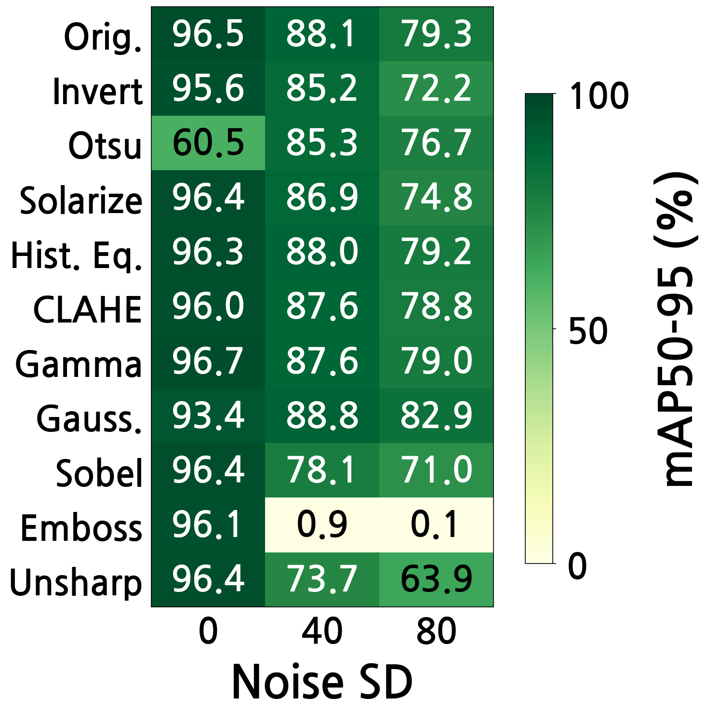

# 발표자료 5차 · 실제 전체 비교

기준 커밋 `c70d4e5629c3b8af330c80584ced90367a8afd03`와 이번 공개 자료의 실제 전체 변경입니다. 텍스트는 공백·개행·주석을 포함한 줄 비교이고 바이너리는 바이트 수와 SHA-256을 기록합니다. 연구 코드·원고·원정밀도 결과는 변경하지 않았습니다. 이 비교 문서와 이번 변경 기록 자체는 자기 참조를 피하기 위해 아래 내용 비교에서 제외하고, 최종 Git 전체 변경·manifest에는 포함합니다.

| 구분 | 파일 | 바이트 | 이전 SHA-256 | 현재 SHA-256 |
| --- | --- | ---: | --- | --- |
| 수정 | `README.md` | 53,916 → 56,893 | `9badf199bd7a3bca1607089141f86d935d1d859e7019fc4337689def7be84004` | `a1b897d74b9b9b5e05b0714ebec27ad6ea16662f958850d4abc43066370cd616` |
| 수정 | `docs/PAPERS.md` | 1,916 → 2,844 | `c226e29966a6c0f9a54dfbdf0322df257057d951a056e1bcc520bc7d97811b4b` | `2ddd9135af7e3ba6041549ed95d9bdb211bb161d783d9c0316ca73e65e195d4a` |
| 수정 | `docs/REVISION_INDEX.md` | 7,444 → 7,718 | `d17dff86ec95f97590e99e0181013687fa20cc5f3cc51b1a6413a206057ab8f3` | `8210308a9ce42b07c34052edf2ac1945813000d01835df1e5fd1a0d64b971da5` |
| 수정 | `docs/latest/ball-complete-talk-script.md` | 2,749 → 3,230 | `19f49f4c2c5147a3576957ed9843a00942b7db3ec40a881290519b21b261face` | `b5e101580bc29e0eb37c04e8fd8c6621699846268ad94269ce16cfc70a5e7ef4` |
| 수정 | `docs/latest/ball-conference-presentation.md` | 3,338 → 3,918 | `e5883c5c15106b737dfadf598b4580eab024f2a5b266fd8834c54298ed179264` | `0b044b01eabdee8ae3099cc532439ca44c81d137b054a879bfa09721b0f03668` |
| 수정 | `docs/latest/ball-yolov8n-filter-paper.md` | 3,418 → 3,997 | `054eca06f877ebfda05f988c2c9a3265f679f81430adddff624af53bd1a89332` | `39b7da8e4417deba632ff48f013c3fcd13367fe701bc246bc080e92f819b7fa5` |
| 추가 | `docs/revisions/talk-5.md` | 0 → 11,686 | `없음` | `6194ab88bc980a93ca03200f5cafcbd0bebf3a97b6273e507574332c7569feca` |
| 수정 | `docs/읽기안내/레벨1.md` | 74,425 → 77,479 | `bfaf24fe4804bfd33cd5ccd07eb60cb5c8dc305d4dc5a42f6af0698f9dce459e` | `9e4049ed1c68c8b8920f28acbfc88e21548d05a7f55ab23ecdd41b1230f392e7` |
| 수정 | `docs/읽기안내/레벨2.md` | 74,130 → 77,114 | `8f98e2f9ffa5870e314422389f20975b25ac639be3df980cf0f934e39d300fac` | `6081612a66721605475e733273092e27f18ae987f85c1c8f6c4523295010fdd5` |
| 수정 | `docs/읽기안내/레벨3.md` | 74,386 → 77,278 | `3523dd3401527159f587bb3975293c71dc5dcd19a0f6b558b2bc9abd83fa405d` | `8662cec040ef91e902178933a360b4e3e32869262489970de88e21c26761ef35` |
| 수정 | `docs/읽기안내/레벨4.md` | 74,558 → 77,466 | `dd9e04e87fd72586f0a284cb6a690c399e303c57161f3e24b277ff7fd0c39df4` | `fe0d1d4af8cabf79c70f72a42f66090b40a02f962f4aa35d92f098f973af1e78` |
| 수정 | `docs/읽기안내/레벨5.md` | 74,674 → 77,735 | `db4033db14e7be8d717f1a56d5ffb67d2a74f8b4396d36e9fb2b225958d19000` | `51c6ea14e9b7d4627aa84d250900f2d33033604e60e420362a818d332bf20c45` |
| 추가 | `발표자료/3차/결과/추계학술대회_10분발표.pdf` | 0 → 4,071,884 | `없음` | `2c418f9bea55f538b0fe94c1c6b5f0b6ef9ceaebf17fffa8c9ae540f3e9d802c` |
| 추가 | `발표자료/3차/결과/추계학술대회_10분발표.pptx` | 0 → 22,926,957 | `없음` | `45d6582f1f77fde70fea519d2dd573f3aec03b4c78f09388da8b46732900441a` |
| 추가 | `발표자료/5차/10분_발표대본.pdf` | 0 → 127,231 | `없음` | `e548940bd121dc188a5ae6d764554cb93b8c80adde32d6e052e19720d4462037` |
| 추가 | `발표자료/5차/README.md` | 0 → 1,126 | `없음` | `2c097469b4f1cc4a82bfe62722af927ddde5a8de836f49f8fafe5e6bd4eab12f` |
| 추가 | `발표자료/5차/논문_정정안내.pdf` | 0 → 63,528 | `없음` | `5fe878e5683d9d2f96e16b54949a423da9343d3f52b7d7e03709bf015c0bdfd1` |
| 추가 | `발표자료/5차/발표연습_질문지.pdf` | 0 → 66,538 | `없음` | `9d5da301dc801d4f6695cb13f28b5a2270b5e0b22f0bbaaa0a5b8e849f74aaa9` |
| 추가 | `발표자료/5차/연구 이해와 발표 유의사항.pdf` | 0 → 95,765 | `없음` | `7c2a7fb6057f5a6946eae2ce05233dbff3ce781bdec9974ce5954b3b7a5d6ad9` |
| 추가 | `발표자료/5차/예상 질문과 답변.pdf` | 0 → 108,311 | `없음` | `2fe4d3b010940bcb629e586f836be9e28a769eca7146ae7bb51ac160cca70b25` |
| 추가 | `발표자료/5차/추계학술대회_최종발표.pdf` | 0 → 4,069,676 | `없음` | `4e21ac46fb5090b1ff9f6f54e7bd54220e3f59ad9d23e1aee21c5e634c859117` |
| 추가 | `발표자료/5차/추계학술대회_최종발표.pptx` | 0 → 22,924,275 | `없음` | `9e4b17960a24b980a425d0bfe4d7f4928ec551745fece0c338245a72361aa793` |
| 추가 | `발표자료/5차/필터변환_사진모음.pdf` | 0 → 16,730,622 | `없음` | `c4ce2c36032a51dccc86b16cb433934369cd772349aaf101ec9674a5437b9bf3` |
| 수정 | `발표자료/최종/README.md` | 2,317 → 2,777 | `644616dbf2aefd229bc203134040bacb262b5d731c8ed708c13c074f172752ae` | `43b7d3c92a1d9f825147ad940584d2bab5a5649e4928fe163f4fe7467a5e69d1` |
| 수정 | `발표자료/최종/추계학술대회_10분발표.pdf` | 4,071,884 → 4,069,676 | `2c418f9bea55f538b0fe94c1c6b5f0b6ef9ceaebf17fffa8c9ae540f3e9d802c` | `4e21ac46fb5090b1ff9f6f54e7bd54220e3f59ad9d23e1aee21c5e634c859117` |
| 수정 | `발표자료/최종/추계학술대회_10분발표.pptx` | 22,926,957 → 22,924,275 | `45d6582f1f77fde70fea519d2dd573f3aec03b4c78f09388da8b46732900441a` | `9e4b17960a24b980a425d0bfe4d7f4928ec551745fece0c338245a72361aa793` |

<details>
<summary>전체 변경 줄과 바이너리 대조</summary>

````diff
--- a/README.md
+++ b/README.md
@@ -1,1372 +1,1390 @@
-<a name="볼-결함-탐지와-영상-필터-비교"></a>
-<a name="yolov8n--단일복합-전처리-필터--중복-그룹-분할--노이즈-강건성"></a>
-
-<a id="-ball-defect-detection-project"></a>
-
-# Ball Defect Detection Project
-
-**YOLOv8n과 영상 필터를 조합해 작은 볼 결함의 검출 성능을 비교합니다.**
-
-<!-- reading-levels17:start -->
-| 읽기 수준 | 안내 내용 |
-| --- | --- |
-| [LEVEL 1 - Beginner](docs/%EC%9D%BD%EA%B8%B0%EC%95%88%EB%82%B4/%EB%A0%88%EB%B2%A81.md) | 낯선 용어를 풀고 입력부터 결과까지 구체적인 예로 읽기 |
-| [LEVEL 2 - Explorer](docs/%EC%9D%BD%EA%B8%B0%EC%95%88%EB%82%B4/%EB%A0%88%EB%B2%A82.md) | 핵심 개념과 처리 흐름의 관계 이해 |
-| [LEVEL 3 - Practitioner](docs/%EC%9D%BD%EA%B8%B0%EC%95%88%EB%82%B4/%EB%A0%88%EB%B2%A83.md) | 실험·사용 절차와 결과 해석 따라가기 |
-| [LEVEL 4 - Advanced](docs/%EC%9D%BD%EA%B8%B0%EC%95%88%EB%82%B4/%EB%A0%88%EB%B2%A84.md) | 코드 구조·설정·설계 선택과 제약 검토 |
-| [LEVEL 5 - Expert](docs/%EC%9D%BD%EA%B8%B0%EC%95%88%EB%82%B4/%EB%A0%88%EB%B2%A85.md) | 논문·프로토콜·분모·누수·미검증 범위 대조 |
-<!-- reading-levels17:end -->
-
-분야: 컴퓨터 비전 › 딥러닝 객체 검출 › 소형 객체·전처리 강건성
-
-`Python`
-`PyTorch`
-`YOLO`
-`Jupyter`
-
-[빠른 시작](#quick-start) · [저장소 구성](#repository-structure) · [실험 설정](#data-settings)
-
-[핵심 구성](#input-processing-output)
-
-[PDF로 읽기](%EB%85%BC%EB%AC%B8/%EC%B5%9C%EC%A2%85_%EB%85%BC%EB%AC%B8.pdf) · [최신 편집 원문](%EB%85%BC%EB%AC%B8/%EC%B5%9C%EC%A2%85_%EB%85%BC%EB%AC%B8.hwp)
-
-<a id="-연구-핵심"></a>
-
-## 연구 요약
-
-YOLOv8n의 단일·복합 필터와 잡음·시드 조건을 비교한 최종 5쪽 전체 원고를 제공합니다. 이전 수정 차수와 축약본의 차이는 변경 설명에서 확인할 수 있습니다.
-
-수치는 연구 원고에 보고된 값입니다.
-
-- 단일 실행 Gamma mAP50-95 96.70%와 원본 96.53%를 보고합니다. Strict Acc는 별도 중심 일치 규칙의 지표입니다.
-- 필터·잡음 조건마다 재학습하고 세 시드로 반복 비교했습니다. 내부 학습·검증 분할에는 유사 그룹 중복이 남아 있습니다.
-
-**자료별 안내:** [최종 연구코드](docs/versions/stage-1.md) · [논문/4차](docs/versions/stage-2.md) · [발표자료/1차](docs/versions/stage-3.md) · [발표자료/2차](docs/versions/stage-4.md) · [발표자료/3차](docs/versions/stage-5.md) · [최종 원고](docs/versions/stage-6.md) · [전체 기록](docs/VERSIONS.md)
-
-발표 자료는 **1차: 본발표 12장+부록 3장 → 2차: 비교 사진을 확장한 본발표 20장 → 3차: 같은 내용·시간을 유지하고 투명 로고·자산 검사를 보강**한 흐름입니다. 연구 실험 차수와 구분하며, 공개 폴더에는 각 차수의 검사 도구만 보관합니다.
-
-<a name="preview"></a>
-
-
-
-**논문 그림** — 공개 HWP 원고의 필터별 노이즈 강도 비교 집계 그림입니다. 세 열은 노이즈 표준편차 0·40·80이고, 지표는 mAP50-95입니다.
-
-[최신 편집 원문](%EB%85%BC%EB%AC%B8/%EC%B5%9C%EC%A2%85_%EB%85%BC%EB%AC%B8.hwp)
-
-<a name="input-processing-output"></a>
-
-<a id="-입력처리출력"></a>
-
-## 입력·처리·출력
-
-| 구분 | 내용 |
-| --- | --- |
-| 문제 | 작은 볼을 검출할 때 전처리 필터와 잡음 조건이 결과에 미치는 영향을 비교합니다. |
-| 입력 | 제조 부품 영상·볼 바운딩 박스 |
-| 처리 | YOLOv8n, 단일·복합 필터, 중복 그룹 분할·다중 시드 비교 |
-| 출력 | 검출 지표·Strict Acc·별도 OK/NG 판정 |
-
----
-
-<a id="-논문과-최신-자료"></a>
-
-## 논문과 최신 자료
-
-| 자료 | 원문 파일 |
-| --- | --- |
-| 최종 논문 · 볼 검출 필터 비교 | [PDF 다운로드](%EB%85%BC%EB%AC%B8/%EC%B5%9C%EC%A2%85_%EB%85%BC%EB%AC%B8.pdf) |
-| 최종 논문 · 볼 검출 필터 비교 | [HWP 다운로드](%EB%85%BC%EB%AC%B8/%EC%B5%9C%EC%A2%85_%EB%85%BC%EB%AC%B8.hwp) |
-| 최종 발표 · 볼 검출 | [PDF 다운로드](%EB%B0%9C%ED%91%9C%EC%9E%90%EB%A3%8C/%EC%B5%9C%EC%A2%85/%EC%B6%94%EA%B3%84%ED%95%99%EC%88%A0%EB%8C%80%ED%9A%8C_10%EB%B6%84%EB%B0%9C%ED%91%9C.pdf) |
-| 최종 발표 · 볼 검출 | [PPTX 다운로드](%EB%B0%9C%ED%91%9C%EC%9E%90%EB%A3%8C/%EC%B5%9C%EC%A2%85/%EC%B6%94%EA%B3%84%ED%95%99%EC%88%A0%EB%8C%80%ED%9A%8C_10%EB%B6%84%EB%B0%9C%ED%91%9C.pptx) |
-| 완성 대본 · 볼 검출 발표 4차 | [TXT 다운로드](%EB%B0%9C%ED%91%9C%EC%9E%90%EB%A3%8C/4%EC%B0%A8/10%EB%B6%84_%ED%95%99%EC%88%A0%EB%8C%80%ED%9A%8C_%EB%B0%9C%ED%91%9C%EB%8C%80%EB%B3%B8.txt) |
-
-[자료별 설명](docs/PAPERS.md) · [코드 차수와 변경 이력](docs/REVISION_INDEX.md)
-
-<a id="️-차수별-프로젝트-안내"></a>
-
-## 전체 차수
-
-| 차수·단계 | 자료 |
-| --- | --- |
-| [논문 1차](docs/revisions/paper-1.md) | **주요 내용** [상세 설명](#layout18-table-4-row-1-field-1)<br>**자료** [폴더](%EB%85%BC%EB%AC%B8)<br>**직전 비교** [전체 비교](docs/revision-diffs/paper-1.diff) |
-| [논문 2차](docs/revisions/paper-2.md) | **주요 내용** 1차와 같은 제목·연구 설정 아래 문장과 표현을 다듬은 원고 단계입니다.<br>**자료** [폴더](%EB%85%BC%EB%AC%B8)<br>**직전 비교** [전체 비교](docs/revision-diffs/paper-2.diff) |
-| [논문 3차](docs/revisions/paper-3.md) | **주요 내용** [상세 설명](#layout18-table-4-row-3-field-1)<br>**자료** [폴더](%EB%85%BC%EB%AC%B8)<br>**직전 비교** [전체 비교](docs/revision-diffs/paper-3.diff) |
-| [논문 4차 · 검토 도구](docs/revisions/paper-4.md) | **주요 내용** [상세 설명](#layout18-table-4-row-4-field-1)<br>**자료** [폴더](%EB%85%BC%EB%AC%B8/4%EC%B0%A8/tools)<br>**직전 비교** [전체 비교](docs/revision-diffs/paper-4.diff) |
-| [논문 5차 · 재구성 패키지](docs/revisions/paper-5.md) | **주요 내용** [상세 설명](#layout18-table-4-row-5-field-1)<br>**자료** [폴더](%EB%85%BC%EB%AC%B8/5%EC%B0%A8/%EC%BD%94%EB%93%9C)<br>**직전 비교** [전체 비교](docs/revision-diffs/paper-5.diff) |
-| [논문 최종 · 3장/5장/요약](docs/revisions/paper-final.md) | **주요 내용** [상세 설명](#layout18-table-4-row-6-field-1)<br>**자료** [폴더](%EB%85%BC%EB%AC%B8)<br>**직전 비교** [전체 비교](docs/revision-diffs/paper-final.diff) |
-| [발표자료 1차](docs/revisions/talk-1.md) | **주요 내용** 필터 비교 연구를 12장 본발표 600초와 3장 부록으로 설명한 초기 발표 구성입니다.<br>**자료** [폴더](%EB%B0%9C%ED%91%9C%EC%9E%90%EB%A3%8C/1%EC%B0%A8)<br>**직전 비교** [전체 비교](docs/revision-diffs/talk-1.diff) |
-| [발표자료 2차](docs/revisions/talk-2.md) | **주요 내용** 필터 비교 사진과 설명을 나누고 20장·600초 본발표로 재배치한 단계입니다.<br>**자료** [폴더](%EB%B0%9C%ED%91%9C%EC%9E%90%EB%A3%8C/2%EC%B0%A8)<br>**직전 비교** [전체 비교](docs/revision-diffs/talk-2.diff) |
-| [발표자료 3차](docs/revisions/talk-3.md) | **주요 내용** 2차의 20장 내용·시간을 유지하면서 투명 학교 마크와 전달 자산의 일치를 보강한 단계입니다.<br>**자료** [폴더](%EB%B0%9C%ED%91%9C%EC%9E%90%EB%A3%8C/3%EC%B0%A8)<br>**직전 비교** [전체 비교](docs/revision-diffs/talk-3.diff) |
-| [발표자료 4차](docs/revisions/talk-4.md) | **주요 내용** [상세 설명](#layout18-table-4-row-10-field-1)<br>**자료** [폴더](%EB%B0%9C%ED%91%9C%EC%9E%90%EB%A3%8C/4%EC%B0%A8)<br>**직전 비교** [전체 비교](docs/revision-diffs/talk-4.diff) |
-| [발표자료 최종](docs/revisions/talk-final.md) | **주요 내용** [상세 설명](#layout18-table-4-row-11-field-1)<br>**자료** [폴더](%EB%B0%9C%ED%91%9C%EC%9E%90%EB%A3%8C/%EC%B5%9C%EC%A2%85)<br>**직전 비교** [전체 비교](docs/revision-diffs/talk-final.diff) |
-| [최종](docs/revisions/code-final.md) | **주요 내용** [상세 설명](#layout18-table-4-row-12-field-1)<br>**자료** [폴더](%EC%B5%9C%EC%A2%85)<br>**직전 비교** [전체 비교](docs/revision-diffs/code-final.diff) |
-| [이전 도커 실험·기존 결과표](docs/revisions/legacy.md) | **주요 내용** [상세 설명](#layout18-table-4-row-13-field-1)<br>**자료** [폴더](%EC%9D%B4%EC%A0%84%20%EB%8F%84%EC%BB%A4%20%EC%8B%A4%ED%97%98/%EB%B6%88%EB%9F%89%EA%B2%80%EC%B6%9C%EC%8B%A4%ED%97%98)<br>**직전 비교** [전체 비교](docs/revision-diffs/legacy.diff) |
-
-<a id="layout18-table-4-row-1-field-1"></a>
-
-**[논문 1차](docs/revisions/paper-1.md)**
-
-**주요 내용**
-
-다양한 영상 조건에서 YOLO 볼 검출을 위한 단일·복합 필터의 성능 비교를 정리한 초기 원고입니다.
-
-<a id="layout18-table-4-row-3-field-1"></a>
-
-**[논문 3차](docs/revisions/paper-3.md)**
-
-**주요 내용**
-
-제목을 YOLOv8n 기반 볼 검출의 단일·복합 전처리 필터 비교로 정리하고 조건·결과 해석을 확장한 단계입니다.
-
-<a id="layout18-table-4-row-4-field-1"></a>
-
-**[논문 4차 · 검토 도구](docs/revisions/paper-4.md)**
-
-**주요 내용**
-
-새 모델을 학습하는 대신 원고의 표·그림·문장과 저장된 원정밀도 결과를 대조한 검토 도구 단계입니다.
-
-<a id="layout18-table-4-row-5-field-1"></a>
-
-**[논문 5차 · 재구성 패키지](docs/revisions/paper-5.md)**
-
-**주요 내용**
-
-보존된 결과표와 노트북을 논문용 도표·참조 코드·전달 패키지로 구성한 단계입니다. 모델을 다시 학습하는 경로와 저장 결과를 다시 그리는 경로를 분리합니다.
-
-<a id="layout18-table-4-row-6-field-1"></a>
-
-**[논문 최종 · 3장/5장/요약](docs/revisions/paper-final.md)**
-
-**주요 내용**
-
-같은 연구의 3쪽 축약본·5쪽 전체본·별도 요약이 있던 최종 단계에서 현재는 5쪽 전체 원고와 같은 판의 HWP를 제공합니다.
-
-<a id="layout18-table-4-row-10-field-1"></a>
-
-**[발표자료 4차](docs/revisions/talk-4.md)**
-
-**주요 내용**
-
-3차의 20장 슬라이드 순서에 맞춰 발화·전환 문장을 다듬고 목표 시간을 배분한 전체 발표 대본입니다. 슬라이드를 새로 학습하거나 실험한 단계가 아닙니다.
-
-<a id="layout18-table-4-row-11-field-1"></a>
-
-**[발표자료 최종](docs/revisions/talk-final.md)**
-
-**주요 내용**
-
-단일·복합 필터와 잡음·시드 결과를 20장으로 설명하는 완성 발표 PDF/PPTX입니다. 논문과 다른 목적의 발표 자료로 같은 연구의 흐름을 전달합니다.
-
-<a id="layout18-table-4-row-12-field-1"></a>
-
-**[최종](docs/revisions/code-final.md)**
-
-**주요 내용**
-
-유사 영상 그룹과 교차검증을 구성하고 전처리 필터별 YOLO 검출, 볼 일치, 영역별 개수 판정과 추가 진단을 함께 계산하는 노트북입니다.
-
-<a id="layout18-table-4-row-13-field-1"></a>
-
-**[이전 도커 실험·기존 결과표](docs/revisions/legacy.md)**
-
-**주요 내용**
-
-단일·복합 필터 실험의 이전 노트북과 저장된 CSV·JSON·그래프를 함께 읽는 자료입니다. 결과표를 확인하는 경로와 새 학습을 수행하는 경로를 나누어 사용합니다.
-
-
-<a name="introduction"></a>
-
-<a id="-프로젝트-소개"></a>
-
-## 연구 방법
-
-최종 연구는 원본 영상과 단일 필터 10개·조합 필터 5개의 볼 객체 검출을 비교합니다. 근접 중복 이미지 묶음을 분리하고, 다중 시드·교차검증·노이즈 조건에서 결과의 안정성을 살펴봅니다. 노트북에는 중앙 영역의 방향별 개수로 OK/NG를 정하는 별도 실험도 포함되어 있습니다.
-
-| 기능 | 구현 내용 |
-| --- | --- |
-| 볼 검출 | Ultralytics YOLO로 위치와 객체 상자 예측 |
-| 영역 판정 | 중앙 사각형을 찾고 영역 내 볼의 위치별 개수 비교 |
-| 필터 비교 | 반전·이진화·블러·엣지 등 단일 필터 10개와 조합 필터 5개 |
-| 난도 실험 | 노이즈, 해상도, 블러 강도, 학습 데이터 양 조건 비교 |
-| 반복 실험 | 다중 시드, 교차검증, 근접 중복 이미지 묶음 처리 |
-| 결과 시각화 | CSV·JSON 요약, 혼동행렬, 필터별 그래프, GPU 사용 기록 |
-
-```mermaid
-flowchart LR
-    A[영상과 YOLO 라벨] --> B[원본 또는 영상 필터]
-    B --> C[YOLO 볼 검출]
-    C --> G[객체 검출 mAP·Strict Acc]
-    C --> D[중앙 부품 영역 선택]
-    D --> E[방향별 개수 규칙]
-    E --> F[OK / NG]
-    F --> I[별도 OK/NG 판정 일치율]
-    A --> H[라벨 기반 기준 또는 별도 정답]
-    H --> G
-    H --> I
-```
-
-<a name="repository-structure"></a>
-
-<a id="-저장소-구성"></a>
-
-## 저장소 구성
-
-주요 경로는 다음과 같습니다.
-
-```text
-.
-├── ball_ok_ng_yolo_v7.ipynb
-├── DataSet/
-├── 최종/
-│   └── 연구코드/
-│       └── ball_ok_ng_yolo_v7.ipynb
-├── 이전 도커 실험/
-│   └── 불량검출실험/
-│       ├── paper_filter_figures.py
-│       ├── reference_plot_style.py
-│       └── render_saved_figures.py
-├── docs/VERSIONS.md
-└── CHANGELOG.md
-```
-
-- [최종 연구 노트북](%EC%B5%9C%EC%A2%85/%EC%97%B0%EA%B5%AC%EC%BD%94%EB%93%9C/ball_ok_ng_yolo_v7.ipynb): 검출·판정·필터 비교 및 추가 진단 실험.
-- [기본 노트북](ball_ok_ng_yolo_v7.ipynb): 저장소 최상위에 보존한 연구 코드.
-- [그림 생성 코드](%EC%9D%B4%EC%A0%84%20%EB%8F%84%EC%BB%A4%20%EC%8B%A4%ED%97%98/%EB%B6%88%EB%9F%89%EA%B2%80%EC%B6%9C%EC%8B%A4%ED%97%98/paper_filter_figures.py): 연구 그림 구성.
-- [버전별 파일 기록](docs/VERSIONS.md): 공개 코드의 차수별 비교.
-
-<a name="최종-논문"></a>
-
-<a id="-최종-논문"></a>
-
-### 최종 논문
-
-[최신 편집 원문](%EB%85%BC%EB%AC%B8/%EC%B5%9C%EC%A2%85_%EB%85%BC%EB%AC%B8.hwp)에 필터 비교 방법과 연구 그래프를 정리했습니다.
-
-<a name="최종-원고의-연구-범위"></a>
-
-<a id="-최종-원고의-연구-범위"></a>
-
-### 최종 원고의 연구 범위
-
-**YOLOv8n 기반 볼 검출을 위한 단일 및 복합 전처리 필터의 성능 비교**
-*Performance Comparison of Single and Combined Preprocessing Filters for YOLOv8n-Based Ball Detection*
-
-한국정보기술학회([Korean Institute of Information Technology](https://eng.ki-it.or.kr/homepage/custom/memberadministrationregulation))의 2026 추계종합학술대회 양식으로 작성한 연구 원고입니다.
-
-<a id="layout18-table-6-row-1"></a>
-
-**자료·분할**
-
-**최종 원고 항목**
-
-자료·분할
-
-**원고에 명시된 구성·결과**
-
-2944×2352 영상 500장, 초기 학습 400·검증 100; 근접 중복 368개 그룹을 이용한 5-fold 비교
-
-<a id="layout18-table-6-row-2"></a>
-
-**학습 조건**
-
-**최종 원고 항목**
-
-학습 조건
-
-**원고에 명시된 구성·결과**
-
-YOLOv8n, 30 epoch, 입력 1280, batch 8, patience 15
-
-<a id="layout18-table-6-row-3"></a>
-
-**평가 구분**
-
-**최종 원고 항목**
-
-평가 구분
-
-**원고에 명시된 구성·결과**
-
-mAP50-95용 conf 0.001·NMS IoU 0.7과 엄격 일치용 conf 0.25·NMS IoU 0.5를 구분
-
-<a id="layout18-table-6-row-4"></a>
-
-**단일 실행**
-
-**최종 원고 항목**
-
-단일 실행
-
-**원고에 명시된 구성·결과**
-
-Gamma mAP50-95 96.70%, 원본 96.53%로 차이는 0.17%p
-
-<a id="layout18-table-6-row-5"></a>
-
-**3개 시드 비교**
-
-**최종 원고 항목**
-
-3개 시드 비교
-
-**원고에 명시된 구성·결과**
-
-Invert+CLAHE Strict Acc 95.47±2.27%, 원본 95.40±0.53%; 단일 실행 98%를 반복 성능으로 대체하지 않음
-
-<a id="layout18-table-6-row-6"></a>
-
-**노이즈 σ=80**
-
-**최종 원고 항목**
-
-노이즈 σ=80
-
-**원고에 명시된 구성·결과**
-
-Blur 82.86±0.08%, 원본 79.60±0.26%의 원고 보고값
-
-
-엄격 일치는 주석·예측 중심을 가까운 순서로 일대일 대응시키며, 허용 거리는 주석 상자 긴 변의 0.5배입니다. 상자의 겹침을 평가하는 mAP50-95와 기준이 다릅니다.
-
-원고의 외부 평가 fold는 유사 영상 그룹을 분리하지만, 내부 학습·검증에는 9~20개 그룹의 중복이 남아 있습니다.
-
-또한 필터·노이즈 조건마다 모델을 다시 학습했으므로, 고정된 모델이 처음 보는 촬영 조건에 견디는지를 평가한 실험은 아닙니다. 독립 촬영 로트 검증도 후속 과제로 남습니다.
-
-노트북에는 논문의 필터 비교와 함께 100-epoch 기준 실험, 가상 볼 추가, 판정 규칙 분석을 담았습니다.
-
-<a name="implementation"></a>
-
-<a id="-주요-기술과-실험-구성"></a>
-
-## 주요 기술과 실험 구성
-
-OpenCV로 영상을 다루고, PyTorch·Kornia로 필터 연산을 구성합니다. Ultralytics는 객체 검출을 담당하며 NumPy·pandas·Matplotlib는 결과 집계와 그림 생성에 사용합니다.
-
-원고의 일반 영상 비교는 원본·단일 10종·조합 5종을, 노이즈 비교는 원본·단일 필터를 대상으로 합니다. `A+B`는 A 다음 B를 적용하는 순서이며 역순이나 모든 가능한 조합을 시험한 것은 아닙니다.
-
-CLAHE는 clip limit 40·16×16 격자, Gamma는 0.3, Gaussian Blur는 σ20·121×121 커널, Emboss는 gain 4, Unsharp는 amount 8·σ2로 고정했습니다. 이 값들은 비교에 사용한 설정이며 최적값을 뜻하지 않습니다.
-
-노트북 앞부분은 초기 개발 실험이며, 뒤쪽에는 교차검증과 강건성 실험을 구성했습니다.
-
-<a id="layout18-table-7-row-1"></a>
-
-**기준**
-
-**비교 묶음**
-
-기준
-
-**조건**
-
-원본 영상
-
-<a id="layout18-table-7-row-2"></a>
-
-**단일 필터**
-
-**비교 묶음**
-
-단일 필터
-
-**조건**
-
-Invert, Otsu, Solarize, Histogram Equalization, CLAHE, Gamma, Gaussian Blur, Sobel, Emboss, Unsharp
-
-<a id="layout18-table-7-row-3"></a>
-
-**조합 필터**
-
-**비교 묶음**
-
-조합 필터
-
-**조건**
-
-Invert+CLAHE, Blur+Otsu, Sobel+Invert, HistEq+Emboss, Unsharp+Sobel
-
-<a id="layout18-table-7-row-4"></a>
-
-**추가 진단**
-
-**비교 묶음**
-
-추가 진단
-
-**조건**
-
-볼 지우기·추가하기, 판정 임계값 변화, 분포 변화, 다중 시드 반복
-
-
-<a name="quick-start"></a>
-
-<a id="-빠른-시작"></a>
-
-## 빠른 시작
-
-Python과 CUDA를 사용할 수 있는 PyTorch 환경을 먼저 준비합니다. 노트북의 기본 `REQUIRE_GPU = True` 설정에서는 CUDA를 찾지 못하면 중단됩니다. 필요한 패키지를 준비한 뒤 저장소 루트에서 실행합니다.
-
-```powershell
-python -m pip install jupyterlab numpy opencv-python matplotlib pandas pyyaml joblib ultralytics kornia
-python -m jupyter lab "최종/연구코드/ball_ok_ng_yolo_v7.ipynb"
-```
-
-1. 노트북의 데이터 경로를 자신의 실험 자료 위치에 맞춥니다. 원래 코드는 `/root/추계학술대회/DataSet`을 전제로 작성되어 있습니다.
-2. 이미지와 YOLO 라벨의 대응 관계, 학습·검증·시험 분할을 확인합니다.
-3. 사용할 GPU와 데이터 경로를 확인한 뒤 필요한 실험 셀을 순서대로 실행합니다.
-4. 결과 CSV와 JSON을 확인하고, 필요할 때 그림 생성 셀을 실행합니다.
-
-원본 영상·학습 가중치·완성된 실행 환경은 별도로 준비해야 합니다. 공개 파일만으로 모든 실험을 즉시 재현할 수 있는 패키지는 아닙니다.
-
-<a name="data-settings"></a>
-
-<a id="-데이터-구성과-실험-설정"></a>
-
-## 데이터 구성과 실험 설정
-
-노트북이 기대하는 기본 데이터 구조는 다음과 같습니다.
-
-```text
-DataSet/
-├── images/{train,val,test}/*.png
-├── labels/{train,val,test}/*.txt
-└── data.yaml
-```
-
-라벨 한 행은 `class cx cy w h`이며 좌표는 0~1로 정규화합니다. 별도의 실제 OK/NG 정답을 사용할 때는 노트북의 `OKNG_CSV` 및 후반부의 `REAL_LABEL_*` 설정을 확인합니다.
-
-| 지표·설정 | 해석 |
-| --- | --- |
-| 위치별 개수 | 위 5개·왼쪽 4개·아래 2개·오른쪽 2개를 사용하는 구현 규칙 |
-| 검출 mAP | 볼의 객체 상자 검출 성능 |
-| OK/NG 정확도 | 선택한 정답 정의와 개수 규칙에 대한 판정 일치율 |
-| Strict Acc | 라벨의 볼을 모두 찾고 추가 검출도 없는 엄격한 기준 |
-| 다수 클래스 기준 | 클래스 불균형에서 단순 다수 예측과 비교하기 위한 기준 |
-| McNemar 비교 | 같은 영상에 대한 두 방법의 정오답 차이 비교 |
-
-라벨 상자에도 동일한 영역·개수 규칙을 적용해 정답을 만듭니다. 따라서 이 평가는 규칙 기반 판정의 일치율을 다루며, 전문가의 별도 판정과 비교하는 평가는 후속 과제입니다.
-
-<a name="troubleshooting"></a>
-
-<a id="️-문제-해결"></a>
-
-## 문제 해결
-
-| 증상 | 확인할 내용 |
-| --- | --- |
-| CUDA GPU를 찾지 못함 | 드라이버, PyTorch의 CUDA 지원 여부, 노트북의 장치 설정 |
-| 데이터 경로 오류 | 노트북의 원래 Linux 경로와 현재 데이터 위치 |
-| 결과가 지나치게 높음 | 중복 이미지 묶음, 클래스 불균형, 정답 생성 규칙, 별도 실제 정답 유무 |
-| 한글 그래프가 깨짐 | 나눔고딕 설치와 노트북의 폰트 경로 |
-| 기존 결과와 수치가 다름 | 시드·분할·가중치·캐시·필터 파라미터가 같은지 확인 |
-
----
-
-검출에서 판정까지, 조건을 나누어 비교합니다.
-
-<a id="-현재-첨부-문서"></a>
-
-## 최신 문서와 변경 이력
-
-현재 제공하는 원문과 직전 공개본의 비교입니다. 이전 원고·발표와 코드는 전체 차수 표에서 확인할 수 있습니다.
-
-| 문서 | 자료 |
-| --- | --- |
-| 최종 논문 · 볼 검출 필터 비교 | **자료 폴더** [폴더](%EB%85%BC%EB%AC%B8)<br>**상세** [설명](docs/latest/ball-yolov8n-filter-paper.md)<br>**직전 공개본 전체 비교** [전체 비교](docs/changes/2026-11-02-%EC%B5%9C%EC%8B%A0%EB%AC%B8%EC%84%9C-%EC%A0%84%EC%B2%B4%EB%B9%84%EA%B5%90.md) |
-| 최종 발표 · 볼 검출 | **자료 폴더** [폴더](%EB%B0%9C%ED%91%9C%EC%9E%90%EB%A3%8C/%EC%B5%9C%EC%A2%85)<br>**상세** [설명](docs/latest/ball-conference-presentation.md)<br>**직전 공개본 전체 비교** [전체 비교](docs/changes/2026-11-02-%EC%B5%9C%EC%8B%A0%EB%AC%B8%EC%84%9C-%EC%A0%84%EC%B2%B4%EB%B9%84%EA%B5%90.md) |
-| 완성 대본 · 볼 검출 발표 4차 | **자료 폴더** [폴더](%EB%B0%9C%ED%91%9C%EC%9E%90%EB%A3%8C/4%EC%B0%A8)<br>**상세** [설명](docs/latest/ball-complete-talk-script.md)<br>**직전 공개본 전체 비교** [전체 비교](docs/changes/2026-11-02-%EC%B5%9C%EC%8B%A0%EB%AC%B8%EC%84%9C-%EC%A0%84%EC%B2%B4%EB%B9%84%EA%B5%90.md) |
-
-[최신 문서 구성 변경](docs/changes/2026-11-02-%EC%B5%9C%EC%8B%A0%EB%AC%B8%EC%84%9C.md)
-
-<a name="research-details"></a>
-
-<a id="-연구구현의-세부-흐름"></a>
-
-## 차수별 방법과 조건
-
-차수별 입력, 처리 방법, 실행 조건과 결과를 정리했습니다.
-
-<a id="-논문-1차--단일복합-전처리-필터-비교의-출발점"></a>
-
-<details>
-<summary>논문 1차 · 단일·복합 전처리 필터 비교의 출발점</summary>
-
-### 논문 1차 · 단일·복합 전처리 필터 비교의 출발점
-
-다양한 영상 조건에서 YOLO 볼 검출을 위한 단일·복합 필터의 성능 비교를 정리한 초기 원고입니다.
-
-| 구성 | 처리 내용 |
-| --- | --- |
-| 연구 질문 | 필터를 적용하면 작은 볼의 검출이 어떻게 달라지는지 비교합니다. |
-| 초기 원고의 읽기 | 제목·설정·표현이 뒤 원고로 이어지는 변화를 직전 비교와 함께 읽습니다. |
-| 필터 비교 | 단일 10종과 순차 복합 5종을 Original 기준과 비교합니다. |
-| 조건별 재학습 | 미지 촬영 조건에 고정 모델을 바로 적용한 평가와 구분합니다. |
-| 두 지표 | 경계상자 mAP50-95와 모든 볼을 맞추고 추가 검출이 없는 Strict Acc를 구분합니다. |
-| 반복과 잡음 | 일반 조건과 잡음 표준편차 40·80, 세 시드 반복을 나누어 읽습니다. |
-
-| 입력·실행 조건 | 내용 |
-| --- | --- |
-| 자료 | 500장·2944×2352 영상에 대한 원고 보고 |
-| 외부 평가 | 유사 그룹 기반 5겹 교차검증 |
-| 조건 | 단일 10종·복합 5종·잡음 40/80·세 시드 |
-| 결과 구분 | mAP50-95와 Strict Acc |
-
-일반 영상 단일 시드에서 Gamma0.3의 mAP50-95는 96.70%, Original은 96.53%로 원고가 보고합니다.
-
-차이는 0.17%p이며 작은 차이를 무조건적인 우위로 확대하지 않습니다.
-
-복합 필터는 모든 경우에 단일 구성 필터보다 좋아지지 않습니다. 일반 조건의 결과와 잡음 조건의 안정성·세 시드의 변동을 나누어 읽습니다.
-
-<a id="layout18-table-13-row-1"></a>
-
-**일반화 범위**
-
-**제약**
-
-일반화 범위
-
-**확인할 내용**
-
-필터·잡음 조건별 재학습 결과이며 고정 모델의 미지 촬영 조건 적응성을 입증한 것은 아닙니다.
-
-<a id="layout18-table-13-row-2"></a>
-
-**내부 분할**
-
-**제약**
-
-내부 분할
-
-**확인할 내용**
-
-외부 평가 그룹은 분리하지만 내부 train/val에는 유사 그룹 중복이 남아 있습니다.
-
-<a id="layout18-table-13-row-3"></a>
-
-**지표 정의**
-
-**제약**
-
-지표 정의
-
-**확인할 내용**
-
-Strict Acc는 중심 거리·누락·추가 검출 규칙이며 전문가 OK/NG 판정이나 mAP와 같지 않습니다.
-
-
-[파일 구성·핵심 정의·사용 순서](docs/revisions/paper-1.md) · [이 단계 전체 비교](docs/revision-diffs/paper-1.diff)
-
-<a id="-논문-2차--같은-설정을-더-명확하게-설명한-원고"></a>
-
-</details>
-
-<details>
-<summary>논문 2차 · 같은 설정을 더 명확하게 설명한 원고</summary>
-
-### 논문 2차 · 같은 설정을 더 명확하게 설명한 원고
-
-1차와 같은 제목·연구 설정 아래 문장과 표현을 다듬은 원고 단계입니다.
-
-| 구성 | 처리 내용 |
-| --- | --- |
-| 설명 개정 | 문장·표현의 변화와 실험 설정의 변화를 분리해서 읽습니다. |
-| 요약 중복 | 1·2차 요약 PDF는 같은 해시의 자료여서 새로운 요약 결과가 생긴 것으로 세지 않습니다. |
-| 필터 비교 | 단일 10종과 순차 복합 5종을 Original 기준과 비교합니다. |
-| 조건별 재학습 | 미지 촬영 조건에 고정 모델을 바로 적용한 평가와 구분합니다. |
-| 두 지표 | 경계상자 mAP50-95와 모든 볼을 맞추고 추가 검출이 없는 Strict Acc를 구분합니다. |
-| 반복과 잡음 | 일반 조건과 잡음 표준편차 40·80, 세 시드 반복을 나누어 읽습니다. |
-
-| 입력·실행 조건 | 내용 |
-| --- | --- |
-| 자료 | 500장·2944×2352 영상에 대한 원고 보고 |
-| 외부 평가 | 유사 그룹 기반 5겹 교차검증 |
-| 조건 | 단일 10종·복합 5종·잡음 40/80·세 시드 |
-| 결과 구분 | mAP50-95와 Strict Acc |
-
-일반 영상 단일 시드에서 Gamma0.3의 mAP50-95는 96.70%, Original은 96.53%로 원고가 보고합니다.
-
-차이는 0.17%p이며 작은 차이를 무조건적인 우위로 확대하지 않습니다.
-
-복합 필터는 모든 경우에 단일 구성 필터보다 좋아지지 않습니다. 일반 조건의 결과와 잡음 조건의 안정성·세 시드의 변동을 나누어 읽습니다.
-
-<a id="layout18-table-16-row-1"></a>
-
-**일반화 범위**
-
-**제약**
-
-일반화 범위
-
-**확인할 내용**
-
-필터·잡음 조건별 재학습 결과이며 고정 모델의 미지 촬영 조건 적응성을 입증한 것은 아닙니다.
-
-<a id="layout18-table-16-row-2"></a>
-
-**내부 분할**
-
-**제약**
-
-내부 분할
-
-**확인할 내용**
-
-외부 평가 그룹은 분리하지만 내부 train/val에는 유사 그룹 중복이 남아 있습니다.
-
-<a id="layout18-table-16-row-3"></a>
-
-**지표 정의**
-
-**제약**
-
-지표 정의
-
-**확인할 내용**
-
-Strict Acc는 중심 거리·누락·추가 검출 규칙이며 전문가 OK/NG 판정이나 mAP와 같지 않습니다.
-
-
-[파일 구성·핵심 정의·사용 순서](docs/revisions/paper-2.md) · [이 단계 전체 비교](docs/revision-diffs/paper-2.diff)
-
-<a id="-논문-3차--yolov8n-필터-비교-전체-원고"></a>
-
-</details>
-
-<details>
-<summary>논문 3차 · YOLOv8n 필터 비교 전체 원고</summary>
-
-### 논문 3차 · YOLOv8n 필터 비교 전체 원고
-
-제목을 YOLOv8n 기반 볼 검출의 단일·복합 전처리 필터 비교로 정리하고 조건·결과 해석을 확장한 단계입니다.
-
-| 구성 | 처리 내용 |
-| --- | --- |
-| 대상 명시 | 모델을 YOLOv8n으로 구체화하고 단일·복합 필터의 비교 목적을 정리합니다. |
-| 전체 본문 | 3차 HWP와 최종 5쪽 HWP는 같은 바이트의 원고입니다. |
-| 필터 비교 | 단일 10종과 순차 복합 5종을 Original 기준과 비교합니다. |
-| 조건별 재학습 | 미지 촬영 조건에 고정 모델을 바로 적용한 평가와 구분합니다. |
-| 두 지표 | 경계상자 mAP50-95와 모든 볼을 맞추고 추가 검출이 없는 Strict Acc를 구분합니다. |
-| 반복과 잡음 | 일반 조건과 잡음 표준편차 40·80, 세 시드 반복을 나누어 읽습니다. |
-
-| 입력·실행 조건 | 내용 |
-| --- | --- |
-| 자료 | 500장·2944×2352 영상에 대한 원고 보고 |
-| 외부 평가 | 유사 그룹 기반 5겹 교차검증 |
-| 조건 | 단일 10종·복합 5종·잡음 40/80·세 시드 |
-| 결과 구분 | mAP50-95와 Strict Acc |
-
-일반 영상 단일 시드에서 Gamma0.3의 mAP50-95는 96.70%, Original은 96.53%로 원고가 보고합니다.
-
-차이는 0.17%p이며 작은 차이를 무조건적인 우위로 확대하지 않습니다.
-
-복합 필터는 모든 경우에 단일 구성 필터보다 좋아지지 않습니다. 일반 조건의 결과와 잡음 조건의 안정성·세 시드의 변동을 나누어 읽습니다.
-
-<a id="layout18-table-19-row-1"></a>
-
-**일반화 범위**
-
-**제약**
-
-일반화 범위
-
-**확인할 내용**
-
-필터·잡음 조건별 재학습 결과이며 고정 모델의 미지 촬영 조건 적응성을 입증한 것은 아닙니다.
-
-<a id="layout18-table-19-row-2"></a>
-
-**내부 분할**
-
-**제약**
-
-내부 분할
-
-**확인할 내용**
-
-외부 평가 그룹은 분리하지만 내부 train/val에는 유사 그룹 중복이 남아 있습니다.
-
-<a id="layout18-table-19-row-3"></a>
-
-**지표 정의**
-
-**제약**
-
-지표 정의
-
-**확인할 내용**
-
-Strict Acc는 중심 거리·누락·추가 검출 규칙이며 전문가 OK/NG 판정이나 mAP와 같지 않습니다.
-
-
-[파일 구성·핵심 정의·사용 순서](docs/revisions/paper-3.md) · [이 단계 전체 비교](docs/revision-diffs/paper-3.diff)
-
-<a id="-논문-4차--원고-수치와-근거를-대조하는-도구"></a>
-
-</details>
-
-<details>
-<summary>논문 4차 · 원고 수치와 근거를 대조하는 도구</summary>
-
-### 논문 4차 · 원고 수치와 근거를 대조하는 도구
-
-새 모델을 학습하는 대신 원고의 표·그림·문장과 저장된 원정밀도 결과를 대조한 검토 도구 단계입니다.
-
-<a id="layout18-table-20-row-1"></a>
-
-**원문 결합**
-
-**구성**
-
-원문 결합
-
-**처리 내용**
-
-원고 SHA와 입력·근거 파일 해시를 대조합니다.
-
-<a id="layout18-table-20-row-2"></a>
-
-**결과 계산**
-
-**구성**
-
-결과 계산
-
-**처리 내용**
-
-단일 16조건 8000행·반복 39조건 19500행의 영상별 결과를 집계하는 조건이 있습니다.
-
-<a id="layout18-table-20-row-3"></a>
-
-**분할 점검**
-
-**구성**
-
-분할 점검
-
-**처리 내용**
-
-500영상·368유사그룹·154유사쌍, 외부 중복 0과 내부 9~20그룹 중복을 확인하는 조건을 포함합니다.
-
-<a id="layout18-table-20-row-4"></a>
-
-**표시·서술**
-
-**구성**
-
-표시·서술
-
-**처리 내용**
-
-이중 반올림, HWP 그림 해상도, 인용·사사·원고 문장을 대조합니다.
-
-
-<a id="layout18-table-21-row-1"></a>
-
-**도구**
-
-**입력·실행 조건**
-
-도구
-
-**내용**
-
-Python·NumPy와 CSV/JSON
-
-<a id="layout18-table-21-row-2"></a>
-
-**입력**
-
-**입력·실행 조건**
-
-입력
-
-**내용**
-
-audit.json·원고·결과 CSV·recalculated·container_dataset·main_findings 등
-
-<a id="layout18-table-21-row-3"></a>
-
-**역할**
-
-**입력·실행 조건**
-
-역할
-
-**내용**
-
-입력 자료의 근거와 완결성을 대조
-
-
-도구는 paper_ready_for_submission=False를 요구하며 PASS·주의·수정필요·확인불가 상태를 구분합니다. 도구가 보존됐다는 사실만으로 원고가 수정됐거나 새 시험이 완료됐다고 보지 않습니다.
-
-특히 원고 그림의 이중 반올림과 HWP 내장 그림 약 96dpi, 전체 문서 렌더 확인 범위가 별도 항목으로 연결됩니다. 이 단계의 발견과 현재 원고의 상태는 직전 비교와 함께 읽습니다.
-
-| 제약 | 확인할 내용 |
-| --- | --- |
-| 의존 자료 | 스크립트 외의 audit·근거 JSON·원고·결과 원자료가 필요합니다. |
-| 평가 누수 | 외부 그룹 분리와 내부 train/val 그룹 중복을 별개로 확인합니다. |
-| 원고 보존 | 발견한 차이를 숨기거나 원고 숫자를 임의 수정하는 도구가 아닙니다. |
-
-[파일 구성·핵심 정의·사용 순서](docs/revisions/paper-4.md) · [이 단계 전체 비교](docs/revision-diffs/paper-4.diff)
-
-<a id="-논문-5차--결과표와-도표-재구성-패키지"></a>
-
-</details>
-
-<details>
-<summary>논문 5차 · 결과표와 도표 재구성 패키지</summary>
-
-### 논문 5차 · 결과표와 도표 재구성 패키지
-
-보존된 결과표와 노트북을 논문용 도표·참조 코드·전달 패키지로 구성한 단계입니다. 모델을 다시 학습하는 경로와 저장 결과를 다시 그리는 경로를 분리합니다.
-
-<a id="layout18-table-23-row-1"></a>
-
-**논문 그림**
-
-**구성**
-
-논문 그림
-
-**처리 내용**
-
-paper_filter_figures.py가 단일·복합·잡음 CSV에서 3개 논문용 그림을 구성합니다.
-
-<a id="layout18-table-23-row-2"></a>
-
-**스타일 함수**
-
-**구성**
-
-스타일 함수
-
-**처리 내용**
-
-reference_plot_style.py가 글꼴·색·막대·레이블·이웃 텍스트 배치를 공통 처리합니다.
-
-<a id="layout18-table-23-row-3"></a>
-
-**결과 재렌더**
-
-**구성**
-
-결과 재렌더
-
-**처리 내용**
-
-render_saved_figures.py가 저장 JSON·CSV와 참조 노트북의 그림 함수를 이용합니다.
-
-<a id="layout18-table-23-row-4"></a>
-
-**입력 연결**
-
-**구성**
-
-입력 연결
-
-**처리 내용**
-
-재작성한 그림에 사용한 원자료 SHA를 기록하는 처리를 포함합니다.
-
-
-<a id="layout18-table-24-row-1"></a>
-
-**입력 표**
-
-**입력·실행 조건**
-
-입력 표
-
-**내용**
-
-table_round1·table_round2·table_grid_noise40·table_grid_noise80
-
-<a id="layout18-table-24-row-2"></a>
-
-**그림 도구**
-
-**입력·실행 조건**
-
-그림 도구
-
-**내용**
-
-NumPy·pandas·Matplotlib
-
-<a id="layout18-table-24-row-3"></a>
-
-**인자**
-
-**입력·실행 조건**
-
-인자
-
-**내용**
-
-paper_filter_figures: --results·--output
-
-<a id="layout18-table-24-row-4"></a>
-
-**재렌더 인자**
-
-**입력·실행 조건**
-
-재렌더 인자
-
-**내용**
-
---results·--output·--notebook
-
-
-도표 재구성은 저장 결과의 표현을 바꾼 것입니다. 새 실험이나 별도 논문 성과로 세지 않습니다.
-
-그림 PDF15개는 그래프이며 이전 원고·축약본과 역할이 다릅니다. 코드·JSON·CSV·원본 실험 그래프와 최종 논문 첨부를 구분해 읽습니다.
-
-| 제약 | 확인할 내용 |
-| --- | --- |
-| 실험과 렌더 | 모델 학습 성공과 저장 결과 그림 재작성을 혼동하지 않습니다. |
-| 원정밀도 | 표시용 반올림 수치에서 원래 값을 복원하지 않고 입력 표를 사용합니다. |
-| 의존 파일 | 스타일 모듈·노트북·CSV/JSON·폰트 경로를 함께 준비합니다. |
-
-[파일 구성·핵심 정의·사용 순서](docs/revisions/paper-5.md) · [이 단계 전체 비교](docs/revision-diffs/paper-5.diff)
-
-<a id="-논문-최종--5쪽-전체-원고-읽기"></a>
-
-</details>
-
-<details>
-<summary>논문 최종 · 5쪽 전체 원고 읽기</summary>
-
-### 논문 최종 · 5쪽 전체 원고 읽기
-
-같은 연구의 3쪽 축약본·5쪽 전체본·별도 요약이 있던 최종 단계에서 현재는 5쪽 전체 원고와 같은 판의 HWP를 제공합니다.
-
-| 구성 | 처리 내용 |
-| --- | --- |
-| 전체 원고 선택 | 5쪽은 연구의 방법·조건·표·해석을 담은 전체 본문이며 3쪽 축약본으로 대체하지 않습니다. |
-| 원고 계보 | 최종 5쪽 HWP는 3차 HWP와 같습니다. 작성·축약 형식의 차이를 새 연구로 세지 않습니다. |
-| 필터 비교 | 단일 10종과 순차 복합 5종을 Original 기준과 비교합니다. |
-| 조건별 재학습 | 미지 촬영 조건에 고정 모델을 바로 적용한 평가와 구분합니다. |
-| 두 지표 | 경계상자 mAP50-95와 모든 볼을 맞추고 추가 검출이 없는 Strict Acc를 구분합니다. |
-| 반복과 잡음 | 일반 조건과 잡음 표준편차 40·80, 세 시드 반복을 나누어 읽습니다. |
-
-| 입력·실행 조건 | 내용 |
-| --- | --- |
-| 자료 | 500장·2944×2352 영상에 대한 원고 보고 |
-| 외부 평가 | 유사 그룹 기반 5겹 교차검증 |
-| 조건 | 단일 10종·복합 5종·잡음 40/80·세 시드 |
-| 결과 구분 | mAP50-95와 Strict Acc |
-
-일반 영상 단일 시드에서 Gamma0.3의 mAP50-95는 96.70%, Original은 96.53%로 원고가 보고합니다.
-
-차이는 0.17%p이며 작은 차이를 무조건적인 우위로 확대하지 않습니다.
-
-복합 필터는 모든 경우에 단일 구성 필터보다 좋아지지 않습니다. 일반 조건의 결과와 잡음 조건의 안정성·세 시드의 변동을 나누어 읽습니다.
-
-<a id="layout18-table-28-row-1"></a>
-
-**일반화 범위**
-
-**제약**
-
-일반화 범위
-
-**확인할 내용**
-
-필터·잡음 조건별 재학습 결과이며 고정 모델의 미지 촬영 조건 적응성을 입증한 것은 아닙니다.
-
-<a id="layout18-table-28-row-2"></a>
-
-**내부 분할**
-
-**제약**
-
-내부 분할
-
-**확인할 내용**
-
-외부 평가 그룹은 분리하지만 내부 train/val에는 유사 그룹 중복이 남아 있습니다.
-
-<a id="layout18-table-28-row-3"></a>
-
-**지표 정의**
-
-**제약**
-
-지표 정의
-
-**확인할 내용**
-
-Strict Acc는 중심 거리·누락·추가 검출 규칙이며 전문가 OK/NG 판정이나 mAP와 같지 않습니다.
-
-
-[파일 구성·핵심 정의·사용 순서](docs/revisions/paper-final.md) · [이 단계 전체 비교](docs/revision-diffs/paper-final.diff)
-
-<a id="-발표자료-1차--12장-본발표와-3장-부록"></a>
-
-</details>
-
-<details>
-<summary>발표자료 1차 · 12장 본발표와 3장 부록</summary>
-
-### 발표자료 1차 · 12장 본발표와 3장 부록
-
-필터 비교 연구를 12장 본발표 600초와 3장 부록으로 설명한 초기 발표 구성입니다.
-
-| 구성 | 처리 내용 |
-| --- | --- |
-| 연구 이야기 | 자료·그룹 평가→필터→mAP/Strict Acc→잡음·시드→한계 순서로 설명합니다. |
-| 발표 분량 | 검사기는 15장, 앞 12장 시간 합계 600초와 부록 0초를 확인합니다. |
-| 원정밀도 차트 | 검사기는 JSON 수치와 PPTX 차트의 15유효자리 및 1·2자리 표시를 대조합니다. |
-| 발화 대응 | 슬라이드 노트와 대본에 같은 발화문이 있는지 확인하는 경로를 포함합니다. |
-
-| 입력·실행 조건 | 내용 |
-| --- | --- |
-| 읽기 도구 | PDF 뷰어·PowerPoint 호환 프로그램 |
-| 검사 도구 | Python·Pillow·PPTX ZIP/XML |
-| 입력 조건 | content/data·원자료·차트·사진 manifest와 발표 파일 |
-
-600초는 슬라이드에 배정한 목표 시간입니다. 실제 발화 시간이나 발표 평가 점수를 뜻하지 않으므로 리허설에서 확인합니다.
-
-원정밀도 결과와 표시용 차트, 논문에 보고한 범위를 함께 읽습니다. 슬라이드 수가 늘었다고 새 연구 실험이 추가된 것은 아닙니다.
-
-| 제약 | 확인할 내용 |
-| --- | --- |
-| 현재 첨부 | 이전 발표 사본을 중복 첨부하지 않고 최종 발표로 연결합니다. |
-| 도구 입력 | 공개 검사기 외에 그 차수의 content/data·근거 JSON 등이 필요합니다. |
-| 수치 해석 | Strict Acc와 mAP, 일반·잡음·반복 결과를 구분합니다. |
-
-[파일 구성·핵심 정의·사용 순서](docs/revisions/talk-1.md) · [이 단계 전체 비교](docs/revision-diffs/talk-1.diff)
-
-<a id="-발표자료-2차--비교-사진을-분리한-20장-발표"></a>
-
-</details>
-
-<details>
-<summary>발표자료 2차 · 비교 사진을 분리한 20장 발표</summary>
-
-### 발표자료 2차 · 비교 사진을 분리한 20장 발표
-
-필터 비교 사진과 설명을 나누고 20장·600초 본발표로 재배치한 단계입니다.
-
-| 구성 | 처리 내용 |
-| --- | --- |
-| 사진 설명 | 4~9장에 필터 비교를 나누고 14~15장에 잡음 40/80 입력 예시를 분리합니다. |
-| 시간과 마무리 | 모든 20장에 발화 시간을 배정하고 마지막을 감사·질의응답으로 구성합니다. |
-| 원정밀도 차트 | 검사기는 JSON 수치와 PPTX 차트의 15유효자리 및 1·2자리 표시를 대조합니다. |
-| 발화 대응 | 슬라이드 노트와 대본에 같은 발화문이 있는지 확인하는 경로를 포함합니다. |
-
-| 입력·실행 조건 | 내용 |
-| --- | --- |
-| 읽기 도구 | PDF 뷰어·PowerPoint 호환 프로그램 |
-| 검사 도구 | Python·Pillow·PPTX ZIP/XML |
-| 입력 조건 | content/data·원자료·차트·사진 manifest와 발표 파일 |
-
-600초는 슬라이드에 배정한 목표 시간입니다. 실제 발화 시간이나 발표 평가 점수를 뜻하지 않으므로 리허설에서 확인합니다.
-
-원정밀도 결과와 표시용 차트, 논문에 보고한 범위를 함께 읽습니다. 슬라이드 수가 늘었다고 새 연구 실험이 추가된 것은 아닙니다.
-
-| 제약 | 확인할 내용 |
-| --- | --- |
-| 현재 첨부 | 이전 발표 사본을 중복 첨부하지 않고 최종 발표로 연결합니다. |
-| 도구 입력 | 공개 검사기 외에 그 차수의 content/data·근거 JSON 등이 필요합니다. |
-| 수치 해석 | Strict Acc와 mAP, 일반·잡음·반복 결과를 구분합니다. |
-
-[파일 구성·핵심 정의·사용 순서](docs/revisions/talk-2.md) · [이 단계 전체 비교](docs/revision-diffs/talk-2.diff)
-
-<a id="-발표자료-3차--투명-로고와-자산-보존"></a>
-
-</details>
-
-<details>
-<summary>발표자료 3차 · 투명 로고와 자산 보존</summary>
-
-### 발표자료 3차 · 투명 로고와 자산 보존
-
-2차의 20장 내용·시간을 유지하면서 투명 학교 마크와 전달 자산의 일치를 보강한 단계입니다.
-
-| 구성 | 처리 내용 |
-| --- | --- |
-| 내용 유지 | 2·3차 content.json은 같은 바이트여서 발화 내용·시간 배정은 유지됩니다. |
-| 자산 점검 | RGBA 투명 로고·동봉 PNG/SVG/원본 AI와 입력 보존을 대조하는 조건을 추가합니다. |
-| 원정밀도 차트 | 검사기는 JSON 수치와 PPTX 차트의 15유효자리 및 1·2자리 표시를 대조합니다. |
-| 발화 대응 | 슬라이드 노트와 대본에 같은 발화문이 있는지 확인하는 경로를 포함합니다. |
-
-| 입력·실행 조건 | 내용 |
-| --- | --- |
-| 읽기 도구 | PDF 뷰어·PowerPoint 호환 프로그램 |
-| 검사 도구 | Python·Pillow·PPTX ZIP/XML |
-| 입력 조건 | content/data·원자료·차트·사진 manifest와 발표 파일 |
-
-600초는 슬라이드에 배정한 목표 시간입니다. 실제 발화 시간이나 발표 평가 점수를 뜻하지 않으므로 리허설에서 확인합니다.
-
-원정밀도 결과와 표시용 차트, 논문에 보고한 범위를 함께 읽습니다. 슬라이드 수가 늘었다고 새 연구 실험이 추가된 것은 아닙니다.
-
-| 제약 | 확인할 내용 |
-| --- | --- |
-| 현재 첨부 | 이전 발표 사본을 중복 첨부하지 않고 최종 발표로 연결합니다. |
-| 도구 입력 | 공개 검사기 외에 그 차수의 content/data·근거 JSON 등이 필요합니다. |
-| 수치 해석 | Strict Acc와 mAP, 일반·잡음·반복 결과를 구분합니다. |
-
-[파일 구성·핵심 정의·사용 순서](docs/revisions/talk-3.md) · [이 단계 전체 비교](docs/revision-diffs/talk-3.diff)
-
-<a id="️-발표자료-4차--20장-순서에-맞춘-완성-대본"></a>
-
-</details>
-
-<details>
-<summary>발표자료 4차 · 20장 순서에 맞춘 완성 대본</summary>
-
-### 발표자료 4차 · 20장 순서에 맞춘 완성 대본
-
-3차의 20장 슬라이드 순서에 맞춰 발화·전환 문장을 다듬고 목표 시간을 배분한 전체 발표 대본입니다. 슬라이드를 새로 학습하거나 실험한 단계가 아닙니다.
-
-| 구성 | 처리 내용 |
-| --- | --- |
-| 장별 발화 | 완성 20장 순서에 따라 설명할 문장을 배치합니다. |
-| 전환 연결 | 별도로 나뉜 전환 문구를 본문에 통합합니다. |
-| 시간 배분 | 10분 목표에 맞춰 분량·구간을 나누며 실제 시간은 리허설에서 확인합니다. |
-| 원고 연결 | 수치와 지표의 의미를 논문·슬라이드와 같은 기준으로 읽습니다. |
-
-| 입력·실행 조건 | 내용 |
-| --- | --- |
-| 문서 | UTF-8 텍스트 12643바이트 |
-| 대응 발표 | 완성 20장 |
-| 목표 | 10분 구성·실제 발화 시간 별도 확인 |
-
-문장과 시간 배분은 발표 구성입니다. 실제 발표 시간·성적·성능 측정을 보고하는 파일은 아닙니다.
-
-기존 3→4차 비교는 당시 공개 텍스트 기준의 변화이고 현재 파일은 원문 대본입니다. 현재 파일과 직전 공개본의 차이는 저장소 변경 기록으로 구분합니다.
-
-| 제약 | 확인할 내용 |
-| --- | --- |
-| 시간 | 600초 구성 목표와 실제 발화 시간을 구분합니다. |
-| 문서 역할 | 대본은 논문과 별도 목적의 전체 발화 문서입니다. |
-| 수치 | 논문 보고값을 새로 측정한 결과처럼 말하지 않습니다. |
-
-[파일 구성·핵심 정의·사용 순서](docs/revisions/talk-4.md) · [이 단계 전체 비교](docs/revision-diffs/talk-4.diff)
-
-<a id="-발표자료-최종--필터-비교-완성-20장"></a>
-
-</details>
-
-<details>
-<summary>발표자료 최종 · 필터 비교 완성 20장</summary>
-
-### 발표자료 최종 · 필터 비교 완성 20장
-
-단일·복합 필터와 잡음·시드 결과를 20장으로 설명하는 완성 발표 PDF/PPTX입니다. 논문과 다른 목적의 발표 자료로 같은 연구의 흐름을 전달합니다.
-
-| 구성 | 처리 내용 |
-| --- | --- |
-| 연구 흐름 | 자료와 그룹 평가에서 시작해 필터·두 지표·잡음·한계로 이어집니다. |
-| 그림과 차트 | 단일·복합·잡음·반복 결과를 같은 기준의 표와 그림으로 설명합니다. |
-| 편집 원본 | PDF와 같은 발표의 PPTX를 함께 제공합니다. |
-| 대본 대응 | 4차 완성 대본과 장별 순서·발화 내용을 함께 읽습니다. |
-
-| 입력·실행 조건 | 내용 |
-| --- | --- |
-| 자료 | 20장 PDF/PPTX |
-| 대본 | 발표자료 4차의 전체 대본 |
-| 읽기 | PDF 뷰어 또는 PPTX 호환 프로그램 |
-
-발표는 기존 연구 결과를 전달하는 문서입니다. 슬라이드 구성·로고·발화의 변화가 추가 연구 성능을 뜻하지 않습니다.
-
-목표 10분 구성과 실제 발화 시간은 다릅니다. Strict Acc와 mAP, 일반·잡음 조건을 구분해서 설명합니다.
-
-| 제약 | 확인할 내용 |
-| --- | --- |
-| 연구와 문서 | 발표를 독립된 새 논문으로 세지 않습니다. |
-| 시간 | 실제 시간은 리허설에서 확인합니다. |
-| 결과 범위 | 원고의 데이터 분할·재학습 조건과 한계를 유지합니다. |
-
-[파일 구성·핵심 정의·사용 순서](docs/revisions/talk-final.md) · [이 단계 전체 비교](docs/revision-diffs/talk-final.diff)
-
-<a id="️-최종-연구코드--볼-검출과-규칙-기반-판정"></a>
-
-</details>
-
-<details>
-<summary>최종 연구코드 · 볼 검출과 규칙 기반 판정</summary>
-
-### 최종 연구코드 · 볼 검출과 규칙 기반 판정
-
-유사 영상 그룹과 교차검증을 구성하고 전처리 필터별 YOLO 검출, 볼 일치, 영역별 개수 판정과 추가 진단을 함께 계산하는 노트북입니다.
-
-<a id="layout18-table-44-row-1"></a>
-
-**자료 점검**
-
-**구성**
-
-자료 점검
-
-**처리 내용**
-
-라벨·클래스 균형·128크기 축소영상의 평균 절대 차이 기반 유사 그룹을 점검합니다.
-
-<a id="layout18-table-44-row-2"></a>
-
-**영역 규칙**
-
-**구성**
-
-영역 규칙
-
-**처리 내용**
-
-부품 사각형 내부의 볼 중심을 위 5·왼쪽 4·아래 2·오른쪽 2 규칙에 맞춰 판정합니다.
-
-<a id="layout18-table-44-row-3"></a>
-
-**외부 fold**
-
-**구성**
-
-외부 fold
-
-**처리 내용**
-
-assign_folds가 유사 그룹을 같은 외부 fold에 두고 fold_split은 남은 영상에서 내부 검증을 나눕니다.
-
-<a id="layout18-table-44-row-4"></a>
-
-**검출 품질**
-
-**구성**
-
-검출 품질
-
-**처리 내용**
-
-ball_match_stats는 라벨 크기의 0.5배 중심 허용거리로 일대일 매칭하고 누락·추가 검출을 셉니다.
-
-<a id="layout18-table-44-row-5"></a>
-
-**필터 실험**
-
-**구성**
-
-필터 실험
-
-**처리 내용**
-
-train_per_filter·inference_only 모드와 결과 서명 기반 캐시를 구분합니다.
-
-
-| 입력·실행 조건 | 내용 |
-| --- | --- |
-| 기본 학습 | YOLOv8n·100epoch·1280·batch8 |
-| 필터 학습 | 30epoch·외부 5fold·내부 val10% |
-| 추론 | 기본 conf0.25·IoU0.5 |
-| 기준 시드 | 42 |
-| 필수 입력 | 데이터셋·라벨·GPU·필요한 가중치 |
-
-Strict Acc는 모든 라벨 볼을 중심 거리 기준으로 찾고 추가 검출이 없는 영상 비율입니다. fold_map은 model.val의 held-out test에서 mAP50·mAP50-95를 별도로 계산합니다.
-
-외부 그룹 분리와 내부 검증 분리는 같은 처리가 아닙니다. 내부 val은 이미지 단위로 나누므로 근접 중복 그룹이 겹칠 수 있습니다.
-
-OKNG_CSV가 없을 때 규칙 기반 정답과의 일치도를 전문가 판정 정확도로 부르지 않습니다.
-
-<a id="layout18-table-46-row-1"></a>
-
-**일반화 범위**
-
-**제약**
-
-일반화 범위
-
-**확인할 내용**
-
-필터·잡음 조건별 재학습 결과이며 고정 모델의 미지 촬영 조건 적응성을 입증한 것은 아닙니다.
-
-<a id="layout18-table-46-row-2"></a>
-
-**내부 분할**
-
-**제약**
-
-내부 분할
-
-**확인할 내용**
-
-외부 평가 그룹은 분리하지만 내부 train/val에는 유사 그룹 중복이 남아 있습니다.
-
-<a id="layout18-table-46-row-3"></a>
-
-**지표 정의**
-
-**제약**
-
-지표 정의
-
-**확인할 내용**
-
-Strict Acc는 중심 거리·누락·추가 검출 규칙이며 전문가 OK/NG 판정이나 mAP와 같지 않습니다.
-
-<a id="layout18-table-46-row-4"></a>
-
-**실행 비용**
-
-**제약**
-
-실행 비용
-
-**확인할 내용**
-
-GPU 학습·여러 조건 평가·모니터 스레드와 파일 생성이 포함됩니다. 단순 열람과 전체 실행을 구분합니다.
-
-<a id="layout18-table-46-row-5"></a>
-
-**캐시**
-
-**제약**
-
-캐시
-
-**확인할 내용**
-
-자료·가중치·임계값·필터 파라미터의 서명이 같을 때 결과를 재사용합니다.
-
-
-[파일 구성·핵심 정의·사용 순서](docs/revisions/code-final.md) · [이 단계 전체 비교](docs/revision-diffs/code-final.diff)
-
-<a id="️-이전-도커-실험--코드와-저장-결과-읽기"></a>
-
-</details>
-
-<details>
-<summary>이전 도커 실험 · 코드와 저장 결과 읽기</summary>
-
-### 이전 도커 실험 · 코드와 저장 결과 읽기
-
-단일·복합 필터 실험의 이전 노트북과 저장된 CSV·JSON·그래프를 함께 읽는 자료입니다. 결과표를 확인하는 경로와 새 학습을 수행하는 경로를 나누어 사용합니다.
-
-| 구성 | 처리 내용 |
-| --- | --- |
-| 결과 원자료 | results_summary·sweep·반복 결과와 표에서 조건과 지표를 확인합니다. |
-| 필터 비교 | 단일 10종과 복합 5종을 원본 기준과 비교한 결과가 연결됩니다. |
-| 표와 그림 대응 | 원정밀도 CSV/JSON과 표시용 반올림 그래프를 구분합니다. |
-| 코드 연결 | 이전 노트북의 설정·캐시·출력과 최종 노트북의 변화를 비교합니다. |
-
-| 입력·실행 조건 | 내용 |
-| --- | --- |
-| 읽기 | CSV·JSON 뷰어와 Jupyter |
-| 지표 | 정확도·Strict Acc·mAP·속도 등 각 열의 정의 확인 |
-| 실행 | 원본 데이터·GPU·가중치·경로를 별도로 준비 |
-
-파일의 결과는 저장 당시 조건에 해당합니다. 같은 지표 이름이어도 실행·분할·시드가 다른 값을 합치지 않습니다.
-
-그림과 결과표를 재작성하는 것은 검출 모델을 다시 학습한 것과 다릅니다. 제조 원영상·모델 가중치를 새로 공개한 자료로 해석하지 않습니다.
-
-| 제약 | 확인할 내용 |
-| --- | --- |
-| 입력 부재 | 제조 원영상 전체와 가중치는 별도로 준비합니다. |
-| 표시 정밀도 | CSV/JSON의 원정밀도와 그래프 소수점 표시는 다릅니다. |
-| 비교 범위 | 최종 노트북의 추가 진단을 이 이전 결과에 소급하지 않습니다. |
-
-[파일 구성·핵심 정의·사용 순서](docs/revisions/legacy.md) · [이 단계 전체 비교](docs/revision-diffs/legacy.diff)
-
-[차수별 안내 변경](docs/changes/2026-11-03-%EC%B0%A8%EC%88%98%EB%B3%84%ED%94%84%EB%A1%9C%EC%A0%9D%ED%8A%B8%EC%95%88%EB%82%B4.md)
-
-</details>
+<a name="볼-결함-탐지와-영상-필터-비교"></a>
+<a name="yolov8n--단일복합-전처리-필터--중복-그룹-분할--노이즈-강건성"></a>
+
+<a id="-ball-defect-detection-project"></a>
+
+# Ball Defect Detection Project
+
+**YOLOv8n 기반 볼 객체 검출에서 단일·복합 전처리 필터의 성능을 비교합니다.**
+
+<!-- reading-levels17:start -->
+| 읽기 수준 | 안내 내용 |
+| --- | --- |
+| [LEVEL 1 - Beginner](docs/%EC%9D%BD%EA%B8%B0%EC%95%88%EB%82%B4/%EB%A0%88%EB%B2%A81.md) | 낯선 용어를 풀고 입력부터 결과까지 구체적인 예로 읽기 |
+| [LEVEL 2 - Explorer](docs/%EC%9D%BD%EA%B8%B0%EC%95%88%EB%82%B4/%EB%A0%88%EB%B2%A82.md) | 핵심 개념과 처리 흐름의 관계 이해 |
+| [LEVEL 3 - Practitioner](docs/%EC%9D%BD%EA%B8%B0%EC%95%88%EB%82%B4/%EB%A0%88%EB%B2%A83.md) | 실험·사용 절차와 결과 해석 따라가기 |
+| [LEVEL 4 - Advanced](docs/%EC%9D%BD%EA%B8%B0%EC%95%88%EB%82%B4/%EB%A0%88%EB%B2%A84.md) | 코드 구조·설정·설계 선택과 제약 검토 |
+| [LEVEL 5 - Expert](docs/%EC%9D%BD%EA%B8%B0%EC%95%88%EB%82%B4/%EB%A0%88%EB%B2%A85.md) | 논문·프로토콜·분모·누수·미검증 범위 대조 |
+<!-- reading-levels17:end -->
+
+<a id="paper-errata-20261120"></a>
+
+## 기존 원고와 정정 안내
+
+**기존 5쪽 HWP·PDF는 원문 그대로 보존합니다.** 원고 그림의 세 값에 남은 이중 반올림 표시와 반복 문단을 별도 [논문 정정 안내](발표자료/5차/논문_정정안내.pdf)에서 구분해 설명합니다. 발표 그래프는 저장된 원정밀도 값에서 한 번 반올림한 표시를 사용합니다. 원고를 인용할 때 이 안내를 함께 확인합니다.
+
+
+
+## 최신 발표 자료 · 5차
+
+**필터별 볼 검출 성능을 비교한 연구를 발표 슬라이드·10분 대본·질문과 답변으로 함께 읽습니다.** 이번 차수는 저장된 결과의 전달 방식과 가독성을 다듬는 작업이며 새 학습 결과를 추가하지 않습니다.
+
+| 차수 | 달라진 점 | 자료 |
+| --- | --- | --- |
+| [발표자료 5차](docs/revisions/talk-5.md) | 발표 가독성 재구성 · 10분 대본 · 예상 질문·답변 · 연구 이해 자료 | [자료](발표자료/5차) · [상세](docs/revisions/talk-5.md) · [직전 비교](docs/revision-diffs/talk-5.md) |
+
+연구 대상은 사진 속 **볼 객체의 검출**입니다. 조건마다 필터를 적용한 영상으로 모델을 다시 학습한 비교이며, 고정 모델이 알 수 없는 현장의 모든 사진에 잘 작동한다고 입증한 평가는 아닙니다. 일반 영상의 Gamma 최고값은 단일 시드 결과이고, 일부 대표 조건만 세 시드로 반복했습니다. mAP50-95와 Strict Acc, 별도의 규칙 기반 OK/NG 일치도를 구분합니다.
+
+분야: 컴퓨터 비전 › 딥러닝 객체 검출 › 소형 객체·전처리 강건성
+
+`Python`
+`PyTorch`
+`YOLO`
+`Jupyter`
+
+[빠른 시작](#quick-start) · [저장소 구성](#repository-structure) · [실험 설정](#data-settings)
+
+[핵심 구성](#input-processing-output)
+
+[PDF로 읽기](%EB%85%BC%EB%AC%B8/%EC%B5%9C%EC%A2%85_%EB%85%BC%EB%AC%B8.pdf) · [최신 편집 원문](%EB%85%BC%EB%AC%B8/%EC%B5%9C%EC%A2%85_%EB%85%BC%EB%AC%B8.hwp)
+
+<a id="-연구-핵심"></a>
+
+## 연구 요약
+
+YOLOv8n의 단일·복합 필터와 잡음·시드 조건을 비교한 최종 5쪽 전체 원고를 제공합니다. 이전 수정 차수와 축약본의 차이는 변경 설명에서 확인할 수 있습니다.
+
+수치는 연구 원고에 보고된 값입니다.
+
+- 단일 실행 Gamma mAP50-95 96.70%와 원본 96.53%를 보고합니다. Strict Acc는 별도 중심 일치 규칙의 지표입니다.
+- 필터·잡음 조건마다 재학습하고 세 시드로 반복 비교했습니다. 내부 학습·검증 분할에는 유사 그룹 중복이 남아 있습니다.
+
+**자료별 안내:** [최종 연구코드](docs/versions/stage-1.md) · [논문/4차](docs/versions/stage-2.md) · [발표자료/1차](docs/versions/stage-3.md) · [발표자료/2차](docs/versions/stage-4.md) · [발표자료/3차](docs/versions/stage-5.md) · [최종 원고](docs/versions/stage-6.md) · [전체 기록](docs/VERSIONS.md)
+
+발표 자료는 **1차: 본발표 12장+부록 3장 → 2차: 비교 사진을 확장한 본발표 20장 → 3차: 같은 내용·시간을 유지하고 투명 로고·자산 검사를 보강**한 흐름입니다. 연구 실험 차수와 구분하며, 공개 폴더에는 각 차수의 검사 도구만 보관합니다.
+
+<a name="preview"></a>
+
+
+
+**논문 그림** — 공개 HWP 원고의 필터별 노이즈 강도 비교 집계 그림입니다. 세 열은 노이즈 표준편차 0·40·80이고, 지표는 mAP50-95입니다.
+
+[최신 편집 원문](%EB%85%BC%EB%AC%B8/%EC%B5%9C%EC%A2%85_%EB%85%BC%EB%AC%B8.hwp)
+
+<a name="input-processing-output"></a>
+
+<a id="-입력처리출력"></a>
+
+## 입력·처리·출력
+
+| 구분 | 내용 |
+| --- | --- |
+| 문제 | 작은 볼을 검출할 때 전처리 필터와 잡음 조건이 결과에 미치는 영향을 비교합니다. |
+| 입력 | 제조 부품 영상·볼 바운딩 박스 |
+| 처리 | YOLOv8n, 단일·복합 필터, 중복 그룹 분할·다중 시드 비교 |
+| 출력 | 검출 지표·Strict Acc·별도 OK/NG 판정 |
+
+---
+
+<a id="-논문과-최신-자료"></a>
+
+## 논문과 최신 자료
+
+| 자료 | 원문 파일 |
+| --- | --- |
+| 최종 논문 · 볼 검출 필터 비교 | [PDF 다운로드](%EB%85%BC%EB%AC%B8/%EC%B5%9C%EC%A2%85_%EB%85%BC%EB%AC%B8.pdf) |
+| 최종 논문 · 볼 검출 필터 비교 | [HWP 다운로드](%EB%85%BC%EB%AC%B8/%EC%B5%9C%EC%A2%85_%EB%85%BC%EB%AC%B8.hwp) |
+| 최종 발표 · 볼 검출 | [PDF 다운로드](%EB%B0%9C%ED%91%9C%EC%9E%90%EB%A3%8C/%EC%B5%9C%EC%A2%85/%EC%B6%94%EA%B3%84%ED%95%99%EC%88%A0%EB%8C%80%ED%9A%8C_10%EB%B6%84%EB%B0%9C%ED%91%9C.pdf) |
+| 최종 발표 · 볼 검출 | [PPTX 다운로드](%EB%B0%9C%ED%91%9C%EC%9E%90%EB%A3%8C/%EC%B5%9C%EC%A2%85/%EC%B6%94%EA%B3%84%ED%95%99%EC%88%A0%EB%8C%80%ED%9A%8C_10%EB%B6%84%EB%B0%9C%ED%91%9C.pptx) |
+| 완성 대본 · 볼 검출 발표 4차 | [TXT 다운로드](%EB%B0%9C%ED%91%9C%EC%9E%90%EB%A3%8C/4%EC%B0%A8/10%EB%B6%84_%ED%95%99%EC%88%A0%EB%8C%80%ED%9A%8C_%EB%B0%9C%ED%91%9C%EB%8C%80%EB%B3%B8.txt) |
+
+[자료별 설명](docs/PAPERS.md) · [코드 차수와 변경 이력](docs/REVISION_INDEX.md)
+
+<a id="️-차수별-프로젝트-안내"></a>
+
+## 전체 차수
+
+| 차수·단계 | 자료 |
+| --- | --- |
+| [논문 1차](docs/revisions/paper-1.md) | **주요 내용** [상세 설명](#layout18-table-4-row-1-field-1)<br>**자료** [폴더](%EB%85%BC%EB%AC%B8)<br>**직전 비교** [전체 비교](docs/revision-diffs/paper-1.diff) |
+| [논문 2차](docs/revisions/paper-2.md) | **주요 내용** 1차와 같은 제목·연구 설정 아래 문장과 표현을 다듬은 원고 단계입니다.<br>**자료** [폴더](%EB%85%BC%EB%AC%B8)<br>**직전 비교** [전체 비교](docs/revision-diffs/paper-2.diff) |
+| [논문 3차](docs/revisions/paper-3.md) | **주요 내용** [상세 설명](#layout18-table-4-row-3-field-1)<br>**자료** [폴더](%EB%85%BC%EB%AC%B8)<br>**직전 비교** [전체 비교](docs/revision-diffs/paper-3.diff) |
+| [논문 4차 · 검토 도구](docs/revisions/paper-4.md) | **주요 내용** [상세 설명](#layout18-table-4-row-4-field-1)<br>**자료** [폴더](%EB%85%BC%EB%AC%B8/4%EC%B0%A8/tools)<br>**직전 비교** [전체 비교](docs/revision-diffs/paper-4.diff) |
+| [논문 5차 · 재구성 패키지](docs/revisions/paper-5.md) | **주요 내용** [상세 설명](#layout18-table-4-row-5-field-1)<br>**자료** [폴더](%EB%85%BC%EB%AC%B8/5%EC%B0%A8/%EC%BD%94%EB%93%9C)<br>**직전 비교** [전체 비교](docs/revision-diffs/paper-5.diff) |
+| [논문 최종 · 3장/5장/요약](docs/revisions/paper-final.md) | **주요 내용** [상세 설명](#layout18-table-4-row-6-field-1)<br>**자료** [폴더](%EB%85%BC%EB%AC%B8)<br>**직전 비교** [전체 비교](docs/revision-diffs/paper-final.diff) |
+| [발표자료 1차](docs/revisions/talk-1.md) | **주요 내용** 필터 비교 연구를 12장 본발표 600초와 3장 부록으로 설명한 초기 발표 구성입니다.<br>**자료** [폴더](%EB%B0%9C%ED%91%9C%EC%9E%90%EB%A3%8C/1%EC%B0%A8)<br>**직전 비교** [전체 비교](docs/revision-diffs/talk-1.diff) |
+| [발표자료 2차](docs/revisions/talk-2.md) | **주요 내용** 필터 비교 사진과 설명을 나누고 20장·600초 본발표로 재배치한 단계입니다.<br>**자료** [폴더](%EB%B0%9C%ED%91%9C%EC%9E%90%EB%A3%8C/2%EC%B0%A8)<br>**직전 비교** [전체 비교](docs/revision-diffs/talk-2.diff) |
+| [발표자료 3차](docs/revisions/talk-3.md) | **주요 내용** 2차의 20장 내용·시간을 유지하면서 투명 학교 마크와 전달 자산의 일치를 보강한 단계입니다.<br>**자료** [폴더](%EB%B0%9C%ED%91%9C%EC%9E%90%EB%A3%8C/3%EC%B0%A8)<br>**직전 비교** [전체 비교](docs/revision-diffs/talk-3.diff) |
+| [발표자료 4차](docs/revisions/talk-4.md) | **주요 내용** [상세 설명](#layout18-table-4-row-10-field-1)<br>**자료** [폴더](%EB%B0%9C%ED%91%9C%EC%9E%90%EB%A3%8C/4%EC%B0%A8)<br>**직전 비교** [전체 비교](docs/revision-diffs/talk-4.diff) |
+| [발표자료 최종](docs/revisions/talk-final.md) | **주요 내용** [상세 설명](#layout18-table-4-row-11-field-1)<br>**자료** [폴더](%EB%B0%9C%ED%91%9C%EC%9E%90%EB%A3%8C/%EC%B5%9C%EC%A2%85)<br>**직전 비교** [전체 비교](docs/revision-diffs/talk-final.diff) |
+| [최종](docs/revisions/code-final.md) | **주요 내용** [상세 설명](#layout18-table-4-row-12-field-1)<br>**자료** [폴더](%EC%B5%9C%EC%A2%85)<br>**직전 비교** [전체 비교](docs/revision-diffs/code-final.diff) |
+| [이전 도커 실험·기존 결과표](docs/revisions/legacy.md) | **주요 내용** [상세 설명](#layout18-table-4-row-13-field-1)<br>**자료** [폴더](%EC%9D%B4%EC%A0%84%20%EB%8F%84%EC%BB%A4%20%EC%8B%A4%ED%97%98/%EB%B6%88%EB%9F%89%EA%B2%80%EC%B6%9C%EC%8B%A4%ED%97%98)<br>**직전 비교** [전체 비교](docs/revision-diffs/legacy.diff) |
+
+<a id="layout18-table-4-row-1-field-1"></a>
+
+**[논문 1차](docs/revisions/paper-1.md)**
+
+**주요 내용**
+
+다양한 영상 조건에서 YOLO 볼 검출을 위한 단일·복합 필터의 성능 비교를 정리한 초기 원고입니다.
+
+<a id="layout18-table-4-row-3-field-1"></a>
+
+**[논문 3차](docs/revisions/paper-3.md)**
+
+**주요 내용**
+
+제목을 YOLOv8n 기반 볼 검출의 단일·복합 전처리 필터 비교로 정리하고 조건·결과 해석을 확장한 단계입니다.
+
+<a id="layout18-table-4-row-4-field-1"></a>
+
+**[논문 4차 · 검토 도구](docs/revisions/paper-4.md)**
+
+**주요 내용**
+
+새 모델을 학습하는 대신 원고의 표·그림·문장과 저장된 원정밀도 결과를 대조한 검토 도구 단계입니다.
+
+<a id="layout18-table-4-row-5-field-1"></a>
+
+**[논문 5차 · 재구성 패키지](docs/revisions/paper-5.md)**
+
+**주요 내용**
+
+보존된 결과표와 노트북을 논문용 도표·참조 코드·전달 패키지로 구성한 단계입니다. 모델을 다시 학습하는 경로와 저장 결과를 다시 그리는 경로를 분리합니다.
+
+<a id="layout18-table-4-row-6-field-1"></a>
+
+**[논문 최종 · 3장/5장/요약](docs/revisions/paper-final.md)**
+
+**주요 내용**
+
+같은 연구의 3쪽 축약본·5쪽 전체본·별도 요약이 있던 최종 단계에서 현재는 5쪽 전체 원고와 같은 판의 HWP를 제공합니다.
+
+<a id="layout18-table-4-row-10-field-1"></a>
+
+**[발표자료 4차](docs/revisions/talk-4.md)**
+
+**주요 내용**
+
+3차의 20장 슬라이드 순서에 맞춰 발화·전환 문장을 다듬고 목표 시간을 배분한 전체 발표 대본입니다. 슬라이드를 새로 학습하거나 실험한 단계가 아닙니다.
+
+<a id="layout18-table-4-row-11-field-1"></a>
+
+**[발표자료 최종](docs/revisions/talk-final.md)**
+
+**주요 내용**
+
+단일·복합 필터와 잡음·시드 결과를 20장으로 설명하는 완성 발표 PDF/PPTX입니다. 논문과 다른 목적의 발표 자료로 같은 연구의 흐름을 전달합니다.
+
+<a id="layout18-table-4-row-12-field-1"></a>
+
+**[최종](docs/revisions/code-final.md)**
+
+**주요 내용**
+
+유사 영상 그룹과 교차검증을 구성하고 전처리 필터별 YOLO 검출, 볼 일치, 영역별 개수 판정과 추가 진단을 함께 계산하는 노트북입니다.
+
+<a id="layout18-table-4-row-13-field-1"></a>
+
+**[이전 도커 실험·기존 결과표](docs/revisions/legacy.md)**
+
+**주요 내용**
+
+단일·복합 필터 실험의 이전 노트북과 저장된 CSV·JSON·그래프를 함께 읽는 자료입니다. 결과표를 확인하는 경로와 새 학습을 수행하는 경로를 나누어 사용합니다.
+
+
+<a name="introduction"></a>
+
+<a id="-프로젝트-소개"></a>
+
+## 연구 방법
+
+최종 연구는 원본 영상과 단일 필터 10개·조합 필터 5개의 볼 객체 검출을 비교합니다. 근접 중복 이미지 묶음을 분리하고, 다중 시드·교차검증·노이즈 조건에서 결과의 안정성을 살펴봅니다. 노트북에는 중앙 영역의 방향별 개수로 OK/NG를 정하는 별도 실험도 포함되어 있습니다.
+
+| 기능 | 구현 내용 |
+| --- | --- |
+| 볼 검출 | Ultralytics YOLO로 위치와 객체 상자 예측 |
+| 영역 판정 | 중앙 사각형을 찾고 영역 내 볼의 위치별 개수 비교 |
+| 필터 비교 | 반전·이진화·블러·엣지 등 단일 필터 10개와 조합 필터 5개 |
+| 난도 실험 | 노이즈, 해상도, 블러 강도, 학습 데이터 양 조건 비교 |
+| 반복 실험 | 다중 시드, 교차검증, 근접 중복 이미지 묶음 처리 |
+| 결과 시각화 | CSV·JSON 요약, 혼동행렬, 필터별 그래프, GPU 사용 기록 |
+
+```mermaid
+flowchart LR
+    A[영상과 YOLO 라벨] --> B[원본 또는 영상 필터]
+    B --> C[YOLO 볼 검출]
+    C --> G[객체 검출 mAP·Strict Acc]
+    C --> D[중앙 부품 영역 선택]
+    D --> E[방향별 개수 규칙]
+    E --> F[OK / NG]
+    F --> I[별도 OK/NG 판정 일치율]
+    A --> H[라벨 기반 기준 또는 별도 정답]
+    H --> G
+    H --> I
+```
+
+<a name="repository-structure"></a>
+
+<a id="-저장소-구성"></a>
+
+## 저장소 구성
+
+주요 경로는 다음과 같습니다.
+
+```text
+.
+├── ball_ok_ng_yolo_v7.ipynb
+├── DataSet/
+├── 최종/
+│   └── 연구코드/
+│       └── ball_ok_ng_yolo_v7.ipynb
+├── 이전 도커 실험/
+│   └── 불량검출실험/
+│       ├── paper_filter_figures.py
+│       ├── reference_plot_style.py
+│       └── render_saved_figures.py
+├── docs/VERSIONS.md
+└── CHANGELOG.md
+```
+
+- [최종 연구 노트북](%EC%B5%9C%EC%A2%85/%EC%97%B0%EA%B5%AC%EC%BD%94%EB%93%9C/ball_ok_ng_yolo_v7.ipynb): 검출·판정·필터 비교 및 추가 진단 실험.
+- [기본 노트북](ball_ok_ng_yolo_v7.ipynb): 저장소 최상위에 보존한 연구 코드.
+- [그림 생성 코드](%EC%9D%B4%EC%A0%84%20%EB%8F%84%EC%BB%A4%20%EC%8B%A4%ED%97%98/%EB%B6%88%EB%9F%89%EA%B2%80%EC%B6%9C%EC%8B%A4%ED%97%98/paper_filter_figures.py): 연구 그림 구성.
+- [버전별 파일 기록](docs/VERSIONS.md): 공개 코드의 차수별 비교.
+
+<a name="최종-논문"></a>
+
+<a id="-최종-논문"></a>
+
+### 최종 논문
+
+[최신 편집 원문](%EB%85%BC%EB%AC%B8/%EC%B5%9C%EC%A2%85_%EB%85%BC%EB%AC%B8.hwp)에 필터 비교 방법과 연구 그래프를 정리했습니다.
+
+<a name="최종-원고의-연구-범위"></a>
+
+<a id="-최종-원고의-연구-범위"></a>
+
+### 최종 원고의 연구 범위
+
+**YOLOv8n 기반 볼 검출을 위한 단일 및 복합 전처리 필터의 성능 비교**
+*Performance Comparison of Single and Combined Preprocessing Filters for YOLOv8n-Based Ball Detection*
+
+한국정보기술학회([Korean Institute of Information Technology](https://eng.ki-it.or.kr/homepage/custom/memberadministrationregulation))의 2026 추계종합학술대회 양식으로 작성한 연구 원고입니다.
+
+<a id="layout18-table-6-row-1"></a>
+
+**자료·분할**
+
+**최종 원고 항목**
+
+자료·분할
+
+**원고에 명시된 구성·결과**
+
+2944×2352 영상 500장, 초기 학습 400·검증 100; 근접 중복 368개 그룹을 이용한 5-fold 비교
+
+<a id="layout18-table-6-row-2"></a>
+
+**학습 조건**
+
+**최종 원고 항목**
+
+학습 조건
+
+**원고에 명시된 구성·결과**
+
+YOLOv8n, 30 epoch, 입력 1280, batch 8, patience 15
+
+<a id="layout18-table-6-row-3"></a>
+
+**평가 구분**
+
+**최종 원고 항목**
+
+평가 구분
+
+**원고에 명시된 구성·결과**
+
+mAP50-95용 conf 0.001·NMS IoU 0.7과 엄격 일치용 conf 0.25·NMS IoU 0.5를 구분
+
+<a id="layout18-table-6-row-4"></a>
+
+**단일 실행**
+
+**최종 원고 항목**
+
+단일 실행
+
+**원고에 명시된 구성·결과**
+
+Gamma mAP50-95 96.70%, 원본 96.53%로 차이는 0.17%p
+
+<a id="layout18-table-6-row-5"></a>
+
+**3개 시드 비교**
+
+**최종 원고 항목**
+
+3개 시드 비교
+
+**원고에 명시된 구성·결과**
+
+Invert+CLAHE Strict Acc 95.47±2.27%, 원본 95.40±0.53%; 단일 실행 98%를 반복 성능으로 대체하지 않음
+
+<a id="layout18-table-6-row-6"></a>
+
+**노이즈 σ=80**
+
+**최종 원고 항목**
+
+노이즈 σ=80
+
+**원고에 명시된 구성·결과**
+
+Blur 82.86±0.08%, 원본 79.60±0.26%의 원고 보고값
+
+
+엄격 일치는 주석·예측 중심을 가까운 순서로 일대일 대응시키며, 허용 거리는 주석 상자 긴 변의 0.5배입니다. 상자의 겹침을 평가하는 mAP50-95와 기준이 다릅니다.
+
+원고의 외부 평가 fold는 유사 영상 그룹을 분리하지만, 내부 학습·검증에는 9~20개 그룹의 중복이 남아 있습니다.
+
+또한 필터·노이즈 조건마다 모델을 다시 학습했으므로, 고정된 모델이 처음 보는 촬영 조건에 견디는지를 평가한 실험은 아닙니다. 독립 촬영 로트 검증도 후속 과제로 남습니다.
+
+노트북에는 논문의 필터 비교와 함께 100-epoch 기준 실험, 가상 볼 추가, 판정 규칙 분석을 담았습니다.
+
+<a name="implementation"></a>
+
+<a id="-주요-기술과-실험-구성"></a>
+
+## 주요 기술과 실험 구성
+
+OpenCV로 영상을 다루고, PyTorch·Kornia로 필터 연산을 구성합니다. Ultralytics는 객체 검출을 담당하며 NumPy·pandas·Matplotlib는 결과 집계와 그림 생성에 사용합니다.
+
+원고의 일반 영상 비교는 원본·단일 10종·조합 5종을, 노이즈 비교는 원본·단일 필터를 대상으로 합니다. `A+B`는 A 다음 B를 적용하는 순서이며 역순이나 모든 가능한 조합을 시험한 것은 아닙니다.
+
+CLAHE는 clip limit 40·16×16 격자, Gamma는 0.3, Gaussian Blur는 σ20·121×121 커널, Emboss는 gain 4, Unsharp는 amount 8·σ2로 고정했습니다. 이 값들은 비교에 사용한 설정이며 최적값을 뜻하지 않습니다.
+
+노트북 앞부분은 초기 개발 실험이며, 뒤쪽에는 교차검증과 강건성 실험을 구성했습니다.
+
+<a id="layout18-table-7-row-1"></a>
+
+**기준**
+
+**비교 묶음**
+
+기준
+
+**조건**
+
+원본 영상
+
+<a id="layout18-table-7-row-2"></a>
+
+**단일 필터**
+
+**비교 묶음**
+
+단일 필터
+
+**조건**
+
+Invert, Otsu, Solarize, Histogram Equalization, CLAHE, Gamma, Gaussian Blur, Sobel, Emboss, Unsharp
+
+<a id="layout18-table-7-row-3"></a>
+
+**조합 필터**
+
+**비교 묶음**
+
+조합 필터
+
+**조건**
+
+Invert+CLAHE, Blur+Otsu, Sobel+Invert, HistEq+Emboss, Unsharp+Sobel
+
+<a id="layout18-table-7-row-4"></a>
+
+**추가 진단**
+
+**비교 묶음**
+
+추가 진단
+
+**조건**
+
+볼 지우기·추가하기, 판정 임계값 변화, 분포 변화, 다중 시드 반복
+
+
+<a name="quick-start"></a>
+
+<a id="-빠른-시작"></a>
+
+## 빠른 시작
+
+Python과 CUDA를 사용할 수 있는 PyTorch 환경을 먼저 준비합니다. 노트북의 기본 `REQUIRE_GPU = True` 설정에서는 CUDA를 찾지 못하면 중단됩니다. 필요한 패키지를 준비한 뒤 저장소 루트에서 실행합니다.
+
+```powershell
+python -m pip install jupyterlab numpy opencv-python matplotlib pandas pyyaml joblib ultralytics kornia
+python -m jupyter lab "최종/연구코드/ball_ok_ng_yolo_v7.ipynb"
+```
+
+1. 노트북의 데이터 경로를 자신의 실험 자료 위치에 맞춥니다. 원래 코드는 `/root/추계학술대회/DataSet`을 전제로 작성되어 있습니다.
+2. 이미지와 YOLO 라벨의 대응 관계, 학습·검증·시험 분할을 확인합니다.
+3. 사용할 GPU와 데이터 경로를 확인한 뒤 필요한 실험 셀을 순서대로 실행합니다.
+4. 결과 CSV와 JSON을 확인하고, 필요할 때 그림 생성 셀을 실행합니다.
+
+원본 영상·학습 가중치·완성된 실행 환경은 별도로 준비해야 합니다. 공개 파일만으로 모든 실험을 즉시 재현할 수 있는 패키지는 아닙니다.
+
+<a name="data-settings"></a>
+
+<a id="-데이터-구성과-실험-설정"></a>
+
+## 데이터 구성과 실험 설정
+
+노트북이 기대하는 기본 데이터 구조는 다음과 같습니다.
+
+```text
+DataSet/
+├── images/{train,val,test}/*.png
+├── labels/{train,val,test}/*.txt
+└── data.yaml
+```
+
+라벨 한 행은 `class cx cy w h`이며 좌표는 0~1로 정규화합니다. 별도의 실제 OK/NG 정답을 사용할 때는 노트북의 `OKNG_CSV` 및 후반부의 `REAL_LABEL_*` 설정을 확인합니다.
+
+| 지표·설정 | 해석 |
+| --- | --- |
+| 위치별 개수 | 위 5개·왼쪽 4개·아래 2개·오른쪽 2개를 사용하는 구현 규칙 |
+| 검출 mAP | 볼의 객체 상자 검출 성능 |
+| OK/NG 정확도 | 선택한 정답 정의와 개수 규칙에 대한 판정 일치율 |
+| Strict Acc | 라벨의 볼을 모두 찾고 추가 검출도 없는 엄격한 기준 |
+| 다수 클래스 기준 | 클래스 불균형에서 단순 다수 예측과 비교하기 위한 기준 |
+| McNemar 비교 | 같은 영상에 대한 두 방법의 정오답 차이 비교 |
+
+라벨 상자에도 동일한 영역·개수 규칙을 적용해 정답을 만듭니다. 따라서 이 평가는 규칙 기반 판정의 일치율을 다루며, 전문가의 별도 판정과 비교하는 평가는 후속 과제입니다.
+
+<a name="troubleshooting"></a>
+
+<a id="️-문제-해결"></a>
+
+## 문제 해결
+
+| 증상 | 확인할 내용 |
+| --- | --- |
+| CUDA GPU를 찾지 못함 | 드라이버, PyTorch의 CUDA 지원 여부, 노트북의 장치 설정 |
+| 데이터 경로 오류 | 노트북의 원래 Linux 경로와 현재 데이터 위치 |
+| 결과가 지나치게 높음 | 중복 이미지 묶음, 클래스 불균형, 정답 생성 규칙, 별도 실제 정답 유무 |
+| 한글 그래프가 깨짐 | 나눔고딕 설치와 노트북의 폰트 경로 |
+| 기존 결과와 수치가 다름 | 시드·분할·가중치·캐시·필터 파라미터가 같은지 확인 |
+
+---
+
+검출에서 판정까지, 조건을 나누어 비교합니다.
+
+<a id="-현재-첨부-문서"></a>
+
+## 최신 문서와 변경 이력
+
+현재 제공하는 원문과 직전 공개본의 비교입니다. 이전 원고·발표와 코드는 전체 차수 표에서 확인할 수 있습니다.
+
+| 문서 | 자료 |
+| --- | --- |
+| 최종 논문 · 볼 검출 필터 비교 | **자료 폴더** [폴더](%EB%85%BC%EB%AC%B8)<br>**상세** [설명](docs/latest/ball-yolov8n-filter-paper.md)<br>**직전 공개본 전체 비교** [전체 비교](docs/changes/2026-11-02-%EC%B5%9C%EC%8B%A0%EB%AC%B8%EC%84%9C-%EC%A0%84%EC%B2%B4%EB%B9%84%EA%B5%90.md) |
+| 최종 발표 · 볼 검출 | **자료 폴더** [폴더](%EB%B0%9C%ED%91%9C%EC%9E%90%EB%A3%8C/%EC%B5%9C%EC%A2%85)<br>**상세** [설명](docs/latest/ball-conference-presentation.md)<br>**직전 공개본 전체 비교** [전체 비교](docs/changes/2026-11-02-%EC%B5%9C%EC%8B%A0%EB%AC%B8%EC%84%9C-%EC%A0%84%EC%B2%B4%EB%B9%84%EA%B5%90.md) |
+| 완성 대본 · 볼 검출 발표 4차 | **자료 폴더** [폴더](%EB%B0%9C%ED%91%9C%EC%9E%90%EB%A3%8C/4%EC%B0%A8)<br>**상세** [설명](docs/latest/ball-complete-talk-script.md)<br>**직전 공개본 전체 비교** [전체 비교](docs/changes/2026-11-02-%EC%B5%9C%EC%8B%A0%EB%AC%B8%EC%84%9C-%EC%A0%84%EC%B2%B4%EB%B9%84%EA%B5%90.md) |
+
+[최신 문서 구성 변경](docs/changes/2026-11-02-%EC%B5%9C%EC%8B%A0%EB%AC%B8%EC%84%9C.md)
+
+<a name="research-details"></a>
+
+<a id="-연구구현의-세부-흐름"></a>
+
+## 차수별 방법과 조건
+
+차수별 입력, 처리 방법, 실행 조건과 결과를 정리했습니다.
+
+<a id="-논문-1차--단일복합-전처리-필터-비교의-출발점"></a>
+
+<details>
+<summary>논문 1차 · 단일·복합 전처리 필터 비교의 출발점</summary>
+
+### 논문 1차 · 단일·복합 전처리 필터 비교의 출발점
+
+다양한 영상 조건에서 YOLO 볼 검출을 위한 단일·복합 필터의 성능 비교를 정리한 초기 원고입니다.
+
+| 구성 | 처리 내용 |
+| --- | --- |
+| 연구 질문 | 필터를 적용하면 작은 볼의 검출이 어떻게 달라지는지 비교합니다. |
+| 초기 원고의 읽기 | 제목·설정·표현이 뒤 원고로 이어지는 변화를 직전 비교와 함께 읽습니다. |
+| 필터 비교 | 단일 10종과 순차 복합 5종을 Original 기준과 비교합니다. |
+| 조건별 재학습 | 미지 촬영 조건에 고정 모델을 바로 적용한 평가와 구분합니다. |
+| 두 지표 | 경계상자 mAP50-95와 모든 볼을 맞추고 추가 검출이 없는 Strict Acc를 구분합니다. |
+| 반복과 잡음 | 일반 조건과 잡음 표준편차 40·80, 세 시드 반복을 나누어 읽습니다. |
+
+| 입력·실행 조건 | 내용 |
+| --- | --- |
+| 자료 | 500장·2944×2352 영상에 대한 원고 보고 |
+| 외부 평가 | 유사 그룹 기반 5겹 교차검증 |
+| 조건 | 단일 10종·복합 5종·잡음 40/80·세 시드 |
+| 결과 구분 | mAP50-95와 Strict Acc |
+
+일반 영상 단일 시드에서 Gamma0.3의 mAP50-95는 96.70%, Original은 96.53%로 원고가 보고합니다.
+
+차이는 0.17%p이며 작은 차이를 무조건적인 우위로 확대하지 않습니다.
+
+복합 필터는 모든 경우에 단일 구성 필터보다 좋아지지 않습니다. 일반 조건의 결과와 잡음 조건의 안정성·세 시드의 변동을 나누어 읽습니다.
+
+<a id="layout18-table-13-row-1"></a>
+
+**일반화 범위**
+
+**제약**
+
+일반화 범위
+
+**확인할 내용**
+
+필터·잡음 조건별 재학습 결과이며 고정 모델의 미지 촬영 조건 적응성을 입증한 것은 아닙니다.
+
+<a id="layout18-table-13-row-2"></a>
+
+**내부 분할**
+
+**제약**
+
+내부 분할
+
+**확인할 내용**
+
+외부 평가 그룹은 분리하지만 내부 train/val에는 유사 그룹 중복이 남아 있습니다.
+
+<a id="layout18-table-13-row-3"></a>
+
+**지표 정의**
+
+**제약**
+
+지표 정의
+
+**확인할 내용**
+
+Strict Acc는 중심 거리·누락·추가 검출 규칙이며 전문가 OK/NG 판정이나 mAP와 같지 않습니다.
+
+
+[파일 구성·핵심 정의·사용 순서](docs/revisions/paper-1.md) · [이 단계 전체 비교](docs/revision-diffs/paper-1.diff)
+
+<a id="-논문-2차--같은-설정을-더-명확하게-설명한-원고"></a>
+
+</details>
+
+<details>
+<summary>논문 2차 · 같은 설정을 더 명확하게 설명한 원고</summary>
+
+### 논문 2차 · 같은 설정을 더 명확하게 설명한 원고
+
+1차와 같은 제목·연구 설정 아래 문장과 표현을 다듬은 원고 단계입니다.
+
+| 구성 | 처리 내용 |
+| --- | --- |
+| 설명 개정 | 문장·표현의 변화와 실험 설정의 변화를 분리해서 읽습니다. |
+| 요약 중복 | 1·2차 요약 PDF는 같은 해시의 자료여서 새로운 요약 결과가 생긴 것으로 세지 않습니다. |
+| 필터 비교 | 단일 10종과 순차 복합 5종을 Original 기준과 비교합니다. |
+| 조건별 재학습 | 미지 촬영 조건에 고정 모델을 바로 적용한 평가와 구분합니다. |
+| 두 지표 | 경계상자 mAP50-95와 모든 볼을 맞추고 추가 검출이 없는 Strict Acc를 구분합니다. |
+| 반복과 잡음 | 일반 조건과 잡음 표준편차 40·80, 세 시드 반복을 나누어 읽습니다. |
+
+| 입력·실행 조건 | 내용 |
+| --- | --- |
+| 자료 | 500장·2944×2352 영상에 대한 원고 보고 |
+| 외부 평가 | 유사 그룹 기반 5겹 교차검증 |
+| 조건 | 단일 10종·복합 5종·잡음 40/80·세 시드 |
+| 결과 구분 | mAP50-95와 Strict Acc |
+
+일반 영상 단일 시드에서 Gamma0.3의 mAP50-95는 96.70%, Original은 96.53%로 원고가 보고합니다.
+
+차이는 0.17%p이며 작은 차이를 무조건적인 우위로 확대하지 않습니다.
+
+복합 필터는 모든 경우에 단일 구성 필터보다 좋아지지 않습니다. 일반 조건의 결과와 잡음 조건의 안정성·세 시드의 변동을 나누어 읽습니다.
+
+<a id="layout18-table-16-row-1"></a>
+
+**일반화 범위**
+
+**제약**
+
+일반화 범위
+
+**확인할 내용**
+
+필터·잡음 조건별 재학습 결과이며 고정 모델의 미지 촬영 조건 적응성을 입증한 것은 아닙니다.
+
+<a id="layout18-table-16-row-2"></a>
+
+**내부 분할**
+
+**제약**
+
+내부 분할
+
+**확인할 내용**
+
+외부 평가 그룹은 분리하지만 내부 train/val에는 유사 그룹 중복이 남아 있습니다.
+
+<a id="layout18-table-16-row-3"></a>
+
+**지표 정의**
+
+**제약**
+
+지표 정의
+
+**확인할 내용**
+
+Strict Acc는 중심 거리·누락·추가 검출 규칙이며 전문가 OK/NG 판정이나 mAP와 같지 않습니다.
+
+
+[파일 구성·핵심 정의·사용 순서](docs/revisions/paper-2.md) · [이 단계 전체 비교](docs/revision-diffs/paper-2.diff)
+
+<a id="-논문-3차--yolov8n-필터-비교-전체-원고"></a>
+
+</details>
+
+<details>
+<summary>논문 3차 · YOLOv8n 필터 비교 전체 원고</summary>
+
+### 논문 3차 · YOLOv8n 필터 비교 전체 원고
+
+제목을 YOLOv8n 기반 볼 검출의 단일·복합 전처리 필터 비교로 정리하고 조건·결과 해석을 확장한 단계입니다.
+
+| 구성 | 처리 내용 |
+| --- | --- |
+| 대상 명시 | 모델을 YOLOv8n으로 구체화하고 단일·복합 필터의 비교 목적을 정리합니다. |
+| 전체 본문 | 3차 HWP와 최종 5쪽 HWP는 같은 바이트의 원고입니다. |
+| 필터 비교 | 단일 10종과 순차 복합 5종을 Original 기준과 비교합니다. |
+| 조건별 재학습 | 미지 촬영 조건에 고정 모델을 바로 적용한 평가와 구분합니다. |
+| 두 지표 | 경계상자 mAP50-95와 모든 볼을 맞추고 추가 검출이 없는 Strict Acc를 구분합니다. |
+| 반복과 잡음 | 일반 조건과 잡음 표준편차 40·80, 세 시드 반복을 나누어 읽습니다. |
+
+| 입력·실행 조건 | 내용 |
+| --- | --- |
+| 자료 | 500장·2944×2352 영상에 대한 원고 보고 |
+| 외부 평가 | 유사 그룹 기반 5겹 교차검증 |
+| 조건 | 단일 10종·복합 5종·잡음 40/80·세 시드 |
+| 결과 구분 | mAP50-95와 Strict Acc |
+
+일반 영상 단일 시드에서 Gamma0.3의 mAP50-95는 96.70%, Original은 96.53%로 원고가 보고합니다.
+
+차이는 0.17%p이며 작은 차이를 무조건적인 우위로 확대하지 않습니다.
+
+복합 필터는 모든 경우에 단일 구성 필터보다 좋아지지 않습니다. 일반 조건의 결과와 잡음 조건의 안정성·세 시드의 변동을 나누어 읽습니다.
+
+<a id="layout18-table-19-row-1"></a>
+
+**일반화 범위**
+
+**제약**
+
+일반화 범위
+
+**확인할 내용**
+
+필터·잡음 조건별 재학습 결과이며 고정 모델의 미지 촬영 조건 적응성을 입증한 것은 아닙니다.
+
+<a id="layout18-table-19-row-2"></a>
+
+**내부 분할**
+
+**제약**
+
+내부 분할
+
+**확인할 내용**
+
+외부 평가 그룹은 분리하지만 내부 train/val에는 유사 그룹 중복이 남아 있습니다.
+
+<a id="layout18-table-19-row-3"></a>
+
+**지표 정의**
+
+**제약**
+
+지표 정의
+
+**확인할 내용**
+
+Strict Acc는 중심 거리·누락·추가 검출 규칙이며 전문가 OK/NG 판정이나 mAP와 같지 않습니다.
+
+
+[파일 구성·핵심 정의·사용 순서](docs/revisions/paper-3.md) · [이 단계 전체 비교](docs/revision-diffs/paper-3.diff)
+
+<a id="-논문-4차--원고-수치와-근거를-대조하는-도구"></a>
+
+</details>
+
+<details>
+<summary>논문 4차 · 원고 수치와 근거를 대조하는 도구</summary>
+
+### 논문 4차 · 원고 수치와 근거를 대조하는 도구
+
+새 모델을 학습하는 대신 원고의 표·그림·문장과 저장된 원정밀도 결과를 대조한 검토 도구 단계입니다.
+
+<a id="layout18-table-20-row-1"></a>
+
+**원문 결합**
+
+**구성**
+
+원문 결합
+
+**처리 내용**
+
+원고 SHA와 입력·근거 파일 해시를 대조합니다.
+
+<a id="layout18-table-20-row-2"></a>
+
+**결과 계산**
+
+**구성**
+
+결과 계산
+
+**처리 내용**
+
+단일 16조건 8000행·반복 39조건 19500행의 영상별 결과를 집계하는 조건이 있습니다.
+
+<a id="layout18-table-20-row-3"></a>
+
+**분할 점검**
+
+**구성**
+
+분할 점검
+
+**처리 내용**
+
+500영상·368유사그룹·154유사쌍, 외부 중복 0과 내부 9~20그룹 중복을 확인하는 조건을 포함합니다.
+
+<a id="layout18-table-20-row-4"></a>
+
+**표시·서술**
+
+**구성**
+
+표시·서술
+
+**처리 내용**
+
+이중 반올림, HWP 그림 해상도, 인용·사사·원고 문장을 대조합니다.
+
+
+<a id="layout18-table-21-row-1"></a>
+
+**도구**
+
+**입력·실행 조건**
+
+도구
+
+**내용**
+
+Python·NumPy와 CSV/JSON
+
+<a id="layout18-table-21-row-2"></a>
+
+**입력**
+
+**입력·실행 조건**
+
+입력
+
+**내용**
+
+audit.json·원고·결과 CSV·recalculated·container_dataset·main_findings 등
+
+<a id="layout18-table-21-row-3"></a>
+
+**역할**
+
+**입력·실행 조건**
+
+역할
+
+**내용**
+
+입력 자료의 근거와 완결성을 대조
+
+
+도구는 paper_ready_for_submission=False를 요구하며 PASS·주의·수정필요·확인불가 상태를 구분합니다. 도구가 보존됐다는 사실만으로 원고가 수정됐거나 새 시험이 완료됐다고 보지 않습니다.
+
+특히 원고 그림의 이중 반올림과 HWP 내장 그림 약 96dpi, 전체 문서 렌더 확인 범위가 별도 항목으로 연결됩니다. 이 단계의 발견과 현재 원고의 상태는 직전 비교와 함께 읽습니다.
+
+| 제약 | 확인할 내용 |
+| --- | --- |
+| 의존 자료 | 스크립트 외의 audit·근거 JSON·원고·결과 원자료가 필요합니다. |
+| 평가 누수 | 외부 그룹 분리와 내부 train/val 그룹 중복을 별개로 확인합니다. |
+| 원고 보존 | 발견한 차이를 숨기거나 원고 숫자를 임의 수정하는 도구가 아닙니다. |
+
+[파일 구성·핵심 정의·사용 순서](docs/revisions/paper-4.md) · [이 단계 전체 비교](docs/revision-diffs/paper-4.diff)
+
+<a id="-논문-5차--결과표와-도표-재구성-패키지"></a>
+
+</details>
+
+<details>
+<summary>논문 5차 · 결과표와 도표 재구성 패키지</summary>
+
+### 논문 5차 · 결과표와 도표 재구성 패키지
+
+보존된 결과표와 노트북을 논문용 도표·참조 코드·전달 패키지로 구성한 단계입니다. 모델을 다시 학습하는 경로와 저장 결과를 다시 그리는 경로를 분리합니다.
+
+<a id="layout18-table-23-row-1"></a>
+
+**논문 그림**
+
+**구성**
+
+논문 그림
+
+**처리 내용**
+
+paper_filter_figures.py가 단일·복합·잡음 CSV에서 3개 논문용 그림을 구성합니다.
+
+<a id="layout18-table-23-row-2"></a>
+
+**스타일 함수**
+
+**구성**
+
+스타일 함수
+
+**처리 내용**
+
+reference_plot_style.py가 글꼴·색·막대·레이블·이웃 텍스트 배치를 공통 처리합니다.
+
+<a id="layout18-table-23-row-3"></a>
+
+**결과 재렌더**
+
+**구성**
+
+결과 재렌더
+
+**처리 내용**
+
+render_saved_figures.py가 저장 JSON·CSV와 참조 노트북의 그림 함수를 이용합니다.
+
+<a id="layout18-table-23-row-4"></a>
+
+**입력 연결**
+
+**구성**
+
+입력 연결
+
+**처리 내용**
+
+재작성한 그림에 사용한 원자료 SHA를 기록하는 처리를 포함합니다.
+
+
+<a id="layout18-table-24-row-1"></a>
+
+**입력 표**
+
+**입력·실행 조건**
+
+입력 표
+
+**내용**
+
+table_round1·table_round2·table_grid_noise40·table_grid_noise80
+
+<a id="layout18-table-24-row-2"></a>
+
+**그림 도구**
+
+**입력·실행 조건**
+
+그림 도구
+
+**내용**
+
+NumPy·pandas·Matplotlib
+
+<a id="layout18-table-24-row-3"></a>
+
+**인자**
+
+**입력·실행 조건**
+
+인자
+
+**내용**
+
+paper_filter_figures: --results·--output
+
+<a id="layout18-table-24-row-4"></a>
+
+**재렌더 인자**
+
+**입력·실행 조건**
+
+재렌더 인자
+
+**내용**
+
+--results·--output·--notebook
+
+
+도표 재구성은 저장 결과의 표현을 바꾼 것입니다. 새 실험이나 별도 논문 성과로 세지 않습니다.
+
+그림 PDF15개는 그래프이며 이전 원고·축약본과 역할이 다릅니다. 코드·JSON·CSV·원본 실험 그래프와 최종 논문 첨부를 구분해 읽습니다.
+
+| 제약 | 확인할 내용 |
+| --- | --- |
+| 실험과 렌더 | 모델 학습 성공과 저장 결과 그림 재작성을 혼동하지 않습니다. |
+| 원정밀도 | 표시용 반올림 수치에서 원래 값을 복원하지 않고 입력 표를 사용합니다. |
+| 의존 파일 | 스타일 모듈·노트북·CSV/JSON·폰트 경로를 함께 준비합니다. |
+
+[파일 구성·핵심 정의·사용 순서](docs/revisions/paper-5.md) · [이 단계 전체 비교](docs/revision-diffs/paper-5.diff)
+
+<a id="-논문-최종--5쪽-전체-원고-읽기"></a>
+
+</details>
+
+<details>
+<summary>논문 최종 · 5쪽 전체 원고 읽기</summary>
+
+### 논문 최종 · 5쪽 전체 원고 읽기
+
+같은 연구의 3쪽 축약본·5쪽 전체본·별도 요약이 있던 최종 단계에서 현재는 5쪽 전체 원고와 같은 판의 HWP를 제공합니다.
+
+| 구성 | 처리 내용 |
+| --- | --- |
+| 전체 원고 선택 | 5쪽은 연구의 방법·조건·표·해석을 담은 전체 본문이며 3쪽 축약본으로 대체하지 않습니다. |
+| 원고 계보 | 최종 5쪽 HWP는 3차 HWP와 같습니다. 작성·축약 형식의 차이를 새 연구로 세지 않습니다. |
+| 필터 비교 | 단일 10종과 순차 복합 5종을 Original 기준과 비교합니다. |
+| 조건별 재학습 | 미지 촬영 조건에 고정 모델을 바로 적용한 평가와 구분합니다. |
+| 두 지표 | 경계상자 mAP50-95와 모든 볼을 맞추고 추가 검출이 없는 Strict Acc를 구분합니다. |
+| 반복과 잡음 | 일반 조건과 잡음 표준편차 40·80, 세 시드 반복을 나누어 읽습니다. |
+
+| 입력·실행 조건 | 내용 |
+| --- | --- |
+| 자료 | 500장·2944×2352 영상에 대한 원고 보고 |
+| 외부 평가 | 유사 그룹 기반 5겹 교차검증 |
+| 조건 | 단일 10종·복합 5종·잡음 40/80·세 시드 |
+| 결과 구분 | mAP50-95와 Strict Acc |
+
+일반 영상 단일 시드에서 Gamma0.3의 mAP50-95는 96.70%, Original은 96.53%로 원고가 보고합니다.
+
+차이는 0.17%p이며 작은 차이를 무조건적인 우위로 확대하지 않습니다.
+
+복합 필터는 모든 경우에 단일 구성 필터보다 좋아지지 않습니다. 일반 조건의 결과와 잡음 조건의 안정성·세 시드의 변동을 나누어 읽습니다.
+
+<a id="layout18-table-28-row-1"></a>
+
+**일반화 범위**
+
+**제약**
+
+일반화 범위
+
+**확인할 내용**
+
+필터·잡음 조건별 재학습 결과이며 고정 모델의 미지 촬영 조건 적응성을 입증한 것은 아닙니다.
+
+<a id="layout18-table-28-row-2"></a>
+
+**내부 분할**
+
+**제약**
+
+내부 분할
+
+**확인할 내용**
+
+외부 평가 그룹은 분리하지만 내부 train/val에는 유사 그룹 중복이 남아 있습니다.
+
+<a id="layout18-table-28-row-3"></a>
+
+**지표 정의**
+
+**제약**
+
+지표 정의
+
+**확인할 내용**
+
+Strict Acc는 중심 거리·누락·추가 검출 규칙이며 전문가 OK/NG 판정이나 mAP와 같지 않습니다.
+
+
+[파일 구성·핵심 정의·사용 순서](docs/revisions/paper-final.md) · [이 단계 전체 비교](docs/revision-diffs/paper-final.diff)
+
+<a id="-발표자료-1차--12장-본발표와-3장-부록"></a>
+
+</details>
+
+<details>
+<summary>발표자료 1차 · 12장 본발표와 3장 부록</summary>
+
+### 발표자료 1차 · 12장 본발표와 3장 부록
+
+필터 비교 연구를 12장 본발표 600초와 3장 부록으로 설명한 초기 발표 구성입니다.
+
+| 구성 | 처리 내용 |
+| --- | --- |
+| 연구 이야기 | 자료·그룹 평가→필터→mAP/Strict Acc→잡음·시드→한계 순서로 설명합니다. |
+| 발표 분량 | 검사기는 15장, 앞 12장 시간 합계 600초와 부록 0초를 확인합니다. |
+| 원정밀도 차트 | 검사기는 JSON 수치와 PPTX 차트의 15유효자리 및 1·2자리 표시를 대조합니다. |
+| 발화 대응 | 슬라이드 노트와 대본에 같은 발화문이 있는지 확인하는 경로를 포함합니다. |
+
+| 입력·실행 조건 | 내용 |
+| --- | --- |
+| 읽기 도구 | PDF 뷰어·PowerPoint 호환 프로그램 |
+| 검사 도구 | Python·Pillow·PPTX ZIP/XML |
+| 입력 조건 | content/data·원자료·차트·사진 manifest와 발표 파일 |
+
+600초는 슬라이드에 배정한 목표 시간입니다. 실제 발화 시간이나 발표 평가 점수를 뜻하지 않으므로 리허설에서 확인합니다.
+
+원정밀도 결과와 표시용 차트, 논문에 보고한 범위를 함께 읽습니다. 슬라이드 수가 늘었다고 새 연구 실험이 추가된 것은 아닙니다.
+
+| 제약 | 확인할 내용 |
+| --- | --- |
+| 현재 첨부 | 이전 발표 사본을 중복 첨부하지 않고 최종 발표로 연결합니다. |
+| 도구 입력 | 공개 검사기 외에 그 차수의 content/data·근거 JSON 등이 필요합니다. |
+| 수치 해석 | Strict Acc와 mAP, 일반·잡음·반복 결과를 구분합니다. |
+
+[파일 구성·핵심 정의·사용 순서](docs/revisions/talk-1.md) · [이 단계 전체 비교](docs/revision-diffs/talk-1.diff)
+
+<a id="-발표자료-2차--비교-사진을-분리한-20장-발표"></a>
+
+</details>
+
+<details>
+<summary>발표자료 2차 · 비교 사진을 분리한 20장 발표</summary>
+
+### 발표자료 2차 · 비교 사진을 분리한 20장 발표
+
+필터 비교 사진과 설명을 나누고 20장·600초 본발표로 재배치한 단계입니다.
+
+| 구성 | 처리 내용 |
+| --- | --- |
+| 사진 설명 | 4~9장에 필터 비교를 나누고 14~15장에 잡음 40/80 입력 예시를 분리합니다. |
+| 시간과 마무리 | 모든 20장에 발화 시간을 배정하고 마지막을 감사·질의응답으로 구성합니다. |
+| 원정밀도 차트 | 검사기는 JSON 수치와 PPTX 차트의 15유효자리 및 1·2자리 표시를 대조합니다. |
+| 발화 대응 | 슬라이드 노트와 대본에 같은 발화문이 있는지 확인하는 경로를 포함합니다. |
+
+| 입력·실행 조건 | 내용 |
+| --- | --- |
+| 읽기 도구 | PDF 뷰어·PowerPoint 호환 프로그램 |
+| 검사 도구 | Python·Pillow·PPTX ZIP/XML |
+| 입력 조건 | content/data·원자료·차트·사진 manifest와 발표 파일 |
+
+600초는 슬라이드에 배정한 목표 시간입니다. 실제 발화 시간이나 발표 평가 점수를 뜻하지 않으므로 리허설에서 확인합니다.
+
+원정밀도 결과와 표시용 차트, 논문에 보고한 범위를 함께 읽습니다. 슬라이드 수가 늘었다고 새 연구 실험이 추가된 것은 아닙니다.
+
+| 제약 | 확인할 내용 |
+| --- | --- |
+| 현재 첨부 | 이전 발표 사본을 중복 첨부하지 않고 최종 발표로 연결합니다. |
+| 도구 입력 | 공개 검사기 외에 그 차수의 content/data·근거 JSON 등이 필요합니다. |
+| 수치 해석 | Strict Acc와 mAP, 일반·잡음·반복 결과를 구분합니다. |
+
+[파일 구성·핵심 정의·사용 순서](docs/revisions/talk-2.md) · [이 단계 전체 비교](docs/revision-diffs/talk-2.diff)
+
+<a id="-발표자료-3차--투명-로고와-자산-보존"></a>
+
+</details>
+
+<details>
+<summary>발표자료 3차 · 투명 로고와 자산 보존</summary>
+
+### 발표자료 3차 · 투명 로고와 자산 보존
+
+2차의 20장 내용·시간을 유지하면서 투명 학교 마크와 전달 자산의 일치를 보강한 단계입니다.
+
+| 구성 | 처리 내용 |
+| --- | --- |
+| 내용 유지 | 2·3차 content.json은 같은 바이트여서 발화 내용·시간 배정은 유지됩니다. |
+| 자산 점검 | RGBA 투명 로고·동봉 PNG/SVG/원본 AI와 입력 보존을 대조하는 조건을 추가합니다. |
+| 원정밀도 차트 | 검사기는 JSON 수치와 PPTX 차트의 15유효자리 및 1·2자리 표시를 대조합니다. |
+| 발화 대응 | 슬라이드 노트와 대본에 같은 발화문이 있는지 확인하는 경로를 포함합니다. |
+
+| 입력·실행 조건 | 내용 |
+| --- | --- |
+| 읽기 도구 | PDF 뷰어·PowerPoint 호환 프로그램 |
+| 검사 도구 | Python·Pillow·PPTX ZIP/XML |
+| 입력 조건 | content/data·원자료·차트·사진 manifest와 발표 파일 |
+
+600초는 슬라이드에 배정한 목표 시간입니다. 실제 발화 시간이나 발표 평가 점수를 뜻하지 않으므로 리허설에서 확인합니다.
+
+원정밀도 결과와 표시용 차트, 논문에 보고한 범위를 함께 읽습니다. 슬라이드 수가 늘었다고 새 연구 실험이 추가된 것은 아닙니다.
+
+| 제약 | 확인할 내용 |
+| --- | --- |
+| 현재 첨부 | 이전 발표 사본을 중복 첨부하지 않고 최종 발표로 연결합니다. |
+| 도구 입력 | 공개 검사기 외에 그 차수의 content/data·근거 JSON 등이 필요합니다. |
+| 수치 해석 | Strict Acc와 mAP, 일반·잡음·반복 결과를 구분합니다. |
+
+[파일 구성·핵심 정의·사용 순서](docs/revisions/talk-3.md) · [이 단계 전체 비교](docs/revision-diffs/talk-3.diff)
+
+<a id="️-발표자료-4차--20장-순서에-맞춘-완성-대본"></a>
+
+</details>
+
+<details>
+<summary>발표자료 4차 · 20장 순서에 맞춘 완성 대본</summary>
+
+### 발표자료 4차 · 20장 순서에 맞춘 완성 대본
+
+3차의 20장 슬라이드 순서에 맞춰 발화·전환 문장을 다듬고 목표 시간을 배분한 전체 발표 대본입니다. 슬라이드를 새로 학습하거나 실험한 단계가 아닙니다.
+
+| 구성 | 처리 내용 |
+| --- | --- |
+| 장별 발화 | 완성 20장 순서에 따라 설명할 문장을 배치합니다. |
+| 전환 연결 | 별도로 나뉜 전환 문구를 본문에 통합합니다. |
+| 시간 배분 | 10분 목표에 맞춰 분량·구간을 나누며 실제 시간은 리허설에서 확인합니다. |
+| 원고 연결 | 수치와 지표의 의미를 논문·슬라이드와 같은 기준으로 읽습니다. |
+
+| 입력·실행 조건 | 내용 |
+| --- | --- |
+| 문서 | UTF-8 텍스트 12643바이트 |
+| 대응 발표 | 완성 20장 |
+| 목표 | 10분 구성·실제 발화 시간 별도 확인 |
+
+문장과 시간 배분은 발표 구성입니다. 실제 발표 시간·성적·성능 측정을 보고하는 파일은 아닙니다.
+
+기존 3→4차 비교는 당시 공개 텍스트 기준의 변화이고 현재 파일은 원문 대본입니다. 현재 파일과 직전 공개본의 차이는 저장소 변경 기록으로 구분합니다.
+
+| 제약 | 확인할 내용 |
+| --- | --- |
+| 시간 | 600초 구성 목표와 실제 발화 시간을 구분합니다. |
+| 문서 역할 | 대본은 논문과 별도 목적의 전체 발화 문서입니다. |
+| 수치 | 논문 보고값을 새로 측정한 결과처럼 말하지 않습니다. |
+
+[파일 구성·핵심 정의·사용 순서](docs/revisions/talk-4.md) · [이 단계 전체 비교](docs/revision-diffs/talk-4.diff)
+
+<a id="-발표자료-최종--필터-비교-완성-20장"></a>
+
+</details>
+
+<details>
+<summary>발표자료 최종 · 필터 비교 완성 20장</summary>
+
+### 발표자료 최종 · 필터 비교 완성 20장
+
+단일·복합 필터와 잡음·시드 결과를 20장으로 설명하는 완성 발표 PDF/PPTX입니다. 논문과 다른 목적의 발표 자료로 같은 연구의 흐름을 전달합니다.
+
+| 구성 | 처리 내용 |
+| --- | --- |
+| 연구 흐름 | 자료와 그룹 평가에서 시작해 필터·두 지표·잡음·한계로 이어집니다. |
+| 그림과 차트 | 단일·복합·잡음·반복 결과를 같은 기준의 표와 그림으로 설명합니다. |
+| 편집 원본 | PDF와 같은 발표의 PPTX를 함께 제공합니다. |
+| 대본 대응 | 4차 완성 대본과 장별 순서·발화 내용을 함께 읽습니다. |
+
+| 입력·실행 조건 | 내용 |
+| --- | --- |
+| 자료 | 20장 PDF/PPTX |
+| 대본 | 발표자료 4차의 전체 대본 |
+| 읽기 | PDF 뷰어 또는 PPTX 호환 프로그램 |
+
+발표는 기존 연구 결과를 전달하는 문서입니다. 슬라이드 구성·로고·발화의 변화가 추가 연구 성능을 뜻하지 않습니다.
+
+목표 10분 구성과 실제 발화 시간은 다릅니다. Strict Acc와 mAP, 일반·잡음 조건을 구분해서 설명합니다.
+
+| 제약 | 확인할 내용 |
+| --- | --- |
+| 연구와 문서 | 발표를 독립된 새 논문으로 세지 않습니다. |
+| 시간 | 실제 시간은 리허설에서 확인합니다. |
+| 결과 범위 | 원고의 데이터 분할·재학습 조건과 한계를 유지합니다. |
+
+[파일 구성·핵심 정의·사용 순서](docs/revisions/talk-final.md) · [이 단계 전체 비교](docs/revision-diffs/talk-final.diff)
+
+<a id="️-최종-연구코드--볼-검출과-규칙-기반-판정"></a>
+
+</details>
+
+<details>
+<summary>최종 연구코드 · 볼 검출과 규칙 기반 판정</summary>
+
+### 최종 연구코드 · 볼 검출과 규칙 기반 판정
+
+유사 영상 그룹과 교차검증을 구성하고 전처리 필터별 YOLO 검출, 볼 일치, 영역별 개수 판정과 추가 진단을 함께 계산하는 노트북입니다.
+
+<a id="layout18-table-44-row-1"></a>
+
+**자료 점검**
+
+**구성**
+
+자료 점검
+
+**처리 내용**
+
+라벨·클래스 균형·128크기 축소영상의 평균 절대 차이 기반 유사 그룹을 점검합니다.
+
+<a id="layout18-table-44-row-2"></a>
+
+**영역 규칙**
+
+**구성**
+
+영역 규칙
+
+**처리 내용**
+
+부품 사각형 내부의 볼 중심을 위 5·왼쪽 4·아래 2·오른쪽 2 규칙에 맞춰 판정합니다.
+
+<a id="layout18-table-44-row-3"></a>
+
+**외부 fold**
+
+**구성**
+
+외부 fold
+
+**처리 내용**
+
+assign_folds가 유사 그룹을 같은 외부 fold에 두고 fold_split은 남은 영상에서 내부 검증을 나눕니다.
+
+<a id="layout18-table-44-row-4"></a>
+
+**검출 품질**
+
+**구성**
+
+검출 품질
+
+**처리 내용**
+
+ball_match_stats는 라벨 크기의 0.5배 중심 허용거리로 일대일 매칭하고 누락·추가 검출을 셉니다.
+
+<a id="layout18-table-44-row-5"></a>
+
+**필터 실험**
+
+**구성**
+
+필터 실험
+
+**처리 내용**
+
+train_per_filter·inference_only 모드와 결과 서명 기반 캐시를 구분합니다.
+
+
+| 입력·실행 조건 | 내용 |
+| --- | --- |
+| 기본 학습 | YOLOv8n·100epoch·1280·batch8 |
+| 필터 학습 | 30epoch·외부 5fold·내부 val10% |
+| 추론 | 기본 conf0.25·IoU0.5 |
+| 기준 시드 | 42 |
+| 필수 입력 | 데이터셋·라벨·GPU·필요한 가중치 |
+
+Strict Acc는 모든 라벨 볼을 중심 거리 기준으로 찾고 추가 검출이 없는 영상 비율입니다. fold_map은 model.val의 held-out test에서 mAP50·mAP50-95를 별도로 계산합니다.
+
+외부 그룹 분리와 내부 검증 분리는 같은 처리가 아닙니다. 내부 val은 이미지 단위로 나누므로 근접 중복 그룹이 겹칠 수 있습니다.
+
+OKNG_CSV가 없을 때 규칙 기반 정답과의 일치도를 전문가 판정 정확도로 부르지 않습니다.
+
+<a id="layout18-table-46-row-1"></a>
+
+**일반화 범위**
+
+**제약**
+
+일반화 범위
+
+**확인할 내용**
+
+필터·잡음 조건별 재학습 결과이며 고정 모델의 미지 촬영 조건 적응성을 입증한 것은 아닙니다.
+
+<a id="layout18-table-46-row-2"></a>
+
+**내부 분할**
+
+**제약**
+
+내부 분할
+
+**확인할 내용**
+
+외부 평가 그룹은 분리하지만 내부 train/val에는 유사 그룹 중복이 남아 있습니다.
+
+<a id="layout18-table-46-row-3"></a>
+
+**지표 정의**
+
+**제약**
+
+지표 정의
+
+**확인할 내용**
+
+Strict Acc는 중심 거리·누락·추가 검출 규칙이며 전문가 OK/NG 판정이나 mAP와 같지 않습니다.
+
+<a id="layout18-table-46-row-4"></a>
+
+**실행 비용**
+
+**제약**
+
+실행 비용
+
+**확인할 내용**
+
+GPU 학습·여러 조건 평가·모니터 스레드와 파일 생성이 포함됩니다. 단순 열람과 전체 실행을 구분합니다.
+
+<a id="layout18-table-46-row-5"></a>
+
+**캐시**
+
+**제약**
+
+캐시
+
+**확인할 내용**
+
+자료·가중치·임계값·필터 파라미터의 서명이 같을 때 결과를 재사용합니다.
+
+
+[파일 구성·핵심 정의·사용 순서](docs/revisions/code-final.md) · [이 단계 전체 비교](docs/revision-diffs/code-final.diff)
+
+<a id="️-이전-도커-실험--코드와-저장-결과-읽기"></a>
+
+</details>
+
+<details>
+<summary>이전 도커 실험 · 코드와 저장 결과 읽기</summary>
+
+### 이전 도커 실험 · 코드와 저장 결과 읽기
+
+단일·복합 필터 실험의 이전 노트북과 저장된 CSV·JSON·그래프를 함께 읽는 자료입니다. 결과표를 확인하는 경로와 새 학습을 수행하는 경로를 나누어 사용합니다.
+
+| 구성 | 처리 내용 |
+| --- | --- |
+| 결과 원자료 | results_summary·sweep·반복 결과와 표에서 조건과 지표를 확인합니다. |
+| 필터 비교 | 단일 10종과 복합 5종을 원본 기준과 비교한 결과가 연결됩니다. |
+| 표와 그림 대응 | 원정밀도 CSV/JSON과 표시용 반올림 그래프를 구분합니다. |
+| 코드 연결 | 이전 노트북의 설정·캐시·출력과 최종 노트북의 변화를 비교합니다. |
+
+| 입력·실행 조건 | 내용 |
+| --- | --- |
+| 읽기 | CSV·JSON 뷰어와 Jupyter |
+| 지표 | 정확도·Strict Acc·mAP·속도 등 각 열의 정의 확인 |
+| 실행 | 원본 데이터·GPU·가중치·경로를 별도로 준비 |
+
+파일의 결과는 저장 당시 조건에 해당합니다. 같은 지표 이름이어도 실행·분할·시드가 다른 값을 합치지 않습니다.
+
+그림과 결과표를 재작성하는 것은 검출 모델을 다시 학습한 것과 다릅니다. 제조 원영상·모델 가중치를 새로 공개한 자료로 해석하지 않습니다.
+
+| 제약 | 확인할 내용 |
+| --- | --- |
+| 입력 부재 | 제조 원영상 전체와 가중치는 별도로 준비합니다. |
+| 표시 정밀도 | CSV/JSON의 원정밀도와 그래프 소수점 표시는 다릅니다. |
+| 비교 범위 | 최종 노트북의 추가 진단을 이 이전 결과에 소급하지 않습니다. |
+
+[파일 구성·핵심 정의·사용 순서](docs/revisions/legacy.md) · [이 단계 전체 비교](docs/revision-diffs/legacy.diff)
+
+[차수별 안내 변경](docs/changes/2026-11-03-%EC%B0%A8%EC%88%98%EB%B3%84%ED%94%84%EB%A1%9C%EC%A0%9D%ED%8A%B8%EC%95%88%EB%82%B4.md)
+
+</details>
--- a/docs/PAPERS.md
+++ b/docs/PAPERS.md
@@ -1,19 +1,33 @@
-<a id="-논문과-최신-자료"></a>
-
-# 논문과 최신 자료
-
-<!-- reading-levels17:start -->
-**읽기 수준 선택** · [LEVEL 1 - Beginner](%EC%9D%BD%EA%B8%B0%EC%95%88%EB%82%B4/%EB%A0%88%EB%B2%A81.md) · [LEVEL 2 - Explorer](%EC%9D%BD%EA%B8%B0%EC%95%88%EB%82%B4/%EB%A0%88%EB%B2%A82.md) · [LEVEL 3 - Practitioner](%EC%9D%BD%EA%B8%B0%EC%95%88%EB%82%B4/%EB%A0%88%EB%B2%A83.md) · [LEVEL 4 - Advanced](%EC%9D%BD%EA%B8%B0%EC%95%88%EB%82%B4/%EB%A0%88%EB%B2%A84.md) · [LEVEL 5 - Expert](%EC%9D%BD%EA%B8%B0%EC%95%88%EB%82%B4/%EB%A0%88%EB%B2%A85.md)
-<!-- reading-levels17:end -->
-
-**논문은 각 연구의 최종 전체본을 수록했습니다.** 발표·대본·연구노트는 문서 목적을 구분해 연결합니다. 원문의 저자·소속·이메일·사진과 본문을 그대로 보존했습니다.
-
-| 자료 | 원문 파일 |
-| --- | --- |
-| 최종 논문 · 볼 검출 필터 비교 | [PDF 다운로드](../%EB%85%BC%EB%AC%B8/%EC%B5%9C%EC%A2%85_%EB%85%BC%EB%AC%B8.pdf) |
-| 최종 논문 · 볼 검출 필터 비교 | [HWP 다운로드](../%EB%85%BC%EB%AC%B8/%EC%B5%9C%EC%A2%85_%EB%85%BC%EB%AC%B8.hwp) |
-| 최종 발표 · 볼 검출 | [PDF 다운로드](../%EB%B0%9C%ED%91%9C%EC%9E%90%EB%A3%8C/%EC%B5%9C%EC%A2%85/%EC%B6%94%EA%B3%84%ED%95%99%EC%88%A0%EB%8C%80%ED%9A%8C_10%EB%B6%84%EB%B0%9C%ED%91%9C.pdf) |
-| 최종 발표 · 볼 검출 | [PPTX 다운로드](../%EB%B0%9C%ED%91%9C%EC%9E%90%EB%A3%8C/%EC%B5%9C%EC%A2%85/%EC%B6%94%EA%B3%84%ED%95%99%EC%88%A0%EB%8C%80%ED%9A%8C_10%EB%B6%84%EB%B0%9C%ED%91%9C.pptx) |
-| 완성 대본 · 볼 검출 발표 4차 | [TXT 다운로드](../%EB%B0%9C%ED%91%9C%EC%9E%90%EB%A3%8C/4%EC%B0%A8/10%EB%B6%84_%ED%95%99%EC%88%A0%EB%8C%80%ED%9A%8C_%EB%B0%9C%ED%91%9C%EB%8C%80%EB%B3%B8.txt) |
-
-공식 논문 URL은 확인 후 이 안내와 첫 화면에 함께 연결합니다. [코드 차수와 이전 원고의 변경 설명](REVISION_INDEX.md)을 확인할 수 있습니다.
+<a id="-논문과-최신-자료"></a>
+
+## 현재 발표 자료 · 5차
+
+**현재 개정 자료는 5차의 PPTX·발표 PDF·10분 대본 PDF·예상 질문과 답변 PDF·연구 이해 자료 PDF·필터 사진모음 PDF·발표연습 질문지 PDF입니다.** 아래 기존 기록은 이전 차수의 설명과 당시 해시를 보존한 이력입니다.
+
+[최신 5차 자료](../발표자료/5차) · [5차 상세](../docs/revisions/talk-5.md)
+
+# 논문과 최신 자료
+
+<!-- reading-levels17:start -->
+**읽기 수준 선택** · [LEVEL 1 - Beginner](%EC%9D%BD%EA%B8%B0%EC%95%88%EB%82%B4/%EB%A0%88%EB%B2%A81.md) · [LEVEL 2 - Explorer](%EC%9D%BD%EA%B8%B0%EC%95%88%EB%82%B4/%EB%A0%88%EB%B2%A82.md) · [LEVEL 3 - Practitioner](%EC%9D%BD%EA%B8%B0%EC%95%88%EB%82%B4/%EB%A0%88%EB%B2%A83.md) · [LEVEL 4 - Advanced](%EC%9D%BD%EA%B8%B0%EC%95%88%EB%82%B4/%EB%A0%88%EB%B2%A84.md) · [LEVEL 5 - Expert](%EC%9D%BD%EA%B8%B0%EC%95%88%EB%82%B4/%EB%A0%88%EB%B2%A85.md)
+<!-- reading-levels17:end -->
+
+<a id="paper-errata-20261120"></a>
+
+## 기존 원고와 정정 안내
+
+**기존 5쪽 HWP·PDF는 원문 그대로 보존합니다.** 원고 그림의 세 값에 남은 이중 반올림 표시와 반복 문단을 별도 [논문 정정 안내](../발표자료/5차/논문_정정안내.pdf)에서 구분해 설명합니다. 발표 그래프는 저장된 원정밀도 값에서 한 번 반올림한 표시를 사용합니다. 원고를 인용할 때 이 안내를 함께 확인합니다.
+
+
+
+**논문은 각 연구의 최종 전체본을 수록했습니다.** 발표·대본·연구노트는 문서 목적을 구분해 연결합니다. 원문의 저자·소속·이메일·사진과 본문을 그대로 보존했습니다.
+
+| 자료 | 원문 파일 |
+| --- | --- |
+| 최종 논문 · 볼 검출 필터 비교 | [PDF 다운로드](../%EB%85%BC%EB%AC%B8/%EC%B5%9C%EC%A2%85_%EB%85%BC%EB%AC%B8.pdf) |
+| 최종 논문 · 볼 검출 필터 비교 | [HWP 다운로드](../%EB%85%BC%EB%AC%B8/%EC%B5%9C%EC%A2%85_%EB%85%BC%EB%AC%B8.hwp) |
+| 최종 발표 · 볼 검출 | [PDF 다운로드](../%EB%B0%9C%ED%91%9C%EC%9E%90%EB%A3%8C/%EC%B5%9C%EC%A2%85/%EC%B6%94%EA%B3%84%ED%95%99%EC%88%A0%EB%8C%80%ED%9A%8C_10%EB%B6%84%EB%B0%9C%ED%91%9C.pdf) |
+| 최종 발표 · 볼 검출 | [PPTX 다운로드](../%EB%B0%9C%ED%91%9C%EC%9E%90%EB%A3%8C/%EC%B5%9C%EC%A2%85/%EC%B6%94%EA%B3%84%ED%95%99%EC%88%A0%EB%8C%80%ED%9A%8C_10%EB%B6%84%EB%B0%9C%ED%91%9C.pptx) |
+| 완성 대본 · 볼 검출 발표 4차 | [TXT 다운로드](../%EB%B0%9C%ED%91%9C%EC%9E%90%EB%A3%8C/4%EC%B0%A8/10%EB%B6%84_%ED%95%99%EC%88%A0%EB%8C%80%ED%9A%8C_%EB%B0%9C%ED%91%9C%EB%8C%80%EB%B3%B8.txt) |
+
+공식 논문 URL은 확인 후 이 안내와 첫 화면에 함께 연결합니다. [코드 차수와 이전 원고의 변경 설명](REVISION_INDEX.md)을 확인할 수 있습니다.
--- a/docs/REVISION_INDEX.md
+++ b/docs/REVISION_INDEX.md
@@ -1,110 +1,111 @@
-<a id="️-차수별-프로젝트-안내"></a>
-
-# 전체 차수
-
-<!-- reading-levels17:start -->
-**읽기 수준 선택** · [LEVEL 1 - Beginner](%EC%9D%BD%EA%B8%B0%EC%95%88%EB%82%B4/%EB%A0%88%EB%B2%A81.md) · [LEVEL 2 - Explorer](%EC%9D%BD%EA%B8%B0%EC%95%88%EB%82%B4/%EB%A0%88%EB%B2%A82.md) · [LEVEL 3 - Practitioner](%EC%9D%BD%EA%B8%B0%EC%95%88%EB%82%B4/%EB%A0%88%EB%B2%A83.md) · [LEVEL 4 - Advanced](%EC%9D%BD%EA%B8%B0%EC%95%88%EB%82%B4/%EB%A0%88%EB%B2%A84.md) · [LEVEL 5 - Expert](%EC%9D%BD%EA%B8%B0%EC%95%88%EB%82%B4/%EB%A0%88%EB%B2%A85.md)
-<!-- reading-levels17:end -->
-
-**연구 원고·실험 코드·발표 자료의 목적과 사용 순서를 단계별로 살펴봅니다.**
-
-[프로젝트 전체 소개](../README.md)
-
-| 차수·단계 | 자료 |
-| --- | --- |
-| [논문 1차](revisions/paper-1.md) | **주요 내용** [상세 설명](#layout18-table-1-row-1-field-1)<br>**자료** [폴더](../%EB%85%BC%EB%AC%B8)<br>**직전 비교** [전체 비교](revision-diffs/paper-1.diff) |
-| [논문 2차](revisions/paper-2.md) | **주요 내용** 1차와 같은 제목·연구 설정 아래 문장과 표현을 다듬은 원고 단계입니다.<br>**자료** [폴더](../%EB%85%BC%EB%AC%B8)<br>**직전 비교** [전체 비교](revision-diffs/paper-2.diff) |
-| [논문 3차](revisions/paper-3.md) | **주요 내용** [상세 설명](#layout18-table-1-row-3-field-1)<br>**자료** [폴더](../%EB%85%BC%EB%AC%B8)<br>**직전 비교** [전체 비교](revision-diffs/paper-3.diff) |
-| [논문 4차 · 검토 도구](revisions/paper-4.md) | **주요 내용** [상세 설명](#layout18-table-1-row-4-field-1)<br>**자료** [폴더](../%EB%85%BC%EB%AC%B8/4%EC%B0%A8/tools)<br>**직전 비교** [전체 비교](revision-diffs/paper-4.diff) |
-| [논문 5차 · 재구성 패키지](revisions/paper-5.md) | **주요 내용** [상세 설명](#layout18-table-1-row-5-field-1)<br>**자료** [폴더](../%EB%85%BC%EB%AC%B8/5%EC%B0%A8/%EC%BD%94%EB%93%9C)<br>**직전 비교** [전체 비교](revision-diffs/paper-5.diff) |
-| [논문 최종 · 3장/5장/요약](revisions/paper-final.md) | **주요 내용** [상세 설명](#layout18-table-1-row-6-field-1)<br>**자료** [폴더](../%EB%85%BC%EB%AC%B8)<br>**직전 비교** [전체 비교](revision-diffs/paper-final.diff) |
-| [발표자료 1차](revisions/talk-1.md) | **주요 내용** 필터 비교 연구를 12장 본발표 600초와 3장 부록으로 설명한 초기 발표 구성입니다.<br>**자료** [폴더](../%EB%B0%9C%ED%91%9C%EC%9E%90%EB%A3%8C/1%EC%B0%A8)<br>**직전 비교** [전체 비교](revision-diffs/talk-1.diff) |
-| [발표자료 2차](revisions/talk-2.md) | **주요 내용** 필터 비교 사진과 설명을 나누고 20장·600초 본발표로 재배치한 단계입니다.<br>**자료** [폴더](../%EB%B0%9C%ED%91%9C%EC%9E%90%EB%A3%8C/2%EC%B0%A8)<br>**직전 비교** [전체 비교](revision-diffs/talk-2.diff) |
-| [발표자료 3차](revisions/talk-3.md) | **주요 내용** 2차의 20장 내용·시간을 유지하면서 투명 학교 마크와 전달 자산의 일치를 보강한 단계입니다.<br>**자료** [폴더](../%EB%B0%9C%ED%91%9C%EC%9E%90%EB%A3%8C/3%EC%B0%A8)<br>**직전 비교** [전체 비교](revision-diffs/talk-3.diff) |
-| [발표자료 4차](revisions/talk-4.md) | **주요 내용** [상세 설명](#layout18-table-1-row-10-field-1)<br>**자료** [폴더](../%EB%B0%9C%ED%91%9C%EC%9E%90%EB%A3%8C/4%EC%B0%A8)<br>**직전 비교** [전체 비교](revision-diffs/talk-4.diff) |
-| [발표자료 최종](revisions/talk-final.md) | **주요 내용** [상세 설명](#layout18-table-1-row-11-field-1)<br>**자료** [폴더](../%EB%B0%9C%ED%91%9C%EC%9E%90%EB%A3%8C/%EC%B5%9C%EC%A2%85)<br>**직전 비교** [전체 비교](revision-diffs/talk-final.diff) |
-| [최종](revisions/code-final.md) | **주요 내용** [상세 설명](#layout18-table-1-row-12-field-1)<br>**자료** [폴더](../%EC%B5%9C%EC%A2%85)<br>**직전 비교** [전체 비교](revision-diffs/code-final.diff) |
-| [이전 도커 실험·기존 결과표](revisions/legacy.md) | **주요 내용** [상세 설명](#layout18-table-1-row-13-field-1)<br>**자료** [폴더](../%EC%9D%B4%EC%A0%84%20%EB%8F%84%EC%BB%A4%20%EC%8B%A4%ED%97%98/%EB%B6%88%EB%9F%89%EA%B2%80%EC%B6%9C%EC%8B%A4%ED%97%98)<br>**직전 비교** [전체 비교](revision-diffs/legacy.diff) |
-
-<a id="layout18-table-1-row-1-field-1"></a>
-
-**[논문 1차](revisions/paper-1.md)**
-
-**주요 내용**
-
-다양한 영상 조건에서 YOLO 볼 검출을 위한 단일·복합 필터의 성능 비교를 정리한 초기 원고입니다.
-
-<a id="layout18-table-1-row-3-field-1"></a>
-
-**[논문 3차](revisions/paper-3.md)**
-
-**주요 내용**
-
-제목을 YOLOv8n 기반 볼 검출의 단일·복합 전처리 필터 비교로 정리하고 조건·결과 해석을 확장한 단계입니다.
-
-<a id="layout18-table-1-row-4-field-1"></a>
-
-**[논문 4차 · 검토 도구](revisions/paper-4.md)**
-
-**주요 내용**
-
-새 모델을 학습하는 대신 원고의 표·그림·문장과 저장된 원정밀도 결과를 대조한 검토 도구 단계입니다.
-
-<a id="layout18-table-1-row-5-field-1"></a>
-
-**[논문 5차 · 재구성 패키지](revisions/paper-5.md)**
-
-**주요 내용**
-
-보존된 결과표와 노트북을 논문용 도표·참조 코드·전달 패키지로 구성한 단계입니다. 모델을 다시 학습하는 경로와 저장 결과를 다시 그리는 경로를 분리합니다.
-
-<a id="layout18-table-1-row-6-field-1"></a>
-
-**[논문 최종 · 3장/5장/요약](revisions/paper-final.md)**
-
-**주요 내용**
-
-같은 연구의 3쪽 축약본·5쪽 전체본·별도 요약이 있던 최종 단계에서 현재는 5쪽 전체 원고와 같은 판의 HWP를 제공합니다.
-
-<a id="layout18-table-1-row-10-field-1"></a>
-
-**[발표자료 4차](revisions/talk-4.md)**
-
-**주요 내용**
-
-3차의 20장 슬라이드 순서에 맞춰 발화·전환 문장을 다듬고 목표 시간을 배분한 전체 발표 대본입니다. 슬라이드를 새로 학습하거나 실험한 단계가 아닙니다.
-
-<a id="layout18-table-1-row-11-field-1"></a>
-
-**[발표자료 최종](revisions/talk-final.md)**
-
-**주요 내용**
-
-단일·복합 필터와 잡음·시드 결과를 20장으로 설명하는 완성 발표 PDF/PPTX입니다. 논문과 다른 목적의 발표 자료로 같은 연구의 흐름을 전달합니다.
-
-<a id="layout18-table-1-row-12-field-1"></a>
-
-**[최종](revisions/code-final.md)**
-
-**주요 내용**
-
-유사 영상 그룹과 교차검증을 구성하고 전처리 필터별 YOLO 검출, 볼 일치, 영역별 개수 판정과 추가 진단을 함께 계산하는 노트북입니다.
-
-<a id="layout18-table-1-row-13-field-1"></a>
-
-**[이전 도커 실험·기존 결과표](revisions/legacy.md)**
-
-**주요 내용**
-
-단일·복합 필터 실험의 이전 노트북과 저장된 CSV·JSON·그래프를 함께 읽는 자료입니다. 결과표를 확인하는 경로와 새 학습을 수행하는 경로를 나누어 사용합니다.
-
-
-<a id="-자료-이용"></a>
-
-## 자료 이용
-
-각 상세 설명은 입력·처리·출력과 파일 구성, 설정·사용법 및 결과 해석을 연결합니다. 원고는 연구별 최신 전체 문서로, 코드와 실험 기록은 해당 단계의 자료로 연결합니다.
-
-[최신 논문·발표·편집 원본](PAPERS.md)
-
-[안내 변경 기록](changes/2026-11-03-%EC%B0%A8%EC%88%98%EB%B3%84%ED%94%84%EB%A1%9C%EC%A0%9D%ED%8A%B8%EC%95%88%EB%82%B4.md)
+<a id="️-차수별-프로젝트-안내"></a>
+
+# 전체 차수
+
+<!-- reading-levels17:start -->
+**읽기 수준 선택** · [LEVEL 1 - Beginner](%EC%9D%BD%EA%B8%B0%EC%95%88%EB%82%B4/%EB%A0%88%EB%B2%A81.md) · [LEVEL 2 - Explorer](%EC%9D%BD%EA%B8%B0%EC%95%88%EB%82%B4/%EB%A0%88%EB%B2%A82.md) · [LEVEL 3 - Practitioner](%EC%9D%BD%EA%B8%B0%EC%95%88%EB%82%B4/%EB%A0%88%EB%B2%A83.md) · [LEVEL 4 - Advanced](%EC%9D%BD%EA%B8%B0%EC%95%88%EB%82%B4/%EB%A0%88%EB%B2%A84.md) · [LEVEL 5 - Expert](%EC%9D%BD%EA%B8%B0%EC%95%88%EB%82%B4/%EB%A0%88%EB%B2%A85.md)
+<!-- reading-levels17:end -->
+
+**연구 원고·실험 코드·발표 자료의 목적과 사용 순서를 단계별로 살펴봅니다.**
+
+[프로젝트 전체 소개](../README.md)
+
+| 차수·단계 | 자료 |
+| --- | --- |
+| [논문 1차](revisions/paper-1.md) | **주요 내용** [상세 설명](#layout18-table-1-row-1-field-1)<br>**자료** [폴더](../%EB%85%BC%EB%AC%B8)<br>**직전 비교** [전체 비교](revision-diffs/paper-1.diff) |
+| [논문 2차](revisions/paper-2.md) | **주요 내용** 1차와 같은 제목·연구 설정 아래 문장과 표현을 다듬은 원고 단계입니다.<br>**자료** [폴더](../%EB%85%BC%EB%AC%B8)<br>**직전 비교** [전체 비교](revision-diffs/paper-2.diff) |
+| [논문 3차](revisions/paper-3.md) | **주요 내용** [상세 설명](#layout18-table-1-row-3-field-1)<br>**자료** [폴더](../%EB%85%BC%EB%AC%B8)<br>**직전 비교** [전체 비교](revision-diffs/paper-3.diff) |
+| [논문 4차 · 검토 도구](revisions/paper-4.md) | **주요 내용** [상세 설명](#layout18-table-1-row-4-field-1)<br>**자료** [폴더](../%EB%85%BC%EB%AC%B8/4%EC%B0%A8/tools)<br>**직전 비교** [전체 비교](revision-diffs/paper-4.diff) |
+| [논문 5차 · 재구성 패키지](revisions/paper-5.md) | **주요 내용** [상세 설명](#layout18-table-1-row-5-field-1)<br>**자료** [폴더](../%EB%85%BC%EB%AC%B8/5%EC%B0%A8/%EC%BD%94%EB%93%9C)<br>**직전 비교** [전체 비교](revision-diffs/paper-5.diff) |
+| [논문 최종 · 3장/5장/요약](revisions/paper-final.md) | **주요 내용** [상세 설명](#layout18-table-1-row-6-field-1)<br>**자료** [폴더](../%EB%85%BC%EB%AC%B8)<br>**직전 비교** [전체 비교](revision-diffs/paper-final.diff) |
+| [발표자료 1차](revisions/talk-1.md) | **주요 내용** 필터 비교 연구를 12장 본발표 600초와 3장 부록으로 설명한 초기 발표 구성입니다.<br>**자료** [폴더](../%EB%B0%9C%ED%91%9C%EC%9E%90%EB%A3%8C/1%EC%B0%A8)<br>**직전 비교** [전체 비교](revision-diffs/talk-1.diff) |
+| [발표자료 2차](revisions/talk-2.md) | **주요 내용** 필터 비교 사진과 설명을 나누고 20장·600초 본발표로 재배치한 단계입니다.<br>**자료** [폴더](../%EB%B0%9C%ED%91%9C%EC%9E%90%EB%A3%8C/2%EC%B0%A8)<br>**직전 비교** [전체 비교](revision-diffs/talk-2.diff) |
+| [발표자료 3차](revisions/talk-3.md) | **주요 내용** 2차의 20장 내용·시간을 유지하면서 투명 학교 마크와 전달 자산의 일치를 보강한 단계입니다.<br>**자료** [폴더](../%EB%B0%9C%ED%91%9C%EC%9E%90%EB%A3%8C/3%EC%B0%A8)<br>**직전 비교** [전체 비교](revision-diffs/talk-3.diff) |
+| [발표자료 4차](revisions/talk-4.md) | **주요 내용** [상세 설명](#layout18-table-1-row-10-field-1)<br>**자료** [폴더](../%EB%B0%9C%ED%91%9C%EC%9E%90%EB%A3%8C/4%EC%B0%A8)<br>**직전 비교** [전체 비교](revision-diffs/talk-4.diff) |
+| [발표자료 최종](revisions/talk-final.md) | **주요 내용** [상세 설명](#layout18-table-1-row-11-field-1)<br>**자료** [폴더](../%EB%B0%9C%ED%91%9C%EC%9E%90%EB%A3%8C/%EC%B5%9C%EC%A2%85)<br>**직전 비교** [전체 비교](revision-diffs/talk-final.diff) |
+| [최종](revisions/code-final.md) | **주요 내용** [상세 설명](#layout18-table-1-row-12-field-1)<br>**자료** [폴더](../%EC%B5%9C%EC%A2%85)<br>**직전 비교** [전체 비교](revision-diffs/code-final.diff) |
+| [이전 도커 실험·기존 결과표](revisions/legacy.md) | **주요 내용** [상세 설명](#layout18-table-1-row-13-field-1)<br>**자료** [폴더](../%EC%9D%B4%EC%A0%84%20%EB%8F%84%EC%BB%A4%20%EC%8B%A4%ED%97%98/%EB%B6%88%EB%9F%89%EA%B2%80%EC%B6%9C%EC%8B%A4%ED%97%98)<br>**직전 비교** [전체 비교](revision-diffs/legacy.diff) |
+| [발표자료 5차](revisions/talk-5.md) | [자료 폴더](../발표자료/5차) · [상세](revisions/talk-5.md) · [직전 비교](revision-diffs/talk-5.md) |
+
+<a id="layout18-table-1-row-1-field-1"></a>
+
+**[논문 1차](revisions/paper-1.md)**
+
+**주요 내용**
+
+다양한 영상 조건에서 YOLO 볼 검출을 위한 단일·복합 필터의 성능 비교를 정리한 초기 원고입니다.
+
+<a id="layout18-table-1-row-3-field-1"></a>
+
+**[논문 3차](revisions/paper-3.md)**
+
+**주요 내용**
+
+제목을 YOLOv8n 기반 볼 검출의 단일·복합 전처리 필터 비교로 정리하고 조건·결과 해석을 확장한 단계입니다.
+
+<a id="layout18-table-1-row-4-field-1"></a>
+
+**[논문 4차 · 검토 도구](revisions/paper-4.md)**
+
+**주요 내용**
+
+새 모델을 학습하는 대신 원고의 표·그림·문장과 저장된 원정밀도 결과를 대조한 검토 도구 단계입니다.
+
+<a id="layout18-table-1-row-5-field-1"></a>
+
+**[논문 5차 · 재구성 패키지](revisions/paper-5.md)**
+
+**주요 내용**
+
+보존된 결과표와 노트북을 논문용 도표·참조 코드·전달 패키지로 구성한 단계입니다. 모델을 다시 학습하는 경로와 저장 결과를 다시 그리는 경로를 분리합니다.
+
+<a id="layout18-table-1-row-6-field-1"></a>
+
+**[논문 최종 · 3장/5장/요약](revisions/paper-final.md)**
+
+**주요 내용**
+
+같은 연구의 3쪽 축약본·5쪽 전체본·별도 요약이 있던 최종 단계에서 현재는 5쪽 전체 원고와 같은 판의 HWP를 제공합니다.
+
+<a id="layout18-table-1-row-10-field-1"></a>
+
+**[발표자료 4차](revisions/talk-4.md)**
+
+**주요 내용**
+
+3차의 20장 슬라이드 순서에 맞춰 발화·전환 문장을 다듬고 목표 시간을 배분한 전체 발표 대본입니다. 슬라이드를 새로 학습하거나 실험한 단계가 아닙니다.
+
+<a id="layout18-table-1-row-11-field-1"></a>
+
+**[발표자료 최종](revisions/talk-final.md)**
+
+**주요 내용**
+
+단일·복합 필터와 잡음·시드 결과를 20장으로 설명하는 완성 발표 PDF/PPTX입니다. 논문과 다른 목적의 발표 자료로 같은 연구의 흐름을 전달합니다.
+
+<a id="layout18-table-1-row-12-field-1"></a>
+
+**[최종](revisions/code-final.md)**
+
+**주요 내용**
+
+유사 영상 그룹과 교차검증을 구성하고 전처리 필터별 YOLO 검출, 볼 일치, 영역별 개수 판정과 추가 진단을 함께 계산하는 노트북입니다.
+
+<a id="layout18-table-1-row-13-field-1"></a>
+
+**[이전 도커 실험·기존 결과표](revisions/legacy.md)**
+
+**주요 내용**
+
+단일·복합 필터 실험의 이전 노트북과 저장된 CSV·JSON·그래프를 함께 읽는 자료입니다. 결과표를 확인하는 경로와 새 학습을 수행하는 경로를 나누어 사용합니다.
+
+
+<a id="-자료-이용"></a>
+
+## 자료 이용
+
+각 상세 설명은 입력·처리·출력과 파일 구성, 설정·사용법 및 결과 해석을 연결합니다. 원고는 연구별 최신 전체 문서로, 코드와 실험 기록은 해당 단계의 자료로 연결합니다.
+
+[최신 논문·발표·편집 원본](PAPERS.md)
+
+[안내 변경 기록](changes/2026-11-03-%EC%B0%A8%EC%88%98%EB%B3%84%ED%94%84%EB%A1%9C%EC%A0%9D%ED%8A%B8%EC%95%88%EB%82%B4.md)
--- a/docs/latest/ball-complete-talk-script.md
+++ b/docs/latest/ball-complete-talk-script.md
@@ -1,61 +1,67 @@
-<a id="-볼-검출-10분-발표-완성-대본-4차"></a>
-
-# 볼 검출 10분 발표 완성 대본 4차
-
-<!-- reading-levels17:start -->
-**읽기 수준 선택** · [LEVEL 1 - Beginner](../%EC%9D%BD%EA%B8%B0%EC%95%88%EB%82%B4/%EB%A0%88%EB%B2%A81.md) · [LEVEL 2 - Explorer](../%EC%9D%BD%EA%B8%B0%EC%95%88%EB%82%B4/%EB%A0%88%EB%B2%A82.md) · [LEVEL 3 - Practitioner](../%EC%9D%BD%EA%B8%B0%EC%95%88%EB%82%B4/%EB%A0%88%EB%B2%A83.md) · [LEVEL 4 - Advanced](../%EC%9D%BD%EA%B8%B0%EC%95%88%EB%82%B4/%EB%A0%88%EB%B2%A84.md) · [LEVEL 5 - Expert](../%EC%9D%BD%EA%B8%B0%EC%95%88%EB%82%B4/%EB%A0%88%EB%B2%A85.md)
-<!-- reading-levels17:end -->
-
-**3차의 20장 슬라이드 순서에 맞춰 발화·전환 문장을 다듬고 목표 시간을 배분한 전체 발표 대본입니다.** 슬라이드를 새로 학습하거나 실험한 단계가 아닙니다.
-
-[목적·구성·사용법·결과의 상세 안내](../revisions/talk-4.md) · [프로젝트](../../README.md) · [전체 차수](../REVISION_INDEX.md)
-
-<a id="-이-자료를-읽는-순서"></a>
-
-## 이 자료를 읽는 순서
-
-1. 최종 발표 PDF를 열고 대본을 같은 장 순서로 읽습니다.
-2. 각 구간에서 설명하는 지표와 그림을 확인합니다.
-3. 전환 문장이 다음 장의 연구 질문과 연결되는지 확인합니다.
-4. 리허설에서 실제 시간을 측정해 말하기 속도와 쉬는 구간을 맞춥니다.
-
-<a id="-연결된-내용"></a>
-
-## 연결된 내용
-
-| 구성 | 읽을 내용 |
-| --- | --- |
-| 장별 발화 | 완성 20장 순서에 따라 설명할 문장을 배치합니다. |
-| 전환 연결 | 별도로 나뉜 전환 문구를 본문에 통합합니다. |
-| 시간 배분 | 10분 목표에 맞춰 분량·구간을 나누며 실제 시간은 리허설에서 확인합니다. |
-| 원고 연결 | 수치와 지표의 의미를 논문·슬라이드와 같은 기준으로 읽습니다. |
-
-<a id="-해석-범위"></a>
-
-## 해석 범위
-
-문장과 시간 배분은 발표 구성입니다. 실제 발표 시간·성적·성능 측정을 보고하는 파일은 아닙니다.
-
-<details>
-<summary>파일·크기·SHA-256과 자료 연결</summary>
-
-<a id="layout18-table-2-row-1"></a>
-
-**[10분_학술대회_발표대본.txt](../../%EB%B0%9C%ED%91%9C%EC%9E%90%EB%A3%8C/4%EC%B0%A8/10%EB%B6%84_%ED%95%99%EC%88%A0%EB%8C%80%ED%9A%8C_%EB%B0%9C%ED%91%9C%EB%8C%80%EB%B3%B8.txt)**
-
-**원문 파일**
-
-[10분_학술대회_발표대본.txt](../../%EB%B0%9C%ED%91%9C%EC%9E%90%EB%A3%8C/4%EC%B0%A8/10%EB%B6%84_%ED%95%99%EC%88%A0%EB%8C%80%ED%9A%8C_%EB%B0%9C%ED%91%9C%EB%8C%80%EB%B3%B8.txt)
-
-**바이트**
-
-12643
-
-**SHA-256**
-
-`458a6f66cc3d55002025cbae65561357e6bc37dc3c5341802bae92c2ee3462c6`
-
-
-</details>
-
-[전체 설명으로 이동](../revisions/talk-4.md)
+<a id="-볼-검출-10분-발표-완성-대본-4차"></a>
+
+## 현재 발표 자료 · 5차
+
+**현재 개정 자료는 5차의 PPTX·발표 PDF·10분 대본 PDF·예상 질문과 답변 PDF·연구 이해 자료 PDF·필터 사진모음 PDF·발표연습 질문지 PDF입니다.** 아래 기존 기록은 이전 차수의 설명과 당시 해시를 보존한 이력입니다.
+
+[최신 5차 자료](../../발표자료/5차) · [5차 상세](../../docs/revisions/talk-5.md)
+
+# 볼 검출 10분 발표 완성 대본 4차
+
+<!-- reading-levels17:start -->
+**읽기 수준 선택** · [LEVEL 1 - Beginner](../%EC%9D%BD%EA%B8%B0%EC%95%88%EB%82%B4/%EB%A0%88%EB%B2%A81.md) · [LEVEL 2 - Explorer](../%EC%9D%BD%EA%B8%B0%EC%95%88%EB%82%B4/%EB%A0%88%EB%B2%A82.md) · [LEVEL 3 - Practitioner](../%EC%9D%BD%EA%B8%B0%EC%95%88%EB%82%B4/%EB%A0%88%EB%B2%A83.md) · [LEVEL 4 - Advanced](../%EC%9D%BD%EA%B8%B0%EC%95%88%EB%82%B4/%EB%A0%88%EB%B2%A84.md) · [LEVEL 5 - Expert](../%EC%9D%BD%EA%B8%B0%EC%95%88%EB%82%B4/%EB%A0%88%EB%B2%A85.md)
+<!-- reading-levels17:end -->
+
+**3차의 20장 슬라이드 순서에 맞춰 발화·전환 문장을 다듬고 목표 시간을 배분한 전체 발표 대본입니다.** 슬라이드를 새로 학습하거나 실험한 단계가 아닙니다.
+
+[목적·구성·사용법·결과의 상세 안내](../revisions/talk-4.md) · [프로젝트](../../README.md) · [전체 차수](../REVISION_INDEX.md)
+
+<a id="-이-자료를-읽는-순서"></a>
+
+## 이 자료를 읽는 순서
+
+1. 최종 발표 PDF를 열고 대본을 같은 장 순서로 읽습니다.
+2. 각 구간에서 설명하는 지표와 그림을 확인합니다.
+3. 전환 문장이 다음 장의 연구 질문과 연결되는지 확인합니다.
+4. 리허설에서 실제 시간을 측정해 말하기 속도와 쉬는 구간을 맞춥니다.
+
+<a id="-연결된-내용"></a>
+
+## 연결된 내용
+
+| 구성 | 읽을 내용 |
+| --- | --- |
+| 장별 발화 | 완성 20장 순서에 따라 설명할 문장을 배치합니다. |
+| 전환 연결 | 별도로 나뉜 전환 문구를 본문에 통합합니다. |
+| 시간 배분 | 10분 목표에 맞춰 분량·구간을 나누며 실제 시간은 리허설에서 확인합니다. |
+| 원고 연결 | 수치와 지표의 의미를 논문·슬라이드와 같은 기준으로 읽습니다. |
+
+<a id="-해석-범위"></a>
+
+## 해석 범위
+
+문장과 시간 배분은 발표 구성입니다. 실제 발표 시간·성적·성능 측정을 보고하는 파일은 아닙니다.
+
+<details>
+<summary>파일·크기·SHA-256과 자료 연결</summary>
+
+<a id="layout18-table-2-row-1"></a>
+
+**[10분_학술대회_발표대본.txt](../../%EB%B0%9C%ED%91%9C%EC%9E%90%EB%A3%8C/4%EC%B0%A8/10%EB%B6%84_%ED%95%99%EC%88%A0%EB%8C%80%ED%9A%8C_%EB%B0%9C%ED%91%9C%EB%8C%80%EB%B3%B8.txt)**
+
+**원문 파일**
+
+[10분_학술대회_발표대본.txt](../../%EB%B0%9C%ED%91%9C%EC%9E%90%EB%A3%8C/4%EC%B0%A8/10%EB%B6%84_%ED%95%99%EC%88%A0%EB%8C%80%ED%9A%8C_%EB%B0%9C%ED%91%9C%EB%8C%80%EB%B3%B8.txt)
+
+**바이트**
+
+12643
+
+**SHA-256**
+
+`458a6f66cc3d55002025cbae65561357e6bc37dc3c5341802bae92c2ee3462c6`
+
+
+</details>
+
+[전체 설명으로 이동](../revisions/talk-4.md)
--- a/docs/latest/ball-conference-presentation.md
+++ b/docs/latest/ball-conference-presentation.md
@@ -1,77 +1,83 @@
-<a id="-볼-검출-필터-비교-학술대회-10분-발표"></a>
-
-# 볼 검출 필터 비교 학술대회 10분 발표
-
-<!-- reading-levels17:start -->
-**읽기 수준 선택** · [LEVEL 1 - Beginner](../%EC%9D%BD%EA%B8%B0%EC%95%88%EB%82%B4/%EB%A0%88%EB%B2%A81.md) · [LEVEL 2 - Explorer](../%EC%9D%BD%EA%B8%B0%EC%95%88%EB%82%B4/%EB%A0%88%EB%B2%A82.md) · [LEVEL 3 - Practitioner](../%EC%9D%BD%EA%B8%B0%EC%95%88%EB%82%B4/%EB%A0%88%EB%B2%A83.md) · [LEVEL 4 - Advanced](../%EC%9D%BD%EA%B8%B0%EC%95%88%EB%82%B4/%EB%A0%88%EB%B2%A84.md) · [LEVEL 5 - Expert](../%EC%9D%BD%EA%B8%B0%EC%95%88%EB%82%B4/%EB%A0%88%EB%B2%A85.md)
-<!-- reading-levels17:end -->
-
-**단일·복합 필터와 잡음·시드 결과를 20장으로 설명하는 완성 발표 PDF/PPTX입니다.** 논문과 다른 목적의 발표 자료로 같은 연구의 흐름을 전달합니다.
-
-[목적·구성·사용법·결과의 상세 안내](../revisions/talk-final.md) · [프로젝트](../../README.md) · [전체 차수](../REVISION_INDEX.md)
-
-<a id="-이-자료를-읽는-순서"></a>
-
-## 이 자료를 읽는 순서
-
-1. PDF에서 전체 연구 흐름을 먼저 읽습니다.
-2. 각 차트의 조건·지표·원정밀도 근거를 논문 및 결과표와 대조합니다.
-3. PPTX 노트와 4차 대본의 장별 발화를 확인합니다.
-4. 필요한 편집은 원본 발표를 별도 사본으로 보관해 진행합니다.
-
-<a id="-연결된-내용"></a>
-
-## 연결된 내용
-
-| 구성 | 읽을 내용 |
-| --- | --- |
-| 연구 흐름 | 자료와 그룹 평가에서 시작해 필터·두 지표·잡음·한계로 이어집니다. |
-| 그림과 차트 | 단일·복합·잡음·반복 결과를 같은 기준의 표와 그림으로 설명합니다. |
-| 편집 원본 | PDF와 같은 발표의 PPTX를 함께 제공합니다. |
-| 대본 대응 | 4차 완성 대본과 장별 순서·발화 내용을 함께 읽습니다. |
-
-<a id="-해석-범위"></a>
-
-## 해석 범위
-
-발표는 기존 연구 결과를 전달하는 문서입니다. 슬라이드 구성·로고·발화의 변화가 추가 연구 성능을 뜻하지 않습니다.
-
-<details>
-<summary>파일·크기·SHA-256과 자료 연결</summary>
-
-<a id="layout18-table-2-row-1"></a>
-
-**[추계학술대회_10분발표.pdf](../../%EB%B0%9C%ED%91%9C%EC%9E%90%EB%A3%8C/%EC%B5%9C%EC%A2%85/%EC%B6%94%EA%B3%84%ED%95%99%EC%88%A0%EB%8C%80%ED%9A%8C_10%EB%B6%84%EB%B0%9C%ED%91%9C.pdf)**
-
-**원문 파일**
-
-[추계학술대회_10분발표.pdf](../../%EB%B0%9C%ED%91%9C%EC%9E%90%EB%A3%8C/%EC%B5%9C%EC%A2%85/%EC%B6%94%EA%B3%84%ED%95%99%EC%88%A0%EB%8C%80%ED%9A%8C_10%EB%B6%84%EB%B0%9C%ED%91%9C.pdf)
-
-**바이트**
-
-4071884
-
-**SHA-256**
-
-`2c418f9bea55f538b0fe94c1c6b5f0b6ef9ceaebf17fffa8c9ae540f3e9d802c`
-
-<a id="layout18-table-2-row-2"></a>
-
-**[추계학술대회_10분발표.pptx](../../%EB%B0%9C%ED%91%9C%EC%9E%90%EB%A3%8C/%EC%B5%9C%EC%A2%85/%EC%B6%94%EA%B3%84%ED%95%99%EC%88%A0%EB%8C%80%ED%9A%8C_10%EB%B6%84%EB%B0%9C%ED%91%9C.pptx)**
-
-**원문 파일**
-
-[추계학술대회_10분발표.pptx](../../%EB%B0%9C%ED%91%9C%EC%9E%90%EB%A3%8C/%EC%B5%9C%EC%A2%85/%EC%B6%94%EA%B3%84%ED%95%99%EC%88%A0%EB%8C%80%ED%9A%8C_10%EB%B6%84%EB%B0%9C%ED%91%9C.pptx)
-
-**바이트**
-
-22926957
-
-**SHA-256**
-
-`45d6582f1f77fde70fea519d2dd573f3aec03b4c78f09388da8b46732900441a`
-
-
-</details>
-
-[전체 설명으로 이동](../revisions/talk-final.md)
+<a id="-볼-검출-필터-비교-학술대회-10분-발표"></a>
+
+## 현재 발표 자료 · 5차
+
+**현재 개정 자료는 5차의 PPTX·발표 PDF·10분 대본 PDF·예상 질문과 답변 PDF·연구 이해 자료 PDF·필터 사진모음 PDF·발표연습 질문지 PDF입니다.** 아래 기존 기록은 이전 차수의 설명과 당시 해시를 보존한 이력입니다.
+
+[최신 5차 자료](../../%EB%B0%9C%ED%91%9C%EC%9E%90%EB%A3%8C/5%EC%B0%A8) · [5차 상세](../../docs/revisions/talk-5.md)
+
+# 볼 검출 필터 비교 학술대회 10분 발표
+
+<!-- reading-levels17:start -->
+**읽기 수준 선택** · [LEVEL 1 - Beginner](../%EC%9D%BD%EA%B8%B0%EC%95%88%EB%82%B4/%EB%A0%88%EB%B2%A81.md) · [LEVEL 2 - Explorer](../%EC%9D%BD%EA%B8%B0%EC%95%88%EB%82%B4/%EB%A0%88%EB%B2%A82.md) · [LEVEL 3 - Practitioner](../%EC%9D%BD%EA%B8%B0%EC%95%88%EB%82%B4/%EB%A0%88%EB%B2%A83.md) · [LEVEL 4 - Advanced](../%EC%9D%BD%EA%B8%B0%EC%95%88%EB%82%B4/%EB%A0%88%EB%B2%A84.md) · [LEVEL 5 - Expert](../%EC%9D%BD%EA%B8%B0%EC%95%88%EB%82%B4/%EB%A0%88%EB%B2%A85.md)
+<!-- reading-levels17:end -->
+
+**단일·복합 필터와 잡음·시드 결과를 20장으로 설명하는 완성 발표 PDF/PPTX입니다.** 논문과 다른 목적의 발표 자료로 같은 연구의 흐름을 전달합니다.
+
+[목적·구성·사용법·결과의 상세 안내](../revisions/talk-final.md) · [프로젝트](../../README.md) · [전체 차수](../REVISION_INDEX.md)
+
+<a id="-이-자료를-읽는-순서"></a>
+
+## 이 자료를 읽는 순서
+
+1. PDF에서 전체 연구 흐름을 먼저 읽습니다.
+2. 각 차트의 조건·지표·원정밀도 근거를 논문 및 결과표와 대조합니다.
+3. PPTX 노트와 4차 대본의 장별 발화를 확인합니다.
+4. 필요한 편집은 원본 발표를 별도 사본으로 보관해 진행합니다.
+
+<a id="-연결된-내용"></a>
+
+## 연결된 내용
+
+| 구성 | 읽을 내용 |
+| --- | --- |
+| 연구 흐름 | 자료와 그룹 평가에서 시작해 필터·두 지표·잡음·한계로 이어집니다. |
+| 그림과 차트 | 단일·복합·잡음·반복 결과를 같은 기준의 표와 그림으로 설명합니다. |
+| 편집 원본 | PDF와 같은 발표의 PPTX를 함께 제공합니다. |
+| 대본 대응 | 4차 완성 대본과 장별 순서·발화 내용을 함께 읽습니다. |
+
+<a id="-해석-범위"></a>
+
+## 해석 범위
+
+발표는 기존 연구 결과를 전달하는 문서입니다. 슬라이드 구성·로고·발화의 변화가 추가 연구 성능을 뜻하지 않습니다.
+
+<details>
+<summary>3차 보존본의 크기·해시와 자료 연결</summary>
+
+<a id="layout18-table-2-row-1"></a>
+
+**[추계학술대회_10분발표.pdf](../../%EB%B0%9C%ED%91%9C%EC%9E%90%EB%A3%8C/3%EC%B0%A8/%EA%B2%B0%EA%B3%BC/%EC%B6%94%EA%B3%84%ED%95%99%EC%88%A0%EB%8C%80%ED%9A%8C_10%EB%B6%84%EB%B0%9C%ED%91%9C.pdf)**
+
+**원문 파일**
+
+[추계학술대회_10분발표.pdf](../../%EB%B0%9C%ED%91%9C%EC%9E%90%EB%A3%8C/3%EC%B0%A8/%EA%B2%B0%EA%B3%BC/%EC%B6%94%EA%B3%84%ED%95%99%EC%88%A0%EB%8C%80%ED%9A%8C_10%EB%B6%84%EB%B0%9C%ED%91%9C.pdf)
+
+**바이트**
+
+4071884
+
+**SHA-256**
+
+`2c418f9bea55f538b0fe94c1c6b5f0b6ef9ceaebf17fffa8c9ae540f3e9d802c`
+
+<a id="layout18-table-2-row-2"></a>
+
+**[추계학술대회_10분발표.pptx](../../%EB%B0%9C%ED%91%9C%EC%9E%90%EB%A3%8C/3%EC%B0%A8/%EA%B2%B0%EA%B3%BC/%EC%B6%94%EA%B3%84%ED%95%99%EC%88%A0%EB%8C%80%ED%9A%8C_10%EB%B6%84%EB%B0%9C%ED%91%9C.pptx)**
+
+**원문 파일**
+
+[추계학술대회_10분발표.pptx](../../%EB%B0%9C%ED%91%9C%EC%9E%90%EB%A3%8C/3%EC%B0%A8/%EA%B2%B0%EA%B3%BC/%EC%B6%94%EA%B3%84%ED%95%99%EC%88%A0%EB%8C%80%ED%9A%8C_10%EB%B6%84%EB%B0%9C%ED%91%9C.pptx)
+
+**바이트**
+
+22926957
+
+**SHA-256**
+
+`45d6582f1f77fde70fea519d2dd573f3aec03b4c78f09388da8b46732900441a`
+
+
+</details>
+
+[전체 설명으로 이동](../revisions/talk-final.md)
--- a/docs/latest/ball-yolov8n-filter-paper.md
+++ b/docs/latest/ball-yolov8n-filter-paper.md
@@ -1,81 +1,89 @@
-<a id="-yolov8n-기반-볼-검출을-위한-단일-및-복합-전처리-필터의-성능-비교"></a>
-
-# YOLOv8n 기반 볼 검출을 위한 단일 및 복합 전처리 필터의 성능 비교
-
-<!-- reading-levels17:start -->
-**읽기 수준 선택** · [LEVEL 1 - Beginner](../%EC%9D%BD%EA%B8%B0%EC%95%88%EB%82%B4/%EB%A0%88%EB%B2%A81.md) · [LEVEL 2 - Explorer](../%EC%9D%BD%EA%B8%B0%EC%95%88%EB%82%B4/%EB%A0%88%EB%B2%A82.md) · [LEVEL 3 - Practitioner](../%EC%9D%BD%EA%B8%B0%EC%95%88%EB%82%B4/%EB%A0%88%EB%B2%A83.md) · [LEVEL 4 - Advanced](../%EC%9D%BD%EA%B8%B0%EC%95%88%EB%82%B4/%EB%A0%88%EB%B2%A84.md) · [LEVEL 5 - Expert](../%EC%9D%BD%EA%B8%B0%EC%95%88%EB%82%B4/%EB%A0%88%EB%B2%A85.md)
-<!-- reading-levels17:end -->
-
-**같은 연구의 3쪽 축약본·5쪽 전체본·별도 요약이 있던 최종 단계에서 현재는 5쪽 전체 원고와 같은 판의 HWP를 제공합니다.**
-
-[목적·구성·사용법·결과의 상세 안내](../revisions/paper-final.md) · [프로젝트](../../README.md) · [전체 차수](../REVISION_INDEX.md)
-
-<a id="-이-자료를-읽는-순서"></a>
-
-## 이 자료를 읽는 순서
-
-1. 초록과 방법에서 단일·복합 필터의 연구 질문을 확인합니다.
-2. 자료 분할과 조건별 재학습 여부를 읽고 평가 단위를 구분합니다.
-3. 단일·복합·잡음·반복 결과를 표별로 비교하고 기준 Original과의 차이를 봅니다.
-4. Strict Acc의 정의와 내부 train/val 중복 한계를 확인한 뒤 결과를 인용합니다.
-
-<a id="-연결된-내용"></a>
-
-## 연결된 내용
-
-| 구성 | 읽을 내용 |
-| --- | --- |
-| 전체 원고 선택 | 5쪽은 연구의 방법·조건·표·해석을 담은 전체 본문이며 3쪽 축약본으로 대체하지 않습니다. |
-| 원고 계보 | 최종 5쪽 HWP는 3차 HWP와 같습니다. 작성·축약 형식의 차이를 새 연구로 세지 않습니다. |
-| 필터 비교 | 단일 10종과 순차 복합 5종을 Original 기준과 비교합니다. |
-| 조건별 재학습 | 미지 촬영 조건에 고정 모델을 바로 적용한 평가와 구분합니다. |
-| 두 지표 | 경계상자 mAP50-95와 모든 볼을 맞추고 추가 검출이 없는 Strict Acc를 구분합니다. |
-| 반복과 잡음 | 일반 조건과 잡음 표준편차 40·80, 세 시드 반복을 나누어 읽습니다. |
-
-<a id="-해석-범위"></a>
-
-## 해석 범위
-
-일반 영상 단일 시드에서 Gamma0.3의 mAP50-95는 96.70%, Original은 96.53%로 원고가 보고합니다.
-
-차이는 0.17%p이며 작은 차이를 무조건적인 우위로 확대하지 않습니다.
-
-<details>
-<summary>파일·크기·SHA-256과 자료 연결</summary>
-
-<a id="layout18-table-2-row-1"></a>
-
-**[최종_논문.pdf](../../%EB%85%BC%EB%AC%B8/%EC%B5%9C%EC%A2%85_%EB%85%BC%EB%AC%B8.pdf)**
-
-**원문 파일**
-
-[최종_논문.pdf](../../%EB%85%BC%EB%AC%B8/%EC%B5%9C%EC%A2%85_%EB%85%BC%EB%AC%B8.pdf)
-
-**바이트**
-
-420646
-
-**SHA-256**
-
-`1a5074e28a0003d873e11d2d71eedc86a4a26bd098ed2360fd5418e4b32cd226`
-
-<a id="layout18-table-2-row-2"></a>
-
-**[최종_논문.hwp](../../%EB%85%BC%EB%AC%B8/%EC%B5%9C%EC%A2%85_%EB%85%BC%EB%AC%B8.hwp)**
-
-**원문 파일**
-
-[최종_논문.hwp](../../%EB%85%BC%EB%AC%B8/%EC%B5%9C%EC%A2%85_%EB%85%BC%EB%AC%B8.hwp)
-
-**바이트**
-
-528384
-
-**SHA-256**
-
-`9328b43ab033f7fef1bc8d43fb6ba8a58b525b4b0663301e659d53697c700a27`
-
-
-</details>
-
-[전체 설명으로 이동](../revisions/paper-final.md)
+<a id="-yolov8n-기반-볼-검출을-위한-단일-및-복합-전처리-필터의-성능-비교"></a>
+
+# YOLOv8n 기반 볼 검출을 위한 단일 및 복합 전처리 필터의 성능 비교
+
+<!-- reading-levels17:start -->
+**읽기 수준 선택** · [LEVEL 1 - Beginner](../%EC%9D%BD%EA%B8%B0%EC%95%88%EB%82%B4/%EB%A0%88%EB%B2%A81.md) · [LEVEL 2 - Explorer](../%EC%9D%BD%EA%B8%B0%EC%95%88%EB%82%B4/%EB%A0%88%EB%B2%A82.md) · [LEVEL 3 - Practitioner](../%EC%9D%BD%EA%B8%B0%EC%95%88%EB%82%B4/%EB%A0%88%EB%B2%A83.md) · [LEVEL 4 - Advanced](../%EC%9D%BD%EA%B8%B0%EC%95%88%EB%82%B4/%EB%A0%88%EB%B2%A84.md) · [LEVEL 5 - Expert](../%EC%9D%BD%EA%B8%B0%EC%95%88%EB%82%B4/%EB%A0%88%EB%B2%A85.md)
+<!-- reading-levels17:end -->
+
+<a id="paper-errata-20261120"></a>
+
+## 기존 원고와 정정 안내
+
+**기존 5쪽 HWP·PDF는 원문 그대로 보존합니다.** 원고 그림의 세 값에 남은 이중 반올림 표시와 반복 문단을 별도 [논문 정정 안내](../../발표자료/5차/논문_정정안내.pdf)에서 구분해 설명합니다. 발표 그래프는 저장된 원정밀도 값에서 한 번 반올림한 표시를 사용합니다. 원고를 인용할 때 이 안내를 함께 확인합니다.
+
+
+
+**같은 연구의 3쪽 축약본·5쪽 전체본·별도 요약이 있던 최종 단계에서 현재는 5쪽 전체 원고와 같은 판의 HWP를 제공합니다.**
+
+[목적·구성·사용법·결과의 상세 안내](../revisions/paper-final.md) · [프로젝트](../../README.md) · [전체 차수](../REVISION_INDEX.md)
+
+<a id="-이-자료를-읽는-순서"></a>
+
+## 이 자료를 읽는 순서
+
+1. 초록과 방법에서 단일·복합 필터의 연구 질문을 확인합니다.
+2. 자료 분할과 조건별 재학습 여부를 읽고 평가 단위를 구분합니다.
+3. 단일·복합·잡음·반복 결과를 표별로 비교하고 기준 Original과의 차이를 봅니다.
+4. Strict Acc의 정의와 내부 train/val 중복 한계를 확인한 뒤 결과를 인용합니다.
+
+<a id="-연결된-내용"></a>
+
+## 연결된 내용
+
+| 구성 | 읽을 내용 |
+| --- | --- |
+| 전체 원고 선택 | 5쪽은 연구의 방법·조건·표·해석을 담은 전체 본문이며 3쪽 축약본으로 대체하지 않습니다. |
+| 원고 계보 | 최종 5쪽 HWP는 3차 HWP와 같습니다. 작성·축약 형식의 차이를 새 연구로 세지 않습니다. |
+| 필터 비교 | 단일 10종과 순차 복합 5종을 Original 기준과 비교합니다. |
+| 조건별 재학습 | 미지 촬영 조건에 고정 모델을 바로 적용한 평가와 구분합니다. |
+| 두 지표 | 경계상자 mAP50-95와 모든 볼을 맞추고 추가 검출이 없는 Strict Acc를 구분합니다. |
+| 반복과 잡음 | 일반 조건과 잡음 표준편차 40·80, 세 시드 반복을 나누어 읽습니다. |
+
+<a id="-해석-범위"></a>
+
+## 해석 범위
+
+일반 영상 단일 시드에서 Gamma0.3의 mAP50-95는 96.70%, Original은 96.53%로 원고가 보고합니다.
+
+차이는 0.17%p이며 작은 차이를 무조건적인 우위로 확대하지 않습니다.
+
+<details>
+<summary>파일·크기·SHA-256과 자료 연결</summary>
+
+<a id="layout18-table-2-row-1"></a>
+
+**[최종_논문.pdf](../../%EB%85%BC%EB%AC%B8/%EC%B5%9C%EC%A2%85_%EB%85%BC%EB%AC%B8.pdf)**
+
+**원문 파일**
+
+[최종_논문.pdf](../../%EB%85%BC%EB%AC%B8/%EC%B5%9C%EC%A2%85_%EB%85%BC%EB%AC%B8.pdf)
+
+**바이트**
+
+420646
+
+**SHA-256**
+
+`1a5074e28a0003d873e11d2d71eedc86a4a26bd098ed2360fd5418e4b32cd226`
+
+<a id="layout18-table-2-row-2"></a>
+
+**[최종_논문.hwp](../../%EB%85%BC%EB%AC%B8/%EC%B5%9C%EC%A2%85_%EB%85%BC%EB%AC%B8.hwp)**
+
+**원문 파일**
+
+[최종_논문.hwp](../../%EB%85%BC%EB%AC%B8/%EC%B5%9C%EC%A2%85_%EB%85%BC%EB%AC%B8.hwp)
+
+**바이트**
+
+528384
+
+**SHA-256**
+
+`9328b43ab033f7fef1bc8d43fb6ba8a58b525b4b0663301e659d53697c700a27`
+
+
+</details>
+
+[전체 설명으로 이동](../revisions/paper-final.md)
--- a/docs/revisions/talk-5.md
+++ b/docs/revisions/talk-5.md
@@ -0,0 +1,133 @@
+# 발표자료 5차 · 가독성과 발표 준비 자료 정리
+
+[LEVEL 1 - Beginner](#reading-level-1) · [LEVEL 2 - Explorer](#reading-level-2) · [LEVEL 3 - Practitioner](#reading-level-3) · [LEVEL 4 - Advanced](#reading-level-4) · [LEVEL 5 - Expert](#reading-level-5)
+
+<a id="reading-level-1"></a>
+
+## LEVEL 1 - Beginner
+
+### LEVEL 1 · 사진 손질 방법을 비교한 발표
+
+**저장된 연구 결과를 발표에 맞게 다시 정리한 차수입니다.** 사진에서 공처럼 생긴 작은 볼의 위치를 찾는 AI를 다뤘습니다. 사진을 밝게 바꾸거나, 가장자리를 강조하거나, 흐리게 하는 방법을 각각 비교합니다. 필터는 사진을 손질하는 방법이고, 검출은 볼마다 네모 상자를 붙여 위치를 찾는 일입니다. 같은 사진 손질 방법으로 AI도 다시 공부시킨 뒤 시험한 결과이므로, 이미 만들어진 AI에 아무 사진이나 넣어도 같은 점수가 나온다는 뜻은 아닙니다.
+
+| 구성 | 역할 | 확인할 점 |
+| --- | --- | --- |
+| 슬라이드 PPTX·PDF | 연구 배경·방법·필터별 비교·결론 전달 | 같은 발표의 편집본과 열람본 |
+| 10분 대본 PDF | 장별 발화와 전환 설명 | 600초는 목표 배분, 실제 시간은 리허설 |
+| 예상 질문·답변 PDF | 높은 점수·분할·지표·범위 설명 | 원인 확정과 가능한 설명을 구분 |
+| 연구 이해 자료 PDF | 용어·비교 결과·발표 주의점 설명 | 새로운 실험 성과로 해석하지 않기 |
+| 발표연습 질문지 PDF | 답을 보지 않고 질의응답 연습 | 예상 질문과 답변으로 자체 확인 |
+
+발표 PDF를 먼저 훑고, 대본의 같은 장을 읽은 다음 질문과 답변으로 확인합니다. 그래프의 높은 점수는 위치를 찾는 평가 점수입니다. 모든 사진이 완벽하게 맞았다는 뜻은 아닙니다. Original의 Strict Acc 94.8%는 500장 중 474장에서 볼을 빠뜨리거나 더 찾는 오류가 없었다는 의미입니다.
+
+| 단계 | 변화 | 연구 결과와의 관계 |
+| --- | --- | --- |
+| 3차 슬라이드·4차 대본 | 기존 연구를 20장·10분 목표로 설명 | 기존 자료를 보존 |
+| 5차 발표 자료 | 가독성과 자료 간 대응을 보강 | 추가 학습·새 측정 없음 |
+
+[이 수준의 이전 대본](talk-4.md#reading-level-1) · [프로젝트 안내](../읽기안내/레벨1.md) · [같은 수준 프로필](https://github.com/PUVKID/PUVKID/blob/main/docs/읽기안내/레벨1.md) · [차수 자료](../../발표자료/5차) · [전체 비교](../revision-diffs/talk-5.md)
+
+
+<a id="reading-level-2"></a>
+
+## LEVEL 2 - Explorer
+
+### LEVEL 2 · 필터와 재학습의 관계
+
+**저장된 연구 결과를 발표에 맞게 다시 정리한 차수입니다.** 입력 영상의 표현을 바꾸면 학습 모델이 보는 단서도 달라집니다. 이번 비교는 Original과 열 가지 단일 필터, 순서를 정한 다섯 복합 필터를 같은 외부 교차검증 구조에서 비교한 것입니다. 합성 잡음은 별도 조건입니다. 동일 필터·잡음 조건을 학습과 평가에 적용하므로, 필터만의 효과와 조건별 재학습의 적응을 분리한 실험으로 해석하면 안 됩니다.
+
+| 구성 | 역할 | 확인할 점 |
+| --- | --- | --- |
+| 슬라이드 PPTX·PDF | 연구 배경·방법·필터별 비교·결론 전달 | 같은 발표의 편집본과 열람본 |
+| 10분 대본 PDF | 장별 발화와 전환 설명 | 600초는 목표 배분, 실제 시간은 리허설 |
+| 예상 질문·답변 PDF | 높은 점수·분할·지표·범위 설명 | 원인 확정과 가능한 설명을 구분 |
+| 연구 이해 자료 PDF | 용어·비교 결과·발표 주의점 설명 | 새로운 실험 성과로 해석하지 않기 |
+| 발표연습 질문지 PDF | 답을 보지 않고 질의응답 연습 | 예상 질문과 답변으로 자체 확인 |
+
+mAP50-95는 경계상자의 위치와 검출을 여러 IoU 기준에서 평가합니다. Strict Acc는 중심 거리로 볼을 일대일 대응시키고 누락·추가 검출이 모두 없는 영상의 비율입니다. 두 지표에서 순위가 달라질 수 있으며, 발표는 일반 조건과 잡음 조건을 나누어 이 관계를 설명합니다.
+
+| 단계 | 변화 | 연구 결과와의 관계 |
+| --- | --- | --- |
+| 3차 슬라이드·4차 대본 | 기존 연구를 20장·10분 목표로 설명 | 기존 자료를 보존 |
+| 5차 발표 자료 | 가독성과 자료 간 대응을 보강 | 추가 학습·새 측정 없음 |
+
+[이 수준의 이전 대본](talk-4.md#reading-level-2) · [프로젝트 안내](../읽기안내/레벨2.md) · [같은 수준 프로필](https://github.com/PUVKID/PUVKID/blob/main/docs/읽기안내/레벨2.md) · [차수 자료](../../발표자료/5차) · [전체 비교](../revision-diffs/talk-5.md)
+
+
+<a id="reading-level-3"></a>
+
+## LEVEL 3 - Practitioner
+
+### LEVEL 3 · 발표와 질의응답을 준비하는 순서
+
+**저장된 연구 결과를 발표에 맞게 다시 정리한 차수입니다.** PPTX는 편집용, 같은 발표 PDF는 열람·상영 확인용입니다. 장별 대본과 질문·답변은 PDF로 읽습니다. 논문과 원정밀도 CSV/JSON을 함께 두고 슬라이드의 조건과 분모를 대조합니다. 새 모델 학습이나 추론을 하지 않고 기존 저장 결과를 바탕으로 설명 자료를 다시 구성했습니다.
+
+| 구성 | 역할 | 확인할 점 |
+| --- | --- | --- |
+| 슬라이드 PPTX·PDF | 연구 배경·방법·필터별 비교·결론 전달 | 같은 발표의 편집본과 열람본 |
+| 10분 대본 PDF | 장별 발화와 전환 설명 | 600초는 목표 배분, 실제 시간은 리허설 |
+| 예상 질문·답변 PDF | 높은 점수·분할·지표·범위 설명 | 원인 확정과 가능한 설명을 구분 |
+| 연구 이해 자료 PDF | 용어·비교 결과·발표 주의점 설명 | 새로운 실험 성과로 해석하지 않기 |
+| 발표연습 질문지 PDF | 답을 보지 않고 질의응답 연습 | 예상 질문과 답변으로 자체 확인 |
+
+발표 전에는 PPTX와 PDF의 장 순서, 슬라이드와 대본의 제목, 그림의 영어 필터 이름과 축 단위를 확인합니다. 목표 시간은 600초지만 실제 발화 시간은 리허설로 확인해야 합니다. 소수 첫째 자리 백분율은 반올림한 표시이며, 작은 개선 폭을 비교할 때는 저장 원값을 확인합니다.
+
+| 단계 | 변화 | 연구 결과와의 관계 |
+| --- | --- | --- |
+| 3차 슬라이드·4차 대본 | 기존 연구를 20장·10분 목표로 설명 | 기존 자료를 보존 |
+| 5차 발표 자료 | 가독성과 자료 간 대응을 보강 | 추가 학습·새 측정 없음 |
+
+[이 수준의 이전 대본](talk-4.md#reading-level-3) · [프로젝트 안내](../읽기안내/레벨3.md) · [같은 수준 프로필](https://github.com/PUVKID/PUVKID/blob/main/docs/읽기안내/레벨3.md) · [차수 자료](../../발표자료/5차) · [전체 비교](../revision-diffs/talk-5.md)
+
+
+<a id="reading-level-4"></a>
+
+## LEVEL 4 - Advanced
+
+### LEVEL 4 · 전달 구조와 결과의 경계
+
+**저장된 연구 결과를 발표에 맞게 다시 정리한 차수입니다.** 발표의 사진은 입력 변환의 예시이며 전체 시험 결과를 대신하지 않습니다. 본문 그래프는 저장된 집계값을 사용합니다. 그래프의 글자·축·범례가 읽히도록 배치와 강조를 조정하고, 한 장에서 비교할 대상을 제한합니다. 기존 연구 코드·데이터·모델의 동작을 변경한 차수가 아닙니다.
+
+| 구성 | 역할 | 확인할 점 |
+| --- | --- | --- |
+| 슬라이드 PPTX·PDF | 연구 배경·방법·필터별 비교·결론 전달 | 같은 발표의 편집본과 열람본 |
+| 10분 대본 PDF | 장별 발화와 전환 설명 | 600초는 목표 배분, 실제 시간은 리허설 |
+| 예상 질문·답변 PDF | 높은 점수·분할·지표·범위 설명 | 원인 확정과 가능한 설명을 구분 |
+| 연구 이해 자료 PDF | 용어·비교 결과·발표 주의점 설명 | 새로운 실험 성과로 해석하지 않기 |
+| 발표연습 질문지 PDF | 답을 보지 않고 질의응답 연습 | 예상 질문과 답변으로 자체 확인 |
+
+일반 조건에서 Gamma가 기록한 mAP50-95 96.701438764475와 Original 96.52799766716707의 차이는 약 0.17%p입니다. Gamma의 일반 조건 반복 평가가 없어 안정적인 우위라고 단정하지 않습니다. 복합 필터는 평가한 다섯 순서만 비교했으므로 모든 조합·반대 순서의 결론으로 확장하지 않습니다.
+
+| 단계 | 변화 | 연구 결과와의 관계 |
+| --- | --- | --- |
+| 3차 슬라이드·4차 대본 | 기존 연구를 20장·10분 목표로 설명 | 기존 자료를 보존 |
+| 5차 발표 자료 | 가독성과 자료 간 대응을 보강 | 추가 학습·새 측정 없음 |
+
+[이 수준의 이전 대본](talk-4.md#reading-level-4) · [프로젝트 안내](../읽기안내/레벨4.md) · [같은 수준 프로필](https://github.com/PUVKID/PUVKID/blob/main/docs/읽기안내/레벨4.md) · [차수 자료](../../발표자료/5차) · [전체 비교](../revision-diffs/talk-5.md)
+
+
+<a id="reading-level-5"></a>
+
+## LEVEL 5 - Expert
+
+### LEVEL 5 · 평가 프로토콜과 재현 한계
+
+**저장된 연구 결과를 발표에 맞게 다시 정리한 차수입니다.** 500개 영상·6,270개 볼 상자, 368개 유사 그룹 기반 외부 5겹 교차검증 결과를 설명합니다. 외부 평가의 알려진 그룹 중복은 0이나 내부 train/val에는 9~20개 유사 그룹 중복이 남아 있습니다. 이는 모델 선택의 독립성에 대한 한계이며 저장 결과가 잘못되었다거나 높은 점수의 원인이 확정되었다는 증거는 아닙니다.
+
+| 구성 | 역할 | 확인할 점 |
+| --- | --- | --- |
+| 슬라이드 PPTX·PDF | 연구 배경·방법·필터별 비교·결론 전달 | 같은 발표의 편집본과 열람본 |
+| 10분 대본 PDF | 장별 발화와 전환 설명 | 600초는 목표 배분, 실제 시간은 리허설 |
+| 예상 질문·답변 PDF | 높은 점수·분할·지표·범위 설명 | 원인 확정과 가능한 설명을 구분 |
+| 연구 이해 자료 PDF | 용어·비교 결과·발표 주의점 설명 | 새로운 실험 성과로 해석하지 않기 |
+| 발표연습 질문지 PDF | 답을 보지 않고 질의응답 연습 | 예상 질문과 답변으로 자체 확인 |
+
+mAP는 fold별 held-out test의 AP를 평균한 값이고, Strict Acc는 전체 500장에 대해 누락·추가 검출이 없는 영상을 합산한 비율입니다. 세 시드 반복에서는 분할·학습 난수·잡음 실현이 함께 달라집니다. 평균±표본 표준편차는 신뢰구간이 아니며, 반복 횟수 3만으로 유의성을 주장하지 않습니다. 외부 촬영 자료 평가와 원 AP 재계산은 이번 발표 개정에서 수행하지 않았습니다.
+
+| 단계 | 변화 | 연구 결과와의 관계 |
+| --- | --- | --- |
+| 3차 슬라이드·4차 대본 | 기존 연구를 20장·10분 목표로 설명 | 기존 자료를 보존 |
+| 5차 발표 자료 | 가독성과 자료 간 대응을 보강 | 추가 학습·새 측정 없음 |
+
+[이 수준의 이전 대본](talk-4.md#reading-level-5) · [프로젝트 안내](../읽기안내/레벨5.md) · [같은 수준 프로필](https://github.com/PUVKID/PUVKID/blob/main/docs/읽기안내/레벨5.md) · [차수 자료](../../발표자료/5차) · [전체 비교](../revision-diffs/talk-5.md)
+
--- a/docs/읽기안내/레벨1.md
+++ b/docs/읽기안내/레벨1.md
@@ -1,1815 +1,1825 @@
-# Ball-Defect-Detection-Project — LEVEL 1 - Beginner
-
-**읽기 수준 선택** · **LEVEL 1 - Beginner** · [LEVEL 2 - Explorer](%EB%A0%88%EB%B2%A82.md) · [LEVEL 3 - Practitioner](%EB%A0%88%EB%B2%A83.md) · [LEVEL 4 - Advanced](%EB%A0%88%EB%B2%A84.md) · [LEVEL 5 - Expert](%EB%A0%88%EB%B2%A85.md)
-
-[같은 수준 프로필](https://github.com/PUVKID/PUVKID/blob/main/docs/읽기안내/레벨1.md) · [저장소 첫 화면](../../README.md)
-
-<a id="guide-intro"></a>
-
-## 프로젝트 소개
-
-**부품 사진에서 작은 볼의 상자를 찾고, 볼이 정해진 배치·개수 규칙을 만족하는지 살피는 연구입니다.** **결함 위치 자체를 직접 찾는 모델은 아닙니다.** 사진을 미리 처리하는 필터가 볼 검출과 영상 판정에 주는 영향을 비교합니다.
-
-| 항목 (Category) | 핵심 내용 |
-| --- | --- |
-| 기능 | 볼이 하나 빠지거나 엉뚱한 위치에 추가로 보이면 영상 판정이 달라질 수 있습니다. 위 5·왼쪽 4·아래 2·오른쪽 2라는 규칙에 볼 중심을 맞춰 봅니다. 상자를 잘 찾는 일과 사람이 판단한 불량을 맞추는 일은 같지 않습니다. |
-| 입력·처리 | 500장 사진과 볼 위치 표시를 준비하고 원본·필터 사진으로 모델을 학습합니다. 예측한 볼 상자를 정답과 비교한 뒤 영상의 배치 규칙을 확인합니다. 서로 비슷한 사진은 바깥 평가 묶음에서 함께 취급합니다. |
-| 실행 | 원고와 저장 결과를 먼저 읽고 새 학습이 필요한지 판단합니다. 그래프를 다시 그리는 것과 모델을 다시 학습하는 것은 다릅니다. 여러 조건의 학습에는 별도 제조 영상과 GPU 환경이 필요합니다. |
-| 결과 | mAP50-95는 볼 상자가 정답 위치와 얼마나 잘 맞는지 보는 지표입니다. Strict Acc는 한 사진의 볼을 모두 찾고 추가 검출도 없는 사진 비율입니다. 둘 중 하나가 높다고 다른 하나도 같은 수치라는 뜻은 아닙니다. |
-| 구현 | 최종 노트북은 자료 점검부터 학습·검출·표·그림까지 연결합니다. 검토 도구는 결과와 파일 조건을 확인합니다. 논문·발표 파일은 그 연구를 설명하는 자료이며 서로 다른 새 연구로 세지 않습니다. |
-
-<a id="guide-problem"></a>
-
-## 문제와 주요 기능
-
-볼이 하나 빠지거나 엉뚱한 위치에 추가로 보이면 영상 판정이 달라질 수 있습니다. 위 5·왼쪽 4·아래 2·오른쪽 2라는 규칙에 볼 중심을 맞춰 봅니다. 상자를 잘 찾는 일과 사람이 판단한 불량을 맞추는 일은 같지 않습니다.
-
-<a id="guide-flow"></a>
-
-## 입력·처리·출력
-
-500장 사진과 볼 위치 표시를 준비하고 원본·필터 사진으로 모델을 학습합니다. 예측한 볼 상자를 정답과 비교한 뒤 영상의 배치 규칙을 확인합니다. 서로 비슷한 사진은 바깥 평가 묶음에서 함께 취급합니다.
-
-<a id="guide-practice"></a>
-
-## 실험과 사용 흐름
-
-원고와 저장 결과를 먼저 읽고 새 학습이 필요한지 판단합니다. 그래프를 다시 그리는 것과 모델을 다시 학습하는 것은 다릅니다. 여러 조건의 학습에는 별도 제조 영상과 GPU 환경이 필요합니다.
-
-<a id="guide-results"></a>
-
-## 관측 결과와 해석
-
-mAP50-95는 볼 상자가 정답 위치와 얼마나 잘 맞는지 보는 지표입니다. Strict Acc는 한 사진의 볼을 모두 찾고 추가 검출도 없는 사진 비율입니다. 둘 중 하나가 높다고 다른 하나도 같은 수치라는 뜻은 아닙니다.
-
-<a id="guide-architecture"></a>
-
-## 구현과 핵심 파일
-
-최종 노트북은 자료 점검부터 학습·검출·표·그림까지 연결합니다. 검토 도구는 결과와 파일 조건을 확인합니다. 논문·발표 파일은 그 연구를 설명하는 자료이며 서로 다른 새 연구로 세지 않습니다.
-
-<a id="guide-paper"></a>
-
-## 실제 논문과 원고
-
-논문 차수와 발표 차수가 따로 있습니다. 현재 발표 첨부는 최종 20장 PDF/PPTX입니다. 이전 발표의 대본·시간·그림 변화는 각 설명과 전체 비교로 확인할 수 있습니다.
-
-<a id="guide-limits"></a>
-
-## 조건·실패·미검증 한계
-
-비슷한 사진이 학습과 내부 검증에 남을 수 있어 결과가 낙관적으로 보일 수 있습니다. 다른 촬영 로트에서의 확인은 후속 과제입니다. 원영상 전체와 모델 가중치는 별도로 필요합니다.
-
-## 전체 차수
-
-차수는 아래의 실제 자료 구분을 따릅니다. 설명은 현재 선택한 수준으로 열리며, 자료 폴더와 당시 전체 비교도 함께 확인할 수 있습니다.
-
-| 차수·단계 | 자료 |
-| --- | --- |
-| 논문 1차 | **같은 수준 설명** [LEVEL 1 - Beginner](../revisions/paper-1.md#reading-level-1)<br>**자료 폴더** [자료](../../%EB%85%BC%EB%AC%B8)<br>**직전 비교·구성** [전체 비교](../revision-diffs/paper-1.diff) |
-| 논문 2차 | **같은 수준 설명** [LEVEL 1 - Beginner](../revisions/paper-2.md#reading-level-1)<br>**자료 폴더** [자료](../../%EB%85%BC%EB%AC%B8)<br>**직전 비교·구성** [전체 비교](../revision-diffs/paper-2.diff) |
-| 논문 3차 | **같은 수준 설명** [LEVEL 1 - Beginner](../revisions/paper-3.md#reading-level-1)<br>**자료 폴더** [자료](../../%EB%85%BC%EB%AC%B8)<br>**직전 비교·구성** [전체 비교](../revision-diffs/paper-3.diff) |
-| 논문 4차 · 검토 도구 | **같은 수준 설명** [LEVEL 1 - Beginner](../revisions/paper-4.md#reading-level-1)<br>**자료 폴더** [자료](../../%EB%85%BC%EB%AC%B8/4%EC%B0%A8/tools)<br>**직전 비교·구성** [전체 비교](../revision-diffs/paper-4.diff) |
-| 논문 5차 · 재구성 패키지 | **같은 수준 설명** [LEVEL 1 - Beginner](../revisions/paper-5.md#reading-level-1)<br>**자료 폴더** [자료](../../%EB%85%BC%EB%AC%B8/5%EC%B0%A8/%EC%BD%94%EB%93%9C)<br>**직전 비교·구성** [전체 비교](../revision-diffs/paper-5.diff) |
-| 논문 최종 · 3장/5장/요약 | **같은 수준 설명** [LEVEL 1 - Beginner](../revisions/paper-final.md#reading-level-1)<br>**자료 폴더** [자료](../../%EB%85%BC%EB%AC%B8)<br>**직전 비교·구성** [전체 비교](../revision-diffs/paper-final.diff) |
-| 발표자료 1차 | **같은 수준 설명** [LEVEL 1 - Beginner](../revisions/talk-1.md#reading-level-1)<br>**자료 폴더** [자료](../../%EB%B0%9C%ED%91%9C%EC%9E%90%EB%A3%8C/1%EC%B0%A8)<br>**직전 비교·구성** [전체 비교](../revision-diffs/talk-1.diff) |
-| 발표자료 2차 | **같은 수준 설명** [LEVEL 1 - Beginner](../revisions/talk-2.md#reading-level-1)<br>**자료 폴더** [자료](../../%EB%B0%9C%ED%91%9C%EC%9E%90%EB%A3%8C/2%EC%B0%A8)<br>**직전 비교·구성** [전체 비교](../revision-diffs/talk-2.diff) |
-| 발표자료 3차 | **같은 수준 설명** [LEVEL 1 - Beginner](../revisions/talk-3.md#reading-level-1)<br>**자료 폴더** [자료](../../%EB%B0%9C%ED%91%9C%EC%9E%90%EB%A3%8C/3%EC%B0%A8)<br>**직전 비교·구성** [전체 비교](../revision-diffs/talk-3.diff) |
-| 발표자료 4차 | **같은 수준 설명** [LEVEL 1 - Beginner](../revisions/talk-4.md#reading-level-1)<br>**자료 폴더** [자료](../../%EB%B0%9C%ED%91%9C%EC%9E%90%EB%A3%8C/4%EC%B0%A8)<br>**직전 비교·구성** [전체 비교](../revision-diffs/talk-4.diff) |
-| 발표자료 최종 | **같은 수준 설명** [LEVEL 1 - Beginner](../revisions/talk-final.md#reading-level-1)<br>**자료 폴더** [자료](../../%EB%B0%9C%ED%91%9C%EC%9E%90%EB%A3%8C/%EC%B5%9C%EC%A2%85)<br>**직전 비교·구성** [전체 비교](../revision-diffs/talk-final.diff) |
-| 최종 | **같은 수준 설명** [LEVEL 1 - Beginner](../revisions/code-final.md#reading-level-1)<br>**자료 폴더** [자료](../../%EC%B5%9C%EC%A2%85)<br>**직전 비교·구성** [전체 비교](../revision-diffs/code-final.diff) |
-| 이전 도커 실험·기존 결과표 | **같은 수준 설명** [LEVEL 1 - Beginner](../revisions/legacy.md#reading-level-1)<br>**자료 폴더** [자료](../../%EC%9D%B4%EC%A0%84%20%EB%8F%84%EC%BB%A4%20%EC%8B%A4%ED%97%98/%EB%B6%88%EB%9F%89%EA%B2%80%EC%B6%9C%EC%8B%A4%ED%97%98)<br>**직전 비교·구성** [전체 비교](../revision-diffs/legacy.diff) |
-
-## 첫 화면의 모든 설명과 공통 근거
-
-아래는 기존 첫 화면의 실질 구성 전체입니다. 각 항목의 개념은 이 페이지의 풀이와 연결하고, 실제 표·코드·그림·상세 조건은 원문 공통 근거에서 확인합니다. 기존 전체 비교는 문장·주석·파일 단위의 작은 변화까지 보존하는 자료입니다.
-
-| 첫 화면 구성 | 이 수준의 풀이 | 원문 공통 근거 |
-| --- | --- | --- |
-| 연구 요약 | [단일 실행·시드 반복·잡음 결과](#semantic-results-level-1) | [전체 설명·표·그림](../../README.md#-%EC%97%B0%EA%B5%AC-%ED%95%B5%EC%8B%AC) |
-| 입력·처리·출력 | [입력·처리·출력](#guide-flow) | [전체 설명·표·그림](../../README.md#-%EC%9E%85%EB%A0%A5%EC%B2%98%EB%A6%AC%EC%B6%9C%EB%A0%A5) |
-| 논문과 최신 자료 | [실제 논문과 원고](#guide-paper) | [전체 설명·표·그림](../../README.md#-%EB%85%BC%EB%AC%B8%EA%B3%BC-%EC%B5%9C%EC%8B%A0-%EC%9E%90%EB%A3%8C) |
-| 전체 차수 | [문제와 주요 기능](#guide-problem) | [전체 설명·표·그림](../../README.md#%EF%B8%8F-%EC%B0%A8%EC%88%98%EB%B3%84-%ED%94%84%EB%A1%9C%EC%A0%9D%ED%8A%B8-%EC%95%88%EB%82%B4) |
-| 연구 방법 | [영상 크기와 학습·분할 조건](#semantic-experiment-level-1) | [전체 설명·표·그림](../../README.md#-%ED%94%84%EB%A1%9C%EC%A0%9D%ED%8A%B8-%EC%86%8C%EA%B0%9C) |
-| 저장소 구성 | [구현과 핵심 파일](#guide-architecture) | [전체 설명·표·그림](../../README.md#-%EC%A0%80%EC%9E%A5%EC%86%8C-%EA%B5%AC%EC%84%B1) |
-| 주요 기술과 실험 구성 | [필터 순서와 고정 파라미터](#semantic-filters-level-1) | [전체 설명·표·그림](../../README.md#-%EC%A3%BC%EC%9A%94-%EA%B8%B0%EC%88%A0%EA%B3%BC-%EC%8B%A4%ED%97%98-%EA%B5%AC%EC%84%B1) |
-| 빠른 시작 | [저장 결과·새 학습·발표 자료의 사용법](#semantic-practice-level-1) | [전체 설명·표·그림](../../README.md#-%EB%B9%A0%EB%A5%B8-%EC%8B%9C%EC%9E%91) |
-| 데이터 구성과 실험 설정 | [상자 검출·Strict Acc·OK/NG의 차이](#semantic-metrics-level-1) | [전체 설명·표·그림](../../README.md#-%EB%8D%B0%EC%9D%B4%ED%84%B0-%EA%B5%AC%EC%84%B1%EA%B3%BC-%EC%8B%A4%ED%97%98-%EC%84%A4%EC%A0%95) |
-| 문제 해결 | [저장 결과·새 학습·발표 자료의 사용법](#semantic-practice-level-1) | [전체 설명·표·그림](../../README.md#%EF%B8%8F-%EB%AC%B8%EC%A0%9C-%ED%95%B4%EA%B2%B0) |
-| 최신 문서와 변경 이력 | [저장 결과·새 학습·발표 자료의 사용법](#semantic-practice-level-1) | [전체 설명·표·그림](../../README.md#-%ED%98%84%EC%9E%AC-%EC%B2%A8%EB%B6%80-%EB%AC%B8%EC%84%9C) |
-| 차수별 방법과 조건 | [저장 결과·새 학습·발표 자료의 사용법](#semantic-practice-level-1) | [전체 설명·표·그림](../../README.md#-%EC%97%B0%EA%B5%AC%EA%B5%AC%ED%98%84%EC%9D%98-%EC%84%B8%EB%B6%80-%ED%9D%90%EB%A6%84) |
-
-## 이어 읽기
-
-같은 난이도로 다른 프로젝트를 찾으려면 [프로필의 LEVEL 1 - Beginner](https://github.com/PUVKID/PUVKID/blob/main/docs/읽기안내/레벨1.md)를 엽니다. 이 저장소 안에서는 위 전체 차수 표의 같은 수준 설명으로 이동하세요. 단계별 선택표에서 깊이를 바꿀 수 있으며, LEVEL 5 아래에는 기존 상세 전체가 보존되어 있습니다.
-
-<!-- semantic-explanation17:start -->
-
-## LEVEL 1 · 조건과 절차를 상세히 읽기
-
-<a id="semantic-experiment-level-1"></a>
-
-### LEVEL 1 · 영상 크기와 학습·분할 조건
-
-비슷한 사진을 공부와 시험에 나눠 넣으면 쉬운 시험이 될 수 있습니다.**외부 그룹분리와 내부 검증의 중복 한계를 함께 읽으세요.** 모델에 넣는 크기1280,한번에 보는8장,최대반복30과 조기종료15는 서로 다른 설정입니다.
-
-<a id="layout18-table-3-row-1"></a>
-
-**영상500장·2944×2352**
-
-**조건·자료**
-
-영상500장·2944×2352
-
-**의미와 확인 방법**
-
-초기에는 학습400장·검증100장으로 나눕니다.사진 크기와 장수는 서로 다른 단위이며,볼 상자라벨이 별도로 필요합니다.
-
-<a id="layout18-table-3-row-2"></a>
-
-**368개 근접중복 그룹·외부5fold**
-
-**조건·자료**
-
-368개 근접중복 그룹·외부5fold
-
-**의미와 확인 방법**
-
-닮은 사진이 바깥 평가의 학습/시험 양쪽에 퍼지지 않도록 그룹으로 묶어 다섯겹 비교를 합니다.그러나 내부train/val에는9~20개 유사그룹 중복이 남아 결과가 낙관적일 수 있습니다.
-
-<a id="layout18-table-3-row-3"></a>
-
-**YOLOv8n·30epoch·입력1280·batch8·patience15**
-
-**조건·자료**
-
-YOLOv8n·30epoch·입력1280·batch8·patience15
-
-**의미와 확인 방법**
-
-입력은 모델에 넣을 크기,batch는 한 갱신에 묶는 영상 수,epoch는 전체자료 반복 단위입니다.patience15는 개선을 기다리는 조기종료 설정입니다.최대한도와 실제종료를 구분합니다.
-
-<a id="layout18-table-3-row-4"></a>
-
-**실험 범위**
-
-**조건·자료**
-
-실험 범위
-
-**의미와 확인 방법**
-
-일반영상은 원본+단일10종+순차조합5종,잡음비교는 원본+단일필터입니다.조건마다 다시 학습하므로 고정모델에 처음보는 잡음을 넣는 외부강건성 시험과 다릅니다.
-
-
-<a id="semantic-metrics-level-1"></a>
-
-### LEVEL 1 · 상자 검출·Strict Acc·OK/NG의 차이
-
-**볼을 찾는 일과 부품이 정상인지 정하는 일은 다른 문제**입니다.상자겹침을 보는mAP,모든볼이 빠짐없이 맞아야하는Strict,위치별개수를 세는OK/NG를 따로 보세요.세점수의 숫자가 같아야 하는 것은 아닙니다.
-
-<a id="layout18-table-4-row-1"></a>
-
-**mAP50-95 조건**
-
-**조건·자료**
-
-mAP50-95 조건
-
-**의미와 확인 방법**
-
-conf0.001·NMS IoU0.7로 볼 상자 검출을 평가합니다.conf는 예측을 남길 신뢰도 문턱,NMS IoU는 겹친 예측을 정리하는 기준입니다.평가이름의IoU범위와 NMS설정을 혼동하지 않습니다.
-
-<a id="layout18-table-4-row-2"></a>
-
-**Strict Acc 조건**
-
-**조건·자료**
-
-Strict Acc 조건
-
-**의미와 확인 방법**
-
-conf0.25·NMS IoU0.5입니다.주석/예측중심을 가까운 순서로 일대일 대응시키며 허용거리는 주석상자 긴변의0.5배입니다.볼을 모두 찾고 추가검출도 없는 영상비율입니다.
-
-<a id="layout18-table-4-row-3"></a>
-
-**별도 OK/NG 규칙**
-
-**조건·자료**
-
-별도 OK/NG 규칙
-
-**의미와 확인 방법**
-
-중앙부품 영역에서 위5·왼쪽4·아래2·오른쪽2개 규칙으로 판정합니다.라벨상자에도 같은 규칙을 적용한 정답과의 일치율은 전문가의 별도 불량판정 정확도가 아닙니다.
-
-<a id="layout18-table-4-row-4"></a>
-
-**평가의 기준과 보조분석**
-
-**조건·자료**
-
-평가의 기준과 보조분석
-
-**의미와 확인 방법**
-
-mAP는 상자의 겹침,Strict는 중심대응·누락/추가,OK/NG는 개수규칙을 평가합니다.다수클래스 기준은 불균형의 단순기준,McNemar는 같은영상에 대한 두방법의 정오답차이를 봅니다.실제정답CSV를 쓸 때 OKNG_CSV·REAL_LABEL_*을 확인합니다.
-
-
-<a id="semantic-filters-level-1"></a>
-
-### LEVEL 1 · 필터 순서와 고정 파라미터
-
-사진을 밝게 바꾸거나 흐리게 하고 경계를 강조하면 작은볼이 다르게 보입니다.**두필터를 쓰는 순서도 결과의 조건**입니다.조합이 항상단일필터보다 좋다고 생각하지 말고 원본과 같은열의 결과를 비교하세요.
-
-<a id="layout18-table-5-row-1"></a>
-
-**단일10종**
-
-**조건·자료**
-
-단일10종
-
-**의미와 확인 방법**
-
-Invert,Otsu,Solarize,Histogram Equalization,CLAHE,Gamma,Gaussian Blur,Sobel,Emboss,Unsharp를 원본과 비교합니다.영상밝기·분포·흐림·경계를 바꾸는 서로다른 처리입니다.
-
-<a id="layout18-table-5-row-2"></a>
-
-**조합5종**
-
-**조건·자료**
-
-조합5종
-
-**의미와 확인 방법**
-
-Invert+CLAHE,Blur+Otsu,Sobel+Invert,HistEq+Emboss,Unsharp+Sobel입니다.A+B는A다음B의 순서이며 역순이나 모든가능조합을 시험한 것은 아닙니다.
-
-<a id="layout18-table-5-row-3"></a>
-
-**비교에 고정한 설정**
-
-**조건·자료**
-
-비교에 고정한 설정
-
-**의미와 확인 방법**
-
-CLAHE clip40·16×16격자,Gamma0.3,Gaussian Blur σ20·121×121커널,Emboss gain4,Unsharp amount8·σ2입니다.실험에서 사용한 값이지 전환경 최적값은 아닙니다.
-
-<a id="layout18-table-5-row-4"></a>
-
-**도구와 추가진단**
-
-**조건·자료**
-
-도구와 추가진단
-
-**의미와 확인 방법**
-
-OpenCV는영상,PyTorch/Kornia는필터,Ultralytics는검출,NumPy/pandas/Matplotlib는집계/그림을 맡습니다.노트북의볼삭제/추가·임계값·분포·해상도·데이터양 분석은 논문의주비교와 구분합니다.
-
-
-<a id="semantic-results-level-1"></a>
-
-### LEVEL 1 · 단일 실행·시드 반복·잡음 결과
-
-**한 번의좋은점수와 여러번의안정된점수는 다릅니다.** Gamma단일검출점수와세시드Strict점수,잡음80점수는서로다른조건입니다.반올림요약만비교하지말고아래원값과변동폭도함께읽으세요.
-
-<a id="layout18-table-6-row-1"></a>
-
-**단일 실행 mAP50-95**
-
-**조건·자료**
-
-단일 실행 mAP50-95
-
-**의미와 확인 방법**
-
-요약Gamma96.7%/원본96.5%(소수첫째자리반올림)입니다.원고원값은96.70%/96.53%,차이0.17%p이며 저장원값을 바꾸지 않습니다.
-
-<a id="layout18-table-6-row-2"></a>
-
-**3개 시드 Strict Acc**
-
-**조건·자료**
-
-3개 시드 Strict Acc
-
-**의미와 확인 방법**
-
-Invert+CLAHE의원값95.47±2.27%,원본95.40±0.53%입니다.요약중심값은95.5%/95.4%(반올림)이고±는반복변동과함께원값으로읽습니다.단일실행98%를반복성능으로대체하지않습니다.
-
-<a id="layout18-table-6-row-3"></a>
-
-**노이즈 σ80**
-
-**조건·자료**
-
-노이즈 σ80
-
-**의미와 확인 방법**
-
-Blur원값82.86±0.08%,원본79.60±0.26%를 보고합니다.요약중심은82.9%/79.6%(반올림)입니다.노이즈그림의σ0·40·80은잡음표준편차조건입니다.
-
-<a id="layout18-table-6-row-4"></a>
-
-**해석 한계**
-
-**조건·자료**
-
-해석 한계
-
-**의미와 확인 방법**
-
-필터/잡음마다 재학습한 보고값입니다.외부5fold의그룹분리와별개로내부검증중복이남습니다.0.17%p차이를항상우월한필터나고정모델외부강건성으로확대하지않습니다.
-
-
-<a id="semantic-practice-level-1"></a>
-
-### LEVEL 1 · 저장 결과·새 학습·발표 자료의 사용법
-
-**결과표를보는것과모델을다시학습하는것은다릅니다.** 먼저원고와저장표를읽고필요한경로만선택하세요.발표시간600초는목표배분이며실제로말한시간은리허설에서확인해야합니다.
-
-<a id="layout18-table-7-row-1"></a>
-
-**새 학습 준비**
-
-**조건·자료**
-
-새 학습 준비
-
-**의미와 확인 방법**
-
-Python/CUDA PyTorch와 영상/YOLO라벨이 필요합니다.REQUIRE_GPU=True이면CUDA가없을때중단합니다.원래/root/추계학술대회/DataSet 경로를 실제위치로맞추고 train/val/test images·labels와data.yaml을확인합니다.
-
-<a id="layout18-table-7-row-2"></a>
-
-**라벨과 출력**
-
-**조건·자료**
-
-라벨과 출력
-
-**의미와 확인 방법**
-
-라벨행은 class cx cy w h이며좌표는0~1정규화입니다.CSV/JSON·혼동행렬·GPU로그를같은조건의결과로확인하고나서그림을만듭니다.원영상/가중치/완성환경은별도준비입니다.
-
-<a id="layout18-table-7-row-3"></a>
-
-**실패 확인**
-
-**조건·자료**
-
-실패 확인
-
-**의미와 확인 방법**
-
-CUDA오류는드라이버/PyTorch장치,경로오류는Linux기본경로,높은점수는중복/불균형/정답정의,수치차이는시드/분할/가중치/캐시/필터값,한글깨짐은폰트를확인합니다.
-
-<a id="layout18-table-7-row-4"></a>
-
-**문서와 발표 이력**
-
-**조건·자료**
-
-문서와 발표 이력
-
-**의미와 확인 방법**
-
-논문1~3차는원고변화,4차는검토도구,5차는저장표/코드재구성입니다.발표1차12본장+3부록·600초→2차20장·600초→3차투명로고/자산→4차대본→최종20장PDF/PPTX입니다.슬라이드/대본변경을새학습으로세지않습니다.
-
-
-<!-- semantic-explanation17:end -->
-
-<!-- complete-source-facts17:start -->
-
-## 첫 화면의 세부 사실을 빠짐없이 읽기
-
-위의 수준별 풀이에 대응하는 실제 세부 사실입니다. 입력·조건·수치·표·그림·문서 판본과 작은 변경까지 같은 페이지에서 확인하도록 기존 첫 화면의 내용을 함께 수록했습니다. 각 절은 해당 수준의 앞선 설명과 연결해 읽으며, 원래 실행 코드·전체 비교·원고는 원문 주소로 이어집니다.
-
-<a id="facts-section-0"></a>
-
-### LEVEL 1 · 첫 화면 기본 정보
-
-
-YOLOv8n과 영상 필터를 조합해 작은 볼 결함의 검출 성능을 비교합니다.
-
-분야: 컴퓨터 비전 › 딥러닝 객체 검출 › 소형 객체·전처리 강건성
-
-`Python`
-`PyTorch`
-`YOLO`
-`Jupyter`
-
-[빠른 시작](../../README.md#quick-start) · [저장소 구성](../../README.md#repository-structure) · [실험 설정](../../README.md#data-settings)
-
-[핵심 구성](../../README.md#input-processing-output)
-
-[PDF로 읽기](../../%EB%85%BC%EB%AC%B8/%EC%B5%9C%EC%A2%85_%EB%85%BC%EB%AC%B8.pdf) · [최신 편집 원문](../../%EB%85%BC%EB%AC%B8/%EC%B5%9C%EC%A2%85_%EB%85%BC%EB%AC%B8.hwp)
-
-
-
-
-
-<a id="facts-section-1"></a>
-
-### LEVEL 1 · 연구 요약
-
-
-YOLOv8n의 단일·복합 필터와 잡음·시드 조건을 비교한 최종 5쪽 전체 원고를 제공합니다. 이전 수정 차수와 축약본의 차이는 변경 설명에서 확인할 수 있습니다.
-
-수치는 연구 원고에 보고된 값입니다.
-
-- 단일 실행 Gamma mAP50-95 96.70%와 원본 96.53%를 보고합니다. Strict Acc는 별도 중심 일치 규칙의 지표입니다.
-- 필터·잡음 조건마다 재학습하고 세 시드로 반복 비교했습니다. 내부 학습·검증 분할에는 유사 그룹 중복이 남아 있습니다.
-
-**자료별 안내:** [최종 연구코드](../../docs/versions/stage-1.md) · [논문/4차](../../docs/versions/stage-2.md) · [발표자료/1차](../../docs/versions/stage-3.md) · [발표자료/2차](../../docs/versions/stage-4.md) · [발표자료/3차](../../docs/versions/stage-5.md) · [최종 원고](../../docs/versions/stage-6.md) · [전체 기록](../../docs/VERSIONS.md)
-
-발표 자료는 **1차: 본발표 12장+부록 3장 → 2차: 비교 사진을 확장한 본발표 20장 → 3차: 같은 내용·시간을 유지하고 투명 로고·자산 검사를 보강**한 흐름입니다. 연구 실험 차수와 구분하며, 공개 폴더에는 각 차수의 검사 도구만 보관합니다.
-
-
-
-
-
-**논문 그림** — 공개 HWP 원고의 필터별 노이즈 강도 비교 집계 그림입니다. 세 열은 노이즈 표준편차 0·40·80이고, 지표는 mAP50-95입니다.
-
-[최신 편집 원문](../../%EB%85%BC%EB%AC%B8/%EC%B5%9C%EC%A2%85_%EB%85%BC%EB%AC%B8.hwp)
-
-
-
-
-
-
-
-<a id="facts-section-2"></a>
-
-### LEVEL 1 · 입력·처리·출력
-
-
-| 구분 | 내용 |
-| --- | --- |
-| 문제 | 작은 볼을 검출할 때 전처리 필터와 잡음 조건이 결과에 미치는 영향을 비교합니다. |
-| 입력 | 제조 부품 영상·볼 바운딩 박스 |
-| 처리 | YOLOv8n, 단일·복합 필터, 중복 그룹 분할·다중 시드 비교 |
-| 출력 | 검출 지표·Strict Acc·별도 OK/NG 판정 |
-
----
-
-
-
-
-
-<a id="facts-section-3"></a>
-
-### LEVEL 1 · 논문과 최신 자료
-
-
-| 자료 | 원문 파일 |
-| --- | --- |
-| 최종 논문 · 볼 검출 필터 비교 | [PDF 다운로드](../../%EB%85%BC%EB%AC%B8/%EC%B5%9C%EC%A2%85_%EB%85%BC%EB%AC%B8.pdf) |
-| 최종 논문 · 볼 검출 필터 비교 | [HWP 다운로드](../../%EB%85%BC%EB%AC%B8/%EC%B5%9C%EC%A2%85_%EB%85%BC%EB%AC%B8.hwp) |
-| 최종 발표 · 볼 검출 | [PDF 다운로드](../../%EB%B0%9C%ED%91%9C%EC%9E%90%EB%A3%8C/%EC%B5%9C%EC%A2%85/%EC%B6%94%EA%B3%84%ED%95%99%EC%88%A0%EB%8C%80%ED%9A%8C_10%EB%B6%84%EB%B0%9C%ED%91%9C.pdf) |
-| 최종 발표 · 볼 검출 | [PPTX 다운로드](../../%EB%B0%9C%ED%91%9C%EC%9E%90%EB%A3%8C/%EC%B5%9C%EC%A2%85/%EC%B6%94%EA%B3%84%ED%95%99%EC%88%A0%EB%8C%80%ED%9A%8C_10%EB%B6%84%EB%B0%9C%ED%91%9C.pptx) |
-| 완성 대본 · 볼 검출 발표 4차 | [TXT 다운로드](../../%EB%B0%9C%ED%91%9C%EC%9E%90%EB%A3%8C/4%EC%B0%A8/10%EB%B6%84_%ED%95%99%EC%88%A0%EB%8C%80%ED%9A%8C_%EB%B0%9C%ED%91%9C%EB%8C%80%EB%B3%B8.txt) |
-
-[자료별 설명](../../docs/PAPERS.md) · [코드 차수와 변경 이력](../../docs/REVISION_INDEX.md)
-
-
-
-
-
-<a id="facts-section-4"></a>
-
-### LEVEL 1 · 전체 차수
-
-
-| 차수·단계 | 자료 |
-| --- | --- |
-| [논문 1차](../../docs/revisions/paper-1.md#reading-level-1) | **주요 내용** [상세 설명](#layout18-table-10-row-1-field-1)<br>**자료** [폴더](../../%EB%85%BC%EB%AC%B8)<br>**직전 비교** [전체 비교](../../docs/revision-diffs/paper-1.diff) |
-| [논문 2차](../../docs/revisions/paper-2.md#reading-level-1) | **주요 내용** 1차와 같은 제목·연구 설정 아래 문장과 표현을 다듬은 원고 단계입니다.<br>**자료** [폴더](../../%EB%85%BC%EB%AC%B8)<br>**직전 비교** [전체 비교](../../docs/revision-diffs/paper-2.diff) |
-| [논문 3차](../../docs/revisions/paper-3.md#reading-level-1) | **주요 내용** [상세 설명](#layout18-table-10-row-3-field-1)<br>**자료** [폴더](../../%EB%85%BC%EB%AC%B8)<br>**직전 비교** [전체 비교](../../docs/revision-diffs/paper-3.diff) |
-| [논문 4차 · 검토 도구](../../docs/revisions/paper-4.md#reading-level-1) | **주요 내용** [상세 설명](#layout18-table-10-row-4-field-1)<br>**자료** [폴더](../../%EB%85%BC%EB%AC%B8/4%EC%B0%A8/tools)<br>**직전 비교** [전체 비교](../../docs/revision-diffs/paper-4.diff) |
-| [논문 5차 · 재구성 패키지](../../docs/revisions/paper-5.md#reading-level-1) | **주요 내용** [상세 설명](#layout18-table-10-row-5-field-1)<br>**자료** [폴더](../../%EB%85%BC%EB%AC%B8/5%EC%B0%A8/%EC%BD%94%EB%93%9C)<br>**직전 비교** [전체 비교](../../docs/revision-diffs/paper-5.diff) |
-| [논문 최종 · 3장/5장/요약](../../docs/revisions/paper-final.md#reading-level-1) | **주요 내용** [상세 설명](#layout18-table-10-row-6-field-1)<br>**자료** [폴더](../../%EB%85%BC%EB%AC%B8)<br>**직전 비교** [전체 비교](../../docs/revision-diffs/paper-final.diff) |
-| [발표자료 1차](../../docs/revisions/talk-1.md#reading-level-1) | **주요 내용** 필터 비교 연구를 12장 본발표 600초와 3장 부록으로 설명한 초기 발표 구성입니다.<br>**자료** [폴더](../../%EB%B0%9C%ED%91%9C%EC%9E%90%EB%A3%8C/1%EC%B0%A8)<br>**직전 비교** [전체 비교](../../docs/revision-diffs/talk-1.diff) |
-| [발표자료 2차](../../docs/revisions/talk-2.md#reading-level-1) | **주요 내용** 필터 비교 사진과 설명을 나누고 20장·600초 본발표로 재배치한 단계입니다.<br>**자료** [폴더](../../%EB%B0%9C%ED%91%9C%EC%9E%90%EB%A3%8C/2%EC%B0%A8)<br>**직전 비교** [전체 비교](../../docs/revision-diffs/talk-2.diff) |
-| [발표자료 3차](../../docs/revisions/talk-3.md#reading-level-1) | **주요 내용** 2차의 20장 내용·시간을 유지하면서 투명 학교 마크와 전달 자산의 일치를 보강한 단계입니다.<br>**자료** [폴더](../../%EB%B0%9C%ED%91%9C%EC%9E%90%EB%A3%8C/3%EC%B0%A8)<br>**직전 비교** [전체 비교](../../docs/revision-diffs/talk-3.diff) |
-| [발표자료 4차](../../docs/revisions/talk-4.md#reading-level-1) | **주요 내용** [상세 설명](#layout18-table-10-row-10-field-1)<br>**자료** [폴더](../../%EB%B0%9C%ED%91%9C%EC%9E%90%EB%A3%8C/4%EC%B0%A8)<br>**직전 비교** [전체 비교](../../docs/revision-diffs/talk-4.diff) |
-| [발표자료 최종](../../docs/revisions/talk-final.md#reading-level-1) | **주요 내용** [상세 설명](#layout18-table-10-row-11-field-1)<br>**자료** [폴더](../../%EB%B0%9C%ED%91%9C%EC%9E%90%EB%A3%8C/%EC%B5%9C%EC%A2%85)<br>**직전 비교** [전체 비교](../../docs/revision-diffs/talk-final.diff) |
-| [최종](../../docs/revisions/code-final.md#reading-level-1) | **주요 내용** [상세 설명](#layout18-table-10-row-12-field-1)<br>**자료** [폴더](../../%EC%B5%9C%EC%A2%85)<br>**직전 비교** [전체 비교](../../docs/revision-diffs/code-final.diff) |
-| [이전 도커 실험·기존 결과표](../../docs/revisions/legacy.md#reading-level-1) | **주요 내용** [상세 설명](#layout18-table-10-row-13-field-1)<br>**자료** [폴더](../../%EC%9D%B4%EC%A0%84%20%EB%8F%84%EC%BB%A4%20%EC%8B%A4%ED%97%98/%EB%B6%88%EB%9F%89%EA%B2%80%EC%B6%9C%EC%8B%A4%ED%97%98)<br>**직전 비교** [전체 비교](../../docs/revision-diffs/legacy.diff) |
-
-<a id="layout18-table-10-row-1-field-1"></a>
-
-**[논문 1차](../../docs/revisions/paper-1.md#reading-level-1)**
-
-**주요 내용**
-
-다양한 영상 조건에서 YOLO 볼 검출을 위한 단일·복합 필터의 성능 비교를 정리한 초기 원고입니다.
-
-<a id="layout18-table-10-row-3-field-1"></a>
-
-**[논문 3차](../../docs/revisions/paper-3.md#reading-level-1)**
-
-**주요 내용**
-
-제목을 YOLOv8n 기반 볼 검출의 단일·복합 전처리 필터 비교로 정리하고 조건·결과 해석을 확장한 단계입니다.
-
-<a id="layout18-table-10-row-4-field-1"></a>
-
-**[논문 4차 · 검토 도구](../../docs/revisions/paper-4.md#reading-level-1)**
-
-**주요 내용**
-
-새 모델을 학습하는 대신 원고의 표·그림·문장과 저장된 원정밀도 결과를 대조한 검토 도구 단계입니다.
-
-<a id="layout18-table-10-row-5-field-1"></a>
-
-**[논문 5차 · 재구성 패키지](../../docs/revisions/paper-5.md#reading-level-1)**
-
-**주요 내용**
-
-보존된 결과표와 노트북을 논문용 도표·참조 코드·전달 패키지로 구성한 단계입니다. 모델을 다시 학습하는 경로와 저장 결과를 다시 그리는 경로를 분리합니다.
-
-<a id="layout18-table-10-row-6-field-1"></a>
-
-**[논문 최종 · 3장/5장/요약](../../docs/revisions/paper-final.md#reading-level-1)**
-
-**주요 내용**
-
-같은 연구의 3쪽 축약본·5쪽 전체본·별도 요약이 있던 최종 단계에서 현재는 5쪽 전체 원고와 같은 판의 HWP를 제공합니다.
-
-<a id="layout18-table-10-row-10-field-1"></a>
-
-**[발표자료 4차](../../docs/revisions/talk-4.md#reading-level-1)**
-
-**주요 내용**
-
-3차의 20장 슬라이드 순서에 맞춰 발화·전환 문장을 다듬고 목표 시간을 배분한 전체 발표 대본입니다. 슬라이드를 새로 학습하거나 실험한 단계가 아닙니다.
-
-<a id="layout18-table-10-row-11-field-1"></a>
-
-**[발표자료 최종](../../docs/revisions/talk-final.md#reading-level-1)**
-
-**주요 내용**
-
-단일·복합 필터와 잡음·시드 결과를 20장으로 설명하는 완성 발표 PDF/PPTX입니다. 논문과 다른 목적의 발표 자료로 같은 연구의 흐름을 전달합니다.
-
-<a id="layout18-table-10-row-12-field-1"></a>
-
-**[최종](../../docs/revisions/code-final.md#reading-level-1)**
-
-**주요 내용**
-
-유사 영상 그룹과 교차검증을 구성하고 전처리 필터별 YOLO 검출, 볼 일치, 영역별 개수 판정과 추가 진단을 함께 계산하는 노트북입니다.
-
-<a id="layout18-table-10-row-13-field-1"></a>
-
-**[이전 도커 실험·기존 결과표](../../docs/revisions/legacy.md#reading-level-1)**
-
-**주요 내용**
-
-단일·복합 필터 실험의 이전 노트북과 저장된 CSV·JSON·그래프를 함께 읽는 자료입니다. 결과표를 확인하는 경로와 새 학습을 수행하는 경로를 나누어 사용합니다.
-
-
-
-
-
-
-
-
-<a id="facts-section-5"></a>
-
-### LEVEL 1 · 연구 방법
-
-
-최종 연구는 원본 영상과 단일 필터 10개·조합 필터 5개의 볼 객체 검출을 비교합니다. 근접 중복 이미지 묶음을 분리하고, 다중 시드·교차검증·노이즈 조건에서 결과의 안정성을 살펴봅니다. 노트북에는 중앙 영역의 방향별 개수로 OK/NG를 정하는 별도 실험도 포함되어 있습니다.
-
-| 기능 | 구현 내용 |
-| --- | --- |
-| 볼 검출 | Ultralytics YOLO로 위치와 객체 상자 예측 |
-| 영역 판정 | 중앙 사각형을 찾고 영역 내 볼의 위치별 개수 비교 |
-| 필터 비교 | 반전·이진화·블러·엣지 등 단일 필터 10개와 조합 필터 5개 |
-| 난도 실험 | 노이즈, 해상도, 블러 강도, 학습 데이터 양 조건 비교 |
-| 반복 실험 | 다중 시드, 교차검증, 근접 중복 이미지 묶음 처리 |
-| 결과 시각화 | CSV·JSON 요약, 혼동행렬, 필터별 그래프, GPU 사용 기록 |
-
-```mermaid
-flowchart LR
-    A[영상과 YOLO 라벨] --> B[원본 또는 영상 필터]
-    B --> C[YOLO 볼 검출]
-    C --> G[객체 검출 mAP·Strict Acc]
-    C --> D[중앙 부품 영역 선택]
-    D --> E[방향별 개수 규칙]
-    E --> F[OK / NG]
-    F --> I[별도 OK/NG 판정 일치율]
-    A --> H[라벨 기반 기준 또는 별도 정답]
-    H --> G
-    H --> I
-```
-
-
-
-
-
-
-
-<a id="facts-section-6"></a>
-
-### LEVEL 1 · 저장소 구성
-
-
-주요 경로는 다음과 같습니다.
-
-```text
-.
-├── ball_ok_ng_yolo_v7.ipynb
-├── DataSet/
-├── 최종/
-│   └── 연구코드/
-│       └── ball_ok_ng_yolo_v7.ipynb
-├── 이전 도커 실험/
-│   └── 불량검출실험/
-│       ├── paper_filter_figures.py
-│       ├── reference_plot_style.py
-│       └── render_saved_figures.py
-├── docs/VERSIONS.md
-└── CHANGELOG.md
-```
-
-- [최종 연구 노트북](../../%EC%B5%9C%EC%A2%85/%EC%97%B0%EA%B5%AC%EC%BD%94%EB%93%9C/ball_ok_ng_yolo_v7.ipynb): 검출·판정·필터 비교 및 추가 진단 실험.
-- [기본 노트북](../../ball_ok_ng_yolo_v7.ipynb): 저장소 최상위에 보존한 연구 코드.
-- [그림 생성 코드](../../%EC%9D%B4%EC%A0%84%20%EB%8F%84%EC%BB%A4%20%EC%8B%A4%ED%97%98/%EB%B6%88%EB%9F%89%EA%B2%80%EC%B6%9C%EC%8B%A4%ED%97%98/paper_filter_figures.py): 연구 그림 구성.
-- [버전별 파일 기록](../../docs/VERSIONS.md): 공개 코드의 차수별 비교.
-
-
-
-
-
-#### LEVEL 1 · 최종 논문
-
-[최신 편집 원문](../../%EB%85%BC%EB%AC%B8/%EC%B5%9C%EC%A2%85_%EB%85%BC%EB%AC%B8.hwp)에 필터 비교 방법과 연구 그래프를 정리했습니다.
-
-
-
-
-
-#### LEVEL 1 · 최종 원고의 연구 범위
-
-**YOLOv8n 기반 볼 검출을 위한 단일 및 복합 전처리 필터의 성능 비교**
-*Performance Comparison of Single and Combined Preprocessing Filters for YOLOv8n-Based Ball Detection*
-
-한국정보기술학회([Korean Institute of Information Technology](https://eng.ki-it.or.kr/homepage/custom/memberadministrationregulation))의 2026 추계종합학술대회 양식으로 작성한 연구 원고입니다.
-
-<a id="layout18-table-12-row-1"></a>
-
-**자료·분할**
-
-**최종 원고 항목**
-
-자료·분할
-
-**원고에 명시된 구성·결과**
-
-2944×2352 영상 500장, 초기 학습 400·검증 100; 근접 중복 368개 그룹을 이용한 5-fold 비교
-
-<a id="layout18-table-12-row-2"></a>
-
-**학습 조건**
-
-**최종 원고 항목**
-
-학습 조건
-
-**원고에 명시된 구성·결과**
-
-YOLOv8n, 30 epoch, 입력 1280, batch 8, patience 15
-
-<a id="layout18-table-12-row-3"></a>
-
-**평가 구분**
-
-**최종 원고 항목**
-
-평가 구분
-
-**원고에 명시된 구성·결과**
-
-mAP50-95용 conf 0.001·NMS IoU 0.7과 엄격 일치용 conf 0.25·NMS IoU 0.5를 구분
-
-<a id="layout18-table-12-row-4"></a>
-
-**단일 실행**
-
-**최종 원고 항목**
-
-단일 실행
-
-**원고에 명시된 구성·결과**
-
-Gamma mAP50-95 96.70%, 원본 96.53%로 차이는 0.17%p
-
-<a id="layout18-table-12-row-5"></a>
-
-**3개 시드 비교**
-
-**최종 원고 항목**
-
-3개 시드 비교
-
-**원고에 명시된 구성·결과**
-
-Invert+CLAHE Strict Acc 95.47±2.27%, 원본 95.40±0.53%; 단일 실행 98%를 반복 성능으로 대체하지 않음
-
-<a id="layout18-table-12-row-6"></a>
-
-**노이즈 σ=80**
-
-**최종 원고 항목**
-
-노이즈 σ=80
-
-**원고에 명시된 구성·결과**
-
-Blur 82.86±0.08%, 원본 79.60±0.26%의 원고 보고값
-
-
-엄격 일치는 주석·예측 중심을 가까운 순서로 일대일 대응시키며, 허용 거리는 주석 상자 긴 변의 0.5배입니다. 상자의 겹침을 평가하는 mAP50-95와 기준이 다릅니다.
-
-원고의 외부 평가 fold는 유사 영상 그룹을 분리하지만, 내부 학습·검증에는 9~20개 그룹의 중복이 남아 있습니다.
-
-또한 필터·노이즈 조건마다 모델을 다시 학습했으므로, 고정된 모델이 처음 보는 촬영 조건에 견디는지를 평가한 실험은 아닙니다. 독립 촬영 로트 검증도 후속 과제로 남습니다.
-
-노트북에는 논문의 필터 비교와 함께 100-epoch 기준 실험, 가상 볼 추가, 판정 규칙 분석을 담았습니다.
-
-
-
-
-
-
-
-<a id="facts-section-7"></a>
-
-### LEVEL 1 · 주요 기술과 실험 구성
-
-
-OpenCV로 영상을 다루고, PyTorch·Kornia로 필터 연산을 구성합니다. Ultralytics는 객체 검출을 담당하며 NumPy·pandas·Matplotlib는 결과 집계와 그림 생성에 사용합니다.
-
-원고의 일반 영상 비교는 원본·단일 10종·조합 5종을, 노이즈 비교는 원본·단일 필터를 대상으로 합니다. `A+B`는 A 다음 B를 적용하는 순서이며 역순이나 모든 가능한 조합을 시험한 것은 아닙니다.
-
-CLAHE는 clip limit 40·16×16 격자, Gamma는 0.3, Gaussian Blur는 σ20·121×121 커널, Emboss는 gain 4, Unsharp는 amount 8·σ2로 고정했습니다. 이 값들은 비교에 사용한 설정이며 최적값을 뜻하지 않습니다.
-
-노트북 앞부분은 초기 개발 실험이며, 뒤쪽에는 교차검증과 강건성 실험을 구성했습니다.
-
-<a id="layout18-table-13-row-1"></a>
-
-**기준**
-
-**비교 묶음**
-
-기준
-
-**조건**
-
-원본 영상
-
-<a id="layout18-table-13-row-2"></a>
-
-**단일 필터**
-
-**비교 묶음**
-
-단일 필터
-
-**조건**
-
-Invert, Otsu, Solarize, Histogram Equalization, CLAHE, Gamma, Gaussian Blur, Sobel, Emboss, Unsharp
-
-<a id="layout18-table-13-row-3"></a>
-
-**조합 필터**
-
-**비교 묶음**
-
-조합 필터
-
-**조건**
-
-Invert+CLAHE, Blur+Otsu, Sobel+Invert, HistEq+Emboss, Unsharp+Sobel
-
-<a id="layout18-table-13-row-4"></a>
-
-**추가 진단**
-
-**비교 묶음**
-
-추가 진단
-
-**조건**
-
-볼 지우기·추가하기, 판정 임계값 변화, 분포 변화, 다중 시드 반복
-
-
-
-
-
-
-
-
-<a id="facts-section-8"></a>
-
-### LEVEL 1 · 빠른 시작
-
-
-Python과 CUDA를 사용할 수 있는 PyTorch 환경을 먼저 준비합니다. 노트북의 기본 `REQUIRE_GPU = True` 설정에서는 CUDA를 찾지 못하면 중단됩니다. 필요한 패키지를 준비한 뒤 저장소 루트에서 실행합니다.
-
-```powershell
-python -m pip install jupyterlab numpy opencv-python matplotlib pandas pyyaml joblib ultralytics kornia
-python -m jupyter lab "최종/연구코드/ball_ok_ng_yolo_v7.ipynb"
-```
-
-1. 노트북의 데이터 경로를 자신의 실험 자료 위치에 맞춥니다. 원래 코드는 `/root/추계학술대회/DataSet`을 전제로 작성되어 있습니다.
-2. 이미지와 YOLO 라벨의 대응 관계, 학습·검증·시험 분할을 확인합니다.
-3. 사용할 GPU와 데이터 경로를 확인한 뒤 필요한 실험 셀을 순서대로 실행합니다.
-4. 결과 CSV와 JSON을 확인하고, 필요할 때 그림 생성 셀을 실행합니다.
-
-원본 영상·학습 가중치·완성된 실행 환경은 별도로 준비해야 합니다. 공개 파일만으로 모든 실험을 즉시 재현할 수 있는 패키지는 아닙니다.
-
-
-
-
-
-
-
-<a id="facts-section-9"></a>
-
-### LEVEL 1 · 데이터 구성과 실험 설정
-
-
-노트북이 기대하는 기본 데이터 구조는 다음과 같습니다.
-
-```text
-DataSet/
-├── images/{train,val,test}/*.png
-├── labels/{train,val,test}/*.txt
-└── data.yaml
-```
-
-라벨 한 행은 `class cx cy w h`이며 좌표는 0~1로 정규화합니다. 별도의 실제 OK/NG 정답을 사용할 때는 노트북의 `OKNG_CSV` 및 후반부의 `REAL_LABEL_*` 설정을 확인합니다.
-
-| 지표·설정 | 해석 |
-| --- | --- |
-| 위치별 개수 | 위 5개·왼쪽 4개·아래 2개·오른쪽 2개를 사용하는 구현 규칙 |
-| 검출 mAP | 볼의 객체 상자 검출 성능 |
-| OK/NG 정확도 | 선택한 정답 정의와 개수 규칙에 대한 판정 일치율 |
-| Strict Acc | 라벨의 볼을 모두 찾고 추가 검출도 없는 엄격한 기준 |
-| 다수 클래스 기준 | 클래스 불균형에서 단순 다수 예측과 비교하기 위한 기준 |
-| McNemar 비교 | 같은 영상에 대한 두 방법의 정오답 차이 비교 |
-
-라벨 상자에도 동일한 영역·개수 규칙을 적용해 정답을 만듭니다. 따라서 이 평가는 규칙 기반 판정의 일치율을 다루며, 전문가의 별도 판정과 비교하는 평가는 후속 과제입니다.
-
-
-
-
-
-
-
-<a id="facts-section-10"></a>
-
-### LEVEL 1 · 문제 해결
-
-
-| 증상 | 확인할 내용 |
-| --- | --- |
-| CUDA GPU를 찾지 못함 | 드라이버, PyTorch의 CUDA 지원 여부, 노트북의 장치 설정 |
-| 데이터 경로 오류 | 노트북의 원래 Linux 경로와 현재 데이터 위치 |
-| 결과가 지나치게 높음 | 중복 이미지 묶음, 클래스 불균형, 정답 생성 규칙, 별도 실제 정답 유무 |
-| 한글 그래프가 깨짐 | 나눔고딕 설치와 노트북의 폰트 경로 |
-| 기존 결과와 수치가 다름 | 시드·분할·가중치·캐시·필터 파라미터가 같은지 확인 |
-
----
-
-검출에서 판정까지, 조건을 나누어 비교합니다.
-
-
-
-
-
-<a id="facts-section-11"></a>
-
-### LEVEL 1 · 최신 문서와 변경 이력
-
-
-현재 제공하는 원문과 직전 공개본의 비교입니다. 이전 원고·발표와 코드는 전체 차수 표에서 확인할 수 있습니다.
-
-| 문서 | 자료 |
-| --- | --- |
-| 최종 논문 · 볼 검출 필터 비교 | **자료 폴더** [폴더](../../%EB%85%BC%EB%AC%B8)<br>**상세** [설명](../../docs/latest/ball-yolov8n-filter-paper.md)<br>**직전 공개본 전체 비교** [전체 비교](../../docs/changes/2026-11-02-%EC%B5%9C%EC%8B%A0%EB%AC%B8%EC%84%9C-%EC%A0%84%EC%B2%B4%EB%B9%84%EA%B5%90.md) |
-| 최종 발표 · 볼 검출 | **자료 폴더** [폴더](../../%EB%B0%9C%ED%91%9C%EC%9E%90%EB%A3%8C/%EC%B5%9C%EC%A2%85)<br>**상세** [설명](../../docs/latest/ball-conference-presentation.md)<br>**직전 공개본 전체 비교** [전체 비교](../../docs/changes/2026-11-02-%EC%B5%9C%EC%8B%A0%EB%AC%B8%EC%84%9C-%EC%A0%84%EC%B2%B4%EB%B9%84%EA%B5%90.md) |
-| 완성 대본 · 볼 검출 발표 4차 | **자료 폴더** [폴더](../../%EB%B0%9C%ED%91%9C%EC%9E%90%EB%A3%8C/4%EC%B0%A8)<br>**상세** [설명](../../docs/latest/ball-complete-talk-script.md)<br>**직전 공개본 전체 비교** [전체 비교](../../docs/changes/2026-11-02-%EC%B5%9C%EC%8B%A0%EB%AC%B8%EC%84%9C-%EC%A0%84%EC%B2%B4%EB%B9%84%EA%B5%90.md) |
-
-[최신 문서 구성 변경](../../docs/changes/2026-11-02-%EC%B5%9C%EC%8B%A0%EB%AC%B8%EC%84%9C.md)
-
-
-
-
-
-
-
-<a id="facts-section-12"></a>
-
-### LEVEL 1 · 차수별 방법과 조건
-
-
-차수별 입력, 처리 방법, 실행 조건과 결과를 정리했습니다.
-
-
-
-<details>
-<summary>논문 1차 · 단일·복합 전처리 필터 비교의 출발점</summary>
-
-#### LEVEL 1 · 논문 1차 · 단일·복합 전처리 필터 비교의 출발점
-
-다양한 영상 조건에서 YOLO 볼 검출을 위한 단일·복합 필터의 성능 비교를 정리한 초기 원고입니다.
-
-| 구성 | 처리 내용 |
-| --- | --- |
-| 연구 질문 | 필터를 적용하면 작은 볼의 검출이 어떻게 달라지는지 비교합니다. |
-| 초기 원고의 읽기 | 제목·설정·표현이 뒤 원고로 이어지는 변화를 직전 비교와 함께 읽습니다. |
-| 필터 비교 | 단일 10종과 순차 복합 5종을 Original 기준과 비교합니다. |
-| 조건별 재학습 | 미지 촬영 조건에 고정 모델을 바로 적용한 평가와 구분합니다. |
-| 두 지표 | 경계상자 mAP50-95와 모든 볼을 맞추고 추가 검출이 없는 Strict Acc를 구분합니다. |
-| 반복과 잡음 | 일반 조건과 잡음 표준편차 40·80, 세 시드 반복을 나누어 읽습니다. |
-
-| 입력·실행 조건 | 내용 |
-| --- | --- |
-| 자료 | 500장·2944×2352 영상에 대한 원고 보고 |
-| 외부 평가 | 유사 그룹 기반 5겹 교차검증 |
-| 조건 | 단일 10종·복합 5종·잡음 40/80·세 시드 |
-| 결과 구분 | mAP50-95와 Strict Acc |
-
-일반 영상 단일 시드에서 Gamma0.3의 mAP50-95는 96.70%, Original은 96.53%로 원고가 보고합니다.
-
-차이는 0.17%p이며 작은 차이를 무조건적인 우위로 확대하지 않습니다.
-
-복합 필터는 모든 경우에 단일 구성 필터보다 좋아지지 않습니다. 일반 조건의 결과와 잡음 조건의 안정성·세 시드의 변동을 나누어 읽습니다.
-
-<a id="layout18-table-19-row-1"></a>
-
-**일반화 범위**
-
-**제약**
-
-일반화 범위
-
-**확인할 내용**
-
-필터·잡음 조건별 재학습 결과이며 고정 모델의 미지 촬영 조건 적응성을 입증한 것은 아닙니다.
-
-<a id="layout18-table-19-row-2"></a>
-
-**내부 분할**
-
-**제약**
-
-내부 분할
-
-**확인할 내용**
-
-외부 평가 그룹은 분리하지만 내부 train/val에는 유사 그룹 중복이 남아 있습니다.
-
-<a id="layout18-table-19-row-3"></a>
-
-**지표 정의**
-
-**제약**
-
-지표 정의
-
-**확인할 내용**
-
-Strict Acc는 중심 거리·누락·추가 검출 규칙이며 전문가 OK/NG 판정이나 mAP와 같지 않습니다.
-
-
-[파일 구성·핵심 정의·사용 순서](../../docs/revisions/paper-1.md#reading-level-1) · [이 단계 전체 비교](../../docs/revision-diffs/paper-1.diff)
-
-
-
-</details>
-
-<details>
-<summary>논문 2차 · 같은 설정을 더 명확하게 설명한 원고</summary>
-
-#### LEVEL 1 · 논문 2차 · 같은 설정을 더 명확하게 설명한 원고
-
-1차와 같은 제목·연구 설정 아래 문장과 표현을 다듬은 원고 단계입니다.
-
-| 구성 | 처리 내용 |
-| --- | --- |
-| 설명 개정 | 문장·표현의 변화와 실험 설정의 변화를 분리해서 읽습니다. |
-| 요약 중복 | 1·2차 요약 PDF는 같은 해시의 자료여서 새로운 요약 결과가 생긴 것으로 세지 않습니다. |
-| 필터 비교 | 단일 10종과 순차 복합 5종을 Original 기준과 비교합니다. |
-| 조건별 재학습 | 미지 촬영 조건에 고정 모델을 바로 적용한 평가와 구분합니다. |
-| 두 지표 | 경계상자 mAP50-95와 모든 볼을 맞추고 추가 검출이 없는 Strict Acc를 구분합니다. |
-| 반복과 잡음 | 일반 조건과 잡음 표준편차 40·80, 세 시드 반복을 나누어 읽습니다. |
-
-| 입력·실행 조건 | 내용 |
-| --- | --- |
-| 자료 | 500장·2944×2352 영상에 대한 원고 보고 |
-| 외부 평가 | 유사 그룹 기반 5겹 교차검증 |
-| 조건 | 단일 10종·복합 5종·잡음 40/80·세 시드 |
-| 결과 구분 | mAP50-95와 Strict Acc |
-
-일반 영상 단일 시드에서 Gamma0.3의 mAP50-95는 96.70%, Original은 96.53%로 원고가 보고합니다.
-
-차이는 0.17%p이며 작은 차이를 무조건적인 우위로 확대하지 않습니다.
-
-복합 필터는 모든 경우에 단일 구성 필터보다 좋아지지 않습니다. 일반 조건의 결과와 잡음 조건의 안정성·세 시드의 변동을 나누어 읽습니다.
-
-<a id="layout18-table-22-row-1"></a>
-
-**일반화 범위**
-
-**제약**
-
-일반화 범위
-
-**확인할 내용**
-
-필터·잡음 조건별 재학습 결과이며 고정 모델의 미지 촬영 조건 적응성을 입증한 것은 아닙니다.
-
-<a id="layout18-table-22-row-2"></a>
-
-**내부 분할**
-
-**제약**
-
-내부 분할
-
-**확인할 내용**
-
-외부 평가 그룹은 분리하지만 내부 train/val에는 유사 그룹 중복이 남아 있습니다.
-
-<a id="layout18-table-22-row-3"></a>
-
-**지표 정의**
-
-**제약**
-
-지표 정의
-
-**확인할 내용**
-
-Strict Acc는 중심 거리·누락·추가 검출 규칙이며 전문가 OK/NG 판정이나 mAP와 같지 않습니다.
-
-
-[파일 구성·핵심 정의·사용 순서](../../docs/revisions/paper-2.md#reading-level-1) · [이 단계 전체 비교](../../docs/revision-diffs/paper-2.diff)
-
-
-
-</details>
-
-<details>
-<summary>논문 3차 · YOLOv8n 필터 비교 전체 원고</summary>
-
-#### LEVEL 1 · 논문 3차 · YOLOv8n 필터 비교 전체 원고
-
-제목을 YOLOv8n 기반 볼 검출의 단일·복합 전처리 필터 비교로 정리하고 조건·결과 해석을 확장한 단계입니다.
-
-| 구성 | 처리 내용 |
-| --- | --- |
-| 대상 명시 | 모델을 YOLOv8n으로 구체화하고 단일·복합 필터의 비교 목적을 정리합니다. |
-| 전체 본문 | 3차 HWP와 최종 5쪽 HWP는 같은 바이트의 원고입니다. |
-| 필터 비교 | 단일 10종과 순차 복합 5종을 Original 기준과 비교합니다. |
-| 조건별 재학습 | 미지 촬영 조건에 고정 모델을 바로 적용한 평가와 구분합니다. |
-| 두 지표 | 경계상자 mAP50-95와 모든 볼을 맞추고 추가 검출이 없는 Strict Acc를 구분합니다. |
-| 반복과 잡음 | 일반 조건과 잡음 표준편차 40·80, 세 시드 반복을 나누어 읽습니다. |
-
-| 입력·실행 조건 | 내용 |
-| --- | --- |
-| 자료 | 500장·2944×2352 영상에 대한 원고 보고 |
-| 외부 평가 | 유사 그룹 기반 5겹 교차검증 |
-| 조건 | 단일 10종·복합 5종·잡음 40/80·세 시드 |
-| 결과 구분 | mAP50-95와 Strict Acc |
-
-일반 영상 단일 시드에서 Gamma0.3의 mAP50-95는 96.70%, Original은 96.53%로 원고가 보고합니다.
-
-차이는 0.17%p이며 작은 차이를 무조건적인 우위로 확대하지 않습니다.
-
-복합 필터는 모든 경우에 단일 구성 필터보다 좋아지지 않습니다. 일반 조건의 결과와 잡음 조건의 안정성·세 시드의 변동을 나누어 읽습니다.
-
-<a id="layout18-table-25-row-1"></a>
-
-**일반화 범위**
-
-**제약**
-
-일반화 범위
-
-**확인할 내용**
-
-필터·잡음 조건별 재학습 결과이며 고정 모델의 미지 촬영 조건 적응성을 입증한 것은 아닙니다.
-
-<a id="layout18-table-25-row-2"></a>
-
-**내부 분할**
-
-**제약**
-
-내부 분할
-
-**확인할 내용**
-
-외부 평가 그룹은 분리하지만 내부 train/val에는 유사 그룹 중복이 남아 있습니다.
-
-<a id="layout18-table-25-row-3"></a>
-
-**지표 정의**
-
-**제약**
-
-지표 정의
-
-**확인할 내용**
-
-Strict Acc는 중심 거리·누락·추가 검출 규칙이며 전문가 OK/NG 판정이나 mAP와 같지 않습니다.
-
-
-[파일 구성·핵심 정의·사용 순서](../../docs/revisions/paper-3.md#reading-level-1) · [이 단계 전체 비교](../../docs/revision-diffs/paper-3.diff)
-
-
-
-</details>
-
-<details>
-<summary>논문 4차 · 원고 수치와 근거를 대조하는 도구</summary>
-
-#### LEVEL 1 · 논문 4차 · 원고 수치와 근거를 대조하는 도구
-
-새 모델을 학습하는 대신 원고의 표·그림·문장과 저장된 원정밀도 결과를 대조한 검토 도구 단계입니다.
-
-<a id="layout18-table-26-row-1"></a>
-
-**원문 결합**
-
-**구성**
-
-원문 결합
-
-**처리 내용**
-
-원고 SHA와 입력·근거 파일 해시를 대조합니다.
-
-<a id="layout18-table-26-row-2"></a>
-
-**결과 계산**
-
-**구성**
-
-결과 계산
-
-**처리 내용**
-
-단일 16조건 8000행·반복 39조건 19500행의 영상별 결과를 집계하는 조건이 있습니다.
-
-<a id="layout18-table-26-row-3"></a>
-
-**분할 점검**
-
-**구성**
-
-분할 점검
-
-**처리 내용**
-
-500영상·368유사그룹·154유사쌍, 외부 중복 0과 내부 9~20그룹 중복을 확인하는 조건을 포함합니다.
-
-<a id="layout18-table-26-row-4"></a>
-
-**표시·서술**
-
-**구성**
-
-표시·서술
-
-**처리 내용**
-
-이중 반올림, HWP 그림 해상도, 인용·사사·원고 문장을 대조합니다.
-
-
-<a id="layout18-table-27-row-1"></a>
-
-**도구**
-
-**입력·실행 조건**
-
-도구
-
-**내용**
-
-Python·NumPy와 CSV/JSON
-
-<a id="layout18-table-27-row-2"></a>
-
-**입력**
-
-**입력·실행 조건**
-
-입력
-
-**내용**
-
-audit.json·원고·결과 CSV·recalculated·container_dataset·main_findings 등
-
-<a id="layout18-table-27-row-3"></a>
-
-**역할**
-
-**입력·실행 조건**
-
-역할
-
-**내용**
-
-입력 자료의 근거와 완결성을 대조
-
-
-도구는 paper_ready_for_submission=False를 요구하며 PASS·주의·수정필요·확인불가 상태를 구분합니다. 도구가 보존됐다는 사실만으로 원고가 수정됐거나 새 시험이 완료됐다고 보지 않습니다.
-
-특히 원고 그림의 이중 반올림과 HWP 내장 그림 약 96dpi, 전체 문서 렌더 확인 범위가 별도 항목으로 연결됩니다. 이 단계의 발견과 현재 원고의 상태는 직전 비교와 함께 읽습니다.
-
-| 제약 | 확인할 내용 |
-| --- | --- |
-| 의존 자료 | 스크립트 외의 audit·근거 JSON·원고·결과 원자료가 필요합니다. |
-| 평가 누수 | 외부 그룹 분리와 내부 train/val 그룹 중복을 별개로 확인합니다. |
-| 원고 보존 | 발견한 차이를 숨기거나 원고 숫자를 임의 수정하는 도구가 아닙니다. |
-
-[파일 구성·핵심 정의·사용 순서](../../docs/revisions/paper-4.md#reading-level-1) · [이 단계 전체 비교](../../docs/revision-diffs/paper-4.diff)
-
-
-
-</details>
-
-<details>
-<summary>논문 5차 · 결과표와 도표 재구성 패키지</summary>
-
-#### LEVEL 1 · 논문 5차 · 결과표와 도표 재구성 패키지
-
-보존된 결과표와 노트북을 논문용 도표·참조 코드·전달 패키지로 구성한 단계입니다. 모델을 다시 학습하는 경로와 저장 결과를 다시 그리는 경로를 분리합니다.
-
-<a id="layout18-table-29-row-1"></a>
-
-**논문 그림**
-
-**구성**
-
-논문 그림
-
-**처리 내용**
-
-paper_filter_figures.py가 단일·복합·잡음 CSV에서 3개 논문용 그림을 구성합니다.
-
-<a id="layout18-table-29-row-2"></a>
-
-**스타일 함수**
-
-**구성**
-
-스타일 함수
-
-**처리 내용**
-
-reference_plot_style.py가 글꼴·색·막대·레이블·이웃 텍스트 배치를 공통 처리합니다.
-
-<a id="layout18-table-29-row-3"></a>
-
-**결과 재렌더**
-
-**구성**
-
-결과 재렌더
-
-**처리 내용**
-
-render_saved_figures.py가 저장 JSON·CSV와 참조 노트북의 그림 함수를 이용합니다.
-
-<a id="layout18-table-29-row-4"></a>
-
-**입력 연결**
-
-**구성**
-
-입력 연결
-
-**처리 내용**
-
-재작성한 그림에 사용한 원자료 SHA를 기록하는 처리를 포함합니다.
-
-
-<a id="layout18-table-30-row-1"></a>
-
-**입력 표**
-
-**입력·실행 조건**
-
-입력 표
-
-**내용**
-
-table_round1·table_round2·table_grid_noise40·table_grid_noise80
-
-<a id="layout18-table-30-row-2"></a>
-
-**그림 도구**
-
-**입력·실행 조건**
-
-그림 도구
-
-**내용**
-
-NumPy·pandas·Matplotlib
-
-<a id="layout18-table-30-row-3"></a>
-
-**인자**
-
-**입력·실행 조건**
-
-인자
-
-**내용**
-
-paper_filter_figures: --results·--output
-
-<a id="layout18-table-30-row-4"></a>
-
-**재렌더 인자**
-
-**입력·실행 조건**
-
-재렌더 인자
-
-**내용**
-
---results·--output·--notebook
-
-
-도표 재구성은 저장 결과의 표현을 바꾼 것입니다. 새 실험이나 별도 논문 성과로 세지 않습니다.
-
-그림 PDF15개는 그래프이며 이전 원고·축약본과 역할이 다릅니다. 코드·JSON·CSV·원본 실험 그래프와 최종 논문 첨부를 구분해 읽습니다.
-
-| 제약 | 확인할 내용 |
-| --- | --- |
-| 실험과 렌더 | 모델 학습 성공과 저장 결과 그림 재작성을 혼동하지 않습니다. |
-| 원정밀도 | 표시용 반올림 수치에서 원래 값을 복원하지 않고 입력 표를 사용합니다. |
-| 의존 파일 | 스타일 모듈·노트북·CSV/JSON·폰트 경로를 함께 준비합니다. |
-
-[파일 구성·핵심 정의·사용 순서](../../docs/revisions/paper-5.md#reading-level-1) · [이 단계 전체 비교](../../docs/revision-diffs/paper-5.diff)
-
-
-
-</details>
-
-<details>
-<summary>논문 최종 · 5쪽 전체 원고 읽기</summary>
-
-#### LEVEL 1 · 논문 최종 · 5쪽 전체 원고 읽기
-
-같은 연구의 3쪽 축약본·5쪽 전체본·별도 요약이 있던 최종 단계에서 현재는 5쪽 전체 원고와 같은 판의 HWP를 제공합니다.
-
-| 구성 | 처리 내용 |
-| --- | --- |
-| 전체 원고 선택 | 5쪽은 연구의 방법·조건·표·해석을 담은 전체 본문이며 3쪽 축약본으로 대체하지 않습니다. |
-| 원고 계보 | 최종 5쪽 HWP는 3차 HWP와 같습니다. 작성·축약 형식의 차이를 새 연구로 세지 않습니다. |
-| 필터 비교 | 단일 10종과 순차 복합 5종을 Original 기준과 비교합니다. |
-| 조건별 재학습 | 미지 촬영 조건에 고정 모델을 바로 적용한 평가와 구분합니다. |
-| 두 지표 | 경계상자 mAP50-95와 모든 볼을 맞추고 추가 검출이 없는 Strict Acc를 구분합니다. |
-| 반복과 잡음 | 일반 조건과 잡음 표준편차 40·80, 세 시드 반복을 나누어 읽습니다. |
-
-| 입력·실행 조건 | 내용 |
-| --- | --- |
-| 자료 | 500장·2944×2352 영상에 대한 원고 보고 |
-| 외부 평가 | 유사 그룹 기반 5겹 교차검증 |
-| 조건 | 단일 10종·복합 5종·잡음 40/80·세 시드 |
-| 결과 구분 | mAP50-95와 Strict Acc |
-
-일반 영상 단일 시드에서 Gamma0.3의 mAP50-95는 96.70%, Original은 96.53%로 원고가 보고합니다.
-
-차이는 0.17%p이며 작은 차이를 무조건적인 우위로 확대하지 않습니다.
-
-복합 필터는 모든 경우에 단일 구성 필터보다 좋아지지 않습니다. 일반 조건의 결과와 잡음 조건의 안정성·세 시드의 변동을 나누어 읽습니다.
-
-<a id="layout18-table-34-row-1"></a>
-
-**일반화 범위**
-
-**제약**
-
-일반화 범위
-
-**확인할 내용**
-
-필터·잡음 조건별 재학습 결과이며 고정 모델의 미지 촬영 조건 적응성을 입증한 것은 아닙니다.
-
-<a id="layout18-table-34-row-2"></a>
-
-**내부 분할**
-
-**제약**
-
-내부 분할
-
-**확인할 내용**
-
-외부 평가 그룹은 분리하지만 내부 train/val에는 유사 그룹 중복이 남아 있습니다.
-
-<a id="layout18-table-34-row-3"></a>
-
-**지표 정의**
-
-**제약**
-
-지표 정의
-
-**확인할 내용**
-
-Strict Acc는 중심 거리·누락·추가 검출 규칙이며 전문가 OK/NG 판정이나 mAP와 같지 않습니다.
-
-
-[파일 구성·핵심 정의·사용 순서](../../docs/revisions/paper-final.md#reading-level-1) · [이 단계 전체 비교](../../docs/revision-diffs/paper-final.diff)
-
-
-
-</details>
-
-<details>
-<summary>발표자료 1차 · 12장 본발표와 3장 부록</summary>
-
-#### LEVEL 1 · 발표자료 1차 · 12장 본발표와 3장 부록
-
-필터 비교 연구를 12장 본발표 600초와 3장 부록으로 설명한 초기 발표 구성입니다.
-
-| 구성 | 처리 내용 |
-| --- | --- |
-| 연구 이야기 | 자료·그룹 평가→필터→mAP/Strict Acc→잡음·시드→한계 순서로 설명합니다. |
-| 발표 분량 | 검사기는 15장, 앞 12장 시간 합계 600초와 부록 0초를 확인합니다. |
-| 원정밀도 차트 | 검사기는 JSON 수치와 PPTX 차트의 15유효자리 및 1·2자리 표시를 대조합니다. |
-| 발화 대응 | 슬라이드 노트와 대본에 같은 발화문이 있는지 확인하는 경로를 포함합니다. |
-
-| 입력·실행 조건 | 내용 |
-| --- | --- |
-| 읽기 도구 | PDF 뷰어·PowerPoint 호환 프로그램 |
-| 검사 도구 | Python·Pillow·PPTX ZIP/XML |
-| 입력 조건 | content/data·원자료·차트·사진 manifest와 발표 파일 |
-
-600초는 슬라이드에 배정한 목표 시간입니다. 실제 발화 시간이나 발표 평가 점수를 뜻하지 않으므로 리허설에서 확인합니다.
-
-원정밀도 결과와 표시용 차트, 논문에 보고한 범위를 함께 읽습니다. 슬라이드 수가 늘었다고 새 연구 실험이 추가된 것은 아닙니다.
-
-| 제약 | 확인할 내용 |
-| --- | --- |
-| 현재 첨부 | 이전 발표 사본을 중복 첨부하지 않고 최종 발표로 연결합니다. |
-| 도구 입력 | 공개 검사기 외에 그 차수의 content/data·근거 JSON 등이 필요합니다. |
-| 수치 해석 | Strict Acc와 mAP, 일반·잡음·반복 결과를 구분합니다. |
-
-[파일 구성·핵심 정의·사용 순서](../../docs/revisions/talk-1.md#reading-level-1) · [이 단계 전체 비교](../../docs/revision-diffs/talk-1.diff)
-
-
-
-</details>
-
-<details>
-<summary>발표자료 2차 · 비교 사진을 분리한 20장 발표</summary>
-
-#### LEVEL 1 · 발표자료 2차 · 비교 사진을 분리한 20장 발표
-
-필터 비교 사진과 설명을 나누고 20장·600초 본발표로 재배치한 단계입니다.
-
-| 구성 | 처리 내용 |
-| --- | --- |
-| 사진 설명 | 4~9장에 필터 비교를 나누고 14~15장에 잡음 40/80 입력 예시를 분리합니다. |
-| 시간과 마무리 | 모든 20장에 발화 시간을 배정하고 마지막을 감사·질의응답으로 구성합니다. |
-| 원정밀도 차트 | 검사기는 JSON 수치와 PPTX 차트의 15유효자리 및 1·2자리 표시를 대조합니다. |
-| 발화 대응 | 슬라이드 노트와 대본에 같은 발화문이 있는지 확인하는 경로를 포함합니다. |
-
-| 입력·실행 조건 | 내용 |
-| --- | --- |
-| 읽기 도구 | PDF 뷰어·PowerPoint 호환 프로그램 |
-| 검사 도구 | Python·Pillow·PPTX ZIP/XML |
-| 입력 조건 | content/data·원자료·차트·사진 manifest와 발표 파일 |
-
-600초는 슬라이드에 배정한 목표 시간입니다. 실제 발화 시간이나 발표 평가 점수를 뜻하지 않으므로 리허설에서 확인합니다.
-
-원정밀도 결과와 표시용 차트, 논문에 보고한 범위를 함께 읽습니다. 슬라이드 수가 늘었다고 새 연구 실험이 추가된 것은 아닙니다.
-
-| 제약 | 확인할 내용 |
-| --- | --- |
-| 현재 첨부 | 이전 발표 사본을 중복 첨부하지 않고 최종 발표로 연결합니다. |
-| 도구 입력 | 공개 검사기 외에 그 차수의 content/data·근거 JSON 등이 필요합니다. |
-| 수치 해석 | Strict Acc와 mAP, 일반·잡음·반복 결과를 구분합니다. |
-
-[파일 구성·핵심 정의·사용 순서](../../docs/revisions/talk-2.md#reading-level-1) · [이 단계 전체 비교](../../docs/revision-diffs/talk-2.diff)
-
-
-
-</details>
-
-<details>
-<summary>발표자료 3차 · 투명 로고와 자산 보존</summary>
-
-#### LEVEL 1 · 발표자료 3차 · 투명 로고와 자산 보존
-
-2차의 20장 내용·시간을 유지하면서 투명 학교 마크와 전달 자산의 일치를 보강한 단계입니다.
-
-| 구성 | 처리 내용 |
-| --- | --- |
-| 내용 유지 | 2·3차 content.json은 같은 바이트여서 발화 내용·시간 배정은 유지됩니다. |
-| 자산 점검 | RGBA 투명 로고·동봉 PNG/SVG/원본 AI와 입력 보존을 대조하는 조건을 추가합니다. |
-| 원정밀도 차트 | 검사기는 JSON 수치와 PPTX 차트의 15유효자리 및 1·2자리 표시를 대조합니다. |
-| 발화 대응 | 슬라이드 노트와 대본에 같은 발화문이 있는지 확인하는 경로를 포함합니다. |
-
-| 입력·실행 조건 | 내용 |
-| --- | --- |
-| 읽기 도구 | PDF 뷰어·PowerPoint 호환 프로그램 |
-| 검사 도구 | Python·Pillow·PPTX ZIP/XML |
-| 입력 조건 | content/data·원자료·차트·사진 manifest와 발표 파일 |
-
-600초는 슬라이드에 배정한 목표 시간입니다. 실제 발화 시간이나 발표 평가 점수를 뜻하지 않으므로 리허설에서 확인합니다.
-
-원정밀도 결과와 표시용 차트, 논문에 보고한 범위를 함께 읽습니다. 슬라이드 수가 늘었다고 새 연구 실험이 추가된 것은 아닙니다.
-
-| 제약 | 확인할 내용 |
-| --- | --- |
-| 현재 첨부 | 이전 발표 사본을 중복 첨부하지 않고 최종 발표로 연결합니다. |
-| 도구 입력 | 공개 검사기 외에 그 차수의 content/data·근거 JSON 등이 필요합니다. |
-| 수치 해석 | Strict Acc와 mAP, 일반·잡음·반복 결과를 구분합니다. |
-
-[파일 구성·핵심 정의·사용 순서](../../docs/revisions/talk-3.md#reading-level-1) · [이 단계 전체 비교](../../docs/revision-diffs/talk-3.diff)
-
-
-
-</details>
-
-<details>
-<summary>발표자료 4차 · 20장 순서에 맞춘 완성 대본</summary>
-
-#### LEVEL 1 · 발표자료 4차 · 20장 순서에 맞춘 완성 대본
-
-3차의 20장 슬라이드 순서에 맞춰 발화·전환 문장을 다듬고 목표 시간을 배분한 전체 발표 대본입니다. 슬라이드를 새로 학습하거나 실험한 단계가 아닙니다.
-
-| 구성 | 처리 내용 |
-| --- | --- |
-| 장별 발화 | 완성 20장 순서에 따라 설명할 문장을 배치합니다. |
-| 전환 연결 | 별도로 나뉜 전환 문구를 본문에 통합합니다. |
-| 시간 배분 | 10분 목표에 맞춰 분량·구간을 나누며 실제 시간은 리허설에서 확인합니다. |
-| 원고 연결 | 수치와 지표의 의미를 논문·슬라이드와 같은 기준으로 읽습니다. |
-
-| 입력·실행 조건 | 내용 |
-| --- | --- |
-| 문서 | UTF-8 텍스트 12643바이트 |
-| 대응 발표 | 완성 20장 |
-| 목표 | 10분 구성·실제 발화 시간 별도 확인 |
-
-문장과 시간 배분은 발표 구성입니다. 실제 발표 시간·성적·성능 측정을 보고하는 파일은 아닙니다.
-
-기존 3→4차 비교는 당시 공개 텍스트 기준의 변화이고 현재 파일은 원문 대본입니다. 현재 파일과 직전 공개본의 차이는 저장소 변경 기록으로 구분합니다.
-
-| 제약 | 확인할 내용 |
-| --- | --- |
-| 시간 | 600초 구성 목표와 실제 발화 시간을 구분합니다. |
-| 문서 역할 | 대본은 논문과 별도 목적의 전체 발화 문서입니다. |
-| 수치 | 논문 보고값을 새로 측정한 결과처럼 말하지 않습니다. |
-
-[파일 구성·핵심 정의·사용 순서](../../docs/revisions/talk-4.md#reading-level-1) · [이 단계 전체 비교](../../docs/revision-diffs/talk-4.diff)
-
-
-
-</details>
-
-<details>
-<summary>발표자료 최종 · 필터 비교 완성 20장</summary>
-
-#### LEVEL 1 · 발표자료 최종 · 필터 비교 완성 20장
-
-단일·복합 필터와 잡음·시드 결과를 20장으로 설명하는 완성 발표 PDF/PPTX입니다. 논문과 다른 목적의 발표 자료로 같은 연구의 흐름을 전달합니다.
-
-| 구성 | 처리 내용 |
-| --- | --- |
-| 연구 흐름 | 자료와 그룹 평가에서 시작해 필터·두 지표·잡음·한계로 이어집니다. |
-| 그림과 차트 | 단일·복합·잡음·반복 결과를 같은 기준의 표와 그림으로 설명합니다. |
-| 편집 원본 | PDF와 같은 발표의 PPTX를 함께 제공합니다. |
-| 대본 대응 | 4차 완성 대본과 장별 순서·발화 내용을 함께 읽습니다. |
-
-| 입력·실행 조건 | 내용 |
-| --- | --- |
-| 자료 | 20장 PDF/PPTX |
-| 대본 | 발표자료 4차의 전체 대본 |
-| 읽기 | PDF 뷰어 또는 PPTX 호환 프로그램 |
-
-발표는 기존 연구 결과를 전달하는 문서입니다. 슬라이드 구성·로고·발화의 변화가 추가 연구 성능을 뜻하지 않습니다.
-
-목표 10분 구성과 실제 발화 시간은 다릅니다. Strict Acc와 mAP, 일반·잡음 조건을 구분해서 설명합니다.
-
-| 제약 | 확인할 내용 |
-| --- | --- |
-| 연구와 문서 | 발표를 독립된 새 논문으로 세지 않습니다. |
-| 시간 | 실제 시간은 리허설에서 확인합니다. |
-| 결과 범위 | 원고의 데이터 분할·재학습 조건과 한계를 유지합니다. |
-
-[파일 구성·핵심 정의·사용 순서](../../docs/revisions/talk-final.md#reading-level-1) · [이 단계 전체 비교](../../docs/revision-diffs/talk-final.diff)
-
-
-
-</details>
-
-<details>
-<summary>최종 연구코드 · 볼 검출과 규칙 기반 판정</summary>
-
-#### LEVEL 1 · 최종 연구코드 · 볼 검출과 규칙 기반 판정
-
-유사 영상 그룹과 교차검증을 구성하고 전처리 필터별 YOLO 검출, 볼 일치, 영역별 개수 판정과 추가 진단을 함께 계산하는 노트북입니다.
-
-<a id="layout18-table-50-row-1"></a>
-
-**자료 점검**
-
-**구성**
-
-자료 점검
-
-**처리 내용**
-
-라벨·클래스 균형·128크기 축소영상의 평균 절대 차이 기반 유사 그룹을 점검합니다.
-
-<a id="layout18-table-50-row-2"></a>
-
-**영역 규칙**
-
-**구성**
-
-영역 규칙
-
-**처리 내용**
-
-부품 사각형 내부의 볼 중심을 위 5·왼쪽 4·아래 2·오른쪽 2 규칙에 맞춰 판정합니다.
-
-<a id="layout18-table-50-row-3"></a>
-
-**외부 fold**
-
-**구성**
-
-외부 fold
-
-**처리 내용**
-
-assign_folds가 유사 그룹을 같은 외부 fold에 두고 fold_split은 남은 영상에서 내부 검증을 나눕니다.
-
-<a id="layout18-table-50-row-4"></a>
-
-**검출 품질**
-
-**구성**
-
-검출 품질
-
-**처리 내용**
-
-ball_match_stats는 라벨 크기의 0.5배 중심 허용거리로 일대일 매칭하고 누락·추가 검출을 셉니다.
-
-<a id="layout18-table-50-row-5"></a>
-
-**필터 실험**
-
-**구성**
-
-필터 실험
-
-**처리 내용**
-
-train_per_filter·inference_only 모드와 결과 서명 기반 캐시를 구분합니다.
-
-
-| 입력·실행 조건 | 내용 |
-| --- | --- |
-| 기본 학습 | YOLOv8n·100epoch·1280·batch8 |
-| 필터 학습 | 30epoch·외부 5fold·내부 val10% |
-| 추론 | 기본 conf0.25·IoU0.5 |
-| 기준 시드 | 42 |
-| 필수 입력 | 데이터셋·라벨·GPU·필요한 가중치 |
-
-Strict Acc는 모든 라벨 볼을 중심 거리 기준으로 찾고 추가 검출이 없는 영상 비율입니다. fold_map은 model.val의 held-out test에서 mAP50·mAP50-95를 별도로 계산합니다.
-
-외부 그룹 분리와 내부 검증 분리는 같은 처리가 아닙니다. 내부 val은 이미지 단위로 나누므로 근접 중복 그룹이 겹칠 수 있습니다.
-
-OKNG_CSV가 없을 때 규칙 기반 정답과의 일치도를 전문가 판정 정확도로 부르지 않습니다.
-
-<a id="layout18-table-52-row-1"></a>
-
-**일반화 범위**
-
-**제약**
-
-일반화 범위
-
-**확인할 내용**
-
-필터·잡음 조건별 재학습 결과이며 고정 모델의 미지 촬영 조건 적응성을 입증한 것은 아닙니다.
-
-<a id="layout18-table-52-row-2"></a>
-
-**내부 분할**
-
-**제약**
-
-내부 분할
-
-**확인할 내용**
-
-외부 평가 그룹은 분리하지만 내부 train/val에는 유사 그룹 중복이 남아 있습니다.
-
-<a id="layout18-table-52-row-3"></a>
-
-**지표 정의**
-
-**제약**
-
-지표 정의
-
-**확인할 내용**
-
-Strict Acc는 중심 거리·누락·추가 검출 규칙이며 전문가 OK/NG 판정이나 mAP와 같지 않습니다.
-
-<a id="layout18-table-52-row-4"></a>
-
-**실행 비용**
-
-**제약**
-
-실행 비용
-
-**확인할 내용**
-
-GPU 학습·여러 조건 평가·모니터 스레드와 파일 생성이 포함됩니다. 단순 열람과 전체 실행을 구분합니다.
-
-<a id="layout18-table-52-row-5"></a>
-
-**캐시**
-
-**제약**
-
-캐시
-
-**확인할 내용**
-
-자료·가중치·임계값·필터 파라미터의 서명이 같을 때 결과를 재사용합니다.
-
-
-[파일 구성·핵심 정의·사용 순서](../../docs/revisions/code-final.md#reading-level-1) · [이 단계 전체 비교](../../docs/revision-diffs/code-final.diff)
-
-
-
-</details>
-
-<details>
-<summary>이전 도커 실험 · 코드와 저장 결과 읽기</summary>
-
-#### LEVEL 1 · 이전 도커 실험 · 코드와 저장 결과 읽기
-
-단일·복합 필터 실험의 이전 노트북과 저장된 CSV·JSON·그래프를 함께 읽는 자료입니다. 결과표를 확인하는 경로와 새 학습을 수행하는 경로를 나누어 사용합니다.
-
-| 구성 | 처리 내용 |
-| --- | --- |
-| 결과 원자료 | results_summary·sweep·반복 결과와 표에서 조건과 지표를 확인합니다. |
-| 필터 비교 | 단일 10종과 복합 5종을 원본 기준과 비교한 결과가 연결됩니다. |
-| 표와 그림 대응 | 원정밀도 CSV/JSON과 표시용 반올림 그래프를 구분합니다. |
-| 코드 연결 | 이전 노트북의 설정·캐시·출력과 최종 노트북의 변화를 비교합니다. |
-
-| 입력·실행 조건 | 내용 |
-| --- | --- |
-| 읽기 | CSV·JSON 뷰어와 Jupyter |
-| 지표 | 정확도·Strict Acc·mAP·속도 등 각 열의 정의 확인 |
-| 실행 | 원본 데이터·GPU·가중치·경로를 별도로 준비 |
-
-파일의 결과는 저장 당시 조건에 해당합니다. 같은 지표 이름이어도 실행·분할·시드가 다른 값을 합치지 않습니다.
-
-그림과 결과표를 재작성하는 것은 검출 모델을 다시 학습한 것과 다릅니다. 제조 원영상·모델 가중치를 새로 공개한 자료로 해석하지 않습니다.
-
-| 제약 | 확인할 내용 |
-| --- | --- |
-| 입력 부재 | 제조 원영상 전체와 가중치는 별도로 준비합니다. |
-| 표시 정밀도 | CSV/JSON의 원정밀도와 그래프 소수점 표시는 다릅니다. |
-| 비교 범위 | 최종 노트북의 추가 진단을 이 이전 결과에 소급하지 않습니다. |
-
-[파일 구성·핵심 정의·사용 순서](../../docs/revisions/legacy.md#reading-level-1) · [이 단계 전체 비교](../../docs/revision-diffs/legacy.diff)
-
-[차수별 안내 변경](../../docs/changes/2026-11-03-%EC%B0%A8%EC%88%98%EB%B3%84%ED%94%84%EB%A1%9C%EC%A0%9D%ED%8A%B8%EC%95%88%EB%82%B4.md)
-
-</details>
-
-
-<!-- complete-source-facts17:end -->
+# Ball-Defect-Detection-Project — LEVEL 1 - Beginner
+
+**읽기 수준 선택** · **LEVEL 1 - Beginner** · [LEVEL 2 - Explorer](%EB%A0%88%EB%B2%A82.md) · [LEVEL 3 - Practitioner](%EB%A0%88%EB%B2%A83.md) · [LEVEL 4 - Advanced](%EB%A0%88%EB%B2%A84.md) · [LEVEL 5 - Expert](%EB%A0%88%EB%B2%A85.md)
+
+[같은 수준 프로필](https://github.com/PUVKID/PUVKID/blob/main/docs/읽기안내/레벨1.md) · [저장소 첫 화면](../../README.md)
+
+## 최신 발표 자료 · LEVEL 1
+
+사진에서 공처럼 생긴 작은 볼의 위치를 찾는 AI를 다뤘습니다. 사진을 밝게 바꾸거나, 가장자리를 강조하거나, 흐리게 하는 방법을 각각 비교합니다. 필터는 사진을 손질하는 방법이고, 검출은 볼마다 네모 상자를 붙여 위치를 찾는 일입니다. 같은 사진 손질 방법으로 AI도 다시 공부시킨 뒤 시험한 결과이므로, 이미 만들어진 AI에 아무 사진이나 넣어도 같은 점수가 나온다는 뜻은 아닙니다.
+
+발표 PDF를 먼저 훑고, 대본의 같은 장을 읽은 다음 질문과 답변으로 확인합니다. 그래프의 높은 점수는 위치를 찾는 평가 점수입니다. 모든 사진이 완벽하게 맞았다는 뜻은 아닙니다. Original의 Strict Acc 94.8%는 500장 중 474장에서 볼을 빠뜨리거나 더 찾는 오류가 없었다는 의미입니다.
+
+| 차수 | 달라진 내용 | 자료 |
+| --- | --- | --- |
+| 발표자료 5차 | 슬라이드 가독성·대본·질문과 답변을 함께 정리 | [같은 수준 설명](../revisions/talk-5.md#reading-level-1) · [자료](../../발표자료/5차) · [직전 비교](../revision-diffs/talk-5.md) |
+
+<a id="guide-intro"></a>
+
+## 프로젝트 소개
+
+**부품 사진에서 작은 볼의 상자를 찾고, 볼이 정해진 배치·개수 규칙을 만족하는지 살피는 연구입니다.** **결함 위치 자체를 직접 찾는 모델은 아닙니다.** 사진을 미리 처리하는 필터가 볼 검출과 영상 판정에 주는 영향을 비교합니다.
+
+| 항목 (Category) | 핵심 내용 |
+| --- | --- |
+| 기능 | 볼이 하나 빠지거나 엉뚱한 위치에 추가로 보이면 영상 판정이 달라질 수 있습니다. 위 5·왼쪽 4·아래 2·오른쪽 2라는 규칙에 볼 중심을 맞춰 봅니다. 상자를 잘 찾는 일과 사람이 판단한 불량을 맞추는 일은 같지 않습니다. |
+| 입력·처리 | 500장 사진과 볼 위치 표시를 준비하고 원본·필터 사진으로 모델을 학습합니다. 예측한 볼 상자를 정답과 비교한 뒤 영상의 배치 규칙을 확인합니다. 서로 비슷한 사진은 바깥 평가 묶음에서 함께 취급합니다. |
+| 실행 | 원고와 저장 결과를 먼저 읽고 새 학습이 필요한지 판단합니다. 그래프를 다시 그리는 것과 모델을 다시 학습하는 것은 다릅니다. 여러 조건의 학습에는 별도 제조 영상과 GPU 환경이 필요합니다. |
+| 결과 | mAP50-95는 볼 상자가 정답 위치와 얼마나 잘 맞는지 보는 지표입니다. Strict Acc는 한 사진의 볼을 모두 찾고 추가 검출도 없는 사진 비율입니다. 둘 중 하나가 높다고 다른 하나도 같은 수치라는 뜻은 아닙니다. |
+| 구현 | 최종 노트북은 자료 점검부터 학습·검출·표·그림까지 연결합니다. 검토 도구는 결과와 파일 조건을 확인합니다. 논문·발표 파일은 그 연구를 설명하는 자료이며 서로 다른 새 연구로 세지 않습니다. |
+
+<a id="guide-problem"></a>
+
+## 문제와 주요 기능
+
+볼이 하나 빠지거나 엉뚱한 위치에 추가로 보이면 영상 판정이 달라질 수 있습니다. 위 5·왼쪽 4·아래 2·오른쪽 2라는 규칙에 볼 중심을 맞춰 봅니다. 상자를 잘 찾는 일과 사람이 판단한 불량을 맞추는 일은 같지 않습니다.
+
+<a id="guide-flow"></a>
+
+## 입력·처리·출력
+
+500장 사진과 볼 위치 표시를 준비하고 원본·필터 사진으로 모델을 학습합니다. 예측한 볼 상자를 정답과 비교한 뒤 영상의 배치 규칙을 확인합니다. 서로 비슷한 사진은 바깥 평가 묶음에서 함께 취급합니다.
+
+<a id="guide-practice"></a>
+
+## 실험과 사용 흐름
+
+원고와 저장 결과를 먼저 읽고 새 학습이 필요한지 판단합니다. 그래프를 다시 그리는 것과 모델을 다시 학습하는 것은 다릅니다. 여러 조건의 학습에는 별도 제조 영상과 GPU 환경이 필요합니다.
+
+<a id="guide-results"></a>
+
+## 관측 결과와 해석
+
+mAP50-95는 볼 상자가 정답 위치와 얼마나 잘 맞는지 보는 지표입니다. Strict Acc는 한 사진의 볼을 모두 찾고 추가 검출도 없는 사진 비율입니다. 둘 중 하나가 높다고 다른 하나도 같은 수치라는 뜻은 아닙니다.
+
+<a id="guide-architecture"></a>
+
+## 구현과 핵심 파일
+
+최종 노트북은 자료 점검부터 학습·검출·표·그림까지 연결합니다. 검토 도구는 결과와 파일 조건을 확인합니다. 논문·발표 파일은 그 연구를 설명하는 자료이며 서로 다른 새 연구로 세지 않습니다.
+
+<a id="guide-paper"></a>
+
+## 실제 논문과 원고
+
+논문 차수와 발표 차수가 따로 있습니다. 현재 발표 첨부는 최종 20장 PDF/PPTX입니다. 이전 발표의 대본·시간·그림 변화는 각 설명과 전체 비교로 확인할 수 있습니다.
+
+<a id="guide-limits"></a>
+
+## 조건·실패·미검증 한계
+
+비슷한 사진이 학습과 내부 검증에 남을 수 있어 결과가 낙관적으로 보일 수 있습니다. 다른 촬영 로트에서의 확인은 후속 과제입니다. 원영상 전체와 모델 가중치는 별도로 필요합니다.
+
+## 전체 차수
+
+차수는 아래의 실제 자료 구분을 따릅니다. 설명은 현재 선택한 수준으로 열리며, 자료 폴더와 당시 전체 비교도 함께 확인할 수 있습니다.
+
+| 차수·단계 | 자료 |
+| --- | --- |
+| 논문 1차 | **같은 수준 설명** [LEVEL 1 - Beginner](../revisions/paper-1.md#reading-level-1)<br>**자료 폴더** [자료](../../%EB%85%BC%EB%AC%B8)<br>**직전 비교·구성** [전체 비교](../revision-diffs/paper-1.diff) |
+| 논문 2차 | **같은 수준 설명** [LEVEL 1 - Beginner](../revisions/paper-2.md#reading-level-1)<br>**자료 폴더** [자료](../../%EB%85%BC%EB%AC%B8)<br>**직전 비교·구성** [전체 비교](../revision-diffs/paper-2.diff) |
+| 논문 3차 | **같은 수준 설명** [LEVEL 1 - Beginner](../revisions/paper-3.md#reading-level-1)<br>**자료 폴더** [자료](../../%EB%85%BC%EB%AC%B8)<br>**직전 비교·구성** [전체 비교](../revision-diffs/paper-3.diff) |
+| 논문 4차 · 검토 도구 | **같은 수준 설명** [LEVEL 1 - Beginner](../revisions/paper-4.md#reading-level-1)<br>**자료 폴더** [자료](../../%EB%85%BC%EB%AC%B8/4%EC%B0%A8/tools)<br>**직전 비교·구성** [전체 비교](../revision-diffs/paper-4.diff) |
+| 논문 5차 · 재구성 패키지 | **같은 수준 설명** [LEVEL 1 - Beginner](../revisions/paper-5.md#reading-level-1)<br>**자료 폴더** [자료](../../%EB%85%BC%EB%AC%B8/5%EC%B0%A8/%EC%BD%94%EB%93%9C)<br>**직전 비교·구성** [전체 비교](../revision-diffs/paper-5.diff) |
+| 논문 최종 · 3장/5장/요약 | **같은 수준 설명** [LEVEL 1 - Beginner](../revisions/paper-final.md#reading-level-1)<br>**자료 폴더** [자료](../../%EB%85%BC%EB%AC%B8)<br>**직전 비교·구성** [전체 비교](../revision-diffs/paper-final.diff) |
+| 발표자료 1차 | **같은 수준 설명** [LEVEL 1 - Beginner](../revisions/talk-1.md#reading-level-1)<br>**자료 폴더** [자료](../../%EB%B0%9C%ED%91%9C%EC%9E%90%EB%A3%8C/1%EC%B0%A8)<br>**직전 비교·구성** [전체 비교](../revision-diffs/talk-1.diff) |
+| 발표자료 2차 | **같은 수준 설명** [LEVEL 1 - Beginner](../revisions/talk-2.md#reading-level-1)<br>**자료 폴더** [자료](../../%EB%B0%9C%ED%91%9C%EC%9E%90%EB%A3%8C/2%EC%B0%A8)<br>**직전 비교·구성** [전체 비교](../revision-diffs/talk-2.diff) |
+| 발표자료 3차 | **같은 수준 설명** [LEVEL 1 - Beginner](../revisions/talk-3.md#reading-level-1)<br>**자료 폴더** [자료](../../%EB%B0%9C%ED%91%9C%EC%9E%90%EB%A3%8C/3%EC%B0%A8)<br>**직전 비교·구성** [전체 비교](../revision-diffs/talk-3.diff) |
+| 발표자료 4차 | **같은 수준 설명** [LEVEL 1 - Beginner](../revisions/talk-4.md#reading-level-1)<br>**자료 폴더** [자료](../../%EB%B0%9C%ED%91%9C%EC%9E%90%EB%A3%8C/4%EC%B0%A8)<br>**직전 비교·구성** [전체 비교](../revision-diffs/talk-4.diff) |
+| 발표자료 최종 | **같은 수준 설명** [LEVEL 1 - Beginner](../revisions/talk-final.md#reading-level-1)<br>**자료 폴더** [자료](../../%EB%B0%9C%ED%91%9C%EC%9E%90%EB%A3%8C/%EC%B5%9C%EC%A2%85)<br>**직전 비교·구성** [전체 비교](../revision-diffs/talk-final.diff) |
+| 최종 | **같은 수준 설명** [LEVEL 1 - Beginner](../revisions/code-final.md#reading-level-1)<br>**자료 폴더** [자료](../../%EC%B5%9C%EC%A2%85)<br>**직전 비교·구성** [전체 비교](../revision-diffs/code-final.diff) |
+| 이전 도커 실험·기존 결과표 | **같은 수준 설명** [LEVEL 1 - Beginner](../revisions/legacy.md#reading-level-1)<br>**자료 폴더** [자료](../../%EC%9D%B4%EC%A0%84%20%EB%8F%84%EC%BB%A4%20%EC%8B%A4%ED%97%98/%EB%B6%88%EB%9F%89%EA%B2%80%EC%B6%9C%EC%8B%A4%ED%97%98)<br>**직전 비교·구성** [전체 비교](../revision-diffs/legacy.diff) |
+
+## 첫 화면의 모든 설명과 공통 근거
+
+아래는 기존 첫 화면의 실질 구성 전체입니다. 각 항목의 개념은 이 페이지의 풀이와 연결하고, 실제 표·코드·그림·상세 조건은 원문 공통 근거에서 확인합니다. 기존 전체 비교는 문장·주석·파일 단위의 작은 변화까지 보존하는 자료입니다.
+
+| 첫 화면 구성 | 이 수준의 풀이 | 원문 공통 근거 |
+| --- | --- | --- |
+| 연구 요약 | [단일 실행·시드 반복·잡음 결과](#semantic-results-level-1) | [전체 설명·표·그림](../../README.md#-%EC%97%B0%EA%B5%AC-%ED%95%B5%EC%8B%AC) |
+| 입력·처리·출력 | [입력·처리·출력](#guide-flow) | [전체 설명·표·그림](../../README.md#-%EC%9E%85%EB%A0%A5%EC%B2%98%EB%A6%AC%EC%B6%9C%EB%A0%A5) |
+| 논문과 최신 자료 | [실제 논문과 원고](#guide-paper) | [전체 설명·표·그림](../../README.md#-%EB%85%BC%EB%AC%B8%EA%B3%BC-%EC%B5%9C%EC%8B%A0-%EC%9E%90%EB%A3%8C) |
+| 전체 차수 | [문제와 주요 기능](#guide-problem) | [전체 설명·표·그림](../../README.md#%EF%B8%8F-%EC%B0%A8%EC%88%98%EB%B3%84-%ED%94%84%EB%A1%9C%EC%A0%9D%ED%8A%B8-%EC%95%88%EB%82%B4) |
+| 연구 방법 | [영상 크기와 학습·분할 조건](#semantic-experiment-level-1) | [전체 설명·표·그림](../../README.md#-%ED%94%84%EB%A1%9C%EC%A0%9D%ED%8A%B8-%EC%86%8C%EA%B0%9C) |
+| 저장소 구성 | [구현과 핵심 파일](#guide-architecture) | [전체 설명·표·그림](../../README.md#-%EC%A0%80%EC%9E%A5%EC%86%8C-%EA%B5%AC%EC%84%B1) |
+| 주요 기술과 실험 구성 | [필터 순서와 고정 파라미터](#semantic-filters-level-1) | [전체 설명·표·그림](../../README.md#-%EC%A3%BC%EC%9A%94-%EA%B8%B0%EC%88%A0%EA%B3%BC-%EC%8B%A4%ED%97%98-%EA%B5%AC%EC%84%B1) |
+| 빠른 시작 | [저장 결과·새 학습·발표 자료의 사용법](#semantic-practice-level-1) | [전체 설명·표·그림](../../README.md#-%EB%B9%A0%EB%A5%B8-%EC%8B%9C%EC%9E%91) |
+| 데이터 구성과 실험 설정 | [상자 검출·Strict Acc·OK/NG의 차이](#semantic-metrics-level-1) | [전체 설명·표·그림](../../README.md#-%EB%8D%B0%EC%9D%B4%ED%84%B0-%EA%B5%AC%EC%84%B1%EA%B3%BC-%EC%8B%A4%ED%97%98-%EC%84%A4%EC%A0%95) |
+| 문제 해결 | [저장 결과·새 학습·발표 자료의 사용법](#semantic-practice-level-1) | [전체 설명·표·그림](../../README.md#%EF%B8%8F-%EB%AC%B8%EC%A0%9C-%ED%95%B4%EA%B2%B0) |
+| 최신 문서와 변경 이력 | [저장 결과·새 학습·발표 자료의 사용법](#semantic-practice-level-1) | [전체 설명·표·그림](../../README.md#-%ED%98%84%EC%9E%AC-%EC%B2%A8%EB%B6%80-%EB%AC%B8%EC%84%9C) |
+| 차수별 방법과 조건 | [저장 결과·새 학습·발표 자료의 사용법](#semantic-practice-level-1) | [전체 설명·표·그림](../../README.md#-%EC%97%B0%EA%B5%AC%EA%B5%AC%ED%98%84%EC%9D%98-%EC%84%B8%EB%B6%80-%ED%9D%90%EB%A6%84) |
+
+## 이어 읽기
+
+같은 난이도로 다른 프로젝트를 찾으려면 [프로필의 LEVEL 1 - Beginner](https://github.com/PUVKID/PUVKID/blob/main/docs/읽기안내/레벨1.md)를 엽니다. 이 저장소 안에서는 위 전체 차수 표의 같은 수준 설명으로 이동하세요. 단계별 선택표에서 깊이를 바꿀 수 있으며, LEVEL 5 아래에는 기존 상세 전체가 보존되어 있습니다.
+
+<!-- semantic-explanation17:start -->
+
+## LEVEL 1 · 조건과 절차를 상세히 읽기
+
+<a id="semantic-experiment-level-1"></a>
+
+### LEVEL 1 · 영상 크기와 학습·분할 조건
+
+비슷한 사진을 공부와 시험에 나눠 넣으면 쉬운 시험이 될 수 있습니다.**외부 그룹분리와 내부 검증의 중복 한계를 함께 읽으세요.** 모델에 넣는 크기1280,한번에 보는8장,최대반복30과 조기종료15는 서로 다른 설정입니다.
+
+<a id="layout18-table-3-row-1"></a>
+
+**영상500장·2944×2352**
+
+**조건·자료**
+
+영상500장·2944×2352
+
+**의미와 확인 방법**
+
+초기에는 학습400장·검증100장으로 나눕니다.사진 크기와 장수는 서로 다른 단위이며,볼 상자라벨이 별도로 필요합니다.
+
+<a id="layout18-table-3-row-2"></a>
+
+**368개 근접중복 그룹·외부5fold**
+
+**조건·자료**
+
+368개 근접중복 그룹·외부5fold
+
+**의미와 확인 방법**
+
+닮은 사진이 바깥 평가의 학습/시험 양쪽에 퍼지지 않도록 그룹으로 묶어 다섯겹 비교를 합니다.그러나 내부train/val에는9~20개 유사그룹 중복이 남아 결과가 낙관적일 수 있습니다.
+
+<a id="layout18-table-3-row-3"></a>
+
+**YOLOv8n·30epoch·입력1280·batch8·patience15**
+
+**조건·자료**
+
+YOLOv8n·30epoch·입력1280·batch8·patience15
+
+**의미와 확인 방법**
+
+입력은 모델에 넣을 크기,batch는 한 갱신에 묶는 영상 수,epoch는 전체자료 반복 단위입니다.patience15는 개선을 기다리는 조기종료 설정입니다.최대한도와 실제종료를 구분합니다.
+
+<a id="layout18-table-3-row-4"></a>
+
+**실험 범위**
+
+**조건·자료**
+
+실험 범위
+
+**의미와 확인 방법**
+
+일반영상은 원본+단일10종+순차조합5종,잡음비교는 원본+단일필터입니다.조건마다 다시 학습하므로 고정모델에 처음보는 잡음을 넣는 외부강건성 시험과 다릅니다.
+
+
+<a id="semantic-metrics-level-1"></a>
+
+### LEVEL 1 · 상자 검출·Strict Acc·OK/NG의 차이
+
+**볼을 찾는 일과 부품이 정상인지 정하는 일은 다른 문제**입니다.상자겹침을 보는mAP,모든볼이 빠짐없이 맞아야하는Strict,위치별개수를 세는OK/NG를 따로 보세요.세점수의 숫자가 같아야 하는 것은 아닙니다.
+
+<a id="layout18-table-4-row-1"></a>
+
+**mAP50-95 조건**
+
+**조건·자료**
+
+mAP50-95 조건
+
+**의미와 확인 방법**
+
+conf0.001·NMS IoU0.7로 볼 상자 검출을 평가합니다.conf는 예측을 남길 신뢰도 문턱,NMS IoU는 겹친 예측을 정리하는 기준입니다.평가이름의IoU범위와 NMS설정을 혼동하지 않습니다.
+
+<a id="layout18-table-4-row-2"></a>
+
+**Strict Acc 조건**
+
+**조건·자료**
+
+Strict Acc 조건
+
+**의미와 확인 방법**
+
+conf0.25·NMS IoU0.5입니다.주석/예측중심을 가까운 순서로 일대일 대응시키며 허용거리는 주석상자 긴변의0.5배입니다.볼을 모두 찾고 추가검출도 없는 영상비율입니다.
+
+<a id="layout18-table-4-row-3"></a>
+
+**별도 OK/NG 규칙**
+
+**조건·자료**
+
+별도 OK/NG 규칙
+
+**의미와 확인 방법**
+
+중앙부품 영역에서 위5·왼쪽4·아래2·오른쪽2개 규칙으로 판정합니다.라벨상자에도 같은 규칙을 적용한 정답과의 일치율은 전문가의 별도 불량판정 정확도가 아닙니다.
+
+<a id="layout18-table-4-row-4"></a>
+
+**평가의 기준과 보조분석**
+
+**조건·자료**
+
+평가의 기준과 보조분석
+
+**의미와 확인 방법**
+
+mAP는 상자의 겹침,Strict는 중심대응·누락/추가,OK/NG는 개수규칙을 평가합니다.다수클래스 기준은 불균형의 단순기준,McNemar는 같은영상에 대한 두방법의 정오답차이를 봅니다.실제정답CSV를 쓸 때 OKNG_CSV·REAL_LABEL_*을 확인합니다.
+
+
+<a id="semantic-filters-level-1"></a>
+
+### LEVEL 1 · 필터 순서와 고정 파라미터
+
+사진을 밝게 바꾸거나 흐리게 하고 경계를 강조하면 작은볼이 다르게 보입니다.**두필터를 쓰는 순서도 결과의 조건**입니다.조합이 항상단일필터보다 좋다고 생각하지 말고 원본과 같은열의 결과를 비교하세요.
+
+<a id="layout18-table-5-row-1"></a>
+
+**단일10종**
+
+**조건·자료**
+
+단일10종
+
+**의미와 확인 방법**
+
+Invert,Otsu,Solarize,Histogram Equalization,CLAHE,Gamma,Gaussian Blur,Sobel,Emboss,Unsharp를 원본과 비교합니다.영상밝기·분포·흐림·경계를 바꾸는 서로다른 처리입니다.
+
+<a id="layout18-table-5-row-2"></a>
+
+**조합5종**
+
+**조건·자료**
+
+조합5종
+
+**의미와 확인 방법**
+
+Invert+CLAHE,Blur+Otsu,Sobel+Invert,HistEq+Emboss,Unsharp+Sobel입니다.A+B는A다음B의 순서이며 역순이나 모든가능조합을 시험한 것은 아닙니다.
+
+<a id="layout18-table-5-row-3"></a>
+
+**비교에 고정한 설정**
+
+**조건·자료**
+
+비교에 고정한 설정
+
+**의미와 확인 방법**
+
+CLAHE clip40·16×16격자,Gamma0.3,Gaussian Blur σ20·121×121커널,Emboss gain4,Unsharp amount8·σ2입니다.실험에서 사용한 값이지 전환경 최적값은 아닙니다.
+
+<a id="layout18-table-5-row-4"></a>
+
+**도구와 추가진단**
+
+**조건·자료**
+
+도구와 추가진단
+
+**의미와 확인 방법**
+
+OpenCV는영상,PyTorch/Kornia는필터,Ultralytics는검출,NumPy/pandas/Matplotlib는집계/그림을 맡습니다.노트북의볼삭제/추가·임계값·분포·해상도·데이터양 분석은 논문의주비교와 구분합니다.
+
+
+<a id="semantic-results-level-1"></a>
+
+### LEVEL 1 · 단일 실행·시드 반복·잡음 결과
+
+**한 번의좋은점수와 여러번의안정된점수는 다릅니다.** Gamma단일검출점수와세시드Strict점수,잡음80점수는서로다른조건입니다.반올림요약만비교하지말고아래원값과변동폭도함께읽으세요.
+
+<a id="layout18-table-6-row-1"></a>
+
+**단일 실행 mAP50-95**
+
+**조건·자료**
+
+단일 실행 mAP50-95
+
+**의미와 확인 방법**
+
+요약Gamma96.7%/원본96.5%(소수첫째자리반올림)입니다.원고원값은96.70%/96.53%,차이0.17%p이며 저장원값을 바꾸지 않습니다.
+
+<a id="layout18-table-6-row-2"></a>
+
+**3개 시드 Strict Acc**
+
+**조건·자료**
+
+3개 시드 Strict Acc
+
+**의미와 확인 방법**
+
+Invert+CLAHE의원값95.47±2.27%,원본95.40±0.53%입니다.요약중심값은95.5%/95.4%(반올림)이고±는반복변동과함께원값으로읽습니다.단일실행98%를반복성능으로대체하지않습니다.
+
+<a id="layout18-table-6-row-3"></a>
+
+**노이즈 σ80**
+
+**조건·자료**
+
+노이즈 σ80
+
+**의미와 확인 방법**
+
+Blur원값82.86±0.08%,원본79.60±0.26%를 보고합니다.요약중심은82.9%/79.6%(반올림)입니다.노이즈그림의σ0·40·80은잡음표준편차조건입니다.
+
+<a id="layout18-table-6-row-4"></a>
+
+**해석 한계**
+
+**조건·자료**
+
+해석 한계
+
+**의미와 확인 방법**
+
+필터/잡음마다 재학습한 보고값입니다.외부5fold의그룹분리와별개로내부검증중복이남습니다.0.17%p차이를항상우월한필터나고정모델외부강건성으로확대하지않습니다.
+
+
+<a id="semantic-practice-level-1"></a>
+
+### LEVEL 1 · 저장 결과·새 학습·발표 자료의 사용법
+
+**결과표를보는것과모델을다시학습하는것은다릅니다.** 먼저원고와저장표를읽고필요한경로만선택하세요.발표시간600초는목표배분이며실제로말한시간은리허설에서확인해야합니다.
+
+<a id="layout18-table-7-row-1"></a>
+
+**새 학습 준비**
+
+**조건·자료**
+
+새 학습 준비
+
+**의미와 확인 방법**
+
+Python/CUDA PyTorch와 영상/YOLO라벨이 필요합니다.REQUIRE_GPU=True이면CUDA가없을때중단합니다.원래/root/추계학술대회/DataSet 경로를 실제위치로맞추고 train/val/test images·labels와data.yaml을확인합니다.
+
+<a id="layout18-table-7-row-2"></a>
+
+**라벨과 출력**
+
+**조건·자료**
+
+라벨과 출력
+
+**의미와 확인 방법**
+
+라벨행은 class cx cy w h이며좌표는0~1정규화입니다.CSV/JSON·혼동행렬·GPU로그를같은조건의결과로확인하고나서그림을만듭니다.원영상/가중치/완성환경은별도준비입니다.
+
+<a id="layout18-table-7-row-3"></a>
+
+**실패 확인**
+
+**조건·자료**
+
+실패 확인
+
+**의미와 확인 방법**
+
+CUDA오류는드라이버/PyTorch장치,경로오류는Linux기본경로,높은점수는중복/불균형/정답정의,수치차이는시드/분할/가중치/캐시/필터값,한글깨짐은폰트를확인합니다.
+
+<a id="layout18-table-7-row-4"></a>
+
+**문서와 발표 이력**
+
+**조건·자료**
+
+문서와 발표 이력
+
+**의미와 확인 방법**
+
+논문1~3차는원고변화,4차는검토도구,5차는저장표/코드재구성입니다.발표1차12본장+3부록·600초→2차20장·600초→3차투명로고/자산→4차대본→최종20장PDF/PPTX입니다.슬라이드/대본변경을새학습으로세지않습니다.
+
+
+<!-- semantic-explanation17:end -->
+
+<!-- complete-source-facts17:start -->
+
+## 첫 화면의 세부 사실을 빠짐없이 읽기
+
+위의 수준별 풀이에 대응하는 실제 세부 사실입니다. 입력·조건·수치·표·그림·문서 판본과 작은 변경까지 같은 페이지에서 확인하도록 기존 첫 화면의 내용을 함께 수록했습니다. 각 절은 해당 수준의 앞선 설명과 연결해 읽으며, 원래 실행 코드·전체 비교·원고는 원문 주소로 이어집니다.
+
+<a id="facts-section-0"></a>
+
+### LEVEL 1 · 첫 화면 기본 정보
+
+
+YOLOv8n과 영상 필터를 조합해 작은 볼 결함의 검출 성능을 비교합니다.
+
+분야: 컴퓨터 비전 › 딥러닝 객체 검출 › 소형 객체·전처리 강건성
+
+`Python`
+`PyTorch`
+`YOLO`
+`Jupyter`
+
+[빠른 시작](../../README.md#quick-start) · [저장소 구성](../../README.md#repository-structure) · [실험 설정](../../README.md#data-settings)
+
+[핵심 구성](../../README.md#input-processing-output)
+
+[PDF로 읽기](../../%EB%85%BC%EB%AC%B8/%EC%B5%9C%EC%A2%85_%EB%85%BC%EB%AC%B8.pdf) · [최신 편집 원문](../../%EB%85%BC%EB%AC%B8/%EC%B5%9C%EC%A2%85_%EB%85%BC%EB%AC%B8.hwp)
+
+
+
+
+
+<a id="facts-section-1"></a>
+
+### LEVEL 1 · 연구 요약
+
+
+YOLOv8n의 단일·복합 필터와 잡음·시드 조건을 비교한 최종 5쪽 전체 원고를 제공합니다. 이전 수정 차수와 축약본의 차이는 변경 설명에서 확인할 수 있습니다.
+
+수치는 연구 원고에 보고된 값입니다.
+
+- 단일 실행 Gamma mAP50-95 96.70%와 원본 96.53%를 보고합니다. Strict Acc는 별도 중심 일치 규칙의 지표입니다.
+- 필터·잡음 조건마다 재학습하고 세 시드로 반복 비교했습니다. 내부 학습·검증 분할에는 유사 그룹 중복이 남아 있습니다.
+
+**자료별 안내:** [최종 연구코드](../../docs/versions/stage-1.md) · [논문/4차](../../docs/versions/stage-2.md) · [발표자료/1차](../../docs/versions/stage-3.md) · [발표자료/2차](../../docs/versions/stage-4.md) · [발표자료/3차](../../docs/versions/stage-5.md) · [최종 원고](../../docs/versions/stage-6.md) · [전체 기록](../../docs/VERSIONS.md)
+
+발표 자료는 **1차: 본발표 12장+부록 3장 → 2차: 비교 사진을 확장한 본발표 20장 → 3차: 같은 내용·시간을 유지하고 투명 로고·자산 검사를 보강**한 흐름입니다. 연구 실험 차수와 구분하며, 공개 폴더에는 각 차수의 검사 도구만 보관합니다.
+
+
+
+
+
+**논문 그림** — 공개 HWP 원고의 필터별 노이즈 강도 비교 집계 그림입니다. 세 열은 노이즈 표준편차 0·40·80이고, 지표는 mAP50-95입니다.
+
+[최신 편집 원문](../../%EB%85%BC%EB%AC%B8/%EC%B5%9C%EC%A2%85_%EB%85%BC%EB%AC%B8.hwp)
+
+
+
+
+
+
+
+<a id="facts-section-2"></a>
+
+### LEVEL 1 · 입력·처리·출력
+
+
+| 구분 | 내용 |
+| --- | --- |
+| 문제 | 작은 볼을 검출할 때 전처리 필터와 잡음 조건이 결과에 미치는 영향을 비교합니다. |
+| 입력 | 제조 부품 영상·볼 바운딩 박스 |
+| 처리 | YOLOv8n, 단일·복합 필터, 중복 그룹 분할·다중 시드 비교 |
+| 출력 | 검출 지표·Strict Acc·별도 OK/NG 판정 |
+
+---
+
+
+
+
+
+<a id="facts-section-3"></a>
+
+### LEVEL 1 · 논문과 최신 자료
+
+
+| 자료 | 원문 파일 |
+| --- | --- |
+| 최종 논문 · 볼 검출 필터 비교 | [PDF 다운로드](../../%EB%85%BC%EB%AC%B8/%EC%B5%9C%EC%A2%85_%EB%85%BC%EB%AC%B8.pdf) |
+| 최종 논문 · 볼 검출 필터 비교 | [HWP 다운로드](../../%EB%85%BC%EB%AC%B8/%EC%B5%9C%EC%A2%85_%EB%85%BC%EB%AC%B8.hwp) |
+| 최종 발표 · 볼 검출 | [PDF 다운로드](../../%EB%B0%9C%ED%91%9C%EC%9E%90%EB%A3%8C/%EC%B5%9C%EC%A2%85/%EC%B6%94%EA%B3%84%ED%95%99%EC%88%A0%EB%8C%80%ED%9A%8C_10%EB%B6%84%EB%B0%9C%ED%91%9C.pdf) |
+| 최종 발표 · 볼 검출 | [PPTX 다운로드](../../%EB%B0%9C%ED%91%9C%EC%9E%90%EB%A3%8C/%EC%B5%9C%EC%A2%85/%EC%B6%94%EA%B3%84%ED%95%99%EC%88%A0%EB%8C%80%ED%9A%8C_10%EB%B6%84%EB%B0%9C%ED%91%9C.pptx) |
+| 완성 대본 · 볼 검출 발표 4차 | [TXT 다운로드](../../%EB%B0%9C%ED%91%9C%EC%9E%90%EB%A3%8C/4%EC%B0%A8/10%EB%B6%84_%ED%95%99%EC%88%A0%EB%8C%80%ED%9A%8C_%EB%B0%9C%ED%91%9C%EB%8C%80%EB%B3%B8.txt) |
+
+[자료별 설명](../../docs/PAPERS.md) · [코드 차수와 변경 이력](../../docs/REVISION_INDEX.md)
+
+
+
+
+
+<a id="facts-section-4"></a>
+
+### LEVEL 1 · 전체 차수
+
+
+| 차수·단계 | 자료 |
+| --- | --- |
+| [논문 1차](../../docs/revisions/paper-1.md#reading-level-1) | **주요 내용** [상세 설명](#layout18-table-10-row-1-field-1)<br>**자료** [폴더](../../%EB%85%BC%EB%AC%B8)<br>**직전 비교** [전체 비교](../../docs/revision-diffs/paper-1.diff) |
+| [논문 2차](../../docs/revisions/paper-2.md#reading-level-1) | **주요 내용** 1차와 같은 제목·연구 설정 아래 문장과 표현을 다듬은 원고 단계입니다.<br>**자료** [폴더](../../%EB%85%BC%EB%AC%B8)<br>**직전 비교** [전체 비교](../../docs/revision-diffs/paper-2.diff) |
+| [논문 3차](../../docs/revisions/paper-3.md#reading-level-1) | **주요 내용** [상세 설명](#layout18-table-10-row-3-field-1)<br>**자료** [폴더](../../%EB%85%BC%EB%AC%B8)<br>**직전 비교** [전체 비교](../../docs/revision-diffs/paper-3.diff) |
+| [논문 4차 · 검토 도구](../../docs/revisions/paper-4.md#reading-level-1) | **주요 내용** [상세 설명](#layout18-table-10-row-4-field-1)<br>**자료** [폴더](../../%EB%85%BC%EB%AC%B8/4%EC%B0%A8/tools)<br>**직전 비교** [전체 비교](../../docs/revision-diffs/paper-4.diff) |
+| [논문 5차 · 재구성 패키지](../../docs/revisions/paper-5.md#reading-level-1) | **주요 내용** [상세 설명](#layout18-table-10-row-5-field-1)<br>**자료** [폴더](../../%EB%85%BC%EB%AC%B8/5%EC%B0%A8/%EC%BD%94%EB%93%9C)<br>**직전 비교** [전체 비교](../../docs/revision-diffs/paper-5.diff) |
+| [논문 최종 · 3장/5장/요약](../../docs/revisions/paper-final.md#reading-level-1) | **주요 내용** [상세 설명](#layout18-table-10-row-6-field-1)<br>**자료** [폴더](../../%EB%85%BC%EB%AC%B8)<br>**직전 비교** [전체 비교](../../docs/revision-diffs/paper-final.diff) |
+| [발표자료 1차](../../docs/revisions/talk-1.md#reading-level-1) | **주요 내용** 필터 비교 연구를 12장 본발표 600초와 3장 부록으로 설명한 초기 발표 구성입니다.<br>**자료** [폴더](../../%EB%B0%9C%ED%91%9C%EC%9E%90%EB%A3%8C/1%EC%B0%A8)<br>**직전 비교** [전체 비교](../../docs/revision-diffs/talk-1.diff) |
+| [발표자료 2차](../../docs/revisions/talk-2.md#reading-level-1) | **주요 내용** 필터 비교 사진과 설명을 나누고 20장·600초 본발표로 재배치한 단계입니다.<br>**자료** [폴더](../../%EB%B0%9C%ED%91%9C%EC%9E%90%EB%A3%8C/2%EC%B0%A8)<br>**직전 비교** [전체 비교](../../docs/revision-diffs/talk-2.diff) |
+| [발표자료 3차](../../docs/revisions/talk-3.md#reading-level-1) | **주요 내용** 2차의 20장 내용·시간을 유지하면서 투명 학교 마크와 전달 자산의 일치를 보강한 단계입니다.<br>**자료** [폴더](../../%EB%B0%9C%ED%91%9C%EC%9E%90%EB%A3%8C/3%EC%B0%A8)<br>**직전 비교** [전체 비교](../../docs/revision-diffs/talk-3.diff) |
+| [발표자료 4차](../../docs/revisions/talk-4.md#reading-level-1) | **주요 내용** [상세 설명](#layout18-table-10-row-10-field-1)<br>**자료** [폴더](../../%EB%B0%9C%ED%91%9C%EC%9E%90%EB%A3%8C/4%EC%B0%A8)<br>**직전 비교** [전체 비교](../../docs/revision-diffs/talk-4.diff) |
+| [발표자료 최종](../../docs/revisions/talk-final.md#reading-level-1) | **주요 내용** [상세 설명](#layout18-table-10-row-11-field-1)<br>**자료** [폴더](../../%EB%B0%9C%ED%91%9C%EC%9E%90%EB%A3%8C/%EC%B5%9C%EC%A2%85)<br>**직전 비교** [전체 비교](../../docs/revision-diffs/talk-final.diff) |
+| [최종](../../docs/revisions/code-final.md#reading-level-1) | **주요 내용** [상세 설명](#layout18-table-10-row-12-field-1)<br>**자료** [폴더](../../%EC%B5%9C%EC%A2%85)<br>**직전 비교** [전체 비교](../../docs/revision-diffs/code-final.diff) |
+| [이전 도커 실험·기존 결과표](../../docs/revisions/legacy.md#reading-level-1) | **주요 내용** [상세 설명](#layout18-table-10-row-13-field-1)<br>**자료** [폴더](../../%EC%9D%B4%EC%A0%84%20%EB%8F%84%EC%BB%A4%20%EC%8B%A4%ED%97%98/%EB%B6%88%EB%9F%89%EA%B2%80%EC%B6%9C%EC%8B%A4%ED%97%98)<br>**직전 비교** [전체 비교](../../docs/revision-diffs/legacy.diff) |
+
+<a id="layout18-table-10-row-1-field-1"></a>
+
+**[논문 1차](../../docs/revisions/paper-1.md#reading-level-1)**
+
+**주요 내용**
+
+다양한 영상 조건에서 YOLO 볼 검출을 위한 단일·복합 필터의 성능 비교를 정리한 초기 원고입니다.
+
+<a id="layout18-table-10-row-3-field-1"></a>
+
+**[논문 3차](../../docs/revisions/paper-3.md#reading-level-1)**
+
+**주요 내용**
+
+제목을 YOLOv8n 기반 볼 검출의 단일·복합 전처리 필터 비교로 정리하고 조건·결과 해석을 확장한 단계입니다.
+
+<a id="layout18-table-10-row-4-field-1"></a>
+
+**[논문 4차 · 검토 도구](../../docs/revisions/paper-4.md#reading-level-1)**
+
+**주요 내용**
+
+새 모델을 학습하는 대신 원고의 표·그림·문장과 저장된 원정밀도 결과를 대조한 검토 도구 단계입니다.
+
+<a id="layout18-table-10-row-5-field-1"></a>
+
+**[논문 5차 · 재구성 패키지](../../docs/revisions/paper-5.md#reading-level-1)**
+
+**주요 내용**
+
+보존된 결과표와 노트북을 논문용 도표·참조 코드·전달 패키지로 구성한 단계입니다. 모델을 다시 학습하는 경로와 저장 결과를 다시 그리는 경로를 분리합니다.
+
+<a id="layout18-table-10-row-6-field-1"></a>
+
+**[논문 최종 · 3장/5장/요약](../../docs/revisions/paper-final.md#reading-level-1)**
+
+**주요 내용**
+
+같은 연구의 3쪽 축약본·5쪽 전체본·별도 요약이 있던 최종 단계에서 현재는 5쪽 전체 원고와 같은 판의 HWP를 제공합니다.
+
+<a id="layout18-table-10-row-10-field-1"></a>
+
+**[발표자료 4차](../../docs/revisions/talk-4.md#reading-level-1)**
+
+**주요 내용**
+
+3차의 20장 슬라이드 순서에 맞춰 발화·전환 문장을 다듬고 목표 시간을 배분한 전체 발표 대본입니다. 슬라이드를 새로 학습하거나 실험한 단계가 아닙니다.
+
+<a id="layout18-table-10-row-11-field-1"></a>
+
+**[발표자료 최종](../../docs/revisions/talk-final.md#reading-level-1)**
+
+**주요 내용**
+
+단일·복합 필터와 잡음·시드 결과를 20장으로 설명하는 완성 발표 PDF/PPTX입니다. 논문과 다른 목적의 발표 자료로 같은 연구의 흐름을 전달합니다.
+
+<a id="layout18-table-10-row-12-field-1"></a>
+
+**[최종](../../docs/revisions/code-final.md#reading-level-1)**
+
+**주요 내용**
+
+유사 영상 그룹과 교차검증을 구성하고 전처리 필터별 YOLO 검출, 볼 일치, 영역별 개수 판정과 추가 진단을 함께 계산하는 노트북입니다.
+
+<a id="layout18-table-10-row-13-field-1"></a>
+
+**[이전 도커 실험·기존 결과표](../../docs/revisions/legacy.md#reading-level-1)**
+
+**주요 내용**
+
+단일·복합 필터 실험의 이전 노트북과 저장된 CSV·JSON·그래프를 함께 읽는 자료입니다. 결과표를 확인하는 경로와 새 학습을 수행하는 경로를 나누어 사용합니다.
+
+
+
+
+
+
+
+
+<a id="facts-section-5"></a>
+
+### LEVEL 1 · 연구 방법
+
+
+최종 연구는 원본 영상과 단일 필터 10개·조합 필터 5개의 볼 객체 검출을 비교합니다. 근접 중복 이미지 묶음을 분리하고, 다중 시드·교차검증·노이즈 조건에서 결과의 안정성을 살펴봅니다. 노트북에는 중앙 영역의 방향별 개수로 OK/NG를 정하는 별도 실험도 포함되어 있습니다.
+
+| 기능 | 구현 내용 |
+| --- | --- |
+| 볼 검출 | Ultralytics YOLO로 위치와 객체 상자 예측 |
+| 영역 판정 | 중앙 사각형을 찾고 영역 내 볼의 위치별 개수 비교 |
+| 필터 비교 | 반전·이진화·블러·엣지 등 단일 필터 10개와 조합 필터 5개 |
+| 난도 실험 | 노이즈, 해상도, 블러 강도, 학습 데이터 양 조건 비교 |
+| 반복 실험 | 다중 시드, 교차검증, 근접 중복 이미지 묶음 처리 |
+| 결과 시각화 | CSV·JSON 요약, 혼동행렬, 필터별 그래프, GPU 사용 기록 |
+
+```mermaid
+flowchart LR
+    A[영상과 YOLO 라벨] --> B[원본 또는 영상 필터]
+    B --> C[YOLO 볼 검출]
+    C --> G[객체 검출 mAP·Strict Acc]
+    C --> D[중앙 부품 영역 선택]
+    D --> E[방향별 개수 규칙]
+    E --> F[OK / NG]
+    F --> I[별도 OK/NG 판정 일치율]
+    A --> H[라벨 기반 기준 또는 별도 정답]
+    H --> G
+    H --> I
+```
+
+
+
+
+
+
+
+<a id="facts-section-6"></a>
+
+### LEVEL 1 · 저장소 구성
+
+
+주요 경로는 다음과 같습니다.
+
+```text
+.
+├── ball_ok_ng_yolo_v7.ipynb
+├── DataSet/
+├── 최종/
+│   └── 연구코드/
+│       └── ball_ok_ng_yolo_v7.ipynb
+├── 이전 도커 실험/
+│   └── 불량검출실험/
+│       ├── paper_filter_figures.py
+│       ├── reference_plot_style.py
+│       └── render_saved_figures.py
+├── docs/VERSIONS.md
+└── CHANGELOG.md
+```
+
+- [최종 연구 노트북](../../%EC%B5%9C%EC%A2%85/%EC%97%B0%EA%B5%AC%EC%BD%94%EB%93%9C/ball_ok_ng_yolo_v7.ipynb): 검출·판정·필터 비교 및 추가 진단 실험.
+- [기본 노트북](../../ball_ok_ng_yolo_v7.ipynb): 저장소 최상위에 보존한 연구 코드.
+- [그림 생성 코드](../../%EC%9D%B4%EC%A0%84%20%EB%8F%84%EC%BB%A4%20%EC%8B%A4%ED%97%98/%EB%B6%88%EB%9F%89%EA%B2%80%EC%B6%9C%EC%8B%A4%ED%97%98/paper_filter_figures.py): 연구 그림 구성.
+- [버전별 파일 기록](../../docs/VERSIONS.md): 공개 코드의 차수별 비교.
+
+
+
+
+
+#### LEVEL 1 · 최종 논문
+
+[최신 편집 원문](../../%EB%85%BC%EB%AC%B8/%EC%B5%9C%EC%A2%85_%EB%85%BC%EB%AC%B8.hwp)에 필터 비교 방법과 연구 그래프를 정리했습니다.
+
+
+
+
+
+#### LEVEL 1 · 최종 원고의 연구 범위
+
+**YOLOv8n 기반 볼 검출을 위한 단일 및 복합 전처리 필터의 성능 비교**
+*Performance Comparison of Single and Combined Preprocessing Filters for YOLOv8n-Based Ball Detection*
+
+한국정보기술학회([Korean Institute of Information Technology](https://eng.ki-it.or.kr/homepage/custom/memberadministrationregulation))의 2026 추계종합학술대회 양식으로 작성한 연구 원고입니다.
+
+<a id="layout18-table-12-row-1"></a>
+
+**자료·분할**
+
+**최종 원고 항목**
+
+자료·분할
+
+**원고에 명시된 구성·결과**
+
+2944×2352 영상 500장, 초기 학습 400·검증 100; 근접 중복 368개 그룹을 이용한 5-fold 비교
+
+<a id="layout18-table-12-row-2"></a>
+
+**학습 조건**
+
+**최종 원고 항목**
+
+학습 조건
+
+**원고에 명시된 구성·결과**
+
+YOLOv8n, 30 epoch, 입력 1280, batch 8, patience 15
+
+<a id="layout18-table-12-row-3"></a>
+
+**평가 구분**
+
+**최종 원고 항목**
+
+평가 구분
+
+**원고에 명시된 구성·결과**
+
+mAP50-95용 conf 0.001·NMS IoU 0.7과 엄격 일치용 conf 0.25·NMS IoU 0.5를 구분
+
+<a id="layout18-table-12-row-4"></a>
+
+**단일 실행**
+
+**최종 원고 항목**
+
+단일 실행
+
+**원고에 명시된 구성·결과**
+
+Gamma mAP50-95 96.70%, 원본 96.53%로 차이는 0.17%p
+
+<a id="layout18-table-12-row-5"></a>
+
+**3개 시드 비교**
+
+**최종 원고 항목**
+
+3개 시드 비교
+
+**원고에 명시된 구성·결과**
+
+Invert+CLAHE Strict Acc 95.47±2.27%, 원본 95.40±0.53%; 단일 실행 98%를 반복 성능으로 대체하지 않음
+
+<a id="layout18-table-12-row-6"></a>
+
+**노이즈 σ=80**
+
+**최종 원고 항목**
+
+노이즈 σ=80
+
+**원고에 명시된 구성·결과**
+
+Blur 82.86±0.08%, 원본 79.60±0.26%의 원고 보고값
+
+
+엄격 일치는 주석·예측 중심을 가까운 순서로 일대일 대응시키며, 허용 거리는 주석 상자 긴 변의 0.5배입니다. 상자의 겹침을 평가하는 mAP50-95와 기준이 다릅니다.
+
+원고의 외부 평가 fold는 유사 영상 그룹을 분리하지만, 내부 학습·검증에는 9~20개 그룹의 중복이 남아 있습니다.
+
+또한 필터·노이즈 조건마다 모델을 다시 학습했으므로, 고정된 모델이 처음 보는 촬영 조건에 견디는지를 평가한 실험은 아닙니다. 독립 촬영 로트 검증도 후속 과제로 남습니다.
+
+노트북에는 논문의 필터 비교와 함께 100-epoch 기준 실험, 가상 볼 추가, 판정 규칙 분석을 담았습니다.
+
+
+
+
+
+
+
+<a id="facts-section-7"></a>
+
+### LEVEL 1 · 주요 기술과 실험 구성
+
+
+OpenCV로 영상을 다루고, PyTorch·Kornia로 필터 연산을 구성합니다. Ultralytics는 객체 검출을 담당하며 NumPy·pandas·Matplotlib는 결과 집계와 그림 생성에 사용합니다.
+
+원고의 일반 영상 비교는 원본·단일 10종·조합 5종을, 노이즈 비교는 원본·단일 필터를 대상으로 합니다. `A+B`는 A 다음 B를 적용하는 순서이며 역순이나 모든 가능한 조합을 시험한 것은 아닙니다.
+
+CLAHE는 clip limit 40·16×16 격자, Gamma는 0.3, Gaussian Blur는 σ20·121×121 커널, Emboss는 gain 4, Unsharp는 amount 8·σ2로 고정했습니다. 이 값들은 비교에 사용한 설정이며 최적값을 뜻하지 않습니다.
+
+노트북 앞부분은 초기 개발 실험이며, 뒤쪽에는 교차검증과 강건성 실험을 구성했습니다.
+
+<a id="layout18-table-13-row-1"></a>
+
+**기준**
+
+**비교 묶음**
+
+기준
+
+**조건**
+
+원본 영상
+
+<a id="layout18-table-13-row-2"></a>
+
+**단일 필터**
+
+**비교 묶음**
+
+단일 필터
+
+**조건**
+
+Invert, Otsu, Solarize, Histogram Equalization, CLAHE, Gamma, Gaussian Blur, Sobel, Emboss, Unsharp
+
+<a id="layout18-table-13-row-3"></a>
+
+**조합 필터**
+
+**비교 묶음**
+
+조합 필터
+
+**조건**
+
+Invert+CLAHE, Blur+Otsu, Sobel+Invert, HistEq+Emboss, Unsharp+Sobel
+
+<a id="layout18-table-13-row-4"></a>
+
+**추가 진단**
+
+**비교 묶음**
+
+추가 진단
+
+**조건**
+
+볼 지우기·추가하기, 판정 임계값 변화, 분포 변화, 다중 시드 반복
+
+
+
+
+
+
+
+
+<a id="facts-section-8"></a>
+
+### LEVEL 1 · 빠른 시작
+
+
+Python과 CUDA를 사용할 수 있는 PyTorch 환경을 먼저 준비합니다. 노트북의 기본 `REQUIRE_GPU = True` 설정에서는 CUDA를 찾지 못하면 중단됩니다. 필요한 패키지를 준비한 뒤 저장소 루트에서 실행합니다.
+
+```powershell
+python -m pip install jupyterlab numpy opencv-python matplotlib pandas pyyaml joblib ultralytics kornia
+python -m jupyter lab "최종/연구코드/ball_ok_ng_yolo_v7.ipynb"
+```
+
+1. 노트북의 데이터 경로를 자신의 실험 자료 위치에 맞춥니다. 원래 코드는 `/root/추계학술대회/DataSet`을 전제로 작성되어 있습니다.
+2. 이미지와 YOLO 라벨의 대응 관계, 학습·검증·시험 분할을 확인합니다.
+3. 사용할 GPU와 데이터 경로를 확인한 뒤 필요한 실험 셀을 순서대로 실행합니다.
+4. 결과 CSV와 JSON을 확인하고, 필요할 때 그림 생성 셀을 실행합니다.
+
+원본 영상·학습 가중치·완성된 실행 환경은 별도로 준비해야 합니다. 공개 파일만으로 모든 실험을 즉시 재현할 수 있는 패키지는 아닙니다.
+
+
+
+
+
+
+
+<a id="facts-section-9"></a>
+
+### LEVEL 1 · 데이터 구성과 실험 설정
+
+
+노트북이 기대하는 기본 데이터 구조는 다음과 같습니다.
+
+```text
+DataSet/
+├── images/{train,val,test}/*.png
+├── labels/{train,val,test}/*.txt
+└── data.yaml
+```
+
+라벨 한 행은 `class cx cy w h`이며 좌표는 0~1로 정규화합니다. 별도의 실제 OK/NG 정답을 사용할 때는 노트북의 `OKNG_CSV` 및 후반부의 `REAL_LABEL_*` 설정을 확인합니다.
+
+| 지표·설정 | 해석 |
+| --- | --- |
+| 위치별 개수 | 위 5개·왼쪽 4개·아래 2개·오른쪽 2개를 사용하는 구현 규칙 |
+| 검출 mAP | 볼의 객체 상자 검출 성능 |
+| OK/NG 정확도 | 선택한 정답 정의와 개수 규칙에 대한 판정 일치율 |
+| Strict Acc | 라벨의 볼을 모두 찾고 추가 검출도 없는 엄격한 기준 |
+| 다수 클래스 기준 | 클래스 불균형에서 단순 다수 예측과 비교하기 위한 기준 |
+| McNemar 비교 | 같은 영상에 대한 두 방법의 정오답 차이 비교 |
+
+라벨 상자에도 동일한 영역·개수 규칙을 적용해 정답을 만듭니다. 따라서 이 평가는 규칙 기반 판정의 일치율을 다루며, 전문가의 별도 판정과 비교하는 평가는 후속 과제입니다.
+
+
+
+
+
+
+
+<a id="facts-section-10"></a>
+
+### LEVEL 1 · 문제 해결
+
+
+| 증상 | 확인할 내용 |
+| --- | --- |
+| CUDA GPU를 찾지 못함 | 드라이버, PyTorch의 CUDA 지원 여부, 노트북의 장치 설정 |
+| 데이터 경로 오류 | 노트북의 원래 Linux 경로와 현재 데이터 위치 |
+| 결과가 지나치게 높음 | 중복 이미지 묶음, 클래스 불균형, 정답 생성 규칙, 별도 실제 정답 유무 |
+| 한글 그래프가 깨짐 | 나눔고딕 설치와 노트북의 폰트 경로 |
+| 기존 결과와 수치가 다름 | 시드·분할·가중치·캐시·필터 파라미터가 같은지 확인 |
+
+---
+
+검출에서 판정까지, 조건을 나누어 비교합니다.
+
+
+
+
+
+<a id="facts-section-11"></a>
+
+### LEVEL 1 · 최신 문서와 변경 이력
+
+
+현재 제공하는 원문과 직전 공개본의 비교입니다. 이전 원고·발표와 코드는 전체 차수 표에서 확인할 수 있습니다.
+
+| 문서 | 자료 |
+| --- | --- |
+| 최종 논문 · 볼 검출 필터 비교 | **자료 폴더** [폴더](../../%EB%85%BC%EB%AC%B8)<br>**상세** [설명](../../docs/latest/ball-yolov8n-filter-paper.md)<br>**직전 공개본 전체 비교** [전체 비교](../../docs/changes/2026-11-02-%EC%B5%9C%EC%8B%A0%EB%AC%B8%EC%84%9C-%EC%A0%84%EC%B2%B4%EB%B9%84%EA%B5%90.md) |
+| 최종 발표 · 볼 검출 | **자료 폴더** [폴더](../../%EB%B0%9C%ED%91%9C%EC%9E%90%EB%A3%8C/%EC%B5%9C%EC%A2%85)<br>**상세** [설명](../../docs/latest/ball-conference-presentation.md)<br>**직전 공개본 전체 비교** [전체 비교](../../docs/changes/2026-11-02-%EC%B5%9C%EC%8B%A0%EB%AC%B8%EC%84%9C-%EC%A0%84%EC%B2%B4%EB%B9%84%EA%B5%90.md) |
+| 완성 대본 · 볼 검출 발표 4차 | **자료 폴더** [폴더](../../%EB%B0%9C%ED%91%9C%EC%9E%90%EB%A3%8C/4%EC%B0%A8)<br>**상세** [설명](../../docs/latest/ball-complete-talk-script.md)<br>**직전 공개본 전체 비교** [전체 비교](../../docs/changes/2026-11-02-%EC%B5%9C%EC%8B%A0%EB%AC%B8%EC%84%9C-%EC%A0%84%EC%B2%B4%EB%B9%84%EA%B5%90.md) |
+
+[최신 문서 구성 변경](../../docs/changes/2026-11-02-%EC%B5%9C%EC%8B%A0%EB%AC%B8%EC%84%9C.md)
+
+
+
+
+
+
+
+<a id="facts-section-12"></a>
+
+### LEVEL 1 · 차수별 방법과 조건
+
+
+차수별 입력, 처리 방법, 실행 조건과 결과를 정리했습니다.
+
+
+
+<details>
+<summary>논문 1차 · 단일·복합 전처리 필터 비교의 출발점</summary>
+
+#### LEVEL 1 · 논문 1차 · 단일·복합 전처리 필터 비교의 출발점
+
+다양한 영상 조건에서 YOLO 볼 검출을 위한 단일·복합 필터의 성능 비교를 정리한 초기 원고입니다.
+
+| 구성 | 처리 내용 |
+| --- | --- |
+| 연구 질문 | 필터를 적용하면 작은 볼의 검출이 어떻게 달라지는지 비교합니다. |
+| 초기 원고의 읽기 | 제목·설정·표현이 뒤 원고로 이어지는 변화를 직전 비교와 함께 읽습니다. |
+| 필터 비교 | 단일 10종과 순차 복합 5종을 Original 기준과 비교합니다. |
+| 조건별 재학습 | 미지 촬영 조건에 고정 모델을 바로 적용한 평가와 구분합니다. |
+| 두 지표 | 경계상자 mAP50-95와 모든 볼을 맞추고 추가 검출이 없는 Strict Acc를 구분합니다. |
+| 반복과 잡음 | 일반 조건과 잡음 표준편차 40·80, 세 시드 반복을 나누어 읽습니다. |
+
+| 입력·실행 조건 | 내용 |
+| --- | --- |
+| 자료 | 500장·2944×2352 영상에 대한 원고 보고 |
+| 외부 평가 | 유사 그룹 기반 5겹 교차검증 |
+| 조건 | 단일 10종·복합 5종·잡음 40/80·세 시드 |
+| 결과 구분 | mAP50-95와 Strict Acc |
+
+일반 영상 단일 시드에서 Gamma0.3의 mAP50-95는 96.70%, Original은 96.53%로 원고가 보고합니다.
+
+차이는 0.17%p이며 작은 차이를 무조건적인 우위로 확대하지 않습니다.
+
+복합 필터는 모든 경우에 단일 구성 필터보다 좋아지지 않습니다. 일반 조건의 결과와 잡음 조건의 안정성·세 시드의 변동을 나누어 읽습니다.
+
+<a id="layout18-table-19-row-1"></a>
+
+**일반화 범위**
+
+**제약**
+
+일반화 범위
+
+**확인할 내용**
+
+필터·잡음 조건별 재학습 결과이며 고정 모델의 미지 촬영 조건 적응성을 입증한 것은 아닙니다.
+
+<a id="layout18-table-19-row-2"></a>
+
+**내부 분할**
+
+**제약**
+
+내부 분할
+
+**확인할 내용**
+
+외부 평가 그룹은 분리하지만 내부 train/val에는 유사 그룹 중복이 남아 있습니다.
+
+<a id="layout18-table-19-row-3"></a>
+
+**지표 정의**
+
+**제약**
+
+지표 정의
+
+**확인할 내용**
+
+Strict Acc는 중심 거리·누락·추가 검출 규칙이며 전문가 OK/NG 판정이나 mAP와 같지 않습니다.
+
+
+[파일 구성·핵심 정의·사용 순서](../../docs/revisions/paper-1.md#reading-level-1) · [이 단계 전체 비교](../../docs/revision-diffs/paper-1.diff)
+
+
+
+</details>
+
+<details>
+<summary>논문 2차 · 같은 설정을 더 명확하게 설명한 원고</summary>
+
+#### LEVEL 1 · 논문 2차 · 같은 설정을 더 명확하게 설명한 원고
+
+1차와 같은 제목·연구 설정 아래 문장과 표현을 다듬은 원고 단계입니다.
+
+| 구성 | 처리 내용 |
+| --- | --- |
+| 설명 개정 | 문장·표현의 변화와 실험 설정의 변화를 분리해서 읽습니다. |
+| 요약 중복 | 1·2차 요약 PDF는 같은 해시의 자료여서 새로운 요약 결과가 생긴 것으로 세지 않습니다. |
+| 필터 비교 | 단일 10종과 순차 복합 5종을 Original 기준과 비교합니다. |
+| 조건별 재학습 | 미지 촬영 조건에 고정 모델을 바로 적용한 평가와 구분합니다. |
+| 두 지표 | 경계상자 mAP50-95와 모든 볼을 맞추고 추가 검출이 없는 Strict Acc를 구분합니다. |
+| 반복과 잡음 | 일반 조건과 잡음 표준편차 40·80, 세 시드 반복을 나누어 읽습니다. |
+
+| 입력·실행 조건 | 내용 |
+| --- | --- |
+| 자료 | 500장·2944×2352 영상에 대한 원고 보고 |
+| 외부 평가 | 유사 그룹 기반 5겹 교차검증 |
+| 조건 | 단일 10종·복합 5종·잡음 40/80·세 시드 |
+| 결과 구분 | mAP50-95와 Strict Acc |
+
+일반 영상 단일 시드에서 Gamma0.3의 mAP50-95는 96.70%, Original은 96.53%로 원고가 보고합니다.
+
+차이는 0.17%p이며 작은 차이를 무조건적인 우위로 확대하지 않습니다.
+
+복합 필터는 모든 경우에 단일 구성 필터보다 좋아지지 않습니다. 일반 조건의 결과와 잡음 조건의 안정성·세 시드의 변동을 나누어 읽습니다.
+
+<a id="layout18-table-22-row-1"></a>
+
+**일반화 범위**
+
+**제약**
+
+일반화 범위
+
+**확인할 내용**
+
+필터·잡음 조건별 재학습 결과이며 고정 모델의 미지 촬영 조건 적응성을 입증한 것은 아닙니다.
+
+<a id="layout18-table-22-row-2"></a>
+
+**내부 분할**
+
+**제약**
+
+내부 분할
+
+**확인할 내용**
+
+외부 평가 그룹은 분리하지만 내부 train/val에는 유사 그룹 중복이 남아 있습니다.
+
+<a id="layout18-table-22-row-3"></a>
+
+**지표 정의**
+
+**제약**
+
+지표 정의
+
+**확인할 내용**
+
+Strict Acc는 중심 거리·누락·추가 검출 규칙이며 전문가 OK/NG 판정이나 mAP와 같지 않습니다.
+
+
+[파일 구성·핵심 정의·사용 순서](../../docs/revisions/paper-2.md#reading-level-1) · [이 단계 전체 비교](../../docs/revision-diffs/paper-2.diff)
+
+
+
+</details>
+
+<details>
+<summary>논문 3차 · YOLOv8n 필터 비교 전체 원고</summary>
+
+#### LEVEL 1 · 논문 3차 · YOLOv8n 필터 비교 전체 원고
+
+제목을 YOLOv8n 기반 볼 검출의 단일·복합 전처리 필터 비교로 정리하고 조건·결과 해석을 확장한 단계입니다.
+
+| 구성 | 처리 내용 |
+| --- | --- |
+| 대상 명시 | 모델을 YOLOv8n으로 구체화하고 단일·복합 필터의 비교 목적을 정리합니다. |
+| 전체 본문 | 3차 HWP와 최종 5쪽 HWP는 같은 바이트의 원고입니다. |
+| 필터 비교 | 단일 10종과 순차 복합 5종을 Original 기준과 비교합니다. |
+| 조건별 재학습 | 미지 촬영 조건에 고정 모델을 바로 적용한 평가와 구분합니다. |
+| 두 지표 | 경계상자 mAP50-95와 모든 볼을 맞추고 추가 검출이 없는 Strict Acc를 구분합니다. |
+| 반복과 잡음 | 일반 조건과 잡음 표준편차 40·80, 세 시드 반복을 나누어 읽습니다. |
+
+| 입력·실행 조건 | 내용 |
+| --- | --- |
+| 자료 | 500장·2944×2352 영상에 대한 원고 보고 |
+| 외부 평가 | 유사 그룹 기반 5겹 교차검증 |
+| 조건 | 단일 10종·복합 5종·잡음 40/80·세 시드 |
+| 결과 구분 | mAP50-95와 Strict Acc |
+
+일반 영상 단일 시드에서 Gamma0.3의 mAP50-95는 96.70%, Original은 96.53%로 원고가 보고합니다.
+
+차이는 0.17%p이며 작은 차이를 무조건적인 우위로 확대하지 않습니다.
+
+복합 필터는 모든 경우에 단일 구성 필터보다 좋아지지 않습니다. 일반 조건의 결과와 잡음 조건의 안정성·세 시드의 변동을 나누어 읽습니다.
+
+<a id="layout18-table-25-row-1"></a>
+
+**일반화 범위**
+
+**제약**
+
+일반화 범위
+
+**확인할 내용**
+
+필터·잡음 조건별 재학습 결과이며 고정 모델의 미지 촬영 조건 적응성을 입증한 것은 아닙니다.
+
+<a id="layout18-table-25-row-2"></a>
+
+**내부 분할**
+
+**제약**
+
+내부 분할
+
+**확인할 내용**
+
+외부 평가 그룹은 분리하지만 내부 train/val에는 유사 그룹 중복이 남아 있습니다.
+
+<a id="layout18-table-25-row-3"></a>
+
+**지표 정의**
+
+**제약**
+
+지표 정의
+
+**확인할 내용**
+
+Strict Acc는 중심 거리·누락·추가 검출 규칙이며 전문가 OK/NG 판정이나 mAP와 같지 않습니다.
+
+
+[파일 구성·핵심 정의·사용 순서](../../docs/revisions/paper-3.md#reading-level-1) · [이 단계 전체 비교](../../docs/revision-diffs/paper-3.diff)
+
+
+
+</details>
+
+<details>
+<summary>논문 4차 · 원고 수치와 근거를 대조하는 도구</summary>
+
+#### LEVEL 1 · 논문 4차 · 원고 수치와 근거를 대조하는 도구
+
+새 모델을 학습하는 대신 원고의 표·그림·문장과 저장된 원정밀도 결과를 대조한 검토 도구 단계입니다.
+
+<a id="layout18-table-26-row-1"></a>
+
+**원문 결합**
+
+**구성**
+
+원문 결합
+
+**처리 내용**
+
+원고 SHA와 입력·근거 파일 해시를 대조합니다.
+
+<a id="layout18-table-26-row-2"></a>
+
+**결과 계산**
+
+**구성**
+
+결과 계산
+
+**처리 내용**
+
+단일 16조건 8000행·반복 39조건 19500행의 영상별 결과를 집계하는 조건이 있습니다.
+
+<a id="layout18-table-26-row-3"></a>
+
+**분할 점검**
+
+**구성**
+
+분할 점검
+
+**처리 내용**
+
+500영상·368유사그룹·154유사쌍, 외부 중복 0과 내부 9~20그룹 중복을 확인하는 조건을 포함합니다.
+
+<a id="layout18-table-26-row-4"></a>
+
+**표시·서술**
+
+**구성**
+
+표시·서술
+
+**처리 내용**
+
+이중 반올림, HWP 그림 해상도, 인용·사사·원고 문장을 대조합니다.
+
+
+<a id="layout18-table-27-row-1"></a>
+
+**도구**
+
+**입력·실행 조건**
+
+도구
+
+**내용**
+
+Python·NumPy와 CSV/JSON
+
+<a id="layout18-table-27-row-2"></a>
+
+**입력**
+
+**입력·실행 조건**
+
+입력
+
+**내용**
+
+audit.json·원고·결과 CSV·recalculated·container_dataset·main_findings 등
+
+<a id="layout18-table-27-row-3"></a>
+
+**역할**
+
+**입력·실행 조건**
+
+역할
+
+**내용**
+
+입력 자료의 근거와 완결성을 대조
+
+
+도구는 paper_ready_for_submission=False를 요구하며 PASS·주의·수정필요·확인불가 상태를 구분합니다. 도구가 보존됐다는 사실만으로 원고가 수정됐거나 새 시험이 완료됐다고 보지 않습니다.
+
+특히 원고 그림의 이중 반올림과 HWP 내장 그림 약 96dpi, 전체 문서 렌더 확인 범위가 별도 항목으로 연결됩니다. 이 단계의 발견과 현재 원고의 상태는 직전 비교와 함께 읽습니다.
+
+| 제약 | 확인할 내용 |
+| --- | --- |
+| 의존 자료 | 스크립트 외의 audit·근거 JSON·원고·결과 원자료가 필요합니다. |
+| 평가 누수 | 외부 그룹 분리와 내부 train/val 그룹 중복을 별개로 확인합니다. |
+| 원고 보존 | 발견한 차이를 숨기거나 원고 숫자를 임의 수정하는 도구가 아닙니다. |
+
+[파일 구성·핵심 정의·사용 순서](../../docs/revisions/paper-4.md#reading-level-1) · [이 단계 전체 비교](../../docs/revision-diffs/paper-4.diff)
+
+
+
+</details>
+
+<details>
+<summary>논문 5차 · 결과표와 도표 재구성 패키지</summary>
+
+#### LEVEL 1 · 논문 5차 · 결과표와 도표 재구성 패키지
+
+보존된 결과표와 노트북을 논문용 도표·참조 코드·전달 패키지로 구성한 단계입니다. 모델을 다시 학습하는 경로와 저장 결과를 다시 그리는 경로를 분리합니다.
+
+<a id="layout18-table-29-row-1"></a>
+
+**논문 그림**
+
+**구성**
+
+논문 그림
+
+**처리 내용**
+
+paper_filter_figures.py가 단일·복합·잡음 CSV에서 3개 논문용 그림을 구성합니다.
+
+<a id="layout18-table-29-row-2"></a>
+
+**스타일 함수**
+
+**구성**
+
+스타일 함수
+
+**처리 내용**
+
+reference_plot_style.py가 글꼴·색·막대·레이블·이웃 텍스트 배치를 공통 처리합니다.
+
+<a id="layout18-table-29-row-3"></a>
+
+**결과 재렌더**
+
+**구성**
+
+결과 재렌더
+
+**처리 내용**
+
+render_saved_figures.py가 저장 JSON·CSV와 참조 노트북의 그림 함수를 이용합니다.
+
+<a id="layout18-table-29-row-4"></a>
+
+**입력 연결**
+
+**구성**
+
+입력 연결
+
+**처리 내용**
+
+재작성한 그림에 사용한 원자료 SHA를 기록하는 처리를 포함합니다.
+
+
+<a id="layout18-table-30-row-1"></a>
+
+**입력 표**
+
+**입력·실행 조건**
+
+입력 표
+
+**내용**
+
+table_round1·table_round2·table_grid_noise40·table_grid_noise80
+
+<a id="layout18-table-30-row-2"></a>
+
+**그림 도구**
+
+**입력·실행 조건**
+
+그림 도구
+
+**내용**
+
+NumPy·pandas·Matplotlib
+
+<a id="layout18-table-30-row-3"></a>
+
+**인자**
+
+**입력·실행 조건**
+
+인자
+
+**내용**
+
+paper_filter_figures: --results·--output
+
+<a id="layout18-table-30-row-4"></a>
+
+**재렌더 인자**
+
+**입력·실행 조건**
+
+재렌더 인자
+
+**내용**
+
+--results·--output·--notebook
+
+
+도표 재구성은 저장 결과의 표현을 바꾼 것입니다. 새 실험이나 별도 논문 성과로 세지 않습니다.
+
+그림 PDF15개는 그래프이며 이전 원고·축약본과 역할이 다릅니다. 코드·JSON·CSV·원본 실험 그래프와 최종 논문 첨부를 구분해 읽습니다.
+
+| 제약 | 확인할 내용 |
+| --- | --- |
+| 실험과 렌더 | 모델 학습 성공과 저장 결과 그림 재작성을 혼동하지 않습니다. |
+| 원정밀도 | 표시용 반올림 수치에서 원래 값을 복원하지 않고 입력 표를 사용합니다. |
+| 의존 파일 | 스타일 모듈·노트북·CSV/JSON·폰트 경로를 함께 준비합니다. |
+
+[파일 구성·핵심 정의·사용 순서](../../docs/revisions/paper-5.md#reading-level-1) · [이 단계 전체 비교](../../docs/revision-diffs/paper-5.diff)
+
+
+
+</details>
+
+<details>
+<summary>논문 최종 · 5쪽 전체 원고 읽기</summary>
+
+#### LEVEL 1 · 논문 최종 · 5쪽 전체 원고 읽기
+
+같은 연구의 3쪽 축약본·5쪽 전체본·별도 요약이 있던 최종 단계에서 현재는 5쪽 전체 원고와 같은 판의 HWP를 제공합니다.
+
+| 구성 | 처리 내용 |
+| --- | --- |
+| 전체 원고 선택 | 5쪽은 연구의 방법·조건·표·해석을 담은 전체 본문이며 3쪽 축약본으로 대체하지 않습니다. |
+| 원고 계보 | 최종 5쪽 HWP는 3차 HWP와 같습니다. 작성·축약 형식의 차이를 새 연구로 세지 않습니다. |
+| 필터 비교 | 단일 10종과 순차 복합 5종을 Original 기준과 비교합니다. |
+| 조건별 재학습 | 미지 촬영 조건에 고정 모델을 바로 적용한 평가와 구분합니다. |
+| 두 지표 | 경계상자 mAP50-95와 모든 볼을 맞추고 추가 검출이 없는 Strict Acc를 구분합니다. |
+| 반복과 잡음 | 일반 조건과 잡음 표준편차 40·80, 세 시드 반복을 나누어 읽습니다. |
+
+| 입력·실행 조건 | 내용 |
+| --- | --- |
+| 자료 | 500장·2944×2352 영상에 대한 원고 보고 |
+| 외부 평가 | 유사 그룹 기반 5겹 교차검증 |
+| 조건 | 단일 10종·복합 5종·잡음 40/80·세 시드 |
+| 결과 구분 | mAP50-95와 Strict Acc |
+
+일반 영상 단일 시드에서 Gamma0.3의 mAP50-95는 96.70%, Original은 96.53%로 원고가 보고합니다.
+
+차이는 0.17%p이며 작은 차이를 무조건적인 우위로 확대하지 않습니다.
+
+복합 필터는 모든 경우에 단일 구성 필터보다 좋아지지 않습니다. 일반 조건의 결과와 잡음 조건의 안정성·세 시드의 변동을 나누어 읽습니다.
+
+<a id="layout18-table-34-row-1"></a>
+
+**일반화 범위**
+
+**제약**
+
+일반화 범위
+
+**확인할 내용**
+
+필터·잡음 조건별 재학습 결과이며 고정 모델의 미지 촬영 조건 적응성을 입증한 것은 아닙니다.
+
+<a id="layout18-table-34-row-2"></a>
+
+**내부 분할**
+
+**제약**
+
+내부 분할
+
+**확인할 내용**
+
+외부 평가 그룹은 분리하지만 내부 train/val에는 유사 그룹 중복이 남아 있습니다.
+
+<a id="layout18-table-34-row-3"></a>
+
+**지표 정의**
+
+**제약**
+
+지표 정의
+
+**확인할 내용**
+
+Strict Acc는 중심 거리·누락·추가 검출 규칙이며 전문가 OK/NG 판정이나 mAP와 같지 않습니다.
+
+
+[파일 구성·핵심 정의·사용 순서](../../docs/revisions/paper-final.md#reading-level-1) · [이 단계 전체 비교](../../docs/revision-diffs/paper-final.diff)
+
+
+
+</details>
+
+<details>
+<summary>발표자료 1차 · 12장 본발표와 3장 부록</summary>
+
+#### LEVEL 1 · 발표자료 1차 · 12장 본발표와 3장 부록
+
+필터 비교 연구를 12장 본발표 600초와 3장 부록으로 설명한 초기 발표 구성입니다.
+
+| 구성 | 처리 내용 |
+| --- | --- |
+| 연구 이야기 | 자료·그룹 평가→필터→mAP/Strict Acc→잡음·시드→한계 순서로 설명합니다. |
+| 발표 분량 | 검사기는 15장, 앞 12장 시간 합계 600초와 부록 0초를 확인합니다. |
+| 원정밀도 차트 | 검사기는 JSON 수치와 PPTX 차트의 15유효자리 및 1·2자리 표시를 대조합니다. |
+| 발화 대응 | 슬라이드 노트와 대본에 같은 발화문이 있는지 확인하는 경로를 포함합니다. |
+
+| 입력·실행 조건 | 내용 |
+| --- | --- |
+| 읽기 도구 | PDF 뷰어·PowerPoint 호환 프로그램 |
+| 검사 도구 | Python·Pillow·PPTX ZIP/XML |
+| 입력 조건 | content/data·원자료·차트·사진 manifest와 발표 파일 |
+
+600초는 슬라이드에 배정한 목표 시간입니다. 실제 발화 시간이나 발표 평가 점수를 뜻하지 않으므로 리허설에서 확인합니다.
+
+원정밀도 결과와 표시용 차트, 논문에 보고한 범위를 함께 읽습니다. 슬라이드 수가 늘었다고 새 연구 실험이 추가된 것은 아닙니다.
+
+| 제약 | 확인할 내용 |
+| --- | --- |
+| 현재 첨부 | 이전 발표 사본을 중복 첨부하지 않고 최종 발표로 연결합니다. |
+| 도구 입력 | 공개 검사기 외에 그 차수의 content/data·근거 JSON 등이 필요합니다. |
+| 수치 해석 | Strict Acc와 mAP, 일반·잡음·반복 결과를 구분합니다. |
+
+[파일 구성·핵심 정의·사용 순서](../../docs/revisions/talk-1.md#reading-level-1) · [이 단계 전체 비교](../../docs/revision-diffs/talk-1.diff)
+
+
+
+</details>
+
+<details>
+<summary>발표자료 2차 · 비교 사진을 분리한 20장 발표</summary>
+
+#### LEVEL 1 · 발표자료 2차 · 비교 사진을 분리한 20장 발표
+
+필터 비교 사진과 설명을 나누고 20장·600초 본발표로 재배치한 단계입니다.
+
+| 구성 | 처리 내용 |
+| --- | --- |
+| 사진 설명 | 4~9장에 필터 비교를 나누고 14~15장에 잡음 40/80 입력 예시를 분리합니다. |
+| 시간과 마무리 | 모든 20장에 발화 시간을 배정하고 마지막을 감사·질의응답으로 구성합니다. |
+| 원정밀도 차트 | 검사기는 JSON 수치와 PPTX 차트의 15유효자리 및 1·2자리 표시를 대조합니다. |
+| 발화 대응 | 슬라이드 노트와 대본에 같은 발화문이 있는지 확인하는 경로를 포함합니다. |
+
+| 입력·실행 조건 | 내용 |
+| --- | --- |
+| 읽기 도구 | PDF 뷰어·PowerPoint 호환 프로그램 |
+| 검사 도구 | Python·Pillow·PPTX ZIP/XML |
+| 입력 조건 | content/data·원자료·차트·사진 manifest와 발표 파일 |
+
+600초는 슬라이드에 배정한 목표 시간입니다. 실제 발화 시간이나 발표 평가 점수를 뜻하지 않으므로 리허설에서 확인합니다.
+
+원정밀도 결과와 표시용 차트, 논문에 보고한 범위를 함께 읽습니다. 슬라이드 수가 늘었다고 새 연구 실험이 추가된 것은 아닙니다.
+
+| 제약 | 확인할 내용 |
+| --- | --- |
+| 현재 첨부 | 이전 발표 사본을 중복 첨부하지 않고 최종 발표로 연결합니다. |
+| 도구 입력 | 공개 검사기 외에 그 차수의 content/data·근거 JSON 등이 필요합니다. |
+| 수치 해석 | Strict Acc와 mAP, 일반·잡음·반복 결과를 구분합니다. |
+
+[파일 구성·핵심 정의·사용 순서](../../docs/revisions/talk-2.md#reading-level-1) · [이 단계 전체 비교](../../docs/revision-diffs/talk-2.diff)
+
+
+
+</details>
+
+<details>
+<summary>발표자료 3차 · 투명 로고와 자산 보존</summary>
+
+#### LEVEL 1 · 발표자료 3차 · 투명 로고와 자산 보존
+
+2차의 20장 내용·시간을 유지하면서 투명 학교 마크와 전달 자산의 일치를 보강한 단계입니다.
+
+| 구성 | 처리 내용 |
+| --- | --- |
+| 내용 유지 | 2·3차 content.json은 같은 바이트여서 발화 내용·시간 배정은 유지됩니다. |
+| 자산 점검 | RGBA 투명 로고·동봉 PNG/SVG/원본 AI와 입력 보존을 대조하는 조건을 추가합니다. |
+| 원정밀도 차트 | 검사기는 JSON 수치와 PPTX 차트의 15유효자리 및 1·2자리 표시를 대조합니다. |
+| 발화 대응 | 슬라이드 노트와 대본에 같은 발화문이 있는지 확인하는 경로를 포함합니다. |
+
+| 입력·실행 조건 | 내용 |
+| --- | --- |
+| 읽기 도구 | PDF 뷰어·PowerPoint 호환 프로그램 |
+| 검사 도구 | Python·Pillow·PPTX ZIP/XML |
+| 입력 조건 | content/data·원자료·차트·사진 manifest와 발표 파일 |
+
+600초는 슬라이드에 배정한 목표 시간입니다. 실제 발화 시간이나 발표 평가 점수를 뜻하지 않으므로 리허설에서 확인합니다.
+
+원정밀도 결과와 표시용 차트, 논문에 보고한 범위를 함께 읽습니다. 슬라이드 수가 늘었다고 새 연구 실험이 추가된 것은 아닙니다.
+
+| 제약 | 확인할 내용 |
+| --- | --- |
+| 현재 첨부 | 이전 발표 사본을 중복 첨부하지 않고 최종 발표로 연결합니다. |
+| 도구 입력 | 공개 검사기 외에 그 차수의 content/data·근거 JSON 등이 필요합니다. |
+| 수치 해석 | Strict Acc와 mAP, 일반·잡음·반복 결과를 구분합니다. |
+
+[파일 구성·핵심 정의·사용 순서](../../docs/revisions/talk-3.md#reading-level-1) · [이 단계 전체 비교](../../docs/revision-diffs/talk-3.diff)
+
+
+
+</details>
+
+<details>
+<summary>발표자료 4차 · 20장 순서에 맞춘 완성 대본</summary>
+
+#### LEVEL 1 · 발표자료 4차 · 20장 순서에 맞춘 완성 대본
+
+3차의 20장 슬라이드 순서에 맞춰 발화·전환 문장을 다듬고 목표 시간을 배분한 전체 발표 대본입니다. 슬라이드를 새로 학습하거나 실험한 단계가 아닙니다.
+
+| 구성 | 처리 내용 |
+| --- | --- |
+| 장별 발화 | 완성 20장 순서에 따라 설명할 문장을 배치합니다. |
+| 전환 연결 | 별도로 나뉜 전환 문구를 본문에 통합합니다. |
+| 시간 배분 | 10분 목표에 맞춰 분량·구간을 나누며 실제 시간은 리허설에서 확인합니다. |
+| 원고 연결 | 수치와 지표의 의미를 논문·슬라이드와 같은 기준으로 읽습니다. |
+
+| 입력·실행 조건 | 내용 |
+| --- | --- |
+| 문서 | UTF-8 텍스트 12643바이트 |
+| 대응 발표 | 완성 20장 |
+| 목표 | 10분 구성·실제 발화 시간 별도 확인 |
+
+문장과 시간 배분은 발표 구성입니다. 실제 발표 시간·성적·성능 측정을 보고하는 파일은 아닙니다.
+
+기존 3→4차 비교는 당시 공개 텍스트 기준의 변화이고 현재 파일은 원문 대본입니다. 현재 파일과 직전 공개본의 차이는 저장소 변경 기록으로 구분합니다.
+
+| 제약 | 확인할 내용 |
+| --- | --- |
+| 시간 | 600초 구성 목표와 실제 발화 시간을 구분합니다. |
+| 문서 역할 | 대본은 논문과 별도 목적의 전체 발화 문서입니다. |
+| 수치 | 논문 보고값을 새로 측정한 결과처럼 말하지 않습니다. |
+
+[파일 구성·핵심 정의·사용 순서](../../docs/revisions/talk-4.md#reading-level-1) · [이 단계 전체 비교](../../docs/revision-diffs/talk-4.diff)
+
+
+
+</details>
+
+<details>
+<summary>발표자료 최종 · 필터 비교 완성 20장</summary>
+
+#### LEVEL 1 · 발표자료 최종 · 필터 비교 완성 20장
+
+단일·복합 필터와 잡음·시드 결과를 20장으로 설명하는 완성 발표 PDF/PPTX입니다. 논문과 다른 목적의 발표 자료로 같은 연구의 흐름을 전달합니다.
+
+| 구성 | 처리 내용 |
+| --- | --- |
+| 연구 흐름 | 자료와 그룹 평가에서 시작해 필터·두 지표·잡음·한계로 이어집니다. |
+| 그림과 차트 | 단일·복합·잡음·반복 결과를 같은 기준의 표와 그림으로 설명합니다. |
+| 편집 원본 | PDF와 같은 발표의 PPTX를 함께 제공합니다. |
+| 대본 대응 | 4차 완성 대본과 장별 순서·발화 내용을 함께 읽습니다. |
+
+| 입력·실행 조건 | 내용 |
+| --- | --- |
+| 자료 | 20장 PDF/PPTX |
+| 대본 | 발표자료 4차의 전체 대본 |
+| 읽기 | PDF 뷰어 또는 PPTX 호환 프로그램 |
+
+발표는 기존 연구 결과를 전달하는 문서입니다. 슬라이드 구성·로고·발화의 변화가 추가 연구 성능을 뜻하지 않습니다.
+
+목표 10분 구성과 실제 발화 시간은 다릅니다. Strict Acc와 mAP, 일반·잡음 조건을 구분해서 설명합니다.
+
+| 제약 | 확인할 내용 |
+| --- | --- |
+| 연구와 문서 | 발표를 독립된 새 논문으로 세지 않습니다. |
+| 시간 | 실제 시간은 리허설에서 확인합니다. |
+| 결과 범위 | 원고의 데이터 분할·재학습 조건과 한계를 유지합니다. |
+
+[파일 구성·핵심 정의·사용 순서](../../docs/revisions/talk-final.md#reading-level-1) · [이 단계 전체 비교](../../docs/revision-diffs/talk-final.diff)
+
+
+
+</details>
+
+<details>
+<summary>최종 연구코드 · 볼 검출과 규칙 기반 판정</summary>
+
+#### LEVEL 1 · 최종 연구코드 · 볼 검출과 규칙 기반 판정
+
+유사 영상 그룹과 교차검증을 구성하고 전처리 필터별 YOLO 검출, 볼 일치, 영역별 개수 판정과 추가 진단을 함께 계산하는 노트북입니다.
+
+<a id="layout18-table-50-row-1"></a>
+
+**자료 점검**
+
+**구성**
+
+자료 점검
+
+**처리 내용**
+
+라벨·클래스 균형·128크기 축소영상의 평균 절대 차이 기반 유사 그룹을 점검합니다.
+
+<a id="layout18-table-50-row-2"></a>
+
+**영역 규칙**
+
+**구성**
+
+영역 규칙
+
+**처리 내용**
+
+부품 사각형 내부의 볼 중심을 위 5·왼쪽 4·아래 2·오른쪽 2 규칙에 맞춰 판정합니다.
+
+<a id="layout18-table-50-row-3"></a>
+
+**외부 fold**
+
+**구성**
+
+외부 fold
+
+**처리 내용**
+
+assign_folds가 유사 그룹을 같은 외부 fold에 두고 fold_split은 남은 영상에서 내부 검증을 나눕니다.
+
+<a id="layout18-table-50-row-4"></a>
+
+**검출 품질**
+
+**구성**
+
+검출 품질
+
+**처리 내용**
+
+ball_match_stats는 라벨 크기의 0.5배 중심 허용거리로 일대일 매칭하고 누락·추가 검출을 셉니다.
+
+<a id="layout18-table-50-row-5"></a>
+
+**필터 실험**
+
+**구성**
+
+필터 실험
+
+**처리 내용**
+
+train_per_filter·inference_only 모드와 결과 서명 기반 캐시를 구분합니다.
+
+
+| 입력·실행 조건 | 내용 |
+| --- | --- |
+| 기본 학습 | YOLOv8n·100epoch·1280·batch8 |
+| 필터 학습 | 30epoch·외부 5fold·내부 val10% |
+| 추론 | 기본 conf0.25·IoU0.5 |
+| 기준 시드 | 42 |
+| 필수 입력 | 데이터셋·라벨·GPU·필요한 가중치 |
+
+Strict Acc는 모든 라벨 볼을 중심 거리 기준으로 찾고 추가 검출이 없는 영상 비율입니다. fold_map은 model.val의 held-out test에서 mAP50·mAP50-95를 별도로 계산합니다.
+
+외부 그룹 분리와 내부 검증 분리는 같은 처리가 아닙니다. 내부 val은 이미지 단위로 나누므로 근접 중복 그룹이 겹칠 수 있습니다.
+
+OKNG_CSV가 없을 때 규칙 기반 정답과의 일치도를 전문가 판정 정확도로 부르지 않습니다.
+
+<a id="layout18-table-52-row-1"></a>
+
+**일반화 범위**
+
+**제약**
+
+일반화 범위
+
+**확인할 내용**
+
+필터·잡음 조건별 재학습 결과이며 고정 모델의 미지 촬영 조건 적응성을 입증한 것은 아닙니다.
+
+<a id="layout18-table-52-row-2"></a>
+
+**내부 분할**
+
+**제약**
+
+내부 분할
+
+**확인할 내용**
+
+외부 평가 그룹은 분리하지만 내부 train/val에는 유사 그룹 중복이 남아 있습니다.
+
+<a id="layout18-table-52-row-3"></a>
+
+**지표 정의**
+
+**제약**
+
+지표 정의
+
+**확인할 내용**
+
+Strict Acc는 중심 거리·누락·추가 검출 규칙이며 전문가 OK/NG 판정이나 mAP와 같지 않습니다.
+
+<a id="layout18-table-52-row-4"></a>
+
+**실행 비용**
+
+**제약**
+
+실행 비용
+
+**확인할 내용**
+
+GPU 학습·여러 조건 평가·모니터 스레드와 파일 생성이 포함됩니다. 단순 열람과 전체 실행을 구분합니다.
+
+<a id="layout18-table-52-row-5"></a>
+
+**캐시**
+
+**제약**
+
+캐시
+
+**확인할 내용**
+
+자료·가중치·임계값·필터 파라미터의 서명이 같을 때 결과를 재사용합니다.
+
+
+[파일 구성·핵심 정의·사용 순서](../../docs/revisions/code-final.md#reading-level-1) · [이 단계 전체 비교](../../docs/revision-diffs/code-final.diff)
+
+
+
+</details>
+
+<details>
+<summary>이전 도커 실험 · 코드와 저장 결과 읽기</summary>
+
+#### LEVEL 1 · 이전 도커 실험 · 코드와 저장 결과 읽기
+
+단일·복합 필터 실험의 이전 노트북과 저장된 CSV·JSON·그래프를 함께 읽는 자료입니다. 결과표를 확인하는 경로와 새 학습을 수행하는 경로를 나누어 사용합니다.
+
+| 구성 | 처리 내용 |
+| --- | --- |
+| 결과 원자료 | results_summary·sweep·반복 결과와 표에서 조건과 지표를 확인합니다. |
+| 필터 비교 | 단일 10종과 복합 5종을 원본 기준과 비교한 결과가 연결됩니다. |
+| 표와 그림 대응 | 원정밀도 CSV/JSON과 표시용 반올림 그래프를 구분합니다. |
+| 코드 연결 | 이전 노트북의 설정·캐시·출력과 최종 노트북의 변화를 비교합니다. |
+
+| 입력·실행 조건 | 내용 |
+| --- | --- |
+| 읽기 | CSV·JSON 뷰어와 Jupyter |
+| 지표 | 정확도·Strict Acc·mAP·속도 등 각 열의 정의 확인 |
+| 실행 | 원본 데이터·GPU·가중치·경로를 별도로 준비 |
+
+파일의 결과는 저장 당시 조건에 해당합니다. 같은 지표 이름이어도 실행·분할·시드가 다른 값을 합치지 않습니다.
+
+그림과 결과표를 재작성하는 것은 검출 모델을 다시 학습한 것과 다릅니다. 제조 원영상·모델 가중치를 새로 공개한 자료로 해석하지 않습니다.
+
+| 제약 | 확인할 내용 |
+| --- | --- |
+| 입력 부재 | 제조 원영상 전체와 가중치는 별도로 준비합니다. |
+| 표시 정밀도 | CSV/JSON의 원정밀도와 그래프 소수점 표시는 다릅니다. |
+| 비교 범위 | 최종 노트북의 추가 진단을 이 이전 결과에 소급하지 않습니다. |
+
+[파일 구성·핵심 정의·사용 순서](../../docs/revisions/legacy.md#reading-level-1) · [이 단계 전체 비교](../../docs/revision-diffs/legacy.diff)
+
+[차수별 안내 변경](../../docs/changes/2026-11-03-%EC%B0%A8%EC%88%98%EB%B3%84%ED%94%84%EB%A1%9C%EC%A0%9D%ED%8A%B8%EC%95%88%EB%82%B4.md)
+
+</details>
+
+
+<!-- complete-source-facts17:end -->
--- a/docs/읽기안내/레벨2.md
+++ b/docs/읽기안내/레벨2.md
@@ -1,1815 +1,1825 @@
-# Ball-Defect-Detection-Project — LEVEL 2 - Explorer
-
-**읽기 수준 선택** · [LEVEL 1 - Beginner](%EB%A0%88%EB%B2%A81.md) · **LEVEL 2 - Explorer** · [LEVEL 3 - Practitioner](%EB%A0%88%EB%B2%A83.md) · [LEVEL 4 - Advanced](%EB%A0%88%EB%B2%A84.md) · [LEVEL 5 - Expert](%EB%A0%88%EB%B2%A85.md)
-
-[같은 수준 프로필](https://github.com/PUVKID/PUVKID/blob/main/docs/읽기안내/레벨2.md) · [저장소 첫 화면](../../README.md)
-
-<a id="guide-intro"></a>
-
-## 프로젝트 소개
-
-**YOLOv8n 볼 검출과 영상 단위 OK/NG 규칙을 구분합니다.** 전처리는 모델에 넣기 전 사진의 밝기·대비·무늬 등을 바꾸는 단계입니다. 검출 상자의 품질과 모든 볼을 빠짐없이 찾는 비율은 다른 지표입니다.
-
-| 항목 (Category) | 핵심 내용 |
-| --- | --- |
-| 기능 | 부품 사각형 안에서 볼 중심의 영역별 개수를 확인합니다. 모델이 예측한 상자와 정답 상자에 같은 규칙을 적용해 판정할 수 있습니다. 전문가 판정 CSV가 없는 경우에는 이 규칙 일치도를 전문가 정확도로 부르지 않습니다. |
-| 입력·처리 | 유사 영상 그룹 기반 외부 5겹 분할→조건별 학습→검출→중심 매칭→영상 판정·mAP 집계 순서입니다. 단일 10종·순차 복합 5종 필터와 원본을 비교합니다. 잡음 실험은 일반 조건과 별도로 읽습니다. |
-| 실행 | 최종 노트북과 이전 도커 결과를 구분하고 설정·캐시·출력 파일을 확인합니다. 원고·발표·검토 도구는 각 차수의 목적이 다릅니다. 발표 시간은 실제 리허설로 확인해야 합니다. |
-| 결과 | 일반 영상 단일 시드에서 원고는 Gamma0.3 mAP50-95 96.70%, Original 96.53%를 보고합니다. 차이는 0.17%p입니다. 작은 차이를 모든 촬영 환경에서의 우위로 확대하지 않습니다. |
-| 구현 | 라벨·클래스 균형·유사 그룹 점검, 외부 fold 배치, 중심 매칭, 영역 규칙, 조건별 실행과 캐시로 나눕니다. 루트와 최종/연구코드 노트북은 같은 공개 바이트입니다. |
-
-<a id="guide-problem"></a>
-
-## 문제와 주요 기능
-
-부품 사각형 안에서 볼 중심의 영역별 개수를 확인합니다. 모델이 예측한 상자와 정답 상자에 같은 규칙을 적용해 판정할 수 있습니다. 전문가 판정 CSV가 없는 경우에는 이 규칙 일치도를 전문가 정확도로 부르지 않습니다.
-
-<a id="guide-flow"></a>
-
-## 입력·처리·출력
-
-유사 영상 그룹 기반 외부 5겹 분할→조건별 학습→검출→중심 매칭→영상 판정·mAP 집계 순서입니다. 단일 10종·순차 복합 5종 필터와 원본을 비교합니다. 잡음 실험은 일반 조건과 별도로 읽습니다.
-
-<a id="guide-practice"></a>
-
-## 실험과 사용 흐름
-
-최종 노트북과 이전 도커 결과를 구분하고 설정·캐시·출력 파일을 확인합니다. 원고·발표·검토 도구는 각 차수의 목적이 다릅니다. 발표 시간은 실제 리허설로 확인해야 합니다.
-
-<a id="guide-results"></a>
-
-## 관측 결과와 해석
-
-일반 영상 단일 시드에서 원고는 Gamma0.3 mAP50-95 96.70%, Original 96.53%를 보고합니다. 차이는 0.17%p입니다. 작은 차이를 모든 촬영 환경에서의 우위로 확대하지 않습니다.
-
-<a id="guide-architecture"></a>
-
-## 구현과 핵심 파일
-
-라벨·클래스 균형·유사 그룹 점검, 외부 fold 배치, 중심 매칭, 영역 규칙, 조건별 실행과 캐시로 나눕니다. 루트와 최종/연구코드 노트북은 같은 공개 바이트입니다.
-
-<a id="guide-paper"></a>
-
-## 실제 논문과 원고
-
-논문 1~5차와 최종 원고, 발표 1~4차와 최종, 코드와 이전 결과를 구분합니다. 단계별 문서 변화와 실험 결과의 범위를 함께 읽습니다. 전체 차수 표에서 실제 자료를 찾을 수 있습니다.
-
-<a id="guide-limits"></a>
-
-## 조건·실패·미검증 한계
-
-외부 그룹 분리와 내부 검증 분리는 다릅니다. 필터·잡음마다 모델을 다시 학습했기 때문에 처음 보는 환경에 같은 모델을 바로 쓰는 시험과도 다릅니다. 전문가 OK/NG 정답의 유무도 확인합니다.
-
-## 전체 차수
-
-차수는 아래의 실제 자료 구분을 따릅니다. 설명은 현재 선택한 수준으로 열리며, 자료 폴더와 당시 전체 비교도 함께 확인할 수 있습니다.
-
-| 차수·단계 | 자료 |
-| --- | --- |
-| 논문 1차 | **같은 수준 설명** [LEVEL 2 - Explorer](../revisions/paper-1.md#reading-level-2)<br>**자료 폴더** [자료](../../%EB%85%BC%EB%AC%B8)<br>**직전 비교·구성** [전체 비교](../revision-diffs/paper-1.diff) |
-| 논문 2차 | **같은 수준 설명** [LEVEL 2 - Explorer](../revisions/paper-2.md#reading-level-2)<br>**자료 폴더** [자료](../../%EB%85%BC%EB%AC%B8)<br>**직전 비교·구성** [전체 비교](../revision-diffs/paper-2.diff) |
-| 논문 3차 | **같은 수준 설명** [LEVEL 2 - Explorer](../revisions/paper-3.md#reading-level-2)<br>**자료 폴더** [자료](../../%EB%85%BC%EB%AC%B8)<br>**직전 비교·구성** [전체 비교](../revision-diffs/paper-3.diff) |
-| 논문 4차 · 검토 도구 | **같은 수준 설명** [LEVEL 2 - Explorer](../revisions/paper-4.md#reading-level-2)<br>**자료 폴더** [자료](../../%EB%85%BC%EB%AC%B8/4%EC%B0%A8/tools)<br>**직전 비교·구성** [전체 비교](../revision-diffs/paper-4.diff) |
-| 논문 5차 · 재구성 패키지 | **같은 수준 설명** [LEVEL 2 - Explorer](../revisions/paper-5.md#reading-level-2)<br>**자료 폴더** [자료](../../%EB%85%BC%EB%AC%B8/5%EC%B0%A8/%EC%BD%94%EB%93%9C)<br>**직전 비교·구성** [전체 비교](../revision-diffs/paper-5.diff) |
-| 논문 최종 · 3장/5장/요약 | **같은 수준 설명** [LEVEL 2 - Explorer](../revisions/paper-final.md#reading-level-2)<br>**자료 폴더** [자료](../../%EB%85%BC%EB%AC%B8)<br>**직전 비교·구성** [전체 비교](../revision-diffs/paper-final.diff) |
-| 발표자료 1차 | **같은 수준 설명** [LEVEL 2 - Explorer](../revisions/talk-1.md#reading-level-2)<br>**자료 폴더** [자료](../../%EB%B0%9C%ED%91%9C%EC%9E%90%EB%A3%8C/1%EC%B0%A8)<br>**직전 비교·구성** [전체 비교](../revision-diffs/talk-1.diff) |
-| 발표자료 2차 | **같은 수준 설명** [LEVEL 2 - Explorer](../revisions/talk-2.md#reading-level-2)<br>**자료 폴더** [자료](../../%EB%B0%9C%ED%91%9C%EC%9E%90%EB%A3%8C/2%EC%B0%A8)<br>**직전 비교·구성** [전체 비교](../revision-diffs/talk-2.diff) |
-| 발표자료 3차 | **같은 수준 설명** [LEVEL 2 - Explorer](../revisions/talk-3.md#reading-level-2)<br>**자료 폴더** [자료](../../%EB%B0%9C%ED%91%9C%EC%9E%90%EB%A3%8C/3%EC%B0%A8)<br>**직전 비교·구성** [전체 비교](../revision-diffs/talk-3.diff) |
-| 발표자료 4차 | **같은 수준 설명** [LEVEL 2 - Explorer](../revisions/talk-4.md#reading-level-2)<br>**자료 폴더** [자료](../../%EB%B0%9C%ED%91%9C%EC%9E%90%EB%A3%8C/4%EC%B0%A8)<br>**직전 비교·구성** [전체 비교](../revision-diffs/talk-4.diff) |
-| 발표자료 최종 | **같은 수준 설명** [LEVEL 2 - Explorer](../revisions/talk-final.md#reading-level-2)<br>**자료 폴더** [자료](../../%EB%B0%9C%ED%91%9C%EC%9E%90%EB%A3%8C/%EC%B5%9C%EC%A2%85)<br>**직전 비교·구성** [전체 비교](../revision-diffs/talk-final.diff) |
-| 최종 | **같은 수준 설명** [LEVEL 2 - Explorer](../revisions/code-final.md#reading-level-2)<br>**자료 폴더** [자료](../../%EC%B5%9C%EC%A2%85)<br>**직전 비교·구성** [전체 비교](../revision-diffs/code-final.diff) |
-| 이전 도커 실험·기존 결과표 | **같은 수준 설명** [LEVEL 2 - Explorer](../revisions/legacy.md#reading-level-2)<br>**자료 폴더** [자료](../../%EC%9D%B4%EC%A0%84%20%EB%8F%84%EC%BB%A4%20%EC%8B%A4%ED%97%98/%EB%B6%88%EB%9F%89%EA%B2%80%EC%B6%9C%EC%8B%A4%ED%97%98)<br>**직전 비교·구성** [전체 비교](../revision-diffs/legacy.diff) |
-
-## 첫 화면의 모든 설명과 공통 근거
-
-아래는 기존 첫 화면의 실질 구성 전체입니다. 각 항목의 개념은 이 페이지의 풀이와 연결하고, 실제 표·코드·그림·상세 조건은 원문 공통 근거에서 확인합니다. 기존 전체 비교는 문장·주석·파일 단위의 작은 변화까지 보존하는 자료입니다.
-
-| 첫 화면 구성 | 이 수준의 풀이 | 원문 공통 근거 |
-| --- | --- | --- |
-| 연구 요약 | [단일 실행·시드 반복·잡음 결과](#semantic-results-level-2) | [전체 설명·표·그림](../../README.md#-%EC%97%B0%EA%B5%AC-%ED%95%B5%EC%8B%AC) |
-| 입력·처리·출력 | [입력·처리·출력](#guide-flow) | [전체 설명·표·그림](../../README.md#-%EC%9E%85%EB%A0%A5%EC%B2%98%EB%A6%AC%EC%B6%9C%EB%A0%A5) |
-| 논문과 최신 자료 | [실제 논문과 원고](#guide-paper) | [전체 설명·표·그림](../../README.md#-%EB%85%BC%EB%AC%B8%EA%B3%BC-%EC%B5%9C%EC%8B%A0-%EC%9E%90%EB%A3%8C) |
-| 전체 차수 | [문제와 주요 기능](#guide-problem) | [전체 설명·표·그림](../../README.md#%EF%B8%8F-%EC%B0%A8%EC%88%98%EB%B3%84-%ED%94%84%EB%A1%9C%EC%A0%9D%ED%8A%B8-%EC%95%88%EB%82%B4) |
-| 연구 방법 | [영상 크기와 학습·분할 조건](#semantic-experiment-level-2) | [전체 설명·표·그림](../../README.md#-%ED%94%84%EB%A1%9C%EC%A0%9D%ED%8A%B8-%EC%86%8C%EA%B0%9C) |
-| 저장소 구성 | [구현과 핵심 파일](#guide-architecture) | [전체 설명·표·그림](../../README.md#-%EC%A0%80%EC%9E%A5%EC%86%8C-%EA%B5%AC%EC%84%B1) |
-| 주요 기술과 실험 구성 | [필터 순서와 고정 파라미터](#semantic-filters-level-2) | [전체 설명·표·그림](../../README.md#-%EC%A3%BC%EC%9A%94-%EA%B8%B0%EC%88%A0%EA%B3%BC-%EC%8B%A4%ED%97%98-%EA%B5%AC%EC%84%B1) |
-| 빠른 시작 | [저장 결과·새 학습·발표 자료의 사용법](#semantic-practice-level-2) | [전체 설명·표·그림](../../README.md#-%EB%B9%A0%EB%A5%B8-%EC%8B%9C%EC%9E%91) |
-| 데이터 구성과 실험 설정 | [상자 검출·Strict Acc·OK/NG의 차이](#semantic-metrics-level-2) | [전체 설명·표·그림](../../README.md#-%EB%8D%B0%EC%9D%B4%ED%84%B0-%EA%B5%AC%EC%84%B1%EA%B3%BC-%EC%8B%A4%ED%97%98-%EC%84%A4%EC%A0%95) |
-| 문제 해결 | [저장 결과·새 학습·발표 자료의 사용법](#semantic-practice-level-2) | [전체 설명·표·그림](../../README.md#%EF%B8%8F-%EB%AC%B8%EC%A0%9C-%ED%95%B4%EA%B2%B0) |
-| 최신 문서와 변경 이력 | [저장 결과·새 학습·발표 자료의 사용법](#semantic-practice-level-2) | [전체 설명·표·그림](../../README.md#-%ED%98%84%EC%9E%AC-%EC%B2%A8%EB%B6%80-%EB%AC%B8%EC%84%9C) |
-| 차수별 방법과 조건 | [저장 결과·새 학습·발표 자료의 사용법](#semantic-practice-level-2) | [전체 설명·표·그림](../../README.md#-%EC%97%B0%EA%B5%AC%EA%B5%AC%ED%98%84%EC%9D%98-%EC%84%B8%EB%B6%80-%ED%9D%90%EB%A6%84) |
-
-## 이어 읽기
-
-같은 난이도로 다른 프로젝트를 찾으려면 [프로필의 LEVEL 2 - Explorer](https://github.com/PUVKID/PUVKID/blob/main/docs/읽기안내/레벨2.md)를 엽니다. 이 저장소 안에서는 위 전체 차수 표의 같은 수준 설명으로 이동하세요. 단계별 선택표에서 깊이를 바꿀 수 있으며, LEVEL 5 아래에는 기존 상세 전체가 보존되어 있습니다.
-
-<!-- semantic-explanation17:start -->
-
-## LEVEL 2 · 조건과 절차를 상세히 읽기
-
-<a id="semantic-experiment-level-2"></a>
-
-### LEVEL 2 · 영상 크기와 학습·분할 조건
-
-원영상→중복그룹→외부fold→내부학습/검증→조건별학습으로 이어집니다.바깥 그룹이 분리돼도 안쪽 검증에 중복이 남을 수 있습니다.필터·잡음별 재학습은 데이터조건과 모델이 함께 바뀌는 비교입니다.
-
-<a id="layout18-table-3-row-1"></a>
-
-**영상500장·2944×2352**
-
-**조건·자료**
-
-영상500장·2944×2352
-
-**의미와 확인 방법**
-
-초기에는 학습400장·검증100장으로 나눕니다.사진 크기와 장수는 서로 다른 단위이며,볼 상자라벨이 별도로 필요합니다.
-
-<a id="layout18-table-3-row-2"></a>
-
-**368개 근접중복 그룹·외부5fold**
-
-**조건·자료**
-
-368개 근접중복 그룹·외부5fold
-
-**의미와 확인 방법**
-
-닮은 사진이 바깥 평가의 학습/시험 양쪽에 퍼지지 않도록 그룹으로 묶어 다섯겹 비교를 합니다.그러나 내부train/val에는9~20개 유사그룹 중복이 남아 결과가 낙관적일 수 있습니다.
-
-<a id="layout18-table-3-row-3"></a>
-
-**YOLOv8n·30epoch·입력1280·batch8·patience15**
-
-**조건·자료**
-
-YOLOv8n·30epoch·입력1280·batch8·patience15
-
-**의미와 확인 방법**
-
-입력은 모델에 넣을 크기,batch는 한 갱신에 묶는 영상 수,epoch는 전체자료 반복 단위입니다.patience15는 개선을 기다리는 조기종료 설정입니다.최대한도와 실제종료를 구분합니다.
-
-<a id="layout18-table-3-row-4"></a>
-
-**실험 범위**
-
-**조건·자료**
-
-실험 범위
-
-**의미와 확인 방법**
-
-일반영상은 원본+단일10종+순차조합5종,잡음비교는 원본+단일필터입니다.조건마다 다시 학습하므로 고정모델에 처음보는 잡음을 넣는 외부강건성 시험과 다릅니다.
-
-
-<a id="semantic-metrics-level-2"></a>
-
-### LEVEL 2 · 상자 검출·Strict Acc·OK/NG의 차이
-
-YOLO의상자와신뢰도에서 두평가가 나뉘고,별도영역/개수규칙이OK/NG로이어집니다.Strict중심거리0.5와NMS IoU0.5는 같은숫자여도 다른연산입니다.각지표의입력·매칭·분모를구분하면해석이분명해집니다.
-
-<a id="layout18-table-4-row-1"></a>
-
-**mAP50-95 조건**
-
-**조건·자료**
-
-mAP50-95 조건
-
-**의미와 확인 방법**
-
-conf0.001·NMS IoU0.7로 볼 상자 검출을 평가합니다.conf는 예측을 남길 신뢰도 문턱,NMS IoU는 겹친 예측을 정리하는 기준입니다.평가이름의IoU범위와 NMS설정을 혼동하지 않습니다.
-
-<a id="layout18-table-4-row-2"></a>
-
-**Strict Acc 조건**
-
-**조건·자료**
-
-Strict Acc 조건
-
-**의미와 확인 방법**
-
-conf0.25·NMS IoU0.5입니다.주석/예측중심을 가까운 순서로 일대일 대응시키며 허용거리는 주석상자 긴변의0.5배입니다.볼을 모두 찾고 추가검출도 없는 영상비율입니다.
-
-<a id="layout18-table-4-row-3"></a>
-
-**별도 OK/NG 규칙**
-
-**조건·자료**
-
-별도 OK/NG 규칙
-
-**의미와 확인 방법**
-
-중앙부품 영역에서 위5·왼쪽4·아래2·오른쪽2개 규칙으로 판정합니다.라벨상자에도 같은 규칙을 적용한 정답과의 일치율은 전문가의 별도 불량판정 정확도가 아닙니다.
-
-<a id="layout18-table-4-row-4"></a>
-
-**평가의 기준과 보조분석**
-
-**조건·자료**
-
-평가의 기준과 보조분석
-
-**의미와 확인 방법**
-
-mAP는 상자의 겹침,Strict는 중심대응·누락/추가,OK/NG는 개수규칙을 평가합니다.다수클래스 기준은 불균형의 단순기준,McNemar는 같은영상에 대한 두방법의 정오답차이를 봅니다.실제정답CSV를 쓸 때 OKNG_CSV·REAL_LABEL_*을 확인합니다.
-
-
-<a id="semantic-filters-level-2"></a>
-
-### LEVEL 2 · 필터 순서와 고정 파라미터
-
-필터는 모델앞에서 입력의표현을바꾸고 검출기는 그입력에서볼을찾습니다.대비/밝기/경계처리는 서로효과가달라 순서가있는조합입니다.고정파라미터는비교기준이지최적화완료의뜻이아닙니다.
-
-<a id="layout18-table-5-row-1"></a>
-
-**단일10종**
-
-**조건·자료**
-
-단일10종
-
-**의미와 확인 방법**
-
-Invert,Otsu,Solarize,Histogram Equalization,CLAHE,Gamma,Gaussian Blur,Sobel,Emboss,Unsharp를 원본과 비교합니다.영상밝기·분포·흐림·경계를 바꾸는 서로다른 처리입니다.
-
-<a id="layout18-table-5-row-2"></a>
-
-**조합5종**
-
-**조건·자료**
-
-조합5종
-
-**의미와 확인 방법**
-
-Invert+CLAHE,Blur+Otsu,Sobel+Invert,HistEq+Emboss,Unsharp+Sobel입니다.A+B는A다음B의 순서이며 역순이나 모든가능조합을 시험한 것은 아닙니다.
-
-<a id="layout18-table-5-row-3"></a>
-
-**비교에 고정한 설정**
-
-**조건·자료**
-
-비교에 고정한 설정
-
-**의미와 확인 방법**
-
-CLAHE clip40·16×16격자,Gamma0.3,Gaussian Blur σ20·121×121커널,Emboss gain4,Unsharp amount8·σ2입니다.실험에서 사용한 값이지 전환경 최적값은 아닙니다.
-
-<a id="layout18-table-5-row-4"></a>
-
-**도구와 추가진단**
-
-**조건·자료**
-
-도구와 추가진단
-
-**의미와 확인 방법**
-
-OpenCV는영상,PyTorch/Kornia는필터,Ultralytics는검출,NumPy/pandas/Matplotlib는집계/그림을 맡습니다.노트북의볼삭제/추가·임계값·분포·해상도·데이터양 분석은 논문의주비교와 구분합니다.
-
-
-<a id="semantic-results-level-2"></a>
-
-### LEVEL 2 · 단일 실행·시드 반복·잡음 결과
-
-일반조건과잡음조건이갈리고그안에서단일실행과시드반복이갈립니다.mAP와Strict의정의도다릅니다.한필터의작은단일향상이반복변동이나잡음성능까지같은결론을주는것은아닙니다.
-
-<a id="layout18-table-6-row-1"></a>
-
-**단일 실행 mAP50-95**
-
-**조건·자료**
-
-단일 실행 mAP50-95
-
-**의미와 확인 방법**
-
-요약Gamma96.7%/원본96.5%(소수첫째자리반올림)입니다.원고원값은96.70%/96.53%,차이0.17%p이며 저장원값을 바꾸지 않습니다.
-
-<a id="layout18-table-6-row-2"></a>
-
-**3개 시드 Strict Acc**
-
-**조건·자료**
-
-3개 시드 Strict Acc
-
-**의미와 확인 방법**
-
-Invert+CLAHE의원값95.47±2.27%,원본95.40±0.53%입니다.요약중심값은95.5%/95.4%(반올림)이고±는반복변동과함께원값으로읽습니다.단일실행98%를반복성능으로대체하지않습니다.
-
-<a id="layout18-table-6-row-3"></a>
-
-**노이즈 σ80**
-
-**조건·자료**
-
-노이즈 σ80
-
-**의미와 확인 방법**
-
-Blur원값82.86±0.08%,원본79.60±0.26%를 보고합니다.요약중심은82.9%/79.6%(반올림)입니다.노이즈그림의σ0·40·80은잡음표준편차조건입니다.
-
-<a id="layout18-table-6-row-4"></a>
-
-**해석 한계**
-
-**조건·자료**
-
-해석 한계
-
-**의미와 확인 방법**
-
-필터/잡음마다 재학습한 보고값입니다.외부5fold의그룹분리와별개로내부검증중복이남습니다.0.17%p차이를항상우월한필터나고정모델외부강건성으로확대하지않습니다.
-
-
-<a id="semantic-practice-level-2"></a>
-
-### LEVEL 2 · 저장 결과·새 학습·발표 자료의 사용법
-
-노트북은자료와모델을통해점수를만들고그림도구는저장점수를도표로바꿉니다.발표는같은연구를말로전달하는자료입니다.서로다른산출물을구분하면문서차수가늘어난것을실험수가늘어난것으로오해하지않습니다.
-
-<a id="layout18-table-7-row-1"></a>
-
-**새 학습 준비**
-
-**조건·자료**
-
-새 학습 준비
-
-**의미와 확인 방법**
-
-Python/CUDA PyTorch와 영상/YOLO라벨이 필요합니다.REQUIRE_GPU=True이면CUDA가없을때중단합니다.원래/root/추계학술대회/DataSet 경로를 실제위치로맞추고 train/val/test images·labels와data.yaml을확인합니다.
-
-<a id="layout18-table-7-row-2"></a>
-
-**라벨과 출력**
-
-**조건·자료**
-
-라벨과 출력
-
-**의미와 확인 방법**
-
-라벨행은 class cx cy w h이며좌표는0~1정규화입니다.CSV/JSON·혼동행렬·GPU로그를같은조건의결과로확인하고나서그림을만듭니다.원영상/가중치/완성환경은별도준비입니다.
-
-<a id="layout18-table-7-row-3"></a>
-
-**실패 확인**
-
-**조건·자료**
-
-실패 확인
-
-**의미와 확인 방법**
-
-CUDA오류는드라이버/PyTorch장치,경로오류는Linux기본경로,높은점수는중복/불균형/정답정의,수치차이는시드/분할/가중치/캐시/필터값,한글깨짐은폰트를확인합니다.
-
-<a id="layout18-table-7-row-4"></a>
-
-**문서와 발표 이력**
-
-**조건·자료**
-
-문서와 발표 이력
-
-**의미와 확인 방법**
-
-논문1~3차는원고변화,4차는검토도구,5차는저장표/코드재구성입니다.발표1차12본장+3부록·600초→2차20장·600초→3차투명로고/자산→4차대본→최종20장PDF/PPTX입니다.슬라이드/대본변경을새학습으로세지않습니다.
-
-
-<!-- semantic-explanation17:end -->
-
-<!-- complete-source-facts17:start -->
-
-## 첫 화면의 세부 사실을 빠짐없이 읽기
-
-위의 수준별 풀이에 대응하는 실제 세부 사실입니다. 입력·조건·수치·표·그림·문서 판본과 작은 변경까지 같은 페이지에서 확인하도록 기존 첫 화면의 내용을 함께 수록했습니다. 각 절은 해당 수준의 앞선 설명과 연결해 읽으며, 원래 실행 코드·전체 비교·원고는 원문 주소로 이어집니다.
-
-<a id="facts-section-0"></a>
-
-### LEVEL 2 · 첫 화면 기본 정보
-
-
-YOLOv8n과 영상 필터를 조합해 작은 볼 결함의 검출 성능을 비교합니다.
-
-분야: 컴퓨터 비전 › 딥러닝 객체 검출 › 소형 객체·전처리 강건성
-
-`Python`
-`PyTorch`
-`YOLO`
-`Jupyter`
-
-[빠른 시작](../../README.md#quick-start) · [저장소 구성](../../README.md#repository-structure) · [실험 설정](../../README.md#data-settings)
-
-[핵심 구성](../../README.md#input-processing-output)
-
-[PDF로 읽기](../../%EB%85%BC%EB%AC%B8/%EC%B5%9C%EC%A2%85_%EB%85%BC%EB%AC%B8.pdf) · [최신 편집 원문](../../%EB%85%BC%EB%AC%B8/%EC%B5%9C%EC%A2%85_%EB%85%BC%EB%AC%B8.hwp)
-
-
-
-
-
-<a id="facts-section-1"></a>
-
-### LEVEL 2 · 연구 요약
-
-
-YOLOv8n의 단일·복합 필터와 잡음·시드 조건을 비교한 최종 5쪽 전체 원고를 제공합니다. 이전 수정 차수와 축약본의 차이는 변경 설명에서 확인할 수 있습니다.
-
-수치는 연구 원고에 보고된 값입니다.
-
-- 단일 실행 Gamma mAP50-95 96.70%와 원본 96.53%를 보고합니다. Strict Acc는 별도 중심 일치 규칙의 지표입니다.
-- 필터·잡음 조건마다 재학습하고 세 시드로 반복 비교했습니다. 내부 학습·검증 분할에는 유사 그룹 중복이 남아 있습니다.
-
-**자료별 안내:** [최종 연구코드](../../docs/versions/stage-1.md) · [논문/4차](../../docs/versions/stage-2.md) · [발표자료/1차](../../docs/versions/stage-3.md) · [발표자료/2차](../../docs/versions/stage-4.md) · [발표자료/3차](../../docs/versions/stage-5.md) · [최종 원고](../../docs/versions/stage-6.md) · [전체 기록](../../docs/VERSIONS.md)
-
-발표 자료는 **1차: 본발표 12장+부록 3장 → 2차: 비교 사진을 확장한 본발표 20장 → 3차: 같은 내용·시간을 유지하고 투명 로고·자산 검사를 보강**한 흐름입니다. 연구 실험 차수와 구분하며, 공개 폴더에는 각 차수의 검사 도구만 보관합니다.
-
-
-
-
-
-**논문 그림** — 공개 HWP 원고의 필터별 노이즈 강도 비교 집계 그림입니다. 세 열은 노이즈 표준편차 0·40·80이고, 지표는 mAP50-95입니다.
-
-[최신 편집 원문](../../%EB%85%BC%EB%AC%B8/%EC%B5%9C%EC%A2%85_%EB%85%BC%EB%AC%B8.hwp)
-
-
-
-
-
-
-
-<a id="facts-section-2"></a>
-
-### LEVEL 2 · 입력·처리·출력
-
-
-| 구분 | 내용 |
-| --- | --- |
-| 문제 | 작은 볼을 검출할 때 전처리 필터와 잡음 조건이 결과에 미치는 영향을 비교합니다. |
-| 입력 | 제조 부품 영상·볼 바운딩 박스 |
-| 처리 | YOLOv8n, 단일·복합 필터, 중복 그룹 분할·다중 시드 비교 |
-| 출력 | 검출 지표·Strict Acc·별도 OK/NG 판정 |
-
----
-
-
-
-
-
-<a id="facts-section-3"></a>
-
-### LEVEL 2 · 논문과 최신 자료
-
-
-| 자료 | 원문 파일 |
-| --- | --- |
-| 최종 논문 · 볼 검출 필터 비교 | [PDF 다운로드](../../%EB%85%BC%EB%AC%B8/%EC%B5%9C%EC%A2%85_%EB%85%BC%EB%AC%B8.pdf) |
-| 최종 논문 · 볼 검출 필터 비교 | [HWP 다운로드](../../%EB%85%BC%EB%AC%B8/%EC%B5%9C%EC%A2%85_%EB%85%BC%EB%AC%B8.hwp) |
-| 최종 발표 · 볼 검출 | [PDF 다운로드](../../%EB%B0%9C%ED%91%9C%EC%9E%90%EB%A3%8C/%EC%B5%9C%EC%A2%85/%EC%B6%94%EA%B3%84%ED%95%99%EC%88%A0%EB%8C%80%ED%9A%8C_10%EB%B6%84%EB%B0%9C%ED%91%9C.pdf) |
-| 최종 발표 · 볼 검출 | [PPTX 다운로드](../../%EB%B0%9C%ED%91%9C%EC%9E%90%EB%A3%8C/%EC%B5%9C%EC%A2%85/%EC%B6%94%EA%B3%84%ED%95%99%EC%88%A0%EB%8C%80%ED%9A%8C_10%EB%B6%84%EB%B0%9C%ED%91%9C.pptx) |
-| 완성 대본 · 볼 검출 발표 4차 | [TXT 다운로드](../../%EB%B0%9C%ED%91%9C%EC%9E%90%EB%A3%8C/4%EC%B0%A8/10%EB%B6%84_%ED%95%99%EC%88%A0%EB%8C%80%ED%9A%8C_%EB%B0%9C%ED%91%9C%EB%8C%80%EB%B3%B8.txt) |
-
-[자료별 설명](../../docs/PAPERS.md) · [코드 차수와 변경 이력](../../docs/REVISION_INDEX.md)
-
-
-
-
-
-<a id="facts-section-4"></a>
-
-### LEVEL 2 · 전체 차수
-
-
-| 차수·단계 | 자료 |
-| --- | --- |
-| [논문 1차](../../docs/revisions/paper-1.md#reading-level-2) | **주요 내용** [상세 설명](#layout18-table-10-row-1-field-1)<br>**자료** [폴더](../../%EB%85%BC%EB%AC%B8)<br>**직전 비교** [전체 비교](../../docs/revision-diffs/paper-1.diff) |
-| [논문 2차](../../docs/revisions/paper-2.md#reading-level-2) | **주요 내용** 1차와 같은 제목·연구 설정 아래 문장과 표현을 다듬은 원고 단계입니다.<br>**자료** [폴더](../../%EB%85%BC%EB%AC%B8)<br>**직전 비교** [전체 비교](../../docs/revision-diffs/paper-2.diff) |
-| [논문 3차](../../docs/revisions/paper-3.md#reading-level-2) | **주요 내용** [상세 설명](#layout18-table-10-row-3-field-1)<br>**자료** [폴더](../../%EB%85%BC%EB%AC%B8)<br>**직전 비교** [전체 비교](../../docs/revision-diffs/paper-3.diff) |
-| [논문 4차 · 검토 도구](../../docs/revisions/paper-4.md#reading-level-2) | **주요 내용** [상세 설명](#layout18-table-10-row-4-field-1)<br>**자료** [폴더](../../%EB%85%BC%EB%AC%B8/4%EC%B0%A8/tools)<br>**직전 비교** [전체 비교](../../docs/revision-diffs/paper-4.diff) |
-| [논문 5차 · 재구성 패키지](../../docs/revisions/paper-5.md#reading-level-2) | **주요 내용** [상세 설명](#layout18-table-10-row-5-field-1)<br>**자료** [폴더](../../%EB%85%BC%EB%AC%B8/5%EC%B0%A8/%EC%BD%94%EB%93%9C)<br>**직전 비교** [전체 비교](../../docs/revision-diffs/paper-5.diff) |
-| [논문 최종 · 3장/5장/요약](../../docs/revisions/paper-final.md#reading-level-2) | **주요 내용** [상세 설명](#layout18-table-10-row-6-field-1)<br>**자료** [폴더](../../%EB%85%BC%EB%AC%B8)<br>**직전 비교** [전체 비교](../../docs/revision-diffs/paper-final.diff) |
-| [발표자료 1차](../../docs/revisions/talk-1.md#reading-level-2) | **주요 내용** 필터 비교 연구를 12장 본발표 600초와 3장 부록으로 설명한 초기 발표 구성입니다.<br>**자료** [폴더](../../%EB%B0%9C%ED%91%9C%EC%9E%90%EB%A3%8C/1%EC%B0%A8)<br>**직전 비교** [전체 비교](../../docs/revision-diffs/talk-1.diff) |
-| [발표자료 2차](../../docs/revisions/talk-2.md#reading-level-2) | **주요 내용** 필터 비교 사진과 설명을 나누고 20장·600초 본발표로 재배치한 단계입니다.<br>**자료** [폴더](../../%EB%B0%9C%ED%91%9C%EC%9E%90%EB%A3%8C/2%EC%B0%A8)<br>**직전 비교** [전체 비교](../../docs/revision-diffs/talk-2.diff) |
-| [발표자료 3차](../../docs/revisions/talk-3.md#reading-level-2) | **주요 내용** 2차의 20장 내용·시간을 유지하면서 투명 학교 마크와 전달 자산의 일치를 보강한 단계입니다.<br>**자료** [폴더](../../%EB%B0%9C%ED%91%9C%EC%9E%90%EB%A3%8C/3%EC%B0%A8)<br>**직전 비교** [전체 비교](../../docs/revision-diffs/talk-3.diff) |
-| [발표자료 4차](../../docs/revisions/talk-4.md#reading-level-2) | **주요 내용** [상세 설명](#layout18-table-10-row-10-field-1)<br>**자료** [폴더](../../%EB%B0%9C%ED%91%9C%EC%9E%90%EB%A3%8C/4%EC%B0%A8)<br>**직전 비교** [전체 비교](../../docs/revision-diffs/talk-4.diff) |
-| [발표자료 최종](../../docs/revisions/talk-final.md#reading-level-2) | **주요 내용** [상세 설명](#layout18-table-10-row-11-field-1)<br>**자료** [폴더](../../%EB%B0%9C%ED%91%9C%EC%9E%90%EB%A3%8C/%EC%B5%9C%EC%A2%85)<br>**직전 비교** [전체 비교](../../docs/revision-diffs/talk-final.diff) |
-| [최종](../../docs/revisions/code-final.md#reading-level-2) | **주요 내용** [상세 설명](#layout18-table-10-row-12-field-1)<br>**자료** [폴더](../../%EC%B5%9C%EC%A2%85)<br>**직전 비교** [전체 비교](../../docs/revision-diffs/code-final.diff) |
-| [이전 도커 실험·기존 결과표](../../docs/revisions/legacy.md#reading-level-2) | **주요 내용** [상세 설명](#layout18-table-10-row-13-field-1)<br>**자료** [폴더](../../%EC%9D%B4%EC%A0%84%20%EB%8F%84%EC%BB%A4%20%EC%8B%A4%ED%97%98/%EB%B6%88%EB%9F%89%EA%B2%80%EC%B6%9C%EC%8B%A4%ED%97%98)<br>**직전 비교** [전체 비교](../../docs/revision-diffs/legacy.diff) |
-
-<a id="layout18-table-10-row-1-field-1"></a>
-
-**[논문 1차](../../docs/revisions/paper-1.md#reading-level-2)**
-
-**주요 내용**
-
-다양한 영상 조건에서 YOLO 볼 검출을 위한 단일·복합 필터의 성능 비교를 정리한 초기 원고입니다.
-
-<a id="layout18-table-10-row-3-field-1"></a>
-
-**[논문 3차](../../docs/revisions/paper-3.md#reading-level-2)**
-
-**주요 내용**
-
-제목을 YOLOv8n 기반 볼 검출의 단일·복합 전처리 필터 비교로 정리하고 조건·결과 해석을 확장한 단계입니다.
-
-<a id="layout18-table-10-row-4-field-1"></a>
-
-**[논문 4차 · 검토 도구](../../docs/revisions/paper-4.md#reading-level-2)**
-
-**주요 내용**
-
-새 모델을 학습하는 대신 원고의 표·그림·문장과 저장된 원정밀도 결과를 대조한 검토 도구 단계입니다.
-
-<a id="layout18-table-10-row-5-field-1"></a>
-
-**[논문 5차 · 재구성 패키지](../../docs/revisions/paper-5.md#reading-level-2)**
-
-**주요 내용**
-
-보존된 결과표와 노트북을 논문용 도표·참조 코드·전달 패키지로 구성한 단계입니다. 모델을 다시 학습하는 경로와 저장 결과를 다시 그리는 경로를 분리합니다.
-
-<a id="layout18-table-10-row-6-field-1"></a>
-
-**[논문 최종 · 3장/5장/요약](../../docs/revisions/paper-final.md#reading-level-2)**
-
-**주요 내용**
-
-같은 연구의 3쪽 축약본·5쪽 전체본·별도 요약이 있던 최종 단계에서 현재는 5쪽 전체 원고와 같은 판의 HWP를 제공합니다.
-
-<a id="layout18-table-10-row-10-field-1"></a>
-
-**[발표자료 4차](../../docs/revisions/talk-4.md#reading-level-2)**
-
-**주요 내용**
-
-3차의 20장 슬라이드 순서에 맞춰 발화·전환 문장을 다듬고 목표 시간을 배분한 전체 발표 대본입니다. 슬라이드를 새로 학습하거나 실험한 단계가 아닙니다.
-
-<a id="layout18-table-10-row-11-field-1"></a>
-
-**[발표자료 최종](../../docs/revisions/talk-final.md#reading-level-2)**
-
-**주요 내용**
-
-단일·복합 필터와 잡음·시드 결과를 20장으로 설명하는 완성 발표 PDF/PPTX입니다. 논문과 다른 목적의 발표 자료로 같은 연구의 흐름을 전달합니다.
-
-<a id="layout18-table-10-row-12-field-1"></a>
-
-**[최종](../../docs/revisions/code-final.md#reading-level-2)**
-
-**주요 내용**
-
-유사 영상 그룹과 교차검증을 구성하고 전처리 필터별 YOLO 검출, 볼 일치, 영역별 개수 판정과 추가 진단을 함께 계산하는 노트북입니다.
-
-<a id="layout18-table-10-row-13-field-1"></a>
-
-**[이전 도커 실험·기존 결과표](../../docs/revisions/legacy.md#reading-level-2)**
-
-**주요 내용**
-
-단일·복합 필터 실험의 이전 노트북과 저장된 CSV·JSON·그래프를 함께 읽는 자료입니다. 결과표를 확인하는 경로와 새 학습을 수행하는 경로를 나누어 사용합니다.
-
-
-
-
-
-
-
-
-<a id="facts-section-5"></a>
-
-### LEVEL 2 · 연구 방법
-
-
-최종 연구는 원본 영상과 단일 필터 10개·조합 필터 5개의 볼 객체 검출을 비교합니다. 근접 중복 이미지 묶음을 분리하고, 다중 시드·교차검증·노이즈 조건에서 결과의 안정성을 살펴봅니다. 노트북에는 중앙 영역의 방향별 개수로 OK/NG를 정하는 별도 실험도 포함되어 있습니다.
-
-| 기능 | 구현 내용 |
-| --- | --- |
-| 볼 검출 | Ultralytics YOLO로 위치와 객체 상자 예측 |
-| 영역 판정 | 중앙 사각형을 찾고 영역 내 볼의 위치별 개수 비교 |
-| 필터 비교 | 반전·이진화·블러·엣지 등 단일 필터 10개와 조합 필터 5개 |
-| 난도 실험 | 노이즈, 해상도, 블러 강도, 학습 데이터 양 조건 비교 |
-| 반복 실험 | 다중 시드, 교차검증, 근접 중복 이미지 묶음 처리 |
-| 결과 시각화 | CSV·JSON 요약, 혼동행렬, 필터별 그래프, GPU 사용 기록 |
-
-```mermaid
-flowchart LR
-    A[영상과 YOLO 라벨] --> B[원본 또는 영상 필터]
-    B --> C[YOLO 볼 검출]
-    C --> G[객체 검출 mAP·Strict Acc]
-    C --> D[중앙 부품 영역 선택]
-    D --> E[방향별 개수 규칙]
-    E --> F[OK / NG]
-    F --> I[별도 OK/NG 판정 일치율]
-    A --> H[라벨 기반 기준 또는 별도 정답]
-    H --> G
-    H --> I
-```
-
-
-
-
-
-
-
-<a id="facts-section-6"></a>
-
-### LEVEL 2 · 저장소 구성
-
-
-주요 경로는 다음과 같습니다.
-
-```text
-.
-├── ball_ok_ng_yolo_v7.ipynb
-├── DataSet/
-├── 최종/
-│   └── 연구코드/
-│       └── ball_ok_ng_yolo_v7.ipynb
-├── 이전 도커 실험/
-│   └── 불량검출실험/
-│       ├── paper_filter_figures.py
-│       ├── reference_plot_style.py
-│       └── render_saved_figures.py
-├── docs/VERSIONS.md
-└── CHANGELOG.md
-```
-
-- [최종 연구 노트북](../../%EC%B5%9C%EC%A2%85/%EC%97%B0%EA%B5%AC%EC%BD%94%EB%93%9C/ball_ok_ng_yolo_v7.ipynb): 검출·판정·필터 비교 및 추가 진단 실험.
-- [기본 노트북](../../ball_ok_ng_yolo_v7.ipynb): 저장소 최상위에 보존한 연구 코드.
-- [그림 생성 코드](../../%EC%9D%B4%EC%A0%84%20%EB%8F%84%EC%BB%A4%20%EC%8B%A4%ED%97%98/%EB%B6%88%EB%9F%89%EA%B2%80%EC%B6%9C%EC%8B%A4%ED%97%98/paper_filter_figures.py): 연구 그림 구성.
-- [버전별 파일 기록](../../docs/VERSIONS.md): 공개 코드의 차수별 비교.
-
-
-
-
-
-#### LEVEL 2 · 최종 논문
-
-[최신 편집 원문](../../%EB%85%BC%EB%AC%B8/%EC%B5%9C%EC%A2%85_%EB%85%BC%EB%AC%B8.hwp)에 필터 비교 방법과 연구 그래프를 정리했습니다.
-
-
-
-
-
-#### LEVEL 2 · 최종 원고의 연구 범위
-
-**YOLOv8n 기반 볼 검출을 위한 단일 및 복합 전처리 필터의 성능 비교**
-*Performance Comparison of Single and Combined Preprocessing Filters for YOLOv8n-Based Ball Detection*
-
-한국정보기술학회([Korean Institute of Information Technology](https://eng.ki-it.or.kr/homepage/custom/memberadministrationregulation))의 2026 추계종합학술대회 양식으로 작성한 연구 원고입니다.
-
-<a id="layout18-table-12-row-1"></a>
-
-**자료·분할**
-
-**최종 원고 항목**
-
-자료·분할
-
-**원고에 명시된 구성·결과**
-
-2944×2352 영상 500장, 초기 학습 400·검증 100; 근접 중복 368개 그룹을 이용한 5-fold 비교
-
-<a id="layout18-table-12-row-2"></a>
-
-**학습 조건**
-
-**최종 원고 항목**
-
-학습 조건
-
-**원고에 명시된 구성·결과**
-
-YOLOv8n, 30 epoch, 입력 1280, batch 8, patience 15
-
-<a id="layout18-table-12-row-3"></a>
-
-**평가 구분**
-
-**최종 원고 항목**
-
-평가 구분
-
-**원고에 명시된 구성·결과**
-
-mAP50-95용 conf 0.001·NMS IoU 0.7과 엄격 일치용 conf 0.25·NMS IoU 0.5를 구분
-
-<a id="layout18-table-12-row-4"></a>
-
-**단일 실행**
-
-**최종 원고 항목**
-
-단일 실행
-
-**원고에 명시된 구성·결과**
-
-Gamma mAP50-95 96.70%, 원본 96.53%로 차이는 0.17%p
-
-<a id="layout18-table-12-row-5"></a>
-
-**3개 시드 비교**
-
-**최종 원고 항목**
-
-3개 시드 비교
-
-**원고에 명시된 구성·결과**
-
-Invert+CLAHE Strict Acc 95.47±2.27%, 원본 95.40±0.53%; 단일 실행 98%를 반복 성능으로 대체하지 않음
-
-<a id="layout18-table-12-row-6"></a>
-
-**노이즈 σ=80**
-
-**최종 원고 항목**
-
-노이즈 σ=80
-
-**원고에 명시된 구성·결과**
-
-Blur 82.86±0.08%, 원본 79.60±0.26%의 원고 보고값
-
-
-엄격 일치는 주석·예측 중심을 가까운 순서로 일대일 대응시키며, 허용 거리는 주석 상자 긴 변의 0.5배입니다. 상자의 겹침을 평가하는 mAP50-95와 기준이 다릅니다.
-
-원고의 외부 평가 fold는 유사 영상 그룹을 분리하지만, 내부 학습·검증에는 9~20개 그룹의 중복이 남아 있습니다.
-
-또한 필터·노이즈 조건마다 모델을 다시 학습했으므로, 고정된 모델이 처음 보는 촬영 조건에 견디는지를 평가한 실험은 아닙니다. 독립 촬영 로트 검증도 후속 과제로 남습니다.
-
-노트북에는 논문의 필터 비교와 함께 100-epoch 기준 실험, 가상 볼 추가, 판정 규칙 분석을 담았습니다.
-
-
-
-
-
-
-
-<a id="facts-section-7"></a>
-
-### LEVEL 2 · 주요 기술과 실험 구성
-
-
-OpenCV로 영상을 다루고, PyTorch·Kornia로 필터 연산을 구성합니다. Ultralytics는 객체 검출을 담당하며 NumPy·pandas·Matplotlib는 결과 집계와 그림 생성에 사용합니다.
-
-원고의 일반 영상 비교는 원본·단일 10종·조합 5종을, 노이즈 비교는 원본·단일 필터를 대상으로 합니다. `A+B`는 A 다음 B를 적용하는 순서이며 역순이나 모든 가능한 조합을 시험한 것은 아닙니다.
-
-CLAHE는 clip limit 40·16×16 격자, Gamma는 0.3, Gaussian Blur는 σ20·121×121 커널, Emboss는 gain 4, Unsharp는 amount 8·σ2로 고정했습니다. 이 값들은 비교에 사용한 설정이며 최적값을 뜻하지 않습니다.
-
-노트북 앞부분은 초기 개발 실험이며, 뒤쪽에는 교차검증과 강건성 실험을 구성했습니다.
-
-<a id="layout18-table-13-row-1"></a>
-
-**기준**
-
-**비교 묶음**
-
-기준
-
-**조건**
-
-원본 영상
-
-<a id="layout18-table-13-row-2"></a>
-
-**단일 필터**
-
-**비교 묶음**
-
-단일 필터
-
-**조건**
-
-Invert, Otsu, Solarize, Histogram Equalization, CLAHE, Gamma, Gaussian Blur, Sobel, Emboss, Unsharp
-
-<a id="layout18-table-13-row-3"></a>
-
-**조합 필터**
-
-**비교 묶음**
-
-조합 필터
-
-**조건**
-
-Invert+CLAHE, Blur+Otsu, Sobel+Invert, HistEq+Emboss, Unsharp+Sobel
-
-<a id="layout18-table-13-row-4"></a>
-
-**추가 진단**
-
-**비교 묶음**
-
-추가 진단
-
-**조건**
-
-볼 지우기·추가하기, 판정 임계값 변화, 분포 변화, 다중 시드 반복
-
-
-
-
-
-
-
-
-<a id="facts-section-8"></a>
-
-### LEVEL 2 · 빠른 시작
-
-
-Python과 CUDA를 사용할 수 있는 PyTorch 환경을 먼저 준비합니다. 노트북의 기본 `REQUIRE_GPU = True` 설정에서는 CUDA를 찾지 못하면 중단됩니다. 필요한 패키지를 준비한 뒤 저장소 루트에서 실행합니다.
-
-```powershell
-python -m pip install jupyterlab numpy opencv-python matplotlib pandas pyyaml joblib ultralytics kornia
-python -m jupyter lab "최종/연구코드/ball_ok_ng_yolo_v7.ipynb"
-```
-
-1. 노트북의 데이터 경로를 자신의 실험 자료 위치에 맞춥니다. 원래 코드는 `/root/추계학술대회/DataSet`을 전제로 작성되어 있습니다.
-2. 이미지와 YOLO 라벨의 대응 관계, 학습·검증·시험 분할을 확인합니다.
-3. 사용할 GPU와 데이터 경로를 확인한 뒤 필요한 실험 셀을 순서대로 실행합니다.
-4. 결과 CSV와 JSON을 확인하고, 필요할 때 그림 생성 셀을 실행합니다.
-
-원본 영상·학습 가중치·완성된 실행 환경은 별도로 준비해야 합니다. 공개 파일만으로 모든 실험을 즉시 재현할 수 있는 패키지는 아닙니다.
-
-
-
-
-
-
-
-<a id="facts-section-9"></a>
-
-### LEVEL 2 · 데이터 구성과 실험 설정
-
-
-노트북이 기대하는 기본 데이터 구조는 다음과 같습니다.
-
-```text
-DataSet/
-├── images/{train,val,test}/*.png
-├── labels/{train,val,test}/*.txt
-└── data.yaml
-```
-
-라벨 한 행은 `class cx cy w h`이며 좌표는 0~1로 정규화합니다. 별도의 실제 OK/NG 정답을 사용할 때는 노트북의 `OKNG_CSV` 및 후반부의 `REAL_LABEL_*` 설정을 확인합니다.
-
-| 지표·설정 | 해석 |
-| --- | --- |
-| 위치별 개수 | 위 5개·왼쪽 4개·아래 2개·오른쪽 2개를 사용하는 구현 규칙 |
-| 검출 mAP | 볼의 객체 상자 검출 성능 |
-| OK/NG 정확도 | 선택한 정답 정의와 개수 규칙에 대한 판정 일치율 |
-| Strict Acc | 라벨의 볼을 모두 찾고 추가 검출도 없는 엄격한 기준 |
-| 다수 클래스 기준 | 클래스 불균형에서 단순 다수 예측과 비교하기 위한 기준 |
-| McNemar 비교 | 같은 영상에 대한 두 방법의 정오답 차이 비교 |
-
-라벨 상자에도 동일한 영역·개수 규칙을 적용해 정답을 만듭니다. 따라서 이 평가는 규칙 기반 판정의 일치율을 다루며, 전문가의 별도 판정과 비교하는 평가는 후속 과제입니다.
-
-
-
-
-
-
-
-<a id="facts-section-10"></a>
-
-### LEVEL 2 · 문제 해결
-
-
-| 증상 | 확인할 내용 |
-| --- | --- |
-| CUDA GPU를 찾지 못함 | 드라이버, PyTorch의 CUDA 지원 여부, 노트북의 장치 설정 |
-| 데이터 경로 오류 | 노트북의 원래 Linux 경로와 현재 데이터 위치 |
-| 결과가 지나치게 높음 | 중복 이미지 묶음, 클래스 불균형, 정답 생성 규칙, 별도 실제 정답 유무 |
-| 한글 그래프가 깨짐 | 나눔고딕 설치와 노트북의 폰트 경로 |
-| 기존 결과와 수치가 다름 | 시드·분할·가중치·캐시·필터 파라미터가 같은지 확인 |
-
----
-
-검출에서 판정까지, 조건을 나누어 비교합니다.
-
-
-
-
-
-<a id="facts-section-11"></a>
-
-### LEVEL 2 · 최신 문서와 변경 이력
-
-
-현재 제공하는 원문과 직전 공개본의 비교입니다. 이전 원고·발표와 코드는 전체 차수 표에서 확인할 수 있습니다.
-
-| 문서 | 자료 |
-| --- | --- |
-| 최종 논문 · 볼 검출 필터 비교 | **자료 폴더** [폴더](../../%EB%85%BC%EB%AC%B8)<br>**상세** [설명](../../docs/latest/ball-yolov8n-filter-paper.md)<br>**직전 공개본 전체 비교** [전체 비교](../../docs/changes/2026-11-02-%EC%B5%9C%EC%8B%A0%EB%AC%B8%EC%84%9C-%EC%A0%84%EC%B2%B4%EB%B9%84%EA%B5%90.md) |
-| 최종 발표 · 볼 검출 | **자료 폴더** [폴더](../../%EB%B0%9C%ED%91%9C%EC%9E%90%EB%A3%8C/%EC%B5%9C%EC%A2%85)<br>**상세** [설명](../../docs/latest/ball-conference-presentation.md)<br>**직전 공개본 전체 비교** [전체 비교](../../docs/changes/2026-11-02-%EC%B5%9C%EC%8B%A0%EB%AC%B8%EC%84%9C-%EC%A0%84%EC%B2%B4%EB%B9%84%EA%B5%90.md) |
-| 완성 대본 · 볼 검출 발표 4차 | **자료 폴더** [폴더](../../%EB%B0%9C%ED%91%9C%EC%9E%90%EB%A3%8C/4%EC%B0%A8)<br>**상세** [설명](../../docs/latest/ball-complete-talk-script.md)<br>**직전 공개본 전체 비교** [전체 비교](../../docs/changes/2026-11-02-%EC%B5%9C%EC%8B%A0%EB%AC%B8%EC%84%9C-%EC%A0%84%EC%B2%B4%EB%B9%84%EA%B5%90.md) |
-
-[최신 문서 구성 변경](../../docs/changes/2026-11-02-%EC%B5%9C%EC%8B%A0%EB%AC%B8%EC%84%9C.md)
-
-
-
-
-
-
-
-<a id="facts-section-12"></a>
-
-### LEVEL 2 · 차수별 방법과 조건
-
-
-차수별 입력, 처리 방법, 실행 조건과 결과를 정리했습니다.
-
-
-
-<details>
-<summary>논문 1차 · 단일·복합 전처리 필터 비교의 출발점</summary>
-
-#### LEVEL 2 · 논문 1차 · 단일·복합 전처리 필터 비교의 출발점
-
-다양한 영상 조건에서 YOLO 볼 검출을 위한 단일·복합 필터의 성능 비교를 정리한 초기 원고입니다.
-
-| 구성 | 처리 내용 |
-| --- | --- |
-| 연구 질문 | 필터를 적용하면 작은 볼의 검출이 어떻게 달라지는지 비교합니다. |
-| 초기 원고의 읽기 | 제목·설정·표현이 뒤 원고로 이어지는 변화를 직전 비교와 함께 읽습니다. |
-| 필터 비교 | 단일 10종과 순차 복합 5종을 Original 기준과 비교합니다. |
-| 조건별 재학습 | 미지 촬영 조건에 고정 모델을 바로 적용한 평가와 구분합니다. |
-| 두 지표 | 경계상자 mAP50-95와 모든 볼을 맞추고 추가 검출이 없는 Strict Acc를 구분합니다. |
-| 반복과 잡음 | 일반 조건과 잡음 표준편차 40·80, 세 시드 반복을 나누어 읽습니다. |
-
-| 입력·실행 조건 | 내용 |
-| --- | --- |
-| 자료 | 500장·2944×2352 영상에 대한 원고 보고 |
-| 외부 평가 | 유사 그룹 기반 5겹 교차검증 |
-| 조건 | 단일 10종·복합 5종·잡음 40/80·세 시드 |
-| 결과 구분 | mAP50-95와 Strict Acc |
-
-일반 영상 단일 시드에서 Gamma0.3의 mAP50-95는 96.70%, Original은 96.53%로 원고가 보고합니다.
-
-차이는 0.17%p이며 작은 차이를 무조건적인 우위로 확대하지 않습니다.
-
-복합 필터는 모든 경우에 단일 구성 필터보다 좋아지지 않습니다. 일반 조건의 결과와 잡음 조건의 안정성·세 시드의 변동을 나누어 읽습니다.
-
-<a id="layout18-table-19-row-1"></a>
-
-**일반화 범위**
-
-**제약**
-
-일반화 범위
-
-**확인할 내용**
-
-필터·잡음 조건별 재학습 결과이며 고정 모델의 미지 촬영 조건 적응성을 입증한 것은 아닙니다.
-
-<a id="layout18-table-19-row-2"></a>
-
-**내부 분할**
-
-**제약**
-
-내부 분할
-
-**확인할 내용**
-
-외부 평가 그룹은 분리하지만 내부 train/val에는 유사 그룹 중복이 남아 있습니다.
-
-<a id="layout18-table-19-row-3"></a>
-
-**지표 정의**
-
-**제약**
-
-지표 정의
-
-**확인할 내용**
-
-Strict Acc는 중심 거리·누락·추가 검출 규칙이며 전문가 OK/NG 판정이나 mAP와 같지 않습니다.
-
-
-[파일 구성·핵심 정의·사용 순서](../../docs/revisions/paper-1.md#reading-level-2) · [이 단계 전체 비교](../../docs/revision-diffs/paper-1.diff)
-
-
-
-</details>
-
-<details>
-<summary>논문 2차 · 같은 설정을 더 명확하게 설명한 원고</summary>
-
-#### LEVEL 2 · 논문 2차 · 같은 설정을 더 명확하게 설명한 원고
-
-1차와 같은 제목·연구 설정 아래 문장과 표현을 다듬은 원고 단계입니다.
-
-| 구성 | 처리 내용 |
-| --- | --- |
-| 설명 개정 | 문장·표현의 변화와 실험 설정의 변화를 분리해서 읽습니다. |
-| 요약 중복 | 1·2차 요약 PDF는 같은 해시의 자료여서 새로운 요약 결과가 생긴 것으로 세지 않습니다. |
-| 필터 비교 | 단일 10종과 순차 복합 5종을 Original 기준과 비교합니다. |
-| 조건별 재학습 | 미지 촬영 조건에 고정 모델을 바로 적용한 평가와 구분합니다. |
-| 두 지표 | 경계상자 mAP50-95와 모든 볼을 맞추고 추가 검출이 없는 Strict Acc를 구분합니다. |
-| 반복과 잡음 | 일반 조건과 잡음 표준편차 40·80, 세 시드 반복을 나누어 읽습니다. |
-
-| 입력·실행 조건 | 내용 |
-| --- | --- |
-| 자료 | 500장·2944×2352 영상에 대한 원고 보고 |
-| 외부 평가 | 유사 그룹 기반 5겹 교차검증 |
-| 조건 | 단일 10종·복합 5종·잡음 40/80·세 시드 |
-| 결과 구분 | mAP50-95와 Strict Acc |
-
-일반 영상 단일 시드에서 Gamma0.3의 mAP50-95는 96.70%, Original은 96.53%로 원고가 보고합니다.
-
-차이는 0.17%p이며 작은 차이를 무조건적인 우위로 확대하지 않습니다.
-
-복합 필터는 모든 경우에 단일 구성 필터보다 좋아지지 않습니다. 일반 조건의 결과와 잡음 조건의 안정성·세 시드의 변동을 나누어 읽습니다.
-
-<a id="layout18-table-22-row-1"></a>
-
-**일반화 범위**
-
-**제약**
-
-일반화 범위
-
-**확인할 내용**
-
-필터·잡음 조건별 재학습 결과이며 고정 모델의 미지 촬영 조건 적응성을 입증한 것은 아닙니다.
-
-<a id="layout18-table-22-row-2"></a>
-
-**내부 분할**
-
-**제약**
-
-내부 분할
-
-**확인할 내용**
-
-외부 평가 그룹은 분리하지만 내부 train/val에는 유사 그룹 중복이 남아 있습니다.
-
-<a id="layout18-table-22-row-3"></a>
-
-**지표 정의**
-
-**제약**
-
-지표 정의
-
-**확인할 내용**
-
-Strict Acc는 중심 거리·누락·추가 검출 규칙이며 전문가 OK/NG 판정이나 mAP와 같지 않습니다.
-
-
-[파일 구성·핵심 정의·사용 순서](../../docs/revisions/paper-2.md#reading-level-2) · [이 단계 전체 비교](../../docs/revision-diffs/paper-2.diff)
-
-
-
-</details>
-
-<details>
-<summary>논문 3차 · YOLOv8n 필터 비교 전체 원고</summary>
-
-#### LEVEL 2 · 논문 3차 · YOLOv8n 필터 비교 전체 원고
-
-제목을 YOLOv8n 기반 볼 검출의 단일·복합 전처리 필터 비교로 정리하고 조건·결과 해석을 확장한 단계입니다.
-
-| 구성 | 처리 내용 |
-| --- | --- |
-| 대상 명시 | 모델을 YOLOv8n으로 구체화하고 단일·복합 필터의 비교 목적을 정리합니다. |
-| 전체 본문 | 3차 HWP와 최종 5쪽 HWP는 같은 바이트의 원고입니다. |
-| 필터 비교 | 단일 10종과 순차 복합 5종을 Original 기준과 비교합니다. |
-| 조건별 재학습 | 미지 촬영 조건에 고정 모델을 바로 적용한 평가와 구분합니다. |
-| 두 지표 | 경계상자 mAP50-95와 모든 볼을 맞추고 추가 검출이 없는 Strict Acc를 구분합니다. |
-| 반복과 잡음 | 일반 조건과 잡음 표준편차 40·80, 세 시드 반복을 나누어 읽습니다. |
-
-| 입력·실행 조건 | 내용 |
-| --- | --- |
-| 자료 | 500장·2944×2352 영상에 대한 원고 보고 |
-| 외부 평가 | 유사 그룹 기반 5겹 교차검증 |
-| 조건 | 단일 10종·복합 5종·잡음 40/80·세 시드 |
-| 결과 구분 | mAP50-95와 Strict Acc |
-
-일반 영상 단일 시드에서 Gamma0.3의 mAP50-95는 96.70%, Original은 96.53%로 원고가 보고합니다.
-
-차이는 0.17%p이며 작은 차이를 무조건적인 우위로 확대하지 않습니다.
-
-복합 필터는 모든 경우에 단일 구성 필터보다 좋아지지 않습니다. 일반 조건의 결과와 잡음 조건의 안정성·세 시드의 변동을 나누어 읽습니다.
-
-<a id="layout18-table-25-row-1"></a>
-
-**일반화 범위**
-
-**제약**
-
-일반화 범위
-
-**확인할 내용**
-
-필터·잡음 조건별 재학습 결과이며 고정 모델의 미지 촬영 조건 적응성을 입증한 것은 아닙니다.
-
-<a id="layout18-table-25-row-2"></a>
-
-**내부 분할**
-
-**제약**
-
-내부 분할
-
-**확인할 내용**
-
-외부 평가 그룹은 분리하지만 내부 train/val에는 유사 그룹 중복이 남아 있습니다.
-
-<a id="layout18-table-25-row-3"></a>
-
-**지표 정의**
-
-**제약**
-
-지표 정의
-
-**확인할 내용**
-
-Strict Acc는 중심 거리·누락·추가 검출 규칙이며 전문가 OK/NG 판정이나 mAP와 같지 않습니다.
-
-
-[파일 구성·핵심 정의·사용 순서](../../docs/revisions/paper-3.md#reading-level-2) · [이 단계 전체 비교](../../docs/revision-diffs/paper-3.diff)
-
-
-
-</details>
-
-<details>
-<summary>논문 4차 · 원고 수치와 근거를 대조하는 도구</summary>
-
-#### LEVEL 2 · 논문 4차 · 원고 수치와 근거를 대조하는 도구
-
-새 모델을 학습하는 대신 원고의 표·그림·문장과 저장된 원정밀도 결과를 대조한 검토 도구 단계입니다.
-
-<a id="layout18-table-26-row-1"></a>
-
-**원문 결합**
-
-**구성**
-
-원문 결합
-
-**처리 내용**
-
-원고 SHA와 입력·근거 파일 해시를 대조합니다.
-
-<a id="layout18-table-26-row-2"></a>
-
-**결과 계산**
-
-**구성**
-
-결과 계산
-
-**처리 내용**
-
-단일 16조건 8000행·반복 39조건 19500행의 영상별 결과를 집계하는 조건이 있습니다.
-
-<a id="layout18-table-26-row-3"></a>
-
-**분할 점검**
-
-**구성**
-
-분할 점검
-
-**처리 내용**
-
-500영상·368유사그룹·154유사쌍, 외부 중복 0과 내부 9~20그룹 중복을 확인하는 조건을 포함합니다.
-
-<a id="layout18-table-26-row-4"></a>
-
-**표시·서술**
-
-**구성**
-
-표시·서술
-
-**처리 내용**
-
-이중 반올림, HWP 그림 해상도, 인용·사사·원고 문장을 대조합니다.
-
-
-<a id="layout18-table-27-row-1"></a>
-
-**도구**
-
-**입력·실행 조건**
-
-도구
-
-**내용**
-
-Python·NumPy와 CSV/JSON
-
-<a id="layout18-table-27-row-2"></a>
-
-**입력**
-
-**입력·실행 조건**
-
-입력
-
-**내용**
-
-audit.json·원고·결과 CSV·recalculated·container_dataset·main_findings 등
-
-<a id="layout18-table-27-row-3"></a>
-
-**역할**
-
-**입력·실행 조건**
-
-역할
-
-**내용**
-
-입력 자료의 근거와 완결성을 대조
-
-
-도구는 paper_ready_for_submission=False를 요구하며 PASS·주의·수정필요·확인불가 상태를 구분합니다. 도구가 보존됐다는 사실만으로 원고가 수정됐거나 새 시험이 완료됐다고 보지 않습니다.
-
-특히 원고 그림의 이중 반올림과 HWP 내장 그림 약 96dpi, 전체 문서 렌더 확인 범위가 별도 항목으로 연결됩니다. 이 단계의 발견과 현재 원고의 상태는 직전 비교와 함께 읽습니다.
-
-| 제약 | 확인할 내용 |
-| --- | --- |
-| 의존 자료 | 스크립트 외의 audit·근거 JSON·원고·결과 원자료가 필요합니다. |
-| 평가 누수 | 외부 그룹 분리와 내부 train/val 그룹 중복을 별개로 확인합니다. |
-| 원고 보존 | 발견한 차이를 숨기거나 원고 숫자를 임의 수정하는 도구가 아닙니다. |
-
-[파일 구성·핵심 정의·사용 순서](../../docs/revisions/paper-4.md#reading-level-2) · [이 단계 전체 비교](../../docs/revision-diffs/paper-4.diff)
-
-
-
-</details>
-
-<details>
-<summary>논문 5차 · 결과표와 도표 재구성 패키지</summary>
-
-#### LEVEL 2 · 논문 5차 · 결과표와 도표 재구성 패키지
-
-보존된 결과표와 노트북을 논문용 도표·참조 코드·전달 패키지로 구성한 단계입니다. 모델을 다시 학습하는 경로와 저장 결과를 다시 그리는 경로를 분리합니다.
-
-<a id="layout18-table-29-row-1"></a>
-
-**논문 그림**
-
-**구성**
-
-논문 그림
-
-**처리 내용**
-
-paper_filter_figures.py가 단일·복합·잡음 CSV에서 3개 논문용 그림을 구성합니다.
-
-<a id="layout18-table-29-row-2"></a>
-
-**스타일 함수**
-
-**구성**
-
-스타일 함수
-
-**처리 내용**
-
-reference_plot_style.py가 글꼴·색·막대·레이블·이웃 텍스트 배치를 공통 처리합니다.
-
-<a id="layout18-table-29-row-3"></a>
-
-**결과 재렌더**
-
-**구성**
-
-결과 재렌더
-
-**처리 내용**
-
-render_saved_figures.py가 저장 JSON·CSV와 참조 노트북의 그림 함수를 이용합니다.
-
-<a id="layout18-table-29-row-4"></a>
-
-**입력 연결**
-
-**구성**
-
-입력 연결
-
-**처리 내용**
-
-재작성한 그림에 사용한 원자료 SHA를 기록하는 처리를 포함합니다.
-
-
-<a id="layout18-table-30-row-1"></a>
-
-**입력 표**
-
-**입력·실행 조건**
-
-입력 표
-
-**내용**
-
-table_round1·table_round2·table_grid_noise40·table_grid_noise80
-
-<a id="layout18-table-30-row-2"></a>
-
-**그림 도구**
-
-**입력·실행 조건**
-
-그림 도구
-
-**내용**
-
-NumPy·pandas·Matplotlib
-
-<a id="layout18-table-30-row-3"></a>
-
-**인자**
-
-**입력·실행 조건**
-
-인자
-
-**내용**
-
-paper_filter_figures: --results·--output
-
-<a id="layout18-table-30-row-4"></a>
-
-**재렌더 인자**
-
-**입력·실행 조건**
-
-재렌더 인자
-
-**내용**
-
---results·--output·--notebook
-
-
-도표 재구성은 저장 결과의 표현을 바꾼 것입니다. 새 실험이나 별도 논문 성과로 세지 않습니다.
-
-그림 PDF15개는 그래프이며 이전 원고·축약본과 역할이 다릅니다. 코드·JSON·CSV·원본 실험 그래프와 최종 논문 첨부를 구분해 읽습니다.
-
-| 제약 | 확인할 내용 |
-| --- | --- |
-| 실험과 렌더 | 모델 학습 성공과 저장 결과 그림 재작성을 혼동하지 않습니다. |
-| 원정밀도 | 표시용 반올림 수치에서 원래 값을 복원하지 않고 입력 표를 사용합니다. |
-| 의존 파일 | 스타일 모듈·노트북·CSV/JSON·폰트 경로를 함께 준비합니다. |
-
-[파일 구성·핵심 정의·사용 순서](../../docs/revisions/paper-5.md#reading-level-2) · [이 단계 전체 비교](../../docs/revision-diffs/paper-5.diff)
-
-
-
-</details>
-
-<details>
-<summary>논문 최종 · 5쪽 전체 원고 읽기</summary>
-
-#### LEVEL 2 · 논문 최종 · 5쪽 전체 원고 읽기
-
-같은 연구의 3쪽 축약본·5쪽 전체본·별도 요약이 있던 최종 단계에서 현재는 5쪽 전체 원고와 같은 판의 HWP를 제공합니다.
-
-| 구성 | 처리 내용 |
-| --- | --- |
-| 전체 원고 선택 | 5쪽은 연구의 방법·조건·표·해석을 담은 전체 본문이며 3쪽 축약본으로 대체하지 않습니다. |
-| 원고 계보 | 최종 5쪽 HWP는 3차 HWP와 같습니다. 작성·축약 형식의 차이를 새 연구로 세지 않습니다. |
-| 필터 비교 | 단일 10종과 순차 복합 5종을 Original 기준과 비교합니다. |
-| 조건별 재학습 | 미지 촬영 조건에 고정 모델을 바로 적용한 평가와 구분합니다. |
-| 두 지표 | 경계상자 mAP50-95와 모든 볼을 맞추고 추가 검출이 없는 Strict Acc를 구분합니다. |
-| 반복과 잡음 | 일반 조건과 잡음 표준편차 40·80, 세 시드 반복을 나누어 읽습니다. |
-
-| 입력·실행 조건 | 내용 |
-| --- | --- |
-| 자료 | 500장·2944×2352 영상에 대한 원고 보고 |
-| 외부 평가 | 유사 그룹 기반 5겹 교차검증 |
-| 조건 | 단일 10종·복합 5종·잡음 40/80·세 시드 |
-| 결과 구분 | mAP50-95와 Strict Acc |
-
-일반 영상 단일 시드에서 Gamma0.3의 mAP50-95는 96.70%, Original은 96.53%로 원고가 보고합니다.
-
-차이는 0.17%p이며 작은 차이를 무조건적인 우위로 확대하지 않습니다.
-
-복합 필터는 모든 경우에 단일 구성 필터보다 좋아지지 않습니다. 일반 조건의 결과와 잡음 조건의 안정성·세 시드의 변동을 나누어 읽습니다.
-
-<a id="layout18-table-34-row-1"></a>
-
-**일반화 범위**
-
-**제약**
-
-일반화 범위
-
-**확인할 내용**
-
-필터·잡음 조건별 재학습 결과이며 고정 모델의 미지 촬영 조건 적응성을 입증한 것은 아닙니다.
-
-<a id="layout18-table-34-row-2"></a>
-
-**내부 분할**
-
-**제약**
-
-내부 분할
-
-**확인할 내용**
-
-외부 평가 그룹은 분리하지만 내부 train/val에는 유사 그룹 중복이 남아 있습니다.
-
-<a id="layout18-table-34-row-3"></a>
-
-**지표 정의**
-
-**제약**
-
-지표 정의
-
-**확인할 내용**
-
-Strict Acc는 중심 거리·누락·추가 검출 규칙이며 전문가 OK/NG 판정이나 mAP와 같지 않습니다.
-
-
-[파일 구성·핵심 정의·사용 순서](../../docs/revisions/paper-final.md#reading-level-2) · [이 단계 전체 비교](../../docs/revision-diffs/paper-final.diff)
-
-
-
-</details>
-
-<details>
-<summary>발표자료 1차 · 12장 본발표와 3장 부록</summary>
-
-#### LEVEL 2 · 발표자료 1차 · 12장 본발표와 3장 부록
-
-필터 비교 연구를 12장 본발표 600초와 3장 부록으로 설명한 초기 발표 구성입니다.
-
-| 구성 | 처리 내용 |
-| --- | --- |
-| 연구 이야기 | 자료·그룹 평가→필터→mAP/Strict Acc→잡음·시드→한계 순서로 설명합니다. |
-| 발표 분량 | 검사기는 15장, 앞 12장 시간 합계 600초와 부록 0초를 확인합니다. |
-| 원정밀도 차트 | 검사기는 JSON 수치와 PPTX 차트의 15유효자리 및 1·2자리 표시를 대조합니다. |
-| 발화 대응 | 슬라이드 노트와 대본에 같은 발화문이 있는지 확인하는 경로를 포함합니다. |
-
-| 입력·실행 조건 | 내용 |
-| --- | --- |
-| 읽기 도구 | PDF 뷰어·PowerPoint 호환 프로그램 |
-| 검사 도구 | Python·Pillow·PPTX ZIP/XML |
-| 입력 조건 | content/data·원자료·차트·사진 manifest와 발표 파일 |
-
-600초는 슬라이드에 배정한 목표 시간입니다. 실제 발화 시간이나 발표 평가 점수를 뜻하지 않으므로 리허설에서 확인합니다.
-
-원정밀도 결과와 표시용 차트, 논문에 보고한 범위를 함께 읽습니다. 슬라이드 수가 늘었다고 새 연구 실험이 추가된 것은 아닙니다.
-
-| 제약 | 확인할 내용 |
-| --- | --- |
-| 현재 첨부 | 이전 발표 사본을 중복 첨부하지 않고 최종 발표로 연결합니다. |
-| 도구 입력 | 공개 검사기 외에 그 차수의 content/data·근거 JSON 등이 필요합니다. |
-| 수치 해석 | Strict Acc와 mAP, 일반·잡음·반복 결과를 구분합니다. |
-
-[파일 구성·핵심 정의·사용 순서](../../docs/revisions/talk-1.md#reading-level-2) · [이 단계 전체 비교](../../docs/revision-diffs/talk-1.diff)
-
-
-
-</details>
-
-<details>
-<summary>발표자료 2차 · 비교 사진을 분리한 20장 발표</summary>
-
-#### LEVEL 2 · 발표자료 2차 · 비교 사진을 분리한 20장 발표
-
-필터 비교 사진과 설명을 나누고 20장·600초 본발표로 재배치한 단계입니다.
-
-| 구성 | 처리 내용 |
-| --- | --- |
-| 사진 설명 | 4~9장에 필터 비교를 나누고 14~15장에 잡음 40/80 입력 예시를 분리합니다. |
-| 시간과 마무리 | 모든 20장에 발화 시간을 배정하고 마지막을 감사·질의응답으로 구성합니다. |
-| 원정밀도 차트 | 검사기는 JSON 수치와 PPTX 차트의 15유효자리 및 1·2자리 표시를 대조합니다. |
-| 발화 대응 | 슬라이드 노트와 대본에 같은 발화문이 있는지 확인하는 경로를 포함합니다. |
-
-| 입력·실행 조건 | 내용 |
-| --- | --- |
-| 읽기 도구 | PDF 뷰어·PowerPoint 호환 프로그램 |
-| 검사 도구 | Python·Pillow·PPTX ZIP/XML |
-| 입력 조건 | content/data·원자료·차트·사진 manifest와 발표 파일 |
-
-600초는 슬라이드에 배정한 목표 시간입니다. 실제 발화 시간이나 발표 평가 점수를 뜻하지 않으므로 리허설에서 확인합니다.
-
-원정밀도 결과와 표시용 차트, 논문에 보고한 범위를 함께 읽습니다. 슬라이드 수가 늘었다고 새 연구 실험이 추가된 것은 아닙니다.
-
-| 제약 | 확인할 내용 |
-| --- | --- |
-| 현재 첨부 | 이전 발표 사본을 중복 첨부하지 않고 최종 발표로 연결합니다. |
-| 도구 입력 | 공개 검사기 외에 그 차수의 content/data·근거 JSON 등이 필요합니다. |
-| 수치 해석 | Strict Acc와 mAP, 일반·잡음·반복 결과를 구분합니다. |
-
-[파일 구성·핵심 정의·사용 순서](../../docs/revisions/talk-2.md#reading-level-2) · [이 단계 전체 비교](../../docs/revision-diffs/talk-2.diff)
-
-
-
-</details>
-
-<details>
-<summary>발표자료 3차 · 투명 로고와 자산 보존</summary>
-
-#### LEVEL 2 · 발표자료 3차 · 투명 로고와 자산 보존
-
-2차의 20장 내용·시간을 유지하면서 투명 학교 마크와 전달 자산의 일치를 보강한 단계입니다.
-
-| 구성 | 처리 내용 |
-| --- | --- |
-| 내용 유지 | 2·3차 content.json은 같은 바이트여서 발화 내용·시간 배정은 유지됩니다. |
-| 자산 점검 | RGBA 투명 로고·동봉 PNG/SVG/원본 AI와 입력 보존을 대조하는 조건을 추가합니다. |
-| 원정밀도 차트 | 검사기는 JSON 수치와 PPTX 차트의 15유효자리 및 1·2자리 표시를 대조합니다. |
-| 발화 대응 | 슬라이드 노트와 대본에 같은 발화문이 있는지 확인하는 경로를 포함합니다. |
-
-| 입력·실행 조건 | 내용 |
-| --- | --- |
-| 읽기 도구 | PDF 뷰어·PowerPoint 호환 프로그램 |
-| 검사 도구 | Python·Pillow·PPTX ZIP/XML |
-| 입력 조건 | content/data·원자료·차트·사진 manifest와 발표 파일 |
-
-600초는 슬라이드에 배정한 목표 시간입니다. 실제 발화 시간이나 발표 평가 점수를 뜻하지 않으므로 리허설에서 확인합니다.
-
-원정밀도 결과와 표시용 차트, 논문에 보고한 범위를 함께 읽습니다. 슬라이드 수가 늘었다고 새 연구 실험이 추가된 것은 아닙니다.
-
-| 제약 | 확인할 내용 |
-| --- | --- |
-| 현재 첨부 | 이전 발표 사본을 중복 첨부하지 않고 최종 발표로 연결합니다. |
-| 도구 입력 | 공개 검사기 외에 그 차수의 content/data·근거 JSON 등이 필요합니다. |
-| 수치 해석 | Strict Acc와 mAP, 일반·잡음·반복 결과를 구분합니다. |
-
-[파일 구성·핵심 정의·사용 순서](../../docs/revisions/talk-3.md#reading-level-2) · [이 단계 전체 비교](../../docs/revision-diffs/talk-3.diff)
-
-
-
-</details>
-
-<details>
-<summary>발표자료 4차 · 20장 순서에 맞춘 완성 대본</summary>
-
-#### LEVEL 2 · 발표자료 4차 · 20장 순서에 맞춘 완성 대본
-
-3차의 20장 슬라이드 순서에 맞춰 발화·전환 문장을 다듬고 목표 시간을 배분한 전체 발표 대본입니다. 슬라이드를 새로 학습하거나 실험한 단계가 아닙니다.
-
-| 구성 | 처리 내용 |
-| --- | --- |
-| 장별 발화 | 완성 20장 순서에 따라 설명할 문장을 배치합니다. |
-| 전환 연결 | 별도로 나뉜 전환 문구를 본문에 통합합니다. |
-| 시간 배분 | 10분 목표에 맞춰 분량·구간을 나누며 실제 시간은 리허설에서 확인합니다. |
-| 원고 연결 | 수치와 지표의 의미를 논문·슬라이드와 같은 기준으로 읽습니다. |
-
-| 입력·실행 조건 | 내용 |
-| --- | --- |
-| 문서 | UTF-8 텍스트 12643바이트 |
-| 대응 발표 | 완성 20장 |
-| 목표 | 10분 구성·실제 발화 시간 별도 확인 |
-
-문장과 시간 배분은 발표 구성입니다. 실제 발표 시간·성적·성능 측정을 보고하는 파일은 아닙니다.
-
-기존 3→4차 비교는 당시 공개 텍스트 기준의 변화이고 현재 파일은 원문 대본입니다. 현재 파일과 직전 공개본의 차이는 저장소 변경 기록으로 구분합니다.
-
-| 제약 | 확인할 내용 |
-| --- | --- |
-| 시간 | 600초 구성 목표와 실제 발화 시간을 구분합니다. |
-| 문서 역할 | 대본은 논문과 별도 목적의 전체 발화 문서입니다. |
-| 수치 | 논문 보고값을 새로 측정한 결과처럼 말하지 않습니다. |
-
-[파일 구성·핵심 정의·사용 순서](../../docs/revisions/talk-4.md#reading-level-2) · [이 단계 전체 비교](../../docs/revision-diffs/talk-4.diff)
-
-
-
-</details>
-
-<details>
-<summary>발표자료 최종 · 필터 비교 완성 20장</summary>
-
-#### LEVEL 2 · 발표자료 최종 · 필터 비교 완성 20장
-
-단일·복합 필터와 잡음·시드 결과를 20장으로 설명하는 완성 발표 PDF/PPTX입니다. 논문과 다른 목적의 발표 자료로 같은 연구의 흐름을 전달합니다.
-
-| 구성 | 처리 내용 |
-| --- | --- |
-| 연구 흐름 | 자료와 그룹 평가에서 시작해 필터·두 지표·잡음·한계로 이어집니다. |
-| 그림과 차트 | 단일·복합·잡음·반복 결과를 같은 기준의 표와 그림으로 설명합니다. |
-| 편집 원본 | PDF와 같은 발표의 PPTX를 함께 제공합니다. |
-| 대본 대응 | 4차 완성 대본과 장별 순서·발화 내용을 함께 읽습니다. |
-
-| 입력·실행 조건 | 내용 |
-| --- | --- |
-| 자료 | 20장 PDF/PPTX |
-| 대본 | 발표자료 4차의 전체 대본 |
-| 읽기 | PDF 뷰어 또는 PPTX 호환 프로그램 |
-
-발표는 기존 연구 결과를 전달하는 문서입니다. 슬라이드 구성·로고·발화의 변화가 추가 연구 성능을 뜻하지 않습니다.
-
-목표 10분 구성과 실제 발화 시간은 다릅니다. Strict Acc와 mAP, 일반·잡음 조건을 구분해서 설명합니다.
-
-| 제약 | 확인할 내용 |
-| --- | --- |
-| 연구와 문서 | 발표를 독립된 새 논문으로 세지 않습니다. |
-| 시간 | 실제 시간은 리허설에서 확인합니다. |
-| 결과 범위 | 원고의 데이터 분할·재학습 조건과 한계를 유지합니다. |
-
-[파일 구성·핵심 정의·사용 순서](../../docs/revisions/talk-final.md#reading-level-2) · [이 단계 전체 비교](../../docs/revision-diffs/talk-final.diff)
-
-
-
-</details>
-
-<details>
-<summary>최종 연구코드 · 볼 검출과 규칙 기반 판정</summary>
-
-#### LEVEL 2 · 최종 연구코드 · 볼 검출과 규칙 기반 판정
-
-유사 영상 그룹과 교차검증을 구성하고 전처리 필터별 YOLO 검출, 볼 일치, 영역별 개수 판정과 추가 진단을 함께 계산하는 노트북입니다.
-
-<a id="layout18-table-50-row-1"></a>
-
-**자료 점검**
-
-**구성**
-
-자료 점검
-
-**처리 내용**
-
-라벨·클래스 균형·128크기 축소영상의 평균 절대 차이 기반 유사 그룹을 점검합니다.
-
-<a id="layout18-table-50-row-2"></a>
-
-**영역 규칙**
-
-**구성**
-
-영역 규칙
-
-**처리 내용**
-
-부품 사각형 내부의 볼 중심을 위 5·왼쪽 4·아래 2·오른쪽 2 규칙에 맞춰 판정합니다.
-
-<a id="layout18-table-50-row-3"></a>
-
-**외부 fold**
-
-**구성**
-
-외부 fold
-
-**처리 내용**
-
-assign_folds가 유사 그룹을 같은 외부 fold에 두고 fold_split은 남은 영상에서 내부 검증을 나눕니다.
-
-<a id="layout18-table-50-row-4"></a>
-
-**검출 품질**
-
-**구성**
-
-검출 품질
-
-**처리 내용**
-
-ball_match_stats는 라벨 크기의 0.5배 중심 허용거리로 일대일 매칭하고 누락·추가 검출을 셉니다.
-
-<a id="layout18-table-50-row-5"></a>
-
-**필터 실험**
-
-**구성**
-
-필터 실험
-
-**처리 내용**
-
-train_per_filter·inference_only 모드와 결과 서명 기반 캐시를 구분합니다.
-
-
-| 입력·실행 조건 | 내용 |
-| --- | --- |
-| 기본 학습 | YOLOv8n·100epoch·1280·batch8 |
-| 필터 학습 | 30epoch·외부 5fold·내부 val10% |
-| 추론 | 기본 conf0.25·IoU0.5 |
-| 기준 시드 | 42 |
-| 필수 입력 | 데이터셋·라벨·GPU·필요한 가중치 |
-
-Strict Acc는 모든 라벨 볼을 중심 거리 기준으로 찾고 추가 검출이 없는 영상 비율입니다. fold_map은 model.val의 held-out test에서 mAP50·mAP50-95를 별도로 계산합니다.
-
-외부 그룹 분리와 내부 검증 분리는 같은 처리가 아닙니다. 내부 val은 이미지 단위로 나누므로 근접 중복 그룹이 겹칠 수 있습니다.
-
-OKNG_CSV가 없을 때 규칙 기반 정답과의 일치도를 전문가 판정 정확도로 부르지 않습니다.
-
-<a id="layout18-table-52-row-1"></a>
-
-**일반화 범위**
-
-**제약**
-
-일반화 범위
-
-**확인할 내용**
-
-필터·잡음 조건별 재학습 결과이며 고정 모델의 미지 촬영 조건 적응성을 입증한 것은 아닙니다.
-
-<a id="layout18-table-52-row-2"></a>
-
-**내부 분할**
-
-**제약**
-
-내부 분할
-
-**확인할 내용**
-
-외부 평가 그룹은 분리하지만 내부 train/val에는 유사 그룹 중복이 남아 있습니다.
-
-<a id="layout18-table-52-row-3"></a>
-
-**지표 정의**
-
-**제약**
-
-지표 정의
-
-**확인할 내용**
-
-Strict Acc는 중심 거리·누락·추가 검출 규칙이며 전문가 OK/NG 판정이나 mAP와 같지 않습니다.
-
-<a id="layout18-table-52-row-4"></a>
-
-**실행 비용**
-
-**제약**
-
-실행 비용
-
-**확인할 내용**
-
-GPU 학습·여러 조건 평가·모니터 스레드와 파일 생성이 포함됩니다. 단순 열람과 전체 실행을 구분합니다.
-
-<a id="layout18-table-52-row-5"></a>
-
-**캐시**
-
-**제약**
-
-캐시
-
-**확인할 내용**
-
-자료·가중치·임계값·필터 파라미터의 서명이 같을 때 결과를 재사용합니다.
-
-
-[파일 구성·핵심 정의·사용 순서](../../docs/revisions/code-final.md#reading-level-2) · [이 단계 전체 비교](../../docs/revision-diffs/code-final.diff)
-
-
-
-</details>
-
-<details>
-<summary>이전 도커 실험 · 코드와 저장 결과 읽기</summary>
-
-#### LEVEL 2 · 이전 도커 실험 · 코드와 저장 결과 읽기
-
-단일·복합 필터 실험의 이전 노트북과 저장된 CSV·JSON·그래프를 함께 읽는 자료입니다. 결과표를 확인하는 경로와 새 학습을 수행하는 경로를 나누어 사용합니다.
-
-| 구성 | 처리 내용 |
-| --- | --- |
-| 결과 원자료 | results_summary·sweep·반복 결과와 표에서 조건과 지표를 확인합니다. |
-| 필터 비교 | 단일 10종과 복합 5종을 원본 기준과 비교한 결과가 연결됩니다. |
-| 표와 그림 대응 | 원정밀도 CSV/JSON과 표시용 반올림 그래프를 구분합니다. |
-| 코드 연결 | 이전 노트북의 설정·캐시·출력과 최종 노트북의 변화를 비교합니다. |
-
-| 입력·실행 조건 | 내용 |
-| --- | --- |
-| 읽기 | CSV·JSON 뷰어와 Jupyter |
-| 지표 | 정확도·Strict Acc·mAP·속도 등 각 열의 정의 확인 |
-| 실행 | 원본 데이터·GPU·가중치·경로를 별도로 준비 |
-
-파일의 결과는 저장 당시 조건에 해당합니다. 같은 지표 이름이어도 실행·분할·시드가 다른 값을 합치지 않습니다.
-
-그림과 결과표를 재작성하는 것은 검출 모델을 다시 학습한 것과 다릅니다. 제조 원영상·모델 가중치를 새로 공개한 자료로 해석하지 않습니다.
-
-| 제약 | 확인할 내용 |
-| --- | --- |
-| 입력 부재 | 제조 원영상 전체와 가중치는 별도로 준비합니다. |
-| 표시 정밀도 | CSV/JSON의 원정밀도와 그래프 소수점 표시는 다릅니다. |
-| 비교 범위 | 최종 노트북의 추가 진단을 이 이전 결과에 소급하지 않습니다. |
-
-[파일 구성·핵심 정의·사용 순서](../../docs/revisions/legacy.md#reading-level-2) · [이 단계 전체 비교](../../docs/revision-diffs/legacy.diff)
-
-[차수별 안내 변경](../../docs/changes/2026-11-03-%EC%B0%A8%EC%88%98%EB%B3%84%ED%94%84%EB%A1%9C%EC%A0%9D%ED%8A%B8%EC%95%88%EB%82%B4.md)
-
-</details>
-
-
-<!-- complete-source-facts17:end -->
+# Ball-Defect-Detection-Project — LEVEL 2 - Explorer
+
+**읽기 수준 선택** · [LEVEL 1 - Beginner](%EB%A0%88%EB%B2%A81.md) · **LEVEL 2 - Explorer** · [LEVEL 3 - Practitioner](%EB%A0%88%EB%B2%A83.md) · [LEVEL 4 - Advanced](%EB%A0%88%EB%B2%A84.md) · [LEVEL 5 - Expert](%EB%A0%88%EB%B2%A85.md)
+
+[같은 수준 프로필](https://github.com/PUVKID/PUVKID/blob/main/docs/읽기안내/레벨2.md) · [저장소 첫 화면](../../README.md)
+
+## 최신 발표 자료 · LEVEL 2
+
+입력 영상의 표현을 바꾸면 학습 모델이 보는 단서도 달라집니다. 이번 비교는 Original과 열 가지 단일 필터, 순서를 정한 다섯 복합 필터를 같은 외부 교차검증 구조에서 비교한 것입니다. 합성 잡음은 별도 조건입니다. 동일 필터·잡음 조건을 학습과 평가에 적용하므로, 필터만의 효과와 조건별 재학습의 적응을 분리한 실험으로 해석하면 안 됩니다.
+
+mAP50-95는 경계상자의 위치와 검출을 여러 IoU 기준에서 평가합니다. Strict Acc는 중심 거리로 볼을 일대일 대응시키고 누락·추가 검출이 모두 없는 영상의 비율입니다. 두 지표에서 순위가 달라질 수 있으며, 발표는 일반 조건과 잡음 조건을 나누어 이 관계를 설명합니다.
+
+| 차수 | 달라진 내용 | 자료 |
+| --- | --- | --- |
+| 발표자료 5차 | 슬라이드 가독성·대본·질문과 답변을 함께 정리 | [같은 수준 설명](../revisions/talk-5.md#reading-level-2) · [자료](../../발표자료/5차) · [직전 비교](../revision-diffs/talk-5.md) |
+
+<a id="guide-intro"></a>
+
+## 프로젝트 소개
+
+**YOLOv8n 볼 검출과 영상 단위 OK/NG 규칙을 구분합니다.** 전처리는 모델에 넣기 전 사진의 밝기·대비·무늬 등을 바꾸는 단계입니다. 검출 상자의 품질과 모든 볼을 빠짐없이 찾는 비율은 다른 지표입니다.
+
+| 항목 (Category) | 핵심 내용 |
+| --- | --- |
+| 기능 | 부품 사각형 안에서 볼 중심의 영역별 개수를 확인합니다. 모델이 예측한 상자와 정답 상자에 같은 규칙을 적용해 판정할 수 있습니다. 전문가 판정 CSV가 없는 경우에는 이 규칙 일치도를 전문가 정확도로 부르지 않습니다. |
+| 입력·처리 | 유사 영상 그룹 기반 외부 5겹 분할→조건별 학습→검출→중심 매칭→영상 판정·mAP 집계 순서입니다. 단일 10종·순차 복합 5종 필터와 원본을 비교합니다. 잡음 실험은 일반 조건과 별도로 읽습니다. |
+| 실행 | 최종 노트북과 이전 도커 결과를 구분하고 설정·캐시·출력 파일을 확인합니다. 원고·발표·검토 도구는 각 차수의 목적이 다릅니다. 발표 시간은 실제 리허설로 확인해야 합니다. |
+| 결과 | 일반 영상 단일 시드에서 원고는 Gamma0.3 mAP50-95 96.70%, Original 96.53%를 보고합니다. 차이는 0.17%p입니다. 작은 차이를 모든 촬영 환경에서의 우위로 확대하지 않습니다. |
+| 구현 | 라벨·클래스 균형·유사 그룹 점검, 외부 fold 배치, 중심 매칭, 영역 규칙, 조건별 실행과 캐시로 나눕니다. 루트와 최종/연구코드 노트북은 같은 공개 바이트입니다. |
+
+<a id="guide-problem"></a>
+
+## 문제와 주요 기능
+
+부품 사각형 안에서 볼 중심의 영역별 개수를 확인합니다. 모델이 예측한 상자와 정답 상자에 같은 규칙을 적용해 판정할 수 있습니다. 전문가 판정 CSV가 없는 경우에는 이 규칙 일치도를 전문가 정확도로 부르지 않습니다.
+
+<a id="guide-flow"></a>
+
+## 입력·처리·출력
+
+유사 영상 그룹 기반 외부 5겹 분할→조건별 학습→검출→중심 매칭→영상 판정·mAP 집계 순서입니다. 단일 10종·순차 복합 5종 필터와 원본을 비교합니다. 잡음 실험은 일반 조건과 별도로 읽습니다.
+
+<a id="guide-practice"></a>
+
+## 실험과 사용 흐름
+
+최종 노트북과 이전 도커 결과를 구분하고 설정·캐시·출력 파일을 확인합니다. 원고·발표·검토 도구는 각 차수의 목적이 다릅니다. 발표 시간은 실제 리허설로 확인해야 합니다.
+
+<a id="guide-results"></a>
+
+## 관측 결과와 해석
+
+일반 영상 단일 시드에서 원고는 Gamma0.3 mAP50-95 96.70%, Original 96.53%를 보고합니다. 차이는 0.17%p입니다. 작은 차이를 모든 촬영 환경에서의 우위로 확대하지 않습니다.
+
+<a id="guide-architecture"></a>
+
+## 구현과 핵심 파일
+
+라벨·클래스 균형·유사 그룹 점검, 외부 fold 배치, 중심 매칭, 영역 규칙, 조건별 실행과 캐시로 나눕니다. 루트와 최종/연구코드 노트북은 같은 공개 바이트입니다.
+
+<a id="guide-paper"></a>
+
+## 실제 논문과 원고
+
+논문 1~5차와 최종 원고, 발표 1~4차와 최종, 코드와 이전 결과를 구분합니다. 단계별 문서 변화와 실험 결과의 범위를 함께 읽습니다. 전체 차수 표에서 실제 자료를 찾을 수 있습니다.
+
+<a id="guide-limits"></a>
+
+## 조건·실패·미검증 한계
+
+외부 그룹 분리와 내부 검증 분리는 다릅니다. 필터·잡음마다 모델을 다시 학습했기 때문에 처음 보는 환경에 같은 모델을 바로 쓰는 시험과도 다릅니다. 전문가 OK/NG 정답의 유무도 확인합니다.
+
+## 전체 차수
+
+차수는 아래의 실제 자료 구분을 따릅니다. 설명은 현재 선택한 수준으로 열리며, 자료 폴더와 당시 전체 비교도 함께 확인할 수 있습니다.
+
+| 차수·단계 | 자료 |
+| --- | --- |
+| 논문 1차 | **같은 수준 설명** [LEVEL 2 - Explorer](../revisions/paper-1.md#reading-level-2)<br>**자료 폴더** [자료](../../%EB%85%BC%EB%AC%B8)<br>**직전 비교·구성** [전체 비교](../revision-diffs/paper-1.diff) |
+| 논문 2차 | **같은 수준 설명** [LEVEL 2 - Explorer](../revisions/paper-2.md#reading-level-2)<br>**자료 폴더** [자료](../../%EB%85%BC%EB%AC%B8)<br>**직전 비교·구성** [전체 비교](../revision-diffs/paper-2.diff) |
+| 논문 3차 | **같은 수준 설명** [LEVEL 2 - Explorer](../revisions/paper-3.md#reading-level-2)<br>**자료 폴더** [자료](../../%EB%85%BC%EB%AC%B8)<br>**직전 비교·구성** [전체 비교](../revision-diffs/paper-3.diff) |
+| 논문 4차 · 검토 도구 | **같은 수준 설명** [LEVEL 2 - Explorer](../revisions/paper-4.md#reading-level-2)<br>**자료 폴더** [자료](../../%EB%85%BC%EB%AC%B8/4%EC%B0%A8/tools)<br>**직전 비교·구성** [전체 비교](../revision-diffs/paper-4.diff) |
+| 논문 5차 · 재구성 패키지 | **같은 수준 설명** [LEVEL 2 - Explorer](../revisions/paper-5.md#reading-level-2)<br>**자료 폴더** [자료](../../%EB%85%BC%EB%AC%B8/5%EC%B0%A8/%EC%BD%94%EB%93%9C)<br>**직전 비교·구성** [전체 비교](../revision-diffs/paper-5.diff) |
+| 논문 최종 · 3장/5장/요약 | **같은 수준 설명** [LEVEL 2 - Explorer](../revisions/paper-final.md#reading-level-2)<br>**자료 폴더** [자료](../../%EB%85%BC%EB%AC%B8)<br>**직전 비교·구성** [전체 비교](../revision-diffs/paper-final.diff) |
+| 발표자료 1차 | **같은 수준 설명** [LEVEL 2 - Explorer](../revisions/talk-1.md#reading-level-2)<br>**자료 폴더** [자료](../../%EB%B0%9C%ED%91%9C%EC%9E%90%EB%A3%8C/1%EC%B0%A8)<br>**직전 비교·구성** [전체 비교](../revision-diffs/talk-1.diff) |
+| 발표자료 2차 | **같은 수준 설명** [LEVEL 2 - Explorer](../revisions/talk-2.md#reading-level-2)<br>**자료 폴더** [자료](../../%EB%B0%9C%ED%91%9C%EC%9E%90%EB%A3%8C/2%EC%B0%A8)<br>**직전 비교·구성** [전체 비교](../revision-diffs/talk-2.diff) |
+| 발표자료 3차 | **같은 수준 설명** [LEVEL 2 - Explorer](../revisions/talk-3.md#reading-level-2)<br>**자료 폴더** [자료](../../%EB%B0%9C%ED%91%9C%EC%9E%90%EB%A3%8C/3%EC%B0%A8)<br>**직전 비교·구성** [전체 비교](../revision-diffs/talk-3.diff) |
+| 발표자료 4차 | **같은 수준 설명** [LEVEL 2 - Explorer](../revisions/talk-4.md#reading-level-2)<br>**자료 폴더** [자료](../../%EB%B0%9C%ED%91%9C%EC%9E%90%EB%A3%8C/4%EC%B0%A8)<br>**직전 비교·구성** [전체 비교](../revision-diffs/talk-4.diff) |
+| 발표자료 최종 | **같은 수준 설명** [LEVEL 2 - Explorer](../revisions/talk-final.md#reading-level-2)<br>**자료 폴더** [자료](../../%EB%B0%9C%ED%91%9C%EC%9E%90%EB%A3%8C/%EC%B5%9C%EC%A2%85)<br>**직전 비교·구성** [전체 비교](../revision-diffs/talk-final.diff) |
+| 최종 | **같은 수준 설명** [LEVEL 2 - Explorer](../revisions/code-final.md#reading-level-2)<br>**자료 폴더** [자료](../../%EC%B5%9C%EC%A2%85)<br>**직전 비교·구성** [전체 비교](../revision-diffs/code-final.diff) |
+| 이전 도커 실험·기존 결과표 | **같은 수준 설명** [LEVEL 2 - Explorer](../revisions/legacy.md#reading-level-2)<br>**자료 폴더** [자료](../../%EC%9D%B4%EC%A0%84%20%EB%8F%84%EC%BB%A4%20%EC%8B%A4%ED%97%98/%EB%B6%88%EB%9F%89%EA%B2%80%EC%B6%9C%EC%8B%A4%ED%97%98)<br>**직전 비교·구성** [전체 비교](../revision-diffs/legacy.diff) |
+
+## 첫 화면의 모든 설명과 공통 근거
+
+아래는 기존 첫 화면의 실질 구성 전체입니다. 각 항목의 개념은 이 페이지의 풀이와 연결하고, 실제 표·코드·그림·상세 조건은 원문 공통 근거에서 확인합니다. 기존 전체 비교는 문장·주석·파일 단위의 작은 변화까지 보존하는 자료입니다.
+
+| 첫 화면 구성 | 이 수준의 풀이 | 원문 공통 근거 |
+| --- | --- | --- |
+| 연구 요약 | [단일 실행·시드 반복·잡음 결과](#semantic-results-level-2) | [전체 설명·표·그림](../../README.md#-%EC%97%B0%EA%B5%AC-%ED%95%B5%EC%8B%AC) |
+| 입력·처리·출력 | [입력·처리·출력](#guide-flow) | [전체 설명·표·그림](../../README.md#-%EC%9E%85%EB%A0%A5%EC%B2%98%EB%A6%AC%EC%B6%9C%EB%A0%A5) |
+| 논문과 최신 자료 | [실제 논문과 원고](#guide-paper) | [전체 설명·표·그림](../../README.md#-%EB%85%BC%EB%AC%B8%EA%B3%BC-%EC%B5%9C%EC%8B%A0-%EC%9E%90%EB%A3%8C) |
+| 전체 차수 | [문제와 주요 기능](#guide-problem) | [전체 설명·표·그림](../../README.md#%EF%B8%8F-%EC%B0%A8%EC%88%98%EB%B3%84-%ED%94%84%EB%A1%9C%EC%A0%9D%ED%8A%B8-%EC%95%88%EB%82%B4) |
+| 연구 방법 | [영상 크기와 학습·분할 조건](#semantic-experiment-level-2) | [전체 설명·표·그림](../../README.md#-%ED%94%84%EB%A1%9C%EC%A0%9D%ED%8A%B8-%EC%86%8C%EA%B0%9C) |
+| 저장소 구성 | [구현과 핵심 파일](#guide-architecture) | [전체 설명·표·그림](../../README.md#-%EC%A0%80%EC%9E%A5%EC%86%8C-%EA%B5%AC%EC%84%B1) |
+| 주요 기술과 실험 구성 | [필터 순서와 고정 파라미터](#semantic-filters-level-2) | [전체 설명·표·그림](../../README.md#-%EC%A3%BC%EC%9A%94-%EA%B8%B0%EC%88%A0%EA%B3%BC-%EC%8B%A4%ED%97%98-%EA%B5%AC%EC%84%B1) |
+| 빠른 시작 | [저장 결과·새 학습·발표 자료의 사용법](#semantic-practice-level-2) | [전체 설명·표·그림](../../README.md#-%EB%B9%A0%EB%A5%B8-%EC%8B%9C%EC%9E%91) |
+| 데이터 구성과 실험 설정 | [상자 검출·Strict Acc·OK/NG의 차이](#semantic-metrics-level-2) | [전체 설명·표·그림](../../README.md#-%EB%8D%B0%EC%9D%B4%ED%84%B0-%EA%B5%AC%EC%84%B1%EA%B3%BC-%EC%8B%A4%ED%97%98-%EC%84%A4%EC%A0%95) |
+| 문제 해결 | [저장 결과·새 학습·발표 자료의 사용법](#semantic-practice-level-2) | [전체 설명·표·그림](../../README.md#%EF%B8%8F-%EB%AC%B8%EC%A0%9C-%ED%95%B4%EA%B2%B0) |
+| 최신 문서와 변경 이력 | [저장 결과·새 학습·발표 자료의 사용법](#semantic-practice-level-2) | [전체 설명·표·그림](../../README.md#-%ED%98%84%EC%9E%AC-%EC%B2%A8%EB%B6%80-%EB%AC%B8%EC%84%9C) |
+| 차수별 방법과 조건 | [저장 결과·새 학습·발표 자료의 사용법](#semantic-practice-level-2) | [전체 설명·표·그림](../../README.md#-%EC%97%B0%EA%B5%AC%EA%B5%AC%ED%98%84%EC%9D%98-%EC%84%B8%EB%B6%80-%ED%9D%90%EB%A6%84) |
+
+## 이어 읽기
+
+같은 난이도로 다른 프로젝트를 찾으려면 [프로필의 LEVEL 2 - Explorer](https://github.com/PUVKID/PUVKID/blob/main/docs/읽기안내/레벨2.md)를 엽니다. 이 저장소 안에서는 위 전체 차수 표의 같은 수준 설명으로 이동하세요. 단계별 선택표에서 깊이를 바꿀 수 있으며, LEVEL 5 아래에는 기존 상세 전체가 보존되어 있습니다.
+
+<!-- semantic-explanation17:start -->
+
+## LEVEL 2 · 조건과 절차를 상세히 읽기
+
+<a id="semantic-experiment-level-2"></a>
+
+### LEVEL 2 · 영상 크기와 학습·분할 조건
+
+원영상→중복그룹→외부fold→내부학습/검증→조건별학습으로 이어집니다.바깥 그룹이 분리돼도 안쪽 검증에 중복이 남을 수 있습니다.필터·잡음별 재학습은 데이터조건과 모델이 함께 바뀌는 비교입니다.
+
+<a id="layout18-table-3-row-1"></a>
+
+**영상500장·2944×2352**
+
+**조건·자료**
+
+영상500장·2944×2352
+
+**의미와 확인 방법**
+
+초기에는 학습400장·검증100장으로 나눕니다.사진 크기와 장수는 서로 다른 단위이며,볼 상자라벨이 별도로 필요합니다.
+
+<a id="layout18-table-3-row-2"></a>
+
+**368개 근접중복 그룹·외부5fold**
+
+**조건·자료**
+
+368개 근접중복 그룹·외부5fold
+
+**의미와 확인 방법**
+
+닮은 사진이 바깥 평가의 학습/시험 양쪽에 퍼지지 않도록 그룹으로 묶어 다섯겹 비교를 합니다.그러나 내부train/val에는9~20개 유사그룹 중복이 남아 결과가 낙관적일 수 있습니다.
+
+<a id="layout18-table-3-row-3"></a>
+
+**YOLOv8n·30epoch·입력1280·batch8·patience15**
+
+**조건·자료**
+
+YOLOv8n·30epoch·입력1280·batch8·patience15
+
+**의미와 확인 방법**
+
+입력은 모델에 넣을 크기,batch는 한 갱신에 묶는 영상 수,epoch는 전체자료 반복 단위입니다.patience15는 개선을 기다리는 조기종료 설정입니다.최대한도와 실제종료를 구분합니다.
+
+<a id="layout18-table-3-row-4"></a>
+
+**실험 범위**
+
+**조건·자료**
+
+실험 범위
+
+**의미와 확인 방법**
+
+일반영상은 원본+단일10종+순차조합5종,잡음비교는 원본+단일필터입니다.조건마다 다시 학습하므로 고정모델에 처음보는 잡음을 넣는 외부강건성 시험과 다릅니다.
+
+
+<a id="semantic-metrics-level-2"></a>
+
+### LEVEL 2 · 상자 검출·Strict Acc·OK/NG의 차이
+
+YOLO의상자와신뢰도에서 두평가가 나뉘고,별도영역/개수규칙이OK/NG로이어집니다.Strict중심거리0.5와NMS IoU0.5는 같은숫자여도 다른연산입니다.각지표의입력·매칭·분모를구분하면해석이분명해집니다.
+
+<a id="layout18-table-4-row-1"></a>
+
+**mAP50-95 조건**
+
+**조건·자료**
+
+mAP50-95 조건
+
+**의미와 확인 방법**
+
+conf0.001·NMS IoU0.7로 볼 상자 검출을 평가합니다.conf는 예측을 남길 신뢰도 문턱,NMS IoU는 겹친 예측을 정리하는 기준입니다.평가이름의IoU범위와 NMS설정을 혼동하지 않습니다.
+
+<a id="layout18-table-4-row-2"></a>
+
+**Strict Acc 조건**
+
+**조건·자료**
+
+Strict Acc 조건
+
+**의미와 확인 방법**
+
+conf0.25·NMS IoU0.5입니다.주석/예측중심을 가까운 순서로 일대일 대응시키며 허용거리는 주석상자 긴변의0.5배입니다.볼을 모두 찾고 추가검출도 없는 영상비율입니다.
+
+<a id="layout18-table-4-row-3"></a>
+
+**별도 OK/NG 규칙**
+
+**조건·자료**
+
+별도 OK/NG 규칙
+
+**의미와 확인 방법**
+
+중앙부품 영역에서 위5·왼쪽4·아래2·오른쪽2개 규칙으로 판정합니다.라벨상자에도 같은 규칙을 적용한 정답과의 일치율은 전문가의 별도 불량판정 정확도가 아닙니다.
+
+<a id="layout18-table-4-row-4"></a>
+
+**평가의 기준과 보조분석**
+
+**조건·자료**
+
+평가의 기준과 보조분석
+
+**의미와 확인 방법**
+
+mAP는 상자의 겹침,Strict는 중심대응·누락/추가,OK/NG는 개수규칙을 평가합니다.다수클래스 기준은 불균형의 단순기준,McNemar는 같은영상에 대한 두방법의 정오답차이를 봅니다.실제정답CSV를 쓸 때 OKNG_CSV·REAL_LABEL_*을 확인합니다.
+
+
+<a id="semantic-filters-level-2"></a>
+
+### LEVEL 2 · 필터 순서와 고정 파라미터
+
+필터는 모델앞에서 입력의표현을바꾸고 검출기는 그입력에서볼을찾습니다.대비/밝기/경계처리는 서로효과가달라 순서가있는조합입니다.고정파라미터는비교기준이지최적화완료의뜻이아닙니다.
+
+<a id="layout18-table-5-row-1"></a>
+
+**단일10종**
+
+**조건·자료**
+
+단일10종
+
+**의미와 확인 방법**
+
+Invert,Otsu,Solarize,Histogram Equalization,CLAHE,Gamma,Gaussian Blur,Sobel,Emboss,Unsharp를 원본과 비교합니다.영상밝기·분포·흐림·경계를 바꾸는 서로다른 처리입니다.
+
+<a id="layout18-table-5-row-2"></a>
+
+**조합5종**
+
+**조건·자료**
+
+조합5종
+
+**의미와 확인 방법**
+
+Invert+CLAHE,Blur+Otsu,Sobel+Invert,HistEq+Emboss,Unsharp+Sobel입니다.A+B는A다음B의 순서이며 역순이나 모든가능조합을 시험한 것은 아닙니다.
+
+<a id="layout18-table-5-row-3"></a>
+
+**비교에 고정한 설정**
+
+**조건·자료**
+
+비교에 고정한 설정
+
+**의미와 확인 방법**
+
+CLAHE clip40·16×16격자,Gamma0.3,Gaussian Blur σ20·121×121커널,Emboss gain4,Unsharp amount8·σ2입니다.실험에서 사용한 값이지 전환경 최적값은 아닙니다.
+
+<a id="layout18-table-5-row-4"></a>
+
+**도구와 추가진단**
+
+**조건·자료**
+
+도구와 추가진단
+
+**의미와 확인 방법**
+
+OpenCV는영상,PyTorch/Kornia는필터,Ultralytics는검출,NumPy/pandas/Matplotlib는집계/그림을 맡습니다.노트북의볼삭제/추가·임계값·분포·해상도·데이터양 분석은 논문의주비교와 구분합니다.
+
+
+<a id="semantic-results-level-2"></a>
+
+### LEVEL 2 · 단일 실행·시드 반복·잡음 결과
+
+일반조건과잡음조건이갈리고그안에서단일실행과시드반복이갈립니다.mAP와Strict의정의도다릅니다.한필터의작은단일향상이반복변동이나잡음성능까지같은결론을주는것은아닙니다.
+
+<a id="layout18-table-6-row-1"></a>
+
+**단일 실행 mAP50-95**
+
+**조건·자료**
+
+단일 실행 mAP50-95
+
+**의미와 확인 방법**
+
+요약Gamma96.7%/원본96.5%(소수첫째자리반올림)입니다.원고원값은96.70%/96.53%,차이0.17%p이며 저장원값을 바꾸지 않습니다.
+
+<a id="layout18-table-6-row-2"></a>
+
+**3개 시드 Strict Acc**
+
+**조건·자료**
+
+3개 시드 Strict Acc
+
+**의미와 확인 방법**
+
+Invert+CLAHE의원값95.47±2.27%,원본95.40±0.53%입니다.요약중심값은95.5%/95.4%(반올림)이고±는반복변동과함께원값으로읽습니다.단일실행98%를반복성능으로대체하지않습니다.
+
+<a id="layout18-table-6-row-3"></a>
+
+**노이즈 σ80**
+
+**조건·자료**
+
+노이즈 σ80
+
+**의미와 확인 방법**
+
+Blur원값82.86±0.08%,원본79.60±0.26%를 보고합니다.요약중심은82.9%/79.6%(반올림)입니다.노이즈그림의σ0·40·80은잡음표준편차조건입니다.
+
+<a id="layout18-table-6-row-4"></a>
+
+**해석 한계**
+
+**조건·자료**
+
+해석 한계
+
+**의미와 확인 방법**
+
+필터/잡음마다 재학습한 보고값입니다.외부5fold의그룹분리와별개로내부검증중복이남습니다.0.17%p차이를항상우월한필터나고정모델외부강건성으로확대하지않습니다.
+
+
+<a id="semantic-practice-level-2"></a>
+
+### LEVEL 2 · 저장 결과·새 학습·발표 자료의 사용법
+
+노트북은자료와모델을통해점수를만들고그림도구는저장점수를도표로바꿉니다.발표는같은연구를말로전달하는자료입니다.서로다른산출물을구분하면문서차수가늘어난것을실험수가늘어난것으로오해하지않습니다.
+
+<a id="layout18-table-7-row-1"></a>
+
+**새 학습 준비**
+
+**조건·자료**
+
+새 학습 준비
+
+**의미와 확인 방법**
+
+Python/CUDA PyTorch와 영상/YOLO라벨이 필요합니다.REQUIRE_GPU=True이면CUDA가없을때중단합니다.원래/root/추계학술대회/DataSet 경로를 실제위치로맞추고 train/val/test images·labels와data.yaml을확인합니다.
+
+<a id="layout18-table-7-row-2"></a>
+
+**라벨과 출력**
+
+**조건·자료**
+
+라벨과 출력
+
+**의미와 확인 방법**
+
+라벨행은 class cx cy w h이며좌표는0~1정규화입니다.CSV/JSON·혼동행렬·GPU로그를같은조건의결과로확인하고나서그림을만듭니다.원영상/가중치/완성환경은별도준비입니다.
+
+<a id="layout18-table-7-row-3"></a>
+
+**실패 확인**
+
+**조건·자료**
+
+실패 확인
+
+**의미와 확인 방법**
+
+CUDA오류는드라이버/PyTorch장치,경로오류는Linux기본경로,높은점수는중복/불균형/정답정의,수치차이는시드/분할/가중치/캐시/필터값,한글깨짐은폰트를확인합니다.
+
+<a id="layout18-table-7-row-4"></a>
+
+**문서와 발표 이력**
+
+**조건·자료**
+
+문서와 발표 이력
+
+**의미와 확인 방법**
+
+논문1~3차는원고변화,4차는검토도구,5차는저장표/코드재구성입니다.발표1차12본장+3부록·600초→2차20장·600초→3차투명로고/자산→4차대본→최종20장PDF/PPTX입니다.슬라이드/대본변경을새학습으로세지않습니다.
+
+
+<!-- semantic-explanation17:end -->
+
+<!-- complete-source-facts17:start -->
+
+## 첫 화면의 세부 사실을 빠짐없이 읽기
+
+위의 수준별 풀이에 대응하는 실제 세부 사실입니다. 입력·조건·수치·표·그림·문서 판본과 작은 변경까지 같은 페이지에서 확인하도록 기존 첫 화면의 내용을 함께 수록했습니다. 각 절은 해당 수준의 앞선 설명과 연결해 읽으며, 원래 실행 코드·전체 비교·원고는 원문 주소로 이어집니다.
+
+<a id="facts-section-0"></a>
+
+### LEVEL 2 · 첫 화면 기본 정보
+
+
+YOLOv8n과 영상 필터를 조합해 작은 볼 결함의 검출 성능을 비교합니다.
+
+분야: 컴퓨터 비전 › 딥러닝 객체 검출 › 소형 객체·전처리 강건성
+
+`Python`
+`PyTorch`
+`YOLO`
+`Jupyter`
+
+[빠른 시작](../../README.md#quick-start) · [저장소 구성](../../README.md#repository-structure) · [실험 설정](../../README.md#data-settings)
+
+[핵심 구성](../../README.md#input-processing-output)
+
+[PDF로 읽기](../../%EB%85%BC%EB%AC%B8/%EC%B5%9C%EC%A2%85_%EB%85%BC%EB%AC%B8.pdf) · [최신 편집 원문](../../%EB%85%BC%EB%AC%B8/%EC%B5%9C%EC%A2%85_%EB%85%BC%EB%AC%B8.hwp)
+
+
+
+
+
+<a id="facts-section-1"></a>
+
+### LEVEL 2 · 연구 요약
+
+
+YOLOv8n의 단일·복합 필터와 잡음·시드 조건을 비교한 최종 5쪽 전체 원고를 제공합니다. 이전 수정 차수와 축약본의 차이는 변경 설명에서 확인할 수 있습니다.
+
+수치는 연구 원고에 보고된 값입니다.
+
+- 단일 실행 Gamma mAP50-95 96.70%와 원본 96.53%를 보고합니다. Strict Acc는 별도 중심 일치 규칙의 지표입니다.
+- 필터·잡음 조건마다 재학습하고 세 시드로 반복 비교했습니다. 내부 학습·검증 분할에는 유사 그룹 중복이 남아 있습니다.
+
+**자료별 안내:** [최종 연구코드](../../docs/versions/stage-1.md) · [논문/4차](../../docs/versions/stage-2.md) · [발표자료/1차](../../docs/versions/stage-3.md) · [발표자료/2차](../../docs/versions/stage-4.md) · [발표자료/3차](../../docs/versions/stage-5.md) · [최종 원고](../../docs/versions/stage-6.md) · [전체 기록](../../docs/VERSIONS.md)
+
+발표 자료는 **1차: 본발표 12장+부록 3장 → 2차: 비교 사진을 확장한 본발표 20장 → 3차: 같은 내용·시간을 유지하고 투명 로고·자산 검사를 보강**한 흐름입니다. 연구 실험 차수와 구분하며, 공개 폴더에는 각 차수의 검사 도구만 보관합니다.
+
+
+
+
+
+**논문 그림** — 공개 HWP 원고의 필터별 노이즈 강도 비교 집계 그림입니다. 세 열은 노이즈 표준편차 0·40·80이고, 지표는 mAP50-95입니다.
+
+[최신 편집 원문](../../%EB%85%BC%EB%AC%B8/%EC%B5%9C%EC%A2%85_%EB%85%BC%EB%AC%B8.hwp)
+
+
+
+
+
+
+
+<a id="facts-section-2"></a>
+
+### LEVEL 2 · 입력·처리·출력
+
+
+| 구분 | 내용 |
+| --- | --- |
+| 문제 | 작은 볼을 검출할 때 전처리 필터와 잡음 조건이 결과에 미치는 영향을 비교합니다. |
+| 입력 | 제조 부품 영상·볼 바운딩 박스 |
+| 처리 | YOLOv8n, 단일·복합 필터, 중복 그룹 분할·다중 시드 비교 |
+| 출력 | 검출 지표·Strict Acc·별도 OK/NG 판정 |
+
+---
+
+
+
+
+
+<a id="facts-section-3"></a>
+
+### LEVEL 2 · 논문과 최신 자료
+
+
+| 자료 | 원문 파일 |
+| --- | --- |
+| 최종 논문 · 볼 검출 필터 비교 | [PDF 다운로드](../../%EB%85%BC%EB%AC%B8/%EC%B5%9C%EC%A2%85_%EB%85%BC%EB%AC%B8.pdf) |
+| 최종 논문 · 볼 검출 필터 비교 | [HWP 다운로드](../../%EB%85%BC%EB%AC%B8/%EC%B5%9C%EC%A2%85_%EB%85%BC%EB%AC%B8.hwp) |
+| 최종 발표 · 볼 검출 | [PDF 다운로드](../../%EB%B0%9C%ED%91%9C%EC%9E%90%EB%A3%8C/%EC%B5%9C%EC%A2%85/%EC%B6%94%EA%B3%84%ED%95%99%EC%88%A0%EB%8C%80%ED%9A%8C_10%EB%B6%84%EB%B0%9C%ED%91%9C.pdf) |
+| 최종 발표 · 볼 검출 | [PPTX 다운로드](../../%EB%B0%9C%ED%91%9C%EC%9E%90%EB%A3%8C/%EC%B5%9C%EC%A2%85/%EC%B6%94%EA%B3%84%ED%95%99%EC%88%A0%EB%8C%80%ED%9A%8C_10%EB%B6%84%EB%B0%9C%ED%91%9C.pptx) |
+| 완성 대본 · 볼 검출 발표 4차 | [TXT 다운로드](../../%EB%B0%9C%ED%91%9C%EC%9E%90%EB%A3%8C/4%EC%B0%A8/10%EB%B6%84_%ED%95%99%EC%88%A0%EB%8C%80%ED%9A%8C_%EB%B0%9C%ED%91%9C%EB%8C%80%EB%B3%B8.txt) |
+
+[자료별 설명](../../docs/PAPERS.md) · [코드 차수와 변경 이력](../../docs/REVISION_INDEX.md)
+
+
+
+
+
+<a id="facts-section-4"></a>
+
+### LEVEL 2 · 전체 차수
+
+
+| 차수·단계 | 자료 |
+| --- | --- |
+| [논문 1차](../../docs/revisions/paper-1.md#reading-level-2) | **주요 내용** [상세 설명](#layout18-table-10-row-1-field-1)<br>**자료** [폴더](../../%EB%85%BC%EB%AC%B8)<br>**직전 비교** [전체 비교](../../docs/revision-diffs/paper-1.diff) |
+| [논문 2차](../../docs/revisions/paper-2.md#reading-level-2) | **주요 내용** 1차와 같은 제목·연구 설정 아래 문장과 표현을 다듬은 원고 단계입니다.<br>**자료** [폴더](../../%EB%85%BC%EB%AC%B8)<br>**직전 비교** [전체 비교](../../docs/revision-diffs/paper-2.diff) |
+| [논문 3차](../../docs/revisions/paper-3.md#reading-level-2) | **주요 내용** [상세 설명](#layout18-table-10-row-3-field-1)<br>**자료** [폴더](../../%EB%85%BC%EB%AC%B8)<br>**직전 비교** [전체 비교](../../docs/revision-diffs/paper-3.diff) |
+| [논문 4차 · 검토 도구](../../docs/revisions/paper-4.md#reading-level-2) | **주요 내용** [상세 설명](#layout18-table-10-row-4-field-1)<br>**자료** [폴더](../../%EB%85%BC%EB%AC%B8/4%EC%B0%A8/tools)<br>**직전 비교** [전체 비교](../../docs/revision-diffs/paper-4.diff) |
+| [논문 5차 · 재구성 패키지](../../docs/revisions/paper-5.md#reading-level-2) | **주요 내용** [상세 설명](#layout18-table-10-row-5-field-1)<br>**자료** [폴더](../../%EB%85%BC%EB%AC%B8/5%EC%B0%A8/%EC%BD%94%EB%93%9C)<br>**직전 비교** [전체 비교](../../docs/revision-diffs/paper-5.diff) |
+| [논문 최종 · 3장/5장/요약](../../docs/revisions/paper-final.md#reading-level-2) | **주요 내용** [상세 설명](#layout18-table-10-row-6-field-1)<br>**자료** [폴더](../../%EB%85%BC%EB%AC%B8)<br>**직전 비교** [전체 비교](../../docs/revision-diffs/paper-final.diff) |
+| [발표자료 1차](../../docs/revisions/talk-1.md#reading-level-2) | **주요 내용** 필터 비교 연구를 12장 본발표 600초와 3장 부록으로 설명한 초기 발표 구성입니다.<br>**자료** [폴더](../../%EB%B0%9C%ED%91%9C%EC%9E%90%EB%A3%8C/1%EC%B0%A8)<br>**직전 비교** [전체 비교](../../docs/revision-diffs/talk-1.diff) |
+| [발표자료 2차](../../docs/revisions/talk-2.md#reading-level-2) | **주요 내용** 필터 비교 사진과 설명을 나누고 20장·600초 본발표로 재배치한 단계입니다.<br>**자료** [폴더](../../%EB%B0%9C%ED%91%9C%EC%9E%90%EB%A3%8C/2%EC%B0%A8)<br>**직전 비교** [전체 비교](../../docs/revision-diffs/talk-2.diff) |
+| [발표자료 3차](../../docs/revisions/talk-3.md#reading-level-2) | **주요 내용** 2차의 20장 내용·시간을 유지하면서 투명 학교 마크와 전달 자산의 일치를 보강한 단계입니다.<br>**자료** [폴더](../../%EB%B0%9C%ED%91%9C%EC%9E%90%EB%A3%8C/3%EC%B0%A8)<br>**직전 비교** [전체 비교](../../docs/revision-diffs/talk-3.diff) |
+| [발표자료 4차](../../docs/revisions/talk-4.md#reading-level-2) | **주요 내용** [상세 설명](#layout18-table-10-row-10-field-1)<br>**자료** [폴더](../../%EB%B0%9C%ED%91%9C%EC%9E%90%EB%A3%8C/4%EC%B0%A8)<br>**직전 비교** [전체 비교](../../docs/revision-diffs/talk-4.diff) |
+| [발표자료 최종](../../docs/revisions/talk-final.md#reading-level-2) | **주요 내용** [상세 설명](#layout18-table-10-row-11-field-1)<br>**자료** [폴더](../../%EB%B0%9C%ED%91%9C%EC%9E%90%EB%A3%8C/%EC%B5%9C%EC%A2%85)<br>**직전 비교** [전체 비교](../../docs/revision-diffs/talk-final.diff) |
+| [최종](../../docs/revisions/code-final.md#reading-level-2) | **주요 내용** [상세 설명](#layout18-table-10-row-12-field-1)<br>**자료** [폴더](../../%EC%B5%9C%EC%A2%85)<br>**직전 비교** [전체 비교](../../docs/revision-diffs/code-final.diff) |
+| [이전 도커 실험·기존 결과표](../../docs/revisions/legacy.md#reading-level-2) | **주요 내용** [상세 설명](#layout18-table-10-row-13-field-1)<br>**자료** [폴더](../../%EC%9D%B4%EC%A0%84%20%EB%8F%84%EC%BB%A4%20%EC%8B%A4%ED%97%98/%EB%B6%88%EB%9F%89%EA%B2%80%EC%B6%9C%EC%8B%A4%ED%97%98)<br>**직전 비교** [전체 비교](../../docs/revision-diffs/legacy.diff) |
+
+<a id="layout18-table-10-row-1-field-1"></a>
+
+**[논문 1차](../../docs/revisions/paper-1.md#reading-level-2)**
+
+**주요 내용**
+
+다양한 영상 조건에서 YOLO 볼 검출을 위한 단일·복합 필터의 성능 비교를 정리한 초기 원고입니다.
+
+<a id="layout18-table-10-row-3-field-1"></a>
+
+**[논문 3차](../../docs/revisions/paper-3.md#reading-level-2)**
+
+**주요 내용**
+
+제목을 YOLOv8n 기반 볼 검출의 단일·복합 전처리 필터 비교로 정리하고 조건·결과 해석을 확장한 단계입니다.
+
+<a id="layout18-table-10-row-4-field-1"></a>
+
+**[논문 4차 · 검토 도구](../../docs/revisions/paper-4.md#reading-level-2)**
+
+**주요 내용**
+
+새 모델을 학습하는 대신 원고의 표·그림·문장과 저장된 원정밀도 결과를 대조한 검토 도구 단계입니다.
+
+<a id="layout18-table-10-row-5-field-1"></a>
+
+**[논문 5차 · 재구성 패키지](../../docs/revisions/paper-5.md#reading-level-2)**
+
+**주요 내용**
+
+보존된 결과표와 노트북을 논문용 도표·참조 코드·전달 패키지로 구성한 단계입니다. 모델을 다시 학습하는 경로와 저장 결과를 다시 그리는 경로를 분리합니다.
+
+<a id="layout18-table-10-row-6-field-1"></a>
+
+**[논문 최종 · 3장/5장/요약](../../docs/revisions/paper-final.md#reading-level-2)**
+
+**주요 내용**
+
+같은 연구의 3쪽 축약본·5쪽 전체본·별도 요약이 있던 최종 단계에서 현재는 5쪽 전체 원고와 같은 판의 HWP를 제공합니다.
+
+<a id="layout18-table-10-row-10-field-1"></a>
+
+**[발표자료 4차](../../docs/revisions/talk-4.md#reading-level-2)**
+
+**주요 내용**
+
+3차의 20장 슬라이드 순서에 맞춰 발화·전환 문장을 다듬고 목표 시간을 배분한 전체 발표 대본입니다. 슬라이드를 새로 학습하거나 실험한 단계가 아닙니다.
+
+<a id="layout18-table-10-row-11-field-1"></a>
+
+**[발표자료 최종](../../docs/revisions/talk-final.md#reading-level-2)**
+
+**주요 내용**
+
+단일·복합 필터와 잡음·시드 결과를 20장으로 설명하는 완성 발표 PDF/PPTX입니다. 논문과 다른 목적의 발표 자료로 같은 연구의 흐름을 전달합니다.
+
+<a id="layout18-table-10-row-12-field-1"></a>
+
+**[최종](../../docs/revisions/code-final.md#reading-level-2)**
+
+**주요 내용**
+
+유사 영상 그룹과 교차검증을 구성하고 전처리 필터별 YOLO 검출, 볼 일치, 영역별 개수 판정과 추가 진단을 함께 계산하는 노트북입니다.
+
+<a id="layout18-table-10-row-13-field-1"></a>
+
+**[이전 도커 실험·기존 결과표](../../docs/revisions/legacy.md#reading-level-2)**
+
+**주요 내용**
+
+단일·복합 필터 실험의 이전 노트북과 저장된 CSV·JSON·그래프를 함께 읽는 자료입니다. 결과표를 확인하는 경로와 새 학습을 수행하는 경로를 나누어 사용합니다.
+
+
+
+
+
+
+
+
+<a id="facts-section-5"></a>
+
+### LEVEL 2 · 연구 방법
+
+
+최종 연구는 원본 영상과 단일 필터 10개·조합 필터 5개의 볼 객체 검출을 비교합니다. 근접 중복 이미지 묶음을 분리하고, 다중 시드·교차검증·노이즈 조건에서 결과의 안정성을 살펴봅니다. 노트북에는 중앙 영역의 방향별 개수로 OK/NG를 정하는 별도 실험도 포함되어 있습니다.
+
+| 기능 | 구현 내용 |
+| --- | --- |
+| 볼 검출 | Ultralytics YOLO로 위치와 객체 상자 예측 |
+| 영역 판정 | 중앙 사각형을 찾고 영역 내 볼의 위치별 개수 비교 |
+| 필터 비교 | 반전·이진화·블러·엣지 등 단일 필터 10개와 조합 필터 5개 |
+| 난도 실험 | 노이즈, 해상도, 블러 강도, 학습 데이터 양 조건 비교 |
+| 반복 실험 | 다중 시드, 교차검증, 근접 중복 이미지 묶음 처리 |
+| 결과 시각화 | CSV·JSON 요약, 혼동행렬, 필터별 그래프, GPU 사용 기록 |
+
+```mermaid
+flowchart LR
+    A[영상과 YOLO 라벨] --> B[원본 또는 영상 필터]
+    B --> C[YOLO 볼 검출]
+    C --> G[객체 검출 mAP·Strict Acc]
+    C --> D[중앙 부품 영역 선택]
+    D --> E[방향별 개수 규칙]
+    E --> F[OK / NG]
+    F --> I[별도 OK/NG 판정 일치율]
+    A --> H[라벨 기반 기준 또는 별도 정답]
+    H --> G
+    H --> I
+```
+
+
+
+
+
+
+
+<a id="facts-section-6"></a>
+
+### LEVEL 2 · 저장소 구성
+
+
+주요 경로는 다음과 같습니다.
+
+```text
+.
+├── ball_ok_ng_yolo_v7.ipynb
+├── DataSet/
+├── 최종/
+│   └── 연구코드/
+│       └── ball_ok_ng_yolo_v7.ipynb
+├── 이전 도커 실험/
+│   └── 불량검출실험/
+│       ├── paper_filter_figures.py
+│       ├── reference_plot_style.py
+│       └── render_saved_figures.py
+├── docs/VERSIONS.md
+└── CHANGELOG.md
+```
+
+- [최종 연구 노트북](../../%EC%B5%9C%EC%A2%85/%EC%97%B0%EA%B5%AC%EC%BD%94%EB%93%9C/ball_ok_ng_yolo_v7.ipynb): 검출·판정·필터 비교 및 추가 진단 실험.
+- [기본 노트북](../../ball_ok_ng_yolo_v7.ipynb): 저장소 최상위에 보존한 연구 코드.
+- [그림 생성 코드](../../%EC%9D%B4%EC%A0%84%20%EB%8F%84%EC%BB%A4%20%EC%8B%A4%ED%97%98/%EB%B6%88%EB%9F%89%EA%B2%80%EC%B6%9C%EC%8B%A4%ED%97%98/paper_filter_figures.py): 연구 그림 구성.
+- [버전별 파일 기록](../../docs/VERSIONS.md): 공개 코드의 차수별 비교.
+
+
+
+
+
+#### LEVEL 2 · 최종 논문
+
+[최신 편집 원문](../../%EB%85%BC%EB%AC%B8/%EC%B5%9C%EC%A2%85_%EB%85%BC%EB%AC%B8.hwp)에 필터 비교 방법과 연구 그래프를 정리했습니다.
+
+
+
+
+
+#### LEVEL 2 · 최종 원고의 연구 범위
+
+**YOLOv8n 기반 볼 검출을 위한 단일 및 복합 전처리 필터의 성능 비교**
+*Performance Comparison of Single and Combined Preprocessing Filters for YOLOv8n-Based Ball Detection*
+
+한국정보기술학회([Korean Institute of Information Technology](https://eng.ki-it.or.kr/homepage/custom/memberadministrationregulation))의 2026 추계종합학술대회 양식으로 작성한 연구 원고입니다.
+
+<a id="layout18-table-12-row-1"></a>
+
+**자료·분할**
+
+**최종 원고 항목**
+
+자료·분할
+
+**원고에 명시된 구성·결과**
+
+2944×2352 영상 500장, 초기 학습 400·검증 100; 근접 중복 368개 그룹을 이용한 5-fold 비교
+
+<a id="layout18-table-12-row-2"></a>
+
+**학습 조건**
+
+**최종 원고 항목**
+
+학습 조건
+
+**원고에 명시된 구성·결과**
+
+YOLOv8n, 30 epoch, 입력 1280, batch 8, patience 15
+
+<a id="layout18-table-12-row-3"></a>
+
+**평가 구분**
+
+**최종 원고 항목**
+
+평가 구분
+
+**원고에 명시된 구성·결과**
+
+mAP50-95용 conf 0.001·NMS IoU 0.7과 엄격 일치용 conf 0.25·NMS IoU 0.5를 구분
+
+<a id="layout18-table-12-row-4"></a>
+
+**단일 실행**
+
+**최종 원고 항목**
+
+단일 실행
+
+**원고에 명시된 구성·결과**
+
+Gamma mAP50-95 96.70%, 원본 96.53%로 차이는 0.17%p
+
+<a id="layout18-table-12-row-5"></a>
+
+**3개 시드 비교**
+
+**최종 원고 항목**
+
+3개 시드 비교
+
+**원고에 명시된 구성·결과**
+
+Invert+CLAHE Strict Acc 95.47±2.27%, 원본 95.40±0.53%; 단일 실행 98%를 반복 성능으로 대체하지 않음
+
+<a id="layout18-table-12-row-6"></a>
+
+**노이즈 σ=80**
+
+**최종 원고 항목**
+
+노이즈 σ=80
+
+**원고에 명시된 구성·결과**
+
+Blur 82.86±0.08%, 원본 79.60±0.26%의 원고 보고값
+
+
+엄격 일치는 주석·예측 중심을 가까운 순서로 일대일 대응시키며, 허용 거리는 주석 상자 긴 변의 0.5배입니다. 상자의 겹침을 평가하는 mAP50-95와 기준이 다릅니다.
+
+원고의 외부 평가 fold는 유사 영상 그룹을 분리하지만, 내부 학습·검증에는 9~20개 그룹의 중복이 남아 있습니다.
+
+또한 필터·노이즈 조건마다 모델을 다시 학습했으므로, 고정된 모델이 처음 보는 촬영 조건에 견디는지를 평가한 실험은 아닙니다. 독립 촬영 로트 검증도 후속 과제로 남습니다.
+
+노트북에는 논문의 필터 비교와 함께 100-epoch 기준 실험, 가상 볼 추가, 판정 규칙 분석을 담았습니다.
+
+
+
+
+
+
+
+<a id="facts-section-7"></a>
+
+### LEVEL 2 · 주요 기술과 실험 구성
+
+
+OpenCV로 영상을 다루고, PyTorch·Kornia로 필터 연산을 구성합니다. Ultralytics는 객체 검출을 담당하며 NumPy·pandas·Matplotlib는 결과 집계와 그림 생성에 사용합니다.
+
+원고의 일반 영상 비교는 원본·단일 10종·조합 5종을, 노이즈 비교는 원본·단일 필터를 대상으로 합니다. `A+B`는 A 다음 B를 적용하는 순서이며 역순이나 모든 가능한 조합을 시험한 것은 아닙니다.
+
+CLAHE는 clip limit 40·16×16 격자, Gamma는 0.3, Gaussian Blur는 σ20·121×121 커널, Emboss는 gain 4, Unsharp는 amount 8·σ2로 고정했습니다. 이 값들은 비교에 사용한 설정이며 최적값을 뜻하지 않습니다.
+
+노트북 앞부분은 초기 개발 실험이며, 뒤쪽에는 교차검증과 강건성 실험을 구성했습니다.
+
+<a id="layout18-table-13-row-1"></a>
+
+**기준**
+
+**비교 묶음**
+
+기준
+
+**조건**
+
+원본 영상
+
+<a id="layout18-table-13-row-2"></a>
+
+**단일 필터**
+
+**비교 묶음**
+
+단일 필터
+
+**조건**
+
+Invert, Otsu, Solarize, Histogram Equalization, CLAHE, Gamma, Gaussian Blur, Sobel, Emboss, Unsharp
+
+<a id="layout18-table-13-row-3"></a>
+
+**조합 필터**
+
+**비교 묶음**
+
+조합 필터
+
+**조건**
+
+Invert+CLAHE, Blur+Otsu, Sobel+Invert, HistEq+Emboss, Unsharp+Sobel
+
+<a id="layout18-table-13-row-4"></a>
+
+**추가 진단**
+
+**비교 묶음**
+
+추가 진단
+
+**조건**
+
+볼 지우기·추가하기, 판정 임계값 변화, 분포 변화, 다중 시드 반복
+
+
+
+
+
+
+
+
+<a id="facts-section-8"></a>
+
+### LEVEL 2 · 빠른 시작
+
+
+Python과 CUDA를 사용할 수 있는 PyTorch 환경을 먼저 준비합니다. 노트북의 기본 `REQUIRE_GPU = True` 설정에서는 CUDA를 찾지 못하면 중단됩니다. 필요한 패키지를 준비한 뒤 저장소 루트에서 실행합니다.
+
+```powershell
+python -m pip install jupyterlab numpy opencv-python matplotlib pandas pyyaml joblib ultralytics kornia
+python -m jupyter lab "최종/연구코드/ball_ok_ng_yolo_v7.ipynb"
+```
+
+1. 노트북의 데이터 경로를 자신의 실험 자료 위치에 맞춥니다. 원래 코드는 `/root/추계학술대회/DataSet`을 전제로 작성되어 있습니다.
+2. 이미지와 YOLO 라벨의 대응 관계, 학습·검증·시험 분할을 확인합니다.
+3. 사용할 GPU와 데이터 경로를 확인한 뒤 필요한 실험 셀을 순서대로 실행합니다.
+4. 결과 CSV와 JSON을 확인하고, 필요할 때 그림 생성 셀을 실행합니다.
+
+원본 영상·학습 가중치·완성된 실행 환경은 별도로 준비해야 합니다. 공개 파일만으로 모든 실험을 즉시 재현할 수 있는 패키지는 아닙니다.
+
+
+
+
+
+
+
+<a id="facts-section-9"></a>
+
+### LEVEL 2 · 데이터 구성과 실험 설정
+
+
+노트북이 기대하는 기본 데이터 구조는 다음과 같습니다.
+
+```text
+DataSet/
+├── images/{train,val,test}/*.png
+├── labels/{train,val,test}/*.txt
+└── data.yaml
+```
+
+라벨 한 행은 `class cx cy w h`이며 좌표는 0~1로 정규화합니다. 별도의 실제 OK/NG 정답을 사용할 때는 노트북의 `OKNG_CSV` 및 후반부의 `REAL_LABEL_*` 설정을 확인합니다.
+
+| 지표·설정 | 해석 |
+| --- | --- |
+| 위치별 개수 | 위 5개·왼쪽 4개·아래 2개·오른쪽 2개를 사용하는 구현 규칙 |
+| 검출 mAP | 볼의 객체 상자 검출 성능 |
+| OK/NG 정확도 | 선택한 정답 정의와 개수 규칙에 대한 판정 일치율 |
+| Strict Acc | 라벨의 볼을 모두 찾고 추가 검출도 없는 엄격한 기준 |
+| 다수 클래스 기준 | 클래스 불균형에서 단순 다수 예측과 비교하기 위한 기준 |
+| McNemar 비교 | 같은 영상에 대한 두 방법의 정오답 차이 비교 |
+
+라벨 상자에도 동일한 영역·개수 규칙을 적용해 정답을 만듭니다. 따라서 이 평가는 규칙 기반 판정의 일치율을 다루며, 전문가의 별도 판정과 비교하는 평가는 후속 과제입니다.
+
+
+
+
+
+
+
+<a id="facts-section-10"></a>
+
+### LEVEL 2 · 문제 해결
+
+
+| 증상 | 확인할 내용 |
+| --- | --- |
+| CUDA GPU를 찾지 못함 | 드라이버, PyTorch의 CUDA 지원 여부, 노트북의 장치 설정 |
+| 데이터 경로 오류 | 노트북의 원래 Linux 경로와 현재 데이터 위치 |
+| 결과가 지나치게 높음 | 중복 이미지 묶음, 클래스 불균형, 정답 생성 규칙, 별도 실제 정답 유무 |
+| 한글 그래프가 깨짐 | 나눔고딕 설치와 노트북의 폰트 경로 |
+| 기존 결과와 수치가 다름 | 시드·분할·가중치·캐시·필터 파라미터가 같은지 확인 |
+
+---
+
+검출에서 판정까지, 조건을 나누어 비교합니다.
+
+
+
+
+
+<a id="facts-section-11"></a>
+
+### LEVEL 2 · 최신 문서와 변경 이력
+
+
+현재 제공하는 원문과 직전 공개본의 비교입니다. 이전 원고·발표와 코드는 전체 차수 표에서 확인할 수 있습니다.
+
+| 문서 | 자료 |
+| --- | --- |
+| 최종 논문 · 볼 검출 필터 비교 | **자료 폴더** [폴더](../../%EB%85%BC%EB%AC%B8)<br>**상세** [설명](../../docs/latest/ball-yolov8n-filter-paper.md)<br>**직전 공개본 전체 비교** [전체 비교](../../docs/changes/2026-11-02-%EC%B5%9C%EC%8B%A0%EB%AC%B8%EC%84%9C-%EC%A0%84%EC%B2%B4%EB%B9%84%EA%B5%90.md) |
+| 최종 발표 · 볼 검출 | **자료 폴더** [폴더](../../%EB%B0%9C%ED%91%9C%EC%9E%90%EB%A3%8C/%EC%B5%9C%EC%A2%85)<br>**상세** [설명](../../docs/latest/ball-conference-presentation.md)<br>**직전 공개본 전체 비교** [전체 비교](../../docs/changes/2026-11-02-%EC%B5%9C%EC%8B%A0%EB%AC%B8%EC%84%9C-%EC%A0%84%EC%B2%B4%EB%B9%84%EA%B5%90.md) |
+| 완성 대본 · 볼 검출 발표 4차 | **자료 폴더** [폴더](../../%EB%B0%9C%ED%91%9C%EC%9E%90%EB%A3%8C/4%EC%B0%A8)<br>**상세** [설명](../../docs/latest/ball-complete-talk-script.md)<br>**직전 공개본 전체 비교** [전체 비교](../../docs/changes/2026-11-02-%EC%B5%9C%EC%8B%A0%EB%AC%B8%EC%84%9C-%EC%A0%84%EC%B2%B4%EB%B9%84%EA%B5%90.md) |
+
+[최신 문서 구성 변경](../../docs/changes/2026-11-02-%EC%B5%9C%EC%8B%A0%EB%AC%B8%EC%84%9C.md)
+
+
+
+
+
+
+
+<a id="facts-section-12"></a>
+
+### LEVEL 2 · 차수별 방법과 조건
+
+
+차수별 입력, 처리 방법, 실행 조건과 결과를 정리했습니다.
+
+
+
+<details>
+<summary>논문 1차 · 단일·복합 전처리 필터 비교의 출발점</summary>
+
+#### LEVEL 2 · 논문 1차 · 단일·복합 전처리 필터 비교의 출발점
+
+다양한 영상 조건에서 YOLO 볼 검출을 위한 단일·복합 필터의 성능 비교를 정리한 초기 원고입니다.
+
+| 구성 | 처리 내용 |
+| --- | --- |
+| 연구 질문 | 필터를 적용하면 작은 볼의 검출이 어떻게 달라지는지 비교합니다. |
+| 초기 원고의 읽기 | 제목·설정·표현이 뒤 원고로 이어지는 변화를 직전 비교와 함께 읽습니다. |
+| 필터 비교 | 단일 10종과 순차 복합 5종을 Original 기준과 비교합니다. |
+| 조건별 재학습 | 미지 촬영 조건에 고정 모델을 바로 적용한 평가와 구분합니다. |
+| 두 지표 | 경계상자 mAP50-95와 모든 볼을 맞추고 추가 검출이 없는 Strict Acc를 구분합니다. |
+| 반복과 잡음 | 일반 조건과 잡음 표준편차 40·80, 세 시드 반복을 나누어 읽습니다. |
+
+| 입력·실행 조건 | 내용 |
+| --- | --- |
+| 자료 | 500장·2944×2352 영상에 대한 원고 보고 |
+| 외부 평가 | 유사 그룹 기반 5겹 교차검증 |
+| 조건 | 단일 10종·복합 5종·잡음 40/80·세 시드 |
+| 결과 구분 | mAP50-95와 Strict Acc |
+
+일반 영상 단일 시드에서 Gamma0.3의 mAP50-95는 96.70%, Original은 96.53%로 원고가 보고합니다.
+
+차이는 0.17%p이며 작은 차이를 무조건적인 우위로 확대하지 않습니다.
+
+복합 필터는 모든 경우에 단일 구성 필터보다 좋아지지 않습니다. 일반 조건의 결과와 잡음 조건의 안정성·세 시드의 변동을 나누어 읽습니다.
+
+<a id="layout18-table-19-row-1"></a>
+
+**일반화 범위**
+
+**제약**
+
+일반화 범위
+
+**확인할 내용**
+
+필터·잡음 조건별 재학습 결과이며 고정 모델의 미지 촬영 조건 적응성을 입증한 것은 아닙니다.
+
+<a id="layout18-table-19-row-2"></a>
+
+**내부 분할**
+
+**제약**
+
+내부 분할
+
+**확인할 내용**
+
+외부 평가 그룹은 분리하지만 내부 train/val에는 유사 그룹 중복이 남아 있습니다.
+
+<a id="layout18-table-19-row-3"></a>
+
+**지표 정의**
+
+**제약**
+
+지표 정의
+
+**확인할 내용**
+
+Strict Acc는 중심 거리·누락·추가 검출 규칙이며 전문가 OK/NG 판정이나 mAP와 같지 않습니다.
+
+
+[파일 구성·핵심 정의·사용 순서](../../docs/revisions/paper-1.md#reading-level-2) · [이 단계 전체 비교](../../docs/revision-diffs/paper-1.diff)
+
+
+
+</details>
+
+<details>
+<summary>논문 2차 · 같은 설정을 더 명확하게 설명한 원고</summary>
+
+#### LEVEL 2 · 논문 2차 · 같은 설정을 더 명확하게 설명한 원고
+
+1차와 같은 제목·연구 설정 아래 문장과 표현을 다듬은 원고 단계입니다.
+
+| 구성 | 처리 내용 |
+| --- | --- |
+| 설명 개정 | 문장·표현의 변화와 실험 설정의 변화를 분리해서 읽습니다. |
+| 요약 중복 | 1·2차 요약 PDF는 같은 해시의 자료여서 새로운 요약 결과가 생긴 것으로 세지 않습니다. |
+| 필터 비교 | 단일 10종과 순차 복합 5종을 Original 기준과 비교합니다. |
+| 조건별 재학습 | 미지 촬영 조건에 고정 모델을 바로 적용한 평가와 구분합니다. |
+| 두 지표 | 경계상자 mAP50-95와 모든 볼을 맞추고 추가 검출이 없는 Strict Acc를 구분합니다. |
+| 반복과 잡음 | 일반 조건과 잡음 표준편차 40·80, 세 시드 반복을 나누어 읽습니다. |
+
+| 입력·실행 조건 | 내용 |
+| --- | --- |
+| 자료 | 500장·2944×2352 영상에 대한 원고 보고 |
+| 외부 평가 | 유사 그룹 기반 5겹 교차검증 |
+| 조건 | 단일 10종·복합 5종·잡음 40/80·세 시드 |
+| 결과 구분 | mAP50-95와 Strict Acc |
+
+일반 영상 단일 시드에서 Gamma0.3의 mAP50-95는 96.70%, Original은 96.53%로 원고가 보고합니다.
+
+차이는 0.17%p이며 작은 차이를 무조건적인 우위로 확대하지 않습니다.
+
+복합 필터는 모든 경우에 단일 구성 필터보다 좋아지지 않습니다. 일반 조건의 결과와 잡음 조건의 안정성·세 시드의 변동을 나누어 읽습니다.
+
+<a id="layout18-table-22-row-1"></a>
+
+**일반화 범위**
+
+**제약**
+
+일반화 범위
+
+**확인할 내용**
+
+필터·잡음 조건별 재학습 결과이며 고정 모델의 미지 촬영 조건 적응성을 입증한 것은 아닙니다.
+
+<a id="layout18-table-22-row-2"></a>
+
+**내부 분할**
+
+**제약**
+
+내부 분할
+
+**확인할 내용**
+
+외부 평가 그룹은 분리하지만 내부 train/val에는 유사 그룹 중복이 남아 있습니다.
+
+<a id="layout18-table-22-row-3"></a>
+
+**지표 정의**
+
+**제약**
+
+지표 정의
+
+**확인할 내용**
+
+Strict Acc는 중심 거리·누락·추가 검출 규칙이며 전문가 OK/NG 판정이나 mAP와 같지 않습니다.
+
+
+[파일 구성·핵심 정의·사용 순서](../../docs/revisions/paper-2.md#reading-level-2) · [이 단계 전체 비교](../../docs/revision-diffs/paper-2.diff)
+
+
+
+</details>
+
+<details>
+<summary>논문 3차 · YOLOv8n 필터 비교 전체 원고</summary>
+
+#### LEVEL 2 · 논문 3차 · YOLOv8n 필터 비교 전체 원고
+
+제목을 YOLOv8n 기반 볼 검출의 단일·복합 전처리 필터 비교로 정리하고 조건·결과 해석을 확장한 단계입니다.
+
+| 구성 | 처리 내용 |
+| --- | --- |
+| 대상 명시 | 모델을 YOLOv8n으로 구체화하고 단일·복합 필터의 비교 목적을 정리합니다. |
+| 전체 본문 | 3차 HWP와 최종 5쪽 HWP는 같은 바이트의 원고입니다. |
+| 필터 비교 | 단일 10종과 순차 복합 5종을 Original 기준과 비교합니다. |
+| 조건별 재학습 | 미지 촬영 조건에 고정 모델을 바로 적용한 평가와 구분합니다. |
+| 두 지표 | 경계상자 mAP50-95와 모든 볼을 맞추고 추가 검출이 없는 Strict Acc를 구분합니다. |
+| 반복과 잡음 | 일반 조건과 잡음 표준편차 40·80, 세 시드 반복을 나누어 읽습니다. |
+
+| 입력·실행 조건 | 내용 |
+| --- | --- |
+| 자료 | 500장·2944×2352 영상에 대한 원고 보고 |
+| 외부 평가 | 유사 그룹 기반 5겹 교차검증 |
+| 조건 | 단일 10종·복합 5종·잡음 40/80·세 시드 |
+| 결과 구분 | mAP50-95와 Strict Acc |
+
+일반 영상 단일 시드에서 Gamma0.3의 mAP50-95는 96.70%, Original은 96.53%로 원고가 보고합니다.
+
+차이는 0.17%p이며 작은 차이를 무조건적인 우위로 확대하지 않습니다.
+
+복합 필터는 모든 경우에 단일 구성 필터보다 좋아지지 않습니다. 일반 조건의 결과와 잡음 조건의 안정성·세 시드의 변동을 나누어 읽습니다.
+
+<a id="layout18-table-25-row-1"></a>
+
+**일반화 범위**
+
+**제약**
+
+일반화 범위
+
+**확인할 내용**
+
+필터·잡음 조건별 재학습 결과이며 고정 모델의 미지 촬영 조건 적응성을 입증한 것은 아닙니다.
+
+<a id="layout18-table-25-row-2"></a>
+
+**내부 분할**
+
+**제약**
+
+내부 분할
+
+**확인할 내용**
+
+외부 평가 그룹은 분리하지만 내부 train/val에는 유사 그룹 중복이 남아 있습니다.
+
+<a id="layout18-table-25-row-3"></a>
+
+**지표 정의**
+
+**제약**
+
+지표 정의
+
+**확인할 내용**
+
+Strict Acc는 중심 거리·누락·추가 검출 규칙이며 전문가 OK/NG 판정이나 mAP와 같지 않습니다.
+
+
+[파일 구성·핵심 정의·사용 순서](../../docs/revisions/paper-3.md#reading-level-2) · [이 단계 전체 비교](../../docs/revision-diffs/paper-3.diff)
+
+
+
+</details>
+
+<details>
+<summary>논문 4차 · 원고 수치와 근거를 대조하는 도구</summary>
+
+#### LEVEL 2 · 논문 4차 · 원고 수치와 근거를 대조하는 도구
+
+새 모델을 학습하는 대신 원고의 표·그림·문장과 저장된 원정밀도 결과를 대조한 검토 도구 단계입니다.
+
+<a id="layout18-table-26-row-1"></a>
+
+**원문 결합**
+
+**구성**
+
+원문 결합
+
+**처리 내용**
+
+원고 SHA와 입력·근거 파일 해시를 대조합니다.
+
+<a id="layout18-table-26-row-2"></a>
+
+**결과 계산**
+
+**구성**
+
+결과 계산
+
+**처리 내용**
+
+단일 16조건 8000행·반복 39조건 19500행의 영상별 결과를 집계하는 조건이 있습니다.
+
+<a id="layout18-table-26-row-3"></a>
+
+**분할 점검**
+
+**구성**
+
+분할 점검
+
+**처리 내용**
+
+500영상·368유사그룹·154유사쌍, 외부 중복 0과 내부 9~20그룹 중복을 확인하는 조건을 포함합니다.
+
+<a id="layout18-table-26-row-4"></a>
+
+**표시·서술**
+
+**구성**
+
+표시·서술
+
+**처리 내용**
+
+이중 반올림, HWP 그림 해상도, 인용·사사·원고 문장을 대조합니다.
+
+
+<a id="layout18-table-27-row-1"></a>
+
+**도구**
+
+**입력·실행 조건**
+
+도구
+
+**내용**
+
+Python·NumPy와 CSV/JSON
+
+<a id="layout18-table-27-row-2"></a>
+
+**입력**
+
+**입력·실행 조건**
+
+입력
+
+**내용**
+
+audit.json·원고·결과 CSV·recalculated·container_dataset·main_findings 등
+
+<a id="layout18-table-27-row-3"></a>
+
+**역할**
+
+**입력·실행 조건**
+
+역할
+
+**내용**
+
+입력 자료의 근거와 완결성을 대조
+
+
+도구는 paper_ready_for_submission=False를 요구하며 PASS·주의·수정필요·확인불가 상태를 구분합니다. 도구가 보존됐다는 사실만으로 원고가 수정됐거나 새 시험이 완료됐다고 보지 않습니다.
+
+특히 원고 그림의 이중 반올림과 HWP 내장 그림 약 96dpi, 전체 문서 렌더 확인 범위가 별도 항목으로 연결됩니다. 이 단계의 발견과 현재 원고의 상태는 직전 비교와 함께 읽습니다.
+
+| 제약 | 확인할 내용 |
+| --- | --- |
+| 의존 자료 | 스크립트 외의 audit·근거 JSON·원고·결과 원자료가 필요합니다. |
+| 평가 누수 | 외부 그룹 분리와 내부 train/val 그룹 중복을 별개로 확인합니다. |
+| 원고 보존 | 발견한 차이를 숨기거나 원고 숫자를 임의 수정하는 도구가 아닙니다. |
+
+[파일 구성·핵심 정의·사용 순서](../../docs/revisions/paper-4.md#reading-level-2) · [이 단계 전체 비교](../../docs/revision-diffs/paper-4.diff)
+
+
+
+</details>
+
+<details>
+<summary>논문 5차 · 결과표와 도표 재구성 패키지</summary>
+
+#### LEVEL 2 · 논문 5차 · 결과표와 도표 재구성 패키지
+
+보존된 결과표와 노트북을 논문용 도표·참조 코드·전달 패키지로 구성한 단계입니다. 모델을 다시 학습하는 경로와 저장 결과를 다시 그리는 경로를 분리합니다.
+
+<a id="layout18-table-29-row-1"></a>
+
+**논문 그림**
+
+**구성**
+
+논문 그림
+
+**처리 내용**
+
+paper_filter_figures.py가 단일·복합·잡음 CSV에서 3개 논문용 그림을 구성합니다.
+
+<a id="layout18-table-29-row-2"></a>
+
+**스타일 함수**
+
+**구성**
+
+스타일 함수
+
+**처리 내용**
+
+reference_plot_style.py가 글꼴·색·막대·레이블·이웃 텍스트 배치를 공통 처리합니다.
+
+<a id="layout18-table-29-row-3"></a>
+
+**결과 재렌더**
+
+**구성**
+
+결과 재렌더
+
+**처리 내용**
+
+render_saved_figures.py가 저장 JSON·CSV와 참조 노트북의 그림 함수를 이용합니다.
+
+<a id="layout18-table-29-row-4"></a>
+
+**입력 연결**
+
+**구성**
+
+입력 연결
+
+**처리 내용**
+
+재작성한 그림에 사용한 원자료 SHA를 기록하는 처리를 포함합니다.
+
+
+<a id="layout18-table-30-row-1"></a>
+
+**입력 표**
+
+**입력·실행 조건**
+
+입력 표
+
+**내용**
+
+table_round1·table_round2·table_grid_noise40·table_grid_noise80
+
+<a id="layout18-table-30-row-2"></a>
+
+**그림 도구**
+
+**입력·실행 조건**
+
+그림 도구
+
+**내용**
+
+NumPy·pandas·Matplotlib
+
+<a id="layout18-table-30-row-3"></a>
+
+**인자**
+
+**입력·실행 조건**
+
+인자
+
+**내용**
+
+paper_filter_figures: --results·--output
+
+<a id="layout18-table-30-row-4"></a>
+
+**재렌더 인자**
+
+**입력·실행 조건**
+
+재렌더 인자
+
+**내용**
+
+--results·--output·--notebook
+
+
+도표 재구성은 저장 결과의 표현을 바꾼 것입니다. 새 실험이나 별도 논문 성과로 세지 않습니다.
+
+그림 PDF15개는 그래프이며 이전 원고·축약본과 역할이 다릅니다. 코드·JSON·CSV·원본 실험 그래프와 최종 논문 첨부를 구분해 읽습니다.
+
+| 제약 | 확인할 내용 |
+| --- | --- |
+| 실험과 렌더 | 모델 학습 성공과 저장 결과 그림 재작성을 혼동하지 않습니다. |
+| 원정밀도 | 표시용 반올림 수치에서 원래 값을 복원하지 않고 입력 표를 사용합니다. |
+| 의존 파일 | 스타일 모듈·노트북·CSV/JSON·폰트 경로를 함께 준비합니다. |
+
+[파일 구성·핵심 정의·사용 순서](../../docs/revisions/paper-5.md#reading-level-2) · [이 단계 전체 비교](../../docs/revision-diffs/paper-5.diff)
+
+
+
+</details>
+
+<details>
+<summary>논문 최종 · 5쪽 전체 원고 읽기</summary>
+
+#### LEVEL 2 · 논문 최종 · 5쪽 전체 원고 읽기
+
+같은 연구의 3쪽 축약본·5쪽 전체본·별도 요약이 있던 최종 단계에서 현재는 5쪽 전체 원고와 같은 판의 HWP를 제공합니다.
+
+| 구성 | 처리 내용 |
+| --- | --- |
+| 전체 원고 선택 | 5쪽은 연구의 방법·조건·표·해석을 담은 전체 본문이며 3쪽 축약본으로 대체하지 않습니다. |
+| 원고 계보 | 최종 5쪽 HWP는 3차 HWP와 같습니다. 작성·축약 형식의 차이를 새 연구로 세지 않습니다. |
+| 필터 비교 | 단일 10종과 순차 복합 5종을 Original 기준과 비교합니다. |
+| 조건별 재학습 | 미지 촬영 조건에 고정 모델을 바로 적용한 평가와 구분합니다. |
+| 두 지표 | 경계상자 mAP50-95와 모든 볼을 맞추고 추가 검출이 없는 Strict Acc를 구분합니다. |
+| 반복과 잡음 | 일반 조건과 잡음 표준편차 40·80, 세 시드 반복을 나누어 읽습니다. |
+
+| 입력·실행 조건 | 내용 |
+| --- | --- |
+| 자료 | 500장·2944×2352 영상에 대한 원고 보고 |
+| 외부 평가 | 유사 그룹 기반 5겹 교차검증 |
+| 조건 | 단일 10종·복합 5종·잡음 40/80·세 시드 |
+| 결과 구분 | mAP50-95와 Strict Acc |
+
+일반 영상 단일 시드에서 Gamma0.3의 mAP50-95는 96.70%, Original은 96.53%로 원고가 보고합니다.
+
+차이는 0.17%p이며 작은 차이를 무조건적인 우위로 확대하지 않습니다.
+
+복합 필터는 모든 경우에 단일 구성 필터보다 좋아지지 않습니다. 일반 조건의 결과와 잡음 조건의 안정성·세 시드의 변동을 나누어 읽습니다.
+
+<a id="layout18-table-34-row-1"></a>
+
+**일반화 범위**
+
+**제약**
+
+일반화 범위
+
+**확인할 내용**
+
+필터·잡음 조건별 재학습 결과이며 고정 모델의 미지 촬영 조건 적응성을 입증한 것은 아닙니다.
+
+<a id="layout18-table-34-row-2"></a>
+
+**내부 분할**
+
+**제약**
+
+내부 분할
+
+**확인할 내용**
+
+외부 평가 그룹은 분리하지만 내부 train/val에는 유사 그룹 중복이 남아 있습니다.
+
+<a id="layout18-table-34-row-3"></a>
+
+**지표 정의**
+
+**제약**
+
+지표 정의
+
+**확인할 내용**
+
+Strict Acc는 중심 거리·누락·추가 검출 규칙이며 전문가 OK/NG 판정이나 mAP와 같지 않습니다.
+
+
+[파일 구성·핵심 정의·사용 순서](../../docs/revisions/paper-final.md#reading-level-2) · [이 단계 전체 비교](../../docs/revision-diffs/paper-final.diff)
+
+
+
+</details>
+
+<details>
+<summary>발표자료 1차 · 12장 본발표와 3장 부록</summary>
+
+#### LEVEL 2 · 발표자료 1차 · 12장 본발표와 3장 부록
+
+필터 비교 연구를 12장 본발표 600초와 3장 부록으로 설명한 초기 발표 구성입니다.
+
+| 구성 | 처리 내용 |
+| --- | --- |
+| 연구 이야기 | 자료·그룹 평가→필터→mAP/Strict Acc→잡음·시드→한계 순서로 설명합니다. |
+| 발표 분량 | 검사기는 15장, 앞 12장 시간 합계 600초와 부록 0초를 확인합니다. |
+| 원정밀도 차트 | 검사기는 JSON 수치와 PPTX 차트의 15유효자리 및 1·2자리 표시를 대조합니다. |
+| 발화 대응 | 슬라이드 노트와 대본에 같은 발화문이 있는지 확인하는 경로를 포함합니다. |
+
+| 입력·실행 조건 | 내용 |
+| --- | --- |
+| 읽기 도구 | PDF 뷰어·PowerPoint 호환 프로그램 |
+| 검사 도구 | Python·Pillow·PPTX ZIP/XML |
+| 입력 조건 | content/data·원자료·차트·사진 manifest와 발표 파일 |
+
+600초는 슬라이드에 배정한 목표 시간입니다. 실제 발화 시간이나 발표 평가 점수를 뜻하지 않으므로 리허설에서 확인합니다.
+
+원정밀도 결과와 표시용 차트, 논문에 보고한 범위를 함께 읽습니다. 슬라이드 수가 늘었다고 새 연구 실험이 추가된 것은 아닙니다.
+
+| 제약 | 확인할 내용 |
+| --- | --- |
+| 현재 첨부 | 이전 발표 사본을 중복 첨부하지 않고 최종 발표로 연결합니다. |
+| 도구 입력 | 공개 검사기 외에 그 차수의 content/data·근거 JSON 등이 필요합니다. |
+| 수치 해석 | Strict Acc와 mAP, 일반·잡음·반복 결과를 구분합니다. |
+
+[파일 구성·핵심 정의·사용 순서](../../docs/revisions/talk-1.md#reading-level-2) · [이 단계 전체 비교](../../docs/revision-diffs/talk-1.diff)
+
+
+
+</details>
+
+<details>
+<summary>발표자료 2차 · 비교 사진을 분리한 20장 발표</summary>
+
+#### LEVEL 2 · 발표자료 2차 · 비교 사진을 분리한 20장 발표
+
+필터 비교 사진과 설명을 나누고 20장·600초 본발표로 재배치한 단계입니다.
+
+| 구성 | 처리 내용 |
+| --- | --- |
+| 사진 설명 | 4~9장에 필터 비교를 나누고 14~15장에 잡음 40/80 입력 예시를 분리합니다. |
+| 시간과 마무리 | 모든 20장에 발화 시간을 배정하고 마지막을 감사·질의응답으로 구성합니다. |
+| 원정밀도 차트 | 검사기는 JSON 수치와 PPTX 차트의 15유효자리 및 1·2자리 표시를 대조합니다. |
+| 발화 대응 | 슬라이드 노트와 대본에 같은 발화문이 있는지 확인하는 경로를 포함합니다. |
+
+| 입력·실행 조건 | 내용 |
+| --- | --- |
+| 읽기 도구 | PDF 뷰어·PowerPoint 호환 프로그램 |
+| 검사 도구 | Python·Pillow·PPTX ZIP/XML |
+| 입력 조건 | content/data·원자료·차트·사진 manifest와 발표 파일 |
+
+600초는 슬라이드에 배정한 목표 시간입니다. 실제 발화 시간이나 발표 평가 점수를 뜻하지 않으므로 리허설에서 확인합니다.
+
+원정밀도 결과와 표시용 차트, 논문에 보고한 범위를 함께 읽습니다. 슬라이드 수가 늘었다고 새 연구 실험이 추가된 것은 아닙니다.
+
+| 제약 | 확인할 내용 |
+| --- | --- |
+| 현재 첨부 | 이전 발표 사본을 중복 첨부하지 않고 최종 발표로 연결합니다. |
+| 도구 입력 | 공개 검사기 외에 그 차수의 content/data·근거 JSON 등이 필요합니다. |
+| 수치 해석 | Strict Acc와 mAP, 일반·잡음·반복 결과를 구분합니다. |
+
+[파일 구성·핵심 정의·사용 순서](../../docs/revisions/talk-2.md#reading-level-2) · [이 단계 전체 비교](../../docs/revision-diffs/talk-2.diff)
+
+
+
+</details>
+
+<details>
+<summary>발표자료 3차 · 투명 로고와 자산 보존</summary>
+
+#### LEVEL 2 · 발표자료 3차 · 투명 로고와 자산 보존
+
+2차의 20장 내용·시간을 유지하면서 투명 학교 마크와 전달 자산의 일치를 보강한 단계입니다.
+
+| 구성 | 처리 내용 |
+| --- | --- |
+| 내용 유지 | 2·3차 content.json은 같은 바이트여서 발화 내용·시간 배정은 유지됩니다. |
+| 자산 점검 | RGBA 투명 로고·동봉 PNG/SVG/원본 AI와 입력 보존을 대조하는 조건을 추가합니다. |
+| 원정밀도 차트 | 검사기는 JSON 수치와 PPTX 차트의 15유효자리 및 1·2자리 표시를 대조합니다. |
+| 발화 대응 | 슬라이드 노트와 대본에 같은 발화문이 있는지 확인하는 경로를 포함합니다. |
+
+| 입력·실행 조건 | 내용 |
+| --- | --- |
+| 읽기 도구 | PDF 뷰어·PowerPoint 호환 프로그램 |
+| 검사 도구 | Python·Pillow·PPTX ZIP/XML |
+| 입력 조건 | content/data·원자료·차트·사진 manifest와 발표 파일 |
+
+600초는 슬라이드에 배정한 목표 시간입니다. 실제 발화 시간이나 발표 평가 점수를 뜻하지 않으므로 리허설에서 확인합니다.
+
+원정밀도 결과와 표시용 차트, 논문에 보고한 범위를 함께 읽습니다. 슬라이드 수가 늘었다고 새 연구 실험이 추가된 것은 아닙니다.
+
+| 제약 | 확인할 내용 |
+| --- | --- |
+| 현재 첨부 | 이전 발표 사본을 중복 첨부하지 않고 최종 발표로 연결합니다. |
+| 도구 입력 | 공개 검사기 외에 그 차수의 content/data·근거 JSON 등이 필요합니다. |
+| 수치 해석 | Strict Acc와 mAP, 일반·잡음·반복 결과를 구분합니다. |
+
+[파일 구성·핵심 정의·사용 순서](../../docs/revisions/talk-3.md#reading-level-2) · [이 단계 전체 비교](../../docs/revision-diffs/talk-3.diff)
+
+
+
+</details>
+
+<details>
+<summary>발표자료 4차 · 20장 순서에 맞춘 완성 대본</summary>
+
+#### LEVEL 2 · 발표자료 4차 · 20장 순서에 맞춘 완성 대본
+
+3차의 20장 슬라이드 순서에 맞춰 발화·전환 문장을 다듬고 목표 시간을 배분한 전체 발표 대본입니다. 슬라이드를 새로 학습하거나 실험한 단계가 아닙니다.
+
+| 구성 | 처리 내용 |
+| --- | --- |
+| 장별 발화 | 완성 20장 순서에 따라 설명할 문장을 배치합니다. |
+| 전환 연결 | 별도로 나뉜 전환 문구를 본문에 통합합니다. |
+| 시간 배분 | 10분 목표에 맞춰 분량·구간을 나누며 실제 시간은 리허설에서 확인합니다. |
+| 원고 연결 | 수치와 지표의 의미를 논문·슬라이드와 같은 기준으로 읽습니다. |
+
+| 입력·실행 조건 | 내용 |
+| --- | --- |
+| 문서 | UTF-8 텍스트 12643바이트 |
+| 대응 발표 | 완성 20장 |
+| 목표 | 10분 구성·실제 발화 시간 별도 확인 |
+
+문장과 시간 배분은 발표 구성입니다. 실제 발표 시간·성적·성능 측정을 보고하는 파일은 아닙니다.
+
+기존 3→4차 비교는 당시 공개 텍스트 기준의 변화이고 현재 파일은 원문 대본입니다. 현재 파일과 직전 공개본의 차이는 저장소 변경 기록으로 구분합니다.
+
+| 제약 | 확인할 내용 |
+| --- | --- |
+| 시간 | 600초 구성 목표와 실제 발화 시간을 구분합니다. |
+| 문서 역할 | 대본은 논문과 별도 목적의 전체 발화 문서입니다. |
+| 수치 | 논문 보고값을 새로 측정한 결과처럼 말하지 않습니다. |
+
+[파일 구성·핵심 정의·사용 순서](../../docs/revisions/talk-4.md#reading-level-2) · [이 단계 전체 비교](../../docs/revision-diffs/talk-4.diff)
+
+
+
+</details>
+
+<details>
+<summary>발표자료 최종 · 필터 비교 완성 20장</summary>
+
+#### LEVEL 2 · 발표자료 최종 · 필터 비교 완성 20장
+
+단일·복합 필터와 잡음·시드 결과를 20장으로 설명하는 완성 발표 PDF/PPTX입니다. 논문과 다른 목적의 발표 자료로 같은 연구의 흐름을 전달합니다.
+
+| 구성 | 처리 내용 |
+| --- | --- |
+| 연구 흐름 | 자료와 그룹 평가에서 시작해 필터·두 지표·잡음·한계로 이어집니다. |
+| 그림과 차트 | 단일·복합·잡음·반복 결과를 같은 기준의 표와 그림으로 설명합니다. |
+| 편집 원본 | PDF와 같은 발표의 PPTX를 함께 제공합니다. |
+| 대본 대응 | 4차 완성 대본과 장별 순서·발화 내용을 함께 읽습니다. |
+
+| 입력·실행 조건 | 내용 |
+| --- | --- |
+| 자료 | 20장 PDF/PPTX |
+| 대본 | 발표자료 4차의 전체 대본 |
+| 읽기 | PDF 뷰어 또는 PPTX 호환 프로그램 |
+
+발표는 기존 연구 결과를 전달하는 문서입니다. 슬라이드 구성·로고·발화의 변화가 추가 연구 성능을 뜻하지 않습니다.
+
+목표 10분 구성과 실제 발화 시간은 다릅니다. Strict Acc와 mAP, 일반·잡음 조건을 구분해서 설명합니다.
+
+| 제약 | 확인할 내용 |
+| --- | --- |
+| 연구와 문서 | 발표를 독립된 새 논문으로 세지 않습니다. |
+| 시간 | 실제 시간은 리허설에서 확인합니다. |
+| 결과 범위 | 원고의 데이터 분할·재학습 조건과 한계를 유지합니다. |
+
+[파일 구성·핵심 정의·사용 순서](../../docs/revisions/talk-final.md#reading-level-2) · [이 단계 전체 비교](../../docs/revision-diffs/talk-final.diff)
+
+
+
+</details>
+
+<details>
+<summary>최종 연구코드 · 볼 검출과 규칙 기반 판정</summary>
+
+#### LEVEL 2 · 최종 연구코드 · 볼 검출과 규칙 기반 판정
+
+유사 영상 그룹과 교차검증을 구성하고 전처리 필터별 YOLO 검출, 볼 일치, 영역별 개수 판정과 추가 진단을 함께 계산하는 노트북입니다.
+
+<a id="layout18-table-50-row-1"></a>
+
+**자료 점검**
+
+**구성**
+
+자료 점검
+
+**처리 내용**
+
+라벨·클래스 균형·128크기 축소영상의 평균 절대 차이 기반 유사 그룹을 점검합니다.
+
+<a id="layout18-table-50-row-2"></a>
+
+**영역 규칙**
+
+**구성**
+
+영역 규칙
+
+**처리 내용**
+
+부품 사각형 내부의 볼 중심을 위 5·왼쪽 4·아래 2·오른쪽 2 규칙에 맞춰 판정합니다.
+
+<a id="layout18-table-50-row-3"></a>
+
+**외부 fold**
+
+**구성**
+
+외부 fold
+
+**처리 내용**
+
+assign_folds가 유사 그룹을 같은 외부 fold에 두고 fold_split은 남은 영상에서 내부 검증을 나눕니다.
+
+<a id="layout18-table-50-row-4"></a>
+
+**검출 품질**
+
+**구성**
+
+검출 품질
+
+**처리 내용**
+
+ball_match_stats는 라벨 크기의 0.5배 중심 허용거리로 일대일 매칭하고 누락·추가 검출을 셉니다.
+
+<a id="layout18-table-50-row-5"></a>
+
+**필터 실험**
+
+**구성**
+
+필터 실험
+
+**처리 내용**
+
+train_per_filter·inference_only 모드와 결과 서명 기반 캐시를 구분합니다.
+
+
+| 입력·실행 조건 | 내용 |
+| --- | --- |
+| 기본 학습 | YOLOv8n·100epoch·1280·batch8 |
+| 필터 학습 | 30epoch·외부 5fold·내부 val10% |
+| 추론 | 기본 conf0.25·IoU0.5 |
+| 기준 시드 | 42 |
+| 필수 입력 | 데이터셋·라벨·GPU·필요한 가중치 |
+
+Strict Acc는 모든 라벨 볼을 중심 거리 기준으로 찾고 추가 검출이 없는 영상 비율입니다. fold_map은 model.val의 held-out test에서 mAP50·mAP50-95를 별도로 계산합니다.
+
+외부 그룹 분리와 내부 검증 분리는 같은 처리가 아닙니다. 내부 val은 이미지 단위로 나누므로 근접 중복 그룹이 겹칠 수 있습니다.
+
+OKNG_CSV가 없을 때 규칙 기반 정답과의 일치도를 전문가 판정 정확도로 부르지 않습니다.
+
+<a id="layout18-table-52-row-1"></a>
+
+**일반화 범위**
+
+**제약**
+
+일반화 범위
+
+**확인할 내용**
+
+필터·잡음 조건별 재학습 결과이며 고정 모델의 미지 촬영 조건 적응성을 입증한 것은 아닙니다.
+
+<a id="layout18-table-52-row-2"></a>
+
+**내부 분할**
+
+**제약**
+
+내부 분할
+
+**확인할 내용**
+
+외부 평가 그룹은 분리하지만 내부 train/val에는 유사 그룹 중복이 남아 있습니다.
+
+<a id="layout18-table-52-row-3"></a>
+
+**지표 정의**
+
+**제약**
+
+지표 정의
+
+**확인할 내용**
+
+Strict Acc는 중심 거리·누락·추가 검출 규칙이며 전문가 OK/NG 판정이나 mAP와 같지 않습니다.
+
+<a id="layout18-table-52-row-4"></a>
+
+**실행 비용**
+
+**제약**
+
+실행 비용
+
+**확인할 내용**
+
+GPU 학습·여러 조건 평가·모니터 스레드와 파일 생성이 포함됩니다. 단순 열람과 전체 실행을 구분합니다.
+
+<a id="layout18-table-52-row-5"></a>
+
+**캐시**
+
+**제약**
+
+캐시
+
+**확인할 내용**
+
+자료·가중치·임계값·필터 파라미터의 서명이 같을 때 결과를 재사용합니다.
+
+
+[파일 구성·핵심 정의·사용 순서](../../docs/revisions/code-final.md#reading-level-2) · [이 단계 전체 비교](../../docs/revision-diffs/code-final.diff)
+
+
+
+</details>
+
+<details>
+<summary>이전 도커 실험 · 코드와 저장 결과 읽기</summary>
+
+#### LEVEL 2 · 이전 도커 실험 · 코드와 저장 결과 읽기
+
+단일·복합 필터 실험의 이전 노트북과 저장된 CSV·JSON·그래프를 함께 읽는 자료입니다. 결과표를 확인하는 경로와 새 학습을 수행하는 경로를 나누어 사용합니다.
+
+| 구성 | 처리 내용 |
+| --- | --- |
+| 결과 원자료 | results_summary·sweep·반복 결과와 표에서 조건과 지표를 확인합니다. |
+| 필터 비교 | 단일 10종과 복합 5종을 원본 기준과 비교한 결과가 연결됩니다. |
+| 표와 그림 대응 | 원정밀도 CSV/JSON과 표시용 반올림 그래프를 구분합니다. |
+| 코드 연결 | 이전 노트북의 설정·캐시·출력과 최종 노트북의 변화를 비교합니다. |
+
+| 입력·실행 조건 | 내용 |
+| --- | --- |
+| 읽기 | CSV·JSON 뷰어와 Jupyter |
+| 지표 | 정확도·Strict Acc·mAP·속도 등 각 열의 정의 확인 |
+| 실행 | 원본 데이터·GPU·가중치·경로를 별도로 준비 |
+
+파일의 결과는 저장 당시 조건에 해당합니다. 같은 지표 이름이어도 실행·분할·시드가 다른 값을 합치지 않습니다.
+
+그림과 결과표를 재작성하는 것은 검출 모델을 다시 학습한 것과 다릅니다. 제조 원영상·모델 가중치를 새로 공개한 자료로 해석하지 않습니다.
+
+| 제약 | 확인할 내용 |
+| --- | --- |
+| 입력 부재 | 제조 원영상 전체와 가중치는 별도로 준비합니다. |
+| 표시 정밀도 | CSV/JSON의 원정밀도와 그래프 소수점 표시는 다릅니다. |
+| 비교 범위 | 최종 노트북의 추가 진단을 이 이전 결과에 소급하지 않습니다. |
+
+[파일 구성·핵심 정의·사용 순서](../../docs/revisions/legacy.md#reading-level-2) · [이 단계 전체 비교](../../docs/revision-diffs/legacy.diff)
+
+[차수별 안내 변경](../../docs/changes/2026-11-03-%EC%B0%A8%EC%88%98%EB%B3%84%ED%94%84%EB%A1%9C%EC%A0%9D%ED%8A%B8%EC%95%88%EB%82%B4.md)
+
+</details>
+
+
+<!-- complete-source-facts17:end -->
--- a/docs/읽기안내/레벨3.md
+++ b/docs/읽기안내/레벨3.md
@@ -1,1815 +1,1825 @@
-# Ball-Defect-Detection-Project — LEVEL 3 - Practitioner
-
-**읽기 수준 선택** · [LEVEL 1 - Beginner](%EB%A0%88%EB%B2%A81.md) · [LEVEL 2 - Explorer](%EB%A0%88%EB%B2%A82.md) · **LEVEL 3 - Practitioner** · [LEVEL 4 - Advanced](%EB%A0%88%EB%B2%A84.md) · [LEVEL 5 - Expert](%EB%A0%88%EB%B2%A85.md)
-
-[같은 수준 프로필](https://github.com/PUVKID/PUVKID/blob/main/docs/읽기안내/레벨3.md) · [저장소 첫 화면](../../README.md)
-
-<a id="guide-intro"></a>
-
-## 프로젝트 소개
-
-**실행 노트북·저장 CSV/JSON·원고·발표를 연결해 결과를 읽는 자료입니다.** 일반 영상과 잡음 조건, 단일 실험과 세 시드 반복을 나눕니다. 노트북의 추가 진단을 논문의 보고 범위에 소급하지 않습니다.
-
-| 항목 (Category) | 핵심 내용 |
-| --- | --- |
-| 기능 | OKNG_CSV의 유무와 정답 정의를 먼저 확인합니다. 경계상자 라벨 기반 판정, mAP, 누락·추가·위치 오류를 별도로 읽으세요. 어떤 지표가 실제 전문가 라벨과 비교했는지 기록해야 합니다. |
-| 입력·처리 | A+B는 A 뒤 B 적용 순서입니다. 일반 영상은 원본·단일·복합, 노이즈는 원본·단일 필터 범위입니다. 파라미터는 원문 설정이며 모든 역순·가능 조합이나 최적값 탐색을 뜻하지 않습니다. |
-| 실행 | train_per_filter와 inference_only 모드, 자료·가중치·임계값·필터 서명 기반 캐시를 확인합니다. 기존 결과 열람과 재실행을 분리하세요. 단순 도구 검사 통과를 논문 제출이나 성능 승인으로 바꾸지 않습니다. |
-| 결과 | 원고의 단일·반복·잡음 결과를 각각 해당 분할·시드와 연결해 읽습니다. Strict Acc의 누락·추가 조건을 확인하고 mAP와 구분합니다. 표시된 그래프보다 CSV/JSON의 원정밀도와 조건이 우선 근거입니다. |
-| 구현 | 함수별 역할은 차수 상세의 파일·핵심 정의에서 확인합니다. 검토 도구 check_review.py는 10개 항목과 원고·결과 해시·지표·분할·표시 조건을 확인합니다. 그 통과 범위를 전체 실험 승인으로 확대하지 않습니다. |
-
-<a id="guide-problem"></a>
-
-## 문제와 주요 기능
-
-OKNG_CSV의 유무와 정답 정의를 먼저 확인합니다. 경계상자 라벨 기반 판정, mAP, 누락·추가·위치 오류를 별도로 읽으세요. 어떤 지표가 실제 전문가 라벨과 비교했는지 기록해야 합니다.
-
-<a id="guide-flow"></a>
-
-## 입력·처리·출력
-
-A+B는 A 뒤 B 적용 순서입니다. 일반 영상은 원본·단일·복합, 노이즈는 원본·단일 필터 범위입니다. 파라미터는 원문 설정이며 모든 역순·가능 조합이나 최적값 탐색을 뜻하지 않습니다.
-
-<a id="guide-practice"></a>
-
-## 실험과 사용 흐름
-
-train_per_filter와 inference_only 모드, 자료·가중치·임계값·필터 서명 기반 캐시를 확인합니다. 기존 결과 열람과 재실행을 분리하세요. 단순 도구 검사 통과를 논문 제출이나 성능 승인으로 바꾸지 않습니다.
-
-<a id="guide-results"></a>
-
-## 관측 결과와 해석
-
-원고의 단일·반복·잡음 결과를 각각 해당 분할·시드와 연결해 읽습니다. Strict Acc의 누락·추가 조건을 확인하고 mAP와 구분합니다. 표시된 그래프보다 CSV/JSON의 원정밀도와 조건이 우선 근거입니다.
-
-<a id="guide-architecture"></a>
-
-## 구현과 핵심 파일
-
-함수별 역할은 차수 상세의 파일·핵심 정의에서 확인합니다. 검토 도구 check_review.py는 10개 항목과 원고·결과 해시·지표·분할·표시 조건을 확인합니다. 그 통과 범위를 전체 실험 승인으로 확대하지 않습니다.
-
-<a id="guide-paper"></a>
-
-## 실제 논문과 원고
-
-현재 다운로드는 최종 전체 원고·발표로 연결되며 과거 단계의 차이는 기존 전체 비교에 남아 있습니다. 원고 3장/5장/요약 구분과 발표 대본 수정을 독립 성능 실험으로 세지 않습니다.
-
-<a id="guide-limits"></a>
-
-## 조건·실패·미검증 한계
-
-내부 9~20그룹 중복과 독립 로트 부재를 결과 옆에 기록합니다. 캐시와 저장 결과의 실행 조건을 확인하고 없는 제조 자료를 제공된 입력처럼 쓰지 않습니다. 지표 이름이 같아도 다른 실행을 합치지 않습니다.
-
-## 전체 차수
-
-차수는 아래의 실제 자료 구분을 따릅니다. 설명은 현재 선택한 수준으로 열리며, 자료 폴더와 당시 전체 비교도 함께 확인할 수 있습니다.
-
-| 차수·단계 | 자료 |
-| --- | --- |
-| 논문 1차 | **같은 수준 설명** [LEVEL 3 - Practitioner](../revisions/paper-1.md#reading-level-3)<br>**자료 폴더** [자료](../../%EB%85%BC%EB%AC%B8)<br>**직전 비교·구성** [전체 비교](../revision-diffs/paper-1.diff) |
-| 논문 2차 | **같은 수준 설명** [LEVEL 3 - Practitioner](../revisions/paper-2.md#reading-level-3)<br>**자료 폴더** [자료](../../%EB%85%BC%EB%AC%B8)<br>**직전 비교·구성** [전체 비교](../revision-diffs/paper-2.diff) |
-| 논문 3차 | **같은 수준 설명** [LEVEL 3 - Practitioner](../revisions/paper-3.md#reading-level-3)<br>**자료 폴더** [자료](../../%EB%85%BC%EB%AC%B8)<br>**직전 비교·구성** [전체 비교](../revision-diffs/paper-3.diff) |
-| 논문 4차 · 검토 도구 | **같은 수준 설명** [LEVEL 3 - Practitioner](../revisions/paper-4.md#reading-level-3)<br>**자료 폴더** [자료](../../%EB%85%BC%EB%AC%B8/4%EC%B0%A8/tools)<br>**직전 비교·구성** [전체 비교](../revision-diffs/paper-4.diff) |
-| 논문 5차 · 재구성 패키지 | **같은 수준 설명** [LEVEL 3 - Practitioner](../revisions/paper-5.md#reading-level-3)<br>**자료 폴더** [자료](../../%EB%85%BC%EB%AC%B8/5%EC%B0%A8/%EC%BD%94%EB%93%9C)<br>**직전 비교·구성** [전체 비교](../revision-diffs/paper-5.diff) |
-| 논문 최종 · 3장/5장/요약 | **같은 수준 설명** [LEVEL 3 - Practitioner](../revisions/paper-final.md#reading-level-3)<br>**자료 폴더** [자료](../../%EB%85%BC%EB%AC%B8)<br>**직전 비교·구성** [전체 비교](../revision-diffs/paper-final.diff) |
-| 발표자료 1차 | **같은 수준 설명** [LEVEL 3 - Practitioner](../revisions/talk-1.md#reading-level-3)<br>**자료 폴더** [자료](../../%EB%B0%9C%ED%91%9C%EC%9E%90%EB%A3%8C/1%EC%B0%A8)<br>**직전 비교·구성** [전체 비교](../revision-diffs/talk-1.diff) |
-| 발표자료 2차 | **같은 수준 설명** [LEVEL 3 - Practitioner](../revisions/talk-2.md#reading-level-3)<br>**자료 폴더** [자료](../../%EB%B0%9C%ED%91%9C%EC%9E%90%EB%A3%8C/2%EC%B0%A8)<br>**직전 비교·구성** [전체 비교](../revision-diffs/talk-2.diff) |
-| 발표자료 3차 | **같은 수준 설명** [LEVEL 3 - Practitioner](../revisions/talk-3.md#reading-level-3)<br>**자료 폴더** [자료](../../%EB%B0%9C%ED%91%9C%EC%9E%90%EB%A3%8C/3%EC%B0%A8)<br>**직전 비교·구성** [전체 비교](../revision-diffs/talk-3.diff) |
-| 발표자료 4차 | **같은 수준 설명** [LEVEL 3 - Practitioner](../revisions/talk-4.md#reading-level-3)<br>**자료 폴더** [자료](../../%EB%B0%9C%ED%91%9C%EC%9E%90%EB%A3%8C/4%EC%B0%A8)<br>**직전 비교·구성** [전체 비교](../revision-diffs/talk-4.diff) |
-| 발표자료 최종 | **같은 수준 설명** [LEVEL 3 - Practitioner](../revisions/talk-final.md#reading-level-3)<br>**자료 폴더** [자료](../../%EB%B0%9C%ED%91%9C%EC%9E%90%EB%A3%8C/%EC%B5%9C%EC%A2%85)<br>**직전 비교·구성** [전체 비교](../revision-diffs/talk-final.diff) |
-| 최종 | **같은 수준 설명** [LEVEL 3 - Practitioner](../revisions/code-final.md#reading-level-3)<br>**자료 폴더** [자료](../../%EC%B5%9C%EC%A2%85)<br>**직전 비교·구성** [전체 비교](../revision-diffs/code-final.diff) |
-| 이전 도커 실험·기존 결과표 | **같은 수준 설명** [LEVEL 3 - Practitioner](../revisions/legacy.md#reading-level-3)<br>**자료 폴더** [자료](../../%EC%9D%B4%EC%A0%84%20%EB%8F%84%EC%BB%A4%20%EC%8B%A4%ED%97%98/%EB%B6%88%EB%9F%89%EA%B2%80%EC%B6%9C%EC%8B%A4%ED%97%98)<br>**직전 비교·구성** [전체 비교](../revision-diffs/legacy.diff) |
-
-## 첫 화면의 모든 설명과 공통 근거
-
-아래는 기존 첫 화면의 실질 구성 전체입니다. 각 항목의 개념은 이 페이지의 풀이와 연결하고, 실제 표·코드·그림·상세 조건은 원문 공통 근거에서 확인합니다. 기존 전체 비교는 문장·주석·파일 단위의 작은 변화까지 보존하는 자료입니다.
-
-| 첫 화면 구성 | 이 수준의 풀이 | 원문 공통 근거 |
-| --- | --- | --- |
-| 연구 요약 | [단일 실행·시드 반복·잡음 결과](#semantic-results-level-3) | [전체 설명·표·그림](../../README.md#-%EC%97%B0%EA%B5%AC-%ED%95%B5%EC%8B%AC) |
-| 입력·처리·출력 | [입력·처리·출력](#guide-flow) | [전체 설명·표·그림](../../README.md#-%EC%9E%85%EB%A0%A5%EC%B2%98%EB%A6%AC%EC%B6%9C%EB%A0%A5) |
-| 논문과 최신 자료 | [실제 논문과 원고](#guide-paper) | [전체 설명·표·그림](../../README.md#-%EB%85%BC%EB%AC%B8%EA%B3%BC-%EC%B5%9C%EC%8B%A0-%EC%9E%90%EB%A3%8C) |
-| 전체 차수 | [문제와 주요 기능](#guide-problem) | [전체 설명·표·그림](../../README.md#%EF%B8%8F-%EC%B0%A8%EC%88%98%EB%B3%84-%ED%94%84%EB%A1%9C%EC%A0%9D%ED%8A%B8-%EC%95%88%EB%82%B4) |
-| 연구 방법 | [영상 크기와 학습·분할 조건](#semantic-experiment-level-3) | [전체 설명·표·그림](../../README.md#-%ED%94%84%EB%A1%9C%EC%A0%9D%ED%8A%B8-%EC%86%8C%EA%B0%9C) |
-| 저장소 구성 | [구현과 핵심 파일](#guide-architecture) | [전체 설명·표·그림](../../README.md#-%EC%A0%80%EC%9E%A5%EC%86%8C-%EA%B5%AC%EC%84%B1) |
-| 주요 기술과 실험 구성 | [필터 순서와 고정 파라미터](#semantic-filters-level-3) | [전체 설명·표·그림](../../README.md#-%EC%A3%BC%EC%9A%94-%EA%B8%B0%EC%88%A0%EA%B3%BC-%EC%8B%A4%ED%97%98-%EA%B5%AC%EC%84%B1) |
-| 빠른 시작 | [저장 결과·새 학습·발표 자료의 사용법](#semantic-practice-level-3) | [전체 설명·표·그림](../../README.md#-%EB%B9%A0%EB%A5%B8-%EC%8B%9C%EC%9E%91) |
-| 데이터 구성과 실험 설정 | [상자 검출·Strict Acc·OK/NG의 차이](#semantic-metrics-level-3) | [전체 설명·표·그림](../../README.md#-%EB%8D%B0%EC%9D%B4%ED%84%B0-%EA%B5%AC%EC%84%B1%EA%B3%BC-%EC%8B%A4%ED%97%98-%EC%84%A4%EC%A0%95) |
-| 문제 해결 | [저장 결과·새 학습·발표 자료의 사용법](#semantic-practice-level-3) | [전체 설명·표·그림](../../README.md#%EF%B8%8F-%EB%AC%B8%EC%A0%9C-%ED%95%B4%EA%B2%B0) |
-| 최신 문서와 변경 이력 | [저장 결과·새 학습·발표 자료의 사용법](#semantic-practice-level-3) | [전체 설명·표·그림](../../README.md#-%ED%98%84%EC%9E%AC-%EC%B2%A8%EB%B6%80-%EB%AC%B8%EC%84%9C) |
-| 차수별 방법과 조건 | [저장 결과·새 학습·발표 자료의 사용법](#semantic-practice-level-3) | [전체 설명·표·그림](../../README.md#-%EC%97%B0%EA%B5%AC%EA%B5%AC%ED%98%84%EC%9D%98-%EC%84%B8%EB%B6%80-%ED%9D%90%EB%A6%84) |
-
-## 이어 읽기
-
-같은 난이도로 다른 프로젝트를 찾으려면 [프로필의 LEVEL 3 - Practitioner](https://github.com/PUVKID/PUVKID/blob/main/docs/읽기안내/레벨3.md)를 엽니다. 이 저장소 안에서는 위 전체 차수 표의 같은 수준 설명으로 이동하세요. 단계별 선택표에서 깊이를 바꿀 수 있으며, LEVEL 5 아래에는 기존 상세 전체가 보존되어 있습니다.
-
-<!-- semantic-explanation17:start -->
-
-## LEVEL 3 · 조건과 절차를 상세히 읽기
-
-<a id="semantic-experiment-level-3"></a>
-
-### LEVEL 3 · 영상 크기와 학습·분할 조건
-
-영상/라벨대응,초기400/100,368그룹의5fold와 내부중복을 확인한 뒤30/1280/b8/p15 설정을 기록하세요.노트북의100epoch 기준실험을 논문30epoch 조건과 합치지 않습니다.재학습과 저장결과 재도표를 구분합니다.
-
-<a id="layout18-table-3-row-1"></a>
-
-**영상500장·2944×2352**
-
-**조건·자료**
-
-영상500장·2944×2352
-
-**의미와 확인 방법**
-
-초기에는 학습400장·검증100장으로 나눕니다.사진 크기와 장수는 서로 다른 단위이며,볼 상자라벨이 별도로 필요합니다.
-
-<a id="layout18-table-3-row-2"></a>
-
-**368개 근접중복 그룹·외부5fold**
-
-**조건·자료**
-
-368개 근접중복 그룹·외부5fold
-
-**의미와 확인 방법**
-
-닮은 사진이 바깥 평가의 학습/시험 양쪽에 퍼지지 않도록 그룹으로 묶어 다섯겹 비교를 합니다.그러나 내부train/val에는9~20개 유사그룹 중복이 남아 결과가 낙관적일 수 있습니다.
-
-<a id="layout18-table-3-row-3"></a>
-
-**YOLOv8n·30epoch·입력1280·batch8·patience15**
-
-**조건·자료**
-
-YOLOv8n·30epoch·입력1280·batch8·patience15
-
-**의미와 확인 방법**
-
-입력은 모델에 넣을 크기,batch는 한 갱신에 묶는 영상 수,epoch는 전체자료 반복 단위입니다.patience15는 개선을 기다리는 조기종료 설정입니다.최대한도와 실제종료를 구분합니다.
-
-<a id="layout18-table-3-row-4"></a>
-
-**실험 범위**
-
-**조건·자료**
-
-실험 범위
-
-**의미와 확인 방법**
-
-일반영상은 원본+단일10종+순차조합5종,잡음비교는 원본+단일필터입니다.조건마다 다시 학습하므로 고정모델에 처음보는 잡음을 넣는 외부강건성 시험과 다릅니다.
-
-
-<a id="semantic-metrics-level-3"></a>
-
-### LEVEL 3 · 상자 검출·Strict Acc·OK/NG의 차이
-
-평가셀에서conf/NMS를 각각 확인하고 Strict의긴변0.5 중심거리와 일대일대응을 대조하세요.실제OK/NG정답인지라벨규칙으로만든기준인지확인해야합니다.같은영상의두방법비교에는McNemar와정오답쌍을함께봅니다.
-
-<a id="layout18-table-4-row-1"></a>
-
-**mAP50-95 조건**
-
-**조건·자료**
-
-mAP50-95 조건
-
-**의미와 확인 방법**
-
-conf0.001·NMS IoU0.7로 볼 상자 검출을 평가합니다.conf는 예측을 남길 신뢰도 문턱,NMS IoU는 겹친 예측을 정리하는 기준입니다.평가이름의IoU범위와 NMS설정을 혼동하지 않습니다.
-
-<a id="layout18-table-4-row-2"></a>
-
-**Strict Acc 조건**
-
-**조건·자료**
-
-Strict Acc 조건
-
-**의미와 확인 방법**
-
-conf0.25·NMS IoU0.5입니다.주석/예측중심을 가까운 순서로 일대일 대응시키며 허용거리는 주석상자 긴변의0.5배입니다.볼을 모두 찾고 추가검출도 없는 영상비율입니다.
-
-<a id="layout18-table-4-row-3"></a>
-
-**별도 OK/NG 규칙**
-
-**조건·자료**
-
-별도 OK/NG 규칙
-
-**의미와 확인 방법**
-
-중앙부품 영역에서 위5·왼쪽4·아래2·오른쪽2개 규칙으로 판정합니다.라벨상자에도 같은 규칙을 적용한 정답과의 일치율은 전문가의 별도 불량판정 정확도가 아닙니다.
-
-<a id="layout18-table-4-row-4"></a>
-
-**평가의 기준과 보조분석**
-
-**조건·자료**
-
-평가의 기준과 보조분석
-
-**의미와 확인 방법**
-
-mAP는 상자의 겹침,Strict는 중심대응·누락/추가,OK/NG는 개수규칙을 평가합니다.다수클래스 기준은 불균형의 단순기준,McNemar는 같은영상에 대한 두방법의 정오답차이를 봅니다.실제정답CSV를 쓸 때 OKNG_CSV·REAL_LABEL_*을 확인합니다.
-
-
-<a id="semantic-filters-level-3"></a>
-
-### LEVEL 3 · 필터 순서와 고정 파라미터
-
-실험셀의필터목록과숫자파라미터를먼저기록한뒤 같은분할·시드·모델조건으로비교했는지확인하세요.잡음표에서조합5개까지모두시험했다고넓히지않습니다.볼추가/삭제진단은주연구결과와별도로읽습니다.
-
-<a id="layout18-table-5-row-1"></a>
-
-**단일10종**
-
-**조건·자료**
-
-단일10종
-
-**의미와 확인 방법**
-
-Invert,Otsu,Solarize,Histogram Equalization,CLAHE,Gamma,Gaussian Blur,Sobel,Emboss,Unsharp를 원본과 비교합니다.영상밝기·분포·흐림·경계를 바꾸는 서로다른 처리입니다.
-
-<a id="layout18-table-5-row-2"></a>
-
-**조합5종**
-
-**조건·자료**
-
-조합5종
-
-**의미와 확인 방법**
-
-Invert+CLAHE,Blur+Otsu,Sobel+Invert,HistEq+Emboss,Unsharp+Sobel입니다.A+B는A다음B의 순서이며 역순이나 모든가능조합을 시험한 것은 아닙니다.
-
-<a id="layout18-table-5-row-3"></a>
-
-**비교에 고정한 설정**
-
-**조건·자료**
-
-비교에 고정한 설정
-
-**의미와 확인 방법**
-
-CLAHE clip40·16×16격자,Gamma0.3,Gaussian Blur σ20·121×121커널,Emboss gain4,Unsharp amount8·σ2입니다.실험에서 사용한 값이지 전환경 최적값은 아닙니다.
-
-<a id="layout18-table-5-row-4"></a>
-
-**도구와 추가진단**
-
-**조건·자료**
-
-도구와 추가진단
-
-**의미와 확인 방법**
-
-OpenCV는영상,PyTorch/Kornia는필터,Ultralytics는검출,NumPy/pandas/Matplotlib는집계/그림을 맡습니다.노트북의볼삭제/추가·임계값·분포·해상도·데이터양 분석은 논문의주비교와 구분합니다.
-
-
-<a id="semantic-results-level-3"></a>
-
-### LEVEL 3 · 단일 실행·시드 반복·잡음 결과
-
-표를옮길때지표·조건·시드수·평균/변동·원값을함께남기세요.시드반복을한조건인지단일실행인지확인하고초기98%와95.47±2.27을교체하지않습니다.이문서보강은모델재학습이나새측정이아닙니다.
-
-<a id="layout18-table-6-row-1"></a>
-
-**단일 실행 mAP50-95**
-
-**조건·자료**
-
-단일 실행 mAP50-95
-
-**의미와 확인 방법**
-
-요약Gamma96.7%/원본96.5%(소수첫째자리반올림)입니다.원고원값은96.70%/96.53%,차이0.17%p이며 저장원값을 바꾸지 않습니다.
-
-<a id="layout18-table-6-row-2"></a>
-
-**3개 시드 Strict Acc**
-
-**조건·자료**
-
-3개 시드 Strict Acc
-
-**의미와 확인 방법**
-
-Invert+CLAHE의원값95.47±2.27%,원본95.40±0.53%입니다.요약중심값은95.5%/95.4%(반올림)이고±는반복변동과함께원값으로읽습니다.단일실행98%를반복성능으로대체하지않습니다.
-
-<a id="layout18-table-6-row-3"></a>
-
-**노이즈 σ80**
-
-**조건·자료**
-
-노이즈 σ80
-
-**의미와 확인 방법**
-
-Blur원값82.86±0.08%,원본79.60±0.26%를 보고합니다.요약중심은82.9%/79.6%(반올림)입니다.노이즈그림의σ0·40·80은잡음표준편차조건입니다.
-
-<a id="layout18-table-6-row-4"></a>
-
-**해석 한계**
-
-**조건·자료**
-
-해석 한계
-
-**의미와 확인 방법**
-
-필터/잡음마다 재학습한 보고값입니다.외부5fold의그룹분리와별개로내부검증중복이남습니다.0.17%p차이를항상우월한필터나고정모델외부강건성으로확대하지않습니다.
-
-
-<a id="semantic-practice-level-3"></a>
-
-### LEVEL 3 · 저장 결과·새 학습·발표 자료의 사용법
-
-루트에서원문명령으로노트북을열고자료경로·라벨대응·GPU·캐시를먼저확인하세요.저장표재도표라면새학습을시작할필요가없습니다.발표검사에는해당차수의JSON/차트/사진manifest와PPTX등입력이별도로필요합니다.
-
-<a id="layout18-table-7-row-1"></a>
-
-**새 학습 준비**
-
-**조건·자료**
-
-새 학습 준비
-
-**의미와 확인 방법**
-
-Python/CUDA PyTorch와 영상/YOLO라벨이 필요합니다.REQUIRE_GPU=True이면CUDA가없을때중단합니다.원래/root/추계학술대회/DataSet 경로를 실제위치로맞추고 train/val/test images·labels와data.yaml을확인합니다.
-
-<a id="layout18-table-7-row-2"></a>
-
-**라벨과 출력**
-
-**조건·자료**
-
-라벨과 출력
-
-**의미와 확인 방법**
-
-라벨행은 class cx cy w h이며좌표는0~1정규화입니다.CSV/JSON·혼동행렬·GPU로그를같은조건의결과로확인하고나서그림을만듭니다.원영상/가중치/완성환경은별도준비입니다.
-
-<a id="layout18-table-7-row-3"></a>
-
-**실패 확인**
-
-**조건·자료**
-
-실패 확인
-
-**의미와 확인 방법**
-
-CUDA오류는드라이버/PyTorch장치,경로오류는Linux기본경로,높은점수는중복/불균형/정답정의,수치차이는시드/분할/가중치/캐시/필터값,한글깨짐은폰트를확인합니다.
-
-<a id="layout18-table-7-row-4"></a>
-
-**문서와 발표 이력**
-
-**조건·자료**
-
-문서와 발표 이력
-
-**의미와 확인 방법**
-
-논문1~3차는원고변화,4차는검토도구,5차는저장표/코드재구성입니다.발표1차12본장+3부록·600초→2차20장·600초→3차투명로고/자산→4차대본→최종20장PDF/PPTX입니다.슬라이드/대본변경을새학습으로세지않습니다.
-
-
-<!-- semantic-explanation17:end -->
-
-<!-- complete-source-facts17:start -->
-
-## 첫 화면의 세부 사실을 빠짐없이 읽기
-
-위의 수준별 풀이에 대응하는 실제 세부 사실입니다. 입력·조건·수치·표·그림·문서 판본과 작은 변경까지 같은 페이지에서 확인하도록 기존 첫 화면의 내용을 함께 수록했습니다. 각 절은 해당 수준의 앞선 설명과 연결해 읽으며, 원래 실행 코드·전체 비교·원고는 원문 주소로 이어집니다.
-
-<a id="facts-section-0"></a>
-
-### LEVEL 3 · 첫 화면 기본 정보
-
-
-YOLOv8n과 영상 필터를 조합해 작은 볼 결함의 검출 성능을 비교합니다.
-
-분야: 컴퓨터 비전 › 딥러닝 객체 검출 › 소형 객체·전처리 강건성
-
-`Python`
-`PyTorch`
-`YOLO`
-`Jupyter`
-
-[빠른 시작](../../README.md#quick-start) · [저장소 구성](../../README.md#repository-structure) · [실험 설정](../../README.md#data-settings)
-
-[핵심 구성](../../README.md#input-processing-output)
-
-[PDF로 읽기](../../%EB%85%BC%EB%AC%B8/%EC%B5%9C%EC%A2%85_%EB%85%BC%EB%AC%B8.pdf) · [최신 편집 원문](../../%EB%85%BC%EB%AC%B8/%EC%B5%9C%EC%A2%85_%EB%85%BC%EB%AC%B8.hwp)
-
-
-
-
-
-<a id="facts-section-1"></a>
-
-### LEVEL 3 · 연구 요약
-
-
-YOLOv8n의 단일·복합 필터와 잡음·시드 조건을 비교한 최종 5쪽 전체 원고를 제공합니다. 이전 수정 차수와 축약본의 차이는 변경 설명에서 확인할 수 있습니다.
-
-수치는 연구 원고에 보고된 값입니다.
-
-- 단일 실행 Gamma mAP50-95 96.70%와 원본 96.53%를 보고합니다. Strict Acc는 별도 중심 일치 규칙의 지표입니다.
-- 필터·잡음 조건마다 재학습하고 세 시드로 반복 비교했습니다. 내부 학습·검증 분할에는 유사 그룹 중복이 남아 있습니다.
-
-**자료별 안내:** [최종 연구코드](../../docs/versions/stage-1.md) · [논문/4차](../../docs/versions/stage-2.md) · [발표자료/1차](../../docs/versions/stage-3.md) · [발표자료/2차](../../docs/versions/stage-4.md) · [발표자료/3차](../../docs/versions/stage-5.md) · [최종 원고](../../docs/versions/stage-6.md) · [전체 기록](../../docs/VERSIONS.md)
-
-발표 자료는 **1차: 본발표 12장+부록 3장 → 2차: 비교 사진을 확장한 본발표 20장 → 3차: 같은 내용·시간을 유지하고 투명 로고·자산 검사를 보강**한 흐름입니다. 연구 실험 차수와 구분하며, 공개 폴더에는 각 차수의 검사 도구만 보관합니다.
-
-
-
-
-
-**논문 그림** — 공개 HWP 원고의 필터별 노이즈 강도 비교 집계 그림입니다. 세 열은 노이즈 표준편차 0·40·80이고, 지표는 mAP50-95입니다.
-
-[최신 편집 원문](../../%EB%85%BC%EB%AC%B8/%EC%B5%9C%EC%A2%85_%EB%85%BC%EB%AC%B8.hwp)
-
-
-
-
-
-
-
-<a id="facts-section-2"></a>
-
-### LEVEL 3 · 입력·처리·출력
-
-
-| 구분 | 내용 |
-| --- | --- |
-| 문제 | 작은 볼을 검출할 때 전처리 필터와 잡음 조건이 결과에 미치는 영향을 비교합니다. |
-| 입력 | 제조 부품 영상·볼 바운딩 박스 |
-| 처리 | YOLOv8n, 단일·복합 필터, 중복 그룹 분할·다중 시드 비교 |
-| 출력 | 검출 지표·Strict Acc·별도 OK/NG 판정 |
-
----
-
-
-
-
-
-<a id="facts-section-3"></a>
-
-### LEVEL 3 · 논문과 최신 자료
-
-
-| 자료 | 원문 파일 |
-| --- | --- |
-| 최종 논문 · 볼 검출 필터 비교 | [PDF 다운로드](../../%EB%85%BC%EB%AC%B8/%EC%B5%9C%EC%A2%85_%EB%85%BC%EB%AC%B8.pdf) |
-| 최종 논문 · 볼 검출 필터 비교 | [HWP 다운로드](../../%EB%85%BC%EB%AC%B8/%EC%B5%9C%EC%A2%85_%EB%85%BC%EB%AC%B8.hwp) |
-| 최종 발표 · 볼 검출 | [PDF 다운로드](../../%EB%B0%9C%ED%91%9C%EC%9E%90%EB%A3%8C/%EC%B5%9C%EC%A2%85/%EC%B6%94%EA%B3%84%ED%95%99%EC%88%A0%EB%8C%80%ED%9A%8C_10%EB%B6%84%EB%B0%9C%ED%91%9C.pdf) |
-| 최종 발표 · 볼 검출 | [PPTX 다운로드](../../%EB%B0%9C%ED%91%9C%EC%9E%90%EB%A3%8C/%EC%B5%9C%EC%A2%85/%EC%B6%94%EA%B3%84%ED%95%99%EC%88%A0%EB%8C%80%ED%9A%8C_10%EB%B6%84%EB%B0%9C%ED%91%9C.pptx) |
-| 완성 대본 · 볼 검출 발표 4차 | [TXT 다운로드](../../%EB%B0%9C%ED%91%9C%EC%9E%90%EB%A3%8C/4%EC%B0%A8/10%EB%B6%84_%ED%95%99%EC%88%A0%EB%8C%80%ED%9A%8C_%EB%B0%9C%ED%91%9C%EB%8C%80%EB%B3%B8.txt) |
-
-[자료별 설명](../../docs/PAPERS.md) · [코드 차수와 변경 이력](../../docs/REVISION_INDEX.md)
-
-
-
-
-
-<a id="facts-section-4"></a>
-
-### LEVEL 3 · 전체 차수
-
-
-| 차수·단계 | 자료 |
-| --- | --- |
-| [논문 1차](../../docs/revisions/paper-1.md#reading-level-3) | **주요 내용** [상세 설명](#layout18-table-10-row-1-field-1)<br>**자료** [폴더](../../%EB%85%BC%EB%AC%B8)<br>**직전 비교** [전체 비교](../../docs/revision-diffs/paper-1.diff) |
-| [논문 2차](../../docs/revisions/paper-2.md#reading-level-3) | **주요 내용** 1차와 같은 제목·연구 설정 아래 문장과 표현을 다듬은 원고 단계입니다.<br>**자료** [폴더](../../%EB%85%BC%EB%AC%B8)<br>**직전 비교** [전체 비교](../../docs/revision-diffs/paper-2.diff) |
-| [논문 3차](../../docs/revisions/paper-3.md#reading-level-3) | **주요 내용** [상세 설명](#layout18-table-10-row-3-field-1)<br>**자료** [폴더](../../%EB%85%BC%EB%AC%B8)<br>**직전 비교** [전체 비교](../../docs/revision-diffs/paper-3.diff) |
-| [논문 4차 · 검토 도구](../../docs/revisions/paper-4.md#reading-level-3) | **주요 내용** [상세 설명](#layout18-table-10-row-4-field-1)<br>**자료** [폴더](../../%EB%85%BC%EB%AC%B8/4%EC%B0%A8/tools)<br>**직전 비교** [전체 비교](../../docs/revision-diffs/paper-4.diff) |
-| [논문 5차 · 재구성 패키지](../../docs/revisions/paper-5.md#reading-level-3) | **주요 내용** [상세 설명](#layout18-table-10-row-5-field-1)<br>**자료** [폴더](../../%EB%85%BC%EB%AC%B8/5%EC%B0%A8/%EC%BD%94%EB%93%9C)<br>**직전 비교** [전체 비교](../../docs/revision-diffs/paper-5.diff) |
-| [논문 최종 · 3장/5장/요약](../../docs/revisions/paper-final.md#reading-level-3) | **주요 내용** [상세 설명](#layout18-table-10-row-6-field-1)<br>**자료** [폴더](../../%EB%85%BC%EB%AC%B8)<br>**직전 비교** [전체 비교](../../docs/revision-diffs/paper-final.diff) |
-| [발표자료 1차](../../docs/revisions/talk-1.md#reading-level-3) | **주요 내용** 필터 비교 연구를 12장 본발표 600초와 3장 부록으로 설명한 초기 발표 구성입니다.<br>**자료** [폴더](../../%EB%B0%9C%ED%91%9C%EC%9E%90%EB%A3%8C/1%EC%B0%A8)<br>**직전 비교** [전체 비교](../../docs/revision-diffs/talk-1.diff) |
-| [발표자료 2차](../../docs/revisions/talk-2.md#reading-level-3) | **주요 내용** 필터 비교 사진과 설명을 나누고 20장·600초 본발표로 재배치한 단계입니다.<br>**자료** [폴더](../../%EB%B0%9C%ED%91%9C%EC%9E%90%EB%A3%8C/2%EC%B0%A8)<br>**직전 비교** [전체 비교](../../docs/revision-diffs/talk-2.diff) |
-| [발표자료 3차](../../docs/revisions/talk-3.md#reading-level-3) | **주요 내용** 2차의 20장 내용·시간을 유지하면서 투명 학교 마크와 전달 자산의 일치를 보강한 단계입니다.<br>**자료** [폴더](../../%EB%B0%9C%ED%91%9C%EC%9E%90%EB%A3%8C/3%EC%B0%A8)<br>**직전 비교** [전체 비교](../../docs/revision-diffs/talk-3.diff) |
-| [발표자료 4차](../../docs/revisions/talk-4.md#reading-level-3) | **주요 내용** [상세 설명](#layout18-table-10-row-10-field-1)<br>**자료** [폴더](../../%EB%B0%9C%ED%91%9C%EC%9E%90%EB%A3%8C/4%EC%B0%A8)<br>**직전 비교** [전체 비교](../../docs/revision-diffs/talk-4.diff) |
-| [발표자료 최종](../../docs/revisions/talk-final.md#reading-level-3) | **주요 내용** [상세 설명](#layout18-table-10-row-11-field-1)<br>**자료** [폴더](../../%EB%B0%9C%ED%91%9C%EC%9E%90%EB%A3%8C/%EC%B5%9C%EC%A2%85)<br>**직전 비교** [전체 비교](../../docs/revision-diffs/talk-final.diff) |
-| [최종](../../docs/revisions/code-final.md#reading-level-3) | **주요 내용** [상세 설명](#layout18-table-10-row-12-field-1)<br>**자료** [폴더](../../%EC%B5%9C%EC%A2%85)<br>**직전 비교** [전체 비교](../../docs/revision-diffs/code-final.diff) |
-| [이전 도커 실험·기존 결과표](../../docs/revisions/legacy.md#reading-level-3) | **주요 내용** [상세 설명](#layout18-table-10-row-13-field-1)<br>**자료** [폴더](../../%EC%9D%B4%EC%A0%84%20%EB%8F%84%EC%BB%A4%20%EC%8B%A4%ED%97%98/%EB%B6%88%EB%9F%89%EA%B2%80%EC%B6%9C%EC%8B%A4%ED%97%98)<br>**직전 비교** [전체 비교](../../docs/revision-diffs/legacy.diff) |
-
-<a id="layout18-table-10-row-1-field-1"></a>
-
-**[논문 1차](../../docs/revisions/paper-1.md#reading-level-3)**
-
-**주요 내용**
-
-다양한 영상 조건에서 YOLO 볼 검출을 위한 단일·복합 필터의 성능 비교를 정리한 초기 원고입니다.
-
-<a id="layout18-table-10-row-3-field-1"></a>
-
-**[논문 3차](../../docs/revisions/paper-3.md#reading-level-3)**
-
-**주요 내용**
-
-제목을 YOLOv8n 기반 볼 검출의 단일·복합 전처리 필터 비교로 정리하고 조건·결과 해석을 확장한 단계입니다.
-
-<a id="layout18-table-10-row-4-field-1"></a>
-
-**[논문 4차 · 검토 도구](../../docs/revisions/paper-4.md#reading-level-3)**
-
-**주요 내용**
-
-새 모델을 학습하는 대신 원고의 표·그림·문장과 저장된 원정밀도 결과를 대조한 검토 도구 단계입니다.
-
-<a id="layout18-table-10-row-5-field-1"></a>
-
-**[논문 5차 · 재구성 패키지](../../docs/revisions/paper-5.md#reading-level-3)**
-
-**주요 내용**
-
-보존된 결과표와 노트북을 논문용 도표·참조 코드·전달 패키지로 구성한 단계입니다. 모델을 다시 학습하는 경로와 저장 결과를 다시 그리는 경로를 분리합니다.
-
-<a id="layout18-table-10-row-6-field-1"></a>
-
-**[논문 최종 · 3장/5장/요약](../../docs/revisions/paper-final.md#reading-level-3)**
-
-**주요 내용**
-
-같은 연구의 3쪽 축약본·5쪽 전체본·별도 요약이 있던 최종 단계에서 현재는 5쪽 전체 원고와 같은 판의 HWP를 제공합니다.
-
-<a id="layout18-table-10-row-10-field-1"></a>
-
-**[발표자료 4차](../../docs/revisions/talk-4.md#reading-level-3)**
-
-**주요 내용**
-
-3차의 20장 슬라이드 순서에 맞춰 발화·전환 문장을 다듬고 목표 시간을 배분한 전체 발표 대본입니다. 슬라이드를 새로 학습하거나 실험한 단계가 아닙니다.
-
-<a id="layout18-table-10-row-11-field-1"></a>
-
-**[발표자료 최종](../../docs/revisions/talk-final.md#reading-level-3)**
-
-**주요 내용**
-
-단일·복합 필터와 잡음·시드 결과를 20장으로 설명하는 완성 발표 PDF/PPTX입니다. 논문과 다른 목적의 발표 자료로 같은 연구의 흐름을 전달합니다.
-
-<a id="layout18-table-10-row-12-field-1"></a>
-
-**[최종](../../docs/revisions/code-final.md#reading-level-3)**
-
-**주요 내용**
-
-유사 영상 그룹과 교차검증을 구성하고 전처리 필터별 YOLO 검출, 볼 일치, 영역별 개수 판정과 추가 진단을 함께 계산하는 노트북입니다.
-
-<a id="layout18-table-10-row-13-field-1"></a>
-
-**[이전 도커 실험·기존 결과표](../../docs/revisions/legacy.md#reading-level-3)**
-
-**주요 내용**
-
-단일·복합 필터 실험의 이전 노트북과 저장된 CSV·JSON·그래프를 함께 읽는 자료입니다. 결과표를 확인하는 경로와 새 학습을 수행하는 경로를 나누어 사용합니다.
-
-
-
-
-
-
-
-
-<a id="facts-section-5"></a>
-
-### LEVEL 3 · 연구 방법
-
-
-최종 연구는 원본 영상과 단일 필터 10개·조합 필터 5개의 볼 객체 검출을 비교합니다. 근접 중복 이미지 묶음을 분리하고, 다중 시드·교차검증·노이즈 조건에서 결과의 안정성을 살펴봅니다. 노트북에는 중앙 영역의 방향별 개수로 OK/NG를 정하는 별도 실험도 포함되어 있습니다.
-
-| 기능 | 구현 내용 |
-| --- | --- |
-| 볼 검출 | Ultralytics YOLO로 위치와 객체 상자 예측 |
-| 영역 판정 | 중앙 사각형을 찾고 영역 내 볼의 위치별 개수 비교 |
-| 필터 비교 | 반전·이진화·블러·엣지 등 단일 필터 10개와 조합 필터 5개 |
-| 난도 실험 | 노이즈, 해상도, 블러 강도, 학습 데이터 양 조건 비교 |
-| 반복 실험 | 다중 시드, 교차검증, 근접 중복 이미지 묶음 처리 |
-| 결과 시각화 | CSV·JSON 요약, 혼동행렬, 필터별 그래프, GPU 사용 기록 |
-
-```mermaid
-flowchart LR
-    A[영상과 YOLO 라벨] --> B[원본 또는 영상 필터]
-    B --> C[YOLO 볼 검출]
-    C --> G[객체 검출 mAP·Strict Acc]
-    C --> D[중앙 부품 영역 선택]
-    D --> E[방향별 개수 규칙]
-    E --> F[OK / NG]
-    F --> I[별도 OK/NG 판정 일치율]
-    A --> H[라벨 기반 기준 또는 별도 정답]
-    H --> G
-    H --> I
-```
-
-
-
-
-
-
-
-<a id="facts-section-6"></a>
-
-### LEVEL 3 · 저장소 구성
-
-
-주요 경로는 다음과 같습니다.
-
-```text
-.
-├── ball_ok_ng_yolo_v7.ipynb
-├── DataSet/
-├── 최종/
-│   └── 연구코드/
-│       └── ball_ok_ng_yolo_v7.ipynb
-├── 이전 도커 실험/
-│   └── 불량검출실험/
-│       ├── paper_filter_figures.py
-│       ├── reference_plot_style.py
-│       └── render_saved_figures.py
-├── docs/VERSIONS.md
-└── CHANGELOG.md
-```
-
-- [최종 연구 노트북](../../%EC%B5%9C%EC%A2%85/%EC%97%B0%EA%B5%AC%EC%BD%94%EB%93%9C/ball_ok_ng_yolo_v7.ipynb): 검출·판정·필터 비교 및 추가 진단 실험.
-- [기본 노트북](../../ball_ok_ng_yolo_v7.ipynb): 저장소 최상위에 보존한 연구 코드.
-- [그림 생성 코드](../../%EC%9D%B4%EC%A0%84%20%EB%8F%84%EC%BB%A4%20%EC%8B%A4%ED%97%98/%EB%B6%88%EB%9F%89%EA%B2%80%EC%B6%9C%EC%8B%A4%ED%97%98/paper_filter_figures.py): 연구 그림 구성.
-- [버전별 파일 기록](../../docs/VERSIONS.md): 공개 코드의 차수별 비교.
-
-
-
-
-
-#### LEVEL 3 · 최종 논문
-
-[최신 편집 원문](../../%EB%85%BC%EB%AC%B8/%EC%B5%9C%EC%A2%85_%EB%85%BC%EB%AC%B8.hwp)에 필터 비교 방법과 연구 그래프를 정리했습니다.
-
-
-
-
-
-#### LEVEL 3 · 최종 원고의 연구 범위
-
-**YOLOv8n 기반 볼 검출을 위한 단일 및 복합 전처리 필터의 성능 비교**
-*Performance Comparison of Single and Combined Preprocessing Filters for YOLOv8n-Based Ball Detection*
-
-한국정보기술학회([Korean Institute of Information Technology](https://eng.ki-it.or.kr/homepage/custom/memberadministrationregulation))의 2026 추계종합학술대회 양식으로 작성한 연구 원고입니다.
-
-<a id="layout18-table-12-row-1"></a>
-
-**자료·분할**
-
-**최종 원고 항목**
-
-자료·분할
-
-**원고에 명시된 구성·결과**
-
-2944×2352 영상 500장, 초기 학습 400·검증 100; 근접 중복 368개 그룹을 이용한 5-fold 비교
-
-<a id="layout18-table-12-row-2"></a>
-
-**학습 조건**
-
-**최종 원고 항목**
-
-학습 조건
-
-**원고에 명시된 구성·결과**
-
-YOLOv8n, 30 epoch, 입력 1280, batch 8, patience 15
-
-<a id="layout18-table-12-row-3"></a>
-
-**평가 구분**
-
-**최종 원고 항목**
-
-평가 구분
-
-**원고에 명시된 구성·결과**
-
-mAP50-95용 conf 0.001·NMS IoU 0.7과 엄격 일치용 conf 0.25·NMS IoU 0.5를 구분
-
-<a id="layout18-table-12-row-4"></a>
-
-**단일 실행**
-
-**최종 원고 항목**
-
-단일 실행
-
-**원고에 명시된 구성·결과**
-
-Gamma mAP50-95 96.70%, 원본 96.53%로 차이는 0.17%p
-
-<a id="layout18-table-12-row-5"></a>
-
-**3개 시드 비교**
-
-**최종 원고 항목**
-
-3개 시드 비교
-
-**원고에 명시된 구성·결과**
-
-Invert+CLAHE Strict Acc 95.47±2.27%, 원본 95.40±0.53%; 단일 실행 98%를 반복 성능으로 대체하지 않음
-
-<a id="layout18-table-12-row-6"></a>
-
-**노이즈 σ=80**
-
-**최종 원고 항목**
-
-노이즈 σ=80
-
-**원고에 명시된 구성·결과**
-
-Blur 82.86±0.08%, 원본 79.60±0.26%의 원고 보고값
-
-
-엄격 일치는 주석·예측 중심을 가까운 순서로 일대일 대응시키며, 허용 거리는 주석 상자 긴 변의 0.5배입니다. 상자의 겹침을 평가하는 mAP50-95와 기준이 다릅니다.
-
-원고의 외부 평가 fold는 유사 영상 그룹을 분리하지만, 내부 학습·검증에는 9~20개 그룹의 중복이 남아 있습니다.
-
-또한 필터·노이즈 조건마다 모델을 다시 학습했으므로, 고정된 모델이 처음 보는 촬영 조건에 견디는지를 평가한 실험은 아닙니다. 독립 촬영 로트 검증도 후속 과제로 남습니다.
-
-노트북에는 논문의 필터 비교와 함께 100-epoch 기준 실험, 가상 볼 추가, 판정 규칙 분석을 담았습니다.
-
-
-
-
-
-
-
-<a id="facts-section-7"></a>
-
-### LEVEL 3 · 주요 기술과 실험 구성
-
-
-OpenCV로 영상을 다루고, PyTorch·Kornia로 필터 연산을 구성합니다. Ultralytics는 객체 검출을 담당하며 NumPy·pandas·Matplotlib는 결과 집계와 그림 생성에 사용합니다.
-
-원고의 일반 영상 비교는 원본·단일 10종·조합 5종을, 노이즈 비교는 원본·단일 필터를 대상으로 합니다. `A+B`는 A 다음 B를 적용하는 순서이며 역순이나 모든 가능한 조합을 시험한 것은 아닙니다.
-
-CLAHE는 clip limit 40·16×16 격자, Gamma는 0.3, Gaussian Blur는 σ20·121×121 커널, Emboss는 gain 4, Unsharp는 amount 8·σ2로 고정했습니다. 이 값들은 비교에 사용한 설정이며 최적값을 뜻하지 않습니다.
-
-노트북 앞부분은 초기 개발 실험이며, 뒤쪽에는 교차검증과 강건성 실험을 구성했습니다.
-
-<a id="layout18-table-13-row-1"></a>
-
-**기준**
-
-**비교 묶음**
-
-기준
-
-**조건**
-
-원본 영상
-
-<a id="layout18-table-13-row-2"></a>
-
-**단일 필터**
-
-**비교 묶음**
-
-단일 필터
-
-**조건**
-
-Invert, Otsu, Solarize, Histogram Equalization, CLAHE, Gamma, Gaussian Blur, Sobel, Emboss, Unsharp
-
-<a id="layout18-table-13-row-3"></a>
-
-**조합 필터**
-
-**비교 묶음**
-
-조합 필터
-
-**조건**
-
-Invert+CLAHE, Blur+Otsu, Sobel+Invert, HistEq+Emboss, Unsharp+Sobel
-
-<a id="layout18-table-13-row-4"></a>
-
-**추가 진단**
-
-**비교 묶음**
-
-추가 진단
-
-**조건**
-
-볼 지우기·추가하기, 판정 임계값 변화, 분포 변화, 다중 시드 반복
-
-
-
-
-
-
-
-
-<a id="facts-section-8"></a>
-
-### LEVEL 3 · 빠른 시작
-
-
-Python과 CUDA를 사용할 수 있는 PyTorch 환경을 먼저 준비합니다. 노트북의 기본 `REQUIRE_GPU = True` 설정에서는 CUDA를 찾지 못하면 중단됩니다. 필요한 패키지를 준비한 뒤 저장소 루트에서 실행합니다.
-
-```powershell
-python -m pip install jupyterlab numpy opencv-python matplotlib pandas pyyaml joblib ultralytics kornia
-python -m jupyter lab "최종/연구코드/ball_ok_ng_yolo_v7.ipynb"
-```
-
-1. 노트북의 데이터 경로를 자신의 실험 자료 위치에 맞춥니다. 원래 코드는 `/root/추계학술대회/DataSet`을 전제로 작성되어 있습니다.
-2. 이미지와 YOLO 라벨의 대응 관계, 학습·검증·시험 분할을 확인합니다.
-3. 사용할 GPU와 데이터 경로를 확인한 뒤 필요한 실험 셀을 순서대로 실행합니다.
-4. 결과 CSV와 JSON을 확인하고, 필요할 때 그림 생성 셀을 실행합니다.
-
-원본 영상·학습 가중치·완성된 실행 환경은 별도로 준비해야 합니다. 공개 파일만으로 모든 실험을 즉시 재현할 수 있는 패키지는 아닙니다.
-
-
-
-
-
-
-
-<a id="facts-section-9"></a>
-
-### LEVEL 3 · 데이터 구성과 실험 설정
-
-
-노트북이 기대하는 기본 데이터 구조는 다음과 같습니다.
-
-```text
-DataSet/
-├── images/{train,val,test}/*.png
-├── labels/{train,val,test}/*.txt
-└── data.yaml
-```
-
-라벨 한 행은 `class cx cy w h`이며 좌표는 0~1로 정규화합니다. 별도의 실제 OK/NG 정답을 사용할 때는 노트북의 `OKNG_CSV` 및 후반부의 `REAL_LABEL_*` 설정을 확인합니다.
-
-| 지표·설정 | 해석 |
-| --- | --- |
-| 위치별 개수 | 위 5개·왼쪽 4개·아래 2개·오른쪽 2개를 사용하는 구현 규칙 |
-| 검출 mAP | 볼의 객체 상자 검출 성능 |
-| OK/NG 정확도 | 선택한 정답 정의와 개수 규칙에 대한 판정 일치율 |
-| Strict Acc | 라벨의 볼을 모두 찾고 추가 검출도 없는 엄격한 기준 |
-| 다수 클래스 기준 | 클래스 불균형에서 단순 다수 예측과 비교하기 위한 기준 |
-| McNemar 비교 | 같은 영상에 대한 두 방법의 정오답 차이 비교 |
-
-라벨 상자에도 동일한 영역·개수 규칙을 적용해 정답을 만듭니다. 따라서 이 평가는 규칙 기반 판정의 일치율을 다루며, 전문가의 별도 판정과 비교하는 평가는 후속 과제입니다.
-
-
-
-
-
-
-
-<a id="facts-section-10"></a>
-
-### LEVEL 3 · 문제 해결
-
-
-| 증상 | 확인할 내용 |
-| --- | --- |
-| CUDA GPU를 찾지 못함 | 드라이버, PyTorch의 CUDA 지원 여부, 노트북의 장치 설정 |
-| 데이터 경로 오류 | 노트북의 원래 Linux 경로와 현재 데이터 위치 |
-| 결과가 지나치게 높음 | 중복 이미지 묶음, 클래스 불균형, 정답 생성 규칙, 별도 실제 정답 유무 |
-| 한글 그래프가 깨짐 | 나눔고딕 설치와 노트북의 폰트 경로 |
-| 기존 결과와 수치가 다름 | 시드·분할·가중치·캐시·필터 파라미터가 같은지 확인 |
-
----
-
-검출에서 판정까지, 조건을 나누어 비교합니다.
-
-
-
-
-
-<a id="facts-section-11"></a>
-
-### LEVEL 3 · 최신 문서와 변경 이력
-
-
-현재 제공하는 원문과 직전 공개본의 비교입니다. 이전 원고·발표와 코드는 전체 차수 표에서 확인할 수 있습니다.
-
-| 문서 | 자료 |
-| --- | --- |
-| 최종 논문 · 볼 검출 필터 비교 | **자료 폴더** [폴더](../../%EB%85%BC%EB%AC%B8)<br>**상세** [설명](../../docs/latest/ball-yolov8n-filter-paper.md)<br>**직전 공개본 전체 비교** [전체 비교](../../docs/changes/2026-11-02-%EC%B5%9C%EC%8B%A0%EB%AC%B8%EC%84%9C-%EC%A0%84%EC%B2%B4%EB%B9%84%EA%B5%90.md) |
-| 최종 발표 · 볼 검출 | **자료 폴더** [폴더](../../%EB%B0%9C%ED%91%9C%EC%9E%90%EB%A3%8C/%EC%B5%9C%EC%A2%85)<br>**상세** [설명](../../docs/latest/ball-conference-presentation.md)<br>**직전 공개본 전체 비교** [전체 비교](../../docs/changes/2026-11-02-%EC%B5%9C%EC%8B%A0%EB%AC%B8%EC%84%9C-%EC%A0%84%EC%B2%B4%EB%B9%84%EA%B5%90.md) |
-| 완성 대본 · 볼 검출 발표 4차 | **자료 폴더** [폴더](../../%EB%B0%9C%ED%91%9C%EC%9E%90%EB%A3%8C/4%EC%B0%A8)<br>**상세** [설명](../../docs/latest/ball-complete-talk-script.md)<br>**직전 공개본 전체 비교** [전체 비교](../../docs/changes/2026-11-02-%EC%B5%9C%EC%8B%A0%EB%AC%B8%EC%84%9C-%EC%A0%84%EC%B2%B4%EB%B9%84%EA%B5%90.md) |
-
-[최신 문서 구성 변경](../../docs/changes/2026-11-02-%EC%B5%9C%EC%8B%A0%EB%AC%B8%EC%84%9C.md)
-
-
-
-
-
-
-
-<a id="facts-section-12"></a>
-
-### LEVEL 3 · 차수별 방법과 조건
-
-
-차수별 입력, 처리 방법, 실행 조건과 결과를 정리했습니다.
-
-
-
-<details>
-<summary>논문 1차 · 단일·복합 전처리 필터 비교의 출발점</summary>
-
-#### LEVEL 3 · 논문 1차 · 단일·복합 전처리 필터 비교의 출발점
-
-다양한 영상 조건에서 YOLO 볼 검출을 위한 단일·복합 필터의 성능 비교를 정리한 초기 원고입니다.
-
-| 구성 | 처리 내용 |
-| --- | --- |
-| 연구 질문 | 필터를 적용하면 작은 볼의 검출이 어떻게 달라지는지 비교합니다. |
-| 초기 원고의 읽기 | 제목·설정·표현이 뒤 원고로 이어지는 변화를 직전 비교와 함께 읽습니다. |
-| 필터 비교 | 단일 10종과 순차 복합 5종을 Original 기준과 비교합니다. |
-| 조건별 재학습 | 미지 촬영 조건에 고정 모델을 바로 적용한 평가와 구분합니다. |
-| 두 지표 | 경계상자 mAP50-95와 모든 볼을 맞추고 추가 검출이 없는 Strict Acc를 구분합니다. |
-| 반복과 잡음 | 일반 조건과 잡음 표준편차 40·80, 세 시드 반복을 나누어 읽습니다. |
-
-| 입력·실행 조건 | 내용 |
-| --- | --- |
-| 자료 | 500장·2944×2352 영상에 대한 원고 보고 |
-| 외부 평가 | 유사 그룹 기반 5겹 교차검증 |
-| 조건 | 단일 10종·복합 5종·잡음 40/80·세 시드 |
-| 결과 구분 | mAP50-95와 Strict Acc |
-
-일반 영상 단일 시드에서 Gamma0.3의 mAP50-95는 96.70%, Original은 96.53%로 원고가 보고합니다.
-
-차이는 0.17%p이며 작은 차이를 무조건적인 우위로 확대하지 않습니다.
-
-복합 필터는 모든 경우에 단일 구성 필터보다 좋아지지 않습니다. 일반 조건의 결과와 잡음 조건의 안정성·세 시드의 변동을 나누어 읽습니다.
-
-<a id="layout18-table-19-row-1"></a>
-
-**일반화 범위**
-
-**제약**
-
-일반화 범위
-
-**확인할 내용**
-
-필터·잡음 조건별 재학습 결과이며 고정 모델의 미지 촬영 조건 적응성을 입증한 것은 아닙니다.
-
-<a id="layout18-table-19-row-2"></a>
-
-**내부 분할**
-
-**제약**
-
-내부 분할
-
-**확인할 내용**
-
-외부 평가 그룹은 분리하지만 내부 train/val에는 유사 그룹 중복이 남아 있습니다.
-
-<a id="layout18-table-19-row-3"></a>
-
-**지표 정의**
-
-**제약**
-
-지표 정의
-
-**확인할 내용**
-
-Strict Acc는 중심 거리·누락·추가 검출 규칙이며 전문가 OK/NG 판정이나 mAP와 같지 않습니다.
-
-
-[파일 구성·핵심 정의·사용 순서](../../docs/revisions/paper-1.md#reading-level-3) · [이 단계 전체 비교](../../docs/revision-diffs/paper-1.diff)
-
-
-
-</details>
-
-<details>
-<summary>논문 2차 · 같은 설정을 더 명확하게 설명한 원고</summary>
-
-#### LEVEL 3 · 논문 2차 · 같은 설정을 더 명확하게 설명한 원고
-
-1차와 같은 제목·연구 설정 아래 문장과 표현을 다듬은 원고 단계입니다.
-
-| 구성 | 처리 내용 |
-| --- | --- |
-| 설명 개정 | 문장·표현의 변화와 실험 설정의 변화를 분리해서 읽습니다. |
-| 요약 중복 | 1·2차 요약 PDF는 같은 해시의 자료여서 새로운 요약 결과가 생긴 것으로 세지 않습니다. |
-| 필터 비교 | 단일 10종과 순차 복합 5종을 Original 기준과 비교합니다. |
-| 조건별 재학습 | 미지 촬영 조건에 고정 모델을 바로 적용한 평가와 구분합니다. |
-| 두 지표 | 경계상자 mAP50-95와 모든 볼을 맞추고 추가 검출이 없는 Strict Acc를 구분합니다. |
-| 반복과 잡음 | 일반 조건과 잡음 표준편차 40·80, 세 시드 반복을 나누어 읽습니다. |
-
-| 입력·실행 조건 | 내용 |
-| --- | --- |
-| 자료 | 500장·2944×2352 영상에 대한 원고 보고 |
-| 외부 평가 | 유사 그룹 기반 5겹 교차검증 |
-| 조건 | 단일 10종·복합 5종·잡음 40/80·세 시드 |
-| 결과 구분 | mAP50-95와 Strict Acc |
-
-일반 영상 단일 시드에서 Gamma0.3의 mAP50-95는 96.70%, Original은 96.53%로 원고가 보고합니다.
-
-차이는 0.17%p이며 작은 차이를 무조건적인 우위로 확대하지 않습니다.
-
-복합 필터는 모든 경우에 단일 구성 필터보다 좋아지지 않습니다. 일반 조건의 결과와 잡음 조건의 안정성·세 시드의 변동을 나누어 읽습니다.
-
-<a id="layout18-table-22-row-1"></a>
-
-**일반화 범위**
-
-**제약**
-
-일반화 범위
-
-**확인할 내용**
-
-필터·잡음 조건별 재학습 결과이며 고정 모델의 미지 촬영 조건 적응성을 입증한 것은 아닙니다.
-
-<a id="layout18-table-22-row-2"></a>
-
-**내부 분할**
-
-**제약**
-
-내부 분할
-
-**확인할 내용**
-
-외부 평가 그룹은 분리하지만 내부 train/val에는 유사 그룹 중복이 남아 있습니다.
-
-<a id="layout18-table-22-row-3"></a>
-
-**지표 정의**
-
-**제약**
-
-지표 정의
-
-**확인할 내용**
-
-Strict Acc는 중심 거리·누락·추가 검출 규칙이며 전문가 OK/NG 판정이나 mAP와 같지 않습니다.
-
-
-[파일 구성·핵심 정의·사용 순서](../../docs/revisions/paper-2.md#reading-level-3) · [이 단계 전체 비교](../../docs/revision-diffs/paper-2.diff)
-
-
-
-</details>
-
-<details>
-<summary>논문 3차 · YOLOv8n 필터 비교 전체 원고</summary>
-
-#### LEVEL 3 · 논문 3차 · YOLOv8n 필터 비교 전체 원고
-
-제목을 YOLOv8n 기반 볼 검출의 단일·복합 전처리 필터 비교로 정리하고 조건·결과 해석을 확장한 단계입니다.
-
-| 구성 | 처리 내용 |
-| --- | --- |
-| 대상 명시 | 모델을 YOLOv8n으로 구체화하고 단일·복합 필터의 비교 목적을 정리합니다. |
-| 전체 본문 | 3차 HWP와 최종 5쪽 HWP는 같은 바이트의 원고입니다. |
-| 필터 비교 | 단일 10종과 순차 복합 5종을 Original 기준과 비교합니다. |
-| 조건별 재학습 | 미지 촬영 조건에 고정 모델을 바로 적용한 평가와 구분합니다. |
-| 두 지표 | 경계상자 mAP50-95와 모든 볼을 맞추고 추가 검출이 없는 Strict Acc를 구분합니다. |
-| 반복과 잡음 | 일반 조건과 잡음 표준편차 40·80, 세 시드 반복을 나누어 읽습니다. |
-
-| 입력·실행 조건 | 내용 |
-| --- | --- |
-| 자료 | 500장·2944×2352 영상에 대한 원고 보고 |
-| 외부 평가 | 유사 그룹 기반 5겹 교차검증 |
-| 조건 | 단일 10종·복합 5종·잡음 40/80·세 시드 |
-| 결과 구분 | mAP50-95와 Strict Acc |
-
-일반 영상 단일 시드에서 Gamma0.3의 mAP50-95는 96.70%, Original은 96.53%로 원고가 보고합니다.
-
-차이는 0.17%p이며 작은 차이를 무조건적인 우위로 확대하지 않습니다.
-
-복합 필터는 모든 경우에 단일 구성 필터보다 좋아지지 않습니다. 일반 조건의 결과와 잡음 조건의 안정성·세 시드의 변동을 나누어 읽습니다.
-
-<a id="layout18-table-25-row-1"></a>
-
-**일반화 범위**
-
-**제약**
-
-일반화 범위
-
-**확인할 내용**
-
-필터·잡음 조건별 재학습 결과이며 고정 모델의 미지 촬영 조건 적응성을 입증한 것은 아닙니다.
-
-<a id="layout18-table-25-row-2"></a>
-
-**내부 분할**
-
-**제약**
-
-내부 분할
-
-**확인할 내용**
-
-외부 평가 그룹은 분리하지만 내부 train/val에는 유사 그룹 중복이 남아 있습니다.
-
-<a id="layout18-table-25-row-3"></a>
-
-**지표 정의**
-
-**제약**
-
-지표 정의
-
-**확인할 내용**
-
-Strict Acc는 중심 거리·누락·추가 검출 규칙이며 전문가 OK/NG 판정이나 mAP와 같지 않습니다.
-
-
-[파일 구성·핵심 정의·사용 순서](../../docs/revisions/paper-3.md#reading-level-3) · [이 단계 전체 비교](../../docs/revision-diffs/paper-3.diff)
-
-
-
-</details>
-
-<details>
-<summary>논문 4차 · 원고 수치와 근거를 대조하는 도구</summary>
-
-#### LEVEL 3 · 논문 4차 · 원고 수치와 근거를 대조하는 도구
-
-새 모델을 학습하는 대신 원고의 표·그림·문장과 저장된 원정밀도 결과를 대조한 검토 도구 단계입니다.
-
-<a id="layout18-table-26-row-1"></a>
-
-**원문 결합**
-
-**구성**
-
-원문 결합
-
-**처리 내용**
-
-원고 SHA와 입력·근거 파일 해시를 대조합니다.
-
-<a id="layout18-table-26-row-2"></a>
-
-**결과 계산**
-
-**구성**
-
-결과 계산
-
-**처리 내용**
-
-단일 16조건 8000행·반복 39조건 19500행의 영상별 결과를 집계하는 조건이 있습니다.
-
-<a id="layout18-table-26-row-3"></a>
-
-**분할 점검**
-
-**구성**
-
-분할 점검
-
-**처리 내용**
-
-500영상·368유사그룹·154유사쌍, 외부 중복 0과 내부 9~20그룹 중복을 확인하는 조건을 포함합니다.
-
-<a id="layout18-table-26-row-4"></a>
-
-**표시·서술**
-
-**구성**
-
-표시·서술
-
-**처리 내용**
-
-이중 반올림, HWP 그림 해상도, 인용·사사·원고 문장을 대조합니다.
-
-
-<a id="layout18-table-27-row-1"></a>
-
-**도구**
-
-**입력·실행 조건**
-
-도구
-
-**내용**
-
-Python·NumPy와 CSV/JSON
-
-<a id="layout18-table-27-row-2"></a>
-
-**입력**
-
-**입력·실행 조건**
-
-입력
-
-**내용**
-
-audit.json·원고·결과 CSV·recalculated·container_dataset·main_findings 등
-
-<a id="layout18-table-27-row-3"></a>
-
-**역할**
-
-**입력·실행 조건**
-
-역할
-
-**내용**
-
-입력 자료의 근거와 완결성을 대조
-
-
-도구는 paper_ready_for_submission=False를 요구하며 PASS·주의·수정필요·확인불가 상태를 구분합니다. 도구가 보존됐다는 사실만으로 원고가 수정됐거나 새 시험이 완료됐다고 보지 않습니다.
-
-특히 원고 그림의 이중 반올림과 HWP 내장 그림 약 96dpi, 전체 문서 렌더 확인 범위가 별도 항목으로 연결됩니다. 이 단계의 발견과 현재 원고의 상태는 직전 비교와 함께 읽습니다.
-
-| 제약 | 확인할 내용 |
-| --- | --- |
-| 의존 자료 | 스크립트 외의 audit·근거 JSON·원고·결과 원자료가 필요합니다. |
-| 평가 누수 | 외부 그룹 분리와 내부 train/val 그룹 중복을 별개로 확인합니다. |
-| 원고 보존 | 발견한 차이를 숨기거나 원고 숫자를 임의 수정하는 도구가 아닙니다. |
-
-[파일 구성·핵심 정의·사용 순서](../../docs/revisions/paper-4.md#reading-level-3) · [이 단계 전체 비교](../../docs/revision-diffs/paper-4.diff)
-
-
-
-</details>
-
-<details>
-<summary>논문 5차 · 결과표와 도표 재구성 패키지</summary>
-
-#### LEVEL 3 · 논문 5차 · 결과표와 도표 재구성 패키지
-
-보존된 결과표와 노트북을 논문용 도표·참조 코드·전달 패키지로 구성한 단계입니다. 모델을 다시 학습하는 경로와 저장 결과를 다시 그리는 경로를 분리합니다.
-
-<a id="layout18-table-29-row-1"></a>
-
-**논문 그림**
-
-**구성**
-
-논문 그림
-
-**처리 내용**
-
-paper_filter_figures.py가 단일·복합·잡음 CSV에서 3개 논문용 그림을 구성합니다.
-
-<a id="layout18-table-29-row-2"></a>
-
-**스타일 함수**
-
-**구성**
-
-스타일 함수
-
-**처리 내용**
-
-reference_plot_style.py가 글꼴·색·막대·레이블·이웃 텍스트 배치를 공통 처리합니다.
-
-<a id="layout18-table-29-row-3"></a>
-
-**결과 재렌더**
-
-**구성**
-
-결과 재렌더
-
-**처리 내용**
-
-render_saved_figures.py가 저장 JSON·CSV와 참조 노트북의 그림 함수를 이용합니다.
-
-<a id="layout18-table-29-row-4"></a>
-
-**입력 연결**
-
-**구성**
-
-입력 연결
-
-**처리 내용**
-
-재작성한 그림에 사용한 원자료 SHA를 기록하는 처리를 포함합니다.
-
-
-<a id="layout18-table-30-row-1"></a>
-
-**입력 표**
-
-**입력·실행 조건**
-
-입력 표
-
-**내용**
-
-table_round1·table_round2·table_grid_noise40·table_grid_noise80
-
-<a id="layout18-table-30-row-2"></a>
-
-**그림 도구**
-
-**입력·실행 조건**
-
-그림 도구
-
-**내용**
-
-NumPy·pandas·Matplotlib
-
-<a id="layout18-table-30-row-3"></a>
-
-**인자**
-
-**입력·실행 조건**
-
-인자
-
-**내용**
-
-paper_filter_figures: --results·--output
-
-<a id="layout18-table-30-row-4"></a>
-
-**재렌더 인자**
-
-**입력·실행 조건**
-
-재렌더 인자
-
-**내용**
-
---results·--output·--notebook
-
-
-도표 재구성은 저장 결과의 표현을 바꾼 것입니다. 새 실험이나 별도 논문 성과로 세지 않습니다.
-
-그림 PDF15개는 그래프이며 이전 원고·축약본과 역할이 다릅니다. 코드·JSON·CSV·원본 실험 그래프와 최종 논문 첨부를 구분해 읽습니다.
-
-| 제약 | 확인할 내용 |
-| --- | --- |
-| 실험과 렌더 | 모델 학습 성공과 저장 결과 그림 재작성을 혼동하지 않습니다. |
-| 원정밀도 | 표시용 반올림 수치에서 원래 값을 복원하지 않고 입력 표를 사용합니다. |
-| 의존 파일 | 스타일 모듈·노트북·CSV/JSON·폰트 경로를 함께 준비합니다. |
-
-[파일 구성·핵심 정의·사용 순서](../../docs/revisions/paper-5.md#reading-level-3) · [이 단계 전체 비교](../../docs/revision-diffs/paper-5.diff)
-
-
-
-</details>
-
-<details>
-<summary>논문 최종 · 5쪽 전체 원고 읽기</summary>
-
-#### LEVEL 3 · 논문 최종 · 5쪽 전체 원고 읽기
-
-같은 연구의 3쪽 축약본·5쪽 전체본·별도 요약이 있던 최종 단계에서 현재는 5쪽 전체 원고와 같은 판의 HWP를 제공합니다.
-
-| 구성 | 처리 내용 |
-| --- | --- |
-| 전체 원고 선택 | 5쪽은 연구의 방법·조건·표·해석을 담은 전체 본문이며 3쪽 축약본으로 대체하지 않습니다. |
-| 원고 계보 | 최종 5쪽 HWP는 3차 HWP와 같습니다. 작성·축약 형식의 차이를 새 연구로 세지 않습니다. |
-| 필터 비교 | 단일 10종과 순차 복합 5종을 Original 기준과 비교합니다. |
-| 조건별 재학습 | 미지 촬영 조건에 고정 모델을 바로 적용한 평가와 구분합니다. |
-| 두 지표 | 경계상자 mAP50-95와 모든 볼을 맞추고 추가 검출이 없는 Strict Acc를 구분합니다. |
-| 반복과 잡음 | 일반 조건과 잡음 표준편차 40·80, 세 시드 반복을 나누어 읽습니다. |
-
-| 입력·실행 조건 | 내용 |
-| --- | --- |
-| 자료 | 500장·2944×2352 영상에 대한 원고 보고 |
-| 외부 평가 | 유사 그룹 기반 5겹 교차검증 |
-| 조건 | 단일 10종·복합 5종·잡음 40/80·세 시드 |
-| 결과 구분 | mAP50-95와 Strict Acc |
-
-일반 영상 단일 시드에서 Gamma0.3의 mAP50-95는 96.70%, Original은 96.53%로 원고가 보고합니다.
-
-차이는 0.17%p이며 작은 차이를 무조건적인 우위로 확대하지 않습니다.
-
-복합 필터는 모든 경우에 단일 구성 필터보다 좋아지지 않습니다. 일반 조건의 결과와 잡음 조건의 안정성·세 시드의 변동을 나누어 읽습니다.
-
-<a id="layout18-table-34-row-1"></a>
-
-**일반화 범위**
-
-**제약**
-
-일반화 범위
-
-**확인할 내용**
-
-필터·잡음 조건별 재학습 결과이며 고정 모델의 미지 촬영 조건 적응성을 입증한 것은 아닙니다.
-
-<a id="layout18-table-34-row-2"></a>
-
-**내부 분할**
-
-**제약**
-
-내부 분할
-
-**확인할 내용**
-
-외부 평가 그룹은 분리하지만 내부 train/val에는 유사 그룹 중복이 남아 있습니다.
-
-<a id="layout18-table-34-row-3"></a>
-
-**지표 정의**
-
-**제약**
-
-지표 정의
-
-**확인할 내용**
-
-Strict Acc는 중심 거리·누락·추가 검출 규칙이며 전문가 OK/NG 판정이나 mAP와 같지 않습니다.
-
-
-[파일 구성·핵심 정의·사용 순서](../../docs/revisions/paper-final.md#reading-level-3) · [이 단계 전체 비교](../../docs/revision-diffs/paper-final.diff)
-
-
-
-</details>
-
-<details>
-<summary>발표자료 1차 · 12장 본발표와 3장 부록</summary>
-
-#### LEVEL 3 · 발표자료 1차 · 12장 본발표와 3장 부록
-
-필터 비교 연구를 12장 본발표 600초와 3장 부록으로 설명한 초기 발표 구성입니다.
-
-| 구성 | 처리 내용 |
-| --- | --- |
-| 연구 이야기 | 자료·그룹 평가→필터→mAP/Strict Acc→잡음·시드→한계 순서로 설명합니다. |
-| 발표 분량 | 검사기는 15장, 앞 12장 시간 합계 600초와 부록 0초를 확인합니다. |
-| 원정밀도 차트 | 검사기는 JSON 수치와 PPTX 차트의 15유효자리 및 1·2자리 표시를 대조합니다. |
-| 발화 대응 | 슬라이드 노트와 대본에 같은 발화문이 있는지 확인하는 경로를 포함합니다. |
-
-| 입력·실행 조건 | 내용 |
-| --- | --- |
-| 읽기 도구 | PDF 뷰어·PowerPoint 호환 프로그램 |
-| 검사 도구 | Python·Pillow·PPTX ZIP/XML |
-| 입력 조건 | content/data·원자료·차트·사진 manifest와 발표 파일 |
-
-600초는 슬라이드에 배정한 목표 시간입니다. 실제 발화 시간이나 발표 평가 점수를 뜻하지 않으므로 리허설에서 확인합니다.
-
-원정밀도 결과와 표시용 차트, 논문에 보고한 범위를 함께 읽습니다. 슬라이드 수가 늘었다고 새 연구 실험이 추가된 것은 아닙니다.
-
-| 제약 | 확인할 내용 |
-| --- | --- |
-| 현재 첨부 | 이전 발표 사본을 중복 첨부하지 않고 최종 발표로 연결합니다. |
-| 도구 입력 | 공개 검사기 외에 그 차수의 content/data·근거 JSON 등이 필요합니다. |
-| 수치 해석 | Strict Acc와 mAP, 일반·잡음·반복 결과를 구분합니다. |
-
-[파일 구성·핵심 정의·사용 순서](../../docs/revisions/talk-1.md#reading-level-3) · [이 단계 전체 비교](../../docs/revision-diffs/talk-1.diff)
-
-
-
-</details>
-
-<details>
-<summary>발표자료 2차 · 비교 사진을 분리한 20장 발표</summary>
-
-#### LEVEL 3 · 발표자료 2차 · 비교 사진을 분리한 20장 발표
-
-필터 비교 사진과 설명을 나누고 20장·600초 본발표로 재배치한 단계입니다.
-
-| 구성 | 처리 내용 |
-| --- | --- |
-| 사진 설명 | 4~9장에 필터 비교를 나누고 14~15장에 잡음 40/80 입력 예시를 분리합니다. |
-| 시간과 마무리 | 모든 20장에 발화 시간을 배정하고 마지막을 감사·질의응답으로 구성합니다. |
-| 원정밀도 차트 | 검사기는 JSON 수치와 PPTX 차트의 15유효자리 및 1·2자리 표시를 대조합니다. |
-| 발화 대응 | 슬라이드 노트와 대본에 같은 발화문이 있는지 확인하는 경로를 포함합니다. |
-
-| 입력·실행 조건 | 내용 |
-| --- | --- |
-| 읽기 도구 | PDF 뷰어·PowerPoint 호환 프로그램 |
-| 검사 도구 | Python·Pillow·PPTX ZIP/XML |
-| 입력 조건 | content/data·원자료·차트·사진 manifest와 발표 파일 |
-
-600초는 슬라이드에 배정한 목표 시간입니다. 실제 발화 시간이나 발표 평가 점수를 뜻하지 않으므로 리허설에서 확인합니다.
-
-원정밀도 결과와 표시용 차트, 논문에 보고한 범위를 함께 읽습니다. 슬라이드 수가 늘었다고 새 연구 실험이 추가된 것은 아닙니다.
-
-| 제약 | 확인할 내용 |
-| --- | --- |
-| 현재 첨부 | 이전 발표 사본을 중복 첨부하지 않고 최종 발표로 연결합니다. |
-| 도구 입력 | 공개 검사기 외에 그 차수의 content/data·근거 JSON 등이 필요합니다. |
-| 수치 해석 | Strict Acc와 mAP, 일반·잡음·반복 결과를 구분합니다. |
-
-[파일 구성·핵심 정의·사용 순서](../../docs/revisions/talk-2.md#reading-level-3) · [이 단계 전체 비교](../../docs/revision-diffs/talk-2.diff)
-
-
-
-</details>
-
-<details>
-<summary>발표자료 3차 · 투명 로고와 자산 보존</summary>
-
-#### LEVEL 3 · 발표자료 3차 · 투명 로고와 자산 보존
-
-2차의 20장 내용·시간을 유지하면서 투명 학교 마크와 전달 자산의 일치를 보강한 단계입니다.
-
-| 구성 | 처리 내용 |
-| --- | --- |
-| 내용 유지 | 2·3차 content.json은 같은 바이트여서 발화 내용·시간 배정은 유지됩니다. |
-| 자산 점검 | RGBA 투명 로고·동봉 PNG/SVG/원본 AI와 입력 보존을 대조하는 조건을 추가합니다. |
-| 원정밀도 차트 | 검사기는 JSON 수치와 PPTX 차트의 15유효자리 및 1·2자리 표시를 대조합니다. |
-| 발화 대응 | 슬라이드 노트와 대본에 같은 발화문이 있는지 확인하는 경로를 포함합니다. |
-
-| 입력·실행 조건 | 내용 |
-| --- | --- |
-| 읽기 도구 | PDF 뷰어·PowerPoint 호환 프로그램 |
-| 검사 도구 | Python·Pillow·PPTX ZIP/XML |
-| 입력 조건 | content/data·원자료·차트·사진 manifest와 발표 파일 |
-
-600초는 슬라이드에 배정한 목표 시간입니다. 실제 발화 시간이나 발표 평가 점수를 뜻하지 않으므로 리허설에서 확인합니다.
-
-원정밀도 결과와 표시용 차트, 논문에 보고한 범위를 함께 읽습니다. 슬라이드 수가 늘었다고 새 연구 실험이 추가된 것은 아닙니다.
-
-| 제약 | 확인할 내용 |
-| --- | --- |
-| 현재 첨부 | 이전 발표 사본을 중복 첨부하지 않고 최종 발표로 연결합니다. |
-| 도구 입력 | 공개 검사기 외에 그 차수의 content/data·근거 JSON 등이 필요합니다. |
-| 수치 해석 | Strict Acc와 mAP, 일반·잡음·반복 결과를 구분합니다. |
-
-[파일 구성·핵심 정의·사용 순서](../../docs/revisions/talk-3.md#reading-level-3) · [이 단계 전체 비교](../../docs/revision-diffs/talk-3.diff)
-
-
-
-</details>
-
-<details>
-<summary>발표자료 4차 · 20장 순서에 맞춘 완성 대본</summary>
-
-#### LEVEL 3 · 발표자료 4차 · 20장 순서에 맞춘 완성 대본
-
-3차의 20장 슬라이드 순서에 맞춰 발화·전환 문장을 다듬고 목표 시간을 배분한 전체 발표 대본입니다. 슬라이드를 새로 학습하거나 실험한 단계가 아닙니다.
-
-| 구성 | 처리 내용 |
-| --- | --- |
-| 장별 발화 | 완성 20장 순서에 따라 설명할 문장을 배치합니다. |
-| 전환 연결 | 별도로 나뉜 전환 문구를 본문에 통합합니다. |
-| 시간 배분 | 10분 목표에 맞춰 분량·구간을 나누며 실제 시간은 리허설에서 확인합니다. |
-| 원고 연결 | 수치와 지표의 의미를 논문·슬라이드와 같은 기준으로 읽습니다. |
-
-| 입력·실행 조건 | 내용 |
-| --- | --- |
-| 문서 | UTF-8 텍스트 12643바이트 |
-| 대응 발표 | 완성 20장 |
-| 목표 | 10분 구성·실제 발화 시간 별도 확인 |
-
-문장과 시간 배분은 발표 구성입니다. 실제 발표 시간·성적·성능 측정을 보고하는 파일은 아닙니다.
-
-기존 3→4차 비교는 당시 공개 텍스트 기준의 변화이고 현재 파일은 원문 대본입니다. 현재 파일과 직전 공개본의 차이는 저장소 변경 기록으로 구분합니다.
-
-| 제약 | 확인할 내용 |
-| --- | --- |
-| 시간 | 600초 구성 목표와 실제 발화 시간을 구분합니다. |
-| 문서 역할 | 대본은 논문과 별도 목적의 전체 발화 문서입니다. |
-| 수치 | 논문 보고값을 새로 측정한 결과처럼 말하지 않습니다. |
-
-[파일 구성·핵심 정의·사용 순서](../../docs/revisions/talk-4.md#reading-level-3) · [이 단계 전체 비교](../../docs/revision-diffs/talk-4.diff)
-
-
-
-</details>
-
-<details>
-<summary>발표자료 최종 · 필터 비교 완성 20장</summary>
-
-#### LEVEL 3 · 발표자료 최종 · 필터 비교 완성 20장
-
-단일·복합 필터와 잡음·시드 결과를 20장으로 설명하는 완성 발표 PDF/PPTX입니다. 논문과 다른 목적의 발표 자료로 같은 연구의 흐름을 전달합니다.
-
-| 구성 | 처리 내용 |
-| --- | --- |
-| 연구 흐름 | 자료와 그룹 평가에서 시작해 필터·두 지표·잡음·한계로 이어집니다. |
-| 그림과 차트 | 단일·복합·잡음·반복 결과를 같은 기준의 표와 그림으로 설명합니다. |
-| 편집 원본 | PDF와 같은 발표의 PPTX를 함께 제공합니다. |
-| 대본 대응 | 4차 완성 대본과 장별 순서·발화 내용을 함께 읽습니다. |
-
-| 입력·실행 조건 | 내용 |
-| --- | --- |
-| 자료 | 20장 PDF/PPTX |
-| 대본 | 발표자료 4차의 전체 대본 |
-| 읽기 | PDF 뷰어 또는 PPTX 호환 프로그램 |
-
-발표는 기존 연구 결과를 전달하는 문서입니다. 슬라이드 구성·로고·발화의 변화가 추가 연구 성능을 뜻하지 않습니다.
-
-목표 10분 구성과 실제 발화 시간은 다릅니다. Strict Acc와 mAP, 일반·잡음 조건을 구분해서 설명합니다.
-
-| 제약 | 확인할 내용 |
-| --- | --- |
-| 연구와 문서 | 발표를 독립된 새 논문으로 세지 않습니다. |
-| 시간 | 실제 시간은 리허설에서 확인합니다. |
-| 결과 범위 | 원고의 데이터 분할·재학습 조건과 한계를 유지합니다. |
-
-[파일 구성·핵심 정의·사용 순서](../../docs/revisions/talk-final.md#reading-level-3) · [이 단계 전체 비교](../../docs/revision-diffs/talk-final.diff)
-
-
-
-</details>
-
-<details>
-<summary>최종 연구코드 · 볼 검출과 규칙 기반 판정</summary>
-
-#### LEVEL 3 · 최종 연구코드 · 볼 검출과 규칙 기반 판정
-
-유사 영상 그룹과 교차검증을 구성하고 전처리 필터별 YOLO 검출, 볼 일치, 영역별 개수 판정과 추가 진단을 함께 계산하는 노트북입니다.
-
-<a id="layout18-table-50-row-1"></a>
-
-**자료 점검**
-
-**구성**
-
-자료 점검
-
-**처리 내용**
-
-라벨·클래스 균형·128크기 축소영상의 평균 절대 차이 기반 유사 그룹을 점검합니다.
-
-<a id="layout18-table-50-row-2"></a>
-
-**영역 규칙**
-
-**구성**
-
-영역 규칙
-
-**처리 내용**
-
-부품 사각형 내부의 볼 중심을 위 5·왼쪽 4·아래 2·오른쪽 2 규칙에 맞춰 판정합니다.
-
-<a id="layout18-table-50-row-3"></a>
-
-**외부 fold**
-
-**구성**
-
-외부 fold
-
-**처리 내용**
-
-assign_folds가 유사 그룹을 같은 외부 fold에 두고 fold_split은 남은 영상에서 내부 검증을 나눕니다.
-
-<a id="layout18-table-50-row-4"></a>
-
-**검출 품질**
-
-**구성**
-
-검출 품질
-
-**처리 내용**
-
-ball_match_stats는 라벨 크기의 0.5배 중심 허용거리로 일대일 매칭하고 누락·추가 검출을 셉니다.
-
-<a id="layout18-table-50-row-5"></a>
-
-**필터 실험**
-
-**구성**
-
-필터 실험
-
-**처리 내용**
-
-train_per_filter·inference_only 모드와 결과 서명 기반 캐시를 구분합니다.
-
-
-| 입력·실행 조건 | 내용 |
-| --- | --- |
-| 기본 학습 | YOLOv8n·100epoch·1280·batch8 |
-| 필터 학습 | 30epoch·외부 5fold·내부 val10% |
-| 추론 | 기본 conf0.25·IoU0.5 |
-| 기준 시드 | 42 |
-| 필수 입력 | 데이터셋·라벨·GPU·필요한 가중치 |
-
-Strict Acc는 모든 라벨 볼을 중심 거리 기준으로 찾고 추가 검출이 없는 영상 비율입니다. fold_map은 model.val의 held-out test에서 mAP50·mAP50-95를 별도로 계산합니다.
-
-외부 그룹 분리와 내부 검증 분리는 같은 처리가 아닙니다. 내부 val은 이미지 단위로 나누므로 근접 중복 그룹이 겹칠 수 있습니다.
-
-OKNG_CSV가 없을 때 규칙 기반 정답과의 일치도를 전문가 판정 정확도로 부르지 않습니다.
-
-<a id="layout18-table-52-row-1"></a>
-
-**일반화 범위**
-
-**제약**
-
-일반화 범위
-
-**확인할 내용**
-
-필터·잡음 조건별 재학습 결과이며 고정 모델의 미지 촬영 조건 적응성을 입증한 것은 아닙니다.
-
-<a id="layout18-table-52-row-2"></a>
-
-**내부 분할**
-
-**제약**
-
-내부 분할
-
-**확인할 내용**
-
-외부 평가 그룹은 분리하지만 내부 train/val에는 유사 그룹 중복이 남아 있습니다.
-
-<a id="layout18-table-52-row-3"></a>
-
-**지표 정의**
-
-**제약**
-
-지표 정의
-
-**확인할 내용**
-
-Strict Acc는 중심 거리·누락·추가 검출 규칙이며 전문가 OK/NG 판정이나 mAP와 같지 않습니다.
-
-<a id="layout18-table-52-row-4"></a>
-
-**실행 비용**
-
-**제약**
-
-실행 비용
-
-**확인할 내용**
-
-GPU 학습·여러 조건 평가·모니터 스레드와 파일 생성이 포함됩니다. 단순 열람과 전체 실행을 구분합니다.
-
-<a id="layout18-table-52-row-5"></a>
-
-**캐시**
-
-**제약**
-
-캐시
-
-**확인할 내용**
-
-자료·가중치·임계값·필터 파라미터의 서명이 같을 때 결과를 재사용합니다.
-
-
-[파일 구성·핵심 정의·사용 순서](../../docs/revisions/code-final.md#reading-level-3) · [이 단계 전체 비교](../../docs/revision-diffs/code-final.diff)
-
-
-
-</details>
-
-<details>
-<summary>이전 도커 실험 · 코드와 저장 결과 읽기</summary>
-
-#### LEVEL 3 · 이전 도커 실험 · 코드와 저장 결과 읽기
-
-단일·복합 필터 실험의 이전 노트북과 저장된 CSV·JSON·그래프를 함께 읽는 자료입니다. 결과표를 확인하는 경로와 새 학습을 수행하는 경로를 나누어 사용합니다.
-
-| 구성 | 처리 내용 |
-| --- | --- |
-| 결과 원자료 | results_summary·sweep·반복 결과와 표에서 조건과 지표를 확인합니다. |
-| 필터 비교 | 단일 10종과 복합 5종을 원본 기준과 비교한 결과가 연결됩니다. |
-| 표와 그림 대응 | 원정밀도 CSV/JSON과 표시용 반올림 그래프를 구분합니다. |
-| 코드 연결 | 이전 노트북의 설정·캐시·출력과 최종 노트북의 변화를 비교합니다. |
-
-| 입력·실행 조건 | 내용 |
-| --- | --- |
-| 읽기 | CSV·JSON 뷰어와 Jupyter |
-| 지표 | 정확도·Strict Acc·mAP·속도 등 각 열의 정의 확인 |
-| 실행 | 원본 데이터·GPU·가중치·경로를 별도로 준비 |
-
-파일의 결과는 저장 당시 조건에 해당합니다. 같은 지표 이름이어도 실행·분할·시드가 다른 값을 합치지 않습니다.
-
-그림과 결과표를 재작성하는 것은 검출 모델을 다시 학습한 것과 다릅니다. 제조 원영상·모델 가중치를 새로 공개한 자료로 해석하지 않습니다.
-
-| 제약 | 확인할 내용 |
-| --- | --- |
-| 입력 부재 | 제조 원영상 전체와 가중치는 별도로 준비합니다. |
-| 표시 정밀도 | CSV/JSON의 원정밀도와 그래프 소수점 표시는 다릅니다. |
-| 비교 범위 | 최종 노트북의 추가 진단을 이 이전 결과에 소급하지 않습니다. |
-
-[파일 구성·핵심 정의·사용 순서](../../docs/revisions/legacy.md#reading-level-3) · [이 단계 전체 비교](../../docs/revision-diffs/legacy.diff)
-
-[차수별 안내 변경](../../docs/changes/2026-11-03-%EC%B0%A8%EC%88%98%EB%B3%84%ED%94%84%EB%A1%9C%EC%A0%9D%ED%8A%B8%EC%95%88%EB%82%B4.md)
-
-</details>
-
-
-<!-- complete-source-facts17:end -->
+# Ball-Defect-Detection-Project — LEVEL 3 - Practitioner
+
+**읽기 수준 선택** · [LEVEL 1 - Beginner](%EB%A0%88%EB%B2%A81.md) · [LEVEL 2 - Explorer](%EB%A0%88%EB%B2%A82.md) · **LEVEL 3 - Practitioner** · [LEVEL 4 - Advanced](%EB%A0%88%EB%B2%A84.md) · [LEVEL 5 - Expert](%EB%A0%88%EB%B2%A85.md)
+
+[같은 수준 프로필](https://github.com/PUVKID/PUVKID/blob/main/docs/읽기안내/레벨3.md) · [저장소 첫 화면](../../README.md)
+
+## 최신 발표 자료 · LEVEL 3
+
+PPTX는 편집용, 같은 발표 PDF는 열람·상영 확인용입니다. 장별 대본과 질문·답변은 PDF로 읽습니다. 논문과 원정밀도 CSV/JSON을 함께 두고 슬라이드의 조건과 분모를 대조합니다. 새 모델 학습이나 추론을 하지 않고 기존 저장 결과를 바탕으로 설명 자료를 다시 구성했습니다.
+
+발표 전에는 PPTX와 PDF의 장 순서, 슬라이드와 대본의 제목, 그림의 영어 필터 이름과 축 단위를 확인합니다. 목표 시간은 600초지만 실제 발화 시간은 리허설로 확인해야 합니다. 소수 첫째 자리 백분율은 반올림한 표시이며, 작은 개선 폭을 비교할 때는 저장 원값을 확인합니다.
+
+| 차수 | 달라진 내용 | 자료 |
+| --- | --- | --- |
+| 발표자료 5차 | 슬라이드 가독성·대본·질문과 답변을 함께 정리 | [같은 수준 설명](../revisions/talk-5.md#reading-level-3) · [자료](../../발표자료/5차) · [직전 비교](../revision-diffs/talk-5.md) |
+
+<a id="guide-intro"></a>
+
+## 프로젝트 소개
+
+**실행 노트북·저장 CSV/JSON·원고·발표를 연결해 결과를 읽는 자료입니다.** 일반 영상과 잡음 조건, 단일 실험과 세 시드 반복을 나눕니다. 노트북의 추가 진단을 논문의 보고 범위에 소급하지 않습니다.
+
+| 항목 (Category) | 핵심 내용 |
+| --- | --- |
+| 기능 | OKNG_CSV의 유무와 정답 정의를 먼저 확인합니다. 경계상자 라벨 기반 판정, mAP, 누락·추가·위치 오류를 별도로 읽으세요. 어떤 지표가 실제 전문가 라벨과 비교했는지 기록해야 합니다. |
+| 입력·처리 | A+B는 A 뒤 B 적용 순서입니다. 일반 영상은 원본·단일·복합, 노이즈는 원본·단일 필터 범위입니다. 파라미터는 원문 설정이며 모든 역순·가능 조합이나 최적값 탐색을 뜻하지 않습니다. |
+| 실행 | train_per_filter와 inference_only 모드, 자료·가중치·임계값·필터 서명 기반 캐시를 확인합니다. 기존 결과 열람과 재실행을 분리하세요. 단순 도구 검사 통과를 논문 제출이나 성능 승인으로 바꾸지 않습니다. |
+| 결과 | 원고의 단일·반복·잡음 결과를 각각 해당 분할·시드와 연결해 읽습니다. Strict Acc의 누락·추가 조건을 확인하고 mAP와 구분합니다. 표시된 그래프보다 CSV/JSON의 원정밀도와 조건이 우선 근거입니다. |
+| 구현 | 함수별 역할은 차수 상세의 파일·핵심 정의에서 확인합니다. 검토 도구 check_review.py는 10개 항목과 원고·결과 해시·지표·분할·표시 조건을 확인합니다. 그 통과 범위를 전체 실험 승인으로 확대하지 않습니다. |
+
+<a id="guide-problem"></a>
+
+## 문제와 주요 기능
+
+OKNG_CSV의 유무와 정답 정의를 먼저 확인합니다. 경계상자 라벨 기반 판정, mAP, 누락·추가·위치 오류를 별도로 읽으세요. 어떤 지표가 실제 전문가 라벨과 비교했는지 기록해야 합니다.
+
+<a id="guide-flow"></a>
+
+## 입력·처리·출력
+
+A+B는 A 뒤 B 적용 순서입니다. 일반 영상은 원본·단일·복합, 노이즈는 원본·단일 필터 범위입니다. 파라미터는 원문 설정이며 모든 역순·가능 조합이나 최적값 탐색을 뜻하지 않습니다.
+
+<a id="guide-practice"></a>
+
+## 실험과 사용 흐름
+
+train_per_filter와 inference_only 모드, 자료·가중치·임계값·필터 서명 기반 캐시를 확인합니다. 기존 결과 열람과 재실행을 분리하세요. 단순 도구 검사 통과를 논문 제출이나 성능 승인으로 바꾸지 않습니다.
+
+<a id="guide-results"></a>
+
+## 관측 결과와 해석
+
+원고의 단일·반복·잡음 결과를 각각 해당 분할·시드와 연결해 읽습니다. Strict Acc의 누락·추가 조건을 확인하고 mAP와 구분합니다. 표시된 그래프보다 CSV/JSON의 원정밀도와 조건이 우선 근거입니다.
+
+<a id="guide-architecture"></a>
+
+## 구현과 핵심 파일
+
+함수별 역할은 차수 상세의 파일·핵심 정의에서 확인합니다. 검토 도구 check_review.py는 10개 항목과 원고·결과 해시·지표·분할·표시 조건을 확인합니다. 그 통과 범위를 전체 실험 승인으로 확대하지 않습니다.
+
+<a id="guide-paper"></a>
+
+## 실제 논문과 원고
+
+현재 다운로드는 최종 전체 원고·발표로 연결되며 과거 단계의 차이는 기존 전체 비교에 남아 있습니다. 원고 3장/5장/요약 구분과 발표 대본 수정을 독립 성능 실험으로 세지 않습니다.
+
+<a id="guide-limits"></a>
+
+## 조건·실패·미검증 한계
+
+내부 9~20그룹 중복과 독립 로트 부재를 결과 옆에 기록합니다. 캐시와 저장 결과의 실행 조건을 확인하고 없는 제조 자료를 제공된 입력처럼 쓰지 않습니다. 지표 이름이 같아도 다른 실행을 합치지 않습니다.
+
+## 전체 차수
+
+차수는 아래의 실제 자료 구분을 따릅니다. 설명은 현재 선택한 수준으로 열리며, 자료 폴더와 당시 전체 비교도 함께 확인할 수 있습니다.
+
+| 차수·단계 | 자료 |
+| --- | --- |
+| 논문 1차 | **같은 수준 설명** [LEVEL 3 - Practitioner](../revisions/paper-1.md#reading-level-3)<br>**자료 폴더** [자료](../../%EB%85%BC%EB%AC%B8)<br>**직전 비교·구성** [전체 비교](../revision-diffs/paper-1.diff) |
+| 논문 2차 | **같은 수준 설명** [LEVEL 3 - Practitioner](../revisions/paper-2.md#reading-level-3)<br>**자료 폴더** [자료](../../%EB%85%BC%EB%AC%B8)<br>**직전 비교·구성** [전체 비교](../revision-diffs/paper-2.diff) |
+| 논문 3차 | **같은 수준 설명** [LEVEL 3 - Practitioner](../revisions/paper-3.md#reading-level-3)<br>**자료 폴더** [자료](../../%EB%85%BC%EB%AC%B8)<br>**직전 비교·구성** [전체 비교](../revision-diffs/paper-3.diff) |
+| 논문 4차 · 검토 도구 | **같은 수준 설명** [LEVEL 3 - Practitioner](../revisions/paper-4.md#reading-level-3)<br>**자료 폴더** [자료](../../%EB%85%BC%EB%AC%B8/4%EC%B0%A8/tools)<br>**직전 비교·구성** [전체 비교](../revision-diffs/paper-4.diff) |
+| 논문 5차 · 재구성 패키지 | **같은 수준 설명** [LEVEL 3 - Practitioner](../revisions/paper-5.md#reading-level-3)<br>**자료 폴더** [자료](../../%EB%85%BC%EB%AC%B8/5%EC%B0%A8/%EC%BD%94%EB%93%9C)<br>**직전 비교·구성** [전체 비교](../revision-diffs/paper-5.diff) |
+| 논문 최종 · 3장/5장/요약 | **같은 수준 설명** [LEVEL 3 - Practitioner](../revisions/paper-final.md#reading-level-3)<br>**자료 폴더** [자료](../../%EB%85%BC%EB%AC%B8)<br>**직전 비교·구성** [전체 비교](../revision-diffs/paper-final.diff) |
+| 발표자료 1차 | **같은 수준 설명** [LEVEL 3 - Practitioner](../revisions/talk-1.md#reading-level-3)<br>**자료 폴더** [자료](../../%EB%B0%9C%ED%91%9C%EC%9E%90%EB%A3%8C/1%EC%B0%A8)<br>**직전 비교·구성** [전체 비교](../revision-diffs/talk-1.diff) |
+| 발표자료 2차 | **같은 수준 설명** [LEVEL 3 - Practitioner](../revisions/talk-2.md#reading-level-3)<br>**자료 폴더** [자료](../../%EB%B0%9C%ED%91%9C%EC%9E%90%EB%A3%8C/2%EC%B0%A8)<br>**직전 비교·구성** [전체 비교](../revision-diffs/talk-2.diff) |
+| 발표자료 3차 | **같은 수준 설명** [LEVEL 3 - Practitioner](../revisions/talk-3.md#reading-level-3)<br>**자료 폴더** [자료](../../%EB%B0%9C%ED%91%9C%EC%9E%90%EB%A3%8C/3%EC%B0%A8)<br>**직전 비교·구성** [전체 비교](../revision-diffs/talk-3.diff) |
+| 발표자료 4차 | **같은 수준 설명** [LEVEL 3 - Practitioner](../revisions/talk-4.md#reading-level-3)<br>**자료 폴더** [자료](../../%EB%B0%9C%ED%91%9C%EC%9E%90%EB%A3%8C/4%EC%B0%A8)<br>**직전 비교·구성** [전체 비교](../revision-diffs/talk-4.diff) |
+| 발표자료 최종 | **같은 수준 설명** [LEVEL 3 - Practitioner](../revisions/talk-final.md#reading-level-3)<br>**자료 폴더** [자료](../../%EB%B0%9C%ED%91%9C%EC%9E%90%EB%A3%8C/%EC%B5%9C%EC%A2%85)<br>**직전 비교·구성** [전체 비교](../revision-diffs/talk-final.diff) |
+| 최종 | **같은 수준 설명** [LEVEL 3 - Practitioner](../revisions/code-final.md#reading-level-3)<br>**자료 폴더** [자료](../../%EC%B5%9C%EC%A2%85)<br>**직전 비교·구성** [전체 비교](../revision-diffs/code-final.diff) |
+| 이전 도커 실험·기존 결과표 | **같은 수준 설명** [LEVEL 3 - Practitioner](../revisions/legacy.md#reading-level-3)<br>**자료 폴더** [자료](../../%EC%9D%B4%EC%A0%84%20%EB%8F%84%EC%BB%A4%20%EC%8B%A4%ED%97%98/%EB%B6%88%EB%9F%89%EA%B2%80%EC%B6%9C%EC%8B%A4%ED%97%98)<br>**직전 비교·구성** [전체 비교](../revision-diffs/legacy.diff) |
+
+## 첫 화면의 모든 설명과 공통 근거
+
+아래는 기존 첫 화면의 실질 구성 전체입니다. 각 항목의 개념은 이 페이지의 풀이와 연결하고, 실제 표·코드·그림·상세 조건은 원문 공통 근거에서 확인합니다. 기존 전체 비교는 문장·주석·파일 단위의 작은 변화까지 보존하는 자료입니다.
+
+| 첫 화면 구성 | 이 수준의 풀이 | 원문 공통 근거 |
+| --- | --- | --- |
+| 연구 요약 | [단일 실행·시드 반복·잡음 결과](#semantic-results-level-3) | [전체 설명·표·그림](../../README.md#-%EC%97%B0%EA%B5%AC-%ED%95%B5%EC%8B%AC) |
+| 입력·처리·출력 | [입력·처리·출력](#guide-flow) | [전체 설명·표·그림](../../README.md#-%EC%9E%85%EB%A0%A5%EC%B2%98%EB%A6%AC%EC%B6%9C%EB%A0%A5) |
+| 논문과 최신 자료 | [실제 논문과 원고](#guide-paper) | [전체 설명·표·그림](../../README.md#-%EB%85%BC%EB%AC%B8%EA%B3%BC-%EC%B5%9C%EC%8B%A0-%EC%9E%90%EB%A3%8C) |
+| 전체 차수 | [문제와 주요 기능](#guide-problem) | [전체 설명·표·그림](../../README.md#%EF%B8%8F-%EC%B0%A8%EC%88%98%EB%B3%84-%ED%94%84%EB%A1%9C%EC%A0%9D%ED%8A%B8-%EC%95%88%EB%82%B4) |
+| 연구 방법 | [영상 크기와 학습·분할 조건](#semantic-experiment-level-3) | [전체 설명·표·그림](../../README.md#-%ED%94%84%EB%A1%9C%EC%A0%9D%ED%8A%B8-%EC%86%8C%EA%B0%9C) |
+| 저장소 구성 | [구현과 핵심 파일](#guide-architecture) | [전체 설명·표·그림](../../README.md#-%EC%A0%80%EC%9E%A5%EC%86%8C-%EA%B5%AC%EC%84%B1) |
+| 주요 기술과 실험 구성 | [필터 순서와 고정 파라미터](#semantic-filters-level-3) | [전체 설명·표·그림](../../README.md#-%EC%A3%BC%EC%9A%94-%EA%B8%B0%EC%88%A0%EA%B3%BC-%EC%8B%A4%ED%97%98-%EA%B5%AC%EC%84%B1) |
+| 빠른 시작 | [저장 결과·새 학습·발표 자료의 사용법](#semantic-practice-level-3) | [전체 설명·표·그림](../../README.md#-%EB%B9%A0%EB%A5%B8-%EC%8B%9C%EC%9E%91) |
+| 데이터 구성과 실험 설정 | [상자 검출·Strict Acc·OK/NG의 차이](#semantic-metrics-level-3) | [전체 설명·표·그림](../../README.md#-%EB%8D%B0%EC%9D%B4%ED%84%B0-%EA%B5%AC%EC%84%B1%EA%B3%BC-%EC%8B%A4%ED%97%98-%EC%84%A4%EC%A0%95) |
+| 문제 해결 | [저장 결과·새 학습·발표 자료의 사용법](#semantic-practice-level-3) | [전체 설명·표·그림](../../README.md#%EF%B8%8F-%EB%AC%B8%EC%A0%9C-%ED%95%B4%EA%B2%B0) |
+| 최신 문서와 변경 이력 | [저장 결과·새 학습·발표 자료의 사용법](#semantic-practice-level-3) | [전체 설명·표·그림](../../README.md#-%ED%98%84%EC%9E%AC-%EC%B2%A8%EB%B6%80-%EB%AC%B8%EC%84%9C) |
+| 차수별 방법과 조건 | [저장 결과·새 학습·발표 자료의 사용법](#semantic-practice-level-3) | [전체 설명·표·그림](../../README.md#-%EC%97%B0%EA%B5%AC%EA%B5%AC%ED%98%84%EC%9D%98-%EC%84%B8%EB%B6%80-%ED%9D%90%EB%A6%84) |
+
+## 이어 읽기
+
+같은 난이도로 다른 프로젝트를 찾으려면 [프로필의 LEVEL 3 - Practitioner](https://github.com/PUVKID/PUVKID/blob/main/docs/읽기안내/레벨3.md)를 엽니다. 이 저장소 안에서는 위 전체 차수 표의 같은 수준 설명으로 이동하세요. 단계별 선택표에서 깊이를 바꿀 수 있으며, LEVEL 5 아래에는 기존 상세 전체가 보존되어 있습니다.
+
+<!-- semantic-explanation17:start -->
+
+## LEVEL 3 · 조건과 절차를 상세히 읽기
+
+<a id="semantic-experiment-level-3"></a>
+
+### LEVEL 3 · 영상 크기와 학습·분할 조건
+
+영상/라벨대응,초기400/100,368그룹의5fold와 내부중복을 확인한 뒤30/1280/b8/p15 설정을 기록하세요.노트북의100epoch 기준실험을 논문30epoch 조건과 합치지 않습니다.재학습과 저장결과 재도표를 구분합니다.
+
+<a id="layout18-table-3-row-1"></a>
+
+**영상500장·2944×2352**
+
+**조건·자료**
+
+영상500장·2944×2352
+
+**의미와 확인 방법**
+
+초기에는 학습400장·검증100장으로 나눕니다.사진 크기와 장수는 서로 다른 단위이며,볼 상자라벨이 별도로 필요합니다.
+
+<a id="layout18-table-3-row-2"></a>
+
+**368개 근접중복 그룹·외부5fold**
+
+**조건·자료**
+
+368개 근접중복 그룹·외부5fold
+
+**의미와 확인 방법**
+
+닮은 사진이 바깥 평가의 학습/시험 양쪽에 퍼지지 않도록 그룹으로 묶어 다섯겹 비교를 합니다.그러나 내부train/val에는9~20개 유사그룹 중복이 남아 결과가 낙관적일 수 있습니다.
+
+<a id="layout18-table-3-row-3"></a>
+
+**YOLOv8n·30epoch·입력1280·batch8·patience15**
+
+**조건·자료**
+
+YOLOv8n·30epoch·입력1280·batch8·patience15
+
+**의미와 확인 방법**
+
+입력은 모델에 넣을 크기,batch는 한 갱신에 묶는 영상 수,epoch는 전체자료 반복 단위입니다.patience15는 개선을 기다리는 조기종료 설정입니다.최대한도와 실제종료를 구분합니다.
+
+<a id="layout18-table-3-row-4"></a>
+
+**실험 범위**
+
+**조건·자료**
+
+실험 범위
+
+**의미와 확인 방법**
+
+일반영상은 원본+단일10종+순차조합5종,잡음비교는 원본+단일필터입니다.조건마다 다시 학습하므로 고정모델에 처음보는 잡음을 넣는 외부강건성 시험과 다릅니다.
+
+
+<a id="semantic-metrics-level-3"></a>
+
+### LEVEL 3 · 상자 검출·Strict Acc·OK/NG의 차이
+
+평가셀에서conf/NMS를 각각 확인하고 Strict의긴변0.5 중심거리와 일대일대응을 대조하세요.실제OK/NG정답인지라벨규칙으로만든기준인지확인해야합니다.같은영상의두방법비교에는McNemar와정오답쌍을함께봅니다.
+
+<a id="layout18-table-4-row-1"></a>
+
+**mAP50-95 조건**
+
+**조건·자료**
+
+mAP50-95 조건
+
+**의미와 확인 방법**
+
+conf0.001·NMS IoU0.7로 볼 상자 검출을 평가합니다.conf는 예측을 남길 신뢰도 문턱,NMS IoU는 겹친 예측을 정리하는 기준입니다.평가이름의IoU범위와 NMS설정을 혼동하지 않습니다.
+
+<a id="layout18-table-4-row-2"></a>
+
+**Strict Acc 조건**
+
+**조건·자료**
+
+Strict Acc 조건
+
+**의미와 확인 방법**
+
+conf0.25·NMS IoU0.5입니다.주석/예측중심을 가까운 순서로 일대일 대응시키며 허용거리는 주석상자 긴변의0.5배입니다.볼을 모두 찾고 추가검출도 없는 영상비율입니다.
+
+<a id="layout18-table-4-row-3"></a>
+
+**별도 OK/NG 규칙**
+
+**조건·자료**
+
+별도 OK/NG 규칙
+
+**의미와 확인 방법**
+
+중앙부품 영역에서 위5·왼쪽4·아래2·오른쪽2개 규칙으로 판정합니다.라벨상자에도 같은 규칙을 적용한 정답과의 일치율은 전문가의 별도 불량판정 정확도가 아닙니다.
+
+<a id="layout18-table-4-row-4"></a>
+
+**평가의 기준과 보조분석**
+
+**조건·자료**
+
+평가의 기준과 보조분석
+
+**의미와 확인 방법**
+
+mAP는 상자의 겹침,Strict는 중심대응·누락/추가,OK/NG는 개수규칙을 평가합니다.다수클래스 기준은 불균형의 단순기준,McNemar는 같은영상에 대한 두방법의 정오답차이를 봅니다.실제정답CSV를 쓸 때 OKNG_CSV·REAL_LABEL_*을 확인합니다.
+
+
+<a id="semantic-filters-level-3"></a>
+
+### LEVEL 3 · 필터 순서와 고정 파라미터
+
+실험셀의필터목록과숫자파라미터를먼저기록한뒤 같은분할·시드·모델조건으로비교했는지확인하세요.잡음표에서조합5개까지모두시험했다고넓히지않습니다.볼추가/삭제진단은주연구결과와별도로읽습니다.
+
+<a id="layout18-table-5-row-1"></a>
+
+**단일10종**
+
+**조건·자료**
+
+단일10종
+
+**의미와 확인 방법**
+
+Invert,Otsu,Solarize,Histogram Equalization,CLAHE,Gamma,Gaussian Blur,Sobel,Emboss,Unsharp를 원본과 비교합니다.영상밝기·분포·흐림·경계를 바꾸는 서로다른 처리입니다.
+
+<a id="layout18-table-5-row-2"></a>
+
+**조합5종**
+
+**조건·자료**
+
+조합5종
+
+**의미와 확인 방법**
+
+Invert+CLAHE,Blur+Otsu,Sobel+Invert,HistEq+Emboss,Unsharp+Sobel입니다.A+B는A다음B의 순서이며 역순이나 모든가능조합을 시험한 것은 아닙니다.
+
+<a id="layout18-table-5-row-3"></a>
+
+**비교에 고정한 설정**
+
+**조건·자료**
+
+비교에 고정한 설정
+
+**의미와 확인 방법**
+
+CLAHE clip40·16×16격자,Gamma0.3,Gaussian Blur σ20·121×121커널,Emboss gain4,Unsharp amount8·σ2입니다.실험에서 사용한 값이지 전환경 최적값은 아닙니다.
+
+<a id="layout18-table-5-row-4"></a>
+
+**도구와 추가진단**
+
+**조건·자료**
+
+도구와 추가진단
+
+**의미와 확인 방법**
+
+OpenCV는영상,PyTorch/Kornia는필터,Ultralytics는검출,NumPy/pandas/Matplotlib는집계/그림을 맡습니다.노트북의볼삭제/추가·임계값·분포·해상도·데이터양 분석은 논문의주비교와 구분합니다.
+
+
+<a id="semantic-results-level-3"></a>
+
+### LEVEL 3 · 단일 실행·시드 반복·잡음 결과
+
+표를옮길때지표·조건·시드수·평균/변동·원값을함께남기세요.시드반복을한조건인지단일실행인지확인하고초기98%와95.47±2.27을교체하지않습니다.이문서보강은모델재학습이나새측정이아닙니다.
+
+<a id="layout18-table-6-row-1"></a>
+
+**단일 실행 mAP50-95**
+
+**조건·자료**
+
+단일 실행 mAP50-95
+
+**의미와 확인 방법**
+
+요약Gamma96.7%/원본96.5%(소수첫째자리반올림)입니다.원고원값은96.70%/96.53%,차이0.17%p이며 저장원값을 바꾸지 않습니다.
+
+<a id="layout18-table-6-row-2"></a>
+
+**3개 시드 Strict Acc**
+
+**조건·자료**
+
+3개 시드 Strict Acc
+
+**의미와 확인 방법**
+
+Invert+CLAHE의원값95.47±2.27%,원본95.40±0.53%입니다.요약중심값은95.5%/95.4%(반올림)이고±는반복변동과함께원값으로읽습니다.단일실행98%를반복성능으로대체하지않습니다.
+
+<a id="layout18-table-6-row-3"></a>
+
+**노이즈 σ80**
+
+**조건·자료**
+
+노이즈 σ80
+
+**의미와 확인 방법**
+
+Blur원값82.86±0.08%,원본79.60±0.26%를 보고합니다.요약중심은82.9%/79.6%(반올림)입니다.노이즈그림의σ0·40·80은잡음표준편차조건입니다.
+
+<a id="layout18-table-6-row-4"></a>
+
+**해석 한계**
+
+**조건·자료**
+
+해석 한계
+
+**의미와 확인 방법**
+
+필터/잡음마다 재학습한 보고값입니다.외부5fold의그룹분리와별개로내부검증중복이남습니다.0.17%p차이를항상우월한필터나고정모델외부강건성으로확대하지않습니다.
+
+
+<a id="semantic-practice-level-3"></a>
+
+### LEVEL 3 · 저장 결과·새 학습·발표 자료의 사용법
+
+루트에서원문명령으로노트북을열고자료경로·라벨대응·GPU·캐시를먼저확인하세요.저장표재도표라면새학습을시작할필요가없습니다.발표검사에는해당차수의JSON/차트/사진manifest와PPTX등입력이별도로필요합니다.
+
+<a id="layout18-table-7-row-1"></a>
+
+**새 학습 준비**
+
+**조건·자료**
+
+새 학습 준비
+
+**의미와 확인 방법**
+
+Python/CUDA PyTorch와 영상/YOLO라벨이 필요합니다.REQUIRE_GPU=True이면CUDA가없을때중단합니다.원래/root/추계학술대회/DataSet 경로를 실제위치로맞추고 train/val/test images·labels와data.yaml을확인합니다.
+
+<a id="layout18-table-7-row-2"></a>
+
+**라벨과 출력**
+
+**조건·자료**
+
+라벨과 출력
+
+**의미와 확인 방법**
+
+라벨행은 class cx cy w h이며좌표는0~1정규화입니다.CSV/JSON·혼동행렬·GPU로그를같은조건의결과로확인하고나서그림을만듭니다.원영상/가중치/완성환경은별도준비입니다.
+
+<a id="layout18-table-7-row-3"></a>
+
+**실패 확인**
+
+**조건·자료**
+
+실패 확인
+
+**의미와 확인 방법**
+
+CUDA오류는드라이버/PyTorch장치,경로오류는Linux기본경로,높은점수는중복/불균형/정답정의,수치차이는시드/분할/가중치/캐시/필터값,한글깨짐은폰트를확인합니다.
+
+<a id="layout18-table-7-row-4"></a>
+
+**문서와 발표 이력**
+
+**조건·자료**
+
+문서와 발표 이력
+
+**의미와 확인 방법**
+
+논문1~3차는원고변화,4차는검토도구,5차는저장표/코드재구성입니다.발표1차12본장+3부록·600초→2차20장·600초→3차투명로고/자산→4차대본→최종20장PDF/PPTX입니다.슬라이드/대본변경을새학습으로세지않습니다.
+
+
+<!-- semantic-explanation17:end -->
+
+<!-- complete-source-facts17:start -->
+
+## 첫 화면의 세부 사실을 빠짐없이 읽기
+
+위의 수준별 풀이에 대응하는 실제 세부 사실입니다. 입력·조건·수치·표·그림·문서 판본과 작은 변경까지 같은 페이지에서 확인하도록 기존 첫 화면의 내용을 함께 수록했습니다. 각 절은 해당 수준의 앞선 설명과 연결해 읽으며, 원래 실행 코드·전체 비교·원고는 원문 주소로 이어집니다.
+
+<a id="facts-section-0"></a>
+
+### LEVEL 3 · 첫 화면 기본 정보
+
+
+YOLOv8n과 영상 필터를 조합해 작은 볼 결함의 검출 성능을 비교합니다.
+
+분야: 컴퓨터 비전 › 딥러닝 객체 검출 › 소형 객체·전처리 강건성
+
+`Python`
+`PyTorch`
+`YOLO`
+`Jupyter`
+
+[빠른 시작](../../README.md#quick-start) · [저장소 구성](../../README.md#repository-structure) · [실험 설정](../../README.md#data-settings)
+
+[핵심 구성](../../README.md#input-processing-output)
+
+[PDF로 읽기](../../%EB%85%BC%EB%AC%B8/%EC%B5%9C%EC%A2%85_%EB%85%BC%EB%AC%B8.pdf) · [최신 편집 원문](../../%EB%85%BC%EB%AC%B8/%EC%B5%9C%EC%A2%85_%EB%85%BC%EB%AC%B8.hwp)
+
+
+
+
+
+<a id="facts-section-1"></a>
+
+### LEVEL 3 · 연구 요약
+
+
+YOLOv8n의 단일·복합 필터와 잡음·시드 조건을 비교한 최종 5쪽 전체 원고를 제공합니다. 이전 수정 차수와 축약본의 차이는 변경 설명에서 확인할 수 있습니다.
+
+수치는 연구 원고에 보고된 값입니다.
+
+- 단일 실행 Gamma mAP50-95 96.70%와 원본 96.53%를 보고합니다. Strict Acc는 별도 중심 일치 규칙의 지표입니다.
+- 필터·잡음 조건마다 재학습하고 세 시드로 반복 비교했습니다. 내부 학습·검증 분할에는 유사 그룹 중복이 남아 있습니다.
+
+**자료별 안내:** [최종 연구코드](../../docs/versions/stage-1.md) · [논문/4차](../../docs/versions/stage-2.md) · [발표자료/1차](../../docs/versions/stage-3.md) · [발표자료/2차](../../docs/versions/stage-4.md) · [발표자료/3차](../../docs/versions/stage-5.md) · [최종 원고](../../docs/versions/stage-6.md) · [전체 기록](../../docs/VERSIONS.md)
+
+발표 자료는 **1차: 본발표 12장+부록 3장 → 2차: 비교 사진을 확장한 본발표 20장 → 3차: 같은 내용·시간을 유지하고 투명 로고·자산 검사를 보강**한 흐름입니다. 연구 실험 차수와 구분하며, 공개 폴더에는 각 차수의 검사 도구만 보관합니다.
+
+
+
+
+
+**논문 그림** — 공개 HWP 원고의 필터별 노이즈 강도 비교 집계 그림입니다. 세 열은 노이즈 표준편차 0·40·80이고, 지표는 mAP50-95입니다.
+
+[최신 편집 원문](../../%EB%85%BC%EB%AC%B8/%EC%B5%9C%EC%A2%85_%EB%85%BC%EB%AC%B8.hwp)
+
+
+
+
+
+
+
+<a id="facts-section-2"></a>
+
+### LEVEL 3 · 입력·처리·출력
+
+
+| 구분 | 내용 |
+| --- | --- |
+| 문제 | 작은 볼을 검출할 때 전처리 필터와 잡음 조건이 결과에 미치는 영향을 비교합니다. |
+| 입력 | 제조 부품 영상·볼 바운딩 박스 |
+| 처리 | YOLOv8n, 단일·복합 필터, 중복 그룹 분할·다중 시드 비교 |
+| 출력 | 검출 지표·Strict Acc·별도 OK/NG 판정 |
+
+---
+
+
+
+
+
+<a id="facts-section-3"></a>
+
+### LEVEL 3 · 논문과 최신 자료
+
+
+| 자료 | 원문 파일 |
+| --- | --- |
+| 최종 논문 · 볼 검출 필터 비교 | [PDF 다운로드](../../%EB%85%BC%EB%AC%B8/%EC%B5%9C%EC%A2%85_%EB%85%BC%EB%AC%B8.pdf) |
+| 최종 논문 · 볼 검출 필터 비교 | [HWP 다운로드](../../%EB%85%BC%EB%AC%B8/%EC%B5%9C%EC%A2%85_%EB%85%BC%EB%AC%B8.hwp) |
+| 최종 발표 · 볼 검출 | [PDF 다운로드](../../%EB%B0%9C%ED%91%9C%EC%9E%90%EB%A3%8C/%EC%B5%9C%EC%A2%85/%EC%B6%94%EA%B3%84%ED%95%99%EC%88%A0%EB%8C%80%ED%9A%8C_10%EB%B6%84%EB%B0%9C%ED%91%9C.pdf) |
+| 최종 발표 · 볼 검출 | [PPTX 다운로드](../../%EB%B0%9C%ED%91%9C%EC%9E%90%EB%A3%8C/%EC%B5%9C%EC%A2%85/%EC%B6%94%EA%B3%84%ED%95%99%EC%88%A0%EB%8C%80%ED%9A%8C_10%EB%B6%84%EB%B0%9C%ED%91%9C.pptx) |
+| 완성 대본 · 볼 검출 발표 4차 | [TXT 다운로드](../../%EB%B0%9C%ED%91%9C%EC%9E%90%EB%A3%8C/4%EC%B0%A8/10%EB%B6%84_%ED%95%99%EC%88%A0%EB%8C%80%ED%9A%8C_%EB%B0%9C%ED%91%9C%EB%8C%80%EB%B3%B8.txt) |
+
+[자료별 설명](../../docs/PAPERS.md) · [코드 차수와 변경 이력](../../docs/REVISION_INDEX.md)
+
+
+
+
+
+<a id="facts-section-4"></a>
+
+### LEVEL 3 · 전체 차수
+
+
+| 차수·단계 | 자료 |
+| --- | --- |
+| [논문 1차](../../docs/revisions/paper-1.md#reading-level-3) | **주요 내용** [상세 설명](#layout18-table-10-row-1-field-1)<br>**자료** [폴더](../../%EB%85%BC%EB%AC%B8)<br>**직전 비교** [전체 비교](../../docs/revision-diffs/paper-1.diff) |
+| [논문 2차](../../docs/revisions/paper-2.md#reading-level-3) | **주요 내용** 1차와 같은 제목·연구 설정 아래 문장과 표현을 다듬은 원고 단계입니다.<br>**자료** [폴더](../../%EB%85%BC%EB%AC%B8)<br>**직전 비교** [전체 비교](../../docs/revision-diffs/paper-2.diff) |
+| [논문 3차](../../docs/revisions/paper-3.md#reading-level-3) | **주요 내용** [상세 설명](#layout18-table-10-row-3-field-1)<br>**자료** [폴더](../../%EB%85%BC%EB%AC%B8)<br>**직전 비교** [전체 비교](../../docs/revision-diffs/paper-3.diff) |
+| [논문 4차 · 검토 도구](../../docs/revisions/paper-4.md#reading-level-3) | **주요 내용** [상세 설명](#layout18-table-10-row-4-field-1)<br>**자료** [폴더](../../%EB%85%BC%EB%AC%B8/4%EC%B0%A8/tools)<br>**직전 비교** [전체 비교](../../docs/revision-diffs/paper-4.diff) |
+| [논문 5차 · 재구성 패키지](../../docs/revisions/paper-5.md#reading-level-3) | **주요 내용** [상세 설명](#layout18-table-10-row-5-field-1)<br>**자료** [폴더](../../%EB%85%BC%EB%AC%B8/5%EC%B0%A8/%EC%BD%94%EB%93%9C)<br>**직전 비교** [전체 비교](../../docs/revision-diffs/paper-5.diff) |
+| [논문 최종 · 3장/5장/요약](../../docs/revisions/paper-final.md#reading-level-3) | **주요 내용** [상세 설명](#layout18-table-10-row-6-field-1)<br>**자료** [폴더](../../%EB%85%BC%EB%AC%B8)<br>**직전 비교** [전체 비교](../../docs/revision-diffs/paper-final.diff) |
+| [발표자료 1차](../../docs/revisions/talk-1.md#reading-level-3) | **주요 내용** 필터 비교 연구를 12장 본발표 600초와 3장 부록으로 설명한 초기 발표 구성입니다.<br>**자료** [폴더](../../%EB%B0%9C%ED%91%9C%EC%9E%90%EB%A3%8C/1%EC%B0%A8)<br>**직전 비교** [전체 비교](../../docs/revision-diffs/talk-1.diff) |
+| [발표자료 2차](../../docs/revisions/talk-2.md#reading-level-3) | **주요 내용** 필터 비교 사진과 설명을 나누고 20장·600초 본발표로 재배치한 단계입니다.<br>**자료** [폴더](../../%EB%B0%9C%ED%91%9C%EC%9E%90%EB%A3%8C/2%EC%B0%A8)<br>**직전 비교** [전체 비교](../../docs/revision-diffs/talk-2.diff) |
+| [발표자료 3차](../../docs/revisions/talk-3.md#reading-level-3) | **주요 내용** 2차의 20장 내용·시간을 유지하면서 투명 학교 마크와 전달 자산의 일치를 보강한 단계입니다.<br>**자료** [폴더](../../%EB%B0%9C%ED%91%9C%EC%9E%90%EB%A3%8C/3%EC%B0%A8)<br>**직전 비교** [전체 비교](../../docs/revision-diffs/talk-3.diff) |
+| [발표자료 4차](../../docs/revisions/talk-4.md#reading-level-3) | **주요 내용** [상세 설명](#layout18-table-10-row-10-field-1)<br>**자료** [폴더](../../%EB%B0%9C%ED%91%9C%EC%9E%90%EB%A3%8C/4%EC%B0%A8)<br>**직전 비교** [전체 비교](../../docs/revision-diffs/talk-4.diff) |
+| [발표자료 최종](../../docs/revisions/talk-final.md#reading-level-3) | **주요 내용** [상세 설명](#layout18-table-10-row-11-field-1)<br>**자료** [폴더](../../%EB%B0%9C%ED%91%9C%EC%9E%90%EB%A3%8C/%EC%B5%9C%EC%A2%85)<br>**직전 비교** [전체 비교](../../docs/revision-diffs/talk-final.diff) |
+| [최종](../../docs/revisions/code-final.md#reading-level-3) | **주요 내용** [상세 설명](#layout18-table-10-row-12-field-1)<br>**자료** [폴더](../../%EC%B5%9C%EC%A2%85)<br>**직전 비교** [전체 비교](../../docs/revision-diffs/code-final.diff) |
+| [이전 도커 실험·기존 결과표](../../docs/revisions/legacy.md#reading-level-3) | **주요 내용** [상세 설명](#layout18-table-10-row-13-field-1)<br>**자료** [폴더](../../%EC%9D%B4%EC%A0%84%20%EB%8F%84%EC%BB%A4%20%EC%8B%A4%ED%97%98/%EB%B6%88%EB%9F%89%EA%B2%80%EC%B6%9C%EC%8B%A4%ED%97%98)<br>**직전 비교** [전체 비교](../../docs/revision-diffs/legacy.diff) |
+
+<a id="layout18-table-10-row-1-field-1"></a>
+
+**[논문 1차](../../docs/revisions/paper-1.md#reading-level-3)**
+
+**주요 내용**
+
+다양한 영상 조건에서 YOLO 볼 검출을 위한 단일·복합 필터의 성능 비교를 정리한 초기 원고입니다.
+
+<a id="layout18-table-10-row-3-field-1"></a>
+
+**[논문 3차](../../docs/revisions/paper-3.md#reading-level-3)**
+
+**주요 내용**
+
+제목을 YOLOv8n 기반 볼 검출의 단일·복합 전처리 필터 비교로 정리하고 조건·결과 해석을 확장한 단계입니다.
+
+<a id="layout18-table-10-row-4-field-1"></a>
+
+**[논문 4차 · 검토 도구](../../docs/revisions/paper-4.md#reading-level-3)**
+
+**주요 내용**
+
+새 모델을 학습하는 대신 원고의 표·그림·문장과 저장된 원정밀도 결과를 대조한 검토 도구 단계입니다.
+
+<a id="layout18-table-10-row-5-field-1"></a>
+
+**[논문 5차 · 재구성 패키지](../../docs/revisions/paper-5.md#reading-level-3)**
+
+**주요 내용**
+
+보존된 결과표와 노트북을 논문용 도표·참조 코드·전달 패키지로 구성한 단계입니다. 모델을 다시 학습하는 경로와 저장 결과를 다시 그리는 경로를 분리합니다.
+
+<a id="layout18-table-10-row-6-field-1"></a>
+
+**[논문 최종 · 3장/5장/요약](../../docs/revisions/paper-final.md#reading-level-3)**
+
+**주요 내용**
+
+같은 연구의 3쪽 축약본·5쪽 전체본·별도 요약이 있던 최종 단계에서 현재는 5쪽 전체 원고와 같은 판의 HWP를 제공합니다.
+
+<a id="layout18-table-10-row-10-field-1"></a>
+
+**[발표자료 4차](../../docs/revisions/talk-4.md#reading-level-3)**
+
+**주요 내용**
+
+3차의 20장 슬라이드 순서에 맞춰 발화·전환 문장을 다듬고 목표 시간을 배분한 전체 발표 대본입니다. 슬라이드를 새로 학습하거나 실험한 단계가 아닙니다.
+
+<a id="layout18-table-10-row-11-field-1"></a>
+
+**[발표자료 최종](../../docs/revisions/talk-final.md#reading-level-3)**
+
+**주요 내용**
+
+단일·복합 필터와 잡음·시드 결과를 20장으로 설명하는 완성 발표 PDF/PPTX입니다. 논문과 다른 목적의 발표 자료로 같은 연구의 흐름을 전달합니다.
+
+<a id="layout18-table-10-row-12-field-1"></a>
+
+**[최종](../../docs/revisions/code-final.md#reading-level-3)**
+
+**주요 내용**
+
+유사 영상 그룹과 교차검증을 구성하고 전처리 필터별 YOLO 검출, 볼 일치, 영역별 개수 판정과 추가 진단을 함께 계산하는 노트북입니다.
+
+<a id="layout18-table-10-row-13-field-1"></a>
+
+**[이전 도커 실험·기존 결과표](../../docs/revisions/legacy.md#reading-level-3)**
+
+**주요 내용**
+
+단일·복합 필터 실험의 이전 노트북과 저장된 CSV·JSON·그래프를 함께 읽는 자료입니다. 결과표를 확인하는 경로와 새 학습을 수행하는 경로를 나누어 사용합니다.
+
+
+
+
+
+
+
+
+<a id="facts-section-5"></a>
+
+### LEVEL 3 · 연구 방법
+
+
+최종 연구는 원본 영상과 단일 필터 10개·조합 필터 5개의 볼 객체 검출을 비교합니다. 근접 중복 이미지 묶음을 분리하고, 다중 시드·교차검증·노이즈 조건에서 결과의 안정성을 살펴봅니다. 노트북에는 중앙 영역의 방향별 개수로 OK/NG를 정하는 별도 실험도 포함되어 있습니다.
+
+| 기능 | 구현 내용 |
+| --- | --- |
+| 볼 검출 | Ultralytics YOLO로 위치와 객체 상자 예측 |
+| 영역 판정 | 중앙 사각형을 찾고 영역 내 볼의 위치별 개수 비교 |
+| 필터 비교 | 반전·이진화·블러·엣지 등 단일 필터 10개와 조합 필터 5개 |
+| 난도 실험 | 노이즈, 해상도, 블러 강도, 학습 데이터 양 조건 비교 |
+| 반복 실험 | 다중 시드, 교차검증, 근접 중복 이미지 묶음 처리 |
+| 결과 시각화 | CSV·JSON 요약, 혼동행렬, 필터별 그래프, GPU 사용 기록 |
+
+```mermaid
+flowchart LR
+    A[영상과 YOLO 라벨] --> B[원본 또는 영상 필터]
+    B --> C[YOLO 볼 검출]
+    C --> G[객체 검출 mAP·Strict Acc]
+    C --> D[중앙 부품 영역 선택]
+    D --> E[방향별 개수 규칙]
+    E --> F[OK / NG]
+    F --> I[별도 OK/NG 판정 일치율]
+    A --> H[라벨 기반 기준 또는 별도 정답]
+    H --> G
+    H --> I
+```
+
+
+
+
+
+
+
+<a id="facts-section-6"></a>
+
+### LEVEL 3 · 저장소 구성
+
+
+주요 경로는 다음과 같습니다.
+
+```text
+.
+├── ball_ok_ng_yolo_v7.ipynb
+├── DataSet/
+├── 최종/
+│   └── 연구코드/
+│       └── ball_ok_ng_yolo_v7.ipynb
+├── 이전 도커 실험/
+│   └── 불량검출실험/
+│       ├── paper_filter_figures.py
+│       ├── reference_plot_style.py
+│       └── render_saved_figures.py
+├── docs/VERSIONS.md
+└── CHANGELOG.md
+```
+
+- [최종 연구 노트북](../../%EC%B5%9C%EC%A2%85/%EC%97%B0%EA%B5%AC%EC%BD%94%EB%93%9C/ball_ok_ng_yolo_v7.ipynb): 검출·판정·필터 비교 및 추가 진단 실험.
+- [기본 노트북](../../ball_ok_ng_yolo_v7.ipynb): 저장소 최상위에 보존한 연구 코드.
+- [그림 생성 코드](../../%EC%9D%B4%EC%A0%84%20%EB%8F%84%EC%BB%A4%20%EC%8B%A4%ED%97%98/%EB%B6%88%EB%9F%89%EA%B2%80%EC%B6%9C%EC%8B%A4%ED%97%98/paper_filter_figures.py): 연구 그림 구성.
+- [버전별 파일 기록](../../docs/VERSIONS.md): 공개 코드의 차수별 비교.
+
+
+
+
+
+#### LEVEL 3 · 최종 논문
+
+[최신 편집 원문](../../%EB%85%BC%EB%AC%B8/%EC%B5%9C%EC%A2%85_%EB%85%BC%EB%AC%B8.hwp)에 필터 비교 방법과 연구 그래프를 정리했습니다.
+
+
+
+
+
+#### LEVEL 3 · 최종 원고의 연구 범위
+
+**YOLOv8n 기반 볼 검출을 위한 단일 및 복합 전처리 필터의 성능 비교**
+*Performance Comparison of Single and Combined Preprocessing Filters for YOLOv8n-Based Ball Detection*
+
+한국정보기술학회([Korean Institute of Information Technology](https://eng.ki-it.or.kr/homepage/custom/memberadministrationregulation))의 2026 추계종합학술대회 양식으로 작성한 연구 원고입니다.
+
+<a id="layout18-table-12-row-1"></a>
+
+**자료·분할**
+
+**최종 원고 항목**
+
+자료·분할
+
+**원고에 명시된 구성·결과**
+
+2944×2352 영상 500장, 초기 학습 400·검증 100; 근접 중복 368개 그룹을 이용한 5-fold 비교
+
+<a id="layout18-table-12-row-2"></a>
+
+**학습 조건**
+
+**최종 원고 항목**
+
+학습 조건
+
+**원고에 명시된 구성·결과**
+
+YOLOv8n, 30 epoch, 입력 1280, batch 8, patience 15
+
+<a id="layout18-table-12-row-3"></a>
+
+**평가 구분**
+
+**최종 원고 항목**
+
+평가 구분
+
+**원고에 명시된 구성·결과**
+
+mAP50-95용 conf 0.001·NMS IoU 0.7과 엄격 일치용 conf 0.25·NMS IoU 0.5를 구분
+
+<a id="layout18-table-12-row-4"></a>
+
+**단일 실행**
+
+**최종 원고 항목**
+
+단일 실행
+
+**원고에 명시된 구성·결과**
+
+Gamma mAP50-95 96.70%, 원본 96.53%로 차이는 0.17%p
+
+<a id="layout18-table-12-row-5"></a>
+
+**3개 시드 비교**
+
+**최종 원고 항목**
+
+3개 시드 비교
+
+**원고에 명시된 구성·결과**
+
+Invert+CLAHE Strict Acc 95.47±2.27%, 원본 95.40±0.53%; 단일 실행 98%를 반복 성능으로 대체하지 않음
+
+<a id="layout18-table-12-row-6"></a>
+
+**노이즈 σ=80**
+
+**최종 원고 항목**
+
+노이즈 σ=80
+
+**원고에 명시된 구성·결과**
+
+Blur 82.86±0.08%, 원본 79.60±0.26%의 원고 보고값
+
+
+엄격 일치는 주석·예측 중심을 가까운 순서로 일대일 대응시키며, 허용 거리는 주석 상자 긴 변의 0.5배입니다. 상자의 겹침을 평가하는 mAP50-95와 기준이 다릅니다.
+
+원고의 외부 평가 fold는 유사 영상 그룹을 분리하지만, 내부 학습·검증에는 9~20개 그룹의 중복이 남아 있습니다.
+
+또한 필터·노이즈 조건마다 모델을 다시 학습했으므로, 고정된 모델이 처음 보는 촬영 조건에 견디는지를 평가한 실험은 아닙니다. 독립 촬영 로트 검증도 후속 과제로 남습니다.
+
+노트북에는 논문의 필터 비교와 함께 100-epoch 기준 실험, 가상 볼 추가, 판정 규칙 분석을 담았습니다.
+
+
+
+
+
+
+
+<a id="facts-section-7"></a>
+
+### LEVEL 3 · 주요 기술과 실험 구성
+
+
+OpenCV로 영상을 다루고, PyTorch·Kornia로 필터 연산을 구성합니다. Ultralytics는 객체 검출을 담당하며 NumPy·pandas·Matplotlib는 결과 집계와 그림 생성에 사용합니다.
+
+원고의 일반 영상 비교는 원본·단일 10종·조합 5종을, 노이즈 비교는 원본·단일 필터를 대상으로 합니다. `A+B`는 A 다음 B를 적용하는 순서이며 역순이나 모든 가능한 조합을 시험한 것은 아닙니다.
+
+CLAHE는 clip limit 40·16×16 격자, Gamma는 0.3, Gaussian Blur는 σ20·121×121 커널, Emboss는 gain 4, Unsharp는 amount 8·σ2로 고정했습니다. 이 값들은 비교에 사용한 설정이며 최적값을 뜻하지 않습니다.
+
+노트북 앞부분은 초기 개발 실험이며, 뒤쪽에는 교차검증과 강건성 실험을 구성했습니다.
+
+<a id="layout18-table-13-row-1"></a>
+
+**기준**
+
+**비교 묶음**
+
+기준
+
+**조건**
+
+원본 영상
+
+<a id="layout18-table-13-row-2"></a>
+
+**단일 필터**
+
+**비교 묶음**
+
+단일 필터
+
+**조건**
+
+Invert, Otsu, Solarize, Histogram Equalization, CLAHE, Gamma, Gaussian Blur, Sobel, Emboss, Unsharp
+
+<a id="layout18-table-13-row-3"></a>
+
+**조합 필터**
+
+**비교 묶음**
+
+조합 필터
+
+**조건**
+
+Invert+CLAHE, Blur+Otsu, Sobel+Invert, HistEq+Emboss, Unsharp+Sobel
+
+<a id="layout18-table-13-row-4"></a>
+
+**추가 진단**
+
+**비교 묶음**
+
+추가 진단
+
+**조건**
+
+볼 지우기·추가하기, 판정 임계값 변화, 분포 변화, 다중 시드 반복
+
+
+
+
+
+
+
+
+<a id="facts-section-8"></a>
+
+### LEVEL 3 · 빠른 시작
+
+
+Python과 CUDA를 사용할 수 있는 PyTorch 환경을 먼저 준비합니다. 노트북의 기본 `REQUIRE_GPU = True` 설정에서는 CUDA를 찾지 못하면 중단됩니다. 필요한 패키지를 준비한 뒤 저장소 루트에서 실행합니다.
+
+```powershell
+python -m pip install jupyterlab numpy opencv-python matplotlib pandas pyyaml joblib ultralytics kornia
+python -m jupyter lab "최종/연구코드/ball_ok_ng_yolo_v7.ipynb"
+```
+
+1. 노트북의 데이터 경로를 자신의 실험 자료 위치에 맞춥니다. 원래 코드는 `/root/추계학술대회/DataSet`을 전제로 작성되어 있습니다.
+2. 이미지와 YOLO 라벨의 대응 관계, 학습·검증·시험 분할을 확인합니다.
+3. 사용할 GPU와 데이터 경로를 확인한 뒤 필요한 실험 셀을 순서대로 실행합니다.
+4. 결과 CSV와 JSON을 확인하고, 필요할 때 그림 생성 셀을 실행합니다.
+
+원본 영상·학습 가중치·완성된 실행 환경은 별도로 준비해야 합니다. 공개 파일만으로 모든 실험을 즉시 재현할 수 있는 패키지는 아닙니다.
+
+
+
+
+
+
+
+<a id="facts-section-9"></a>
+
+### LEVEL 3 · 데이터 구성과 실험 설정
+
+
+노트북이 기대하는 기본 데이터 구조는 다음과 같습니다.
+
+```text
+DataSet/
+├── images/{train,val,test}/*.png
+├── labels/{train,val,test}/*.txt
+└── data.yaml
+```
+
+라벨 한 행은 `class cx cy w h`이며 좌표는 0~1로 정규화합니다. 별도의 실제 OK/NG 정답을 사용할 때는 노트북의 `OKNG_CSV` 및 후반부의 `REAL_LABEL_*` 설정을 확인합니다.
+
+| 지표·설정 | 해석 |
+| --- | --- |
+| 위치별 개수 | 위 5개·왼쪽 4개·아래 2개·오른쪽 2개를 사용하는 구현 규칙 |
+| 검출 mAP | 볼의 객체 상자 검출 성능 |
+| OK/NG 정확도 | 선택한 정답 정의와 개수 규칙에 대한 판정 일치율 |
+| Strict Acc | 라벨의 볼을 모두 찾고 추가 검출도 없는 엄격한 기준 |
+| 다수 클래스 기준 | 클래스 불균형에서 단순 다수 예측과 비교하기 위한 기준 |
+| McNemar 비교 | 같은 영상에 대한 두 방법의 정오답 차이 비교 |
+
+라벨 상자에도 동일한 영역·개수 규칙을 적용해 정답을 만듭니다. 따라서 이 평가는 규칙 기반 판정의 일치율을 다루며, 전문가의 별도 판정과 비교하는 평가는 후속 과제입니다.
+
+
+
+
+
+
+
+<a id="facts-section-10"></a>
+
+### LEVEL 3 · 문제 해결
+
+
+| 증상 | 확인할 내용 |
+| --- | --- |
+| CUDA GPU를 찾지 못함 | 드라이버, PyTorch의 CUDA 지원 여부, 노트북의 장치 설정 |
+| 데이터 경로 오류 | 노트북의 원래 Linux 경로와 현재 데이터 위치 |
+| 결과가 지나치게 높음 | 중복 이미지 묶음, 클래스 불균형, 정답 생성 규칙, 별도 실제 정답 유무 |
+| 한글 그래프가 깨짐 | 나눔고딕 설치와 노트북의 폰트 경로 |
+| 기존 결과와 수치가 다름 | 시드·분할·가중치·캐시·필터 파라미터가 같은지 확인 |
+
+---
+
+검출에서 판정까지, 조건을 나누어 비교합니다.
+
+
+
+
+
+<a id="facts-section-11"></a>
+
+### LEVEL 3 · 최신 문서와 변경 이력
+
+
+현재 제공하는 원문과 직전 공개본의 비교입니다. 이전 원고·발표와 코드는 전체 차수 표에서 확인할 수 있습니다.
+
+| 문서 | 자료 |
+| --- | --- |
+| 최종 논문 · 볼 검출 필터 비교 | **자료 폴더** [폴더](../../%EB%85%BC%EB%AC%B8)<br>**상세** [설명](../../docs/latest/ball-yolov8n-filter-paper.md)<br>**직전 공개본 전체 비교** [전체 비교](../../docs/changes/2026-11-02-%EC%B5%9C%EC%8B%A0%EB%AC%B8%EC%84%9C-%EC%A0%84%EC%B2%B4%EB%B9%84%EA%B5%90.md) |
+| 최종 발표 · 볼 검출 | **자료 폴더** [폴더](../../%EB%B0%9C%ED%91%9C%EC%9E%90%EB%A3%8C/%EC%B5%9C%EC%A2%85)<br>**상세** [설명](../../docs/latest/ball-conference-presentation.md)<br>**직전 공개본 전체 비교** [전체 비교](../../docs/changes/2026-11-02-%EC%B5%9C%EC%8B%A0%EB%AC%B8%EC%84%9C-%EC%A0%84%EC%B2%B4%EB%B9%84%EA%B5%90.md) |
+| 완성 대본 · 볼 검출 발표 4차 | **자료 폴더** [폴더](../../%EB%B0%9C%ED%91%9C%EC%9E%90%EB%A3%8C/4%EC%B0%A8)<br>**상세** [설명](../../docs/latest/ball-complete-talk-script.md)<br>**직전 공개본 전체 비교** [전체 비교](../../docs/changes/2026-11-02-%EC%B5%9C%EC%8B%A0%EB%AC%B8%EC%84%9C-%EC%A0%84%EC%B2%B4%EB%B9%84%EA%B5%90.md) |
+
+[최신 문서 구성 변경](../../docs/changes/2026-11-02-%EC%B5%9C%EC%8B%A0%EB%AC%B8%EC%84%9C.md)
+
+
+
+
+
+
+
+<a id="facts-section-12"></a>
+
+### LEVEL 3 · 차수별 방법과 조건
+
+
+차수별 입력, 처리 방법, 실행 조건과 결과를 정리했습니다.
+
+
+
+<details>
+<summary>논문 1차 · 단일·복합 전처리 필터 비교의 출발점</summary>
+
+#### LEVEL 3 · 논문 1차 · 단일·복합 전처리 필터 비교의 출발점
+
+다양한 영상 조건에서 YOLO 볼 검출을 위한 단일·복합 필터의 성능 비교를 정리한 초기 원고입니다.
+
+| 구성 | 처리 내용 |
+| --- | --- |
+| 연구 질문 | 필터를 적용하면 작은 볼의 검출이 어떻게 달라지는지 비교합니다. |
+| 초기 원고의 읽기 | 제목·설정·표현이 뒤 원고로 이어지는 변화를 직전 비교와 함께 읽습니다. |
+| 필터 비교 | 단일 10종과 순차 복합 5종을 Original 기준과 비교합니다. |
+| 조건별 재학습 | 미지 촬영 조건에 고정 모델을 바로 적용한 평가와 구분합니다. |
+| 두 지표 | 경계상자 mAP50-95와 모든 볼을 맞추고 추가 검출이 없는 Strict Acc를 구분합니다. |
+| 반복과 잡음 | 일반 조건과 잡음 표준편차 40·80, 세 시드 반복을 나누어 읽습니다. |
+
+| 입력·실행 조건 | 내용 |
+| --- | --- |
+| 자료 | 500장·2944×2352 영상에 대한 원고 보고 |
+| 외부 평가 | 유사 그룹 기반 5겹 교차검증 |
+| 조건 | 단일 10종·복합 5종·잡음 40/80·세 시드 |
+| 결과 구분 | mAP50-95와 Strict Acc |
+
+일반 영상 단일 시드에서 Gamma0.3의 mAP50-95는 96.70%, Original은 96.53%로 원고가 보고합니다.
+
+차이는 0.17%p이며 작은 차이를 무조건적인 우위로 확대하지 않습니다.
+
+복합 필터는 모든 경우에 단일 구성 필터보다 좋아지지 않습니다. 일반 조건의 결과와 잡음 조건의 안정성·세 시드의 변동을 나누어 읽습니다.
+
+<a id="layout18-table-19-row-1"></a>
+
+**일반화 범위**
+
+**제약**
+
+일반화 범위
+
+**확인할 내용**
+
+필터·잡음 조건별 재학습 결과이며 고정 모델의 미지 촬영 조건 적응성을 입증한 것은 아닙니다.
+
+<a id="layout18-table-19-row-2"></a>
+
+**내부 분할**
+
+**제약**
+
+내부 분할
+
+**확인할 내용**
+
+외부 평가 그룹은 분리하지만 내부 train/val에는 유사 그룹 중복이 남아 있습니다.
+
+<a id="layout18-table-19-row-3"></a>
+
+**지표 정의**
+
+**제약**
+
+지표 정의
+
+**확인할 내용**
+
+Strict Acc는 중심 거리·누락·추가 검출 규칙이며 전문가 OK/NG 판정이나 mAP와 같지 않습니다.
+
+
+[파일 구성·핵심 정의·사용 순서](../../docs/revisions/paper-1.md#reading-level-3) · [이 단계 전체 비교](../../docs/revision-diffs/paper-1.diff)
+
+
+
+</details>
+
+<details>
+<summary>논문 2차 · 같은 설정을 더 명확하게 설명한 원고</summary>
+
+#### LEVEL 3 · 논문 2차 · 같은 설정을 더 명확하게 설명한 원고
+
+1차와 같은 제목·연구 설정 아래 문장과 표현을 다듬은 원고 단계입니다.
+
+| 구성 | 처리 내용 |
+| --- | --- |
+| 설명 개정 | 문장·표현의 변화와 실험 설정의 변화를 분리해서 읽습니다. |
+| 요약 중복 | 1·2차 요약 PDF는 같은 해시의 자료여서 새로운 요약 결과가 생긴 것으로 세지 않습니다. |
+| 필터 비교 | 단일 10종과 순차 복합 5종을 Original 기준과 비교합니다. |
+| 조건별 재학습 | 미지 촬영 조건에 고정 모델을 바로 적용한 평가와 구분합니다. |
+| 두 지표 | 경계상자 mAP50-95와 모든 볼을 맞추고 추가 검출이 없는 Strict Acc를 구분합니다. |
+| 반복과 잡음 | 일반 조건과 잡음 표준편차 40·80, 세 시드 반복을 나누어 읽습니다. |
+
+| 입력·실행 조건 | 내용 |
+| --- | --- |
+| 자료 | 500장·2944×2352 영상에 대한 원고 보고 |
+| 외부 평가 | 유사 그룹 기반 5겹 교차검증 |
+| 조건 | 단일 10종·복합 5종·잡음 40/80·세 시드 |
+| 결과 구분 | mAP50-95와 Strict Acc |
+
+일반 영상 단일 시드에서 Gamma0.3의 mAP50-95는 96.70%, Original은 96.53%로 원고가 보고합니다.
+
+차이는 0.17%p이며 작은 차이를 무조건적인 우위로 확대하지 않습니다.
+
+복합 필터는 모든 경우에 단일 구성 필터보다 좋아지지 않습니다. 일반 조건의 결과와 잡음 조건의 안정성·세 시드의 변동을 나누어 읽습니다.
+
+<a id="layout18-table-22-row-1"></a>
+
+**일반화 범위**
+
+**제약**
+
+일반화 범위
+
+**확인할 내용**
+
+필터·잡음 조건별 재학습 결과이며 고정 모델의 미지 촬영 조건 적응성을 입증한 것은 아닙니다.
+
+<a id="layout18-table-22-row-2"></a>
+
+**내부 분할**
+
+**제약**
+
+내부 분할
+
+**확인할 내용**
+
+외부 평가 그룹은 분리하지만 내부 train/val에는 유사 그룹 중복이 남아 있습니다.
+
+<a id="layout18-table-22-row-3"></a>
+
+**지표 정의**
+
+**제약**
+
+지표 정의
+
+**확인할 내용**
+
+Strict Acc는 중심 거리·누락·추가 검출 규칙이며 전문가 OK/NG 판정이나 mAP와 같지 않습니다.
+
+
+[파일 구성·핵심 정의·사용 순서](../../docs/revisions/paper-2.md#reading-level-3) · [이 단계 전체 비교](../../docs/revision-diffs/paper-2.diff)
+
+
+
+</details>
+
+<details>
+<summary>논문 3차 · YOLOv8n 필터 비교 전체 원고</summary>
+
+#### LEVEL 3 · 논문 3차 · YOLOv8n 필터 비교 전체 원고
+
+제목을 YOLOv8n 기반 볼 검출의 단일·복합 전처리 필터 비교로 정리하고 조건·결과 해석을 확장한 단계입니다.
+
+| 구성 | 처리 내용 |
+| --- | --- |
+| 대상 명시 | 모델을 YOLOv8n으로 구체화하고 단일·복합 필터의 비교 목적을 정리합니다. |
+| 전체 본문 | 3차 HWP와 최종 5쪽 HWP는 같은 바이트의 원고입니다. |
+| 필터 비교 | 단일 10종과 순차 복합 5종을 Original 기준과 비교합니다. |
+| 조건별 재학습 | 미지 촬영 조건에 고정 모델을 바로 적용한 평가와 구분합니다. |
+| 두 지표 | 경계상자 mAP50-95와 모든 볼을 맞추고 추가 검출이 없는 Strict Acc를 구분합니다. |
+| 반복과 잡음 | 일반 조건과 잡음 표준편차 40·80, 세 시드 반복을 나누어 읽습니다. |
+
+| 입력·실행 조건 | 내용 |
+| --- | --- |
+| 자료 | 500장·2944×2352 영상에 대한 원고 보고 |
+| 외부 평가 | 유사 그룹 기반 5겹 교차검증 |
+| 조건 | 단일 10종·복합 5종·잡음 40/80·세 시드 |
+| 결과 구분 | mAP50-95와 Strict Acc |
+
+일반 영상 단일 시드에서 Gamma0.3의 mAP50-95는 96.70%, Original은 96.53%로 원고가 보고합니다.
+
+차이는 0.17%p이며 작은 차이를 무조건적인 우위로 확대하지 않습니다.
+
+복합 필터는 모든 경우에 단일 구성 필터보다 좋아지지 않습니다. 일반 조건의 결과와 잡음 조건의 안정성·세 시드의 변동을 나누어 읽습니다.
+
+<a id="layout18-table-25-row-1"></a>
+
+**일반화 범위**
+
+**제약**
+
+일반화 범위
+
+**확인할 내용**
+
+필터·잡음 조건별 재학습 결과이며 고정 모델의 미지 촬영 조건 적응성을 입증한 것은 아닙니다.
+
+<a id="layout18-table-25-row-2"></a>
+
+**내부 분할**
+
+**제약**
+
+내부 분할
+
+**확인할 내용**
+
+외부 평가 그룹은 분리하지만 내부 train/val에는 유사 그룹 중복이 남아 있습니다.
+
+<a id="layout18-table-25-row-3"></a>
+
+**지표 정의**
+
+**제약**
+
+지표 정의
+
+**확인할 내용**
+
+Strict Acc는 중심 거리·누락·추가 검출 규칙이며 전문가 OK/NG 판정이나 mAP와 같지 않습니다.
+
+
+[파일 구성·핵심 정의·사용 순서](../../docs/revisions/paper-3.md#reading-level-3) · [이 단계 전체 비교](../../docs/revision-diffs/paper-3.diff)
+
+
+
+</details>
+
+<details>
+<summary>논문 4차 · 원고 수치와 근거를 대조하는 도구</summary>
+
+#### LEVEL 3 · 논문 4차 · 원고 수치와 근거를 대조하는 도구
+
+새 모델을 학습하는 대신 원고의 표·그림·문장과 저장된 원정밀도 결과를 대조한 검토 도구 단계입니다.
+
+<a id="layout18-table-26-row-1"></a>
+
+**원문 결합**
+
+**구성**
+
+원문 결합
+
+**처리 내용**
+
+원고 SHA와 입력·근거 파일 해시를 대조합니다.
+
+<a id="layout18-table-26-row-2"></a>
+
+**결과 계산**
+
+**구성**
+
+결과 계산
+
+**처리 내용**
+
+단일 16조건 8000행·반복 39조건 19500행의 영상별 결과를 집계하는 조건이 있습니다.
+
+<a id="layout18-table-26-row-3"></a>
+
+**분할 점검**
+
+**구성**
+
+분할 점검
+
+**처리 내용**
+
+500영상·368유사그룹·154유사쌍, 외부 중복 0과 내부 9~20그룹 중복을 확인하는 조건을 포함합니다.
+
+<a id="layout18-table-26-row-4"></a>
+
+**표시·서술**
+
+**구성**
+
+표시·서술
+
+**처리 내용**
+
+이중 반올림, HWP 그림 해상도, 인용·사사·원고 문장을 대조합니다.
+
+
+<a id="layout18-table-27-row-1"></a>
+
+**도구**
+
+**입력·실행 조건**
+
+도구
+
+**내용**
+
+Python·NumPy와 CSV/JSON
+
+<a id="layout18-table-27-row-2"></a>
+
+**입력**
+
+**입력·실행 조건**
+
+입력
+
+**내용**
+
+audit.json·원고·결과 CSV·recalculated·container_dataset·main_findings 등
+
+<a id="layout18-table-27-row-3"></a>
+
+**역할**
+
+**입력·실행 조건**
+
+역할
+
+**내용**
+
+입력 자료의 근거와 완결성을 대조
+
+
+도구는 paper_ready_for_submission=False를 요구하며 PASS·주의·수정필요·확인불가 상태를 구분합니다. 도구가 보존됐다는 사실만으로 원고가 수정됐거나 새 시험이 완료됐다고 보지 않습니다.
+
+특히 원고 그림의 이중 반올림과 HWP 내장 그림 약 96dpi, 전체 문서 렌더 확인 범위가 별도 항목으로 연결됩니다. 이 단계의 발견과 현재 원고의 상태는 직전 비교와 함께 읽습니다.
+
+| 제약 | 확인할 내용 |
+| --- | --- |
+| 의존 자료 | 스크립트 외의 audit·근거 JSON·원고·결과 원자료가 필요합니다. |
+| 평가 누수 | 외부 그룹 분리와 내부 train/val 그룹 중복을 별개로 확인합니다. |
+| 원고 보존 | 발견한 차이를 숨기거나 원고 숫자를 임의 수정하는 도구가 아닙니다. |
+
+[파일 구성·핵심 정의·사용 순서](../../docs/revisions/paper-4.md#reading-level-3) · [이 단계 전체 비교](../../docs/revision-diffs/paper-4.diff)
+
+
+
+</details>
+
+<details>
+<summary>논문 5차 · 결과표와 도표 재구성 패키지</summary>
+
+#### LEVEL 3 · 논문 5차 · 결과표와 도표 재구성 패키지
+
+보존된 결과표와 노트북을 논문용 도표·참조 코드·전달 패키지로 구성한 단계입니다. 모델을 다시 학습하는 경로와 저장 결과를 다시 그리는 경로를 분리합니다.
+
+<a id="layout18-table-29-row-1"></a>
+
+**논문 그림**
+
+**구성**
+
+논문 그림
+
+**처리 내용**
+
+paper_filter_figures.py가 단일·복합·잡음 CSV에서 3개 논문용 그림을 구성합니다.
+
+<a id="layout18-table-29-row-2"></a>
+
+**스타일 함수**
+
+**구성**
+
+스타일 함수
+
+**처리 내용**
+
+reference_plot_style.py가 글꼴·색·막대·레이블·이웃 텍스트 배치를 공통 처리합니다.
+
+<a id="layout18-table-29-row-3"></a>
+
+**결과 재렌더**
+
+**구성**
+
+결과 재렌더
+
+**처리 내용**
+
+render_saved_figures.py가 저장 JSON·CSV와 참조 노트북의 그림 함수를 이용합니다.
+
+<a id="layout18-table-29-row-4"></a>
+
+**입력 연결**
+
+**구성**
+
+입력 연결
+
+**처리 내용**
+
+재작성한 그림에 사용한 원자료 SHA를 기록하는 처리를 포함합니다.
+
+
+<a id="layout18-table-30-row-1"></a>
+
+**입력 표**
+
+**입력·실행 조건**
+
+입력 표
+
+**내용**
+
+table_round1·table_round2·table_grid_noise40·table_grid_noise80
+
+<a id="layout18-table-30-row-2"></a>
+
+**그림 도구**
+
+**입력·실행 조건**
+
+그림 도구
+
+**내용**
+
+NumPy·pandas·Matplotlib
+
+<a id="layout18-table-30-row-3"></a>
+
+**인자**
+
+**입력·실행 조건**
+
+인자
+
+**내용**
+
+paper_filter_figures: --results·--output
+
+<a id="layout18-table-30-row-4"></a>
+
+**재렌더 인자**
+
+**입력·실행 조건**
+
+재렌더 인자
+
+**내용**
+
+--results·--output·--notebook
+
+
+도표 재구성은 저장 결과의 표현을 바꾼 것입니다. 새 실험이나 별도 논문 성과로 세지 않습니다.
+
+그림 PDF15개는 그래프이며 이전 원고·축약본과 역할이 다릅니다. 코드·JSON·CSV·원본 실험 그래프와 최종 논문 첨부를 구분해 읽습니다.
+
+| 제약 | 확인할 내용 |
+| --- | --- |
+| 실험과 렌더 | 모델 학습 성공과 저장 결과 그림 재작성을 혼동하지 않습니다. |
+| 원정밀도 | 표시용 반올림 수치에서 원래 값을 복원하지 않고 입력 표를 사용합니다. |
+| 의존 파일 | 스타일 모듈·노트북·CSV/JSON·폰트 경로를 함께 준비합니다. |
+
+[파일 구성·핵심 정의·사용 순서](../../docs/revisions/paper-5.md#reading-level-3) · [이 단계 전체 비교](../../docs/revision-diffs/paper-5.diff)
+
+
+
+</details>
+
+<details>
+<summary>논문 최종 · 5쪽 전체 원고 읽기</summary>
+
+#### LEVEL 3 · 논문 최종 · 5쪽 전체 원고 읽기
+
+같은 연구의 3쪽 축약본·5쪽 전체본·별도 요약이 있던 최종 단계에서 현재는 5쪽 전체 원고와 같은 판의 HWP를 제공합니다.
+
+| 구성 | 처리 내용 |
+| --- | --- |
+| 전체 원고 선택 | 5쪽은 연구의 방법·조건·표·해석을 담은 전체 본문이며 3쪽 축약본으로 대체하지 않습니다. |
+| 원고 계보 | 최종 5쪽 HWP는 3차 HWP와 같습니다. 작성·축약 형식의 차이를 새 연구로 세지 않습니다. |
+| 필터 비교 | 단일 10종과 순차 복합 5종을 Original 기준과 비교합니다. |
+| 조건별 재학습 | 미지 촬영 조건에 고정 모델을 바로 적용한 평가와 구분합니다. |
+| 두 지표 | 경계상자 mAP50-95와 모든 볼을 맞추고 추가 검출이 없는 Strict Acc를 구분합니다. |
+| 반복과 잡음 | 일반 조건과 잡음 표준편차 40·80, 세 시드 반복을 나누어 읽습니다. |
+
+| 입력·실행 조건 | 내용 |
+| --- | --- |
+| 자료 | 500장·2944×2352 영상에 대한 원고 보고 |
+| 외부 평가 | 유사 그룹 기반 5겹 교차검증 |
+| 조건 | 단일 10종·복합 5종·잡음 40/80·세 시드 |
+| 결과 구분 | mAP50-95와 Strict Acc |
+
+일반 영상 단일 시드에서 Gamma0.3의 mAP50-95는 96.70%, Original은 96.53%로 원고가 보고합니다.
+
+차이는 0.17%p이며 작은 차이를 무조건적인 우위로 확대하지 않습니다.
+
+복합 필터는 모든 경우에 단일 구성 필터보다 좋아지지 않습니다. 일반 조건의 결과와 잡음 조건의 안정성·세 시드의 변동을 나누어 읽습니다.
+
+<a id="layout18-table-34-row-1"></a>
+
+**일반화 범위**
+
+**제약**
+
+일반화 범위
+
+**확인할 내용**
+
+필터·잡음 조건별 재학습 결과이며 고정 모델의 미지 촬영 조건 적응성을 입증한 것은 아닙니다.
+
+<a id="layout18-table-34-row-2"></a>
+
+**내부 분할**
+
+**제약**
+
+내부 분할
+
+**확인할 내용**
+
+외부 평가 그룹은 분리하지만 내부 train/val에는 유사 그룹 중복이 남아 있습니다.
+
+<a id="layout18-table-34-row-3"></a>
+
+**지표 정의**
+
+**제약**
+
+지표 정의
+
+**확인할 내용**
+
+Strict Acc는 중심 거리·누락·추가 검출 규칙이며 전문가 OK/NG 판정이나 mAP와 같지 않습니다.
+
+
+[파일 구성·핵심 정의·사용 순서](../../docs/revisions/paper-final.md#reading-level-3) · [이 단계 전체 비교](../../docs/revision-diffs/paper-final.diff)
+
+
+
+</details>
+
+<details>
+<summary>발표자료 1차 · 12장 본발표와 3장 부록</summary>
+
+#### LEVEL 3 · 발표자료 1차 · 12장 본발표와 3장 부록
+
+필터 비교 연구를 12장 본발표 600초와 3장 부록으로 설명한 초기 발표 구성입니다.
+
+| 구성 | 처리 내용 |
+| --- | --- |
+| 연구 이야기 | 자료·그룹 평가→필터→mAP/Strict Acc→잡음·시드→한계 순서로 설명합니다. |
+| 발표 분량 | 검사기는 15장, 앞 12장 시간 합계 600초와 부록 0초를 확인합니다. |
+| 원정밀도 차트 | 검사기는 JSON 수치와 PPTX 차트의 15유효자리 및 1·2자리 표시를 대조합니다. |
+| 발화 대응 | 슬라이드 노트와 대본에 같은 발화문이 있는지 확인하는 경로를 포함합니다. |
+
+| 입력·실행 조건 | 내용 |
+| --- | --- |
+| 읽기 도구 | PDF 뷰어·PowerPoint 호환 프로그램 |
+| 검사 도구 | Python·Pillow·PPTX ZIP/XML |
+| 입력 조건 | content/data·원자료·차트·사진 manifest와 발표 파일 |
+
+600초는 슬라이드에 배정한 목표 시간입니다. 실제 발화 시간이나 발표 평가 점수를 뜻하지 않으므로 리허설에서 확인합니다.
+
+원정밀도 결과와 표시용 차트, 논문에 보고한 범위를 함께 읽습니다. 슬라이드 수가 늘었다고 새 연구 실험이 추가된 것은 아닙니다.
+
+| 제약 | 확인할 내용 |
+| --- | --- |
+| 현재 첨부 | 이전 발표 사본을 중복 첨부하지 않고 최종 발표로 연결합니다. |
+| 도구 입력 | 공개 검사기 외에 그 차수의 content/data·근거 JSON 등이 필요합니다. |
+| 수치 해석 | Strict Acc와 mAP, 일반·잡음·반복 결과를 구분합니다. |
+
+[파일 구성·핵심 정의·사용 순서](../../docs/revisions/talk-1.md#reading-level-3) · [이 단계 전체 비교](../../docs/revision-diffs/talk-1.diff)
+
+
+
+</details>
+
+<details>
+<summary>발표자료 2차 · 비교 사진을 분리한 20장 발표</summary>
+
+#### LEVEL 3 · 발표자료 2차 · 비교 사진을 분리한 20장 발표
+
+필터 비교 사진과 설명을 나누고 20장·600초 본발표로 재배치한 단계입니다.
+
+| 구성 | 처리 내용 |
+| --- | --- |
+| 사진 설명 | 4~9장에 필터 비교를 나누고 14~15장에 잡음 40/80 입력 예시를 분리합니다. |
+| 시간과 마무리 | 모든 20장에 발화 시간을 배정하고 마지막을 감사·질의응답으로 구성합니다. |
+| 원정밀도 차트 | 검사기는 JSON 수치와 PPTX 차트의 15유효자리 및 1·2자리 표시를 대조합니다. |
+| 발화 대응 | 슬라이드 노트와 대본에 같은 발화문이 있는지 확인하는 경로를 포함합니다. |
+
+| 입력·실행 조건 | 내용 |
+| --- | --- |
+| 읽기 도구 | PDF 뷰어·PowerPoint 호환 프로그램 |
+| 검사 도구 | Python·Pillow·PPTX ZIP/XML |
+| 입력 조건 | content/data·원자료·차트·사진 manifest와 발표 파일 |
+
+600초는 슬라이드에 배정한 목표 시간입니다. 실제 발화 시간이나 발표 평가 점수를 뜻하지 않으므로 리허설에서 확인합니다.
+
+원정밀도 결과와 표시용 차트, 논문에 보고한 범위를 함께 읽습니다. 슬라이드 수가 늘었다고 새 연구 실험이 추가된 것은 아닙니다.
+
+| 제약 | 확인할 내용 |
+| --- | --- |
+| 현재 첨부 | 이전 발표 사본을 중복 첨부하지 않고 최종 발표로 연결합니다. |
+| 도구 입력 | 공개 검사기 외에 그 차수의 content/data·근거 JSON 등이 필요합니다. |
+| 수치 해석 | Strict Acc와 mAP, 일반·잡음·반복 결과를 구분합니다. |
+
+[파일 구성·핵심 정의·사용 순서](../../docs/revisions/talk-2.md#reading-level-3) · [이 단계 전체 비교](../../docs/revision-diffs/talk-2.diff)
+
+
+
+</details>
+
+<details>
+<summary>발표자료 3차 · 투명 로고와 자산 보존</summary>
+
+#### LEVEL 3 · 발표자료 3차 · 투명 로고와 자산 보존
+
+2차의 20장 내용·시간을 유지하면서 투명 학교 마크와 전달 자산의 일치를 보강한 단계입니다.
+
+| 구성 | 처리 내용 |
+| --- | --- |
+| 내용 유지 | 2·3차 content.json은 같은 바이트여서 발화 내용·시간 배정은 유지됩니다. |
+| 자산 점검 | RGBA 투명 로고·동봉 PNG/SVG/원본 AI와 입력 보존을 대조하는 조건을 추가합니다. |
+| 원정밀도 차트 | 검사기는 JSON 수치와 PPTX 차트의 15유효자리 및 1·2자리 표시를 대조합니다. |
+| 발화 대응 | 슬라이드 노트와 대본에 같은 발화문이 있는지 확인하는 경로를 포함합니다. |
+
+| 입력·실행 조건 | 내용 |
+| --- | --- |
+| 읽기 도구 | PDF 뷰어·PowerPoint 호환 프로그램 |
+| 검사 도구 | Python·Pillow·PPTX ZIP/XML |
+| 입력 조건 | content/data·원자료·차트·사진 manifest와 발표 파일 |
+
+600초는 슬라이드에 배정한 목표 시간입니다. 실제 발화 시간이나 발표 평가 점수를 뜻하지 않으므로 리허설에서 확인합니다.
+
+원정밀도 결과와 표시용 차트, 논문에 보고한 범위를 함께 읽습니다. 슬라이드 수가 늘었다고 새 연구 실험이 추가된 것은 아닙니다.
+
+| 제약 | 확인할 내용 |
+| --- | --- |
+| 현재 첨부 | 이전 발표 사본을 중복 첨부하지 않고 최종 발표로 연결합니다. |
+| 도구 입력 | 공개 검사기 외에 그 차수의 content/data·근거 JSON 등이 필요합니다. |
+| 수치 해석 | Strict Acc와 mAP, 일반·잡음·반복 결과를 구분합니다. |
+
+[파일 구성·핵심 정의·사용 순서](../../docs/revisions/talk-3.md#reading-level-3) · [이 단계 전체 비교](../../docs/revision-diffs/talk-3.diff)
+
+
+
+</details>
+
+<details>
+<summary>발표자료 4차 · 20장 순서에 맞춘 완성 대본</summary>
+
+#### LEVEL 3 · 발표자료 4차 · 20장 순서에 맞춘 완성 대본
+
+3차의 20장 슬라이드 순서에 맞춰 발화·전환 문장을 다듬고 목표 시간을 배분한 전체 발표 대본입니다. 슬라이드를 새로 학습하거나 실험한 단계가 아닙니다.
+
+| 구성 | 처리 내용 |
+| --- | --- |
+| 장별 발화 | 완성 20장 순서에 따라 설명할 문장을 배치합니다. |
+| 전환 연결 | 별도로 나뉜 전환 문구를 본문에 통합합니다. |
+| 시간 배분 | 10분 목표에 맞춰 분량·구간을 나누며 실제 시간은 리허설에서 확인합니다. |
+| 원고 연결 | 수치와 지표의 의미를 논문·슬라이드와 같은 기준으로 읽습니다. |
+
+| 입력·실행 조건 | 내용 |
+| --- | --- |
+| 문서 | UTF-8 텍스트 12643바이트 |
+| 대응 발표 | 완성 20장 |
+| 목표 | 10분 구성·실제 발화 시간 별도 확인 |
+
+문장과 시간 배분은 발표 구성입니다. 실제 발표 시간·성적·성능 측정을 보고하는 파일은 아닙니다.
+
+기존 3→4차 비교는 당시 공개 텍스트 기준의 변화이고 현재 파일은 원문 대본입니다. 현재 파일과 직전 공개본의 차이는 저장소 변경 기록으로 구분합니다.
+
+| 제약 | 확인할 내용 |
+| --- | --- |
+| 시간 | 600초 구성 목표와 실제 발화 시간을 구분합니다. |
+| 문서 역할 | 대본은 논문과 별도 목적의 전체 발화 문서입니다. |
+| 수치 | 논문 보고값을 새로 측정한 결과처럼 말하지 않습니다. |
+
+[파일 구성·핵심 정의·사용 순서](../../docs/revisions/talk-4.md#reading-level-3) · [이 단계 전체 비교](../../docs/revision-diffs/talk-4.diff)
+
+
+
+</details>
+
+<details>
+<summary>발표자료 최종 · 필터 비교 완성 20장</summary>
+
+#### LEVEL 3 · 발표자료 최종 · 필터 비교 완성 20장
+
+단일·복합 필터와 잡음·시드 결과를 20장으로 설명하는 완성 발표 PDF/PPTX입니다. 논문과 다른 목적의 발표 자료로 같은 연구의 흐름을 전달합니다.
+
+| 구성 | 처리 내용 |
+| --- | --- |
+| 연구 흐름 | 자료와 그룹 평가에서 시작해 필터·두 지표·잡음·한계로 이어집니다. |
+| 그림과 차트 | 단일·복합·잡음·반복 결과를 같은 기준의 표와 그림으로 설명합니다. |
+| 편집 원본 | PDF와 같은 발표의 PPTX를 함께 제공합니다. |
+| 대본 대응 | 4차 완성 대본과 장별 순서·발화 내용을 함께 읽습니다. |
+
+| 입력·실행 조건 | 내용 |
+| --- | --- |
+| 자료 | 20장 PDF/PPTX |
+| 대본 | 발표자료 4차의 전체 대본 |
+| 읽기 | PDF 뷰어 또는 PPTX 호환 프로그램 |
+
+발표는 기존 연구 결과를 전달하는 문서입니다. 슬라이드 구성·로고·발화의 변화가 추가 연구 성능을 뜻하지 않습니다.
+
+목표 10분 구성과 실제 발화 시간은 다릅니다. Strict Acc와 mAP, 일반·잡음 조건을 구분해서 설명합니다.
+
+| 제약 | 확인할 내용 |
+| --- | --- |
+| 연구와 문서 | 발표를 독립된 새 논문으로 세지 않습니다. |
+| 시간 | 실제 시간은 리허설에서 확인합니다. |
+| 결과 범위 | 원고의 데이터 분할·재학습 조건과 한계를 유지합니다. |
+
+[파일 구성·핵심 정의·사용 순서](../../docs/revisions/talk-final.md#reading-level-3) · [이 단계 전체 비교](../../docs/revision-diffs/talk-final.diff)
+
+
+
+</details>
+
+<details>
+<summary>최종 연구코드 · 볼 검출과 규칙 기반 판정</summary>
+
+#### LEVEL 3 · 최종 연구코드 · 볼 검출과 규칙 기반 판정
+
+유사 영상 그룹과 교차검증을 구성하고 전처리 필터별 YOLO 검출, 볼 일치, 영역별 개수 판정과 추가 진단을 함께 계산하는 노트북입니다.
+
+<a id="layout18-table-50-row-1"></a>
+
+**자료 점검**
+
+**구성**
+
+자료 점검
+
+**처리 내용**
+
+라벨·클래스 균형·128크기 축소영상의 평균 절대 차이 기반 유사 그룹을 점검합니다.
+
+<a id="layout18-table-50-row-2"></a>
+
+**영역 규칙**
+
+**구성**
+
+영역 규칙
+
+**처리 내용**
+
+부품 사각형 내부의 볼 중심을 위 5·왼쪽 4·아래 2·오른쪽 2 규칙에 맞춰 판정합니다.
+
+<a id="layout18-table-50-row-3"></a>
+
+**외부 fold**
+
+**구성**
+
+외부 fold
+
+**처리 내용**
+
+assign_folds가 유사 그룹을 같은 외부 fold에 두고 fold_split은 남은 영상에서 내부 검증을 나눕니다.
+
+<a id="layout18-table-50-row-4"></a>
+
+**검출 품질**
+
+**구성**
+
+검출 품질
+
+**처리 내용**
+
+ball_match_stats는 라벨 크기의 0.5배 중심 허용거리로 일대일 매칭하고 누락·추가 검출을 셉니다.
+
+<a id="layout18-table-50-row-5"></a>
+
+**필터 실험**
+
+**구성**
+
+필터 실험
+
+**처리 내용**
+
+train_per_filter·inference_only 모드와 결과 서명 기반 캐시를 구분합니다.
+
+
+| 입력·실행 조건 | 내용 |
+| --- | --- |
+| 기본 학습 | YOLOv8n·100epoch·1280·batch8 |
+| 필터 학습 | 30epoch·외부 5fold·내부 val10% |
+| 추론 | 기본 conf0.25·IoU0.5 |
+| 기준 시드 | 42 |
+| 필수 입력 | 데이터셋·라벨·GPU·필요한 가중치 |
+
+Strict Acc는 모든 라벨 볼을 중심 거리 기준으로 찾고 추가 검출이 없는 영상 비율입니다. fold_map은 model.val의 held-out test에서 mAP50·mAP50-95를 별도로 계산합니다.
+
+외부 그룹 분리와 내부 검증 분리는 같은 처리가 아닙니다. 내부 val은 이미지 단위로 나누므로 근접 중복 그룹이 겹칠 수 있습니다.
+
+OKNG_CSV가 없을 때 규칙 기반 정답과의 일치도를 전문가 판정 정확도로 부르지 않습니다.
+
+<a id="layout18-table-52-row-1"></a>
+
+**일반화 범위**
+
+**제약**
+
+일반화 범위
+
+**확인할 내용**
+
+필터·잡음 조건별 재학습 결과이며 고정 모델의 미지 촬영 조건 적응성을 입증한 것은 아닙니다.
+
+<a id="layout18-table-52-row-2"></a>
+
+**내부 분할**
+
+**제약**
+
+내부 분할
+
+**확인할 내용**
+
+외부 평가 그룹은 분리하지만 내부 train/val에는 유사 그룹 중복이 남아 있습니다.
+
+<a id="layout18-table-52-row-3"></a>
+
+**지표 정의**
+
+**제약**
+
+지표 정의
+
+**확인할 내용**
+
+Strict Acc는 중심 거리·누락·추가 검출 규칙이며 전문가 OK/NG 판정이나 mAP와 같지 않습니다.
+
+<a id="layout18-table-52-row-4"></a>
+
+**실행 비용**
+
+**제약**
+
+실행 비용
+
+**확인할 내용**
+
+GPU 학습·여러 조건 평가·모니터 스레드와 파일 생성이 포함됩니다. 단순 열람과 전체 실행을 구분합니다.
+
+<a id="layout18-table-52-row-5"></a>
+
+**캐시**
+
+**제약**
+
+캐시
+
+**확인할 내용**
+
+자료·가중치·임계값·필터 파라미터의 서명이 같을 때 결과를 재사용합니다.
+
+
+[파일 구성·핵심 정의·사용 순서](../../docs/revisions/code-final.md#reading-level-3) · [이 단계 전체 비교](../../docs/revision-diffs/code-final.diff)
+
+
+
+</details>
+
+<details>
+<summary>이전 도커 실험 · 코드와 저장 결과 읽기</summary>
+
+#### LEVEL 3 · 이전 도커 실험 · 코드와 저장 결과 읽기
+
+단일·복합 필터 실험의 이전 노트북과 저장된 CSV·JSON·그래프를 함께 읽는 자료입니다. 결과표를 확인하는 경로와 새 학습을 수행하는 경로를 나누어 사용합니다.
+
+| 구성 | 처리 내용 |
+| --- | --- |
+| 결과 원자료 | results_summary·sweep·반복 결과와 표에서 조건과 지표를 확인합니다. |
+| 필터 비교 | 단일 10종과 복합 5종을 원본 기준과 비교한 결과가 연결됩니다. |
+| 표와 그림 대응 | 원정밀도 CSV/JSON과 표시용 반올림 그래프를 구분합니다. |
+| 코드 연결 | 이전 노트북의 설정·캐시·출력과 최종 노트북의 변화를 비교합니다. |
+
+| 입력·실행 조건 | 내용 |
+| --- | --- |
+| 읽기 | CSV·JSON 뷰어와 Jupyter |
+| 지표 | 정확도·Strict Acc·mAP·속도 등 각 열의 정의 확인 |
+| 실행 | 원본 데이터·GPU·가중치·경로를 별도로 준비 |
+
+파일의 결과는 저장 당시 조건에 해당합니다. 같은 지표 이름이어도 실행·분할·시드가 다른 값을 합치지 않습니다.
+
+그림과 결과표를 재작성하는 것은 검출 모델을 다시 학습한 것과 다릅니다. 제조 원영상·모델 가중치를 새로 공개한 자료로 해석하지 않습니다.
+
+| 제약 | 확인할 내용 |
+| --- | --- |
+| 입력 부재 | 제조 원영상 전체와 가중치는 별도로 준비합니다. |
+| 표시 정밀도 | CSV/JSON의 원정밀도와 그래프 소수점 표시는 다릅니다. |
+| 비교 범위 | 최종 노트북의 추가 진단을 이 이전 결과에 소급하지 않습니다. |
+
+[파일 구성·핵심 정의·사용 순서](../../docs/revisions/legacy.md#reading-level-3) · [이 단계 전체 비교](../../docs/revision-diffs/legacy.diff)
+
+[차수별 안내 변경](../../docs/changes/2026-11-03-%EC%B0%A8%EC%88%98%EB%B3%84%ED%94%84%EB%A1%9C%EC%A0%9D%ED%8A%B8%EC%95%88%EB%82%B4.md)
+
+</details>
+
+
+<!-- complete-source-facts17:end -->
--- a/docs/읽기안내/레벨4.md
+++ b/docs/읽기안내/레벨4.md
@@ -1,1815 +1,1825 @@
-# Ball-Defect-Detection-Project — LEVEL 4 - Advanced
-
-**읽기 수준 선택** · [LEVEL 1 - Beginner](%EB%A0%88%EB%B2%A81.md) · [LEVEL 2 - Explorer](%EB%A0%88%EB%B2%A82.md) · [LEVEL 3 - Practitioner](%EB%A0%88%EB%B2%A83.md) · **LEVEL 4 - Advanced** · [LEVEL 5 - Expert](%EB%A0%88%EB%B2%A85.md)
-
-[같은 수준 프로필](https://github.com/PUVKID/PUVKID/blob/main/docs/읽기안내/레벨4.md) · [저장소 첫 화면](../../README.md)
-
-<a id="guide-intro"></a>
-
-## 프로젝트 소개
-
-**필터·잡음 조건별 재학습 비교와 규칙 판정이 결합된 구조입니다.** 외부 평가 그룹은 분리하지만 내부 train/val의 근접 중복은 남을 수 있습니다. 전처리의 효과와 분할·학습 정책의 효과를 함께 고려해야 합니다.
-
-| 항목 (Category) | 핵심 내용 |
-| --- | --- |
-| 기능 | 영역 규칙은 검출기 출력의 후처리입니다. 중심 거리 매칭과 영역별 개수 판정은 다른 기준이며 파라미터 변화가 각 지표에 다르게 작용할 수 있습니다. 검출과 판정의 오류를 나누어 추적합니다. |
-| 입력·처리 | assign_folds는 유사 그룹을 같은 외부 fold에 배치하고 fold_split은 남은 영상의 내부 검증을 나눕니다. ball_match_stats는 라벨 크기의 0.5배 중심 거리로 일대일 매칭합니다. 외부 그룹 보존이 내부 그룹 분리까지 보장하지 않습니다. |
-| 실행 | 재현에는 분할·시드·전처리 순서·가중치·캐시 서명이 필요합니다. 서로 다른 실행 결과를 섞어 그래프를 만들지 않습니다. 발표자료의 그림·발화·대본 수정은 새 모델 실험을 뜻하지 않습니다. |
-| 결과 | Strict Acc는 모든 라벨 볼의 중심 거리 매칭과 추가 검출 부재를 함께 요구합니다. mAP는 별도 검출 평가입니다. 조건별 재학습 성능이 좋아도 고정 모델에 처음 보는 촬영 조건을 넣었을 때의 강건성을 입증한 것은 아닙니다. |
-| 구현 | 128크기 축소영상의 평균 절대 차이를 유사 그룹 점검에 사용합니다. 학습·검출·규칙·그래프를 한 노트북에 모았어도 지표 정의와 캐시 조건은 분리됩니다. 모니터 스레드·파일 생성·GPU 비용도 실행 경계입니다. |
-
-<a id="guide-problem"></a>
-
-## 문제와 주요 기능
-
-영역 규칙은 검출기 출력의 후처리입니다. 중심 거리 매칭과 영역별 개수 판정은 다른 기준이며 파라미터 변화가 각 지표에 다르게 작용할 수 있습니다. 검출과 판정의 오류를 나누어 추적합니다.
-
-<a id="guide-flow"></a>
-
-## 입력·처리·출력
-
-assign_folds는 유사 그룹을 같은 외부 fold에 배치하고 fold_split은 남은 영상의 내부 검증을 나눕니다. ball_match_stats는 라벨 크기의 0.5배 중심 거리로 일대일 매칭합니다. 외부 그룹 보존이 내부 그룹 분리까지 보장하지 않습니다.
-
-<a id="guide-practice"></a>
-
-## 실험과 사용 흐름
-
-재현에는 분할·시드·전처리 순서·가중치·캐시 서명이 필요합니다. 서로 다른 실행 결과를 섞어 그래프를 만들지 않습니다. 발표자료의 그림·발화·대본 수정은 새 모델 실험을 뜻하지 않습니다.
-
-<a id="guide-results"></a>
-
-## 관측 결과와 해석
-
-Strict Acc는 모든 라벨 볼의 중심 거리 매칭과 추가 검출 부재를 함께 요구합니다. mAP는 별도 검출 평가입니다. 조건별 재학습 성능이 좋아도 고정 모델에 처음 보는 촬영 조건을 넣었을 때의 강건성을 입증한 것은 아닙니다.
-
-<a id="guide-architecture"></a>
-
-## 구현과 핵심 파일
-
-128크기 축소영상의 평균 절대 차이를 유사 그룹 점검에 사용합니다. 학습·검출·규칙·그래프를 한 노트북에 모았어도 지표 정의와 캐시 조건은 분리됩니다. 모니터 스레드·파일 생성·GPU 비용도 실행 경계입니다.
-
-<a id="guide-paper"></a>
-
-## 실제 논문과 원고
-
-검토 도구·재구성 패키지·발표 대본은 연구를 검토하고 전달하는 산출물입니다. 학습 데이터·분할·시드가 바뀌었다는 근거 없이 새 실험으로 재분류하지 않습니다. 같은 판의 파일과 과거 파일 해시 이력은 별도로 확인합니다.
-
-<a id="guide-limits"></a>
-
-## 조건·실패·미검증 한계
-
-분할 누수·재학습 정책·대리 정답·조건별 비용이 주요 트레이드오프입니다. 필터 파라미터는 비교 설정이며 최적값이 아닙니다. 더 높은 한 지표만 골라 전체 조건의 우위를 주장하지 않습니다.
-
-## 전체 차수
-
-차수는 아래의 실제 자료 구분을 따릅니다. 설명은 현재 선택한 수준으로 열리며, 자료 폴더와 당시 전체 비교도 함께 확인할 수 있습니다.
-
-| 차수·단계 | 자료 |
-| --- | --- |
-| 논문 1차 | **같은 수준 설명** [LEVEL 4 - Advanced](../revisions/paper-1.md#reading-level-4)<br>**자료 폴더** [자료](../../%EB%85%BC%EB%AC%B8)<br>**직전 비교·구성** [전체 비교](../revision-diffs/paper-1.diff) |
-| 논문 2차 | **같은 수준 설명** [LEVEL 4 - Advanced](../revisions/paper-2.md#reading-level-4)<br>**자료 폴더** [자료](../../%EB%85%BC%EB%AC%B8)<br>**직전 비교·구성** [전체 비교](../revision-diffs/paper-2.diff) |
-| 논문 3차 | **같은 수준 설명** [LEVEL 4 - Advanced](../revisions/paper-3.md#reading-level-4)<br>**자료 폴더** [자료](../../%EB%85%BC%EB%AC%B8)<br>**직전 비교·구성** [전체 비교](../revision-diffs/paper-3.diff) |
-| 논문 4차 · 검토 도구 | **같은 수준 설명** [LEVEL 4 - Advanced](../revisions/paper-4.md#reading-level-4)<br>**자료 폴더** [자료](../../%EB%85%BC%EB%AC%B8/4%EC%B0%A8/tools)<br>**직전 비교·구성** [전체 비교](../revision-diffs/paper-4.diff) |
-| 논문 5차 · 재구성 패키지 | **같은 수준 설명** [LEVEL 4 - Advanced](../revisions/paper-5.md#reading-level-4)<br>**자료 폴더** [자료](../../%EB%85%BC%EB%AC%B8/5%EC%B0%A8/%EC%BD%94%EB%93%9C)<br>**직전 비교·구성** [전체 비교](../revision-diffs/paper-5.diff) |
-| 논문 최종 · 3장/5장/요약 | **같은 수준 설명** [LEVEL 4 - Advanced](../revisions/paper-final.md#reading-level-4)<br>**자료 폴더** [자료](../../%EB%85%BC%EB%AC%B8)<br>**직전 비교·구성** [전체 비교](../revision-diffs/paper-final.diff) |
-| 발표자료 1차 | **같은 수준 설명** [LEVEL 4 - Advanced](../revisions/talk-1.md#reading-level-4)<br>**자료 폴더** [자료](../../%EB%B0%9C%ED%91%9C%EC%9E%90%EB%A3%8C/1%EC%B0%A8)<br>**직전 비교·구성** [전체 비교](../revision-diffs/talk-1.diff) |
-| 발표자료 2차 | **같은 수준 설명** [LEVEL 4 - Advanced](../revisions/talk-2.md#reading-level-4)<br>**자료 폴더** [자료](../../%EB%B0%9C%ED%91%9C%EC%9E%90%EB%A3%8C/2%EC%B0%A8)<br>**직전 비교·구성** [전체 비교](../revision-diffs/talk-2.diff) |
-| 발표자료 3차 | **같은 수준 설명** [LEVEL 4 - Advanced](../revisions/talk-3.md#reading-level-4)<br>**자료 폴더** [자료](../../%EB%B0%9C%ED%91%9C%EC%9E%90%EB%A3%8C/3%EC%B0%A8)<br>**직전 비교·구성** [전체 비교](../revision-diffs/talk-3.diff) |
-| 발표자료 4차 | **같은 수준 설명** [LEVEL 4 - Advanced](../revisions/talk-4.md#reading-level-4)<br>**자료 폴더** [자료](../../%EB%B0%9C%ED%91%9C%EC%9E%90%EB%A3%8C/4%EC%B0%A8)<br>**직전 비교·구성** [전체 비교](../revision-diffs/talk-4.diff) |
-| 발표자료 최종 | **같은 수준 설명** [LEVEL 4 - Advanced](../revisions/talk-final.md#reading-level-4)<br>**자료 폴더** [자료](../../%EB%B0%9C%ED%91%9C%EC%9E%90%EB%A3%8C/%EC%B5%9C%EC%A2%85)<br>**직전 비교·구성** [전체 비교](../revision-diffs/talk-final.diff) |
-| 최종 | **같은 수준 설명** [LEVEL 4 - Advanced](../revisions/code-final.md#reading-level-4)<br>**자료 폴더** [자료](../../%EC%B5%9C%EC%A2%85)<br>**직전 비교·구성** [전체 비교](../revision-diffs/code-final.diff) |
-| 이전 도커 실험·기존 결과표 | **같은 수준 설명** [LEVEL 4 - Advanced](../revisions/legacy.md#reading-level-4)<br>**자료 폴더** [자료](../../%EC%9D%B4%EC%A0%84%20%EB%8F%84%EC%BB%A4%20%EC%8B%A4%ED%97%98/%EB%B6%88%EB%9F%89%EA%B2%80%EC%B6%9C%EC%8B%A4%ED%97%98)<br>**직전 비교·구성** [전체 비교](../revision-diffs/legacy.diff) |
-
-## 첫 화면의 모든 설명과 공통 근거
-
-아래는 기존 첫 화면의 실질 구성 전체입니다. 각 항목의 개념은 이 페이지의 풀이와 연결하고, 실제 표·코드·그림·상세 조건은 원문 공통 근거에서 확인합니다. 기존 전체 비교는 문장·주석·파일 단위의 작은 변화까지 보존하는 자료입니다.
-
-| 첫 화면 구성 | 이 수준의 풀이 | 원문 공통 근거 |
-| --- | --- | --- |
-| 연구 요약 | [단일 실행·시드 반복·잡음 결과](#semantic-results-level-4) | [전체 설명·표·그림](../../README.md#-%EC%97%B0%EA%B5%AC-%ED%95%B5%EC%8B%AC) |
-| 입력·처리·출력 | [입력·처리·출력](#guide-flow) | [전체 설명·표·그림](../../README.md#-%EC%9E%85%EB%A0%A5%EC%B2%98%EB%A6%AC%EC%B6%9C%EB%A0%A5) |
-| 논문과 최신 자료 | [실제 논문과 원고](#guide-paper) | [전체 설명·표·그림](../../README.md#-%EB%85%BC%EB%AC%B8%EA%B3%BC-%EC%B5%9C%EC%8B%A0-%EC%9E%90%EB%A3%8C) |
-| 전체 차수 | [문제와 주요 기능](#guide-problem) | [전체 설명·표·그림](../../README.md#%EF%B8%8F-%EC%B0%A8%EC%88%98%EB%B3%84-%ED%94%84%EB%A1%9C%EC%A0%9D%ED%8A%B8-%EC%95%88%EB%82%B4) |
-| 연구 방법 | [영상 크기와 학습·분할 조건](#semantic-experiment-level-4) | [전체 설명·표·그림](../../README.md#-%ED%94%84%EB%A1%9C%EC%A0%9D%ED%8A%B8-%EC%86%8C%EA%B0%9C) |
-| 저장소 구성 | [구현과 핵심 파일](#guide-architecture) | [전체 설명·표·그림](../../README.md#-%EC%A0%80%EC%9E%A5%EC%86%8C-%EA%B5%AC%EC%84%B1) |
-| 주요 기술과 실험 구성 | [필터 순서와 고정 파라미터](#semantic-filters-level-4) | [전체 설명·표·그림](../../README.md#-%EC%A3%BC%EC%9A%94-%EA%B8%B0%EC%88%A0%EA%B3%BC-%EC%8B%A4%ED%97%98-%EA%B5%AC%EC%84%B1) |
-| 빠른 시작 | [저장 결과·새 학습·발표 자료의 사용법](#semantic-practice-level-4) | [전체 설명·표·그림](../../README.md#-%EB%B9%A0%EB%A5%B8-%EC%8B%9C%EC%9E%91) |
-| 데이터 구성과 실험 설정 | [상자 검출·Strict Acc·OK/NG의 차이](#semantic-metrics-level-4) | [전체 설명·표·그림](../../README.md#-%EB%8D%B0%EC%9D%B4%ED%84%B0-%EA%B5%AC%EC%84%B1%EA%B3%BC-%EC%8B%A4%ED%97%98-%EC%84%A4%EC%A0%95) |
-| 문제 해결 | [저장 결과·새 학습·발표 자료의 사용법](#semantic-practice-level-4) | [전체 설명·표·그림](../../README.md#%EF%B8%8F-%EB%AC%B8%EC%A0%9C-%ED%95%B4%EA%B2%B0) |
-| 최신 문서와 변경 이력 | [저장 결과·새 학습·발표 자료의 사용법](#semantic-practice-level-4) | [전체 설명·표·그림](../../README.md#-%ED%98%84%EC%9E%AC-%EC%B2%A8%EB%B6%80-%EB%AC%B8%EC%84%9C) |
-| 차수별 방법과 조건 | [저장 결과·새 학습·발표 자료의 사용법](#semantic-practice-level-4) | [전체 설명·표·그림](../../README.md#-%EC%97%B0%EA%B5%AC%EA%B5%AC%ED%98%84%EC%9D%98-%EC%84%B8%EB%B6%80-%ED%9D%90%EB%A6%84) |
-
-## 이어 읽기
-
-같은 난이도로 다른 프로젝트를 찾으려면 [프로필의 LEVEL 4 - Advanced](https://github.com/PUVKID/PUVKID/blob/main/docs/읽기안내/레벨4.md)를 엽니다. 이 저장소 안에서는 위 전체 차수 표의 같은 수준 설명으로 이동하세요. 단계별 선택표에서 깊이를 바꿀 수 있으며, LEVEL 5 아래에는 기존 상세 전체가 보존되어 있습니다.
-
-<!-- semantic-explanation17:start -->
-
-## LEVEL 4 · 조건과 절차를 상세히 읽기
-
-<a id="semantic-experiment-level-4"></a>
-
-### LEVEL 4 · 영상 크기와 학습·분할 조건
-
-외부평가의 그룹보존은 내부검증누수를 자동해결하지 않습니다.내부9~20그룹 중복과 조건별 모델최적화가 관측값에 영향을 줄 수 있어,고정모델의미지촬영분포 저항성이라는 해석은 불가능합니다.
-
-<a id="layout18-table-3-row-1"></a>
-
-**영상500장·2944×2352**
-
-**조건·자료**
-
-영상500장·2944×2352
-
-**의미와 확인 방법**
-
-초기에는 학습400장·검증100장으로 나눕니다.사진 크기와 장수는 서로 다른 단위이며,볼 상자라벨이 별도로 필요합니다.
-
-<a id="layout18-table-3-row-2"></a>
-
-**368개 근접중복 그룹·외부5fold**
-
-**조건·자료**
-
-368개 근접중복 그룹·외부5fold
-
-**의미와 확인 방법**
-
-닮은 사진이 바깥 평가의 학습/시험 양쪽에 퍼지지 않도록 그룹으로 묶어 다섯겹 비교를 합니다.그러나 내부train/val에는9~20개 유사그룹 중복이 남아 결과가 낙관적일 수 있습니다.
-
-<a id="layout18-table-3-row-3"></a>
-
-**YOLOv8n·30epoch·입력1280·batch8·patience15**
-
-**조건·자료**
-
-YOLOv8n·30epoch·입력1280·batch8·patience15
-
-**의미와 확인 방법**
-
-입력은 모델에 넣을 크기,batch는 한 갱신에 묶는 영상 수,epoch는 전체자료 반복 단위입니다.patience15는 개선을 기다리는 조기종료 설정입니다.최대한도와 실제종료를 구분합니다.
-
-<a id="layout18-table-3-row-4"></a>
-
-**실험 범위**
-
-**조건·자료**
-
-실험 범위
-
-**의미와 확인 방법**
-
-일반영상은 원본+단일10종+순차조합5종,잡음비교는 원본+단일필터입니다.조건마다 다시 학습하므로 고정모델에 처음보는 잡음을 넣는 외부강건성 시험과 다릅니다.
-
-
-<a id="semantic-metrics-level-4"></a>
-
-### LEVEL 4 · 상자 검출·Strict Acc·OK/NG의 차이
-
-후처리문턱과매칭기준이달라 한지표의개선이 다른지표의개선을보장하지않습니다.Strict중심대응은IoU검출평가와다르고,규칙기반OK/NG는오류위치추정모델이아닙니다.영역선택과라벨정답정의도독립적으로검토해야합니다.
-
-<a id="layout18-table-4-row-1"></a>
-
-**mAP50-95 조건**
-
-**조건·자료**
-
-mAP50-95 조건
-
-**의미와 확인 방법**
-
-conf0.001·NMS IoU0.7로 볼 상자 검출을 평가합니다.conf는 예측을 남길 신뢰도 문턱,NMS IoU는 겹친 예측을 정리하는 기준입니다.평가이름의IoU범위와 NMS설정을 혼동하지 않습니다.
-
-<a id="layout18-table-4-row-2"></a>
-
-**Strict Acc 조건**
-
-**조건·자료**
-
-Strict Acc 조건
-
-**의미와 확인 방법**
-
-conf0.25·NMS IoU0.5입니다.주석/예측중심을 가까운 순서로 일대일 대응시키며 허용거리는 주석상자 긴변의0.5배입니다.볼을 모두 찾고 추가검출도 없는 영상비율입니다.
-
-<a id="layout18-table-4-row-3"></a>
-
-**별도 OK/NG 규칙**
-
-**조건·자료**
-
-별도 OK/NG 규칙
-
-**의미와 확인 방법**
-
-중앙부품 영역에서 위5·왼쪽4·아래2·오른쪽2개 규칙으로 판정합니다.라벨상자에도 같은 규칙을 적용한 정답과의 일치율은 전문가의 별도 불량판정 정확도가 아닙니다.
-
-<a id="layout18-table-4-row-4"></a>
-
-**평가의 기준과 보조분석**
-
-**조건·자료**
-
-평가의 기준과 보조분석
-
-**의미와 확인 방법**
-
-mAP는 상자의 겹침,Strict는 중심대응·누락/추가,OK/NG는 개수규칙을 평가합니다.다수클래스 기준은 불균형의 단순기준,McNemar는 같은영상에 대한 두방법의 정오답차이를 봅니다.실제정답CSV를 쓸 때 OKNG_CSV·REAL_LABEL_*을 확인합니다.
-
-
-<a id="semantic-filters-level-4"></a>
-
-### LEVEL 4 · 필터 순서와 고정 파라미터
-
-전처리연산은비가환적일수있으므로A+B와B+A를동일조건으로취급할수없습니다.필터정도와모델학습을함께바꾸는경우구조효과를분리하기어렵습니다.최적파라미터탐색·고정모델외부시험은다른설계입니다.
-
-<a id="layout18-table-5-row-1"></a>
-
-**단일10종**
-
-**조건·자료**
-
-단일10종
-
-**의미와 확인 방법**
-
-Invert,Otsu,Solarize,Histogram Equalization,CLAHE,Gamma,Gaussian Blur,Sobel,Emboss,Unsharp를 원본과 비교합니다.영상밝기·분포·흐림·경계를 바꾸는 서로다른 처리입니다.
-
-<a id="layout18-table-5-row-2"></a>
-
-**조합5종**
-
-**조건·자료**
-
-조합5종
-
-**의미와 확인 방법**
-
-Invert+CLAHE,Blur+Otsu,Sobel+Invert,HistEq+Emboss,Unsharp+Sobel입니다.A+B는A다음B의 순서이며 역순이나 모든가능조합을 시험한 것은 아닙니다.
-
-<a id="layout18-table-5-row-3"></a>
-
-**비교에 고정한 설정**
-
-**조건·자료**
-
-비교에 고정한 설정
-
-**의미와 확인 방법**
-
-CLAHE clip40·16×16격자,Gamma0.3,Gaussian Blur σ20·121×121커널,Emboss gain4,Unsharp amount8·σ2입니다.실험에서 사용한 값이지 전환경 최적값은 아닙니다.
-
-<a id="layout18-table-5-row-4"></a>
-
-**도구와 추가진단**
-
-**조건·자료**
-
-도구와 추가진단
-
-**의미와 확인 방법**
-
-OpenCV는영상,PyTorch/Kornia는필터,Ultralytics는검출,NumPy/pandas/Matplotlib는집계/그림을 맡습니다.노트북의볼삭제/추가·임계값·분포·해상도·데이터양 분석은 논문의주비교와 구분합니다.
-
-
-<a id="semantic-results-level-4"></a>
-
-### LEVEL 4 · 단일 실행·시드 반복·잡음 결과
-
-관측차이와반복분산을따로평가합니다.Strict평균차이는작고변동크기는다르므로단일실행순위를안정성우열로일반화할수없습니다.조건별재학습은미지잡음에대한고정모델의저항성평가와다릅니다.
-
-<a id="layout18-table-6-row-1"></a>
-
-**단일 실행 mAP50-95**
-
-**조건·자료**
-
-단일 실행 mAP50-95
-
-**의미와 확인 방법**
-
-요약Gamma96.7%/원본96.5%(소수첫째자리반올림)입니다.원고원값은96.70%/96.53%,차이0.17%p이며 저장원값을 바꾸지 않습니다.
-
-<a id="layout18-table-6-row-2"></a>
-
-**3개 시드 Strict Acc**
-
-**조건·자료**
-
-3개 시드 Strict Acc
-
-**의미와 확인 방법**
-
-Invert+CLAHE의원값95.47±2.27%,원본95.40±0.53%입니다.요약중심값은95.5%/95.4%(반올림)이고±는반복변동과함께원값으로읽습니다.단일실행98%를반복성능으로대체하지않습니다.
-
-<a id="layout18-table-6-row-3"></a>
-
-**노이즈 σ80**
-
-**조건·자료**
-
-노이즈 σ80
-
-**의미와 확인 방법**
-
-Blur원값82.86±0.08%,원본79.60±0.26%를 보고합니다.요약중심은82.9%/79.6%(반올림)입니다.노이즈그림의σ0·40·80은잡음표준편차조건입니다.
-
-<a id="layout18-table-6-row-4"></a>
-
-**해석 한계**
-
-**조건·자료**
-
-해석 한계
-
-**의미와 확인 방법**
-
-필터/잡음마다 재학습한 보고값입니다.외부5fold의그룹분리와별개로내부검증중복이남습니다.0.17%p차이를항상우월한필터나고정모델외부강건성으로확대하지않습니다.
-
-
-<a id="semantic-practice-level-4"></a>
-
-### LEVEL 4 · 저장 결과·새 학습·발표 자료의 사용법
-
-학습·평가·시각화·문서검토의실행경계를분리합니다.기존Linux경로와현재cwd·GPU요구조건이재현을제한하며,캐시는다른설정의결과를혼합할수있습니다.발표자산검사성공은모델성능재현이아닙니다.
-
-<a id="layout18-table-7-row-1"></a>
-
-**새 학습 준비**
-
-**조건·자료**
-
-새 학습 준비
-
-**의미와 확인 방법**
-
-Python/CUDA PyTorch와 영상/YOLO라벨이 필요합니다.REQUIRE_GPU=True이면CUDA가없을때중단합니다.원래/root/추계학술대회/DataSet 경로를 실제위치로맞추고 train/val/test images·labels와data.yaml을확인합니다.
-
-<a id="layout18-table-7-row-2"></a>
-
-**라벨과 출력**
-
-**조건·자료**
-
-라벨과 출력
-
-**의미와 확인 방법**
-
-라벨행은 class cx cy w h이며좌표는0~1정규화입니다.CSV/JSON·혼동행렬·GPU로그를같은조건의결과로확인하고나서그림을만듭니다.원영상/가중치/완성환경은별도준비입니다.
-
-<a id="layout18-table-7-row-3"></a>
-
-**실패 확인**
-
-**조건·자료**
-
-실패 확인
-
-**의미와 확인 방법**
-
-CUDA오류는드라이버/PyTorch장치,경로오류는Linux기본경로,높은점수는중복/불균형/정답정의,수치차이는시드/분할/가중치/캐시/필터값,한글깨짐은폰트를확인합니다.
-
-<a id="layout18-table-7-row-4"></a>
-
-**문서와 발표 이력**
-
-**조건·자료**
-
-문서와 발표 이력
-
-**의미와 확인 방법**
-
-논문1~3차는원고변화,4차는검토도구,5차는저장표/코드재구성입니다.발표1차12본장+3부록·600초→2차20장·600초→3차투명로고/자산→4차대본→최종20장PDF/PPTX입니다.슬라이드/대본변경을새학습으로세지않습니다.
-
-
-<!-- semantic-explanation17:end -->
-
-<!-- complete-source-facts17:start -->
-
-## 첫 화면의 세부 사실을 빠짐없이 읽기
-
-위의 수준별 풀이에 대응하는 실제 세부 사실입니다. 입력·조건·수치·표·그림·문서 판본과 작은 변경까지 같은 페이지에서 확인하도록 기존 첫 화면의 내용을 함께 수록했습니다. 각 절은 해당 수준의 앞선 설명과 연결해 읽으며, 원래 실행 코드·전체 비교·원고는 원문 주소로 이어집니다.
-
-<a id="facts-section-0"></a>
-
-### LEVEL 4 · 첫 화면 기본 정보
-
-
-YOLOv8n과 영상 필터를 조합해 작은 볼 결함의 검출 성능을 비교합니다.
-
-분야: 컴퓨터 비전 › 딥러닝 객체 검출 › 소형 객체·전처리 강건성
-
-`Python`
-`PyTorch`
-`YOLO`
-`Jupyter`
-
-[빠른 시작](../../README.md#quick-start) · [저장소 구성](../../README.md#repository-structure) · [실험 설정](../../README.md#data-settings)
-
-[핵심 구성](../../README.md#input-processing-output)
-
-[PDF로 읽기](../../%EB%85%BC%EB%AC%B8/%EC%B5%9C%EC%A2%85_%EB%85%BC%EB%AC%B8.pdf) · [최신 편집 원문](../../%EB%85%BC%EB%AC%B8/%EC%B5%9C%EC%A2%85_%EB%85%BC%EB%AC%B8.hwp)
-
-
-
-
-
-<a id="facts-section-1"></a>
-
-### LEVEL 4 · 연구 요약
-
-
-YOLOv8n의 단일·복합 필터와 잡음·시드 조건을 비교한 최종 5쪽 전체 원고를 제공합니다. 이전 수정 차수와 축약본의 차이는 변경 설명에서 확인할 수 있습니다.
-
-수치는 연구 원고에 보고된 값입니다.
-
-- 단일 실행 Gamma mAP50-95 96.70%와 원본 96.53%를 보고합니다. Strict Acc는 별도 중심 일치 규칙의 지표입니다.
-- 필터·잡음 조건마다 재학습하고 세 시드로 반복 비교했습니다. 내부 학습·검증 분할에는 유사 그룹 중복이 남아 있습니다.
-
-**자료별 안내:** [최종 연구코드](../../docs/versions/stage-1.md) · [논문/4차](../../docs/versions/stage-2.md) · [발표자료/1차](../../docs/versions/stage-3.md) · [발표자료/2차](../../docs/versions/stage-4.md) · [발표자료/3차](../../docs/versions/stage-5.md) · [최종 원고](../../docs/versions/stage-6.md) · [전체 기록](../../docs/VERSIONS.md)
-
-발표 자료는 **1차: 본발표 12장+부록 3장 → 2차: 비교 사진을 확장한 본발표 20장 → 3차: 같은 내용·시간을 유지하고 투명 로고·자산 검사를 보강**한 흐름입니다. 연구 실험 차수와 구분하며, 공개 폴더에는 각 차수의 검사 도구만 보관합니다.
-
-
-
-
-
-**논문 그림** — 공개 HWP 원고의 필터별 노이즈 강도 비교 집계 그림입니다. 세 열은 노이즈 표준편차 0·40·80이고, 지표는 mAP50-95입니다.
-
-[최신 편집 원문](../../%EB%85%BC%EB%AC%B8/%EC%B5%9C%EC%A2%85_%EB%85%BC%EB%AC%B8.hwp)
-
-
-
-
-
-
-
-<a id="facts-section-2"></a>
-
-### LEVEL 4 · 입력·처리·출력
-
-
-| 구분 | 내용 |
-| --- | --- |
-| 문제 | 작은 볼을 검출할 때 전처리 필터와 잡음 조건이 결과에 미치는 영향을 비교합니다. |
-| 입력 | 제조 부품 영상·볼 바운딩 박스 |
-| 처리 | YOLOv8n, 단일·복합 필터, 중복 그룹 분할·다중 시드 비교 |
-| 출력 | 검출 지표·Strict Acc·별도 OK/NG 판정 |
-
----
-
-
-
-
-
-<a id="facts-section-3"></a>
-
-### LEVEL 4 · 논문과 최신 자료
-
-
-| 자료 | 원문 파일 |
-| --- | --- |
-| 최종 논문 · 볼 검출 필터 비교 | [PDF 다운로드](../../%EB%85%BC%EB%AC%B8/%EC%B5%9C%EC%A2%85_%EB%85%BC%EB%AC%B8.pdf) |
-| 최종 논문 · 볼 검출 필터 비교 | [HWP 다운로드](../../%EB%85%BC%EB%AC%B8/%EC%B5%9C%EC%A2%85_%EB%85%BC%EB%AC%B8.hwp) |
-| 최종 발표 · 볼 검출 | [PDF 다운로드](../../%EB%B0%9C%ED%91%9C%EC%9E%90%EB%A3%8C/%EC%B5%9C%EC%A2%85/%EC%B6%94%EA%B3%84%ED%95%99%EC%88%A0%EB%8C%80%ED%9A%8C_10%EB%B6%84%EB%B0%9C%ED%91%9C.pdf) |
-| 최종 발표 · 볼 검출 | [PPTX 다운로드](../../%EB%B0%9C%ED%91%9C%EC%9E%90%EB%A3%8C/%EC%B5%9C%EC%A2%85/%EC%B6%94%EA%B3%84%ED%95%99%EC%88%A0%EB%8C%80%ED%9A%8C_10%EB%B6%84%EB%B0%9C%ED%91%9C.pptx) |
-| 완성 대본 · 볼 검출 발표 4차 | [TXT 다운로드](../../%EB%B0%9C%ED%91%9C%EC%9E%90%EB%A3%8C/4%EC%B0%A8/10%EB%B6%84_%ED%95%99%EC%88%A0%EB%8C%80%ED%9A%8C_%EB%B0%9C%ED%91%9C%EB%8C%80%EB%B3%B8.txt) |
-
-[자료별 설명](../../docs/PAPERS.md) · [코드 차수와 변경 이력](../../docs/REVISION_INDEX.md)
-
-
-
-
-
-<a id="facts-section-4"></a>
-
-### LEVEL 4 · 전체 차수
-
-
-| 차수·단계 | 자료 |
-| --- | --- |
-| [논문 1차](../../docs/revisions/paper-1.md#reading-level-4) | **주요 내용** [상세 설명](#layout18-table-10-row-1-field-1)<br>**자료** [폴더](../../%EB%85%BC%EB%AC%B8)<br>**직전 비교** [전체 비교](../../docs/revision-diffs/paper-1.diff) |
-| [논문 2차](../../docs/revisions/paper-2.md#reading-level-4) | **주요 내용** 1차와 같은 제목·연구 설정 아래 문장과 표현을 다듬은 원고 단계입니다.<br>**자료** [폴더](../../%EB%85%BC%EB%AC%B8)<br>**직전 비교** [전체 비교](../../docs/revision-diffs/paper-2.diff) |
-| [논문 3차](../../docs/revisions/paper-3.md#reading-level-4) | **주요 내용** [상세 설명](#layout18-table-10-row-3-field-1)<br>**자료** [폴더](../../%EB%85%BC%EB%AC%B8)<br>**직전 비교** [전체 비교](../../docs/revision-diffs/paper-3.diff) |
-| [논문 4차 · 검토 도구](../../docs/revisions/paper-4.md#reading-level-4) | **주요 내용** [상세 설명](#layout18-table-10-row-4-field-1)<br>**자료** [폴더](../../%EB%85%BC%EB%AC%B8/4%EC%B0%A8/tools)<br>**직전 비교** [전체 비교](../../docs/revision-diffs/paper-4.diff) |
-| [논문 5차 · 재구성 패키지](../../docs/revisions/paper-5.md#reading-level-4) | **주요 내용** [상세 설명](#layout18-table-10-row-5-field-1)<br>**자료** [폴더](../../%EB%85%BC%EB%AC%B8/5%EC%B0%A8/%EC%BD%94%EB%93%9C)<br>**직전 비교** [전체 비교](../../docs/revision-diffs/paper-5.diff) |
-| [논문 최종 · 3장/5장/요약](../../docs/revisions/paper-final.md#reading-level-4) | **주요 내용** [상세 설명](#layout18-table-10-row-6-field-1)<br>**자료** [폴더](../../%EB%85%BC%EB%AC%B8)<br>**직전 비교** [전체 비교](../../docs/revision-diffs/paper-final.diff) |
-| [발표자료 1차](../../docs/revisions/talk-1.md#reading-level-4) | **주요 내용** 필터 비교 연구를 12장 본발표 600초와 3장 부록으로 설명한 초기 발표 구성입니다.<br>**자료** [폴더](../../%EB%B0%9C%ED%91%9C%EC%9E%90%EB%A3%8C/1%EC%B0%A8)<br>**직전 비교** [전체 비교](../../docs/revision-diffs/talk-1.diff) |
-| [발표자료 2차](../../docs/revisions/talk-2.md#reading-level-4) | **주요 내용** 필터 비교 사진과 설명을 나누고 20장·600초 본발표로 재배치한 단계입니다.<br>**자료** [폴더](../../%EB%B0%9C%ED%91%9C%EC%9E%90%EB%A3%8C/2%EC%B0%A8)<br>**직전 비교** [전체 비교](../../docs/revision-diffs/talk-2.diff) |
-| [발표자료 3차](../../docs/revisions/talk-3.md#reading-level-4) | **주요 내용** 2차의 20장 내용·시간을 유지하면서 투명 학교 마크와 전달 자산의 일치를 보강한 단계입니다.<br>**자료** [폴더](../../%EB%B0%9C%ED%91%9C%EC%9E%90%EB%A3%8C/3%EC%B0%A8)<br>**직전 비교** [전체 비교](../../docs/revision-diffs/talk-3.diff) |
-| [발표자료 4차](../../docs/revisions/talk-4.md#reading-level-4) | **주요 내용** [상세 설명](#layout18-table-10-row-10-field-1)<br>**자료** [폴더](../../%EB%B0%9C%ED%91%9C%EC%9E%90%EB%A3%8C/4%EC%B0%A8)<br>**직전 비교** [전체 비교](../../docs/revision-diffs/talk-4.diff) |
-| [발표자료 최종](../../docs/revisions/talk-final.md#reading-level-4) | **주요 내용** [상세 설명](#layout18-table-10-row-11-field-1)<br>**자료** [폴더](../../%EB%B0%9C%ED%91%9C%EC%9E%90%EB%A3%8C/%EC%B5%9C%EC%A2%85)<br>**직전 비교** [전체 비교](../../docs/revision-diffs/talk-final.diff) |
-| [최종](../../docs/revisions/code-final.md#reading-level-4) | **주요 내용** [상세 설명](#layout18-table-10-row-12-field-1)<br>**자료** [폴더](../../%EC%B5%9C%EC%A2%85)<br>**직전 비교** [전체 비교](../../docs/revision-diffs/code-final.diff) |
-| [이전 도커 실험·기존 결과표](../../docs/revisions/legacy.md#reading-level-4) | **주요 내용** [상세 설명](#layout18-table-10-row-13-field-1)<br>**자료** [폴더](../../%EC%9D%B4%EC%A0%84%20%EB%8F%84%EC%BB%A4%20%EC%8B%A4%ED%97%98/%EB%B6%88%EB%9F%89%EA%B2%80%EC%B6%9C%EC%8B%A4%ED%97%98)<br>**직전 비교** [전체 비교](../../docs/revision-diffs/legacy.diff) |
-
-<a id="layout18-table-10-row-1-field-1"></a>
-
-**[논문 1차](../../docs/revisions/paper-1.md#reading-level-4)**
-
-**주요 내용**
-
-다양한 영상 조건에서 YOLO 볼 검출을 위한 단일·복합 필터의 성능 비교를 정리한 초기 원고입니다.
-
-<a id="layout18-table-10-row-3-field-1"></a>
-
-**[논문 3차](../../docs/revisions/paper-3.md#reading-level-4)**
-
-**주요 내용**
-
-제목을 YOLOv8n 기반 볼 검출의 단일·복합 전처리 필터 비교로 정리하고 조건·결과 해석을 확장한 단계입니다.
-
-<a id="layout18-table-10-row-4-field-1"></a>
-
-**[논문 4차 · 검토 도구](../../docs/revisions/paper-4.md#reading-level-4)**
-
-**주요 내용**
-
-새 모델을 학습하는 대신 원고의 표·그림·문장과 저장된 원정밀도 결과를 대조한 검토 도구 단계입니다.
-
-<a id="layout18-table-10-row-5-field-1"></a>
-
-**[논문 5차 · 재구성 패키지](../../docs/revisions/paper-5.md#reading-level-4)**
-
-**주요 내용**
-
-보존된 결과표와 노트북을 논문용 도표·참조 코드·전달 패키지로 구성한 단계입니다. 모델을 다시 학습하는 경로와 저장 결과를 다시 그리는 경로를 분리합니다.
-
-<a id="layout18-table-10-row-6-field-1"></a>
-
-**[논문 최종 · 3장/5장/요약](../../docs/revisions/paper-final.md#reading-level-4)**
-
-**주요 내용**
-
-같은 연구의 3쪽 축약본·5쪽 전체본·별도 요약이 있던 최종 단계에서 현재는 5쪽 전체 원고와 같은 판의 HWP를 제공합니다.
-
-<a id="layout18-table-10-row-10-field-1"></a>
-
-**[발표자료 4차](../../docs/revisions/talk-4.md#reading-level-4)**
-
-**주요 내용**
-
-3차의 20장 슬라이드 순서에 맞춰 발화·전환 문장을 다듬고 목표 시간을 배분한 전체 발표 대본입니다. 슬라이드를 새로 학습하거나 실험한 단계가 아닙니다.
-
-<a id="layout18-table-10-row-11-field-1"></a>
-
-**[발표자료 최종](../../docs/revisions/talk-final.md#reading-level-4)**
-
-**주요 내용**
-
-단일·복합 필터와 잡음·시드 결과를 20장으로 설명하는 완성 발표 PDF/PPTX입니다. 논문과 다른 목적의 발표 자료로 같은 연구의 흐름을 전달합니다.
-
-<a id="layout18-table-10-row-12-field-1"></a>
-
-**[최종](../../docs/revisions/code-final.md#reading-level-4)**
-
-**주요 내용**
-
-유사 영상 그룹과 교차검증을 구성하고 전처리 필터별 YOLO 검출, 볼 일치, 영역별 개수 판정과 추가 진단을 함께 계산하는 노트북입니다.
-
-<a id="layout18-table-10-row-13-field-1"></a>
-
-**[이전 도커 실험·기존 결과표](../../docs/revisions/legacy.md#reading-level-4)**
-
-**주요 내용**
-
-단일·복합 필터 실험의 이전 노트북과 저장된 CSV·JSON·그래프를 함께 읽는 자료입니다. 결과표를 확인하는 경로와 새 학습을 수행하는 경로를 나누어 사용합니다.
-
-
-
-
-
-
-
-
-<a id="facts-section-5"></a>
-
-### LEVEL 4 · 연구 방법
-
-
-최종 연구는 원본 영상과 단일 필터 10개·조합 필터 5개의 볼 객체 검출을 비교합니다. 근접 중복 이미지 묶음을 분리하고, 다중 시드·교차검증·노이즈 조건에서 결과의 안정성을 살펴봅니다. 노트북에는 중앙 영역의 방향별 개수로 OK/NG를 정하는 별도 실험도 포함되어 있습니다.
-
-| 기능 | 구현 내용 |
-| --- | --- |
-| 볼 검출 | Ultralytics YOLO로 위치와 객체 상자 예측 |
-| 영역 판정 | 중앙 사각형을 찾고 영역 내 볼의 위치별 개수 비교 |
-| 필터 비교 | 반전·이진화·블러·엣지 등 단일 필터 10개와 조합 필터 5개 |
-| 난도 실험 | 노이즈, 해상도, 블러 강도, 학습 데이터 양 조건 비교 |
-| 반복 실험 | 다중 시드, 교차검증, 근접 중복 이미지 묶음 처리 |
-| 결과 시각화 | CSV·JSON 요약, 혼동행렬, 필터별 그래프, GPU 사용 기록 |
-
-```mermaid
-flowchart LR
-    A[영상과 YOLO 라벨] --> B[원본 또는 영상 필터]
-    B --> C[YOLO 볼 검출]
-    C --> G[객체 검출 mAP·Strict Acc]
-    C --> D[중앙 부품 영역 선택]
-    D --> E[방향별 개수 규칙]
-    E --> F[OK / NG]
-    F --> I[별도 OK/NG 판정 일치율]
-    A --> H[라벨 기반 기준 또는 별도 정답]
-    H --> G
-    H --> I
-```
-
-
-
-
-
-
-
-<a id="facts-section-6"></a>
-
-### LEVEL 4 · 저장소 구성
-
-
-주요 경로는 다음과 같습니다.
-
-```text
-.
-├── ball_ok_ng_yolo_v7.ipynb
-├── DataSet/
-├── 최종/
-│   └── 연구코드/
-│       └── ball_ok_ng_yolo_v7.ipynb
-├── 이전 도커 실험/
-│   └── 불량검출실험/
-│       ├── paper_filter_figures.py
-│       ├── reference_plot_style.py
-│       └── render_saved_figures.py
-├── docs/VERSIONS.md
-└── CHANGELOG.md
-```
-
-- [최종 연구 노트북](../../%EC%B5%9C%EC%A2%85/%EC%97%B0%EA%B5%AC%EC%BD%94%EB%93%9C/ball_ok_ng_yolo_v7.ipynb): 검출·판정·필터 비교 및 추가 진단 실험.
-- [기본 노트북](../../ball_ok_ng_yolo_v7.ipynb): 저장소 최상위에 보존한 연구 코드.
-- [그림 생성 코드](../../%EC%9D%B4%EC%A0%84%20%EB%8F%84%EC%BB%A4%20%EC%8B%A4%ED%97%98/%EB%B6%88%EB%9F%89%EA%B2%80%EC%B6%9C%EC%8B%A4%ED%97%98/paper_filter_figures.py): 연구 그림 구성.
-- [버전별 파일 기록](../../docs/VERSIONS.md): 공개 코드의 차수별 비교.
-
-
-
-
-
-#### LEVEL 4 · 최종 논문
-
-[최신 편집 원문](../../%EB%85%BC%EB%AC%B8/%EC%B5%9C%EC%A2%85_%EB%85%BC%EB%AC%B8.hwp)에 필터 비교 방법과 연구 그래프를 정리했습니다.
-
-
-
-
-
-#### LEVEL 4 · 최종 원고의 연구 범위
-
-**YOLOv8n 기반 볼 검출을 위한 단일 및 복합 전처리 필터의 성능 비교**
-*Performance Comparison of Single and Combined Preprocessing Filters for YOLOv8n-Based Ball Detection*
-
-한국정보기술학회([Korean Institute of Information Technology](https://eng.ki-it.or.kr/homepage/custom/memberadministrationregulation))의 2026 추계종합학술대회 양식으로 작성한 연구 원고입니다.
-
-<a id="layout18-table-12-row-1"></a>
-
-**자료·분할**
-
-**최종 원고 항목**
-
-자료·분할
-
-**원고에 명시된 구성·결과**
-
-2944×2352 영상 500장, 초기 학습 400·검증 100; 근접 중복 368개 그룹을 이용한 5-fold 비교
-
-<a id="layout18-table-12-row-2"></a>
-
-**학습 조건**
-
-**최종 원고 항목**
-
-학습 조건
-
-**원고에 명시된 구성·결과**
-
-YOLOv8n, 30 epoch, 입력 1280, batch 8, patience 15
-
-<a id="layout18-table-12-row-3"></a>
-
-**평가 구분**
-
-**최종 원고 항목**
-
-평가 구분
-
-**원고에 명시된 구성·결과**
-
-mAP50-95용 conf 0.001·NMS IoU 0.7과 엄격 일치용 conf 0.25·NMS IoU 0.5를 구분
-
-<a id="layout18-table-12-row-4"></a>
-
-**단일 실행**
-
-**최종 원고 항목**
-
-단일 실행
-
-**원고에 명시된 구성·결과**
-
-Gamma mAP50-95 96.70%, 원본 96.53%로 차이는 0.17%p
-
-<a id="layout18-table-12-row-5"></a>
-
-**3개 시드 비교**
-
-**최종 원고 항목**
-
-3개 시드 비교
-
-**원고에 명시된 구성·결과**
-
-Invert+CLAHE Strict Acc 95.47±2.27%, 원본 95.40±0.53%; 단일 실행 98%를 반복 성능으로 대체하지 않음
-
-<a id="layout18-table-12-row-6"></a>
-
-**노이즈 σ=80**
-
-**최종 원고 항목**
-
-노이즈 σ=80
-
-**원고에 명시된 구성·결과**
-
-Blur 82.86±0.08%, 원본 79.60±0.26%의 원고 보고값
-
-
-엄격 일치는 주석·예측 중심을 가까운 순서로 일대일 대응시키며, 허용 거리는 주석 상자 긴 변의 0.5배입니다. 상자의 겹침을 평가하는 mAP50-95와 기준이 다릅니다.
-
-원고의 외부 평가 fold는 유사 영상 그룹을 분리하지만, 내부 학습·검증에는 9~20개 그룹의 중복이 남아 있습니다.
-
-또한 필터·노이즈 조건마다 모델을 다시 학습했으므로, 고정된 모델이 처음 보는 촬영 조건에 견디는지를 평가한 실험은 아닙니다. 독립 촬영 로트 검증도 후속 과제로 남습니다.
-
-노트북에는 논문의 필터 비교와 함께 100-epoch 기준 실험, 가상 볼 추가, 판정 규칙 분석을 담았습니다.
-
-
-
-
-
-
-
-<a id="facts-section-7"></a>
-
-### LEVEL 4 · 주요 기술과 실험 구성
-
-
-OpenCV로 영상을 다루고, PyTorch·Kornia로 필터 연산을 구성합니다. Ultralytics는 객체 검출을 담당하며 NumPy·pandas·Matplotlib는 결과 집계와 그림 생성에 사용합니다.
-
-원고의 일반 영상 비교는 원본·단일 10종·조합 5종을, 노이즈 비교는 원본·단일 필터를 대상으로 합니다. `A+B`는 A 다음 B를 적용하는 순서이며 역순이나 모든 가능한 조합을 시험한 것은 아닙니다.
-
-CLAHE는 clip limit 40·16×16 격자, Gamma는 0.3, Gaussian Blur는 σ20·121×121 커널, Emboss는 gain 4, Unsharp는 amount 8·σ2로 고정했습니다. 이 값들은 비교에 사용한 설정이며 최적값을 뜻하지 않습니다.
-
-노트북 앞부분은 초기 개발 실험이며, 뒤쪽에는 교차검증과 강건성 실험을 구성했습니다.
-
-<a id="layout18-table-13-row-1"></a>
-
-**기준**
-
-**비교 묶음**
-
-기준
-
-**조건**
-
-원본 영상
-
-<a id="layout18-table-13-row-2"></a>
-
-**단일 필터**
-
-**비교 묶음**
-
-단일 필터
-
-**조건**
-
-Invert, Otsu, Solarize, Histogram Equalization, CLAHE, Gamma, Gaussian Blur, Sobel, Emboss, Unsharp
-
-<a id="layout18-table-13-row-3"></a>
-
-**조합 필터**
-
-**비교 묶음**
-
-조합 필터
-
-**조건**
-
-Invert+CLAHE, Blur+Otsu, Sobel+Invert, HistEq+Emboss, Unsharp+Sobel
-
-<a id="layout18-table-13-row-4"></a>
-
-**추가 진단**
-
-**비교 묶음**
-
-추가 진단
-
-**조건**
-
-볼 지우기·추가하기, 판정 임계값 변화, 분포 변화, 다중 시드 반복
-
-
-
-
-
-
-
-
-<a id="facts-section-8"></a>
-
-### LEVEL 4 · 빠른 시작
-
-
-Python과 CUDA를 사용할 수 있는 PyTorch 환경을 먼저 준비합니다. 노트북의 기본 `REQUIRE_GPU = True` 설정에서는 CUDA를 찾지 못하면 중단됩니다. 필요한 패키지를 준비한 뒤 저장소 루트에서 실행합니다.
-
-```powershell
-python -m pip install jupyterlab numpy opencv-python matplotlib pandas pyyaml joblib ultralytics kornia
-python -m jupyter lab "최종/연구코드/ball_ok_ng_yolo_v7.ipynb"
-```
-
-1. 노트북의 데이터 경로를 자신의 실험 자료 위치에 맞춥니다. 원래 코드는 `/root/추계학술대회/DataSet`을 전제로 작성되어 있습니다.
-2. 이미지와 YOLO 라벨의 대응 관계, 학습·검증·시험 분할을 확인합니다.
-3. 사용할 GPU와 데이터 경로를 확인한 뒤 필요한 실험 셀을 순서대로 실행합니다.
-4. 결과 CSV와 JSON을 확인하고, 필요할 때 그림 생성 셀을 실행합니다.
-
-원본 영상·학습 가중치·완성된 실행 환경은 별도로 준비해야 합니다. 공개 파일만으로 모든 실험을 즉시 재현할 수 있는 패키지는 아닙니다.
-
-
-
-
-
-
-
-<a id="facts-section-9"></a>
-
-### LEVEL 4 · 데이터 구성과 실험 설정
-
-
-노트북이 기대하는 기본 데이터 구조는 다음과 같습니다.
-
-```text
-DataSet/
-├── images/{train,val,test}/*.png
-├── labels/{train,val,test}/*.txt
-└── data.yaml
-```
-
-라벨 한 행은 `class cx cy w h`이며 좌표는 0~1로 정규화합니다. 별도의 실제 OK/NG 정답을 사용할 때는 노트북의 `OKNG_CSV` 및 후반부의 `REAL_LABEL_*` 설정을 확인합니다.
-
-| 지표·설정 | 해석 |
-| --- | --- |
-| 위치별 개수 | 위 5개·왼쪽 4개·아래 2개·오른쪽 2개를 사용하는 구현 규칙 |
-| 검출 mAP | 볼의 객체 상자 검출 성능 |
-| OK/NG 정확도 | 선택한 정답 정의와 개수 규칙에 대한 판정 일치율 |
-| Strict Acc | 라벨의 볼을 모두 찾고 추가 검출도 없는 엄격한 기준 |
-| 다수 클래스 기준 | 클래스 불균형에서 단순 다수 예측과 비교하기 위한 기준 |
-| McNemar 비교 | 같은 영상에 대한 두 방법의 정오답 차이 비교 |
-
-라벨 상자에도 동일한 영역·개수 규칙을 적용해 정답을 만듭니다. 따라서 이 평가는 규칙 기반 판정의 일치율을 다루며, 전문가의 별도 판정과 비교하는 평가는 후속 과제입니다.
-
-
-
-
-
-
-
-<a id="facts-section-10"></a>
-
-### LEVEL 4 · 문제 해결
-
-
-| 증상 | 확인할 내용 |
-| --- | --- |
-| CUDA GPU를 찾지 못함 | 드라이버, PyTorch의 CUDA 지원 여부, 노트북의 장치 설정 |
-| 데이터 경로 오류 | 노트북의 원래 Linux 경로와 현재 데이터 위치 |
-| 결과가 지나치게 높음 | 중복 이미지 묶음, 클래스 불균형, 정답 생성 규칙, 별도 실제 정답 유무 |
-| 한글 그래프가 깨짐 | 나눔고딕 설치와 노트북의 폰트 경로 |
-| 기존 결과와 수치가 다름 | 시드·분할·가중치·캐시·필터 파라미터가 같은지 확인 |
-
----
-
-검출에서 판정까지, 조건을 나누어 비교합니다.
-
-
-
-
-
-<a id="facts-section-11"></a>
-
-### LEVEL 4 · 최신 문서와 변경 이력
-
-
-현재 제공하는 원문과 직전 공개본의 비교입니다. 이전 원고·발표와 코드는 전체 차수 표에서 확인할 수 있습니다.
-
-| 문서 | 자료 |
-| --- | --- |
-| 최종 논문 · 볼 검출 필터 비교 | **자료 폴더** [폴더](../../%EB%85%BC%EB%AC%B8)<br>**상세** [설명](../../docs/latest/ball-yolov8n-filter-paper.md)<br>**직전 공개본 전체 비교** [전체 비교](../../docs/changes/2026-11-02-%EC%B5%9C%EC%8B%A0%EB%AC%B8%EC%84%9C-%EC%A0%84%EC%B2%B4%EB%B9%84%EA%B5%90.md) |
-| 최종 발표 · 볼 검출 | **자료 폴더** [폴더](../../%EB%B0%9C%ED%91%9C%EC%9E%90%EB%A3%8C/%EC%B5%9C%EC%A2%85)<br>**상세** [설명](../../docs/latest/ball-conference-presentation.md)<br>**직전 공개본 전체 비교** [전체 비교](../../docs/changes/2026-11-02-%EC%B5%9C%EC%8B%A0%EB%AC%B8%EC%84%9C-%EC%A0%84%EC%B2%B4%EB%B9%84%EA%B5%90.md) |
-| 완성 대본 · 볼 검출 발표 4차 | **자료 폴더** [폴더](../../%EB%B0%9C%ED%91%9C%EC%9E%90%EB%A3%8C/4%EC%B0%A8)<br>**상세** [설명](../../docs/latest/ball-complete-talk-script.md)<br>**직전 공개본 전체 비교** [전체 비교](../../docs/changes/2026-11-02-%EC%B5%9C%EC%8B%A0%EB%AC%B8%EC%84%9C-%EC%A0%84%EC%B2%B4%EB%B9%84%EA%B5%90.md) |
-
-[최신 문서 구성 변경](../../docs/changes/2026-11-02-%EC%B5%9C%EC%8B%A0%EB%AC%B8%EC%84%9C.md)
-
-
-
-
-
-
-
-<a id="facts-section-12"></a>
-
-### LEVEL 4 · 차수별 방법과 조건
-
-
-차수별 입력, 처리 방법, 실행 조건과 결과를 정리했습니다.
-
-
-
-<details>
-<summary>논문 1차 · 단일·복합 전처리 필터 비교의 출발점</summary>
-
-#### LEVEL 4 · 논문 1차 · 단일·복합 전처리 필터 비교의 출발점
-
-다양한 영상 조건에서 YOLO 볼 검출을 위한 단일·복합 필터의 성능 비교를 정리한 초기 원고입니다.
-
-| 구성 | 처리 내용 |
-| --- | --- |
-| 연구 질문 | 필터를 적용하면 작은 볼의 검출이 어떻게 달라지는지 비교합니다. |
-| 초기 원고의 읽기 | 제목·설정·표현이 뒤 원고로 이어지는 변화를 직전 비교와 함께 읽습니다. |
-| 필터 비교 | 단일 10종과 순차 복합 5종을 Original 기준과 비교합니다. |
-| 조건별 재학습 | 미지 촬영 조건에 고정 모델을 바로 적용한 평가와 구분합니다. |
-| 두 지표 | 경계상자 mAP50-95와 모든 볼을 맞추고 추가 검출이 없는 Strict Acc를 구분합니다. |
-| 반복과 잡음 | 일반 조건과 잡음 표준편차 40·80, 세 시드 반복을 나누어 읽습니다. |
-
-| 입력·실행 조건 | 내용 |
-| --- | --- |
-| 자료 | 500장·2944×2352 영상에 대한 원고 보고 |
-| 외부 평가 | 유사 그룹 기반 5겹 교차검증 |
-| 조건 | 단일 10종·복합 5종·잡음 40/80·세 시드 |
-| 결과 구분 | mAP50-95와 Strict Acc |
-
-일반 영상 단일 시드에서 Gamma0.3의 mAP50-95는 96.70%, Original은 96.53%로 원고가 보고합니다.
-
-차이는 0.17%p이며 작은 차이를 무조건적인 우위로 확대하지 않습니다.
-
-복합 필터는 모든 경우에 단일 구성 필터보다 좋아지지 않습니다. 일반 조건의 결과와 잡음 조건의 안정성·세 시드의 변동을 나누어 읽습니다.
-
-<a id="layout18-table-19-row-1"></a>
-
-**일반화 범위**
-
-**제약**
-
-일반화 범위
-
-**확인할 내용**
-
-필터·잡음 조건별 재학습 결과이며 고정 모델의 미지 촬영 조건 적응성을 입증한 것은 아닙니다.
-
-<a id="layout18-table-19-row-2"></a>
-
-**내부 분할**
-
-**제약**
-
-내부 분할
-
-**확인할 내용**
-
-외부 평가 그룹은 분리하지만 내부 train/val에는 유사 그룹 중복이 남아 있습니다.
-
-<a id="layout18-table-19-row-3"></a>
-
-**지표 정의**
-
-**제약**
-
-지표 정의
-
-**확인할 내용**
-
-Strict Acc는 중심 거리·누락·추가 검출 규칙이며 전문가 OK/NG 판정이나 mAP와 같지 않습니다.
-
-
-[파일 구성·핵심 정의·사용 순서](../../docs/revisions/paper-1.md#reading-level-4) · [이 단계 전체 비교](../../docs/revision-diffs/paper-1.diff)
-
-
-
-</details>
-
-<details>
-<summary>논문 2차 · 같은 설정을 더 명확하게 설명한 원고</summary>
-
-#### LEVEL 4 · 논문 2차 · 같은 설정을 더 명확하게 설명한 원고
-
-1차와 같은 제목·연구 설정 아래 문장과 표현을 다듬은 원고 단계입니다.
-
-| 구성 | 처리 내용 |
-| --- | --- |
-| 설명 개정 | 문장·표현의 변화와 실험 설정의 변화를 분리해서 읽습니다. |
-| 요약 중복 | 1·2차 요약 PDF는 같은 해시의 자료여서 새로운 요약 결과가 생긴 것으로 세지 않습니다. |
-| 필터 비교 | 단일 10종과 순차 복합 5종을 Original 기준과 비교합니다. |
-| 조건별 재학습 | 미지 촬영 조건에 고정 모델을 바로 적용한 평가와 구분합니다. |
-| 두 지표 | 경계상자 mAP50-95와 모든 볼을 맞추고 추가 검출이 없는 Strict Acc를 구분합니다. |
-| 반복과 잡음 | 일반 조건과 잡음 표준편차 40·80, 세 시드 반복을 나누어 읽습니다. |
-
-| 입력·실행 조건 | 내용 |
-| --- | --- |
-| 자료 | 500장·2944×2352 영상에 대한 원고 보고 |
-| 외부 평가 | 유사 그룹 기반 5겹 교차검증 |
-| 조건 | 단일 10종·복합 5종·잡음 40/80·세 시드 |
-| 결과 구분 | mAP50-95와 Strict Acc |
-
-일반 영상 단일 시드에서 Gamma0.3의 mAP50-95는 96.70%, Original은 96.53%로 원고가 보고합니다.
-
-차이는 0.17%p이며 작은 차이를 무조건적인 우위로 확대하지 않습니다.
-
-복합 필터는 모든 경우에 단일 구성 필터보다 좋아지지 않습니다. 일반 조건의 결과와 잡음 조건의 안정성·세 시드의 변동을 나누어 읽습니다.
-
-<a id="layout18-table-22-row-1"></a>
-
-**일반화 범위**
-
-**제약**
-
-일반화 범위
-
-**확인할 내용**
-
-필터·잡음 조건별 재학습 결과이며 고정 모델의 미지 촬영 조건 적응성을 입증한 것은 아닙니다.
-
-<a id="layout18-table-22-row-2"></a>
-
-**내부 분할**
-
-**제약**
-
-내부 분할
-
-**확인할 내용**
-
-외부 평가 그룹은 분리하지만 내부 train/val에는 유사 그룹 중복이 남아 있습니다.
-
-<a id="layout18-table-22-row-3"></a>
-
-**지표 정의**
-
-**제약**
-
-지표 정의
-
-**확인할 내용**
-
-Strict Acc는 중심 거리·누락·추가 검출 규칙이며 전문가 OK/NG 판정이나 mAP와 같지 않습니다.
-
-
-[파일 구성·핵심 정의·사용 순서](../../docs/revisions/paper-2.md#reading-level-4) · [이 단계 전체 비교](../../docs/revision-diffs/paper-2.diff)
-
-
-
-</details>
-
-<details>
-<summary>논문 3차 · YOLOv8n 필터 비교 전체 원고</summary>
-
-#### LEVEL 4 · 논문 3차 · YOLOv8n 필터 비교 전체 원고
-
-제목을 YOLOv8n 기반 볼 검출의 단일·복합 전처리 필터 비교로 정리하고 조건·결과 해석을 확장한 단계입니다.
-
-| 구성 | 처리 내용 |
-| --- | --- |
-| 대상 명시 | 모델을 YOLOv8n으로 구체화하고 단일·복합 필터의 비교 목적을 정리합니다. |
-| 전체 본문 | 3차 HWP와 최종 5쪽 HWP는 같은 바이트의 원고입니다. |
-| 필터 비교 | 단일 10종과 순차 복합 5종을 Original 기준과 비교합니다. |
-| 조건별 재학습 | 미지 촬영 조건에 고정 모델을 바로 적용한 평가와 구분합니다. |
-| 두 지표 | 경계상자 mAP50-95와 모든 볼을 맞추고 추가 검출이 없는 Strict Acc를 구분합니다. |
-| 반복과 잡음 | 일반 조건과 잡음 표준편차 40·80, 세 시드 반복을 나누어 읽습니다. |
-
-| 입력·실행 조건 | 내용 |
-| --- | --- |
-| 자료 | 500장·2944×2352 영상에 대한 원고 보고 |
-| 외부 평가 | 유사 그룹 기반 5겹 교차검증 |
-| 조건 | 단일 10종·복합 5종·잡음 40/80·세 시드 |
-| 결과 구분 | mAP50-95와 Strict Acc |
-
-일반 영상 단일 시드에서 Gamma0.3의 mAP50-95는 96.70%, Original은 96.53%로 원고가 보고합니다.
-
-차이는 0.17%p이며 작은 차이를 무조건적인 우위로 확대하지 않습니다.
-
-복합 필터는 모든 경우에 단일 구성 필터보다 좋아지지 않습니다. 일반 조건의 결과와 잡음 조건의 안정성·세 시드의 변동을 나누어 읽습니다.
-
-<a id="layout18-table-25-row-1"></a>
-
-**일반화 범위**
-
-**제약**
-
-일반화 범위
-
-**확인할 내용**
-
-필터·잡음 조건별 재학습 결과이며 고정 모델의 미지 촬영 조건 적응성을 입증한 것은 아닙니다.
-
-<a id="layout18-table-25-row-2"></a>
-
-**내부 분할**
-
-**제약**
-
-내부 분할
-
-**확인할 내용**
-
-외부 평가 그룹은 분리하지만 내부 train/val에는 유사 그룹 중복이 남아 있습니다.
-
-<a id="layout18-table-25-row-3"></a>
-
-**지표 정의**
-
-**제약**
-
-지표 정의
-
-**확인할 내용**
-
-Strict Acc는 중심 거리·누락·추가 검출 규칙이며 전문가 OK/NG 판정이나 mAP와 같지 않습니다.
-
-
-[파일 구성·핵심 정의·사용 순서](../../docs/revisions/paper-3.md#reading-level-4) · [이 단계 전체 비교](../../docs/revision-diffs/paper-3.diff)
-
-
-
-</details>
-
-<details>
-<summary>논문 4차 · 원고 수치와 근거를 대조하는 도구</summary>
-
-#### LEVEL 4 · 논문 4차 · 원고 수치와 근거를 대조하는 도구
-
-새 모델을 학습하는 대신 원고의 표·그림·문장과 저장된 원정밀도 결과를 대조한 검토 도구 단계입니다.
-
-<a id="layout18-table-26-row-1"></a>
-
-**원문 결합**
-
-**구성**
-
-원문 결합
-
-**처리 내용**
-
-원고 SHA와 입력·근거 파일 해시를 대조합니다.
-
-<a id="layout18-table-26-row-2"></a>
-
-**결과 계산**
-
-**구성**
-
-결과 계산
-
-**처리 내용**
-
-단일 16조건 8000행·반복 39조건 19500행의 영상별 결과를 집계하는 조건이 있습니다.
-
-<a id="layout18-table-26-row-3"></a>
-
-**분할 점검**
-
-**구성**
-
-분할 점검
-
-**처리 내용**
-
-500영상·368유사그룹·154유사쌍, 외부 중복 0과 내부 9~20그룹 중복을 확인하는 조건을 포함합니다.
-
-<a id="layout18-table-26-row-4"></a>
-
-**표시·서술**
-
-**구성**
-
-표시·서술
-
-**처리 내용**
-
-이중 반올림, HWP 그림 해상도, 인용·사사·원고 문장을 대조합니다.
-
-
-<a id="layout18-table-27-row-1"></a>
-
-**도구**
-
-**입력·실행 조건**
-
-도구
-
-**내용**
-
-Python·NumPy와 CSV/JSON
-
-<a id="layout18-table-27-row-2"></a>
-
-**입력**
-
-**입력·실행 조건**
-
-입력
-
-**내용**
-
-audit.json·원고·결과 CSV·recalculated·container_dataset·main_findings 등
-
-<a id="layout18-table-27-row-3"></a>
-
-**역할**
-
-**입력·실행 조건**
-
-역할
-
-**내용**
-
-입력 자료의 근거와 완결성을 대조
-
-
-도구는 paper_ready_for_submission=False를 요구하며 PASS·주의·수정필요·확인불가 상태를 구분합니다. 도구가 보존됐다는 사실만으로 원고가 수정됐거나 새 시험이 완료됐다고 보지 않습니다.
-
-특히 원고 그림의 이중 반올림과 HWP 내장 그림 약 96dpi, 전체 문서 렌더 확인 범위가 별도 항목으로 연결됩니다. 이 단계의 발견과 현재 원고의 상태는 직전 비교와 함께 읽습니다.
-
-| 제약 | 확인할 내용 |
-| --- | --- |
-| 의존 자료 | 스크립트 외의 audit·근거 JSON·원고·결과 원자료가 필요합니다. |
-| 평가 누수 | 외부 그룹 분리와 내부 train/val 그룹 중복을 별개로 확인합니다. |
-| 원고 보존 | 발견한 차이를 숨기거나 원고 숫자를 임의 수정하는 도구가 아닙니다. |
-
-[파일 구성·핵심 정의·사용 순서](../../docs/revisions/paper-4.md#reading-level-4) · [이 단계 전체 비교](../../docs/revision-diffs/paper-4.diff)
-
-
-
-</details>
-
-<details>
-<summary>논문 5차 · 결과표와 도표 재구성 패키지</summary>
-
-#### LEVEL 4 · 논문 5차 · 결과표와 도표 재구성 패키지
-
-보존된 결과표와 노트북을 논문용 도표·참조 코드·전달 패키지로 구성한 단계입니다. 모델을 다시 학습하는 경로와 저장 결과를 다시 그리는 경로를 분리합니다.
-
-<a id="layout18-table-29-row-1"></a>
-
-**논문 그림**
-
-**구성**
-
-논문 그림
-
-**처리 내용**
-
-paper_filter_figures.py가 단일·복합·잡음 CSV에서 3개 논문용 그림을 구성합니다.
-
-<a id="layout18-table-29-row-2"></a>
-
-**스타일 함수**
-
-**구성**
-
-스타일 함수
-
-**처리 내용**
-
-reference_plot_style.py가 글꼴·색·막대·레이블·이웃 텍스트 배치를 공통 처리합니다.
-
-<a id="layout18-table-29-row-3"></a>
-
-**결과 재렌더**
-
-**구성**
-
-결과 재렌더
-
-**처리 내용**
-
-render_saved_figures.py가 저장 JSON·CSV와 참조 노트북의 그림 함수를 이용합니다.
-
-<a id="layout18-table-29-row-4"></a>
-
-**입력 연결**
-
-**구성**
-
-입력 연결
-
-**처리 내용**
-
-재작성한 그림에 사용한 원자료 SHA를 기록하는 처리를 포함합니다.
-
-
-<a id="layout18-table-30-row-1"></a>
-
-**입력 표**
-
-**입력·실행 조건**
-
-입력 표
-
-**내용**
-
-table_round1·table_round2·table_grid_noise40·table_grid_noise80
-
-<a id="layout18-table-30-row-2"></a>
-
-**그림 도구**
-
-**입력·실행 조건**
-
-그림 도구
-
-**내용**
-
-NumPy·pandas·Matplotlib
-
-<a id="layout18-table-30-row-3"></a>
-
-**인자**
-
-**입력·실행 조건**
-
-인자
-
-**내용**
-
-paper_filter_figures: --results·--output
-
-<a id="layout18-table-30-row-4"></a>
-
-**재렌더 인자**
-
-**입력·실행 조건**
-
-재렌더 인자
-
-**내용**
-
---results·--output·--notebook
-
-
-도표 재구성은 저장 결과의 표현을 바꾼 것입니다. 새 실험이나 별도 논문 성과로 세지 않습니다.
-
-그림 PDF15개는 그래프이며 이전 원고·축약본과 역할이 다릅니다. 코드·JSON·CSV·원본 실험 그래프와 최종 논문 첨부를 구분해 읽습니다.
-
-| 제약 | 확인할 내용 |
-| --- | --- |
-| 실험과 렌더 | 모델 학습 성공과 저장 결과 그림 재작성을 혼동하지 않습니다. |
-| 원정밀도 | 표시용 반올림 수치에서 원래 값을 복원하지 않고 입력 표를 사용합니다. |
-| 의존 파일 | 스타일 모듈·노트북·CSV/JSON·폰트 경로를 함께 준비합니다. |
-
-[파일 구성·핵심 정의·사용 순서](../../docs/revisions/paper-5.md#reading-level-4) · [이 단계 전체 비교](../../docs/revision-diffs/paper-5.diff)
-
-
-
-</details>
-
-<details>
-<summary>논문 최종 · 5쪽 전체 원고 읽기</summary>
-
-#### LEVEL 4 · 논문 최종 · 5쪽 전체 원고 읽기
-
-같은 연구의 3쪽 축약본·5쪽 전체본·별도 요약이 있던 최종 단계에서 현재는 5쪽 전체 원고와 같은 판의 HWP를 제공합니다.
-
-| 구성 | 처리 내용 |
-| --- | --- |
-| 전체 원고 선택 | 5쪽은 연구의 방법·조건·표·해석을 담은 전체 본문이며 3쪽 축약본으로 대체하지 않습니다. |
-| 원고 계보 | 최종 5쪽 HWP는 3차 HWP와 같습니다. 작성·축약 형식의 차이를 새 연구로 세지 않습니다. |
-| 필터 비교 | 단일 10종과 순차 복합 5종을 Original 기준과 비교합니다. |
-| 조건별 재학습 | 미지 촬영 조건에 고정 모델을 바로 적용한 평가와 구분합니다. |
-| 두 지표 | 경계상자 mAP50-95와 모든 볼을 맞추고 추가 검출이 없는 Strict Acc를 구분합니다. |
-| 반복과 잡음 | 일반 조건과 잡음 표준편차 40·80, 세 시드 반복을 나누어 읽습니다. |
-
-| 입력·실행 조건 | 내용 |
-| --- | --- |
-| 자료 | 500장·2944×2352 영상에 대한 원고 보고 |
-| 외부 평가 | 유사 그룹 기반 5겹 교차검증 |
-| 조건 | 단일 10종·복합 5종·잡음 40/80·세 시드 |
-| 결과 구분 | mAP50-95와 Strict Acc |
-
-일반 영상 단일 시드에서 Gamma0.3의 mAP50-95는 96.70%, Original은 96.53%로 원고가 보고합니다.
-
-차이는 0.17%p이며 작은 차이를 무조건적인 우위로 확대하지 않습니다.
-
-복합 필터는 모든 경우에 단일 구성 필터보다 좋아지지 않습니다. 일반 조건의 결과와 잡음 조건의 안정성·세 시드의 변동을 나누어 읽습니다.
-
-<a id="layout18-table-34-row-1"></a>
-
-**일반화 범위**
-
-**제약**
-
-일반화 범위
-
-**확인할 내용**
-
-필터·잡음 조건별 재학습 결과이며 고정 모델의 미지 촬영 조건 적응성을 입증한 것은 아닙니다.
-
-<a id="layout18-table-34-row-2"></a>
-
-**내부 분할**
-
-**제약**
-
-내부 분할
-
-**확인할 내용**
-
-외부 평가 그룹은 분리하지만 내부 train/val에는 유사 그룹 중복이 남아 있습니다.
-
-<a id="layout18-table-34-row-3"></a>
-
-**지표 정의**
-
-**제약**
-
-지표 정의
-
-**확인할 내용**
-
-Strict Acc는 중심 거리·누락·추가 검출 규칙이며 전문가 OK/NG 판정이나 mAP와 같지 않습니다.
-
-
-[파일 구성·핵심 정의·사용 순서](../../docs/revisions/paper-final.md#reading-level-4) · [이 단계 전체 비교](../../docs/revision-diffs/paper-final.diff)
-
-
-
-</details>
-
-<details>
-<summary>발표자료 1차 · 12장 본발표와 3장 부록</summary>
-
-#### LEVEL 4 · 발표자료 1차 · 12장 본발표와 3장 부록
-
-필터 비교 연구를 12장 본발표 600초와 3장 부록으로 설명한 초기 발표 구성입니다.
-
-| 구성 | 처리 내용 |
-| --- | --- |
-| 연구 이야기 | 자료·그룹 평가→필터→mAP/Strict Acc→잡음·시드→한계 순서로 설명합니다. |
-| 발표 분량 | 검사기는 15장, 앞 12장 시간 합계 600초와 부록 0초를 확인합니다. |
-| 원정밀도 차트 | 검사기는 JSON 수치와 PPTX 차트의 15유효자리 및 1·2자리 표시를 대조합니다. |
-| 발화 대응 | 슬라이드 노트와 대본에 같은 발화문이 있는지 확인하는 경로를 포함합니다. |
-
-| 입력·실행 조건 | 내용 |
-| --- | --- |
-| 읽기 도구 | PDF 뷰어·PowerPoint 호환 프로그램 |
-| 검사 도구 | Python·Pillow·PPTX ZIP/XML |
-| 입력 조건 | content/data·원자료·차트·사진 manifest와 발표 파일 |
-
-600초는 슬라이드에 배정한 목표 시간입니다. 실제 발화 시간이나 발표 평가 점수를 뜻하지 않으므로 리허설에서 확인합니다.
-
-원정밀도 결과와 표시용 차트, 논문에 보고한 범위를 함께 읽습니다. 슬라이드 수가 늘었다고 새 연구 실험이 추가된 것은 아닙니다.
-
-| 제약 | 확인할 내용 |
-| --- | --- |
-| 현재 첨부 | 이전 발표 사본을 중복 첨부하지 않고 최종 발표로 연결합니다. |
-| 도구 입력 | 공개 검사기 외에 그 차수의 content/data·근거 JSON 등이 필요합니다. |
-| 수치 해석 | Strict Acc와 mAP, 일반·잡음·반복 결과를 구분합니다. |
-
-[파일 구성·핵심 정의·사용 순서](../../docs/revisions/talk-1.md#reading-level-4) · [이 단계 전체 비교](../../docs/revision-diffs/talk-1.diff)
-
-
-
-</details>
-
-<details>
-<summary>발표자료 2차 · 비교 사진을 분리한 20장 발표</summary>
-
-#### LEVEL 4 · 발표자료 2차 · 비교 사진을 분리한 20장 발표
-
-필터 비교 사진과 설명을 나누고 20장·600초 본발표로 재배치한 단계입니다.
-
-| 구성 | 처리 내용 |
-| --- | --- |
-| 사진 설명 | 4~9장에 필터 비교를 나누고 14~15장에 잡음 40/80 입력 예시를 분리합니다. |
-| 시간과 마무리 | 모든 20장에 발화 시간을 배정하고 마지막을 감사·질의응답으로 구성합니다. |
-| 원정밀도 차트 | 검사기는 JSON 수치와 PPTX 차트의 15유효자리 및 1·2자리 표시를 대조합니다. |
-| 발화 대응 | 슬라이드 노트와 대본에 같은 발화문이 있는지 확인하는 경로를 포함합니다. |
-
-| 입력·실행 조건 | 내용 |
-| --- | --- |
-| 읽기 도구 | PDF 뷰어·PowerPoint 호환 프로그램 |
-| 검사 도구 | Python·Pillow·PPTX ZIP/XML |
-| 입력 조건 | content/data·원자료·차트·사진 manifest와 발표 파일 |
-
-600초는 슬라이드에 배정한 목표 시간입니다. 실제 발화 시간이나 발표 평가 점수를 뜻하지 않으므로 리허설에서 확인합니다.
-
-원정밀도 결과와 표시용 차트, 논문에 보고한 범위를 함께 읽습니다. 슬라이드 수가 늘었다고 새 연구 실험이 추가된 것은 아닙니다.
-
-| 제약 | 확인할 내용 |
-| --- | --- |
-| 현재 첨부 | 이전 발표 사본을 중복 첨부하지 않고 최종 발표로 연결합니다. |
-| 도구 입력 | 공개 검사기 외에 그 차수의 content/data·근거 JSON 등이 필요합니다. |
-| 수치 해석 | Strict Acc와 mAP, 일반·잡음·반복 결과를 구분합니다. |
-
-[파일 구성·핵심 정의·사용 순서](../../docs/revisions/talk-2.md#reading-level-4) · [이 단계 전체 비교](../../docs/revision-diffs/talk-2.diff)
-
-
-
-</details>
-
-<details>
-<summary>발표자료 3차 · 투명 로고와 자산 보존</summary>
-
-#### LEVEL 4 · 발표자료 3차 · 투명 로고와 자산 보존
-
-2차의 20장 내용·시간을 유지하면서 투명 학교 마크와 전달 자산의 일치를 보강한 단계입니다.
-
-| 구성 | 처리 내용 |
-| --- | --- |
-| 내용 유지 | 2·3차 content.json은 같은 바이트여서 발화 내용·시간 배정은 유지됩니다. |
-| 자산 점검 | RGBA 투명 로고·동봉 PNG/SVG/원본 AI와 입력 보존을 대조하는 조건을 추가합니다. |
-| 원정밀도 차트 | 검사기는 JSON 수치와 PPTX 차트의 15유효자리 및 1·2자리 표시를 대조합니다. |
-| 발화 대응 | 슬라이드 노트와 대본에 같은 발화문이 있는지 확인하는 경로를 포함합니다. |
-
-| 입력·실행 조건 | 내용 |
-| --- | --- |
-| 읽기 도구 | PDF 뷰어·PowerPoint 호환 프로그램 |
-| 검사 도구 | Python·Pillow·PPTX ZIP/XML |
-| 입력 조건 | content/data·원자료·차트·사진 manifest와 발표 파일 |
-
-600초는 슬라이드에 배정한 목표 시간입니다. 실제 발화 시간이나 발표 평가 점수를 뜻하지 않으므로 리허설에서 확인합니다.
-
-원정밀도 결과와 표시용 차트, 논문에 보고한 범위를 함께 읽습니다. 슬라이드 수가 늘었다고 새 연구 실험이 추가된 것은 아닙니다.
-
-| 제약 | 확인할 내용 |
-| --- | --- |
-| 현재 첨부 | 이전 발표 사본을 중복 첨부하지 않고 최종 발표로 연결합니다. |
-| 도구 입력 | 공개 검사기 외에 그 차수의 content/data·근거 JSON 등이 필요합니다. |
-| 수치 해석 | Strict Acc와 mAP, 일반·잡음·반복 결과를 구분합니다. |
-
-[파일 구성·핵심 정의·사용 순서](../../docs/revisions/talk-3.md#reading-level-4) · [이 단계 전체 비교](../../docs/revision-diffs/talk-3.diff)
-
-
-
-</details>
-
-<details>
-<summary>발표자료 4차 · 20장 순서에 맞춘 완성 대본</summary>
-
-#### LEVEL 4 · 발표자료 4차 · 20장 순서에 맞춘 완성 대본
-
-3차의 20장 슬라이드 순서에 맞춰 발화·전환 문장을 다듬고 목표 시간을 배분한 전체 발표 대본입니다. 슬라이드를 새로 학습하거나 실험한 단계가 아닙니다.
-
-| 구성 | 처리 내용 |
-| --- | --- |
-| 장별 발화 | 완성 20장 순서에 따라 설명할 문장을 배치합니다. |
-| 전환 연결 | 별도로 나뉜 전환 문구를 본문에 통합합니다. |
-| 시간 배분 | 10분 목표에 맞춰 분량·구간을 나누며 실제 시간은 리허설에서 확인합니다. |
-| 원고 연결 | 수치와 지표의 의미를 논문·슬라이드와 같은 기준으로 읽습니다. |
-
-| 입력·실행 조건 | 내용 |
-| --- | --- |
-| 문서 | UTF-8 텍스트 12643바이트 |
-| 대응 발표 | 완성 20장 |
-| 목표 | 10분 구성·실제 발화 시간 별도 확인 |
-
-문장과 시간 배분은 발표 구성입니다. 실제 발표 시간·성적·성능 측정을 보고하는 파일은 아닙니다.
-
-기존 3→4차 비교는 당시 공개 텍스트 기준의 변화이고 현재 파일은 원문 대본입니다. 현재 파일과 직전 공개본의 차이는 저장소 변경 기록으로 구분합니다.
-
-| 제약 | 확인할 내용 |
-| --- | --- |
-| 시간 | 600초 구성 목표와 실제 발화 시간을 구분합니다. |
-| 문서 역할 | 대본은 논문과 별도 목적의 전체 발화 문서입니다. |
-| 수치 | 논문 보고값을 새로 측정한 결과처럼 말하지 않습니다. |
-
-[파일 구성·핵심 정의·사용 순서](../../docs/revisions/talk-4.md#reading-level-4) · [이 단계 전체 비교](../../docs/revision-diffs/talk-4.diff)
-
-
-
-</details>
-
-<details>
-<summary>발표자료 최종 · 필터 비교 완성 20장</summary>
-
-#### LEVEL 4 · 발표자료 최종 · 필터 비교 완성 20장
-
-단일·복합 필터와 잡음·시드 결과를 20장으로 설명하는 완성 발표 PDF/PPTX입니다. 논문과 다른 목적의 발표 자료로 같은 연구의 흐름을 전달합니다.
-
-| 구성 | 처리 내용 |
-| --- | --- |
-| 연구 흐름 | 자료와 그룹 평가에서 시작해 필터·두 지표·잡음·한계로 이어집니다. |
-| 그림과 차트 | 단일·복합·잡음·반복 결과를 같은 기준의 표와 그림으로 설명합니다. |
-| 편집 원본 | PDF와 같은 발표의 PPTX를 함께 제공합니다. |
-| 대본 대응 | 4차 완성 대본과 장별 순서·발화 내용을 함께 읽습니다. |
-
-| 입력·실행 조건 | 내용 |
-| --- | --- |
-| 자료 | 20장 PDF/PPTX |
-| 대본 | 발표자료 4차의 전체 대본 |
-| 읽기 | PDF 뷰어 또는 PPTX 호환 프로그램 |
-
-발표는 기존 연구 결과를 전달하는 문서입니다. 슬라이드 구성·로고·발화의 변화가 추가 연구 성능을 뜻하지 않습니다.
-
-목표 10분 구성과 실제 발화 시간은 다릅니다. Strict Acc와 mAP, 일반·잡음 조건을 구분해서 설명합니다.
-
-| 제약 | 확인할 내용 |
-| --- | --- |
-| 연구와 문서 | 발표를 독립된 새 논문으로 세지 않습니다. |
-| 시간 | 실제 시간은 리허설에서 확인합니다. |
-| 결과 범위 | 원고의 데이터 분할·재학습 조건과 한계를 유지합니다. |
-
-[파일 구성·핵심 정의·사용 순서](../../docs/revisions/talk-final.md#reading-level-4) · [이 단계 전체 비교](../../docs/revision-diffs/talk-final.diff)
-
-
-
-</details>
-
-<details>
-<summary>최종 연구코드 · 볼 검출과 규칙 기반 판정</summary>
-
-#### LEVEL 4 · 최종 연구코드 · 볼 검출과 규칙 기반 판정
-
-유사 영상 그룹과 교차검증을 구성하고 전처리 필터별 YOLO 검출, 볼 일치, 영역별 개수 판정과 추가 진단을 함께 계산하는 노트북입니다.
-
-<a id="layout18-table-50-row-1"></a>
-
-**자료 점검**
-
-**구성**
-
-자료 점검
-
-**처리 내용**
-
-라벨·클래스 균형·128크기 축소영상의 평균 절대 차이 기반 유사 그룹을 점검합니다.
-
-<a id="layout18-table-50-row-2"></a>
-
-**영역 규칙**
-
-**구성**
-
-영역 규칙
-
-**처리 내용**
-
-부품 사각형 내부의 볼 중심을 위 5·왼쪽 4·아래 2·오른쪽 2 규칙에 맞춰 판정합니다.
-
-<a id="layout18-table-50-row-3"></a>
-
-**외부 fold**
-
-**구성**
-
-외부 fold
-
-**처리 내용**
-
-assign_folds가 유사 그룹을 같은 외부 fold에 두고 fold_split은 남은 영상에서 내부 검증을 나눕니다.
-
-<a id="layout18-table-50-row-4"></a>
-
-**검출 품질**
-
-**구성**
-
-검출 품질
-
-**처리 내용**
-
-ball_match_stats는 라벨 크기의 0.5배 중심 허용거리로 일대일 매칭하고 누락·추가 검출을 셉니다.
-
-<a id="layout18-table-50-row-5"></a>
-
-**필터 실험**
-
-**구성**
-
-필터 실험
-
-**처리 내용**
-
-train_per_filter·inference_only 모드와 결과 서명 기반 캐시를 구분합니다.
-
-
-| 입력·실행 조건 | 내용 |
-| --- | --- |
-| 기본 학습 | YOLOv8n·100epoch·1280·batch8 |
-| 필터 학습 | 30epoch·외부 5fold·내부 val10% |
-| 추론 | 기본 conf0.25·IoU0.5 |
-| 기준 시드 | 42 |
-| 필수 입력 | 데이터셋·라벨·GPU·필요한 가중치 |
-
-Strict Acc는 모든 라벨 볼을 중심 거리 기준으로 찾고 추가 검출이 없는 영상 비율입니다. fold_map은 model.val의 held-out test에서 mAP50·mAP50-95를 별도로 계산합니다.
-
-외부 그룹 분리와 내부 검증 분리는 같은 처리가 아닙니다. 내부 val은 이미지 단위로 나누므로 근접 중복 그룹이 겹칠 수 있습니다.
-
-OKNG_CSV가 없을 때 규칙 기반 정답과의 일치도를 전문가 판정 정확도로 부르지 않습니다.
-
-<a id="layout18-table-52-row-1"></a>
-
-**일반화 범위**
-
-**제약**
-
-일반화 범위
-
-**확인할 내용**
-
-필터·잡음 조건별 재학습 결과이며 고정 모델의 미지 촬영 조건 적응성을 입증한 것은 아닙니다.
-
-<a id="layout18-table-52-row-2"></a>
-
-**내부 분할**
-
-**제약**
-
-내부 분할
-
-**확인할 내용**
-
-외부 평가 그룹은 분리하지만 내부 train/val에는 유사 그룹 중복이 남아 있습니다.
-
-<a id="layout18-table-52-row-3"></a>
-
-**지표 정의**
-
-**제약**
-
-지표 정의
-
-**확인할 내용**
-
-Strict Acc는 중심 거리·누락·추가 검출 규칙이며 전문가 OK/NG 판정이나 mAP와 같지 않습니다.
-
-<a id="layout18-table-52-row-4"></a>
-
-**실행 비용**
-
-**제약**
-
-실행 비용
-
-**확인할 내용**
-
-GPU 학습·여러 조건 평가·모니터 스레드와 파일 생성이 포함됩니다. 단순 열람과 전체 실행을 구분합니다.
-
-<a id="layout18-table-52-row-5"></a>
-
-**캐시**
-
-**제약**
-
-캐시
-
-**확인할 내용**
-
-자료·가중치·임계값·필터 파라미터의 서명이 같을 때 결과를 재사용합니다.
-
-
-[파일 구성·핵심 정의·사용 순서](../../docs/revisions/code-final.md#reading-level-4) · [이 단계 전체 비교](../../docs/revision-diffs/code-final.diff)
-
-
-
-</details>
-
-<details>
-<summary>이전 도커 실험 · 코드와 저장 결과 읽기</summary>
-
-#### LEVEL 4 · 이전 도커 실험 · 코드와 저장 결과 읽기
-
-단일·복합 필터 실험의 이전 노트북과 저장된 CSV·JSON·그래프를 함께 읽는 자료입니다. 결과표를 확인하는 경로와 새 학습을 수행하는 경로를 나누어 사용합니다.
-
-| 구성 | 처리 내용 |
-| --- | --- |
-| 결과 원자료 | results_summary·sweep·반복 결과와 표에서 조건과 지표를 확인합니다. |
-| 필터 비교 | 단일 10종과 복합 5종을 원본 기준과 비교한 결과가 연결됩니다. |
-| 표와 그림 대응 | 원정밀도 CSV/JSON과 표시용 반올림 그래프를 구분합니다. |
-| 코드 연결 | 이전 노트북의 설정·캐시·출력과 최종 노트북의 변화를 비교합니다. |
-
-| 입력·실행 조건 | 내용 |
-| --- | --- |
-| 읽기 | CSV·JSON 뷰어와 Jupyter |
-| 지표 | 정확도·Strict Acc·mAP·속도 등 각 열의 정의 확인 |
-| 실행 | 원본 데이터·GPU·가중치·경로를 별도로 준비 |
-
-파일의 결과는 저장 당시 조건에 해당합니다. 같은 지표 이름이어도 실행·분할·시드가 다른 값을 합치지 않습니다.
-
-그림과 결과표를 재작성하는 것은 검출 모델을 다시 학습한 것과 다릅니다. 제조 원영상·모델 가중치를 새로 공개한 자료로 해석하지 않습니다.
-
-| 제약 | 확인할 내용 |
-| --- | --- |
-| 입력 부재 | 제조 원영상 전체와 가중치는 별도로 준비합니다. |
-| 표시 정밀도 | CSV/JSON의 원정밀도와 그래프 소수점 표시는 다릅니다. |
-| 비교 범위 | 최종 노트북의 추가 진단을 이 이전 결과에 소급하지 않습니다. |
-
-[파일 구성·핵심 정의·사용 순서](../../docs/revisions/legacy.md#reading-level-4) · [이 단계 전체 비교](../../docs/revision-diffs/legacy.diff)
-
-[차수별 안내 변경](../../docs/changes/2026-11-03-%EC%B0%A8%EC%88%98%EB%B3%84%ED%94%84%EB%A1%9C%EC%A0%9D%ED%8A%B8%EC%95%88%EB%82%B4.md)
-
-</details>
-
-
-<!-- complete-source-facts17:end -->
+# Ball-Defect-Detection-Project — LEVEL 4 - Advanced
+
+**읽기 수준 선택** · [LEVEL 1 - Beginner](%EB%A0%88%EB%B2%A81.md) · [LEVEL 2 - Explorer](%EB%A0%88%EB%B2%A82.md) · [LEVEL 3 - Practitioner](%EB%A0%88%EB%B2%A83.md) · **LEVEL 4 - Advanced** · [LEVEL 5 - Expert](%EB%A0%88%EB%B2%A85.md)
+
+[같은 수준 프로필](https://github.com/PUVKID/PUVKID/blob/main/docs/읽기안내/레벨4.md) · [저장소 첫 화면](../../README.md)
+
+## 최신 발표 자료 · LEVEL 4
+
+발표의 사진은 입력 변환의 예시이며 전체 시험 결과를 대신하지 않습니다. 본문 그래프는 저장된 집계값을 사용합니다. 그래프의 글자·축·범례가 읽히도록 배치와 강조를 조정하고, 한 장에서 비교할 대상을 제한합니다. 기존 연구 코드·데이터·모델의 동작을 변경한 차수가 아닙니다.
+
+일반 조건에서 Gamma가 기록한 mAP50-95 96.701438764475와 Original 96.52799766716707의 차이는 약 0.17%p입니다. Gamma의 일반 조건 반복 평가가 없어 안정적인 우위라고 단정하지 않습니다. 복합 필터는 평가한 다섯 순서만 비교했으므로 모든 조합·반대 순서의 결론으로 확장하지 않습니다.
+
+| 차수 | 달라진 내용 | 자료 |
+| --- | --- | --- |
+| 발표자료 5차 | 슬라이드 가독성·대본·질문과 답변을 함께 정리 | [같은 수준 설명](../revisions/talk-5.md#reading-level-4) · [자료](../../발표자료/5차) · [직전 비교](../revision-diffs/talk-5.md) |
+
+<a id="guide-intro"></a>
+
+## 프로젝트 소개
+
+**필터·잡음 조건별 재학습 비교와 규칙 판정이 결합된 구조입니다.** 외부 평가 그룹은 분리하지만 내부 train/val의 근접 중복은 남을 수 있습니다. 전처리의 효과와 분할·학습 정책의 효과를 함께 고려해야 합니다.
+
+| 항목 (Category) | 핵심 내용 |
+| --- | --- |
+| 기능 | 영역 규칙은 검출기 출력의 후처리입니다. 중심 거리 매칭과 영역별 개수 판정은 다른 기준이며 파라미터 변화가 각 지표에 다르게 작용할 수 있습니다. 검출과 판정의 오류를 나누어 추적합니다. |
+| 입력·처리 | assign_folds는 유사 그룹을 같은 외부 fold에 배치하고 fold_split은 남은 영상의 내부 검증을 나눕니다. ball_match_stats는 라벨 크기의 0.5배 중심 거리로 일대일 매칭합니다. 외부 그룹 보존이 내부 그룹 분리까지 보장하지 않습니다. |
+| 실행 | 재현에는 분할·시드·전처리 순서·가중치·캐시 서명이 필요합니다. 서로 다른 실행 결과를 섞어 그래프를 만들지 않습니다. 발표자료의 그림·발화·대본 수정은 새 모델 실험을 뜻하지 않습니다. |
+| 결과 | Strict Acc는 모든 라벨 볼의 중심 거리 매칭과 추가 검출 부재를 함께 요구합니다. mAP는 별도 검출 평가입니다. 조건별 재학습 성능이 좋아도 고정 모델에 처음 보는 촬영 조건을 넣었을 때의 강건성을 입증한 것은 아닙니다. |
+| 구현 | 128크기 축소영상의 평균 절대 차이를 유사 그룹 점검에 사용합니다. 학습·검출·규칙·그래프를 한 노트북에 모았어도 지표 정의와 캐시 조건은 분리됩니다. 모니터 스레드·파일 생성·GPU 비용도 실행 경계입니다. |
+
+<a id="guide-problem"></a>
+
+## 문제와 주요 기능
+
+영역 규칙은 검출기 출력의 후처리입니다. 중심 거리 매칭과 영역별 개수 판정은 다른 기준이며 파라미터 변화가 각 지표에 다르게 작용할 수 있습니다. 검출과 판정의 오류를 나누어 추적합니다.
+
+<a id="guide-flow"></a>
+
+## 입력·처리·출력
+
+assign_folds는 유사 그룹을 같은 외부 fold에 배치하고 fold_split은 남은 영상의 내부 검증을 나눕니다. ball_match_stats는 라벨 크기의 0.5배 중심 거리로 일대일 매칭합니다. 외부 그룹 보존이 내부 그룹 분리까지 보장하지 않습니다.
+
+<a id="guide-practice"></a>
+
+## 실험과 사용 흐름
+
+재현에는 분할·시드·전처리 순서·가중치·캐시 서명이 필요합니다. 서로 다른 실행 결과를 섞어 그래프를 만들지 않습니다. 발표자료의 그림·발화·대본 수정은 새 모델 실험을 뜻하지 않습니다.
+
+<a id="guide-results"></a>
+
+## 관측 결과와 해석
+
+Strict Acc는 모든 라벨 볼의 중심 거리 매칭과 추가 검출 부재를 함께 요구합니다. mAP는 별도 검출 평가입니다. 조건별 재학습 성능이 좋아도 고정 모델에 처음 보는 촬영 조건을 넣었을 때의 강건성을 입증한 것은 아닙니다.
+
+<a id="guide-architecture"></a>
+
+## 구현과 핵심 파일
+
+128크기 축소영상의 평균 절대 차이를 유사 그룹 점검에 사용합니다. 학습·검출·규칙·그래프를 한 노트북에 모았어도 지표 정의와 캐시 조건은 분리됩니다. 모니터 스레드·파일 생성·GPU 비용도 실행 경계입니다.
+
+<a id="guide-paper"></a>
+
+## 실제 논문과 원고
+
+검토 도구·재구성 패키지·발표 대본은 연구를 검토하고 전달하는 산출물입니다. 학습 데이터·분할·시드가 바뀌었다는 근거 없이 새 실험으로 재분류하지 않습니다. 같은 판의 파일과 과거 파일 해시 이력은 별도로 확인합니다.
+
+<a id="guide-limits"></a>
+
+## 조건·실패·미검증 한계
+
+분할 누수·재학습 정책·대리 정답·조건별 비용이 주요 트레이드오프입니다. 필터 파라미터는 비교 설정이며 최적값이 아닙니다. 더 높은 한 지표만 골라 전체 조건의 우위를 주장하지 않습니다.
+
+## 전체 차수
+
+차수는 아래의 실제 자료 구분을 따릅니다. 설명은 현재 선택한 수준으로 열리며, 자료 폴더와 당시 전체 비교도 함께 확인할 수 있습니다.
+
+| 차수·단계 | 자료 |
+| --- | --- |
+| 논문 1차 | **같은 수준 설명** [LEVEL 4 - Advanced](../revisions/paper-1.md#reading-level-4)<br>**자료 폴더** [자료](../../%EB%85%BC%EB%AC%B8)<br>**직전 비교·구성** [전체 비교](../revision-diffs/paper-1.diff) |
+| 논문 2차 | **같은 수준 설명** [LEVEL 4 - Advanced](../revisions/paper-2.md#reading-level-4)<br>**자료 폴더** [자료](../../%EB%85%BC%EB%AC%B8)<br>**직전 비교·구성** [전체 비교](../revision-diffs/paper-2.diff) |
+| 논문 3차 | **같은 수준 설명** [LEVEL 4 - Advanced](../revisions/paper-3.md#reading-level-4)<br>**자료 폴더** [자료](../../%EB%85%BC%EB%AC%B8)<br>**직전 비교·구성** [전체 비교](../revision-diffs/paper-3.diff) |
+| 논문 4차 · 검토 도구 | **같은 수준 설명** [LEVEL 4 - Advanced](../revisions/paper-4.md#reading-level-4)<br>**자료 폴더** [자료](../../%EB%85%BC%EB%AC%B8/4%EC%B0%A8/tools)<br>**직전 비교·구성** [전체 비교](../revision-diffs/paper-4.diff) |
+| 논문 5차 · 재구성 패키지 | **같은 수준 설명** [LEVEL 4 - Advanced](../revisions/paper-5.md#reading-level-4)<br>**자료 폴더** [자료](../../%EB%85%BC%EB%AC%B8/5%EC%B0%A8/%EC%BD%94%EB%93%9C)<br>**직전 비교·구성** [전체 비교](../revision-diffs/paper-5.diff) |
+| 논문 최종 · 3장/5장/요약 | **같은 수준 설명** [LEVEL 4 - Advanced](../revisions/paper-final.md#reading-level-4)<br>**자료 폴더** [자료](../../%EB%85%BC%EB%AC%B8)<br>**직전 비교·구성** [전체 비교](../revision-diffs/paper-final.diff) |
+| 발표자료 1차 | **같은 수준 설명** [LEVEL 4 - Advanced](../revisions/talk-1.md#reading-level-4)<br>**자료 폴더** [자료](../../%EB%B0%9C%ED%91%9C%EC%9E%90%EB%A3%8C/1%EC%B0%A8)<br>**직전 비교·구성** [전체 비교](../revision-diffs/talk-1.diff) |
+| 발표자료 2차 | **같은 수준 설명** [LEVEL 4 - Advanced](../revisions/talk-2.md#reading-level-4)<br>**자료 폴더** [자료](../../%EB%B0%9C%ED%91%9C%EC%9E%90%EB%A3%8C/2%EC%B0%A8)<br>**직전 비교·구성** [전체 비교](../revision-diffs/talk-2.diff) |
+| 발표자료 3차 | **같은 수준 설명** [LEVEL 4 - Advanced](../revisions/talk-3.md#reading-level-4)<br>**자료 폴더** [자료](../../%EB%B0%9C%ED%91%9C%EC%9E%90%EB%A3%8C/3%EC%B0%A8)<br>**직전 비교·구성** [전체 비교](../revision-diffs/talk-3.diff) |
+| 발표자료 4차 | **같은 수준 설명** [LEVEL 4 - Advanced](../revisions/talk-4.md#reading-level-4)<br>**자료 폴더** [자료](../../%EB%B0%9C%ED%91%9C%EC%9E%90%EB%A3%8C/4%EC%B0%A8)<br>**직전 비교·구성** [전체 비교](../revision-diffs/talk-4.diff) |
+| 발표자료 최종 | **같은 수준 설명** [LEVEL 4 - Advanced](../revisions/talk-final.md#reading-level-4)<br>**자료 폴더** [자료](../../%EB%B0%9C%ED%91%9C%EC%9E%90%EB%A3%8C/%EC%B5%9C%EC%A2%85)<br>**직전 비교·구성** [전체 비교](../revision-diffs/talk-final.diff) |
+| 최종 | **같은 수준 설명** [LEVEL 4 - Advanced](../revisions/code-final.md#reading-level-4)<br>**자료 폴더** [자료](../../%EC%B5%9C%EC%A2%85)<br>**직전 비교·구성** [전체 비교](../revision-diffs/code-final.diff) |
+| 이전 도커 실험·기존 결과표 | **같은 수준 설명** [LEVEL 4 - Advanced](../revisions/legacy.md#reading-level-4)<br>**자료 폴더** [자료](../../%EC%9D%B4%EC%A0%84%20%EB%8F%84%EC%BB%A4%20%EC%8B%A4%ED%97%98/%EB%B6%88%EB%9F%89%EA%B2%80%EC%B6%9C%EC%8B%A4%ED%97%98)<br>**직전 비교·구성** [전체 비교](../revision-diffs/legacy.diff) |
+
+## 첫 화면의 모든 설명과 공통 근거
+
+아래는 기존 첫 화면의 실질 구성 전체입니다. 각 항목의 개념은 이 페이지의 풀이와 연결하고, 실제 표·코드·그림·상세 조건은 원문 공통 근거에서 확인합니다. 기존 전체 비교는 문장·주석·파일 단위의 작은 변화까지 보존하는 자료입니다.
+
+| 첫 화면 구성 | 이 수준의 풀이 | 원문 공통 근거 |
+| --- | --- | --- |
+| 연구 요약 | [단일 실행·시드 반복·잡음 결과](#semantic-results-level-4) | [전체 설명·표·그림](../../README.md#-%EC%97%B0%EA%B5%AC-%ED%95%B5%EC%8B%AC) |
+| 입력·처리·출력 | [입력·처리·출력](#guide-flow) | [전체 설명·표·그림](../../README.md#-%EC%9E%85%EB%A0%A5%EC%B2%98%EB%A6%AC%EC%B6%9C%EB%A0%A5) |
+| 논문과 최신 자료 | [실제 논문과 원고](#guide-paper) | [전체 설명·표·그림](../../README.md#-%EB%85%BC%EB%AC%B8%EA%B3%BC-%EC%B5%9C%EC%8B%A0-%EC%9E%90%EB%A3%8C) |
+| 전체 차수 | [문제와 주요 기능](#guide-problem) | [전체 설명·표·그림](../../README.md#%EF%B8%8F-%EC%B0%A8%EC%88%98%EB%B3%84-%ED%94%84%EB%A1%9C%EC%A0%9D%ED%8A%B8-%EC%95%88%EB%82%B4) |
+| 연구 방법 | [영상 크기와 학습·분할 조건](#semantic-experiment-level-4) | [전체 설명·표·그림](../../README.md#-%ED%94%84%EB%A1%9C%EC%A0%9D%ED%8A%B8-%EC%86%8C%EA%B0%9C) |
+| 저장소 구성 | [구현과 핵심 파일](#guide-architecture) | [전체 설명·표·그림](../../README.md#-%EC%A0%80%EC%9E%A5%EC%86%8C-%EA%B5%AC%EC%84%B1) |
+| 주요 기술과 실험 구성 | [필터 순서와 고정 파라미터](#semantic-filters-level-4) | [전체 설명·표·그림](../../README.md#-%EC%A3%BC%EC%9A%94-%EA%B8%B0%EC%88%A0%EA%B3%BC-%EC%8B%A4%ED%97%98-%EA%B5%AC%EC%84%B1) |
+| 빠른 시작 | [저장 결과·새 학습·발표 자료의 사용법](#semantic-practice-level-4) | [전체 설명·표·그림](../../README.md#-%EB%B9%A0%EB%A5%B8-%EC%8B%9C%EC%9E%91) |
+| 데이터 구성과 실험 설정 | [상자 검출·Strict Acc·OK/NG의 차이](#semantic-metrics-level-4) | [전체 설명·표·그림](../../README.md#-%EB%8D%B0%EC%9D%B4%ED%84%B0-%EA%B5%AC%EC%84%B1%EA%B3%BC-%EC%8B%A4%ED%97%98-%EC%84%A4%EC%A0%95) |
+| 문제 해결 | [저장 결과·새 학습·발표 자료의 사용법](#semantic-practice-level-4) | [전체 설명·표·그림](../../README.md#%EF%B8%8F-%EB%AC%B8%EC%A0%9C-%ED%95%B4%EA%B2%B0) |
+| 최신 문서와 변경 이력 | [저장 결과·새 학습·발표 자료의 사용법](#semantic-practice-level-4) | [전체 설명·표·그림](../../README.md#-%ED%98%84%EC%9E%AC-%EC%B2%A8%EB%B6%80-%EB%AC%B8%EC%84%9C) |
+| 차수별 방법과 조건 | [저장 결과·새 학습·발표 자료의 사용법](#semantic-practice-level-4) | [전체 설명·표·그림](../../README.md#-%EC%97%B0%EA%B5%AC%EA%B5%AC%ED%98%84%EC%9D%98-%EC%84%B8%EB%B6%80-%ED%9D%90%EB%A6%84) |
+
+## 이어 읽기
+
+같은 난이도로 다른 프로젝트를 찾으려면 [프로필의 LEVEL 4 - Advanced](https://github.com/PUVKID/PUVKID/blob/main/docs/읽기안내/레벨4.md)를 엽니다. 이 저장소 안에서는 위 전체 차수 표의 같은 수준 설명으로 이동하세요. 단계별 선택표에서 깊이를 바꿀 수 있으며, LEVEL 5 아래에는 기존 상세 전체가 보존되어 있습니다.
+
+<!-- semantic-explanation17:start -->
+
+## LEVEL 4 · 조건과 절차를 상세히 읽기
+
+<a id="semantic-experiment-level-4"></a>
+
+### LEVEL 4 · 영상 크기와 학습·분할 조건
+
+외부평가의 그룹보존은 내부검증누수를 자동해결하지 않습니다.내부9~20그룹 중복과 조건별 모델최적화가 관측값에 영향을 줄 수 있어,고정모델의미지촬영분포 저항성이라는 해석은 불가능합니다.
+
+<a id="layout18-table-3-row-1"></a>
+
+**영상500장·2944×2352**
+
+**조건·자료**
+
+영상500장·2944×2352
+
+**의미와 확인 방법**
+
+초기에는 학습400장·검증100장으로 나눕니다.사진 크기와 장수는 서로 다른 단위이며,볼 상자라벨이 별도로 필요합니다.
+
+<a id="layout18-table-3-row-2"></a>
+
+**368개 근접중복 그룹·외부5fold**
+
+**조건·자료**
+
+368개 근접중복 그룹·외부5fold
+
+**의미와 확인 방법**
+
+닮은 사진이 바깥 평가의 학습/시험 양쪽에 퍼지지 않도록 그룹으로 묶어 다섯겹 비교를 합니다.그러나 내부train/val에는9~20개 유사그룹 중복이 남아 결과가 낙관적일 수 있습니다.
+
+<a id="layout18-table-3-row-3"></a>
+
+**YOLOv8n·30epoch·입력1280·batch8·patience15**
+
+**조건·자료**
+
+YOLOv8n·30epoch·입력1280·batch8·patience15
+
+**의미와 확인 방법**
+
+입력은 모델에 넣을 크기,batch는 한 갱신에 묶는 영상 수,epoch는 전체자료 반복 단위입니다.patience15는 개선을 기다리는 조기종료 설정입니다.최대한도와 실제종료를 구분합니다.
+
+<a id="layout18-table-3-row-4"></a>
+
+**실험 범위**
+
+**조건·자료**
+
+실험 범위
+
+**의미와 확인 방법**
+
+일반영상은 원본+단일10종+순차조합5종,잡음비교는 원본+단일필터입니다.조건마다 다시 학습하므로 고정모델에 처음보는 잡음을 넣는 외부강건성 시험과 다릅니다.
+
+
+<a id="semantic-metrics-level-4"></a>
+
+### LEVEL 4 · 상자 검출·Strict Acc·OK/NG의 차이
+
+후처리문턱과매칭기준이달라 한지표의개선이 다른지표의개선을보장하지않습니다.Strict중심대응은IoU검출평가와다르고,규칙기반OK/NG는오류위치추정모델이아닙니다.영역선택과라벨정답정의도독립적으로검토해야합니다.
+
+<a id="layout18-table-4-row-1"></a>
+
+**mAP50-95 조건**
+
+**조건·자료**
+
+mAP50-95 조건
+
+**의미와 확인 방법**
+
+conf0.001·NMS IoU0.7로 볼 상자 검출을 평가합니다.conf는 예측을 남길 신뢰도 문턱,NMS IoU는 겹친 예측을 정리하는 기준입니다.평가이름의IoU범위와 NMS설정을 혼동하지 않습니다.
+
+<a id="layout18-table-4-row-2"></a>
+
+**Strict Acc 조건**
+
+**조건·자료**
+
+Strict Acc 조건
+
+**의미와 확인 방법**
+
+conf0.25·NMS IoU0.5입니다.주석/예측중심을 가까운 순서로 일대일 대응시키며 허용거리는 주석상자 긴변의0.5배입니다.볼을 모두 찾고 추가검출도 없는 영상비율입니다.
+
+<a id="layout18-table-4-row-3"></a>
+
+**별도 OK/NG 규칙**
+
+**조건·자료**
+
+별도 OK/NG 규칙
+
+**의미와 확인 방법**
+
+중앙부품 영역에서 위5·왼쪽4·아래2·오른쪽2개 규칙으로 판정합니다.라벨상자에도 같은 규칙을 적용한 정답과의 일치율은 전문가의 별도 불량판정 정확도가 아닙니다.
+
+<a id="layout18-table-4-row-4"></a>
+
+**평가의 기준과 보조분석**
+
+**조건·자료**
+
+평가의 기준과 보조분석
+
+**의미와 확인 방법**
+
+mAP는 상자의 겹침,Strict는 중심대응·누락/추가,OK/NG는 개수규칙을 평가합니다.다수클래스 기준은 불균형의 단순기준,McNemar는 같은영상에 대한 두방법의 정오답차이를 봅니다.실제정답CSV를 쓸 때 OKNG_CSV·REAL_LABEL_*을 확인합니다.
+
+
+<a id="semantic-filters-level-4"></a>
+
+### LEVEL 4 · 필터 순서와 고정 파라미터
+
+전처리연산은비가환적일수있으므로A+B와B+A를동일조건으로취급할수없습니다.필터정도와모델학습을함께바꾸는경우구조효과를분리하기어렵습니다.최적파라미터탐색·고정모델외부시험은다른설계입니다.
+
+<a id="layout18-table-5-row-1"></a>
+
+**단일10종**
+
+**조건·자료**
+
+단일10종
+
+**의미와 확인 방법**
+
+Invert,Otsu,Solarize,Histogram Equalization,CLAHE,Gamma,Gaussian Blur,Sobel,Emboss,Unsharp를 원본과 비교합니다.영상밝기·분포·흐림·경계를 바꾸는 서로다른 처리입니다.
+
+<a id="layout18-table-5-row-2"></a>
+
+**조합5종**
+
+**조건·자료**
+
+조합5종
+
+**의미와 확인 방법**
+
+Invert+CLAHE,Blur+Otsu,Sobel+Invert,HistEq+Emboss,Unsharp+Sobel입니다.A+B는A다음B의 순서이며 역순이나 모든가능조합을 시험한 것은 아닙니다.
+
+<a id="layout18-table-5-row-3"></a>
+
+**비교에 고정한 설정**
+
+**조건·자료**
+
+비교에 고정한 설정
+
+**의미와 확인 방법**
+
+CLAHE clip40·16×16격자,Gamma0.3,Gaussian Blur σ20·121×121커널,Emboss gain4,Unsharp amount8·σ2입니다.실험에서 사용한 값이지 전환경 최적값은 아닙니다.
+
+<a id="layout18-table-5-row-4"></a>
+
+**도구와 추가진단**
+
+**조건·자료**
+
+도구와 추가진단
+
+**의미와 확인 방법**
+
+OpenCV는영상,PyTorch/Kornia는필터,Ultralytics는검출,NumPy/pandas/Matplotlib는집계/그림을 맡습니다.노트북의볼삭제/추가·임계값·분포·해상도·데이터양 분석은 논문의주비교와 구분합니다.
+
+
+<a id="semantic-results-level-4"></a>
+
+### LEVEL 4 · 단일 실행·시드 반복·잡음 결과
+
+관측차이와반복분산을따로평가합니다.Strict평균차이는작고변동크기는다르므로단일실행순위를안정성우열로일반화할수없습니다.조건별재학습은미지잡음에대한고정모델의저항성평가와다릅니다.
+
+<a id="layout18-table-6-row-1"></a>
+
+**단일 실행 mAP50-95**
+
+**조건·자료**
+
+단일 실행 mAP50-95
+
+**의미와 확인 방법**
+
+요약Gamma96.7%/원본96.5%(소수첫째자리반올림)입니다.원고원값은96.70%/96.53%,차이0.17%p이며 저장원값을 바꾸지 않습니다.
+
+<a id="layout18-table-6-row-2"></a>
+
+**3개 시드 Strict Acc**
+
+**조건·자료**
+
+3개 시드 Strict Acc
+
+**의미와 확인 방법**
+
+Invert+CLAHE의원값95.47±2.27%,원본95.40±0.53%입니다.요약중심값은95.5%/95.4%(반올림)이고±는반복변동과함께원값으로읽습니다.단일실행98%를반복성능으로대체하지않습니다.
+
+<a id="layout18-table-6-row-3"></a>
+
+**노이즈 σ80**
+
+**조건·자료**
+
+노이즈 σ80
+
+**의미와 확인 방법**
+
+Blur원값82.86±0.08%,원본79.60±0.26%를 보고합니다.요약중심은82.9%/79.6%(반올림)입니다.노이즈그림의σ0·40·80은잡음표준편차조건입니다.
+
+<a id="layout18-table-6-row-4"></a>
+
+**해석 한계**
+
+**조건·자료**
+
+해석 한계
+
+**의미와 확인 방법**
+
+필터/잡음마다 재학습한 보고값입니다.외부5fold의그룹분리와별개로내부검증중복이남습니다.0.17%p차이를항상우월한필터나고정모델외부강건성으로확대하지않습니다.
+
+
+<a id="semantic-practice-level-4"></a>
+
+### LEVEL 4 · 저장 결과·새 학습·발표 자료의 사용법
+
+학습·평가·시각화·문서검토의실행경계를분리합니다.기존Linux경로와현재cwd·GPU요구조건이재현을제한하며,캐시는다른설정의결과를혼합할수있습니다.발표자산검사성공은모델성능재현이아닙니다.
+
+<a id="layout18-table-7-row-1"></a>
+
+**새 학습 준비**
+
+**조건·자료**
+
+새 학습 준비
+
+**의미와 확인 방법**
+
+Python/CUDA PyTorch와 영상/YOLO라벨이 필요합니다.REQUIRE_GPU=True이면CUDA가없을때중단합니다.원래/root/추계학술대회/DataSet 경로를 실제위치로맞추고 train/val/test images·labels와data.yaml을확인합니다.
+
+<a id="layout18-table-7-row-2"></a>
+
+**라벨과 출력**
+
+**조건·자료**
+
+라벨과 출력
+
+**의미와 확인 방법**
+
+라벨행은 class cx cy w h이며좌표는0~1정규화입니다.CSV/JSON·혼동행렬·GPU로그를같은조건의결과로확인하고나서그림을만듭니다.원영상/가중치/완성환경은별도준비입니다.
+
+<a id="layout18-table-7-row-3"></a>
+
+**실패 확인**
+
+**조건·자료**
+
+실패 확인
+
+**의미와 확인 방법**
+
+CUDA오류는드라이버/PyTorch장치,경로오류는Linux기본경로,높은점수는중복/불균형/정답정의,수치차이는시드/분할/가중치/캐시/필터값,한글깨짐은폰트를확인합니다.
+
+<a id="layout18-table-7-row-4"></a>
+
+**문서와 발표 이력**
+
+**조건·자료**
+
+문서와 발표 이력
+
+**의미와 확인 방법**
+
+논문1~3차는원고변화,4차는검토도구,5차는저장표/코드재구성입니다.발표1차12본장+3부록·600초→2차20장·600초→3차투명로고/자산→4차대본→최종20장PDF/PPTX입니다.슬라이드/대본변경을새학습으로세지않습니다.
+
+
+<!-- semantic-explanation17:end -->
+
+<!-- complete-source-facts17:start -->
+
+## 첫 화면의 세부 사실을 빠짐없이 읽기
+
+위의 수준별 풀이에 대응하는 실제 세부 사실입니다. 입력·조건·수치·표·그림·문서 판본과 작은 변경까지 같은 페이지에서 확인하도록 기존 첫 화면의 내용을 함께 수록했습니다. 각 절은 해당 수준의 앞선 설명과 연결해 읽으며, 원래 실행 코드·전체 비교·원고는 원문 주소로 이어집니다.
+
+<a id="facts-section-0"></a>
+
+### LEVEL 4 · 첫 화면 기본 정보
+
+
+YOLOv8n과 영상 필터를 조합해 작은 볼 결함의 검출 성능을 비교합니다.
+
+분야: 컴퓨터 비전 › 딥러닝 객체 검출 › 소형 객체·전처리 강건성
+
+`Python`
+`PyTorch`
+`YOLO`
+`Jupyter`
+
+[빠른 시작](../../README.md#quick-start) · [저장소 구성](../../README.md#repository-structure) · [실험 설정](../../README.md#data-settings)
+
+[핵심 구성](../../README.md#input-processing-output)
+
+[PDF로 읽기](../../%EB%85%BC%EB%AC%B8/%EC%B5%9C%EC%A2%85_%EB%85%BC%EB%AC%B8.pdf) · [최신 편집 원문](../../%EB%85%BC%EB%AC%B8/%EC%B5%9C%EC%A2%85_%EB%85%BC%EB%AC%B8.hwp)
+
+
+
+
+
+<a id="facts-section-1"></a>
+
+### LEVEL 4 · 연구 요약
+
+
+YOLOv8n의 단일·복합 필터와 잡음·시드 조건을 비교한 최종 5쪽 전체 원고를 제공합니다. 이전 수정 차수와 축약본의 차이는 변경 설명에서 확인할 수 있습니다.
+
+수치는 연구 원고에 보고된 값입니다.
+
+- 단일 실행 Gamma mAP50-95 96.70%와 원본 96.53%를 보고합니다. Strict Acc는 별도 중심 일치 규칙의 지표입니다.
+- 필터·잡음 조건마다 재학습하고 세 시드로 반복 비교했습니다. 내부 학습·검증 분할에는 유사 그룹 중복이 남아 있습니다.
+
+**자료별 안내:** [최종 연구코드](../../docs/versions/stage-1.md) · [논문/4차](../../docs/versions/stage-2.md) · [발표자료/1차](../../docs/versions/stage-3.md) · [발표자료/2차](../../docs/versions/stage-4.md) · [발표자료/3차](../../docs/versions/stage-5.md) · [최종 원고](../../docs/versions/stage-6.md) · [전체 기록](../../docs/VERSIONS.md)
+
+발표 자료는 **1차: 본발표 12장+부록 3장 → 2차: 비교 사진을 확장한 본발표 20장 → 3차: 같은 내용·시간을 유지하고 투명 로고·자산 검사를 보강**한 흐름입니다. 연구 실험 차수와 구분하며, 공개 폴더에는 각 차수의 검사 도구만 보관합니다.
+
+
+
+
+
+**논문 그림** — 공개 HWP 원고의 필터별 노이즈 강도 비교 집계 그림입니다. 세 열은 노이즈 표준편차 0·40·80이고, 지표는 mAP50-95입니다.
+
+[최신 편집 원문](../../%EB%85%BC%EB%AC%B8/%EC%B5%9C%EC%A2%85_%EB%85%BC%EB%AC%B8.hwp)
+
+
+
+
+
+
+
+<a id="facts-section-2"></a>
+
+### LEVEL 4 · 입력·처리·출력
+
+
+| 구분 | 내용 |
+| --- | --- |
+| 문제 | 작은 볼을 검출할 때 전처리 필터와 잡음 조건이 결과에 미치는 영향을 비교합니다. |
+| 입력 | 제조 부품 영상·볼 바운딩 박스 |
+| 처리 | YOLOv8n, 단일·복합 필터, 중복 그룹 분할·다중 시드 비교 |
+| 출력 | 검출 지표·Strict Acc·별도 OK/NG 판정 |
+
+---
+
+
+
+
+
+<a id="facts-section-3"></a>
+
+### LEVEL 4 · 논문과 최신 자료
+
+
+| 자료 | 원문 파일 |
+| --- | --- |
+| 최종 논문 · 볼 검출 필터 비교 | [PDF 다운로드](../../%EB%85%BC%EB%AC%B8/%EC%B5%9C%EC%A2%85_%EB%85%BC%EB%AC%B8.pdf) |
+| 최종 논문 · 볼 검출 필터 비교 | [HWP 다운로드](../../%EB%85%BC%EB%AC%B8/%EC%B5%9C%EC%A2%85_%EB%85%BC%EB%AC%B8.hwp) |
+| 최종 발표 · 볼 검출 | [PDF 다운로드](../../%EB%B0%9C%ED%91%9C%EC%9E%90%EB%A3%8C/%EC%B5%9C%EC%A2%85/%EC%B6%94%EA%B3%84%ED%95%99%EC%88%A0%EB%8C%80%ED%9A%8C_10%EB%B6%84%EB%B0%9C%ED%91%9C.pdf) |
+| 최종 발표 · 볼 검출 | [PPTX 다운로드](../../%EB%B0%9C%ED%91%9C%EC%9E%90%EB%A3%8C/%EC%B5%9C%EC%A2%85/%EC%B6%94%EA%B3%84%ED%95%99%EC%88%A0%EB%8C%80%ED%9A%8C_10%EB%B6%84%EB%B0%9C%ED%91%9C.pptx) |
+| 완성 대본 · 볼 검출 발표 4차 | [TXT 다운로드](../../%EB%B0%9C%ED%91%9C%EC%9E%90%EB%A3%8C/4%EC%B0%A8/10%EB%B6%84_%ED%95%99%EC%88%A0%EB%8C%80%ED%9A%8C_%EB%B0%9C%ED%91%9C%EB%8C%80%EB%B3%B8.txt) |
+
+[자료별 설명](../../docs/PAPERS.md) · [코드 차수와 변경 이력](../../docs/REVISION_INDEX.md)
+
+
+
+
+
+<a id="facts-section-4"></a>
+
+### LEVEL 4 · 전체 차수
+
+
+| 차수·단계 | 자료 |
+| --- | --- |
+| [논문 1차](../../docs/revisions/paper-1.md#reading-level-4) | **주요 내용** [상세 설명](#layout18-table-10-row-1-field-1)<br>**자료** [폴더](../../%EB%85%BC%EB%AC%B8)<br>**직전 비교** [전체 비교](../../docs/revision-diffs/paper-1.diff) |
+| [논문 2차](../../docs/revisions/paper-2.md#reading-level-4) | **주요 내용** 1차와 같은 제목·연구 설정 아래 문장과 표현을 다듬은 원고 단계입니다.<br>**자료** [폴더](../../%EB%85%BC%EB%AC%B8)<br>**직전 비교** [전체 비교](../../docs/revision-diffs/paper-2.diff) |
+| [논문 3차](../../docs/revisions/paper-3.md#reading-level-4) | **주요 내용** [상세 설명](#layout18-table-10-row-3-field-1)<br>**자료** [폴더](../../%EB%85%BC%EB%AC%B8)<br>**직전 비교** [전체 비교](../../docs/revision-diffs/paper-3.diff) |
+| [논문 4차 · 검토 도구](../../docs/revisions/paper-4.md#reading-level-4) | **주요 내용** [상세 설명](#layout18-table-10-row-4-field-1)<br>**자료** [폴더](../../%EB%85%BC%EB%AC%B8/4%EC%B0%A8/tools)<br>**직전 비교** [전체 비교](../../docs/revision-diffs/paper-4.diff) |
+| [논문 5차 · 재구성 패키지](../../docs/revisions/paper-5.md#reading-level-4) | **주요 내용** [상세 설명](#layout18-table-10-row-5-field-1)<br>**자료** [폴더](../../%EB%85%BC%EB%AC%B8/5%EC%B0%A8/%EC%BD%94%EB%93%9C)<br>**직전 비교** [전체 비교](../../docs/revision-diffs/paper-5.diff) |
+| [논문 최종 · 3장/5장/요약](../../docs/revisions/paper-final.md#reading-level-4) | **주요 내용** [상세 설명](#layout18-table-10-row-6-field-1)<br>**자료** [폴더](../../%EB%85%BC%EB%AC%B8)<br>**직전 비교** [전체 비교](../../docs/revision-diffs/paper-final.diff) |
+| [발표자료 1차](../../docs/revisions/talk-1.md#reading-level-4) | **주요 내용** 필터 비교 연구를 12장 본발표 600초와 3장 부록으로 설명한 초기 발표 구성입니다.<br>**자료** [폴더](../../%EB%B0%9C%ED%91%9C%EC%9E%90%EB%A3%8C/1%EC%B0%A8)<br>**직전 비교** [전체 비교](../../docs/revision-diffs/talk-1.diff) |
+| [발표자료 2차](../../docs/revisions/talk-2.md#reading-level-4) | **주요 내용** 필터 비교 사진과 설명을 나누고 20장·600초 본발표로 재배치한 단계입니다.<br>**자료** [폴더](../../%EB%B0%9C%ED%91%9C%EC%9E%90%EB%A3%8C/2%EC%B0%A8)<br>**직전 비교** [전체 비교](../../docs/revision-diffs/talk-2.diff) |
+| [발표자료 3차](../../docs/revisions/talk-3.md#reading-level-4) | **주요 내용** 2차의 20장 내용·시간을 유지하면서 투명 학교 마크와 전달 자산의 일치를 보강한 단계입니다.<br>**자료** [폴더](../../%EB%B0%9C%ED%91%9C%EC%9E%90%EB%A3%8C/3%EC%B0%A8)<br>**직전 비교** [전체 비교](../../docs/revision-diffs/talk-3.diff) |
+| [발표자료 4차](../../docs/revisions/talk-4.md#reading-level-4) | **주요 내용** [상세 설명](#layout18-table-10-row-10-field-1)<br>**자료** [폴더](../../%EB%B0%9C%ED%91%9C%EC%9E%90%EB%A3%8C/4%EC%B0%A8)<br>**직전 비교** [전체 비교](../../docs/revision-diffs/talk-4.diff) |
+| [발표자료 최종](../../docs/revisions/talk-final.md#reading-level-4) | **주요 내용** [상세 설명](#layout18-table-10-row-11-field-1)<br>**자료** [폴더](../../%EB%B0%9C%ED%91%9C%EC%9E%90%EB%A3%8C/%EC%B5%9C%EC%A2%85)<br>**직전 비교** [전체 비교](../../docs/revision-diffs/talk-final.diff) |
+| [최종](../../docs/revisions/code-final.md#reading-level-4) | **주요 내용** [상세 설명](#layout18-table-10-row-12-field-1)<br>**자료** [폴더](../../%EC%B5%9C%EC%A2%85)<br>**직전 비교** [전체 비교](../../docs/revision-diffs/code-final.diff) |
+| [이전 도커 실험·기존 결과표](../../docs/revisions/legacy.md#reading-level-4) | **주요 내용** [상세 설명](#layout18-table-10-row-13-field-1)<br>**자료** [폴더](../../%EC%9D%B4%EC%A0%84%20%EB%8F%84%EC%BB%A4%20%EC%8B%A4%ED%97%98/%EB%B6%88%EB%9F%89%EA%B2%80%EC%B6%9C%EC%8B%A4%ED%97%98)<br>**직전 비교** [전체 비교](../../docs/revision-diffs/legacy.diff) |
+
+<a id="layout18-table-10-row-1-field-1"></a>
+
+**[논문 1차](../../docs/revisions/paper-1.md#reading-level-4)**
+
+**주요 내용**
+
+다양한 영상 조건에서 YOLO 볼 검출을 위한 단일·복합 필터의 성능 비교를 정리한 초기 원고입니다.
+
+<a id="layout18-table-10-row-3-field-1"></a>
+
+**[논문 3차](../../docs/revisions/paper-3.md#reading-level-4)**
+
+**주요 내용**
+
+제목을 YOLOv8n 기반 볼 검출의 단일·복합 전처리 필터 비교로 정리하고 조건·결과 해석을 확장한 단계입니다.
+
+<a id="layout18-table-10-row-4-field-1"></a>
+
+**[논문 4차 · 검토 도구](../../docs/revisions/paper-4.md#reading-level-4)**
+
+**주요 내용**
+
+새 모델을 학습하는 대신 원고의 표·그림·문장과 저장된 원정밀도 결과를 대조한 검토 도구 단계입니다.
+
+<a id="layout18-table-10-row-5-field-1"></a>
+
+**[논문 5차 · 재구성 패키지](../../docs/revisions/paper-5.md#reading-level-4)**
+
+**주요 내용**
+
+보존된 결과표와 노트북을 논문용 도표·참조 코드·전달 패키지로 구성한 단계입니다. 모델을 다시 학습하는 경로와 저장 결과를 다시 그리는 경로를 분리합니다.
+
+<a id="layout18-table-10-row-6-field-1"></a>
+
+**[논문 최종 · 3장/5장/요약](../../docs/revisions/paper-final.md#reading-level-4)**
+
+**주요 내용**
+
+같은 연구의 3쪽 축약본·5쪽 전체본·별도 요약이 있던 최종 단계에서 현재는 5쪽 전체 원고와 같은 판의 HWP를 제공합니다.
+
+<a id="layout18-table-10-row-10-field-1"></a>
+
+**[발표자료 4차](../../docs/revisions/talk-4.md#reading-level-4)**
+
+**주요 내용**
+
+3차의 20장 슬라이드 순서에 맞춰 발화·전환 문장을 다듬고 목표 시간을 배분한 전체 발표 대본입니다. 슬라이드를 새로 학습하거나 실험한 단계가 아닙니다.
+
+<a id="layout18-table-10-row-11-field-1"></a>
+
+**[발표자료 최종](../../docs/revisions/talk-final.md#reading-level-4)**
+
+**주요 내용**
+
+단일·복합 필터와 잡음·시드 결과를 20장으로 설명하는 완성 발표 PDF/PPTX입니다. 논문과 다른 목적의 발표 자료로 같은 연구의 흐름을 전달합니다.
+
+<a id="layout18-table-10-row-12-field-1"></a>
+
+**[최종](../../docs/revisions/code-final.md#reading-level-4)**
+
+**주요 내용**
+
+유사 영상 그룹과 교차검증을 구성하고 전처리 필터별 YOLO 검출, 볼 일치, 영역별 개수 판정과 추가 진단을 함께 계산하는 노트북입니다.
+
+<a id="layout18-table-10-row-13-field-1"></a>
+
+**[이전 도커 실험·기존 결과표](../../docs/revisions/legacy.md#reading-level-4)**
+
+**주요 내용**
+
+단일·복합 필터 실험의 이전 노트북과 저장된 CSV·JSON·그래프를 함께 읽는 자료입니다. 결과표를 확인하는 경로와 새 학습을 수행하는 경로를 나누어 사용합니다.
+
+
+
+
+
+
+
+
+<a id="facts-section-5"></a>
+
+### LEVEL 4 · 연구 방법
+
+
+최종 연구는 원본 영상과 단일 필터 10개·조합 필터 5개의 볼 객체 검출을 비교합니다. 근접 중복 이미지 묶음을 분리하고, 다중 시드·교차검증·노이즈 조건에서 결과의 안정성을 살펴봅니다. 노트북에는 중앙 영역의 방향별 개수로 OK/NG를 정하는 별도 실험도 포함되어 있습니다.
+
+| 기능 | 구현 내용 |
+| --- | --- |
+| 볼 검출 | Ultralytics YOLO로 위치와 객체 상자 예측 |
+| 영역 판정 | 중앙 사각형을 찾고 영역 내 볼의 위치별 개수 비교 |
+| 필터 비교 | 반전·이진화·블러·엣지 등 단일 필터 10개와 조합 필터 5개 |
+| 난도 실험 | 노이즈, 해상도, 블러 강도, 학습 데이터 양 조건 비교 |
+| 반복 실험 | 다중 시드, 교차검증, 근접 중복 이미지 묶음 처리 |
+| 결과 시각화 | CSV·JSON 요약, 혼동행렬, 필터별 그래프, GPU 사용 기록 |
+
+```mermaid
+flowchart LR
+    A[영상과 YOLO 라벨] --> B[원본 또는 영상 필터]
+    B --> C[YOLO 볼 검출]
+    C --> G[객체 검출 mAP·Strict Acc]
+    C --> D[중앙 부품 영역 선택]
+    D --> E[방향별 개수 규칙]
+    E --> F[OK / NG]
+    F --> I[별도 OK/NG 판정 일치율]
+    A --> H[라벨 기반 기준 또는 별도 정답]
+    H --> G
+    H --> I
+```
+
+
+
+
+
+
+
+<a id="facts-section-6"></a>
+
+### LEVEL 4 · 저장소 구성
+
+
+주요 경로는 다음과 같습니다.
+
+```text
+.
+├── ball_ok_ng_yolo_v7.ipynb
+├── DataSet/
+├── 최종/
+│   └── 연구코드/
+│       └── ball_ok_ng_yolo_v7.ipynb
+├── 이전 도커 실험/
+│   └── 불량검출실험/
+│       ├── paper_filter_figures.py
+│       ├── reference_plot_style.py
+│       └── render_saved_figures.py
+├── docs/VERSIONS.md
+└── CHANGELOG.md
+```
+
+- [최종 연구 노트북](../../%EC%B5%9C%EC%A2%85/%EC%97%B0%EA%B5%AC%EC%BD%94%EB%93%9C/ball_ok_ng_yolo_v7.ipynb): 검출·판정·필터 비교 및 추가 진단 실험.
+- [기본 노트북](../../ball_ok_ng_yolo_v7.ipynb): 저장소 최상위에 보존한 연구 코드.
+- [그림 생성 코드](../../%EC%9D%B4%EC%A0%84%20%EB%8F%84%EC%BB%A4%20%EC%8B%A4%ED%97%98/%EB%B6%88%EB%9F%89%EA%B2%80%EC%B6%9C%EC%8B%A4%ED%97%98/paper_filter_figures.py): 연구 그림 구성.
+- [버전별 파일 기록](../../docs/VERSIONS.md): 공개 코드의 차수별 비교.
+
+
+
+
+
+#### LEVEL 4 · 최종 논문
+
+[최신 편집 원문](../../%EB%85%BC%EB%AC%B8/%EC%B5%9C%EC%A2%85_%EB%85%BC%EB%AC%B8.hwp)에 필터 비교 방법과 연구 그래프를 정리했습니다.
+
+
+
+
+
+#### LEVEL 4 · 최종 원고의 연구 범위
+
+**YOLOv8n 기반 볼 검출을 위한 단일 및 복합 전처리 필터의 성능 비교**
+*Performance Comparison of Single and Combined Preprocessing Filters for YOLOv8n-Based Ball Detection*
+
+한국정보기술학회([Korean Institute of Information Technology](https://eng.ki-it.or.kr/homepage/custom/memberadministrationregulation))의 2026 추계종합학술대회 양식으로 작성한 연구 원고입니다.
+
+<a id="layout18-table-12-row-1"></a>
+
+**자료·분할**
+
+**최종 원고 항목**
+
+자료·분할
+
+**원고에 명시된 구성·결과**
+
+2944×2352 영상 500장, 초기 학습 400·검증 100; 근접 중복 368개 그룹을 이용한 5-fold 비교
+
+<a id="layout18-table-12-row-2"></a>
+
+**학습 조건**
+
+**최종 원고 항목**
+
+학습 조건
+
+**원고에 명시된 구성·결과**
+
+YOLOv8n, 30 epoch, 입력 1280, batch 8, patience 15
+
+<a id="layout18-table-12-row-3"></a>
+
+**평가 구분**
+
+**최종 원고 항목**
+
+평가 구분
+
+**원고에 명시된 구성·결과**
+
+mAP50-95용 conf 0.001·NMS IoU 0.7과 엄격 일치용 conf 0.25·NMS IoU 0.5를 구분
+
+<a id="layout18-table-12-row-4"></a>
+
+**단일 실행**
+
+**최종 원고 항목**
+
+단일 실행
+
+**원고에 명시된 구성·결과**
+
+Gamma mAP50-95 96.70%, 원본 96.53%로 차이는 0.17%p
+
+<a id="layout18-table-12-row-5"></a>
+
+**3개 시드 비교**
+
+**최종 원고 항목**
+
+3개 시드 비교
+
+**원고에 명시된 구성·결과**
+
+Invert+CLAHE Strict Acc 95.47±2.27%, 원본 95.40±0.53%; 단일 실행 98%를 반복 성능으로 대체하지 않음
+
+<a id="layout18-table-12-row-6"></a>
+
+**노이즈 σ=80**
+
+**최종 원고 항목**
+
+노이즈 σ=80
+
+**원고에 명시된 구성·결과**
+
+Blur 82.86±0.08%, 원본 79.60±0.26%의 원고 보고값
+
+
+엄격 일치는 주석·예측 중심을 가까운 순서로 일대일 대응시키며, 허용 거리는 주석 상자 긴 변의 0.5배입니다. 상자의 겹침을 평가하는 mAP50-95와 기준이 다릅니다.
+
+원고의 외부 평가 fold는 유사 영상 그룹을 분리하지만, 내부 학습·검증에는 9~20개 그룹의 중복이 남아 있습니다.
+
+또한 필터·노이즈 조건마다 모델을 다시 학습했으므로, 고정된 모델이 처음 보는 촬영 조건에 견디는지를 평가한 실험은 아닙니다. 독립 촬영 로트 검증도 후속 과제로 남습니다.
+
+노트북에는 논문의 필터 비교와 함께 100-epoch 기준 실험, 가상 볼 추가, 판정 규칙 분석을 담았습니다.
+
+
+
+
+
+
+
+<a id="facts-section-7"></a>
+
+### LEVEL 4 · 주요 기술과 실험 구성
+
+
+OpenCV로 영상을 다루고, PyTorch·Kornia로 필터 연산을 구성합니다. Ultralytics는 객체 검출을 담당하며 NumPy·pandas·Matplotlib는 결과 집계와 그림 생성에 사용합니다.
+
+원고의 일반 영상 비교는 원본·단일 10종·조합 5종을, 노이즈 비교는 원본·단일 필터를 대상으로 합니다. `A+B`는 A 다음 B를 적용하는 순서이며 역순이나 모든 가능한 조합을 시험한 것은 아닙니다.
+
+CLAHE는 clip limit 40·16×16 격자, Gamma는 0.3, Gaussian Blur는 σ20·121×121 커널, Emboss는 gain 4, Unsharp는 amount 8·σ2로 고정했습니다. 이 값들은 비교에 사용한 설정이며 최적값을 뜻하지 않습니다.
+
+노트북 앞부분은 초기 개발 실험이며, 뒤쪽에는 교차검증과 강건성 실험을 구성했습니다.
+
+<a id="layout18-table-13-row-1"></a>
+
+**기준**
+
+**비교 묶음**
+
+기준
+
+**조건**
+
+원본 영상
+
+<a id="layout18-table-13-row-2"></a>
+
+**단일 필터**
+
+**비교 묶음**
+
+단일 필터
+
+**조건**
+
+Invert, Otsu, Solarize, Histogram Equalization, CLAHE, Gamma, Gaussian Blur, Sobel, Emboss, Unsharp
+
+<a id="layout18-table-13-row-3"></a>
+
+**조합 필터**
+
+**비교 묶음**
+
+조합 필터
+
+**조건**
+
+Invert+CLAHE, Blur+Otsu, Sobel+Invert, HistEq+Emboss, Unsharp+Sobel
+
+<a id="layout18-table-13-row-4"></a>
+
+**추가 진단**
+
+**비교 묶음**
+
+추가 진단
+
+**조건**
+
+볼 지우기·추가하기, 판정 임계값 변화, 분포 변화, 다중 시드 반복
+
+
+
+
+
+
+
+
+<a id="facts-section-8"></a>
+
+### LEVEL 4 · 빠른 시작
+
+
+Python과 CUDA를 사용할 수 있는 PyTorch 환경을 먼저 준비합니다. 노트북의 기본 `REQUIRE_GPU = True` 설정에서는 CUDA를 찾지 못하면 중단됩니다. 필요한 패키지를 준비한 뒤 저장소 루트에서 실행합니다.
+
+```powershell
+python -m pip install jupyterlab numpy opencv-python matplotlib pandas pyyaml joblib ultralytics kornia
+python -m jupyter lab "최종/연구코드/ball_ok_ng_yolo_v7.ipynb"
+```
+
+1. 노트북의 데이터 경로를 자신의 실험 자료 위치에 맞춥니다. 원래 코드는 `/root/추계학술대회/DataSet`을 전제로 작성되어 있습니다.
+2. 이미지와 YOLO 라벨의 대응 관계, 학습·검증·시험 분할을 확인합니다.
+3. 사용할 GPU와 데이터 경로를 확인한 뒤 필요한 실험 셀을 순서대로 실행합니다.
+4. 결과 CSV와 JSON을 확인하고, 필요할 때 그림 생성 셀을 실행합니다.
+
+원본 영상·학습 가중치·완성된 실행 환경은 별도로 준비해야 합니다. 공개 파일만으로 모든 실험을 즉시 재현할 수 있는 패키지는 아닙니다.
+
+
+
+
+
+
+
+<a id="facts-section-9"></a>
+
+### LEVEL 4 · 데이터 구성과 실험 설정
+
+
+노트북이 기대하는 기본 데이터 구조는 다음과 같습니다.
+
+```text
+DataSet/
+├── images/{train,val,test}/*.png
+├── labels/{train,val,test}/*.txt
+└── data.yaml
+```
+
+라벨 한 행은 `class cx cy w h`이며 좌표는 0~1로 정규화합니다. 별도의 실제 OK/NG 정답을 사용할 때는 노트북의 `OKNG_CSV` 및 후반부의 `REAL_LABEL_*` 설정을 확인합니다.
+
+| 지표·설정 | 해석 |
+| --- | --- |
+| 위치별 개수 | 위 5개·왼쪽 4개·아래 2개·오른쪽 2개를 사용하는 구현 규칙 |
+| 검출 mAP | 볼의 객체 상자 검출 성능 |
+| OK/NG 정확도 | 선택한 정답 정의와 개수 규칙에 대한 판정 일치율 |
+| Strict Acc | 라벨의 볼을 모두 찾고 추가 검출도 없는 엄격한 기준 |
+| 다수 클래스 기준 | 클래스 불균형에서 단순 다수 예측과 비교하기 위한 기준 |
+| McNemar 비교 | 같은 영상에 대한 두 방법의 정오답 차이 비교 |
+
+라벨 상자에도 동일한 영역·개수 규칙을 적용해 정답을 만듭니다. 따라서 이 평가는 규칙 기반 판정의 일치율을 다루며, 전문가의 별도 판정과 비교하는 평가는 후속 과제입니다.
+
+
+
+
+
+
+
+<a id="facts-section-10"></a>
+
+### LEVEL 4 · 문제 해결
+
+
+| 증상 | 확인할 내용 |
+| --- | --- |
+| CUDA GPU를 찾지 못함 | 드라이버, PyTorch의 CUDA 지원 여부, 노트북의 장치 설정 |
+| 데이터 경로 오류 | 노트북의 원래 Linux 경로와 현재 데이터 위치 |
+| 결과가 지나치게 높음 | 중복 이미지 묶음, 클래스 불균형, 정답 생성 규칙, 별도 실제 정답 유무 |
+| 한글 그래프가 깨짐 | 나눔고딕 설치와 노트북의 폰트 경로 |
+| 기존 결과와 수치가 다름 | 시드·분할·가중치·캐시·필터 파라미터가 같은지 확인 |
+
+---
+
+검출에서 판정까지, 조건을 나누어 비교합니다.
+
+
+
+
+
+<a id="facts-section-11"></a>
+
+### LEVEL 4 · 최신 문서와 변경 이력
+
+
+현재 제공하는 원문과 직전 공개본의 비교입니다. 이전 원고·발표와 코드는 전체 차수 표에서 확인할 수 있습니다.
+
+| 문서 | 자료 |
+| --- | --- |
+| 최종 논문 · 볼 검출 필터 비교 | **자료 폴더** [폴더](../../%EB%85%BC%EB%AC%B8)<br>**상세** [설명](../../docs/latest/ball-yolov8n-filter-paper.md)<br>**직전 공개본 전체 비교** [전체 비교](../../docs/changes/2026-11-02-%EC%B5%9C%EC%8B%A0%EB%AC%B8%EC%84%9C-%EC%A0%84%EC%B2%B4%EB%B9%84%EA%B5%90.md) |
+| 최종 발표 · 볼 검출 | **자료 폴더** [폴더](../../%EB%B0%9C%ED%91%9C%EC%9E%90%EB%A3%8C/%EC%B5%9C%EC%A2%85)<br>**상세** [설명](../../docs/latest/ball-conference-presentation.md)<br>**직전 공개본 전체 비교** [전체 비교](../../docs/changes/2026-11-02-%EC%B5%9C%EC%8B%A0%EB%AC%B8%EC%84%9C-%EC%A0%84%EC%B2%B4%EB%B9%84%EA%B5%90.md) |
+| 완성 대본 · 볼 검출 발표 4차 | **자료 폴더** [폴더](../../%EB%B0%9C%ED%91%9C%EC%9E%90%EB%A3%8C/4%EC%B0%A8)<br>**상세** [설명](../../docs/latest/ball-complete-talk-script.md)<br>**직전 공개본 전체 비교** [전체 비교](../../docs/changes/2026-11-02-%EC%B5%9C%EC%8B%A0%EB%AC%B8%EC%84%9C-%EC%A0%84%EC%B2%B4%EB%B9%84%EA%B5%90.md) |
+
+[최신 문서 구성 변경](../../docs/changes/2026-11-02-%EC%B5%9C%EC%8B%A0%EB%AC%B8%EC%84%9C.md)
+
+
+
+
+
+
+
+<a id="facts-section-12"></a>
+
+### LEVEL 4 · 차수별 방법과 조건
+
+
+차수별 입력, 처리 방법, 실행 조건과 결과를 정리했습니다.
+
+
+
+<details>
+<summary>논문 1차 · 단일·복합 전처리 필터 비교의 출발점</summary>
+
+#### LEVEL 4 · 논문 1차 · 단일·복합 전처리 필터 비교의 출발점
+
+다양한 영상 조건에서 YOLO 볼 검출을 위한 단일·복합 필터의 성능 비교를 정리한 초기 원고입니다.
+
+| 구성 | 처리 내용 |
+| --- | --- |
+| 연구 질문 | 필터를 적용하면 작은 볼의 검출이 어떻게 달라지는지 비교합니다. |
+| 초기 원고의 읽기 | 제목·설정·표현이 뒤 원고로 이어지는 변화를 직전 비교와 함께 읽습니다. |
+| 필터 비교 | 단일 10종과 순차 복합 5종을 Original 기준과 비교합니다. |
+| 조건별 재학습 | 미지 촬영 조건에 고정 모델을 바로 적용한 평가와 구분합니다. |
+| 두 지표 | 경계상자 mAP50-95와 모든 볼을 맞추고 추가 검출이 없는 Strict Acc를 구분합니다. |
+| 반복과 잡음 | 일반 조건과 잡음 표준편차 40·80, 세 시드 반복을 나누어 읽습니다. |
+
+| 입력·실행 조건 | 내용 |
+| --- | --- |
+| 자료 | 500장·2944×2352 영상에 대한 원고 보고 |
+| 외부 평가 | 유사 그룹 기반 5겹 교차검증 |
+| 조건 | 단일 10종·복합 5종·잡음 40/80·세 시드 |
+| 결과 구분 | mAP50-95와 Strict Acc |
+
+일반 영상 단일 시드에서 Gamma0.3의 mAP50-95는 96.70%, Original은 96.53%로 원고가 보고합니다.
+
+차이는 0.17%p이며 작은 차이를 무조건적인 우위로 확대하지 않습니다.
+
+복합 필터는 모든 경우에 단일 구성 필터보다 좋아지지 않습니다. 일반 조건의 결과와 잡음 조건의 안정성·세 시드의 변동을 나누어 읽습니다.
+
+<a id="layout18-table-19-row-1"></a>
+
+**일반화 범위**
+
+**제약**
+
+일반화 범위
+
+**확인할 내용**
+
+필터·잡음 조건별 재학습 결과이며 고정 모델의 미지 촬영 조건 적응성을 입증한 것은 아닙니다.
+
+<a id="layout18-table-19-row-2"></a>
+
+**내부 분할**
+
+**제약**
+
+내부 분할
+
+**확인할 내용**
+
+외부 평가 그룹은 분리하지만 내부 train/val에는 유사 그룹 중복이 남아 있습니다.
+
+<a id="layout18-table-19-row-3"></a>
+
+**지표 정의**
+
+**제약**
+
+지표 정의
+
+**확인할 내용**
+
+Strict Acc는 중심 거리·누락·추가 검출 규칙이며 전문가 OK/NG 판정이나 mAP와 같지 않습니다.
+
+
+[파일 구성·핵심 정의·사용 순서](../../docs/revisions/paper-1.md#reading-level-4) · [이 단계 전체 비교](../../docs/revision-diffs/paper-1.diff)
+
+
+
+</details>
+
+<details>
+<summary>논문 2차 · 같은 설정을 더 명확하게 설명한 원고</summary>
+
+#### LEVEL 4 · 논문 2차 · 같은 설정을 더 명확하게 설명한 원고
+
+1차와 같은 제목·연구 설정 아래 문장과 표현을 다듬은 원고 단계입니다.
+
+| 구성 | 처리 내용 |
+| --- | --- |
+| 설명 개정 | 문장·표현의 변화와 실험 설정의 변화를 분리해서 읽습니다. |
+| 요약 중복 | 1·2차 요약 PDF는 같은 해시의 자료여서 새로운 요약 결과가 생긴 것으로 세지 않습니다. |
+| 필터 비교 | 단일 10종과 순차 복합 5종을 Original 기준과 비교합니다. |
+| 조건별 재학습 | 미지 촬영 조건에 고정 모델을 바로 적용한 평가와 구분합니다. |
+| 두 지표 | 경계상자 mAP50-95와 모든 볼을 맞추고 추가 검출이 없는 Strict Acc를 구분합니다. |
+| 반복과 잡음 | 일반 조건과 잡음 표준편차 40·80, 세 시드 반복을 나누어 읽습니다. |
+
+| 입력·실행 조건 | 내용 |
+| --- | --- |
+| 자료 | 500장·2944×2352 영상에 대한 원고 보고 |
+| 외부 평가 | 유사 그룹 기반 5겹 교차검증 |
+| 조건 | 단일 10종·복합 5종·잡음 40/80·세 시드 |
+| 결과 구분 | mAP50-95와 Strict Acc |
+
+일반 영상 단일 시드에서 Gamma0.3의 mAP50-95는 96.70%, Original은 96.53%로 원고가 보고합니다.
+
+차이는 0.17%p이며 작은 차이를 무조건적인 우위로 확대하지 않습니다.
+
+복합 필터는 모든 경우에 단일 구성 필터보다 좋아지지 않습니다. 일반 조건의 결과와 잡음 조건의 안정성·세 시드의 변동을 나누어 읽습니다.
+
+<a id="layout18-table-22-row-1"></a>
+
+**일반화 범위**
+
+**제약**
+
+일반화 범위
+
+**확인할 내용**
+
+필터·잡음 조건별 재학습 결과이며 고정 모델의 미지 촬영 조건 적응성을 입증한 것은 아닙니다.
+
+<a id="layout18-table-22-row-2"></a>
+
+**내부 분할**
+
+**제약**
+
+내부 분할
+
+**확인할 내용**
+
+외부 평가 그룹은 분리하지만 내부 train/val에는 유사 그룹 중복이 남아 있습니다.
+
+<a id="layout18-table-22-row-3"></a>
+
+**지표 정의**
+
+**제약**
+
+지표 정의
+
+**확인할 내용**
+
+Strict Acc는 중심 거리·누락·추가 검출 규칙이며 전문가 OK/NG 판정이나 mAP와 같지 않습니다.
+
+
+[파일 구성·핵심 정의·사용 순서](../../docs/revisions/paper-2.md#reading-level-4) · [이 단계 전체 비교](../../docs/revision-diffs/paper-2.diff)
+
+
+
+</details>
+
+<details>
+<summary>논문 3차 · YOLOv8n 필터 비교 전체 원고</summary>
+
+#### LEVEL 4 · 논문 3차 · YOLOv8n 필터 비교 전체 원고
+
+제목을 YOLOv8n 기반 볼 검출의 단일·복합 전처리 필터 비교로 정리하고 조건·결과 해석을 확장한 단계입니다.
+
+| 구성 | 처리 내용 |
+| --- | --- |
+| 대상 명시 | 모델을 YOLOv8n으로 구체화하고 단일·복합 필터의 비교 목적을 정리합니다. |
+| 전체 본문 | 3차 HWP와 최종 5쪽 HWP는 같은 바이트의 원고입니다. |
+| 필터 비교 | 단일 10종과 순차 복합 5종을 Original 기준과 비교합니다. |
+| 조건별 재학습 | 미지 촬영 조건에 고정 모델을 바로 적용한 평가와 구분합니다. |
+| 두 지표 | 경계상자 mAP50-95와 모든 볼을 맞추고 추가 검출이 없는 Strict Acc를 구분합니다. |
+| 반복과 잡음 | 일반 조건과 잡음 표준편차 40·80, 세 시드 반복을 나누어 읽습니다. |
+
+| 입력·실행 조건 | 내용 |
+| --- | --- |
+| 자료 | 500장·2944×2352 영상에 대한 원고 보고 |
+| 외부 평가 | 유사 그룹 기반 5겹 교차검증 |
+| 조건 | 단일 10종·복합 5종·잡음 40/80·세 시드 |
+| 결과 구분 | mAP50-95와 Strict Acc |
+
+일반 영상 단일 시드에서 Gamma0.3의 mAP50-95는 96.70%, Original은 96.53%로 원고가 보고합니다.
+
+차이는 0.17%p이며 작은 차이를 무조건적인 우위로 확대하지 않습니다.
+
+복합 필터는 모든 경우에 단일 구성 필터보다 좋아지지 않습니다. 일반 조건의 결과와 잡음 조건의 안정성·세 시드의 변동을 나누어 읽습니다.
+
+<a id="layout18-table-25-row-1"></a>
+
+**일반화 범위**
+
+**제약**
+
+일반화 범위
+
+**확인할 내용**
+
+필터·잡음 조건별 재학습 결과이며 고정 모델의 미지 촬영 조건 적응성을 입증한 것은 아닙니다.
+
+<a id="layout18-table-25-row-2"></a>
+
+**내부 분할**
+
+**제약**
+
+내부 분할
+
+**확인할 내용**
+
+외부 평가 그룹은 분리하지만 내부 train/val에는 유사 그룹 중복이 남아 있습니다.
+
+<a id="layout18-table-25-row-3"></a>
+
+**지표 정의**
+
+**제약**
+
+지표 정의
+
+**확인할 내용**
+
+Strict Acc는 중심 거리·누락·추가 검출 규칙이며 전문가 OK/NG 판정이나 mAP와 같지 않습니다.
+
+
+[파일 구성·핵심 정의·사용 순서](../../docs/revisions/paper-3.md#reading-level-4) · [이 단계 전체 비교](../../docs/revision-diffs/paper-3.diff)
+
+
+
+</details>
+
+<details>
+<summary>논문 4차 · 원고 수치와 근거를 대조하는 도구</summary>
+
+#### LEVEL 4 · 논문 4차 · 원고 수치와 근거를 대조하는 도구
+
+새 모델을 학습하는 대신 원고의 표·그림·문장과 저장된 원정밀도 결과를 대조한 검토 도구 단계입니다.
+
+<a id="layout18-table-26-row-1"></a>
+
+**원문 결합**
+
+**구성**
+
+원문 결합
+
+**처리 내용**
+
+원고 SHA와 입력·근거 파일 해시를 대조합니다.
+
+<a id="layout18-table-26-row-2"></a>
+
+**결과 계산**
+
+**구성**
+
+결과 계산
+
+**처리 내용**
+
+단일 16조건 8000행·반복 39조건 19500행의 영상별 결과를 집계하는 조건이 있습니다.
+
+<a id="layout18-table-26-row-3"></a>
+
+**분할 점검**
+
+**구성**
+
+분할 점검
+
+**처리 내용**
+
+500영상·368유사그룹·154유사쌍, 외부 중복 0과 내부 9~20그룹 중복을 확인하는 조건을 포함합니다.
+
+<a id="layout18-table-26-row-4"></a>
+
+**표시·서술**
+
+**구성**
+
+표시·서술
+
+**처리 내용**
+
+이중 반올림, HWP 그림 해상도, 인용·사사·원고 문장을 대조합니다.
+
+
+<a id="layout18-table-27-row-1"></a>
+
+**도구**
+
+**입력·실행 조건**
+
+도구
+
+**내용**
+
+Python·NumPy와 CSV/JSON
+
+<a id="layout18-table-27-row-2"></a>
+
+**입력**
+
+**입력·실행 조건**
+
+입력
+
+**내용**
+
+audit.json·원고·결과 CSV·recalculated·container_dataset·main_findings 등
+
+<a id="layout18-table-27-row-3"></a>
+
+**역할**
+
+**입력·실행 조건**
+
+역할
+
+**내용**
+
+입력 자료의 근거와 완결성을 대조
+
+
+도구는 paper_ready_for_submission=False를 요구하며 PASS·주의·수정필요·확인불가 상태를 구분합니다. 도구가 보존됐다는 사실만으로 원고가 수정됐거나 새 시험이 완료됐다고 보지 않습니다.
+
+특히 원고 그림의 이중 반올림과 HWP 내장 그림 약 96dpi, 전체 문서 렌더 확인 범위가 별도 항목으로 연결됩니다. 이 단계의 발견과 현재 원고의 상태는 직전 비교와 함께 읽습니다.
+
+| 제약 | 확인할 내용 |
+| --- | --- |
+| 의존 자료 | 스크립트 외의 audit·근거 JSON·원고·결과 원자료가 필요합니다. |
+| 평가 누수 | 외부 그룹 분리와 내부 train/val 그룹 중복을 별개로 확인합니다. |
+| 원고 보존 | 발견한 차이를 숨기거나 원고 숫자를 임의 수정하는 도구가 아닙니다. |
+
+[파일 구성·핵심 정의·사용 순서](../../docs/revisions/paper-4.md#reading-level-4) · [이 단계 전체 비교](../../docs/revision-diffs/paper-4.diff)
+
+
+
+</details>
+
+<details>
+<summary>논문 5차 · 결과표와 도표 재구성 패키지</summary>
+
+#### LEVEL 4 · 논문 5차 · 결과표와 도표 재구성 패키지
+
+보존된 결과표와 노트북을 논문용 도표·참조 코드·전달 패키지로 구성한 단계입니다. 모델을 다시 학습하는 경로와 저장 결과를 다시 그리는 경로를 분리합니다.
+
+<a id="layout18-table-29-row-1"></a>
+
+**논문 그림**
+
+**구성**
+
+논문 그림
+
+**처리 내용**
+
+paper_filter_figures.py가 단일·복합·잡음 CSV에서 3개 논문용 그림을 구성합니다.
+
+<a id="layout18-table-29-row-2"></a>
+
+**스타일 함수**
+
+**구성**
+
+스타일 함수
+
+**처리 내용**
+
+reference_plot_style.py가 글꼴·색·막대·레이블·이웃 텍스트 배치를 공통 처리합니다.
+
+<a id="layout18-table-29-row-3"></a>
+
+**결과 재렌더**
+
+**구성**
+
+결과 재렌더
+
+**처리 내용**
+
+render_saved_figures.py가 저장 JSON·CSV와 참조 노트북의 그림 함수를 이용합니다.
+
+<a id="layout18-table-29-row-4"></a>
+
+**입력 연결**
+
+**구성**
+
+입력 연결
+
+**처리 내용**
+
+재작성한 그림에 사용한 원자료 SHA를 기록하는 처리를 포함합니다.
+
+
+<a id="layout18-table-30-row-1"></a>
+
+**입력 표**
+
+**입력·실행 조건**
+
+입력 표
+
+**내용**
+
+table_round1·table_round2·table_grid_noise40·table_grid_noise80
+
+<a id="layout18-table-30-row-2"></a>
+
+**그림 도구**
+
+**입력·실행 조건**
+
+그림 도구
+
+**내용**
+
+NumPy·pandas·Matplotlib
+
+<a id="layout18-table-30-row-3"></a>
+
+**인자**
+
+**입력·실행 조건**
+
+인자
+
+**내용**
+
+paper_filter_figures: --results·--output
+
+<a id="layout18-table-30-row-4"></a>
+
+**재렌더 인자**
+
+**입력·실행 조건**
+
+재렌더 인자
+
+**내용**
+
+--results·--output·--notebook
+
+
+도표 재구성은 저장 결과의 표현을 바꾼 것입니다. 새 실험이나 별도 논문 성과로 세지 않습니다.
+
+그림 PDF15개는 그래프이며 이전 원고·축약본과 역할이 다릅니다. 코드·JSON·CSV·원본 실험 그래프와 최종 논문 첨부를 구분해 읽습니다.
+
+| 제약 | 확인할 내용 |
+| --- | --- |
+| 실험과 렌더 | 모델 학습 성공과 저장 결과 그림 재작성을 혼동하지 않습니다. |
+| 원정밀도 | 표시용 반올림 수치에서 원래 값을 복원하지 않고 입력 표를 사용합니다. |
+| 의존 파일 | 스타일 모듈·노트북·CSV/JSON·폰트 경로를 함께 준비합니다. |
+
+[파일 구성·핵심 정의·사용 순서](../../docs/revisions/paper-5.md#reading-level-4) · [이 단계 전체 비교](../../docs/revision-diffs/paper-5.diff)
+
+
+
+</details>
+
+<details>
+<summary>논문 최종 · 5쪽 전체 원고 읽기</summary>
+
+#### LEVEL 4 · 논문 최종 · 5쪽 전체 원고 읽기
+
+같은 연구의 3쪽 축약본·5쪽 전체본·별도 요약이 있던 최종 단계에서 현재는 5쪽 전체 원고와 같은 판의 HWP를 제공합니다.
+
+| 구성 | 처리 내용 |
+| --- | --- |
+| 전체 원고 선택 | 5쪽은 연구의 방법·조건·표·해석을 담은 전체 본문이며 3쪽 축약본으로 대체하지 않습니다. |
+| 원고 계보 | 최종 5쪽 HWP는 3차 HWP와 같습니다. 작성·축약 형식의 차이를 새 연구로 세지 않습니다. |
+| 필터 비교 | 단일 10종과 순차 복합 5종을 Original 기준과 비교합니다. |
+| 조건별 재학습 | 미지 촬영 조건에 고정 모델을 바로 적용한 평가와 구분합니다. |
+| 두 지표 | 경계상자 mAP50-95와 모든 볼을 맞추고 추가 검출이 없는 Strict Acc를 구분합니다. |
+| 반복과 잡음 | 일반 조건과 잡음 표준편차 40·80, 세 시드 반복을 나누어 읽습니다. |
+
+| 입력·실행 조건 | 내용 |
+| --- | --- |
+| 자료 | 500장·2944×2352 영상에 대한 원고 보고 |
+| 외부 평가 | 유사 그룹 기반 5겹 교차검증 |
+| 조건 | 단일 10종·복합 5종·잡음 40/80·세 시드 |
+| 결과 구분 | mAP50-95와 Strict Acc |
+
+일반 영상 단일 시드에서 Gamma0.3의 mAP50-95는 96.70%, Original은 96.53%로 원고가 보고합니다.
+
+차이는 0.17%p이며 작은 차이를 무조건적인 우위로 확대하지 않습니다.
+
+복합 필터는 모든 경우에 단일 구성 필터보다 좋아지지 않습니다. 일반 조건의 결과와 잡음 조건의 안정성·세 시드의 변동을 나누어 읽습니다.
+
+<a id="layout18-table-34-row-1"></a>
+
+**일반화 범위**
+
+**제약**
+
+일반화 범위
+
+**확인할 내용**
+
+필터·잡음 조건별 재학습 결과이며 고정 모델의 미지 촬영 조건 적응성을 입증한 것은 아닙니다.
+
+<a id="layout18-table-34-row-2"></a>
+
+**내부 분할**
+
+**제약**
+
+내부 분할
+
+**확인할 내용**
+
+외부 평가 그룹은 분리하지만 내부 train/val에는 유사 그룹 중복이 남아 있습니다.
+
+<a id="layout18-table-34-row-3"></a>
+
+**지표 정의**
+
+**제약**
+
+지표 정의
+
+**확인할 내용**
+
+Strict Acc는 중심 거리·누락·추가 검출 규칙이며 전문가 OK/NG 판정이나 mAP와 같지 않습니다.
+
+
+[파일 구성·핵심 정의·사용 순서](../../docs/revisions/paper-final.md#reading-level-4) · [이 단계 전체 비교](../../docs/revision-diffs/paper-final.diff)
+
+
+
+</details>
+
+<details>
+<summary>발표자료 1차 · 12장 본발표와 3장 부록</summary>
+
+#### LEVEL 4 · 발표자료 1차 · 12장 본발표와 3장 부록
+
+필터 비교 연구를 12장 본발표 600초와 3장 부록으로 설명한 초기 발표 구성입니다.
+
+| 구성 | 처리 내용 |
+| --- | --- |
+| 연구 이야기 | 자료·그룹 평가→필터→mAP/Strict Acc→잡음·시드→한계 순서로 설명합니다. |
+| 발표 분량 | 검사기는 15장, 앞 12장 시간 합계 600초와 부록 0초를 확인합니다. |
+| 원정밀도 차트 | 검사기는 JSON 수치와 PPTX 차트의 15유효자리 및 1·2자리 표시를 대조합니다. |
+| 발화 대응 | 슬라이드 노트와 대본에 같은 발화문이 있는지 확인하는 경로를 포함합니다. |
+
+| 입력·실행 조건 | 내용 |
+| --- | --- |
+| 읽기 도구 | PDF 뷰어·PowerPoint 호환 프로그램 |
+| 검사 도구 | Python·Pillow·PPTX ZIP/XML |
+| 입력 조건 | content/data·원자료·차트·사진 manifest와 발표 파일 |
+
+600초는 슬라이드에 배정한 목표 시간입니다. 실제 발화 시간이나 발표 평가 점수를 뜻하지 않으므로 리허설에서 확인합니다.
+
+원정밀도 결과와 표시용 차트, 논문에 보고한 범위를 함께 읽습니다. 슬라이드 수가 늘었다고 새 연구 실험이 추가된 것은 아닙니다.
+
+| 제약 | 확인할 내용 |
+| --- | --- |
+| 현재 첨부 | 이전 발표 사본을 중복 첨부하지 않고 최종 발표로 연결합니다. |
+| 도구 입력 | 공개 검사기 외에 그 차수의 content/data·근거 JSON 등이 필요합니다. |
+| 수치 해석 | Strict Acc와 mAP, 일반·잡음·반복 결과를 구분합니다. |
+
+[파일 구성·핵심 정의·사용 순서](../../docs/revisions/talk-1.md#reading-level-4) · [이 단계 전체 비교](../../docs/revision-diffs/talk-1.diff)
+
+
+
+</details>
+
+<details>
+<summary>발표자료 2차 · 비교 사진을 분리한 20장 발표</summary>
+
+#### LEVEL 4 · 발표자료 2차 · 비교 사진을 분리한 20장 발표
+
+필터 비교 사진과 설명을 나누고 20장·600초 본발표로 재배치한 단계입니다.
+
+| 구성 | 처리 내용 |
+| --- | --- |
+| 사진 설명 | 4~9장에 필터 비교를 나누고 14~15장에 잡음 40/80 입력 예시를 분리합니다. |
+| 시간과 마무리 | 모든 20장에 발화 시간을 배정하고 마지막을 감사·질의응답으로 구성합니다. |
+| 원정밀도 차트 | 검사기는 JSON 수치와 PPTX 차트의 15유효자리 및 1·2자리 표시를 대조합니다. |
+| 발화 대응 | 슬라이드 노트와 대본에 같은 발화문이 있는지 확인하는 경로를 포함합니다. |
+
+| 입력·실행 조건 | 내용 |
+| --- | --- |
+| 읽기 도구 | PDF 뷰어·PowerPoint 호환 프로그램 |
+| 검사 도구 | Python·Pillow·PPTX ZIP/XML |
+| 입력 조건 | content/data·원자료·차트·사진 manifest와 발표 파일 |
+
+600초는 슬라이드에 배정한 목표 시간입니다. 실제 발화 시간이나 발표 평가 점수를 뜻하지 않으므로 리허설에서 확인합니다.
+
+원정밀도 결과와 표시용 차트, 논문에 보고한 범위를 함께 읽습니다. 슬라이드 수가 늘었다고 새 연구 실험이 추가된 것은 아닙니다.
+
+| 제약 | 확인할 내용 |
+| --- | --- |
+| 현재 첨부 | 이전 발표 사본을 중복 첨부하지 않고 최종 발표로 연결합니다. |
+| 도구 입력 | 공개 검사기 외에 그 차수의 content/data·근거 JSON 등이 필요합니다. |
+| 수치 해석 | Strict Acc와 mAP, 일반·잡음·반복 결과를 구분합니다. |
+
+[파일 구성·핵심 정의·사용 순서](../../docs/revisions/talk-2.md#reading-level-4) · [이 단계 전체 비교](../../docs/revision-diffs/talk-2.diff)
+
+
+
+</details>
+
+<details>
+<summary>발표자료 3차 · 투명 로고와 자산 보존</summary>
+
+#### LEVEL 4 · 발표자료 3차 · 투명 로고와 자산 보존
+
+2차의 20장 내용·시간을 유지하면서 투명 학교 마크와 전달 자산의 일치를 보강한 단계입니다.
+
+| 구성 | 처리 내용 |
+| --- | --- |
+| 내용 유지 | 2·3차 content.json은 같은 바이트여서 발화 내용·시간 배정은 유지됩니다. |
+| 자산 점검 | RGBA 투명 로고·동봉 PNG/SVG/원본 AI와 입력 보존을 대조하는 조건을 추가합니다. |
+| 원정밀도 차트 | 검사기는 JSON 수치와 PPTX 차트의 15유효자리 및 1·2자리 표시를 대조합니다. |
+| 발화 대응 | 슬라이드 노트와 대본에 같은 발화문이 있는지 확인하는 경로를 포함합니다. |
+
+| 입력·실행 조건 | 내용 |
+| --- | --- |
+| 읽기 도구 | PDF 뷰어·PowerPoint 호환 프로그램 |
+| 검사 도구 | Python·Pillow·PPTX ZIP/XML |
+| 입력 조건 | content/data·원자료·차트·사진 manifest와 발표 파일 |
+
+600초는 슬라이드에 배정한 목표 시간입니다. 실제 발화 시간이나 발표 평가 점수를 뜻하지 않으므로 리허설에서 확인합니다.
+
+원정밀도 결과와 표시용 차트, 논문에 보고한 범위를 함께 읽습니다. 슬라이드 수가 늘었다고 새 연구 실험이 추가된 것은 아닙니다.
+
+| 제약 | 확인할 내용 |
+| --- | --- |
+| 현재 첨부 | 이전 발표 사본을 중복 첨부하지 않고 최종 발표로 연결합니다. |
+| 도구 입력 | 공개 검사기 외에 그 차수의 content/data·근거 JSON 등이 필요합니다. |
+| 수치 해석 | Strict Acc와 mAP, 일반·잡음·반복 결과를 구분합니다. |
+
+[파일 구성·핵심 정의·사용 순서](../../docs/revisions/talk-3.md#reading-level-4) · [이 단계 전체 비교](../../docs/revision-diffs/talk-3.diff)
+
+
+
+</details>
+
+<details>
+<summary>발표자료 4차 · 20장 순서에 맞춘 완성 대본</summary>
+
+#### LEVEL 4 · 발표자료 4차 · 20장 순서에 맞춘 완성 대본
+
+3차의 20장 슬라이드 순서에 맞춰 발화·전환 문장을 다듬고 목표 시간을 배분한 전체 발표 대본입니다. 슬라이드를 새로 학습하거나 실험한 단계가 아닙니다.
+
+| 구성 | 처리 내용 |
+| --- | --- |
+| 장별 발화 | 완성 20장 순서에 따라 설명할 문장을 배치합니다. |
+| 전환 연결 | 별도로 나뉜 전환 문구를 본문에 통합합니다. |
+| 시간 배분 | 10분 목표에 맞춰 분량·구간을 나누며 실제 시간은 리허설에서 확인합니다. |
+| 원고 연결 | 수치와 지표의 의미를 논문·슬라이드와 같은 기준으로 읽습니다. |
+
+| 입력·실행 조건 | 내용 |
+| --- | --- |
+| 문서 | UTF-8 텍스트 12643바이트 |
+| 대응 발표 | 완성 20장 |
+| 목표 | 10분 구성·실제 발화 시간 별도 확인 |
+
+문장과 시간 배분은 발표 구성입니다. 실제 발표 시간·성적·성능 측정을 보고하는 파일은 아닙니다.
+
+기존 3→4차 비교는 당시 공개 텍스트 기준의 변화이고 현재 파일은 원문 대본입니다. 현재 파일과 직전 공개본의 차이는 저장소 변경 기록으로 구분합니다.
+
+| 제약 | 확인할 내용 |
+| --- | --- |
+| 시간 | 600초 구성 목표와 실제 발화 시간을 구분합니다. |
+| 문서 역할 | 대본은 논문과 별도 목적의 전체 발화 문서입니다. |
+| 수치 | 논문 보고값을 새로 측정한 결과처럼 말하지 않습니다. |
+
+[파일 구성·핵심 정의·사용 순서](../../docs/revisions/talk-4.md#reading-level-4) · [이 단계 전체 비교](../../docs/revision-diffs/talk-4.diff)
+
+
+
+</details>
+
+<details>
+<summary>발표자료 최종 · 필터 비교 완성 20장</summary>
+
+#### LEVEL 4 · 발표자료 최종 · 필터 비교 완성 20장
+
+단일·복합 필터와 잡음·시드 결과를 20장으로 설명하는 완성 발표 PDF/PPTX입니다. 논문과 다른 목적의 발표 자료로 같은 연구의 흐름을 전달합니다.
+
+| 구성 | 처리 내용 |
+| --- | --- |
+| 연구 흐름 | 자료와 그룹 평가에서 시작해 필터·두 지표·잡음·한계로 이어집니다. |
+| 그림과 차트 | 단일·복합·잡음·반복 결과를 같은 기준의 표와 그림으로 설명합니다. |
+| 편집 원본 | PDF와 같은 발표의 PPTX를 함께 제공합니다. |
+| 대본 대응 | 4차 완성 대본과 장별 순서·발화 내용을 함께 읽습니다. |
+
+| 입력·실행 조건 | 내용 |
+| --- | --- |
+| 자료 | 20장 PDF/PPTX |
+| 대본 | 발표자료 4차의 전체 대본 |
+| 읽기 | PDF 뷰어 또는 PPTX 호환 프로그램 |
+
+발표는 기존 연구 결과를 전달하는 문서입니다. 슬라이드 구성·로고·발화의 변화가 추가 연구 성능을 뜻하지 않습니다.
+
+목표 10분 구성과 실제 발화 시간은 다릅니다. Strict Acc와 mAP, 일반·잡음 조건을 구분해서 설명합니다.
+
+| 제약 | 확인할 내용 |
+| --- | --- |
+| 연구와 문서 | 발표를 독립된 새 논문으로 세지 않습니다. |
+| 시간 | 실제 시간은 리허설에서 확인합니다. |
+| 결과 범위 | 원고의 데이터 분할·재학습 조건과 한계를 유지합니다. |
+
+[파일 구성·핵심 정의·사용 순서](../../docs/revisions/talk-final.md#reading-level-4) · [이 단계 전체 비교](../../docs/revision-diffs/talk-final.diff)
+
+
+
+</details>
+
+<details>
+<summary>최종 연구코드 · 볼 검출과 규칙 기반 판정</summary>
+
+#### LEVEL 4 · 최종 연구코드 · 볼 검출과 규칙 기반 판정
+
+유사 영상 그룹과 교차검증을 구성하고 전처리 필터별 YOLO 검출, 볼 일치, 영역별 개수 판정과 추가 진단을 함께 계산하는 노트북입니다.
+
+<a id="layout18-table-50-row-1"></a>
+
+**자료 점검**
+
+**구성**
+
+자료 점검
+
+**처리 내용**
+
+라벨·클래스 균형·128크기 축소영상의 평균 절대 차이 기반 유사 그룹을 점검합니다.
+
+<a id="layout18-table-50-row-2"></a>
+
+**영역 규칙**
+
+**구성**
+
+영역 규칙
+
+**처리 내용**
+
+부품 사각형 내부의 볼 중심을 위 5·왼쪽 4·아래 2·오른쪽 2 규칙에 맞춰 판정합니다.
+
+<a id="layout18-table-50-row-3"></a>
+
+**외부 fold**
+
+**구성**
+
+외부 fold
+
+**처리 내용**
+
+assign_folds가 유사 그룹을 같은 외부 fold에 두고 fold_split은 남은 영상에서 내부 검증을 나눕니다.
+
+<a id="layout18-table-50-row-4"></a>
+
+**검출 품질**
+
+**구성**
+
+검출 품질
+
+**처리 내용**
+
+ball_match_stats는 라벨 크기의 0.5배 중심 허용거리로 일대일 매칭하고 누락·추가 검출을 셉니다.
+
+<a id="layout18-table-50-row-5"></a>
+
+**필터 실험**
+
+**구성**
+
+필터 실험
+
+**처리 내용**
+
+train_per_filter·inference_only 모드와 결과 서명 기반 캐시를 구분합니다.
+
+
+| 입력·실행 조건 | 내용 |
+| --- | --- |
+| 기본 학습 | YOLOv8n·100epoch·1280·batch8 |
+| 필터 학습 | 30epoch·외부 5fold·내부 val10% |
+| 추론 | 기본 conf0.25·IoU0.5 |
+| 기준 시드 | 42 |
+| 필수 입력 | 데이터셋·라벨·GPU·필요한 가중치 |
+
+Strict Acc는 모든 라벨 볼을 중심 거리 기준으로 찾고 추가 검출이 없는 영상 비율입니다. fold_map은 model.val의 held-out test에서 mAP50·mAP50-95를 별도로 계산합니다.
+
+외부 그룹 분리와 내부 검증 분리는 같은 처리가 아닙니다. 내부 val은 이미지 단위로 나누므로 근접 중복 그룹이 겹칠 수 있습니다.
+
+OKNG_CSV가 없을 때 규칙 기반 정답과의 일치도를 전문가 판정 정확도로 부르지 않습니다.
+
+<a id="layout18-table-52-row-1"></a>
+
+**일반화 범위**
+
+**제약**
+
+일반화 범위
+
+**확인할 내용**
+
+필터·잡음 조건별 재학습 결과이며 고정 모델의 미지 촬영 조건 적응성을 입증한 것은 아닙니다.
+
+<a id="layout18-table-52-row-2"></a>
+
+**내부 분할**
+
+**제약**
+
+내부 분할
+
+**확인할 내용**
+
+외부 평가 그룹은 분리하지만 내부 train/val에는 유사 그룹 중복이 남아 있습니다.
+
+<a id="layout18-table-52-row-3"></a>
+
+**지표 정의**
+
+**제약**
+
+지표 정의
+
+**확인할 내용**
+
+Strict Acc는 중심 거리·누락·추가 검출 규칙이며 전문가 OK/NG 판정이나 mAP와 같지 않습니다.
+
+<a id="layout18-table-52-row-4"></a>
+
+**실행 비용**
+
+**제약**
+
+실행 비용
+
+**확인할 내용**
+
+GPU 학습·여러 조건 평가·모니터 스레드와 파일 생성이 포함됩니다. 단순 열람과 전체 실행을 구분합니다.
+
+<a id="layout18-table-52-row-5"></a>
+
+**캐시**
+
+**제약**
+
+캐시
+
+**확인할 내용**
+
+자료·가중치·임계값·필터 파라미터의 서명이 같을 때 결과를 재사용합니다.
+
+
+[파일 구성·핵심 정의·사용 순서](../../docs/revisions/code-final.md#reading-level-4) · [이 단계 전체 비교](../../docs/revision-diffs/code-final.diff)
+
+
+
+</details>
+
+<details>
+<summary>이전 도커 실험 · 코드와 저장 결과 읽기</summary>
+
+#### LEVEL 4 · 이전 도커 실험 · 코드와 저장 결과 읽기
+
+단일·복합 필터 실험의 이전 노트북과 저장된 CSV·JSON·그래프를 함께 읽는 자료입니다. 결과표를 확인하는 경로와 새 학습을 수행하는 경로를 나누어 사용합니다.
+
+| 구성 | 처리 내용 |
+| --- | --- |
+| 결과 원자료 | results_summary·sweep·반복 결과와 표에서 조건과 지표를 확인합니다. |
+| 필터 비교 | 단일 10종과 복합 5종을 원본 기준과 비교한 결과가 연결됩니다. |
+| 표와 그림 대응 | 원정밀도 CSV/JSON과 표시용 반올림 그래프를 구분합니다. |
+| 코드 연결 | 이전 노트북의 설정·캐시·출력과 최종 노트북의 변화를 비교합니다. |
+
+| 입력·실행 조건 | 내용 |
+| --- | --- |
+| 읽기 | CSV·JSON 뷰어와 Jupyter |
+| 지표 | 정확도·Strict Acc·mAP·속도 등 각 열의 정의 확인 |
+| 실행 | 원본 데이터·GPU·가중치·경로를 별도로 준비 |
+
+파일의 결과는 저장 당시 조건에 해당합니다. 같은 지표 이름이어도 실행·분할·시드가 다른 값을 합치지 않습니다.
+
+그림과 결과표를 재작성하는 것은 검출 모델을 다시 학습한 것과 다릅니다. 제조 원영상·모델 가중치를 새로 공개한 자료로 해석하지 않습니다.
+
+| 제약 | 확인할 내용 |
+| --- | --- |
+| 입력 부재 | 제조 원영상 전체와 가중치는 별도로 준비합니다. |
+| 표시 정밀도 | CSV/JSON의 원정밀도와 그래프 소수점 표시는 다릅니다. |
+| 비교 범위 | 최종 노트북의 추가 진단을 이 이전 결과에 소급하지 않습니다. |
+
+[파일 구성·핵심 정의·사용 순서](../../docs/revisions/legacy.md#reading-level-4) · [이 단계 전체 비교](../../docs/revision-diffs/legacy.diff)
+
+[차수별 안내 변경](../../docs/changes/2026-11-03-%EC%B0%A8%EC%88%98%EB%B3%84%ED%94%84%EB%A1%9C%EC%A0%9D%ED%8A%B8%EC%95%88%EB%82%B4.md)
+
+</details>
+
+
+<!-- complete-source-facts17:end -->
--- a/docs/읽기안내/레벨5.md
+++ b/docs/읽기안내/레벨5.md
@@ -1,1815 +1,1825 @@
-# Ball-Defect-Detection-Project — LEVEL 5 - Expert
-
-**읽기 수준 선택** · [LEVEL 1 - Beginner](%EB%A0%88%EB%B2%A81.md) · [LEVEL 2 - Explorer](%EB%A0%88%EB%B2%A82.md) · [LEVEL 3 - Practitioner](%EB%A0%88%EB%B2%A83.md) · [LEVEL 4 - Advanced](%EB%A0%88%EB%B2%A84.md) · **LEVEL 5 - Expert**
-
-[같은 수준 프로필](https://github.com/PUVKID/PUVKID/blob/main/docs/읽기안내/레벨5.md) · [저장소 첫 화면](../../README.md)
-
-<a id="guide-intro"></a>
-
-## 프로젝트 소개
-
-**검토 대상은 소형 볼 검출의 조건별 학습 실험과 상자 기반 규칙 판정입니다.** mAP, Strict Acc, 전문가 OK/NG의 추정 대상을 분리합니다. 고정 모델의 미지 촬영 조건 강건성 또는 실제 결함 위치 검출의 성능으로 확대하지 않습니다.
-
-| 항목 (Category) | 핵심 내용 |
-| --- | --- |
-| 기능 | 라벨 볼과 예측 볼의 일대일 매칭, 부품 영역 판정, 전문가 영상 정답은 별개 평가 계층입니다. 정답 상자에 동일 규칙을 적용한 대리 정답의 타당성을 별도 검증 없이 전문가 판정으로 동일시하지 않습니다. |
-| 입력·처리 | 외부 평가 분할과 내부 모델 선택 분할의 단위를 구분합니다. 내부에는 9~20개 그룹 중복이 남아 있으며 조건마다 재학습합니다. 필터 처리·학습·중심 매칭·Strict Acc와 held-out model.val mAP의 정의를 각각 고정합니다. |
-| 실행 | 고정된 입력·라벨·그룹·시드·필터 파라미터와 결과 파일 계보를 대조합니다. 원정밀도 CSV/JSON과 반올림 그래프를 분리하고 단일 시드와 반복 실험을 혼합 집계하지 않습니다. 검토 도구의 검사 대상과 연구 주장 범위를 구분합니다. |
-| 결과 | 96.70% 대 96.53%의 0.17%p 차이는 해당 일반 영상 단일 시드의 보고값입니다. 내부 중복과 조건별 재학습, 독립 촬영 로트 부재를 함께 기술합니다. 통계적 유의성·현장 일반화·전문가 판정 정확도를 새로 추정하지 않습니다. |
-| 구현 | 아티팩트 검토는 라벨 계보·분할 함수·중심 매칭·캐시 서명·held-out 평가를 연결합니다. 최종 노트북 추가 진단과 이전 저장 결과는 같은 범위가 아닙니다. 실행 환경·제조 원자료·가중치가 자동 제공된다고 가정하지 않습니다. |
-
-<a id="guide-problem"></a>
-
-## 문제와 주요 기능
-
-라벨 볼과 예측 볼의 일대일 매칭, 부품 영역 판정, 전문가 영상 정답은 별개 평가 계층입니다. 정답 상자에 동일 규칙을 적용한 대리 정답의 타당성을 별도 검증 없이 전문가 판정으로 동일시하지 않습니다.
-
-<a id="guide-flow"></a>
-
-## 입력·처리·출력
-
-외부 평가 분할과 내부 모델 선택 분할의 단위를 구분합니다. 내부에는 9~20개 그룹 중복이 남아 있으며 조건마다 재학습합니다. 필터 처리·학습·중심 매칭·Strict Acc와 held-out model.val mAP의 정의를 각각 고정합니다.
-
-<a id="guide-practice"></a>
-
-## 실험과 사용 흐름
-
-고정된 입력·라벨·그룹·시드·필터 파라미터와 결과 파일 계보를 대조합니다. 원정밀도 CSV/JSON과 반올림 그래프를 분리하고 단일 시드와 반복 실험을 혼합 집계하지 않습니다. 검토 도구의 검사 대상과 연구 주장 범위를 구분합니다.
-
-<a id="guide-results"></a>
-
-## 관측 결과와 해석
-
-96.70% 대 96.53%의 0.17%p 차이는 해당 일반 영상 단일 시드의 보고값입니다. 내부 중복과 조건별 재학습, 독립 촬영 로트 부재를 함께 기술합니다. 통계적 유의성·현장 일반화·전문가 판정 정확도를 새로 추정하지 않습니다.
-
-<a id="guide-architecture"></a>
-
-## 구현과 핵심 파일
-
-아티팩트 검토는 라벨 계보·분할 함수·중심 매칭·캐시 서명·held-out 평가를 연결합니다. 최종 노트북 추가 진단과 이전 저장 결과는 같은 범위가 아닙니다. 실행 환경·제조 원자료·가중치가 자동 제공된다고 가정하지 않습니다.
-
-<a id="guide-paper"></a>
-
-## 실제 논문과 원고
-
-논문·발표·실행 코드의 계보와 주장 범위를 나눕니다. 최종20장 발표의 현재 연결과 과거 차수의 당시 파일 기록을 함께 보존합니다. 문서 편집·검토 성공이 원고 제출 승인이나 성능 입증을 뜻하지 않습니다.
-
-<a id="guide-limits"></a>
-
-## 조건·실패·미검증 한계
-
-외적 타당성·내부 선택 편향·지표 구성개념·대리 라벨의 한계를 함께 검토합니다. 실측 없는 촬영 로트나 전문가 평가 성능을 추정하지 않습니다. 원문 보고값과 구현의 추가 진단을 분리해 근거 수준을 유지합니다.
-
-## 전체 차수
-
-차수는 아래의 실제 자료 구분을 따릅니다. 설명은 현재 선택한 수준으로 열리며, 자료 폴더와 당시 전체 비교도 함께 확인할 수 있습니다.
-
-| 차수·단계 | 자료 |
-| --- | --- |
-| 논문 1차 | **같은 수준 설명** [LEVEL 5 - Expert](../revisions/paper-1.md#reading-level-5)<br>**자료 폴더** [자료](../../%EB%85%BC%EB%AC%B8)<br>**직전 비교·구성** [전체 비교](../revision-diffs/paper-1.diff) |
-| 논문 2차 | **같은 수준 설명** [LEVEL 5 - Expert](../revisions/paper-2.md#reading-level-5)<br>**자료 폴더** [자료](../../%EB%85%BC%EB%AC%B8)<br>**직전 비교·구성** [전체 비교](../revision-diffs/paper-2.diff) |
-| 논문 3차 | **같은 수준 설명** [LEVEL 5 - Expert](../revisions/paper-3.md#reading-level-5)<br>**자료 폴더** [자료](../../%EB%85%BC%EB%AC%B8)<br>**직전 비교·구성** [전체 비교](../revision-diffs/paper-3.diff) |
-| 논문 4차 · 검토 도구 | **같은 수준 설명** [LEVEL 5 - Expert](../revisions/paper-4.md#reading-level-5)<br>**자료 폴더** [자료](../../%EB%85%BC%EB%AC%B8/4%EC%B0%A8/tools)<br>**직전 비교·구성** [전체 비교](../revision-diffs/paper-4.diff) |
-| 논문 5차 · 재구성 패키지 | **같은 수준 설명** [LEVEL 5 - Expert](../revisions/paper-5.md#reading-level-5)<br>**자료 폴더** [자료](../../%EB%85%BC%EB%AC%B8/5%EC%B0%A8/%EC%BD%94%EB%93%9C)<br>**직전 비교·구성** [전체 비교](../revision-diffs/paper-5.diff) |
-| 논문 최종 · 3장/5장/요약 | **같은 수준 설명** [LEVEL 5 - Expert](../revisions/paper-final.md#reading-level-5)<br>**자료 폴더** [자료](../../%EB%85%BC%EB%AC%B8)<br>**직전 비교·구성** [전체 비교](../revision-diffs/paper-final.diff) |
-| 발표자료 1차 | **같은 수준 설명** [LEVEL 5 - Expert](../revisions/talk-1.md#reading-level-5)<br>**자료 폴더** [자료](../../%EB%B0%9C%ED%91%9C%EC%9E%90%EB%A3%8C/1%EC%B0%A8)<br>**직전 비교·구성** [전체 비교](../revision-diffs/talk-1.diff) |
-| 발표자료 2차 | **같은 수준 설명** [LEVEL 5 - Expert](../revisions/talk-2.md#reading-level-5)<br>**자료 폴더** [자료](../../%EB%B0%9C%ED%91%9C%EC%9E%90%EB%A3%8C/2%EC%B0%A8)<br>**직전 비교·구성** [전체 비교](../revision-diffs/talk-2.diff) |
-| 발표자료 3차 | **같은 수준 설명** [LEVEL 5 - Expert](../revisions/talk-3.md#reading-level-5)<br>**자료 폴더** [자료](../../%EB%B0%9C%ED%91%9C%EC%9E%90%EB%A3%8C/3%EC%B0%A8)<br>**직전 비교·구성** [전체 비교](../revision-diffs/talk-3.diff) |
-| 발표자료 4차 | **같은 수준 설명** [LEVEL 5 - Expert](../revisions/talk-4.md#reading-level-5)<br>**자료 폴더** [자료](../../%EB%B0%9C%ED%91%9C%EC%9E%90%EB%A3%8C/4%EC%B0%A8)<br>**직전 비교·구성** [전체 비교](../revision-diffs/talk-4.diff) |
-| 발표자료 최종 | **같은 수준 설명** [LEVEL 5 - Expert](../revisions/talk-final.md#reading-level-5)<br>**자료 폴더** [자료](../../%EB%B0%9C%ED%91%9C%EC%9E%90%EB%A3%8C/%EC%B5%9C%EC%A2%85)<br>**직전 비교·구성** [전체 비교](../revision-diffs/talk-final.diff) |
-| 최종 | **같은 수준 설명** [LEVEL 5 - Expert](../revisions/code-final.md#reading-level-5)<br>**자료 폴더** [자료](../../%EC%B5%9C%EC%A2%85)<br>**직전 비교·구성** [전체 비교](../revision-diffs/code-final.diff) |
-| 이전 도커 실험·기존 결과표 | **같은 수준 설명** [LEVEL 5 - Expert](../revisions/legacy.md#reading-level-5)<br>**자료 폴더** [자료](../../%EC%9D%B4%EC%A0%84%20%EB%8F%84%EC%BB%A4%20%EC%8B%A4%ED%97%98/%EB%B6%88%EB%9F%89%EA%B2%80%EC%B6%9C%EC%8B%A4%ED%97%98)<br>**직전 비교·구성** [전체 비교](../revision-diffs/legacy.diff) |
-
-## 첫 화면의 모든 설명과 공통 근거
-
-아래는 기존 첫 화면의 실질 구성 전체입니다. 각 항목의 개념은 이 페이지의 풀이와 연결하고, 실제 표·코드·그림·상세 조건은 원문 공통 근거에서 확인합니다. 기존 전체 비교는 문장·주석·파일 단위의 작은 변화까지 보존하는 자료입니다.
-
-| 첫 화면 구성 | 이 수준의 풀이 | 원문 공통 근거 |
-| --- | --- | --- |
-| 연구 요약 | [단일 실행·시드 반복·잡음 결과](#semantic-results-level-5) | [전체 설명·표·그림](../../README.md#-%EC%97%B0%EA%B5%AC-%ED%95%B5%EC%8B%AC) |
-| 입력·처리·출력 | [입력·처리·출력](#guide-flow) | [전체 설명·표·그림](../../README.md#-%EC%9E%85%EB%A0%A5%EC%B2%98%EB%A6%AC%EC%B6%9C%EB%A0%A5) |
-| 논문과 최신 자료 | [실제 논문과 원고](#guide-paper) | [전체 설명·표·그림](../../README.md#-%EB%85%BC%EB%AC%B8%EA%B3%BC-%EC%B5%9C%EC%8B%A0-%EC%9E%90%EB%A3%8C) |
-| 전체 차수 | [문제와 주요 기능](#guide-problem) | [전체 설명·표·그림](../../README.md#%EF%B8%8F-%EC%B0%A8%EC%88%98%EB%B3%84-%ED%94%84%EB%A1%9C%EC%A0%9D%ED%8A%B8-%EC%95%88%EB%82%B4) |
-| 연구 방법 | [영상 크기와 학습·분할 조건](#semantic-experiment-level-5) | [전체 설명·표·그림](../../README.md#-%ED%94%84%EB%A1%9C%EC%A0%9D%ED%8A%B8-%EC%86%8C%EA%B0%9C) |
-| 저장소 구성 | [구현과 핵심 파일](#guide-architecture) | [전체 설명·표·그림](../../README.md#-%EC%A0%80%EC%9E%A5%EC%86%8C-%EA%B5%AC%EC%84%B1) |
-| 주요 기술과 실험 구성 | [필터 순서와 고정 파라미터](#semantic-filters-level-5) | [전체 설명·표·그림](../../README.md#-%EC%A3%BC%EC%9A%94-%EA%B8%B0%EC%88%A0%EA%B3%BC-%EC%8B%A4%ED%97%98-%EA%B5%AC%EC%84%B1) |
-| 빠른 시작 | [저장 결과·새 학습·발표 자료의 사용법](#semantic-practice-level-5) | [전체 설명·표·그림](../../README.md#-%EB%B9%A0%EB%A5%B8-%EC%8B%9C%EC%9E%91) |
-| 데이터 구성과 실험 설정 | [상자 검출·Strict Acc·OK/NG의 차이](#semantic-metrics-level-5) | [전체 설명·표·그림](../../README.md#-%EB%8D%B0%EC%9D%B4%ED%84%B0-%EA%B5%AC%EC%84%B1%EA%B3%BC-%EC%8B%A4%ED%97%98-%EC%84%A4%EC%A0%95) |
-| 문제 해결 | [저장 결과·새 학습·발표 자료의 사용법](#semantic-practice-level-5) | [전체 설명·표·그림](../../README.md#%EF%B8%8F-%EB%AC%B8%EC%A0%9C-%ED%95%B4%EA%B2%B0) |
-| 최신 문서와 변경 이력 | [저장 결과·새 학습·발표 자료의 사용법](#semantic-practice-level-5) | [전체 설명·표·그림](../../README.md#-%ED%98%84%EC%9E%AC-%EC%B2%A8%EB%B6%80-%EB%AC%B8%EC%84%9C) |
-| 차수별 방법과 조건 | [저장 결과·새 학습·발표 자료의 사용법](#semantic-practice-level-5) | [전체 설명·표·그림](../../README.md#-%EC%97%B0%EA%B5%AC%EA%B5%AC%ED%98%84%EC%9D%98-%EC%84%B8%EB%B6%80-%ED%9D%90%EB%A6%84) |
-
-## 이어 읽기
-
-같은 난이도로 다른 프로젝트를 찾으려면 [프로필의 LEVEL 5 - Expert](https://github.com/PUVKID/PUVKID/blob/main/docs/읽기안내/레벨5.md)를 엽니다. 이 저장소 안에서는 위 전체 차수 표의 같은 수준 설명으로 이동하세요. 단계별 선택표에서 깊이를 바꿀 수 있으며, LEVEL 5 아래에는 기존 상세 전체가 보존되어 있습니다.
-
-<!-- semantic-explanation17:start -->
-
-## LEVEL 5 · 조건과 절차를 상세히 읽기
-
-<a id="semantic-experiment-level-5"></a>
-
-### LEVEL 5 · 영상 크기와 학습·분할 조건
-
-2944×2352/500영상·400/100초기분할·368그룹5fold·내부중복·30epoch/1280/b8/p15를 각각 명세화합니다.그룹평가와 조건별재학습의 범위를 유지하며 독립촬영로트·고정공격조건 일반화의 증거로 확대하지 않습니다.
-
-<a id="layout18-table-3-row-1"></a>
-
-**영상500장·2944×2352**
-
-**조건·자료**
-
-영상500장·2944×2352
-
-**의미와 확인 방법**
-
-초기에는 학습400장·검증100장으로 나눕니다.사진 크기와 장수는 서로 다른 단위이며,볼 상자라벨이 별도로 필요합니다.
-
-<a id="layout18-table-3-row-2"></a>
-
-**368개 근접중복 그룹·외부5fold**
-
-**조건·자료**
-
-368개 근접중복 그룹·외부5fold
-
-**의미와 확인 방법**
-
-닮은 사진이 바깥 평가의 학습/시험 양쪽에 퍼지지 않도록 그룹으로 묶어 다섯겹 비교를 합니다.그러나 내부train/val에는9~20개 유사그룹 중복이 남아 결과가 낙관적일 수 있습니다.
-
-<a id="layout18-table-3-row-3"></a>
-
-**YOLOv8n·30epoch·입력1280·batch8·patience15**
-
-**조건·자료**
-
-YOLOv8n·30epoch·입력1280·batch8·patience15
-
-**의미와 확인 방법**
-
-입력은 모델에 넣을 크기,batch는 한 갱신에 묶는 영상 수,epoch는 전체자료 반복 단위입니다.patience15는 개선을 기다리는 조기종료 설정입니다.최대한도와 실제종료를 구분합니다.
-
-<a id="layout18-table-3-row-4"></a>
-
-**실험 범위**
-
-**조건·자료**
-
-실험 범위
-
-**의미와 확인 방법**
-
-일반영상은 원본+단일10종+순차조합5종,잡음비교는 원본+단일필터입니다.조건마다 다시 학습하므로 고정모델에 처음보는 잡음을 넣는 외부강건성 시험과 다릅니다.
-
-
-<a id="semantic-metrics-level-5"></a>
-
-### LEVEL 5 · 상자 검출·Strict Acc·OK/NG의 차이
-
-mAP conf.001/NMS.7,Strict conf.25/NMS.5·주석긴변.5 중심거리·일대일대응·완전검출분모를 고정합니다.규칙정답과전문가정답을분리하고다수기준/McNemar의비교단위를유지합니다.세지표를단일결함정확도로치환하지않습니다.
-
-<a id="layout18-table-4-row-1"></a>
-
-**mAP50-95 조건**
-
-**조건·자료**
-
-mAP50-95 조건
-
-**의미와 확인 방법**
-
-conf0.001·NMS IoU0.7로 볼 상자 검출을 평가합니다.conf는 예측을 남길 신뢰도 문턱,NMS IoU는 겹친 예측을 정리하는 기준입니다.평가이름의IoU범위와 NMS설정을 혼동하지 않습니다.
-
-<a id="layout18-table-4-row-2"></a>
-
-**Strict Acc 조건**
-
-**조건·자료**
-
-Strict Acc 조건
-
-**의미와 확인 방법**
-
-conf0.25·NMS IoU0.5입니다.주석/예측중심을 가까운 순서로 일대일 대응시키며 허용거리는 주석상자 긴변의0.5배입니다.볼을 모두 찾고 추가검출도 없는 영상비율입니다.
-
-<a id="layout18-table-4-row-3"></a>
-
-**별도 OK/NG 규칙**
-
-**조건·자료**
-
-별도 OK/NG 규칙
-
-**의미와 확인 방법**
-
-중앙부품 영역에서 위5·왼쪽4·아래2·오른쪽2개 규칙으로 판정합니다.라벨상자에도 같은 규칙을 적용한 정답과의 일치율은 전문가의 별도 불량판정 정확도가 아닙니다.
-
-<a id="layout18-table-4-row-4"></a>
-
-**평가의 기준과 보조분석**
-
-**조건·자료**
-
-평가의 기준과 보조분석
-
-**의미와 확인 방법**
-
-mAP는 상자의 겹침,Strict는 중심대응·누락/추가,OK/NG는 개수규칙을 평가합니다.다수클래스 기준은 불균형의 단순기준,McNemar는 같은영상에 대한 두방법의 정오답차이를 봅니다.실제정답CSV를 쓸 때 OKNG_CSV·REAL_LABEL_*을 확인합니다.
-
-
-<a id="semantic-filters-level-5"></a>
-
-### LEVEL 5 · 필터 순서와 고정 파라미터
-
-단일10/조합5의정확목록·순서·CLAHE40/16격자·Gamma.3·Blur20/121·Emboss4·Unsharp8/2를재현조건으로유지합니다.추가진단과주표의평가범위를분리하고검토하지않은역순/전체조합의성과를만들지않습니다.
-
-<a id="layout18-table-5-row-1"></a>
-
-**단일10종**
-
-**조건·자료**
-
-단일10종
-
-**의미와 확인 방법**
-
-Invert,Otsu,Solarize,Histogram Equalization,CLAHE,Gamma,Gaussian Blur,Sobel,Emboss,Unsharp를 원본과 비교합니다.영상밝기·분포·흐림·경계를 바꾸는 서로다른 처리입니다.
-
-<a id="layout18-table-5-row-2"></a>
-
-**조합5종**
-
-**조건·자료**
-
-조합5종
-
-**의미와 확인 방법**
-
-Invert+CLAHE,Blur+Otsu,Sobel+Invert,HistEq+Emboss,Unsharp+Sobel입니다.A+B는A다음B의 순서이며 역순이나 모든가능조합을 시험한 것은 아닙니다.
-
-<a id="layout18-table-5-row-3"></a>
-
-**비교에 고정한 설정**
-
-**조건·자료**
-
-비교에 고정한 설정
-
-**의미와 확인 방법**
-
-CLAHE clip40·16×16격자,Gamma0.3,Gaussian Blur σ20·121×121커널,Emboss gain4,Unsharp amount8·σ2입니다.실험에서 사용한 값이지 전환경 최적값은 아닙니다.
-
-<a id="layout18-table-5-row-4"></a>
-
-**도구와 추가진단**
-
-**조건·자료**
-
-도구와 추가진단
-
-**의미와 확인 방법**
-
-OpenCV는영상,PyTorch/Kornia는필터,Ultralytics는검출,NumPy/pandas/Matplotlib는집계/그림을 맡습니다.노트북의볼삭제/추가·임계값·분포·해상도·데이터양 분석은 논문의주비교와 구분합니다.
-
-
-<a id="semantic-results-level-5"></a>
-
-### LEVEL 5 · 단일 실행·시드 반복·잡음 결과
-
-단일Gamma96.70/Original96.53·3seed Strict95.47±2.27/95.40±.53·σ80 mAP82.86±.08/79.60±.26의평가축을보존합니다.차이.17%p와반복변동을구분하고내부분할누수/외부로트미검증을함께명시합니다.
-
-<a id="layout18-table-6-row-1"></a>
-
-**단일 실행 mAP50-95**
-
-**조건·자료**
-
-단일 실행 mAP50-95
-
-**의미와 확인 방법**
-
-요약Gamma96.7%/원본96.5%(소수첫째자리반올림)입니다.원고원값은96.70%/96.53%,차이0.17%p이며 저장원값을 바꾸지 않습니다.
-
-<a id="layout18-table-6-row-2"></a>
-
-**3개 시드 Strict Acc**
-
-**조건·자료**
-
-3개 시드 Strict Acc
-
-**의미와 확인 방법**
-
-Invert+CLAHE의원값95.47±2.27%,원본95.40±0.53%입니다.요약중심값은95.5%/95.4%(반올림)이고±는반복변동과함께원값으로읽습니다.단일실행98%를반복성능으로대체하지않습니다.
-
-<a id="layout18-table-6-row-3"></a>
-
-**노이즈 σ80**
-
-**조건·자료**
-
-노이즈 σ80
-
-**의미와 확인 방법**
-
-Blur원값82.86±0.08%,원본79.60±0.26%를 보고합니다.요약중심은82.9%/79.6%(반올림)입니다.노이즈그림의σ0·40·80은잡음표준편차조건입니다.
-
-<a id="layout18-table-6-row-4"></a>
-
-**해석 한계**
-
-**조건·자료**
-
-해석 한계
-
-**의미와 확인 방법**
-
-필터/잡음마다 재학습한 보고값입니다.외부5fold의그룹분리와별개로내부검증중복이남습니다.0.17%p차이를항상우월한필터나고정모델외부강건성으로확대하지않습니다.
-
-
-<a id="semantic-practice-level-5"></a>
-
-### LEVEL 5 · 저장 결과·새 학습·발표 자료의 사용법
-
-원본영상/가중치미포함·라벨정규화·실제argv/cwd·시드/분할/캐시를재현한계로유지합니다.논문/검토도구/재구성/발표/대본의차수축을분리하고600초배분·차트정밀도검사를실제발화시간이나새연구성과로바꾸지않습니다.
-
-<a id="layout18-table-7-row-1"></a>
-
-**새 학습 준비**
-
-**조건·자료**
-
-새 학습 준비
-
-**의미와 확인 방법**
-
-Python/CUDA PyTorch와 영상/YOLO라벨이 필요합니다.REQUIRE_GPU=True이면CUDA가없을때중단합니다.원래/root/추계학술대회/DataSet 경로를 실제위치로맞추고 train/val/test images·labels와data.yaml을확인합니다.
-
-<a id="layout18-table-7-row-2"></a>
-
-**라벨과 출력**
-
-**조건·자료**
-
-라벨과 출력
-
-**의미와 확인 방법**
-
-라벨행은 class cx cy w h이며좌표는0~1정규화입니다.CSV/JSON·혼동행렬·GPU로그를같은조건의결과로확인하고나서그림을만듭니다.원영상/가중치/완성환경은별도준비입니다.
-
-<a id="layout18-table-7-row-3"></a>
-
-**실패 확인**
-
-**조건·자료**
-
-실패 확인
-
-**의미와 확인 방법**
-
-CUDA오류는드라이버/PyTorch장치,경로오류는Linux기본경로,높은점수는중복/불균형/정답정의,수치차이는시드/분할/가중치/캐시/필터값,한글깨짐은폰트를확인합니다.
-
-<a id="layout18-table-7-row-4"></a>
-
-**문서와 발표 이력**
-
-**조건·자료**
-
-문서와 발표 이력
-
-**의미와 확인 방법**
-
-논문1~3차는원고변화,4차는검토도구,5차는저장표/코드재구성입니다.발표1차12본장+3부록·600초→2차20장·600초→3차투명로고/자산→4차대본→최종20장PDF/PPTX입니다.슬라이드/대본변경을새학습으로세지않습니다.
-
-
-<!-- semantic-explanation17:end -->
-
-<!-- complete-source-facts17:start -->
-
-## 첫 화면의 세부 사실을 빠짐없이 읽기
-
-위의 수준별 풀이에 대응하는 실제 세부 사실입니다. 입력·조건·수치·표·그림·문서 판본과 작은 변경까지 같은 페이지에서 확인하도록 기존 첫 화면의 내용을 함께 수록했습니다. 각 절은 해당 수준의 앞선 설명과 연결해 읽으며, 원래 실행 코드·전체 비교·원고는 원문 주소로 이어집니다.
-
-<a id="facts-section-0"></a>
-
-### LEVEL 5 · 첫 화면 기본 정보
-
-
-YOLOv8n과 영상 필터를 조합해 작은 볼 결함의 검출 성능을 비교합니다.
-
-분야: 컴퓨터 비전 › 딥러닝 객체 검출 › 소형 객체·전처리 강건성
-
-`Python`
-`PyTorch`
-`YOLO`
-`Jupyter`
-
-[빠른 시작](../../README.md#quick-start) · [저장소 구성](../../README.md#repository-structure) · [실험 설정](../../README.md#data-settings)
-
-[핵심 구성](../../README.md#input-processing-output)
-
-[PDF로 읽기](../../%EB%85%BC%EB%AC%B8/%EC%B5%9C%EC%A2%85_%EB%85%BC%EB%AC%B8.pdf) · [최신 편집 원문](../../%EB%85%BC%EB%AC%B8/%EC%B5%9C%EC%A2%85_%EB%85%BC%EB%AC%B8.hwp)
-
-
-
-
-
-<a id="facts-section-1"></a>
-
-### LEVEL 5 · 연구 요약
-
-
-YOLOv8n의 단일·복합 필터와 잡음·시드 조건을 비교한 최종 5쪽 전체 원고를 제공합니다. 이전 수정 차수와 축약본의 차이는 변경 설명에서 확인할 수 있습니다.
-
-수치는 연구 원고에 보고된 값입니다.
-
-- 단일 실행 Gamma mAP50-95 96.70%와 원본 96.53%를 보고합니다. Strict Acc는 별도 중심 일치 규칙의 지표입니다.
-- 필터·잡음 조건마다 재학습하고 세 시드로 반복 비교했습니다. 내부 학습·검증 분할에는 유사 그룹 중복이 남아 있습니다.
-
-**자료별 안내:** [최종 연구코드](../../docs/versions/stage-1.md) · [논문/4차](../../docs/versions/stage-2.md) · [발표자료/1차](../../docs/versions/stage-3.md) · [발표자료/2차](../../docs/versions/stage-4.md) · [발표자료/3차](../../docs/versions/stage-5.md) · [최종 원고](../../docs/versions/stage-6.md) · [전체 기록](../../docs/VERSIONS.md)
-
-발표 자료는 **1차: 본발표 12장+부록 3장 → 2차: 비교 사진을 확장한 본발표 20장 → 3차: 같은 내용·시간을 유지하고 투명 로고·자산 검사를 보강**한 흐름입니다. 연구 실험 차수와 구분하며, 공개 폴더에는 각 차수의 검사 도구만 보관합니다.
-
-
-
-
-
-**논문 그림** — 공개 HWP 원고의 필터별 노이즈 강도 비교 집계 그림입니다. 세 열은 노이즈 표준편차 0·40·80이고, 지표는 mAP50-95입니다.
-
-[최신 편집 원문](../../%EB%85%BC%EB%AC%B8/%EC%B5%9C%EC%A2%85_%EB%85%BC%EB%AC%B8.hwp)
-
-
-
-
-
-
-
-<a id="facts-section-2"></a>
-
-### LEVEL 5 · 입력·처리·출력
-
-
-| 구분 | 내용 |
-| --- | --- |
-| 문제 | 작은 볼을 검출할 때 전처리 필터와 잡음 조건이 결과에 미치는 영향을 비교합니다. |
-| 입력 | 제조 부품 영상·볼 바운딩 박스 |
-| 처리 | YOLOv8n, 단일·복합 필터, 중복 그룹 분할·다중 시드 비교 |
-| 출력 | 검출 지표·Strict Acc·별도 OK/NG 판정 |
-
----
-
-
-
-
-
-<a id="facts-section-3"></a>
-
-### LEVEL 5 · 논문과 최신 자료
-
-
-| 자료 | 원문 파일 |
-| --- | --- |
-| 최종 논문 · 볼 검출 필터 비교 | [PDF 다운로드](../../%EB%85%BC%EB%AC%B8/%EC%B5%9C%EC%A2%85_%EB%85%BC%EB%AC%B8.pdf) |
-| 최종 논문 · 볼 검출 필터 비교 | [HWP 다운로드](../../%EB%85%BC%EB%AC%B8/%EC%B5%9C%EC%A2%85_%EB%85%BC%EB%AC%B8.hwp) |
-| 최종 발표 · 볼 검출 | [PDF 다운로드](../../%EB%B0%9C%ED%91%9C%EC%9E%90%EB%A3%8C/%EC%B5%9C%EC%A2%85/%EC%B6%94%EA%B3%84%ED%95%99%EC%88%A0%EB%8C%80%ED%9A%8C_10%EB%B6%84%EB%B0%9C%ED%91%9C.pdf) |
-| 최종 발표 · 볼 검출 | [PPTX 다운로드](../../%EB%B0%9C%ED%91%9C%EC%9E%90%EB%A3%8C/%EC%B5%9C%EC%A2%85/%EC%B6%94%EA%B3%84%ED%95%99%EC%88%A0%EB%8C%80%ED%9A%8C_10%EB%B6%84%EB%B0%9C%ED%91%9C.pptx) |
-| 완성 대본 · 볼 검출 발표 4차 | [TXT 다운로드](../../%EB%B0%9C%ED%91%9C%EC%9E%90%EB%A3%8C/4%EC%B0%A8/10%EB%B6%84_%ED%95%99%EC%88%A0%EB%8C%80%ED%9A%8C_%EB%B0%9C%ED%91%9C%EB%8C%80%EB%B3%B8.txt) |
-
-[자료별 설명](../../docs/PAPERS.md) · [코드 차수와 변경 이력](../../docs/REVISION_INDEX.md)
-
-
-
-
-
-<a id="facts-section-4"></a>
-
-### LEVEL 5 · 전체 차수
-
-
-| 차수·단계 | 자료 |
-| --- | --- |
-| [논문 1차](../../docs/revisions/paper-1.md#reading-level-5) | **주요 내용** [상세 설명](#layout18-table-10-row-1-field-1)<br>**자료** [폴더](../../%EB%85%BC%EB%AC%B8)<br>**직전 비교** [전체 비교](../../docs/revision-diffs/paper-1.diff) |
-| [논문 2차](../../docs/revisions/paper-2.md#reading-level-5) | **주요 내용** 1차와 같은 제목·연구 설정 아래 문장과 표현을 다듬은 원고 단계입니다.<br>**자료** [폴더](../../%EB%85%BC%EB%AC%B8)<br>**직전 비교** [전체 비교](../../docs/revision-diffs/paper-2.diff) |
-| [논문 3차](../../docs/revisions/paper-3.md#reading-level-5) | **주요 내용** [상세 설명](#layout18-table-10-row-3-field-1)<br>**자료** [폴더](../../%EB%85%BC%EB%AC%B8)<br>**직전 비교** [전체 비교](../../docs/revision-diffs/paper-3.diff) |
-| [논문 4차 · 검토 도구](../../docs/revisions/paper-4.md#reading-level-5) | **주요 내용** [상세 설명](#layout18-table-10-row-4-field-1)<br>**자료** [폴더](../../%EB%85%BC%EB%AC%B8/4%EC%B0%A8/tools)<br>**직전 비교** [전체 비교](../../docs/revision-diffs/paper-4.diff) |
-| [논문 5차 · 재구성 패키지](../../docs/revisions/paper-5.md#reading-level-5) | **주요 내용** [상세 설명](#layout18-table-10-row-5-field-1)<br>**자료** [폴더](../../%EB%85%BC%EB%AC%B8/5%EC%B0%A8/%EC%BD%94%EB%93%9C)<br>**직전 비교** [전체 비교](../../docs/revision-diffs/paper-5.diff) |
-| [논문 최종 · 3장/5장/요약](../../docs/revisions/paper-final.md#reading-level-5) | **주요 내용** [상세 설명](#layout18-table-10-row-6-field-1)<br>**자료** [폴더](../../%EB%85%BC%EB%AC%B8)<br>**직전 비교** [전체 비교](../../docs/revision-diffs/paper-final.diff) |
-| [발표자료 1차](../../docs/revisions/talk-1.md#reading-level-5) | **주요 내용** 필터 비교 연구를 12장 본발표 600초와 3장 부록으로 설명한 초기 발표 구성입니다.<br>**자료** [폴더](../../%EB%B0%9C%ED%91%9C%EC%9E%90%EB%A3%8C/1%EC%B0%A8)<br>**직전 비교** [전체 비교](../../docs/revision-diffs/talk-1.diff) |
-| [발표자료 2차](../../docs/revisions/talk-2.md#reading-level-5) | **주요 내용** 필터 비교 사진과 설명을 나누고 20장·600초 본발표로 재배치한 단계입니다.<br>**자료** [폴더](../../%EB%B0%9C%ED%91%9C%EC%9E%90%EB%A3%8C/2%EC%B0%A8)<br>**직전 비교** [전체 비교](../../docs/revision-diffs/talk-2.diff) |
-| [발표자료 3차](../../docs/revisions/talk-3.md#reading-level-5) | **주요 내용** 2차의 20장 내용·시간을 유지하면서 투명 학교 마크와 전달 자산의 일치를 보강한 단계입니다.<br>**자료** [폴더](../../%EB%B0%9C%ED%91%9C%EC%9E%90%EB%A3%8C/3%EC%B0%A8)<br>**직전 비교** [전체 비교](../../docs/revision-diffs/talk-3.diff) |
-| [발표자료 4차](../../docs/revisions/talk-4.md#reading-level-5) | **주요 내용** [상세 설명](#layout18-table-10-row-10-field-1)<br>**자료** [폴더](../../%EB%B0%9C%ED%91%9C%EC%9E%90%EB%A3%8C/4%EC%B0%A8)<br>**직전 비교** [전체 비교](../../docs/revision-diffs/talk-4.diff) |
-| [발표자료 최종](../../docs/revisions/talk-final.md#reading-level-5) | **주요 내용** [상세 설명](#layout18-table-10-row-11-field-1)<br>**자료** [폴더](../../%EB%B0%9C%ED%91%9C%EC%9E%90%EB%A3%8C/%EC%B5%9C%EC%A2%85)<br>**직전 비교** [전체 비교](../../docs/revision-diffs/talk-final.diff) |
-| [최종](../../docs/revisions/code-final.md#reading-level-5) | **주요 내용** [상세 설명](#layout18-table-10-row-12-field-1)<br>**자료** [폴더](../../%EC%B5%9C%EC%A2%85)<br>**직전 비교** [전체 비교](../../docs/revision-diffs/code-final.diff) |
-| [이전 도커 실험·기존 결과표](../../docs/revisions/legacy.md#reading-level-5) | **주요 내용** [상세 설명](#layout18-table-10-row-13-field-1)<br>**자료** [폴더](../../%EC%9D%B4%EC%A0%84%20%EB%8F%84%EC%BB%A4%20%EC%8B%A4%ED%97%98/%EB%B6%88%EB%9F%89%EA%B2%80%EC%B6%9C%EC%8B%A4%ED%97%98)<br>**직전 비교** [전체 비교](../../docs/revision-diffs/legacy.diff) |
-
-<a id="layout18-table-10-row-1-field-1"></a>
-
-**[논문 1차](../../docs/revisions/paper-1.md#reading-level-5)**
-
-**주요 내용**
-
-다양한 영상 조건에서 YOLO 볼 검출을 위한 단일·복합 필터의 성능 비교를 정리한 초기 원고입니다.
-
-<a id="layout18-table-10-row-3-field-1"></a>
-
-**[논문 3차](../../docs/revisions/paper-3.md#reading-level-5)**
-
-**주요 내용**
-
-제목을 YOLOv8n 기반 볼 검출의 단일·복합 전처리 필터 비교로 정리하고 조건·결과 해석을 확장한 단계입니다.
-
-<a id="layout18-table-10-row-4-field-1"></a>
-
-**[논문 4차 · 검토 도구](../../docs/revisions/paper-4.md#reading-level-5)**
-
-**주요 내용**
-
-새 모델을 학습하는 대신 원고의 표·그림·문장과 저장된 원정밀도 결과를 대조한 검토 도구 단계입니다.
-
-<a id="layout18-table-10-row-5-field-1"></a>
-
-**[논문 5차 · 재구성 패키지](../../docs/revisions/paper-5.md#reading-level-5)**
-
-**주요 내용**
-
-보존된 결과표와 노트북을 논문용 도표·참조 코드·전달 패키지로 구성한 단계입니다. 모델을 다시 학습하는 경로와 저장 결과를 다시 그리는 경로를 분리합니다.
-
-<a id="layout18-table-10-row-6-field-1"></a>
-
-**[논문 최종 · 3장/5장/요약](../../docs/revisions/paper-final.md#reading-level-5)**
-
-**주요 내용**
-
-같은 연구의 3쪽 축약본·5쪽 전체본·별도 요약이 있던 최종 단계에서 현재는 5쪽 전체 원고와 같은 판의 HWP를 제공합니다.
-
-<a id="layout18-table-10-row-10-field-1"></a>
-
-**[발표자료 4차](../../docs/revisions/talk-4.md#reading-level-5)**
-
-**주요 내용**
-
-3차의 20장 슬라이드 순서에 맞춰 발화·전환 문장을 다듬고 목표 시간을 배분한 전체 발표 대본입니다. 슬라이드를 새로 학습하거나 실험한 단계가 아닙니다.
-
-<a id="layout18-table-10-row-11-field-1"></a>
-
-**[발표자료 최종](../../docs/revisions/talk-final.md#reading-level-5)**
-
-**주요 내용**
-
-단일·복합 필터와 잡음·시드 결과를 20장으로 설명하는 완성 발표 PDF/PPTX입니다. 논문과 다른 목적의 발표 자료로 같은 연구의 흐름을 전달합니다.
-
-<a id="layout18-table-10-row-12-field-1"></a>
-
-**[최종](../../docs/revisions/code-final.md#reading-level-5)**
-
-**주요 내용**
-
-유사 영상 그룹과 교차검증을 구성하고 전처리 필터별 YOLO 검출, 볼 일치, 영역별 개수 판정과 추가 진단을 함께 계산하는 노트북입니다.
-
-<a id="layout18-table-10-row-13-field-1"></a>
-
-**[이전 도커 실험·기존 결과표](../../docs/revisions/legacy.md#reading-level-5)**
-
-**주요 내용**
-
-단일·복합 필터 실험의 이전 노트북과 저장된 CSV·JSON·그래프를 함께 읽는 자료입니다. 결과표를 확인하는 경로와 새 학습을 수행하는 경로를 나누어 사용합니다.
-
-
-
-
-
-
-
-
-<a id="facts-section-5"></a>
-
-### LEVEL 5 · 연구 방법
-
-
-최종 연구는 원본 영상과 단일 필터 10개·조합 필터 5개의 볼 객체 검출을 비교합니다. 근접 중복 이미지 묶음을 분리하고, 다중 시드·교차검증·노이즈 조건에서 결과의 안정성을 살펴봅니다. 노트북에는 중앙 영역의 방향별 개수로 OK/NG를 정하는 별도 실험도 포함되어 있습니다.
-
-| 기능 | 구현 내용 |
-| --- | --- |
-| 볼 검출 | Ultralytics YOLO로 위치와 객체 상자 예측 |
-| 영역 판정 | 중앙 사각형을 찾고 영역 내 볼의 위치별 개수 비교 |
-| 필터 비교 | 반전·이진화·블러·엣지 등 단일 필터 10개와 조합 필터 5개 |
-| 난도 실험 | 노이즈, 해상도, 블러 강도, 학습 데이터 양 조건 비교 |
-| 반복 실험 | 다중 시드, 교차검증, 근접 중복 이미지 묶음 처리 |
-| 결과 시각화 | CSV·JSON 요약, 혼동행렬, 필터별 그래프, GPU 사용 기록 |
-
-```mermaid
-flowchart LR
-    A[영상과 YOLO 라벨] --> B[원본 또는 영상 필터]
-    B --> C[YOLO 볼 검출]
-    C --> G[객체 검출 mAP·Strict Acc]
-    C --> D[중앙 부품 영역 선택]
-    D --> E[방향별 개수 규칙]
-    E --> F[OK / NG]
-    F --> I[별도 OK/NG 판정 일치율]
-    A --> H[라벨 기반 기준 또는 별도 정답]
-    H --> G
-    H --> I
-```
-
-
-
-
-
-
-
-<a id="facts-section-6"></a>
-
-### LEVEL 5 · 저장소 구성
-
-
-주요 경로는 다음과 같습니다.
-
-```text
-.
-├── ball_ok_ng_yolo_v7.ipynb
-├── DataSet/
-├── 최종/
-│   └── 연구코드/
-│       └── ball_ok_ng_yolo_v7.ipynb
-├── 이전 도커 실험/
-│   └── 불량검출실험/
-│       ├── paper_filter_figures.py
-│       ├── reference_plot_style.py
-│       └── render_saved_figures.py
-├── docs/VERSIONS.md
-└── CHANGELOG.md
-```
-
-- [최종 연구 노트북](../../%EC%B5%9C%EC%A2%85/%EC%97%B0%EA%B5%AC%EC%BD%94%EB%93%9C/ball_ok_ng_yolo_v7.ipynb): 검출·판정·필터 비교 및 추가 진단 실험.
-- [기본 노트북](../../ball_ok_ng_yolo_v7.ipynb): 저장소 최상위에 보존한 연구 코드.
-- [그림 생성 코드](../../%EC%9D%B4%EC%A0%84%20%EB%8F%84%EC%BB%A4%20%EC%8B%A4%ED%97%98/%EB%B6%88%EB%9F%89%EA%B2%80%EC%B6%9C%EC%8B%A4%ED%97%98/paper_filter_figures.py): 연구 그림 구성.
-- [버전별 파일 기록](../../docs/VERSIONS.md): 공개 코드의 차수별 비교.
-
-
-
-
-
-#### LEVEL 5 · 최종 논문
-
-[최신 편집 원문](../../%EB%85%BC%EB%AC%B8/%EC%B5%9C%EC%A2%85_%EB%85%BC%EB%AC%B8.hwp)에 필터 비교 방법과 연구 그래프를 정리했습니다.
-
-
-
-
-
-#### LEVEL 5 · 최종 원고의 연구 범위
-
-**YOLOv8n 기반 볼 검출을 위한 단일 및 복합 전처리 필터의 성능 비교**
-*Performance Comparison of Single and Combined Preprocessing Filters for YOLOv8n-Based Ball Detection*
-
-한국정보기술학회([Korean Institute of Information Technology](https://eng.ki-it.or.kr/homepage/custom/memberadministrationregulation))의 2026 추계종합학술대회 양식으로 작성한 연구 원고입니다.
-
-<a id="layout18-table-12-row-1"></a>
-
-**자료·분할**
-
-**최종 원고 항목**
-
-자료·분할
-
-**원고에 명시된 구성·결과**
-
-2944×2352 영상 500장, 초기 학습 400·검증 100; 근접 중복 368개 그룹을 이용한 5-fold 비교
-
-<a id="layout18-table-12-row-2"></a>
-
-**학습 조건**
-
-**최종 원고 항목**
-
-학습 조건
-
-**원고에 명시된 구성·결과**
-
-YOLOv8n, 30 epoch, 입력 1280, batch 8, patience 15
-
-<a id="layout18-table-12-row-3"></a>
-
-**평가 구분**
-
-**최종 원고 항목**
-
-평가 구분
-
-**원고에 명시된 구성·결과**
-
-mAP50-95용 conf 0.001·NMS IoU 0.7과 엄격 일치용 conf 0.25·NMS IoU 0.5를 구분
-
-<a id="layout18-table-12-row-4"></a>
-
-**단일 실행**
-
-**최종 원고 항목**
-
-단일 실행
-
-**원고에 명시된 구성·결과**
-
-Gamma mAP50-95 96.70%, 원본 96.53%로 차이는 0.17%p
-
-<a id="layout18-table-12-row-5"></a>
-
-**3개 시드 비교**
-
-**최종 원고 항목**
-
-3개 시드 비교
-
-**원고에 명시된 구성·결과**
-
-Invert+CLAHE Strict Acc 95.47±2.27%, 원본 95.40±0.53%; 단일 실행 98%를 반복 성능으로 대체하지 않음
-
-<a id="layout18-table-12-row-6"></a>
-
-**노이즈 σ=80**
-
-**최종 원고 항목**
-
-노이즈 σ=80
-
-**원고에 명시된 구성·결과**
-
-Blur 82.86±0.08%, 원본 79.60±0.26%의 원고 보고값
-
-
-엄격 일치는 주석·예측 중심을 가까운 순서로 일대일 대응시키며, 허용 거리는 주석 상자 긴 변의 0.5배입니다. 상자의 겹침을 평가하는 mAP50-95와 기준이 다릅니다.
-
-원고의 외부 평가 fold는 유사 영상 그룹을 분리하지만, 내부 학습·검증에는 9~20개 그룹의 중복이 남아 있습니다.
-
-또한 필터·노이즈 조건마다 모델을 다시 학습했으므로, 고정된 모델이 처음 보는 촬영 조건에 견디는지를 평가한 실험은 아닙니다. 독립 촬영 로트 검증도 후속 과제로 남습니다.
-
-노트북에는 논문의 필터 비교와 함께 100-epoch 기준 실험, 가상 볼 추가, 판정 규칙 분석을 담았습니다.
-
-
-
-
-
-
-
-<a id="facts-section-7"></a>
-
-### LEVEL 5 · 주요 기술과 실험 구성
-
-
-OpenCV로 영상을 다루고, PyTorch·Kornia로 필터 연산을 구성합니다. Ultralytics는 객체 검출을 담당하며 NumPy·pandas·Matplotlib는 결과 집계와 그림 생성에 사용합니다.
-
-원고의 일반 영상 비교는 원본·단일 10종·조합 5종을, 노이즈 비교는 원본·단일 필터를 대상으로 합니다. `A+B`는 A 다음 B를 적용하는 순서이며 역순이나 모든 가능한 조합을 시험한 것은 아닙니다.
-
-CLAHE는 clip limit 40·16×16 격자, Gamma는 0.3, Gaussian Blur는 σ20·121×121 커널, Emboss는 gain 4, Unsharp는 amount 8·σ2로 고정했습니다. 이 값들은 비교에 사용한 설정이며 최적값을 뜻하지 않습니다.
-
-노트북 앞부분은 초기 개발 실험이며, 뒤쪽에는 교차검증과 강건성 실험을 구성했습니다.
-
-<a id="layout18-table-13-row-1"></a>
-
-**기준**
-
-**비교 묶음**
-
-기준
-
-**조건**
-
-원본 영상
-
-<a id="layout18-table-13-row-2"></a>
-
-**단일 필터**
-
-**비교 묶음**
-
-단일 필터
-
-**조건**
-
-Invert, Otsu, Solarize, Histogram Equalization, CLAHE, Gamma, Gaussian Blur, Sobel, Emboss, Unsharp
-
-<a id="layout18-table-13-row-3"></a>
-
-**조합 필터**
-
-**비교 묶음**
-
-조합 필터
-
-**조건**
-
-Invert+CLAHE, Blur+Otsu, Sobel+Invert, HistEq+Emboss, Unsharp+Sobel
-
-<a id="layout18-table-13-row-4"></a>
-
-**추가 진단**
-
-**비교 묶음**
-
-추가 진단
-
-**조건**
-
-볼 지우기·추가하기, 판정 임계값 변화, 분포 변화, 다중 시드 반복
-
-
-
-
-
-
-
-
-<a id="facts-section-8"></a>
-
-### LEVEL 5 · 빠른 시작
-
-
-Python과 CUDA를 사용할 수 있는 PyTorch 환경을 먼저 준비합니다. 노트북의 기본 `REQUIRE_GPU = True` 설정에서는 CUDA를 찾지 못하면 중단됩니다. 필요한 패키지를 준비한 뒤 저장소 루트에서 실행합니다.
-
-```powershell
-python -m pip install jupyterlab numpy opencv-python matplotlib pandas pyyaml joblib ultralytics kornia
-python -m jupyter lab "최종/연구코드/ball_ok_ng_yolo_v7.ipynb"
-```
-
-1. 노트북의 데이터 경로를 자신의 실험 자료 위치에 맞춥니다. 원래 코드는 `/root/추계학술대회/DataSet`을 전제로 작성되어 있습니다.
-2. 이미지와 YOLO 라벨의 대응 관계, 학습·검증·시험 분할을 확인합니다.
-3. 사용할 GPU와 데이터 경로를 확인한 뒤 필요한 실험 셀을 순서대로 실행합니다.
-4. 결과 CSV와 JSON을 확인하고, 필요할 때 그림 생성 셀을 실행합니다.
-
-원본 영상·학습 가중치·완성된 실행 환경은 별도로 준비해야 합니다. 공개 파일만으로 모든 실험을 즉시 재현할 수 있는 패키지는 아닙니다.
-
-
-
-
-
-
-
-<a id="facts-section-9"></a>
-
-### LEVEL 5 · 데이터 구성과 실험 설정
-
-
-노트북이 기대하는 기본 데이터 구조는 다음과 같습니다.
-
-```text
-DataSet/
-├── images/{train,val,test}/*.png
-├── labels/{train,val,test}/*.txt
-└── data.yaml
-```
-
-라벨 한 행은 `class cx cy w h`이며 좌표는 0~1로 정규화합니다. 별도의 실제 OK/NG 정답을 사용할 때는 노트북의 `OKNG_CSV` 및 후반부의 `REAL_LABEL_*` 설정을 확인합니다.
-
-| 지표·설정 | 해석 |
-| --- | --- |
-| 위치별 개수 | 위 5개·왼쪽 4개·아래 2개·오른쪽 2개를 사용하는 구현 규칙 |
-| 검출 mAP | 볼의 객체 상자 검출 성능 |
-| OK/NG 정확도 | 선택한 정답 정의와 개수 규칙에 대한 판정 일치율 |
-| Strict Acc | 라벨의 볼을 모두 찾고 추가 검출도 없는 엄격한 기준 |
-| 다수 클래스 기준 | 클래스 불균형에서 단순 다수 예측과 비교하기 위한 기준 |
-| McNemar 비교 | 같은 영상에 대한 두 방법의 정오답 차이 비교 |
-
-라벨 상자에도 동일한 영역·개수 규칙을 적용해 정답을 만듭니다. 따라서 이 평가는 규칙 기반 판정의 일치율을 다루며, 전문가의 별도 판정과 비교하는 평가는 후속 과제입니다.
-
-
-
-
-
-
-
-<a id="facts-section-10"></a>
-
-### LEVEL 5 · 문제 해결
-
-
-| 증상 | 확인할 내용 |
-| --- | --- |
-| CUDA GPU를 찾지 못함 | 드라이버, PyTorch의 CUDA 지원 여부, 노트북의 장치 설정 |
-| 데이터 경로 오류 | 노트북의 원래 Linux 경로와 현재 데이터 위치 |
-| 결과가 지나치게 높음 | 중복 이미지 묶음, 클래스 불균형, 정답 생성 규칙, 별도 실제 정답 유무 |
-| 한글 그래프가 깨짐 | 나눔고딕 설치와 노트북의 폰트 경로 |
-| 기존 결과와 수치가 다름 | 시드·분할·가중치·캐시·필터 파라미터가 같은지 확인 |
-
----
-
-검출에서 판정까지, 조건을 나누어 비교합니다.
-
-
-
-
-
-<a id="facts-section-11"></a>
-
-### LEVEL 5 · 최신 문서와 변경 이력
-
-
-현재 제공하는 원문과 직전 공개본의 비교입니다. 이전 원고·발표와 코드는 전체 차수 표에서 확인할 수 있습니다.
-
-| 문서 | 자료 |
-| --- | --- |
-| 최종 논문 · 볼 검출 필터 비교 | **자료 폴더** [폴더](../../%EB%85%BC%EB%AC%B8)<br>**상세** [설명](../../docs/latest/ball-yolov8n-filter-paper.md)<br>**직전 공개본 전체 비교** [전체 비교](../../docs/changes/2026-11-02-%EC%B5%9C%EC%8B%A0%EB%AC%B8%EC%84%9C-%EC%A0%84%EC%B2%B4%EB%B9%84%EA%B5%90.md) |
-| 최종 발표 · 볼 검출 | **자료 폴더** [폴더](../../%EB%B0%9C%ED%91%9C%EC%9E%90%EB%A3%8C/%EC%B5%9C%EC%A2%85)<br>**상세** [설명](../../docs/latest/ball-conference-presentation.md)<br>**직전 공개본 전체 비교** [전체 비교](../../docs/changes/2026-11-02-%EC%B5%9C%EC%8B%A0%EB%AC%B8%EC%84%9C-%EC%A0%84%EC%B2%B4%EB%B9%84%EA%B5%90.md) |
-| 완성 대본 · 볼 검출 발표 4차 | **자료 폴더** [폴더](../../%EB%B0%9C%ED%91%9C%EC%9E%90%EB%A3%8C/4%EC%B0%A8)<br>**상세** [설명](../../docs/latest/ball-complete-talk-script.md)<br>**직전 공개본 전체 비교** [전체 비교](../../docs/changes/2026-11-02-%EC%B5%9C%EC%8B%A0%EB%AC%B8%EC%84%9C-%EC%A0%84%EC%B2%B4%EB%B9%84%EA%B5%90.md) |
-
-[최신 문서 구성 변경](../../docs/changes/2026-11-02-%EC%B5%9C%EC%8B%A0%EB%AC%B8%EC%84%9C.md)
-
-
-
-
-
-
-
-<a id="facts-section-12"></a>
-
-### LEVEL 5 · 차수별 방법과 조건
-
-
-차수별 입력, 처리 방법, 실행 조건과 결과를 정리했습니다.
-
-
-
-<details>
-<summary>논문 1차 · 단일·복합 전처리 필터 비교의 출발점</summary>
-
-#### LEVEL 5 · 논문 1차 · 단일·복합 전처리 필터 비교의 출발점
-
-다양한 영상 조건에서 YOLO 볼 검출을 위한 단일·복합 필터의 성능 비교를 정리한 초기 원고입니다.
-
-| 구성 | 처리 내용 |
-| --- | --- |
-| 연구 질문 | 필터를 적용하면 작은 볼의 검출이 어떻게 달라지는지 비교합니다. |
-| 초기 원고의 읽기 | 제목·설정·표현이 뒤 원고로 이어지는 변화를 직전 비교와 함께 읽습니다. |
-| 필터 비교 | 단일 10종과 순차 복합 5종을 Original 기준과 비교합니다. |
-| 조건별 재학습 | 미지 촬영 조건에 고정 모델을 바로 적용한 평가와 구분합니다. |
-| 두 지표 | 경계상자 mAP50-95와 모든 볼을 맞추고 추가 검출이 없는 Strict Acc를 구분합니다. |
-| 반복과 잡음 | 일반 조건과 잡음 표준편차 40·80, 세 시드 반복을 나누어 읽습니다. |
-
-| 입력·실행 조건 | 내용 |
-| --- | --- |
-| 자료 | 500장·2944×2352 영상에 대한 원고 보고 |
-| 외부 평가 | 유사 그룹 기반 5겹 교차검증 |
-| 조건 | 단일 10종·복합 5종·잡음 40/80·세 시드 |
-| 결과 구분 | mAP50-95와 Strict Acc |
-
-일반 영상 단일 시드에서 Gamma0.3의 mAP50-95는 96.70%, Original은 96.53%로 원고가 보고합니다.
-
-차이는 0.17%p이며 작은 차이를 무조건적인 우위로 확대하지 않습니다.
-
-복합 필터는 모든 경우에 단일 구성 필터보다 좋아지지 않습니다. 일반 조건의 결과와 잡음 조건의 안정성·세 시드의 변동을 나누어 읽습니다.
-
-<a id="layout18-table-19-row-1"></a>
-
-**일반화 범위**
-
-**제약**
-
-일반화 범위
-
-**확인할 내용**
-
-필터·잡음 조건별 재학습 결과이며 고정 모델의 미지 촬영 조건 적응성을 입증한 것은 아닙니다.
-
-<a id="layout18-table-19-row-2"></a>
-
-**내부 분할**
-
-**제약**
-
-내부 분할
-
-**확인할 내용**
-
-외부 평가 그룹은 분리하지만 내부 train/val에는 유사 그룹 중복이 남아 있습니다.
-
-<a id="layout18-table-19-row-3"></a>
-
-**지표 정의**
-
-**제약**
-
-지표 정의
-
-**확인할 내용**
-
-Strict Acc는 중심 거리·누락·추가 검출 규칙이며 전문가 OK/NG 판정이나 mAP와 같지 않습니다.
-
-
-[파일 구성·핵심 정의·사용 순서](../../docs/revisions/paper-1.md#reading-level-5) · [이 단계 전체 비교](../../docs/revision-diffs/paper-1.diff)
-
-
-
-</details>
-
-<details>
-<summary>논문 2차 · 같은 설정을 더 명확하게 설명한 원고</summary>
-
-#### LEVEL 5 · 논문 2차 · 같은 설정을 더 명확하게 설명한 원고
-
-1차와 같은 제목·연구 설정 아래 문장과 표현을 다듬은 원고 단계입니다.
-
-| 구성 | 처리 내용 |
-| --- | --- |
-| 설명 개정 | 문장·표현의 변화와 실험 설정의 변화를 분리해서 읽습니다. |
-| 요약 중복 | 1·2차 요약 PDF는 같은 해시의 자료여서 새로운 요약 결과가 생긴 것으로 세지 않습니다. |
-| 필터 비교 | 단일 10종과 순차 복합 5종을 Original 기준과 비교합니다. |
-| 조건별 재학습 | 미지 촬영 조건에 고정 모델을 바로 적용한 평가와 구분합니다. |
-| 두 지표 | 경계상자 mAP50-95와 모든 볼을 맞추고 추가 검출이 없는 Strict Acc를 구분합니다. |
-| 반복과 잡음 | 일반 조건과 잡음 표준편차 40·80, 세 시드 반복을 나누어 읽습니다. |
-
-| 입력·실행 조건 | 내용 |
-| --- | --- |
-| 자료 | 500장·2944×2352 영상에 대한 원고 보고 |
-| 외부 평가 | 유사 그룹 기반 5겹 교차검증 |
-| 조건 | 단일 10종·복합 5종·잡음 40/80·세 시드 |
-| 결과 구분 | mAP50-95와 Strict Acc |
-
-일반 영상 단일 시드에서 Gamma0.3의 mAP50-95는 96.70%, Original은 96.53%로 원고가 보고합니다.
-
-차이는 0.17%p이며 작은 차이를 무조건적인 우위로 확대하지 않습니다.
-
-복합 필터는 모든 경우에 단일 구성 필터보다 좋아지지 않습니다. 일반 조건의 결과와 잡음 조건의 안정성·세 시드의 변동을 나누어 읽습니다.
-
-<a id="layout18-table-22-row-1"></a>
-
-**일반화 범위**
-
-**제약**
-
-일반화 범위
-
-**확인할 내용**
-
-필터·잡음 조건별 재학습 결과이며 고정 모델의 미지 촬영 조건 적응성을 입증한 것은 아닙니다.
-
-<a id="layout18-table-22-row-2"></a>
-
-**내부 분할**
-
-**제약**
-
-내부 분할
-
-**확인할 내용**
-
-외부 평가 그룹은 분리하지만 내부 train/val에는 유사 그룹 중복이 남아 있습니다.
-
-<a id="layout18-table-22-row-3"></a>
-
-**지표 정의**
-
-**제약**
-
-지표 정의
-
-**확인할 내용**
-
-Strict Acc는 중심 거리·누락·추가 검출 규칙이며 전문가 OK/NG 판정이나 mAP와 같지 않습니다.
-
-
-[파일 구성·핵심 정의·사용 순서](../../docs/revisions/paper-2.md#reading-level-5) · [이 단계 전체 비교](../../docs/revision-diffs/paper-2.diff)
-
-
-
-</details>
-
-<details>
-<summary>논문 3차 · YOLOv8n 필터 비교 전체 원고</summary>
-
-#### LEVEL 5 · 논문 3차 · YOLOv8n 필터 비교 전체 원고
-
-제목을 YOLOv8n 기반 볼 검출의 단일·복합 전처리 필터 비교로 정리하고 조건·결과 해석을 확장한 단계입니다.
-
-| 구성 | 처리 내용 |
-| --- | --- |
-| 대상 명시 | 모델을 YOLOv8n으로 구체화하고 단일·복합 필터의 비교 목적을 정리합니다. |
-| 전체 본문 | 3차 HWP와 최종 5쪽 HWP는 같은 바이트의 원고입니다. |
-| 필터 비교 | 단일 10종과 순차 복합 5종을 Original 기준과 비교합니다. |
-| 조건별 재학습 | 미지 촬영 조건에 고정 모델을 바로 적용한 평가와 구분합니다. |
-| 두 지표 | 경계상자 mAP50-95와 모든 볼을 맞추고 추가 검출이 없는 Strict Acc를 구분합니다. |
-| 반복과 잡음 | 일반 조건과 잡음 표준편차 40·80, 세 시드 반복을 나누어 읽습니다. |
-
-| 입력·실행 조건 | 내용 |
-| --- | --- |
-| 자료 | 500장·2944×2352 영상에 대한 원고 보고 |
-| 외부 평가 | 유사 그룹 기반 5겹 교차검증 |
-| 조건 | 단일 10종·복합 5종·잡음 40/80·세 시드 |
-| 결과 구분 | mAP50-95와 Strict Acc |
-
-일반 영상 단일 시드에서 Gamma0.3의 mAP50-95는 96.70%, Original은 96.53%로 원고가 보고합니다.
-
-차이는 0.17%p이며 작은 차이를 무조건적인 우위로 확대하지 않습니다.
-
-복합 필터는 모든 경우에 단일 구성 필터보다 좋아지지 않습니다. 일반 조건의 결과와 잡음 조건의 안정성·세 시드의 변동을 나누어 읽습니다.
-
-<a id="layout18-table-25-row-1"></a>
-
-**일반화 범위**
-
-**제약**
-
-일반화 범위
-
-**확인할 내용**
-
-필터·잡음 조건별 재학습 결과이며 고정 모델의 미지 촬영 조건 적응성을 입증한 것은 아닙니다.
-
-<a id="layout18-table-25-row-2"></a>
-
-**내부 분할**
-
-**제약**
-
-내부 분할
-
-**확인할 내용**
-
-외부 평가 그룹은 분리하지만 내부 train/val에는 유사 그룹 중복이 남아 있습니다.
-
-<a id="layout18-table-25-row-3"></a>
-
-**지표 정의**
-
-**제약**
-
-지표 정의
-
-**확인할 내용**
-
-Strict Acc는 중심 거리·누락·추가 검출 규칙이며 전문가 OK/NG 판정이나 mAP와 같지 않습니다.
-
-
-[파일 구성·핵심 정의·사용 순서](../../docs/revisions/paper-3.md#reading-level-5) · [이 단계 전체 비교](../../docs/revision-diffs/paper-3.diff)
-
-
-
-</details>
-
-<details>
-<summary>논문 4차 · 원고 수치와 근거를 대조하는 도구</summary>
-
-#### LEVEL 5 · 논문 4차 · 원고 수치와 근거를 대조하는 도구
-
-새 모델을 학습하는 대신 원고의 표·그림·문장과 저장된 원정밀도 결과를 대조한 검토 도구 단계입니다.
-
-<a id="layout18-table-26-row-1"></a>
-
-**원문 결합**
-
-**구성**
-
-원문 결합
-
-**처리 내용**
-
-원고 SHA와 입력·근거 파일 해시를 대조합니다.
-
-<a id="layout18-table-26-row-2"></a>
-
-**결과 계산**
-
-**구성**
-
-결과 계산
-
-**처리 내용**
-
-단일 16조건 8000행·반복 39조건 19500행의 영상별 결과를 집계하는 조건이 있습니다.
-
-<a id="layout18-table-26-row-3"></a>
-
-**분할 점검**
-
-**구성**
-
-분할 점검
-
-**처리 내용**
-
-500영상·368유사그룹·154유사쌍, 외부 중복 0과 내부 9~20그룹 중복을 확인하는 조건을 포함합니다.
-
-<a id="layout18-table-26-row-4"></a>
-
-**표시·서술**
-
-**구성**
-
-표시·서술
-
-**처리 내용**
-
-이중 반올림, HWP 그림 해상도, 인용·사사·원고 문장을 대조합니다.
-
-
-<a id="layout18-table-27-row-1"></a>
-
-**도구**
-
-**입력·실행 조건**
-
-도구
-
-**내용**
-
-Python·NumPy와 CSV/JSON
-
-<a id="layout18-table-27-row-2"></a>
-
-**입력**
-
-**입력·실행 조건**
-
-입력
-
-**내용**
-
-audit.json·원고·결과 CSV·recalculated·container_dataset·main_findings 등
-
-<a id="layout18-table-27-row-3"></a>
-
-**역할**
-
-**입력·실행 조건**
-
-역할
-
-**내용**
-
-입력 자료의 근거와 완결성을 대조
-
-
-도구는 paper_ready_for_submission=False를 요구하며 PASS·주의·수정필요·확인불가 상태를 구분합니다. 도구가 보존됐다는 사실만으로 원고가 수정됐거나 새 시험이 완료됐다고 보지 않습니다.
-
-특히 원고 그림의 이중 반올림과 HWP 내장 그림 약 96dpi, 전체 문서 렌더 확인 범위가 별도 항목으로 연결됩니다. 이 단계의 발견과 현재 원고의 상태는 직전 비교와 함께 읽습니다.
-
-| 제약 | 확인할 내용 |
-| --- | --- |
-| 의존 자료 | 스크립트 외의 audit·근거 JSON·원고·결과 원자료가 필요합니다. |
-| 평가 누수 | 외부 그룹 분리와 내부 train/val 그룹 중복을 별개로 확인합니다. |
-| 원고 보존 | 발견한 차이를 숨기거나 원고 숫자를 임의 수정하는 도구가 아닙니다. |
-
-[파일 구성·핵심 정의·사용 순서](../../docs/revisions/paper-4.md#reading-level-5) · [이 단계 전체 비교](../../docs/revision-diffs/paper-4.diff)
-
-
-
-</details>
-
-<details>
-<summary>논문 5차 · 결과표와 도표 재구성 패키지</summary>
-
-#### LEVEL 5 · 논문 5차 · 결과표와 도표 재구성 패키지
-
-보존된 결과표와 노트북을 논문용 도표·참조 코드·전달 패키지로 구성한 단계입니다. 모델을 다시 학습하는 경로와 저장 결과를 다시 그리는 경로를 분리합니다.
-
-<a id="layout18-table-29-row-1"></a>
-
-**논문 그림**
-
-**구성**
-
-논문 그림
-
-**처리 내용**
-
-paper_filter_figures.py가 단일·복합·잡음 CSV에서 3개 논문용 그림을 구성합니다.
-
-<a id="layout18-table-29-row-2"></a>
-
-**스타일 함수**
-
-**구성**
-
-스타일 함수
-
-**처리 내용**
-
-reference_plot_style.py가 글꼴·색·막대·레이블·이웃 텍스트 배치를 공통 처리합니다.
-
-<a id="layout18-table-29-row-3"></a>
-
-**결과 재렌더**
-
-**구성**
-
-결과 재렌더
-
-**처리 내용**
-
-render_saved_figures.py가 저장 JSON·CSV와 참조 노트북의 그림 함수를 이용합니다.
-
-<a id="layout18-table-29-row-4"></a>
-
-**입력 연결**
-
-**구성**
-
-입력 연결
-
-**처리 내용**
-
-재작성한 그림에 사용한 원자료 SHA를 기록하는 처리를 포함합니다.
-
-
-<a id="layout18-table-30-row-1"></a>
-
-**입력 표**
-
-**입력·실행 조건**
-
-입력 표
-
-**내용**
-
-table_round1·table_round2·table_grid_noise40·table_grid_noise80
-
-<a id="layout18-table-30-row-2"></a>
-
-**그림 도구**
-
-**입력·실행 조건**
-
-그림 도구
-
-**내용**
-
-NumPy·pandas·Matplotlib
-
-<a id="layout18-table-30-row-3"></a>
-
-**인자**
-
-**입력·실행 조건**
-
-인자
-
-**내용**
-
-paper_filter_figures: --results·--output
-
-<a id="layout18-table-30-row-4"></a>
-
-**재렌더 인자**
-
-**입력·실행 조건**
-
-재렌더 인자
-
-**내용**
-
---results·--output·--notebook
-
-
-도표 재구성은 저장 결과의 표현을 바꾼 것입니다. 새 실험이나 별도 논문 성과로 세지 않습니다.
-
-그림 PDF15개는 그래프이며 이전 원고·축약본과 역할이 다릅니다. 코드·JSON·CSV·원본 실험 그래프와 최종 논문 첨부를 구분해 읽습니다.
-
-| 제약 | 확인할 내용 |
-| --- | --- |
-| 실험과 렌더 | 모델 학습 성공과 저장 결과 그림 재작성을 혼동하지 않습니다. |
-| 원정밀도 | 표시용 반올림 수치에서 원래 값을 복원하지 않고 입력 표를 사용합니다. |
-| 의존 파일 | 스타일 모듈·노트북·CSV/JSON·폰트 경로를 함께 준비합니다. |
-
-[파일 구성·핵심 정의·사용 순서](../../docs/revisions/paper-5.md#reading-level-5) · [이 단계 전체 비교](../../docs/revision-diffs/paper-5.diff)
-
-
-
-</details>
-
-<details>
-<summary>논문 최종 · 5쪽 전체 원고 읽기</summary>
-
-#### LEVEL 5 · 논문 최종 · 5쪽 전체 원고 읽기
-
-같은 연구의 3쪽 축약본·5쪽 전체본·별도 요약이 있던 최종 단계에서 현재는 5쪽 전체 원고와 같은 판의 HWP를 제공합니다.
-
-| 구성 | 처리 내용 |
-| --- | --- |
-| 전체 원고 선택 | 5쪽은 연구의 방법·조건·표·해석을 담은 전체 본문이며 3쪽 축약본으로 대체하지 않습니다. |
-| 원고 계보 | 최종 5쪽 HWP는 3차 HWP와 같습니다. 작성·축약 형식의 차이를 새 연구로 세지 않습니다. |
-| 필터 비교 | 단일 10종과 순차 복합 5종을 Original 기준과 비교합니다. |
-| 조건별 재학습 | 미지 촬영 조건에 고정 모델을 바로 적용한 평가와 구분합니다. |
-| 두 지표 | 경계상자 mAP50-95와 모든 볼을 맞추고 추가 검출이 없는 Strict Acc를 구분합니다. |
-| 반복과 잡음 | 일반 조건과 잡음 표준편차 40·80, 세 시드 반복을 나누어 읽습니다. |
-
-| 입력·실행 조건 | 내용 |
-| --- | --- |
-| 자료 | 500장·2944×2352 영상에 대한 원고 보고 |
-| 외부 평가 | 유사 그룹 기반 5겹 교차검증 |
-| 조건 | 단일 10종·복합 5종·잡음 40/80·세 시드 |
-| 결과 구분 | mAP50-95와 Strict Acc |
-
-일반 영상 단일 시드에서 Gamma0.3의 mAP50-95는 96.70%, Original은 96.53%로 원고가 보고합니다.
-
-차이는 0.17%p이며 작은 차이를 무조건적인 우위로 확대하지 않습니다.
-
-복합 필터는 모든 경우에 단일 구성 필터보다 좋아지지 않습니다. 일반 조건의 결과와 잡음 조건의 안정성·세 시드의 변동을 나누어 읽습니다.
-
-<a id="layout18-table-34-row-1"></a>
-
-**일반화 범위**
-
-**제약**
-
-일반화 범위
-
-**확인할 내용**
-
-필터·잡음 조건별 재학습 결과이며 고정 모델의 미지 촬영 조건 적응성을 입증한 것은 아닙니다.
-
-<a id="layout18-table-34-row-2"></a>
-
-**내부 분할**
-
-**제약**
-
-내부 분할
-
-**확인할 내용**
-
-외부 평가 그룹은 분리하지만 내부 train/val에는 유사 그룹 중복이 남아 있습니다.
-
-<a id="layout18-table-34-row-3"></a>
-
-**지표 정의**
-
-**제약**
-
-지표 정의
-
-**확인할 내용**
-
-Strict Acc는 중심 거리·누락·추가 검출 규칙이며 전문가 OK/NG 판정이나 mAP와 같지 않습니다.
-
-
-[파일 구성·핵심 정의·사용 순서](../../docs/revisions/paper-final.md#reading-level-5) · [이 단계 전체 비교](../../docs/revision-diffs/paper-final.diff)
-
-
-
-</details>
-
-<details>
-<summary>발표자료 1차 · 12장 본발표와 3장 부록</summary>
-
-#### LEVEL 5 · 발표자료 1차 · 12장 본발표와 3장 부록
-
-필터 비교 연구를 12장 본발표 600초와 3장 부록으로 설명한 초기 발표 구성입니다.
-
-| 구성 | 처리 내용 |
-| --- | --- |
-| 연구 이야기 | 자료·그룹 평가→필터→mAP/Strict Acc→잡음·시드→한계 순서로 설명합니다. |
-| 발표 분량 | 검사기는 15장, 앞 12장 시간 합계 600초와 부록 0초를 확인합니다. |
-| 원정밀도 차트 | 검사기는 JSON 수치와 PPTX 차트의 15유효자리 및 1·2자리 표시를 대조합니다. |
-| 발화 대응 | 슬라이드 노트와 대본에 같은 발화문이 있는지 확인하는 경로를 포함합니다. |
-
-| 입력·실행 조건 | 내용 |
-| --- | --- |
-| 읽기 도구 | PDF 뷰어·PowerPoint 호환 프로그램 |
-| 검사 도구 | Python·Pillow·PPTX ZIP/XML |
-| 입력 조건 | content/data·원자료·차트·사진 manifest와 발표 파일 |
-
-600초는 슬라이드에 배정한 목표 시간입니다. 실제 발화 시간이나 발표 평가 점수를 뜻하지 않으므로 리허설에서 확인합니다.
-
-원정밀도 결과와 표시용 차트, 논문에 보고한 범위를 함께 읽습니다. 슬라이드 수가 늘었다고 새 연구 실험이 추가된 것은 아닙니다.
-
-| 제약 | 확인할 내용 |
-| --- | --- |
-| 현재 첨부 | 이전 발표 사본을 중복 첨부하지 않고 최종 발표로 연결합니다. |
-| 도구 입력 | 공개 검사기 외에 그 차수의 content/data·근거 JSON 등이 필요합니다. |
-| 수치 해석 | Strict Acc와 mAP, 일반·잡음·반복 결과를 구분합니다. |
-
-[파일 구성·핵심 정의·사용 순서](../../docs/revisions/talk-1.md#reading-level-5) · [이 단계 전체 비교](../../docs/revision-diffs/talk-1.diff)
-
-
-
-</details>
-
-<details>
-<summary>발표자료 2차 · 비교 사진을 분리한 20장 발표</summary>
-
-#### LEVEL 5 · 발표자료 2차 · 비교 사진을 분리한 20장 발표
-
-필터 비교 사진과 설명을 나누고 20장·600초 본발표로 재배치한 단계입니다.
-
-| 구성 | 처리 내용 |
-| --- | --- |
-| 사진 설명 | 4~9장에 필터 비교를 나누고 14~15장에 잡음 40/80 입력 예시를 분리합니다. |
-| 시간과 마무리 | 모든 20장에 발화 시간을 배정하고 마지막을 감사·질의응답으로 구성합니다. |
-| 원정밀도 차트 | 검사기는 JSON 수치와 PPTX 차트의 15유효자리 및 1·2자리 표시를 대조합니다. |
-| 발화 대응 | 슬라이드 노트와 대본에 같은 발화문이 있는지 확인하는 경로를 포함합니다. |
-
-| 입력·실행 조건 | 내용 |
-| --- | --- |
-| 읽기 도구 | PDF 뷰어·PowerPoint 호환 프로그램 |
-| 검사 도구 | Python·Pillow·PPTX ZIP/XML |
-| 입력 조건 | content/data·원자료·차트·사진 manifest와 발표 파일 |
-
-600초는 슬라이드에 배정한 목표 시간입니다. 실제 발화 시간이나 발표 평가 점수를 뜻하지 않으므로 리허설에서 확인합니다.
-
-원정밀도 결과와 표시용 차트, 논문에 보고한 범위를 함께 읽습니다. 슬라이드 수가 늘었다고 새 연구 실험이 추가된 것은 아닙니다.
-
-| 제약 | 확인할 내용 |
-| --- | --- |
-| 현재 첨부 | 이전 발표 사본을 중복 첨부하지 않고 최종 발표로 연결합니다. |
-| 도구 입력 | 공개 검사기 외에 그 차수의 content/data·근거 JSON 등이 필요합니다. |
-| 수치 해석 | Strict Acc와 mAP, 일반·잡음·반복 결과를 구분합니다. |
-
-[파일 구성·핵심 정의·사용 순서](../../docs/revisions/talk-2.md#reading-level-5) · [이 단계 전체 비교](../../docs/revision-diffs/talk-2.diff)
-
-
-
-</details>
-
-<details>
-<summary>발표자료 3차 · 투명 로고와 자산 보존</summary>
-
-#### LEVEL 5 · 발표자료 3차 · 투명 로고와 자산 보존
-
-2차의 20장 내용·시간을 유지하면서 투명 학교 마크와 전달 자산의 일치를 보강한 단계입니다.
-
-| 구성 | 처리 내용 |
-| --- | --- |
-| 내용 유지 | 2·3차 content.json은 같은 바이트여서 발화 내용·시간 배정은 유지됩니다. |
-| 자산 점검 | RGBA 투명 로고·동봉 PNG/SVG/원본 AI와 입력 보존을 대조하는 조건을 추가합니다. |
-| 원정밀도 차트 | 검사기는 JSON 수치와 PPTX 차트의 15유효자리 및 1·2자리 표시를 대조합니다. |
-| 발화 대응 | 슬라이드 노트와 대본에 같은 발화문이 있는지 확인하는 경로를 포함합니다. |
-
-| 입력·실행 조건 | 내용 |
-| --- | --- |
-| 읽기 도구 | PDF 뷰어·PowerPoint 호환 프로그램 |
-| 검사 도구 | Python·Pillow·PPTX ZIP/XML |
-| 입력 조건 | content/data·원자료·차트·사진 manifest와 발표 파일 |
-
-600초는 슬라이드에 배정한 목표 시간입니다. 실제 발화 시간이나 발표 평가 점수를 뜻하지 않으므로 리허설에서 확인합니다.
-
-원정밀도 결과와 표시용 차트, 논문에 보고한 범위를 함께 읽습니다. 슬라이드 수가 늘었다고 새 연구 실험이 추가된 것은 아닙니다.
-
-| 제약 | 확인할 내용 |
-| --- | --- |
-| 현재 첨부 | 이전 발표 사본을 중복 첨부하지 않고 최종 발표로 연결합니다. |
-| 도구 입력 | 공개 검사기 외에 그 차수의 content/data·근거 JSON 등이 필요합니다. |
-| 수치 해석 | Strict Acc와 mAP, 일반·잡음·반복 결과를 구분합니다. |
-
-[파일 구성·핵심 정의·사용 순서](../../docs/revisions/talk-3.md#reading-level-5) · [이 단계 전체 비교](../../docs/revision-diffs/talk-3.diff)
-
-
-
-</details>
-
-<details>
-<summary>발표자료 4차 · 20장 순서에 맞춘 완성 대본</summary>
-
-#### LEVEL 5 · 발표자료 4차 · 20장 순서에 맞춘 완성 대본
-
-3차의 20장 슬라이드 순서에 맞춰 발화·전환 문장을 다듬고 목표 시간을 배분한 전체 발표 대본입니다. 슬라이드를 새로 학습하거나 실험한 단계가 아닙니다.
-
-| 구성 | 처리 내용 |
-| --- | --- |
-| 장별 발화 | 완성 20장 순서에 따라 설명할 문장을 배치합니다. |
-| 전환 연결 | 별도로 나뉜 전환 문구를 본문에 통합합니다. |
-| 시간 배분 | 10분 목표에 맞춰 분량·구간을 나누며 실제 시간은 리허설에서 확인합니다. |
-| 원고 연결 | 수치와 지표의 의미를 논문·슬라이드와 같은 기준으로 읽습니다. |
-
-| 입력·실행 조건 | 내용 |
-| --- | --- |
-| 문서 | UTF-8 텍스트 12643바이트 |
-| 대응 발표 | 완성 20장 |
-| 목표 | 10분 구성·실제 발화 시간 별도 확인 |
-
-문장과 시간 배분은 발표 구성입니다. 실제 발표 시간·성적·성능 측정을 보고하는 파일은 아닙니다.
-
-기존 3→4차 비교는 당시 공개 텍스트 기준의 변화이고 현재 파일은 원문 대본입니다. 현재 파일과 직전 공개본의 차이는 저장소 변경 기록으로 구분합니다.
-
-| 제약 | 확인할 내용 |
-| --- | --- |
-| 시간 | 600초 구성 목표와 실제 발화 시간을 구분합니다. |
-| 문서 역할 | 대본은 논문과 별도 목적의 전체 발화 문서입니다. |
-| 수치 | 논문 보고값을 새로 측정한 결과처럼 말하지 않습니다. |
-
-[파일 구성·핵심 정의·사용 순서](../../docs/revisions/talk-4.md#reading-level-5) · [이 단계 전체 비교](../../docs/revision-diffs/talk-4.diff)
-
-
-
-</details>
-
-<details>
-<summary>발표자료 최종 · 필터 비교 완성 20장</summary>
-
-#### LEVEL 5 · 발표자료 최종 · 필터 비교 완성 20장
-
-단일·복합 필터와 잡음·시드 결과를 20장으로 설명하는 완성 발표 PDF/PPTX입니다. 논문과 다른 목적의 발표 자료로 같은 연구의 흐름을 전달합니다.
-
-| 구성 | 처리 내용 |
-| --- | --- |
-| 연구 흐름 | 자료와 그룹 평가에서 시작해 필터·두 지표·잡음·한계로 이어집니다. |
-| 그림과 차트 | 단일·복합·잡음·반복 결과를 같은 기준의 표와 그림으로 설명합니다. |
-| 편집 원본 | PDF와 같은 발표의 PPTX를 함께 제공합니다. |
-| 대본 대응 | 4차 완성 대본과 장별 순서·발화 내용을 함께 읽습니다. |
-
-| 입력·실행 조건 | 내용 |
-| --- | --- |
-| 자료 | 20장 PDF/PPTX |
-| 대본 | 발표자료 4차의 전체 대본 |
-| 읽기 | PDF 뷰어 또는 PPTX 호환 프로그램 |
-
-발표는 기존 연구 결과를 전달하는 문서입니다. 슬라이드 구성·로고·발화의 변화가 추가 연구 성능을 뜻하지 않습니다.
-
-목표 10분 구성과 실제 발화 시간은 다릅니다. Strict Acc와 mAP, 일반·잡음 조건을 구분해서 설명합니다.
-
-| 제약 | 확인할 내용 |
-| --- | --- |
-| 연구와 문서 | 발표를 독립된 새 논문으로 세지 않습니다. |
-| 시간 | 실제 시간은 리허설에서 확인합니다. |
-| 결과 범위 | 원고의 데이터 분할·재학습 조건과 한계를 유지합니다. |
-
-[파일 구성·핵심 정의·사용 순서](../../docs/revisions/talk-final.md#reading-level-5) · [이 단계 전체 비교](../../docs/revision-diffs/talk-final.diff)
-
-
-
-</details>
-
-<details>
-<summary>최종 연구코드 · 볼 검출과 규칙 기반 판정</summary>
-
-#### LEVEL 5 · 최종 연구코드 · 볼 검출과 규칙 기반 판정
-
-유사 영상 그룹과 교차검증을 구성하고 전처리 필터별 YOLO 검출, 볼 일치, 영역별 개수 판정과 추가 진단을 함께 계산하는 노트북입니다.
-
-<a id="layout18-table-50-row-1"></a>
-
-**자료 점검**
-
-**구성**
-
-자료 점검
-
-**처리 내용**
-
-라벨·클래스 균형·128크기 축소영상의 평균 절대 차이 기반 유사 그룹을 점검합니다.
-
-<a id="layout18-table-50-row-2"></a>
-
-**영역 규칙**
-
-**구성**
-
-영역 규칙
-
-**처리 내용**
-
-부품 사각형 내부의 볼 중심을 위 5·왼쪽 4·아래 2·오른쪽 2 규칙에 맞춰 판정합니다.
-
-<a id="layout18-table-50-row-3"></a>
-
-**외부 fold**
-
-**구성**
-
-외부 fold
-
-**처리 내용**
-
-assign_folds가 유사 그룹을 같은 외부 fold에 두고 fold_split은 남은 영상에서 내부 검증을 나눕니다.
-
-<a id="layout18-table-50-row-4"></a>
-
-**검출 품질**
-
-**구성**
-
-검출 품질
-
-**처리 내용**
-
-ball_match_stats는 라벨 크기의 0.5배 중심 허용거리로 일대일 매칭하고 누락·추가 검출을 셉니다.
-
-<a id="layout18-table-50-row-5"></a>
-
-**필터 실험**
-
-**구성**
-
-필터 실험
-
-**처리 내용**
-
-train_per_filter·inference_only 모드와 결과 서명 기반 캐시를 구분합니다.
-
-
-| 입력·실행 조건 | 내용 |
-| --- | --- |
-| 기본 학습 | YOLOv8n·100epoch·1280·batch8 |
-| 필터 학습 | 30epoch·외부 5fold·내부 val10% |
-| 추론 | 기본 conf0.25·IoU0.5 |
-| 기준 시드 | 42 |
-| 필수 입력 | 데이터셋·라벨·GPU·필요한 가중치 |
-
-Strict Acc는 모든 라벨 볼을 중심 거리 기준으로 찾고 추가 검출이 없는 영상 비율입니다. fold_map은 model.val의 held-out test에서 mAP50·mAP50-95를 별도로 계산합니다.
-
-외부 그룹 분리와 내부 검증 분리는 같은 처리가 아닙니다. 내부 val은 이미지 단위로 나누므로 근접 중복 그룹이 겹칠 수 있습니다.
-
-OKNG_CSV가 없을 때 규칙 기반 정답과의 일치도를 전문가 판정 정확도로 부르지 않습니다.
-
-<a id="layout18-table-52-row-1"></a>
-
-**일반화 범위**
-
-**제약**
-
-일반화 범위
-
-**확인할 내용**
-
-필터·잡음 조건별 재학습 결과이며 고정 모델의 미지 촬영 조건 적응성을 입증한 것은 아닙니다.
-
-<a id="layout18-table-52-row-2"></a>
-
-**내부 분할**
-
-**제약**
-
-내부 분할
-
-**확인할 내용**
-
-외부 평가 그룹은 분리하지만 내부 train/val에는 유사 그룹 중복이 남아 있습니다.
-
-<a id="layout18-table-52-row-3"></a>
-
-**지표 정의**
-
-**제약**
-
-지표 정의
-
-**확인할 내용**
-
-Strict Acc는 중심 거리·누락·추가 검출 규칙이며 전문가 OK/NG 판정이나 mAP와 같지 않습니다.
-
-<a id="layout18-table-52-row-4"></a>
-
-**실행 비용**
-
-**제약**
-
-실행 비용
-
-**확인할 내용**
-
-GPU 학습·여러 조건 평가·모니터 스레드와 파일 생성이 포함됩니다. 단순 열람과 전체 실행을 구분합니다.
-
-<a id="layout18-table-52-row-5"></a>
-
-**캐시**
-
-**제약**
-
-캐시
-
-**확인할 내용**
-
-자료·가중치·임계값·필터 파라미터의 서명이 같을 때 결과를 재사용합니다.
-
-
-[파일 구성·핵심 정의·사용 순서](../../docs/revisions/code-final.md#reading-level-5) · [이 단계 전체 비교](../../docs/revision-diffs/code-final.diff)
-
-
-
-</details>
-
-<details>
-<summary>이전 도커 실험 · 코드와 저장 결과 읽기</summary>
-
-#### LEVEL 5 · 이전 도커 실험 · 코드와 저장 결과 읽기
-
-단일·복합 필터 실험의 이전 노트북과 저장된 CSV·JSON·그래프를 함께 읽는 자료입니다. 결과표를 확인하는 경로와 새 학습을 수행하는 경로를 나누어 사용합니다.
-
-| 구성 | 처리 내용 |
-| --- | --- |
-| 결과 원자료 | results_summary·sweep·반복 결과와 표에서 조건과 지표를 확인합니다. |
-| 필터 비교 | 단일 10종과 복합 5종을 원본 기준과 비교한 결과가 연결됩니다. |
-| 표와 그림 대응 | 원정밀도 CSV/JSON과 표시용 반올림 그래프를 구분합니다. |
-| 코드 연결 | 이전 노트북의 설정·캐시·출력과 최종 노트북의 변화를 비교합니다. |
-
-| 입력·실행 조건 | 내용 |
-| --- | --- |
-| 읽기 | CSV·JSON 뷰어와 Jupyter |
-| 지표 | 정확도·Strict Acc·mAP·속도 등 각 열의 정의 확인 |
-| 실행 | 원본 데이터·GPU·가중치·경로를 별도로 준비 |
-
-파일의 결과는 저장 당시 조건에 해당합니다. 같은 지표 이름이어도 실행·분할·시드가 다른 값을 합치지 않습니다.
-
-그림과 결과표를 재작성하는 것은 검출 모델을 다시 학습한 것과 다릅니다. 제조 원영상·모델 가중치를 새로 공개한 자료로 해석하지 않습니다.
-
-| 제약 | 확인할 내용 |
-| --- | --- |
-| 입력 부재 | 제조 원영상 전체와 가중치는 별도로 준비합니다. |
-| 표시 정밀도 | CSV/JSON의 원정밀도와 그래프 소수점 표시는 다릅니다. |
-| 비교 범위 | 최종 노트북의 추가 진단을 이 이전 결과에 소급하지 않습니다. |
-
-[파일 구성·핵심 정의·사용 순서](../../docs/revisions/legacy.md#reading-level-5) · [이 단계 전체 비교](../../docs/revision-diffs/legacy.diff)
-
-[차수별 안내 변경](../../docs/changes/2026-11-03-%EC%B0%A8%EC%88%98%EB%B3%84%ED%94%84%EB%A1%9C%EC%A0%9D%ED%8A%B8%EC%95%88%EB%82%B4.md)
-
-</details>
-
-
-<!-- complete-source-facts17:end -->
+# Ball-Defect-Detection-Project — LEVEL 5 - Expert
+
+**읽기 수준 선택** · [LEVEL 1 - Beginner](%EB%A0%88%EB%B2%A81.md) · [LEVEL 2 - Explorer](%EB%A0%88%EB%B2%A82.md) · [LEVEL 3 - Practitioner](%EB%A0%88%EB%B2%A83.md) · [LEVEL 4 - Advanced](%EB%A0%88%EB%B2%A84.md) · **LEVEL 5 - Expert**
+
+[같은 수준 프로필](https://github.com/PUVKID/PUVKID/blob/main/docs/읽기안내/레벨5.md) · [저장소 첫 화면](../../README.md)
+
+## 최신 발표 자료 · LEVEL 5
+
+500개 영상·6,270개 볼 상자, 368개 유사 그룹 기반 외부 5겹 교차검증 결과를 설명합니다. 외부 평가의 알려진 그룹 중복은 0이나 내부 train/val에는 9~20개 유사 그룹 중복이 남아 있습니다. 이는 모델 선택의 독립성에 대한 한계이며 저장 결과가 잘못되었다거나 높은 점수의 원인이 확정되었다는 증거는 아닙니다.
+
+mAP는 fold별 held-out test의 AP를 평균한 값이고, Strict Acc는 전체 500장에 대해 누락·추가 검출이 없는 영상을 합산한 비율입니다. 세 시드 반복에서는 분할·학습 난수·잡음 실현이 함께 달라집니다. 평균±표본 표준편차는 신뢰구간이 아니며, 반복 횟수 3만으로 유의성을 주장하지 않습니다. 외부 촬영 자료 평가와 원 AP 재계산은 이번 발표 개정에서 수행하지 않았습니다.
+
+| 차수 | 달라진 내용 | 자료 |
+| --- | --- | --- |
+| 발표자료 5차 | 슬라이드 가독성·대본·질문과 답변을 함께 정리 | [같은 수준 설명](../revisions/talk-5.md#reading-level-5) · [자료](../../발표자료/5차) · [직전 비교](../revision-diffs/talk-5.md) |
+
+<a id="guide-intro"></a>
+
+## 프로젝트 소개
+
+**검토 대상은 소형 볼 검출의 조건별 학습 실험과 상자 기반 규칙 판정입니다.** mAP, Strict Acc, 전문가 OK/NG의 추정 대상을 분리합니다. 고정 모델의 미지 촬영 조건 강건성 또는 실제 결함 위치 검출의 성능으로 확대하지 않습니다.
+
+| 항목 (Category) | 핵심 내용 |
+| --- | --- |
+| 기능 | 라벨 볼과 예측 볼의 일대일 매칭, 부품 영역 판정, 전문가 영상 정답은 별개 평가 계층입니다. 정답 상자에 동일 규칙을 적용한 대리 정답의 타당성을 별도 검증 없이 전문가 판정으로 동일시하지 않습니다. |
+| 입력·처리 | 외부 평가 분할과 내부 모델 선택 분할의 단위를 구분합니다. 내부에는 9~20개 그룹 중복이 남아 있으며 조건마다 재학습합니다. 필터 처리·학습·중심 매칭·Strict Acc와 held-out model.val mAP의 정의를 각각 고정합니다. |
+| 실행 | 고정된 입력·라벨·그룹·시드·필터 파라미터와 결과 파일 계보를 대조합니다. 원정밀도 CSV/JSON과 반올림 그래프를 분리하고 단일 시드와 반복 실험을 혼합 집계하지 않습니다. 검토 도구의 검사 대상과 연구 주장 범위를 구분합니다. |
+| 결과 | 96.70% 대 96.53%의 0.17%p 차이는 해당 일반 영상 단일 시드의 보고값입니다. 내부 중복과 조건별 재학습, 독립 촬영 로트 부재를 함께 기술합니다. 통계적 유의성·현장 일반화·전문가 판정 정확도를 새로 추정하지 않습니다. |
+| 구현 | 아티팩트 검토는 라벨 계보·분할 함수·중심 매칭·캐시 서명·held-out 평가를 연결합니다. 최종 노트북 추가 진단과 이전 저장 결과는 같은 범위가 아닙니다. 실행 환경·제조 원자료·가중치가 자동 제공된다고 가정하지 않습니다. |
+
+<a id="guide-problem"></a>
+
+## 문제와 주요 기능
+
+라벨 볼과 예측 볼의 일대일 매칭, 부품 영역 판정, 전문가 영상 정답은 별개 평가 계층입니다. 정답 상자에 동일 규칙을 적용한 대리 정답의 타당성을 별도 검증 없이 전문가 판정으로 동일시하지 않습니다.
+
+<a id="guide-flow"></a>
+
+## 입력·처리·출력
+
+외부 평가 분할과 내부 모델 선택 분할의 단위를 구분합니다. 내부에는 9~20개 그룹 중복이 남아 있으며 조건마다 재학습합니다. 필터 처리·학습·중심 매칭·Strict Acc와 held-out model.val mAP의 정의를 각각 고정합니다.
+
+<a id="guide-practice"></a>
+
+## 실험과 사용 흐름
+
+고정된 입력·라벨·그룹·시드·필터 파라미터와 결과 파일 계보를 대조합니다. 원정밀도 CSV/JSON과 반올림 그래프를 분리하고 단일 시드와 반복 실험을 혼합 집계하지 않습니다. 검토 도구의 검사 대상과 연구 주장 범위를 구분합니다.
+
+<a id="guide-results"></a>
+
+## 관측 결과와 해석
+
+96.70% 대 96.53%의 0.17%p 차이는 해당 일반 영상 단일 시드의 보고값입니다. 내부 중복과 조건별 재학습, 독립 촬영 로트 부재를 함께 기술합니다. 통계적 유의성·현장 일반화·전문가 판정 정확도를 새로 추정하지 않습니다.
+
+<a id="guide-architecture"></a>
+
+## 구현과 핵심 파일
+
+아티팩트 검토는 라벨 계보·분할 함수·중심 매칭·캐시 서명·held-out 평가를 연결합니다. 최종 노트북 추가 진단과 이전 저장 결과는 같은 범위가 아닙니다. 실행 환경·제조 원자료·가중치가 자동 제공된다고 가정하지 않습니다.
+
+<a id="guide-paper"></a>
+
+## 실제 논문과 원고
+
+논문·발표·실행 코드의 계보와 주장 범위를 나눕니다. 최종20장 발표의 현재 연결과 과거 차수의 당시 파일 기록을 함께 보존합니다. 문서 편집·검토 성공이 원고 제출 승인이나 성능 입증을 뜻하지 않습니다.
+
+<a id="guide-limits"></a>
+
+## 조건·실패·미검증 한계
+
+외적 타당성·내부 선택 편향·지표 구성개념·대리 라벨의 한계를 함께 검토합니다. 실측 없는 촬영 로트나 전문가 평가 성능을 추정하지 않습니다. 원문 보고값과 구현의 추가 진단을 분리해 근거 수준을 유지합니다.
+
+## 전체 차수
+
+차수는 아래의 실제 자료 구분을 따릅니다. 설명은 현재 선택한 수준으로 열리며, 자료 폴더와 당시 전체 비교도 함께 확인할 수 있습니다.
+
+| 차수·단계 | 자료 |
+| --- | --- |
+| 논문 1차 | **같은 수준 설명** [LEVEL 5 - Expert](../revisions/paper-1.md#reading-level-5)<br>**자료 폴더** [자료](../../%EB%85%BC%EB%AC%B8)<br>**직전 비교·구성** [전체 비교](../revision-diffs/paper-1.diff) |
+| 논문 2차 | **같은 수준 설명** [LEVEL 5 - Expert](../revisions/paper-2.md#reading-level-5)<br>**자료 폴더** [자료](../../%EB%85%BC%EB%AC%B8)<br>**직전 비교·구성** [전체 비교](../revision-diffs/paper-2.diff) |
+| 논문 3차 | **같은 수준 설명** [LEVEL 5 - Expert](../revisions/paper-3.md#reading-level-5)<br>**자료 폴더** [자료](../../%EB%85%BC%EB%AC%B8)<br>**직전 비교·구성** [전체 비교](../revision-diffs/paper-3.diff) |
+| 논문 4차 · 검토 도구 | **같은 수준 설명** [LEVEL 5 - Expert](../revisions/paper-4.md#reading-level-5)<br>**자료 폴더** [자료](../../%EB%85%BC%EB%AC%B8/4%EC%B0%A8/tools)<br>**직전 비교·구성** [전체 비교](../revision-diffs/paper-4.diff) |
+| 논문 5차 · 재구성 패키지 | **같은 수준 설명** [LEVEL 5 - Expert](../revisions/paper-5.md#reading-level-5)<br>**자료 폴더** [자료](../../%EB%85%BC%EB%AC%B8/5%EC%B0%A8/%EC%BD%94%EB%93%9C)<br>**직전 비교·구성** [전체 비교](../revision-diffs/paper-5.diff) |
+| 논문 최종 · 3장/5장/요약 | **같은 수준 설명** [LEVEL 5 - Expert](../revisions/paper-final.md#reading-level-5)<br>**자료 폴더** [자료](../../%EB%85%BC%EB%AC%B8)<br>**직전 비교·구성** [전체 비교](../revision-diffs/paper-final.diff) |
+| 발표자료 1차 | **같은 수준 설명** [LEVEL 5 - Expert](../revisions/talk-1.md#reading-level-5)<br>**자료 폴더** [자료](../../%EB%B0%9C%ED%91%9C%EC%9E%90%EB%A3%8C/1%EC%B0%A8)<br>**직전 비교·구성** [전체 비교](../revision-diffs/talk-1.diff) |
+| 발표자료 2차 | **같은 수준 설명** [LEVEL 5 - Expert](../revisions/talk-2.md#reading-level-5)<br>**자료 폴더** [자료](../../%EB%B0%9C%ED%91%9C%EC%9E%90%EB%A3%8C/2%EC%B0%A8)<br>**직전 비교·구성** [전체 비교](../revision-diffs/talk-2.diff) |
+| 발표자료 3차 | **같은 수준 설명** [LEVEL 5 - Expert](../revisions/talk-3.md#reading-level-5)<br>**자료 폴더** [자료](../../%EB%B0%9C%ED%91%9C%EC%9E%90%EB%A3%8C/3%EC%B0%A8)<br>**직전 비교·구성** [전체 비교](../revision-diffs/talk-3.diff) |
+| 발표자료 4차 | **같은 수준 설명** [LEVEL 5 - Expert](../revisions/talk-4.md#reading-level-5)<br>**자료 폴더** [자료](../../%EB%B0%9C%ED%91%9C%EC%9E%90%EB%A3%8C/4%EC%B0%A8)<br>**직전 비교·구성** [전체 비교](../revision-diffs/talk-4.diff) |
+| 발표자료 최종 | **같은 수준 설명** [LEVEL 5 - Expert](../revisions/talk-final.md#reading-level-5)<br>**자료 폴더** [자료](../../%EB%B0%9C%ED%91%9C%EC%9E%90%EB%A3%8C/%EC%B5%9C%EC%A2%85)<br>**직전 비교·구성** [전체 비교](../revision-diffs/talk-final.diff) |
+| 최종 | **같은 수준 설명** [LEVEL 5 - Expert](../revisions/code-final.md#reading-level-5)<br>**자료 폴더** [자료](../../%EC%B5%9C%EC%A2%85)<br>**직전 비교·구성** [전체 비교](../revision-diffs/code-final.diff) |
+| 이전 도커 실험·기존 결과표 | **같은 수준 설명** [LEVEL 5 - Expert](../revisions/legacy.md#reading-level-5)<br>**자료 폴더** [자료](../../%EC%9D%B4%EC%A0%84%20%EB%8F%84%EC%BB%A4%20%EC%8B%A4%ED%97%98/%EB%B6%88%EB%9F%89%EA%B2%80%EC%B6%9C%EC%8B%A4%ED%97%98)<br>**직전 비교·구성** [전체 비교](../revision-diffs/legacy.diff) |
+
+## 첫 화면의 모든 설명과 공통 근거
+
+아래는 기존 첫 화면의 실질 구성 전체입니다. 각 항목의 개념은 이 페이지의 풀이와 연결하고, 실제 표·코드·그림·상세 조건은 원문 공통 근거에서 확인합니다. 기존 전체 비교는 문장·주석·파일 단위의 작은 변화까지 보존하는 자료입니다.
+
+| 첫 화면 구성 | 이 수준의 풀이 | 원문 공통 근거 |
+| --- | --- | --- |
+| 연구 요약 | [단일 실행·시드 반복·잡음 결과](#semantic-results-level-5) | [전체 설명·표·그림](../../README.md#-%EC%97%B0%EA%B5%AC-%ED%95%B5%EC%8B%AC) |
+| 입력·처리·출력 | [입력·처리·출력](#guide-flow) | [전체 설명·표·그림](../../README.md#-%EC%9E%85%EB%A0%A5%EC%B2%98%EB%A6%AC%EC%B6%9C%EB%A0%A5) |
+| 논문과 최신 자료 | [실제 논문과 원고](#guide-paper) | [전체 설명·표·그림](../../README.md#-%EB%85%BC%EB%AC%B8%EA%B3%BC-%EC%B5%9C%EC%8B%A0-%EC%9E%90%EB%A3%8C) |
+| 전체 차수 | [문제와 주요 기능](#guide-problem) | [전체 설명·표·그림](../../README.md#%EF%B8%8F-%EC%B0%A8%EC%88%98%EB%B3%84-%ED%94%84%EB%A1%9C%EC%A0%9D%ED%8A%B8-%EC%95%88%EB%82%B4) |
+| 연구 방법 | [영상 크기와 학습·분할 조건](#semantic-experiment-level-5) | [전체 설명·표·그림](../../README.md#-%ED%94%84%EB%A1%9C%EC%A0%9D%ED%8A%B8-%EC%86%8C%EA%B0%9C) |
+| 저장소 구성 | [구현과 핵심 파일](#guide-architecture) | [전체 설명·표·그림](../../README.md#-%EC%A0%80%EC%9E%A5%EC%86%8C-%EA%B5%AC%EC%84%B1) |
+| 주요 기술과 실험 구성 | [필터 순서와 고정 파라미터](#semantic-filters-level-5) | [전체 설명·표·그림](../../README.md#-%EC%A3%BC%EC%9A%94-%EA%B8%B0%EC%88%A0%EA%B3%BC-%EC%8B%A4%ED%97%98-%EA%B5%AC%EC%84%B1) |
+| 빠른 시작 | [저장 결과·새 학습·발표 자료의 사용법](#semantic-practice-level-5) | [전체 설명·표·그림](../../README.md#-%EB%B9%A0%EB%A5%B8-%EC%8B%9C%EC%9E%91) |
+| 데이터 구성과 실험 설정 | [상자 검출·Strict Acc·OK/NG의 차이](#semantic-metrics-level-5) | [전체 설명·표·그림](../../README.md#-%EB%8D%B0%EC%9D%B4%ED%84%B0-%EA%B5%AC%EC%84%B1%EA%B3%BC-%EC%8B%A4%ED%97%98-%EC%84%A4%EC%A0%95) |
+| 문제 해결 | [저장 결과·새 학습·발표 자료의 사용법](#semantic-practice-level-5) | [전체 설명·표·그림](../../README.md#%EF%B8%8F-%EB%AC%B8%EC%A0%9C-%ED%95%B4%EA%B2%B0) |
+| 최신 문서와 변경 이력 | [저장 결과·새 학습·발표 자료의 사용법](#semantic-practice-level-5) | [전체 설명·표·그림](../../README.md#-%ED%98%84%EC%9E%AC-%EC%B2%A8%EB%B6%80-%EB%AC%B8%EC%84%9C) |
+| 차수별 방법과 조건 | [저장 결과·새 학습·발표 자료의 사용법](#semantic-practice-level-5) | [전체 설명·표·그림](../../README.md#-%EC%97%B0%EA%B5%AC%EA%B5%AC%ED%98%84%EC%9D%98-%EC%84%B8%EB%B6%80-%ED%9D%90%EB%A6%84) |
+
+## 이어 읽기
+
+같은 난이도로 다른 프로젝트를 찾으려면 [프로필의 LEVEL 5 - Expert](https://github.com/PUVKID/PUVKID/blob/main/docs/읽기안내/레벨5.md)를 엽니다. 이 저장소 안에서는 위 전체 차수 표의 같은 수준 설명으로 이동하세요. 단계별 선택표에서 깊이를 바꿀 수 있으며, LEVEL 5 아래에는 기존 상세 전체가 보존되어 있습니다.
+
+<!-- semantic-explanation17:start -->
+
+## LEVEL 5 · 조건과 절차를 상세히 읽기
+
+<a id="semantic-experiment-level-5"></a>
+
+### LEVEL 5 · 영상 크기와 학습·분할 조건
+
+2944×2352/500영상·400/100초기분할·368그룹5fold·내부중복·30epoch/1280/b8/p15를 각각 명세화합니다.그룹평가와 조건별재학습의 범위를 유지하며 독립촬영로트·고정공격조건 일반화의 증거로 확대하지 않습니다.
+
+<a id="layout18-table-3-row-1"></a>
+
+**영상500장·2944×2352**
+
+**조건·자료**
+
+영상500장·2944×2352
+
+**의미와 확인 방법**
+
+초기에는 학습400장·검증100장으로 나눕니다.사진 크기와 장수는 서로 다른 단위이며,볼 상자라벨이 별도로 필요합니다.
+
+<a id="layout18-table-3-row-2"></a>
+
+**368개 근접중복 그룹·외부5fold**
+
+**조건·자료**
+
+368개 근접중복 그룹·외부5fold
+
+**의미와 확인 방법**
+
+닮은 사진이 바깥 평가의 학습/시험 양쪽에 퍼지지 않도록 그룹으로 묶어 다섯겹 비교를 합니다.그러나 내부train/val에는9~20개 유사그룹 중복이 남아 결과가 낙관적일 수 있습니다.
+
+<a id="layout18-table-3-row-3"></a>
+
+**YOLOv8n·30epoch·입력1280·batch8·patience15**
+
+**조건·자료**
+
+YOLOv8n·30epoch·입력1280·batch8·patience15
+
+**의미와 확인 방법**
+
+입력은 모델에 넣을 크기,batch는 한 갱신에 묶는 영상 수,epoch는 전체자료 반복 단위입니다.patience15는 개선을 기다리는 조기종료 설정입니다.최대한도와 실제종료를 구분합니다.
+
+<a id="layout18-table-3-row-4"></a>
+
+**실험 범위**
+
+**조건·자료**
+
+실험 범위
+
+**의미와 확인 방법**
+
+일반영상은 원본+단일10종+순차조합5종,잡음비교는 원본+단일필터입니다.조건마다 다시 학습하므로 고정모델에 처음보는 잡음을 넣는 외부강건성 시험과 다릅니다.
+
+
+<a id="semantic-metrics-level-5"></a>
+
+### LEVEL 5 · 상자 검출·Strict Acc·OK/NG의 차이
+
+mAP conf.001/NMS.7,Strict conf.25/NMS.5·주석긴변.5 중심거리·일대일대응·완전검출분모를 고정합니다.규칙정답과전문가정답을분리하고다수기준/McNemar의비교단위를유지합니다.세지표를단일결함정확도로치환하지않습니다.
+
+<a id="layout18-table-4-row-1"></a>
+
+**mAP50-95 조건**
+
+**조건·자료**
+
+mAP50-95 조건
+
+**의미와 확인 방법**
+
+conf0.001·NMS IoU0.7로 볼 상자 검출을 평가합니다.conf는 예측을 남길 신뢰도 문턱,NMS IoU는 겹친 예측을 정리하는 기준입니다.평가이름의IoU범위와 NMS설정을 혼동하지 않습니다.
+
+<a id="layout18-table-4-row-2"></a>
+
+**Strict Acc 조건**
+
+**조건·자료**
+
+Strict Acc 조건
+
+**의미와 확인 방법**
+
+conf0.25·NMS IoU0.5입니다.주석/예측중심을 가까운 순서로 일대일 대응시키며 허용거리는 주석상자 긴변의0.5배입니다.볼을 모두 찾고 추가검출도 없는 영상비율입니다.
+
+<a id="layout18-table-4-row-3"></a>
+
+**별도 OK/NG 규칙**
+
+**조건·자료**
+
+별도 OK/NG 규칙
+
+**의미와 확인 방법**
+
+중앙부품 영역에서 위5·왼쪽4·아래2·오른쪽2개 규칙으로 판정합니다.라벨상자에도 같은 규칙을 적용한 정답과의 일치율은 전문가의 별도 불량판정 정확도가 아닙니다.
+
+<a id="layout18-table-4-row-4"></a>
+
+**평가의 기준과 보조분석**
+
+**조건·자료**
+
+평가의 기준과 보조분석
+
+**의미와 확인 방법**
+
+mAP는 상자의 겹침,Strict는 중심대응·누락/추가,OK/NG는 개수규칙을 평가합니다.다수클래스 기준은 불균형의 단순기준,McNemar는 같은영상에 대한 두방법의 정오답차이를 봅니다.실제정답CSV를 쓸 때 OKNG_CSV·REAL_LABEL_*을 확인합니다.
+
+
+<a id="semantic-filters-level-5"></a>
+
+### LEVEL 5 · 필터 순서와 고정 파라미터
+
+단일10/조합5의정확목록·순서·CLAHE40/16격자·Gamma.3·Blur20/121·Emboss4·Unsharp8/2를재현조건으로유지합니다.추가진단과주표의평가범위를분리하고검토하지않은역순/전체조합의성과를만들지않습니다.
+
+<a id="layout18-table-5-row-1"></a>
+
+**단일10종**
+
+**조건·자료**
+
+단일10종
+
+**의미와 확인 방법**
+
+Invert,Otsu,Solarize,Histogram Equalization,CLAHE,Gamma,Gaussian Blur,Sobel,Emboss,Unsharp를 원본과 비교합니다.영상밝기·분포·흐림·경계를 바꾸는 서로다른 처리입니다.
+
+<a id="layout18-table-5-row-2"></a>
+
+**조합5종**
+
+**조건·자료**
+
+조합5종
+
+**의미와 확인 방법**
+
+Invert+CLAHE,Blur+Otsu,Sobel+Invert,HistEq+Emboss,Unsharp+Sobel입니다.A+B는A다음B의 순서이며 역순이나 모든가능조합을 시험한 것은 아닙니다.
+
+<a id="layout18-table-5-row-3"></a>
+
+**비교에 고정한 설정**
+
+**조건·자료**
+
+비교에 고정한 설정
+
+**의미와 확인 방법**
+
+CLAHE clip40·16×16격자,Gamma0.3,Gaussian Blur σ20·121×121커널,Emboss gain4,Unsharp amount8·σ2입니다.실험에서 사용한 값이지 전환경 최적값은 아닙니다.
+
+<a id="layout18-table-5-row-4"></a>
+
+**도구와 추가진단**
+
+**조건·자료**
+
+도구와 추가진단
+
+**의미와 확인 방법**
+
+OpenCV는영상,PyTorch/Kornia는필터,Ultralytics는검출,NumPy/pandas/Matplotlib는집계/그림을 맡습니다.노트북의볼삭제/추가·임계값·분포·해상도·데이터양 분석은 논문의주비교와 구분합니다.
+
+
+<a id="semantic-results-level-5"></a>
+
+### LEVEL 5 · 단일 실행·시드 반복·잡음 결과
+
+단일Gamma96.70/Original96.53·3seed Strict95.47±2.27/95.40±.53·σ80 mAP82.86±.08/79.60±.26의평가축을보존합니다.차이.17%p와반복변동을구분하고내부분할누수/외부로트미검증을함께명시합니다.
+
+<a id="layout18-table-6-row-1"></a>
+
+**단일 실행 mAP50-95**
+
+**조건·자료**
+
+단일 실행 mAP50-95
+
+**의미와 확인 방법**
+
+요약Gamma96.7%/원본96.5%(소수첫째자리반올림)입니다.원고원값은96.70%/96.53%,차이0.17%p이며 저장원값을 바꾸지 않습니다.
+
+<a id="layout18-table-6-row-2"></a>
+
+**3개 시드 Strict Acc**
+
+**조건·자료**
+
+3개 시드 Strict Acc
+
+**의미와 확인 방법**
+
+Invert+CLAHE의원값95.47±2.27%,원본95.40±0.53%입니다.요약중심값은95.5%/95.4%(반올림)이고±는반복변동과함께원값으로읽습니다.단일실행98%를반복성능으로대체하지않습니다.
+
+<a id="layout18-table-6-row-3"></a>
+
+**노이즈 σ80**
+
+**조건·자료**
+
+노이즈 σ80
+
+**의미와 확인 방법**
+
+Blur원값82.86±0.08%,원본79.60±0.26%를 보고합니다.요약중심은82.9%/79.6%(반올림)입니다.노이즈그림의σ0·40·80은잡음표준편차조건입니다.
+
+<a id="layout18-table-6-row-4"></a>
+
+**해석 한계**
+
+**조건·자료**
+
+해석 한계
+
+**의미와 확인 방법**
+
+필터/잡음마다 재학습한 보고값입니다.외부5fold의그룹분리와별개로내부검증중복이남습니다.0.17%p차이를항상우월한필터나고정모델외부강건성으로확대하지않습니다.
+
+
+<a id="semantic-practice-level-5"></a>
+
+### LEVEL 5 · 저장 결과·새 학습·발표 자료의 사용법
+
+원본영상/가중치미포함·라벨정규화·실제argv/cwd·시드/분할/캐시를재현한계로유지합니다.논문/검토도구/재구성/발표/대본의차수축을분리하고600초배분·차트정밀도검사를실제발화시간이나새연구성과로바꾸지않습니다.
+
+<a id="layout18-table-7-row-1"></a>
+
+**새 학습 준비**
+
+**조건·자료**
+
+새 학습 준비
+
+**의미와 확인 방법**
+
+Python/CUDA PyTorch와 영상/YOLO라벨이 필요합니다.REQUIRE_GPU=True이면CUDA가없을때중단합니다.원래/root/추계학술대회/DataSet 경로를 실제위치로맞추고 train/val/test images·labels와data.yaml을확인합니다.
+
+<a id="layout18-table-7-row-2"></a>
+
+**라벨과 출력**
+
+**조건·자료**
+
+라벨과 출력
+
+**의미와 확인 방법**
+
+라벨행은 class cx cy w h이며좌표는0~1정규화입니다.CSV/JSON·혼동행렬·GPU로그를같은조건의결과로확인하고나서그림을만듭니다.원영상/가중치/완성환경은별도준비입니다.
+
+<a id="layout18-table-7-row-3"></a>
+
+**실패 확인**
+
+**조건·자료**
+
+실패 확인
+
+**의미와 확인 방법**
+
+CUDA오류는드라이버/PyTorch장치,경로오류는Linux기본경로,높은점수는중복/불균형/정답정의,수치차이는시드/분할/가중치/캐시/필터값,한글깨짐은폰트를확인합니다.
+
+<a id="layout18-table-7-row-4"></a>
+
+**문서와 발표 이력**
+
+**조건·자료**
+
+문서와 발표 이력
+
+**의미와 확인 방법**
+
+논문1~3차는원고변화,4차는검토도구,5차는저장표/코드재구성입니다.발표1차12본장+3부록·600초→2차20장·600초→3차투명로고/자산→4차대본→최종20장PDF/PPTX입니다.슬라이드/대본변경을새학습으로세지않습니다.
+
+
+<!-- semantic-explanation17:end -->
+
+<!-- complete-source-facts17:start -->
+
+## 첫 화면의 세부 사실을 빠짐없이 읽기
+
+위의 수준별 풀이에 대응하는 실제 세부 사실입니다. 입력·조건·수치·표·그림·문서 판본과 작은 변경까지 같은 페이지에서 확인하도록 기존 첫 화면의 내용을 함께 수록했습니다. 각 절은 해당 수준의 앞선 설명과 연결해 읽으며, 원래 실행 코드·전체 비교·원고는 원문 주소로 이어집니다.
+
+<a id="facts-section-0"></a>
+
+### LEVEL 5 · 첫 화면 기본 정보
+
+
+YOLOv8n과 영상 필터를 조합해 작은 볼 결함의 검출 성능을 비교합니다.
+
+분야: 컴퓨터 비전 › 딥러닝 객체 검출 › 소형 객체·전처리 강건성
+
+`Python`
+`PyTorch`
+`YOLO`
+`Jupyter`
+
+[빠른 시작](../../README.md#quick-start) · [저장소 구성](../../README.md#repository-structure) · [실험 설정](../../README.md#data-settings)
+
+[핵심 구성](../../README.md#input-processing-output)
+
+[PDF로 읽기](../../%EB%85%BC%EB%AC%B8/%EC%B5%9C%EC%A2%85_%EB%85%BC%EB%AC%B8.pdf) · [최신 편집 원문](../../%EB%85%BC%EB%AC%B8/%EC%B5%9C%EC%A2%85_%EB%85%BC%EB%AC%B8.hwp)
+
+
+
+
+
+<a id="facts-section-1"></a>
+
+### LEVEL 5 · 연구 요약
+
+
+YOLOv8n의 단일·복합 필터와 잡음·시드 조건을 비교한 최종 5쪽 전체 원고를 제공합니다. 이전 수정 차수와 축약본의 차이는 변경 설명에서 확인할 수 있습니다.
+
+수치는 연구 원고에 보고된 값입니다.
+
+- 단일 실행 Gamma mAP50-95 96.70%와 원본 96.53%를 보고합니다. Strict Acc는 별도 중심 일치 규칙의 지표입니다.
+- 필터·잡음 조건마다 재학습하고 세 시드로 반복 비교했습니다. 내부 학습·검증 분할에는 유사 그룹 중복이 남아 있습니다.
+
+**자료별 안내:** [최종 연구코드](../../docs/versions/stage-1.md) · [논문/4차](../../docs/versions/stage-2.md) · [발표자료/1차](../../docs/versions/stage-3.md) · [발표자료/2차](../../docs/versions/stage-4.md) · [발표자료/3차](../../docs/versions/stage-5.md) · [최종 원고](../../docs/versions/stage-6.md) · [전체 기록](../../docs/VERSIONS.md)
+
+발표 자료는 **1차: 본발표 12장+부록 3장 → 2차: 비교 사진을 확장한 본발표 20장 → 3차: 같은 내용·시간을 유지하고 투명 로고·자산 검사를 보강**한 흐름입니다. 연구 실험 차수와 구분하며, 공개 폴더에는 각 차수의 검사 도구만 보관합니다.
+
+
+
+
+
+**논문 그림** — 공개 HWP 원고의 필터별 노이즈 강도 비교 집계 그림입니다. 세 열은 노이즈 표준편차 0·40·80이고, 지표는 mAP50-95입니다.
+
+[최신 편집 원문](../../%EB%85%BC%EB%AC%B8/%EC%B5%9C%EC%A2%85_%EB%85%BC%EB%AC%B8.hwp)
+
+
+
+
+
+
+
+<a id="facts-section-2"></a>
+
+### LEVEL 5 · 입력·처리·출력
+
+
+| 구분 | 내용 |
+| --- | --- |
+| 문제 | 작은 볼을 검출할 때 전처리 필터와 잡음 조건이 결과에 미치는 영향을 비교합니다. |
+| 입력 | 제조 부품 영상·볼 바운딩 박스 |
+| 처리 | YOLOv8n, 단일·복합 필터, 중복 그룹 분할·다중 시드 비교 |
+| 출력 | 검출 지표·Strict Acc·별도 OK/NG 판정 |
+
+---
+
+
+
+
+
+<a id="facts-section-3"></a>
+
+### LEVEL 5 · 논문과 최신 자료
+
+
+| 자료 | 원문 파일 |
+| --- | --- |
+| 최종 논문 · 볼 검출 필터 비교 | [PDF 다운로드](../../%EB%85%BC%EB%AC%B8/%EC%B5%9C%EC%A2%85_%EB%85%BC%EB%AC%B8.pdf) |
+| 최종 논문 · 볼 검출 필터 비교 | [HWP 다운로드](../../%EB%85%BC%EB%AC%B8/%EC%B5%9C%EC%A2%85_%EB%85%BC%EB%AC%B8.hwp) |
+| 최종 발표 · 볼 검출 | [PDF 다운로드](../../%EB%B0%9C%ED%91%9C%EC%9E%90%EB%A3%8C/%EC%B5%9C%EC%A2%85/%EC%B6%94%EA%B3%84%ED%95%99%EC%88%A0%EB%8C%80%ED%9A%8C_10%EB%B6%84%EB%B0%9C%ED%91%9C.pdf) |
+| 최종 발표 · 볼 검출 | [PPTX 다운로드](../../%EB%B0%9C%ED%91%9C%EC%9E%90%EB%A3%8C/%EC%B5%9C%EC%A2%85/%EC%B6%94%EA%B3%84%ED%95%99%EC%88%A0%EB%8C%80%ED%9A%8C_10%EB%B6%84%EB%B0%9C%ED%91%9C.pptx) |
+| 완성 대본 · 볼 검출 발표 4차 | [TXT 다운로드](../../%EB%B0%9C%ED%91%9C%EC%9E%90%EB%A3%8C/4%EC%B0%A8/10%EB%B6%84_%ED%95%99%EC%88%A0%EB%8C%80%ED%9A%8C_%EB%B0%9C%ED%91%9C%EB%8C%80%EB%B3%B8.txt) |
+
+[자료별 설명](../../docs/PAPERS.md) · [코드 차수와 변경 이력](../../docs/REVISION_INDEX.md)
+
+
+
+
+
+<a id="facts-section-4"></a>
+
+### LEVEL 5 · 전체 차수
+
+
+| 차수·단계 | 자료 |
+| --- | --- |
+| [논문 1차](../../docs/revisions/paper-1.md#reading-level-5) | **주요 내용** [상세 설명](#layout18-table-10-row-1-field-1)<br>**자료** [폴더](../../%EB%85%BC%EB%AC%B8)<br>**직전 비교** [전체 비교](../../docs/revision-diffs/paper-1.diff) |
+| [논문 2차](../../docs/revisions/paper-2.md#reading-level-5) | **주요 내용** 1차와 같은 제목·연구 설정 아래 문장과 표현을 다듬은 원고 단계입니다.<br>**자료** [폴더](../../%EB%85%BC%EB%AC%B8)<br>**직전 비교** [전체 비교](../../docs/revision-diffs/paper-2.diff) |
+| [논문 3차](../../docs/revisions/paper-3.md#reading-level-5) | **주요 내용** [상세 설명](#layout18-table-10-row-3-field-1)<br>**자료** [폴더](../../%EB%85%BC%EB%AC%B8)<br>**직전 비교** [전체 비교](../../docs/revision-diffs/paper-3.diff) |
+| [논문 4차 · 검토 도구](../../docs/revisions/paper-4.md#reading-level-5) | **주요 내용** [상세 설명](#layout18-table-10-row-4-field-1)<br>**자료** [폴더](../../%EB%85%BC%EB%AC%B8/4%EC%B0%A8/tools)<br>**직전 비교** [전체 비교](../../docs/revision-diffs/paper-4.diff) |
+| [논문 5차 · 재구성 패키지](../../docs/revisions/paper-5.md#reading-level-5) | **주요 내용** [상세 설명](#layout18-table-10-row-5-field-1)<br>**자료** [폴더](../../%EB%85%BC%EB%AC%B8/5%EC%B0%A8/%EC%BD%94%EB%93%9C)<br>**직전 비교** [전체 비교](../../docs/revision-diffs/paper-5.diff) |
+| [논문 최종 · 3장/5장/요약](../../docs/revisions/paper-final.md#reading-level-5) | **주요 내용** [상세 설명](#layout18-table-10-row-6-field-1)<br>**자료** [폴더](../../%EB%85%BC%EB%AC%B8)<br>**직전 비교** [전체 비교](../../docs/revision-diffs/paper-final.diff) |
+| [발표자료 1차](../../docs/revisions/talk-1.md#reading-level-5) | **주요 내용** 필터 비교 연구를 12장 본발표 600초와 3장 부록으로 설명한 초기 발표 구성입니다.<br>**자료** [폴더](../../%EB%B0%9C%ED%91%9C%EC%9E%90%EB%A3%8C/1%EC%B0%A8)<br>**직전 비교** [전체 비교](../../docs/revision-diffs/talk-1.diff) |
+| [발표자료 2차](../../docs/revisions/talk-2.md#reading-level-5) | **주요 내용** 필터 비교 사진과 설명을 나누고 20장·600초 본발표로 재배치한 단계입니다.<br>**자료** [폴더](../../%EB%B0%9C%ED%91%9C%EC%9E%90%EB%A3%8C/2%EC%B0%A8)<br>**직전 비교** [전체 비교](../../docs/revision-diffs/talk-2.diff) |
+| [발표자료 3차](../../docs/revisions/talk-3.md#reading-level-5) | **주요 내용** 2차의 20장 내용·시간을 유지하면서 투명 학교 마크와 전달 자산의 일치를 보강한 단계입니다.<br>**자료** [폴더](../../%EB%B0%9C%ED%91%9C%EC%9E%90%EB%A3%8C/3%EC%B0%A8)<br>**직전 비교** [전체 비교](../../docs/revision-diffs/talk-3.diff) |
+| [발표자료 4차](../../docs/revisions/talk-4.md#reading-level-5) | **주요 내용** [상세 설명](#layout18-table-10-row-10-field-1)<br>**자료** [폴더](../../%EB%B0%9C%ED%91%9C%EC%9E%90%EB%A3%8C/4%EC%B0%A8)<br>**직전 비교** [전체 비교](../../docs/revision-diffs/talk-4.diff) |
+| [발표자료 최종](../../docs/revisions/talk-final.md#reading-level-5) | **주요 내용** [상세 설명](#layout18-table-10-row-11-field-1)<br>**자료** [폴더](../../%EB%B0%9C%ED%91%9C%EC%9E%90%EB%A3%8C/%EC%B5%9C%EC%A2%85)<br>**직전 비교** [전체 비교](../../docs/revision-diffs/talk-final.diff) |
+| [최종](../../docs/revisions/code-final.md#reading-level-5) | **주요 내용** [상세 설명](#layout18-table-10-row-12-field-1)<br>**자료** [폴더](../../%EC%B5%9C%EC%A2%85)<br>**직전 비교** [전체 비교](../../docs/revision-diffs/code-final.diff) |
+| [이전 도커 실험·기존 결과표](../../docs/revisions/legacy.md#reading-level-5) | **주요 내용** [상세 설명](#layout18-table-10-row-13-field-1)<br>**자료** [폴더](../../%EC%9D%B4%EC%A0%84%20%EB%8F%84%EC%BB%A4%20%EC%8B%A4%ED%97%98/%EB%B6%88%EB%9F%89%EA%B2%80%EC%B6%9C%EC%8B%A4%ED%97%98)<br>**직전 비교** [전체 비교](../../docs/revision-diffs/legacy.diff) |
+
+<a id="layout18-table-10-row-1-field-1"></a>
+
+**[논문 1차](../../docs/revisions/paper-1.md#reading-level-5)**
+
+**주요 내용**
+
+다양한 영상 조건에서 YOLO 볼 검출을 위한 단일·복합 필터의 성능 비교를 정리한 초기 원고입니다.
+
+<a id="layout18-table-10-row-3-field-1"></a>
+
+**[논문 3차](../../docs/revisions/paper-3.md#reading-level-5)**
+
+**주요 내용**
+
+제목을 YOLOv8n 기반 볼 검출의 단일·복합 전처리 필터 비교로 정리하고 조건·결과 해석을 확장한 단계입니다.
+
+<a id="layout18-table-10-row-4-field-1"></a>
+
+**[논문 4차 · 검토 도구](../../docs/revisions/paper-4.md#reading-level-5)**
+
+**주요 내용**
+
+새 모델을 학습하는 대신 원고의 표·그림·문장과 저장된 원정밀도 결과를 대조한 검토 도구 단계입니다.
+
+<a id="layout18-table-10-row-5-field-1"></a>
+
+**[논문 5차 · 재구성 패키지](../../docs/revisions/paper-5.md#reading-level-5)**
+
+**주요 내용**
+
+보존된 결과표와 노트북을 논문용 도표·참조 코드·전달 패키지로 구성한 단계입니다. 모델을 다시 학습하는 경로와 저장 결과를 다시 그리는 경로를 분리합니다.
+
+<a id="layout18-table-10-row-6-field-1"></a>
+
+**[논문 최종 · 3장/5장/요약](../../docs/revisions/paper-final.md#reading-level-5)**
+
+**주요 내용**
+
+같은 연구의 3쪽 축약본·5쪽 전체본·별도 요약이 있던 최종 단계에서 현재는 5쪽 전체 원고와 같은 판의 HWP를 제공합니다.
+
+<a id="layout18-table-10-row-10-field-1"></a>
+
+**[발표자료 4차](../../docs/revisions/talk-4.md#reading-level-5)**
+
+**주요 내용**
+
+3차의 20장 슬라이드 순서에 맞춰 발화·전환 문장을 다듬고 목표 시간을 배분한 전체 발표 대본입니다. 슬라이드를 새로 학습하거나 실험한 단계가 아닙니다.
+
+<a id="layout18-table-10-row-11-field-1"></a>
+
+**[발표자료 최종](../../docs/revisions/talk-final.md#reading-level-5)**
+
+**주요 내용**
+
+단일·복합 필터와 잡음·시드 결과를 20장으로 설명하는 완성 발표 PDF/PPTX입니다. 논문과 다른 목적의 발표 자료로 같은 연구의 흐름을 전달합니다.
+
+<a id="layout18-table-10-row-12-field-1"></a>
+
+**[최종](../../docs/revisions/code-final.md#reading-level-5)**
+
+**주요 내용**
+
+유사 영상 그룹과 교차검증을 구성하고 전처리 필터별 YOLO 검출, 볼 일치, 영역별 개수 판정과 추가 진단을 함께 계산하는 노트북입니다.
+
+<a id="layout18-table-10-row-13-field-1"></a>
+
+**[이전 도커 실험·기존 결과표](../../docs/revisions/legacy.md#reading-level-5)**
+
+**주요 내용**
+
+단일·복합 필터 실험의 이전 노트북과 저장된 CSV·JSON·그래프를 함께 읽는 자료입니다. 결과표를 확인하는 경로와 새 학습을 수행하는 경로를 나누어 사용합니다.
+
+
+
+
+
+
+
+
+<a id="facts-section-5"></a>
+
+### LEVEL 5 · 연구 방법
+
+
+최종 연구는 원본 영상과 단일 필터 10개·조합 필터 5개의 볼 객체 검출을 비교합니다. 근접 중복 이미지 묶음을 분리하고, 다중 시드·교차검증·노이즈 조건에서 결과의 안정성을 살펴봅니다. 노트북에는 중앙 영역의 방향별 개수로 OK/NG를 정하는 별도 실험도 포함되어 있습니다.
+
+| 기능 | 구현 내용 |
+| --- | --- |
+| 볼 검출 | Ultralytics YOLO로 위치와 객체 상자 예측 |
+| 영역 판정 | 중앙 사각형을 찾고 영역 내 볼의 위치별 개수 비교 |
+| 필터 비교 | 반전·이진화·블러·엣지 등 단일 필터 10개와 조합 필터 5개 |
+| 난도 실험 | 노이즈, 해상도, 블러 강도, 학습 데이터 양 조건 비교 |
+| 반복 실험 | 다중 시드, 교차검증, 근접 중복 이미지 묶음 처리 |
+| 결과 시각화 | CSV·JSON 요약, 혼동행렬, 필터별 그래프, GPU 사용 기록 |
+
+```mermaid
+flowchart LR
+    A[영상과 YOLO 라벨] --> B[원본 또는 영상 필터]
+    B --> C[YOLO 볼 검출]
+    C --> G[객체 검출 mAP·Strict Acc]
+    C --> D[중앙 부품 영역 선택]
+    D --> E[방향별 개수 규칙]
+    E --> F[OK / NG]
+    F --> I[별도 OK/NG 판정 일치율]
+    A --> H[라벨 기반 기준 또는 별도 정답]
+    H --> G
+    H --> I
+```
+
+
+
+
+
+
+
+<a id="facts-section-6"></a>
+
+### LEVEL 5 · 저장소 구성
+
+
+주요 경로는 다음과 같습니다.
+
+```text
+.
+├── ball_ok_ng_yolo_v7.ipynb
+├── DataSet/
+├── 최종/
+│   └── 연구코드/
+│       └── ball_ok_ng_yolo_v7.ipynb
+├── 이전 도커 실험/
+│   └── 불량검출실험/
+│       ├── paper_filter_figures.py
+│       ├── reference_plot_style.py
+│       └── render_saved_figures.py
+├── docs/VERSIONS.md
+└── CHANGELOG.md
+```
+
+- [최종 연구 노트북](../../%EC%B5%9C%EC%A2%85/%EC%97%B0%EA%B5%AC%EC%BD%94%EB%93%9C/ball_ok_ng_yolo_v7.ipynb): 검출·판정·필터 비교 및 추가 진단 실험.
+- [기본 노트북](../../ball_ok_ng_yolo_v7.ipynb): 저장소 최상위에 보존한 연구 코드.
+- [그림 생성 코드](../../%EC%9D%B4%EC%A0%84%20%EB%8F%84%EC%BB%A4%20%EC%8B%A4%ED%97%98/%EB%B6%88%EB%9F%89%EA%B2%80%EC%B6%9C%EC%8B%A4%ED%97%98/paper_filter_figures.py): 연구 그림 구성.
+- [버전별 파일 기록](../../docs/VERSIONS.md): 공개 코드의 차수별 비교.
+
+
+
+
+
+#### LEVEL 5 · 최종 논문
+
+[최신 편집 원문](../../%EB%85%BC%EB%AC%B8/%EC%B5%9C%EC%A2%85_%EB%85%BC%EB%AC%B8.hwp)에 필터 비교 방법과 연구 그래프를 정리했습니다.
+
+
+
+
+
+#### LEVEL 5 · 최종 원고의 연구 범위
+
+**YOLOv8n 기반 볼 검출을 위한 단일 및 복합 전처리 필터의 성능 비교**
+*Performance Comparison of Single and Combined Preprocessing Filters for YOLOv8n-Based Ball Detection*
+
+한국정보기술학회([Korean Institute of Information Technology](https://eng.ki-it.or.kr/homepage/custom/memberadministrationregulation))의 2026 추계종합학술대회 양식으로 작성한 연구 원고입니다.
+
+<a id="layout18-table-12-row-1"></a>
+
+**자료·분할**
+
+**최종 원고 항목**
+
+자료·분할
+
+**원고에 명시된 구성·결과**
+
+2944×2352 영상 500장, 초기 학습 400·검증 100; 근접 중복 368개 그룹을 이용한 5-fold 비교
+
+<a id="layout18-table-12-row-2"></a>
+
+**학습 조건**
+
+**최종 원고 항목**
+
+학습 조건
+
+**원고에 명시된 구성·결과**
+
+YOLOv8n, 30 epoch, 입력 1280, batch 8, patience 15
+
+<a id="layout18-table-12-row-3"></a>
+
+**평가 구분**
+
+**최종 원고 항목**
+
+평가 구분
+
+**원고에 명시된 구성·결과**
+
+mAP50-95용 conf 0.001·NMS IoU 0.7과 엄격 일치용 conf 0.25·NMS IoU 0.5를 구분
+
+<a id="layout18-table-12-row-4"></a>
+
+**단일 실행**
+
+**최종 원고 항목**
+
+단일 실행
+
+**원고에 명시된 구성·결과**
+
+Gamma mAP50-95 96.70%, 원본 96.53%로 차이는 0.17%p
+
+<a id="layout18-table-12-row-5"></a>
+
+**3개 시드 비교**
+
+**최종 원고 항목**
+
+3개 시드 비교
+
+**원고에 명시된 구성·결과**
+
+Invert+CLAHE Strict Acc 95.47±2.27%, 원본 95.40±0.53%; 단일 실행 98%를 반복 성능으로 대체하지 않음
+
+<a id="layout18-table-12-row-6"></a>
+
+**노이즈 σ=80**
+
+**최종 원고 항목**
+
+노이즈 σ=80
+
+**원고에 명시된 구성·결과**
+
+Blur 82.86±0.08%, 원본 79.60±0.26%의 원고 보고값
+
+
+엄격 일치는 주석·예측 중심을 가까운 순서로 일대일 대응시키며, 허용 거리는 주석 상자 긴 변의 0.5배입니다. 상자의 겹침을 평가하는 mAP50-95와 기준이 다릅니다.
+
+원고의 외부 평가 fold는 유사 영상 그룹을 분리하지만, 내부 학습·검증에는 9~20개 그룹의 중복이 남아 있습니다.
+
+또한 필터·노이즈 조건마다 모델을 다시 학습했으므로, 고정된 모델이 처음 보는 촬영 조건에 견디는지를 평가한 실험은 아닙니다. 독립 촬영 로트 검증도 후속 과제로 남습니다.
+
+노트북에는 논문의 필터 비교와 함께 100-epoch 기준 실험, 가상 볼 추가, 판정 규칙 분석을 담았습니다.
+
+
+
+
+
+
+
+<a id="facts-section-7"></a>
+
+### LEVEL 5 · 주요 기술과 실험 구성
+
+
+OpenCV로 영상을 다루고, PyTorch·Kornia로 필터 연산을 구성합니다. Ultralytics는 객체 검출을 담당하며 NumPy·pandas·Matplotlib는 결과 집계와 그림 생성에 사용합니다.
+
+원고의 일반 영상 비교는 원본·단일 10종·조합 5종을, 노이즈 비교는 원본·단일 필터를 대상으로 합니다. `A+B`는 A 다음 B를 적용하는 순서이며 역순이나 모든 가능한 조합을 시험한 것은 아닙니다.
+
+CLAHE는 clip limit 40·16×16 격자, Gamma는 0.3, Gaussian Blur는 σ20·121×121 커널, Emboss는 gain 4, Unsharp는 amount 8·σ2로 고정했습니다. 이 값들은 비교에 사용한 설정이며 최적값을 뜻하지 않습니다.
+
+노트북 앞부분은 초기 개발 실험이며, 뒤쪽에는 교차검증과 강건성 실험을 구성했습니다.
+
+<a id="layout18-table-13-row-1"></a>
+
+**기준**
+
+**비교 묶음**
+
+기준
+
+**조건**
+
+원본 영상
+
+<a id="layout18-table-13-row-2"></a>
+
+**단일 필터**
+
+**비교 묶음**
+
+단일 필터
+
+**조건**
+
+Invert, Otsu, Solarize, Histogram Equalization, CLAHE, Gamma, Gaussian Blur, Sobel, Emboss, Unsharp
+
+<a id="layout18-table-13-row-3"></a>
+
+**조합 필터**
+
+**비교 묶음**
+
+조합 필터
+
+**조건**
+
+Invert+CLAHE, Blur+Otsu, Sobel+Invert, HistEq+Emboss, Unsharp+Sobel
+
+<a id="layout18-table-13-row-4"></a>
+
+**추가 진단**
+
+**비교 묶음**
+
+추가 진단
+
+**조건**
+
+볼 지우기·추가하기, 판정 임계값 변화, 분포 변화, 다중 시드 반복
+
+
+
+
+
+
+
+
+<a id="facts-section-8"></a>
+
+### LEVEL 5 · 빠른 시작
+
+
+Python과 CUDA를 사용할 수 있는 PyTorch 환경을 먼저 준비합니다. 노트북의 기본 `REQUIRE_GPU = True` 설정에서는 CUDA를 찾지 못하면 중단됩니다. 필요한 패키지를 준비한 뒤 저장소 루트에서 실행합니다.
+
+```powershell
+python -m pip install jupyterlab numpy opencv-python matplotlib pandas pyyaml joblib ultralytics kornia
+python -m jupyter lab "최종/연구코드/ball_ok_ng_yolo_v7.ipynb"
+```
+
+1. 노트북의 데이터 경로를 자신의 실험 자료 위치에 맞춥니다. 원래 코드는 `/root/추계학술대회/DataSet`을 전제로 작성되어 있습니다.
+2. 이미지와 YOLO 라벨의 대응 관계, 학습·검증·시험 분할을 확인합니다.
+3. 사용할 GPU와 데이터 경로를 확인한 뒤 필요한 실험 셀을 순서대로 실행합니다.
+4. 결과 CSV와 JSON을 확인하고, 필요할 때 그림 생성 셀을 실행합니다.
+
+원본 영상·학습 가중치·완성된 실행 환경은 별도로 준비해야 합니다. 공개 파일만으로 모든 실험을 즉시 재현할 수 있는 패키지는 아닙니다.
+
+
+
+
+
+
+
+<a id="facts-section-9"></a>
+
+### LEVEL 5 · 데이터 구성과 실험 설정
+
+
+노트북이 기대하는 기본 데이터 구조는 다음과 같습니다.
+
+```text
+DataSet/
+├── images/{train,val,test}/*.png
+├── labels/{train,val,test}/*.txt
+└── data.yaml
+```
+
+라벨 한 행은 `class cx cy w h`이며 좌표는 0~1로 정규화합니다. 별도의 실제 OK/NG 정답을 사용할 때는 노트북의 `OKNG_CSV` 및 후반부의 `REAL_LABEL_*` 설정을 확인합니다.
+
+| 지표·설정 | 해석 |
+| --- | --- |
+| 위치별 개수 | 위 5개·왼쪽 4개·아래 2개·오른쪽 2개를 사용하는 구현 규칙 |
+| 검출 mAP | 볼의 객체 상자 검출 성능 |
+| OK/NG 정확도 | 선택한 정답 정의와 개수 규칙에 대한 판정 일치율 |
+| Strict Acc | 라벨의 볼을 모두 찾고 추가 검출도 없는 엄격한 기준 |
+| 다수 클래스 기준 | 클래스 불균형에서 단순 다수 예측과 비교하기 위한 기준 |
+| McNemar 비교 | 같은 영상에 대한 두 방법의 정오답 차이 비교 |
+
+라벨 상자에도 동일한 영역·개수 규칙을 적용해 정답을 만듭니다. 따라서 이 평가는 규칙 기반 판정의 일치율을 다루며, 전문가의 별도 판정과 비교하는 평가는 후속 과제입니다.
+
+
+
+
+
+
+
+<a id="facts-section-10"></a>
+
+### LEVEL 5 · 문제 해결
+
+
+| 증상 | 확인할 내용 |
+| --- | --- |
+| CUDA GPU를 찾지 못함 | 드라이버, PyTorch의 CUDA 지원 여부, 노트북의 장치 설정 |
+| 데이터 경로 오류 | 노트북의 원래 Linux 경로와 현재 데이터 위치 |
+| 결과가 지나치게 높음 | 중복 이미지 묶음, 클래스 불균형, 정답 생성 규칙, 별도 실제 정답 유무 |
+| 한글 그래프가 깨짐 | 나눔고딕 설치와 노트북의 폰트 경로 |
+| 기존 결과와 수치가 다름 | 시드·분할·가중치·캐시·필터 파라미터가 같은지 확인 |
+
+---
+
+검출에서 판정까지, 조건을 나누어 비교합니다.
+
+
+
+
+
+<a id="facts-section-11"></a>
+
+### LEVEL 5 · 최신 문서와 변경 이력
+
+
+현재 제공하는 원문과 직전 공개본의 비교입니다. 이전 원고·발표와 코드는 전체 차수 표에서 확인할 수 있습니다.
+
+| 문서 | 자료 |
+| --- | --- |
+| 최종 논문 · 볼 검출 필터 비교 | **자료 폴더** [폴더](../../%EB%85%BC%EB%AC%B8)<br>**상세** [설명](../../docs/latest/ball-yolov8n-filter-paper.md)<br>**직전 공개본 전체 비교** [전체 비교](../../docs/changes/2026-11-02-%EC%B5%9C%EC%8B%A0%EB%AC%B8%EC%84%9C-%EC%A0%84%EC%B2%B4%EB%B9%84%EA%B5%90.md) |
+| 최종 발표 · 볼 검출 | **자료 폴더** [폴더](../../%EB%B0%9C%ED%91%9C%EC%9E%90%EB%A3%8C/%EC%B5%9C%EC%A2%85)<br>**상세** [설명](../../docs/latest/ball-conference-presentation.md)<br>**직전 공개본 전체 비교** [전체 비교](../../docs/changes/2026-11-02-%EC%B5%9C%EC%8B%A0%EB%AC%B8%EC%84%9C-%EC%A0%84%EC%B2%B4%EB%B9%84%EA%B5%90.md) |
+| 완성 대본 · 볼 검출 발표 4차 | **자료 폴더** [폴더](../../%EB%B0%9C%ED%91%9C%EC%9E%90%EB%A3%8C/4%EC%B0%A8)<br>**상세** [설명](../../docs/latest/ball-complete-talk-script.md)<br>**직전 공개본 전체 비교** [전체 비교](../../docs/changes/2026-11-02-%EC%B5%9C%EC%8B%A0%EB%AC%B8%EC%84%9C-%EC%A0%84%EC%B2%B4%EB%B9%84%EA%B5%90.md) |
+
+[최신 문서 구성 변경](../../docs/changes/2026-11-02-%EC%B5%9C%EC%8B%A0%EB%AC%B8%EC%84%9C.md)
+
+
+
+
+
+
+
+<a id="facts-section-12"></a>
+
+### LEVEL 5 · 차수별 방법과 조건
+
+
+차수별 입력, 처리 방법, 실행 조건과 결과를 정리했습니다.
+
+
+
+<details>
+<summary>논문 1차 · 단일·복합 전처리 필터 비교의 출발점</summary>
+
+#### LEVEL 5 · 논문 1차 · 단일·복합 전처리 필터 비교의 출발점
+
+다양한 영상 조건에서 YOLO 볼 검출을 위한 단일·복합 필터의 성능 비교를 정리한 초기 원고입니다.
+
+| 구성 | 처리 내용 |
+| --- | --- |
+| 연구 질문 | 필터를 적용하면 작은 볼의 검출이 어떻게 달라지는지 비교합니다. |
+| 초기 원고의 읽기 | 제목·설정·표현이 뒤 원고로 이어지는 변화를 직전 비교와 함께 읽습니다. |
+| 필터 비교 | 단일 10종과 순차 복합 5종을 Original 기준과 비교합니다. |
+| 조건별 재학습 | 미지 촬영 조건에 고정 모델을 바로 적용한 평가와 구분합니다. |
+| 두 지표 | 경계상자 mAP50-95와 모든 볼을 맞추고 추가 검출이 없는 Strict Acc를 구분합니다. |
+| 반복과 잡음 | 일반 조건과 잡음 표준편차 40·80, 세 시드 반복을 나누어 읽습니다. |
+
+| 입력·실행 조건 | 내용 |
+| --- | --- |
+| 자료 | 500장·2944×2352 영상에 대한 원고 보고 |
+| 외부 평가 | 유사 그룹 기반 5겹 교차검증 |
+| 조건 | 단일 10종·복합 5종·잡음 40/80·세 시드 |
+| 결과 구분 | mAP50-95와 Strict Acc |
+
+일반 영상 단일 시드에서 Gamma0.3의 mAP50-95는 96.70%, Original은 96.53%로 원고가 보고합니다.
+
+차이는 0.17%p이며 작은 차이를 무조건적인 우위로 확대하지 않습니다.
+
+복합 필터는 모든 경우에 단일 구성 필터보다 좋아지지 않습니다. 일반 조건의 결과와 잡음 조건의 안정성·세 시드의 변동을 나누어 읽습니다.
+
+<a id="layout18-table-19-row-1"></a>
+
+**일반화 범위**
+
+**제약**
+
+일반화 범위
+
+**확인할 내용**
+
+필터·잡음 조건별 재학습 결과이며 고정 모델의 미지 촬영 조건 적응성을 입증한 것은 아닙니다.
+
+<a id="layout18-table-19-row-2"></a>
+
+**내부 분할**
+
+**제약**
+
+내부 분할
+
+**확인할 내용**
+
+외부 평가 그룹은 분리하지만 내부 train/val에는 유사 그룹 중복이 남아 있습니다.
+
+<a id="layout18-table-19-row-3"></a>
+
+**지표 정의**
+
+**제약**
+
+지표 정의
+
+**확인할 내용**
+
+Strict Acc는 중심 거리·누락·추가 검출 규칙이며 전문가 OK/NG 판정이나 mAP와 같지 않습니다.
+
+
+[파일 구성·핵심 정의·사용 순서](../../docs/revisions/paper-1.md#reading-level-5) · [이 단계 전체 비교](../../docs/revision-diffs/paper-1.diff)
+
+
+
+</details>
+
+<details>
+<summary>논문 2차 · 같은 설정을 더 명확하게 설명한 원고</summary>
+
+#### LEVEL 5 · 논문 2차 · 같은 설정을 더 명확하게 설명한 원고
+
+1차와 같은 제목·연구 설정 아래 문장과 표현을 다듬은 원고 단계입니다.
+
+| 구성 | 처리 내용 |
+| --- | --- |
+| 설명 개정 | 문장·표현의 변화와 실험 설정의 변화를 분리해서 읽습니다. |
+| 요약 중복 | 1·2차 요약 PDF는 같은 해시의 자료여서 새로운 요약 결과가 생긴 것으로 세지 않습니다. |
+| 필터 비교 | 단일 10종과 순차 복합 5종을 Original 기준과 비교합니다. |
+| 조건별 재학습 | 미지 촬영 조건에 고정 모델을 바로 적용한 평가와 구분합니다. |
+| 두 지표 | 경계상자 mAP50-95와 모든 볼을 맞추고 추가 검출이 없는 Strict Acc를 구분합니다. |
+| 반복과 잡음 | 일반 조건과 잡음 표준편차 40·80, 세 시드 반복을 나누어 읽습니다. |
+
+| 입력·실행 조건 | 내용 |
+| --- | --- |
+| 자료 | 500장·2944×2352 영상에 대한 원고 보고 |
+| 외부 평가 | 유사 그룹 기반 5겹 교차검증 |
+| 조건 | 단일 10종·복합 5종·잡음 40/80·세 시드 |
+| 결과 구분 | mAP50-95와 Strict Acc |
+
+일반 영상 단일 시드에서 Gamma0.3의 mAP50-95는 96.70%, Original은 96.53%로 원고가 보고합니다.
+
+차이는 0.17%p이며 작은 차이를 무조건적인 우위로 확대하지 않습니다.
+
+복합 필터는 모든 경우에 단일 구성 필터보다 좋아지지 않습니다. 일반 조건의 결과와 잡음 조건의 안정성·세 시드의 변동을 나누어 읽습니다.
+
+<a id="layout18-table-22-row-1"></a>
+
+**일반화 범위**
+
+**제약**
+
+일반화 범위
+
+**확인할 내용**
+
+필터·잡음 조건별 재학습 결과이며 고정 모델의 미지 촬영 조건 적응성을 입증한 것은 아닙니다.
+
+<a id="layout18-table-22-row-2"></a>
+
+**내부 분할**
+
+**제약**
+
+내부 분할
+
+**확인할 내용**
+
+외부 평가 그룹은 분리하지만 내부 train/val에는 유사 그룹 중복이 남아 있습니다.
+
+<a id="layout18-table-22-row-3"></a>
+
+**지표 정의**
+
+**제약**
+
+지표 정의
+
+**확인할 내용**
+
+Strict Acc는 중심 거리·누락·추가 검출 규칙이며 전문가 OK/NG 판정이나 mAP와 같지 않습니다.
+
+
+[파일 구성·핵심 정의·사용 순서](../../docs/revisions/paper-2.md#reading-level-5) · [이 단계 전체 비교](../../docs/revision-diffs/paper-2.diff)
+
+
+
+</details>
+
+<details>
+<summary>논문 3차 · YOLOv8n 필터 비교 전체 원고</summary>
+
+#### LEVEL 5 · 논문 3차 · YOLOv8n 필터 비교 전체 원고
+
+제목을 YOLOv8n 기반 볼 검출의 단일·복합 전처리 필터 비교로 정리하고 조건·결과 해석을 확장한 단계입니다.
+
+| 구성 | 처리 내용 |
+| --- | --- |
+| 대상 명시 | 모델을 YOLOv8n으로 구체화하고 단일·복합 필터의 비교 목적을 정리합니다. |
+| 전체 본문 | 3차 HWP와 최종 5쪽 HWP는 같은 바이트의 원고입니다. |
+| 필터 비교 | 단일 10종과 순차 복합 5종을 Original 기준과 비교합니다. |
+| 조건별 재학습 | 미지 촬영 조건에 고정 모델을 바로 적용한 평가와 구분합니다. |
+| 두 지표 | 경계상자 mAP50-95와 모든 볼을 맞추고 추가 검출이 없는 Strict Acc를 구분합니다. |
+| 반복과 잡음 | 일반 조건과 잡음 표준편차 40·80, 세 시드 반복을 나누어 읽습니다. |
+
+| 입력·실행 조건 | 내용 |
+| --- | --- |
+| 자료 | 500장·2944×2352 영상에 대한 원고 보고 |
+| 외부 평가 | 유사 그룹 기반 5겹 교차검증 |
+| 조건 | 단일 10종·복합 5종·잡음 40/80·세 시드 |
+| 결과 구분 | mAP50-95와 Strict Acc |
+
+일반 영상 단일 시드에서 Gamma0.3의 mAP50-95는 96.70%, Original은 96.53%로 원고가 보고합니다.
+
+차이는 0.17%p이며 작은 차이를 무조건적인 우위로 확대하지 않습니다.
+
+복합 필터는 모든 경우에 단일 구성 필터보다 좋아지지 않습니다. 일반 조건의 결과와 잡음 조건의 안정성·세 시드의 변동을 나누어 읽습니다.
+
+<a id="layout18-table-25-row-1"></a>
+
+**일반화 범위**
+
+**제약**
+
+일반화 범위
+
+**확인할 내용**
+
+필터·잡음 조건별 재학습 결과이며 고정 모델의 미지 촬영 조건 적응성을 입증한 것은 아닙니다.
+
+<a id="layout18-table-25-row-2"></a>
+
+**내부 분할**
+
+**제약**
+
+내부 분할
+
+**확인할 내용**
+
+외부 평가 그룹은 분리하지만 내부 train/val에는 유사 그룹 중복이 남아 있습니다.
+
+<a id="layout18-table-25-row-3"></a>
+
+**지표 정의**
+
+**제약**
+
+지표 정의
+
+**확인할 내용**
+
+Strict Acc는 중심 거리·누락·추가 검출 규칙이며 전문가 OK/NG 판정이나 mAP와 같지 않습니다.
+
+
+[파일 구성·핵심 정의·사용 순서](../../docs/revisions/paper-3.md#reading-level-5) · [이 단계 전체 비교](../../docs/revision-diffs/paper-3.diff)
+
+
+
+</details>
+
+<details>
+<summary>논문 4차 · 원고 수치와 근거를 대조하는 도구</summary>
+
+#### LEVEL 5 · 논문 4차 · 원고 수치와 근거를 대조하는 도구
+
+새 모델을 학습하는 대신 원고의 표·그림·문장과 저장된 원정밀도 결과를 대조한 검토 도구 단계입니다.
+
+<a id="layout18-table-26-row-1"></a>
+
+**원문 결합**
+
+**구성**
+
+원문 결합
+
+**처리 내용**
+
+원고 SHA와 입력·근거 파일 해시를 대조합니다.
+
+<a id="layout18-table-26-row-2"></a>
+
+**결과 계산**
+
+**구성**
+
+결과 계산
+
+**처리 내용**
+
+단일 16조건 8000행·반복 39조건 19500행의 영상별 결과를 집계하는 조건이 있습니다.
+
+<a id="layout18-table-26-row-3"></a>
+
+**분할 점검**
+
+**구성**
+
+분할 점검
+
+**처리 내용**
+
+500영상·368유사그룹·154유사쌍, 외부 중복 0과 내부 9~20그룹 중복을 확인하는 조건을 포함합니다.
+
+<a id="layout18-table-26-row-4"></a>
+
+**표시·서술**
+
+**구성**
+
+표시·서술
+
+**처리 내용**
+
+이중 반올림, HWP 그림 해상도, 인용·사사·원고 문장을 대조합니다.
+
+
+<a id="layout18-table-27-row-1"></a>
+
+**도구**
+
+**입력·실행 조건**
+
+도구
+
+**내용**
+
+Python·NumPy와 CSV/JSON
+
+<a id="layout18-table-27-row-2"></a>
+
+**입력**
+
+**입력·실행 조건**
+
+입력
+
+**내용**
+
+audit.json·원고·결과 CSV·recalculated·container_dataset·main_findings 등
+
+<a id="layout18-table-27-row-3"></a>
+
+**역할**
+
+**입력·실행 조건**
+
+역할
+
+**내용**
+
+입력 자료의 근거와 완결성을 대조
+
+
+도구는 paper_ready_for_submission=False를 요구하며 PASS·주의·수정필요·확인불가 상태를 구분합니다. 도구가 보존됐다는 사실만으로 원고가 수정됐거나 새 시험이 완료됐다고 보지 않습니다.
+
+특히 원고 그림의 이중 반올림과 HWP 내장 그림 약 96dpi, 전체 문서 렌더 확인 범위가 별도 항목으로 연결됩니다. 이 단계의 발견과 현재 원고의 상태는 직전 비교와 함께 읽습니다.
+
+| 제약 | 확인할 내용 |
+| --- | --- |
+| 의존 자료 | 스크립트 외의 audit·근거 JSON·원고·결과 원자료가 필요합니다. |
+| 평가 누수 | 외부 그룹 분리와 내부 train/val 그룹 중복을 별개로 확인합니다. |
+| 원고 보존 | 발견한 차이를 숨기거나 원고 숫자를 임의 수정하는 도구가 아닙니다. |
+
+[파일 구성·핵심 정의·사용 순서](../../docs/revisions/paper-4.md#reading-level-5) · [이 단계 전체 비교](../../docs/revision-diffs/paper-4.diff)
+
+
+
+</details>
+
+<details>
+<summary>논문 5차 · 결과표와 도표 재구성 패키지</summary>
+
+#### LEVEL 5 · 논문 5차 · 결과표와 도표 재구성 패키지
+
+보존된 결과표와 노트북을 논문용 도표·참조 코드·전달 패키지로 구성한 단계입니다. 모델을 다시 학습하는 경로와 저장 결과를 다시 그리는 경로를 분리합니다.
+
+<a id="layout18-table-29-row-1"></a>
+
+**논문 그림**
+
+**구성**
+
+논문 그림
+
+**처리 내용**
+
+paper_filter_figures.py가 단일·복합·잡음 CSV에서 3개 논문용 그림을 구성합니다.
+
+<a id="layout18-table-29-row-2"></a>
+
+**스타일 함수**
+
+**구성**
+
+스타일 함수
+
+**처리 내용**
+
+reference_plot_style.py가 글꼴·색·막대·레이블·이웃 텍스트 배치를 공통 처리합니다.
+
+<a id="layout18-table-29-row-3"></a>
+
+**결과 재렌더**
+
+**구성**
+
+결과 재렌더
+
+**처리 내용**
+
+render_saved_figures.py가 저장 JSON·CSV와 참조 노트북의 그림 함수를 이용합니다.
+
+<a id="layout18-table-29-row-4"></a>
+
+**입력 연결**
+
+**구성**
+
+입력 연결
+
+**처리 내용**
+
+재작성한 그림에 사용한 원자료 SHA를 기록하는 처리를 포함합니다.
+
+
+<a id="layout18-table-30-row-1"></a>
+
+**입력 표**
+
+**입력·실행 조건**
+
+입력 표
+
+**내용**
+
+table_round1·table_round2·table_grid_noise40·table_grid_noise80
+
+<a id="layout18-table-30-row-2"></a>
+
+**그림 도구**
+
+**입력·실행 조건**
+
+그림 도구
+
+**내용**
+
+NumPy·pandas·Matplotlib
+
+<a id="layout18-table-30-row-3"></a>
+
+**인자**
+
+**입력·실행 조건**
+
+인자
+
+**내용**
+
+paper_filter_figures: --results·--output
+
+<a id="layout18-table-30-row-4"></a>
+
+**재렌더 인자**
+
+**입력·실행 조건**
+
+재렌더 인자
+
+**내용**
+
+--results·--output·--notebook
+
+
+도표 재구성은 저장 결과의 표현을 바꾼 것입니다. 새 실험이나 별도 논문 성과로 세지 않습니다.
+
+그림 PDF15개는 그래프이며 이전 원고·축약본과 역할이 다릅니다. 코드·JSON·CSV·원본 실험 그래프와 최종 논문 첨부를 구분해 읽습니다.
+
+| 제약 | 확인할 내용 |
+| --- | --- |
+| 실험과 렌더 | 모델 학습 성공과 저장 결과 그림 재작성을 혼동하지 않습니다. |
+| 원정밀도 | 표시용 반올림 수치에서 원래 값을 복원하지 않고 입력 표를 사용합니다. |
+| 의존 파일 | 스타일 모듈·노트북·CSV/JSON·폰트 경로를 함께 준비합니다. |
+
+[파일 구성·핵심 정의·사용 순서](../../docs/revisions/paper-5.md#reading-level-5) · [이 단계 전체 비교](../../docs/revision-diffs/paper-5.diff)
+
+
+
+</details>
+
+<details>
+<summary>논문 최종 · 5쪽 전체 원고 읽기</summary>
+
+#### LEVEL 5 · 논문 최종 · 5쪽 전체 원고 읽기
+
+같은 연구의 3쪽 축약본·5쪽 전체본·별도 요약이 있던 최종 단계에서 현재는 5쪽 전체 원고와 같은 판의 HWP를 제공합니다.
+
+| 구성 | 처리 내용 |
+| --- | --- |
+| 전체 원고 선택 | 5쪽은 연구의 방법·조건·표·해석을 담은 전체 본문이며 3쪽 축약본으로 대체하지 않습니다. |
+| 원고 계보 | 최종 5쪽 HWP는 3차 HWP와 같습니다. 작성·축약 형식의 차이를 새 연구로 세지 않습니다. |
+| 필터 비교 | 단일 10종과 순차 복합 5종을 Original 기준과 비교합니다. |
+| 조건별 재학습 | 미지 촬영 조건에 고정 모델을 바로 적용한 평가와 구분합니다. |
+| 두 지표 | 경계상자 mAP50-95와 모든 볼을 맞추고 추가 검출이 없는 Strict Acc를 구분합니다. |
+| 반복과 잡음 | 일반 조건과 잡음 표준편차 40·80, 세 시드 반복을 나누어 읽습니다. |
+
+| 입력·실행 조건 | 내용 |
+| --- | --- |
+| 자료 | 500장·2944×2352 영상에 대한 원고 보고 |
+| 외부 평가 | 유사 그룹 기반 5겹 교차검증 |
+| 조건 | 단일 10종·복합 5종·잡음 40/80·세 시드 |
+| 결과 구분 | mAP50-95와 Strict Acc |
+
+일반 영상 단일 시드에서 Gamma0.3의 mAP50-95는 96.70%, Original은 96.53%로 원고가 보고합니다.
+
+차이는 0.17%p이며 작은 차이를 무조건적인 우위로 확대하지 않습니다.
+
+복합 필터는 모든 경우에 단일 구성 필터보다 좋아지지 않습니다. 일반 조건의 결과와 잡음 조건의 안정성·세 시드의 변동을 나누어 읽습니다.
+
+<a id="layout18-table-34-row-1"></a>
+
+**일반화 범위**
+
+**제약**
+
+일반화 범위
+
+**확인할 내용**
+
+필터·잡음 조건별 재학습 결과이며 고정 모델의 미지 촬영 조건 적응성을 입증한 것은 아닙니다.
+
+<a id="layout18-table-34-row-2"></a>
+
+**내부 분할**
+
+**제약**
+
+내부 분할
+
+**확인할 내용**
+
+외부 평가 그룹은 분리하지만 내부 train/val에는 유사 그룹 중복이 남아 있습니다.
+
+<a id="layout18-table-34-row-3"></a>
+
+**지표 정의**
+
+**제약**
+
+지표 정의
+
+**확인할 내용**
+
+Strict Acc는 중심 거리·누락·추가 검출 규칙이며 전문가 OK/NG 판정이나 mAP와 같지 않습니다.
+
+
+[파일 구성·핵심 정의·사용 순서](../../docs/revisions/paper-final.md#reading-level-5) · [이 단계 전체 비교](../../docs/revision-diffs/paper-final.diff)
+
+
+
+</details>
+
+<details>
+<summary>발표자료 1차 · 12장 본발표와 3장 부록</summary>
+
+#### LEVEL 5 · 발표자료 1차 · 12장 본발표와 3장 부록
+
+필터 비교 연구를 12장 본발표 600초와 3장 부록으로 설명한 초기 발표 구성입니다.
+
+| 구성 | 처리 내용 |
+| --- | --- |
+| 연구 이야기 | 자료·그룹 평가→필터→mAP/Strict Acc→잡음·시드→한계 순서로 설명합니다. |
+| 발표 분량 | 검사기는 15장, 앞 12장 시간 합계 600초와 부록 0초를 확인합니다. |
+| 원정밀도 차트 | 검사기는 JSON 수치와 PPTX 차트의 15유효자리 및 1·2자리 표시를 대조합니다. |
+| 발화 대응 | 슬라이드 노트와 대본에 같은 발화문이 있는지 확인하는 경로를 포함합니다. |
+
+| 입력·실행 조건 | 내용 |
+| --- | --- |
+| 읽기 도구 | PDF 뷰어·PowerPoint 호환 프로그램 |
+| 검사 도구 | Python·Pillow·PPTX ZIP/XML |
+| 입력 조건 | content/data·원자료·차트·사진 manifest와 발표 파일 |
+
+600초는 슬라이드에 배정한 목표 시간입니다. 실제 발화 시간이나 발표 평가 점수를 뜻하지 않으므로 리허설에서 확인합니다.
+
+원정밀도 결과와 표시용 차트, 논문에 보고한 범위를 함께 읽습니다. 슬라이드 수가 늘었다고 새 연구 실험이 추가된 것은 아닙니다.
+
+| 제약 | 확인할 내용 |
+| --- | --- |
+| 현재 첨부 | 이전 발표 사본을 중복 첨부하지 않고 최종 발표로 연결합니다. |
+| 도구 입력 | 공개 검사기 외에 그 차수의 content/data·근거 JSON 등이 필요합니다. |
+| 수치 해석 | Strict Acc와 mAP, 일반·잡음·반복 결과를 구분합니다. |
+
+[파일 구성·핵심 정의·사용 순서](../../docs/revisions/talk-1.md#reading-level-5) · [이 단계 전체 비교](../../docs/revision-diffs/talk-1.diff)
+
+
+
+</details>
+
+<details>
+<summary>발표자료 2차 · 비교 사진을 분리한 20장 발표</summary>
+
+#### LEVEL 5 · 발표자료 2차 · 비교 사진을 분리한 20장 발표
+
+필터 비교 사진과 설명을 나누고 20장·600초 본발표로 재배치한 단계입니다.
+
+| 구성 | 처리 내용 |
+| --- | --- |
+| 사진 설명 | 4~9장에 필터 비교를 나누고 14~15장에 잡음 40/80 입력 예시를 분리합니다. |
+| 시간과 마무리 | 모든 20장에 발화 시간을 배정하고 마지막을 감사·질의응답으로 구성합니다. |
+| 원정밀도 차트 | 검사기는 JSON 수치와 PPTX 차트의 15유효자리 및 1·2자리 표시를 대조합니다. |
+| 발화 대응 | 슬라이드 노트와 대본에 같은 발화문이 있는지 확인하는 경로를 포함합니다. |
+
+| 입력·실행 조건 | 내용 |
+| --- | --- |
+| 읽기 도구 | PDF 뷰어·PowerPoint 호환 프로그램 |
+| 검사 도구 | Python·Pillow·PPTX ZIP/XML |
+| 입력 조건 | content/data·원자료·차트·사진 manifest와 발표 파일 |
+
+600초는 슬라이드에 배정한 목표 시간입니다. 실제 발화 시간이나 발표 평가 점수를 뜻하지 않으므로 리허설에서 확인합니다.
+
+원정밀도 결과와 표시용 차트, 논문에 보고한 범위를 함께 읽습니다. 슬라이드 수가 늘었다고 새 연구 실험이 추가된 것은 아닙니다.
+
+| 제약 | 확인할 내용 |
+| --- | --- |
+| 현재 첨부 | 이전 발표 사본을 중복 첨부하지 않고 최종 발표로 연결합니다. |
+| 도구 입력 | 공개 검사기 외에 그 차수의 content/data·근거 JSON 등이 필요합니다. |
+| 수치 해석 | Strict Acc와 mAP, 일반·잡음·반복 결과를 구분합니다. |
+
+[파일 구성·핵심 정의·사용 순서](../../docs/revisions/talk-2.md#reading-level-5) · [이 단계 전체 비교](../../docs/revision-diffs/talk-2.diff)
+
+
+
+</details>
+
+<details>
+<summary>발표자료 3차 · 투명 로고와 자산 보존</summary>
+
+#### LEVEL 5 · 발표자료 3차 · 투명 로고와 자산 보존
+
+2차의 20장 내용·시간을 유지하면서 투명 학교 마크와 전달 자산의 일치를 보강한 단계입니다.
+
+| 구성 | 처리 내용 |
+| --- | --- |
+| 내용 유지 | 2·3차 content.json은 같은 바이트여서 발화 내용·시간 배정은 유지됩니다. |
+| 자산 점검 | RGBA 투명 로고·동봉 PNG/SVG/원본 AI와 입력 보존을 대조하는 조건을 추가합니다. |
+| 원정밀도 차트 | 검사기는 JSON 수치와 PPTX 차트의 15유효자리 및 1·2자리 표시를 대조합니다. |
+| 발화 대응 | 슬라이드 노트와 대본에 같은 발화문이 있는지 확인하는 경로를 포함합니다. |
+
+| 입력·실행 조건 | 내용 |
+| --- | --- |
+| 읽기 도구 | PDF 뷰어·PowerPoint 호환 프로그램 |
+| 검사 도구 | Python·Pillow·PPTX ZIP/XML |
+| 입력 조건 | content/data·원자료·차트·사진 manifest와 발표 파일 |
+
+600초는 슬라이드에 배정한 목표 시간입니다. 실제 발화 시간이나 발표 평가 점수를 뜻하지 않으므로 리허설에서 확인합니다.
+
+원정밀도 결과와 표시용 차트, 논문에 보고한 범위를 함께 읽습니다. 슬라이드 수가 늘었다고 새 연구 실험이 추가된 것은 아닙니다.
+
+| 제약 | 확인할 내용 |
+| --- | --- |
+| 현재 첨부 | 이전 발표 사본을 중복 첨부하지 않고 최종 발표로 연결합니다. |
+| 도구 입력 | 공개 검사기 외에 그 차수의 content/data·근거 JSON 등이 필요합니다. |
+| 수치 해석 | Strict Acc와 mAP, 일반·잡음·반복 결과를 구분합니다. |
+
+[파일 구성·핵심 정의·사용 순서](../../docs/revisions/talk-3.md#reading-level-5) · [이 단계 전체 비교](../../docs/revision-diffs/talk-3.diff)
+
+
+
+</details>
+
+<details>
+<summary>발표자료 4차 · 20장 순서에 맞춘 완성 대본</summary>
+
+#### LEVEL 5 · 발표자료 4차 · 20장 순서에 맞춘 완성 대본
+
+3차의 20장 슬라이드 순서에 맞춰 발화·전환 문장을 다듬고 목표 시간을 배분한 전체 발표 대본입니다. 슬라이드를 새로 학습하거나 실험한 단계가 아닙니다.
+
+| 구성 | 처리 내용 |
+| --- | --- |
+| 장별 발화 | 완성 20장 순서에 따라 설명할 문장을 배치합니다. |
+| 전환 연결 | 별도로 나뉜 전환 문구를 본문에 통합합니다. |
+| 시간 배분 | 10분 목표에 맞춰 분량·구간을 나누며 실제 시간은 리허설에서 확인합니다. |
+| 원고 연결 | 수치와 지표의 의미를 논문·슬라이드와 같은 기준으로 읽습니다. |
+
+| 입력·실행 조건 | 내용 |
+| --- | --- |
+| 문서 | UTF-8 텍스트 12643바이트 |
+| 대응 발표 | 완성 20장 |
+| 목표 | 10분 구성·실제 발화 시간 별도 확인 |
+
+문장과 시간 배분은 발표 구성입니다. 실제 발표 시간·성적·성능 측정을 보고하는 파일은 아닙니다.
+
+기존 3→4차 비교는 당시 공개 텍스트 기준의 변화이고 현재 파일은 원문 대본입니다. 현재 파일과 직전 공개본의 차이는 저장소 변경 기록으로 구분합니다.
+
+| 제약 | 확인할 내용 |
+| --- | --- |
+| 시간 | 600초 구성 목표와 실제 발화 시간을 구분합니다. |
+| 문서 역할 | 대본은 논문과 별도 목적의 전체 발화 문서입니다. |
+| 수치 | 논문 보고값을 새로 측정한 결과처럼 말하지 않습니다. |
+
+[파일 구성·핵심 정의·사용 순서](../../docs/revisions/talk-4.md#reading-level-5) · [이 단계 전체 비교](../../docs/revision-diffs/talk-4.diff)
+
+
+
+</details>
+
+<details>
+<summary>발표자료 최종 · 필터 비교 완성 20장</summary>
+
+#### LEVEL 5 · 발표자료 최종 · 필터 비교 완성 20장
+
+단일·복합 필터와 잡음·시드 결과를 20장으로 설명하는 완성 발표 PDF/PPTX입니다. 논문과 다른 목적의 발표 자료로 같은 연구의 흐름을 전달합니다.
+
+| 구성 | 처리 내용 |
+| --- | --- |
+| 연구 흐름 | 자료와 그룹 평가에서 시작해 필터·두 지표·잡음·한계로 이어집니다. |
+| 그림과 차트 | 단일·복합·잡음·반복 결과를 같은 기준의 표와 그림으로 설명합니다. |
+| 편집 원본 | PDF와 같은 발표의 PPTX를 함께 제공합니다. |
+| 대본 대응 | 4차 완성 대본과 장별 순서·발화 내용을 함께 읽습니다. |
+
+| 입력·실행 조건 | 내용 |
+| --- | --- |
+| 자료 | 20장 PDF/PPTX |
+| 대본 | 발표자료 4차의 전체 대본 |
+| 읽기 | PDF 뷰어 또는 PPTX 호환 프로그램 |
+
+발표는 기존 연구 결과를 전달하는 문서입니다. 슬라이드 구성·로고·발화의 변화가 추가 연구 성능을 뜻하지 않습니다.
+
+목표 10분 구성과 실제 발화 시간은 다릅니다. Strict Acc와 mAP, 일반·잡음 조건을 구분해서 설명합니다.
+
+| 제약 | 확인할 내용 |
+| --- | --- |
+| 연구와 문서 | 발표를 독립된 새 논문으로 세지 않습니다. |
+| 시간 | 실제 시간은 리허설에서 확인합니다. |
+| 결과 범위 | 원고의 데이터 분할·재학습 조건과 한계를 유지합니다. |
+
+[파일 구성·핵심 정의·사용 순서](../../docs/revisions/talk-final.md#reading-level-5) · [이 단계 전체 비교](../../docs/revision-diffs/talk-final.diff)
+
+
+
+</details>
+
+<details>
+<summary>최종 연구코드 · 볼 검출과 규칙 기반 판정</summary>
+
+#### LEVEL 5 · 최종 연구코드 · 볼 검출과 규칙 기반 판정
+
+유사 영상 그룹과 교차검증을 구성하고 전처리 필터별 YOLO 검출, 볼 일치, 영역별 개수 판정과 추가 진단을 함께 계산하는 노트북입니다.
+
+<a id="layout18-table-50-row-1"></a>
+
+**자료 점검**
+
+**구성**
+
+자료 점검
+
+**처리 내용**
+
+라벨·클래스 균형·128크기 축소영상의 평균 절대 차이 기반 유사 그룹을 점검합니다.
+
+<a id="layout18-table-50-row-2"></a>
+
+**영역 규칙**
+
+**구성**
+
+영역 규칙
+
+**처리 내용**
+
+부품 사각형 내부의 볼 중심을 위 5·왼쪽 4·아래 2·오른쪽 2 규칙에 맞춰 판정합니다.
+
+<a id="layout18-table-50-row-3"></a>
+
+**외부 fold**
+
+**구성**
+
+외부 fold
+
+**처리 내용**
+
+assign_folds가 유사 그룹을 같은 외부 fold에 두고 fold_split은 남은 영상에서 내부 검증을 나눕니다.
+
+<a id="layout18-table-50-row-4"></a>
+
+**검출 품질**
+
+**구성**
+
+검출 품질
+
+**처리 내용**
+
+ball_match_stats는 라벨 크기의 0.5배 중심 허용거리로 일대일 매칭하고 누락·추가 검출을 셉니다.
+
+<a id="layout18-table-50-row-5"></a>
+
+**필터 실험**
+
+**구성**
+
+필터 실험
+
+**처리 내용**
+
+train_per_filter·inference_only 모드와 결과 서명 기반 캐시를 구분합니다.
+
+
+| 입력·실행 조건 | 내용 |
+| --- | --- |
+| 기본 학습 | YOLOv8n·100epoch·1280·batch8 |
+| 필터 학습 | 30epoch·외부 5fold·내부 val10% |
+| 추론 | 기본 conf0.25·IoU0.5 |
+| 기준 시드 | 42 |
+| 필수 입력 | 데이터셋·라벨·GPU·필요한 가중치 |
+
+Strict Acc는 모든 라벨 볼을 중심 거리 기준으로 찾고 추가 검출이 없는 영상 비율입니다. fold_map은 model.val의 held-out test에서 mAP50·mAP50-95를 별도로 계산합니다.
+
+외부 그룹 분리와 내부 검증 분리는 같은 처리가 아닙니다. 내부 val은 이미지 단위로 나누므로 근접 중복 그룹이 겹칠 수 있습니다.
+
+OKNG_CSV가 없을 때 규칙 기반 정답과의 일치도를 전문가 판정 정확도로 부르지 않습니다.
+
+<a id="layout18-table-52-row-1"></a>
+
+**일반화 범위**
+
+**제약**
+
+일반화 범위
+
+**확인할 내용**
+
+필터·잡음 조건별 재학습 결과이며 고정 모델의 미지 촬영 조건 적응성을 입증한 것은 아닙니다.
+
+<a id="layout18-table-52-row-2"></a>
+
+**내부 분할**
+
+**제약**
+
+내부 분할
+
+**확인할 내용**
+
+외부 평가 그룹은 분리하지만 내부 train/val에는 유사 그룹 중복이 남아 있습니다.
+
+<a id="layout18-table-52-row-3"></a>
+
+**지표 정의**
+
+**제약**
+
+지표 정의
+
+**확인할 내용**
+
+Strict Acc는 중심 거리·누락·추가 검출 규칙이며 전문가 OK/NG 판정이나 mAP와 같지 않습니다.
+
+<a id="layout18-table-52-row-4"></a>
+
+**실행 비용**
+
+**제약**
+
+실행 비용
+
+**확인할 내용**
+
+GPU 학습·여러 조건 평가·모니터 스레드와 파일 생성이 포함됩니다. 단순 열람과 전체 실행을 구분합니다.
+
+<a id="layout18-table-52-row-5"></a>
+
+**캐시**
+
+**제약**
+
+캐시
+
+**확인할 내용**
+
+자료·가중치·임계값·필터 파라미터의 서명이 같을 때 결과를 재사용합니다.
+
+
+[파일 구성·핵심 정의·사용 순서](../../docs/revisions/code-final.md#reading-level-5) · [이 단계 전체 비교](../../docs/revision-diffs/code-final.diff)
+
+
+
+</details>
+
+<details>
+<summary>이전 도커 실험 · 코드와 저장 결과 읽기</summary>
+
+#### LEVEL 5 · 이전 도커 실험 · 코드와 저장 결과 읽기
+
+단일·복합 필터 실험의 이전 노트북과 저장된 CSV·JSON·그래프를 함께 읽는 자료입니다. 결과표를 확인하는 경로와 새 학습을 수행하는 경로를 나누어 사용합니다.
+
+| 구성 | 처리 내용 |
+| --- | --- |
+| 결과 원자료 | results_summary·sweep·반복 결과와 표에서 조건과 지표를 확인합니다. |
+| 필터 비교 | 단일 10종과 복합 5종을 원본 기준과 비교한 결과가 연결됩니다. |
+| 표와 그림 대응 | 원정밀도 CSV/JSON과 표시용 반올림 그래프를 구분합니다. |
+| 코드 연결 | 이전 노트북의 설정·캐시·출력과 최종 노트북의 변화를 비교합니다. |
+
+| 입력·실행 조건 | 내용 |
+| --- | --- |
+| 읽기 | CSV·JSON 뷰어와 Jupyter |
+| 지표 | 정확도·Strict Acc·mAP·속도 등 각 열의 정의 확인 |
+| 실행 | 원본 데이터·GPU·가중치·경로를 별도로 준비 |
+
+파일의 결과는 저장 당시 조건에 해당합니다. 같은 지표 이름이어도 실행·분할·시드가 다른 값을 합치지 않습니다.
+
+그림과 결과표를 재작성하는 것은 검출 모델을 다시 학습한 것과 다릅니다. 제조 원영상·모델 가중치를 새로 공개한 자료로 해석하지 않습니다.
+
+| 제약 | 확인할 내용 |
+| --- | --- |
+| 입력 부재 | 제조 원영상 전체와 가중치는 별도로 준비합니다. |
+| 표시 정밀도 | CSV/JSON의 원정밀도와 그래프 소수점 표시는 다릅니다. |
+| 비교 범위 | 최종 노트북의 추가 진단을 이 이전 결과에 소급하지 않습니다. |
+
+[파일 구성·핵심 정의·사용 순서](../../docs/revisions/legacy.md#reading-level-5) · [이 단계 전체 비교](../../docs/revision-diffs/legacy.diff)
+
+[차수별 안내 변경](../../docs/changes/2026-11-03-%EC%B0%A8%EC%88%98%EB%B3%84%ED%94%84%EB%A1%9C%EC%A0%9D%ED%8A%B8%EC%95%88%EB%82%B4.md)
+
+</details>
+
+
+<!-- complete-source-facts17:end -->
Binary 추가: 발표자료/3차/결과/추계학술대회_10분발표.pdf
Before: 0 bytes SHA-256 없음
After: 4071884 bytes SHA-256 2c418f9bea55f538b0fe94c1c6b5f0b6ef9ceaebf17fffa8c9ae540f3e9d802c
Binary 추가: 발표자료/3차/결과/추계학술대회_10분발표.pptx
Before: 0 bytes SHA-256 없음
After: 22926957 bytes SHA-256 45d6582f1f77fde70fea519d2dd573f3aec03b4c78f09388da8b46732900441a
Binary 추가: 발표자료/5차/10분_발표대본.pdf
Before: 0 bytes SHA-256 없음
After: 127231 bytes SHA-256 e548940bd121dc188a5ae6d764554cb93b8c80adde32d6e052e19720d4462037
--- a/발표자료/5차/README.md
+++ b/발표자료/5차/README.md
@@ -0,0 +1,16 @@
+# 발표자료 5차
+
+단일·복합 전처리 필터의 볼 객체 검출 성능을 설명하는 발표 자료입니다. 기존 저장 결과로 가독성·장별 대본·질의응답을 정리했습니다. 새 모델 학습이나 성능 재측정은 수행하지 않았습니다.
+
+| 파일 | 읽기 |
+| --- | --- |
+| 추계학술대회_최종발표.pptx | [편집 원본](추계학술대회_최종발표.pptx) |
+| 추계학술대회_최종발표.pdf | [PDF 열람](추계학술대회_최종발표.pdf) |
+| 10분_발표대본.pdf | [PDF 열람](10분_발표대본.pdf) |
+| 예상 질문과 답변.pdf | [PDF 열람](예상%20질문과%20답변.pdf) |
+| 연구 이해와 발표 유의사항.pdf | [PDF 열람](연구%20이해와%20발표%20유의사항.pdf) |
+| 필터변환_사진모음.pdf | [PDF 열람](필터변환_사진모음.pdf) |
+| 발표연습_질문지.pdf | [PDF 열람](발표연습_질문지.pdf) |
+| 논문_정정안내.pdf | [PDF 열람](논문_정정안내.pdf) |
+
+[다섯 읽기 수준과 차수 설명](../../docs/revisions/talk-5.md) · [직전 비교](../../docs/revision-diffs/talk-5.md)
Binary 추가: 발표자료/5차/논문_정정안내.pdf
Before: 0 bytes SHA-256 없음
After: 63528 bytes SHA-256 5fe878e5683d9d2f96e16b54949a423da9343d3f52b7d7e03709bf015c0bdfd1
Binary 추가: 발표자료/5차/발표연습_질문지.pdf
Before: 0 bytes SHA-256 없음
After: 66538 bytes SHA-256 9d5da301dc801d4f6695cb13f28b5a2270b5e0b22f0bbaaa0a5b8e849f74aaa9
Binary 추가: 발표자료/5차/연구 이해와 발표 유의사항.pdf
Before: 0 bytes SHA-256 없음
After: 95765 bytes SHA-256 7c2a7fb6057f5a6946eae2ce05233dbff3ce781bdec9974ce5954b3b7a5d6ad9
Binary 추가: 발표자료/5차/예상 질문과 답변.pdf
Before: 0 bytes SHA-256 없음
After: 108311 bytes SHA-256 2fe4d3b010940bcb629e586f836be9e28a769eca7146ae7bb51ac160cca70b25
Binary 추가: 발표자료/5차/추계학술대회_최종발표.pdf
Before: 0 bytes SHA-256 없음
After: 4069676 bytes SHA-256 4e21ac46fb5090b1ff9f6f54e7bd54220e3f59ad9d23e1aee21c5e634c859117
Binary 추가: 발표자료/5차/추계학술대회_최종발표.pptx
Before: 0 bytes SHA-256 없음
After: 22924275 bytes SHA-256 9e4b17960a24b980a425d0bfe4d7f4928ec551745fece0c338245a72361aa793
Binary 추가: 발표자료/5차/필터변환_사진모음.pdf
Before: 0 bytes SHA-256 없음
After: 16730622 bytes SHA-256 c4ce2c36032a51dccc86b16cb433934369cd772349aaf101ec9674a5437b9bf3
--- a/발표자료/최종/README.md
+++ b/발표자료/최종/README.md
@@ -1,40 +1,46 @@
-<a id="-발표자료최종"></a>
-
-# 발표자료/최종
-
-<!-- reading-levels17:start -->
-**읽기 수준 선택** · [LEVEL 1 - Beginner](../../docs/%EC%9D%BD%EA%B8%B0%EC%95%88%EB%82%B4/%EB%A0%88%EB%B2%A81.md) · [LEVEL 2 - Explorer](../../docs/%EC%9D%BD%EA%B8%B0%EC%95%88%EB%82%B4/%EB%A0%88%EB%B2%A82.md) · [LEVEL 3 - Practitioner](../../docs/%EC%9D%BD%EA%B8%B0%EC%95%88%EB%82%B4/%EB%A0%88%EB%B2%A83.md) · [LEVEL 4 - Advanced](../../docs/%EC%9D%BD%EA%B8%B0%EC%95%88%EB%82%B4/%EB%A0%88%EB%B2%A84.md) · [LEVEL 5 - Expert](../../docs/%EC%9D%BD%EA%B8%B0%EC%95%88%EB%82%B4/%EB%A0%88%EB%B2%A85.md)
-<!-- reading-levels17:end -->
-
-**단일·복합 필터와 잡음·시드 결과를 20장으로 설명하는 완성 발표 PDF/PPTX입니다.** 논문과 다른 목적의 발표 자료로 같은 연구의 흐름을 전달합니다.
-
-| 주요 구성 | 내용 |
-| --- | --- |
-| 연구 흐름 | 자료와 그룹 평가에서 시작해 필터·두 지표·잡음·한계로 이어집니다. |
-| 그림과 차트 | 단일·복합·잡음·반복 결과를 같은 기준의 표와 그림으로 설명합니다. |
-| 편집 원본 | PDF와 같은 발표의 PPTX를 함께 제공합니다. |
-| 대본 대응 | 4차 완성 대본과 장별 순서·발화 내용을 함께 읽습니다. |
-
-<a id="-이용-순서"></a>
-
-## 이용 순서
-
-1. PDF에서 전체 연구 흐름을 먼저 읽습니다.
-2. 각 차트의 조건·지표·원정밀도 근거를 논문 및 결과표와 대조합니다.
-3. PPTX 노트와 4차 대본의 장별 발화를 확인합니다.
-4. 필요한 편집은 원본 발표를 별도 사본으로 보관해 진행합니다.
-
-| 차수·단계 | 자료 |
-| --- | --- |
-| [발표자료 최종](../../docs/revisions/talk-final.md) | **주요 내용** [상세 설명](#layout18-table-2-row-1-field-1)<br>**자료** [폴더](.)<br>**직전 비교** [전체 비교](../../docs/revision-diffs/talk-final.diff) |
-
-<a id="layout18-table-2-row-1-field-1"></a>
-
-**[발표자료 최종](../../docs/revisions/talk-final.md)**
-
-**주요 내용**
-
-단일·복합 필터와 잡음·시드 결과를 20장으로 설명하는 완성 발표 PDF/PPTX입니다. 논문과 다른 목적의 발표 자료로 같은 연구의 흐름을 전달합니다.
-
-
-[프로젝트](../../README.md) · [전체 차수](../../docs/REVISION_INDEX.md)
+<a id="-발표자료최종"></a>
+
+## 현재 발표 자료 · 5차
+
+**현재 개정 자료는 5차의 PPTX·발표 PDF·10분 대본 PDF·예상 질문과 답변 PDF·연구 이해 자료 PDF·필터 사진모음 PDF·발표연습 질문지 PDF입니다.** 아래 기존 기록은 이전 차수의 설명과 당시 해시를 보존한 이력입니다.
+
+[최신 5차 자료](../../발표자료/5차) · [5차 상세](../../docs/revisions/talk-5.md)
+
+# 발표자료/최종
+
+<!-- reading-levels17:start -->
+**읽기 수준 선택** · [LEVEL 1 - Beginner](../../docs/%EC%9D%BD%EA%B8%B0%EC%95%88%EB%82%B4/%EB%A0%88%EB%B2%A81.md) · [LEVEL 2 - Explorer](../../docs/%EC%9D%BD%EA%B8%B0%EC%95%88%EB%82%B4/%EB%A0%88%EB%B2%A82.md) · [LEVEL 3 - Practitioner](../../docs/%EC%9D%BD%EA%B8%B0%EC%95%88%EB%82%B4/%EB%A0%88%EB%B2%A83.md) · [LEVEL 4 - Advanced](../../docs/%EC%9D%BD%EA%B8%B0%EC%95%88%EB%82%B4/%EB%A0%88%EB%B2%A84.md) · [LEVEL 5 - Expert](../../docs/%EC%9D%BD%EA%B8%B0%EC%95%88%EB%82%B4/%EB%A0%88%EB%B2%A85.md)
+<!-- reading-levels17:end -->
+
+**단일·복합 필터와 잡음·시드 결과를 20장으로 설명하는 완성 발표 PDF/PPTX입니다.** 논문과 다른 목적의 발표 자료로 같은 연구의 흐름을 전달합니다.
+
+| 주요 구성 | 내용 |
+| --- | --- |
+| 연구 흐름 | 자료와 그룹 평가에서 시작해 필터·두 지표·잡음·한계로 이어집니다. |
+| 그림과 차트 | 단일·복합·잡음·반복 결과를 같은 기준의 표와 그림으로 설명합니다. |
+| 편집 원본 | PDF와 같은 발표의 PPTX를 함께 제공합니다. |
+| 대본 대응 | 4차 완성 대본과 장별 순서·발화 내용을 함께 읽습니다. |
+
+<a id="-이용-순서"></a>
+
+## 이용 순서
+
+1. PDF에서 전체 연구 흐름을 먼저 읽습니다.
+2. 각 차트의 조건·지표·원정밀도 근거를 논문 및 결과표와 대조합니다.
+3. PPTX 노트와 4차 대본의 장별 발화를 확인합니다.
+4. 필요한 편집은 원본 발표를 별도 사본으로 보관해 진행합니다.
+
+| 차수·단계 | 자료 |
+| --- | --- |
+| [발표자료 최종](../../docs/revisions/talk-final.md) | **주요 내용** [상세 설명](#layout18-table-2-row-1-field-1)<br>**자료** [폴더](.)<br>**직전 비교** [전체 비교](../../docs/revision-diffs/talk-final.diff) |
+
+<a id="layout18-table-2-row-1-field-1"></a>
+
+**[발표자료 최종](../../docs/revisions/talk-final.md)**
+
+**주요 내용**
+
+단일·복합 필터와 잡음·시드 결과를 20장으로 설명하는 완성 발표 PDF/PPTX입니다. 논문과 다른 목적의 발표 자료로 같은 연구의 흐름을 전달합니다.
+
+
+[프로젝트](../../README.md) · [전체 차수](../../docs/REVISION_INDEX.md)
Binary 수정: 발표자료/최종/추계학술대회_10분발표.pdf
Before: 4071884 bytes SHA-256 2c418f9bea55f538b0fe94c1c6b5f0b6ef9ceaebf17fffa8c9ae540f3e9d802c
After: 4069676 bytes SHA-256 4e21ac46fb5090b1ff9f6f54e7bd54220e3f59ad9d23e1aee21c5e634c859117
Binary 수정: 발표자료/최종/추계학술대회_10분발표.pptx
Before: 22926957 bytes SHA-256 45d6582f1f77fde70fea519d2dd573f3aec03b4c78f09388da8b46732900441a
After: 22924275 bytes SHA-256 9e4b17960a24b980a425d0bfe4d7f4928ec551745fece0c338245a72361aa793
````

</details>
