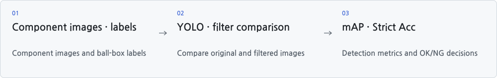
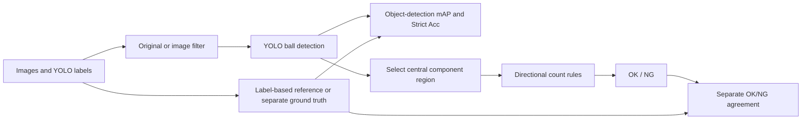

<a name="볼-결함-탐지와-영상-필터-비교"></a>
<a name="yolov8n--단일복합-전처리-필터--중복-그룹-분할--노이즈-강건성"></a>

<a id="-ball-defect-detection-project"></a>

<!-- readme-header32:start -->
<a name="ball-defect-detection-project"></a>
<p align="center"></p>
<h1 align="center" id="project-title">Ball Defect Detection Project</h1>
<p align="center">Comparing image filters and object detection</p>
<p align="center">
  <a href="../README.md"></a>
  <a href="README.md"></a>
</p>
<p align="center">
  <a href="../docs/%EC%9D%BD%EA%B8%B0%EC%95%88%EB%82%B4/%EB%A0%88%EB%B2%A81.md"></a>
  <a href="../docs/%EC%9D%BD%EA%B8%B0%EC%95%88%EB%82%B4/%EB%A0%88%EB%B2%A82.md"></a>
  <a href="../docs/%EC%9D%BD%EA%B8%B0%EC%95%88%EB%82%B4/%EB%A0%88%EB%B2%A83.md"></a>
  <a href="../docs/%EC%9D%BD%EA%B8%B0%EC%95%88%EB%82%B4/%EB%A0%88%EB%B2%A84.md"></a>
  <a href="../docs/%EC%9D%BD%EA%B8%B0%EC%95%88%EB%82%B4/%EB%A0%88%EB%B2%A85.md"></a>
</p>
<p align="center"><small>LEVEL links open the Korean source at the same reading level.</small></p>
<picture>
  <source media="(max-width: 600px) and (prefers-color-scheme: dark)" srcset="../assets/readme/flow-en-dark-mobile.svg" />
  <source media="(max-width: 600px)" srcset="../assets/readme/flow-en-light-mobile.svg" />
  <source media="(prefers-color-scheme: dark)" srcset="../assets/readme/flow-en-dark.svg" />
  <source media="(prefers-color-scheme: light)" srcset="../assets/readme/flow-en-light.svg" />
  
</picture>
<!-- readme-header32:end -->


This study compares single and combined preprocessing filters for YOLOv8n-based ball-object detection.

<!-- reading-levels17:start -->
| Reading level | What the guide covers |
| --- | --- |
| [LEVEL 1 - Beginner (Korean source)](../docs/%EC%9D%BD%EA%B8%B0%EC%95%88%EB%82%B4/%EB%A0%88%EB%B2%A81.md) | Unfamiliar terms and concrete examples from input to result |
| [LEVEL 2 - Explorer (Korean source)](../docs/%EC%9D%BD%EA%B8%B0%EC%95%88%EB%82%B4/%EB%A0%88%EB%B2%A82.md) | The relationships between key concepts and processing steps |
| [LEVEL 3 - Practitioner (Korean source)](../docs/%EC%9D%BD%EA%B8%B0%EC%95%88%EB%82%B4/%EB%A0%88%EB%B2%A83.md) | Experiment and usage procedures, and how to interpret results |
| [LEVEL 4 - Advanced (Korean source)](../docs/%EC%9D%BD%EA%B8%B0%EC%95%88%EB%82%B4/%EB%A0%88%EB%B2%A84.md) | Code structure, settings, design choices, and constraints |
| [LEVEL 5 - Expert (Korean source)](../docs/%EC%9D%BD%EA%B8%B0%EC%95%88%EB%82%B4/%EB%A0%88%EB%B2%A85.md) | Papers, protocols, denominators, leakage, and unverified scope |
<!-- reading-levels17:end -->

<a id="paper-errata-20261120"></a>

## Original manuscript and correction notice

The existing 5-page HWP/PDF originals are preserved unchanged. A separate [paper correction notice](../발표자료/5차/논문_정정안내.pdf) explains the double-rounding displays remaining in three figure values and the repeated paragraph.

Presentation graphs use a single rounding step from saved full-precision values.

Read the notice alongside the manuscript when citing it.


## Latest presentation · Revision 7

The last slide now centers on thanks. The Q&A wording and lower four-part guide/line were removed; the thanks, authors, university mark, and page number remain. The other 19 slides, research values, script, and photos are unchanged.

| Revision | Change | Materials |
| --- | --- | --- |
| Presentation Revision 7 | Remove supporting wording and guide lines from the final slide | [PPTX/PDF](../발표자료/7차) · [Details (Korean source)](../docs/revisions/talk-7.md) · [Previous comparison (Korean source)](../docs/revision-diffs/talk-7.md) |

Use it with the [Revision 5 script, questions/answers, research guide, photo collection, and paper correction notice](../발표자료/5차). The earlier Revision 6 presentation is also preserved.

<a id="최신-발표--6차"></a>

## Presentation visual improvements · Revision 6

Part divisions, diagram connections, and chart identification were refined while retaining the 20-slide research content and slide-by-slide script. Revision 6 changes the visual presentation of the same study; it adds no new training or performance measurements.

| Revision | Changes | Materials |
| --- | --- | --- |
| [Presentation Revision 6 (Korean source)](../docs/revisions/talk-6.md) | Part divisions, connector diagrams, filter colors, and series identification | [Materials](../발표자료/6차) · [Details (Korean source)](../docs/revisions/talk-6.md) · [Previous comparison (Korean source)](../docs/revision-diffs/talk-6.md) |

Use the [Revision 5 materials](../발표자료/5차) for the script, anticipated questions, research guide, filter-photo collection, and paper correction notice. The existing paper and raw experiment values are preserved.

<a id="최신-발표-자료--5차"></a>

## Presentation preparation · Revision 5

Read the filter-based ball-detection study through its slides, 10-minute script, and questions/answers. This revision improves communication and readability of saved results; it adds no new training results.

| Revision | Changes | Materials |
| --- | --- | --- |
| [Presentation Revision 5 (Korean source)](../docs/revisions/talk-5.md) | Readability redesign, 10-minute script, anticipated questions/answers, and research-understanding materials | [Materials](../발표자료/5차) · [Details (Korean source)](../docs/revisions/talk-5.md) · [Previous comparison (Korean source)](../docs/revision-diffs/talk-5.md) |

The study concerns **detecting ball objects in images**.

Models are retrained on filtered images for each condition. This is not evidence that one fixed model works well on every unknown field image.

The best Gamma result on ordinary images is a single-seed result; only selected representative conditions were repeated with three seeds. Distinguish mAP50-95, Strict Acc, and separate rule-based OK/NG agreement.

Field: Computer vision › Deep-learning object detection › Small objects and preprocessing robustness

`Python`
`PyTorch`
`YOLO`
`Jupyter`

[Quick start](#quick-start) · [Repository structure](#repository-structure) · [Experiment settings](#data-settings)

[Core components](#input-processing-output)

[Writing and publication status (Korean source)](../docs/%EB%85%BC%EB%AC%B8%EC%83%81%ED%83%9C.md)

<a id="-연구-핵심"></a>

## Research overview

The study compares YOLOv8n single/combined filters, noise conditions, and seeds. The complete final 5-page manuscript remains local and is not public. Change descriptions distinguish earlier revisions and abridged versions.

Values are those reported in the research manuscript.

- The single-run Gamma mAP50-95 is 96.70%, versus 96.53% for the original. Strict Acc uses a separate center-matching rule.
- Models were retrained for each filter/noise condition; selected representative conditions were repeated with three seeds. Similar-group overlap remains in internal training/validation splits.

**Materials:** [Final research code (Korean source)](../docs/versions/stage-1.md) · [Paper/Revision 4 (Korean source)](../docs/versions/stage-2.md) · [Presentation/Revision 1 (Korean source)](../docs/versions/stage-3.md) · [Presentation/Revision 2 (Korean source)](../docs/versions/stage-4.md) · [Presentation/Revision 3 (Korean source)](../docs/versions/stage-5.md) · [Final manuscript (Korean source)](../docs/versions/stage-6.md) · [Complete history (Korean source)](../docs/VERSIONS.md)

Presentation development follows Revision 1: 12 main slides +3 appendix slides → Revision 2: 20 main slides with expanded comparison photos → Revision 3: the same content/timing with a transparent logo and stronger asset checks. These are separate from research-experiment revisions; their public folders retain only the corresponding checking tools.

<a name="preview"></a>


**Original research figure** — A separately preserved original aggregate figure comparing filters by noise intensity. The three columns use noise standard deviations 0·40·80; the metric is mAP50-95.

[Writing and publication status (Korean source)](../docs/%EB%85%BC%EB%AC%B8%EC%83%81%ED%83%9C.md)

<a name="input-processing-output"></a>

<a id="-입력처리출력"></a>

## Input, processing, and output

| Component | Description |
| --- | --- |
| Problem | Compare how preprocessing filters and noise conditions affect small-ball detection. |
| Input | Manufactured-component images and ball bounding boxes |
| Processing | YOLOv8n, single/combined filters, duplicate-group splitting, and multi-seed comparisons |
| Output | Detection metrics, Strict Acc, and separate OK/NG decisions |

---

<a id="-논문과-최신-자료"></a>

## Paper and current materials

| Material | Original source |
| --- | --- |
| Final paper · Ball-detection filter comparison | [Writing and publication status (Korean source)](../docs/%EB%85%BC%EB%AC%B8%EC%83%81%ED%83%9C.md) |
| Final presentation · Ball detection | [Download PDF](../%EB%B0%9C%ED%91%9C%EC%9E%90%EB%A3%8C/%EC%B5%9C%EC%A2%85/%EC%B6%94%EA%B3%84%ED%95%99%EC%88%A0%EB%8C%80%ED%9A%8C_10%EB%B6%84%EB%B0%9C%ED%91%9C.pdf) |
| Final presentation · Ball detection | [Download PPTX](../%EB%B0%9C%ED%91%9C%EC%9E%90%EB%A3%8C/%EC%B5%9C%EC%A2%85/%EC%B6%94%EA%B3%84%ED%95%99%EC%88%A0%EB%8C%80%ED%9A%8C_10%EB%B6%84%EB%B0%9C%ED%91%9C.pptx) |
| Complete script · Ball-detection presentation Revision 4 | [Download TXT](../%EB%B0%9C%ED%91%9C%EC%9E%90%EB%A3%8C/4%EC%B0%A8/10%EB%B6%84_%ED%95%99%EC%88%A0%EB%8C%80%ED%9A%8C_%EB%B0%9C%ED%91%9C%EB%8C%80%EB%B3%B8.txt) |

[Material descriptions (Korean source)](../docs/PAPERS.md) · [Code revisions and change history (Korean source)](../docs/REVISION_INDEX.md)

<a id="️-차수별-프로젝트-안내"></a>

## All revisions

| Revision or stage | Main content | Materials and comparison with the previous version |
| --- | --- | --- |
| [Paper Revision 1 (Korean source)](../docs/revisions/paper-1.md) | <a id="layout18-table-4-row-1-field-1"></a>The initial manuscript compares single and combined filters for YOLO ball detection under varied image conditions. | [Folder](../%EB%85%BC%EB%AC%B8)<br>[Full comparison](../docs/revision-diffs/paper-1.diff) |
| [Paper Revision 2 (Korean source)](../docs/revisions/paper-2.md) | A manuscript stage refining sentences and wording under the same title and research settings as Revision 1. | [Folder](../%EB%85%BC%EB%AC%B8)<br>[Full comparison](../docs/revision-diffs/paper-2.diff) |
| [Paper Revision 3 (Korean source)](../docs/revisions/paper-3.md) | <a id="layout18-table-4-row-3-field-1"></a>This stage specifies the title as a comparison of single/combined preprocessing filters for YOLOv8n-based ball detection and expands interpretation of conditions and results. | [Folder](../%EB%85%BC%EB%AC%B8)<br>[Full comparison](../docs/revision-diffs/paper-3.diff) |
| [Paper Revision 4 · Review tools (Korean source)](../docs/revisions/paper-4.md) | <a id="layout18-table-4-row-4-field-1"></a>A review-tool stage comparing manuscript tables, figures, and text with saved full-precision results, rather than training a new model. | [Folder](../%EB%85%BC%EB%AC%B8/4%EC%B0%A8/tools)<br>[Full comparison (Korean source)](../docs/revision-diffs/paper-4-%EC%97%B4%EB%9E%8C.md) |
| [Paper Revision 5 · Reconstruction package (Korean source)](../docs/revisions/paper-5.md) | <a id="layout18-table-4-row-5-field-1"></a>This stage organizes preserved result tables/notebooks into paper figures, reference code, and a delivery package.<br>Retraining models and redrawing saved results use separate workflows. | [Folder](../%EB%85%BC%EB%AC%B8/5%EC%B0%A8/%EC%BD%94%EB%93%9C)<br>[Full comparison (Korean source)](../docs/revision-diffs/paper-5-%EC%97%B4%EB%9E%8C.md) |
| [Final manuscript · 3-page/5-page/summary (Korean source)](../docs/revisions/paper-final.md) | <a id="layout18-table-4-row-6-field-1"></a>The final stage organizes a 3-page abridgment, 5-page full manuscript, and separate summary of the same study.<br>The current complete 5-page manuscript and matching HWP remain local; check writing/publication status in the public guide. | [Folder](../%EB%85%BC%EB%AC%B8)<br>[Full comparison (Korean source)](../docs/revision-diffs/paper-final-%EC%97%B4%EB%9E%8C.md) |
| [Presentation Revision 1 (Korean source)](../docs/revisions/talk-1.md) | Initial presentation explaining the filter study in 12 main slides over 600 seconds plus 3 appendix slides. | [Folder](../%EB%B0%9C%ED%91%9C%EC%9E%90%EB%A3%8C/1%EC%B0%A8)<br>[Full comparison](../docs/revision-diffs/talk-1.diff) |
| [Presentation Revision 2 (Korean source)](../docs/revisions/talk-2.md) | Separate filter-comparison photos from explanations and reorganize a 20-slide·600-second main talk. | [Folder](../%EB%B0%9C%ED%91%9C%EC%9E%90%EB%A3%8C/2%EC%B0%A8)<br>[Full comparison](../docs/revision-diffs/talk-2.diff) |
| [Presentation Revision 3 (Korean source)](../docs/revisions/talk-3.md) | Preserve Revision 2's 20-slide content/timing while improving transparent university-mark assets and delivery consistency. | [Folder](../%EB%B0%9C%ED%91%9C%EC%9E%90%EB%A3%8C/3%EC%B0%A8)<br>[Full comparison](../docs/revision-diffs/talk-3.diff) |
| [Presentation Revision 4 (Korean source)](../docs/revisions/talk-4.md) | <a id="layout18-table-4-row-10-field-1"></a>A complete script refining spoken/transitional sentences and allocating target time to match Revision 3's 20-slide order.<br>This is not a new training or experiment stage. | [Folder](../%EB%B0%9C%ED%91%9C%EC%9E%90%EB%A3%8C/4%EC%B0%A8)<br>[Full comparison](../docs/revision-diffs/talk-4.diff) |
| [Final presentation (Korean source)](../docs/revisions/talk-final.md) | <a id="layout18-table-4-row-11-field-1"></a>The complete 20-slide PDF/PPTX explains single/combined filters and noise/seed results.<br>It communicates the same study for a presentation purpose distinct from the paper. | [Folder](../%EB%B0%9C%ED%91%9C%EC%9E%90%EB%A3%8C/%EC%B5%9C%EC%A2%85)<br>[Full comparison](../docs/revision-diffs/talk-final.diff) |
| [Final (Korean source)](../docs/revisions/code-final.md) | <a id="layout18-table-4-row-12-field-1"></a>A notebook organizing similar-image groups/cross-validation and calculating filter-specific YOLO detection, ball matching, regional count decisions, and additional diagnostics. | [Folder](../%EC%B5%9C%EC%A2%85)<br>[Full comparison (Korean source)](../docs/revision-diffs/code-final-%EC%97%B4%EB%9E%8C.md) |
| [Earlier Docker experiments and result tables (Korean source)](../docs/revisions/legacy.md) | <a id="layout18-table-4-row-13-field-1"></a>Materials combining earlier single/combined-filter notebooks with saved CSV, JSON, and graphs.<br>Inspecting saved tables and performing new training are separate workflows. | [Folder](../%EC%9D%B4%EC%A0%84%20%EB%8F%84%EC%BB%A4%20%EC%8B%A4%ED%97%98/%EB%B6%88%EB%9F%89%EA%B2%80%EC%B6%9C%EC%8B%A4%ED%97%98)<br>[Full comparison (Korean source)](../docs/revision-diffs/legacy-%EC%97%B4%EB%9E%8C.md) |


<a name="introduction"></a>

<a id="-프로젝트-소개"></a>

## Research method

The final study compares ball detection on original images, 10 single filters, and 5 combined filters. Near-duplicate image groups are separated for evaluation, and stability is examined across multiple seeds, cross-validation, and noise conditions. The notebook also includes a separate experiment assigning OK/NG through directional ball counts in a central region.

| Feature | Implementation |
| --- | --- |
| Ball detection | Predict object locations/boxes using Ultralytics YOLO |
| Regional decisions | Find a central rectangle and compare ball counts by position within it |
| Filter comparison | 10 single filters such as inversion, binarization, blur, and edges, plus 5 combinations |
| Difficulty experiments | Compare noise, resolution, blur intensity, and training-data quantity |
| Repeated experiments | Multiple seeds, cross-validation, and near-duplicate image grouping |
| Visualization | CSV/JSON summaries, confusion matrices, filter graphs, and GPU-use records |



<a name="repository-structure"></a>

<a id="-저장소-구성"></a>

## Repository structure

Main paths:

```text
.
├── ball_ok_ng_yolo_v7.ipynb
├── DataSet/
├── 최종/
│   └── 연구코드/
│       └── ball_ok_ng_yolo_v7.ipynb
├── 이전 도커 실험/
│   └── 불량검출실험/
│       ├── paper_filter_figures.py
│       ├── reference_plot_style.py
│       └── render_saved_figures.py
├── docs/VERSIONS.md
└── CHANGELOG.md
```

- [Final research notebook](../%EC%B5%9C%EC%A2%85/%EC%97%B0%EA%B5%AC%EC%BD%94%EB%93%9C/ball_ok_ng_yolo_v7.ipynb): Detection, decisions, filter comparisons, and additional diagnostics.
- [Base notebook](../ball_ok_ng_yolo_v7.ipynb): Research code preserved at the repository root.
- [Figure-generation code](../%EC%9D%B4%EC%A0%84%20%EB%8F%84%EC%BB%A4%20%EC%8B%A4%ED%97%98/%EB%B6%88%EB%9F%89%EA%B2%80%EC%B6%9C%EC%8B%A4%ED%97%98/paper_filter_figures.py): Research-figure composition.
- [Revision-specific file history (Korean source)](../docs/VERSIONS.md): Comparisons of the public code by revision.

<a name="최종-논문"></a>

<a id="-최종-논문"></a>

### Final paper

[Writing and publication status (Korean source)](../docs/%EB%85%BC%EB%AC%B8%EC%83%81%ED%83%9C.md) covers the filter-comparison method and research graphs.

<a name="최종-원고의-연구-범위"></a>

<a id="-최종-원고의-연구-범위"></a>

### Research scope of the final manuscript

Performance comparison of single and combined preprocessing filters for YOLOv8n-based ball detection
*Performance Comparison of Single and Combined Preprocessing Filters for YOLOv8n-Based Ball Detection*

The research manuscript follows the 2026 Fall Conference format of the [Korean Institute of Information Technology](https://eng.ki-it.or.kr/homepage/custom/memberadministrationregulation).

| Final-manuscript component | Stated configuration or result |
| --- | --- |
| <a id="layout18-table-6-row-1"></a> Data and splits | 500 images at 2944×2352, initial training 400·validation 100; 5-fold comparison using 368 near-duplicate groups |
| <a id="layout18-table-6-row-2"></a> Training | YOLOv8n, 30 epochs, input 1280, batch 8, patience 15 |
| <a id="layout18-table-6-row-3"></a> Evaluation distinction | mAP50-95 uses conf 0.001·NMS IoU 0.7; strict matching uses conf 0.25·NMS IoU 0.5 |
| <a id="layout18-table-6-row-4"></a> Single run | Gamma mAP50-95 96.70%, original 96.53%, difference 0.17%p |
| <a id="layout18-table-6-row-5"></a> Three-seed comparison | Invert +CLAHE Strict Acc 95.47±2.27%, original 95.40±0.53%; the single-run 98% is not substituted for repeated performance |
| <a id="layout18-table-6-row-6"></a> Noise σ=80 | Manuscript-reported Blur 82.86±0.08%, original 79.60±0.26% |


Strict matching pairs annotated/predicted centers one-to-one in nearest-first order, with allowed distance 0.5 times the annotation box's longer side. It differs from mAP50-95, which assesses box overlap.

The manuscript's outer evaluation folds separate similar-image groups, but 9~20 overlapping groups remain between internal training and validation.

Models are retrained for each filter/noise condition, so the experiment does not evaluate one fixed model's robustness to unseen capture conditions. Validation on independent capture lots also remains future work.

Alongside paper filter comparisons, the notebook includes a 100-epoch baseline experiment, virtual-ball addition, and decision-rule analysis.

<a name="implementation"></a>

<a id="-주요-기술과-실험-구성"></a>

## Main technologies and experiment structure

OpenCV handles images; PyTorch/Kornia implement filters. Ultralytics performs object detection, while NumPy, pandas, and Matplotlib aggregate results and generate figures.

Ordinary-image comparisons cover original images, 10 single filters, and 5 combinations. Noise comparisons cover original images and single filters. `A+B` means A followed by B; reverse ordering and every possible combination were not tested.

Fixed settings are CLAHE clip limit 40·16×16 grid, Gamma 0.3, Gaussian Blur σ20·121×121 kernel, Emboss gain 4, and Unsharp amount 8·σ2. These are comparison settings, not established optima.

The notebook begins with early development experiments and later adds cross-validation and robustness experiments.

| Comparison group | Conditions |
| --- | --- |
| <a id="layout18-table-7-row-1"></a> Baseline | Original images |
| <a id="layout18-table-7-row-2"></a> Single filters | Invert, Otsu, Solarize, Histogram Equalization, CLAHE, Gamma, Gaussian Blur, Sobel, Emboss, Unsharp |
| <a id="layout18-table-7-row-3"></a> Combined filters | Invert+CLAHE, Blur+Otsu, Sobel+Invert, HistEq+Emboss, Unsharp+Sobel |
| <a id="layout18-table-7-row-4"></a> Additional diagnostics | Remove/add balls, vary decision thresholds, change distributions, and repeat across seeds |


<a name="quick-start"></a>

<a id="-빠른-시작"></a>

## Quick start

Prepare Python and a CUDA-capable PyTorch environment first. The default `REQUIRE_GPU = True` stops execution if CUDA is unavailable. Prepare packages and run from the repository root.

```powershell
python -m pip install jupyterlab numpy opencv-python matplotlib pandas pyyaml joblib ultralytics kornia
python -m jupyter lab "최종/연구코드/ball_ok_ng_yolo_v7.ipynb"
```

1. Set notebook data paths to your experiment materials. The original code assumes `/root/추계학술대회/DataSet`.
2. Check image/YOLO-label correspondence and training/validation/test splits.
3. Confirm the GPU and data paths, then run needed experiment cells in order.
4. Inspect result CSV/JSON files and run figure-generation cells when needed.

Original images, training weights, and a complete runtime must be prepared separately. The public files are not a package that immediately reproduces every experiment.

<a name="data-settings"></a>

<a id="-데이터-구성과-실험-설정"></a>

## Data and experiment settings

The notebook expects this base structure:

```text
DataSet/
├── images/{train,val,test}/*.png
├── labels/{train,val,test}/*.txt
└── data.yaml
```

Each label row is `class cx cy w h`, with coordinates normalized to 0~1. For separate actual OK/NG ground truth, check notebook `OKNG_CSV` and later `REAL_LABEL_*` settings.

| Metric or setting | Interpretation |
| --- | --- |
| Positional counts | Implementation rule: top 5·left 4·bottom 2·right 2 |
| Detection mAP | Ball bounding-box detection performance |
| OK/NG accuracy | Decision agreement with the chosen ground-truth definition and count rules |
| Strict Acc | Strict criterion requiring every labeled ball to be found with no extra detections |
| Majority-class baseline | A reference for comparison with simple majority prediction under class imbalance |
| McNemar comparison | Compare two methods' correct/incorrect decisions on the same images |

Ground truth is generated by applying the same region/count rules to annotation boxes. This evaluates rule-based decision agreement; comparison against separate expert judgments remains future work.

<a name="troubleshooting"></a>

<a id="️-문제-해결"></a>

## Troubleshooting

| Symptom | What to check |
| --- | --- |
| CUDA GPU not found | Driver, CUDA support in PyTorch, and notebook device settings |
| Data-path error | Original Linux paths versus current dataset locations |
| Results appear excessively high | Duplicate-image groups, class imbalance, ground-truth generation rules, and availability of separate actual labels |
| Korean graph text is garbled | Nanum Gothic installation and notebook font paths |
| Values differ from earlier results | Matching seeds, splits, weights, caches, and filter parameters |

---

Compare conditions separately, from detection to decisions.

<a id="-현재-첨부-문서"></a>

## Current documents and change history

This compares current public materials with the previous public version. The all-revisions table describes earlier manuscript, presentation, and code stages. Unpublished manuscript bodies and editable originals remain local and are not public.

| Document | Material folder | Details and full comparison with the previous public version |
| --- | --- | --- |
| Final paper · Ball-detection filter comparison | [Folder](../%EB%85%BC%EB%AC%B8) | [Description (Korean source)](../docs/latest/ball-yolov8n-filter-paper.md)<br>[Full comparison (Korean source)](../docs/changes/2026-11-02-%EC%B5%9C%EC%8B%A0%EB%AC%B8%EC%84%9C-%EC%A0%84%EC%B2%B4%EB%B9%84%EA%B5%90.md) |
| Final presentation · Ball detection | [Folder](../%EB%B0%9C%ED%91%9C%EC%9E%90%EB%A3%8C/%EC%B5%9C%EC%A2%85) | [Description (Korean source)](../docs/latest/ball-conference-presentation.md)<br>[Full comparison (Korean source)](../docs/changes/2026-11-02-%EC%B5%9C%EC%8B%A0%EB%AC%B8%EC%84%9C-%EC%A0%84%EC%B2%B4%EB%B9%84%EA%B5%90.md) |
| Complete script · Ball-detection presentation Revision 4 | [Folder](../%EB%B0%9C%ED%91%9C%EC%9E%90%EB%A3%8C/4%EC%B0%A8) | [Description (Korean source)](../docs/latest/ball-complete-talk-script.md)<br>[Full comparison (Korean source)](../docs/changes/2026-11-02-%EC%B5%9C%EC%8B%A0%EB%AC%B8%EC%84%9C-%EC%A0%84%EC%B2%B4%EB%B9%84%EA%B5%90.md) |

[Changes to the current document structure (Korean source)](../docs/changes/2026-11-02-%EC%B5%9C%EC%8B%A0%EB%AC%B8%EC%84%9C.md)

<a name="research-details"></a>

<a id="-연구구현의-세부-흐름"></a>

## Methods and conditions by revision

Inputs, processing methods, execution conditions, and results are organized by revision.

<a id="-논문-1차--단일복합-전처리-필터-비교의-출발점"></a>

<details>
<summary>Paper Revision 1 · Starting the single/combined preprocessing-filter comparison</summary>

<a id="논문-1차단일복합-전처리-필터-비교의-출발점"></a>

The initial manuscript compares single and combined filters for YOLO ball detection under varied image conditions.

| Component | Content |
| --- | --- |
| Research question | Compare how filters change small-ball detection. |
| Reading the initial manuscript | Read title, setting, and wording changes leading to later manuscripts alongside the previous comparison. |
| Filter comparison | Compare 10 single filters and 5 sequential combinations against the Original baseline. |
| Retraining per condition | Distinguish this from directly applying one fixed model to unknown capture conditions. |
| Two metrics | Distinguish bounding-box mAP50-95 from Strict Acc, which requires every ball to match with no extra detections. |
| Repetition and noise | Read ordinary conditions, noise standard deviations 40·80, and three-seed repetitions separately. |

| Input or condition | Description |
| --- | --- |
| Material | Manuscript-reported results for 500 images at 2944×2352 |
| Outer evaluation | Similar-group-based 5-fold cross-validation |
| Conditions | 10 single filters·5 combinations·noise 40/80·three seeds |
| Result distinction | mAP50-95 and Strict Acc |

For ordinary images with one seed, the manuscript reports Gamma0.3 mAP50-95 of 96.70%, versus 96.53% for Original.

The difference is 0.17%p; this small difference should not be generalized into unconditional superiority.

Combined filters do not outperform their single-component filters in every case. Read ordinary-condition results separately from noise-condition stability and variation across three seeds.

| Constraint | What to check |
| --- | --- |
| <a id="layout18-table-13-row-1"></a> Generalization | Results retrain per filter/noise condition; they do not establish a fixed model's adaptability to unknown capture conditions. |
| <a id="layout18-table-13-row-2"></a> Internal splits | Outer evaluation groups are separated, but similar-group overlap remains in internal train/val. |
| <a id="layout18-table-13-row-3"></a> Metric definitions | Strict Acc uses center-distance, missing-detection, and extra-detection rules; it is distinct from expert OK/NG judgments and mAP. |


[Files, key definitions, and reading order (Korean source)](../docs/revisions/paper-1.md) · [Full comparison for this stage](../docs/revision-diffs/paper-1.diff)

<a id="-논문-2차--같은-설정을-더-명확하게-설명한-원고"></a>

</details>

<details>
<summary>Paper Revision 2 · Explaining the same settings more clearly</summary>

<a id="논문-2차같은-설정을-더-명확하게-설명한-원고"></a>

A manuscript stage refining sentences and wording under the same title and research settings as Revision 1.

| Component | Content |
| --- | --- |
| Revised explanation | Distinguish sentence/wording changes from changes in experiment settings. |
| Duplicate summaries | Revision 1 and 2 summary PDFs have the same hash and are not counted as new summary results. |
| Filter comparison | Compare 10 single filters and 5 sequential combinations against the Original baseline. |
| Retraining per condition | Distinguish this from directly applying one fixed model to unknown capture conditions. |
| Two metrics | Distinguish bounding-box mAP50-95 from Strict Acc, which requires every ball to match with no extra detections. |
| Repetition and noise | Read ordinary conditions, noise standard deviations 40·80, and three-seed repetitions separately. |

| Input or condition | Description |
| --- | --- |
| Material | Manuscript-reported results for 500 images at 2944×2352 |
| Outer evaluation | Similar-group-based 5-fold cross-validation |
| Conditions | 10 single filters·5 combinations·noise 40/80·three seeds |
| Result distinction | mAP50-95 and Strict Acc |

For ordinary images with one seed, the manuscript reports Gamma0.3 mAP50-95 of 96.70%, versus 96.53% for Original.

The difference is 0.17%p; this small difference should not be generalized into unconditional superiority.

Combined filters do not outperform their single-component filters in every case. Read ordinary-condition results separately from noise-condition stability and variation across three seeds.

| Constraint | What to check |
| --- | --- |
| <a id="layout18-table-16-row-1"></a> Generalization | Results retrain per filter/noise condition; they do not establish a fixed model's adaptability to unknown capture conditions. |
| <a id="layout18-table-16-row-2"></a> Internal splits | Outer evaluation groups are separated, but similar-group overlap remains in internal train/val. |
| <a id="layout18-table-16-row-3"></a> Metric definitions | Strict Acc uses center-distance, missing-detection, and extra-detection rules; it is distinct from expert OK/NG judgments and mAP. |


[Files, key definitions, and reading order (Korean source)](../docs/revisions/paper-2.md) · [Full comparison for this stage](../docs/revision-diffs/paper-2.diff)

<a id="-논문-3차--yolov8n-필터-비교-전체-원고"></a>

</details>

<details>
<summary>Paper Revision 3 · Complete YOLOv8n filter-comparison manuscript</summary>

<a id="논문-3차yolov8n-필터-비교-전체-원고"></a>

This stage specifies the title as a comparison of single/combined preprocessing filters for YOLOv8n-based ball detection and expands interpretation of conditions and results.

| Component | Content |
| --- | --- |
| Explicit scope | Specify YOLOv8n and clarify the purpose of comparing single and combined filters. |
| Complete text | The Revision 3 HWP and final 5-page HWP contain identical manuscript bytes. |
| Filter comparison | Compare 10 single filters and 5 sequential combinations against the Original baseline. |
| Retraining per condition | Distinguish this from directly applying one fixed model to unknown capture conditions. |
| Two metrics | Distinguish bounding-box mAP50-95 from Strict Acc, which requires every ball to match with no extra detections. |
| Repetition and noise | Read ordinary conditions, noise standard deviations 40·80, and three-seed repetitions separately. |

| Input or condition | Description |
| --- | --- |
| Material | Manuscript-reported results for 500 images at 2944×2352 |
| Outer evaluation | Similar-group-based 5-fold cross-validation |
| Conditions | 10 single filters·5 combinations·noise 40/80·three seeds |
| Result distinction | mAP50-95 and Strict Acc |

For ordinary images with one seed, the manuscript reports Gamma0.3 mAP50-95 of 96.70%, versus 96.53% for Original.

The difference is 0.17%p; this small difference should not be generalized into unconditional superiority.

Combined filters do not outperform their single-component filters in every case. Read ordinary-condition results separately from noise-condition stability and variation across three seeds.

| Constraint | What to check |
| --- | --- |
| <a id="layout18-table-19-row-1"></a> Generalization | Results retrain per filter/noise condition; they do not establish a fixed model's adaptability to unknown capture conditions. |
| <a id="layout18-table-19-row-2"></a> Internal splits | Outer evaluation groups are separated, but similar-group overlap remains in internal train/val. |
| <a id="layout18-table-19-row-3"></a> Metric definitions | Strict Acc uses center-distance, missing-detection, and extra-detection rules; it is distinct from expert OK/NG judgments and mAP. |


[Files, key definitions, and reading order (Korean source)](../docs/revisions/paper-3.md) · [Full comparison for this stage](../docs/revision-diffs/paper-3.diff)

<a id="-논문-4차--원고-수치와-근거를-대조하는-도구"></a>

</details>

<details>
<summary>Paper Revision 4 · Tools for comparing manuscript values with evidence</summary>

<a id="논문-4차원고-수치와-근거를-대조하는-도구"></a>

A review-tool stage comparing manuscript tables, figures, and text with saved full-precision results, rather than training a new model.

| Component | Processing |
| --- | --- |
| <a id="layout18-table-20-row-1"></a> Original-source binding | Compare the manuscript SHA with input/evidence-file hashes. |
| <a id="layout18-table-20-row-2"></a> Result calculation | Includes conditions aggregating image-level results from 16 single-run conditions/8000 rows and 39 repeated conditions/19500 rows. |
| <a id="layout18-table-20-row-3"></a> Split checks | Includes conditions checking 500 images, 368 similar groups, 154 similar pairs, 0 outer overlap, and 9~20 overlapping internal groups. |
| <a id="layout18-table-20-row-4"></a> Display and text | Compare double rounding, HWP figure resolution, citations, acknowledgments, and manuscript sentences. |


| Input or condition | Description |
| --- | --- |
| <a id="layout18-table-21-row-1"></a> Tools | Python, NumPy, and CSV/JSON |
| <a id="layout18-table-21-row-2"></a> Inputs | audit.json, manuscript, result CSV, recalculated, container_dataset, main_findings, and related materials |
| <a id="layout18-table-21-row-3"></a> Role | Compare input evidence and completeness |


The tools require paper_ready_for_submission =False and distinguish PASS, caution, correction needed, and unverifiable states. Preserving the tools alone does not establish that the manuscript was corrected or a new test completed.

Double rounding in manuscript figures, approximately 96dpi HWP-embedded images, and the extent of whole-document render inspection are linked as separate items. Read findings at this stage alongside the previous comparison and current manuscript status.

| Constraint | What to check |
| --- | --- |
| Dependencies | The scripts also require audit/evidence JSON, manuscript files, and raw result materials. |
| Evaluation leakage | Check outer-group separation separately from internal train/val group overlap. |
| Manuscript preservation | These tools do not hide discrepancies or arbitrarily alter manuscript values. |

[Files, key definitions, and reading order (Korean source)](../docs/revisions/paper-4.md) · [Full comparison for this stage (Korean source)](../docs/revision-diffs/paper-4-%EC%97%B4%EB%9E%8C.md)

<a id="-논문-5차--결과표와-도표-재구성-패키지"></a>

</details>

<details>
<summary>Paper Revision 5 · Result-table and figure reconstruction package</summary>

<a id="논문-5차결과-표와-도표-재구성-패키지"></a>

This stage organizes preserved result tables/notebooks into paper figures, reference code, and a delivery package. Retraining models and redrawing saved results use separate workflows.

| Component | Processing |
| --- | --- |
| <a id="layout18-table-23-row-1"></a> Paper figures | paper_filter_figures.py creates 3 paper figures from single/combined/noise CSV results. |
| <a id="layout18-table-23-row-2"></a> Style functions | reference_plot_style.py shares font, color, bar, label, and adjacent-text placement behavior. |
| <a id="layout18-table-23-row-3"></a> Rerendering | render_saved_figures.py uses saved JSON/CSV and plotting functions from the reference notebook. |
| <a id="layout18-table-23-row-4"></a> Input binding | Includes recording SHAs of the raw inputs used in regenerated figures. |


| Input or condition | Description |
| --- | --- |
| <a id="layout18-table-24-row-1"></a> Input tables | table_round1·table_round2·table_grid_noise40·table_grid_noise80 |
| <a id="layout18-table-24-row-2"></a> Figure tools | NumPy·pandas·Matplotlib |
| <a id="layout18-table-24-row-3"></a> Arguments | paper_filter_figures: --results·--output |
| <a id="layout18-table-24-row-4"></a> Rerender arguments | --results·--output·--notebook |


Figure reconstruction changes the presentation of saved results. It is not counted as a new experiment or separate paper achievement.

The 15 figure PDFs are graphs, with roles distinct from earlier manuscripts and abridgments. Distinguish code, JSON, CSV, original experiment graphs, and final-paper attachments.

| Constraint | What to check |
| --- | --- |
| Experiment versus rendering | Do not confuse successful model training with redrawing saved-result figures. |
| Full precision | Use input tables rather than reconstructing originals from rounded display values. |
| Dependencies | Prepare style modules, notebook, CSV/JSON, and font paths together. |

[Files, key definitions, and reading order (Korean source)](../docs/revisions/paper-5.md) · [Full comparison for this stage (Korean source)](../docs/revision-diffs/paper-5-%EC%97%B4%EB%9E%8C.md)

<a id="-논문-최종--5쪽-전체-원고-읽기"></a>

</details>

<details>
<summary>Final paper · Reading the complete 5-page manuscript</summary>

<a id="논문-최종5-쪽-전체-원고-읽기"></a>

The final stage organizes a 3-page abridgment, 5-page full manuscript, and separate summary of the same study. The current complete 5-page manuscript and matching HWP remain local; check writing/publication status in the public guide.

| Component | Content |
| --- | --- |
| Complete manuscript | The 5-page version contains the complete method, conditions, tables, and interpretation; a 3-page abridgment is not a substitute. |
| Manuscript lineage | The final 5-page HWP matches Revision 3 HWP.<br>Writing/abridgment-format differences are not new research. |
| Filter comparison | Compare 10 single filters and 5 sequential combinations against the Original baseline. |
| Retraining per condition | Distinguish this from directly applying one fixed model to unknown capture conditions. |
| Two metrics | Distinguish bounding-box mAP50-95 from Strict Acc, which requires every ball to match with no extra detections. |
| Repetition and noise | Read ordinary conditions, noise standard deviations 40·80, and three-seed repetitions separately. |

| Input or condition | Description |
| --- | --- |
| Material | Manuscript-reported results for 500 images at 2944×2352 |
| Outer evaluation | Similar-group-based 5-fold cross-validation |
| Conditions | 10 single filters·5 combinations·noise 40/80·three seeds |
| Result distinction | mAP50-95 and Strict Acc |

For ordinary images with one seed, the manuscript reports Gamma0.3 mAP50-95 of 96.70%, versus 96.53% for Original.

The difference is 0.17%p; this small difference should not be generalized into unconditional superiority.

Combined filters do not outperform their single-component filters in every case. Read ordinary-condition results separately from noise-condition stability and variation across three seeds.

| Constraint | What to check |
| --- | --- |
| <a id="layout18-table-28-row-1"></a> Generalization | Results retrain per filter/noise condition; they do not establish a fixed model's adaptability to unknown capture conditions. |
| <a id="layout18-table-28-row-2"></a> Internal splits | Outer evaluation groups are separated, but similar-group overlap remains in internal train/val. |
| <a id="layout18-table-28-row-3"></a> Metric definitions | Strict Acc uses center-distance, missing-detection, and extra-detection rules; it is distinct from expert OK/NG judgments and mAP. |


[Files, key definitions, and reading order (Korean source)](../docs/revisions/paper-final.md) · [Full comparison for this stage (Korean source)](../docs/revision-diffs/paper-final-%EC%97%B4%EB%9E%8C.md)

<a id="-발표자료-1차--12장-본발표와-3장-부록"></a>

</details>

<details>
<summary>Presentation Revision 1 · 12 main slides and 3 appendix slides</summary>

<a id="발표-자료-1차12장-본-발표와-3장-부록"></a>

Initial presentation explaining the filter study in 12 main slides over 600 seconds plus 3 appendix slides.

| Component | Content |
| --- | --- |
| Research narrative | Data/group evaluation → filters → mAP/Strict Acc → noise/seeds → limitations. |
| Presentation length | The checker verifies 15 slides, 600 seconds across the first 12, and 0 seconds for the appendix. |
| Full-precision charts | The checker compares JSON values against 15 significant digits in PPTX charts and their 1/2-decimal display settings. |
| Speech correspondence | Includes a workflow checking that slide notes and the script contain the same spoken text. |

| Input or condition | Description |
| --- | --- |
| Reading tools | PDF viewer or PowerPoint-compatible program |
| Checking tools | Python·Pillow·PPTX ZIP/XML |
| Required inputs | content/data, original materials, chart/photo manifests, and presentation files |

600 seconds is the target time allocated to slides, not actual speech duration or a presentation-evaluation score. Check actual timing in rehearsal.

Read full-precision results, display charts, and the paper's reported scope together. More slides do not establish additional research experiments.

| Constraint | What to check |
| --- | --- |
| Current attachments | Link to the final presentation rather than attaching duplicate earlier copies. |
| Tool inputs | In addition to public checkers, revision-specific content/data and evidence JSON are needed. |
| Numerical interpretation | Distinguish Strict Acc from mAP, and ordinary/noise/repeated results. |

[Files, key definitions, and reading order (Korean source)](../docs/revisions/talk-1.md) · [Full comparison for this stage](../docs/revision-diffs/talk-1.diff)

<a id="-발표자료-2차--비교-사진을-분리한-20장-발표"></a>

</details>

<details>
<summary>Presentation Revision 2 · 20 slides with separate comparison photos</summary>

<a id="발표-자료-2차비교-사진을-분리한-20장-발표"></a>

Separate filter-comparison photos from explanations and reorganize a 20-slide·600-second main talk.

| Component | Content |
| --- | --- |
| Photo explanations | Distribute filter comparisons across slides 4~9 and separate noise 40/80 input examples on slides 14~15. |
| Timing and conclusion | Allocate speech time to all 20 slides and close with thanks/Q&A. |
| Full-precision charts | The checker compares JSON values against 15 significant digits in PPTX charts and their 1/2-decimal display settings. |
| Speech correspondence | Includes a workflow checking that slide notes and the script contain the same spoken text. |

| Input or condition | Description |
| --- | --- |
| Reading tools | PDF viewer or PowerPoint-compatible program |
| Checking tools | Python·Pillow·PPTX ZIP/XML |
| Required inputs | content/data, original materials, chart/photo manifests, and presentation files |

600 seconds is the target time allocated to slides, not actual speech duration or a presentation-evaluation score. Check actual timing in rehearsal.

Read full-precision results, display charts, and the paper's reported scope together. More slides do not establish additional research experiments.

| Constraint | What to check |
| --- | --- |
| Current attachments | Link to the final presentation rather than attaching duplicate earlier copies. |
| Tool inputs | In addition to public checkers, revision-specific content/data and evidence JSON are needed. |
| Numerical interpretation | Distinguish Strict Acc from mAP, and ordinary/noise/repeated results. |

[Files, key definitions, and reading order (Korean source)](../docs/revisions/talk-2.md) · [Full comparison for this stage](../docs/revision-diffs/talk-2.diff)

<a id="-발표자료-3차--투명-로고와-자산-보존"></a>

</details>

<details>
<summary>Presentation Revision 3 · Transparent logo and asset preservation</summary>

<a id="발표-자료-3차투명-로고와-자산-보존"></a>

Preserve Revision 2's 20-slide content/timing while improving transparent university-mark assets and delivery consistency.

| Component | Content |
| --- | --- |
| Content preservation | Revision 2/3 content.json files have identical bytes, so speech content and timing remain unchanged. |
| Asset checks | Add checks comparing the transparent RGBA logo, included PNG/SVG/original AI, and preserved inputs. |
| Full-precision charts | The checker compares JSON values against 15 significant digits in PPTX charts and their 1/2-decimal display settings. |
| Speech correspondence | Includes a workflow checking that slide notes and the script contain the same spoken text. |

| Input or condition | Description |
| --- | --- |
| Reading tools | PDF viewer or PowerPoint-compatible program |
| Checking tools | Python·Pillow·PPTX ZIP/XML |
| Required inputs | content/data, original materials, chart/photo manifests, and presentation files |

600 seconds is the target time allocated to slides, not actual speech duration or a presentation-evaluation score. Check actual timing in rehearsal.

Read full-precision results, display charts, and the paper's reported scope together. More slides do not establish additional research experiments.

| Constraint | What to check |
| --- | --- |
| Current attachments | Link to the final presentation rather than attaching duplicate earlier copies. |
| Tool inputs | In addition to public checkers, revision-specific content/data and evidence JSON are needed. |
| Numerical interpretation | Distinguish Strict Acc from mAP, and ordinary/noise/repeated results. |

[Files, key definitions, and reading order (Korean source)](../docs/revisions/talk-3.md) · [Full comparison for this stage](../docs/revision-diffs/talk-3.diff)

<a id="️-발표자료-4차--20장-순서에-맞춘-완성-대본"></a>

</details>

<details>
<summary>Presentation Revision 4 · Complete script following the 20-slide order</summary>

<a id="발표-자료-4차20장-순서에-맞춘-완성-대본"></a>

A complete script refining spoken/transitional sentences and allocating target time to match Revision 3's 20-slide order. This is not a new training or experiment stage.

| Component | Content |
| --- | --- |
| Slide-by-slide speech | Place explanations in the complete 20-slide order. |
| Transitions | Integrate separately listed transitions into the main script. |
| Time allocation | Divide content/sections for the 10-minute target; check actual duration in rehearsal. |
| Manuscript connection | Interpret values and metrics consistently with the paper and slides. |

| Input or condition | Description |
| --- | --- |
| Document | 12643-byte UTF-8 text |
| Corresponding presentation | Complete 20-slide presentation |
| Target | 10-minute structure; actual speech duration checked separately |

Sentences and time allocations form a presentation plan. This file does not report actual talk duration, grades, or measured performance.

The earlier Revision 3 →4 comparison describes changes against the public text at that time; the current file is the original full script. Repository change records distinguish differences between the current file and the previous public version.

| Constraint | What to check |
| --- | --- |
| Time | Distinguish the 600-second planning target from actual speech duration. |
| Document role | The script is a complete speech document serving a purpose separate from the paper. |
| Values | Do not present manuscript-reported values as newly measured results. |

[Files, key definitions, and reading order (Korean source)](../docs/revisions/talk-4.md) · [Full comparison for this stage](../docs/revision-diffs/talk-4.diff)

<a id="-발표자료-최종--필터-비교-완성-20장"></a>

</details>

<details>
<summary>Final presentation · Complete 20-slide filter comparison</summary>

<a id="발표-자료-최종필터-비교-완성-20장"></a>

The complete 20-slide PDF/PPTX explains single/combined filters and noise/seed results. It communicates the same study for a presentation purpose distinct from the paper.

| Component | Content |
| --- | --- |
| Research flow | Start from data/group evaluation, then filters, two metrics, noise, and limitations. |
| Figures and charts | Explain single/combined/noise/repeated results using consistent tables and figures. |
| Editable original | Provide the PPTX of the same presentation as the PDF. |
| Script correspondence | Read slide order and speech content with the complete Revision 4 script. |

| Input or condition | Description |
| --- | --- |
| Material | 20-slide PDF/PPTX |
| Script | Complete Presentation Revision 4 script |
| Reading | PDF viewer or PPTX-compatible program |

The presentation communicates existing research results. Changes in slide structure, logos, or speech are not additional research-performance results.

The 10-minute planning target differs from actual speech duration. Explain Strict Acc separately from mAP and distinguish ordinary/noise conditions.

| Constraint | What to check |
| --- | --- |
| Research versus document | Do not count the presentation as a separate new paper. |
| Time | Check actual duration in rehearsal. |
| Result scope | Retain the manuscript's splits, per-condition retraining, and limitations. |

[Files, key definitions, and reading order (Korean source)](../docs/revisions/talk-final.md) · [Full comparison for this stage](../docs/revision-diffs/talk-final.diff)

<a id="️-최종-연구코드--볼-검출과-규칙-기반-판정"></a>

</details>

<details>
<summary>Final research code · Ball detection and rule-based decisions</summary>

<a id="최종-연구코드--볼-검출과-규칙-기반-판정"></a>

A notebook organizing similar-image groups/cross-validation and calculating filter-specific YOLO detection, ball matching, regional count decisions, and additional diagnostics.

| Component | Processing |
| --- | --- |
| <a id="layout18-table-44-row-1"></a> Data checks | Inspect labels, class balance, and similar groups based on mean absolute differences between size-128 reduced images. |
| <a id="layout18-table-44-row-2"></a> Regional rules | Evaluate ball centers inside the component rectangle against top 5·left 4·bottom 2·right 2. |
| <a id="layout18-table-44-row-3"></a> Outer folds | assign_folds keeps similar groups in the same outer fold; fold_split creates internal validation from remaining images. |
| <a id="layout18-table-44-row-4"></a> Detection quality | ball_match_stats performs one-to-one matching with center-distance tolerance 0.5 times annotation size, counting missing/extra detections. |
| <a id="layout18-table-44-row-5"></a> Filter experiments | Distinguish train_per_filter, inference_only, and result-signature caches. |


| Input or condition | Description |
| --- | --- |
| Base training | YOLOv8n·100epoch·1280·batch8 |
| Filter training | 30epoch·outer 5fold·internal val10% |
| Inference | Default conf0.25·IoU0.5 |
| Baseline seed | 42 |
| Required inputs | Dataset, labels, GPU, and required weights |

Strict Acc is the image proportion where all labeled balls are matched by center distance with no extra detections. fold_map separately calculates mAP50/mAP50-95 on model.val's held-out test.

Outer-group separation and internal-validation splitting are different operations. Internal val splits by image, so near-duplicate groups can overlap.

Without OKNG_CSV, agreement with rule-based ground truth is not expert-judgment accuracy.

| Constraint | What to check |
| --- | --- |
| <a id="layout18-table-46-row-1"></a> Generalization | Results retrain per filter/noise condition; they do not establish a fixed model's adaptability to unknown capture conditions. |
| <a id="layout18-table-46-row-2"></a> Internal splits | Outer evaluation groups are separated, but similar-group overlap remains in internal train/val. |
| <a id="layout18-table-46-row-3"></a> Metric definitions | Strict Acc uses center-distance, missing-detection, and extra-detection rules; it is distinct from expert OK/NG judgments and mAP. |
| <a id="layout18-table-46-row-4"></a> Execution cost | Includes GPU training, evaluation across conditions, monitor threads, and file generation.<br>Distinguish browsing from full execution. |
| <a id="layout18-table-46-row-5"></a> Caching | Reuse results when data, weights, thresholds, and filter-parameter signatures match. |


[Files, key definitions, and reading order (Korean source)](../docs/revisions/code-final.md) · [Full comparison for this stage (Korean source)](../docs/revision-diffs/code-final-%EC%97%B4%EB%9E%8C.md)

<a id="️-이전-도커-실험--코드와-저장-결과-읽기"></a>

</details>

<details>
<summary>Earlier Docker experiments · Reading code and saved results</summary>

<a id="이전-도커-실험--코드와-저장-결과-읽기"></a>

Materials combining earlier single/combined-filter notebooks with saved CSV, JSON, and graphs. Inspecting saved tables and performing new training are separate workflows.

| Component | Content |
| --- | --- |
| Raw results | Check conditions and metrics in results_summary, sweep, repeated results, and tables. |
| Filter comparison | Link results comparing 10 single filters and 5 combinations against original images. |
| Tables versus figures | Distinguish full-precision CSV/JSON from rounded display graphs. |
| Code connection | Compare earlier notebook settings, caches, and outputs with changes in the final notebook. |

| Input or condition | Description |
| --- | --- |
| Reading | CSV/JSON viewers and Jupyter |
| Metrics | Check each column's definition, including accuracy, Strict Acc, mAP, and speed |
| Execution | Prepare original data, GPU, weights, and paths separately |

Saved results apply to the conditions at their recording time. Do not merge values from different runs, splits, or seeds merely because metric names match.

Redrawing figures/tables differs from retraining a detector. These materials do not newly publish original manufacturing images or model weights.

| Constraint | What to check |
| --- | --- |
| Missing inputs | Complete original manufacturing images and weights must be prepared separately. |
| Display precision | Full precision in CSV/JSON differs from graph decimal displays. |
| Comparison scope | Do not retroactively apply the final notebook's additional diagnostics to these earlier results. |

[Files, key definitions, and reading order (Korean source)](../docs/revisions/legacy.md) · [Full comparison for this stage (Korean source)](../docs/revision-diffs/legacy-%EC%97%B4%EB%9E%8C.md)

[Changes to the revision guides (Korean source)](../docs/changes/2026-11-03-%EC%B0%A8%EC%88%98%EB%B3%84%ED%94%84%EB%A1%9C%EC%A0%9D%ED%8A%B8%EC%95%88%EB%82%B4.md)

</details>
